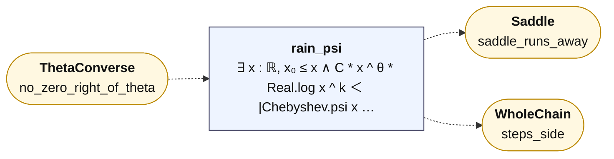

# `lean_stage3/Stage3/RateBelow.lean`

> **Read from the source text.** This file changed after the last `python3 utilities/lean_map.py --dump`, so the arrows on this page are names occurring in each proof and have not been confirmed by Lean.

RateBelow — block R9 of `lean_stage3/design/runs.md`, the staircase. 2026-11-23.

1 theorem, 0 definitions, 39 lines. 

**Imports:** [`StepsRate`](../lean_stage3/StepsRate.md), [`ThetaConverse`](../lean_stage3/ThetaConverse.md)  
**Imported by:** [`Stage3`](../lean_stage3/Stage3.md), [`Saddle`](../lean_stage3/Saddle.md)

## The picture



An arrow A → B reads "A is used in the proof of B". Green: counting, integers only. Violet: shape, analysis with no ζ. Blue: reads ζ. A name ending in ■ is an end: nothing else uses it. Red: contains `sorry`. Yellow: theorems in another file, counted; a dotted arrow crosses files. Definitions are not drawn; they are listed below the diagram.

## Theorems

<a name="RateBelow-rain_psi"></a>
### `RateBelow.rain_psi`

line 24 · arrows read from text

**Reads ζ.** It, or something it rests on, uses the zeta function, its zeros or the Riemann hypothesis.

**Why.** The rain comes. At a zero `ρ₀`, for every exponent `θ` below its real part, the staircase exceeds `C·x^θ·log^k x` at points beyond any `x₀`.

**Proves**

```lean
∃ x : ℝ, x₀ ≤ x ∧ C * x ^ θ * Real.log x ^ k < |Chebyshev.psi x - x|
```

**Needs** (its hypotheses)

  - `` ρ₀ : NontrivialZeros ``
  - `` hθ : θ < (ρ₀ : ℂ).re ``
  - `` C : ℝ ``
  - `` k : ℕ ``
  - `` x₀ : ℝ ``

**Fed by** (1 theorem its proof uses)

  - [`Stage3.no_zero_right_of_theta`](../lean_stage3/ThetaConverse.md#Stage3-no_zero_right_of_theta) (ThetaConverse) — `` ζ ρ ≠ 0 ``

**Definitions its proof touches:** [`Stage3.StmtPsiWeakTheta`](../lean_stage3/ThetaPi.md#Stage3-StmtPsiWeakTheta)

**Feeds** (2 that use it)

  - [`Saddle.saddle_runs_away`](../lean_stage3/Saddle.md#Saddle-saddle_runs_away) (Saddle) — `` ∃ x : ℝ, x₀ ≤ x ∧ C * x ^ ((1 : ℝ) / 2) * Real.log x ^ k < |Chebyshev.psi x - x| ``
  - [`WholeChain.steps_side`](../lean_stage3/WholeChain.md#WholeChain-steps_side) (WholeChain) — `` (∀ ρ : NontrivialZeros, -(analyticOrderNatAt riemannZeta (ρ : ℂ) : ℂ) / (ρ : ℂ) ≠ 0) ∧ (∀ (ρ₀ : NontrivialZeros) (θ : ℝ), θ < (ρ₀ : ℂ).re → ∀ (C : ℝ) … ``

