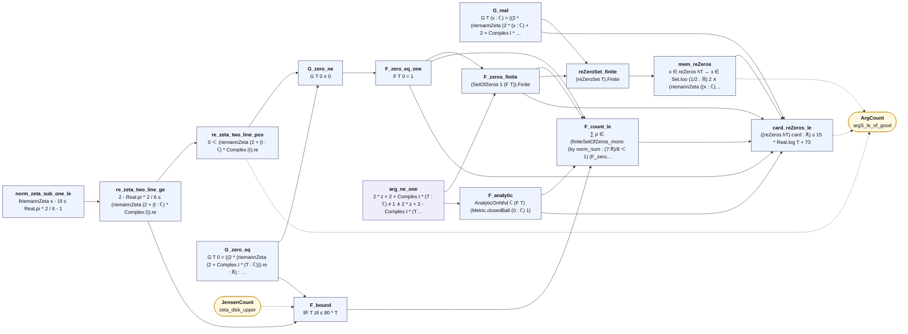

# `lean_stage3/Stage3/ReZetaCount.lean`

ReZetaCount — block H2 of `lean_stage3/design/hnt.md`, "The count: zeros of Re ζ on the segment, and Re ζ > 0 on the line Re s = 2".

15 theorems, 4 definitions, 475 lines. Arrows are Lean's own record of what each proof uses.

**Imports:** [`JensenCount`](../lean_stage3/JensenCount.md)  
**Imported by:** [`Stage3`](../lean_stage3/Stage3.md), [`ArgCount`](../lean_stage3/ArgCount.md)

## The picture



An arrow A → B reads "A is used in the proof of B". Green: counting, integers only. Violet: shape, analysis with no ζ. Blue: reads ζ. A name ending in ■ is an end: nothing else uses it. Red: contains `sorry`. Yellow: theorems in another file, counted; a dotted arrow crosses files. Definitions are not drawn; they are listed below the diagram.

## Definitions

<a name="ReZetaCount-G"></a>
### `ReZetaCount.G`

def · line 80

The symmetrised local model's numerator: `ζ(2z+2+iT) + ζ(2z+2−iT)`.

- **Is:** `` G (T : ℝ) (z : ℂ) : ℂ := riemannZeta (2 * z + 2 + Complex.I * (T : ℂ)) + riemannZeta (2 * z + 2 - Complex.I * (T : ℂ)) ``
- **Used by 10:** [`ReZetaCount.F`](#ReZetaCount-F), [`ReZetaCount.F_analytic`](#ReZetaCount-F_analytic), [`ReZetaCount.F_bound`](#ReZetaCount-F_bound), [`ReZetaCount.F_zero_eq_one`](#ReZetaCount-F_zero_eq_one), [`ReZetaCount.F_zeros_finite`](#ReZetaCount-F_zeros_finite), [`ReZetaCount.G_real`](#ReZetaCount-G_real), [`ReZetaCount.G_zero_eq`](#ReZetaCount-G_zero_eq), [`ReZetaCount.G_zero_ne`](#ReZetaCount-G_zero_ne), [`ReZetaCount.card_reZeros_le`](#ReZetaCount-card_reZeros_le), [`ReZetaCount.reZeroSet_finite`](#ReZetaCount-reZeroSet_finite)

<a name="ReZetaCount-F"></a>
### `ReZetaCount.F`

def · line 84

The normalised model, `1` at the centre.

- **Is:** `` F (T : ℝ) (z : ℂ) : ℂ := G T z / G T 0 ``
- **Built from:** [`ReZetaCount.G`](#ReZetaCount-G)
- **Used by 7:** [`ReZetaCount.F_analytic`](#ReZetaCount-F_analytic), [`ReZetaCount.F_bound`](#ReZetaCount-F_bound), [`ReZetaCount.F_count_le`](#ReZetaCount-F_count_le), [`ReZetaCount.F_zero_eq_one`](#ReZetaCount-F_zero_eq_one), [`ReZetaCount.F_zeros_finite`](#ReZetaCount-F_zeros_finite), [`ReZetaCount.card_reZeros_le`](#ReZetaCount-card_reZeros_le), [`ReZetaCount.reZeroSet_finite`](#ReZetaCount-reZeroSet_finite)

<a name="ReZetaCount-reZeroSet"></a>
### `ReZetaCount.reZeroSet`

def · line 87

The zeros of `x ↦ Re ζ(x + iT)` on the open segment `(1/2, 2)`.

- **Is:** `` reZeroSet (T : ℝ) : Set ℝ := {x : ℝ | x ∈ Set.Ioo (1/2 : ℝ) 2 ∧ (riemannZeta ((x : ℂ) + T * Complex.I)).re = 0} ``
- **Used by 3:** [`ReZetaCount.mem_reZeros`](#ReZetaCount-mem_reZeros), [`ReZetaCount.reZeroSet_finite`](#ReZetaCount-reZeroSet_finite), [`ReZetaCount.reZeros`](#ReZetaCount-reZeros)

<a name="ReZetaCount-reZeros"></a>
### `ReZetaCount.reZeros`

def · line 378

The zeros of `Re ζ` on the segment, as a `Finset`.

- **Is:** `` reZeros {T : ℝ} (hT : 2 ≤ T) : Finset ℝ := (reZeroSet_finite hT).toFinset ``
- **Built from:** [`ReZetaCount.reZeroSet`](#ReZetaCount-reZeroSet), [`ReZetaCount.reZeroSet_finite`](#ReZetaCount-reZeroSet_finite)
- **Used by 3:** [`ArgCount.argS_le_of_good`](../lean_stage3/ArgCount.md#ArgCount-argS_le_of_good), [`ReZetaCount.card_reZeros_le`](#ReZetaCount-card_reZeros_le), [`ReZetaCount.mem_reZeros`](#ReZetaCount-mem_reZeros)

## Theorems

<a name="ReZetaCount-norm_zeta_sub_one_le"></a>
### `ReZetaCount.norm_zeta_sub_one_le`

line 91

**Reads ζ.** It, or something it rests on, uses the zeta function, its zeros or the Riemann hypothesis.

**Why.** The Dirichlet tail on `Re s = 2`. `‖ζ(s) − 1‖ ≤ π²/6 − 1 < 1`.

**Proves**

```lean
‖riemannZeta s - 1‖ ≤ Real.pi ^ 2 / 6 - 1
```

**Needs** (its hypotheses)

  - `` hs : s.re = 2 ``

**Fed by:** no theorem of this repo; it stands on Mathlib.

**Feeds** (1 that use it)

  - [`ReZetaCount.re_zeta_two_line_ge`](#ReZetaCount-re_zeta_two_line_ge) — `` 2 - Real.pi ^ 2 / 6 ≤ (riemannZeta (2 + (t : ℂ) * Complex.I)).re ``

<a name="ReZetaCount-re_zeta_two_line_ge"></a>
### `ReZetaCount.re_zeta_two_line_ge`

line 155

**Reads ζ.** It, or something it rests on, uses the zeta function, its zeros or the Riemann hypothesis.

**Why.** The vertical leg's sign, quantitative. `Re ζ(2+it) ≥ 2 − π²/6`.

**Proves**

```lean
2 - Real.pi ^ 2 / 6 ≤ (riemannZeta (2 + (t : ℂ) * Complex.I)).re
```

**Needs** (its hypotheses)

  - `` t : ℝ ``

**Fed by** (1 theorem its proof uses)

  - [`ReZetaCount.norm_zeta_sub_one_le`](#ReZetaCount-norm_zeta_sub_one_le) — `` ‖riemannZeta s - 1‖ ≤ Real.pi ^ 2 / 6 - 1 ``

**Feeds** (2 that use it)

  - [`ReZetaCount.F_bound`](#ReZetaCount-F_bound) — `` ‖F T z‖ ≤ 80 * T ``
  - [`ReZetaCount.re_zeta_two_line_pos`](#ReZetaCount-re_zeta_two_line_pos) — `` 0 < (riemannZeta (2 + (t : ℂ) * Complex.I)).re ``

<a name="ReZetaCount-re_zeta_two_line_pos"></a>
### `ReZetaCount.re_zeta_two_line_pos`

line 166

**Reads ζ.** It, or something it rests on, uses the zeta function, its zeros or the Riemann hypothesis.

**Why.** T3, discharged. `Re ζ(2+it) > 0`.

**Proves**

```lean
0 < (riemannZeta (2 + (t : ℂ) * Complex.I)).re
```

**Needs** (its hypotheses)

  - `` t : ℝ ``

**Fed by** (1 theorem its proof uses)

  - [`ReZetaCount.re_zeta_two_line_ge`](#ReZetaCount-re_zeta_two_line_ge) — `` 2 - Real.pi ^ 2 / 6 ≤ (riemannZeta (2 + (t : ℂ) * Complex.I)).re ``

**Feeds** (2 that use it)

  - [`ArgCount.argS_le_of_good`](../lean_stage3/ArgCount.md#ArgCount-argS_le_of_good) (ArgCount) — `` |Stage3.argS T| ≤ 15 * Real.log T + 73 + 3 / 2 ``
  - [`ReZetaCount.G_zero_ne`](#ReZetaCount-G_zero_ne) — `` G T 0 ≠ 0 ``

<a name="ReZetaCount-G_zero_eq"></a>
### `ReZetaCount.G_zero_eq`

line 171

**Reads ζ.** It, or something it rests on, uses the zeta function, its zeros or the Riemann hypothesis.

**Why.** `G_T(0) = 2 Re ζ(2+iT)`, a real number.

**Proves**

```lean
G T 0 = ((2 * (riemannZeta (2 + Complex.I * (T : ℂ))).re : ℝ) : ℂ)
```

**Needs** (its hypotheses)

  - `` T : ℝ ``

**Stated with:** [`ReZetaCount.G`](#ReZetaCount-G)

**Fed by:** no theorem of this repo; it stands on Mathlib and the definitions below.

**Feeds** (2 that use it)

  - [`ReZetaCount.F_bound`](#ReZetaCount-F_bound) — `` ‖F T z‖ ≤ 80 * T ``
  - [`ReZetaCount.G_zero_ne`](#ReZetaCount-G_zero_ne) — `` G T 0 ≠ 0 ``

<a name="ReZetaCount-G_real"></a>
### `ReZetaCount.G_real`

line 178

**Reads ζ.** It, or something it rests on, uses the zeta function, its zeros or the Riemann hypothesis.

**Why.** On the real axis `G_T` is real: `G_T(x) = 2 Re ζ(2x+2+iT)`.

**Proves**

```lean
G T (x : ℂ) = ((2 * (riemannZeta (2 * (x : ℂ) + 2 + Complex.I * (T : ℂ))).re : ℝ) : ℂ)
```

**Needs** (its hypotheses)

  - `` T : ℝ ``
  - `` x : ℝ ``

**Stated with:** [`ReZetaCount.G`](#ReZetaCount-G)

**Fed by:** no theorem of this repo; it stands on Mathlib and the definitions below.

**Feeds** (2 that use it)

  - [`ReZetaCount.card_reZeros_le`](#ReZetaCount-card_reZeros_le) — `` ((reZeros hT).card : ℝ) ≤ 15 * Real.log T + 73 ``
  - [`ReZetaCount.reZeroSet_finite`](#ReZetaCount-reZeroSet_finite) — `` (reZeroSet T).Finite ``

<a name="ReZetaCount-G_zero_ne"></a>
### `ReZetaCount.G_zero_ne`

line 186

**Reads ζ.** It, or something it rests on, uses the zeta function, its zeros or the Riemann hypothesis.

**Why.** The centre value is nonzero, so the normalisation is legitimate.

**Proves**

```lean
G T 0 ≠ 0
```

**Needs** (its hypotheses)

  - `` T : ℝ ``

**Stated with:** [`ReZetaCount.G`](#ReZetaCount-G)

**Fed by** (2 theorems its proof uses)

  - [`ReZetaCount.G_zero_eq`](#ReZetaCount-G_zero_eq) — `` G T 0 = ((2 * (riemannZeta (2 + Complex.I * (T : ℂ))).re : ℝ) : ℂ) ``
  - [`ReZetaCount.re_zeta_two_line_pos`](#ReZetaCount-re_zeta_two_line_pos) — `` 0 < (riemannZeta (2 + (t : ℂ) * Complex.I)).re ``

**Feeds** (1 that use it)

  - [`ReZetaCount.F_zero_eq_one`](#ReZetaCount-F_zero_eq_one) — `` F T 0 = 1 ``

<a name="ReZetaCount-F_zero_eq_one"></a>
### `ReZetaCount.F_zero_eq_one`

line 193

**Reads ζ.** It, or something it rests on, uses the zeta function, its zeros or the Riemann hypothesis.

**Proves**

```lean
F T 0 = 1
```

**Needs** (its hypotheses)

  - `` T : ℝ ``

**Stated with:** [`ReZetaCount.F`](#ReZetaCount-F)

**Fed by** (1 theorem its proof uses)

  - [`ReZetaCount.G_zero_ne`](#ReZetaCount-G_zero_ne) — `` G T 0 ≠ 0 ``

**Definitions its proof touches:** [`ReZetaCount.G`](#ReZetaCount-G)

**Feeds** (3 that use it)

  - [`ReZetaCount.F_count_le`](#ReZetaCount-F_count_le) — `` ∑ ρ ∈ (finiteSetOfZeros_mono (by norm_num : (7:ℝ)/8 < 1) (F_zeros_finite hT)).toFinset, (analyticOrderNatAt (F T) ρ : ℝ) ≤ 15 * Real.log T + 73 ``
  - [`ReZetaCount.F_zeros_finite`](#ReZetaCount-F_zeros_finite) — `` (SetOfZeros 1 (F T)).Finite ``
  - [`ReZetaCount.card_reZeros_le`](#ReZetaCount-card_reZeros_le) — `` ((reZeros hT).card : ℝ) ≤ 15 * Real.log T + 73 ``

<a name="ReZetaCount-arg_ne_one"></a>
### `ReZetaCount.arg_ne_one`

line 196

**Shape.** Uses real or complex analysis; nothing in it or beneath it reads ζ.

**Why.** The pole stays off both arguments.

**Proves**

```lean
2 * z + 2 + Complex.I * (T : ℂ) ≠ 1 ∧ 2 * z + 2 - Complex.I * (T : ℂ) ≠ 1
```

**Needs** (its hypotheses)

  - `` hT : 2 ≤ T ``
  - `` hz : ‖z‖ < 11 / 10 ``

**Fed by:** no theorem of this repo; it stands on Mathlib.

**Feeds** (2 that use it)

  - [`ReZetaCount.F_analytic`](#ReZetaCount-F_analytic) — `` AnalyticOnNhd ℂ (F T) (Metric.closedBall (0 : ℂ) 1) ``
  - [`ReZetaCount.F_zeros_finite`](#ReZetaCount-F_zeros_finite) — `` (SetOfZeros 1 (F T)).Finite ``

<a name="ReZetaCount-F_analytic"></a>
### `ReZetaCount.F_analytic`

line 214

**Reads ζ.** It, or something it rests on, uses the zeta function, its zeros or the Riemann hypothesis.

**Proves**

```lean
AnalyticOnNhd ℂ (F T) (Metric.closedBall (0 : ℂ) 1)
```

**Needs** (its hypotheses)

  - `` hT : 2 ≤ T ``

**Stated with:** [`ReZetaCount.F`](#ReZetaCount-F)

**Fed by** (1 theorem its proof uses)

  - [`ReZetaCount.arg_ne_one`](#ReZetaCount-arg_ne_one) — `` 2 * z + 2 + Complex.I * (T : ℂ) ≠ 1 ∧ 2 * z + 2 - Complex.I * (T : ℂ) ≠ 1 ``

**Definitions its proof touches:** [`ReZetaCount.G`](#ReZetaCount-G)

**Feeds** (2 that use it)

  - [`ReZetaCount.F_count_le`](#ReZetaCount-F_count_le) — `` ∑ ρ ∈ (finiteSetOfZeros_mono (by norm_num : (7:ℝ)/8 < 1) (F_zeros_finite hT)).toFinset, (analyticOrderNatAt (F T) ρ : ℝ) ≤ 15 * Real.log T + 73 ``
  - [`ReZetaCount.card_reZeros_le`](#ReZetaCount-card_reZeros_le) — `` ((reZeros hT).card : ℝ) ≤ 15 * Real.log T + 73 ``

<a name="ReZetaCount-F_bound"></a>
### `ReZetaCount.F_bound`

line 233

**Reads ζ.** It, or something it rests on, uses the zeta function, its zeros or the Riemann hypothesis.

**Why.** The disk bound. `‖F_T‖ ≤ 80T` on the `15/16` disk.

**Proves**

```lean
‖F T z‖ ≤ 80 * T
```

**Needs** (its hypotheses)

  - `` hT : 2 ≤ T ``
  - `` hz : ‖z‖ ≤ 15 / 16 ``

**Stated with:** [`ReZetaCount.F`](#ReZetaCount-F)

**Fed by** (3 theorems its proof uses)

  - [`Stage3.zeta_disk_upper`](../lean_stage3/JensenCount.md#Stage3-zeta_disk_upper) (JensenCount) — `` ‖ζ w‖ ≤ 28 * T ``
  - [`ReZetaCount.G_zero_eq`](#ReZetaCount-G_zero_eq) — `` G T 0 = ((2 * (riemannZeta (2 + Complex.I * (T : ℂ))).re : ℝ) : ℂ) ``
  - [`ReZetaCount.re_zeta_two_line_ge`](#ReZetaCount-re_zeta_two_line_ge) — `` 2 - Real.pi ^ 2 / 6 ≤ (riemannZeta (2 + (t : ℂ) * Complex.I)).re ``

**Definitions its proof touches:** [`ReZetaCount.G`](#ReZetaCount-G)

**Feeds** (1 that use it)

  - [`ReZetaCount.F_count_le`](#ReZetaCount-F_count_le) — `` ∑ ρ ∈ (finiteSetOfZeros_mono (by norm_num : (7:ℝ)/8 < 1) (F_zeros_finite hT)).toFinset, (analyticOrderNatAt (F T) ρ : ℝ) ≤ 15 * Real.log T + 73 ``

<a name="ReZetaCount-F_zeros_finite"></a>
### `ReZetaCount.F_zeros_finite`

line 274

**Reads ζ.** It, or something it rests on, uses the zeta function, its zeros or the Riemann hypothesis.

**Why.** Finitely many zeros in the closed unit disk: the template of `Stage3.zetaWindowTwo_finite`.

**Proves**

```lean
(SetOfZeros 1 (F T)).Finite
```

**Needs** (its hypotheses)

  - `` hT : 2 ≤ T ``

**Stated with:** [`ReZetaCount.F`](#ReZetaCount-F)

**Fed by** (2 theorems its proof uses)

  - [`ReZetaCount.F_zero_eq_one`](#ReZetaCount-F_zero_eq_one) — `` F T 0 = 1 ``
  - [`ReZetaCount.arg_ne_one`](#ReZetaCount-arg_ne_one) — `` 2 * z + 2 + Complex.I * (T : ℂ) ≠ 1 ∧ 2 * z + 2 - Complex.I * (T : ℂ) ≠ 1 ``

**Definitions its proof touches:** [`ReZetaCount.G`](#ReZetaCount-G)

**Feeds** (3 that use it)

  - [`ReZetaCount.F_count_le`](#ReZetaCount-F_count_le) — `` ∑ ρ ∈ (finiteSetOfZeros_mono (by norm_num : (7:ℝ)/8 < 1) (F_zeros_finite hT)).toFinset, (analyticOrderNatAt (F T) ρ : ℝ) ≤ 15 * Real.log T + 73 ``
  - [`ReZetaCount.card_reZeros_le`](#ReZetaCount-card_reZeros_le) — `` ((reZeros hT).card : ℝ) ≤ 15 * Real.log T + 73 ``
  - [`ReZetaCount.reZeroSet_finite`](#ReZetaCount-reZeroSet_finite) — `` (reZeroSet T).Finite ``

<a name="ReZetaCount-F_count_le"></a>
### `ReZetaCount.F_count_le`

line 312

**Reads ζ.** It, or something it rests on, uses the zeta function, its zeros or the Riemann hypothesis.

**Why.** The Jensen count. The total order of the zeros of `F_T` in the `7/8` disk is at most `15 log T + 73`, the arithmetic of `Stage3.zeta_local_zero_count` run from `log(80T)` in place of `log(84T)`.

**Proves**

```lean
∑ ρ ∈ (finiteSetOfZeros_mono (by norm_num : (7:ℝ)/8 < 1) (F_zeros_finite hT)).toFinset, (analyticOrderNatAt (F T) ρ : ℝ) ≤ 15 * Real.log T + 73
```

**Needs** (its hypotheses)

  - `` hT : 2 ≤ T ``

**Stated with:** [`ReZetaCount.F`](#ReZetaCount-F), [`ReZetaCount.F_zeros_finite`](#ReZetaCount-F_zeros_finite)

**Fed by** (3 theorems its proof uses)

  - [`ReZetaCount.F_analytic`](#ReZetaCount-F_analytic) — `` AnalyticOnNhd ℂ (F T) (Metric.closedBall (0 : ℂ) 1) ``
  - [`ReZetaCount.F_bound`](#ReZetaCount-F_bound) — `` ‖F T z‖ ≤ 80 * T ``
  - [`ReZetaCount.F_zero_eq_one`](#ReZetaCount-F_zero_eq_one) — `` F T 0 = 1 ``

**Feeds** (1 that use it)

  - [`ReZetaCount.card_reZeros_le`](#ReZetaCount-card_reZeros_le) — `` ((reZeros hT).card : ℝ) ≤ 15 * Real.log T + 73 ``

<a name="ReZetaCount-reZeroSet_finite"></a>
### `ReZetaCount.reZeroSet_finite`

line 350

**Reads ζ.** It, or something it rests on, uses the zeta function, its zeros or the Riemann hypothesis.

**Why.** The zeros of `Re ζ` on the segment inject into the `7/8` zero set of `F_T`.

**Proves**

```lean
(reZeroSet T).Finite
```

**Needs** (its hypotheses)

  - `` hT : 2 ≤ T ``

**Stated with:** [`ReZetaCount.reZeroSet`](#ReZetaCount-reZeroSet)

**Fed by** (2 theorems its proof uses)

  - [`ReZetaCount.F_zeros_finite`](#ReZetaCount-F_zeros_finite) — `` (SetOfZeros 1 (F T)).Finite ``
  - [`ReZetaCount.G_real`](#ReZetaCount-G_real) — `` G T (x : ℂ) = ((2 * (riemannZeta (2 * (x : ℂ) + 2 + Complex.I * (T : ℂ))).re : ℝ) : ℂ) ``

**Definitions its proof touches:** [`ReZetaCount.F`](#ReZetaCount-F), [`ReZetaCount.G`](#ReZetaCount-G)

**Feeds** (2 that use it)

  - [`ReZetaCount.mem_reZeros`](#ReZetaCount-mem_reZeros) — `` x ∈ reZeros hT ↔ x ∈ Set.Ioo (1/2 : ℝ) 2 ∧ (riemannZeta ((x : ℂ) + T * Complex.I)).re = 0 ``
  - [`ReZetaCount.reZeros`](#ReZetaCount-reZeros) — def

<a name="ReZetaCount-mem_reZeros"></a>
### `ReZetaCount.mem_reZeros`

line 380

**Reads ζ.** It, or something it rests on, uses the zeta function, its zeros or the Riemann hypothesis.

**Proves**

```lean
x ∈ reZeros hT ↔ x ∈ Set.Ioo (1/2 : ℝ) 2 ∧ (riemannZeta ((x : ℂ) + T * Complex.I)).re = 0
```

**Needs** (its hypotheses)

  - `` hT : 2 ≤ T ``

**Stated with:** [`ReZetaCount.reZeros`](#ReZetaCount-reZeros)

**Fed by** (1 theorem its proof uses)

  - [`ReZetaCount.reZeroSet_finite`](#ReZetaCount-reZeroSet_finite) — `` (reZeroSet T).Finite ``

**Definitions its proof touches:** [`ReZetaCount.reZeroSet`](#ReZetaCount-reZeroSet)

**Feeds** (2 that use it)

  - [`ArgCount.argS_le_of_good`](../lean_stage3/ArgCount.md#ArgCount-argS_le_of_good) (ArgCount) — `` |Stage3.argS T| ≤ 15 * Real.log T + 73 + 3 / 2 ``
  - [`ReZetaCount.card_reZeros_le`](#ReZetaCount-card_reZeros_le) — `` ((reZeros hT).card : ℝ) ≤ 15 * Real.log T + 73 ``

<a name="ReZetaCount-card_reZeros_le"></a>
### `ReZetaCount.card_reZeros_le`

line 386

**Reads ζ.** It, or something it rests on, uses the zeta function, its zeros or the Riemann hypothesis.

**Why.** Z2, with its bound. `q(T) ≤ 15 log T + 73`.

**Proves**

```lean
((reZeros hT).card : ℝ) ≤ 15 * Real.log T + 73
```

**Needs** (its hypotheses)

  - `` hT : 2 ≤ T ``

**Stated with:** [`ReZetaCount.reZeros`](#ReZetaCount-reZeros)

**Fed by** (6 theorems its proof uses)

  - [`ReZetaCount.F_analytic`](#ReZetaCount-F_analytic) — `` AnalyticOnNhd ℂ (F T) (Metric.closedBall (0 : ℂ) 1) ``
  - [`ReZetaCount.F_count_le`](#ReZetaCount-F_count_le) — `` ∑ ρ ∈ (finiteSetOfZeros_mono (by norm_num : (7:ℝ)/8 < 1) (F_zeros_finite hT)).toFinset, (analyticOrderNatAt (F T) ρ : ℝ) ≤ 15 * Real.log T + 73 ``
  - [`ReZetaCount.F_zero_eq_one`](#ReZetaCount-F_zero_eq_one) — `` F T 0 = 1 ``
  - [`ReZetaCount.F_zeros_finite`](#ReZetaCount-F_zeros_finite) — `` (SetOfZeros 1 (F T)).Finite ``
  - [`ReZetaCount.G_real`](#ReZetaCount-G_real) — `` G T (x : ℂ) = ((2 * (riemannZeta (2 * (x : ℂ) + 2 + Complex.I * (T : ℂ))).re : ℝ) : ℂ) ``
  - [`ReZetaCount.mem_reZeros`](#ReZetaCount-mem_reZeros) — `` x ∈ reZeros hT ↔ x ∈ Set.Ioo (1/2 : ℝ) 2 ∧ (riemannZeta ((x : ℂ) + T * Complex.I)).re = 0 ``

**Definitions its proof touches:** [`ReZetaCount.F`](#ReZetaCount-F), [`ReZetaCount.G`](#ReZetaCount-G)

**Feeds** (1 that use it)

  - [`ArgCount.argS_le_of_good`](../lean_stage3/ArgCount.md#ArgCount-argS_le_of_good) (ArgCount) — `` |Stage3.argS T| ≤ 15 * Real.log T + 73 + 3 / 2 ``

