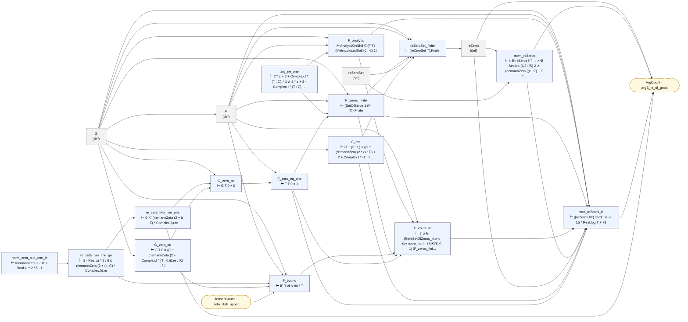

# `lean_stage3/Stage3/ReZetaCount.lean`

**What it does** (its own header): ReZetaCount — block H2 of `lean_stage3/design/hnt.md`, "The count: zeros of Re ζ on the segment, and Re ζ > 0 on the line Re s = 2".

**Imports:** [`JensenCount`](../lean_stage3/JensenCount.md).
**Imported by:** [`Stage3`](../lean_stage3/Stage3.md), [`ArgCount`](../lean_stage3/ArgCount.md).

Blue: theorem. Green: a theorem nothing else uses (an end). Dashed white: connects to nothing. Grey: definition. Red: contains `sorry`. Yellow: in another file. An arrow A → B reads "A is used by B".

## Every declaration

| declaration | proves (output) | needs (input) | why (its own docstring) | uses | used by |
|---|---|---|---|---|---|
| `ReZetaCount.G` def, line 80 | ℂ | T : ℝ; z : ℂ | The symmetrised local model's numerator: `ζ(2z+2+iT) + ζ(2z+2−iT)`. | — | `ReZetaCount.F`, `ReZetaCount.F_analytic`, `ReZetaCount.F_bound`, `ReZetaCount.F_zeros_finite`, `ReZetaCount.G_real`, `ReZetaCount.G_zero_eq`, `ReZetaCount.G_zero_ne`, `ReZetaCount.card_reZeros_le`, `ReZetaCount.reZeroSet_finite` |
| `ReZetaCount.F` def, line 84 | ℂ | T : ℝ; z : ℂ | The normalised model, `1` at the centre. | `ReZetaCount.G` | `ReZetaCount.F_analytic`, `ReZetaCount.F_bound`, `ReZetaCount.F_count_le`, `ReZetaCount.F_zero_eq_one`, `ReZetaCount.F_zeros_finite`, `ReZetaCount.card_reZeros_le`, `ReZetaCount.reZeroSet_finite` |
| `ReZetaCount.reZeroSet` def, line 87 | Set ℝ | T : ℝ | The zeros of `x ↦ Re ζ(x + iT)` on the open segment `(1/2, 2)`. | — | `ReZetaCount.mem_reZeros`, `ReZetaCount.reZeroSet_finite` |
| `ReZetaCount.norm_zeta_sub_one_le` theorem, line 91 | ‖riemannZeta s - 1‖ ≤ Real.pi ^ 2 / 6 - 1 | hs : s.re = 2 | The Dirichlet tail on `Re s = 2`. `‖ζ(s) − 1‖ ≤ π²/6 − 1 &lt; 1`. | — | `ReZetaCount.re_zeta_two_line_ge` |
| `ReZetaCount.re_zeta_two_line_ge` theorem, line 155 | 2 - Real.pi ^ 2 / 6 ≤ (riemannZeta (2 + (t : ℂ) * Complex.I)).re | t : ℝ | The vertical leg's sign, quantitative. `Re ζ(2+it) ≥ 2 − π²/6`. | `ReZetaCount.norm_zeta_sub_one_le` | `ReZetaCount.F_bound`, `ReZetaCount.re_zeta_two_line_pos` |
| `ReZetaCount.re_zeta_two_line_pos` theorem, line 166 | 0 &lt; (riemannZeta (2 + (t : ℂ) * Complex.I)).re | t : ℝ | T3, discharged. `Re ζ(2+it) &gt; 0`. | `ReZetaCount.re_zeta_two_line_ge` | `ArgCount.argS_le_of_good`, `ReZetaCount.G_zero_ne` |
| `ReZetaCount.G_zero_eq` theorem, line 171 | G T 0 = ((2 * (riemannZeta (2 + Complex.I * (T : ℂ))).re : ℝ) : ℂ) | T : ℝ | `G_T(0) = 2 Re ζ(2+iT)`, a real number. | `ReZetaCount.G` | `ReZetaCount.F_bound`, `ReZetaCount.G_zero_ne` |
| `ReZetaCount.G_real` theorem, line 178 | G T (x : ℂ) = ((2 * (riemannZeta (2 * (x : ℂ) + 2 + Complex.I * (T : ℂ))).re : ℝ) : ℂ) | T : ℝ; x : ℝ | On the real axis `G_T` is real: `G_T(x) = 2 Re ζ(2x+2+iT)`. | `ReZetaCount.G` | `ReZetaCount.card_reZeros_le`, `ReZetaCount.reZeroSet_finite` |
| `ReZetaCount.G_zero_ne` theorem, line 186 | G T 0 ≠ 0 | T : ℝ | The centre value is nonzero, so the normalisation is legitimate. | `ReZetaCount.G`, `ReZetaCount.G_zero_eq`, `ReZetaCount.re_zeta_two_line_pos` | `ReZetaCount.F_zero_eq_one` |
| `ReZetaCount.F_zero_eq_one` theorem, line 193 | F T 0 = 1 | T : ℝ | — | `ReZetaCount.F`, `ReZetaCount.G_zero_ne` | `ReZetaCount.F_count_le`, `ReZetaCount.F_zeros_finite`, `ReZetaCount.card_reZeros_le` |
| `ReZetaCount.arg_ne_one` theorem, line 196 | 2 * z + 2 + Complex.I * (T : ℂ) ≠ 1 ∧ 2 * z + 2 - Complex.I * (T : ℂ) ≠ 1 | hT : 2 ≤ T; hz : ‖z‖ &lt; 11 / 10 | The pole stays off both arguments. | — | `ReZetaCount.F_analytic`, `ReZetaCount.F_zeros_finite` |
| `ReZetaCount.F_analytic` theorem, line 214 | AnalyticOnNhd ℂ (F T) (Metric.closedBall (0 : ℂ) 1) | hT : 2 ≤ T | — | `ReZetaCount.F`, `ReZetaCount.G`, `ReZetaCount.arg_ne_one` | `ReZetaCount.F_count_le`, `ReZetaCount.card_reZeros_le` |
| `ReZetaCount.F_bound` theorem, line 233 | ‖F T z‖ ≤ 80 * T | hT : 2 ≤ T; hz : ‖z‖ ≤ 15 / 16 | The disk bound. `‖F_T‖ ≤ 80T` on the `15/16` disk. | `Stage3.zeta_disk_upper`, `ReZetaCount.F`, `ReZetaCount.G`, `ReZetaCount.G_zero_eq`, `ReZetaCount.re_zeta_two_line_ge` | `ReZetaCount.F_count_le` |
| `ReZetaCount.F_zeros_finite` theorem, line 274 | (SetOfZeros 1 (F T)).Finite | hT : 2 ≤ T | Finitely many zeros in the closed unit disk: the template of `Stage3.zetaWindowTwo_finite`. | `ReZetaCount.F`, `ReZetaCount.F_zero_eq_one`, `ReZetaCount.G`, `ReZetaCount.arg_ne_one` | `ReZetaCount.F_count_le`, `ReZetaCount.card_reZeros_le`, `ReZetaCount.reZeroSet_finite` |
| `ReZetaCount.F_count_le` theorem, line 312 | ∑ ρ ∈ (finiteSetOfZeros_mono (by norm_num : (7:ℝ)/8 &lt; 1) (F_zeros_finite hT)).toFinset, (analyticOrderNatAt (F T) ρ : ℝ) ≤ 15 * Real.log T + 73 | hT : 2 ≤ T | The Jensen count. The total order of the zeros of `F_T` in the `7/8` disk is at most `15 log T + 73`, the arithmetic of `Stage3.zeta_local_zero_count` run from `log(80T)` in place of `log(84T)`. | `ReZetaCount.F`, `ReZetaCount.F_analytic`, `ReZetaCount.F_bound`, `ReZetaCount.F_zero_eq_one`, `ReZetaCount.F_zeros_finite` | `ReZetaCount.card_reZeros_le` |
| `ReZetaCount.reZeroSet_finite` theorem, line 350 | (reZeroSet T).Finite | hT : 2 ≤ T | The zeros of `Re ζ` on the segment inject into the `7/8` zero set of `F_T`. | `ReZetaCount.F`, `ReZetaCount.F_zeros_finite`, `ReZetaCount.G`, `ReZetaCount.G_real`, `ReZetaCount.reZeroSet` | `ReZetaCount.reZeros` |
| `ReZetaCount.reZeros` def, line 378 | Finset ℝ | hT : 2 ≤ T | The zeros of `Re ζ` on the segment, as a `Finset`. | `ReZetaCount.reZeroSet_finite` | `ArgCount.argS_le_of_good`, `ReZetaCount.card_reZeros_le`, `ReZetaCount.mem_reZeros` |
| `ReZetaCount.mem_reZeros` theorem, line 380 | x ∈ reZeros hT ↔ x ∈ Set.Ioo (1/2 : ℝ) 2 ∧ (riemannZeta ((x : ℂ) + T * Complex.I)).re = 0 | hT : 2 ≤ T | — | `ReZetaCount.reZeroSet`, `ReZetaCount.reZeros` | `ArgCount.argS_le_of_good`, `ReZetaCount.card_reZeros_le` |
| `ReZetaCount.card_reZeros_le` theorem, line 386 | ((reZeros hT).card : ℝ) ≤ 15 * Real.log T + 73 | hT : 2 ≤ T | Z2, with its bound. `q(T) ≤ 15 log T + 73`. | `ReZetaCount.F`, `ReZetaCount.F_analytic`, `ReZetaCount.F_count_le`, `ReZetaCount.F_zero_eq_one`, `ReZetaCount.F_zeros_finite`, `ReZetaCount.G`, `ReZetaCount.G_real`, `ReZetaCount.mem_reZeros`, `ReZetaCount.reZeros` | `ArgCount.argS_le_of_good` |
