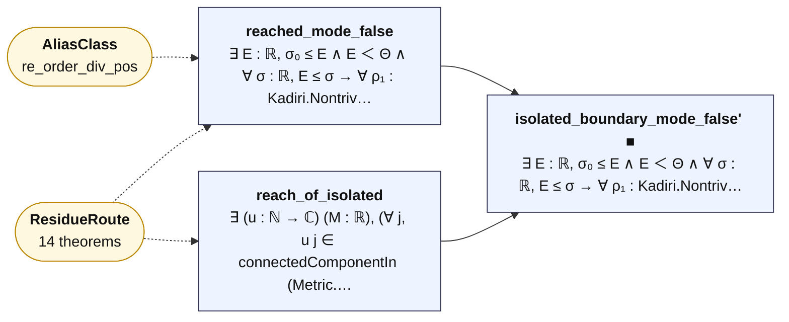

# `lean_stage3/Stage3/ReachRoute.lean`

> **Read from the source text.** This file changed after the last `python3 utilities/lean_map.py --dump`, so the arrows on this page are names occurring in each proof and have not been confirmed by Lean.

ReachRoute — block S6 of `lean_stage3/design/stencil.md`. 2026-11-24. Julian, 2026-11-24, case 2 on the ψ ladder: a mode reached from `0` that other modes crowd. Block S4 (`ResidueRoute.isolated_boundary_mode_false`) needs isolation for one limit only, and that limit survives along any approach that stays non-tangential to the other modes.

3 theorems, 0 definitions, 270 lines. 

**Imports:** [`ResidueRoute`](../lean_stage3/ResidueRoute.md)  
**Imported by:** [`Stage3`](../lean_stage3/Stage3.md)

## The picture



An arrow A → B reads "A is used in the proof of B". Green: counting, integers only. Violet: shape, analysis with no ζ. Blue: reads ζ. A name ending in ■ is an end: nothing else uses it. Red: contains `sorry`. Yellow: theorems in another file, counted; a dotted arrow crosses files. Definitions are not drawn; they are listed below the diagram.

## Theorems

<a name="ReachRoute-reached_mode_false"></a>
### `ReachRoute.reached_mode_false`

line 43 · arrows read from text

**Reads ζ.** It, or something it rests on, uses the zeta function, its zeros or the Riemann hypothesis.

**Why.** A reached mode. Let `|ψ(2^k) − 2^k| ≤ C·k²·√2^k` for `k ≥ 1`, let `1/2 < σ₀ < Θ ≤ 1` and let every zero have real part at most `Θ`. Then there is `E` with `σ₀ ≤ E < Θ` such that for every `σ ≥ E` no zero `ρ₁` with real part above `σ` is reached: there is no sequence `u_j` in the component of `0` in `{|u| < 2^(−σ)} ∖ K σ`, tending to `u₁ = 2^(−ρ₁)`, never equal to it, with `‖u_j − u₁‖ ≤ M·‖u_ρ − u_j‖` for every other mode `u_ρ` of `Re ρ ≥ σ`.

**Proves**

```lean
∃ E : ℝ, σ₀ ≤ E ∧ E < Θ ∧ ∀ σ : ℝ, E ≤ σ → ∀ ρ₁ : Kadiri.NontrivialZeros, σ < (ρ₁ : ℂ).re → (∃ (u : ℕ → ℂ) (M : ℝ), (∀ j, u j ∈ connectedComponentIn (Metric.ball (0:ℂ) ((2:ℝ) ^ (-σ)) \ K σ) 0) ∧ Tendsto u atTop (𝓝 (um ρ₁)) ∧ (∀ j, u j ≠ um ρ₁) ∧ (∀ j, ∀ ρ : Kadiri.NontrivialZeros, σ ≤ (ρ : ℂ).re → um ρ ≠ um ρ₁ → ‖u j - um ρ₁‖ ≤ M * ‖um ρ - u j‖)) → False
```

**Needs** (its hypotheses)

  - `` hH : ∀ k : ℕ, 1 ≤ k → ‖(Chebyshev.psi ((2:ℝ)^k) : ℂ) - (((2:ℝ)^k : ℝ) : ℂ)‖ ≤ C * (k:ℝ)^2 * Real.sqrt 2 ^ k ``
  - `` hσ₀ : 1 / 2 < σ₀ ``
  - `` hσ₀Θ : σ₀ < Θ ``
  - `` hΘ1 : Θ ≤ 1 ``
  - `` hΘ : ∀ ρ : Kadiri.NontrivialZeros, (ρ : ℂ).re ≤ Θ ``

**Fed by** (15 theorems its proof uses)

  - [`AliasClass.re_order_div_pos`](../lean_stage3/AliasClass.md#AliasClass-re_order_div_pos) (AliasClass) — `` 0 < ((((riemannZeta.order (ρ : ℂ) : ℤ) : ℂ)) / (ρ : ℂ)).re ``
  - [`ResidueRoute.G_eq_F`](../lean_stage3/ResidueRoute.md#ResidueRoute-G_eq_F) (ResidueRoute) — `` G σ u = F σ u ``
  - [`ResidueRoute.K_subset`](../lean_stage3/ResidueRoute.md#ResidueRoute-K_subset) (ResidueRoute) — `` K σ ⊆ {u : ℂ | 1 / 2 ≤ ‖u‖} ``
  - [`ResidueRoute.P_bound`](../lean_stage3/ResidueRoute.md#ResidueRoute-P_bound) (ResidueRoute) — `` ∃ θ' Ct : ℝ, θ' < 1 ∧ 0 ≤ Ct ∧ ∀ σ : ℝ, σ₀ ≤ σ → Θ ≤ σ + (1 - θ') → ∀ k : ℕ, 2 ≤ k → ‖P σ k‖ ≤ (|FilterLadder.Afl C| + Ct) * (k:ℝ) ^ 2 * ((2:ℝ) ^ σ) ^… ``
  - [`ResidueRoute.differentiableAt_F`](../lean_stage3/ResidueRoute.md#ResidueRoute-differentiableAt_F) (ResidueRoute) — `` DifferentiableAt ℂ (F σ) v ``
  - [`ResidueRoute.differentiableAt_G`](../lean_stage3/ResidueRoute.md#ResidueRoute-differentiableAt_G) (ResidueRoute) — `` DifferentiableAt ℂ (G σ) v ``
  - [`ResidueRoute.fibre_term`](../lean_stage3/ResidueRoute.md#ResidueRoute-fibre_term) (ResidueRoute) — `` a * (c / (z * a)) = c * z⁻¹ ``
  - [`ResidueRoute.isClosed_K`](../lean_stage3/ResidueRoute.md#ResidueRoute-isClosed_K) (ResidueRoute) — `` IsClosed (K σ) ``
  - [`ResidueRoute.mode_ne_zero`](../lean_stage3/ResidueRoute.md#ResidueRoute-mode_ne_zero) (ResidueRoute) — `` (2:ℂ) ^ (ρ : ℂ) ≠ 0 ``
  - [`ResidueRoute.norm_sub_le`](../lean_stage3/ResidueRoute.md#ResidueRoute-norm_sub_le) (ResidueRoute) — `` ‖um ρ - u‖ ≤ ‖1 - (2:ℂ) ^ (ρ : ℂ) * u‖ ``
  - [`ResidueRoute.norm_um`](../lean_stage3/ResidueRoute.md#ResidueRoute-norm_um) (ResidueRoute) — `` ‖um ρ‖ = (2:ℝ) ^ (-(ρ : ℂ).re) ``
  - [`ResidueRoute.one_sub_eq`](../lean_stage3/ResidueRoute.md#ResidueRoute-one_sub_eq) (ResidueRoute) — `` 1 - (2:ℂ) ^ (ρ : ℂ) * u = (2:ℂ) ^ (ρ : ℂ) * (um ρ - u) ``
  - [`ResidueRoute.summable_coef`](../lean_stage3/ResidueRoute.md#ResidueRoute-summable_coef) (ResidueRoute) — `` Summable fun ρ : FilterAttained.S σ => ‖LadderMean.coef ρ.1‖ ``
  - [`ResidueRoute.um_eq`](../lean_stage3/ResidueRoute.md#ResidueRoute-um_eq) (ResidueRoute) — `` um ρ = ((2:ℂ) ^ (ρ : ℂ))⁻¹ ``
  - [`ResidueRoute.um_mem_K`](../lean_stage3/ResidueRoute.md#ResidueRoute-um_mem_K) (ResidueRoute) — `` um ρ ∈ K σ ``

**Definitions its proof touches:** [`FilterAttained.S`](../lean_stage3/FilterAttained.md#FilterAttained-S), [`LadderMean.coef`](../lean_stage3/LadderMean.md#LadderMean-coef), [`ResidueRoute.F`](../lean_stage3/ResidueRoute.md#ResidueRoute-F), [`ResidueRoute.G`](../lean_stage3/ResidueRoute.md#ResidueRoute-G), [`ResidueRoute.K`](../lean_stage3/ResidueRoute.md#ResidueRoute-K), [`ResidueRoute.um`](../lean_stage3/ResidueRoute.md#ResidueRoute-um)

**Feeds** (1 that use it)

  - [`ReachRoute.isolated_boundary_mode_false'`](#ReachRoute-isolated_boundary_mode_false-) — `` ∃ E : ℝ, σ₀ ≤ E ∧ E < Θ ∧ ∀ σ : ℝ, E ≤ σ → ∀ ρ₁ : Kadiri.NontrivialZeros, σ < (ρ₁ : ℂ).re → (∃ ε : ℝ, 0 < ε ∧ ∀ u ∈ K σ, ‖u - (2:ℂ) ^ (-(ρ₁ : ℂ))‖ < ε… ``

<a name="ReachRoute-reach_of_isolated"></a>
### `ReachRoute.reach_of_isolated`

line 207 · arrows read from text

**Reads ζ.** It, or something it rests on, uses the zeta function, its zeros or the Riemann hypothesis.

**Why.** Isolation and the frontier give a reach, with `M = 1`. If `u₁ = 2^(−ρ₁)`, `Re ρ₁ ≥ σ`, is isolated in `K σ` and on the frontier of the component of `0` in `{|u| < 2^(−σ)} ∖ K σ`, a sequence of the component tending to `u₁`, cut to its terms within `ε/2` of `u₁`, reaches `ρ₁` with `M = 1`.

**Proves**

```lean
∃ (u : ℕ → ℂ) (M : ℝ), (∀ j, u j ∈ connectedComponentIn (Metric.ball (0:ℂ) ((2:ℝ) ^ (-σ)) \ K σ) 0) ∧ Tendsto u atTop (𝓝 (um ρ₁)) ∧ (∀ j, u j ≠ um ρ₁) ∧ (∀ j, ∀ ρ : Kadiri.NontrivialZeros, σ ≤ (ρ : ℂ).re → um ρ ≠ um ρ₁ → ‖u j - um ρ₁‖ ≤ M * ‖um ρ - u j‖)
```

**Needs** (its hypotheses)

  - `` hρ₁ : σ ≤ (ρ₁ : ℂ).re ``
  - `` hiso : ∃ ε : ℝ, 0 < ε ∧ ∀ u ∈ K σ, ‖u - (2:ℂ) ^ (-(ρ₁ : ℂ))‖ < ε → u = (2:ℂ) ^ (-(ρ₁ : ℂ)) ``
  - `` hfr : (2:ℂ) ^ (-(ρ₁ : ℂ)) ∈ frontier (connectedComponentIn (Metric.ball (0:ℂ) ((2:ℝ) ^ (-σ)) \ K σ) 0) ``

**Fed by** (1 theorem its proof uses)

  - [`ResidueRoute.um_mem_K`](../lean_stage3/ResidueRoute.md#ResidueRoute-um_mem_K) (ResidueRoute) — `` um ρ ∈ K σ ``

**Definitions its proof touches:** [`ResidueRoute.K`](../lean_stage3/ResidueRoute.md#ResidueRoute-K), [`ResidueRoute.um`](../lean_stage3/ResidueRoute.md#ResidueRoute-um)

**Feeds** (1 that use it)

  - [`ReachRoute.isolated_boundary_mode_false'`](#ReachRoute-isolated_boundary_mode_false-) — `` ∃ E : ℝ, σ₀ ≤ E ∧ E < Θ ∧ ∀ σ : ℝ, E ≤ σ → ∀ ρ₁ : Kadiri.NontrivialZeros, σ < (ρ₁ : ℂ).re → (∃ ε : ℝ, 0 < ε ∧ ∀ u ∈ K σ, ‖u - (2:ℂ) ^ (-(ρ₁ : ℂ))‖ < ε… ``

<a name="ReachRoute-isolated_boundary_mode_false-"></a>
### `ReachRoute.isolated_boundary_mode_false'`

line 240 · arrows read from text

**Reads ζ.** It, or something it rests on, uses the zeta function, its zeros or the Riemann hypothesis.

**Why.** S4's statement from S6. `ResidueRoute.isolated_boundary_mode_false`, read off `reached_mode_false` through `reach_of_isolated`.

**Proves**

```lean
∃ E : ℝ, σ₀ ≤ E ∧ E < Θ ∧ ∀ σ : ℝ, E ≤ σ → ∀ ρ₁ : Kadiri.NontrivialZeros, σ < (ρ₁ : ℂ).re → (∃ ε : ℝ, 0 < ε ∧ ∀ u ∈ K σ, ‖u - (2:ℂ) ^ (-(ρ₁ : ℂ))‖ < ε → u = (2:ℂ) ^ (-(ρ₁ : ℂ))) → (2:ℂ) ^ (-(ρ₁ : ℂ)) ∈ frontier (connectedComponentIn (Metric.ball (0:ℂ) ((2:ℝ) ^ (-σ)) \ K σ) 0) → False
```

**Needs** (its hypotheses)

  - `` hH : ∀ k : ℕ, 1 ≤ k → ‖(Chebyshev.psi ((2:ℝ)^k) : ℂ) - (((2:ℝ)^k : ℝ) : ℂ)‖ ≤ C * (k:ℝ)^2 * Real.sqrt 2 ^ k ``
  - `` hσ₀ : 1 / 2 < σ₀ ``
  - `` hσ₀Θ : σ₀ < Θ ``
  - `` hΘ1 : Θ ≤ 1 ``
  - `` hΘ : ∀ ρ : Kadiri.NontrivialZeros, (ρ : ℂ).re ≤ Θ ``

**Fed by** (2 theorems its proof uses)

  - [`ReachRoute.reach_of_isolated`](#ReachRoute-reach_of_isolated) — `` ∃ (u : ℕ → ℂ) (M : ℝ), (∀ j, u j ∈ connectedComponentIn (Metric.ball (0:ℂ) ((2:ℝ) ^ (-σ)) \ K σ) 0) ∧ Tendsto u atTop (𝓝 (um ρ₁)) ∧ (∀ j, u j ≠ um ρ₁)… ``
  - [`ReachRoute.reached_mode_false`](#ReachRoute-reached_mode_false) — `` ∃ E : ℝ, σ₀ ≤ E ∧ E < Θ ∧ ∀ σ : ℝ, E ≤ σ → ∀ ρ₁ : Kadiri.NontrivialZeros, σ < (ρ₁ : ℂ).re → (∃ (u : ℕ → ℂ) (M : ℝ), (∀ j, u j ∈ connectedComponentIn (… ``

**Definitions its proof touches:** [`ResidueRoute.K`](../lean_stage3/ResidueRoute.md#ResidueRoute-K)

**Feeds:** nothing. It is an end.

