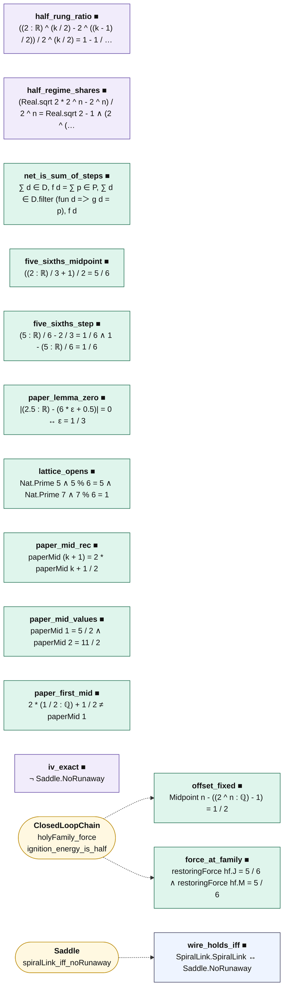

# `lean_stage3/Stage3/Readings.lean`

> **Read from the source text.** This file changed after the last `python3 utilities/lean_map.py --dump`, so the arrows on this page are names occurring in each proof and have not been confirmed by Lean.

Readings — block J10 of `lean_stage3/design/closedloop.md`. 2026-11-23. The runs and readings of the day, each in its exact form.

14 theorems, 1 definition, 169 lines. 

**Imports:** [`ClosedLoopChain`](../lean_stage3/ClosedLoopChain.md), [`Saddle`](../lean_stage3/Saddle.md)  
**Imported by:** [`Stage3`](../lean_stage3/Stage3.md)

## The picture



An arrow A → B reads "A is used in the proof of B". Green: counting, integers only. Violet: shape, analysis with no ζ. Blue: reads ζ. A name ending in ■ is an end: nothing else uses it. Red: contains `sorry`. Yellow: theorems in another file, counted; a dotted arrow crosses files. Definitions are not drawn; they are listed below the diagram.

## Definitions

<a name="Readings-paperMid"></a>
### `Readings.paperMid`

def · line 96

The paper's midpoint of the regime `[2^k, 2^(k+1) − 1]`.

- **Is:** `` paperMid (k : ℕ) : ℚ := (3 * 2 ^ k - 1) / 2 ``
- **Used by 3:** [`Readings.paper_first_mid`](#Readings-paper_first_mid), [`Readings.paper_mid_rec`](#Readings-paper_mid_rec), [`Readings.paper_mid_values`](#Readings-paper_mid_values)

## Theorems

<a name="Readings-half_rung_ratio"></a>
### `Readings.half_rung_ratio`

line 33 · arrows read from text

**Shape.** Uses real or complex analysis; nothing in it or beneath it reads ζ.

**Why.** A half rung. The length of a rung between two half powers, over its top, is one less the reciprocal of the square root of two, at every index.

**Proves**

```lean
((2 : ℝ) ^ (k / 2) - 2 ^ ((k - 1) / 2)) / 2 ^ (k / 2) = 1 - 1 / Real.sqrt 2
```

**Needs** (its hypotheses)

  - `` k : ℝ ``

**Fed by:** no theorem of this repo; it stands on Mathlib.

**Feeds:** nothing. It connects to nothing.

<a name="Readings-half_regime_shares"></a>
### `Readings.half_regime_shares`

line 47 · arrows read from text

**Shape.** Uses real or complex analysis; nothing in it or beneath it reads ζ.

**Why.** The two halves of a doubling. Cut at the half power, the lower half of `[2^n, 2^(n+1)]` holds `√2 − 1` of its length and the upper half `2 − √2`.

**Proves**

```lean
(Real.sqrt 2 * 2 ^ n - 2 ^ n) / 2 ^ n = Real.sqrt 2 - 1 ∧ (2 ^ (n + 1) - Real.sqrt 2 * 2 ^ n) / (2 : ℝ) ^ n = 2 - Real.sqrt 2
```

**Needs** (its hypotheses)

  - `` n : ℕ ``

**Fed by:** no theorem of this repo; it stands on Mathlib.

**Feeds:** nothing. It connects to nothing.

<a name="Readings-net_is_sum_of_steps"></a>
### `Readings.net_is_sum_of_steps`

line 63 · arrows read from text

**Counting.** Integers only: nothing in its statement or proof, or in anything it rests on, uses analysis or ζ.

**Why.** The net is the sum of the steps. Assign every term of the sieve to a prime (its largest prime factor, in unit 0499); the net rounding is the sum over the primes of each prime's step.

**Proves**

```lean
∑ d ∈ D, f d = ∑ p ∈ P, ∑ d ∈ D.filter (fun d => g d = p), f d
```

**Needs** (its hypotheses)

  - `` g : ℕ → ℕ ``
  - `` hg : ∀ d ∈ D, g d ∈ P ``
  - `` f : ℕ → ℝ ``

**Fed by:** no theorem of this repo; it stands on Mathlib.

**Feeds:** nothing. It connects to nothing.

<a name="Readings-five_sixths_midpoint"></a>
### `Readings.five_sixths_midpoint`

line 71 · arrows read from text

**Counting.** Integers only: nothing in its statement or proof, or in anything it rests on, uses analysis or ζ.

**Why.** Five sixths is the midpoint of two thirds and the whole.

**Proves**

```lean
((2 : ℝ) / 3 + 1) / 2 = 5 / 6
```

**Fed by:** no theorem of this repo; it stands on Mathlib.

**Feeds:** nothing. It connects to nothing.

<a name="Readings-five_sixths_step"></a>
### `Readings.five_sixths_step`

line 74 · arrows read from text

**Counting.** Integers only: nothing in its statement or proof, or in anything it rests on, uses analysis or ζ.

**Why.** From two thirds to five sixths is one sixth, the mirror of five sixths.

**Proves**

```lean
(5 : ℝ) / 6 - 2 / 3 = 1 / 6 ∧ 1 - (5 : ℝ) / 6 = 1 / 6
```

**Fed by:** no theorem of this repo; it stands on Mathlib.

**Feeds:** nothing. It connects to nothing.

<a name="Readings-force_at_family"></a>
### `Readings.force_at_family`

line 79 · arrows read from text

**Counting.** Integers only: nothing in its statement or proof, or in anything it rests on, uses analysis or ζ.

**Why.** The force at the Holy Family. The closed loop's restoring force at the support and at the condition is five sixths.

**Proves**

```lean
restoringForce hf.J = 5 / 6 ∧ restoringForce hf.M = 5 / 6
```

**Needs** (its hypotheses)

  - `` hf : HolyFamily ``

**Fed by** (1 theorem its proof uses)

  - [`ClosedLoopChain.holyFamily_force`](../lean_stage3/ClosedLoopChain.md#ClosedLoopChain-holyFamily_force) (ClosedLoopChain) — `` restoringForce hf.J = 5 / 6 ∧ restoringForce hf.M = 5 / 6 ``

**Definitions its proof touches:** [`ClosedLoopChain.HolyFamily`](../lean_stage3/ClosedLoopChain.md#ClosedLoopChain-HolyFamily), [`ClosedLoopJoin.restoringForce`](../lean_stage3/ClosedLoopJoin.md#ClosedLoopJoin-restoringForce)

**Feeds:** nothing. It is an end.

<a name="Readings-paper_lemma_zero"></a>
### `Readings.paper_lemma_zero`

line 85 · arrows read from text

**Counting.** Integers only: nothing in its statement or proof, or in anything it rests on, uses analysis or ζ.

**Why.** The printed Lemma 5.4. The mismatch `|2.5 − (6ε + 0.5)|` is zero exactly at `ε = 1/3`, which is `σ = 5/6`.

**Proves**

```lean
|(2.5 : ℝ) - (6 * ε + 0.5)| = 0 ↔ ε = 1 / 3
```

**Needs** (its hypotheses)

  - `` ε : ℝ ``

**Fed by:** no theorem of this repo; it stands on Mathlib.

**Feeds:** nothing. It connects to nothing.

<a name="Readings-lattice_opens"></a>
### `Readings.lattice_opens`

line 91 · arrows read from text

**Counting.** Integers only: nothing in its statement or proof, or in anything it rests on, uses analysis or ζ.

**Why.** The lattice opens. Five and seven are prime, the first of the two classes modulo six past the scaffold of two and three.

**Proves**

```lean
Nat.Prime 5 ∧ 5 % 6 = 5 ∧ Nat.Prime 7 ∧ 7 % 6 = 1
```

**Fed by:** no theorem of this repo; it stands on Mathlib.

**Feeds:** nothing. It connects to nothing.

<a name="Readings-paper_mid_rec"></a>
### `Readings.paper_mid_rec`

line 100 · arrows read from text

**Counting.** Integers only: nothing in its statement or proof, or in anything it rests on, uses analysis or ζ.

**Why.** The paper's recurrence. From the regime `[2, 3]` on, each midpoint is twice the one before plus one half: `2.5, 5.5, 11.5, 23.5, …`.

**Proves**

```lean
paperMid (k + 1) = 2 * paperMid k + 1 / 2
```

**Needs** (its hypotheses)

  - `` k : ℕ ``

**Fed by:** no theorem of this repo; it stands on Mathlib and the definitions below.

**Definitions its proof touches:** [`Readings.paperMid`](#Readings-paperMid)

**Feeds:** nothing. It is an end.

<a name="Readings-paper_mid_values"></a>
### `Readings.paper_mid_values`

line 106 · arrows read from text

**Counting.** Integers only: nothing in its statement or proof, or in anything it rests on, uses analysis or ζ.

**Why.** The regime `[2, 3]` has midpoint five halves, and `[4, 7]` eleven halves.

**Proves**

```lean
paperMid 1 = 5 / 2 ∧ paperMid 2 = 11 / 2
```

**Fed by:** no theorem of this repo; it stands on Mathlib and the definitions below.

**Definitions its proof touches:** [`Readings.paperMid`](#Readings-paperMid)

**Feeds:** nothing. It is an end.

<a name="Readings-paper_first_mid"></a>
### `Readings.paper_first_mid`

line 113 · arrows read from text

**Counting.** Integers only: nothing in its statement or proof, or in anything it rests on, uses analysis or ζ.

**Why.** The first regime. The paper's `[0, 1]` with midpoint one half does not obey the recurrence into `[2, 3]`: twice one half plus one half is not five halves.

**Proves**

```lean
2 * (1 / 2 : ℚ) + 1 / 2 ≠ paperMid 1
```

**Fed by:** no theorem of this repo; it stands on Mathlib and the definitions below.

**Definitions its proof touches:** [`Readings.paperMid`](#Readings-paperMid)

**Feeds:** nothing. It is an end.

<a name="Readings-offset_fixed"></a>
### `Readings.offset_fixed`

line 121 · arrows read from text

**Counting.** Integers only: nothing in its statement or proof, or in anything it rests on, uses analysis or ζ.

**Why.** The offset is fixed. At every doubling the midpoint stands one half above the integer below; the statement has no zero in it.

**Proves**

```lean
Midpoint n - ((2 ^ n : ℚ) - 1) = 1 / 2
```

**Needs** (its hypotheses)

  - `` n : ℕ ``

**Fed by** (1 theorem its proof uses)

  - [`ClosedLoopChain.ignition_energy_is_half`](../lean_stage3/ClosedLoopChain.md#ClosedLoopChain-ignition_energy_is_half) (ClosedLoopChain) — `` Midpoint n - ((2 ^ n : ℚ) - 1) = 1 / 2 ``

**Definitions its proof touches:** [`ClosedLoopChain.Midpoint`](../lean_stage3/ClosedLoopChain.md#ClosedLoopChain-Midpoint)

**Feeds:** nothing. It is an end.

<a name="Readings-iv_exact"></a>
### `Readings.iv_exact`

line 126 · arrows read from text

**Shape.** Uses real or complex analysis; nothing in it or beneath it reads ζ.

**Why.** (iv), exact. A zero off the line makes the staircase run away from the square-root frame.

**Proves**

```lean
¬ Saddle.NoRunaway
```

**Needs** (its hypotheses)

  - `` ρ : NontrivialZeros ``
  - `` h : (ρ : ℂ).re ≠ 1 / 2 ``

**Fed by:** no theorem of this repo; it stands on Mathlib and the definitions below.

**Definitions its proof touches:** [`Saddle.NoRunaway`](../lean_stage3/Saddle.md#Saddle-NoRunaway)

**Feeds:** nothing. It is an end.

<a name="Readings-wire_holds_iff"></a>
### `Readings.wire_holds_iff`

line 137 · arrows read from text

**Reads ζ.** It, or something it rests on, uses the zeta function, its zeros or the Riemann hypothesis.

**Why.** The wire holds. The link holds exactly when the current never outruns the wire: the staircase stays in the square-root frame at every `N` from some point on.

**Proves**

```lean
SpiralLink.SpiralLink ↔ Saddle.NoRunaway
```

**Fed by** (1 theorem its proof uses)

  - [`Saddle.spiralLink_iff_noRunaway`](../lean_stage3/Saddle.md#Saddle-spiralLink_iff_noRunaway) (Saddle) — `` SpiralLink.SpiralLink ↔ NoRunaway ``

**Definitions its proof touches:** [`Saddle.NoRunaway`](../lean_stage3/Saddle.md#Saddle-NoRunaway), [`SpiralLink.SpiralLink`](../lean_stage3/SpiralLink.md#SpiralLink-SpiralLink)

**Feeds:** nothing. It is an end.

