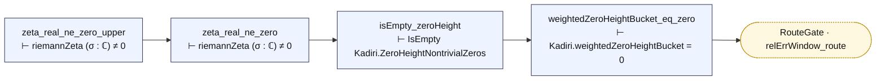

# `lean_stage3/Stage3/RealSegment.lean`

**What it does** (its own header): RealSegment — block E5 of `lean_stage3/design/joints.md`. 2026-11-22. ζ has no zero on the real segment `(0, 1)`, so the bucket `W` of real nontrivial zeros in the explicit-formula route is zero.

**Imports:** [`Assembly`](../lean_stage3/Assembly.md).
**Imported by:** [`Stage3`](../lean_stage3/Stage3.md), [`RouteGate`](../lean_stage3/RouteGate.md).

Blue: theorem. Green: a theorem nothing else uses (an end). Dashed white: connects to nothing. Grey: definition. Red: contains `sorry`. Yellow: in another file. An arrow A → B reads "A is used by B".

## Every declaration

| declaration | proves (output) | needs (input) | why (its own docstring) | uses | used by |
|---|---|---|---|---|---|
| `Stage3.zeta_real_ne_zero_upper` theorem, line 29 | riemannZeta (σ : ℂ) ≠ 0 | h0 : 1 / 3 &lt; σ; h1 : σ &lt; 1 | No zero on `(1/3, 1)`, from the strip formula at `N = 1`. | — | `Stage3.zeta_real_ne_zero` |
| `Stage3.zeta_real_ne_zero` theorem, line 72 | riemannZeta (σ : ℂ) ≠ 0 | h0 : 0 &lt; σ; h1 : σ &lt; 1 | No zero on `(0, 1)`. | `Stage3.zeta_real_ne_zero_upper` | `Stage3.isEmpty_zeroHeight` |
| `Stage3.isEmpty_zeroHeight` theorem, line 111 | IsEmpty Kadiri.ZeroHeightNontrivialZeros | — | The bucket of real nontrivial zeros is empty. | `Stage3.zeta_real_ne_zero` | `Stage3.weightedZeroHeightBucket_eq_zero` |
| `Stage3.weightedZeroHeightBucket_eq_zero` theorem, line 124 | Kadiri.weightedZeroHeightBucket = 0 | — | `W = 0`. | `Stage3.isEmpty_zeroHeight` | `RouteGate.relErrWindow_route` |
