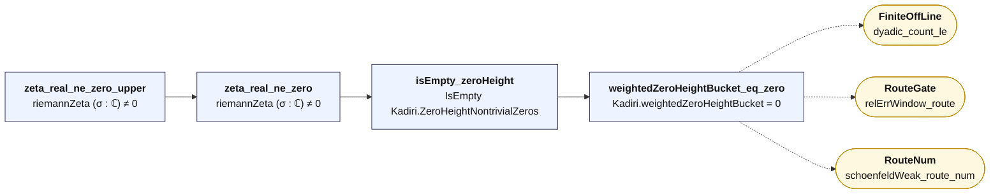

# `lean_stage3/Stage3/RealSegment.lean`

RealSegment — block E5 of `lean_stage3/design/joints.md`. 2026-11-22. ζ has no zero on the real segment `(0, 1)`, so the bucket `W` of real nontrivial zeros in the explicit-formula route is zero.

4 theorems, 0 definitions, 140 lines. Arrows are Lean's own record of what each proof uses.

**Imports:** [`Assembly`](../lean_stage3/Assembly.md)  
**Imported by:** [`Stage3`](../lean_stage3/Stage3.md), [`FiniteOffLine`](../lean_stage3/FiniteOffLine.md), [`RouteGate`](../lean_stage3/RouteGate.md)

## The picture



An arrow A → B reads "A is used in the proof of B". Green: counting, integers only. Violet: shape, analysis with no ζ. Blue: reads ζ. A name ending in ■ is an end: nothing else uses it. Red: contains `sorry`. Yellow: theorems in another file, counted; a dotted arrow crosses files. Definitions are not drawn; they are listed below the diagram.

## Theorems

<a name="Stage3-zeta_real_ne_zero_upper"></a>
### `Stage3.zeta_real_ne_zero_upper`

line 29

**Reads ζ.** It, or something it rests on, uses the zeta function, its zeros or the Riemann hypothesis.

**Why.** No zero on `(1/3, 1)`, from the strip formula at `N = 1`.

**Proves**

```lean
riemannZeta (σ : ℂ) ≠ 0
```

**Needs** (its hypotheses)

  - `` h0 : 1 / 3 < σ ``
  - `` h1 : σ < 1 ``

**Fed by:** no theorem of this repo; it stands on Mathlib.

**Feeds** (1 that use it)

  - [`Stage3.zeta_real_ne_zero`](#Stage3-zeta_real_ne_zero) — `` riemannZeta (σ : ℂ) ≠ 0 ``

<a name="Stage3-zeta_real_ne_zero"></a>
### `Stage3.zeta_real_ne_zero`

line 72

**Reads ζ.** It, or something it rests on, uses the zeta function, its zeros or the Riemann hypothesis.

**Why.** No zero on `(0, 1)`.

**Proves**

```lean
riemannZeta (σ : ℂ) ≠ 0
```

**Needs** (its hypotheses)

  - `` h0 : 0 < σ ``
  - `` h1 : σ < 1 ``

**Fed by** (1 theorem its proof uses)

  - [`Stage3.zeta_real_ne_zero_upper`](#Stage3-zeta_real_ne_zero_upper) — `` riemannZeta (σ : ℂ) ≠ 0 ``

**Feeds** (1 that use it)

  - [`Stage3.isEmpty_zeroHeight`](#Stage3-isEmpty_zeroHeight) — `` IsEmpty Kadiri.ZeroHeightNontrivialZeros ``

<a name="Stage3-isEmpty_zeroHeight"></a>
### `Stage3.isEmpty_zeroHeight`

line 111

**Reads ζ.** It, or something it rests on, uses the zeta function, its zeros or the Riemann hypothesis.

**Why.** The bucket of real nontrivial zeros is empty.

**Proves**

```lean
IsEmpty Kadiri.ZeroHeightNontrivialZeros
```

**Fed by** (1 theorem its proof uses)

  - [`Stage3.zeta_real_ne_zero`](#Stage3-zeta_real_ne_zero) — `` riemannZeta (σ : ℂ) ≠ 0 ``

**Feeds** (1 that use it)

  - [`Stage3.weightedZeroHeightBucket_eq_zero`](#Stage3-weightedZeroHeightBucket_eq_zero) — `` Kadiri.weightedZeroHeightBucket = 0 ``

<a name="Stage3-weightedZeroHeightBucket_eq_zero"></a>
### `Stage3.weightedZeroHeightBucket_eq_zero`

line 124

**Reads ζ.** It, or something it rests on, uses the zeta function, its zeros or the Riemann hypothesis.

**Why.** `W = 0`.

**Proves**

```lean
Kadiri.weightedZeroHeightBucket = 0
```

**Fed by** (1 theorem its proof uses)

  - [`Stage3.isEmpty_zeroHeight`](#Stage3-isEmpty_zeroHeight) — `` IsEmpty Kadiri.ZeroHeightNontrivialZeros ``

**Feeds** (3 that use it)

  - [`FiniteOffLine.dyadic_count_le`](../lean_stage3/FiniteOffLine.md#FiniteOffLine-dyadic_count_le) (FiniteOffLine) — `` ∑ j ∈ range (K + 1), ((2 : ℝ) ^ j)⁻¹ * (2 * |riemannZeta.N ((2 : ℝ) ^ (j + 1))| + weightedZeroHeightBucket) ≤ 3000 * ((K : ℝ) + 2) ^ 2 ``
  - [`RouteGate.relErrWindow_route`](../lean_stage3/RouteGate.md#RouteGate-relErrWindow_route) (RouteGate) — `` ∃ c₁ c₃ c₄ : ℝ, 0 ≤ c₁ ∧ 0 ≤ c₃ ∧ 0 ≤ c₄ ∧ ∀ x₀ : ℝ, 16 ≤ x₀ → ∀ (r : ℤ) (n : ℕ), x₀ ^ 2 ≤ (2 : ℝ) ^ ((r : ℝ) - n) → JointDialGate.StmtRelErrWindow (f… ``
  - [`Stage3.schoenfeldWeak_route_num`](../lean_stage3/RouteNum.md#Stage3-schoenfeldWeak_route_num) (RouteNum) — `` StmtSchoenfeldWeak (routeConst x₀) 1 (max (x₀ ^ 2) 9) (fun x => (Nat.primeCounting ⌊x⌋₊ : ℝ)) Li ``

