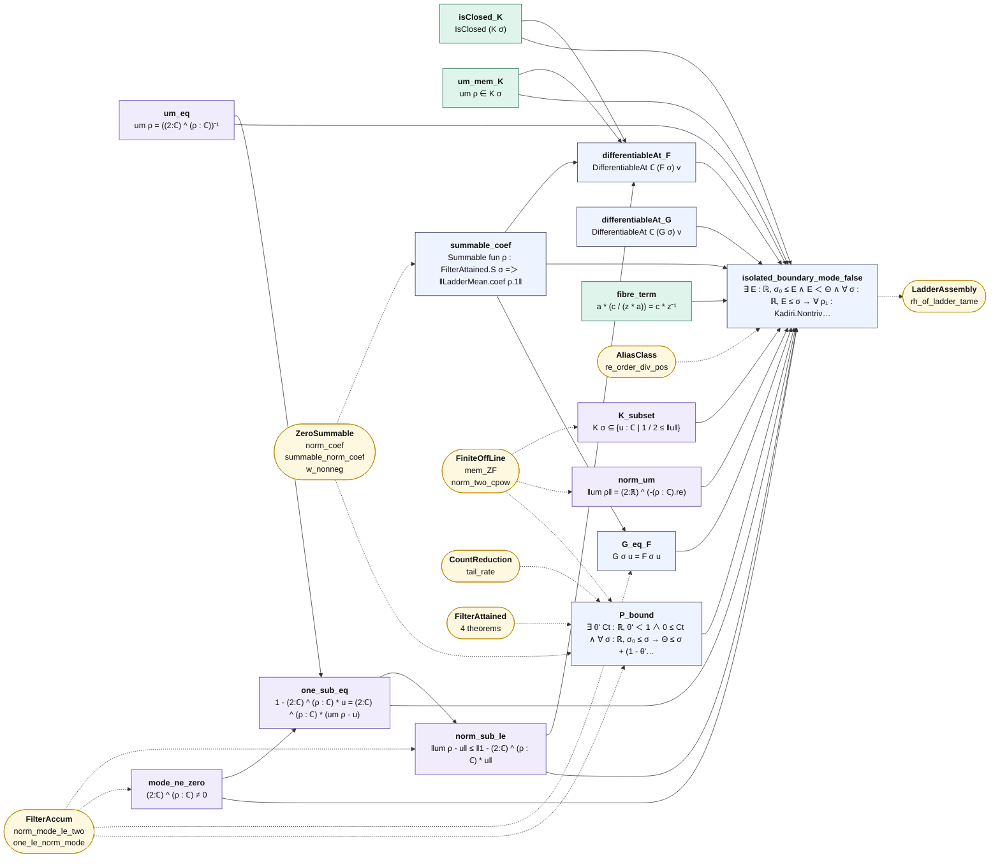

# `lean_stage3/Stage3/ResidueRoute.lean`

> **Read from the source text.** This file changed after the last `python3 utilities/lean_map.py --dump`, so the arrows on this page are names occurring in each proof and have not been confirmed by Lean.

ResidueRoute — block S4 of `lean_stage3/design/stencil.md`. 2026-11-24. The residue route, from the section "After the independent check". Under the ladder bound `H`, `|ψ(2^k) − 2^k| ≤ C·k²·√2^k` for `k ≥ 1`, fix `1/2 < σ₀ < Θ ≤ 1` with `Θ` an upper bound for the real parts of the zeros. The tail-rate exponent `θ' < 1` of `CountReduction.tail_rate` at `σ₀` gives `E = max σ₀ (Θ − (1 − θ')) < Θ`. For every `σ ≥ E` (the design's `σ ∈ (Θ − 5δ², Θ)`):

15 theorems, 5 definitions, 559 lines. 

**Imports:** [`AliasClass`](../lean_stage3/AliasClass.md), [`CountReduction`](../lean_stage3/CountReduction.md), [`FilterAccum`](../lean_stage3/FilterAccum.md)  
**Imported by:** [`LadderAssembly`](../lean_stage3/LadderAssembly.md)

## The picture



An arrow A → B reads "A is used in the proof of B". Green: counting, integers only. Violet: shape, analysis with no ζ. Blue: reads ζ. A name ending in ■ is an end: nothing else uses it. Red: contains `sorry`. Yellow: theorems in another file, counted; a dotted arrow crosses files. Definitions are not drawn; they are listed below the diagram.

## Definitions

<a name="ResidueRoute-um"></a>
### `ResidueRoute.um`

def · line 53

- **Is:** `` um (ρ : NontrivialZeros) : ℂ := (2:ℂ) ^ (-(ρ : ℂ)) noncomputable ``
- **Used by 7:** [`ResidueRoute.differentiableAt_F`](#ResidueRoute-differentiableAt_F), [`ResidueRoute.isolated_boundary_mode_false`](#ResidueRoute-isolated_boundary_mode_false), [`ResidueRoute.norm_sub_le`](#ResidueRoute-norm_sub_le), [`ResidueRoute.norm_um`](#ResidueRoute-norm_um), [`ResidueRoute.one_sub_eq`](#ResidueRoute-one_sub_eq), [`ResidueRoute.um_eq`](#ResidueRoute-um_eq), [`ResidueRoute.um_mem_K`](#ResidueRoute-um_mem_K)

<a name="ResidueRoute-K"></a>
### `ResidueRoute.K`

def · line 57

- **Is:** `` K (σ : ℝ) : Set ℂ := closure {u : ℂ | ∃ ρ : NontrivialZeros, σ ≤ (ρ : ℂ).re ∧ (2:ℂ) ^ (-(ρ : ℂ)) = u} noncomputable ``
- **Used by 6:** [`LadderAssembly.top_mode_on_frontier`](../lean_stage3/LadderAssembly.md#LadderAssembly-top_mode_on_frontier), [`ResidueRoute.K_subset`](#ResidueRoute-K_subset), [`ResidueRoute.differentiableAt_F`](#ResidueRoute-differentiableAt_F), [`ResidueRoute.isClosed_K`](#ResidueRoute-isClosed_K), [`ResidueRoute.isolated_boundary_mode_false`](#ResidueRoute-isolated_boundary_mode_false), [`ResidueRoute.um_mem_K`](#ResidueRoute-um_mem_K)

<a name="ResidueRoute-P"></a>
### `ResidueRoute.P`

def · line 62

- **Is:** `` P (σ : ℝ) (k : ℕ) : ℂ := ∑' ρ : FilterAttained.S σ, LadderMean.coef ρ.1 * ((2:ℂ) ^ (ρ.1 : ℂ)) ^ k noncomputable ``
- **Built from:** [`FilterAttained.S`](../lean_stage3/FilterAttained.md#FilterAttained-S), [`LadderMean.coef`](../lean_stage3/LadderMean.md#LadderMean-coef)
- **Used by 4:** [`ResidueRoute.G`](#ResidueRoute-G), [`ResidueRoute.G_eq_F`](#ResidueRoute-G_eq_F), [`ResidueRoute.P_bound`](#ResidueRoute-P_bound), [`ResidueRoute.differentiableAt_G`](#ResidueRoute-differentiableAt_G)

<a name="ResidueRoute-G"></a>
### `ResidueRoute.G`

def · line 67

- **Is:** `` G (σ : ℝ) (u : ℂ) : ℂ := ∑' k : ℕ, P σ k * u ^ k noncomputable ``
- **Built from:** [`ResidueRoute.P`](#ResidueRoute-P)
- **Used by 3:** [`ResidueRoute.G_eq_F`](#ResidueRoute-G_eq_F), [`ResidueRoute.differentiableAt_G`](#ResidueRoute-differentiableAt_G), [`ResidueRoute.isolated_boundary_mode_false`](#ResidueRoute-isolated_boundary_mode_false)

<a name="ResidueRoute-F"></a>
### `ResidueRoute.F`

def · line 71

- **Is:** `` F (σ : ℝ) (u : ℂ) : ℂ := ∑' ρ : FilterAttained.S σ, LadderMean.coef ρ.1 / (1 - (2:ℂ) ^ (ρ.1 : ℂ) * u) ``
- **Built from:** [`FilterAttained.S`](../lean_stage3/FilterAttained.md#FilterAttained-S), [`LadderMean.coef`](../lean_stage3/LadderMean.md#LadderMean-coef)
- **Used by 4:** [`ResidueRoute.G_eq_F`](#ResidueRoute-G_eq_F), [`ResidueRoute.differentiableAt_F`](#ResidueRoute-differentiableAt_F), [`ResidueRoute.differentiableAt_G`](#ResidueRoute-differentiableAt_G), [`ResidueRoute.isolated_boundary_mode_false`](#ResidueRoute-isolated_boundary_mode_false)

## Theorems

<a name="ResidueRoute-isClosed_K"></a>
### `ResidueRoute.isClosed_K`

line 75 · arrows read from text

**Counting.** Integers only: nothing in its statement or proof, or in anything it rests on, uses analysis or ζ.

**Why.** `K` is closed.

**Proves**

```lean
IsClosed (K σ)
```

**Needs** (its hypotheses)

  - `` σ : ℝ ``

**Fed by:** no theorem of this repo; it stands on Mathlib and the definitions below.

**Definitions its proof touches:** [`ResidueRoute.K`](#ResidueRoute-K)

**Feeds** (2 that use it)

  - [`ResidueRoute.differentiableAt_F`](#ResidueRoute-differentiableAt_F) — `` DifferentiableAt ℂ (F σ) v ``
  - [`ResidueRoute.isolated_boundary_mode_false`](#ResidueRoute-isolated_boundary_mode_false) — `` ∃ E : ℝ, σ₀ ≤ E ∧ E < Θ ∧ ∀ σ : ℝ, E ≤ σ → ∀ ρ₁ : Kadiri.NontrivialZeros, σ < (ρ₁ : ℂ).re → (∃ ε : ℝ, 0 < ε ∧ ∀ u ∈ K σ, ‖u - (2:ℂ) ^ (-(ρ₁ : ℂ))‖ < ε… ``

<a name="ResidueRoute-um_mem_K"></a>
### `ResidueRoute.um_mem_K`

line 78 · arrows read from text

**Counting.** Integers only: nothing in its statement or proof, or in anything it rests on, uses analysis or ζ.

**Why.** The mode of a zero right of `σ` lies in `K`.

**Proves**

```lean
um ρ ∈ K σ
```

**Needs** (its hypotheses)

  - `` ρ : NontrivialZeros ``
  - `` h : σ ≤ (ρ : ℂ).re ``

**Fed by:** no theorem of this repo; it stands on Mathlib and the definitions below.

**Definitions its proof touches:** [`ResidueRoute.K`](#ResidueRoute-K), [`ResidueRoute.um`](#ResidueRoute-um)

**Feeds** (2 that use it)

  - [`ResidueRoute.differentiableAt_F`](#ResidueRoute-differentiableAt_F) — `` DifferentiableAt ℂ (F σ) v ``
  - [`ResidueRoute.isolated_boundary_mode_false`](#ResidueRoute-isolated_boundary_mode_false) — `` ∃ E : ℝ, σ₀ ≤ E ∧ E < Θ ∧ ∀ σ : ℝ, E ≤ σ → ∀ ρ₁ : Kadiri.NontrivialZeros, σ < (ρ₁ : ℂ).re → (∃ ε : ℝ, 0 < ε ∧ ∀ u ∈ K σ, ‖u - (2:ℂ) ^ (-(ρ₁ : ℂ))‖ < ε… ``

<a name="ResidueRoute-um_eq"></a>
### `ResidueRoute.um_eq`

line 82 · arrows read from text

**Shape.** Uses real or complex analysis; nothing in it or beneath it reads ζ.

**Why.** `u_ρ = 1/z_ρ`.

**Proves**

```lean
um ρ = ((2:ℂ) ^ (ρ : ℂ))⁻¹
```

**Needs** (its hypotheses)

  - `` ρ : NontrivialZeros ``

**Fed by:** no theorem of this repo; it stands on Mathlib and the definitions below.

**Definitions its proof touches:** [`ResidueRoute.um`](#ResidueRoute-um)

**Feeds** (2 that use it)

  - [`ResidueRoute.isolated_boundary_mode_false`](#ResidueRoute-isolated_boundary_mode_false) — `` ∃ E : ℝ, σ₀ ≤ E ∧ E < Θ ∧ ∀ σ : ℝ, E ≤ σ → ∀ ρ₁ : Kadiri.NontrivialZeros, σ < (ρ₁ : ℂ).re → (∃ ε : ℝ, 0 < ε ∧ ∀ u ∈ K σ, ‖u - (2:ℂ) ^ (-(ρ₁ : ℂ))‖ < ε… ``
  - [`ResidueRoute.one_sub_eq`](#ResidueRoute-one_sub_eq) — `` 1 - (2:ℂ) ^ (ρ : ℂ) * u = (2:ℂ) ^ (ρ : ℂ) * (um ρ - u) ``

<a name="ResidueRoute-norm_um"></a>
### `ResidueRoute.norm_um`

line 85 · arrows read from text

**Shape.** Uses real or complex analysis; nothing in it or beneath it reads ζ.

**Why.** `|u_ρ| = 2^(−β)`.

**Proves**

```lean
‖um ρ‖ = (2:ℝ) ^ (-(ρ : ℂ).re)
```

**Needs** (its hypotheses)

  - `` ρ : NontrivialZeros ``

**Fed by** (1 theorem its proof uses)

  - [`FiniteOffLine.norm_two_cpow`](../lean_stage3/FiniteOffLine.md#FiniteOffLine-norm_two_cpow) (FiniteOffLine) — `` ‖(2:ℂ) ^ ρ‖ = (2:ℝ) ^ ρ.re ``

**Definitions its proof touches:** [`ResidueRoute.um`](#ResidueRoute-um)

**Feeds** (1 that use it)

  - [`ResidueRoute.isolated_boundary_mode_false`](#ResidueRoute-isolated_boundary_mode_false) — `` ∃ E : ℝ, σ₀ ≤ E ∧ E < Θ ∧ ∀ σ : ℝ, E ≤ σ → ∀ ρ₁ : Kadiri.NontrivialZeros, σ < (ρ₁ : ℂ).re → (∃ ε : ℝ, 0 < ε ∧ ∀ u ∈ K σ, ‖u - (2:ℂ) ^ (-(ρ₁ : ℂ))‖ < ε… ``

<a name="ResidueRoute-mode_ne_zero"></a>
### `ResidueRoute.mode_ne_zero`

line 89 · arrows read from text

**Shape.** Uses real or complex analysis; nothing in it or beneath it reads ζ.

**Why.** The mode `2^ρ` is not zero.

**Proves**

```lean
(2:ℂ) ^ (ρ : ℂ) ≠ 0
```

**Needs** (its hypotheses)

  - `` ρ : NontrivialZeros ``

**Fed by** (1 theorem its proof uses)

  - [`FilterAccum.one_le_norm_mode`](../lean_stage3/FilterAccum.md#FilterAccum-one_le_norm_mode) (FilterAccum) — `` 1 ≤ ‖(2:ℂ) ^ (ρ : ℂ)‖ ``

**Feeds** (2 that use it)

  - [`ResidueRoute.isolated_boundary_mode_false`](#ResidueRoute-isolated_boundary_mode_false) — `` ∃ E : ℝ, σ₀ ≤ E ∧ E < Θ ∧ ∀ σ : ℝ, E ≤ σ → ∀ ρ₁ : Kadiri.NontrivialZeros, σ < (ρ₁ : ℂ).re → (∃ ε : ℝ, 0 < ε ∧ ∀ u ∈ K σ, ‖u - (2:ℂ) ^ (-(ρ₁ : ℂ))‖ < ε… ``
  - [`ResidueRoute.one_sub_eq`](#ResidueRoute-one_sub_eq) — `` 1 - (2:ℂ) ^ (ρ : ℂ) * u = (2:ℂ) ^ (ρ : ℂ) * (um ρ - u) ``

<a name="ResidueRoute-one_sub_eq"></a>
### `ResidueRoute.one_sub_eq`

line 93 · arrows read from text

**Shape.** Uses real or complex analysis; nothing in it or beneath it reads ζ.

**Why.** `1 − z_ρ·u = z_ρ·(u_ρ − u)`.

**Proves**

```lean
1 - (2:ℂ) ^ (ρ : ℂ) * u = (2:ℂ) ^ (ρ : ℂ) * (um ρ - u)
```

**Needs** (its hypotheses)

  - `` ρ : NontrivialZeros ``
  - `` u : ℂ ``

**Fed by** (2 theorems its proof uses)

  - [`ResidueRoute.mode_ne_zero`](#ResidueRoute-mode_ne_zero) — `` (2:ℂ) ^ (ρ : ℂ) ≠ 0 ``
  - [`ResidueRoute.um_eq`](#ResidueRoute-um_eq) — `` um ρ = ((2:ℂ) ^ (ρ : ℂ))⁻¹ ``

**Definitions its proof touches:** [`ResidueRoute.um`](#ResidueRoute-um)

**Feeds** (2 that use it)

  - [`ResidueRoute.isolated_boundary_mode_false`](#ResidueRoute-isolated_boundary_mode_false) — `` ∃ E : ℝ, σ₀ ≤ E ∧ E < Θ ∧ ∀ σ : ℝ, E ≤ σ → ∀ ρ₁ : Kadiri.NontrivialZeros, σ < (ρ₁ : ℂ).re → (∃ ε : ℝ, 0 < ε ∧ ∀ u ∈ K σ, ‖u - (2:ℂ) ^ (-(ρ₁ : ℂ))‖ < ε… ``
  - [`ResidueRoute.norm_sub_le`](#ResidueRoute-norm_sub_le) — `` ‖um ρ - u‖ ≤ ‖1 - (2:ℂ) ^ (ρ : ℂ) * u‖ ``

<a name="ResidueRoute-norm_sub_le"></a>
### `ResidueRoute.norm_sub_le`

line 98 · arrows read from text

**Shape.** Uses real or complex analysis; nothing in it or beneath it reads ζ.

**Why.** `|u_ρ − u| ≤ |1 − z_ρ·u|`, since `|z_ρ| ≥ 1`.

**Proves**

```lean
‖um ρ - u‖ ≤ ‖1 - (2:ℂ) ^ (ρ : ℂ) * u‖
```

**Needs** (its hypotheses)

  - `` ρ : NontrivialZeros ``
  - `` u : ℂ ``

**Fed by** (2 theorems its proof uses)

  - [`FilterAccum.one_le_norm_mode`](../lean_stage3/FilterAccum.md#FilterAccum-one_le_norm_mode) (FilterAccum) — `` 1 ≤ ‖(2:ℂ) ^ (ρ : ℂ)‖ ``
  - [`ResidueRoute.one_sub_eq`](#ResidueRoute-one_sub_eq) — `` 1 - (2:ℂ) ^ (ρ : ℂ) * u = (2:ℂ) ^ (ρ : ℂ) * (um ρ - u) ``

**Definitions its proof touches:** [`ResidueRoute.um`](#ResidueRoute-um)

**Feeds** (2 that use it)

  - [`ResidueRoute.differentiableAt_F`](#ResidueRoute-differentiableAt_F) — `` DifferentiableAt ℂ (F σ) v ``
  - [`ResidueRoute.isolated_boundary_mode_false`](#ResidueRoute-isolated_boundary_mode_false) — `` ∃ E : ℝ, σ₀ ≤ E ∧ E < Θ ∧ ∀ σ : ℝ, E ≤ σ → ∀ ρ₁ : Kadiri.NontrivialZeros, σ < (ρ₁ : ℂ).re → (∃ ε : ℝ, 0 < ε ∧ ∀ u ∈ K σ, ‖u - (2:ℂ) ^ (-(ρ₁ : ℂ))‖ < ε… ``

<a name="ResidueRoute-K_subset"></a>
### `ResidueRoute.K_subset`

line 104 · arrows read from text

**Shape.** Uses real or complex analysis; nothing in it or beneath it reads ζ.

**Why.** Every point of `K` has size at least `1/2`.

**Proves**

```lean
K σ ⊆ {u : ℂ | 1 / 2 ≤ ‖u‖}
```

**Needs** (its hypotheses)

  - `` σ : ℝ ``

**Fed by** (1 theorem its proof uses)

  - [`FiniteOffLine.norm_two_cpow`](../lean_stage3/FiniteOffLine.md#FiniteOffLine-norm_two_cpow) (FiniteOffLine) — `` ‖(2:ℂ) ^ ρ‖ = (2:ℝ) ^ ρ.re ``

**Definitions its proof touches:** [`ResidueRoute.K`](#ResidueRoute-K)

**Feeds** (1 that use it)

  - [`ResidueRoute.isolated_boundary_mode_false`](#ResidueRoute-isolated_boundary_mode_false) — `` ∃ E : ℝ, σ₀ ≤ E ∧ E < Θ ∧ ∀ σ : ℝ, E ≤ σ → ∀ ρ₁ : Kadiri.NontrivialZeros, σ < (ρ₁ : ℂ).re → (∃ ε : ℝ, 0 < ε ∧ ∀ u ∈ K σ, ‖u - (2:ℂ) ^ (-(ρ₁ : ℂ))‖ < ε… ``

<a name="ResidueRoute-summable_coef"></a>
### `ResidueRoute.summable_coef`

line 117 · arrows read from text

**Reads ζ.** It, or something it rests on, uses the zeta function, its zeros or the Riemann hypothesis.

**Why.** The weights `|m(ρ)/ρ|` right of `σ > 1/2` are summable.

**Proves**

```lean
Summable fun ρ : FilterAttained.S σ => ‖LadderMean.coef ρ.1‖
```

**Needs** (its hypotheses)

  - `` hσ : 1 / 2 < σ ``

**Fed by** (1 theorem its proof uses)

  - [`ZeroSummable.summable_norm_coef`](../lean_stage3/ZeroSummable.md#ZeroSummable-summable_norm_coef) (ZeroSummable) — `` Summable fun ρ : S => ‖LadderMean.coef ρ‖ ``

**Definitions its proof touches:** [`FilterAttained.S`](../lean_stage3/FilterAttained.md#FilterAttained-S), [`LadderMean.coef`](../lean_stage3/LadderMean.md#LadderMean-coef)

**Feeds** (3 that use it)

  - [`ResidueRoute.G_eq_F`](#ResidueRoute-G_eq_F) — `` G σ u = F σ u ``
  - [`ResidueRoute.differentiableAt_F`](#ResidueRoute-differentiableAt_F) — `` DifferentiableAt ℂ (F σ) v ``
  - [`ResidueRoute.isolated_boundary_mode_false`](#ResidueRoute-isolated_boundary_mode_false) — `` ∃ E : ℝ, σ₀ ≤ E ∧ E < Θ ∧ ∀ σ : ℝ, E ≤ σ → ∀ ρ₁ : Kadiri.NontrivialZeros, σ < (ρ₁ : ℂ).re → (∃ ε : ℝ, 0 < ε ∧ ∀ u ∈ K σ, ‖u - (2:ℂ) ^ (-(ρ₁ : ℂ))‖ < ε… ``

<a name="ResidueRoute-differentiableAt_F"></a>
### `ResidueRoute.differentiableAt_F`

line 123 · arrows read from text

**Reads ζ.** It, or something it rests on, uses the zeta function, its zeros or the Riemann hypothesis.

**Why.** `F` is differentiable off `K`. Near a point `v ∉ K`, at distance `ε` from `K`, every term is bounded by `(2/ε)·|m(ρ)/ρ|`.

**Proves**

```lean
DifferentiableAt ℂ (F σ) v
```

**Needs** (its hypotheses)

  - `` hσ : 1 / 2 < σ ``
  - `` hv : v ∉ K σ ``

**Fed by** (4 theorems its proof uses)

  - [`ResidueRoute.isClosed_K`](#ResidueRoute-isClosed_K) — `` IsClosed (K σ) ``
  - [`ResidueRoute.norm_sub_le`](#ResidueRoute-norm_sub_le) — `` ‖um ρ - u‖ ≤ ‖1 - (2:ℂ) ^ (ρ : ℂ) * u‖ ``
  - [`ResidueRoute.summable_coef`](#ResidueRoute-summable_coef) — `` Summable fun ρ : FilterAttained.S σ => ‖LadderMean.coef ρ.1‖ ``
  - [`ResidueRoute.um_mem_K`](#ResidueRoute-um_mem_K) — `` um ρ ∈ K σ ``

**Definitions its proof touches:** [`FilterAttained.S`](../lean_stage3/FilterAttained.md#FilterAttained-S), [`LadderMean.coef`](../lean_stage3/LadderMean.md#LadderMean-coef), [`ResidueRoute.F`](#ResidueRoute-F), [`ResidueRoute.K`](#ResidueRoute-K), [`ResidueRoute.um`](#ResidueRoute-um)

**Feeds** (1 that use it)

  - [`ResidueRoute.isolated_boundary_mode_false`](#ResidueRoute-isolated_boundary_mode_false) — `` ∃ E : ℝ, σ₀ ≤ E ∧ E < Θ ∧ ∀ σ : ℝ, E ≤ σ → ∀ ρ₁ : Kadiri.NontrivialZeros, σ < (ρ₁ : ℂ).re → (∃ ε : ℝ, 0 < ε ∧ ∀ u ∈ K σ, ‖u - (2:ℂ) ^ (-(ρ₁ : ℂ))‖ < ε… ``

<a name="ResidueRoute-P_bound"></a>
### `ResidueRoute.P_bound`

line 170 · arrows read from text

**Reads ζ.** It, or something it rests on, uses the zeta function, its zeros or the Riemann hypothesis.

**Why.** The ladder sums right of `σ`. Under `H`, for `1/2 < σ₀ ≤ 1` and `Θ` an upper bound for the real parts, there are `θ' < 1` and `Ct ≥ 0` such that for every `σ ≥ σ₀` with `Θ ≤ σ + (1 − θ')` and every `k ≥ 2`, `‖Σ'_{β≥σ} m(ρ)/ρ·(2^ρ)^k‖ ≤ (|Afl C| + Ct)·k²·(2^σ)^k`. The zeros below height `2^k` by block S1 at `q = 1`; those above by the tail rate.

**Proves**

```lean
∃ θ' Ct : ℝ, θ' < 1 ∧ 0 ≤ Ct ∧ ∀ σ : ℝ, σ₀ ≤ σ → Θ ≤ σ + (1 - θ') → ∀ k : ℕ, 2 ≤ k → ‖P σ k‖ ≤ (|FilterLadder.Afl C| + Ct) * (k:ℝ) ^ 2 * ((2:ℝ) ^ σ) ^ k
```

**Needs** (its hypotheses)

  - `` hH : ∀ k : ℕ, 1 ≤ k → ‖(Chebyshev.psi ((2:ℝ)^k) : ℂ) - (((2:ℝ)^k : ℝ) : ℂ)‖ ≤ C * (k:ℝ)^2 * Real.sqrt 2 ^ k ``
  - `` hσ₀ : 1 / 2 < σ₀ ``
  - `` hσ₀1 : σ₀ ≤ 1 ``
  - `` hΘ : ∀ ρ : NontrivialZeros, (ρ : ℂ).re ≤ Θ ``

**Fed by** (10 theorems its proof uses)

  - [`CountReduction.tail_rate`](../lean_stage3/CountReduction.md#CountReduction-tail_rate) (CountReduction) — `` ∃ θ' Ct : ℝ, 0 ≤ θ' ∧ θ' < 1 ∧ 0 ≤ Ct ∧ ∀ (k : ℕ), 1 ≤ k → ∀ v : Finset Kadiri.NontrivialZeros, (∀ ρ ∈ v, σ ≤ (ρ:ℂ).re ∧ (2:ℝ)^k ≤ |(ρ:ℂ).im|) → ∑ ρ ∈… ``
  - [`FilterAccum.norm_mode_le_two`](../lean_stage3/FilterAccum.md#FilterAccum-norm_mode_le_two) (FilterAccum) — `` ‖(2:ℂ) ^ (ρ : ℂ)‖ ≤ 2 ``
  - [`FilterAttained.finite_part_le`](../lean_stage3/FilterAttained.md#FilterAttained-finite_part_le) (FilterAttained) — `` ‖∑ ρ ∈ (ZF ((2:ℝ) ^ (b * k))).filter (fun ρ : NontrivialZeros => σ ≤ (ρ : ℂ).re), LadderMean.coef ρ * ratio q a b M ρ ^ k‖ ≤ FilterLadder.Afl C * (b:ℝ… ``
  - [`FilterAttained.norm_tailT_le`](../lean_stage3/FilterAttained.md#FilterAttained-norm_tailT_le) (FilterAttained) — `` ‖tailT q a b σ M k ρ‖ ≤ (S σ).indicator (fun ρ => ‖LadderMean.coef ρ‖) ρ ``
  - [`FilterAttained.summable_S`](../lean_stage3/FilterAttained.md#FilterAttained-summable_S) (FilterAttained) — `` Summable ((S σ).indicator fun ρ => ‖LadderMean.coef ρ‖) ``
  - [`FilterAttained.tsum_split`](../lean_stage3/FilterAttained.md#FilterAttained-tsum_split) (FilterAttained) — `` ∑' ρ, (S σ).indicator (fun ρ => LadderMean.coef ρ * ratio q a b M ρ ^ k) ρ = ∑ ρ ∈ (ZF ((2:ℝ) ^ (b * k))).filter (fun ρ : NontrivialZeros => σ ≤ (ρ : … ``
  - [`FiniteOffLine.mem_ZF`](../lean_stage3/FiniteOffLine.md#FiniteOffLine-mem_ZF) (FiniteOffLine) — `` ρ ∈ ZF T ↔ |(ρ : ℂ).im| < T ``
  - [`FiniteOffLine.norm_two_cpow`](../lean_stage3/FiniteOffLine.md#FiniteOffLine-norm_two_cpow) (FiniteOffLine) — `` ‖(2:ℂ) ^ ρ‖ = (2:ℝ) ^ ρ.re ``
  - [`ZeroSummable.norm_coef`](../lean_stage3/ZeroSummable.md#ZeroSummable-norm_coef) (ZeroSummable) — `` ‖LadderMean.coef ρ‖ = w ρ ``
  - [`ZeroSummable.w_nonneg`](../lean_stage3/ZeroSummable.md#ZeroSummable-w_nonneg) (ZeroSummable) — `` 0 ≤ w ρ ``

**Definitions its proof touches:** [`FilterAttained.S`](../lean_stage3/FilterAttained.md#FilterAttained-S), [`FilterAttained.ratio`](../lean_stage3/FilterAttained.md#FilterAttained-ratio), [`FilterAttained.tailT`](../lean_stage3/FilterAttained.md#FilterAttained-tailT), [`FilterAttained.xi`](../lean_stage3/FilterAttained.md#FilterAttained-xi), [`FilterLadder.Afl`](../lean_stage3/FilterLadder.md#FilterLadder-Afl), [`FiniteOffLine.ZF`](../lean_stage3/FiniteOffLine.md#FiniteOffLine-ZF), [`LadderMean.coef`](../lean_stage3/LadderMean.md#LadderMean-coef), [`ResidueRoute.P`](#ResidueRoute-P), [`ZeroSummable.w`](../lean_stage3/ZeroSummable.md#ZeroSummable-w)

**Feeds** (1 that use it)

  - [`ResidueRoute.isolated_boundary_mode_false`](#ResidueRoute-isolated_boundary_mode_false) — `` ∃ E : ℝ, σ₀ ≤ E ∧ E < Θ ∧ ∀ σ : ℝ, E ≤ σ → ∀ ρ₁ : Kadiri.NontrivialZeros, σ < (ρ₁ : ℂ).re → (∃ ε : ℝ, 0 < ε ∧ ∀ u ∈ K σ, ‖u - (2:ℂ) ^ (-(ρ₁ : ℂ))‖ < ε… ``

<a name="ResidueRoute-differentiableAt_G"></a>
### `ResidueRoute.differentiableAt_G`

line 282 · arrows read from text

**Reads ζ.** It, or something it rests on, uses the zeta function, its zeros or the Riemann hypothesis.

**Why.** `G` is differentiable in `|u| < 1/X` when `‖P_k‖ ≤ A·k²·X^k` for `k ≥ 2`.

**Proves**

```lean
DifferentiableAt ℂ (G σ) v
```

**Needs** (its hypotheses)

  - `` hX : 0 < X ``
  - `` hA : ∀ k : ℕ, 2 ≤ k → ‖P σ k‖ ≤ A * (k:ℝ) ^ 2 * X ^ k ``
  - `` hv : ‖v‖ < X⁻¹ ``

**Fed by:** no theorem of this repo; it stands on Mathlib and the definitions below.

**Definitions its proof touches:** [`ResidueRoute.F`](#ResidueRoute-F), [`ResidueRoute.G`](#ResidueRoute-G), [`ResidueRoute.P`](#ResidueRoute-P)

**Feeds** (1 that use it)

  - [`ResidueRoute.isolated_boundary_mode_false`](#ResidueRoute-isolated_boundary_mode_false) — `` ∃ E : ℝ, σ₀ ≤ E ∧ E < Θ ∧ ∀ σ : ℝ, E ≤ σ → ∀ ρ₁ : Kadiri.NontrivialZeros, σ < (ρ₁ : ℂ).re → (∃ ε : ℝ, 0 < ε ∧ ∀ u ∈ K σ, ‖u - (2:ℂ) ^ (-(ρ₁ : ℂ))‖ < ε… ``

<a name="ResidueRoute-G_eq_F"></a>
### `ResidueRoute.G_eq_F`

line 322 · arrows read from text

**Reads ζ.** It, or something it rests on, uses the zeta function, its zeros or the Riemann hypothesis.

**Why.** `G = F` near the origin. For `|u| < 1/4`, `|2^ρ·u| ≤ 1/2`, and the double sum `Σ_k Σ'_ρ m(ρ)/ρ·(2^ρ u)^k` may be summed in either order.

**Proves**

```lean
G σ u = F σ u
```

**Needs** (its hypotheses)

  - `` hσ : 1 / 2 < σ ``
  - `` hu : ‖u‖ < 1 / 4 ``

**Fed by** (2 theorems its proof uses)

  - [`FilterAccum.norm_mode_le_two`](../lean_stage3/FilterAccum.md#FilterAccum-norm_mode_le_two) (FilterAccum) — `` ‖(2:ℂ) ^ (ρ : ℂ)‖ ≤ 2 ``
  - [`ResidueRoute.summable_coef`](#ResidueRoute-summable_coef) — `` Summable fun ρ : FilterAttained.S σ => ‖LadderMean.coef ρ.1‖ ``

**Definitions its proof touches:** [`FilterAttained.S`](../lean_stage3/FilterAttained.md#FilterAttained-S), [`LadderMean.coef`](../lean_stage3/LadderMean.md#LadderMean-coef), [`ResidueRoute.F`](#ResidueRoute-F), [`ResidueRoute.G`](#ResidueRoute-G), [`ResidueRoute.P`](#ResidueRoute-P)

**Feeds** (1 that use it)

  - [`ResidueRoute.isolated_boundary_mode_false`](#ResidueRoute-isolated_boundary_mode_false) — `` ∃ E : ℝ, σ₀ ≤ E ∧ E < Θ ∧ ∀ σ : ℝ, E ≤ σ → ∀ ρ₁ : Kadiri.NontrivialZeros, σ < (ρ₁ : ℂ).re → (∃ ε : ℝ, 0 < ε ∧ ∀ u ∈ K σ, ‖u - (2:ℂ) ^ (-(ρ₁ : ℂ))‖ < ε… ``

<a name="ResidueRoute-fibre_term"></a>
### `ResidueRoute.fibre_term`

line 363 · arrows read from text

**Counting.** Integers only: nothing in its statement or proof, or in anything it rests on, uses analysis or ζ.

**Why.** An identity for the fibre term: `a·(c/(z·a)) = c·z⁻¹`.

**Proves**

```lean
a * (c / (z * a)) = c * z⁻¹
```

**Needs** (its hypotheses)

  - `` ha : a ≠ 0 ``
  - `` hz : z ≠ 0 ``

**Fed by:** no theorem of this repo; it stands on Mathlib.

**Feeds** (1 that use it)

  - [`ResidueRoute.isolated_boundary_mode_false`](#ResidueRoute-isolated_boundary_mode_false) — `` ∃ E : ℝ, σ₀ ≤ E ∧ E < Θ ∧ ∀ σ : ℝ, E ≤ σ → ∀ ρ₁ : Kadiri.NontrivialZeros, σ < (ρ₁ : ℂ).re → (∃ ε : ℝ, 0 < ε ∧ ∀ u ∈ K σ, ‖u - (2:ℂ) ^ (-(ρ₁ : ℂ))‖ < ε… ``

<a name="ResidueRoute-isolated_boundary_mode_false"></a>
### `ResidueRoute.isolated_boundary_mode_false`

line 372 · arrows read from text

**Reads ζ.** It, or something it rests on, uses the zeta function, its zeros or the Riemann hypothesis.

**Why.** An isolated mode on the boundary of the origin's component. Let `|ψ(2^k) − 2^k| ≤ C·k²·√2^k` for `k ≥ 1`, let `1/2 < σ₀ < Θ ≤ 1` and let every zero have real part at most `Θ`. Then there is `E` with `σ₀ ≤ E < Θ` such that for every `σ ≥ E` no zero `ρ₁` with real part above `σ` has its mode `u₁ = 2^(−ρ₁)` isolated in `K = closure {2^(−ρ) : Re ρ ≥ σ}` and on the frontier of the connected component of `{|u| < 2^(−σ)} ∖ K` that holds `0`.

**Proves**

```lean
∃ E : ℝ, σ₀ ≤ E ∧ E < Θ ∧ ∀ σ : ℝ, E ≤ σ → ∀ ρ₁ : Kadiri.NontrivialZeros, σ < (ρ₁ : ℂ).re → (∃ ε : ℝ, 0 < ε ∧ ∀ u ∈ K σ, ‖u - (2:ℂ) ^ (-(ρ₁ : ℂ))‖ < ε → u = (2:ℂ) ^ (-(ρ₁ : ℂ))) → (2:ℂ) ^ (-(ρ₁ : ℂ)) ∈ frontier (connectedComponentIn (Metric.ball (0:ℂ) ((2:ℝ) ^ (-σ)) \ K σ) 0) → False
```

**Needs** (its hypotheses)

  - `` hH : ∀ k : ℕ, 1 ≤ k → ‖(Chebyshev.psi ((2:ℝ)^k) : ℂ) - (((2:ℝ)^k : ℝ) : ℂ)‖ ≤ C * (k:ℝ)^2 * Real.sqrt 2 ^ k ``
  - `` hσ₀ : 1 / 2 < σ₀ ``
  - `` hσ₀Θ : σ₀ < Θ ``
  - `` hΘ1 : Θ ≤ 1 ``
  - `` hΘ : ∀ ρ : Kadiri.NontrivialZeros, (ρ : ℂ).re ≤ Θ ``

**Fed by** (15 theorems its proof uses)

  - [`AliasClass.re_order_div_pos`](../lean_stage3/AliasClass.md#AliasClass-re_order_div_pos) (AliasClass) — `` 0 < ((((riemannZeta.order (ρ : ℂ) : ℤ) : ℂ)) / (ρ : ℂ)).re ``
  - [`ResidueRoute.G_eq_F`](#ResidueRoute-G_eq_F) — `` G σ u = F σ u ``
  - [`ResidueRoute.K_subset`](#ResidueRoute-K_subset) — `` K σ ⊆ {u : ℂ | 1 / 2 ≤ ‖u‖} ``
  - [`ResidueRoute.P_bound`](#ResidueRoute-P_bound) — `` ∃ θ' Ct : ℝ, θ' < 1 ∧ 0 ≤ Ct ∧ ∀ σ : ℝ, σ₀ ≤ σ → Θ ≤ σ + (1 - θ') → ∀ k : ℕ, 2 ≤ k → ‖P σ k‖ ≤ (|FilterLadder.Afl C| + Ct) * (k:ℝ) ^ 2 * ((2:ℝ) ^ σ) ^… ``
  - [`ResidueRoute.differentiableAt_F`](#ResidueRoute-differentiableAt_F) — `` DifferentiableAt ℂ (F σ) v ``
  - [`ResidueRoute.differentiableAt_G`](#ResidueRoute-differentiableAt_G) — `` DifferentiableAt ℂ (G σ) v ``
  - [`ResidueRoute.fibre_term`](#ResidueRoute-fibre_term) — `` a * (c / (z * a)) = c * z⁻¹ ``
  - [`ResidueRoute.isClosed_K`](#ResidueRoute-isClosed_K) — `` IsClosed (K σ) ``
  - [`ResidueRoute.mode_ne_zero`](#ResidueRoute-mode_ne_zero) — `` (2:ℂ) ^ (ρ : ℂ) ≠ 0 ``
  - [`ResidueRoute.norm_sub_le`](#ResidueRoute-norm_sub_le) — `` ‖um ρ - u‖ ≤ ‖1 - (2:ℂ) ^ (ρ : ℂ) * u‖ ``
  - [`ResidueRoute.norm_um`](#ResidueRoute-norm_um) — `` ‖um ρ‖ = (2:ℝ) ^ (-(ρ : ℂ).re) ``
  - [`ResidueRoute.one_sub_eq`](#ResidueRoute-one_sub_eq) — `` 1 - (2:ℂ) ^ (ρ : ℂ) * u = (2:ℂ) ^ (ρ : ℂ) * (um ρ - u) ``
  - [`ResidueRoute.summable_coef`](#ResidueRoute-summable_coef) — `` Summable fun ρ : FilterAttained.S σ => ‖LadderMean.coef ρ.1‖ ``
  - [`ResidueRoute.um_eq`](#ResidueRoute-um_eq) — `` um ρ = ((2:ℂ) ^ (ρ : ℂ))⁻¹ ``
  - [`ResidueRoute.um_mem_K`](#ResidueRoute-um_mem_K) — `` um ρ ∈ K σ ``

**Definitions its proof touches:** [`FilterAttained.S`](../lean_stage3/FilterAttained.md#FilterAttained-S), [`LadderMean.coef`](../lean_stage3/LadderMean.md#LadderMean-coef), [`ResidueRoute.F`](#ResidueRoute-F), [`ResidueRoute.G`](#ResidueRoute-G), [`ResidueRoute.K`](#ResidueRoute-K), [`ResidueRoute.um`](#ResidueRoute-um)

**Feeds** (1 that use it)

  - [`LadderAssembly.rh_of_ladder_tame`](../lean_stage3/LadderAssembly.md#LadderAssembly-rh_of_ladder_tame) (LadderAssembly) — `` RiemannHypothesis ``

