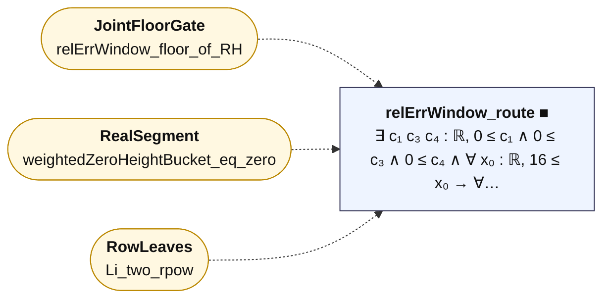

# `lean_stage3/Stage3/RouteGate.lean`

RouteGate — block E6 of `lean_stage3/design/joints.md`. 2026-11-22. The explicit-formula route at the gate's statement (unit 0411) with two of its leaves substituted: `W = 0` (unit 0414) and the main term written as the formula the table tree's interpolant has at the rows (unit 0413).

1 theorem, 0 definitions, 70 lines. Arrows are Lean's own record of what each proof uses.

**Imports:** [`JointFloorGate`](../lean_stage3/JointFloorGate.md), [`RealSegment`](../lean_stage3/RealSegment.md), [`RowLeaves`](../lean_stage3/RowLeaves.md)  
**Imported by:** [`Stage3`](../lean_stage3/Stage3.md), [`RouteNum`](../lean_stage3/RouteNum.md)

## The picture



An arrow A → B reads "A is used in the proof of B". Green: counting, integers only. Violet: shape, analysis with no ζ. Blue: reads ζ. A name ending in ■ is an end: nothing else uses it. Red: contains `sorry`. Yellow: theorems in another file, counted; a dotted arrow crosses files. Definitions are not drawn; they are listed below the diagram.

## Theorems

<a name="RouteGate-relErrWindow_route"></a>
### `RouteGate.relErrWindow_route`

line 33

**Reads ζ.** It, or something it rests on, uses the zeta function, its zeros or the Riemann hypothesis.

**Proves**

```lean
∃ c₁ c₃ c₄ : ℝ, 0 ≤ c₁ ∧ 0 ≤ c₃ ∧ 0 ≤ c₄ ∧ ∀ x₀ : ℝ, 16 ≤ x₀ → ∀ (r : ℤ) (n : ℕ), x₀ ^ 2 ≤ (2 : ℝ) ^ ((r : ℝ) - n) → JointDialGate.StmtRelErrWindow (fun m : ℤ => (Nat.primeCounting ⌊(2 : ℝ) ^ (m : ℝ)⌋₊ : ℝ)) (fun m : ℤ => 2 / Real.log 2 + ∫ t in (1 : ℝ)..(m : ℝ), Real.exp (Real.log 2 * t) / t) r n ((3 * Stage3.floorConstSplit c₁ c₃ c₄ 112 0 698 0 x₀ + 13) * (Real.log 2 * r) ^ 1 * (2 : ℝ) ^ (-(((r : ℝ) - n) / 2)))
```

**Needs** (its hypotheses)

  - `` hRH : RiemannHypothesis ``

**Stated with:** [`Stage3.floorConstSplit`](../lean_stage3/GlueFloor.md#Stage3-floorConstSplit), [`JointDialGate.StmtRelErrWindow`](../lean_stage3/JointDialGate.md#JointDialGate-StmtRelErrWindow)

**Fed by** (3 theorems its proof uses)

  - [`JointFloorGate.relErrWindow_floor_of_RH`](../lean_stage3/JointFloorGate.md#JointFloorGate-relErrWindow_floor_of_RH) (JointFloorGate) — `` ∃ c₁ c₃ c₄ : ℝ, 0 ≤ c₁ ∧ 0 ≤ c₃ ∧ 0 ≤ c₄ ∧ ∀ x₀ : ℝ, 16 ≤ x₀ → ∀ (r : ℤ) (n : ℕ), x₀ ^ 2 ≤ (2 : ℝ) ^ ((r : ℝ) - n) → 0 ≤ (r : ℝ) - n → JointDialGate.S… ``
  - [`Stage3.weightedZeroHeightBucket_eq_zero`](../lean_stage3/RealSegment.md#Stage3-weightedZeroHeightBucket_eq_zero) (RealSegment) — `` Kadiri.weightedZeroHeightBucket = 0 ``
  - [`Stage3.Li_two_rpow`](../lean_stage3/RowLeaves.md#Stage3-Li_two_rpow) (RowLeaves) — `` Li ((2 : ℝ) ^ x) = 2 / Real.log 2 + ∫ t in (1 : ℝ)..x, Real.exp (Real.log 2 * t) / t ``

**Definitions its proof touches:** [`Stage3.Li`](../lean_stage3/PsiToPi.md#Stage3-Li)

**Feeds:** nothing. It is an end.

