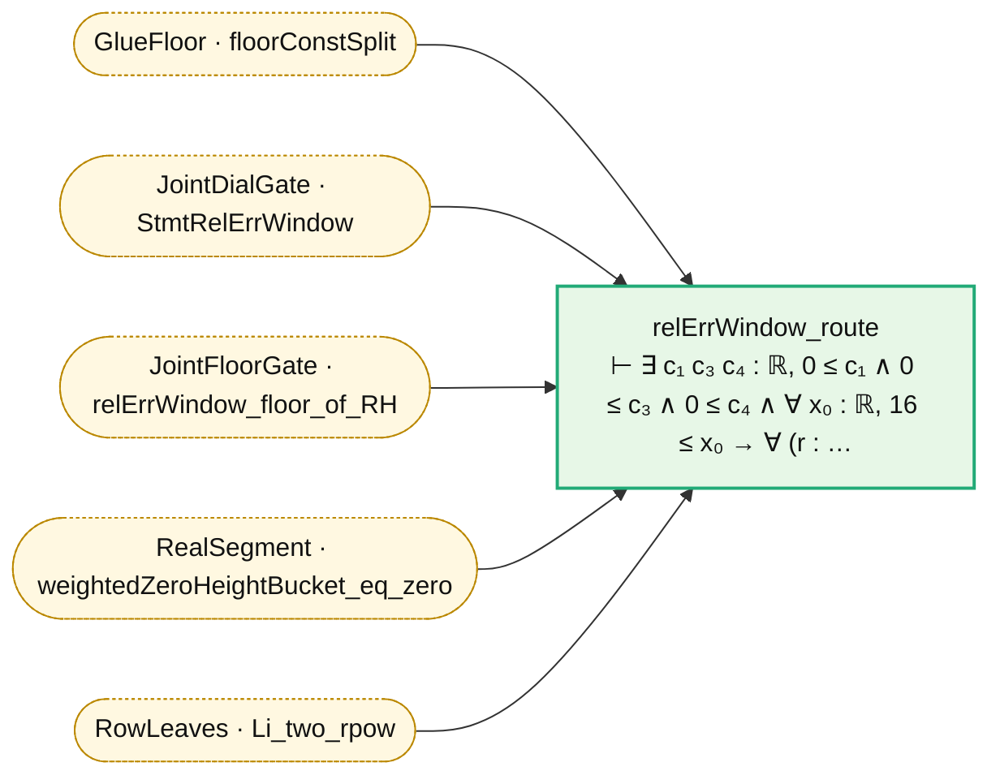

# `lean_stage3/Stage3/RouteGate.lean`

**What it does** (its own header): RouteGate — block E6 of `lean_stage3/design/joints.md`. 2026-11-22. The explicit-formula route at the gate's statement (unit 0411) with two of its leaves substituted: `W = 0` (unit 0414) and the main term written as the formula the table tree's interpolant has at the rows (unit 0413).

**Imports:** [`JointFloorGate`](../lean_stage3/JointFloorGate.md), [`RealSegment`](../lean_stage3/RealSegment.md), [`RowLeaves`](../lean_stage3/RowLeaves.md).
**Imported by:** [`Stage3`](../lean_stage3/Stage3.md), [`RouteNum`](../lean_stage3/RouteNum.md).

Blue: theorem. Green: a theorem nothing else uses (an end). Dashed white: connects to nothing. Grey: definition. Red: contains `sorry`. Yellow: in another file. An arrow A → B reads "A is used by B".

## Every declaration

| declaration | proves (output) | needs (input) | why (its own docstring) | uses | used by |
|---|---|---|---|---|---|
| `RouteGate.relErrWindow_route` theorem, line 33 | ∃ c₁ c₃ c₄ : ℝ, 0 ≤ c₁ ∧ 0 ≤ c₃ ∧ 0 ≤ c₄ ∧ ∀ x₀ : ℝ, 16 ≤ x₀ → ∀ (r : ℤ) (n : ℕ), x₀ ^ 2 ≤ (2 : ℝ) ^ ((r : ℝ) - n) → JointDialGate.StmtRelErrWindow (fun m : ℤ =&gt; (Nat.primeCounting ⌊(2 : ℝ) ^ (m : ℝ)⌋₊ : ℝ)) (fun m : ℤ =&gt; 2 / Real.log 2 + ∫ t in (1 : ℝ)..(m : ℝ), Real.exp (Real.log 2 * t) / t) r n ((3 * Stage3.floorConstSplit c₁ c₃ c₄ 112 0 698 0 x₀ + 13) * (Real.log 2 * r) ^ 1 * (2 : ℝ) ^ (-(((r : ℝ) - n) / 2))) | hRH : RiemannHypothesis | — | `Stage3.floorConstSplit`, `JointDialGate.StmtRelErrWindow`, `JointFloorGate.relErrWindow_floor_of_RH`, `Stage3.weightedZeroHeightBucket_eq_zero`, `Stage3.Li_two_rpow` | — |
