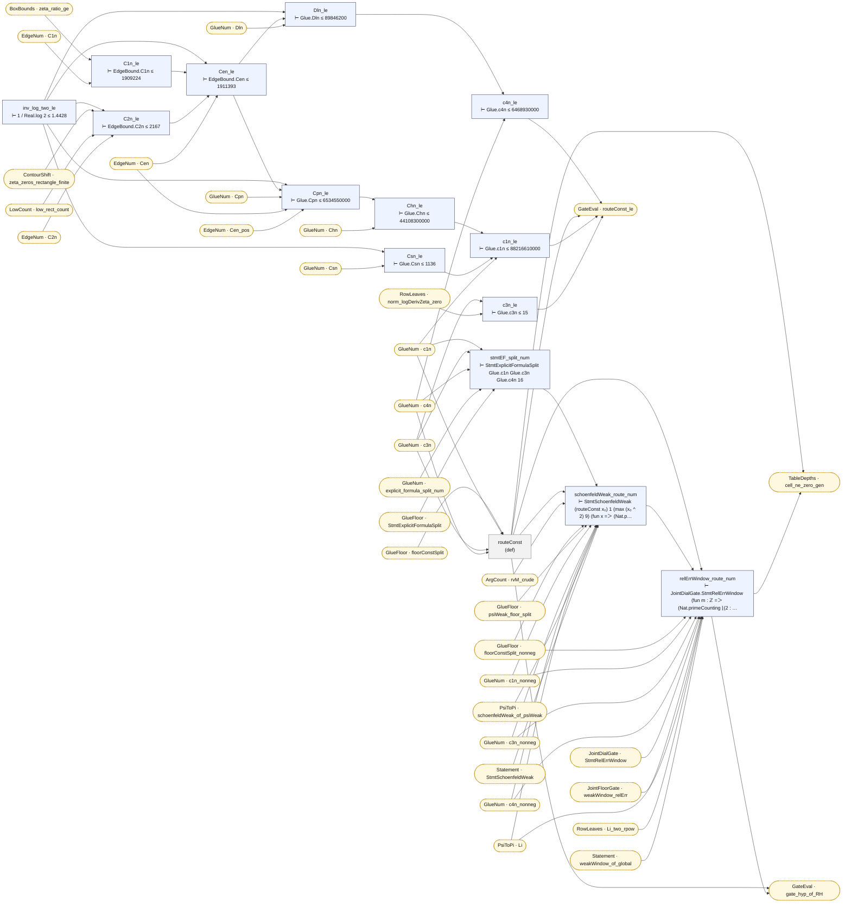

# `lean_stage3/Stage3/RouteNum.lean`

**What it does** (its own header): RouteNum — block E8c of `lean_stage3/design/joints.md`. 2026-11-22. The explicit-formula route at the gate with its three constants named, and a numeral above each constant in the chain.

**Imports:** [`GlueNum`](../lean_stage3/GlueNum.md), [`RouteGate`](../lean_stage3/RouteGate.md).
**Imported by:** [`Stage3`](../lean_stage3/Stage3.md), [`GateEval`](../lean_stage3/GateEval.md).

Blue: theorem. Green: a theorem nothing else uses (an end). Dashed white: connects to nothing. Grey: definition. Red: contains `sorry`. Yellow: in another file. An arrow A → B reads "A is used by B".

## Every declaration

| declaration | proves (output) | needs (input) | why (its own docstring) | uses | used by |
|---|---|---|---|---|---|
| `RouteNum.inv_log_two_le` theorem, line 33 | 1 / Real.log 2 ≤ 1.4428 | — | — | — | `RouteNum.C2n_le`, `RouteNum.Cen_le`, `RouteNum.Cpn_le`, `RouteNum.Csn_le`, `RouteNum.Dln_le` |
| `RouteNum.C1n_le` theorem, line 38 | EdgeBound.C1n ≤ 1909224 | — | — | `BoxBounds.zeta_ratio_ge`, `EdgeBound.C1n` | `RouteNum.Cen_le` |
| `RouteNum.C2n_le` theorem, line 95 | EdgeBound.C2n ≤ 2167 | — | — | `ContourShift.zeta_zeros_rectangle_finite`, `EdgeBound.C2n`, `EdgeBound.low_rect_count`, `RouteNum.inv_log_two_le` | `RouteNum.Cen_le` |
| `RouteNum.Cen_le` theorem, line 115 | EdgeBound.Cen ≤ 1911393 | — | — | `EdgeBound.Cen`, `RouteNum.C1n_le`, `RouteNum.C2n_le`, `RouteNum.inv_log_two_le` | `RouteNum.Cpn_le`, `RouteNum.Dln_le` |
| `RouteNum.Cpn_le` theorem, line 123 | Glue.Cpn ≤ 6534550000 | — | — | `EdgeBound.Cen`, `EdgeBound.Cen_pos`, `Glue.Cpn`, `RouteNum.Cen_le`, `RouteNum.inv_log_two_le` | `RouteNum.Chn_le` |
| `RouteNum.Chn_le` theorem, line 139 | Glue.Chn ≤ 44108300000 | — | — | `Glue.Chn`, `RouteNum.Cpn_le` | `RouteNum.c1n_le` |
| `RouteNum.Csn_le` theorem, line 144 | Glue.Csn ≤ 1136 | — | — | `Glue.Csn`, `RouteNum.inv_log_two_le` | `RouteNum.c1n_le` |
| `RouteNum.Dln_le` theorem, line 153 | Glue.Dln ≤ 89846200 | — | — | `Glue.Dln`, `RouteNum.Cen_le`, `RouteNum.inv_log_two_le` | `RouteNum.c4n_le` |
| `RouteNum.c1n_le` theorem, line 163 | Glue.c1n ≤ 88216610000 | — | — | `Glue.c1n`, `RouteNum.Chn_le`, `RouteNum.Csn_le` | `GateEval.routeConst_le` |
| `RouteNum.c3n_le` theorem, line 169 | Glue.c3n ≤ 15 | — | — | `Glue.c3n`, `Stage3.norm_logDerivZeta_zero` | `GateEval.routeConst_le` |
| `RouteNum.c4n_le` theorem, line 180 | Glue.c4n ≤ 6468930000 | — | — | `Glue.c4n`, `RouteNum.Dln_le` | `GateEval.routeConst_le` |
| `Stage3.stmtEF_split_num` theorem, line 197 | StmtExplicitFormulaSplit Glue.c1n Glue.c3n Glue.c4n 16 | — | The explicit formula with its constants named. | `Stage3.StmtExplicitFormulaSplit`, `Glue.c1n`, `Glue.c3n`, `Glue.c4n`, `Glue.explicit_formula_split_num` | `Stage3.schoenfeldWeak_route_num` |
| `Stage3.routeConst` def, line 201 | ℝ | x₀ : ℝ | The route's constant on the `π` side, at floor `x₀`. | `Stage3.floorConstSplit`, `Glue.c1n`, `Glue.c3n`, `Glue.c4n` | `GateEval.gate_hyp_of_RH`, `GateEval.routeConst_le`, `RouteNum.relErrWindow_route_num`, `Stage3.schoenfeldWeak_route_num`, `TableDepths.cell_ne_zero_gen` |
| `Stage3.schoenfeldWeak_route_num` theorem, line 205 | StmtSchoenfeldWeak (routeConst x₀) 1 (max (x₀ ^ 2) 9) (fun x =&gt; (Nat.primeCounting ⌊x⌋₊ : ℝ)) Li | hRH : RiemannHypothesis; hx₀ : 16 ≤ x₀ | From RH to the `π` side, every constant named. | `ArgCount.rvM_crude`, `Stage3.floorConstSplit_nonneg`, `Stage3.psiWeak_floor_split`, `Glue.c1n_nonneg`, `Glue.c3n_nonneg`, `Glue.c4n_nonneg`, `Stage3.Li`, `Stage3.schoenfeldWeak_of_psiWeak`, `Stage3.routeConst`, `Stage3.stmtEF_split_num`, `Stage3.StmtSchoenfeldWeak` | `RouteNum.relErrWindow_route_num` |
| `RouteNum.relErrWindow_route_num` theorem, line 230 | JointDialGate.StmtRelErrWindow (fun m : ℤ =&gt; (Nat.primeCounting ⌊(2 : ℝ) ^ (m : ℝ)⌋₊ : ℝ)) (fun m : ℤ =&gt; 2 / Real.log 2 + ∫ t in (1 : ℝ)..(m : ℝ), Real.exp (Real.log 2 * t) / t) r n (Stage3.routeConst x₀ * (Real.log 2 * r) ^ 1 * (2 : ℝ) ^ (-(((r : ℝ) - n) / 2))) | hRH : RiemannHypothesis; hx₀ : 16 ≤ x₀; r : ℤ; n : ℕ; hbot : x₀ ^ 2 ≤ (2 : ℝ) ^ ((r : ℝ) - n) | The route at the gate, every constant named. | `Stage3.floorConstSplit_nonneg`, `Glue.c1n_nonneg`, `Glue.c3n_nonneg`, `Glue.c4n_nonneg`, `JointDialGate.StmtRelErrWindow`, `JointFloorGate.weakWindow_relErr`, `Stage3.Li`, `Stage3.routeConst`, `Stage3.schoenfeldWeak_route_num`, `Stage3.Li_two_rpow`, `Stage3.weakWindow_of_global` | `GateEval.gate_hyp_of_RH`, `TableDepths.cell_ne_zero_gen` |
