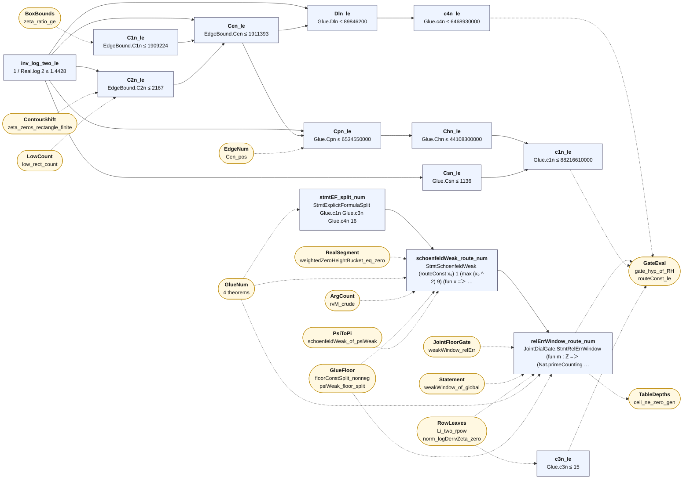

# `lean_stage3/Stage3/RouteNum.lean`

RouteNum — block E8c of `lean_stage3/design/joints.md`. 2026-11-22. The explicit-formula route at the gate with its three constants named, and a numeral above each constant in the chain.

14 theorems, 1 definition, 286 lines. Arrows are Lean's own record of what each proof uses.

**Imports:** [`GlueNum`](../lean_stage3/GlueNum.md), [`RouteGate`](../lean_stage3/RouteGate.md)  
**Imported by:** [`Stage3`](../lean_stage3/Stage3.md), [`GateEval`](../lean_stage3/GateEval.md)

## The picture



An arrow A → B reads "A is used in the proof of B". Blue: theorem. Green: a theorem nothing else uses (an end). Dashed: connects to nothing. Red: contains `sorry`. Yellow: theorems in another file, counted; a dotted arrow crosses files. Definitions are not drawn; they are listed below the diagram.

## Definitions

<a name="Stage3-routeConst"></a>
### `Stage3.routeConst`

def · line 201

The route's constant on the `π` side, at floor `x₀`.

- **Is:** `` routeConst (x₀ : ℝ) : ℝ := 3 * floorConstSplit Glue.c1n Glue.c3n Glue.c4n 112 0 698 0 x₀ + 13 ``
- **Built from:** [`Stage3.floorConstSplit`](../lean_stage3/GlueFloor.md#Stage3-floorConstSplit), [`Glue.c1n`](../lean_stage3/GlueNum.md#Glue-c1n), [`Glue.c3n`](../lean_stage3/GlueNum.md#Glue-c3n), [`Glue.c4n`](../lean_stage3/GlueNum.md#Glue-c4n)
- **Used by 5:** [`GateEval.gate_hyp_of_RH`](../lean_stage3/GateEval.md#GateEval-gate_hyp_of_RH), [`GateEval.routeConst_le`](../lean_stage3/GateEval.md#GateEval-routeConst_le), [`RouteNum.relErrWindow_route_num`](#RouteNum-relErrWindow_route_num), [`Stage3.schoenfeldWeak_route_num`](#Stage3-schoenfeldWeak_route_num), [`TableDepths.cell_ne_zero_gen`](../lean_stage3/TableDepths.md#TableDepths-cell_ne_zero_gen)

## Theorems

<a name="RouteNum-inv_log_two_le"></a>
### `RouteNum.inv_log_two_le`

line 33

**Proves**

```lean
1 / Real.log 2 ≤ 1.4428
```

**Fed by:** no theorem of this repo; it stands on Mathlib.

**Feeds** (5 that use it)

  - [`RouteNum.C2n_le`](#RouteNum-C2n_le) — `` EdgeBound.C2n ≤ 2167 ``
  - [`RouteNum.Cen_le`](#RouteNum-Cen_le) — `` EdgeBound.Cen ≤ 1911393 ``
  - [`RouteNum.Cpn_le`](#RouteNum-Cpn_le) — `` Glue.Cpn ≤ 6534550000 ``
  - [`RouteNum.Csn_le`](#RouteNum-Csn_le) — `` Glue.Csn ≤ 1136 ``
  - [`RouteNum.Dln_le`](#RouteNum-Dln_le) — `` Glue.Dln ≤ 89846200 ``

<a name="RouteNum-C1n_le"></a>
### `RouteNum.C1n_le`

line 38

**Proves**

```lean
EdgeBound.C1n ≤ 1909224
```

**Stated with:** [`EdgeBound.C1n`](../lean_stage3/EdgeNum.md#EdgeBound-C1n)

**Fed by** (1 theorem its proof uses)

  - [`BoxBounds.zeta_ratio_ge`](../lean_stage3/BoxBounds.md#BoxBounds-zeta_ratio_ge) (BoxBounds) — `` 2 / 7 ≤ ‖riemannZeta 3 / riemannZeta (3 / 2)‖ ``

**Feeds** (1 that use it)

  - [`RouteNum.Cen_le`](#RouteNum-Cen_le) — `` EdgeBound.Cen ≤ 1911393 ``

<a name="RouteNum-C2n_le"></a>
### `RouteNum.C2n_le`

line 95

**Proves**

```lean
EdgeBound.C2n ≤ 2167
```

**Stated with:** [`EdgeBound.C2n`](../lean_stage3/EdgeNum.md#EdgeBound-C2n)

**Fed by** (3 theorems its proof uses)

  - [`ContourShift.zeta_zeros_rectangle_finite`](../lean_stage3/ContourShift.md#ContourShift-zeta_zeros_rectangle_finite) (ContourShift) — `` {ρ : ℂ | riemannZeta ρ = 0 ∧ ρ ∈ Rectangle z w}.Finite ``
  - [`EdgeBound.low_rect_count`](../lean_stage3/LowCount.md#EdgeBound-low_rect_count) (LowCount) — `` (∑ ρ ∈ (ContourShift.zeta_zeros_rectangle_finite (0 : ℂ) ((1 : ℝ) + Complex.I * (6 : ℝ))).toFinset, (analyticOrderNatAt riemannZeta ρ : ℝ)) ≤ 714 ``
  - [`RouteNum.inv_log_two_le`](#RouteNum-inv_log_two_le) — `` 1 / Real.log 2 ≤ 1.4428 ``

**Feeds** (1 that use it)

  - [`RouteNum.Cen_le`](#RouteNum-Cen_le) — `` EdgeBound.Cen ≤ 1911393 ``

<a name="RouteNum-Cen_le"></a>
### `RouteNum.Cen_le`

line 115

**Proves**

```lean
EdgeBound.Cen ≤ 1911393
```

**Stated with:** [`EdgeBound.Cen`](../lean_stage3/EdgeNum.md#EdgeBound-Cen)

**Fed by** (3 theorems its proof uses)

  - [`RouteNum.C1n_le`](#RouteNum-C1n_le) — `` EdgeBound.C1n ≤ 1909224 ``
  - [`RouteNum.C2n_le`](#RouteNum-C2n_le) — `` EdgeBound.C2n ≤ 2167 ``
  - [`RouteNum.inv_log_two_le`](#RouteNum-inv_log_two_le) — `` 1 / Real.log 2 ≤ 1.4428 ``

**Definitions its proof touches:** [`EdgeBound.C1n`](../lean_stage3/EdgeNum.md#EdgeBound-C1n), [`EdgeBound.C2n`](../lean_stage3/EdgeNum.md#EdgeBound-C2n)

**Feeds** (2 that use it)

  - [`RouteNum.Cpn_le`](#RouteNum-Cpn_le) — `` Glue.Cpn ≤ 6534550000 ``
  - [`RouteNum.Dln_le`](#RouteNum-Dln_le) — `` Glue.Dln ≤ 89846200 ``

<a name="RouteNum-Cpn_le"></a>
### `RouteNum.Cpn_le`

line 123

**Proves**

```lean
Glue.Cpn ≤ 6534550000
```

**Stated with:** [`Glue.Cpn`](../lean_stage3/GlueNum.md#Glue-Cpn)

**Fed by** (3 theorems its proof uses)

  - [`EdgeBound.Cen_pos`](../lean_stage3/EdgeNum.md#EdgeBound-Cen_pos) (EdgeNum) — `` 0 < Cen ``
  - [`RouteNum.Cen_le`](#RouteNum-Cen_le) — `` EdgeBound.Cen ≤ 1911393 ``
  - [`RouteNum.inv_log_two_le`](#RouteNum-inv_log_two_le) — `` 1 / Real.log 2 ≤ 1.4428 ``

**Definitions its proof touches:** [`EdgeBound.Cen`](../lean_stage3/EdgeNum.md#EdgeBound-Cen)

**Feeds** (1 that use it)

  - [`RouteNum.Chn_le`](#RouteNum-Chn_le) — `` Glue.Chn ≤ 44108300000 ``

<a name="RouteNum-Chn_le"></a>
### `RouteNum.Chn_le`

line 139

**Proves**

```lean
Glue.Chn ≤ 44108300000
```

**Stated with:** [`Glue.Chn`](../lean_stage3/GlueNum.md#Glue-Chn)

**Fed by** (1 theorem its proof uses)

  - [`RouteNum.Cpn_le`](#RouteNum-Cpn_le) — `` Glue.Cpn ≤ 6534550000 ``

**Definitions its proof touches:** [`Glue.Cpn`](../lean_stage3/GlueNum.md#Glue-Cpn)

**Feeds** (1 that use it)

  - [`RouteNum.c1n_le`](#RouteNum-c1n_le) — `` Glue.c1n ≤ 88216610000 ``

<a name="RouteNum-Csn_le"></a>
### `RouteNum.Csn_le`

line 144

**Proves**

```lean
Glue.Csn ≤ 1136
```

**Stated with:** [`Glue.Csn`](../lean_stage3/GlueNum.md#Glue-Csn)

**Fed by** (1 theorem its proof uses)

  - [`RouteNum.inv_log_two_le`](#RouteNum-inv_log_two_le) — `` 1 / Real.log 2 ≤ 1.4428 ``

**Feeds** (1 that use it)

  - [`RouteNum.c1n_le`](#RouteNum-c1n_le) — `` Glue.c1n ≤ 88216610000 ``

<a name="RouteNum-Dln_le"></a>
### `RouteNum.Dln_le`

line 153

**Proves**

```lean
Glue.Dln ≤ 89846200
```

**Stated with:** [`Glue.Dln`](../lean_stage3/GlueNum.md#Glue-Dln)

**Fed by** (2 theorems its proof uses)

  - [`RouteNum.Cen_le`](#RouteNum-Cen_le) — `` EdgeBound.Cen ≤ 1911393 ``
  - [`RouteNum.inv_log_two_le`](#RouteNum-inv_log_two_le) — `` 1 / Real.log 2 ≤ 1.4428 ``

**Definitions its proof touches:** [`EdgeBound.Cen`](../lean_stage3/EdgeNum.md#EdgeBound-Cen)

**Feeds** (1 that use it)

  - [`RouteNum.c4n_le`](#RouteNum-c4n_le) — `` Glue.c4n ≤ 6468930000 ``

<a name="RouteNum-c1n_le"></a>
### `RouteNum.c1n_le`

line 163

**Proves**

```lean
Glue.c1n ≤ 88216610000
```

**Stated with:** [`Glue.c1n`](../lean_stage3/GlueNum.md#Glue-c1n)

**Fed by** (2 theorems its proof uses)

  - [`RouteNum.Chn_le`](#RouteNum-Chn_le) — `` Glue.Chn ≤ 44108300000 ``
  - [`RouteNum.Csn_le`](#RouteNum-Csn_le) — `` Glue.Csn ≤ 1136 ``

**Definitions its proof touches:** [`Glue.Chn`](../lean_stage3/GlueNum.md#Glue-Chn), [`Glue.Csn`](../lean_stage3/GlueNum.md#Glue-Csn)

**Feeds** (1 that use it)

  - [`GateEval.routeConst_le`](../lean_stage3/GateEval.md#GateEval-routeConst_le) (GateEval) — `` Stage3.routeConst ((2:ℝ) ^ (36:ℕ)) ≤ 414 ``

<a name="RouteNum-c3n_le"></a>
### `RouteNum.c3n_le`

line 169

**Proves**

```lean
Glue.c3n ≤ 15
```

**Stated with:** [`Glue.c3n`](../lean_stage3/GlueNum.md#Glue-c3n)

**Fed by** (1 theorem its proof uses)

  - [`Stage3.norm_logDerivZeta_zero`](../lean_stage3/RowLeaves.md#Stage3-norm_logDerivZeta_zero) (RowLeaves) — `` ‖deriv riemannZeta 0 / riemannZeta 0‖ = Real.log (2 * Real.pi) ``

**Feeds** (1 that use it)

  - [`GateEval.routeConst_le`](../lean_stage3/GateEval.md#GateEval-routeConst_le) (GateEval) — `` Stage3.routeConst ((2:ℝ) ^ (36:ℕ)) ≤ 414 ``

<a name="RouteNum-c4n_le"></a>
### `RouteNum.c4n_le`

line 180

**Proves**

```lean
Glue.c4n ≤ 6468930000
```

**Stated with:** [`Glue.c4n`](../lean_stage3/GlueNum.md#Glue-c4n)

**Fed by** (1 theorem its proof uses)

  - [`RouteNum.Dln_le`](#RouteNum-Dln_le) — `` Glue.Dln ≤ 89846200 ``

**Definitions its proof touches:** [`Glue.Dln`](../lean_stage3/GlueNum.md#Glue-Dln)

**Feeds** (1 that use it)

  - [`GateEval.routeConst_le`](../lean_stage3/GateEval.md#GateEval-routeConst_le) (GateEval) — `` Stage3.routeConst ((2:ℝ) ^ (36:ℕ)) ≤ 414 ``

<a name="Stage3-stmtEF_split_num"></a>
### `Stage3.stmtEF_split_num`

line 197

**Why.** The explicit formula with its constants named.

**Proves**

```lean
StmtExplicitFormulaSplit Glue.c1n Glue.c3n Glue.c4n 16
```

**Stated with:** [`Stage3.StmtExplicitFormulaSplit`](../lean_stage3/GlueFloor.md#Stage3-StmtExplicitFormulaSplit), [`Glue.c1n`](../lean_stage3/GlueNum.md#Glue-c1n), [`Glue.c3n`](../lean_stage3/GlueNum.md#Glue-c3n), [`Glue.c4n`](../lean_stage3/GlueNum.md#Glue-c4n)

**Fed by** (1 theorem its proof uses)

  - [`Glue.explicit_formula_split_num`](../lean_stage3/GlueNum.md#Glue-explicit_formula_split_num) (GlueNum) — `` ∀ x T : ℝ, 16 ≤ x → 2 ≤ T → T ≤ x^2 → ‖(Chebyshev.psi x : ℂ) - (x:ℂ) + Stage3.zeroPartialSum x T‖ ≤ c1n * x * Real.log (x*T)^2 / T + c3n * Real.log x … ``

**Feeds** (1 that use it)

  - [`Stage3.schoenfeldWeak_route_num`](#Stage3-schoenfeldWeak_route_num) — `` StmtSchoenfeldWeak (routeConst x₀) 1 (max (x₀ ^ 2) 9) (fun x => (Nat.primeCounting ⌊x⌋₊ : ℝ)) Li ``

<a name="Stage3-schoenfeldWeak_route_num"></a>
### `Stage3.schoenfeldWeak_route_num`

line 205

**Why.** From RH to the `π` side, every constant named.

**Proves**

```lean
StmtSchoenfeldWeak (routeConst x₀) 1 (max (x₀ ^ 2) 9) (fun x => (Nat.primeCounting ⌊x⌋₊ : ℝ)) Li
```

**Needs** (its hypotheses)

  - `` hRH : RiemannHypothesis ``
  - `` hx₀ : 16 ≤ x₀ ``

**Stated with:** [`Stage3.Li`](../lean_stage3/PsiToPi.md#Stage3-Li), [`Stage3.routeConst`](#Stage3-routeConst), [`Stage3.StmtSchoenfeldWeak`](../lean_stage3/Statement.md#Stage3-StmtSchoenfeldWeak)

**Fed by** (9 theorems its proof uses)

  - [`ArgCount.rvM_crude`](../lean_stage3/ArgCount.md#ArgCount-rvM_crude) (ArgCount) — `` riemannZeta.Riemann_vonMangoldt_bound 112 0 698 ``
  - [`Stage3.floorConstSplit_nonneg`](../lean_stage3/GlueFloor.md#Stage3-floorConstSplit_nonneg) (GlueFloor) — `` 0 ≤ floorConstSplit c₁ c₃ c₄ b₁ b₂ b₃ W x₀ ``
  - [`Stage3.psiWeak_floor_split`](../lean_stage3/GlueFloor.md#Stage3-psiWeak_floor_split) (GlueFloor) — `` StmtPsiWeak (floorConstSplit c₁ c₃ c₄ b₁ b₂ b₃ W x₀) 2 x₀ ``
  - [`Glue.c1n_nonneg`](../lean_stage3/GlueNum.md#Glue-c1n_nonneg) (GlueNum) — `` 0 ≤ c1n ``
  - [`Glue.c3n_nonneg`](../lean_stage3/GlueNum.md#Glue-c3n_nonneg) (GlueNum) — `` 0 ≤ c3n ``
  - [`Glue.c4n_nonneg`](../lean_stage3/GlueNum.md#Glue-c4n_nonneg) (GlueNum) — `` 0 ≤ c4n ``
  - [`Stage3.schoenfeldWeak_of_psiWeak`](../lean_stage3/PsiToPi.md#Stage3-schoenfeldWeak_of_psiWeak) (PsiToPi) — `` StmtSchoenfeldWeak (3 * C + 13) (k - 1) (max (x₀ ^ 2) 9) (fun x => (Nat.primeCounting ⌊x⌋₊ : ℝ)) Li ``
  - [`Stage3.weightedZeroHeightBucket_eq_zero`](../lean_stage3/RealSegment.md#Stage3-weightedZeroHeightBucket_eq_zero) (RealSegment) — `` Kadiri.weightedZeroHeightBucket = 0 ``
  - [`Stage3.stmtEF_split_num`](#Stage3-stmtEF_split_num) — `` StmtExplicitFormulaSplit Glue.c1n Glue.c3n Glue.c4n 16 ``

**Definitions its proof touches:** [`Stage3.floorConstSplit`](../lean_stage3/GlueFloor.md#Stage3-floorConstSplit), [`Glue.c1n`](../lean_stage3/GlueNum.md#Glue-c1n), [`Glue.c3n`](../lean_stage3/GlueNum.md#Glue-c3n), [`Glue.c4n`](../lean_stage3/GlueNum.md#Glue-c4n), [`Stage3.StmtPsiWeak`](../lean_stage3/PsiToPi.md#Stage3-StmtPsiWeak)

**Feeds** (1 that use it)

  - [`RouteNum.relErrWindow_route_num`](#RouteNum-relErrWindow_route_num) — `` JointDialGate.StmtRelErrWindow (fun m : ℤ => (Nat.primeCounting ⌊(2 : ℝ) ^ (m : ℝ)⌋₊ : ℝ)) (fun m : ℤ => 2 / Real.log 2 + ∫ t in (1 : ℝ)..(m : ℝ), Rea… ``

<a name="RouteNum-relErrWindow_route_num"></a>
### `RouteNum.relErrWindow_route_num`

line 230

**Why.** The route at the gate, every constant named.

**Proves**

```lean
JointDialGate.StmtRelErrWindow (fun m : ℤ => (Nat.primeCounting ⌊(2 : ℝ) ^ (m : ℝ)⌋₊ : ℝ)) (fun m : ℤ => 2 / Real.log 2 + ∫ t in (1 : ℝ)..(m : ℝ), Real.exp (Real.log 2 * t) / t) r n (Stage3.routeConst x₀ * (Real.log 2 * r) ^ 1 * (2 : ℝ) ^ (-(((r : ℝ) - n) / 2)))
```

**Needs** (its hypotheses)

  - `` hRH : RiemannHypothesis ``
  - `` hx₀ : 16 ≤ x₀ ``
  - `` r : ℤ ``
  - `` n : ℕ ``
  - `` hbot : x₀ ^ 2 ≤ (2 : ℝ) ^ ((r : ℝ) - n) ``

**Stated with:** [`JointDialGate.StmtRelErrWindow`](../lean_stage3/JointDialGate.md#JointDialGate-StmtRelErrWindow), [`Stage3.routeConst`](#Stage3-routeConst)

**Fed by** (8 theorems its proof uses)

  - [`Stage3.floorConstSplit_nonneg`](../lean_stage3/GlueFloor.md#Stage3-floorConstSplit_nonneg) (GlueFloor) — `` 0 ≤ floorConstSplit c₁ c₃ c₄ b₁ b₂ b₃ W x₀ ``
  - [`Glue.c1n_nonneg`](../lean_stage3/GlueNum.md#Glue-c1n_nonneg) (GlueNum) — `` 0 ≤ c1n ``
  - [`Glue.c3n_nonneg`](../lean_stage3/GlueNum.md#Glue-c3n_nonneg) (GlueNum) — `` 0 ≤ c3n ``
  - [`Glue.c4n_nonneg`](../lean_stage3/GlueNum.md#Glue-c4n_nonneg) (GlueNum) — `` 0 ≤ c4n ``
  - [`JointFloorGate.weakWindow_relErr`](../lean_stage3/JointFloorGate.md#JointFloorGate-weakWindow_relErr) (JointFloorGate) — `` JointDialGate.StmtRelErrWindow f L r n (C * (Real.log 2 * r) ^ k * (2 : ℝ) ^ (-(((r : ℝ) - n) / 2))) ``
  - [`Stage3.schoenfeldWeak_route_num`](#Stage3-schoenfeldWeak_route_num) — `` StmtSchoenfeldWeak (routeConst x₀) 1 (max (x₀ ^ 2) 9) (fun x => (Nat.primeCounting ⌊x⌋₊ : ℝ)) Li ``
  - [`Stage3.Li_two_rpow`](../lean_stage3/RowLeaves.md#Stage3-Li_two_rpow) (RowLeaves) — `` Li ((2 : ℝ) ^ x) = 2 / Real.log 2 + ∫ t in (1 : ℝ)..x, Real.exp (Real.log 2 * t) / t ``
  - [`Stage3.weakWindow_of_global`](../lean_stage3/Statement.md#Stage3-weakWindow_of_global) (Statement) — `` StmtWeakWindow C k f L r n ``

**Definitions its proof touches:** [`Stage3.floorConstSplit`](../lean_stage3/GlueFloor.md#Stage3-floorConstSplit), [`Glue.c1n`](../lean_stage3/GlueNum.md#Glue-c1n), [`Glue.c3n`](../lean_stage3/GlueNum.md#Glue-c3n), [`Glue.c4n`](../lean_stage3/GlueNum.md#Glue-c4n), [`Stage3.Li`](../lean_stage3/PsiToPi.md#Stage3-Li), [`Stage3.StmtSchoenfeldWeak`](../lean_stage3/Statement.md#Stage3-StmtSchoenfeldWeak)

**Feeds** (2 that use it)

  - [`GateEval.gate_hyp_of_RH`](../lean_stage3/GateEval.md#GateEval-gate_hyp_of_RH) (GateEval) — `` ∃ ρ : ℝ, JointDialGate.StmtRelErrWindow (fun m : ℤ => (Nat.primeCounting ⌊(2 : ℝ) ^ (m : ℝ)⌋₊ : ℝ)) (fun m : ℤ => 2 / Real.log 2 + ∫ t in (1 : ℝ)..(m … ``
  - [`TableDepths.cell_ne_zero_gen`](../lean_stage3/TableDepths.md#TableDepths-cell_ne_zero_gen) (TableDepths) — `` Construction.tableFrom TableRoute.rowN r d ≠ 0 ``

