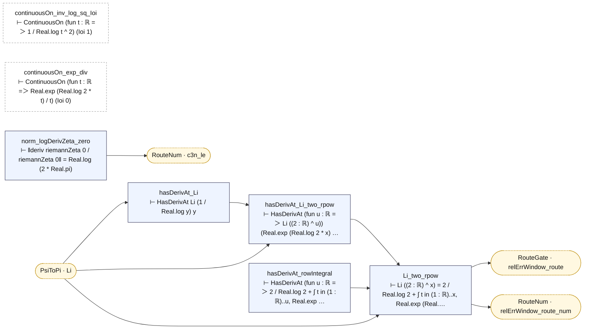

# `lean_stage3/Stage3/RowLeaves.lean`

**What it does** (its own header): RowLeaves — block E4 of `lean_stage3/design/joints.md`. 2026-11-22. Two leaves the route to the gate left open (unit 0412).

**Imports:** [`PsiToPi`](../lean_stage3/PsiToPi.md).
**Imported by:** [`Stage3`](../lean_stage3/Stage3.md), [`RouteGate`](../lean_stage3/RouteGate.md).

Blue: theorem. Green: a theorem nothing else uses (an end). Dashed white: connects to nothing. Grey: definition. Red: contains `sorry`. Yellow: in another file. An arrow A → B reads "A is used by B".

## Every declaration

| declaration | proves (output) | needs (input) | why (its own docstring) | uses | used by |
|---|---|---|---|---|---|
| `Stage3.continuousOn_inv_log_sq_Ioi` theorem, line 31 | ContinuousOn (fun t : ℝ =&gt; 1 / Real.log t ^ 2) (Ioi 1) | — | — | — | — |
| `Stage3.hasDerivAt_Li` theorem, line 41 | HasDerivAt Li (1 / Real.log y) y | hy : 1 &lt; y | `Li′ = 1/log` beyond one. | `Stage3.Li` | `Stage3.hasDerivAt_Li_two_rpow` |
| `Stage3.hasDerivAt_Li_two_rpow` theorem, line 70 | HasDerivAt (fun u : ℝ =&gt; Li ((2 : ℝ) ^ u)) (Real.exp (Real.log 2 * x) / x) x | hx : 0 &lt; x | The derivative of `x ↦ Li (2^x)` is `e^(log 2·x)/x`. | `Stage3.Li`, `Stage3.hasDerivAt_Li` | `Stage3.Li_two_rpow` |
| `Stage3.continuousOn_exp_div` theorem, line 87 | ContinuousOn (fun t : ℝ =&gt; Real.exp (Real.log 2 * t) / t) (Ioi 0) | — | — | — | — |
| `Stage3.hasDerivAt_rowIntegral` theorem, line 95 | HasDerivAt (fun u : ℝ =&gt; 2 / Real.log 2 + ∫ t in (1 : ℝ)..u, Real.exp (Real.log 2 * t) / t) (Real.exp (Real.log 2 * x) / x) x | hx : 0 &lt; x | — | — | `Stage3.Li_two_rpow` |
| `Stage3.Li_two_rpow` theorem, line 114 | Li ((2 : ℝ) ^ x) = 2 / Real.log 2 + ∫ t in (1 : ℝ)..x, Real.exp (Real.log 2 * t) / t | hx : 0 &lt; x | The main term at the doublings. Stage 3's `Li` at `2^x` is the antiderivative of `2^t/t` through `2/log 2` at `x = 1`. | `Stage3.Li`, `Stage3.hasDerivAt_Li_two_rpow`, `Stage3.hasDerivAt_rowIntegral` | `RouteGate.relErrWindow_route`, `RouteNum.relErrWindow_route_num` |
| `Stage3.norm_logDerivZeta_zero` theorem, line 135 | ‖deriv riemannZeta 0 / riemannZeta 0‖ = Real.log (2 * Real.pi) | — | `K0`, as a number. | — | `RouteNum.c3n_le` |
