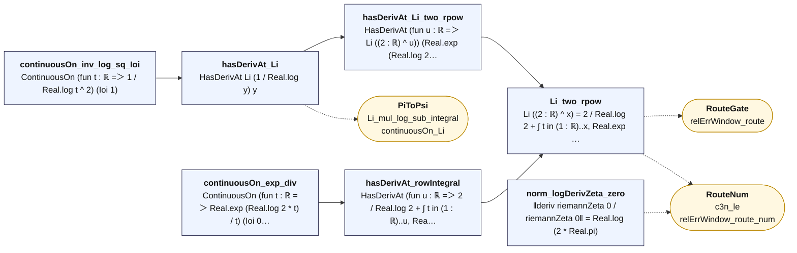

# `lean_stage3/Stage3/RowLeaves.lean`

RowLeaves — block E4 of `lean_stage3/design/joints.md`. 2026-11-22. Two leaves the route to the gate left open (unit 0412).

7 theorems, 0 definitions, 161 lines. Arrows are Lean's own record of what each proof uses.

**Imports:** [`PsiToPi`](../lean_stage3/PsiToPi.md)  
**Imported by:** [`Stage3`](../lean_stage3/Stage3.md), [`PiToPsi`](../lean_stage3/PiToPsi.md), [`RouteGate`](../lean_stage3/RouteGate.md)

## The picture



An arrow A → B reads "A is used in the proof of B". Blue: theorem. Green: a theorem nothing else uses (an end). Dashed: connects to nothing. Red: contains `sorry`. Yellow: theorems in another file, counted; a dotted arrow crosses files. Definitions are not drawn; they are listed below the diagram.

## Theorems

<a name="Stage3-continuousOn_inv_log_sq_Ioi"></a>
### `Stage3.continuousOn_inv_log_sq_Ioi`

line 31

**Proves**

```lean
ContinuousOn (fun t : ℝ => 1 / Real.log t ^ 2) (Ioi 1)
```

**Fed by:** no theorem of this repo; it stands on Mathlib.

**Feeds** (1 that use it)

  - [`Stage3.hasDerivAt_Li`](#Stage3-hasDerivAt_Li) — `` HasDerivAt Li (1 / Real.log y) y ``

<a name="Stage3-hasDerivAt_Li"></a>
### `Stage3.hasDerivAt_Li`

line 41

**Why.** `Li′ = 1/log` beyond one.

**Proves**

```lean
HasDerivAt Li (1 / Real.log y) y
```

**Needs** (its hypotheses)

  - `` hy : 1 < y ``

**Stated with:** [`Stage3.Li`](../lean_stage3/PsiToPi.md#Stage3-Li)

**Fed by** (1 theorem its proof uses)

  - [`Stage3.continuousOn_inv_log_sq_Ioi`](#Stage3-continuousOn_inv_log_sq_Ioi) — `` ContinuousOn (fun t : ℝ => 1 / Real.log t ^ 2) (Ioi 1) ``

**Feeds** (3 that use it)

  - [`PiToPsi.Li_mul_log_sub_integral`](../lean_stage3/PiToPsi.md#PiToPsi-Li_mul_log_sub_integral) (PiToPsi) — `` Stage3.Li x * Real.log x - ∫ t in (2 : ℝ)..x, Stage3.Li t / t = x ``
  - [`PiToPsi.continuousOn_Li`](../lean_stage3/PiToPsi.md#PiToPsi-continuousOn_Li) (PiToPsi) — `` ContinuousOn Stage3.Li (Ioi 1) ``
  - [`Stage3.hasDerivAt_Li_two_rpow`](#Stage3-hasDerivAt_Li_two_rpow) — `` HasDerivAt (fun u : ℝ => Li ((2 : ℝ) ^ u)) (Real.exp (Real.log 2 * x) / x) x ``

<a name="Stage3-hasDerivAt_Li_two_rpow"></a>
### `Stage3.hasDerivAt_Li_two_rpow`

line 70

**Why.** The derivative of `x ↦ Li (2^x)` is `e^(log 2·x)/x`.

**Proves**

```lean
HasDerivAt (fun u : ℝ => Li ((2 : ℝ) ^ u)) (Real.exp (Real.log 2 * x) / x) x
```

**Needs** (its hypotheses)

  - `` hx : 0 < x ``

**Stated with:** [`Stage3.Li`](../lean_stage3/PsiToPi.md#Stage3-Li)

**Fed by** (1 theorem its proof uses)

  - [`Stage3.hasDerivAt_Li`](#Stage3-hasDerivAt_Li) — `` HasDerivAt Li (1 / Real.log y) y ``

**Feeds** (1 that use it)

  - [`Stage3.Li_two_rpow`](#Stage3-Li_two_rpow) — `` Li ((2 : ℝ) ^ x) = 2 / Real.log 2 + ∫ t in (1 : ℝ)..x, Real.exp (Real.log 2 * t) / t ``

<a name="Stage3-continuousOn_exp_div"></a>
### `Stage3.continuousOn_exp_div`

line 87

**Proves**

```lean
ContinuousOn (fun t : ℝ => Real.exp (Real.log 2 * t) / t) (Ioi 0)
```

**Fed by:** no theorem of this repo; it stands on Mathlib.

**Feeds** (1 that use it)

  - [`Stage3.hasDerivAt_rowIntegral`](#Stage3-hasDerivAt_rowIntegral) — `` HasDerivAt (fun u : ℝ => 2 / Real.log 2 + ∫ t in (1 : ℝ)..u, Real.exp (Real.log 2 * t) / t) (Real.exp (Real.log 2 * x) / x) x ``

<a name="Stage3-hasDerivAt_rowIntegral"></a>
### `Stage3.hasDerivAt_rowIntegral`

line 95

**Proves**

```lean
HasDerivAt (fun u : ℝ => 2 / Real.log 2 + ∫ t in (1 : ℝ)..u, Real.exp (Real.log 2 * t) / t) (Real.exp (Real.log 2 * x) / x) x
```

**Needs** (its hypotheses)

  - `` hx : 0 < x ``

**Fed by** (1 theorem its proof uses)

  - [`Stage3.continuousOn_exp_div`](#Stage3-continuousOn_exp_div) — `` ContinuousOn (fun t : ℝ => Real.exp (Real.log 2 * t) / t) (Ioi 0) ``

**Feeds** (1 that use it)

  - [`Stage3.Li_two_rpow`](#Stage3-Li_two_rpow) — `` Li ((2 : ℝ) ^ x) = 2 / Real.log 2 + ∫ t in (1 : ℝ)..x, Real.exp (Real.log 2 * t) / t ``

<a name="Stage3-Li_two_rpow"></a>
### `Stage3.Li_two_rpow`

line 114

**Why.** The main term at the doublings. Stage 3's `Li` at `2^x` is the antiderivative of `2^t/t` through `2/log 2` at `x = 1`.

**Proves**

```lean
Li ((2 : ℝ) ^ x) = 2 / Real.log 2 + ∫ t in (1 : ℝ)..x, Real.exp (Real.log 2 * t) / t
```

**Needs** (its hypotheses)

  - `` hx : 0 < x ``

**Stated with:** [`Stage3.Li`](../lean_stage3/PsiToPi.md#Stage3-Li)

**Fed by** (2 theorems its proof uses)

  - [`Stage3.hasDerivAt_Li_two_rpow`](#Stage3-hasDerivAt_Li_two_rpow) — `` HasDerivAt (fun u : ℝ => Li ((2 : ℝ) ^ u)) (Real.exp (Real.log 2 * x) / x) x ``
  - [`Stage3.hasDerivAt_rowIntegral`](#Stage3-hasDerivAt_rowIntegral) — `` HasDerivAt (fun u : ℝ => 2 / Real.log 2 + ∫ t in (1 : ℝ)..u, Real.exp (Real.log 2 * t) / t) (Real.exp (Real.log 2 * x) / x) x ``

**Feeds** (2 that use it)

  - [`RouteGate.relErrWindow_route`](../lean_stage3/RouteGate.md#RouteGate-relErrWindow_route) (RouteGate) — `` ∃ c₁ c₃ c₄ : ℝ, 0 ≤ c₁ ∧ 0 ≤ c₃ ∧ 0 ≤ c₄ ∧ ∀ x₀ : ℝ, 16 ≤ x₀ → ∀ (r : ℤ) (n : ℕ), x₀ ^ 2 ≤ (2 : ℝ) ^ ((r : ℝ) - n) → JointDialGate.StmtRelErrWindow (f… ``
  - [`RouteNum.relErrWindow_route_num`](../lean_stage3/RouteNum.md#RouteNum-relErrWindow_route_num) (RouteNum) — `` JointDialGate.StmtRelErrWindow (fun m : ℤ => (Nat.primeCounting ⌊(2 : ℝ) ^ (m : ℝ)⌋₊ : ℝ)) (fun m : ℤ => 2 / Real.log 2 + ∫ t in (1 : ℝ)..(m : ℝ), Rea… ``

<a name="Stage3-norm_logDerivZeta_zero"></a>
### `Stage3.norm_logDerivZeta_zero`

line 135

**Why.** `K0`, as a number.

**Proves**

```lean
‖deriv riemannZeta 0 / riemannZeta 0‖ = Real.log (2 * Real.pi)
```

**Fed by:** no theorem of this repo; it stands on Mathlib.

**Feeds** (1 that use it)

  - [`RouteNum.c3n_le`](../lean_stage3/RouteNum.md#RouteNum-c3n_le) (RouteNum) — `` Glue.c3n ≤ 15 ``

