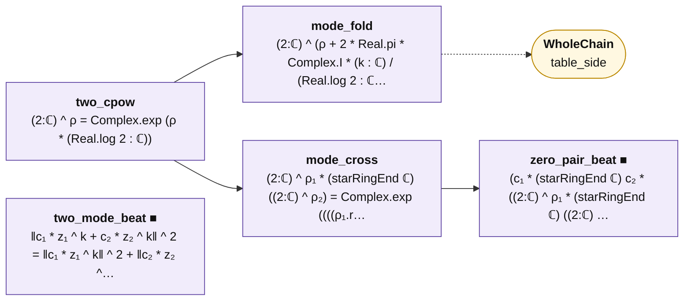

# `lean_stage3/Stage3/RunTheorems.lean`

> **Read from the source text.** This file changed after the last `python3 utilities/lean_map.py --dump`, so the arrows on this page are names occurring in each proof and have not been confirmed by Lean.

RunTheorems — block R1 of `lean_stage3/design/runs.md`. 2026-11-23. The exploratory runs of units 0473 and 0474 measured two patterns on a stretch of rows. Each has an exact core that holds at every row, with nothing computed.

5 theorems, 0 definitions, 108 lines. 

**Imports:** [`OneChain`](../lean_stage3/OneChain.md)  
**Imported by:** [`Stage3`](../lean_stage3/Stage3.md), [`WholeChain`](../lean_stage3/WholeChain.md)

## The picture



An arrow A → B reads "A is used in the proof of B". Green: counting, integers only. Violet: shape, analysis with no ζ. Blue: reads ζ. A name ending in ■ is an end: nothing else uses it. Red: contains `sorry`. Yellow: theorems in another file, counted; a dotted arrow crosses files. Definitions are not drawn; they are listed below the diagram.

## Theorems

<a name="RunTheorems-two_cpow"></a>
### `RunTheorems.two_cpow`

line 30 · arrows read from text

**Shape.** Uses real or complex analysis; nothing in it or beneath it reads ζ.

**Why.** A mode of the base two, written with the exponential.

**Proves**

```lean
(2:ℂ) ^ ρ = Complex.exp (ρ * (Real.log 2 : ℂ))
```

**Needs** (its hypotheses)

  - `` ρ : ℂ ``

**Fed by:** no theorem of this repo; it stands on Mathlib.

**Feeds** (2 that use it)

  - [`RunTheorems.mode_cross`](#RunTheorems-mode_cross) — `` (2:ℂ) ^ ρ₁ * (starRingEnd ℂ) ((2:ℂ) ^ ρ₂) = Complex.exp ((((ρ₁.re + ρ₂.re) * Real.log 2 : ℝ) : ℂ) + (((ρ₁.im - ρ₂.im) * Real.log 2 : ℝ) : ℂ) * Complex… ``
  - [`RunTheorems.mode_fold`](#RunTheorems-mode_fold) — `` (2:ℂ) ^ (ρ + 2 * Real.pi * Complex.I * (k : ℂ) / (Real.log 2 : ℂ)) = (2:ℂ) ^ ρ ``

<a name="RunTheorems-mode_fold"></a>
### `RunTheorems.mode_fold`

line 37 · arrows read from text

**Shape.** Uses real or complex analysis; nothing in it or beneath it reads ζ.

**Why.** The fold. On the ladder of base two, raising the height of a point by a whole number of periods `2π/log 2` leaves its mode unchanged.

**Proves**

```lean
(2:ℂ) ^ (ρ + 2 * Real.pi * Complex.I * (k : ℂ) / (Real.log 2 : ℂ)) = (2:ℂ) ^ ρ
```

**Needs** (its hypotheses)

  - `` ρ : ℂ ``
  - `` k : ℤ ``

**Fed by** (1 theorem its proof uses)

  - [`RunTheorems.two_cpow`](#RunTheorems-two_cpow) — `` (2:ℂ) ^ ρ = Complex.exp (ρ * (Real.log 2 : ℂ)) ``

**Feeds** (1 that use it)

  - [`WholeChain.table_side`](../lean_stage3/WholeChain.md#WholeChain-table_side) (WholeChain) — `` (∀ N : ℕ, 2 ≤ N → (Nat.primeCounting N : ℤ) = (Nat.primeCounting (Nat.sqrt N) : ℤ) - 1 + ∑ T ∈ (SieveExact.smallPrimes N).powerset, (-1 : ℤ) ^ T.card … ``

<a name="RunTheorems-mode_cross"></a>
### `RunTheorems.mode_cross`

line 51 · arrows read from text

**Shape.** Uses real or complex analysis; nothing in it or beneath it reads ζ.

**Why.** The cross term of two modes. A mode times the conjugate of another is the exponential of the sum of the real parts and the difference of the heights, each times `log 2`.

**Proves**

```lean
(2:ℂ) ^ ρ₁ * (starRingEnd ℂ) ((2:ℂ) ^ ρ₂) = Complex.exp ((((ρ₁.re + ρ₂.re) * Real.log 2 : ℝ) : ℂ) + (((ρ₁.im - ρ₂.im) * Real.log 2 : ℝ) : ℂ) * Complex.I)
```

**Needs** (its hypotheses)

  - `` ρ₁ ρ₂ : ℂ ``

**Fed by** (1 theorem its proof uses)

  - [`RunTheorems.two_cpow`](#RunTheorems-two_cpow) — `` (2:ℂ) ^ ρ = Complex.exp (ρ * (Real.log 2 : ℂ)) ``

**Feeds** (1 that use it)

  - [`RunTheorems.zero_pair_beat`](#RunTheorems-zero_pair_beat) — `` (c₁ * (starRingEnd ℂ) c₂ * ((2:ℂ) ^ ρ₁ * (starRingEnd ℂ) ((2:ℂ) ^ ρ₂)) ^ k) = c₁ * (starRingEnd ℂ) c₂ * ((((2:ℝ) ^ ((ρ₁.re + ρ₂.re) * (k:ℝ)) : ℝ) : ℂ)… ``

<a name="RunTheorems-two_mode_beat"></a>
### `RunTheorems.two_mode_beat`

line 67 · arrows read from text

**Shape.** Uses real or complex analysis; nothing in it or beneath it reads ζ.

**Why.** Two modes together, at every row. The squared size of the sum of two modes is the sum of their squared sizes plus twice the real part of a term that turns with the row.

**Proves**

```lean
‖c₁ * z₁ ^ k + c₂ * z₂ ^ k‖ ^ 2 = ‖c₁ * z₁ ^ k‖ ^ 2 + ‖c₂ * z₂ ^ k‖ ^ 2 + 2 * (c₁ * (starRingEnd ℂ) c₂ * (z₁ * (starRingEnd ℂ) z₂) ^ k).re
```

**Needs** (its hypotheses)

  - `` c₁ c₂ z₁ z₂ : ℂ ``
  - `` k : ℕ ``

**Fed by:** no theorem of this repo; it stands on Mathlib.

**Feeds:** nothing. It connects to nothing.

<a name="RunTheorems-zero_pair_beat"></a>
### `RunTheorems.zero_pair_beat`

line 79 · arrows read from text

**Shape.** Uses real or complex analysis; nothing in it or beneath it reads ζ.

**Why.** The beat between two zeros. For two points, the term that turns in `two_mode_beat` is the row's power of `2^(β₁+β₂)` times a rotation by the row times the difference of the two heights times `log 2`.

**Proves**

```lean
(c₁ * (starRingEnd ℂ) c₂ * ((2:ℂ) ^ ρ₁ * (starRingEnd ℂ) ((2:ℂ) ^ ρ₂)) ^ k) = c₁ * (starRingEnd ℂ) c₂ * ((((2:ℝ) ^ ((ρ₁.re + ρ₂.re) * (k:ℝ)) : ℝ) : ℂ) * Complex.exp ((((k:ℝ) * ((ρ₁.im - ρ₂.im) * Real.log 2) : ℝ) : ℂ) * Complex.I))
```

**Needs** (its hypotheses)

  - `` c₁ c₂ ρ₁ ρ₂ : ℂ ``
  - `` k : ℕ ``

**Fed by** (1 theorem its proof uses)

  - [`RunTheorems.mode_cross`](#RunTheorems-mode_cross) — `` (2:ℂ) ^ ρ₁ * (starRingEnd ℂ) ((2:ℂ) ^ ρ₂) = Complex.exp ((((ρ₁.re + ρ₂.re) * Real.log 2 : ℝ) : ℂ) + (((ρ₁.im - ρ₂.im) * Real.log 2 : ℝ) : ℂ) * Complex… ``

**Feeds:** nothing. It is an end.

