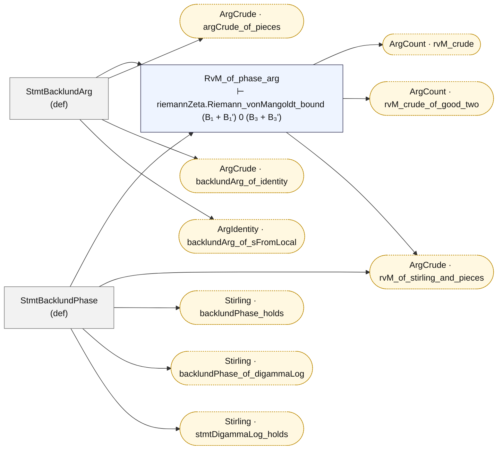

# `lean_stage3/Stage3/RvMCrude.lean`

**What it does** (its own header): RvMCrude — hNT slice 1, corrected: Backlund's decomposition, assembled over an abstract continuous phase.

**Imports:** [`ZeroSum`](../lean_stage3/ZeroSum.md).
**Imported by:** [`Stage3`](../lean_stage3/Stage3.md), [`ArgCrude`](../lean_stage3/ArgCrude.md), [`Stirling`](../lean_stage3/Stirling.md).

Blue: theorem. Green: a theorem nothing else uses (an end). Dashed white: connects to nothing. Grey: definition. Red: contains `sorry`. Yellow: in another file. An arrow A → B reads "A is used by B".

## Every declaration

| declaration | proves (output) | needs (input) | why (its own docstring) | uses | used by |
|---|---|---|---|---|---|
| `Stage3.StmtBacklundPhase` def, line 61 | Prop | θ : ℝ → ℝ; B₁ B₃ : ℝ | The Stirling half of Backlund, against an abstract phase: the phase tracks the RvM main term. Pure Γ-asymptotics — no zeros involved; the discharge supplies a continuous phase and a generous explicit Stirling error. | — | `Stage3.rvM_of_stirling_and_pieces`, `Stage3.RvM_of_phase_arg`, `Stage3.backlundPhase_holds`, `Stage3.backlundPhase_of_digammaLog`, `Stage3.stmtDigammaLog_holds` |
| `Stage3.StmtBacklundArg` def, line 70 | Prop | θ : ℝ → ℝ; B₁ B₃ : ℝ | The argument-principle half of Backlund, against the same phase: the count tracks `θ(T)/π + 1` — this distance is `S(T)`, measured by O69 at under 2 windings in 10⁵. Any explicit constant works; Borel–Carathéodory plus the ZetaBounds growth estimates are the classical route. | — | `Stage3.argCrude_of_pieces`, `Stage3.backlundArg_of_identity`, `Stage3.backlundArg_of_sFromLocal`, `Stage3.RvM_of_phase_arg` |
| `Stage3.RvM_of_phase_arg` theorem, line 78 | riemannZeta.Riemann_vonMangoldt_bound (B₁ + B₁') 0 (B₃ + B₃') | hPhase : StmtBacklundPhase θ B₁ B₃; hArg : StmtBacklundArg θ B₁' B₃' | The assembly: Backlund's two halves give the RvM band, for any phase satisfying both. With `b₂ = 0` — a legitimate instance of `Riemann_vonMangoldt_bound`; entry 130's budget accepts any `B₁ + B₁′ ≤ 100`, `B₃ + B₃′ ≤ 1000`. | `Stage3.StmtBacklundArg`, `Stage3.StmtBacklundPhase` | `ArgCount.rvM_crude`, `ArgCount.rvM_crude_of_good_two`, `Stage3.rvM_of_stirling_and_pieces` |
