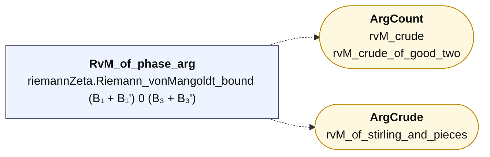

# `lean_stage3/Stage3/RvMCrude.lean`

RvMCrude — hNT slice 1, corrected: Backlund's decomposition, assembled over an abstract continuous phase.

1 theorem, 2 definitions, 117 lines. Arrows are Lean's own record of what each proof uses.

**Imports:** [`ZeroSum`](../lean_stage3/ZeroSum.md)  
**Imported by:** [`Stage3`](../lean_stage3/Stage3.md), [`ArgCrude`](../lean_stage3/ArgCrude.md), [`Stirling`](../lean_stage3/Stirling.md)

## The picture



An arrow A → B reads "A is used in the proof of B". Blue: theorem. Green: a theorem nothing else uses (an end). Dashed: connects to nothing. Red: contains `sorry`. Yellow: theorems in another file, counted; a dotted arrow crosses files. Definitions are not drawn; they are listed below the diagram.

## Definitions

<a name="Stage3-StmtBacklundPhase"></a>
### `Stage3.StmtBacklundPhase`

def · line 61

The Stirling half of Backlund, against an abstract phase: the phase tracks the RvM main term. Pure Γ-asymptotics — no zeros involved; the discharge supplies a continuous phase and a generous explicit Stirling error.

- **Is:** `` StmtBacklundPhase (θ : ℝ → ℝ) (B₁ B₃ : ℝ) : Prop := ∀ T : ℝ, 2 ≤ T → |θ T / Real.pi + 1 - zetaCountingMainTerm T| ≤ B₁ * Real.log T + B₃ ``
- **Used by 4:** [`Stage3.rvM_of_stirling_and_pieces`](../lean_stage3/ArgCrude.md#Stage3-rvM_of_stirling_and_pieces), [`Stage3.RvM_of_phase_arg`](#Stage3-RvM_of_phase_arg), [`Stage3.backlundPhase_holds`](../lean_stage3/Stirling.md#Stage3-backlundPhase_holds), [`Stage3.backlundPhase_of_digammaLog`](../lean_stage3/Stirling.md#Stage3-backlundPhase_of_digammaLog)

<a name="Stage3-StmtBacklundArg"></a>
### `Stage3.StmtBacklundArg`

def · line 70

The argument-principle half of Backlund, against the same phase: the count tracks `θ(T)/π + 1` — this distance is `S(T)`, measured by O69 at under 2 windings in 10⁵. Any explicit constant works; Borel–Carathéodory plus the ZetaBounds growth estimates are the classical route.

- **Is:** `` StmtBacklundArg (θ : ℝ → ℝ) (B₁ B₃ : ℝ) : Prop := ∀ T : ℝ, 2 ≤ T → |riemannZeta.N T - (θ T / Real.pi + 1)| ≤ B₁ * Real.log T + B₃ ``
- **Used by 4:** [`Stage3.argCrude_of_pieces`](../lean_stage3/ArgCrude.md#Stage3-argCrude_of_pieces), [`Stage3.backlundArg_of_identity`](../lean_stage3/ArgCrude.md#Stage3-backlundArg_of_identity), [`Stage3.backlundArg_of_sFromLocal`](../lean_stage3/ArgIdentity.md#Stage3-backlundArg_of_sFromLocal), [`Stage3.RvM_of_phase_arg`](#Stage3-RvM_of_phase_arg)

## Theorems

<a name="Stage3-RvM_of_phase_arg"></a>
### `Stage3.RvM_of_phase_arg`

line 78

**Why.** The assembly: Backlund's two halves give the RvM band, for any phase satisfying both. With `b₂ = 0` — a legitimate instance of `Riemann_vonMangoldt_bound`; entry 130's budget accepts any `B₁ + B₁′ ≤ 100`, `B₃ + B₃′ ≤ 1000`.

**Proves**

```lean
riemannZeta.Riemann_vonMangoldt_bound (B₁ + B₁') 0 (B₃ + B₃')
```

**Needs** (its hypotheses)

  - `` hPhase : StmtBacklundPhase θ B₁ B₃ ``
  - `` hArg : StmtBacklundArg θ B₁' B₃' ``

**Stated with:** [`Stage3.StmtBacklundArg`](#Stage3-StmtBacklundArg), [`Stage3.StmtBacklundPhase`](#Stage3-StmtBacklundPhase)

**Fed by:** no theorem of this repo; it stands on Mathlib and the definitions below.

**Feeds** (3 that use it)

  - [`ArgCount.rvM_crude`](../lean_stage3/ArgCount.md#ArgCount-rvM_crude) (ArgCount) — `` riemannZeta.Riemann_vonMangoldt_bound 112 0 698 ``
  - [`ArgCount.rvM_crude_of_good_two`](../lean_stage3/ArgCount.md#ArgCount-rvM_crude_of_good_two) (ArgCount) — `` riemannZeta.Riemann_vonMangoldt_bound 112 0 173 ``
  - [`Stage3.rvM_of_stirling_and_pieces`](../lean_stage3/ArgCrude.md#Stage3-rvM_of_stirling_and_pieces) (ArgCrude) — `` riemannZeta.Riemann_vonMangoldt_bound (B₁ + a * A₁) 0 (B₃ + (a * A₃ + b)) ``

