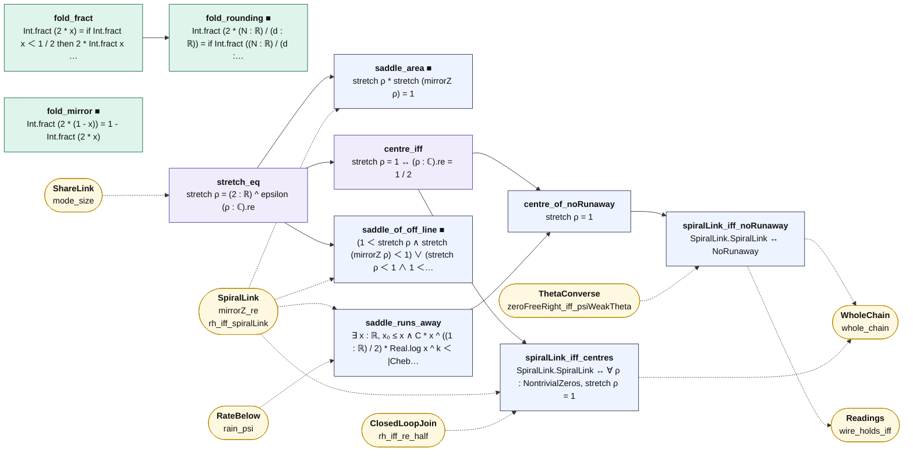

# `lean_stage3/Stage3/Saddle.lean`

> **Read from the source text.** This file changed after the last `python3 utilities/lean_map.py --dump`, so the arrows on this page are names occurring in each proof and have not been confirmed by Lean.

Saddle — block J7 of `lean_stage3/design/closedloop.md`. 2026-11-23. The table as stretch-and-fold, and a zero off the line as a saddle.

11 theorems, 2 definitions, 199 lines. 

**Imports:** [`RateBelow`](../lean_stage3/RateBelow.md), [`ShareLink`](../lean_stage3/ShareLink.md)  
**Imported by:** [`Stage3`](../lean_stage3/Stage3.md), [`Readings`](../lean_stage3/Readings.md), [`WholeChain`](../lean_stage3/WholeChain.md), [`WindowsOfRH`](../lean_stage3/WindowsOfRH.md)

## The picture



An arrow A → B reads "A is used in the proof of B". Green: counting, integers only. Violet: shape, analysis with no ζ. Blue: reads ζ. A name ending in ■ is an end: nothing else uses it. Red: contains `sorry`. Yellow: theorems in another file, counted; a dotted arrow crosses files. Definitions are not drawn; they are listed below the diagram.

## Definitions

<a name="Saddle-stretch"></a>
### `Saddle.stretch`

def · line 78

The factor one doubling puts on a zero's mode, against the square root of the total.

- **Is:** `` stretch (ρ : NontrivialZeros) : ℝ := ‖((2 : ℝ) : ℂ) ^ (ρ : ℂ)‖ / Real.sqrt 2 ``
- **Used by 7:** [`Saddle.centre_iff`](#Saddle-centre_iff), [`Saddle.centre_of_noRunaway`](#Saddle-centre_of_noRunaway), [`Saddle.saddle_area`](#Saddle-saddle_area), [`Saddle.saddle_of_off_line`](#Saddle-saddle_of_off_line), [`Saddle.spiralLink_iff_centres`](#Saddle-spiralLink_iff_centres), [`Saddle.stretch_eq`](#Saddle-stretch_eq), [`WholeChain.whole_chain`](../lean_stage3/WholeChain.md#WholeChain-whole_chain)

<a name="Saddle-NoRunaway"></a>
### `Saddle.NoRunaway`

def · line 136

The staircase does not run away in the square-root frame: from some point on it stays within a constant times the square root times a power of the logarithm.

- **Is:** `` NoRunaway : Prop := ∃ (C : ℝ) (k : ℕ) (x₀ : ℝ), Stage3.StmtPsiWeakTheta (1 / 2) C k x₀ ``
- **Built from:** [`Stage3.StmtPsiWeakTheta`](../lean_stage3/ThetaPi.md#Stage3-StmtPsiWeakTheta)
- **Used by 11:** [`Readings.iv_exact`](../lean_stage3/Readings.md#Readings-iv_exact), [`Readings.wire_holds_iff`](../lean_stage3/Readings.md#Readings-wire_holds_iff), [`Saddle.centre_of_noRunaway`](#Saddle-centre_of_noRunaway), [`Saddle.spiralLink_iff_noRunaway`](#Saddle-spiralLink_iff_noRunaway), [`WholeChain.readings_side`](../lean_stage3/WholeChain.md#WholeChain-readings_side), [`WholeChain.whole_chain`](../lean_stage3/WholeChain.md#WholeChain-whole_chain), [`WindowsOfRH.E_div_integrableOn`](../lean_stage3/WindowsOfRH.md#WindowsOfRH-E_div_integrableOn), [`WindowsOfRH.G_eq`](../lean_stage3/WindowsOfRH.md#WindowsOfRH-G_eq), [`WindowsOfRH.c0_eq_zero`](../lean_stage3/WindowsOfRH.md#WindowsOfRH-c0_eq_zero), [`WindowsOfRH.noRunaway_of_rh`](../lean_stage3/WindowsOfRH.md#WindowsOfRH-noRunaway_of_rh), [`WindowsOfRH.r_bound`](../lean_stage3/WindowsOfRH.md#WindowsOfRH-r_bound)

## Theorems

<a name="Saddle-fold_fract"></a>
### `Saddle.fold_fract`

line 41 · arrows read from text

**Counting.** Integers only: nothing in its statement or proof, or in anything it rests on, uses analysis or ζ.

**Why.** The baker's fold. Doubling a number doubles its fractional part and folds it back into the unit.

**Proves**

```lean
Int.fract (2 * x) = if Int.fract x < 1 / 2 then 2 * Int.fract x else 2 * Int.fract x - 1
```

**Needs** (its hypotheses)

  - `` x : ℝ ``

**Fed by:** no theorem of this repo; it stands on Mathlib.

**Feeds** (1 that use it)

  - [`Saddle.fold_rounding`](#Saddle-fold_rounding) — `` Int.fract (2 * (N : ℝ) / (d : ℝ)) = if Int.fract ((N : ℝ) / (d : ℝ)) < 1 / 2 then 2 * Int.fract ((N : ℝ) / (d : ℝ)) else 2 * Int.fract ((N : ℝ) / (d :… ``

<a name="Saddle-fold_rounding"></a>
### `Saddle.fold_rounding`

line 58 · arrows read from text

**Counting.** Integers only: nothing in its statement or proof, or in anything it rests on, uses analysis or ζ.

**Why.** One row down. The rounding of `2N/d` is the rounding of `N/d`, doubled and folded.

**Proves**

```lean
Int.fract (2 * (N : ℝ) / (d : ℝ)) = if Int.fract ((N : ℝ) / (d : ℝ)) < 1 / 2 then 2 * Int.fract ((N : ℝ) / (d : ℝ)) else 2 * Int.fract ((N : ℝ) / (d : ℝ)) - 1
```

**Needs** (its hypotheses)

  - `` N d : ℕ ``

**Fed by** (1 theorem its proof uses)

  - [`Saddle.fold_fract`](#Saddle-fold_fract) — `` Int.fract (2 * x) = if Int.fract x < 1 / 2 then 2 * Int.fract x else 2 * Int.fract x - 1 ``

**Feeds:** nothing. It is an end.

<a name="Saddle-fold_mirror"></a>
### `Saddle.fold_mirror`

line 67 · arrows read from text

**Counting.** Integers only: nothing in its statement or proof, or in anything it rests on, uses analysis or ζ.

**Why.** The fold commutes with the mirror. Away from the fold's own edge, the fold of the mirror image is the mirror image of the fold.

**Proves**

```lean
Int.fract (2 * (1 - x)) = 1 - Int.fract (2 * x)
```

**Needs** (its hypotheses)

  - `` x : ℝ ``
  - `` h : Int.fract (2 * x) ≠ 0 ``

**Fed by:** no theorem of this repo; it stands on Mathlib.

**Feeds:** nothing. It connects to nothing.

<a name="Saddle-stretch_eq"></a>
### `Saddle.stretch_eq`

line 82 · arrows read from text

**Shape.** Uses real or complex analysis; nothing in it or beneath it reads ζ.

**Why.** The factor is two to the closed loop's `ε`.

**Proves**

```lean
stretch ρ = (2 : ℝ) ^ epsilon (ρ : ℂ).re
```

**Needs** (its hypotheses)

  - `` ρ : NontrivialZeros ``

**Fed by** (1 theorem its proof uses)

  - [`ShareLink.mode_size`](../lean_stage3/ShareLink.md#ShareLink-mode_size) (ShareLink) — `` ‖(T : ℂ) ^ (ρ : ℂ)‖ = T ^ (ρ : ℂ).re ``

**Definitions its proof touches:** [`ClosedLoopJoin.epsilon`](../lean_stage3/ClosedLoopJoin.md#ClosedLoopJoin-epsilon), [`Saddle.stretch`](#Saddle-stretch)

**Feeds** (3 that use it)

  - [`Saddle.centre_iff`](#Saddle-centre_iff) — `` stretch ρ = 1 ↔ (ρ : ℂ).re = 1 / 2 ``
  - [`Saddle.saddle_area`](#Saddle-saddle_area) — `` stretch ρ * stretch (mirrorZ ρ) = 1 ``
  - [`Saddle.saddle_of_off_line`](#Saddle-saddle_of_off_line) — `` (1 < stretch ρ ∧ stretch (mirrorZ ρ) < 1) ∨ (stretch ρ < 1 ∧ 1 < stretch (mirrorZ ρ)) ``

<a name="Saddle-saddle_area"></a>
### `Saddle.saddle_area`

line 87 · arrows read from text

**Reads ζ.** It, or something it rests on, uses the zeta function, its zeros or the Riemann hypothesis.

**Why.** Area one. The factor of a zero times the factor of its mirror is one.

**Proves**

```lean
stretch ρ * stretch (mirrorZ ρ) = 1
```

**Needs** (its hypotheses)

  - `` ρ : NontrivialZeros ``

**Fed by** (2 theorems its proof uses)

  - [`Saddle.stretch_eq`](#Saddle-stretch_eq) — `` stretch ρ = (2 : ℝ) ^ epsilon (ρ : ℂ).re ``
  - [`SpiralLink.mirrorZ_re`](../lean_stage3/SpiralLink.md#SpiralLink-mirrorZ_re) (SpiralLink) — `` ((mirrorZ ρ : NontrivialZeros) : ℂ).re = 1 - (ρ : ℂ).re ``

**Definitions its proof touches:** [`ClosedLoopJoin.epsilon`](../lean_stage3/ClosedLoopJoin.md#ClosedLoopJoin-epsilon), [`Saddle.stretch`](#Saddle-stretch), [`SpiralLink.mirrorZ`](../lean_stage3/SpiralLink.md#SpiralLink-mirrorZ)

**Feeds:** nothing. It is an end.

<a name="Saddle-centre_iff"></a>
### `Saddle.centre_iff`

line 95 · arrows read from text

**Shape.** Uses real or complex analysis; nothing in it or beneath it reads ζ.

**Why.** A centre. The factor is one exactly on the line.

**Proves**

```lean
stretch ρ = 1 ↔ (ρ : ℂ).re = 1 / 2
```

**Needs** (its hypotheses)

  - `` ρ : NontrivialZeros ``

**Fed by** (1 theorem its proof uses)

  - [`Saddle.stretch_eq`](#Saddle-stretch_eq) — `` stretch ρ = (2 : ℝ) ^ epsilon (ρ : ℂ).re ``

**Definitions its proof touches:** [`ClosedLoopJoin.epsilon`](../lean_stage3/ClosedLoopJoin.md#ClosedLoopJoin-epsilon), [`Saddle.stretch`](#Saddle-stretch)

**Feeds** (2 that use it)

  - [`Saddle.centre_of_noRunaway`](#Saddle-centre_of_noRunaway) — `` stretch ρ = 1 ``
  - [`Saddle.spiralLink_iff_centres`](#Saddle-spiralLink_iff_centres) — `` SpiralLink.SpiralLink ↔ ∀ ρ : NontrivialZeros, stretch ρ = 1 ``

<a name="Saddle-saddle_of_off_line"></a>
### `Saddle.saddle_of_off_line`

line 109 · arrows read from text

**Reads ζ.** It, or something it rests on, uses the zeta function, its zeros or the Riemann hypothesis.

**Why.** A saddle. Off the line one factor is above one and the other below.

**Proves**

```lean
(1 < stretch ρ ∧ stretch (mirrorZ ρ) < 1) ∨ (stretch ρ < 1 ∧ 1 < stretch (mirrorZ ρ))
```

**Needs** (its hypotheses)

  - `` ρ : NontrivialZeros ``
  - `` h : (ρ : ℂ).re ≠ 1 / 2 ``

**Fed by** (2 theorems its proof uses)

  - [`Saddle.stretch_eq`](#Saddle-stretch_eq) — `` stretch ρ = (2 : ℝ) ^ epsilon (ρ : ℂ).re ``
  - [`SpiralLink.mirrorZ_re`](../lean_stage3/SpiralLink.md#SpiralLink-mirrorZ_re) (SpiralLink) — `` ((mirrorZ ρ : NontrivialZeros) : ℂ).re = 1 - (ρ : ℂ).re ``

**Definitions its proof touches:** [`ClosedLoopJoin.epsilon`](../lean_stage3/ClosedLoopJoin.md#ClosedLoopJoin-epsilon), [`Saddle.stretch`](#Saddle-stretch), [`SpiralLink.mirrorZ`](../lean_stage3/SpiralLink.md#SpiralLink-mirrorZ)

**Feeds:** nothing. It is an end.

<a name="Saddle-saddle_runs_away"></a>
### `Saddle.saddle_runs_away`

line 124 · arrows read from text

**Reads ζ.** It, or something it rests on, uses the zeta function, its zeros or the Riemann hypothesis.

**Why.** A saddle runs away. If some zero is off the line, the staircase leaves every bound of square-root size, beyond every start.

**Proves**

```lean
∃ x : ℝ, x₀ ≤ x ∧ C * x ^ ((1 : ℝ) / 2) * Real.log x ^ k < |Chebyshev.psi x - x|
```

**Needs** (its hypotheses)

  - `` ρ : NontrivialZeros ``
  - `` h : (ρ : ℂ).re ≠ 1 / 2 ``
  - `` C : ℝ ``
  - `` k : ℕ ``
  - `` x₀ : ℝ ``

**Fed by** (2 theorems its proof uses)

  - [`RateBelow.rain_psi`](../lean_stage3/RateBelow.md#RateBelow-rain_psi) (RateBelow) — `` ∃ x : ℝ, x₀ ≤ x ∧ C * x ^ θ * Real.log x ^ k < |Chebyshev.psi x - x| ``
  - [`SpiralLink.mirrorZ_re`](../lean_stage3/SpiralLink.md#SpiralLink-mirrorZ_re) (SpiralLink) — `` ((mirrorZ ρ : NontrivialZeros) : ℂ).re = 1 - (ρ : ℂ).re ``

**Definitions its proof touches:** [`SpiralLink.mirrorZ`](../lean_stage3/SpiralLink.md#SpiralLink-mirrorZ)

**Feeds** (1 that use it)

  - [`Saddle.centre_of_noRunaway`](#Saddle-centre_of_noRunaway) — `` stretch ρ = 1 ``

<a name="Saddle-centre_of_noRunaway"></a>
### `Saddle.centre_of_noRunaway`

line 141 · arrows read from text

**Reads ζ.** It, or something it rests on, uses the zeta function, its zeros or the Riemann hypothesis.

**Why.** No runaway, no saddle. If the staircase does not run away, every zero is a centre.

**Proves**

```lean
stretch ρ = 1
```

**Needs** (its hypotheses)

  - `` h : NoRunaway ``
  - `` ρ : NontrivialZeros ``

**Fed by** (2 theorems its proof uses)

  - [`Saddle.centre_iff`](#Saddle-centre_iff) — `` stretch ρ = 1 ↔ (ρ : ℂ).re = 1 / 2 ``
  - [`Saddle.saddle_runs_away`](#Saddle-saddle_runs_away) — `` ∃ x : ℝ, x₀ ≤ x ∧ C * x ^ ((1 : ℝ) / 2) * Real.log x ^ k < |Chebyshev.psi x - x| ``

**Definitions its proof touches:** [`Saddle.NoRunaway`](#Saddle-NoRunaway), [`Saddle.stretch`](#Saddle-stretch)

**Feeds** (1 that use it)

  - [`Saddle.spiralLink_iff_noRunaway`](#Saddle-spiralLink_iff_noRunaway) — `` SpiralLink.SpiralLink ↔ NoRunaway ``

<a name="Saddle-spiralLink_iff_centres"></a>
### `Saddle.spiralLink_iff_centres`

line 149 · arrows read from text

**Reads ζ.** It, or something it rests on, uses the zeta function, its zeros or the Riemann hypothesis.

**Why.** The loop is every zero a centre.

**Proves**

```lean
SpiralLink.SpiralLink ↔ ∀ ρ : NontrivialZeros, stretch ρ = 1
```

**Fed by** (3 theorems its proof uses)

  - [`ClosedLoopJoin.rh_iff_re_half`](../lean_stage3/ClosedLoopJoin.md#ClosedLoopJoin-rh_iff_re_half) (ClosedLoopJoin) — `` RiemannHypothesis ↔ ∀ ρ : NontrivialZeros, (ρ : ℂ).re = 1 / 2 ``
  - [`Saddle.centre_iff`](#Saddle-centre_iff) — `` stretch ρ = 1 ↔ (ρ : ℂ).re = 1 / 2 ``
  - [`SpiralLink.rh_iff_spiralLink`](../lean_stage3/SpiralLink.md#SpiralLink-rh_iff_spiralLink) (SpiralLink) — `` RiemannHypothesis ↔ SpiralLink ``

**Definitions its proof touches:** [`Saddle.stretch`](#Saddle-stretch), [`SpiralLink.SpiralLink`](../lean_stage3/SpiralLink.md#SpiralLink-SpiralLink)

**Feeds** (1 that use it)

  - [`WholeChain.whole_chain`](../lean_stage3/WholeChain.md#WholeChain-whole_chain) (WholeChain) — `` (RiemannHypothesis ↔ SpiralLink.SpiralLink) ∧ (SpiralLink.SpiralLink ↔ OneAtEachHeight) ∧ (SpiralLink.SpiralLink ↔ ∃ (C : ℝ) (r₀ : ℤ), CellResidual.Ce… ``

<a name="Saddle-spiralLink_iff_noRunaway"></a>
### `Saddle.spiralLink_iff_noRunaway`

line 155 · arrows read from text

**Reads ζ.** It, or something it rests on, uses the zeta function, its zeros or the Riemann hypothesis.

**Why.** The loop is the staircase not running away.

**Proves**

```lean
SpiralLink.SpiralLink ↔ NoRunaway
```

**Fed by** (2 theorems its proof uses)

  - [`Saddle.centre_of_noRunaway`](#Saddle-centre_of_noRunaway) — `` stretch ρ = 1 ``
  - [`Stage3.zeroFreeRight_iff_psiWeakTheta`](../lean_stage3/ThetaConverse.md#Stage3-zeroFreeRight_iff_psiWeakTheta) (ThetaConverse) — `` StmtZeroFreeRight θ ↔ ∃ C > 0, ∃ x₀ : ℝ, StmtPsiWeakTheta θ C 3 x₀ ``

**Definitions its proof touches:** [`Stage3.StmtZeroFreeRight`](../lean_stage3/Abscissa.md#Stage3-StmtZeroFreeRight), [`Saddle.NoRunaway`](#Saddle-NoRunaway), [`SpiralLink.SpiralLink`](../lean_stage3/SpiralLink.md#SpiralLink-SpiralLink)

**Feeds** (2 that use it)

  - [`Readings.wire_holds_iff`](../lean_stage3/Readings.md#Readings-wire_holds_iff) (Readings) — `` SpiralLink.SpiralLink ↔ Saddle.NoRunaway ``
  - [`WholeChain.whole_chain`](../lean_stage3/WholeChain.md#WholeChain-whole_chain) (WholeChain) — `` (RiemannHypothesis ↔ SpiralLink.SpiralLink) ∧ (SpiralLink.SpiralLink ↔ OneAtEachHeight) ∧ (SpiralLink.SpiralLink ↔ ∃ (C : ℝ) (r₀ : ℤ), CellResidual.Ce… ``

