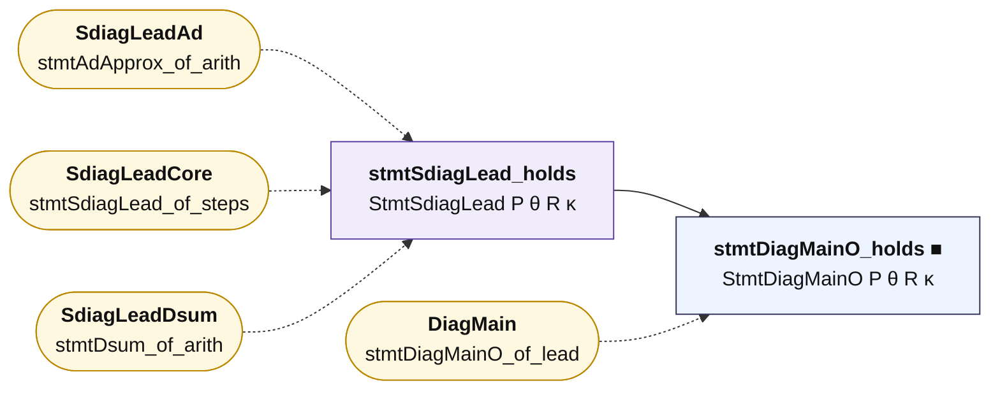

# `lean_stage3/Stage3/SdiagLead.lean`

> **Read from the source text.** This file changed after the last `python3 utilities/lean_map.py --dump`, so the arrows on this page are names occurring in each proof and have not been confirmed by Lean.

# Stage3.SdiagLead — `StmtSdiagLead` and `StmtDiagMainO`, from six arithmetic facts. 2026-11-25.

2 theorems, 1 definition, 81 lines. 

**Imports:** [`SdiagLeadDsum`](../lean_stage3/SdiagLeadDsum.md)  
**Imported by:** [`Stage3`](../lean_stage3/Stage3.md)

## The picture



An arrow A → B reads "A is used in the proof of B". Green: counting, integers only. Violet: shape, analysis with no ζ. Blue: reads ζ. A name ending in ■ is an end: nothing else uses it. Red: contains `sorry`. Yellow: theorems in another file, counted; a dotted arrow crosses files. Definitions are not drawn; they are listed below the diagram.

## Definitions

<a name="SdiagLead-StmtArith"></a>
### `SdiagLead.StmtArith`

def · line 49

OPEN, the six arithmetic facts the leading term rests on.

- **Is:** `` StmtArith : Prop := StmtSdmLe ∧ StmtMeanSig3 ∧ StmtTailFixed ∧ StmtTailAvg ∧ StmtGmuLog ∧ StmtDivLog ``
- **Built from:** [`SdiagLead.StmtMeanSig3`](../lean_stage3/SdiagLeadAd.md#SdiagLead-StmtMeanSig3), [`SdiagLead.StmtSdmLe`](../lean_stage3/SdiagLeadAd.md#SdiagLead-StmtSdmLe), [`SdiagLead.StmtTailAvg`](../lean_stage3/SdiagLeadAd.md#SdiagLead-StmtTailAvg), [`SdiagLead.StmtTailFixed`](../lean_stage3/SdiagLeadAd.md#SdiagLead-StmtTailFixed), [`SdiagLead.StmtDivLog`](../lean_stage3/SdiagLeadDsum.md#SdiagLead-StmtDivLog), [`SdiagLead.StmtGmuLog`](../lean_stage3/SdiagLeadDsum.md#SdiagLead-StmtGmuLog)
- **Used by 2:** [`SdiagLead.stmtDiagMainO_holds`](#SdiagLead-stmtDiagMainO_holds), [`SdiagLead.stmtSdiagLead_holds`](#SdiagLead-stmtSdiagLead_holds)

## Theorems

<a name="SdiagLead-stmtSdiagLead_holds"></a>
### `SdiagLead.stmtSdiagLead_holds`

line 54 · arrows read from text

**Shape.** Uses real or complex analysis; nothing in it or beneath it reads ζ.

**Why.** Young's Lemma 7 to `o(1/L)`: `S(α,β,0) = I(α,β)/log M + o(1/L)` on `Regime κ T`, given `StmtArith`.

**Proves**

```lean
StmtSdiagLead P θ R κ
```

**Needs** (its hypotheses)

  - `` P : Polynomial ℝ ``
  - `` hP0 : P.eval 0 = 0 ``
  - `` hθ0 : 0 < θ ``
  - `` _hθ : θ < 1 / 2 ``
  - `` R : ℝ ``
  - `` hκ : 0 < κ ``
  - `` hA : StmtArith ``

**Fed by** (3 theorems its proof uses)

  - [`SdiagLead.stmtAdApprox_of_arith`](../lean_stage3/SdiagLeadAd.md#SdiagLead-stmtAdApprox_of_arith) (SdiagLeadAd) — `` StmtAdApprox P A ``
  - [`SdiagLead.stmtSdiagLead_of_steps`](../lean_stage3/SdiagLeadCore.md#SdiagLead-stmtSdiagLead_of_steps) (SdiagLeadCore) — `` StmtSdiagLead P θ R κ ``
  - [`SdiagLead.stmtDsum_of_arith`](../lean_stage3/SdiagLeadDsum.md#SdiagLead-stmtDsum_of_arith) (SdiagLeadDsum) — `` StmtDsum P A ``

**Definitions its proof touches:** [`DiagMain.StmtSdiagLead`](../lean_stage3/DiagMain.md#DiagMain-StmtSdiagLead), [`SdiagLead.StmtArith`](#SdiagLead-StmtArith)

**Feeds** (1 that use it)

  - [`SdiagLead.stmtDiagMainO_holds`](#SdiagLead-stmtDiagMainO_holds) — `` StmtDiagMainO P θ R κ ``

<a name="SdiagLead-stmtDiagMainO_holds"></a>
### `SdiagLead.stmtDiagMainO_holds`

line 63 · arrows read from text

**Reads ζ.** It, or something it rests on, uses the zeta function, its zeros or the Riemann hypothesis.

**Why.** The main term, little-o: `ζ(1+α+β) S(α,β,0) = c₁(α,β) + o(1)`, given `StmtArith`.

**Proves**

```lean
StmtDiagMainO P θ R κ
```

**Needs** (its hypotheses)

  - `` P : Polynomial ℝ ``
  - `` hP0 : P.eval 0 = 0 ``
  - `` hθ0 : 0 < θ ``
  - `` hθ : θ < 1 / 2 ``
  - `` R : ℝ ``
  - `` hκ : 0 < κ ``
  - `` hA : StmtArith ``

**Fed by** (2 theorems its proof uses)

  - [`DiagMain.stmtDiagMainO_of_lead`](../lean_stage3/DiagMain.md#DiagMain-stmtDiagMainO_of_lead) (DiagMain) — `` StmtDiagMainO P θ R κ ``
  - [`SdiagLead.stmtSdiagLead_holds`](#SdiagLead-stmtSdiagLead_holds) — `` StmtSdiagLead P θ R κ ``

**Definitions its proof touches:** [`DiagMainStmt.StmtDiagMainO`](../lean_stage3/DiagMainStmt.md#DiagMainStmt-StmtDiagMainO), [`SdiagLead.StmtArith`](#SdiagLead-StmtArith)

**Feeds:** nothing. It is an end.

