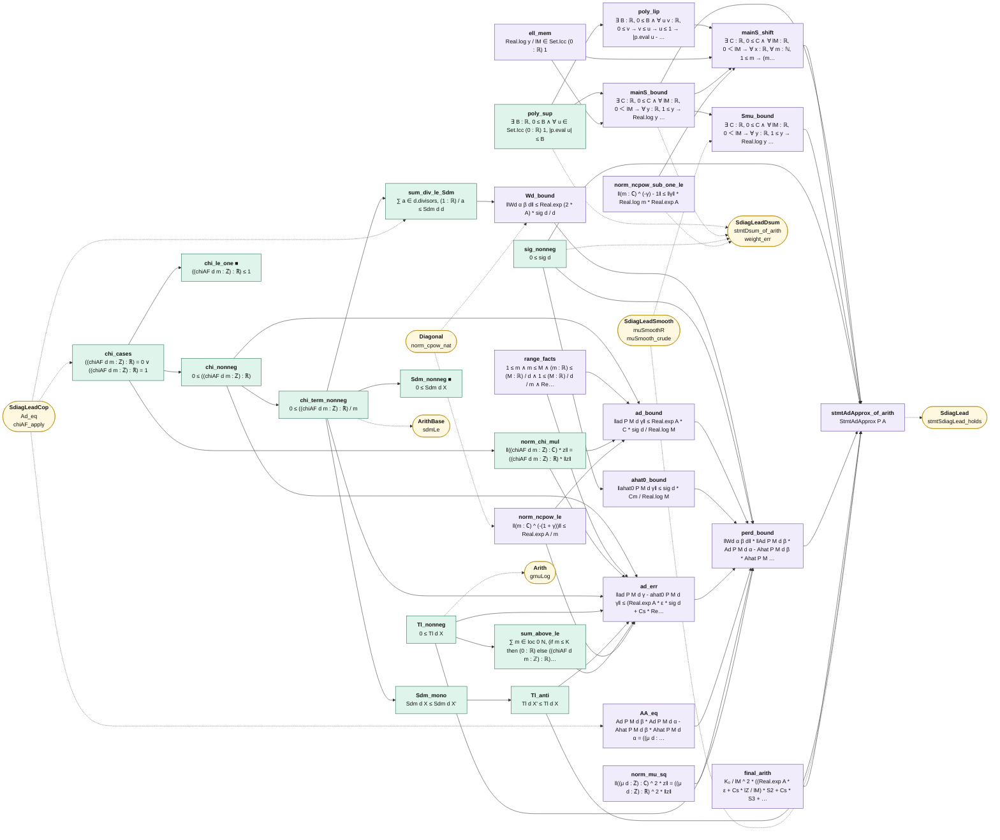

# `lean_stage3/Stage3/SdiagLeadAd.lean`

> **Read from the source text.** This file changed after the last `python3 utilities/lean_map.py --dump`, so the arrows on this page are names occurring in each proof and have not been confirmed by Lean.

# Stage3.SdiagLeadAd — layer (2), the per-`d` step on average, from four arithmetic facts. 2026-11-25.

30 theorems, 8 definitions, 828 lines. 

**Imports:** [`SdiagLeadCore`](../lean_stage3/SdiagLeadCore.md)  
**Imported by:** [`SdiagLeadDsum`](../lean_stage3/SdiagLeadDsum.md)

## The picture



An arrow A → B reads "A is used in the proof of B". Green: counting, integers only. Violet: shape, analysis with no ζ. Blue: reads ζ. A name ending in ■ is an end: nothing else uses it. Red: contains `sorry`. Yellow: theorems in another file, counted; a dotted arrow crosses files. Definitions are not drawn; they are listed below the diagram.

## Definitions

<a name="SdiagLead-Sdm"></a>
### `SdiagLead.Sdm`

def · line 46

`S_d(X) = Σ_{m ≤ X, m ∈ ⟨d⟩} 1/m`.

- **Is:** `` Sdm (d X : ℕ) : ℝ := ∑ m ∈ Ioc 0 X, ((chiAF d m : ℤ) : ℝ) / m ``
- **Built from:** [`SdiagLead.chiAF`](../lean_stage3/SdiagLeadCop.md#SdiagLead-chiAF)
- **Used by 12:** [`Arith.gmu_eq`](../lean_stage3/Arith.md#Arith-gmu_eq), [`Arith.sum_sdm_eq`](../lean_stage3/Arith.md#Arith-sum_sdm_eq), [`Arith.sdmLe`](../lean_stage3/ArithBase.md#Arith-sdmLe), [`Arith.hasSum_tail`](../lean_stage3/ArithTail.md#Arith-hasSum_tail), [`SdiagLead.Sdm_mono`](#SdiagLead-Sdm_mono), [`SdiagLead.Sdm_nonneg`](#SdiagLead-Sdm_nonneg), [`SdiagLead.StmtSdmLe`](#SdiagLead-StmtSdmLe), [`SdiagLead.Tl`](#SdiagLead-Tl), [`SdiagLead.ad_bound`](#SdiagLead-ad_bound), [`SdiagLead.ad_err`](#SdiagLead-ad_err), [`SdiagLead.sum_above_le`](#SdiagLead-sum_above_le), [`SdiagLead.sum_div_le_Sdm`](#SdiagLead-sum_div_le_Sdm)

<a name="SdiagLead-Tl"></a>
### `SdiagLead.Tl`

def · line 49

`T_d(X) = σ(d) − S_d(X)`.

- **Is:** `` Tl (d X : ℕ) : ℝ := sig d - Sdm d X ``
- **Built from:** [`SdiagLead.Sdm`](#SdiagLead-Sdm), [`SdiagLead.sig`](../lean_stage3/SdiagLeadCore.md#SdiagLead-sig)
- **Used by 12:** [`Arith.gmuLog`](../lean_stage3/Arith.md#Arith-gmuLog), [`Arith.gmu_eq`](../lean_stage3/Arith.md#Arith-gmu_eq), [`Arith.hasSum_tail`](../lean_stage3/ArithTail.md#Arith-hasSum_tail), [`Arith.hasSum_tails`](../lean_stage3/ArithTail.md#Arith-hasSum_tails), [`SdiagLead.StmtTailAvg`](#SdiagLead-StmtTailAvg), [`SdiagLead.StmtTailFixed`](#SdiagLead-StmtTailFixed), [`SdiagLead.Tl_anti`](#SdiagLead-Tl_anti), [`SdiagLead.Tl_nonneg`](#SdiagLead-Tl_nonneg), [`SdiagLead.ad_err`](#SdiagLead-ad_err), [`SdiagLead.perd_bound`](#SdiagLead-perd_bound), [`SdiagLead.stmtAdApprox_of_arith`](#SdiagLead-stmtAdApprox_of_arith), [`SdiagLead.sum_above_le`](#SdiagLead-sum_above_le)

<a name="SdiagLead-StmtSdmLe"></a>
### `SdiagLead.StmtSdmLe`

def · line 52

OPEN, the finite Euler product: `S_d(X) ≤ d/φ(d)`.

- **Is:** `` StmtSdmLe : Prop := ∀ d X : ℕ, 1 ≤ d → Sdm d X ≤ sig d ``
- **Built from:** [`SdiagLead.Sdm`](#SdiagLead-Sdm), [`SdiagLead.sig`](../lean_stage3/SdiagLeadCore.md#SdiagLead-sig)
- **Used by 9:** [`Arith.sdmLe`](../lean_stage3/ArithBase.md#Arith-sdmLe), [`SdiagLead.StmtArith`](../lean_stage3/SdiagLead.md#SdiagLead-StmtArith), [`SdiagLead.Tl_nonneg`](#SdiagLead-Tl_nonneg), [`SdiagLead.Wd_bound`](#SdiagLead-Wd_bound), [`SdiagLead.ad_bound`](#SdiagLead-ad_bound), [`SdiagLead.ad_err`](#SdiagLead-ad_err), [`SdiagLead.perd_bound`](#SdiagLead-perd_bound), [`SdiagLead.stmtAdApprox_of_arith`](#SdiagLead-stmtAdApprox_of_arith), [`SdiagLead.sum_above_le`](#SdiagLead-sum_above_le)

<a name="SdiagLead-StmtMeanSig3"></a>
### `SdiagLead.StmtMeanSig3`

def · line 55

OPEN, the mean of `σ³`: `Σ_{d ≤ M} μ²(d) σ(d)³/d ≤ C(1 + log M)`.

- **Is:** `` StmtMeanSig3 : Prop := ∃ C : ℝ, 0 ≤ C ∧ ∀ M : ℕ, ∑ d ∈ Icc 1 M, ((μ d : ℤ) : ℝ) ^ 2 * sig d ^ 3 / d ≤ C * (1 + Real.log M) ``
- **Built from:** [`SdiagLead.sig`](../lean_stage3/SdiagLeadCore.md#SdiagLead-sig)
- **Used by 3:** [`Arith.meanSig3`](../lean_stage3/Arith.md#Arith-meanSig3), [`SdiagLead.StmtArith`](../lean_stage3/SdiagLead.md#SdiagLead-StmtArith), [`SdiagLead.stmtAdApprox_of_arith`](#SdiagLead-stmtAdApprox_of_arith)

<a name="SdiagLead-StmtTailFixed"></a>
### `SdiagLead.StmtTailFixed`

def · line 59

OPEN, the tail beyond a fixed `Z`, on average: `≤ η(1 + log M)` once `Z = Z(η)`.

- **Is:** `` StmtTailFixed : Prop := ∀ η : ℝ, 0 < η → ∃ Z : ℕ, ∀ M : ℕ, ∑ d ∈ Icc 1 M, ((μ d : ℤ) : ℝ) ^ 2 * sig d ^ 2 * Tl d Z / d ≤ η * (1 + Real.log M) ``
- **Built from:** [`SdiagLead.Tl`](#SdiagLead-Tl), [`SdiagLead.sig`](../lean_stage3/SdiagLeadCore.md#SdiagLead-sig)
- **Used by 3:** [`Arith.tailFixed`](../lean_stage3/ArithTail.md#Arith-tailFixed), [`SdiagLead.StmtArith`](../lean_stage3/SdiagLead.md#SdiagLead-StmtArith), [`SdiagLead.stmtAdApprox_of_arith`](#SdiagLead-stmtAdApprox_of_arith)

<a name="SdiagLead-StmtTailAvg"></a>
### `SdiagLead.StmtTailAvg`

def · line 63

OPEN, the tail beyond `M/(dY)`, on average: `≤ C(1 + log Y)`.

- **Is:** `` StmtTailAvg : Prop := ∃ C : ℝ, 0 ≤ C ∧ ∀ M Y : ℕ, 1 ≤ Y → ∑ d ∈ Icc 1 M, ((μ d : ℤ) : ℝ) ^ 2 * sig d ^ 2 * Tl d (M / d / Y) / d ≤ C * (1 + Real.log Y) ``
- **Built from:** [`SdiagLead.Tl`](#SdiagLead-Tl), [`SdiagLead.sig`](../lean_stage3/SdiagLeadCore.md#SdiagLead-sig)
- **Used by 3:** [`Arith.tailAvg`](../lean_stage3/ArithTail.md#Arith-tailAvg), [`SdiagLead.StmtArith`](../lean_stage3/SdiagLead.md#SdiagLead-StmtArith), [`SdiagLead.stmtAdApprox_of_arith`](#SdiagLead-stmtAdApprox_of_arith)

<a name="SdiagLead-ad"></a>
### `SdiagLead.ad`

def · line 347

`a_d(γ) = A_d(γ)/μ(d) = Σ_{m ∈ ⟨d⟩, m ≤ M/d} m^{−(1+γ)} Smu(M/(dm), γ)`.

- **Is:** `` ad (P : Polynomial ℝ) (M d : ℕ) (γ : ℂ) : ℂ := ∑ m ∈ Ioc 0 (M / d), ((chiAF d m : ℤ) : ℂ) * ((m : ℂ) ^ (-(1 + γ)) * Smu P (Real.log M) ((M : ℝ) / d / m) γ) ``
- **Built from:** [`SdiagLead.chiAF`](../lean_stage3/SdiagLeadCop.md#SdiagLead-chiAF), [`SdiagLead.Smu`](../lean_stage3/SdiagLeadSmooth.md#SdiagLead-Smu)
- **Used by 4:** [`SdiagLead.AA_eq`](#SdiagLead-AA_eq), [`SdiagLead.ad_bound`](#SdiagLead-ad_bound), [`SdiagLead.ad_err`](#SdiagLead-ad_err), [`SdiagLead.perd_bound`](#SdiagLead-perd_bound)

<a name="SdiagLead-ahat0"></a>
### `SdiagLead.ahat0`

def · line 352

`â_d(γ) = σ(d) mainS(M/d, γ)`.

- **Is:** `` ahat0 (P : Polynomial ℝ) (M d : ℕ) (γ : ℂ) : ℂ := ((sig d : ℝ) : ℂ) * mainS P (Real.log M) ((M : ℝ) / d) γ ``
- **Built from:** [`SdiagLead.sig`](../lean_stage3/SdiagLeadCore.md#SdiagLead-sig), [`SdiagLead.mainS`](../lean_stage3/SdiagLeadSmooth.md#SdiagLead-mainS)
- **Used by 4:** [`SdiagLead.AA_eq`](#SdiagLead-AA_eq), [`SdiagLead.ad_err`](#SdiagLead-ad_err), [`SdiagLead.ahat0_bound`](#SdiagLead-ahat0_bound), [`SdiagLead.perd_bound`](#SdiagLead-perd_bound)

## Theorems

<a name="SdiagLead-chi_cases"></a>
### `SdiagLead.chi_cases`

line 68 · arrows read from text

**Counting.** Integers only: nothing in its statement or proof, or in anything it rests on, uses analysis or ζ.

**Proves**

```lean
((chiAF d m : ℤ) : ℝ) = 0 ∨ ((chiAF d m : ℤ) : ℝ) = 1
```

**Needs** (its hypotheses)

  - `` d m : ℕ ``

**Fed by** (1 theorem its proof uses)

  - [`SdiagLead.chiAF_apply`](../lean_stage3/SdiagLeadCop.md#SdiagLead-chiAF_apply) (SdiagLeadCop) — `` chiAF d m = if m ≠ 0 ∧ m.primeFactors ⊆ d.primeFactors then 1 else 0 ``

**Definitions its proof touches:** [`SdiagLead.chiAF`](../lean_stage3/SdiagLeadCop.md#SdiagLead-chiAF)

**Feeds** (3 that use it)

  - [`SdiagLead.chi_le_one`](#SdiagLead-chi_le_one) — `` ((chiAF d m : ℤ) : ℝ) ≤ 1 ``
  - [`SdiagLead.chi_nonneg`](#SdiagLead-chi_nonneg) — `` 0 ≤ ((chiAF d m : ℤ) : ℝ) ``
  - [`SdiagLead.norm_chi_mul`](#SdiagLead-norm_chi_mul) — `` ‖((chiAF d m : ℤ) : ℂ) * z‖ = ((chiAF d m : ℤ) : ℝ) * ‖z‖ ``

<a name="SdiagLead-chi_nonneg"></a>
### `SdiagLead.chi_nonneg`

line 71 · arrows read from text

**Counting.** Integers only: nothing in its statement or proof, or in anything it rests on, uses analysis or ζ.

**Proves**

```lean
0 ≤ ((chiAF d m : ℤ) : ℝ)
```

**Needs** (its hypotheses)

  - `` d m : ℕ ``

**Fed by** (1 theorem its proof uses)

  - [`SdiagLead.chi_cases`](#SdiagLead-chi_cases) — `` ((chiAF d m : ℤ) : ℝ) = 0 ∨ ((chiAF d m : ℤ) : ℝ) = 1 ``

**Definitions its proof touches:** [`SdiagLead.chiAF`](../lean_stage3/SdiagLeadCop.md#SdiagLead-chiAF)

**Feeds** (3 that use it)

  - [`SdiagLead.ad_bound`](#SdiagLead-ad_bound) — `` ‖ad P M d γ‖ ≤ Real.exp A * C * sig d / Real.log M ``
  - [`SdiagLead.ad_err`](#SdiagLead-ad_err) — `` ‖ad P M d γ - ahat0 P M d γ‖ ≤ (Real.exp A * ε * sig d + Cs * Real.log Z / Real.log M * sig d + Cs * Tl d Z + (Real.exp A * Cc + Cm) * Tl d (M / d / Y… ``
  - [`SdiagLead.chi_term_nonneg`](#SdiagLead-chi_term_nonneg) — `` 0 ≤ ((chiAF d m : ℤ) : ℝ) / m ``

<a name="SdiagLead-chi_le_one"></a>
### `SdiagLead.chi_le_one`

line 74 · arrows read from text

**Counting.** Integers only: nothing in its statement or proof, or in anything it rests on, uses analysis or ζ.

**Proves**

```lean
((chiAF d m : ℤ) : ℝ) ≤ 1
```

**Needs** (its hypotheses)

  - `` d m : ℕ ``

**Fed by** (1 theorem its proof uses)

  - [`SdiagLead.chi_cases`](#SdiagLead-chi_cases) — `` ((chiAF d m : ℤ) : ℝ) = 0 ∨ ((chiAF d m : ℤ) : ℝ) = 1 ``

**Definitions its proof touches:** [`SdiagLead.chiAF`](../lean_stage3/SdiagLeadCop.md#SdiagLead-chiAF)

**Feeds:** nothing. It is an end.

<a name="SdiagLead-chi_term_nonneg"></a>
### `SdiagLead.chi_term_nonneg`

line 77 · arrows read from text

**Counting.** Integers only: nothing in its statement or proof, or in anything it rests on, uses analysis or ζ.

**Proves**

```lean
0 ≤ ((chiAF d m : ℤ) : ℝ) / m
```

**Needs** (its hypotheses)

  - `` d m : ℕ ``

**Fed by** (1 theorem its proof uses)

  - [`SdiagLead.chi_nonneg`](#SdiagLead-chi_nonneg) — `` 0 ≤ ((chiAF d m : ℤ) : ℝ) ``

**Definitions its proof touches:** [`SdiagLead.chiAF`](../lean_stage3/SdiagLeadCop.md#SdiagLead-chiAF)

**Feeds** (5 that use it)

  - [`Arith.sdmLe`](../lean_stage3/ArithBase.md#Arith-sdmLe) (ArithBase) — `` StmtSdmLe ``
  - [`SdiagLead.Sdm_mono`](#SdiagLead-Sdm_mono) — `` Sdm d X ≤ Sdm d X' ``
  - [`SdiagLead.Sdm_nonneg`](#SdiagLead-Sdm_nonneg) — `` 0 ≤ Sdm d X ``
  - [`SdiagLead.ad_err`](#SdiagLead-ad_err) — `` ‖ad P M d γ - ahat0 P M d γ‖ ≤ (Real.exp A * ε * sig d + Cs * Real.log Z / Real.log M * sig d + Cs * Tl d Z + (Real.exp A * Cc + Cm) * Tl d (M / d / Y… ``
  - [`SdiagLead.sum_div_le_Sdm`](#SdiagLead-sum_div_le_Sdm) — `` ∑ a ∈ d.divisors, (1 : ℝ) / a ≤ Sdm d d ``

<a name="SdiagLead-Sdm_mono"></a>
### `SdiagLead.Sdm_mono`

line 80 · arrows read from text

**Counting.** Integers only: nothing in its statement or proof, or in anything it rests on, uses analysis or ζ.

**Proves**

```lean
Sdm d X ≤ Sdm d X'
```

**Needs** (its hypotheses)

  - `` d : ℕ ``
  - `` h : X ≤ X' ``

**Fed by** (1 theorem its proof uses)

  - [`SdiagLead.chi_term_nonneg`](#SdiagLead-chi_term_nonneg) — `` 0 ≤ ((chiAF d m : ℤ) : ℝ) / m ``

**Definitions its proof touches:** [`SdiagLead.Sdm`](#SdiagLead-Sdm)

**Feeds** (1 that use it)

  - [`SdiagLead.Tl_anti`](#SdiagLead-Tl_anti) — `` Tl d X' ≤ Tl d X ``

<a name="SdiagLead-Tl_nonneg"></a>
### `SdiagLead.Tl_nonneg`

line 85 · arrows read from text

**Counting.** Integers only: nothing in its statement or proof, or in anything it rests on, uses analysis or ζ.

**Proves**

```lean
0 ≤ Tl d X
```

**Needs** (its hypotheses)

  - `` hS : StmtSdmLe ``
  - `` hd : 1 ≤ d ``
  - `` X : ℕ ``

**Fed by:** no theorem of this repo; it stands on Mathlib and the definitions below.

**Definitions its proof touches:** [`SdiagLead.StmtSdmLe`](#SdiagLead-StmtSdmLe), [`SdiagLead.Tl`](#SdiagLead-Tl)

**Feeds** (4 that use it)

  - [`Arith.gmuLog`](../lean_stage3/Arith.md#Arith-gmuLog) (Arith) — `` StmtGmuLog ``
  - [`SdiagLead.ad_err`](#SdiagLead-ad_err) — `` ‖ad P M d γ - ahat0 P M d γ‖ ≤ (Real.exp A * ε * sig d + Cs * Real.log Z / Real.log M * sig d + Cs * Tl d Z + (Real.exp A * Cc + Cm) * Tl d (M / d / Y… ``
  - [`SdiagLead.perd_bound`](#SdiagLead-perd_bound) — `` ‖Wd α β d‖ * ‖Ad P M d β * Ad P M d α - Ahat P M d β * Ahat P M d α‖ ≤ 2 * Real.exp (2 * A) * (Real.exp A * CS + Cm + 1) / Real.log M ^ 2 * (((μ d : ℤ… ``
  - [`SdiagLead.sum_above_le`](#SdiagLead-sum_above_le) — `` ∑ m ∈ Ioc 0 N, (if m ≤ K then (0 : ℝ) else ((chiAF d m : ℤ) : ℝ) / m) ≤ Tl d K ``

<a name="SdiagLead-Tl_anti"></a>
### `SdiagLead.Tl_anti`

line 88 · arrows read from text

**Counting.** Integers only: nothing in its statement or proof, or in anything it rests on, uses analysis or ζ.

**Proves**

```lean
Tl d X' ≤ Tl d X
```

**Needs** (its hypotheses)

  - `` d : ℕ ``
  - `` h : X ≤ X' ``

**Fed by** (1 theorem its proof uses)

  - [`SdiagLead.Sdm_mono`](#SdiagLead-Sdm_mono) — `` Sdm d X ≤ Sdm d X' ``

**Definitions its proof touches:** [`SdiagLead.Tl`](#SdiagLead-Tl)

**Feeds** (2 that use it)

  - [`SdiagLead.ad_err`](#SdiagLead-ad_err) — `` ‖ad P M d γ - ahat0 P M d γ‖ ≤ (Real.exp A * ε * sig d + Cs * Real.log Z / Real.log M * sig d + Cs * Tl d Z + (Real.exp A * Cc + Cm) * Tl d (M / d / Y… ``
  - [`SdiagLead.stmtAdApprox_of_arith`](#SdiagLead-stmtAdApprox_of_arith) — `` StmtAdApprox P A ``

<a name="SdiagLead-sum_above_le"></a>
### `SdiagLead.sum_above_le`

line 92 · arrows read from text

**Counting.** Integers only: nothing in its statement or proof, or in anything it rests on, uses analysis or ζ.

**Why.** `Σ_{m ≤ N, m > K, m ∈ ⟨d⟩} 1/m ≤ T_d(K)`.

**Proves**

```lean
∑ m ∈ Ioc 0 N, (if m ≤ K then (0 : ℝ) else ((chiAF d m : ℤ) : ℝ) / m) ≤ Tl d K
```

**Needs** (its hypotheses)

  - `` hS : StmtSdmLe ``
  - `` hd : 1 ≤ d ``
  - `` N K : ℕ ``

**Fed by** (1 theorem its proof uses)

  - [`SdiagLead.Tl_nonneg`](#SdiagLead-Tl_nonneg) — `` 0 ≤ Tl d X ``

**Definitions its proof touches:** [`SdiagLead.Sdm`](#SdiagLead-Sdm), [`SdiagLead.StmtSdmLe`](#SdiagLead-StmtSdmLe), [`SdiagLead.Tl`](#SdiagLead-Tl), [`SdiagLead.chiAF`](../lean_stage3/SdiagLeadCop.md#SdiagLead-chiAF)

**Feeds** (1 that use it)

  - [`SdiagLead.ad_err`](#SdiagLead-ad_err) — `` ‖ad P M d γ - ahat0 P M d γ‖ ≤ (Real.exp A * ε * sig d + Cs * Real.log Z / Real.log M * sig d + Cs * Tl d Z + (Real.exp A * Cc + Cm) * Tl d (M / d / Y… ``

<a name="SdiagLead-norm_ncpow_le"></a>
### `SdiagLead.norm_ncpow_le`

line 108 · arrows read from text

**Shape.** Uses real or complex analysis; nothing in it or beneath it reads ζ.

**Why.** `‖m^{−(1+γ)}‖ ≤ e^A/m` for `1 ≤ m ≤ M`.

**Proves**

```lean
‖(m : ℂ) ^ (-(1 + γ))‖ ≤ Real.exp A / m
```

**Needs** (its hypotheses)

  - `` hm : 1 ≤ m ``
  - `` hmM : m ≤ M ``
  - `` hγ : ‖γ‖ * Real.log M ≤ A ``

**Fed by** (1 theorem its proof uses)

  - [`Diagonal.norm_cpow_nat`](../lean_stage3/Diagonal.md#Diagonal-norm_cpow_nat) (Diagonal) — `` ‖(n : ℂ) ^ z‖ = (n : ℝ) ^ z.re ``

**Feeds** (2 that use it)

  - [`SdiagLead.ad_bound`](#SdiagLead-ad_bound) — `` ‖ad P M d γ‖ ≤ Real.exp A * C * sig d / Real.log M ``
  - [`SdiagLead.ad_err`](#SdiagLead-ad_err) — `` ‖ad P M d γ - ahat0 P M d γ‖ ≤ (Real.exp A * ε * sig d + Cs * Real.log Z / Real.log M * sig d + Cs * Tl d Z + (Real.exp A * Cc + Cm) * Tl d (M / d / Y… ``

<a name="SdiagLead-norm_ncpow_sub_one_le"></a>
### `SdiagLead.norm_ncpow_sub_one_le`

line 125 · arrows read from text

**Shape.** Uses real or complex analysis; nothing in it or beneath it reads ζ.

**Why.** `‖m^{−γ} − 1‖ ≤ ‖γ‖ log m e^A` for `1 ≤ m`, `‖γ‖ log m ≤ A`.

**Proves**

```lean
‖(m : ℂ) ^ (-γ) - 1‖ ≤ ‖γ‖ * Real.log m * Real.exp A
```

**Needs** (its hypotheses)

  - `` hm : 1 ≤ m ``
  - `` hγ : ‖γ‖ * Real.log m ≤ A ``

**Fed by:** no theorem of this repo; it stands on Mathlib.

**Feeds** (2 that use it)

  - [`SdiagLead.mainS_shift`](#SdiagLead-mainS_shift) — `` ∃ C : ℝ, 0 ≤ C ∧ ∀ lM : ℝ, 0 < lM → ∀ x : ℝ, ∀ m : ℕ, 1 ≤ m → (m : ℝ) ≤ x → Real.log x ≤ lM → ∀ γ : ℂ, ‖γ‖ * lM ≤ A → ‖(m : ℂ) ^ (-γ) * mainS P lM (x … ``
  - [`SdiagLead.weight_err`](../lean_stage3/SdiagLeadDsum.md#SdiagLead-weight_err) (SdiagLeadDsum) — `` ‖((((μ d : ℤ) : ℝ) ^ 2 * sig d ^ 2 : ℝ) : ℂ) * Wd α β d - ((gmu d : ℝ) : ℂ)‖ ≤ ((μ d : ℤ) : ℝ) ^ 2 * sig d ^ 2 / d * (2 * A * Real.exp (2 * A) / Real.… ``

<a name="SdiagLead-poly_sup"></a>
### `SdiagLead.poly_sup`

line 139 · arrows read from text

**Counting.** Integers only: nothing in its statement or proof, or in anything it rests on, uses analysis or ζ.

**Why.** Sup bounds for `|P|`, `|P′|`, `|P″|` on `[0, 1]`.

**Proves**

```lean
∃ B : ℝ, 0 ≤ B ∧ ∀ u ∈ Set.Icc (0 : ℝ) 1, |p.eval u| ≤ B
```

**Needs** (its hypotheses)

  - `` p : Polynomial ℝ ``

**Fed by:** no theorem of this repo; it stands on Mathlib.

**Feeds** (3 that use it)

  - [`SdiagLead.mainS_bound`](#SdiagLead-mainS_bound) — `` ∃ C : ℝ, 0 ≤ C ∧ ∀ lM : ℝ, 0 < lM → ∀ y : ℝ, 1 ≤ y → Real.log y ≤ lM → ∀ γ : ℂ, ‖γ‖ * lM ≤ A → ‖mainS P lM y γ‖ ≤ C / lM ``
  - [`SdiagLead.poly_lip`](#SdiagLead-poly_lip) — `` ∃ B : ℝ, 0 ≤ B ∧ ∀ u v : ℝ, 0 ≤ v → v ≤ u → u ≤ 1 → |p.eval u - p.eval v| ≤ B * (u - v) ``
  - [`SdiagLead.stmtDsum_of_arith`](../lean_stage3/SdiagLeadDsum.md#SdiagLead-stmtDsum_of_arith) (SdiagLeadDsum) — `` StmtDsum P A ``

<a name="SdiagLead-poly_lip"></a>
### `SdiagLead.poly_lip`

line 145 · arrows read from text

**Shape.** Uses real or complex analysis; nothing in it or beneath it reads ζ.

**Why.** `|p(u) − p(v)| ≤ B₁ |u − v|` on `[0, 1]`.

**Proves**

```lean
∃ B : ℝ, 0 ≤ B ∧ ∀ u v : ℝ, 0 ≤ v → v ≤ u → u ≤ 1 → |p.eval u - p.eval v| ≤ B * (u - v)
```

**Needs** (its hypotheses)

  - `` p : Polynomial ℝ ``

**Fed by** (1 theorem its proof uses)

  - [`SdiagLead.poly_sup`](#SdiagLead-poly_sup) — `` ∃ B : ℝ, 0 ≤ B ∧ ∀ u ∈ Set.Icc (0 : ℝ) 1, |p.eval u| ≤ B ``

**Feeds** (1 that use it)

  - [`SdiagLead.mainS_shift`](#SdiagLead-mainS_shift) — `` ∃ C : ℝ, 0 ≤ C ∧ ∀ lM : ℝ, 0 < lM → ∀ x : ℝ, ∀ m : ℕ, 1 ≤ m → (m : ℝ) ≤ x → Real.log x ≤ lM → ∀ γ : ℂ, ‖γ‖ * lM ≤ A → ‖(m : ℂ) ^ (-γ) * mainS P lM (x … ``

<a name="SdiagLead-ell_mem"></a>
### `SdiagLead.ell_mem`

line 156 · arrows read from text

**Shape.** Uses real or complex analysis; nothing in it or beneath it reads ζ.

**Proves**

```lean
Real.log y / lM ∈ Set.Icc (0 : ℝ) 1
```

**Needs** (its hypotheses)

  - `` hlM : 0 < lM ``
  - `` hy : 1 ≤ y ``
  - `` hyl : Real.log y ≤ lM ``

**Fed by:** no theorem of this repo; it stands on Mathlib.

**Feeds** (2 that use it)

  - [`SdiagLead.mainS_bound`](#SdiagLead-mainS_bound) — `` ∃ C : ℝ, 0 ≤ C ∧ ∀ lM : ℝ, 0 < lM → ∀ y : ℝ, 1 ≤ y → Real.log y ≤ lM → ∀ γ : ℂ, ‖γ‖ * lM ≤ A → ‖mainS P lM y γ‖ ≤ C / lM ``
  - [`SdiagLead.mainS_shift`](#SdiagLead-mainS_shift) — `` ∃ C : ℝ, 0 ≤ C ∧ ∀ lM : ℝ, 0 < lM → ∀ x : ℝ, ∀ m : ℕ, 1 ≤ m → (m : ℝ) ≤ x → Real.log x ≤ lM → ∀ γ : ℂ, ‖γ‖ * lM ≤ A → ‖(m : ℂ) ^ (-γ) * mainS P lM (x … ``

<a name="SdiagLead-mainS_bound"></a>
### `SdiagLead.mainS_bound`

line 161 · arrows read from text

**Shape.** Uses real or complex analysis; nothing in it or beneath it reads ζ.

**Why.** `‖mainS(y, γ)‖ ≤ C_m/λ` for `1 ≤ y`, `log y ≤ λ`.

**Proves**

```lean
∃ C : ℝ, 0 ≤ C ∧ ∀ lM : ℝ, 0 < lM → ∀ y : ℝ, 1 ≤ y → Real.log y ≤ lM → ∀ γ : ℂ, ‖γ‖ * lM ≤ A → ‖mainS P lM y γ‖ ≤ C / lM
```

**Needs** (its hypotheses)

  - `` P : Polynomial ℝ ``
  - `` hA : 0 ≤ A ``

**Fed by** (2 theorems its proof uses)

  - [`SdiagLead.ell_mem`](#SdiagLead-ell_mem) — `` Real.log y / lM ∈ Set.Icc (0 : ℝ) 1 ``
  - [`SdiagLead.poly_sup`](#SdiagLead-poly_sup) — `` ∃ B : ℝ, 0 ≤ B ∧ ∀ u ∈ Set.Icc (0 : ℝ) 1, |p.eval u| ≤ B ``

**Definitions its proof touches:** [`SdiagLead.mainS`](../lean_stage3/SdiagLeadSmooth.md#SdiagLead-mainS)

**Feeds** (4 that use it)

  - [`SdiagLead.Smu_bound`](#SdiagLead-Smu_bound) — `` ∃ C : ℝ, 0 ≤ C ∧ ∀ lM : ℝ, 0 < lM → ∀ y : ℝ, 1 ≤ y → Real.log y ≤ lM → ∀ γ : ℂ, ‖γ‖ * lM ≤ A → ‖Smu P lM y γ‖ ≤ C / lM ``
  - [`SdiagLead.mainS_shift`](#SdiagLead-mainS_shift) — `` ∃ C : ℝ, 0 ≤ C ∧ ∀ lM : ℝ, 0 < lM → ∀ x : ℝ, ∀ m : ℕ, 1 ≤ m → (m : ℝ) ≤ x → Real.log x ≤ lM → ∀ γ : ℂ, ‖γ‖ * lM ≤ A → ‖(m : ℂ) ^ (-γ) * mainS P lM (x … ``
  - [`SdiagLead.stmtAdApprox_of_arith`](#SdiagLead-stmtAdApprox_of_arith) — `` StmtAdApprox P A ``
  - [`SdiagLead.stmtDsum_of_arith`](../lean_stage3/SdiagLeadDsum.md#SdiagLead-stmtDsum_of_arith) (SdiagLeadDsum) — `` StmtDsum P A ``

<a name="SdiagLead-mainS_shift"></a>
### `SdiagLead.mainS_shift`

line 181 · arrows read from text

**Shape.** Uses real or complex analysis; nothing in it or beneath it reads ζ.

**Why.** The shift: `‖m^{−γ} mainS(x/m) − mainS(x)‖ ≤ C_s log m/λ²` for `1 ≤ m ≤ x`, `log x ≤ λ`.

**Proves**

```lean
∃ C : ℝ, 0 ≤ C ∧ ∀ lM : ℝ, 0 < lM → ∀ x : ℝ, ∀ m : ℕ, 1 ≤ m → (m : ℝ) ≤ x → Real.log x ≤ lM → ∀ γ : ℂ, ‖γ‖ * lM ≤ A → ‖(m : ℂ) ^ (-γ) * mainS P lM (x / m) γ - mainS P lM x γ‖ ≤ C * Real.log m / lM ^ 2
```

**Needs** (its hypotheses)

  - `` P : Polynomial ℝ ``
  - `` hA : 0 ≤ A ``

**Fed by** (4 theorems its proof uses)

  - [`SdiagLead.ell_mem`](#SdiagLead-ell_mem) — `` Real.log y / lM ∈ Set.Icc (0 : ℝ) 1 ``
  - [`SdiagLead.mainS_bound`](#SdiagLead-mainS_bound) — `` ∃ C : ℝ, 0 ≤ C ∧ ∀ lM : ℝ, 0 < lM → ∀ y : ℝ, 1 ≤ y → Real.log y ≤ lM → ∀ γ : ℂ, ‖γ‖ * lM ≤ A → ‖mainS P lM y γ‖ ≤ C / lM ``
  - [`SdiagLead.norm_ncpow_sub_one_le`](#SdiagLead-norm_ncpow_sub_one_le) — `` ‖(m : ℂ) ^ (-γ) - 1‖ ≤ ‖γ‖ * Real.log m * Real.exp A ``
  - [`SdiagLead.poly_lip`](#SdiagLead-poly_lip) — `` ∃ B : ℝ, 0 ≤ B ∧ ∀ u v : ℝ, 0 ≤ v → v ≤ u → u ≤ 1 → |p.eval u - p.eval v| ≤ B * (u - v) ``

**Definitions its proof touches:** [`SdiagLead.mainS`](../lean_stage3/SdiagLeadSmooth.md#SdiagLead-mainS)

**Feeds** (1 that use it)

  - [`SdiagLead.stmtAdApprox_of_arith`](#SdiagLead-stmtAdApprox_of_arith) — `` StmtAdApprox P A ``

<a name="SdiagLead-Smu_bound"></a>
### `SdiagLead.Smu_bound`

line 245 · arrows read from text

**Shape.** Uses real or complex analysis; nothing in it or beneath it reads ζ.

**Why.** `‖Smu(y, γ)‖ ≤ C/λ` for `1 ≤ y`, `log y ≤ λ`.

**Proves**

```lean
∃ C : ℝ, 0 ≤ C ∧ ∀ lM : ℝ, 0 < lM → ∀ y : ℝ, 1 ≤ y → Real.log y ≤ lM → ∀ γ : ℂ, ‖γ‖ * lM ≤ A → ‖Smu P lM y γ‖ ≤ C / lM
```

**Needs** (its hypotheses)

  - `` P : Polynomial ℝ ``
  - `` hP0 : P.eval 0 = 0 ``
  - `` hA : 0 ≤ A ``

**Fed by** (2 theorems its proof uses)

  - [`SdiagLead.mainS_bound`](#SdiagLead-mainS_bound) — `` ∃ C : ℝ, 0 ≤ C ∧ ∀ lM : ℝ, 0 < lM → ∀ y : ℝ, 1 ≤ y → Real.log y ≤ lM → ∀ γ : ℂ, ‖γ‖ * lM ≤ A → ‖mainS P lM y γ‖ ≤ C / lM ``
  - [`SdiagLead.muSmooth_crude`](../lean_stage3/SdiagLeadSmooth.md#SdiagLead-muSmooth_crude) (SdiagLeadSmooth) — `` ∃ C : ℝ, 0 ≤ C ∧ ∀ lM : ℝ, 0 < lM → ∀ x : ℝ, 1 ≤ x → Real.log x ≤ lM → ∀ β : ℂ, ‖β‖ * lM ≤ A → ‖Smu P lM x β - mainS P lM x β‖ ≤ C / lM ``

**Definitions its proof touches:** [`SdiagLead.Smu`](../lean_stage3/SdiagLeadSmooth.md#SdiagLead-Smu), [`SdiagLead.mainS`](../lean_stage3/SdiagLeadSmooth.md#SdiagLead-mainS)

**Feeds** (1 that use it)

  - [`SdiagLead.stmtAdApprox_of_arith`](#SdiagLead-stmtAdApprox_of_arith) — `` StmtAdApprox P A ``

<a name="SdiagLead-sum_div_le_Sdm"></a>
### `SdiagLead.sum_div_le_Sdm`

line 260 · arrows read from text

**Counting.** Integers only: nothing in its statement or proof, or in anything it rests on, uses analysis or ζ.

**Why.** `Σ_{a | d} 1/a ≤ S_d(d)`.

**Proves**

```lean
∑ a ∈ d.divisors, (1 : ℝ) / a ≤ Sdm d d
```

**Needs** (its hypotheses)

  - `` hd : 1 ≤ d ``

**Fed by** (2 theorems its proof uses)

  - [`SdiagLead.chi_term_nonneg`](#SdiagLead-chi_term_nonneg) — `` 0 ≤ ((chiAF d m : ℤ) : ℝ) / m ``
  - [`SdiagLead.chiAF_apply`](../lean_stage3/SdiagLeadCop.md#SdiagLead-chiAF_apply) (SdiagLeadCop) — `` chiAF d m = if m ≠ 0 ∧ m.primeFactors ⊆ d.primeFactors then 1 else 0 ``

**Definitions its proof touches:** [`SdiagLead.Sdm`](#SdiagLead-Sdm), [`SdiagLead.chiAF`](../lean_stage3/SdiagLeadCop.md#SdiagLead-chiAF)

**Feeds** (1 that use it)

  - [`SdiagLead.Wd_bound`](#SdiagLead-Wd_bound) — `` ‖Wd α β d‖ ≤ Real.exp (2 * A) * sig d / d ``

<a name="SdiagLead-Wd_bound"></a>
### `SdiagLead.Wd_bound`

line 275 · arrows read from text

**Shape.** Uses real or complex analysis; nothing in it or beneath it reads ζ.

**Why.** `‖W_d‖ ≤ e^{2A} σ(d)/d` for `1 ≤ d ≤ M`, `‖α‖λ, ‖β‖λ ≤ A`.

**Proves**

```lean
‖Wd α β d‖ ≤ Real.exp (2 * A) * sig d / d
```

**Needs** (its hypotheses)

  - `` hS : StmtSdmLe ``
  - `` hd : 1 ≤ d ``
  - `` hdM : d ≤ M ``
  - `` hα : ‖α‖ * Real.log M ≤ A ``
  - `` hβ : ‖β‖ * Real.log M ≤ A ``

**Fed by** (2 theorems its proof uses)

  - [`Diagonal.norm_cpow_nat`](../lean_stage3/Diagonal.md#Diagonal-norm_cpow_nat) (Diagonal) — `` ‖(n : ℂ) ^ z‖ = (n : ℝ) ^ z.re ``
  - [`SdiagLead.sum_div_le_Sdm`](#SdiagLead-sum_div_le_Sdm) — `` ∑ a ∈ d.divisors, (1 : ℝ) / a ≤ Sdm d d ``

**Definitions its proof touches:** [`SdiagLead.StmtSdmLe`](#SdiagLead-StmtSdmLe), [`SdiagLead.Wd`](../lean_stage3/SdiagLeadCore.md#SdiagLead-Wd), [`SdiagLead.sig`](../lean_stage3/SdiagLeadCore.md#SdiagLead-sig), [`SdiagLead.Jz`](../lean_stage3/SdiagLeadSwap.md#SdiagLead-Jz)

**Feeds** (1 that use it)

  - [`SdiagLead.perd_bound`](#SdiagLead-perd_bound) — `` ‖Wd α β d‖ * ‖Ad P M d β * Ad P M d α - Ahat P M d β * Ahat P M d α‖ ≤ 2 * Real.exp (2 * A) * (Real.exp A * CS + Cm + 1) / Real.log M ^ 2 * (((μ d : ℤ… ``

<a name="SdiagLead-sig_nonneg"></a>
### `SdiagLead.sig_nonneg`

line 355 · arrows read from text

**Counting.** Integers only: nothing in its statement or proof, or in anything it rests on, uses analysis or ζ.

**Proves**

```lean
0 ≤ sig d
```

**Needs** (its hypotheses)

  - `` d : ℕ ``

**Fed by:** no theorem of this repo; it stands on Mathlib and the definitions below.

**Definitions its proof touches:** [`SdiagLead.sig`](../lean_stage3/SdiagLeadCore.md#SdiagLead-sig)

**Feeds** (5 that use it)

  - [`SdiagLead.ahat0_bound`](#SdiagLead-ahat0_bound) — `` ‖ahat0 P M d γ‖ ≤ sig d * Cm / Real.log M ``
  - [`SdiagLead.perd_bound`](#SdiagLead-perd_bound) — `` ‖Wd α β d‖ * ‖Ad P M d β * Ad P M d α - Ahat P M d β * Ahat P M d α‖ ≤ 2 * Real.exp (2 * A) * (Real.exp A * CS + Cm + 1) / Real.log M ^ 2 * (((μ d : ℤ… ``
  - [`SdiagLead.stmtAdApprox_of_arith`](#SdiagLead-stmtAdApprox_of_arith) — `` StmtAdApprox P A ``
  - [`SdiagLead.stmtDsum_of_arith`](../lean_stage3/SdiagLeadDsum.md#SdiagLead-stmtDsum_of_arith) (SdiagLeadDsum) — `` StmtDsum P A ``
  - [`SdiagLead.weight_err`](../lean_stage3/SdiagLeadDsum.md#SdiagLead-weight_err) (SdiagLeadDsum) — `` ‖((((μ d : ℤ) : ℝ) ^ 2 * sig d ^ 2 : ℝ) : ℂ) * Wd α β d - ((gmu d : ℝ) : ℂ)‖ ≤ ((μ d : ℤ) : ℝ) ^ 2 * sig d ^ 2 / d * (2 * A * Real.exp (2 * A) / Real.… ``

<a name="SdiagLead-Sdm_nonneg"></a>
### `SdiagLead.Sdm_nonneg`

line 357 · arrows read from text

**Counting.** Integers only: nothing in its statement or proof, or in anything it rests on, uses analysis or ζ.

**Proves**

```lean
0 ≤ Sdm d X
```

**Needs** (its hypotheses)

  - `` d X : ℕ ``

**Fed by** (1 theorem its proof uses)

  - [`SdiagLead.chi_term_nonneg`](#SdiagLead-chi_term_nonneg) — `` 0 ≤ ((chiAF d m : ℤ) : ℝ) / m ``

**Definitions its proof touches:** [`SdiagLead.Sdm`](#SdiagLead-Sdm)

**Feeds:** nothing. It is an end.

<a name="SdiagLead-range_facts"></a>
### `SdiagLead.range_facts`

line 361 · arrows read from text

**Shape.** Uses real or complex analysis; nothing in it or beneath it reads ζ.

**Why.** The range facts for `m ≤ M/d`.

**Proves**

```lean
1 ≤ m ∧ m ≤ M ∧ (m : ℝ) ≤ (M : ℝ) / d ∧ 1 ≤ (M : ℝ) / d / m ∧ Real.log ((M : ℝ) / d / m) ≤ Real.log M ∧ Real.log ((M : ℝ) / d) ≤ Real.log M ∧ 1 ≤ (M : ℝ) / d
```

**Needs** (its hypotheses)

  - `` hd : 1 ≤ d ``
  - `` hm : m ∈ Ioc 0 (M / d) ``

**Fed by:** no theorem of this repo; it stands on Mathlib.

**Feeds** (2 that use it)

  - [`SdiagLead.ad_bound`](#SdiagLead-ad_bound) — `` ‖ad P M d γ‖ ≤ Real.exp A * C * sig d / Real.log M ``
  - [`SdiagLead.ad_err`](#SdiagLead-ad_err) — `` ‖ad P M d γ - ahat0 P M d γ‖ ≤ (Real.exp A * ε * sig d + Cs * Real.log Z / Real.log M * sig d + Cs * Tl d Z + (Real.exp A * Cc + Cm) * Tl d (M / d / Y… ``

<a name="SdiagLead-norm_chi_mul"></a>
### `SdiagLead.norm_chi_mul`

line 380 · arrows read from text

**Counting.** Integers only: nothing in its statement or proof, or in anything it rests on, uses analysis or ζ.

**Proves**

```lean
‖((chiAF d m : ℤ) : ℂ) * z‖ = ((chiAF d m : ℤ) : ℝ) * ‖z‖
```

**Needs** (its hypotheses)

  - `` d m : ℕ ``
  - `` z : ℂ ``

**Fed by** (1 theorem its proof uses)

  - [`SdiagLead.chi_cases`](#SdiagLead-chi_cases) — `` ((chiAF d m : ℤ) : ℝ) = 0 ∨ ((chiAF d m : ℤ) : ℝ) = 1 ``

**Definitions its proof touches:** [`SdiagLead.chiAF`](../lean_stage3/SdiagLeadCop.md#SdiagLead-chiAF)

**Feeds** (2 that use it)

  - [`SdiagLead.ad_bound`](#SdiagLead-ad_bound) — `` ‖ad P M d γ‖ ≤ Real.exp A * C * sig d / Real.log M ``
  - [`SdiagLead.ad_err`](#SdiagLead-ad_err) — `` ‖ad P M d γ - ahat0 P M d γ‖ ≤ (Real.exp A * ε * sig d + Cs * Real.log Z / Real.log M * sig d + Cs * Tl d Z + (Real.exp A * Cc + Cm) * Tl d (M / d / Y… ``

<a name="SdiagLead-ad_bound"></a>
### `SdiagLead.ad_bound`

line 390 · arrows read from text

**Shape.** Uses real or complex analysis; nothing in it or beneath it reads ζ.

**Why.** `‖a_d(γ)‖ ≤ e^A C σ(d)/λ`.

**Proves**

```lean
‖ad P M d γ‖ ≤ Real.exp A * C * sig d / Real.log M
```

**Needs** (its hypotheses)

  - `` hS : StmtSdmLe ``
  - `` P : Polynomial ℝ ``
  - `` hC : ∀ lM : ℝ, 0 < lM → ∀ y : ℝ, 1 ≤ y → Real.log y ≤ lM → ∀ γ : ℂ, ‖γ‖ * lM ≤ A → ‖Smu P lM y γ‖ ≤ C / lM ``
  - `` hC0 : 0 ≤ C ``
  - `` hd : 1 ≤ d ``
  - `` hlM : 0 < Real.log M ``
  - `` hγ : ‖γ‖ * Real.log M ≤ A ``

**Fed by** (4 theorems its proof uses)

  - [`SdiagLead.chi_nonneg`](#SdiagLead-chi_nonneg) — `` 0 ≤ ((chiAF d m : ℤ) : ℝ) ``
  - [`SdiagLead.norm_chi_mul`](#SdiagLead-norm_chi_mul) — `` ‖((chiAF d m : ℤ) : ℂ) * z‖ = ((chiAF d m : ℤ) : ℝ) * ‖z‖ ``
  - [`SdiagLead.norm_ncpow_le`](#SdiagLead-norm_ncpow_le) — `` ‖(m : ℂ) ^ (-(1 + γ))‖ ≤ Real.exp A / m ``
  - [`SdiagLead.range_facts`](#SdiagLead-range_facts) — `` 1 ≤ m ∧ m ≤ M ∧ (m : ℝ) ≤ (M : ℝ) / d ∧ 1 ≤ (M : ℝ) / d / m ∧ Real.log ((M : ℝ) / d / m) ≤ Real.log M ∧ Real.log ((M : ℝ) / d) ≤ Real.log M ∧ 1 ≤ (M :… ``

**Definitions its proof touches:** [`SdiagLead.Sdm`](#SdiagLead-Sdm), [`SdiagLead.StmtSdmLe`](#SdiagLead-StmtSdmLe), [`SdiagLead.ad`](#SdiagLead-ad), [`SdiagLead.chiAF`](../lean_stage3/SdiagLeadCop.md#SdiagLead-chiAF), [`SdiagLead.sig`](../lean_stage3/SdiagLeadCore.md#SdiagLead-sig), [`SdiagLead.Smu`](../lean_stage3/SdiagLeadSmooth.md#SdiagLead-Smu)

**Feeds** (1 that use it)

  - [`SdiagLead.perd_bound`](#SdiagLead-perd_bound) — `` ‖Wd α β d‖ * ‖Ad P M d β * Ad P M d α - Ahat P M d β * Ahat P M d α‖ ≤ 2 * Real.exp (2 * A) * (Real.exp A * CS + Cm + 1) / Real.log M ^ 2 * (((μ d : ℤ… ``

<a name="SdiagLead-ahat0_bound"></a>
### `SdiagLead.ahat0_bound`

line 422 · arrows read from text

**Shape.** Uses real or complex analysis; nothing in it or beneath it reads ζ.

**Why.** `‖â_d(γ)‖ ≤ σ(d) C_m/λ`.

**Proves**

```lean
‖ahat0 P M d γ‖ ≤ sig d * Cm / Real.log M
```

**Needs** (its hypotheses)

  - `` P : Polynomial ℝ ``
  - `` hCm : ∀ lM : ℝ, 0 < lM → ∀ y : ℝ, 1 ≤ y → Real.log y ≤ lM → ∀ γ : ℂ, ‖γ‖ * lM ≤ A → ‖mainS P lM y γ‖ ≤ Cm / lM ``
  - `` hd : 1 ≤ d ``
  - `` hdM : d ≤ M ``
  - `` hlM : 0 < Real.log M ``
  - `` hγ : ‖γ‖ * Real.log M ≤ A ``

**Fed by** (1 theorem its proof uses)

  - [`SdiagLead.sig_nonneg`](#SdiagLead-sig_nonneg) — `` 0 ≤ sig d ``

**Definitions its proof touches:** [`SdiagLead.ahat0`](#SdiagLead-ahat0), [`SdiagLead.sig`](../lean_stage3/SdiagLeadCore.md#SdiagLead-sig), [`SdiagLead.mainS`](../lean_stage3/SdiagLeadSmooth.md#SdiagLead-mainS)

**Feeds** (1 that use it)

  - [`SdiagLead.perd_bound`](#SdiagLead-perd_bound) — `` ‖Wd α β d‖ * ‖Ad P M d β * Ad P M d α - Ahat P M d β * Ahat P M d α‖ ≤ 2 * Real.exp (2 * A) * (Real.exp A * CS + Cm + 1) / Real.log M ^ 2 * (((μ d : ℤ… ``

<a name="SdiagLead-ad_err"></a>
### `SdiagLead.ad_err`

line 438 · arrows read from text

**Shape.** Uses real or complex analysis; nothing in it or beneath it reads ζ.

**Why.** The per-`d` error: `‖a_d − â_d‖ ≤ (e^A ε σ + C_s log Z σ/λ + C_s T_d(Z) + (e^A C_c + C_m) T_d(M/d/Y′))/λ`.

**Proves**

```lean
‖ad P M d γ - ahat0 P M d γ‖ ≤ (Real.exp A * ε * sig d + Cs * Real.log Z / Real.log M * sig d + Cs * Tl d Z + (Real.exp A * Cc + Cm) * Tl d (M / d / Y')) / Real.log M
```

**Needs** (its hypotheses)

  - `` hS : StmtSdmLe ``
  - `` P : Polynomial ℝ ``
  - `` hsm : ∀ lM : ℝ, L₀ ≤ lM → ∀ x : ℝ, Y ≤ x → Real.log x ≤ lM → ∀ β : ℂ, ‖β‖ * lM ≤ A → ‖Smu P lM x β - mainS P lM x β‖ ≤ ε / lM ``
  - `` hcr : ∀ lM : ℝ, 0 < lM → ∀ x : ℝ, 1 ≤ x → Real.log x ≤ lM → ∀ β : ℂ, ‖β‖ * lM ≤ A → ‖Smu P lM x β - mainS P lM x β‖ ≤ Cc / lM ``
  - `` hCm : ∀ lM : ℝ, 0 < lM → ∀ y : ℝ, 1 ≤ y → Real.log y ≤ lM → ∀ γ : ℂ, ‖γ‖ * lM ≤ A → ‖mainS P lM y γ‖ ≤ Cm / lM ``
  - `` hCs : ∀ lM : ℝ, 0 < lM → ∀ x : ℝ, ∀ m : ℕ, 1 ≤ m → (m : ℝ) ≤ x → Real.log x ≤ lM → ∀ γ : ℂ, ‖γ‖ * lM ≤ A → ‖(m : ℂ) ^ (-γ) * mainS P lM (x / m) γ - mainS P lM x γ‖ ≤ Cs * Real.log m / lM ^ 2 ``
  - `` hε : 0 ≤ ε ``
  - `` hCc : 0 ≤ Cc ``
  - `` hCs0 : 0 ≤ Cs ``
  - `` hYY : Y ≤ Y' ``
  - `` hY' : 1 ≤ Y' ``
  - `` hZ : 1 ≤ Z ``
  - `` hd : 1 ≤ d ``
  - `` hdM : d ≤ M ``
  - `` hlM : 0 < Real.log M ``
  - `` hL : L₀ ≤ Real.log M ``
  - `` hγ : ‖γ‖ * Real.log M ≤ A ``

**Fed by** (8 theorems its proof uses)

  - [`SdiagLead.Tl_anti`](#SdiagLead-Tl_anti) — `` Tl d X' ≤ Tl d X ``
  - [`SdiagLead.Tl_nonneg`](#SdiagLead-Tl_nonneg) — `` 0 ≤ Tl d X ``
  - [`SdiagLead.chi_nonneg`](#SdiagLead-chi_nonneg) — `` 0 ≤ ((chiAF d m : ℤ) : ℝ) ``
  - [`SdiagLead.chi_term_nonneg`](#SdiagLead-chi_term_nonneg) — `` 0 ≤ ((chiAF d m : ℤ) : ℝ) / m ``
  - [`SdiagLead.norm_chi_mul`](#SdiagLead-norm_chi_mul) — `` ‖((chiAF d m : ℤ) : ℂ) * z‖ = ((chiAF d m : ℤ) : ℝ) * ‖z‖ ``
  - [`SdiagLead.norm_ncpow_le`](#SdiagLead-norm_ncpow_le) — `` ‖(m : ℂ) ^ (-(1 + γ))‖ ≤ Real.exp A / m ``
  - [`SdiagLead.range_facts`](#SdiagLead-range_facts) — `` 1 ≤ m ∧ m ≤ M ∧ (m : ℝ) ≤ (M : ℝ) / d ∧ 1 ≤ (M : ℝ) / d / m ∧ Real.log ((M : ℝ) / d / m) ≤ Real.log M ∧ Real.log ((M : ℝ) / d) ≤ Real.log M ∧ 1 ≤ (M :… ``
  - [`SdiagLead.sum_above_le`](#SdiagLead-sum_above_le) — `` ∑ m ∈ Ioc 0 N, (if m ≤ K then (0 : ℝ) else ((chiAF d m : ℤ) : ℝ) / m) ≤ Tl d K ``

**Definitions its proof touches:** [`SdiagLead.Sdm`](#SdiagLead-Sdm), [`SdiagLead.StmtSdmLe`](#SdiagLead-StmtSdmLe), [`SdiagLead.Tl`](#SdiagLead-Tl), [`SdiagLead.ad`](#SdiagLead-ad), [`SdiagLead.ahat0`](#SdiagLead-ahat0), [`SdiagLead.chiAF`](../lean_stage3/SdiagLeadCop.md#SdiagLead-chiAF), [`SdiagLead.sig`](../lean_stage3/SdiagLeadCore.md#SdiagLead-sig), [`SdiagLead.Smu`](../lean_stage3/SdiagLeadSmooth.md#SdiagLead-Smu), [`SdiagLead.mainS`](../lean_stage3/SdiagLeadSmooth.md#SdiagLead-mainS)

**Feeds** (1 that use it)

  - [`SdiagLead.perd_bound`](#SdiagLead-perd_bound) — `` ‖Wd α β d‖ * ‖Ad P M d β * Ad P M d α - Ahat P M d β * Ahat P M d α‖ ≤ 2 * Real.exp (2 * A) * (Real.exp A * CS + Cm + 1) / Real.log M ^ 2 * (((μ d : ℤ… ``

<a name="SdiagLead-AA_eq"></a>
### `SdiagLead.AA_eq`

line 596 · arrows read from text

**Shape.** Uses real or complex analysis; nothing in it or beneath it reads ζ.

**Why.** `A_d = μ(d) a_d`, `Â_d = μ(d) â_d`, so `A A − Â Â = μ² (a a − â â)`.

**Proves**

```lean
Ad P M d β * Ad P M d α - Ahat P M d β * Ahat P M d α = ((μ d : ℤ) : ℂ) ^ 2 * (ad P M d β * ad P M d α - ahat0 P M d β * ahat0 P M d α)
```

**Needs** (its hypotheses)

  - `` P : Polynomial ℝ ``
  - `` hd : 1 ≤ d ``
  - `` α β : ℂ ``

**Fed by** (1 theorem its proof uses)

  - [`SdiagLead.Ad_eq`](../lean_stage3/SdiagLeadCop.md#SdiagLead-Ad_eq) (SdiagLeadCop) — `` Ad P M d γ = ((μ d : ℤ) : ℂ) * ∑ m ∈ Ioc 0 (M / d), ((chiAF d m : ℤ) : ℂ) * ((m : ℂ) ^ (-(1 + γ)) * Smu P (Real.log M) ((M : ℝ) / d / m) γ) ``

**Definitions its proof touches:** [`SdiagLead.ad`](#SdiagLead-ad), [`SdiagLead.ahat0`](#SdiagLead-ahat0), [`SdiagLead.Ahat`](../lean_stage3/SdiagLeadCore.md#SdiagLead-Ahat), [`SdiagLead.Ad`](../lean_stage3/SdiagLeadSwap.md#SdiagLead-Ad)

**Feeds** (1 that use it)

  - [`SdiagLead.perd_bound`](#SdiagLead-perd_bound) — `` ‖Wd α β d‖ * ‖Ad P M d β * Ad P M d α - Ahat P M d β * Ahat P M d α‖ ≤ 2 * Real.exp (2 * A) * (Real.exp A * CS + Cm + 1) / Real.log M ^ 2 * (((μ d : ℤ… ``

<a name="SdiagLead-norm_mu_sq"></a>
### `SdiagLead.norm_mu_sq`

line 603 · arrows read from text

**Shape.** Uses real or complex analysis; nothing in it or beneath it reads ζ.

**Proves**

```lean
‖((μ d : ℤ) : ℂ) ^ 2 * z‖ = ((μ d : ℤ) : ℝ) ^ 2 * ‖z‖
```

**Needs** (its hypotheses)

  - `` d : ℕ ``
  - `` z : ℂ ``

**Fed by:** no theorem of this repo; it stands on Mathlib.

**Feeds** (1 that use it)

  - [`SdiagLead.perd_bound`](#SdiagLead-perd_bound) — `` ‖Wd α β d‖ * ‖Ad P M d β * Ad P M d α - Ahat P M d β * Ahat P M d α‖ ≤ 2 * Real.exp (2 * A) * (Real.exp A * CS + Cm + 1) / Real.log M ^ 2 * (((μ d : ℤ… ``

<a name="SdiagLead-perd_bound"></a>
### `SdiagLead.perd_bound`

line 608 · arrows read from text

**Shape.** Uses real or complex analysis; nothing in it or beneath it reads ζ.

**Why.** The per-`d` bound: `‖W_d‖ ‖A A − Â Â‖ ≤ K₀/λ² · μ²(d) σ(d)²/d · E_d`.

**Proves**

```lean
‖Wd α β d‖ * ‖Ad P M d β * Ad P M d α - Ahat P M d β * Ahat P M d α‖ ≤ 2 * Real.exp (2 * A) * (Real.exp A * CS + Cm + 1) / Real.log M ^ 2 * (((μ d : ℤ) : ℝ) ^ 2 * sig d ^ 2 / d * (Real.exp A * ε * sig d + Cs * Real.log Z / Real.log M * sig d + Cs * Tl d Z + (Real.exp A * Cc + Cm) * Tl d (M / d / Y')))
```

**Needs** (its hypotheses)

  - `` hS : StmtSdmLe ``
  - `` P : Polynomial ℝ ``
  - `` hsm : ∀ lM : ℝ, L₀ ≤ lM → ∀ x : ℝ, Y ≤ x → Real.log x ≤ lM → ∀ β : ℂ, ‖β‖ * lM ≤ A → ‖Smu P lM x β - mainS P lM x β‖ ≤ ε / lM ``
  - `` hcr : ∀ lM : ℝ, 0 < lM → ∀ x : ℝ, 1 ≤ x → Real.log x ≤ lM → ∀ β : ℂ, ‖β‖ * lM ≤ A → ‖Smu P lM x β - mainS P lM x β‖ ≤ Cc / lM ``
  - `` hCm : ∀ lM : ℝ, 0 < lM → ∀ y : ℝ, 1 ≤ y → Real.log y ≤ lM → ∀ γ : ℂ, ‖γ‖ * lM ≤ A → ‖mainS P lM y γ‖ ≤ Cm / lM ``
  - `` hCs : ∀ lM : ℝ, 0 < lM → ∀ x : ℝ, ∀ m : ℕ, 1 ≤ m → (m : ℝ) ≤ x → Real.log x ≤ lM → ∀ γ : ℂ, ‖γ‖ * lM ≤ A → ‖(m : ℂ) ^ (-γ) * mainS P lM (x / m) γ - mainS P lM x γ‖ ≤ Cs * Real.log m / lM ^ 2 ``
  - `` hCS : ∀ lM : ℝ, 0 < lM → ∀ y : ℝ, 1 ≤ y → Real.log y ≤ lM → ∀ γ : ℂ, ‖γ‖ * lM ≤ A → ‖Smu P lM y γ‖ ≤ CS / lM ``
  - `` hε : 0 ≤ ε ``
  - `` hCc : 0 ≤ Cc ``
  - `` hCm0 : 0 ≤ Cm ``
  - `` hCs0 : 0 ≤ Cs ``
  - `` hCS0 : 0 ≤ CS ``
  - `` hYY : Y ≤ Y' ``
  - `` hY' : 1 ≤ Y' ``
  - `` hZ : 1 ≤ Z ``
  - `` hd : 1 ≤ d ``
  - `` hdM : d ≤ M ``
  - `` hlM : 0 < Real.log M ``
  - `` hL : L₀ ≤ Real.log M ``
  - `` hα : ‖α‖ * Real.log M ≤ A ``
  - `` hβ : ‖β‖ * Real.log M ≤ A ``

**Fed by** (8 theorems its proof uses)

  - [`SdiagLead.AA_eq`](#SdiagLead-AA_eq) — `` Ad P M d β * Ad P M d α - Ahat P M d β * Ahat P M d α = ((μ d : ℤ) : ℂ) ^ 2 * (ad P M d β * ad P M d α - ahat0 P M d β * ahat0 P M d α) ``
  - [`SdiagLead.Tl_nonneg`](#SdiagLead-Tl_nonneg) — `` 0 ≤ Tl d X ``
  - [`SdiagLead.Wd_bound`](#SdiagLead-Wd_bound) — `` ‖Wd α β d‖ ≤ Real.exp (2 * A) * sig d / d ``
  - [`SdiagLead.ad_bound`](#SdiagLead-ad_bound) — `` ‖ad P M d γ‖ ≤ Real.exp A * C * sig d / Real.log M ``
  - [`SdiagLead.ad_err`](#SdiagLead-ad_err) — `` ‖ad P M d γ - ahat0 P M d γ‖ ≤ (Real.exp A * ε * sig d + Cs * Real.log Z / Real.log M * sig d + Cs * Tl d Z + (Real.exp A * Cc + Cm) * Tl d (M / d / Y… ``
  - [`SdiagLead.ahat0_bound`](#SdiagLead-ahat0_bound) — `` ‖ahat0 P M d γ‖ ≤ sig d * Cm / Real.log M ``
  - [`SdiagLead.norm_mu_sq`](#SdiagLead-norm_mu_sq) — `` ‖((μ d : ℤ) : ℂ) ^ 2 * z‖ = ((μ d : ℤ) : ℝ) ^ 2 * ‖z‖ ``
  - [`SdiagLead.sig_nonneg`](#SdiagLead-sig_nonneg) — `` 0 ≤ sig d ``

**Definitions its proof touches:** [`SdiagLead.StmtSdmLe`](#SdiagLead-StmtSdmLe), [`SdiagLead.Tl`](#SdiagLead-Tl), [`SdiagLead.ad`](#SdiagLead-ad), [`SdiagLead.ahat0`](#SdiagLead-ahat0), [`SdiagLead.Ahat`](../lean_stage3/SdiagLeadCore.md#SdiagLead-Ahat), [`SdiagLead.Wd`](../lean_stage3/SdiagLeadCore.md#SdiagLead-Wd), [`SdiagLead.sig`](../lean_stage3/SdiagLeadCore.md#SdiagLead-sig), [`SdiagLead.Smu`](../lean_stage3/SdiagLeadSmooth.md#SdiagLead-Smu), [`SdiagLead.mainS`](../lean_stage3/SdiagLeadSmooth.md#SdiagLead-mainS), [`SdiagLead.Ad`](../lean_stage3/SdiagLeadSwap.md#SdiagLead-Ad)

**Feeds** (1 that use it)

  - [`SdiagLead.stmtAdApprox_of_arith`](#SdiagLead-stmtAdApprox_of_arith) — `` StmtAdApprox P A ``

<a name="SdiagLead-final_arith"></a>
### `SdiagLead.final_arith`

line 676 · arrows read from text

**Shape.** Uses real or complex analysis; nothing in it or beneath it reads ζ.

**Why.** The real arithmetic closing layer (2).

**Proves**

```lean
K₀ / lM ^ 2 * ((Real.exp A * ε + Cs * lZ / lM) * S2 + Cs * S3 + C7 * S4) ≤ εt / lM
```

**Needs** (its hypotheses)

  - `` hK₀ : 0 < K₀ ``
  - `` hεt : 0 < εt ``
  - `` hCs : 0 ≤ Cs ``
  - `` hC2 : 0 ≤ C2 ``
  - `` hC7 : 0 ≤ C7 ``
  - `` hlZ : 0 ≤ lZ ``
  - `` hl1 : 1 ≤ lM ``
  - `` hεd : ε = εt / (8 * K₀ * Real.exp A * (C2 + 1)) ``
  - `` hηd : η = εt / (8 * K₀ * (Cs + 1)) ``
  - `` hlZb : 8 * K₀ * Cs * lZ * C2 / εt ≤ lM ``
  - `` hlYb : 4 * K₀ * C7 * C4 * (1 + lY) / εt ≤ lM ``
  - `` s2 : S2 ≤ C2 * (1 + lM) ``
  - `` s3 : S3 ≤ η * (1 + lM) ``
  - `` s4 : S4 ≤ C4 * (1 + lY) ``

**Fed by:** no theorem of this repo; it stands on Mathlib.

**Feeds** (1 that use it)

  - [`SdiagLead.stmtAdApprox_of_arith`](#SdiagLead-stmtAdApprox_of_arith) — `` StmtAdApprox P A ``

<a name="SdiagLead-stmtAdApprox_of_arith"></a>
### `SdiagLead.stmtAdApprox_of_arith`

line 750 · arrows read from text

**Shape.** Uses real or complex analysis; nothing in it or beneath it reads ζ.

**Why.** Layer (2) from the arithmetic: the four facts on `⟨d⟩` give `StmtAdApprox P A`.

**Proves**

```lean
StmtAdApprox P A
```

**Needs** (its hypotheses)

  - `` P : Polynomial ℝ ``
  - `` hP0 : P.eval 0 = 0 ``
  - `` hA : 0 ≤ A ``
  - `` hS : StmtSdmLe ``
  - `` h2 : StmtMeanSig3 ``
  - `` h3 : StmtTailFixed ``
  - `` h4 : StmtTailAvg ``

**Fed by** (9 theorems its proof uses)

  - [`SdiagLead.Smu_bound`](#SdiagLead-Smu_bound) — `` ∃ C : ℝ, 0 ≤ C ∧ ∀ lM : ℝ, 0 < lM → ∀ y : ℝ, 1 ≤ y → Real.log y ≤ lM → ∀ γ : ℂ, ‖γ‖ * lM ≤ A → ‖Smu P lM y γ‖ ≤ C / lM ``
  - [`SdiagLead.Tl_anti`](#SdiagLead-Tl_anti) — `` Tl d X' ≤ Tl d X ``
  - [`SdiagLead.final_arith`](#SdiagLead-final_arith) — `` K₀ / lM ^ 2 * ((Real.exp A * ε + Cs * lZ / lM) * S2 + Cs * S3 + C7 * S4) ≤ εt / lM ``
  - [`SdiagLead.mainS_bound`](#SdiagLead-mainS_bound) — `` ∃ C : ℝ, 0 ≤ C ∧ ∀ lM : ℝ, 0 < lM → ∀ y : ℝ, 1 ≤ y → Real.log y ≤ lM → ∀ γ : ℂ, ‖γ‖ * lM ≤ A → ‖mainS P lM y γ‖ ≤ C / lM ``
  - [`SdiagLead.mainS_shift`](#SdiagLead-mainS_shift) — `` ∃ C : ℝ, 0 ≤ C ∧ ∀ lM : ℝ, 0 < lM → ∀ x : ℝ, ∀ m : ℕ, 1 ≤ m → (m : ℝ) ≤ x → Real.log x ≤ lM → ∀ γ : ℂ, ‖γ‖ * lM ≤ A → ‖(m : ℂ) ^ (-γ) * mainS P lM (x … ``
  - [`SdiagLead.perd_bound`](#SdiagLead-perd_bound) — `` ‖Wd α β d‖ * ‖Ad P M d β * Ad P M d α - Ahat P M d β * Ahat P M d α‖ ≤ 2 * Real.exp (2 * A) * (Real.exp A * CS + Cm + 1) / Real.log M ^ 2 * (((μ d : ℤ… ``
  - [`SdiagLead.sig_nonneg`](#SdiagLead-sig_nonneg) — `` 0 ≤ sig d ``
  - [`SdiagLead.muSmoothR`](../lean_stage3/SdiagLeadSmooth.md#SdiagLead-muSmoothR) (SdiagLeadSmooth) — `` ∃ Y : ℝ, 1 ≤ Y ∧ ∃ L₀ : ℝ, 0 < L₀ ∧ ∀ lM : ℝ, L₀ ≤ lM → ∀ x : ℝ, Y ≤ x → Real.log x ≤ lM → ∀ β : ℂ, ‖β‖ * lM ≤ A → ‖Smu P lM x β - mainS P lM x β‖ ≤ ε… ``
  - [`SdiagLead.muSmooth_crude`](../lean_stage3/SdiagLeadSmooth.md#SdiagLead-muSmooth_crude) (SdiagLeadSmooth) — `` ∃ C : ℝ, 0 ≤ C ∧ ∀ lM : ℝ, 0 < lM → ∀ x : ℝ, 1 ≤ x → Real.log x ≤ lM → ∀ β : ℂ, ‖β‖ * lM ≤ A → ‖Smu P lM x β - mainS P lM x β‖ ≤ C / lM ``

**Definitions its proof touches:** [`SdiagLead.StmtMeanSig3`](#SdiagLead-StmtMeanSig3), [`SdiagLead.StmtSdmLe`](#SdiagLead-StmtSdmLe), [`SdiagLead.StmtTailAvg`](#SdiagLead-StmtTailAvg), [`SdiagLead.StmtTailFixed`](#SdiagLead-StmtTailFixed), [`SdiagLead.Tl`](#SdiagLead-Tl), [`SdiagLead.StmtAdApprox`](../lean_stage3/SdiagLeadCore.md#SdiagLead-StmtAdApprox), [`SdiagLead.sig`](../lean_stage3/SdiagLeadCore.md#SdiagLead-sig)

**Feeds** (1 that use it)

  - [`SdiagLead.stmtSdiagLead_holds`](../lean_stage3/SdiagLead.md#SdiagLead-stmtSdiagLead_holds) (SdiagLead) — `` StmtSdiagLead P θ R κ ``

