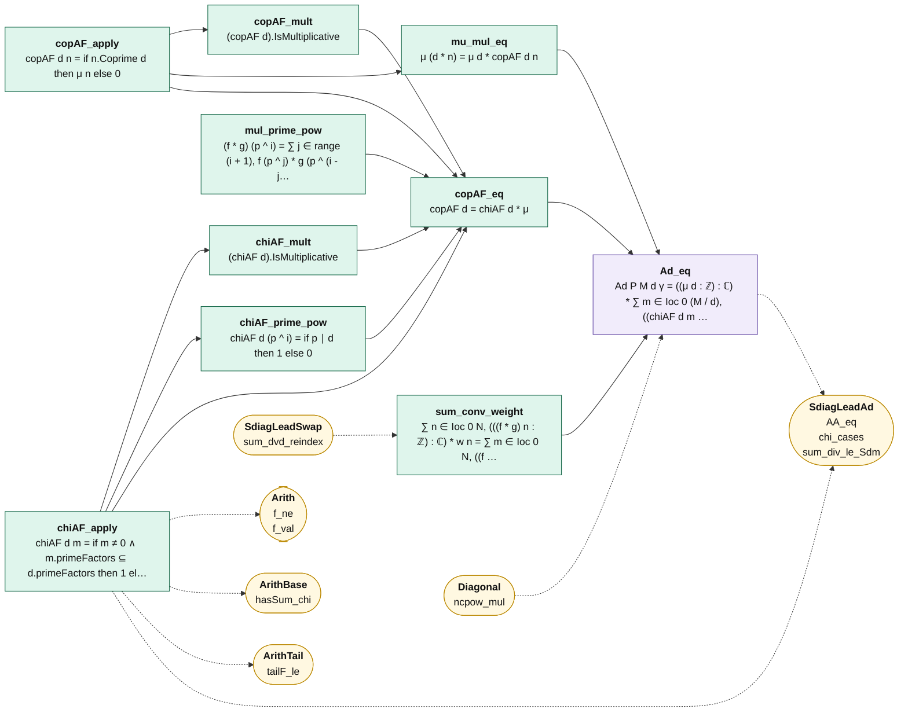

# `lean_stage3/Stage3/SdiagLeadCop.lean`

> **Read from the source text.** This file changed after the last `python3 utilities/lean_map.py --dump`, so the arrows on this page are names occurring in each proof and have not been confirmed by Lean.

# Stage3.SdiagLeadCop — the coprimality step, exact. 2026-11-25. Step 3 of the route in `Stage3/DiagMain.lean`'s docstring, the exact part: `μ(dn) = μ(d) μ(n) 1_{(n,d)=1}` (`mu_mul_eq`), `μ·1_{(·,d)=1} = 1_{⟨d⟩} * μ` with `⟨d⟩ = {m : primes of m ⊆ primes of d}` (`copAF_eq`), and the weighted hyperbola swap (`sum_conv_weight`) give

10 theorems, 2 definitions, 197 lines. 

**Imports:** [`SdiagLeadSmooth`](../lean_stage3/SdiagLeadSmooth.md)  
**Imported by:** [`SdiagLeadCore`](../lean_stage3/SdiagLeadCore.md)

## The picture



An arrow A → B reads "A is used in the proof of B". Green: counting, integers only. Violet: shape, analysis with no ζ. Blue: reads ζ. A name ending in ■ is an end: nothing else uses it. Red: contains `sorry`. Yellow: theorems in another file, counted; a dotted arrow crosses files. Definitions are not drawn; they are listed below the diagram.

## Definitions

<a name="SdiagLead-chiAF"></a>
### `SdiagLead.chiAF`

def · line 34

`1_{⟨d⟩}(m)`: `m ≠ 0` and every prime of `m` divides `d`.

- **Is:** `` chiAF (d : ℕ) : ArithmeticFunction ℤ := ⟨fun m => if m ≠ 0 ∧ m.primeFactors ⊆ d.primeFactors then 1 else 0, by simp⟩ ``
- **Used by 21:** [`Arith.f_ne`](../lean_stage3/Arith.md#Arith-f_ne), [`Arith.f_val`](../lean_stage3/Arith.md#Arith-f_val), [`Arith.hasSum_chi`](../lean_stage3/ArithBase.md#Arith-hasSum_chi), [`Arith.hasSum_tail`](../lean_stage3/ArithTail.md#Arith-hasSum_tail), [`Arith.tailF`](../lean_stage3/ArithTail.md#Arith-tailF), [`SdiagLead.Sdm`](../lean_stage3/SdiagLeadAd.md#SdiagLead-Sdm), [`SdiagLead.ad`](../lean_stage3/SdiagLeadAd.md#SdiagLead-ad), [`SdiagLead.ad_bound`](../lean_stage3/SdiagLeadAd.md#SdiagLead-ad_bound), [`SdiagLead.ad_err`](../lean_stage3/SdiagLeadAd.md#SdiagLead-ad_err), [`SdiagLead.chi_cases`](../lean_stage3/SdiagLeadAd.md#SdiagLead-chi_cases), [`SdiagLead.chi_le_one`](../lean_stage3/SdiagLeadAd.md#SdiagLead-chi_le_one), [`SdiagLead.chi_nonneg`](../lean_stage3/SdiagLeadAd.md#SdiagLead-chi_nonneg), [`SdiagLead.chi_term_nonneg`](../lean_stage3/SdiagLeadAd.md#SdiagLead-chi_term_nonneg), [`SdiagLead.norm_chi_mul`](../lean_stage3/SdiagLeadAd.md#SdiagLead-norm_chi_mul), [`SdiagLead.sum_above_le`](../lean_stage3/SdiagLeadAd.md#SdiagLead-sum_above_le), [`SdiagLead.sum_div_le_Sdm`](../lean_stage3/SdiagLeadAd.md#SdiagLead-sum_div_le_Sdm), [`SdiagLead.Ad_eq`](#SdiagLead-Ad_eq), [`SdiagLead.chiAF_apply`](#SdiagLead-chiAF_apply), [`SdiagLead.chiAF_mult`](#SdiagLead-chiAF_mult), [`SdiagLead.chiAF_prime_pow`](#SdiagLead-chiAF_prime_pow), [`SdiagLead.copAF_eq`](#SdiagLead-copAF_eq)

<a name="SdiagLead-copAF"></a>
### `SdiagLead.copAF`

def · line 38

`μ(n) 1_{(n,d)=1}`.

- **Is:** `` copAF (d : ℕ) : ArithmeticFunction ℤ := ⟨fun n => if n.Coprime d then μ n else 0, by simp⟩ ``
- **Used by 5:** [`SdiagLead.Ad_eq`](#SdiagLead-Ad_eq), [`SdiagLead.copAF_apply`](#SdiagLead-copAF_apply), [`SdiagLead.copAF_eq`](#SdiagLead-copAF_eq), [`SdiagLead.copAF_mult`](#SdiagLead-copAF_mult), [`SdiagLead.mu_mul_eq`](#SdiagLead-mu_mul_eq)

## Theorems

<a name="SdiagLead-chiAF_apply"></a>
### `SdiagLead.chiAF_apply`

line 41 · arrows read from text

**Counting.** Integers only: nothing in its statement or proof, or in anything it rests on, uses analysis or ζ.

**Proves**

```lean
chiAF d m = if m ≠ 0 ∧ m.primeFactors ⊆ d.primeFactors then 1 else 0
```

**Needs** (its hypotheses)

  - `` d m : ℕ ``

**Fed by:** no theorem of this repo; it stands on Mathlib and the definitions below.

**Definitions its proof touches:** [`SdiagLead.chiAF`](#SdiagLead-chiAF)

**Feeds** (9 that use it)

  - [`Arith.f_ne`](../lean_stage3/Arith.md#Arith-f_ne) (Arith) — `` Squarefree k ∧ m ≠ 0 ∧ m.primeFactors ⊆ k.primeFactors ``
  - [`Arith.f_val`](../lean_stage3/Arith.md#Arith-f_val) (Arith) — `` ((μ k : ℤ) : ℝ) ^ 2 / k * (((chiAF k m : ℤ) : ℝ) / m) = 1 / ((k * m : ℕ) : ℝ) ``
  - [`Arith.hasSum_chi`](../lean_stage3/ArithBase.md#Arith-hasSum_chi) (ArithBase) — `` HasSum (fun m => ((chiAF d m : ℤ) : ℝ) / m) (sig d) ``
  - [`Arith.tailF_le`](../lean_stage3/ArithTail.md#Arith-tailF_le) (ArithTail) — `` tailF d X m ≤ (if P ∧ m.primeFactors ⊆ d.primeFactors then (1 : ℝ) else 0) / m ``
  - [`SdiagLead.chi_cases`](../lean_stage3/SdiagLeadAd.md#SdiagLead-chi_cases) (SdiagLeadAd) — `` ((chiAF d m : ℤ) : ℝ) = 0 ∨ ((chiAF d m : ℤ) : ℝ) = 1 ``
  - [`SdiagLead.sum_div_le_Sdm`](../lean_stage3/SdiagLeadAd.md#SdiagLead-sum_div_le_Sdm) (SdiagLeadAd) — `` ∑ a ∈ d.divisors, (1 : ℝ) / a ≤ Sdm d d ``
  - [`SdiagLead.chiAF_mult`](#SdiagLead-chiAF_mult) — `` (chiAF d).IsMultiplicative ``
  - [`SdiagLead.chiAF_prime_pow`](#SdiagLead-chiAF_prime_pow) — `` chiAF d (p ^ i) = if p ∣ d then 1 else 0 ``
  - [`SdiagLead.copAF_eq`](#SdiagLead-copAF_eq) — `` copAF d = chiAF d * μ ``

<a name="SdiagLead-copAF_apply"></a>
### `SdiagLead.copAF_apply`

line 44 · arrows read from text

**Counting.** Integers only: nothing in its statement or proof, or in anything it rests on, uses analysis or ζ.

**Proves**

```lean
copAF d n = if n.Coprime d then μ n else 0
```

**Needs** (its hypotheses)

  - `` d n : ℕ ``

**Fed by:** no theorem of this repo; it stands on Mathlib and the definitions below.

**Definitions its proof touches:** [`SdiagLead.copAF`](#SdiagLead-copAF)

**Feeds** (3 that use it)

  - [`SdiagLead.copAF_eq`](#SdiagLead-copAF_eq) — `` copAF d = chiAF d * μ ``
  - [`SdiagLead.copAF_mult`](#SdiagLead-copAF_mult) — `` (copAF d).IsMultiplicative ``
  - [`SdiagLead.mu_mul_eq`](#SdiagLead-mu_mul_eq) — `` μ (d * n) = μ d * copAF d n ``

<a name="SdiagLead-chiAF_mult"></a>
### `SdiagLead.chiAF_mult`

line 46 · arrows read from text

**Counting.** Integers only: nothing in its statement or proof, or in anything it rests on, uses analysis or ζ.

**Proves**

```lean
(chiAF d).IsMultiplicative
```

**Needs** (its hypotheses)

  - `` d : ℕ ``

**Fed by** (1 theorem its proof uses)

  - [`SdiagLead.chiAF_apply`](#SdiagLead-chiAF_apply) — `` chiAF d m = if m ≠ 0 ∧ m.primeFactors ⊆ d.primeFactors then 1 else 0 ``

**Definitions its proof touches:** [`SdiagLead.chiAF`](#SdiagLead-chiAF)

**Feeds** (1 that use it)

  - [`SdiagLead.copAF_eq`](#SdiagLead-copAF_eq) — `` copAF d = chiAF d * μ ``

<a name="SdiagLead-copAF_mult"></a>
### `SdiagLead.copAF_mult`

line 53 · arrows read from text

**Counting.** Integers only: nothing in its statement or proof, or in anything it rests on, uses analysis or ζ.

**Proves**

```lean
(copAF d).IsMultiplicative
```

**Needs** (its hypotheses)

  - `` d : ℕ ``

**Fed by** (1 theorem its proof uses)

  - [`SdiagLead.copAF_apply`](#SdiagLead-copAF_apply) — `` copAF d n = if n.Coprime d then μ n else 0 ``

**Definitions its proof touches:** [`SdiagLead.copAF`](#SdiagLead-copAF)

**Feeds** (1 that use it)

  - [`SdiagLead.copAF_eq`](#SdiagLead-copAF_eq) — `` copAF d = chiAF d * μ ``

<a name="SdiagLead-mu_mul_eq"></a>
### `SdiagLead.mu_mul_eq`

line 61 · arrows read from text

**Counting.** Integers only: nothing in its statement or proof, or in anything it rests on, uses analysis or ζ.

**Why.** `μ(dn) = μ(d) μ(n) 1_{(n,d)=1}`.

**Proves**

```lean
μ (d * n) = μ d * copAF d n
```

**Needs** (its hypotheses)

  - `` d n : ℕ ``

**Fed by** (1 theorem its proof uses)

  - [`SdiagLead.copAF_apply`](#SdiagLead-copAF_apply) — `` copAF d n = if n.Coprime d then μ n else 0 ``

**Definitions its proof touches:** [`SdiagLead.copAF`](#SdiagLead-copAF)

**Feeds** (1 that use it)

  - [`SdiagLead.Ad_eq`](#SdiagLead-Ad_eq) — `` Ad P M d γ = ((μ d : ℤ) : ℂ) * ∑ m ∈ Ioc 0 (M / d), ((chiAF d m : ℤ) : ℂ) * ((m : ℂ) ^ (-(1 + γ)) * Smu P (Real.log M) ((M : ℝ) / d / m) γ) ``

<a name="SdiagLead-chiAF_prime_pow"></a>
### `SdiagLead.chiAF_prime_pow`

line 70 · arrows read from text

**Counting.** Integers only: nothing in its statement or proof, or in anything it rests on, uses analysis or ζ.

**Proves**

```lean
chiAF d (p ^ i) = if p ∣ d then 1 else 0
```

**Needs** (its hypotheses)

  - `` hd : d ≠ 0 ``
  - `` hp : p.Prime ``
  - `` hi : i ≠ 0 ``

**Fed by** (1 theorem its proof uses)

  - [`SdiagLead.chiAF_apply`](#SdiagLead-chiAF_apply) — `` chiAF d m = if m ≠ 0 ∧ m.primeFactors ⊆ d.primeFactors then 1 else 0 ``

**Definitions its proof touches:** [`SdiagLead.chiAF`](#SdiagLead-chiAF)

**Feeds** (1 that use it)

  - [`SdiagLead.copAF_eq`](#SdiagLead-copAF_eq) — `` copAF d = chiAF d * μ ``

<a name="SdiagLead-mul_prime_pow"></a>
### `SdiagLead.mul_prime_pow`

line 81 · arrows read from text

**Counting.** Integers only: nothing in its statement or proof, or in anything it rests on, uses analysis or ζ.

**Why.** `(f * g)(p^i) = Σ_{j ≤ i} f(p^j) g(p^{i−j})`.

**Proves**

```lean
(f * g) (p ^ i) = ∑ j ∈ range (i + 1), f (p ^ j) * g (p ^ (i - j))
```

**Needs** (its hypotheses)

  - `` f g : ArithmeticFunction ℤ ``
  - `` hp : p.Prime ``
  - `` i : ℕ ``

**Fed by:** no theorem of this repo; it stands on Mathlib.

**Feeds** (1 that use it)

  - [`SdiagLead.copAF_eq`](#SdiagLead-copAF_eq) — `` copAF d = chiAF d * μ ``

<a name="SdiagLead-copAF_eq"></a>
### `SdiagLead.copAF_eq`

line 91 · arrows read from text

**Counting.** Integers only: nothing in its statement or proof, or in anything it rests on, uses analysis or ζ.

**Why.** `μ·1_{(·,d)=1} = 1_{⟨d⟩} * μ`.

**Proves**

```lean
copAF d = chiAF d * μ
```

**Needs** (its hypotheses)

  - `` hd : d ≠ 0 ``

**Fed by** (6 theorems its proof uses)

  - [`SdiagLead.chiAF_apply`](#SdiagLead-chiAF_apply) — `` chiAF d m = if m ≠ 0 ∧ m.primeFactors ⊆ d.primeFactors then 1 else 0 ``
  - [`SdiagLead.chiAF_mult`](#SdiagLead-chiAF_mult) — `` (chiAF d).IsMultiplicative ``
  - [`SdiagLead.chiAF_prime_pow`](#SdiagLead-chiAF_prime_pow) — `` chiAF d (p ^ i) = if p ∣ d then 1 else 0 ``
  - [`SdiagLead.copAF_apply`](#SdiagLead-copAF_apply) — `` copAF d n = if n.Coprime d then μ n else 0 ``
  - [`SdiagLead.copAF_mult`](#SdiagLead-copAF_mult) — `` (copAF d).IsMultiplicative ``
  - [`SdiagLead.mul_prime_pow`](#SdiagLead-mul_prime_pow) — `` (f * g) (p ^ i) = ∑ j ∈ range (i + 1), f (p ^ j) * g (p ^ (i - j)) ``

**Definitions its proof touches:** [`SdiagLead.chiAF`](#SdiagLead-chiAF), [`SdiagLead.copAF`](#SdiagLead-copAF)

**Feeds** (1 that use it)

  - [`SdiagLead.Ad_eq`](#SdiagLead-Ad_eq) — `` Ad P M d γ = ((μ d : ℤ) : ℂ) * ∑ m ∈ Ioc 0 (M / d), ((chiAF d m : ℤ) : ℂ) * ((m : ℂ) ^ (-(1 + γ)) * Smu P (Real.log M) ((M : ℝ) / d / m) γ) ``

<a name="SdiagLead-sum_conv_weight"></a>
### `SdiagLead.sum_conv_weight`

line 126 · arrows read from text

**Counting.** Integers only: nothing in its statement or proof, or in anything it rests on, uses analysis or ζ.

**Why.** The weighted hyperbola swap: `Σ_{n ≤ N} (f*g)(n) w(n) = Σ_{m ≤ N} f(m) Σ_{k ≤ N/m} g(k) w(mk)`.

**Proves**

```lean
∑ n ∈ Ioc 0 N, (((f * g) n : ℤ) : ℂ) * w n = ∑ m ∈ Ioc 0 N, ((f m : ℤ) : ℂ) * ∑ k ∈ Ioc 0 (N / m), ((g k : ℤ) : ℂ) * w (m * k)
```

**Needs** (its hypotheses)

  - `` f g : ArithmeticFunction ℤ ``
  - `` N : ℕ ``
  - `` w : ℕ → ℂ ``

**Fed by** (1 theorem its proof uses)

  - [`SdiagLead.sum_dvd_reindex`](../lean_stage3/SdiagLeadSwap.md#SdiagLead-sum_dvd_reindex) (SdiagLeadSwap) — `` ∑ h ∈ (Icc 1 M).filter (d ∣ ·), F h = ∑ n ∈ Icc 1 (M / d), F (d * n) ``

**Feeds** (1 that use it)

  - [`SdiagLead.Ad_eq`](#SdiagLead-Ad_eq) — `` Ad P M d γ = ((μ d : ℤ) : ℂ) * ∑ m ∈ Ioc 0 (M / d), ((chiAF d m : ℤ) : ℂ) * ((m : ℂ) ^ (-(1 + γ)) * Smu P (Real.log M) ((M : ℝ) / d / m) γ) ``

<a name="SdiagLead-Ad_eq"></a>
### `SdiagLead.Ad_eq`

line 153 · arrows read from text

**Shape.** Uses real or complex analysis; nothing in it or beneath it reads ζ.

**Why.** `A_d(γ) = μ(d) Σ_{m ∈ ⟨d⟩, m ≤ M/d} m^{−(1+γ)} Smu(M/(dm), γ)`.

**Proves**

```lean
Ad P M d γ = ((μ d : ℤ) : ℂ) * ∑ m ∈ Ioc 0 (M / d), ((chiAF d m : ℤ) : ℂ) * ((m : ℂ) ^ (-(1 + γ)) * Smu P (Real.log M) ((M : ℝ) / d / m) γ)
```

**Needs** (its hypotheses)

  - `` P : Polynomial ℝ ``
  - `` M : ℕ ``
  - `` hd : 1 ≤ d ``
  - `` γ : ℂ ``

**Fed by** (4 theorems its proof uses)

  - [`Diagonal.ncpow_mul`](../lean_stage3/Diagonal.md#Diagonal-ncpow_mul) (Diagonal) — `` ((m * n : ℕ) : ℂ) ^ z = (m : ℂ) ^ z * (n : ℂ) ^ z ``
  - [`SdiagLead.copAF_eq`](#SdiagLead-copAF_eq) — `` copAF d = chiAF d * μ ``
  - [`SdiagLead.mu_mul_eq`](#SdiagLead-mu_mul_eq) — `` μ (d * n) = μ d * copAF d n ``
  - [`SdiagLead.sum_conv_weight`](#SdiagLead-sum_conv_weight) — `` ∑ n ∈ Ioc 0 N, (((f * g) n : ℤ) : ℂ) * w n = ∑ m ∈ Ioc 0 N, ((f m : ℤ) : ℂ) * ∑ k ∈ Ioc 0 (N / m), ((g k : ℤ) : ℂ) * w (m * k) ``

**Definitions its proof touches:** [`SdiagLead.chiAF`](#SdiagLead-chiAF), [`SdiagLead.copAF`](#SdiagLead-copAF), [`SdiagLead.Smu`](../lean_stage3/SdiagLeadSmooth.md#SdiagLead-Smu), [`SdiagLead.Ad`](../lean_stage3/SdiagLeadSwap.md#SdiagLead-Ad), [`SdiagLead.Pw`](../lean_stage3/SdiagLeadSwap.md#SdiagLead-Pw)

**Feeds** (1 that use it)

  - [`SdiagLead.AA_eq`](../lean_stage3/SdiagLeadAd.md#SdiagLead-AA_eq) (SdiagLeadAd) — `` Ad P M d β * Ad P M d α - Ahat P M d β * Ahat P M d α = ((μ d : ℤ) : ℂ) ^ 2 * (ad P M d β * ad P M d α - ahat0 P M d β * ahat0 P M d α) ``

