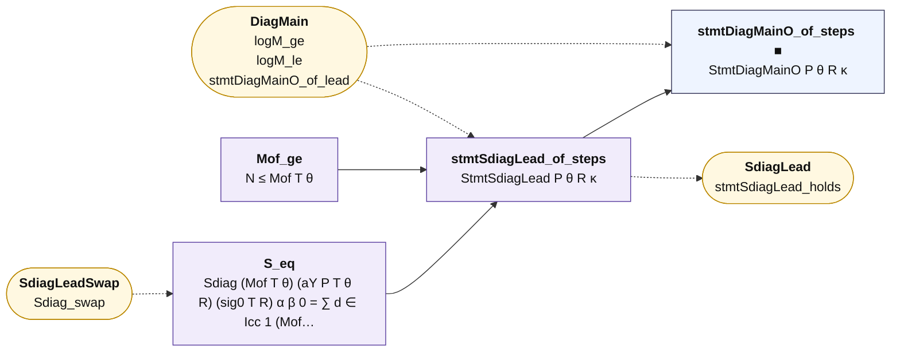

# `lean_stage3/Stage3/SdiagLeadCore.lean`

> **Read from the source text.** This file changed after the last `python3 utilities/lean_map.py --dump`, so the arrows on this page are names occurring in each proof and have not been confirmed by Lean.

# Stage3.SdiagLeadCore — the leading term of `S(α,β,0)`, Young's Lemma 7 to `o(1/L)`. 2026-11-25.

4 theorems, 5 definitions, 187 lines. 

**Imports:** [`SdiagLeadCop`](../lean_stage3/SdiagLeadCop.md)  
**Imported by:** [`SdiagLeadAd`](../lean_stage3/SdiagLeadAd.md)

## The picture



An arrow A → B reads "A is used in the proof of B". Green: counting, integers only. Violet: shape, analysis with no ζ. Blue: reads ζ. A name ending in ■ is an end: nothing else uses it. Red: contains `sorry`. Yellow: theorems in another file, counted; a dotted arrow crosses files. Definitions are not drawn; they are listed below the diagram.

## Definitions

<a name="SdiagLead-Wd"></a>
### `SdiagLead.Wd`

def · line 54

`W_d = J_{1+α+β}(d) d^{−(2+α+β)}`.

- **Is:** `` Wd (α β : ℂ) (d : ℕ) : ℂ := Jz (1 + α + β) d * (d : ℂ) ^ (-(2 + α + β)) ``
- **Built from:** [`SdiagLead.Jz`](../lean_stage3/SdiagLeadSwap.md#SdiagLead-Jz)
- **Used by 9:** [`SdiagLead.Wd_bound`](../lean_stage3/SdiagLeadAd.md#SdiagLead-Wd_bound), [`SdiagLead.perd_bound`](../lean_stage3/SdiagLeadAd.md#SdiagLead-perd_bound), [`SdiagLead.S_eq`](#SdiagLead-S_eq), [`SdiagLead.StmtAdApprox`](#SdiagLead-StmtAdApprox), [`SdiagLead.StmtDsum`](#SdiagLead-StmtDsum), [`SdiagLead.stmtSdiagLead_of_steps`](#SdiagLead-stmtSdiagLead_of_steps), [`SdiagLead.Wd_eq`](../lean_stage3/SdiagLeadDsum.md#SdiagLead-Wd_eq), [`SdiagLead.stmtDsum_of_arith`](../lean_stage3/SdiagLeadDsum.md#SdiagLead-stmtDsum_of_arith), [`SdiagLead.weight_err`](../lean_stage3/SdiagLeadDsum.md#SdiagLead-weight_err)

<a name="SdiagLead-sig"></a>
### `SdiagLead.sig`

def · line 57

`d/φ(d)`.

- **Is:** `` sig (d : ℕ) : ℝ := (d : ℝ) / (Nat.totient d : ℝ) ``
- **Used by 17:** [`SdiagLead.StmtMeanSig3`](../lean_stage3/SdiagLeadAd.md#SdiagLead-StmtMeanSig3), [`SdiagLead.StmtSdmLe`](../lean_stage3/SdiagLeadAd.md#SdiagLead-StmtSdmLe), [`SdiagLead.StmtTailAvg`](../lean_stage3/SdiagLeadAd.md#SdiagLead-StmtTailAvg), [`SdiagLead.StmtTailFixed`](../lean_stage3/SdiagLeadAd.md#SdiagLead-StmtTailFixed), [`SdiagLead.Tl`](../lean_stage3/SdiagLeadAd.md#SdiagLead-Tl), [`SdiagLead.Wd_bound`](../lean_stage3/SdiagLeadAd.md#SdiagLead-Wd_bound), [`SdiagLead.ad_bound`](../lean_stage3/SdiagLeadAd.md#SdiagLead-ad_bound), [`SdiagLead.ad_err`](../lean_stage3/SdiagLeadAd.md#SdiagLead-ad_err), [`SdiagLead.ahat0`](../lean_stage3/SdiagLeadAd.md#SdiagLead-ahat0), [`SdiagLead.ahat0_bound`](../lean_stage3/SdiagLeadAd.md#SdiagLead-ahat0_bound), [`SdiagLead.perd_bound`](../lean_stage3/SdiagLeadAd.md#SdiagLead-perd_bound), [`SdiagLead.sig_nonneg`](../lean_stage3/SdiagLeadAd.md#SdiagLead-sig_nonneg), [`SdiagLead.stmtAdApprox_of_arith`](../lean_stage3/SdiagLeadAd.md#SdiagLead-stmtAdApprox_of_arith), [`SdiagLead.Ahat`](#SdiagLead-Ahat), [`SdiagLead.StmtDivLog`](../lean_stage3/SdiagLeadDsum.md#SdiagLead-StmtDivLog), [`SdiagLead.stmtDsum_of_arith`](../lean_stage3/SdiagLeadDsum.md#SdiagLead-stmtDsum_of_arith), [`SdiagLead.weight_err`](../lean_stage3/SdiagLeadDsum.md#SdiagLead-weight_err)

<a name="SdiagLead-Ahat"></a>
### `SdiagLead.Ahat`

def · line 60

`Â_d(γ) = μ(d) (d/φ(d)) (γ P(ℓ_d) + P′(ℓ_d)/log M)`, `ℓ_d = log(M/d)/log M`.

- **Is:** `` Ahat (P : Polynomial ℝ) (M d : ℕ) (γ : ℂ) : ℂ := ((μ d : ℤ) : ℂ) * ((sig d : ℝ) : ℂ) * mainS P (Real.log M) ((M : ℝ) / d) γ ``
- **Built from:** [`SdiagLead.sig`](#SdiagLead-sig), [`SdiagLead.mainS`](../lean_stage3/SdiagLeadSmooth.md#SdiagLead-mainS)
- **Used by 6:** [`SdiagLead.AA_eq`](../lean_stage3/SdiagLeadAd.md#SdiagLead-AA_eq), [`SdiagLead.perd_bound`](../lean_stage3/SdiagLeadAd.md#SdiagLead-perd_bound), [`SdiagLead.StmtAdApprox`](#SdiagLead-StmtAdApprox), [`SdiagLead.StmtDsum`](#SdiagLead-StmtDsum), [`SdiagLead.stmtSdiagLead_of_steps`](#SdiagLead-stmtSdiagLead_of_steps), [`SdiagLead.stmtDsum_of_arith`](../lean_stage3/SdiagLeadDsum.md#SdiagLead-stmtDsum_of_arith)

<a name="SdiagLead-StmtAdApprox"></a>
### `SdiagLead.StmtAdApprox`

def · line 73

OPEN, (2) the per-`d` step on average: `A_d(γ) = Â_d(γ) + error`, the errors summed against `‖W_d‖` are `o(1/log M)`, uniformly in `‖α‖ log M, ‖β‖ log M ≤ A`. Route: `μ(dn) = μ(d)μ(n)1_{(n,d)=1}`, `μ·1_{(·,d)=1} = μ * 1_{rad(·)|d}`, `A_d(γ) = μ(d) Σ_{m ∈ ⟨d⟩} m^{−(1+γ)} Smu(M/(dm), γ)`, `muSmoothR` for `M/(dm) ≥ Y` and `muSmooth_crude` below; the tails on average over `d` (`Σ_m (1 + log m)/(m rad m) < ∞`).

- **Is:** `` StmtAdApprox (P : Polynomial ℝ) (A : ℝ) : Prop := ∀ ε : ℝ, 0 < ε → ∃ N₀ : ℕ, ∀ M : ℕ, N₀ ≤ M → ∀ α β : ℂ, ‖α‖ * Real.log M ≤ A → ‖β‖ * Real.log M ≤ A → ∑ d ∈ Icc 1 M, ‖Wd α β d‖ * ‖Ad P M d β * Ad P M d α - Ahat P M d β * Ahat P M d α‖ ≤ ε / Real.log M ``
- **Built from:** [`SdiagLead.Ahat`](#SdiagLead-Ahat), [`SdiagLead.Wd`](#SdiagLead-Wd), [`SdiagLead.Ad`](../lean_stage3/SdiagLeadSwap.md#SdiagLead-Ad)
- **Used by 3:** [`SdiagLead.stmtAdApprox_of_arith`](../lean_stage3/SdiagLeadAd.md#SdiagLead-stmtAdApprox_of_arith), [`SdiagLead.stmtDiagMainO_of_steps`](#SdiagLead-stmtDiagMainO_of_steps), [`SdiagLead.stmtSdiagLead_of_steps`](#SdiagLead-stmtSdiagLead_of_steps)

<a name="SdiagLead-StmtDsum"></a>
### `SdiagLead.StmtDsum`

def · line 83

OPEN, (3) the `d`-sum: `Σ_{d ≤ M} W_d Â_d(β) Â_d(α) = I(α,β)/log M + o(1/log M)`. Route: `W_d (d/φ(d))² μ²(d) = μ²(d)/φ(d) · Π_{p|d}(1 − p^{−1−α−β})/(1 − p^{−1})`, the product `1 + O(Σ_{p | d} log p/(p log M))`; `Σ_{d ≤ x} μ²(d)/φ(d) = log x + O(1)` and partial summation against `F(ℓ) = (P′(ℓ) + β log M P(ℓ))(P′(ℓ) + α log M P(ℓ))/log² M`.

- **Is:** `` StmtDsum (P : Polynomial ℝ) (A : ℝ) : Prop := ∀ ε : ℝ, 0 < ε → ∃ N₀ : ℕ, ∀ M : ℕ, N₀ ≤ M → ∀ α β : ℂ, ‖α‖ * Real.log M ≤ A → ‖β‖ * Real.log M ≤ A → ‖∑ d ∈ Icc 1 M, Wd α β d * Ahat P M d β * Ahat P M d α - IY P M α β / (Real.log M : ℂ)‖ ≤ ε / Real.log M ``
- **Built from:** [`DiagMain.IY`](../lean_stage3/DiagMain.md#DiagMain-IY), [`SdiagLead.Ahat`](#SdiagLead-Ahat), [`SdiagLead.Wd`](#SdiagLead-Wd)
- **Used by 3:** [`SdiagLead.stmtDiagMainO_of_steps`](#SdiagLead-stmtDiagMainO_of_steps), [`SdiagLead.stmtSdiagLead_of_steps`](#SdiagLead-stmtSdiagLead_of_steps), [`SdiagLead.stmtDsum_of_arith`](../lean_stage3/SdiagLeadDsum.md#SdiagLead-stmtDsum_of_arith)

## Theorems

<a name="SdiagLead-S_eq"></a>
### `SdiagLead.S_eq`

line 63 · arrows read from text

**Shape.** Uses real or complex analysis; nothing in it or beneath it reads ζ.

**Proves**

```lean
Sdiag (Mof T θ) (aY P T θ R) (sig0 T R) α β 0 = ∑ d ∈ Icc 1 (Mof T θ), Wd α β d * Ad P (Mof T θ) d β * Ad P (Mof T θ) d α
```

**Needs** (its hypotheses)

  - `` P : Polynomial ℝ ``
  - `` T θ R : ℝ ``
  - `` α β : ℂ ``

**Fed by** (1 theorem its proof uses)

  - [`SdiagLead.Sdiag_swap`](../lean_stage3/SdiagLeadSwap.md#SdiagLead-Sdiag_swap) (SdiagLeadSwap) — `` Sdiag (Mof T θ) (aY P T θ R) (sig0 T R) α β 0 = ∑ d ∈ Icc 1 (Mof T θ), Jz (1 + α + β) d * (d : ℂ) ^ (-(2 + α + β)) * Ad P (Mof T θ) d β * Ad P (Mof T … ``

**Definitions its proof touches:** [`Diagonal.Sdiag`](../lean_stage3/Diagonal.md#Diagonal-Sdiag), [`SdiagLead.Wd`](#SdiagLead-Wd), [`SdiagLead.Ad`](../lean_stage3/SdiagLeadSwap.md#SdiagLead-Ad), [`TwistedMoment.Mof`](../lean_stage3/TwistedMoment.md#TwistedMoment-Mof), [`TwistedMoment.aY`](../lean_stage3/TwistedMoment.md#TwistedMoment-aY), [`TwistedMoment.sig0`](../lean_stage3/TwistedMoment.md#TwistedMoment-sig0)

**Feeds** (1 that use it)

  - [`SdiagLead.stmtSdiagLead_of_steps`](#SdiagLead-stmtSdiagLead_of_steps) — `` StmtSdiagLead P θ R κ ``

<a name="SdiagLead-Mof_ge"></a>
### `SdiagLead.Mof_ge`

line 90 · arrows read from text

**Shape.** Uses real or complex analysis; nothing in it or beneath it reads ζ.

**Why.** `N ≤ M = ⌊T^θ⌋` once `log T ≥ log(N+1)/θ`.

**Proves**

```lean
N ≤ Mof T θ
```

**Needs** (its hypotheses)

  - `` hT : 1 < T ``
  - `` hθ : 0 < θ ``
  - `` hN : Real.log (N + 1) / θ ≤ Real.log T ``

**Fed by:** no theorem of this repo; it stands on Mathlib and the definitions below.

**Definitions its proof touches:** [`TwistedMoment.Mof`](../lean_stage3/TwistedMoment.md#TwistedMoment-Mof)

**Feeds** (1 that use it)

  - [`SdiagLead.stmtSdiagLead_of_steps`](#SdiagLead-stmtSdiagLead_of_steps) — `` StmtSdiagLead P θ R κ ``

<a name="SdiagLead-stmtSdiagLead_of_steps"></a>
### `SdiagLead.stmtSdiagLead_of_steps`

line 103 · arrows read from text

**Shape.** Uses real or complex analysis; nothing in it or beneath it reads ζ.

**Why.** The composition: (1) exact, (2) and (3) with `A = κθ` give `StmtSdiagLead`.

**Proves**

```lean
StmtSdiagLead P θ R κ
```

**Needs** (its hypotheses)

  - `` P : Polynomial ℝ ``
  - `` hθ0 : 0 < θ ``
  - `` R : ℝ ``
  - `` hκ : 0 < κ ``
  - `` h2 : StmtAdApprox P (κ * θ) ``
  - `` h3 : StmtDsum P (κ * θ) ``

**Fed by** (4 theorems its proof uses)

  - [`DiagMain.logM_ge`](../lean_stage3/DiagMain.md#DiagMain-logM_ge) (DiagMain) — `` θ * Real.log T / 2 ≤ Real.log (Mof T θ) ``
  - [`DiagMain.logM_le`](../lean_stage3/DiagMain.md#DiagMain-logM_le) (DiagMain) — `` Real.log (Mof T θ) ≤ θ * Real.log T ``
  - [`SdiagLead.Mof_ge`](#SdiagLead-Mof_ge) — `` N ≤ Mof T θ ``
  - [`SdiagLead.S_eq`](#SdiagLead-S_eq) — `` Sdiag (Mof T θ) (aY P T θ R) (sig0 T R) α β 0 = ∑ d ∈ Icc 1 (Mof T θ), Wd α β d * Ad P (Mof T θ) d β * Ad P (Mof T θ) d α ``

**Definitions its proof touches:** [`DiagMain.IY`](../lean_stage3/DiagMain.md#DiagMain-IY), [`DiagMain.StmtSdiagLead`](../lean_stage3/DiagMain.md#DiagMain-StmtSdiagLead), [`SdiagLead.Ahat`](#SdiagLead-Ahat), [`SdiagLead.StmtAdApprox`](#SdiagLead-StmtAdApprox), [`SdiagLead.StmtDsum`](#SdiagLead-StmtDsum), [`SdiagLead.Wd`](#SdiagLead-Wd), [`SdiagLead.Ad`](../lean_stage3/SdiagLeadSwap.md#SdiagLead-Ad), [`TwistedMoment.Mof`](../lean_stage3/TwistedMoment.md#TwistedMoment-Mof)

**Feeds** (2 that use it)

  - [`SdiagLead.stmtSdiagLead_holds`](../lean_stage3/SdiagLead.md#SdiagLead-stmtSdiagLead_holds) (SdiagLead) — `` StmtSdiagLead P θ R κ ``
  - [`SdiagLead.stmtDiagMainO_of_steps`](#SdiagLead-stmtDiagMainO_of_steps) — `` StmtDiagMainO P θ R κ ``

<a name="SdiagLead-stmtDiagMainO_of_steps"></a>
### `SdiagLead.stmtDiagMainO_of_steps`

line 167 · arrows read from text

**Reads ζ.** It, or something it rests on, uses the zeta function, its zeros or the Riemann hypothesis.

**Why.** The corollary through the Taylor step: (2) and (3) give `StmtDiagMainO`.

**Proves**

```lean
StmtDiagMainO P θ R κ
```

**Needs** (its hypotheses)

  - `` P : Polynomial ℝ ``
  - `` hθ0 : 0 < θ ``
  - `` R : ℝ ``
  - `` hκ : 0 < κ ``
  - `` h2 : StmtAdApprox P (κ * θ) ``
  - `` h3 : StmtDsum P (κ * θ) ``

**Fed by** (2 theorems its proof uses)

  - [`DiagMain.stmtDiagMainO_of_lead`](../lean_stage3/DiagMain.md#DiagMain-stmtDiagMainO_of_lead) (DiagMain) — `` StmtDiagMainO P θ R κ ``
  - [`SdiagLead.stmtSdiagLead_of_steps`](#SdiagLead-stmtSdiagLead_of_steps) — `` StmtSdiagLead P θ R κ ``

**Definitions its proof touches:** [`DiagMainStmt.StmtDiagMainO`](../lean_stage3/DiagMainStmt.md#DiagMainStmt-StmtDiagMainO), [`SdiagLead.StmtAdApprox`](#SdiagLead-StmtAdApprox), [`SdiagLead.StmtDsum`](#SdiagLead-StmtDsum)

**Feeds:** nothing. It is an end.

