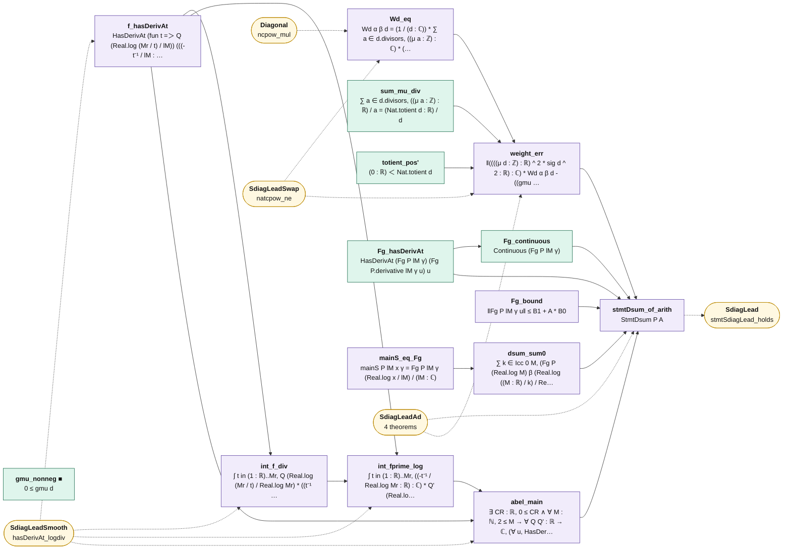

# `lean_stage3/Stage3/SdiagLeadDsum.lean`

> **Read from the source text.** This file changed after the last `python3 utilities/lean_map.py --dump`, so the arrows on this page are names occurring in each proof and have not been confirmed by Lean.

# Stage3.SdiagLeadDsum — layer (3), the `d`-sum, from two arithmetic facts. 2026-11-25.

15 theorems, 4 definitions, 569 lines. 

**Imports:** [`SdiagLeadAd`](../lean_stage3/SdiagLeadAd.md)  
**Imported by:** [`SdiagLead`](../lean_stage3/SdiagLead.md)

## The picture



An arrow A → B reads "A is used in the proof of B". Green: counting, integers only. Violet: shape, analysis with no ζ. Blue: reads ζ. A name ending in ■ is an end: nothing else uses it. Red: contains `sorry`. Yellow: theorems in another file, counted; a dotted arrow crosses files. Definitions are not drawn; they are listed below the diagram.

## Definitions

<a name="SdiagLead-gmu"></a>
### `SdiagLead.gmu`

def · line 40

`μ²(d)/φ(d)`.

- **Is:** `` gmu (d : ℕ) : ℝ := ((μ d : ℤ) : ℝ) ^ 2 / (Nat.totient d : ℝ) ``
- **Used by 6:** [`SdiagLead.StmtGmuLog`](#SdiagLead-StmtGmuLog), [`SdiagLead.abel_main`](#SdiagLead-abel_main), [`SdiagLead.dsum_sum0`](#SdiagLead-dsum_sum0), [`SdiagLead.gmu_nonneg`](#SdiagLead-gmu_nonneg), [`SdiagLead.stmtDsum_of_arith`](#SdiagLead-stmtDsum_of_arith), [`SdiagLead.weight_err`](#SdiagLead-weight_err)

<a name="SdiagLead-StmtGmuLog"></a>
### `SdiagLead.StmtGmuLog`

def · line 43

OPEN, `Σ_{d ≤ t} μ²(d)/φ(d) = log t + O(1)`.

- **Is:** `` StmtGmuLog : Prop := ∃ C : ℝ, 0 ≤ C ∧ ∀ t : ℝ, 1 ≤ t → |∑ k ∈ Icc 0 ⌊t⌋₊, gmu k - Real.log t| ≤ C ``
- **Built from:** [`SdiagLead.gmu`](#SdiagLead-gmu)
- **Used by 3:** [`SdiagLead.StmtArith`](../lean_stage3/SdiagLead.md#SdiagLead-StmtArith), [`SdiagLead.abel_main`](#SdiagLead-abel_main), [`SdiagLead.stmtDsum_of_arith`](#SdiagLead-stmtDsum_of_arith)

<a name="SdiagLead-StmtDivLog"></a>
### `SdiagLead.StmtDivLog`

def · line 47

OPEN, `Σ_{d ≤ M} μ²(d) σ(d)²/d · Σ_{a | d} log a/a ≤ C(1 + log M)`.

- **Is:** `` StmtDivLog : Prop := ∃ C : ℝ, 0 ≤ C ∧ ∀ M : ℕ, ∑ d ∈ Icc 1 M, ((μ d : ℤ) : ℝ) ^ 2 * sig d ^ 2 / d * (∑ a ∈ d.divisors, Real.log a / a) ≤ C * (1 + Real.log M) ``
- **Built from:** [`SdiagLead.sig`](../lean_stage3/SdiagLeadCore.md#SdiagLead-sig)
- **Used by 2:** [`SdiagLead.StmtArith`](../lean_stage3/SdiagLead.md#SdiagLead-StmtArith), [`SdiagLead.stmtDsum_of_arith`](#SdiagLead-stmtDsum_of_arith)

<a name="SdiagLead-Fg"></a>
### `SdiagLead.Fg`

def · line 375

`F_γ(u) = P′(u) + γλP(u)`, so `mainS(x, γ) = F_γ(ℓ)/λ`.

- **Is:** `` Fg (P : Polynomial ℝ) (lM : ℝ) (γ : ℂ) (u : ℝ) : ℂ := ((P.derivative.eval u : ℝ) : ℂ) + γ * (lM : ℂ) * ((P.eval u : ℝ) : ℂ) ``
- **Used by 6:** [`SdiagLead.Fg_bound`](#SdiagLead-Fg_bound), [`SdiagLead.Fg_continuous`](#SdiagLead-Fg_continuous), [`SdiagLead.Fg_hasDerivAt`](#SdiagLead-Fg_hasDerivAt), [`SdiagLead.dsum_sum0`](#SdiagLead-dsum_sum0), [`SdiagLead.mainS_eq_Fg`](#SdiagLead-mainS_eq_Fg), [`SdiagLead.stmtDsum_of_arith`](#SdiagLead-stmtDsum_of_arith)

## Theorems

<a name="SdiagLead-Wd_eq"></a>
### `SdiagLead.Wd_eq`

line 54 · arrows read from text

**Shape.** Uses real or complex analysis; nothing in it or beneath it reads ζ.

**Why.** `W_d = (1/d) Σ_{a | d} μ(a) a^{−(1+α+β)}`.

**Proves**

```lean
Wd α β d = (1 / (d : ℂ)) * ∑ a ∈ d.divisors, ((μ a : ℤ) : ℂ) * (a : ℂ) ^ (-(1 + α + β))
```

**Needs** (its hypotheses)

  - `` α β : ℂ ``
  - `` hd : 1 ≤ d ``

**Fed by** (2 theorems its proof uses)

  - [`Diagonal.ncpow_mul`](../lean_stage3/Diagonal.md#Diagonal-ncpow_mul) (Diagonal) — `` ((m * n : ℕ) : ℂ) ^ z = (m : ℂ) ^ z * (n : ℂ) ^ z ``
  - [`SdiagLead.natcpow_ne`](../lean_stage3/SdiagLeadSwap.md#SdiagLead-natcpow_ne) (SdiagLeadSwap) — `` (n : ℂ) ≠ 0 ``

**Definitions its proof touches:** [`SdiagLead.Wd`](../lean_stage3/SdiagLeadCore.md#SdiagLead-Wd), [`SdiagLead.Jz`](../lean_stage3/SdiagLeadSwap.md#SdiagLead-Jz)

**Feeds** (1 that use it)

  - [`SdiagLead.weight_err`](#SdiagLead-weight_err) — `` ‖((((μ d : ℤ) : ℝ) ^ 2 * sig d ^ 2 : ℝ) : ℂ) * Wd α β d - ((gmu d : ℝ) : ℂ)‖ ≤ ((μ d : ℤ) : ℝ) ^ 2 * sig d ^ 2 / d * (2 * A * Real.exp (2 * A) / Real.… ``

<a name="SdiagLead-sum_mu_div"></a>
### `SdiagLead.sum_mu_div`

line 81 · arrows read from text

**Counting.** Integers only: nothing in its statement or proof, or in anything it rests on, uses analysis or ζ.

**Why.** `Σ_{a | d} μ(a)/a = φ(d)/d`.

**Proves**

```lean
∑ a ∈ d.divisors, ((μ a : ℤ) : ℝ) / a = (Nat.totient d : ℝ) / d
```

**Needs** (its hypotheses)

  - `` hd : 1 ≤ d ``

**Fed by:** no theorem of this repo; it stands on Mathlib.

**Feeds** (1 that use it)

  - [`SdiagLead.weight_err`](#SdiagLead-weight_err) — `` ‖((((μ d : ℤ) : ℝ) ^ 2 * sig d ^ 2 : ℝ) : ℂ) * Wd α β d - ((gmu d : ℝ) : ℂ)‖ ≤ ((μ d : ℤ) : ℝ) ^ 2 * sig d ^ 2 / d * (2 * A * Real.exp (2 * A) / Real.… ``

<a name="SdiagLead-totient_pos-"></a>
### `SdiagLead.totient_pos'`

line 95 · arrows read from text

**Counting.** Integers only: nothing in its statement or proof, or in anything it rests on, uses analysis or ζ.

**Proves**

```lean
(0 : ℝ) < Nat.totient d
```

**Needs** (its hypotheses)

  - `` hd : 1 ≤ d ``

**Fed by:** no theorem of this repo; it stands on Mathlib.

**Feeds** (1 that use it)

  - [`SdiagLead.weight_err`](#SdiagLead-weight_err) — `` ‖((((μ d : ℤ) : ℝ) ^ 2 * sig d ^ 2 : ℝ) : ℂ) * Wd α β d - ((gmu d : ℝ) : ℂ)‖ ≤ ((μ d : ℤ) : ℝ) ^ 2 * sig d ^ 2 / d * (2 * A * Real.exp (2 * A) / Real.… ``

<a name="SdiagLead-weight_err"></a>
### `SdiagLead.weight_err`

line 99 · arrows read from text

**Shape.** Uses real or complex analysis; nothing in it or beneath it reads ζ.

**Why.** The weight error: `‖μ²σ²W_d − μ²/φ(d)‖ ≤ μ²σ²/d · (2A e^{2A}/λ) Σ_{a|d} log a/a`.

**Proves**

```lean
‖((((μ d : ℤ) : ℝ) ^ 2 * sig d ^ 2 : ℝ) : ℂ) * Wd α β d - ((gmu d : ℝ) : ℂ)‖ ≤ ((μ d : ℤ) : ℝ) ^ 2 * sig d ^ 2 / d * (2 * A * Real.exp (2 * A) / Real.log M) * ∑ a ∈ d.divisors, Real.log a / a
```

**Needs** (its hypotheses)

  - `` hd : 1 ≤ d ``
  - `` hdM : d ≤ M ``
  - `` hlM : 0 < Real.log M ``
  - `` hα : ‖α‖ * Real.log M ≤ A ``
  - `` hβ : ‖β‖ * Real.log M ≤ A ``

**Fed by** (6 theorems its proof uses)

  - [`SdiagLead.norm_ncpow_sub_one_le`](../lean_stage3/SdiagLeadAd.md#SdiagLead-norm_ncpow_sub_one_le) (SdiagLeadAd) — `` ‖(m : ℂ) ^ (-γ) - 1‖ ≤ ‖γ‖ * Real.log m * Real.exp A ``
  - [`SdiagLead.sig_nonneg`](../lean_stage3/SdiagLeadAd.md#SdiagLead-sig_nonneg) (SdiagLeadAd) — `` 0 ≤ sig d ``
  - [`SdiagLead.Wd_eq`](#SdiagLead-Wd_eq) — `` Wd α β d = (1 / (d : ℂ)) * ∑ a ∈ d.divisors, ((μ a : ℤ) : ℂ) * (a : ℂ) ^ (-(1 + α + β)) ``
  - [`SdiagLead.sum_mu_div`](#SdiagLead-sum_mu_div) — `` ∑ a ∈ d.divisors, ((μ a : ℤ) : ℝ) / a = (Nat.totient d : ℝ) / d ``
  - [`SdiagLead.totient_pos'`](#SdiagLead-totient_pos-) — `` (0 : ℝ) < Nat.totient d ``
  - [`SdiagLead.natcpow_ne`](../lean_stage3/SdiagLeadSwap.md#SdiagLead-natcpow_ne) (SdiagLeadSwap) — `` (n : ℂ) ≠ 0 ``

**Definitions its proof touches:** [`SdiagLead.Wd`](../lean_stage3/SdiagLeadCore.md#SdiagLead-Wd), [`SdiagLead.sig`](../lean_stage3/SdiagLeadCore.md#SdiagLead-sig), [`SdiagLead.gmu`](#SdiagLead-gmu)

**Feeds** (1 that use it)

  - [`SdiagLead.stmtDsum_of_arith`](#SdiagLead-stmtDsum_of_arith) — `` StmtDsum P A ``

<a name="SdiagLead-f_hasDerivAt"></a>
### `SdiagLead.f_hasDerivAt`

line 173 · arrows read from text

**Shape.** Uses real or complex analysis; nothing in it or beneath it reads ζ.

**Why.** `ℓ(t) = log(M/t)/λ` has derivative `−t⁻¹/λ`; `f = Q ∘ ℓ`.

**Proves**

```lean
HasDerivAt (fun t => Q (Real.log (Mr / t) / lM)) (((-t⁻¹ / lM : ℝ) : ℂ) * Q' (Real.log (Mr / t) / lM)) t
```

**Needs** (its hypotheses)

  - `` hQ : ∀ u, HasDerivAt Q (Q' u) u ``
  - `` hM : 0 < Mr ``
  - `` ht : 0 < t ``

**Fed by** (1 theorem its proof uses)

  - [`SdiagLead.hasDerivAt_logdiv`](../lean_stage3/SdiagLeadSmooth.md#SdiagLead-hasDerivAt_logdiv) (SdiagLeadSmooth) — `` HasDerivAt (fun t : ℝ => Real.log (x / t)) (-s⁻¹) s ``

**Feeds** (3 that use it)

  - [`SdiagLead.abel_main`](#SdiagLead-abel_main) — `` ∃ CR : ℝ, 0 ≤ CR ∧ ∀ M : ℕ, 2 ≤ M → ∀ Q Q' : ℝ → ℂ, (∀ u, HasDerivAt Q (Q' u) u) → Continuous Q' → ∀ B B' : ℝ, ‖Q 0‖ ≤ B → (∀ u ∈ Set.Icc (0 : ℝ) 1, ‖… ``
  - [`SdiagLead.int_f_div`](#SdiagLead-int_f_div) — `` ∫ t in (1 : ℝ)..Mr, Q (Real.log (Mr / t) / Real.log Mr) * ((t⁻¹ : ℝ) : ℂ) = (Real.log Mr : ℂ) * ∫ u in (0 : ℝ)..1, Q u ``
  - [`SdiagLead.int_fprime_log`](#SdiagLead-int_fprime_log) — `` ∫ t in (1 : ℝ)..Mr, ((-t⁻¹ / Real.log Mr : ℝ) : ℂ) * Q' (Real.log (Mr / t) / Real.log Mr) * (Real.log t : ℂ) = Q 0 * Real.log Mr - (Real.log Mr : ℂ) *… ``

<a name="SdiagLead-int_f_div"></a>
### `SdiagLead.int_f_div`

line 183 · arrows read from text

**Shape.** Uses real or complex analysis; nothing in it or beneath it reads ζ.

**Why.** `∫₁^M Q(ℓ(t))/t dt = λ ∫₀¹ Q`, `λ = log M`.

**Proves**

```lean
∫ t in (1 : ℝ)..Mr, Q (Real.log (Mr / t) / Real.log Mr) * ((t⁻¹ : ℝ) : ℂ) = (Real.log Mr : ℂ) * ∫ u in (0 : ℝ)..1, Q u
```

**Needs** (its hypotheses)

  - `` hQc : Continuous Q ``
  - `` hM : 1 < Mr ``

**Fed by** (2 theorems its proof uses)

  - [`SdiagLead.f_hasDerivAt`](#SdiagLead-f_hasDerivAt) — `` HasDerivAt (fun t => Q (Real.log (Mr / t) / lM)) (((-t⁻¹ / lM : ℝ) : ℂ) * Q' (Real.log (Mr / t) / lM)) t ``
  - [`SdiagLead.hasDerivAt_logdiv`](../lean_stage3/SdiagLeadSmooth.md#SdiagLead-hasDerivAt_logdiv) (SdiagLeadSmooth) — `` HasDerivAt (fun t : ℝ => Real.log (x / t)) (-s⁻¹) s ``

**Feeds** (1 that use it)

  - [`SdiagLead.int_fprime_log`](#SdiagLead-int_fprime_log) — `` ∫ t in (1 : ℝ)..Mr, ((-t⁻¹ / Real.log Mr : ℝ) : ℂ) * Q' (Real.log (Mr / t) / Real.log Mr) * (Real.log t : ℂ) = Q 0 * Real.log Mr - (Real.log Mr : ℂ) *… ``

<a name="SdiagLead-int_fprime_log"></a>
### `SdiagLead.int_fprime_log`

line 213 · arrows read from text

**Shape.** Uses real or complex analysis; nothing in it or beneath it reads ζ.

**Why.** `∫₁^M f′(t) log t dt = Q(0) λ − λ ∫₀¹ Q`.

**Proves**

```lean
∫ t in (1 : ℝ)..Mr, ((-t⁻¹ / Real.log Mr : ℝ) : ℂ) * Q' (Real.log (Mr / t) / Real.log Mr) * (Real.log t : ℂ) = Q 0 * Real.log Mr - (Real.log Mr : ℂ) * ∫ u in (0 : ℝ)..1, Q u
```

**Needs** (its hypotheses)

  - `` hQ : ∀ u, HasDerivAt Q (Q' u) u ``
  - `` hQ'c : Continuous Q' ``
  - `` hM : 1 < Mr ``

**Fed by** (3 theorems its proof uses)

  - [`SdiagLead.f_hasDerivAt`](#SdiagLead-f_hasDerivAt) — `` HasDerivAt (fun t => Q (Real.log (Mr / t) / lM)) (((-t⁻¹ / lM : ℝ) : ℂ) * Q' (Real.log (Mr / t) / lM)) t ``
  - [`SdiagLead.int_f_div`](#SdiagLead-int_f_div) — `` ∫ t in (1 : ℝ)..Mr, Q (Real.log (Mr / t) / Real.log Mr) * ((t⁻¹ : ℝ) : ℂ) = (Real.log Mr : ℂ) * ∫ u in (0 : ℝ)..1, Q u ``
  - [`SdiagLead.hasDerivAt_logdiv`](../lean_stage3/SdiagLeadSmooth.md#SdiagLead-hasDerivAt_logdiv) (SdiagLeadSmooth) — `` HasDerivAt (fun t : ℝ => Real.log (x / t)) (-s⁻¹) s ``

**Feeds** (1 that use it)

  - [`SdiagLead.abel_main`](#SdiagLead-abel_main) — `` ∃ CR : ℝ, 0 ≤ CR ∧ ∀ M : ℕ, 2 ≤ M → ∀ Q Q' : ℝ → ℂ, (∀ u, HasDerivAt Q (Q' u) u) → Continuous Q' → ∀ B B' : ℝ, ‖Q 0‖ ≤ B → (∀ u ∈ Set.Icc (0 : ℝ) 1, ‖… ``

<a name="SdiagLead-gmu_nonneg"></a>
### `SdiagLead.gmu_nonneg`

line 255 · arrows read from text

**Counting.** Integers only: nothing in its statement or proof, or in anything it rests on, uses analysis or ζ.

**Proves**

```lean
0 ≤ gmu d
```

**Needs** (its hypotheses)

  - `` d : ℕ ``

**Fed by:** no theorem of this repo; it stands on Mathlib and the definitions below.

**Definitions its proof touches:** [`SdiagLead.gmu`](#SdiagLead-gmu)

**Feeds:** nothing. It is an end.

<a name="SdiagLead-abel_main"></a>
### `SdiagLead.abel_main`

line 258 · arrows read from text

**Shape.** Uses real or complex analysis; nothing in it or beneath it reads ζ.

**Why.** Abel summation: `‖Σ_{k ≤ M} Q(ℓ_k) μ²(k)/φ(k) − λ ∫₀¹ Q‖ ≤ C_R(B + B′)`.

**Proves**

```lean
∃ CR : ℝ, 0 ≤ CR ∧ ∀ M : ℕ, 2 ≤ M → ∀ Q Q' : ℝ → ℂ, (∀ u, HasDerivAt Q (Q' u) u) → Continuous Q' → ∀ B B' : ℝ, ‖Q 0‖ ≤ B → (∀ u ∈ Set.Icc (0 : ℝ) 1, ‖Q' u‖ ≤ B') → ‖∑ k ∈ Icc 0 M, Q (Real.log ((M : ℝ) / k) / Real.log M) * ((gmu k : ℝ) : ℂ) - (Real.log M : ℂ) * ∫ u in (0 : ℝ)..1, Q u‖ ≤ CR * (B + B')
```

**Needs** (its hypotheses)

  - `` hG : StmtGmuLog ``

**Fed by** (3 theorems its proof uses)

  - [`SdiagLead.f_hasDerivAt`](#SdiagLead-f_hasDerivAt) — `` HasDerivAt (fun t => Q (Real.log (Mr / t) / lM)) (((-t⁻¹ / lM : ℝ) : ℂ) * Q' (Real.log (Mr / t) / lM)) t ``
  - [`SdiagLead.int_fprime_log`](#SdiagLead-int_fprime_log) — `` ∫ t in (1 : ℝ)..Mr, ((-t⁻¹ / Real.log Mr : ℝ) : ℂ) * Q' (Real.log (Mr / t) / Real.log Mr) * (Real.log t : ℂ) = Q 0 * Real.log Mr - (Real.log Mr : ℂ) *… ``
  - [`SdiagLead.hasDerivAt_logdiv`](../lean_stage3/SdiagLeadSmooth.md#SdiagLead-hasDerivAt_logdiv) (SdiagLeadSmooth) — `` HasDerivAt (fun t : ℝ => Real.log (x / t)) (-s⁻¹) s ``

**Definitions its proof touches:** [`SdiagLead.StmtGmuLog`](#SdiagLead-StmtGmuLog), [`SdiagLead.gmu`](#SdiagLead-gmu)

**Feeds** (1 that use it)

  - [`SdiagLead.stmtDsum_of_arith`](#SdiagLead-stmtDsum_of_arith) — `` StmtDsum P A ``

<a name="SdiagLead-Fg_hasDerivAt"></a>
### `SdiagLead.Fg_hasDerivAt`

line 378 · arrows read from text

**Counting.** Integers only: nothing in its statement or proof, or in anything it rests on, uses analysis or ζ.

**Proves**

```lean
HasDerivAt (Fg P lM γ) (Fg P.derivative lM γ u) u
```

**Needs** (its hypotheses)

  - `` P : Polynomial ℝ ``
  - `` lM : ℝ ``
  - `` γ : ℂ ``
  - `` u : ℝ ``

**Fed by:** no theorem of this repo; it stands on Mathlib and the definitions below.

**Definitions its proof touches:** [`SdiagLead.Fg`](#SdiagLead-Fg)

**Feeds** (2 that use it)

  - [`SdiagLead.Fg_continuous`](#SdiagLead-Fg_continuous) — `` Continuous (Fg P lM γ) ``
  - [`SdiagLead.stmtDsum_of_arith`](#SdiagLead-stmtDsum_of_arith) — `` StmtDsum P A ``

<a name="SdiagLead-Fg_continuous"></a>
### `SdiagLead.Fg_continuous`

line 384 · arrows read from text

**Counting.** Integers only: nothing in its statement or proof, or in anything it rests on, uses analysis or ζ.

**Proves**

```lean
Continuous (Fg P lM γ)
```

**Needs** (its hypotheses)

  - `` P : Polynomial ℝ ``
  - `` lM : ℝ ``
  - `` γ : ℂ ``

**Fed by** (1 theorem its proof uses)

  - [`SdiagLead.Fg_hasDerivAt`](#SdiagLead-Fg_hasDerivAt) — `` HasDerivAt (Fg P lM γ) (Fg P.derivative lM γ u) u ``

**Definitions its proof touches:** [`SdiagLead.Fg`](#SdiagLead-Fg)

**Feeds** (1 that use it)

  - [`SdiagLead.stmtDsum_of_arith`](#SdiagLead-stmtDsum_of_arith) — `` StmtDsum P A ``

<a name="SdiagLead-Fg_bound"></a>
### `SdiagLead.Fg_bound`

line 387 · arrows read from text

**Shape.** Uses real or complex analysis; nothing in it or beneath it reads ζ.

**Proves**

```lean
‖Fg P lM γ u‖ ≤ B1 + A * B0
```

**Needs** (its hypotheses)

  - `` P : Polynomial ℝ ``
  - `` hB0 : ∀ u ∈ Set.Icc (0 : ℝ) 1, |P.eval u| ≤ B0 ``
  - `` hB1 : ∀ u ∈ Set.Icc (0 : ℝ) 1, |P.derivative.eval u| ≤ B1 ``
  - `` hl : 0 < lM ``
  - `` hγ : ‖γ‖ * lM ≤ A ``
  - `` hA : 0 ≤ A ``
  - `` hu : u ∈ Set.Icc (0 : ℝ) 1 ``

**Fed by:** no theorem of this repo; it stands on Mathlib and the definitions below.

**Definitions its proof touches:** [`SdiagLead.Fg`](#SdiagLead-Fg)

**Feeds** (1 that use it)

  - [`SdiagLead.stmtDsum_of_arith`](#SdiagLead-stmtDsum_of_arith) — `` StmtDsum P A ``

<a name="SdiagLead-mainS_eq_Fg"></a>
### `SdiagLead.mainS_eq_Fg`

line 400 · arrows read from text

**Shape.** Uses real or complex analysis; nothing in it or beneath it reads ζ.

**Proves**

```lean
mainS P lM x γ = Fg P lM γ (Real.log x / lM) / (lM : ℂ)
```

**Needs** (its hypotheses)

  - `` P : Polynomial ℝ ``
  - `` hl : 0 < lM ``
  - `` x : ℝ ``
  - `` γ : ℂ ``

**Fed by:** no theorem of this repo; it stands on Mathlib and the definitions below.

**Definitions its proof touches:** [`SdiagLead.Fg`](#SdiagLead-Fg), [`SdiagLead.mainS`](../lean_stage3/SdiagLeadSmooth.md#SdiagLead-mainS)

**Feeds** (1 that use it)

  - [`SdiagLead.dsum_sum0`](#SdiagLead-dsum_sum0) — `` ∑ k ∈ Icc 0 M, (Fg P (Real.log M) β (Real.log ((M : ℝ) / k) / Real.log M) * Fg P (Real.log M) α (Real.log ((M : ℝ) / k) / Real.log M)) * ((gmu k : ℝ) … ``

<a name="SdiagLead-dsum_sum0"></a>
### `SdiagLead.dsum_sum0`

line 406 · arrows read from text

**Shape.** Uses real or complex analysis; nothing in it or beneath it reads ζ.

**Proves**

```lean
∑ k ∈ Icc 0 M, (Fg P (Real.log M) β (Real.log ((M : ℝ) / k) / Real.log M) * Fg P (Real.log M) α (Real.log ((M : ℝ) / k) / Real.log M)) * ((gmu k : ℝ) : ℂ) = (Real.log M : ℂ) ^ 2 * ∑ d ∈ Icc 1 M, ((gmu d : ℝ) : ℂ) * (mainS P (Real.log M) ((M : ℝ) / d) β * mainS P (Real.log M) ((M : ℝ) / d) α)
```

**Needs** (its hypotheses)

  - `` P : Polynomial ℝ ``
  - `` hl : 0 < Real.log M ``
  - `` α β : ℂ ``

**Fed by** (1 theorem its proof uses)

  - [`SdiagLead.mainS_eq_Fg`](#SdiagLead-mainS_eq_Fg) — `` mainS P lM x γ = Fg P lM γ (Real.log x / lM) / (lM : ℂ) ``

**Definitions its proof touches:** [`SdiagLead.Fg`](#SdiagLead-Fg), [`SdiagLead.gmu`](#SdiagLead-gmu), [`SdiagLead.mainS`](../lean_stage3/SdiagLeadSmooth.md#SdiagLead-mainS)

**Feeds** (1 that use it)

  - [`SdiagLead.stmtDsum_of_arith`](#SdiagLead-stmtDsum_of_arith) — `` StmtDsum P A ``

<a name="SdiagLead-stmtDsum_of_arith"></a>
### `SdiagLead.stmtDsum_of_arith`

line 423 · arrows read from text

**Shape.** Uses real or complex analysis; nothing in it or beneath it reads ζ.

**Why.** Layer (3) from the arithmetic: `StmtGmuLog` and `StmtDivLog` give `StmtDsum P A`.

**Proves**

```lean
StmtDsum P A
```

**Needs** (its hypotheses)

  - `` P : Polynomial ℝ ``
  - `` hA : 0 ≤ A ``
  - `` hG : StmtGmuLog ``
  - `` hD : StmtDivLog ``

**Fed by** (9 theorems its proof uses)

  - [`SdiagLead.mainS_bound`](../lean_stage3/SdiagLeadAd.md#SdiagLead-mainS_bound) (SdiagLeadAd) — `` ∃ C : ℝ, 0 ≤ C ∧ ∀ lM : ℝ, 0 < lM → ∀ y : ℝ, 1 ≤ y → Real.log y ≤ lM → ∀ γ : ℂ, ‖γ‖ * lM ≤ A → ‖mainS P lM y γ‖ ≤ C / lM ``
  - [`SdiagLead.poly_sup`](../lean_stage3/SdiagLeadAd.md#SdiagLead-poly_sup) (SdiagLeadAd) — `` ∃ B : ℝ, 0 ≤ B ∧ ∀ u ∈ Set.Icc (0 : ℝ) 1, |p.eval u| ≤ B ``
  - [`SdiagLead.sig_nonneg`](../lean_stage3/SdiagLeadAd.md#SdiagLead-sig_nonneg) (SdiagLeadAd) — `` 0 ≤ sig d ``
  - [`SdiagLead.Fg_bound`](#SdiagLead-Fg_bound) — `` ‖Fg P lM γ u‖ ≤ B1 + A * B0 ``
  - [`SdiagLead.Fg_continuous`](#SdiagLead-Fg_continuous) — `` Continuous (Fg P lM γ) ``
  - [`SdiagLead.Fg_hasDerivAt`](#SdiagLead-Fg_hasDerivAt) — `` HasDerivAt (Fg P lM γ) (Fg P.derivative lM γ u) u ``
  - [`SdiagLead.abel_main`](#SdiagLead-abel_main) — `` ∃ CR : ℝ, 0 ≤ CR ∧ ∀ M : ℕ, 2 ≤ M → ∀ Q Q' : ℝ → ℂ, (∀ u, HasDerivAt Q (Q' u) u) → Continuous Q' → ∀ B B' : ℝ, ‖Q 0‖ ≤ B → (∀ u ∈ Set.Icc (0 : ℝ) 1, ‖… ``
  - [`SdiagLead.dsum_sum0`](#SdiagLead-dsum_sum0) — `` ∑ k ∈ Icc 0 M, (Fg P (Real.log M) β (Real.log ((M : ℝ) / k) / Real.log M) * Fg P (Real.log M) α (Real.log ((M : ℝ) / k) / Real.log M)) * ((gmu k : ℝ) … ``
  - [`SdiagLead.weight_err`](#SdiagLead-weight_err) — `` ‖((((μ d : ℤ) : ℝ) ^ 2 * sig d ^ 2 : ℝ) : ℂ) * Wd α β d - ((gmu d : ℝ) : ℂ)‖ ≤ ((μ d : ℤ) : ℝ) ^ 2 * sig d ^ 2 / d * (2 * A * Real.exp (2 * A) / Real.… ``

**Definitions its proof touches:** [`DiagMain.IY`](../lean_stage3/DiagMain.md#DiagMain-IY), [`SdiagLead.Ahat`](../lean_stage3/SdiagLeadCore.md#SdiagLead-Ahat), [`SdiagLead.StmtDsum`](../lean_stage3/SdiagLeadCore.md#SdiagLead-StmtDsum), [`SdiagLead.Wd`](../lean_stage3/SdiagLeadCore.md#SdiagLead-Wd), [`SdiagLead.sig`](../lean_stage3/SdiagLeadCore.md#SdiagLead-sig), [`SdiagLead.Fg`](#SdiagLead-Fg), [`SdiagLead.StmtDivLog`](#SdiagLead-StmtDivLog), [`SdiagLead.StmtGmuLog`](#SdiagLead-StmtGmuLog), [`SdiagLead.gmu`](#SdiagLead-gmu), [`SdiagLead.mainS`](../lean_stage3/SdiagLeadSmooth.md#SdiagLead-mainS)

**Feeds** (1 that use it)

  - [`SdiagLead.stmtSdiagLead_holds`](../lean_stage3/SdiagLead.md#SdiagLead-stmtSdiagLead_holds) (SdiagLead) — `` StmtSdiagLead P θ R κ ``

