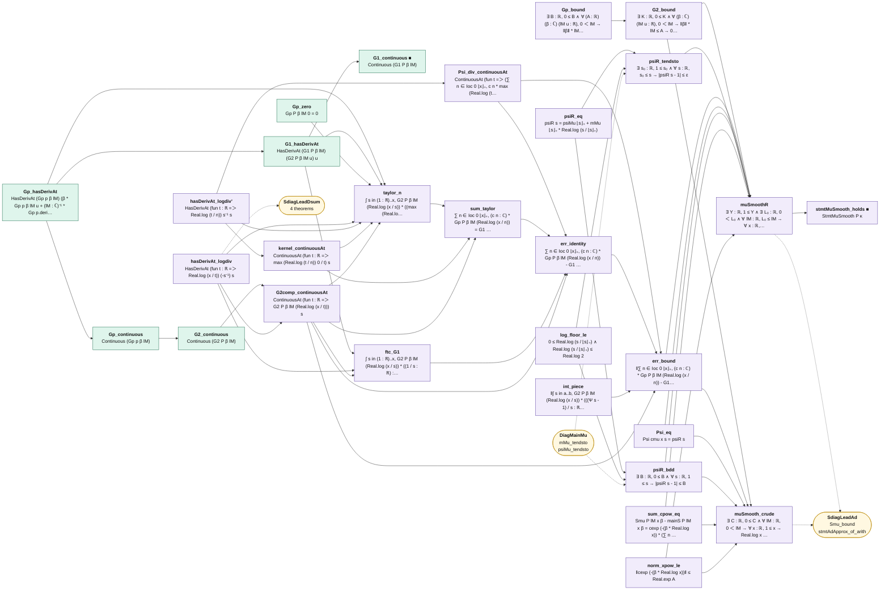

# `lean_stage3/Stage3/SdiagLeadSmooth.lean`

> **Read from the source text.** This file changed after the last `python3 utilities/lean_map.py --dump`, so the arrows on this page are names occurring in each proof and have not been confirmed by Lean.

# Stage3.SdiagLeadSmooth — the smooth Möbius sum to `o(1/log M)`, real `x`. 2026-11-25.

29 theorems, 8 definitions, 736 lines. 

**Imports:** [`SdiagLeadSwap`](../lean_stage3/SdiagLeadSwap.md)  
**Imported by:** [`SdiagLeadCop`](../lean_stage3/SdiagLeadCop.md)

## The picture



An arrow A → B reads "A is used in the proof of B". Green: counting, integers only. Violet: shape, analysis with no ζ. Blue: reads ζ. A name ending in ■ is an end: nothing else uses it. Red: contains `sorry`. Yellow: theorems in another file, counted; a dotted arrow crosses files. Definitions are not drawn; they are listed below the diagram.

## Definitions

<a name="SdiagLead-Gp"></a>
### `SdiagLead.Gp`

def · line 45

`G_p(u) = e^{βu} p(u/λ)`.

- **Is:** `` Gp (p : Polynomial ℝ) (β : ℂ) (lM u : ℝ) : ℂ := cexp (β * u) * ((p.eval (u / lM) : ℝ) : ℂ) ``
- **Used by 14:** [`SdiagLead.G1`](#SdiagLead-G1), [`SdiagLead.G2`](#SdiagLead-G2), [`SdiagLead.G2_bound`](#SdiagLead-G2_bound), [`SdiagLead.Gp_bound`](#SdiagLead-Gp_bound), [`SdiagLead.Gp_continuous`](#SdiagLead-Gp_continuous), [`SdiagLead.Gp_hasDerivAt`](#SdiagLead-Gp_hasDerivAt), [`SdiagLead.Gp_zero`](#SdiagLead-Gp_zero), [`SdiagLead.err_bound`](#SdiagLead-err_bound), [`SdiagLead.err_identity`](#SdiagLead-err_identity), [`SdiagLead.muSmoothR`](#SdiagLead-muSmoothR), [`SdiagLead.muSmooth_crude`](#SdiagLead-muSmooth_crude), [`SdiagLead.sum_cpow_eq`](#SdiagLead-sum_cpow_eq), [`SdiagLead.sum_taylor`](#SdiagLead-sum_taylor), [`SdiagLead.taylor_n`](#SdiagLead-taylor_n)

<a name="SdiagLead-G1"></a>
### `SdiagLead.G1`

def · line 65

`G′`.

- **Is:** `` G1 (P : Polynomial ℝ) (β : ℂ) (lM u : ℝ) : ℂ := β * Gp P β lM u + (lM : ℂ)⁻¹ * Gp P.derivative β lM u ``
- **Built from:** [`SdiagLead.Gp`](#SdiagLead-Gp)
- **Used by 10:** [`SdiagLead.G1_continuous`](#SdiagLead-G1_continuous), [`SdiagLead.G1_hasDerivAt`](#SdiagLead-G1_hasDerivAt), [`SdiagLead.err_bound`](#SdiagLead-err_bound), [`SdiagLead.err_identity`](#SdiagLead-err_identity), [`SdiagLead.ftc_G1`](#SdiagLead-ftc_G1), [`SdiagLead.muSmoothR`](#SdiagLead-muSmoothR), [`SdiagLead.muSmooth_crude`](#SdiagLead-muSmooth_crude), [`SdiagLead.sum_cpow_eq`](#SdiagLead-sum_cpow_eq), [`SdiagLead.sum_taylor`](#SdiagLead-sum_taylor), [`SdiagLead.taylor_n`](#SdiagLead-taylor_n)

<a name="SdiagLead-G2"></a>
### `SdiagLead.G2`

def · line 69

`G″`.

- **Is:** `` G2 (P : Polynomial ℝ) (β : ℂ) (lM u : ℝ) : ℂ := β * (β * Gp P β lM u + (lM : ℂ)⁻¹ * Gp P.derivative β lM u) + (lM : ℂ)⁻¹ * (β * Gp P.derivative β lM u + (lM : ℂ)⁻¹ * Gp P.derivative.derivative β lM u) ``
- **Built from:** [`SdiagLead.Gp`](#SdiagLead-Gp)
- **Used by 10:** [`SdiagLead.G1_hasDerivAt`](#SdiagLead-G1_hasDerivAt), [`SdiagLead.G2_bound`](#SdiagLead-G2_bound), [`SdiagLead.G2_continuous`](#SdiagLead-G2_continuous), [`SdiagLead.G2comp_continuousAt`](#SdiagLead-G2comp_continuousAt), [`SdiagLead.err_bound`](#SdiagLead-err_bound), [`SdiagLead.err_identity`](#SdiagLead-err_identity), [`SdiagLead.ftc_G1`](#SdiagLead-ftc_G1), [`SdiagLead.int_piece`](#SdiagLead-int_piece), [`SdiagLead.sum_taylor`](#SdiagLead-sum_taylor), [`SdiagLead.taylor_n`](#SdiagLead-taylor_n)

<a name="SdiagLead-Psi"></a>
### `SdiagLead.Psi`

def · line 180

`Ψ(s) = Σ_{n ≤ x} c_n max(log(s/n), 0)`.

- **Is:** `` Psi (c : ℕ → ℝ) (x s : ℝ) : ℝ := ∑ n ∈ Ioc 0 ⌊x⌋₊, c n * max (Real.log (s / n)) 0 ``
- **Used by 4:** [`SdiagLead.Psi_eq`](#SdiagLead-Psi_eq), [`SdiagLead.err_bound`](#SdiagLead-err_bound), [`SdiagLead.err_identity`](#SdiagLead-err_identity), [`SdiagLead.sum_taylor`](#SdiagLead-sum_taylor)

<a name="SdiagLead-psiR"></a>
### `SdiagLead.psiR`

def · line 433

`ψ_μ(s) = Σ_{n ≤ s} μ(n)/n · log(s/n)`, real `s`.

- **Is:** `` psiR (s : ℝ) : ℝ := ∑ n ∈ Ioc 0 ⌊s⌋₊, (μ n : ℝ) / n * Real.log (s / n) ``
- **Used by 6:** [`SdiagLead.Psi_eq`](#SdiagLead-Psi_eq), [`SdiagLead.muSmoothR`](#SdiagLead-muSmoothR), [`SdiagLead.muSmooth_crude`](#SdiagLead-muSmooth_crude), [`SdiagLead.psiR_bdd`](#SdiagLead-psiR_bdd), [`SdiagLead.psiR_eq`](#SdiagLead-psiR_eq), [`SdiagLead.psiR_tendsto`](#SdiagLead-psiR_tendsto)

<a name="SdiagLead-cmu"></a>
### `SdiagLead.cmu`

def · line 436

`c_n = μ(n)/n`.

- **Is:** `` cmu (n : ℕ) : ℝ := (μ n : ℝ) / n ``
- **Used by 4:** [`SdiagLead.Psi_eq`](#SdiagLead-Psi_eq), [`SdiagLead.muSmoothR`](#SdiagLead-muSmoothR), [`SdiagLead.muSmooth_crude`](#SdiagLead-muSmooth_crude), [`SdiagLead.sum_cpow_eq`](#SdiagLead-sum_cpow_eq)

<a name="SdiagLead-Smu"></a>
### `SdiagLead.Smu`

def · line 537

The smooth Möbius sum `Σ_{n ≤ x} μ(n) P(log(x/n)/λ) n^{−(1+β)}`.

- **Is:** `` Smu (P : Polynomial ℝ) (lM x : ℝ) (β : ℂ) : ℂ := ∑ n ∈ Ioc 0 ⌊x⌋₊, ((μ n : ℤ) : ℂ) * ((P.eval (Real.log (x / n) / lM) : ℝ) : ℂ) * (n : ℂ) ^ (-(1 + β)) ``
- **Used by 10:** [`SdiagLead.Smu_bound`](../lean_stage3/SdiagLeadAd.md#SdiagLead-Smu_bound), [`SdiagLead.ad`](../lean_stage3/SdiagLeadAd.md#SdiagLead-ad), [`SdiagLead.ad_bound`](../lean_stage3/SdiagLeadAd.md#SdiagLead-ad_bound), [`SdiagLead.ad_err`](../lean_stage3/SdiagLeadAd.md#SdiagLead-ad_err), [`SdiagLead.perd_bound`](../lean_stage3/SdiagLeadAd.md#SdiagLead-perd_bound), [`SdiagLead.Ad_eq`](../lean_stage3/SdiagLeadCop.md#SdiagLead-Ad_eq), [`SdiagLead.muSmoothR`](#SdiagLead-muSmoothR), [`SdiagLead.muSmooth_crude`](#SdiagLead-muSmooth_crude), [`SdiagLead.stmtMuSmooth_holds`](#SdiagLead-stmtMuSmooth_holds), [`SdiagLead.sum_cpow_eq`](#SdiagLead-sum_cpow_eq)

<a name="SdiagLead-mainS"></a>
### `SdiagLead.mainS`

def · line 542

Its main term `βP(log x/λ) + P′(log x/λ)/λ`.

- **Is:** `` mainS (P : Polynomial ℝ) (lM x : ℝ) (β : ℂ) : ℂ := β * ((P.eval (Real.log x / lM) : ℝ) : ℂ) + ((P.derivative.eval (Real.log x / lM) : ℝ) : ℂ) / lM ``
- **Used by 15:** [`SdiagLead.Smu_bound`](../lean_stage3/SdiagLeadAd.md#SdiagLead-Smu_bound), [`SdiagLead.ad_err`](../lean_stage3/SdiagLeadAd.md#SdiagLead-ad_err), [`SdiagLead.ahat0`](../lean_stage3/SdiagLeadAd.md#SdiagLead-ahat0), [`SdiagLead.ahat0_bound`](../lean_stage3/SdiagLeadAd.md#SdiagLead-ahat0_bound), [`SdiagLead.mainS_bound`](../lean_stage3/SdiagLeadAd.md#SdiagLead-mainS_bound), [`SdiagLead.mainS_shift`](../lean_stage3/SdiagLeadAd.md#SdiagLead-mainS_shift), [`SdiagLead.perd_bound`](../lean_stage3/SdiagLeadAd.md#SdiagLead-perd_bound), [`SdiagLead.Ahat`](../lean_stage3/SdiagLeadCore.md#SdiagLead-Ahat), [`SdiagLead.dsum_sum0`](../lean_stage3/SdiagLeadDsum.md#SdiagLead-dsum_sum0), [`SdiagLead.mainS_eq_Fg`](../lean_stage3/SdiagLeadDsum.md#SdiagLead-mainS_eq_Fg), [`SdiagLead.stmtDsum_of_arith`](../lean_stage3/SdiagLeadDsum.md#SdiagLead-stmtDsum_of_arith), [`SdiagLead.muSmoothR`](#SdiagLead-muSmoothR), [`SdiagLead.muSmooth_crude`](#SdiagLead-muSmooth_crude), [`SdiagLead.stmtMuSmooth_holds`](#SdiagLead-stmtMuSmooth_holds), [`SdiagLead.sum_cpow_eq`](#SdiagLead-sum_cpow_eq)

## Theorems

<a name="SdiagLead-Gp_hasDerivAt"></a>
### `SdiagLead.Gp_hasDerivAt`

line 47 · arrows read from text

**Counting.** Integers only: nothing in its statement or proof, or in anything it rests on, uses analysis or ζ.

**Proves**

```lean
HasDerivAt (Gp p β lM) (β * Gp p β lM u + (lM : ℂ)⁻¹ * Gp p.derivative β lM u) u
```

**Needs** (its hypotheses)

  - `` p : Polynomial ℝ ``
  - `` β : ℂ ``
  - `` lM u : ℝ ``

**Fed by:** no theorem of this repo; it stands on Mathlib and the definitions below.

**Definitions its proof touches:** [`SdiagLead.Gp`](#SdiagLead-Gp)

**Feeds** (3 that use it)

  - [`SdiagLead.G1_hasDerivAt`](#SdiagLead-G1_hasDerivAt) — `` HasDerivAt (G1 P β lM) (G2 P β lM u) u ``
  - [`SdiagLead.Gp_continuous`](#SdiagLead-Gp_continuous) — `` Continuous (Gp p β lM) ``
  - [`SdiagLead.taylor_n`](#SdiagLead-taylor_n) — `` ∫ s in (1 : ℝ)..x, G2 P β lM (Real.log (x / s)) * ((max (Real.log (s / n)) 0 / s : ℝ) : ℂ) = Gp P β lM (Real.log (x / n)) - (Real.log (x / n) : ℂ) * G… ``

<a name="SdiagLead-Gp_continuous"></a>
### `SdiagLead.Gp_continuous`

line 61 · arrows read from text

**Counting.** Integers only: nothing in its statement or proof, or in anything it rests on, uses analysis or ζ.

**Proves**

```lean
Continuous (Gp p β lM)
```

**Needs** (its hypotheses)

  - `` p : Polynomial ℝ ``
  - `` β : ℂ ``
  - `` lM : ℝ ``

**Fed by** (1 theorem its proof uses)

  - [`SdiagLead.Gp_hasDerivAt`](#SdiagLead-Gp_hasDerivAt) — `` HasDerivAt (Gp p β lM) (β * Gp p β lM u + (lM : ℂ)⁻¹ * Gp p.derivative β lM u) u ``

**Definitions its proof touches:** [`SdiagLead.Gp`](#SdiagLead-Gp)

**Feeds** (1 that use it)

  - [`SdiagLead.G2_continuous`](#SdiagLead-G2_continuous) — `` Continuous (G2 P β lM) ``

<a name="SdiagLead-G1_hasDerivAt"></a>
### `SdiagLead.G1_hasDerivAt`

line 73 · arrows read from text

**Counting.** Integers only: nothing in its statement or proof, or in anything it rests on, uses analysis or ζ.

**Proves**

```lean
HasDerivAt (G1 P β lM) (G2 P β lM u) u
```

**Needs** (its hypotheses)

  - `` P : Polynomial ℝ ``
  - `` β : ℂ ``
  - `` lM u : ℝ ``

**Fed by** (1 theorem its proof uses)

  - [`SdiagLead.Gp_hasDerivAt`](#SdiagLead-Gp_hasDerivAt) — `` HasDerivAt (Gp p β lM) (β * Gp p β lM u + (lM : ℂ)⁻¹ * Gp p.derivative β lM u) u ``

**Definitions its proof touches:** [`SdiagLead.G1`](#SdiagLead-G1), [`SdiagLead.G2`](#SdiagLead-G2)

**Feeds** (3 that use it)

  - [`SdiagLead.G1_continuous`](#SdiagLead-G1_continuous) — `` Continuous (G1 P β lM) ``
  - [`SdiagLead.ftc_G1`](#SdiagLead-ftc_G1) — `` ∫ s in (1 : ℝ)..x, G2 P β lM (Real.log (x / s)) * ((1 / s : ℝ) : ℂ) = G1 P β lM (Real.log x) - G1 P β lM 0 ``
  - [`SdiagLead.taylor_n`](#SdiagLead-taylor_n) — `` ∫ s in (1 : ℝ)..x, G2 P β lM (Real.log (x / s)) * ((max (Real.log (s / n)) 0 / s : ℝ) : ℂ) = Gp P β lM (Real.log (x / n)) - (Real.log (x / n) : ℂ) * G… ``

<a name="SdiagLead-G2_continuous"></a>
### `SdiagLead.G2_continuous`

line 77 · arrows read from text

**Counting.** Integers only: nothing in its statement or proof, or in anything it rests on, uses analysis or ζ.

**Proves**

```lean
Continuous (G2 P β lM)
```

**Needs** (its hypotheses)

  - `` P : Polynomial ℝ ``
  - `` β : ℂ ``
  - `` lM : ℝ ``

**Fed by** (1 theorem its proof uses)

  - [`SdiagLead.Gp_continuous`](#SdiagLead-Gp_continuous) — `` Continuous (Gp p β lM) ``

**Definitions its proof touches:** [`SdiagLead.G2`](#SdiagLead-G2)

**Feeds** (1 that use it)

  - [`SdiagLead.G2comp_continuousAt`](#SdiagLead-G2comp_continuousAt) — `` ContinuousAt (fun t : ℝ => G2 P β lM (Real.log (x / t))) s ``

<a name="SdiagLead-G1_continuous"></a>
### `SdiagLead.G1_continuous`

line 84 · arrows read from text

**Counting.** Integers only: nothing in its statement or proof, or in anything it rests on, uses analysis or ζ.

**Proves**

```lean
Continuous (G1 P β lM)
```

**Needs** (its hypotheses)

  - `` P : Polynomial ℝ ``
  - `` β : ℂ ``
  - `` lM : ℝ ``

**Fed by** (1 theorem its proof uses)

  - [`SdiagLead.G1_hasDerivAt`](#SdiagLead-G1_hasDerivAt) — `` HasDerivAt (G1 P β lM) (G2 P β lM u) u ``

**Definitions its proof touches:** [`SdiagLead.G1`](#SdiagLead-G1)

**Feeds:** nothing. It is an end.

<a name="SdiagLead-Gp_zero"></a>
### `SdiagLead.Gp_zero`

line 87 · arrows read from text

**Counting.** Integers only: nothing in its statement or proof, or in anything it rests on, uses analysis or ζ.

**Proves**

```lean
Gp P β lM 0 = 0
```

**Needs** (its hypotheses)

  - `` P : Polynomial ℝ ``
  - `` hP0 : P.eval 0 = 0 ``
  - `` β : ℂ ``
  - `` lM : ℝ ``

**Fed by:** no theorem of this repo; it stands on Mathlib and the definitions below.

**Definitions its proof touches:** [`SdiagLead.Gp`](#SdiagLead-Gp)

**Feeds** (1 that use it)

  - [`SdiagLead.taylor_n`](#SdiagLead-taylor_n) — `` ∫ s in (1 : ℝ)..x, G2 P β lM (Real.log (x / s)) * ((max (Real.log (s / n)) 0 / s : ℝ) : ℂ) = Gp P β lM (Real.log (x / n)) - (Real.log (x / n) : ℂ) * G… ``

<a name="SdiagLead-hasDerivAt_logdiv"></a>
### `SdiagLead.hasDerivAt_logdiv`

line 92 · arrows read from text

**Shape.** Uses real or complex analysis; nothing in it or beneath it reads ζ.

**Proves**

```lean
HasDerivAt (fun t : ℝ => Real.log (x / t)) (-s⁻¹) s
```

**Needs** (its hypotheses)

  - `` hx : 0 < x ``
  - `` hs : 0 < s ``

**Fed by:** no theorem of this repo; it stands on Mathlib.

**Feeds** (7 that use it)

  - [`SdiagLead.abel_main`](../lean_stage3/SdiagLeadDsum.md#SdiagLead-abel_main) (SdiagLeadDsum) — `` ∃ CR : ℝ, 0 ≤ CR ∧ ∀ M : ℕ, 2 ≤ M → ∀ Q Q' : ℝ → ℂ, (∀ u, HasDerivAt Q (Q' u) u) → Continuous Q' → ∀ B B' : ℝ, ‖Q 0‖ ≤ B → (∀ u ∈ Set.Icc (0 : ℝ) 1, ‖… ``
  - [`SdiagLead.f_hasDerivAt`](../lean_stage3/SdiagLeadDsum.md#SdiagLead-f_hasDerivAt) (SdiagLeadDsum) — `` HasDerivAt (fun t => Q (Real.log (Mr / t) / lM)) (((-t⁻¹ / lM : ℝ) : ℂ) * Q' (Real.log (Mr / t) / lM)) t ``
  - [`SdiagLead.int_f_div`](../lean_stage3/SdiagLeadDsum.md#SdiagLead-int_f_div) (SdiagLeadDsum) — `` ∫ t in (1 : ℝ)..Mr, Q (Real.log (Mr / t) / Real.log Mr) * ((t⁻¹ : ℝ) : ℂ) = (Real.log Mr : ℂ) * ∫ u in (0 : ℝ)..1, Q u ``
  - [`SdiagLead.int_fprime_log`](../lean_stage3/SdiagLeadDsum.md#SdiagLead-int_fprime_log) (SdiagLeadDsum) — `` ∫ t in (1 : ℝ)..Mr, ((-t⁻¹ / Real.log Mr : ℝ) : ℂ) * Q' (Real.log (Mr / t) / Real.log Mr) * (Real.log t : ℂ) = Q 0 * Real.log Mr - (Real.log Mr : ℂ) *… ``
  - [`SdiagLead.G2comp_continuousAt`](#SdiagLead-G2comp_continuousAt) — `` ContinuousAt (fun t : ℝ => G2 P β lM (Real.log (x / t))) s ``
  - [`SdiagLead.ftc_G1`](#SdiagLead-ftc_G1) — `` ∫ s in (1 : ℝ)..x, G2 P β lM (Real.log (x / s)) * ((1 / s : ℝ) : ℂ) = G1 P β lM (Real.log x) - G1 P β lM 0 ``
  - [`SdiagLead.taylor_n`](#SdiagLead-taylor_n) — `` ∫ s in (1 : ℝ)..x, G2 P β lM (Real.log (x / s)) * ((max (Real.log (s / n)) 0 / s : ℝ) : ℂ) = Gp P β lM (Real.log (x / n)) - (Real.log (x / n) : ℂ) * G… ``

<a name="SdiagLead-hasDerivAt_logdiv-"></a>
### `SdiagLead.hasDerivAt_logdiv'`

line 99 · arrows read from text

**Shape.** Uses real or complex analysis; nothing in it or beneath it reads ζ.

**Proves**

```lean
HasDerivAt (fun t : ℝ => Real.log (t / n)) s⁻¹ s
```

**Needs** (its hypotheses)

  - `` hn : 0 < n ``
  - `` hs : 0 < s ``

**Fed by:** no theorem of this repo; it stands on Mathlib.

**Feeds** (3 that use it)

  - [`SdiagLead.Psi_div_continuousAt`](#SdiagLead-Psi_div_continuousAt) — `` ContinuousAt (fun t => (∑ n ∈ Ioc 0 ⌊x⌋₊, c n * max (Real.log (t / n)) 0) / t) s ``
  - [`SdiagLead.kernel_continuousAt`](#SdiagLead-kernel_continuousAt) — `` ContinuousAt (fun t : ℝ => max (Real.log (t / n)) 0 / t) s ``
  - [`SdiagLead.taylor_n`](#SdiagLead-taylor_n) — `` ∫ s in (1 : ℝ)..x, G2 P β lM (Real.log (x / s)) * ((max (Real.log (s / n)) 0 / s : ℝ) : ℂ) = Gp P β lM (Real.log (x / n)) - (Real.log (x / n) : ℂ) * G… ``

<a name="SdiagLead-kernel_continuousAt"></a>
### `SdiagLead.kernel_continuousAt`

line 107 · arrows read from text

**Shape.** Uses real or complex analysis; nothing in it or beneath it reads ζ.

**Why.** The real kernel `max(log(s/n), 0)/s` is continuous at `s > 0`.

**Proves**

```lean
ContinuousAt (fun t : ℝ => max (Real.log (t / n)) 0 / t) s
```

**Needs** (its hypotheses)

  - `` hn : 0 < n ``
  - `` hs : 0 < s ``

**Fed by** (1 theorem its proof uses)

  - [`SdiagLead.hasDerivAt_logdiv'`](#SdiagLead-hasDerivAt_logdiv-) — `` HasDerivAt (fun t : ℝ => Real.log (t / n)) s⁻¹ s ``

**Feeds** (2 that use it)

  - [`SdiagLead.sum_taylor`](#SdiagLead-sum_taylor) — `` ∑ n ∈ Ioc 0 ⌊x⌋₊, (c n : ℂ) * Gp P β lM (Real.log (x / n)) = G1 P β lM 0 * ((∑ n ∈ Ioc 0 ⌊x⌋₊, c n * Real.log (x / n) : ℝ) : ℂ) + ∫ s in (1 : ℝ)..x, G… ``
  - [`SdiagLead.taylor_n`](#SdiagLead-taylor_n) — `` ∫ s in (1 : ℝ)..x, G2 P β lM (Real.log (x / s)) * ((max (Real.log (s / n)) 0 / s : ℝ) : ℂ) = Gp P β lM (Real.log (x / n)) - (Real.log (x / n) : ℂ) * G… ``

<a name="SdiagLead-G2comp_continuousAt"></a>
### `SdiagLead.G2comp_continuousAt`

line 113 · arrows read from text

**Shape.** Uses real or complex analysis; nothing in it or beneath it reads ζ.

**Proves**

```lean
ContinuousAt (fun t : ℝ => G2 P β lM (Real.log (x / t))) s
```

**Needs** (its hypotheses)

  - `` P : Polynomial ℝ ``
  - `` β : ℂ ``
  - `` lM : ℝ ``
  - `` hx : 0 < x ``
  - `` hs : 0 < s ``

**Fed by** (2 theorems its proof uses)

  - [`SdiagLead.G2_continuous`](#SdiagLead-G2_continuous) — `` Continuous (G2 P β lM) ``
  - [`SdiagLead.hasDerivAt_logdiv`](#SdiagLead-hasDerivAt_logdiv) — `` HasDerivAt (fun t : ℝ => Real.log (x / t)) (-s⁻¹) s ``

**Definitions its proof touches:** [`SdiagLead.G2`](#SdiagLead-G2)

**Feeds** (5 that use it)

  - [`SdiagLead.err_bound`](#SdiagLead-err_bound) — `` ‖∑ n ∈ Ioc 0 ⌊x⌋₊, (c n : ℂ) * Gp P β lM (Real.log (x / n)) - G1 P β lM (Real.log x)‖ ≤ |(P.derivative.eval 0)| / lM * |∑ n ∈ Ioc 0 ⌊x⌋₊, c n * Real.l… ``
  - [`SdiagLead.err_identity`](#SdiagLead-err_identity) — `` ∑ n ∈ Ioc 0 ⌊x⌋₊, (c n : ℂ) * Gp P β lM (Real.log (x / n)) - G1 P β lM (Real.log x) = G1 P β lM 0 * ((∑ n ∈ Ioc 0 ⌊x⌋₊, c n * Real.log (x / n) - 1 : ℝ… ``
  - [`SdiagLead.ftc_G1`](#SdiagLead-ftc_G1) — `` ∫ s in (1 : ℝ)..x, G2 P β lM (Real.log (x / s)) * ((1 / s : ℝ) : ℂ) = G1 P β lM (Real.log x) - G1 P β lM 0 ``
  - [`SdiagLead.sum_taylor`](#SdiagLead-sum_taylor) — `` ∑ n ∈ Ioc 0 ⌊x⌋₊, (c n : ℂ) * Gp P β lM (Real.log (x / n)) = G1 P β lM 0 * ((∑ n ∈ Ioc 0 ⌊x⌋₊, c n * Real.log (x / n) : ℝ) : ℂ) + ∫ s in (1 : ℝ)..x, G… ``
  - [`SdiagLead.taylor_n`](#SdiagLead-taylor_n) — `` ∫ s in (1 : ℝ)..x, G2 P β lM (Real.log (x / s)) * ((max (Real.log (s / n)) 0 / s : ℝ) : ℂ) = Gp P β lM (Real.log (x / n)) - (Real.log (x / n) : ℂ) * G… ``

<a name="SdiagLead-Psi_div_continuousAt"></a>
### `SdiagLead.Psi_div_continuousAt`

line 118 · arrows read from text

**Shape.** Uses real or complex analysis; nothing in it or beneath it reads ζ.

**Why.** `Ψ(s)/s` is continuous at `s > 0`.

**Proves**

```lean
ContinuousAt (fun t => (∑ n ∈ Ioc 0 ⌊x⌋₊, c n * max (Real.log (t / n)) 0) / t) s
```

**Needs** (its hypotheses)

  - `` c : ℕ → ℝ ``
  - `` x : ℝ ``
  - `` hs : 0 < s ``

**Fed by** (1 theorem its proof uses)

  - [`SdiagLead.hasDerivAt_logdiv'`](#SdiagLead-hasDerivAt_logdiv-) — `` HasDerivAt (fun t : ℝ => Real.log (t / n)) s⁻¹ s ``

**Feeds** (2 that use it)

  - [`SdiagLead.err_bound`](#SdiagLead-err_bound) — `` ‖∑ n ∈ Ioc 0 ⌊x⌋₊, (c n : ℂ) * Gp P β lM (Real.log (x / n)) - G1 P β lM (Real.log x)‖ ≤ |(P.derivative.eval 0)| / lM * |∑ n ∈ Ioc 0 ⌊x⌋₊, c n * Real.l… ``
  - [`SdiagLead.err_identity`](#SdiagLead-err_identity) — `` ∑ n ∈ Ioc 0 ⌊x⌋₊, (c n : ℂ) * Gp P β lM (Real.log (x / n)) - G1 P β lM (Real.log x) = G1 P β lM 0 * ((∑ n ∈ Ioc 0 ⌊x⌋₊, c n * Real.log (x / n) - 1 : ℝ… ``

<a name="SdiagLead-taylor_n"></a>
### `SdiagLead.taylor_n`

line 129 · arrows read from text

**Shape.** Uses real or complex analysis; nothing in it or beneath it reads ζ.

**Why.** `G(log(x/n)) = log(x/n) G′(0) + ∫₁^x G″(log(x/s)) max(log(s/n),0) ds/s`, `G(0) = 0`.

**Proves**

```lean
∫ s in (1 : ℝ)..x, G2 P β lM (Real.log (x / s)) * ((max (Real.log (s / n)) 0 / s : ℝ) : ℂ) = Gp P β lM (Real.log (x / n)) - (Real.log (x / n) : ℂ) * G1 P β lM 0
```

**Needs** (its hypotheses)

  - `` P : Polynomial ℝ ``
  - `` hP0 : P.eval 0 = 0 ``
  - `` β : ℂ ``
  - `` lM : ℝ ``
  - `` hn : 1 ≤ n ``
  - `` hnx : (n : ℝ) ≤ x ``

**Fed by** (7 theorems its proof uses)

  - [`SdiagLead.G1_hasDerivAt`](#SdiagLead-G1_hasDerivAt) — `` HasDerivAt (G1 P β lM) (G2 P β lM u) u ``
  - [`SdiagLead.G2comp_continuousAt`](#SdiagLead-G2comp_continuousAt) — `` ContinuousAt (fun t : ℝ => G2 P β lM (Real.log (x / t))) s ``
  - [`SdiagLead.Gp_hasDerivAt`](#SdiagLead-Gp_hasDerivAt) — `` HasDerivAt (Gp p β lM) (β * Gp p β lM u + (lM : ℂ)⁻¹ * Gp p.derivative β lM u) u ``
  - [`SdiagLead.Gp_zero`](#SdiagLead-Gp_zero) — `` Gp P β lM 0 = 0 ``
  - [`SdiagLead.hasDerivAt_logdiv`](#SdiagLead-hasDerivAt_logdiv) — `` HasDerivAt (fun t : ℝ => Real.log (x / t)) (-s⁻¹) s ``
  - [`SdiagLead.hasDerivAt_logdiv'`](#SdiagLead-hasDerivAt_logdiv-) — `` HasDerivAt (fun t : ℝ => Real.log (t / n)) s⁻¹ s ``
  - [`SdiagLead.kernel_continuousAt`](#SdiagLead-kernel_continuousAt) — `` ContinuousAt (fun t : ℝ => max (Real.log (t / n)) 0 / t) s ``

**Definitions its proof touches:** [`SdiagLead.G1`](#SdiagLead-G1), [`SdiagLead.G2`](#SdiagLead-G2), [`SdiagLead.Gp`](#SdiagLead-Gp)

**Feeds** (1 that use it)

  - [`SdiagLead.sum_taylor`](#SdiagLead-sum_taylor) — `` ∑ n ∈ Ioc 0 ⌊x⌋₊, (c n : ℂ) * Gp P β lM (Real.log (x / n)) = G1 P β lM 0 * ((∑ n ∈ Ioc 0 ⌊x⌋₊, c n * Real.log (x / n) : ℝ) : ℂ) + ∫ s in (1 : ℝ)..x, G… ``

<a name="SdiagLead-sum_taylor"></a>
### `SdiagLead.sum_taylor`

line 184 · arrows read from text

**Shape.** Uses real or complex analysis; nothing in it or beneath it reads ζ.

**Why.** Summed against `c_n`: `Σ c_n G(log(x/n)) = G′(0) Σ c_n log(x/n) + ∫₁^x G″(log(x/s)) Ψ(s) ds/s`.

**Proves**

```lean
∑ n ∈ Ioc 0 ⌊x⌋₊, (c n : ℂ) * Gp P β lM (Real.log (x / n)) = G1 P β lM 0 * ((∑ n ∈ Ioc 0 ⌊x⌋₊, c n * Real.log (x / n) : ℝ) : ℂ) + ∫ s in (1 : ℝ)..x, G2 P β lM (Real.log (x / s)) * ((Psi c x s / s : ℝ) : ℂ)
```

**Needs** (its hypotheses)

  - `` P : Polynomial ℝ ``
  - `` hP0 : P.eval 0 = 0 ``
  - `` β : ℂ ``
  - `` lM : ℝ ``
  - `` hx : 1 ≤ x ``
  - `` c : ℕ → ℝ ``

**Fed by** (3 theorems its proof uses)

  - [`SdiagLead.G2comp_continuousAt`](#SdiagLead-G2comp_continuousAt) — `` ContinuousAt (fun t : ℝ => G2 P β lM (Real.log (x / t))) s ``
  - [`SdiagLead.kernel_continuousAt`](#SdiagLead-kernel_continuousAt) — `` ContinuousAt (fun t : ℝ => max (Real.log (t / n)) 0 / t) s ``
  - [`SdiagLead.taylor_n`](#SdiagLead-taylor_n) — `` ∫ s in (1 : ℝ)..x, G2 P β lM (Real.log (x / s)) * ((max (Real.log (s / n)) 0 / s : ℝ) : ℂ) = Gp P β lM (Real.log (x / n)) - (Real.log (x / n) : ℂ) * G… ``

**Definitions its proof touches:** [`SdiagLead.G1`](#SdiagLead-G1), [`SdiagLead.G2`](#SdiagLead-G2), [`SdiagLead.Gp`](#SdiagLead-Gp), [`SdiagLead.Psi`](#SdiagLead-Psi)

**Feeds** (1 that use it)

  - [`SdiagLead.err_identity`](#SdiagLead-err_identity) — `` ∑ n ∈ Ioc 0 ⌊x⌋₊, (c n : ℂ) * Gp P β lM (Real.log (x / n)) - G1 P β lM (Real.log x) = G1 P β lM 0 * ((∑ n ∈ Ioc 0 ⌊x⌋₊, c n * Real.log (x / n) - 1 : ℝ… ``

<a name="SdiagLead-ftc_G1"></a>
### `SdiagLead.ftc_G1`

line 220 · arrows read from text

**Shape.** Uses real or complex analysis; nothing in it or beneath it reads ζ.

**Why.** `∫₁^x G″(log(x/s)) ds/s = G′(log x) − G′(0)`.

**Proves**

```lean
∫ s in (1 : ℝ)..x, G2 P β lM (Real.log (x / s)) * ((1 / s : ℝ) : ℂ) = G1 P β lM (Real.log x) - G1 P β lM 0
```

**Needs** (its hypotheses)

  - `` P : Polynomial ℝ ``
  - `` β : ℂ ``
  - `` lM : ℝ ``
  - `` hx : 1 ≤ x ``

**Fed by** (3 theorems its proof uses)

  - [`SdiagLead.G1_hasDerivAt`](#SdiagLead-G1_hasDerivAt) — `` HasDerivAt (G1 P β lM) (G2 P β lM u) u ``
  - [`SdiagLead.G2comp_continuousAt`](#SdiagLead-G2comp_continuousAt) — `` ContinuousAt (fun t : ℝ => G2 P β lM (Real.log (x / t))) s ``
  - [`SdiagLead.hasDerivAt_logdiv`](#SdiagLead-hasDerivAt_logdiv) — `` HasDerivAt (fun t : ℝ => Real.log (x / t)) (-s⁻¹) s ``

**Definitions its proof touches:** [`SdiagLead.G1`](#SdiagLead-G1), [`SdiagLead.G2`](#SdiagLead-G2)

**Feeds** (1 that use it)

  - [`SdiagLead.err_identity`](#SdiagLead-err_identity) — `` ∑ n ∈ Ioc 0 ⌊x⌋₊, (c n : ℂ) * Gp P β lM (Real.log (x / n)) - G1 P β lM (Real.log x) = G1 P β lM 0 * ((∑ n ∈ Ioc 0 ⌊x⌋₊, c n * Real.log (x / n) - 1 : ℝ… ``

<a name="SdiagLead-err_identity"></a>
### `SdiagLead.err_identity`

line 245 · arrows read from text

**Shape.** Uses real or complex analysis; nothing in it or beneath it reads ζ.

**Why.** The error identity: `Σ c_n G(log(x/n)) − G′(log x) = G′(0)(Σ c_n log(x/n) − 1) + ∫₁^x G″(log(x/s)) (Ψ(s) − 1) ds/s`.

**Proves**

```lean
∑ n ∈ Ioc 0 ⌊x⌋₊, (c n : ℂ) * Gp P β lM (Real.log (x / n)) - G1 P β lM (Real.log x) = G1 P β lM 0 * ((∑ n ∈ Ioc 0 ⌊x⌋₊, c n * Real.log (x / n) - 1 : ℝ) : ℂ) + ∫ s in (1 : ℝ)..x, G2 P β lM (Real.log (x / s)) * (((Psi c x s - 1) / s : ℝ) : ℂ)
```

**Needs** (its hypotheses)

  - `` P : Polynomial ℝ ``
  - `` hP0 : P.eval 0 = 0 ``
  - `` β : ℂ ``
  - `` lM : ℝ ``
  - `` hx : 1 ≤ x ``
  - `` c : ℕ → ℝ ``

**Fed by** (4 theorems its proof uses)

  - [`SdiagLead.G2comp_continuousAt`](#SdiagLead-G2comp_continuousAt) — `` ContinuousAt (fun t : ℝ => G2 P β lM (Real.log (x / t))) s ``
  - [`SdiagLead.Psi_div_continuousAt`](#SdiagLead-Psi_div_continuousAt) — `` ContinuousAt (fun t => (∑ n ∈ Ioc 0 ⌊x⌋₊, c n * max (Real.log (t / n)) 0) / t) s ``
  - [`SdiagLead.ftc_G1`](#SdiagLead-ftc_G1) — `` ∫ s in (1 : ℝ)..x, G2 P β lM (Real.log (x / s)) * ((1 / s : ℝ) : ℂ) = G1 P β lM (Real.log x) - G1 P β lM 0 ``
  - [`SdiagLead.sum_taylor`](#SdiagLead-sum_taylor) — `` ∑ n ∈ Ioc 0 ⌊x⌋₊, (c n : ℂ) * Gp P β lM (Real.log (x / n)) = G1 P β lM 0 * ((∑ n ∈ Ioc 0 ⌊x⌋₊, c n * Real.log (x / n) : ℝ) : ℂ) + ∫ s in (1 : ℝ)..x, G… ``

**Definitions its proof touches:** [`SdiagLead.G1`](#SdiagLead-G1), [`SdiagLead.G2`](#SdiagLead-G2), [`SdiagLead.Gp`](#SdiagLead-Gp), [`SdiagLead.Psi`](#SdiagLead-Psi)

**Feeds** (1 that use it)

  - [`SdiagLead.err_bound`](#SdiagLead-err_bound) — `` ‖∑ n ∈ Ioc 0 ⌊x⌋₊, (c n : ℂ) * Gp P β lM (Real.log (x / n)) - G1 P β lM (Real.log x)‖ ≤ |(P.derivative.eval 0)| / lM * |∑ n ∈ Ioc 0 ⌊x⌋₊, c n * Real.l… ``

<a name="SdiagLead-Gp_bound"></a>
### `SdiagLead.Gp_bound`

line 279 · arrows read from text

**Shape.** Uses real or complex analysis; nothing in it or beneath it reads ζ.

**Why.** `‖e^{βu} p(u/λ)‖ ≤ e^A B_p` on `0 ≤ u ≤ λ`, `‖β‖λ ≤ A`.

**Proves**

```lean
∃ B : ℝ, 0 ≤ B ∧ ∀ (A : ℝ) (β : ℂ) (lM u : ℝ), 0 < lM → ‖β‖ * lM ≤ A → 0 ≤ u → u ≤ lM → ‖Gp p β lM u‖ ≤ Real.exp A * B
```

**Needs** (its hypotheses)

  - `` p : Polynomial ℝ ``

**Fed by:** no theorem of this repo; it stands on Mathlib and the definitions below.

**Definitions its proof touches:** [`SdiagLead.Gp`](#SdiagLead-Gp)

**Feeds** (1 that use it)

  - [`SdiagLead.G2_bound`](#SdiagLead-G2_bound) — `` ∃ K : ℝ, 0 ≤ K ∧ ∀ (β : ℂ) (lM u : ℝ), 0 < lM → ‖β‖ * lM ≤ A → 0 ≤ u → u ≤ lM → ‖G2 P β lM u‖ ≤ K / lM ^ 2 ``

<a name="SdiagLead-G2_bound"></a>
### `SdiagLead.G2_bound`

line 299 · arrows read from text

**Shape.** Uses real or complex analysis; nothing in it or beneath it reads ζ.

**Why.** `‖G″(u)‖ ≤ K/λ²` on `0 ≤ u ≤ λ`.

**Proves**

```lean
∃ K : ℝ, 0 ≤ K ∧ ∀ (β : ℂ) (lM u : ℝ), 0 < lM → ‖β‖ * lM ≤ A → 0 ≤ u → u ≤ lM → ‖G2 P β lM u‖ ≤ K / lM ^ 2
```

**Needs** (its hypotheses)

  - `` P : Polynomial ℝ ``
  - `` hA : 0 ≤ A ``

**Fed by** (1 theorem its proof uses)

  - [`SdiagLead.Gp_bound`](#SdiagLead-Gp_bound) — `` ∃ B : ℝ, 0 ≤ B ∧ ∀ (A : ℝ) (β : ℂ) (lM u : ℝ), 0 < lM → ‖β‖ * lM ≤ A → 0 ≤ u → u ≤ lM → ‖Gp p β lM u‖ ≤ Real.exp A * B ``

**Definitions its proof touches:** [`SdiagLead.G2`](#SdiagLead-G2), [`SdiagLead.Gp`](#SdiagLead-Gp)

**Feeds** (2 that use it)

  - [`SdiagLead.muSmoothR`](#SdiagLead-muSmoothR) — `` ∃ Y : ℝ, 1 ≤ Y ∧ ∃ L₀ : ℝ, 0 < L₀ ∧ ∀ lM : ℝ, L₀ ≤ lM → ∀ x : ℝ, Y ≤ x → Real.log x ≤ lM → ∀ β : ℂ, ‖β‖ * lM ≤ A → ‖Smu P lM x β - mainS P lM x β‖ ≤ ε… ``
  - [`SdiagLead.muSmooth_crude`](#SdiagLead-muSmooth_crude) — `` ∃ C : ℝ, 0 ≤ C ∧ ∀ lM : ℝ, 0 < lM → ∀ x : ℝ, 1 ≤ x → Real.log x ≤ lM → ∀ β : ℂ, ‖β‖ * lM ≤ A → ‖Smu P lM x β - mainS P lM x β‖ ≤ C / lM ``

<a name="SdiagLead-int_piece"></a>
### `SdiagLead.int_piece`

line 338 · arrows read from text

**Shape.** Uses real or complex analysis; nothing in it or beneath it reads ζ.

**Why.** One piece of the remainder integral: `|Ψ − 1| ≤ C` on `[a, b] ⊆ [1, x]` gives `≤ K/λ² · C · log(b/a)`.

**Proves**

```lean
‖∫ s in a..b, G2 P β lM (Real.log (x / s)) * (((Ψ s - 1) / s : ℝ) : ℂ)‖ ≤ K / lM ^ 2 * C * Real.log (b / a)
```

**Needs** (its hypotheses)

  - `` P : Polynomial ℝ ``
  - `` hK : ∀ (β : ℂ) (lM u : ℝ), 0 < lM → ‖β‖ * lM ≤ A → 0 ≤ u → u ≤ lM → ‖G2 P β lM u‖ ≤ K / lM ^ 2 ``
  - `` hK0 : 0 ≤ K ``
  - `` β : ℂ ``
  - `` hlM : 0 < lM ``
  - `` hβ : ‖β‖ * lM ≤ A ``
  - `` hxl : Real.log x ≤ lM ``
  - `` Ψ : ℝ → ℝ ``
  - `` ha : 1 ≤ a ``
  - `` hab : a ≤ b ``
  - `` hbx : b ≤ x ``
  - `` hC : ∀ s, a ≤ s → s ≤ b → |Ψ s - 1| ≤ C ``

**Fed by:** no theorem of this repo; it stands on Mathlib and the definitions below.

**Definitions its proof touches:** [`SdiagLead.G2`](#SdiagLead-G2)

**Feeds** (1 that use it)

  - [`SdiagLead.err_bound`](#SdiagLead-err_bound) — `` ‖∑ n ∈ Ioc 0 ⌊x⌋₊, (c n : ℂ) * Gp P β lM (Real.log (x / n)) - G1 P β lM (Real.log x)‖ ≤ |(P.derivative.eval 0)| / lM * |∑ n ∈ Ioc 0 ⌊x⌋₊, c n * Real.l… ``

<a name="SdiagLead-err_bound"></a>
### `SdiagLead.err_bound`

line 374 · arrows read from text

**Shape.** Uses real or complex analysis; nothing in it or beneath it reads ζ.

**Why.** The size of the error: `‖Σ c_n G(log(x/n)) − G′(log x)‖ ≤ |P′(0)|/λ |ψ(x) − 1| + K/λ²(B log s₀ + ε log x)`, given `|Ψ − 1| ≤ B` on `[1, x]` and `≤ ε` on `[s₀, x]`.

**Proves**

```lean
‖∑ n ∈ Ioc 0 ⌊x⌋₊, (c n : ℂ) * Gp P β lM (Real.log (x / n)) - G1 P β lM (Real.log x)‖ ≤ |(P.derivative.eval 0)| / lM * |∑ n ∈ Ioc 0 ⌊x⌋₊, c n * Real.log (x / n) - 1| + K / lM ^ 2 * (B * Real.log s₀ + ε * Real.log x)
```

**Needs** (its hypotheses)

  - `` P : Polynomial ℝ ``
  - `` hP0 : P.eval 0 = 0 ``
  - `` hK : ∀ (β : ℂ) (lM u : ℝ), 0 < lM → ‖β‖ * lM ≤ A → 0 ≤ u → u ≤ lM → ‖G2 P β lM u‖ ≤ K / lM ^ 2 ``
  - `` hK0 : 0 ≤ K ``
  - `` β : ℂ ``
  - `` hlM : 0 < lM ``
  - `` hβ : ‖β‖ * lM ≤ A ``
  - `` hx : 1 ≤ x ``
  - `` hxl : Real.log x ≤ lM ``
  - `` c : ℕ → ℝ ``
  - `` hs₀ : 1 ≤ s₀ ``
  - `` hε0 : 0 ≤ ε ``
  - `` hB : ∀ s, 1 ≤ s → s ≤ x → |Psi c x s - 1| ≤ B ``
  - `` hε : ∀ s, s₀ ≤ s → s ≤ x → |Psi c x s - 1| ≤ ε ``

**Fed by** (4 theorems its proof uses)

  - [`SdiagLead.G2comp_continuousAt`](#SdiagLead-G2comp_continuousAt) — `` ContinuousAt (fun t : ℝ => G2 P β lM (Real.log (x / t))) s ``
  - [`SdiagLead.Psi_div_continuousAt`](#SdiagLead-Psi_div_continuousAt) — `` ContinuousAt (fun t => (∑ n ∈ Ioc 0 ⌊x⌋₊, c n * max (Real.log (t / n)) 0) / t) s ``
  - [`SdiagLead.err_identity`](#SdiagLead-err_identity) — `` ∑ n ∈ Ioc 0 ⌊x⌋₊, (c n : ℂ) * Gp P β lM (Real.log (x / n)) - G1 P β lM (Real.log x) = G1 P β lM 0 * ((∑ n ∈ Ioc 0 ⌊x⌋₊, c n * Real.log (x / n) - 1 : ℝ… ``
  - [`SdiagLead.int_piece`](#SdiagLead-int_piece) — `` ‖∫ s in a..b, G2 P β lM (Real.log (x / s)) * (((Ψ s - 1) / s : ℝ) : ℂ)‖ ≤ K / lM ^ 2 * C * Real.log (b / a) ``

**Definitions its proof touches:** [`SdiagLead.G1`](#SdiagLead-G1), [`SdiagLead.G2`](#SdiagLead-G2), [`SdiagLead.Gp`](#SdiagLead-Gp), [`SdiagLead.Psi`](#SdiagLead-Psi)

**Feeds** (2 that use it)

  - [`SdiagLead.muSmoothR`](#SdiagLead-muSmoothR) — `` ∃ Y : ℝ, 1 ≤ Y ∧ ∃ L₀ : ℝ, 0 < L₀ ∧ ∀ lM : ℝ, L₀ ≤ lM → ∀ x : ℝ, Y ≤ x → Real.log x ≤ lM → ∀ β : ℂ, ‖β‖ * lM ≤ A → ‖Smu P lM x β - mainS P lM x β‖ ≤ ε… ``
  - [`SdiagLead.muSmooth_crude`](#SdiagLead-muSmooth_crude) — `` ∃ C : ℝ, 0 ≤ C ∧ ∀ lM : ℝ, 0 < lM → ∀ x : ℝ, 1 ≤ x → Real.log x ≤ lM → ∀ β : ℂ, ‖β‖ * lM ≤ A → ‖Smu P lM x β - mainS P lM x β‖ ≤ C / lM ``

<a name="SdiagLead-Psi_eq"></a>
### `SdiagLead.Psi_eq`

line 439 · arrows read from text

**Shape.** Uses real or complex analysis; nothing in it or beneath it reads ζ.

**Why.** `Ψ(s) = ψ_μ(s)` for `1 ≤ s ≤ x`.

**Proves**

```lean
Psi cmu x s = psiR s
```

**Needs** (its hypotheses)

  - `` hs : 1 ≤ s ``
  - `` hsx : s ≤ x ``

**Fed by:** no theorem of this repo; it stands on Mathlib and the definitions below.

**Definitions its proof touches:** [`SdiagLead.Psi`](#SdiagLead-Psi), [`SdiagLead.cmu`](#SdiagLead-cmu), [`SdiagLead.psiR`](#SdiagLead-psiR)

**Feeds** (2 that use it)

  - [`SdiagLead.muSmoothR`](#SdiagLead-muSmoothR) — `` ∃ Y : ℝ, 1 ≤ Y ∧ ∃ L₀ : ℝ, 0 < L₀ ∧ ∀ lM : ℝ, L₀ ≤ lM → ∀ x : ℝ, Y ≤ x → Real.log x ≤ lM → ∀ β : ℂ, ‖β‖ * lM ≤ A → ‖Smu P lM x β - mainS P lM x β‖ ≤ ε… ``
  - [`SdiagLead.muSmooth_crude`](#SdiagLead-muSmooth_crude) — `` ∃ C : ℝ, 0 ≤ C ∧ ∀ lM : ℝ, 0 < lM → ∀ x : ℝ, 1 ≤ x → Real.log x ≤ lM → ∀ β : ℂ, ‖β‖ * lM ≤ A → ‖Smu P lM x β - mainS P lM x β‖ ≤ C / lM ``

<a name="SdiagLead-psiR_eq"></a>
### `SdiagLead.psiR_eq`

line 459 · arrows read from text

**Shape.** Uses real or complex analysis; nothing in it or beneath it reads ζ.

**Why.** `ψ_μ(s) = ψ_μ(⌊s⌋) + m(⌊s⌋) log(s/⌊s⌋)`.

**Proves**

```lean
psiR s = psiMu ⌊s⌋₊ + mMu ⌊s⌋₊ * Real.log (s / ⌊s⌋₊)
```

**Needs** (its hypotheses)

  - `` hs : 1 ≤ s ``

**Fed by:** no theorem of this repo; it stands on Mathlib and the definitions below.

**Definitions its proof touches:** [`DiagMain.mMu`](../lean_stage3/DiagMainMu.md#DiagMain-mMu), [`DiagMain.psiMu`](../lean_stage3/DiagMainMu.md#DiagMain-psiMu), [`SdiagLead.psiR`](#SdiagLead-psiR)

**Feeds** (2 that use it)

  - [`SdiagLead.psiR_bdd`](#SdiagLead-psiR_bdd) — `` ∃ B : ℝ, 0 ≤ B ∧ ∀ s : ℝ, 1 ≤ s → |psiR s - 1| ≤ B ``
  - [`SdiagLead.psiR_tendsto`](#SdiagLead-psiR_tendsto) — `` ∃ s₀ : ℝ, 1 ≤ s₀ ∧ ∀ s : ℝ, s₀ ≤ s → |psiR s - 1| ≤ ε ``

<a name="SdiagLead-log_floor_le"></a>
### `SdiagLead.log_floor_le`

line 473 · arrows read from text

**Shape.** Uses real or complex analysis; nothing in it or beneath it reads ζ.

**Proves**

```lean
0 ≤ Real.log (s / ⌊s⌋₊) ∧ Real.log (s / ⌊s⌋₊) ≤ Real.log 2
```

**Needs** (its hypotheses)

  - `` hs : 1 ≤ s ``

**Fed by:** no theorem of this repo; it stands on Mathlib.

**Feeds** (2 that use it)

  - [`SdiagLead.psiR_bdd`](#SdiagLead-psiR_bdd) — `` ∃ B : ℝ, 0 ≤ B ∧ ∀ s : ℝ, 1 ≤ s → |psiR s - 1| ≤ B ``
  - [`SdiagLead.psiR_tendsto`](#SdiagLead-psiR_tendsto) — `` ∃ s₀ : ℝ, 1 ≤ s₀ ∧ ∀ s : ℝ, s₀ ≤ s → |psiR s - 1| ≤ ε ``

<a name="SdiagLead-psiR_bdd"></a>
### `SdiagLead.psiR_bdd`

line 487 · arrows read from text

**Shape.** Uses real or complex analysis; nothing in it or beneath it reads ζ.

**Why.** `|ψ_μ(s) − 1| ≤ B` for all `s ≥ 1`.

**Proves**

```lean
∃ B : ℝ, 0 ≤ B ∧ ∀ s : ℝ, 1 ≤ s → |psiR s - 1| ≤ B
```

**Fed by** (4 theorems its proof uses)

  - [`DiagMain.mMu_tendsto`](../lean_stage3/DiagMainMu.md#DiagMain-mMu_tendsto) (DiagMainMu) — `` Tendsto mMu atTop (𝓝 0) ``
  - [`DiagMain.psiMu_tendsto`](../lean_stage3/DiagMainMu.md#DiagMain-psiMu_tendsto) (DiagMainMu) — `` Tendsto psiMu atTop (𝓝 1) ``
  - [`SdiagLead.log_floor_le`](#SdiagLead-log_floor_le) — `` 0 ≤ Real.log (s / ⌊s⌋₊) ∧ Real.log (s / ⌊s⌋₊) ≤ Real.log 2 ``
  - [`SdiagLead.psiR_eq`](#SdiagLead-psiR_eq) — `` psiR s = psiMu ⌊s⌋₊ + mMu ⌊s⌋₊ * Real.log (s / ⌊s⌋₊) ``

**Definitions its proof touches:** [`DiagMain.mMu`](../lean_stage3/DiagMainMu.md#DiagMain-mMu), [`DiagMain.psiMu`](../lean_stage3/DiagMainMu.md#DiagMain-psiMu), [`SdiagLead.psiR`](#SdiagLead-psiR)

**Feeds** (2 that use it)

  - [`SdiagLead.muSmoothR`](#SdiagLead-muSmoothR) — `` ∃ Y : ℝ, 1 ≤ Y ∧ ∃ L₀ : ℝ, 0 < L₀ ∧ ∀ lM : ℝ, L₀ ≤ lM → ∀ x : ℝ, Y ≤ x → Real.log x ≤ lM → ∀ β : ℂ, ‖β‖ * lM ≤ A → ‖Smu P lM x β - mainS P lM x β‖ ≤ ε… ``
  - [`SdiagLead.muSmooth_crude`](#SdiagLead-muSmooth_crude) — `` ∃ C : ℝ, 0 ≤ C ∧ ∀ lM : ℝ, 0 < lM → ∀ x : ℝ, 1 ≤ x → Real.log x ≤ lM → ∀ β : ℂ, ‖β‖ * lM ≤ A → ‖Smu P lM x β - mainS P lM x β‖ ≤ C / lM ``

<a name="SdiagLead-psiR_tendsto"></a>
### `SdiagLead.psiR_tendsto`

line 508 · arrows read from text

**Shape.** Uses real or complex analysis; nothing in it or beneath it reads ζ.

**Why.** `ψ_μ(s) → 1` along real `s`.

**Proves**

```lean
∃ s₀ : ℝ, 1 ≤ s₀ ∧ ∀ s : ℝ, s₀ ≤ s → |psiR s - 1| ≤ ε
```

**Needs** (its hypotheses)

  - `` hε : 0 < ε ``

**Fed by** (4 theorems its proof uses)

  - [`DiagMain.mMu_tendsto`](../lean_stage3/DiagMainMu.md#DiagMain-mMu_tendsto) (DiagMainMu) — `` Tendsto mMu atTop (𝓝 0) ``
  - [`DiagMain.psiMu_tendsto`](../lean_stage3/DiagMainMu.md#DiagMain-psiMu_tendsto) (DiagMainMu) — `` Tendsto psiMu atTop (𝓝 1) ``
  - [`SdiagLead.log_floor_le`](#SdiagLead-log_floor_le) — `` 0 ≤ Real.log (s / ⌊s⌋₊) ∧ Real.log (s / ⌊s⌋₊) ≤ Real.log 2 ``
  - [`SdiagLead.psiR_eq`](#SdiagLead-psiR_eq) — `` psiR s = psiMu ⌊s⌋₊ + mMu ⌊s⌋₊ * Real.log (s / ⌊s⌋₊) ``

**Definitions its proof touches:** [`DiagMain.mMu`](../lean_stage3/DiagMainMu.md#DiagMain-mMu), [`DiagMain.psiMu`](../lean_stage3/DiagMainMu.md#DiagMain-psiMu), [`SdiagLead.psiR`](#SdiagLead-psiR)

**Feeds** (1 that use it)

  - [`SdiagLead.muSmoothR`](#SdiagLead-muSmoothR) — `` ∃ Y : ℝ, 1 ≤ Y ∧ ∃ L₀ : ℝ, 0 < L₀ ∧ ∀ lM : ℝ, L₀ ≤ lM → ∀ x : ℝ, Y ≤ x → Real.log x ≤ lM → ∀ β : ℂ, ‖β‖ * lM ≤ A → ‖Smu P lM x β - mainS P lM x β‖ ≤ ε… ``

<a name="SdiagLead-sum_cpow_eq"></a>
### `SdiagLead.sum_cpow_eq`

line 545 · arrows read from text

**Shape.** Uses real or complex analysis; nothing in it or beneath it reads ζ.

**Proves**

```lean
Smu P lM x β - mainS P lM x β = cexp (-(β * Real.log x)) * (∑ n ∈ Ioc 0 ⌊x⌋₊, (cmu n : ℂ) * Gp P β lM (Real.log (x / n)) - G1 P β lM (Real.log x))
```

**Needs** (its hypotheses)

  - `` P : Polynomial ℝ ``
  - `` lM : ℝ ``
  - `` β : ℂ ``
  - `` hx : 1 ≤ x ``

**Fed by:** no theorem of this repo; it stands on Mathlib and the definitions below.

**Definitions its proof touches:** [`SdiagLead.G1`](#SdiagLead-G1), [`SdiagLead.Gp`](#SdiagLead-Gp), [`SdiagLead.Smu`](#SdiagLead-Smu), [`SdiagLead.cmu`](#SdiagLead-cmu), [`SdiagLead.mainS`](#SdiagLead-mainS)

**Feeds** (2 that use it)

  - [`SdiagLead.muSmoothR`](#SdiagLead-muSmoothR) — `` ∃ Y : ℝ, 1 ≤ Y ∧ ∃ L₀ : ℝ, 0 < L₀ ∧ ∀ lM : ℝ, L₀ ≤ lM → ∀ x : ℝ, Y ≤ x → Real.log x ≤ lM → ∀ β : ℂ, ‖β‖ * lM ≤ A → ‖Smu P lM x β - mainS P lM x β‖ ≤ ε… ``
  - [`SdiagLead.muSmooth_crude`](#SdiagLead-muSmooth_crude) — `` ∃ C : ℝ, 0 ≤ C ∧ ∀ lM : ℝ, 0 < lM → ∀ x : ℝ, 1 ≤ x → Real.log x ≤ lM → ∀ β : ℂ, ‖β‖ * lM ≤ A → ‖Smu P lM x β - mainS P lM x β‖ ≤ C / lM ``

<a name="SdiagLead-norm_xpow_le"></a>
### `SdiagLead.norm_xpow_le`

line 584 · arrows read from text

**Shape.** Uses real or complex analysis; nothing in it or beneath it reads ζ.

**Why.** `‖x^{−β}‖ ≤ e^A` for `log x ≤ λ`, `‖β‖λ ≤ A`.

**Proves**

```lean
‖cexp (-(β * Real.log x))‖ ≤ Real.exp A
```

**Needs** (its hypotheses)

  - `` hx : 1 ≤ x ``
  - `` hxl : Real.log x ≤ lM ``
  - `` hβ : ‖β‖ * lM ≤ A ``

**Fed by:** no theorem of this repo; it stands on Mathlib.

**Feeds** (2 that use it)

  - [`SdiagLead.muSmoothR`](#SdiagLead-muSmoothR) — `` ∃ Y : ℝ, 1 ≤ Y ∧ ∃ L₀ : ℝ, 0 < L₀ ∧ ∀ lM : ℝ, L₀ ≤ lM → ∀ x : ℝ, Y ≤ x → Real.log x ≤ lM → ∀ β : ℂ, ‖β‖ * lM ≤ A → ‖Smu P lM x β - mainS P lM x β‖ ≤ ε… ``
  - [`SdiagLead.muSmooth_crude`](#SdiagLead-muSmooth_crude) — `` ∃ C : ℝ, 0 ≤ C ∧ ∀ lM : ℝ, 0 < lM → ∀ x : ℝ, 1 ≤ x → Real.log x ≤ lM → ∀ β : ℂ, ‖β‖ * lM ≤ A → ‖Smu P lM x β - mainS P lM x β‖ ≤ C / lM ``

<a name="SdiagLead-muSmoothR"></a>
### `SdiagLead.muSmoothR`

line 596 · arrows read from text

**Shape.** Uses real or complex analysis; nothing in it or beneath it reads ζ.

**Why.** The per-`d` step, `o(1/λ)`: for `P(0) = 0`, `Σ_{n ≤ x} μ(n) P(log(x/n)/λ) n^{−(1+β)} = βP(ℓ) + P′(ℓ)/λ + o(1/λ)`, `ℓ = log x/λ`, uniformly for `Y ≤ x`, `log x ≤ λ`, `‖β‖λ ≤ A`.

**Proves**

```lean
∃ Y : ℝ, 1 ≤ Y ∧ ∃ L₀ : ℝ, 0 < L₀ ∧ ∀ lM : ℝ, L₀ ≤ lM → ∀ x : ℝ, Y ≤ x → Real.log x ≤ lM → ∀ β : ℂ, ‖β‖ * lM ≤ A → ‖Smu P lM x β - mainS P lM x β‖ ≤ ε / lM
```

**Needs** (its hypotheses)

  - `` P : Polynomial ℝ ``
  - `` hP0 : P.eval 0 = 0 ``
  - `` hA : 0 ≤ A ``
  - `` hε : 0 < ε ``

**Fed by** (7 theorems its proof uses)

  - [`SdiagLead.G2_bound`](#SdiagLead-G2_bound) — `` ∃ K : ℝ, 0 ≤ K ∧ ∀ (β : ℂ) (lM u : ℝ), 0 < lM → ‖β‖ * lM ≤ A → 0 ≤ u → u ≤ lM → ‖G2 P β lM u‖ ≤ K / lM ^ 2 ``
  - [`SdiagLead.Psi_eq`](#SdiagLead-Psi_eq) — `` Psi cmu x s = psiR s ``
  - [`SdiagLead.err_bound`](#SdiagLead-err_bound) — `` ‖∑ n ∈ Ioc 0 ⌊x⌋₊, (c n : ℂ) * Gp P β lM (Real.log (x / n)) - G1 P β lM (Real.log x)‖ ≤ |(P.derivative.eval 0)| / lM * |∑ n ∈ Ioc 0 ⌊x⌋₊, c n * Real.l… ``
  - [`SdiagLead.norm_xpow_le`](#SdiagLead-norm_xpow_le) — `` ‖cexp (-(β * Real.log x))‖ ≤ Real.exp A ``
  - [`SdiagLead.psiR_bdd`](#SdiagLead-psiR_bdd) — `` ∃ B : ℝ, 0 ≤ B ∧ ∀ s : ℝ, 1 ≤ s → |psiR s - 1| ≤ B ``
  - [`SdiagLead.psiR_tendsto`](#SdiagLead-psiR_tendsto) — `` ∃ s₀ : ℝ, 1 ≤ s₀ ∧ ∀ s : ℝ, s₀ ≤ s → |psiR s - 1| ≤ ε ``
  - [`SdiagLead.sum_cpow_eq`](#SdiagLead-sum_cpow_eq) — `` Smu P lM x β - mainS P lM x β = cexp (-(β * Real.log x)) * (∑ n ∈ Ioc 0 ⌊x⌋₊, (cmu n : ℂ) * Gp P β lM (Real.log (x / n)) - G1 P β lM (Real.log x)) ``

**Definitions its proof touches:** [`SdiagLead.G1`](#SdiagLead-G1), [`SdiagLead.Gp`](#SdiagLead-Gp), [`SdiagLead.Smu`](#SdiagLead-Smu), [`SdiagLead.cmu`](#SdiagLead-cmu), [`SdiagLead.mainS`](#SdiagLead-mainS), [`SdiagLead.psiR`](#SdiagLead-psiR)

**Feeds** (2 that use it)

  - [`SdiagLead.stmtAdApprox_of_arith`](../lean_stage3/SdiagLeadAd.md#SdiagLead-stmtAdApprox_of_arith) (SdiagLeadAd) — `` StmtAdApprox P A ``
  - [`SdiagLead.stmtMuSmooth_holds`](#SdiagLead-stmtMuSmooth_holds) — `` StmtMuSmooth P κ ``

<a name="SdiagLead-muSmooth_crude"></a>
### `SdiagLead.muSmooth_crude`

line 668 · arrows read from text

**Shape.** Uses real or complex analysis; nothing in it or beneath it reads ζ.

**Why.** The crude size: `‖Σ_{n ≤ x} μ(n) P(log(x/n)/λ) n^{−(1+β)} − main‖ ≤ C/λ` for every `1 ≤ x` with `log x ≤ λ`.

**Proves**

```lean
∃ C : ℝ, 0 ≤ C ∧ ∀ lM : ℝ, 0 < lM → ∀ x : ℝ, 1 ≤ x → Real.log x ≤ lM → ∀ β : ℂ, ‖β‖ * lM ≤ A → ‖Smu P lM x β - mainS P lM x β‖ ≤ C / lM
```

**Needs** (its hypotheses)

  - `` P : Polynomial ℝ ``
  - `` hP0 : P.eval 0 = 0 ``
  - `` hA : 0 ≤ A ``

**Fed by** (6 theorems its proof uses)

  - [`SdiagLead.G2_bound`](#SdiagLead-G2_bound) — `` ∃ K : ℝ, 0 ≤ K ∧ ∀ (β : ℂ) (lM u : ℝ), 0 < lM → ‖β‖ * lM ≤ A → 0 ≤ u → u ≤ lM → ‖G2 P β lM u‖ ≤ K / lM ^ 2 ``
  - [`SdiagLead.Psi_eq`](#SdiagLead-Psi_eq) — `` Psi cmu x s = psiR s ``
  - [`SdiagLead.err_bound`](#SdiagLead-err_bound) — `` ‖∑ n ∈ Ioc 0 ⌊x⌋₊, (c n : ℂ) * Gp P β lM (Real.log (x / n)) - G1 P β lM (Real.log x)‖ ≤ |(P.derivative.eval 0)| / lM * |∑ n ∈ Ioc 0 ⌊x⌋₊, c n * Real.l… ``
  - [`SdiagLead.norm_xpow_le`](#SdiagLead-norm_xpow_le) — `` ‖cexp (-(β * Real.log x))‖ ≤ Real.exp A ``
  - [`SdiagLead.psiR_bdd`](#SdiagLead-psiR_bdd) — `` ∃ B : ℝ, 0 ≤ B ∧ ∀ s : ℝ, 1 ≤ s → |psiR s - 1| ≤ B ``
  - [`SdiagLead.sum_cpow_eq`](#SdiagLead-sum_cpow_eq) — `` Smu P lM x β - mainS P lM x β = cexp (-(β * Real.log x)) * (∑ n ∈ Ioc 0 ⌊x⌋₊, (cmu n : ℂ) * Gp P β lM (Real.log (x / n)) - G1 P β lM (Real.log x)) ``

**Definitions its proof touches:** [`SdiagLead.G1`](#SdiagLead-G1), [`SdiagLead.Gp`](#SdiagLead-Gp), [`SdiagLead.Smu`](#SdiagLead-Smu), [`SdiagLead.cmu`](#SdiagLead-cmu), [`SdiagLead.mainS`](#SdiagLead-mainS), [`SdiagLead.psiR`](#SdiagLead-psiR)

**Feeds** (2 that use it)

  - [`SdiagLead.Smu_bound`](../lean_stage3/SdiagLeadAd.md#SdiagLead-Smu_bound) (SdiagLeadAd) — `` ∃ C : ℝ, 0 ≤ C ∧ ∀ lM : ℝ, 0 < lM → ∀ y : ℝ, 1 ≤ y → Real.log y ≤ lM → ∀ γ : ℂ, ‖γ‖ * lM ≤ A → ‖Smu P lM y γ‖ ≤ C / lM ``
  - [`SdiagLead.stmtAdApprox_of_arith`](../lean_stage3/SdiagLeadAd.md#SdiagLead-stmtAdApprox_of_arith) (SdiagLeadAd) — `` StmtAdApprox P A ``

<a name="SdiagLead-stmtMuSmooth_holds"></a>
### `SdiagLead.stmtMuSmooth_holds`

line 703 · arrows read from text

**Shape.** Uses real or complex analysis; nothing in it or beneath it reads ζ.

**Why.** `DiagMain.StmtMuSmooth` holds (the `d = 1` per-`d` step, natural `x`).

**Proves**

```lean
StmtMuSmooth P κ
```

**Needs** (its hypotheses)

  - `` P : Polynomial ℝ ``
  - `` κ : ℝ ``

**Fed by** (1 theorem its proof uses)

  - [`SdiagLead.muSmoothR`](#SdiagLead-muSmoothR) — `` ∃ Y : ℝ, 1 ≤ Y ∧ ∃ L₀ : ℝ, 0 < L₀ ∧ ∀ lM : ℝ, L₀ ≤ lM → ∀ x : ℝ, Y ≤ x → Real.log x ≤ lM → ∀ β : ℂ, ‖β‖ * lM ≤ A → ‖Smu P lM x β - mainS P lM x β‖ ≤ ε… ``

**Definitions its proof touches:** [`DiagMain.StmtMuSmooth`](../lean_stage3/DiagMain.md#DiagMain-StmtMuSmooth), [`SdiagLead.Smu`](#SdiagLead-Smu), [`SdiagLead.mainS`](#SdiagLead-mainS)

**Feeds:** nothing. It is an end.

