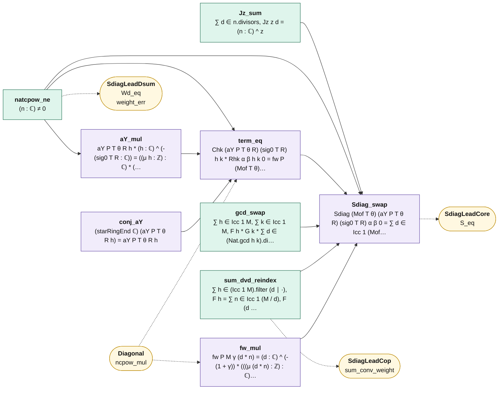

# `lean_stage3/Stage3/SdiagLeadSwap.lean`

> **Read from the source text.** This file changed after the last `python3 utilities/lean_map.py --dump`, so the arrows on this page are names occurring in each proof and have not been confirmed by Lean.

# Stage3.SdiagLeadSwap — the exact reduction of `Sdiag` through `d | (h,k)`. 2026-11-25.

9 theorems, 4 definitions, 224 lines. 

**Imports:** [`DiagMain`](../lean_stage3/DiagMain.md)  
**Imported by:** [`SdiagLeadSmooth`](../lean_stage3/SdiagLeadSmooth.md)

## The picture



An arrow A → B reads "A is used in the proof of B". Green: counting, integers only. Violet: shape, analysis with no ζ. Blue: reads ζ. A name ending in ■ is an end: nothing else uses it. Red: contains `sorry`. Yellow: theorems in another file, counted; a dotted arrow crosses files. Definitions are not drawn; they are listed below the diagram.

## Definitions

<a name="SdiagLead-Pw"></a>
### `SdiagLead.Pw`

def · line 33

`P_n = P(log(M/n)/log M)`, Young's weight.

- **Is:** `` Pw (P : Polynomial ℝ) (M n : ℕ) : ℝ := P.eval (Real.log ((M : ℝ) / n) / Real.log M) ``
- **Used by 6:** [`SdiagLead.Ad_eq`](../lean_stage3/SdiagLeadCop.md#SdiagLead-Ad_eq), [`SdiagLead.Ad`](#SdiagLead-Ad), [`SdiagLead.aY_mul`](#SdiagLead-aY_mul), [`SdiagLead.fw`](#SdiagLead-fw), [`SdiagLead.fw_mul`](#SdiagLead-fw_mul), [`SdiagLead.term_eq`](#SdiagLead-term_eq)

<a name="SdiagLead-fw"></a>
### `SdiagLead.fw`

def · line 36

`μ(n) P_n n^{−(1+γ)}`.

- **Is:** `` fw (P : Polynomial ℝ) (M : ℕ) (γ : ℂ) (n : ℕ) : ℂ := ((μ n : ℤ) : ℂ) * ((Pw P M n : ℝ) : ℂ) * (n : ℂ) ^ (-(1 + γ)) ``
- **Built from:** [`SdiagLead.Pw`](#SdiagLead-Pw)
- **Used by 3:** [`SdiagLead.Sdiag_swap`](#SdiagLead-Sdiag_swap), [`SdiagLead.fw_mul`](#SdiagLead-fw_mul), [`SdiagLead.term_eq`](#SdiagLead-term_eq)

<a name="SdiagLead-Jz"></a>
### `SdiagLead.Jz`

def · line 40

`J_z(d) = Σ_{ab = d} μ(a) b^z`, so `Σ_{d | n} J_z(d) = n^z`.

- **Is:** `` Jz (z : ℂ) (d : ℕ) : ℂ := ∑ x ∈ d.divisorsAntidiagonal, ((μ x.1 : ℤ) : ℂ) * (x.2 : ℂ) ^ z ``
- **Used by 5:** [`SdiagLead.Wd_bound`](../lean_stage3/SdiagLeadAd.md#SdiagLead-Wd_bound), [`SdiagLead.Wd`](../lean_stage3/SdiagLeadCore.md#SdiagLead-Wd), [`SdiagLead.Wd_eq`](../lean_stage3/SdiagLeadDsum.md#SdiagLead-Wd_eq), [`SdiagLead.Jz_sum`](#SdiagLead-Jz_sum), [`SdiagLead.Sdiag_swap`](#SdiagLead-Sdiag_swap)

<a name="SdiagLead-Ad"></a>
### `SdiagLead.Ad`

def · line 43

`A_d(γ) = Σ_{n ≤ M/d} μ(dn) P_{dn} n^{−(1+γ)}`.

- **Is:** `` Ad (P : Polynomial ℝ) (M d : ℕ) (γ : ℂ) : ℂ := ∑ n ∈ Icc 1 (M / d), ((μ (d * n) : ℤ) : ℂ) * ((Pw P M (d * n) : ℝ) : ℂ) * (n : ℂ) ^ (-(1 + γ)) ``
- **Built from:** [`SdiagLead.Pw`](#SdiagLead-Pw)
- **Used by 7:** [`SdiagLead.AA_eq`](../lean_stage3/SdiagLeadAd.md#SdiagLead-AA_eq), [`SdiagLead.perd_bound`](../lean_stage3/SdiagLeadAd.md#SdiagLead-perd_bound), [`SdiagLead.Ad_eq`](../lean_stage3/SdiagLeadCop.md#SdiagLead-Ad_eq), [`SdiagLead.S_eq`](../lean_stage3/SdiagLeadCore.md#SdiagLead-S_eq), [`SdiagLead.StmtAdApprox`](../lean_stage3/SdiagLeadCore.md#SdiagLead-StmtAdApprox), [`SdiagLead.stmtSdiagLead_of_steps`](../lean_stage3/SdiagLeadCore.md#SdiagLead-stmtSdiagLead_of_steps), [`SdiagLead.Sdiag_swap`](#SdiagLead-Sdiag_swap)

## Theorems

<a name="SdiagLead-Jz_sum"></a>
### `SdiagLead.Jz_sum`

line 46 · arrows read from text

**Counting.** Integers only: nothing in its statement or proof, or in anything it rests on, uses analysis or ζ.

**Proves**

```lean
∑ d ∈ n.divisors, Jz z d = (n : ℂ) ^ z
```

**Needs** (its hypotheses)

  - `` z : ℂ ``
  - `` hn : 0 < n ``

**Fed by:** no theorem of this repo; it stands on Mathlib and the definitions below.

**Definitions its proof touches:** [`SdiagLead.Jz`](#SdiagLead-Jz)

**Feeds** (1 that use it)

  - [`SdiagLead.Sdiag_swap`](#SdiagLead-Sdiag_swap) — `` Sdiag (Mof T θ) (aY P T θ R) (sig0 T R) α β 0 = ∑ d ∈ Icc 1 (Mof T θ), Jz (1 + α + β) d * (d : ℂ) ^ (-(2 + α + β)) * Ad P (Mof T θ) d β * Ad P (Mof T … ``

<a name="SdiagLead-natcpow_ne"></a>
### `SdiagLead.natcpow_ne`

line 50 · arrows read from text

**Counting.** Integers only: nothing in its statement or proof, or in anything it rests on, uses analysis or ζ.

**Proves**

```lean
(n : ℂ) ≠ 0
```

**Needs** (its hypotheses)

  - `` hn : 1 ≤ n ``

**Fed by:** no theorem of this repo; it stands on Mathlib.

**Feeds** (5 that use it)

  - [`SdiagLead.Wd_eq`](../lean_stage3/SdiagLeadDsum.md#SdiagLead-Wd_eq) (SdiagLeadDsum) — `` Wd α β d = (1 / (d : ℂ)) * ∑ a ∈ d.divisors, ((μ a : ℤ) : ℂ) * (a : ℂ) ^ (-(1 + α + β)) ``
  - [`SdiagLead.weight_err`](../lean_stage3/SdiagLeadDsum.md#SdiagLead-weight_err) (SdiagLeadDsum) — `` ‖((((μ d : ℤ) : ℝ) ^ 2 * sig d ^ 2 : ℝ) : ℂ) * Wd α β d - ((gmu d : ℝ) : ℂ)‖ ≤ ((μ d : ℤ) : ℝ) ^ 2 * sig d ^ 2 / d * (2 * A * Real.exp (2 * A) / Real.… ``
  - [`SdiagLead.Sdiag_swap`](#SdiagLead-Sdiag_swap) — `` Sdiag (Mof T θ) (aY P T θ R) (sig0 T R) α β 0 = ∑ d ∈ Icc 1 (Mof T θ), Jz (1 + α + β) d * (d : ℂ) ^ (-(2 + α + β)) * Ad P (Mof T θ) d β * Ad P (Mof T … ``
  - [`SdiagLead.aY_mul`](#SdiagLead-aY_mul) — `` aY P T θ R h * (h : ℂ) ^ (-(sig0 T R : ℂ)) = ((μ h : ℤ) : ℂ) * ((Pw P (Mof T θ) h : ℝ) : ℂ) * (h : ℂ) ^ (-(1 / 2 : ℂ)) ``
  - [`SdiagLead.term_eq`](#SdiagLead-term_eq) — `` Chk (aY P T θ R) (sig0 T R) h k * Rhk α β h k 0 = fw P (Mof T θ) β h * fw P (Mof T θ) α k * ((Nat.gcd h k : ℕ) : ℂ) ^ (1 + α + β) ``

<a name="SdiagLead-aY_mul"></a>
### `SdiagLead.aY_mul`

line 54 · arrows read from text

**Shape.** Uses real or complex analysis; nothing in it or beneath it reads ζ.

**Why.** `a_h h^{−σ₀} = μ(h) P_h h^{−1/2}`.

**Proves**

```lean
aY P T θ R h * (h : ℂ) ^ (-(sig0 T R : ℂ)) = ((μ h : ℤ) : ℂ) * ((Pw P (Mof T θ) h : ℝ) : ℂ) * (h : ℂ) ^ (-(1 / 2 : ℂ))
```

**Needs** (its hypotheses)

  - `` P : Polynomial ℝ ``
  - `` T θ R : ℝ ``
  - `` hh : 1 ≤ h ``

**Fed by** (1 theorem its proof uses)

  - [`SdiagLead.natcpow_ne`](#SdiagLead-natcpow_ne) — `` (n : ℂ) ≠ 0 ``

**Definitions its proof touches:** [`SdiagLead.Pw`](#SdiagLead-Pw), [`TwistedMoment.Mof`](../lean_stage3/TwistedMoment.md#TwistedMoment-Mof), [`TwistedMoment.aY`](../lean_stage3/TwistedMoment.md#TwistedMoment-aY), [`TwistedMoment.sig0`](../lean_stage3/TwistedMoment.md#TwistedMoment-sig0)

**Feeds** (1 that use it)

  - [`SdiagLead.term_eq`](#SdiagLead-term_eq) — `` Chk (aY P T θ R) (sig0 T R) h k * Rhk α β h k 0 = fw P (Mof T θ) β h * fw P (Mof T θ) α k * ((Nat.gcd h k : ℕ) : ℂ) ^ (1 + α + β) ``

<a name="SdiagLead-conj_aY"></a>
### `SdiagLead.conj_aY`

line 63 · arrows read from text

**Shape.** Uses real or complex analysis; nothing in it or beneath it reads ζ.

**Proves**

```lean
(starRingEnd ℂ) (aY P T θ R h) = aY P T θ R h
```

**Needs** (its hypotheses)

  - `` P : Polynomial ℝ ``
  - `` T θ R : ℝ ``
  - `` h : ℕ ``

**Fed by:** no theorem of this repo; it stands on Mathlib and the definitions below.

**Definitions its proof touches:** [`TwistedMoment.aY`](../lean_stage3/TwistedMoment.md#TwistedMoment-aY)

**Feeds** (1 that use it)

  - [`SdiagLead.term_eq`](#SdiagLead-term_eq) — `` Chk (aY P T θ R) (sig0 T R) h k * Rhk α β h k 0 = fw P (Mof T θ) β h * fw P (Mof T θ) α k * ((Nat.gcd h k : ℕ) : ℂ) ^ (1 + α + β) ``

<a name="SdiagLead-term_eq"></a>
### `SdiagLead.term_eq`

line 69 · arrows read from text

**Shape.** Uses real or complex analysis; nothing in it or beneath it reads ζ.

**Why.** One term: `Chk·Rhk(·,0) = μ(h)P_h h^{−1−β} · μ(k)P_k k^{−1−α} · (h,k)^{1+α+β}`.

**Proves**

```lean
Chk (aY P T θ R) (sig0 T R) h k * Rhk α β h k 0 = fw P (Mof T θ) β h * fw P (Mof T θ) α k * ((Nat.gcd h k : ℕ) : ℂ) ^ (1 + α + β)
```

**Needs** (its hypotheses)

  - `` P : Polynomial ℝ ``
  - `` T θ R : ℝ ``
  - `` hh : 1 ≤ h ``
  - `` hk : 1 ≤ k ``
  - `` α β : ℂ ``

**Fed by** (4 theorems its proof uses)

  - [`Diagonal.ncpow_mul`](../lean_stage3/Diagonal.md#Diagonal-ncpow_mul) (Diagonal) — `` ((m * n : ℕ) : ℂ) ^ z = (m : ℂ) ^ z * (n : ℂ) ^ z ``
  - [`SdiagLead.aY_mul`](#SdiagLead-aY_mul) — `` aY P T θ R h * (h : ℂ) ^ (-(sig0 T R : ℂ)) = ((μ h : ℤ) : ℂ) * ((Pw P (Mof T θ) h : ℝ) : ℂ) * (h : ℂ) ^ (-(1 / 2 : ℂ)) ``
  - [`SdiagLead.conj_aY`](#SdiagLead-conj_aY) — `` (starRingEnd ℂ) (aY P T θ R h) = aY P T θ R h ``
  - [`SdiagLead.natcpow_ne`](#SdiagLead-natcpow_ne) — `` (n : ℂ) ≠ 0 ``

**Definitions its proof touches:** [`Diagonal.Chk`](../lean_stage3/Diagonal.md#Diagonal-Chk), [`Diagonal.Rhk`](../lean_stage3/Diagonal.md#Diagonal-Rhk), [`SdiagLead.Pw`](#SdiagLead-Pw), [`SdiagLead.fw`](#SdiagLead-fw), [`TwistedMoment.Mof`](../lean_stage3/TwistedMoment.md#TwistedMoment-Mof), [`TwistedMoment.aY`](../lean_stage3/TwistedMoment.md#TwistedMoment-aY), [`TwistedMoment.sig0`](../lean_stage3/TwistedMoment.md#TwistedMoment-sig0)

**Feeds** (1 that use it)

  - [`SdiagLead.Sdiag_swap`](#SdiagLead-Sdiag_swap) — `` Sdiag (Mof T θ) (aY P T θ R) (sig0 T R) α β 0 = ∑ d ∈ Icc 1 (Mof T θ), Jz (1 + α + β) d * (d : ℂ) ^ (-(2 + α + β)) * Ad P (Mof T θ) d β * Ad P (Mof T … ``

<a name="SdiagLead-gcd_swap"></a>
### `SdiagLead.gcd_swap`

line 120 · arrows read from text

**Counting.** Integers only: nothing in its statement or proof, or in anything it rests on, uses analysis or ζ.

**Why.** The swap: `Σ_{h,k} F_h G_k Σ_{d|(h,k)} J_d = Σ_{d ≤ M} J_d (Σ_{d|h} F_h)(Σ_{d|k} G_k)`.

**Proves**

```lean
∑ h ∈ Icc 1 M, ∑ k ∈ Icc 1 M, F h * G k * ∑ d ∈ (Nat.gcd h k).divisors, J d = ∑ d ∈ Icc 1 M, J d * (∑ h ∈ (Icc 1 M).filter (d ∣ ·), F h) * (∑ k ∈ (Icc 1 M).filter (d ∣ ·), G k)
```

**Needs** (its hypotheses)

  - `` M : ℕ ``
  - `` F G J : ℕ → ℂ ``

**Fed by:** no theorem of this repo; it stands on Mathlib.

**Feeds** (1 that use it)

  - [`SdiagLead.Sdiag_swap`](#SdiagLead-Sdiag_swap) — `` Sdiag (Mof T θ) (aY P T θ R) (sig0 T R) α β 0 = ∑ d ∈ Icc 1 (Mof T θ), Jz (1 + α + β) d * (d : ℂ) ^ (-(2 + α + β)) * Ad P (Mof T θ) d β * Ad P (Mof T … ``

<a name="SdiagLead-sum_dvd_reindex"></a>
### `SdiagLead.sum_dvd_reindex`

line 159 · arrows read from text

**Counting.** Integers only: nothing in its statement or proof, or in anything it rests on, uses analysis or ζ.

**Why.** `Σ_{h ≤ M, d | h} F_h = Σ_{n ≤ M/d} F_{dn}`.

**Proves**

```lean
∑ h ∈ (Icc 1 M).filter (d ∣ ·), F h = ∑ n ∈ Icc 1 (M / d), F (d * n)
```

**Needs** (its hypotheses)

  - `` M : ℕ ``
  - `` hd : 1 ≤ d ``
  - `` F : ℕ → ℂ ``

**Fed by:** no theorem of this repo; it stands on Mathlib.

**Feeds** (2 that use it)

  - [`SdiagLead.sum_conv_weight`](../lean_stage3/SdiagLeadCop.md#SdiagLead-sum_conv_weight) (SdiagLeadCop) — `` ∑ n ∈ Ioc 0 N, (((f * g) n : ℤ) : ℂ) * w n = ∑ m ∈ Ioc 0 N, ((f m : ℤ) : ℂ) * ∑ k ∈ Ioc 0 (N / m), ((g k : ℤ) : ℂ) * w (m * k) ``
  - [`SdiagLead.Sdiag_swap`](#SdiagLead-Sdiag_swap) — `` Sdiag (Mof T θ) (aY P T θ R) (sig0 T R) α β 0 = ∑ d ∈ Icc 1 (Mof T θ), Jz (1 + α + β) d * (d : ℂ) ^ (-(2 + α + β)) * Ad P (Mof T θ) d β * Ad P (Mof T … ``

<a name="SdiagLead-fw_mul"></a>
### `SdiagLead.fw_mul`

line 181 · arrows read from text

**Shape.** Uses real or complex analysis; nothing in it or beneath it reads ζ.

**Proves**

```lean
fw P M γ (d * n) = (d : ℂ) ^ (-(1 + γ)) * (((μ (d * n) : ℤ) : ℂ) * ((Pw P M (d * n) : ℝ) : ℂ) * (n : ℂ) ^ (-(1 + γ)))
```

**Needs** (its hypotheses)

  - `` P : Polynomial ℝ ``
  - `` M : ℕ ``
  - `` γ : ℂ ``
  - `` d n : ℕ ``

**Fed by** (1 theorem its proof uses)

  - [`Diagonal.ncpow_mul`](../lean_stage3/Diagonal.md#Diagonal-ncpow_mul) (Diagonal) — `` ((m * n : ℕ) : ℂ) ^ z = (m : ℂ) ^ z * (n : ℂ) ^ z ``

**Definitions its proof touches:** [`SdiagLead.Pw`](#SdiagLead-Pw), [`SdiagLead.fw`](#SdiagLead-fw)

**Feeds** (1 that use it)

  - [`SdiagLead.Sdiag_swap`](#SdiagLead-Sdiag_swap) — `` Sdiag (Mof T θ) (aY P T θ R) (sig0 T R) α β 0 = ∑ d ∈ Icc 1 (Mof T θ), Jz (1 + α + β) d * (d : ℂ) ^ (-(2 + α + β)) * Ad P (Mof T θ) d β * Ad P (Mof T … ``

<a name="SdiagLead-Sdiag_swap"></a>
### `SdiagLead.Sdiag_swap`

line 187 · arrows read from text

**Shape.** Uses real or complex analysis; nothing in it or beneath it reads ζ.

**Why.** The reduction: `S(α,β,0) = Σ_{d ≤ M} J_{1+α+β}(d) d^{−(2+α+β)} A_d(β) A_d(α)`.

**Proves**

```lean
Sdiag (Mof T θ) (aY P T θ R) (sig0 T R) α β 0 = ∑ d ∈ Icc 1 (Mof T θ), Jz (1 + α + β) d * (d : ℂ) ^ (-(2 + α + β)) * Ad P (Mof T θ) d β * Ad P (Mof T θ) d α
```

**Needs** (its hypotheses)

  - `` P : Polynomial ℝ ``
  - `` T θ R : ℝ ``
  - `` α β : ℂ ``

**Fed by** (6 theorems its proof uses)

  - [`SdiagLead.Jz_sum`](#SdiagLead-Jz_sum) — `` ∑ d ∈ n.divisors, Jz z d = (n : ℂ) ^ z ``
  - [`SdiagLead.fw_mul`](#SdiagLead-fw_mul) — `` fw P M γ (d * n) = (d : ℂ) ^ (-(1 + γ)) * (((μ (d * n) : ℤ) : ℂ) * ((Pw P M (d * n) : ℝ) : ℂ) * (n : ℂ) ^ (-(1 + γ))) ``
  - [`SdiagLead.gcd_swap`](#SdiagLead-gcd_swap) — `` ∑ h ∈ Icc 1 M, ∑ k ∈ Icc 1 M, F h * G k * ∑ d ∈ (Nat.gcd h k).divisors, J d = ∑ d ∈ Icc 1 M, J d * (∑ h ∈ (Icc 1 M).filter (d ∣ ·), F h) * (∑ k ∈ (Icc… ``
  - [`SdiagLead.natcpow_ne`](#SdiagLead-natcpow_ne) — `` (n : ℂ) ≠ 0 ``
  - [`SdiagLead.sum_dvd_reindex`](#SdiagLead-sum_dvd_reindex) — `` ∑ h ∈ (Icc 1 M).filter (d ∣ ·), F h = ∑ n ∈ Icc 1 (M / d), F (d * n) ``
  - [`SdiagLead.term_eq`](#SdiagLead-term_eq) — `` Chk (aY P T θ R) (sig0 T R) h k * Rhk α β h k 0 = fw P (Mof T θ) β h * fw P (Mof T θ) α k * ((Nat.gcd h k : ℕ) : ℂ) ^ (1 + α + β) ``

**Definitions its proof touches:** [`Diagonal.Chk`](../lean_stage3/Diagonal.md#Diagonal-Chk), [`Diagonal.Rhk`](../lean_stage3/Diagonal.md#Diagonal-Rhk), [`Diagonal.Sdiag`](../lean_stage3/Diagonal.md#Diagonal-Sdiag), [`SdiagLead.Ad`](#SdiagLead-Ad), [`SdiagLead.Jz`](#SdiagLead-Jz), [`SdiagLead.fw`](#SdiagLead-fw), [`TwistedMoment.Mof`](../lean_stage3/TwistedMoment.md#TwistedMoment-Mof), [`TwistedMoment.aY`](../lean_stage3/TwistedMoment.md#TwistedMoment-aY), [`TwistedMoment.sig0`](../lean_stage3/TwistedMoment.md#TwistedMoment-sig0)

**Feeds** (1 that use it)

  - [`SdiagLead.S_eq`](../lean_stage3/SdiagLeadCore.md#SdiagLead-S_eq) (SdiagLeadCore) — `` Sdiag (Mof T θ) (aY P T θ R) (sig0 T R) α β 0 = ∑ d ∈ Icc 1 (Mof T θ), Wd α β d * Ad P (Mof T θ) d β * Ad P (Mof T θ) d α ``

