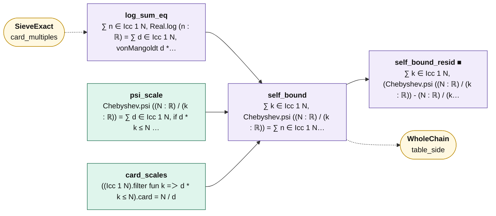

# `lean_stage3/Stage3/SelfBound.lean`

> **Read from the source text.** This file changed after the last `python3 utilities/lean_map.py --dump`, so the arrows on this page are names occurring in each proof and have not been confirmed by Lean.

SelfBound — block R7 of `lean_stage3/design/runs.md`. 2026-11-23. The number line bounded by itself. Every integer's logarithm is the sum of the steps at its divisors, so the staircase of the steps, read at `N`, `N/2`, `N/3`, …, adds up to the logarithms of the integers up to `N`, exactly, at every `N`. An excess of the staircase at one of these scales is paid back at the others.

5 theorems, 0 definitions, 118 lines. 

**Imports:** [`HalfSieve`](../lean_stage3/HalfSieve.md)  
**Imported by:** [`Stage3`](../lean_stage3/Stage3.md), [`WholeChain`](../lean_stage3/WholeChain.md)

## The picture



An arrow A → B reads "A is used in the proof of B". Green: counting, integers only. Violet: shape, analysis with no ζ. Blue: reads ζ. A name ending in ■ is an end: nothing else uses it. Red: contains `sorry`. Yellow: theorems in another file, counted; a dotted arrow crosses files. Definitions are not drawn; they are listed below the diagram.

## Theorems

<a name="SelfBound-log_sum_eq"></a>
### `SelfBound.log_sum_eq`

line 25 · arrows read from text

**Shape.** Uses real or complex analysis; nothing in it or beneath it reads ζ.

**Why.** Every logarithm is the steps at its divisors. Summed up to `N`, each step `Λ(d)` is counted once for every multiple of `d` up to `N`.

**Proves**

```lean
∑ n ∈ Icc 1 N, Real.log (n : ℝ) = ∑ d ∈ Icc 1 N, vonMangoldt d * ((N / d : ℕ) : ℝ)
```

**Needs** (its hypotheses)

  - `` N : ℕ ``

**Fed by** (1 theorem its proof uses)

  - [`SieveExact.card_multiples`](../lean_stage3/SieveExact.md#SieveExact-card_multiples) (SieveExact) — `` ((Finset.Icc 1 N).filter (fun n => d ∣ n)).card = N / d ``

**Feeds** (1 that use it)

  - [`SelfBound.self_bound`](#SelfBound-self_bound) — `` ∑ k ∈ Icc 1 N, Chebyshev.psi ((N : ℝ) / (k : ℝ)) = ∑ n ∈ Icc 1 N, Real.log (n : ℝ) ``

<a name="SelfBound-psi_scale"></a>
### `SelfBound.psi_scale`

line 46 · arrows read from text

**Counting.** Integers only: nothing in its statement or proof, or in anything it rests on, uses analysis or ζ.

**Why.** The staircase at the scale `N/k`, as a sum over the steps up to `N`.

**Proves**

```lean
Chebyshev.psi ((N : ℝ) / (k : ℝ)) = ∑ d ∈ Icc 1 N, if d * k ≤ N then vonMangoldt d else 0
```

**Needs** (its hypotheses)

  - `` N : ℕ ``
  - `` hk : 1 ≤ k ``

**Fed by:** no theorem of this repo; it stands on Mathlib.

**Feeds** (1 that use it)

  - [`SelfBound.self_bound`](#SelfBound-self_bound) — `` ∑ k ∈ Icc 1 N, Chebyshev.psi ((N : ℝ) / (k : ℝ)) = ∑ n ∈ Icc 1 N, Real.log (n : ℝ) ``

<a name="SelfBound-card_scales"></a>
### `SelfBound.card_scales`

line 63 · arrows read from text

**Counting.** Integers only: nothing in its statement or proof, or in anything it rests on, uses analysis or ζ.

**Why.** The number of `k` from `1` to `N` with `d·k ≤ N` is `⌊N/d⌋`.

**Proves**

```lean
((Icc 1 N).filter fun k => d * k ≤ N).card = N / d
```

**Needs** (its hypotheses)

  - `` N : ℕ ``
  - `` hd : 1 ≤ d ``

**Fed by:** no theorem of this repo; it stands on Mathlib.

**Feeds** (1 that use it)

  - [`SelfBound.self_bound`](#SelfBound-self_bound) — `` ∑ k ∈ Icc 1 N, Chebyshev.psi ((N : ℝ) / (k : ℝ)) = ∑ n ∈ Icc 1 N, Real.log (n : ℝ) ``

<a name="SelfBound-self_bound"></a>
### `SelfBound.self_bound`

line 82 · arrows read from text

**Shape.** Uses real or complex analysis; nothing in it or beneath it reads ζ.

**Why.** The number line bounded by itself. The staircase of the steps read at `N`, `N/2`, …, `N/N` adds up to the logarithms of the integers up to `N`.

**Proves**

```lean
∑ k ∈ Icc 1 N, Chebyshev.psi ((N : ℝ) / (k : ℝ)) = ∑ n ∈ Icc 1 N, Real.log (n : ℝ)
```

**Needs** (its hypotheses)

  - `` N : ℕ ``

**Fed by** (3 theorems its proof uses)

  - [`SelfBound.card_scales`](#SelfBound-card_scales) — `` ((Icc 1 N).filter fun k => d * k ≤ N).card = N / d ``
  - [`SelfBound.log_sum_eq`](#SelfBound-log_sum_eq) — `` ∑ n ∈ Icc 1 N, Real.log (n : ℝ) = ∑ d ∈ Icc 1 N, vonMangoldt d * ((N / d : ℕ) : ℝ) ``
  - [`SelfBound.psi_scale`](#SelfBound-psi_scale) — `` Chebyshev.psi ((N : ℝ) / (k : ℝ)) = ∑ d ∈ Icc 1 N, if d * k ≤ N then vonMangoldt d else 0 ``

**Feeds** (2 that use it)

  - [`SelfBound.self_bound_resid`](#SelfBound-self_bound_resid) — `` ∑ k ∈ Icc 1 N, (Chebyshev.psi ((N : ℝ) / (k : ℝ)) - (N : ℝ) / (k : ℝ)) = ∑ n ∈ Icc 1 N, Real.log (n : ℝ) - (N : ℝ) * ∑ k ∈ Icc 1 N, 1 / (k : ℝ) ``
  - [`WholeChain.table_side`](../lean_stage3/WholeChain.md#WholeChain-table_side) (WholeChain) — `` (∀ N : ℕ, 2 ≤ N → (Nat.primeCounting N : ℤ) = (Nat.primeCounting (Nat.sqrt N) : ℤ) - 1 + ∑ T ∈ (SieveExact.smallPrimes N).powerset, (-1 : ℤ) ^ T.card … ``

<a name="SelfBound-self_bound_resid"></a>
### `SelfBound.self_bound_resid`

line 97 · arrows read from text

**Shape.** Uses real or complex analysis; nothing in it or beneath it reads ζ.

**Why.** The residuals across the scales. The residuals of the staircase at `N`, `N/2`, …, `N/N` add up to the logarithms of the integers up to `N` less `N` times the harmonic sum: a quantity with no prime in it.

**Proves**

```lean
∑ k ∈ Icc 1 N, (Chebyshev.psi ((N : ℝ) / (k : ℝ)) - (N : ℝ) / (k : ℝ)) = ∑ n ∈ Icc 1 N, Real.log (n : ℝ) - (N : ℝ) * ∑ k ∈ Icc 1 N, 1 / (k : ℝ)
```

**Needs** (its hypotheses)

  - `` N : ℕ ``

**Fed by** (1 theorem its proof uses)

  - [`SelfBound.self_bound`](#SelfBound-self_bound) — `` ∑ k ∈ Icc 1 N, Chebyshev.psi ((N : ℝ) / (k : ℝ)) = ∑ n ∈ Icc 1 N, Real.log (n : ℝ) ``

**Feeds:** nothing. It is an end.

