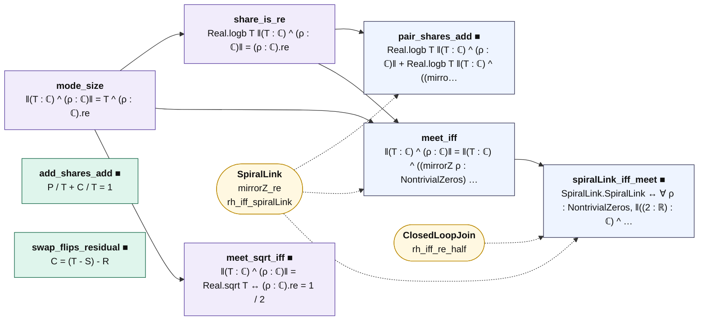

# `lean_stage3/Stage3/ShareLink.lean`

> **Read from the source text.** This file changed after the last `python3 utilities/lean_map.py --dump`, so the arrows on this page are names occurring in each proof and have not been confirmed by Lean.

ShareLink — block J6 of `lean_stage3/design/closedloop.md`. 2026-11-23. The table flipped inside out. A cell's total `T` splits two ways. The primes and the composites split it by adding: `P + C = T`. A zero and its mirror split it by multiplying: their modes have sizes `T^β` and `T^(1−β)`, whose product is `T`. On the multiplying side the table is one line, the exponent from `0` to `1`, and the real part of a zero is the share of the total its mode takes there. The two meet in the middle exactly at one half, where…

8 theorems, 0 definitions, 114 lines. 

**Imports:** [`BandJoin`](../lean_stage3/BandJoin.md)  
**Imported by:** [`Stage3`](../lean_stage3/Stage3.md)

## The picture



An arrow A → B reads "A is used in the proof of B". Green: counting, integers only. Violet: shape, analysis with no ζ. Blue: reads ζ. A name ending in ■ is an end: nothing else uses it. Red: contains `sorry`. Yellow: theorems in another file, counted; a dotted arrow crosses files. Definitions are not drawn; they are listed below the diagram.

## Theorems

<a name="ShareLink-mode_size"></a>
### `ShareLink.mode_size`

line 32 · arrows read from text

**Shape.** Uses real or complex analysis; nothing in it or beneath it reads ζ.

**Why.** A zero's mode. At the total `T` the mode of a zero has size `T` to the zero's real part.

**Proves**

```lean
‖(T : ℂ) ^ (ρ : ℂ)‖ = T ^ (ρ : ℂ).re
```

**Needs** (its hypotheses)

  - `` hT : 0 < T ``
  - `` ρ : NontrivialZeros ``

**Fed by:** no theorem of this repo; it stands on Mathlib.

**Feeds** (3 that use it)

  - [`ShareLink.meet_iff`](#ShareLink-meet_iff) — `` ‖(T : ℂ) ^ (ρ : ℂ)‖ = ‖(T : ℂ) ^ ((mirrorZ ρ : NontrivialZeros) : ℂ)‖ ↔ (ρ : ℂ).re = 1 / 2 ``
  - [`ShareLink.meet_sqrt_iff`](#ShareLink-meet_sqrt_iff) — `` ‖(T : ℂ) ^ (ρ : ℂ)‖ = Real.sqrt T ↔ (ρ : ℂ).re = 1 / 2 ``
  - [`ShareLink.share_is_re`](#ShareLink-share_is_re) — `` Real.logb T ‖(T : ℂ) ^ (ρ : ℂ)‖ = (ρ : ℂ).re ``

<a name="ShareLink-share_is_re"></a>
### `ShareLink.share_is_re`

line 38 · arrows read from text

**Shape.** Uses real or complex analysis; nothing in it or beneath it reads ζ.

**Why.** The real part is a share. On the multiplying scale, the share of the total `T` that a zero's mode takes is the zero's real part.

**Proves**

```lean
Real.logb T ‖(T : ℂ) ^ (ρ : ℂ)‖ = (ρ : ℂ).re
```

**Needs** (its hypotheses)

  - `` hT : 1 < T ``
  - `` ρ : NontrivialZeros ``

**Fed by** (1 theorem its proof uses)

  - [`ShareLink.mode_size`](#ShareLink-mode_size) — `` ‖(T : ℂ) ^ (ρ : ℂ)‖ = T ^ (ρ : ℂ).re ``

**Feeds** (2 that use it)

  - [`ShareLink.meet_iff`](#ShareLink-meet_iff) — `` ‖(T : ℂ) ^ (ρ : ℂ)‖ = ‖(T : ℂ) ^ ((mirrorZ ρ : NontrivialZeros) : ℂ)‖ ↔ (ρ : ℂ).re = 1 / 2 ``
  - [`ShareLink.pair_shares_add`](#ShareLink-pair_shares_add) — `` Real.logb T ‖(T : ℂ) ^ (ρ : ℂ)‖ + Real.logb T ‖(T : ℂ) ^ ((mirrorZ ρ : NontrivialZeros) : ℂ)‖ = 1 ``

<a name="ShareLink-pair_shares_add"></a>
### `ShareLink.pair_shares_add`

line 45 · arrows read from text

**Reads ζ.** It, or something it rests on, uses the zeta function, its zeros or the Riemann hypothesis.

**Why.** The pair splits the total. The shares of a zero and of its mirror add to one, as the prime share and the composite share of a cell do.

**Proves**

```lean
Real.logb T ‖(T : ℂ) ^ (ρ : ℂ)‖ + Real.logb T ‖(T : ℂ) ^ ((mirrorZ ρ : NontrivialZeros) : ℂ)‖ = 1
```

**Needs** (its hypotheses)

  - `` hT : 1 < T ``
  - `` ρ : NontrivialZeros ``

**Fed by** (2 theorems its proof uses)

  - [`ShareLink.share_is_re`](#ShareLink-share_is_re) — `` Real.logb T ‖(T : ℂ) ^ (ρ : ℂ)‖ = (ρ : ℂ).re ``
  - [`SpiralLink.mirrorZ_re`](../lean_stage3/SpiralLink.md#SpiralLink-mirrorZ_re) (SpiralLink) — `` ((mirrorZ ρ : NontrivialZeros) : ℂ).re = 1 - (ρ : ℂ).re ``

**Definitions its proof touches:** [`SpiralLink.mirrorZ`](../lean_stage3/SpiralLink.md#SpiralLink-mirrorZ)

**Feeds:** nothing. It is an end.

<a name="ShareLink-add_shares_add"></a>
### `ShareLink.add_shares_add`

line 52 · arrows read from text

**Counting.** Integers only: nothing in its statement or proof, or in anything it rests on, uses analysis or ζ.

**Why.** The adding split. Two parts of a total have shares that add to one.

**Proves**

```lean
P / T + C / T = 1
```

**Needs** (its hypotheses)

  - `` hT : T ≠ 0 ``
  - `` h : P + C = T ``

**Fed by:** no theorem of this repo; it stands on Mathlib.

**Feeds:** nothing. It connects to nothing.

<a name="ShareLink-meet_iff"></a>
### `ShareLink.meet_iff`

line 57 · arrows read from text

**Reads ζ.** It, or something it rests on, uses the zeta function, its zeros or the Riemann hypothesis.

**Why.** Meeting in the middle. A zero's mode and its mirror's are the same size exactly when the zero's real part is one half.

**Proves**

```lean
‖(T : ℂ) ^ (ρ : ℂ)‖ = ‖(T : ℂ) ^ ((mirrorZ ρ : NontrivialZeros) : ℂ)‖ ↔ (ρ : ℂ).re = 1 / 2
```

**Needs** (its hypotheses)

  - `` hT : 1 < T ``
  - `` ρ : NontrivialZeros ``

**Fed by** (3 theorems its proof uses)

  - [`ShareLink.mode_size`](#ShareLink-mode_size) — `` ‖(T : ℂ) ^ (ρ : ℂ)‖ = T ^ (ρ : ℂ).re ``
  - [`ShareLink.share_is_re`](#ShareLink-share_is_re) — `` Real.logb T ‖(T : ℂ) ^ (ρ : ℂ)‖ = (ρ : ℂ).re ``
  - [`SpiralLink.mirrorZ_re`](../lean_stage3/SpiralLink.md#SpiralLink-mirrorZ_re) (SpiralLink) — `` ((mirrorZ ρ : NontrivialZeros) : ℂ).re = 1 - (ρ : ℂ).re ``

**Definitions its proof touches:** [`SpiralLink.mirrorZ`](../lean_stage3/SpiralLink.md#SpiralLink-mirrorZ)

**Feeds** (1 that use it)

  - [`ShareLink.spiralLink_iff_meet`](#ShareLink-spiralLink_iff_meet) — `` SpiralLink.SpiralLink ↔ ∀ ρ : NontrivialZeros, ‖((2 : ℝ) : ℂ) ^ (ρ : ℂ)‖ = ‖((2 : ℝ) : ℂ) ^ ((mirrorZ ρ : NontrivialZeros) : ℂ)‖ ``

<a name="ShareLink-meet_sqrt_iff"></a>
### `ShareLink.meet_sqrt_iff`

line 71 · arrows read from text

**Shape.** Uses real or complex analysis; nothing in it or beneath it reads ζ.

**Why.** The middle is the square root. A zero's mode is the square root of the total exactly when the zero's real part is one half.

**Proves**

```lean
‖(T : ℂ) ^ (ρ : ℂ)‖ = Real.sqrt T ↔ (ρ : ℂ).re = 1 / 2
```

**Needs** (its hypotheses)

  - `` hT : 1 < T ``
  - `` ρ : NontrivialZeros ``

**Fed by** (1 theorem its proof uses)

  - [`ShareLink.mode_size`](#ShareLink-mode_size) — `` ‖(T : ℂ) ^ (ρ : ℂ)‖ = T ^ (ρ : ℂ).re ``

**Feeds:** nothing. It is an end.

<a name="ShareLink-swap_flips_residual"></a>
### `ShareLink.swap_flips_residual`

line 85 · arrows read from text

**Counting.** Integers only: nothing in its statement or proof, or in anything it rests on, uses analysis or ζ.

**Why.** The swap moves no mode. If the prime cell is a smooth part plus a residual, the composite cell is the rest of the total less the same residual.

**Proves**

```lean
C = (T - S) - R
```

**Needs** (its hypotheses)

  - `` hP : P = S + R ``
  - `` h : P + C = T ``

**Fed by:** no theorem of this repo; it stands on Mathlib.

**Feeds:** nothing. It connects to nothing.

<a name="ShareLink-spiralLink_iff_meet"></a>
### `ShareLink.spiralLink_iff_meet`

line 91 · arrows read from text

**Reads ζ.** It, or something it rests on, uses the zeta function, its zeros or the Riemann hypothesis.

**Why.** The loop, as the meeting. The spiral link holds exactly when every zero's mode and its mirror's are the same size at base two.

**Proves**

```lean
SpiralLink.SpiralLink ↔ ∀ ρ : NontrivialZeros, ‖((2 : ℝ) : ℂ) ^ (ρ : ℂ)‖ = ‖((2 : ℝ) : ℂ) ^ ((mirrorZ ρ : NontrivialZeros) : ℂ)‖
```

**Fed by** (3 theorems its proof uses)

  - [`ClosedLoopJoin.rh_iff_re_half`](../lean_stage3/ClosedLoopJoin.md#ClosedLoopJoin-rh_iff_re_half) (ClosedLoopJoin) — `` RiemannHypothesis ↔ ∀ ρ : NontrivialZeros, (ρ : ℂ).re = 1 / 2 ``
  - [`ShareLink.meet_iff`](#ShareLink-meet_iff) — `` ‖(T : ℂ) ^ (ρ : ℂ)‖ = ‖(T : ℂ) ^ ((mirrorZ ρ : NontrivialZeros) : ℂ)‖ ↔ (ρ : ℂ).re = 1 / 2 ``
  - [`SpiralLink.rh_iff_spiralLink`](../lean_stage3/SpiralLink.md#SpiralLink-rh_iff_spiralLink) (SpiralLink) — `` RiemannHypothesis ↔ SpiralLink ``

**Definitions its proof touches:** [`SpiralLink.SpiralLink`](../lean_stage3/SpiralLink.md#SpiralLink-SpiralLink), [`SpiralLink.mirrorZ`](../lean_stage3/SpiralLink.md#SpiralLink-mirrorZ)

**Feeds:** nothing. It is an end.

