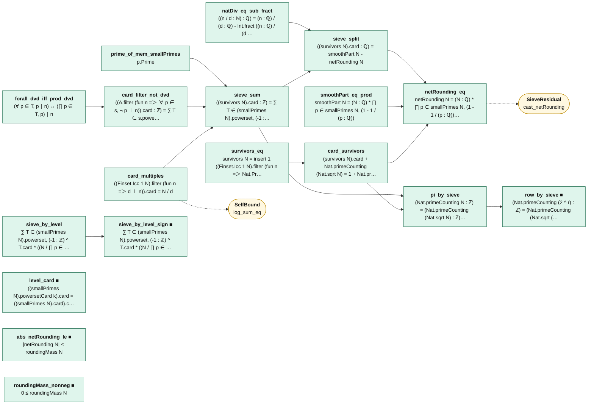

# `lean_stage3/Stage3/SieveExact.lean`

> **Read from the source text.** This file changed after the last `python3 utilities/lean_map.py --dump`, so the arrows on this page are names occurring in each proof and have not been confirmed by Lean.

# Stage3.SieveExact — the sieve of Legendre, exactly Block R2 of `lean_stage3/design/runs.md` ("The sieve, exactly"). An exploratory run (unit 0475) checked on rows 10..24 that the number of primes up to `2^r` is given exactly by the sieve of Legendre from the primes up to `2^(r/2)`. This module proves that identity for every `N`, with nothing computed.

18 theorems, 5 definitions, 287 lines. 

**Imports:** nothing in this tree  
**Imported by:** [`Stage3`](../lean_stage3/Stage3.md), [`SieveResidual`](../lean_stage3/SieveResidual.md)

## The picture



An arrow A → B reads "A is used in the proof of B". Green: counting, integers only. Violet: shape, analysis with no ζ. Blue: reads ζ. A name ending in ■ is an end: nothing else uses it. Red: contains `sorry`. Yellow: theorems in another file, counted; a dotted arrow crosses files. Definitions are not drawn; they are listed below the diagram.

## Definitions

<a name="SieveExact-smallPrimes"></a>
### `SieveExact.smallPrimes`

def · line 30

The primes up to the square root of `N`.

- **Is:** `` smallPrimes (N : ℕ) : Finset ℕ := (Finset.range (Nat.sqrt N + 1)).filter Nat.Prime ``
- **Used by 20:** [`HalfSieve.half_cancels`](../lean_stage3/HalfSieve.md#HalfSieve-half_cancels), [`HalfSieve.netRounding_centered`](../lean_stage3/HalfSieve.md#HalfSieve-netRounding_centered), [`HalfSieve.two_mem_smallPrimes`](../lean_stage3/HalfSieve.md#HalfSieve-two_mem_smallPrimes), [`SieveExact.level_card`](#SieveExact-level_card), [`SieveExact.netRounding`](#SieveExact-netRounding), [`SieveExact.netRounding_eq`](#SieveExact-netRounding_eq), [`SieveExact.pi_by_sieve`](#SieveExact-pi_by_sieve), [`SieveExact.prime_of_mem_smallPrimes`](#SieveExact-prime_of_mem_smallPrimes), [`SieveExact.roundingMass`](#SieveExact-roundingMass), [`SieveExact.row_by_sieve`](#SieveExact-row_by_sieve), [`SieveExact.sieve_by_level`](#SieveExact-sieve_by_level), [`SieveExact.sieve_by_level_sign`](#SieveExact-sieve_by_level_sign), [`SieveExact.sieve_split`](#SieveExact-sieve_split), [`SieveExact.sieve_sum`](#SieveExact-sieve_sum), [`SieveExact.smoothPart`](#SieveExact-smoothPart), [`SieveExact.smoothPart_eq_prod`](#SieveExact-smoothPart_eq_prod), [`SieveExact.survivors`](#SieveExact-survivors), [`SieveExact.survivors_eq`](#SieveExact-survivors_eq), [`SieveResidual.cast_netRounding`](../lean_stage3/SieveResidual.md#SieveResidual-cast_netRounding), [`SieveResidual.smoothNet`](../lean_stage3/SieveResidual.md#SieveResidual-smoothNet)

<a name="SieveExact-survivors"></a>
### `SieveExact.survivors`

def · line 33

The integers from 1 to `N` that no prime up to `√N` divides.

- **Is:** `` survivors (N : ℕ) : Finset ℕ := (Finset.Icc 1 N).filter (fun n => ∀ p ∈ smallPrimes N, ¬ p ∣ n) ``
- **Built from:** [`SieveExact.smallPrimes`](#SieveExact-smallPrimes)
- **Used by 6:** [`SieveExact.card_survivors`](#SieveExact-card_survivors), [`SieveExact.netRounding_eq`](#SieveExact-netRounding_eq), [`SieveExact.pi_by_sieve`](#SieveExact-pi_by_sieve), [`SieveExact.sieve_split`](#SieveExact-sieve_split), [`SieveExact.sieve_sum`](#SieveExact-sieve_sum), [`SieveExact.survivors_eq`](#SieveExact-survivors_eq)

<a name="SieveExact-smoothPart"></a>
### `SieveExact.smoothPart`

def · line 211

The exact-fraction part of the sieve's sum.

- **Is:** `` smoothPart (N : ℕ) : ℚ := ∑ T ∈ (smallPrimes N).powerset, (-1 : ℚ) ^ T.card * ((N : ℚ) / ((∏ p ∈ T, p : ℕ) : ℚ)) ``
- **Built from:** [`SieveExact.smallPrimes`](#SieveExact-smallPrimes)
- **Used by 2:** [`SieveExact.sieve_split`](#SieveExact-sieve_split), [`SieveExact.smoothPart_eq_prod`](#SieveExact-smoothPart_eq_prod)

<a name="SieveExact-netRounding"></a>
### `SieveExact.netRounding`

def · line 215

The net of the roundings, with their signs.

- **Is:** `` netRounding (N : ℕ) : ℚ := ∑ T ∈ (smallPrimes N).powerset, (-1 : ℚ) ^ T.card * Int.fract ((N : ℚ) / ((∏ p ∈ T, p : ℕ) : ℚ)) ``
- **Built from:** [`SieveExact.smallPrimes`](#SieveExact-smallPrimes)
- **Used by 8:** [`HalfSieve.netRounding_centered`](../lean_stage3/HalfSieve.md#HalfSieve-netRounding_centered), [`HalfSieve.wobble`](../lean_stage3/HalfSieve.md#HalfSieve-wobble), [`SieveExact.abs_netRounding_le`](#SieveExact-abs_netRounding_le), [`SieveExact.netRounding_eq`](#SieveExact-netRounding_eq), [`SieveExact.sieve_split`](#SieveExact-sieve_split), [`SieveResidual.cast_netRounding`](../lean_stage3/SieveResidual.md#SieveResidual-cast_netRounding), [`SieveResidual.net_wobble`](../lean_stage3/SieveResidual.md#SieveResidual-net_wobble), [`SieveResidual.net_wobble_rows`](../lean_stage3/SieveResidual.md#SieveResidual-net_wobble_rows)

<a name="SieveExact-roundingMass"></a>
### `SieveExact.roundingMass`

def · line 219

The roundings added in size.

- **Is:** `` roundingMass (N : ℕ) : ℚ := ∑ T ∈ (smallPrimes N).powerset, Int.fract ((N : ℚ) / ((∏ p ∈ T, p : ℕ) : ℚ)) ``
- **Built from:** [`SieveExact.smallPrimes`](#SieveExact-smallPrimes)
- **Used by 2:** [`SieveExact.abs_netRounding_le`](#SieveExact-abs_netRounding_le), [`SieveExact.roundingMass_nonneg`](#SieveExact-roundingMass_nonneg)

## Theorems

<a name="SieveExact-prime_of_mem_smallPrimes"></a>
### `SieveExact.prime_of_mem_smallPrimes`

line 37 · arrows read from text

**Counting.** Integers only: nothing in its statement or proof, or in anything it rests on, uses analysis or ζ.

**Why.** Every member of `smallPrimes N` is prime.

**Proves**

```lean
p.Prime
```

**Needs** (its hypotheses)

  - `` hp : p ∈ smallPrimes N ``

**Fed by:** no theorem of this repo; it stands on Mathlib and the definitions below.

**Definitions its proof touches:** [`SieveExact.smallPrimes`](#SieveExact-smallPrimes)

**Feeds** (1 that use it)

  - [`SieveExact.sieve_sum`](#SieveExact-sieve_sum) — `` ((survivors N).card : ℤ) = ∑ T ∈ (smallPrimes N).powerset, (-1 : ℤ) ^ T.card * ((N / ∏ p ∈ T, p : ℕ) : ℤ) ``

<a name="SieveExact-forall_dvd_iff_prod_dvd"></a>
### `SieveExact.forall_dvd_iff_prod_dvd`

line 41 · arrows read from text

**Counting.** Integers only: nothing in its statement or proof, or in anything it rests on, uses analysis or ζ.

**Why.** For a set of primes, all of them divide `n` exactly when their product does.

**Proves**

```lean
(∀ p ∈ T, p ∣ n) ↔ (∏ p ∈ T, p) ∣ n
```

**Needs** (its hypotheses)

  - `` T : Finset ℕ ``
  - `` hT : ∀ p ∈ T, p.Prime ``
  - `` n : ℕ ``

**Fed by:** no theorem of this repo; it stands on Mathlib.

**Feeds** (1 that use it)

  - [`SieveExact.card_filter_not_dvd`](#SieveExact-card_filter_not_dvd) — `` ((A.filter (fun n => ∀ p ∈ s, ¬ p ∣ n)).card : ℤ) = ∑ T ∈ s.powerset, (-1 : ℤ) ^ T.card * ((A.filter (fun n => (∏ p ∈ T, p) ∣ n)).card : ℤ) ``

<a name="SieveExact-card_filter_not_dvd"></a>
### `SieveExact.card_filter_not_dvd`

line 49 · arrows read from text

**Counting.** Integers only: nothing in its statement or proof, or in anything it rests on, uses analysis or ζ.

**Why.** Inclusion and exclusion over any finite set `A`: the members of `A` that no prime of `s` divides, counted as an alternating sum of the members that the products of subsets of `s` divide.

**Proves**

```lean
((A.filter (fun n => ∀ p ∈ s, ¬ p ∣ n)).card : ℤ) = ∑ T ∈ s.powerset, (-1 : ℤ) ^ T.card * ((A.filter (fun n => (∏ p ∈ T, p) ∣ n)).card : ℤ)
```

**Needs** (its hypotheses)

  - `` A s : Finset ℕ ``
  - `` hs : ∀ p ∈ s, p.Prime ``

**Fed by** (1 theorem its proof uses)

  - [`SieveExact.forall_dvd_iff_prod_dvd`](#SieveExact-forall_dvd_iff_prod_dvd) — `` (∀ p ∈ T, p ∣ n) ↔ (∏ p ∈ T, p) ∣ n ``

**Feeds** (1 that use it)

  - [`SieveExact.sieve_sum`](#SieveExact-sieve_sum) — `` ((survivors N).card : ℤ) = ∑ T ∈ (smallPrimes N).powerset, (-1 : ℤ) ^ T.card * ((N / ∏ p ∈ T, p : ℕ) : ℤ) ``

<a name="SieveExact-card_multiples"></a>
### `SieveExact.card_multiples`

line 75 · arrows read from text

**Counting.** Integers only: nothing in its statement or proof, or in anything it rests on, uses analysis or ζ.

**Why.** The multiples of `d` in `[1, N]` number `N / d`.

**Proves**

```lean
((Finset.Icc 1 N).filter (fun n => d ∣ n)).card = N / d
```

**Needs** (its hypotheses)

  - `` N d : ℕ ``

**Fed by:** no theorem of this repo; it stands on Mathlib.

**Feeds** (2 that use it)

  - [`SelfBound.log_sum_eq`](../lean_stage3/SelfBound.md#SelfBound-log_sum_eq) (SelfBound) — `` ∑ n ∈ Icc 1 N, Real.log (n : ℝ) = ∑ d ∈ Icc 1 N, vonMangoldt d * ((N / d : ℕ) : ℝ) ``
  - [`SieveExact.sieve_sum`](#SieveExact-sieve_sum) — `` ((survivors N).card : ℤ) = ∑ T ∈ (smallPrimes N).powerset, (-1 : ℤ) ^ T.card * ((N / ∏ p ∈ T, p : ℕ) : ℤ) ``

<a name="SieveExact-sieve_sum"></a>
### `SieveExact.sieve_sum`

line 82 · arrows read from text

**Counting.** Integers only: nothing in its statement or proof, or in anything it rests on, uses analysis or ζ.

**Why.** Inclusion and exclusion: the survivors of the sieve number the alternating sum, over the sets `T` of primes up to `√N`, of `⌊N / ∏ T⌋`.

**Proves**

```lean
((survivors N).card : ℤ) = ∑ T ∈ (smallPrimes N).powerset, (-1 : ℤ) ^ T.card * ((N / ∏ p ∈ T, p : ℕ) : ℤ)
```

**Needs** (its hypotheses)

  - `` N : ℕ ``

**Fed by** (3 theorems its proof uses)

  - [`SieveExact.card_filter_not_dvd`](#SieveExact-card_filter_not_dvd) — `` ((A.filter (fun n => ∀ p ∈ s, ¬ p ∣ n)).card : ℤ) = ∑ T ∈ s.powerset, (-1 : ℤ) ^ T.card * ((A.filter (fun n => (∏ p ∈ T, p) ∣ n)).card : ℤ) ``
  - [`SieveExact.card_multiples`](#SieveExact-card_multiples) — `` ((Finset.Icc 1 N).filter (fun n => d ∣ n)).card = N / d ``
  - [`SieveExact.prime_of_mem_smallPrimes`](#SieveExact-prime_of_mem_smallPrimes) — `` p.Prime ``

**Definitions its proof touches:** [`SieveExact.smallPrimes`](#SieveExact-smallPrimes), [`SieveExact.survivors`](#SieveExact-survivors)

**Feeds** (2 that use it)

  - [`SieveExact.pi_by_sieve`](#SieveExact-pi_by_sieve) — `` (Nat.primeCounting N : ℤ) = (Nat.primeCounting (Nat.sqrt N) : ℤ) - 1 + ∑ T ∈ (smallPrimes N).powerset, (-1 : ℤ) ^ T.card * ((N / ∏ p ∈ T, p : ℕ) : ℤ) ``
  - [`SieveExact.sieve_split`](#SieveExact-sieve_split) — `` ((survivors N).card : ℚ) = smoothPart N - netRounding N ``

<a name="SieveExact-survivors_eq"></a>
### `SieveExact.survivors_eq`

line 95 · arrows read from text

**Counting.** Integers only: nothing in its statement or proof, or in anything it rests on, uses analysis or ζ.

**Why.** For `2 ≤ N`, the survivors of the sieve are `1` and the primes above `√N` up to `N`.

**Proves**

```lean
survivors N = insert 1 ((Finset.Icc 1 N).filter (fun n => Nat.Prime n ∧ Nat.sqrt N < n))
```

**Needs** (its hypotheses)

  - `` N : ℕ ``
  - `` hN : 2 ≤ N ``

**Fed by:** no theorem of this repo; it stands on Mathlib and the definitions below.

**Definitions its proof touches:** [`SieveExact.smallPrimes`](#SieveExact-smallPrimes), [`SieveExact.survivors`](#SieveExact-survivors)

**Feeds** (1 that use it)

  - [`SieveExact.card_survivors`](#SieveExact-card_survivors) — `` (survivors N).card + Nat.primeCounting (Nat.sqrt N) = 1 + Nat.primeCounting N ``

<a name="SieveExact-card_survivors"></a>
### `SieveExact.card_survivors`

line 127 · arrows read from text

**Counting.** Integers only: nothing in its statement or proof, or in anything it rests on, uses analysis or ζ.

**Why.** For `2 ≤ N`, the survivors together with the primes up to `√N` number one more than the primes up to `N`.

**Proves**

```lean
(survivors N).card + Nat.primeCounting (Nat.sqrt N) = 1 + Nat.primeCounting N
```

**Needs** (its hypotheses)

  - `` N : ℕ ``
  - `` hN : 2 ≤ N ``

**Fed by** (1 theorem its proof uses)

  - [`SieveExact.survivors_eq`](#SieveExact-survivors_eq) — `` survivors N = insert 1 ((Finset.Icc 1 N).filter (fun n => Nat.Prime n ∧ Nat.sqrt N < n)) ``

**Definitions its proof touches:** [`SieveExact.survivors`](#SieveExact-survivors)

**Feeds** (2 that use it)

  - [`SieveExact.netRounding_eq`](#SieveExact-netRounding_eq) — `` netRounding N = (N : ℚ) * ∏ p ∈ smallPrimes N, (1 - 1 / (p : ℚ)) - (1 + (Nat.primeCounting N : ℚ) - (Nat.primeCounting (Nat.sqrt N) : ℚ)) ``
  - [`SieveExact.pi_by_sieve`](#SieveExact-pi_by_sieve) — `` (Nat.primeCounting N : ℤ) = (Nat.primeCounting (Nat.sqrt N) : ℤ) - 1 + ∑ T ∈ (smallPrimes N).powerset, (-1 : ℤ) ^ T.card * ((N / ∏ p ∈ T, p : ℕ) : ℤ) ``

<a name="SieveExact-pi_by_sieve"></a>
### `SieveExact.pi_by_sieve`

line 156 · arrows read from text

**Counting.** Integers only: nothing in its statement or proof, or in anything it rests on, uses analysis or ζ.

**Why.** For `2 ≤ N`, the number of primes up to `N` from the primes up to `√N` alone: `π(N) = π(√N) - 1 + Σ_T (-1)^|T| ⌊N / ∏ T⌋`.

**Proves**

```lean
(Nat.primeCounting N : ℤ) = (Nat.primeCounting (Nat.sqrt N) : ℤ) - 1 + ∑ T ∈ (smallPrimes N).powerset, (-1 : ℤ) ^ T.card * ((N / ∏ p ∈ T, p : ℕ) : ℤ)
```

**Needs** (its hypotheses)

  - `` N : ℕ ``
  - `` hN : 2 ≤ N ``

**Fed by** (2 theorems its proof uses)

  - [`SieveExact.card_survivors`](#SieveExact-card_survivors) — `` (survivors N).card + Nat.primeCounting (Nat.sqrt N) = 1 + Nat.primeCounting N ``
  - [`SieveExact.sieve_sum`](#SieveExact-sieve_sum) — `` ((survivors N).card : ℤ) = ∑ T ∈ (smallPrimes N).powerset, (-1 : ℤ) ^ T.card * ((N / ∏ p ∈ T, p : ℕ) : ℤ) ``

**Definitions its proof touches:** [`SieveExact.smallPrimes`](#SieveExact-smallPrimes), [`SieveExact.survivors`](#SieveExact-survivors)

**Feeds** (1 that use it)

  - [`SieveExact.row_by_sieve`](#SieveExact-row_by_sieve) — `` (Nat.primeCounting (2 ^ r) : ℤ) = (Nat.primeCounting (Nat.sqrt (2 ^ r)) : ℤ) - 1 + ∑ T ∈ (smallPrimes (2 ^ r)).powerset, (-1 : ℤ) ^ T.card * ((2 ^ r /… ``

<a name="SieveExact-row_by_sieve"></a>
### `SieveExact.row_by_sieve`

line 170 · arrows read from text

**Counting.** Integers only: nothing in its statement or proof, or in anything it rests on, uses analysis or ζ.

**Why.** The ladder: `pi_by_sieve` at `N = 2 ^ r`, the table's row `r`.

**Proves**

```lean
(Nat.primeCounting (2 ^ r) : ℤ) = (Nat.primeCounting (Nat.sqrt (2 ^ r)) : ℤ) - 1 + ∑ T ∈ (smallPrimes (2 ^ r)).powerset, (-1 : ℤ) ^ T.card * ((2 ^ r / ∏ p ∈ T, p : ℕ) : ℤ)
```

**Needs** (its hypotheses)

  - `` r : ℕ ``
  - `` hr : 1 ≤ r ``

**Fed by** (1 theorem its proof uses)

  - [`SieveExact.pi_by_sieve`](#SieveExact-pi_by_sieve) — `` (Nat.primeCounting N : ℤ) = (Nat.primeCounting (Nat.sqrt N) : ℤ) - 1 + ∑ T ∈ (smallPrimes N).powerset, (-1 : ℤ) ^ T.card * ((N / ∏ p ∈ T, p : ℕ) : ℤ) ``

**Definitions its proof touches:** [`SieveExact.smallPrimes`](#SieveExact-smallPrimes)

**Feeds:** nothing. It is an end.

<a name="SieveExact-sieve_by_level"></a>
### `SieveExact.sieve_by_level`

line 184 · arrows read from text

**Counting.** Integers only: nothing in its statement or proof, or in anything it rests on, uses analysis or ζ.

**Why.** The sieve's sum arranged by level: the sets `T` grouped by their size `k`.

**Proves**

```lean
∑ T ∈ (smallPrimes N).powerset, (-1 : ℤ) ^ T.card * ((N / ∏ p ∈ T, p : ℕ) : ℤ) = ∑ k ∈ Finset.range ((smallPrimes N).card + 1), ∑ T ∈ (smallPrimes N).powersetCard k, (-1 : ℤ) ^ T.card * ((N / ∏ p ∈ T, p : ℕ) : ℤ)
```

**Needs** (its hypotheses)

  - `` N : ℕ ``

**Fed by:** no theorem of this repo; it stands on Mathlib and the definitions below.

**Definitions its proof touches:** [`SieveExact.smallPrimes`](#SieveExact-smallPrimes)

**Feeds** (1 that use it)

  - [`SieveExact.sieve_by_level_sign`](#SieveExact-sieve_by_level_sign) — `` ∑ T ∈ (smallPrimes N).powerset, (-1 : ℤ) ^ T.card * ((N / ∏ p ∈ T, p : ℕ) : ℤ) = ∑ k ∈ Finset.range ((smallPrimes N).card + 1), (-1 : ℤ) ^ k * ∑ T ∈ (… ``

<a name="SieveExact-sieve_by_level_sign"></a>
### `SieveExact.sieve_by_level_sign`

line 191 · arrows read from text

**Counting.** Integers only: nothing in its statement or proof, or in anything it rests on, uses analysis or ζ.

**Why.** The sum by level with the sign of each level pulled out: level `k` carries `(-1)^k`.

**Proves**

```lean
∑ T ∈ (smallPrimes N).powerset, (-1 : ℤ) ^ T.card * ((N / ∏ p ∈ T, p : ℕ) : ℤ) = ∑ k ∈ Finset.range ((smallPrimes N).card + 1), (-1 : ℤ) ^ k * ∑ T ∈ (smallPrimes N).powersetCard k, ((N / ∏ p ∈ T, p : ℕ) : ℤ)
```

**Needs** (its hypotheses)

  - `` N : ℕ ``

**Fed by** (1 theorem its proof uses)

  - [`SieveExact.sieve_by_level`](#SieveExact-sieve_by_level) — `` ∑ T ∈ (smallPrimes N).powerset, (-1 : ℤ) ^ T.card * ((N / ∏ p ∈ T, p : ℕ) : ℤ) = ∑ k ∈ Finset.range ((smallPrimes N).card + 1), ∑ T ∈ (smallPrimes N).… ``

**Definitions its proof touches:** [`SieveExact.smallPrimes`](#SieveExact-smallPrimes)

**Feeds:** nothing. It is an end.

<a name="SieveExact-level_card"></a>
### `SieveExact.level_card`

line 202 · arrows read from text

**Counting.** Integers only: nothing in its statement or proof, or in anything it rests on, uses analysis or ζ.

**Why.** The number of terms at level `k` is a binomial coefficient: a row of Pascal.

**Proves**

```lean
((smallPrimes N).powersetCard k).card = ((smallPrimes N).card).choose k
```

**Needs** (its hypotheses)

  - `` N k : ℕ ``

**Fed by:** no theorem of this repo; it stands on Mathlib and the definitions below.

**Definitions its proof touches:** [`SieveExact.smallPrimes`](#SieveExact-smallPrimes)

**Feeds:** nothing. It is an end.

<a name="SieveExact-natDiv_eq_sub_fract"></a>
### `SieveExact.natDiv_eq_sub_fract`

line 223 · arrows read from text

**Counting.** Integers only: nothing in its statement or proof, or in anything it rests on, uses analysis or ζ.

**Why.** A natural quotient is the exact fraction less its fractional part.

**Proves**

```lean
((n / d : ℕ) : ℚ) = (n : ℚ) / (d : ℚ) - Int.fract ((n : ℚ) / (d : ℚ))
```

**Needs** (its hypotheses)

  - `` n d : ℕ ``

**Fed by:** no theorem of this repo; it stands on Mathlib.

**Feeds** (1 that use it)

  - [`SieveExact.sieve_split`](#SieveExact-sieve_split) — `` ((survivors N).card : ℚ) = smoothPart N - netRounding N ``

<a name="SieveExact-sieve_split"></a>
### `SieveExact.sieve_split`

line 229 · arrows read from text

**Counting.** Integers only: nothing in its statement or proof, or in anything it rests on, uses analysis or ζ.

**Why.** The survivors' count is the exact-fraction part less the net of the roundings.

**Proves**

```lean
((survivors N).card : ℚ) = smoothPart N - netRounding N
```

**Needs** (its hypotheses)

  - `` N : ℕ ``

**Fed by** (2 theorems its proof uses)

  - [`SieveExact.natDiv_eq_sub_fract`](#SieveExact-natDiv_eq_sub_fract) — `` ((n / d : ℕ) : ℚ) = (n : ℚ) / (d : ℚ) - Int.fract ((n : ℚ) / (d : ℚ)) ``
  - [`SieveExact.sieve_sum`](#SieveExact-sieve_sum) — `` ((survivors N).card : ℤ) = ∑ T ∈ (smallPrimes N).powerset, (-1 : ℤ) ^ T.card * ((N / ∏ p ∈ T, p : ℕ) : ℤ) ``

**Definitions its proof touches:** [`SieveExact.netRounding`](#SieveExact-netRounding), [`SieveExact.smallPrimes`](#SieveExact-smallPrimes), [`SieveExact.smoothPart`](#SieveExact-smoothPart), [`SieveExact.survivors`](#SieveExact-survivors)

**Feeds** (1 that use it)

  - [`SieveExact.netRounding_eq`](#SieveExact-netRounding_eq) — `` netRounding N = (N : ℚ) * ∏ p ∈ smallPrimes N, (1 - 1 / (p : ℚ)) - (1 + (Nat.primeCounting N : ℚ) - (Nat.primeCounting (Nat.sqrt N) : ℚ)) ``

<a name="SieveExact-smoothPart_eq_prod"></a>
### `SieveExact.smoothPart_eq_prod`

line 246 · arrows read from text

**Counting.** Integers only: nothing in its statement or proof, or in anything it rests on, uses analysis or ζ.

**Why.** The exact-fraction part is `N` times the product of `1 - 1/p` over the primes up to `√N`.

**Proves**

```lean
smoothPart N = (N : ℚ) * ∏ p ∈ smallPrimes N, (1 - 1 / (p : ℚ))
```

**Needs** (its hypotheses)

  - `` N : ℕ ``

**Fed by:** no theorem of this repo; it stands on Mathlib and the definitions below.

**Definitions its proof touches:** [`SieveExact.smallPrimes`](#SieveExact-smallPrimes), [`SieveExact.smoothPart`](#SieveExact-smoothPart)

**Feeds** (1 that use it)

  - [`SieveExact.netRounding_eq`](#SieveExact-netRounding_eq) — `` netRounding N = (N : ℚ) * ∏ p ∈ smallPrimes N, (1 - 1 / (p : ℚ)) - (1 + (Nat.primeCounting N : ℚ) - (Nat.primeCounting (Nat.sqrt N) : ℚ)) ``

<a name="SieveExact-abs_netRounding_le"></a>
### `SieveExact.abs_netRounding_le`

line 259 · arrows read from text

**Counting.** Integers only: nothing in its statement or proof, or in anything it rests on, uses analysis or ζ.

**Why.** The net of the roundings is at most their mass in size.

**Proves**

```lean
|netRounding N| ≤ roundingMass N
```

**Needs** (its hypotheses)

  - `` N : ℕ ``

**Fed by:** no theorem of this repo; it stands on Mathlib and the definitions below.

**Definitions its proof touches:** [`SieveExact.netRounding`](#SieveExact-netRounding), [`SieveExact.roundingMass`](#SieveExact-roundingMass)

**Feeds:** nothing. It is an end.

<a name="SieveExact-roundingMass_nonneg"></a>
### `SieveExact.roundingMass_nonneg`

line 266 · arrows read from text

**Counting.** Integers only: nothing in its statement or proof, or in anything it rests on, uses analysis or ζ.

**Why.** The rounding mass is nonnegative.

**Proves**

```lean
0 ≤ roundingMass N
```

**Needs** (its hypotheses)

  - `` N : ℕ ``

**Fed by:** no theorem of this repo; it stands on Mathlib and the definitions below.

**Definitions its proof touches:** [`SieveExact.roundingMass`](#SieveExact-roundingMass)

**Feeds:** nothing. It is an end.

<a name="SieveExact-netRounding_eq"></a>
### `SieveExact.netRounding_eq`

line 272 · arrows read from text

**Counting.** Integers only: nothing in its statement or proof, or in anything it rests on, uses analysis or ζ.

**Why.** The net of the roundings, exactly. For `N ≥ 2` the net rounding is the closed product less the count the sieve produces: `N·Π(1 − 1/p)` over the primes up to `√N`, less `1 + π(N) − π(√N)`.

**Proves**

```lean
netRounding N = (N : ℚ) * ∏ p ∈ smallPrimes N, (1 - 1 / (p : ℚ)) - (1 + (Nat.primeCounting N : ℚ) - (Nat.primeCounting (Nat.sqrt N) : ℚ))
```

**Needs** (its hypotheses)

  - `` N : ℕ ``
  - `` hN : 2 ≤ N ``

**Fed by** (3 theorems its proof uses)

  - [`SieveExact.card_survivors`](#SieveExact-card_survivors) — `` (survivors N).card + Nat.primeCounting (Nat.sqrt N) = 1 + Nat.primeCounting N ``
  - [`SieveExact.sieve_split`](#SieveExact-sieve_split) — `` ((survivors N).card : ℚ) = smoothPart N - netRounding N ``
  - [`SieveExact.smoothPart_eq_prod`](#SieveExact-smoothPart_eq_prod) — `` smoothPart N = (N : ℚ) * ∏ p ∈ smallPrimes N, (1 - 1 / (p : ℚ)) ``

**Definitions its proof touches:** [`SieveExact.netRounding`](#SieveExact-netRounding), [`SieveExact.smallPrimes`](#SieveExact-smallPrimes), [`SieveExact.survivors`](#SieveExact-survivors)

**Feeds** (1 that use it)

  - [`SieveResidual.cast_netRounding`](../lean_stage3/SieveResidual.md#SieveResidual-cast_netRounding) (SieveResidual) — `` ((netRounding N : ℚ) : ℝ) = (N : ℝ) * ∏ p ∈ smallPrimes N, (1 - 1 / (p : ℝ)) - (1 + (Nat.primeCounting N : ℝ) - (Nat.primeCounting (Nat.sqrt N) : ℝ)) ``

