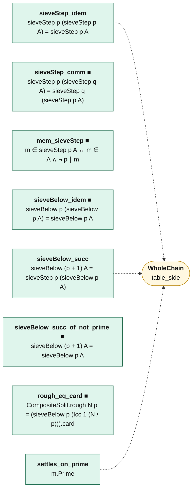

# `lean_stage3/Stage3/SieveIdem.lean`

> **Read from the source text.** This file changed after the last `python3 utilities/lean_map.py --dump`, so the arrows on this page are names occurring in each proof and have not been confirmed by Lean.

SieveIdem — block R12 of `lean_stage3/design/runs.md`. 2026-11-23. Julian, 2026-11-23: the settling happens one slot at a time because of idempotence; every step is the same `f`, and it scales at any `x`.

8 theorems, 2 definitions, 141 lines. 

**Imports:** [`CompositeSplit`](../lean_stage3/CompositeSplit.md)  
**Imported by:** [`Stage3`](../lean_stage3/Stage3.md), [`WholeChain`](../lean_stage3/WholeChain.md)

## The picture



An arrow A → B reads "A is used in the proof of B". Green: counting, integers only. Violet: shape, analysis with no ζ. Blue: reads ζ. A name ending in ■ is an end: nothing else uses it. Red: contains `sorry`. Yellow: theorems in another file, counted; a dotted arrow crosses files. Definitions are not drawn; they are listed below the diagram.

## Definitions

<a name="SieveIdem-sieveStep"></a>
### `SieveIdem.sieveStep`

def · line 33

- **Is:** `` sieveStep (p : ℕ) (A : Finset ℕ) : Finset ℕ := A.filter (fun m => ¬ p ∣ m) ``
- **Used by 5:** [`SieveIdem.mem_sieveStep`](#SieveIdem-mem_sieveStep), [`SieveIdem.sieveBelow_succ`](#SieveIdem-sieveBelow_succ), [`SieveIdem.sieveStep_comm`](#SieveIdem-sieveStep_comm), [`SieveIdem.sieveStep_idem`](#SieveIdem-sieveStep_idem), [`WholeChain.table_side`](../lean_stage3/WholeChain.md#WholeChain-table_side)

<a name="SieveIdem-sieveBelow"></a>
### `SieveIdem.sieveBelow`

def · line 61

- **Is:** `` sieveBelow (p : ℕ) (A : Finset ℕ) : Finset ℕ := A.filter (fun m => ∀ q : ℕ, q.Prime → q < p → ¬ q ∣ m) ``
- **Used by 5:** [`SieveIdem.rough_eq_card`](#SieveIdem-rough_eq_card), [`SieveIdem.sieveBelow_idem`](#SieveIdem-sieveBelow_idem), [`SieveIdem.sieveBelow_succ`](#SieveIdem-sieveBelow_succ), [`SieveIdem.sieveBelow_succ_of_not_prime`](#SieveIdem-sieveBelow_succ_of_not_prime), [`WholeChain.table_side`](../lean_stage3/WholeChain.md#WholeChain-table_side)

## Theorems

<a name="SieveIdem-sieveStep_idem"></a>
### `SieveIdem.sieveStep_idem`

line 37 · arrows read from text

**Counting.** Integers only: nothing in its statement or proof, or in anything it rests on, uses analysis or ζ.

**Why.** Idempotent. A step done twice is done once.

**Proves**

```lean
sieveStep p (sieveStep p A) = sieveStep p A
```

**Needs** (its hypotheses)

  - `` p : ℕ ``
  - `` A : Finset ℕ ``

**Fed by:** no theorem of this repo; it stands on Mathlib and the definitions below.

**Definitions its proof touches:** [`SieveIdem.sieveStep`](#SieveIdem-sieveStep)

**Feeds** (1 that use it)

  - [`WholeChain.table_side`](../lean_stage3/WholeChain.md#WholeChain-table_side) (WholeChain) — `` (∀ N : ℕ, 2 ≤ N → (Nat.primeCounting N : ℤ) = (Nat.primeCounting (Nat.sqrt N) : ℤ) - 1 + ∑ T ∈ (SieveExact.smallPrimes N).powerset, (-1 : ℤ) ^ T.card … ``

<a name="SieveIdem-sieveStep_comm"></a>
### `SieveIdem.sieveStep_comm`

line 44 · arrows read from text

**Counting.** Integers only: nothing in its statement or proof, or in anything it rests on, uses analysis or ζ.

**Why.** Order-free. Two primes' steps give the same set in either order.

**Proves**

```lean
sieveStep p (sieveStep q A) = sieveStep q (sieveStep p A)
```

**Needs** (its hypotheses)

  - `` p q : ℕ ``
  - `` A : Finset ℕ ``

**Fed by:** no theorem of this repo; it stands on Mathlib and the definitions below.

**Definitions its proof touches:** [`SieveIdem.sieveStep`](#SieveIdem-sieveStep)

**Feeds:** nothing. It is an end.

<a name="SieveIdem-mem_sieveStep"></a>
### `SieveIdem.mem_sieveStep`

line 54 · arrows read from text

**Counting.** Integers only: nothing in its statement or proof, or in anything it rests on, uses analysis or ζ.

**Why.** No size in the rule. A number survives a step exactly when it was there and the prime does not divide it, at every size.

**Proves**

```lean
m ∈ sieveStep p A ↔ m ∈ A ∧ ¬ p ∣ m
```

**Needs** (its hypotheses)

  - `` p : ℕ ``
  - `` A : Finset ℕ ``
  - `` m : ℕ ``

**Fed by:** no theorem of this repo; it stands on Mathlib and the definitions below.

**Definitions its proof touches:** [`SieveIdem.sieveStep`](#SieveIdem-sieveStep)

**Feeds:** nothing. It is an end.

<a name="SieveIdem-sieveBelow_idem"></a>
### `SieveIdem.sieveBelow_idem`

line 65 · arrows read from text

**Counting.** Integers only: nothing in its statement or proof, or in anything it rests on, uses analysis or ζ.

**Why.** The whole sieve below `p` is idempotent too.

**Proves**

```lean
sieveBelow p (sieveBelow p A) = sieveBelow p A
```

**Needs** (its hypotheses)

  - `` p : ℕ ``
  - `` A : Finset ℕ ``

**Fed by:** no theorem of this repo; it stands on Mathlib and the definitions below.

**Definitions its proof touches:** [`SieveIdem.sieveBelow`](#SieveIdem-sieveBelow)

**Feeds:** nothing. It is an end.

<a name="SieveIdem-sieveBelow_succ"></a>
### `SieveIdem.sieveBelow_succ`

line 73 · arrows read from text

**Counting.** Integers only: nothing in its statement or proof, or in anything it rests on, uses analysis or ζ.

**Why.** One slot at a time. Past a prime `p`, the sieve grows by exactly `p`'s step.

**Proves**

```lean
sieveBelow (p + 1) A = sieveStep p (sieveBelow p A)
```

**Needs** (its hypotheses)

  - `` hp : p.Prime ``
  - `` A : Finset ℕ ``

**Fed by:** no theorem of this repo; it stands on Mathlib and the definitions below.

**Definitions its proof touches:** [`SieveIdem.sieveBelow`](#SieveIdem-sieveBelow), [`SieveIdem.sieveStep`](#SieveIdem-sieveStep)

**Feeds** (1 that use it)

  - [`WholeChain.table_side`](../lean_stage3/WholeChain.md#WholeChain-table_side) (WholeChain) — `` (∀ N : ℕ, 2 ≤ N → (Nat.primeCounting N : ℤ) = (Nat.primeCounting (Nat.sqrt N) : ℤ) - 1 + ∑ T ∈ (SieveExact.smallPrimes N).powerset, (-1 : ℤ) ^ T.card … ``

<a name="SieveIdem-sieveBelow_succ_of_not_prime"></a>
### `SieveIdem.sieveBelow_succ_of_not_prime`

line 88 · arrows read from text

**Counting.** Integers only: nothing in its statement or proof, or in anything it rests on, uses analysis or ζ.

**Why.** Past a number that is not prime, the sieve does not change.

**Proves**

```lean
sieveBelow (p + 1) A = sieveBelow p A
```

**Needs** (its hypotheses)

  - `` hp : ¬ p.Prime ``
  - `` A : Finset ℕ ``

**Fed by:** no theorem of this repo; it stands on Mathlib and the definitions below.

**Definitions its proof touches:** [`SieveIdem.sieveBelow`](#SieveIdem-sieveBelow)

**Feeds:** nothing. It is an end.

<a name="SieveIdem-rough_eq_card"></a>
### `SieveIdem.rough_eq_card`

line 103 · arrows read from text

**Counting.** Integers only: nothing in its statement or proof, or in anything it rests on, uses analysis or ζ.

**Why.** JOIN. The counts of `CompositeSplit.rough` are the sieve below `p` of the numbers up to `N/p`.

**Proves**

```lean
CompositeSplit.rough N p = (sieveBelow p (Icc 1 (N / p))).card
```

**Needs** (its hypotheses)

  - `` N p : ℕ ``

**Fed by:** no theorem of this repo; it stands on Mathlib and the definitions below.

**Definitions its proof touches:** [`CompositeSplit.rough`](../lean_stage3/CompositeSplit.md#CompositeSplit-rough), [`SieveIdem.sieveBelow`](#SieveIdem-sieveBelow)

**Feeds:** nothing. It is an end.

<a name="SieveIdem-settles_on_prime"></a>
### `SieveIdem.settles_on_prime`

line 108 · arrows read from text

**Counting.** Integers only: nothing in its statement or proof, or in anything it rests on, uses analysis or ζ.

**Why.** It settles on a prime. A number from two up that no prime below it divides is prime: the first slot no earlier prime reaches.

**Proves**

```lean
m.Prime
```

**Needs** (its hypotheses)

  - `` hm : 2 ≤ m ``
  - `` h : ∀ q : ℕ, q.Prime → q < m → ¬ q ∣ m ``

**Fed by:** no theorem of this repo; it stands on Mathlib.

**Feeds** (1 that use it)

  - [`WholeChain.table_side`](../lean_stage3/WholeChain.md#WholeChain-table_side) (WholeChain) — `` (∀ N : ℕ, 2 ≤ N → (Nat.primeCounting N : ℤ) = (Nat.primeCounting (Nat.sqrt N) : ℤ) - 1 + ∑ T ∈ (SieveExact.smallPrimes N).powerset, (-1 : ℤ) ^ T.card … ``

