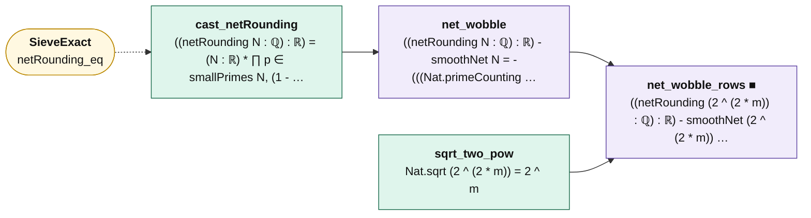

# `lean_stage3/Stage3/SieveResidual.lean`

> **Read from the source text.** This file changed after the last `python3 utilities/lean_map.py --dump`, so the arrows on this page are names occurring in each proof and have not been confirmed by Lean.

SieveResidual — block R3 of `lean_stage3/design/runs.md`. 2026-11-23. The roundings of the sieve and the residual of the table are tied exactly.

4 theorems, 1 definition, 86 lines. 

**Imports:** [`PiZeros`](../lean_stage3/PiZeros.md), [`SieveExact`](../lean_stage3/SieveExact.md)  
**Imported by:** [`Stage3`](../lean_stage3/Stage3.md), [`StepsPole`](../lean_stage3/StepsPole.md)

## The picture



An arrow A → B reads "A is used in the proof of B". Green: counting, integers only. Violet: shape, analysis with no ζ. Blue: reads ζ. A name ending in ■ is an end: nothing else uses it. Red: contains `sorry`. Yellow: theorems in another file, counted; a dotted arrow crosses files. Definitions are not drawn; they are listed below the diagram.

## Definitions

<a name="SieveResidual-smoothNet"></a>
### `SieveResidual.smoothNet`

def · line 34

The smooth part of the net rounding: the closed product, less the unit, less the smooth count at `N`, plus the smooth count at `√N`.

- **Is:** `` smoothNet (N : ℕ) : ℝ := (N : ℝ) * ∏ p ∈ smallPrimes N, (1 - 1 / (p : ℝ)) - 1 - Stage3.Li (N : ℝ) + Stage3.Li ((Nat.sqrt N : ℕ) : ℝ) ``
- **Built from:** [`Stage3.Li`](../lean_stage3/PsiToPi.md#Stage3-Li), [`SieveExact.smallPrimes`](../lean_stage3/SieveExact.md#SieveExact-smallPrimes)
- **Used by 2:** [`SieveResidual.net_wobble`](#SieveResidual-net_wobble), [`SieveResidual.net_wobble_rows`](#SieveResidual-net_wobble_rows)

## Theorems

<a name="SieveResidual-cast_netRounding"></a>
### `SieveResidual.cast_netRounding`

line 40 · arrows read from text

**Counting.** Integers only: nothing in its statement or proof, or in anything it rests on, uses analysis or ζ.

**Why.** The net rounding, as a real number, is the product less the count the sieve produces.

**Proves**

```lean
((netRounding N : ℚ) : ℝ) = (N : ℝ) * ∏ p ∈ smallPrimes N, (1 - 1 / (p : ℝ)) - (1 + (Nat.primeCounting N : ℝ) - (Nat.primeCounting (Nat.sqrt N) : ℝ))
```

**Needs** (its hypotheses)

  - `` N : ℕ ``
  - `` hN : 2 ≤ N ``

**Fed by** (1 theorem its proof uses)

  - [`SieveExact.netRounding_eq`](../lean_stage3/SieveExact.md#SieveExact-netRounding_eq) (SieveExact) — `` netRounding N = (N : ℚ) * ∏ p ∈ smallPrimes N, (1 - 1 / (p : ℚ)) - (1 + (Nat.primeCounting N : ℚ) - (Nat.primeCounting (Nat.sqrt N) : ℚ)) ``

**Definitions its proof touches:** [`SieveExact.netRounding`](../lean_stage3/SieveExact.md#SieveExact-netRounding), [`SieveExact.smallPrimes`](../lean_stage3/SieveExact.md#SieveExact-smallPrimes)

**Feeds** (1 that use it)

  - [`SieveResidual.net_wobble`](#SieveResidual-net_wobble) — `` ((netRounding N : ℚ) : ℝ) - smoothNet N = -(((Nat.primeCounting N : ℝ) - Stage3.Li (N : ℝ)) - ((Nat.primeCounting (Nat.sqrt N) : ℝ) - Stage3.Li ((Nat.… ``

<a name="SieveResidual-net_wobble"></a>
### `SieveResidual.net_wobble`

line 50 · arrows read from text

**Shape.** Uses real or complex analysis; nothing in it or beneath it reads ζ.

**Why.** The roundings' wobble is the table's residual, at the row less at its square root. For `N ≥ 2`, the net rounding less its smooth part is minus the residual of the count at `N` less the residual at `√N`.

**Proves**

```lean
((netRounding N : ℚ) : ℝ) - smoothNet N = -(((Nat.primeCounting N : ℝ) - Stage3.Li (N : ℝ)) - ((Nat.primeCounting (Nat.sqrt N) : ℝ) - Stage3.Li ((Nat.sqrt N : ℕ) : ℝ)))
```

**Needs** (its hypotheses)

  - `` N : ℕ ``
  - `` hN : 2 ≤ N ``

**Fed by** (1 theorem its proof uses)

  - [`SieveResidual.cast_netRounding`](#SieveResidual-cast_netRounding) — `` ((netRounding N : ℚ) : ℝ) = (N : ℝ) * ∏ p ∈ smallPrimes N, (1 - 1 / (p : ℝ)) - (1 + (Nat.primeCounting N : ℝ) - (Nat.primeCounting (Nat.sqrt N) : ℝ)) ``

**Definitions its proof touches:** [`Stage3.Li`](../lean_stage3/PsiToPi.md#Stage3-Li), [`SieveExact.netRounding`](../lean_stage3/SieveExact.md#SieveExact-netRounding), [`SieveResidual.smoothNet`](#SieveResidual-smoothNet)

**Feeds** (1 that use it)

  - [`SieveResidual.net_wobble_rows`](#SieveResidual-net_wobble_rows) — `` ((netRounding (2 ^ (2 * m)) : ℚ) : ℝ) - smoothNet (2 ^ (2 * m)) = -(((Nat.primeCounting (2 ^ (2 * m)) : ℝ) - Stage3.Li (((2 ^ (2 * m) : ℕ) : ℝ))) - ((… ``

<a name="SieveResidual-sqrt_two_pow"></a>
### `SieveResidual.sqrt_two_pow`

line 59 · arrows read from text

**Counting.** Integers only: nothing in its statement or proof, or in anything it rests on, uses analysis or ζ.

**Why.** The square root of an even power of two is the power of half the exponent.

**Proves**

```lean
Nat.sqrt (2 ^ (2 * m)) = 2 ^ m
```

**Needs** (its hypotheses)

  - `` m : ℕ ``

**Fed by:** no theorem of this repo; it stands on Mathlib.

**Feeds** (1 that use it)

  - [`SieveResidual.net_wobble_rows`](#SieveResidual-net_wobble_rows) — `` ((netRounding (2 ^ (2 * m)) : ℚ) : ℝ) - smoothNet (2 ^ (2 * m)) = -(((Nat.primeCounting (2 ^ (2 * m)) : ℝ) - Stage3.Li (((2 ^ (2 * m) : ℕ) : ℝ))) - ((… ``

<a name="SieveResidual-net_wobble_rows"></a>
### `SieveResidual.net_wobble_rows`

line 66 · arrows read from text

**Shape.** Uses real or complex analysis; nothing in it or beneath it reads ζ.

**Why.** The row and its half. At the doubling of an even row `2m`, the net rounding less its smooth part is minus the residual of the table at row `2m` less the residual at row `m`.

**Proves**

```lean
((netRounding (2 ^ (2 * m)) : ℚ) : ℝ) - smoothNet (2 ^ (2 * m)) = -(((Nat.primeCounting (2 ^ (2 * m)) : ℝ) - Stage3.Li (((2 ^ (2 * m) : ℕ) : ℝ))) - ((Nat.primeCounting (2 ^ m) : ℝ) - Stage3.Li (((2 ^ m : ℕ) : ℝ))))
```

**Needs** (its hypotheses)

  - `` m : ℕ ``
  - `` hm : 1 ≤ m ``

**Fed by** (2 theorems its proof uses)

  - [`SieveResidual.net_wobble`](#SieveResidual-net_wobble) — `` ((netRounding N : ℚ) : ℝ) - smoothNet N = -(((Nat.primeCounting N : ℝ) - Stage3.Li (N : ℝ)) - ((Nat.primeCounting (Nat.sqrt N) : ℝ) - Stage3.Li ((Nat.… ``
  - [`SieveResidual.sqrt_two_pow`](#SieveResidual-sqrt_two_pow) — `` Nat.sqrt (2 ^ (2 * m)) = 2 ^ m ``

**Definitions its proof touches:** [`Stage3.Li`](../lean_stage3/PsiToPi.md#Stage3-Li), [`SieveExact.netRounding`](../lean_stage3/SieveExact.md#SieveExact-netRounding), [`SieveResidual.smoothNet`](#SieveResidual-smoothNet)

**Feeds:** nothing. It is an end.

