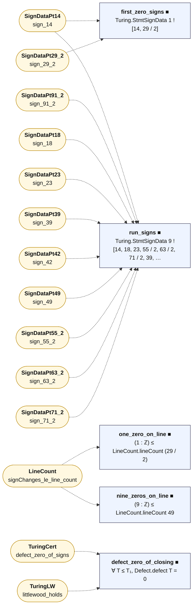

# `lean_stage3/Stage3/SignData.lean`

> **Read from the source text.** This file changed after the last `python3 utilities/lean_map.py --dump`, so the arrows on this page are names occurring in each proof and have not been confirmed by Lean.

SignData — block S14 of `lean_stage3/design/stencil.md`, Turing's sign data. 2026-11-25.

5 theorems, 1 definition, 165 lines. 

**Imports:** [`SignDataPt14`](../lean_stage3/SignDataPt14.md), [`SignDataPt18`](../lean_stage3/SignDataPt18.md), [`SignDataPt23`](../lean_stage3/SignDataPt23.md), [`SignDataPt29_2`](../lean_stage3/SignDataPt29_2.md), [`SignDataPt39`](../lean_stage3/SignDataPt39.md), [`SignDataPt42`](../lean_stage3/SignDataPt42.md), [`SignDataPt49`](../lean_stage3/SignDataPt49.md), [`SignDataPt55_2`](../lean_stage3/SignDataPt55_2.md), [`SignDataPt63_2`](../lean_stage3/SignDataPt63_2.md), [`SignDataPt71_2`](../lean_stage3/SignDataPt71_2.md), [`SignDataPt91_2`](../lean_stage3/SignDataPt91_2.md), [`TuringCert`](../lean_stage3/TuringCert.md), [`TuringLW`](../lean_stage3/TuringLW.md)  
**Imported by:** [`Stage3`](../lean_stage3/Stage3.md)

## The picture



An arrow A → B reads "A is used in the proof of B". Green: counting, integers only. Violet: shape, analysis with no ζ. Blue: reads ζ. A name ending in ■ is an end: nothing else uses it. Red: contains `sorry`. Yellow: theorems in another file, counted; a dotted arrow crosses files. Definitions are not drawn; they are listed below the diagram.

## Definitions

<a name="SignData-StmtClosingData"></a>
### `SignData.StmtClosingData`

def · line 133

The open certificate: sign data below and above `T₁` that meet Turing's numeric condition with the constants of `TuringLW.littlewood_holds`. A finite computation, open: by `checks/signdata/closing_height.py` it needs `T₁ ≳ 1.4·10⁴` and `≈ 1.5·10⁴`–`4.3·10⁴` certified signs.

- **Is:** `` StmtClosingData (T₁ h : ℝ) : Prop := ∃ (k m : ℕ) (t : Fin (k + 1) → ℝ) (s : Fin (m + 1) → ℝ), Turing.StmtSignData k t ∧ t (Fin.last k) ≤ T₁ ∧ Turing.StmtSignData m s ∧ T₁ < s 0 ∧ s (Fin.last m) ≤ T₁ + h ∧ Stage3.phaseTheta T₁ / Real.pi + 1 + Turing.turingErr ((3 / 2 + 102) / Real.pi) ((2 + (3 / 2) * Real.log 9 + 500) / Real.pi) h T₁ s < k + 2 ``
- **Built from:** [`Stage3.phaseTheta`](../lean_stage3/Stirling.md#Stage3-phaseTheta), [`Turing.StmtSignData`](../lean_stage3/TuringCert.md#Turing-StmtSignData), [`Turing.turingErr`](../lean_stage3/TuringCert.md#Turing-turingErr)
- **Used by 1:** [`SignData.defect_zero_of_closing`](#SignData-defect_zero_of_closing)

## Theorems

<a name="SignData-first_zero_signs"></a>
### `SignData.first_zero_signs`

line 91 · arrows read from text

**Reads ζ.** It, or something it rests on, uses the zeta function, its zeros or the Riemann hypothesis.

**Why.** The first zero: `Re Λ` changes sign between `t = 14` and `t = 29/2`.

**Proves**

```lean
Turing.StmtSignData 1 ![14, 29 / 2]
```

**Fed by** (2 theorems its proof uses)

  - [`SignData.sign_14`](../lean_stage3/SignDataPt14.md#SignData-sign_14) (SignDataPt14) — `` (completedRiemannZeta (lineS (14 : ℝ))).re < 0 ``
  - [`SignData.sign_29_2`](../lean_stage3/SignDataPt29_2.md#SignData-sign_29_2) (SignDataPt29_2) — `` 0 < (completedRiemannZeta (lineS (29/2 : ℝ))).re ``

**Definitions its proof touches:** [`Turing.StmtSignData`](../lean_stage3/TuringCert.md#Turing-StmtSignData)

**Feeds:** nothing. It is an end.

<a name="SignData-run_signs"></a>
### `SignData.run_signs`

line 102 · arrows read from text

**Reads ζ.** It, or something it rests on, uses the zeta function, its zeros or the Riemann hypothesis.

**Why.** Nine sign changes up to height 49.

**Proves**

```lean
Turing.StmtSignData 9 ![14, 18, 23, 55 / 2, 63 / 2, 71 / 2, 39, 42, 91 / 2, 49]
```

**Fed by** (10 theorems its proof uses)

  - [`SignData.sign_14`](../lean_stage3/SignDataPt14.md#SignData-sign_14) (SignDataPt14) — `` (completedRiemannZeta (lineS (14 : ℝ))).re < 0 ``
  - [`SignData.sign_18`](../lean_stage3/SignDataPt18.md#SignData-sign_18) (SignDataPt18) — `` 0 < (completedRiemannZeta (lineS (18 : ℝ))).re ``
  - [`SignData.sign_23`](../lean_stage3/SignDataPt23.md#SignData-sign_23) (SignDataPt23) — `` (completedRiemannZeta (lineS (23 : ℝ))).re < 0 ``
  - [`SignData.sign_39`](../lean_stage3/SignDataPt39.md#SignData-sign_39) (SignDataPt39) — `` (completedRiemannZeta (lineS (39 : ℝ))).re < 0 ``
  - [`SignData.sign_42`](../lean_stage3/SignDataPt42.md#SignData-sign_42) (SignDataPt42) — `` 0 < (completedRiemannZeta (lineS (42 : ℝ))).re ``
  - [`SignData.sign_49`](../lean_stage3/SignDataPt49.md#SignData-sign_49) (SignDataPt49) — `` 0 < (completedRiemannZeta (lineS (49 : ℝ))).re ``
  - [`SignData.sign_55_2`](../lean_stage3/SignDataPt55_2.md#SignData-sign_55_2) (SignDataPt55_2) — `` 0 < (completedRiemannZeta (lineS (55/2 : ℝ))).re ``
  - [`SignData.sign_63_2`](../lean_stage3/SignDataPt63_2.md#SignData-sign_63_2) (SignDataPt63_2) — `` (completedRiemannZeta (lineS (63/2 : ℝ))).re < 0 ``
  - [`SignData.sign_71_2`](../lean_stage3/SignDataPt71_2.md#SignData-sign_71_2) (SignDataPt71_2) — `` 0 < (completedRiemannZeta (lineS (71/2 : ℝ))).re ``
  - [`SignData.sign_91_2`](../lean_stage3/SignDataPt91_2.md#SignData-sign_91_2) (SignDataPt91_2) — `` (completedRiemannZeta (lineS (91/2 : ℝ))).re < 0 ``

**Definitions its proof touches:** [`Turing.StmtSignData`](../lean_stage3/TuringCert.md#Turing-StmtSignData)

**Feeds:** nothing. It is an end.

<a name="SignData-one_zero_on_line"></a>
### `SignData.one_zero_on_line`

line 121 · arrows read from text

**Reads ζ.** It, or something it rests on, uses the zeta function, its zeros or the Riemann hypothesis.

**Why.** At least one zero on the line up to height `29/2`.

**Proves**

```lean
(1 : ℤ) ≤ LineCount.lineCount (29 / 2)
```

**Fed by** (1 theorem its proof uses)

  - [`LineCount.signChanges_le_line_count`](../lean_stage3/LineCount.md#LineCount-signChanges_le_line_count) (LineCount) — `` (k : ℤ) ≤ lineCount T ``

**Definitions its proof touches:** [`LineCount.lineCount`](../lean_stage3/LineCount.md#LineCount-lineCount)

**Feeds:** nothing. It is an end.

<a name="SignData-nine_zeros_on_line"></a>
### `SignData.nine_zeros_on_line`

line 126 · arrows read from text

**Reads ζ.** It, or something it rests on, uses the zeta function, its zeros or the Riemann hypothesis.

**Why.** At least nine zeros on the line up to height `49`.

**Proves**

```lean
(9 : ℤ) ≤ LineCount.lineCount 49
```

**Fed by** (1 theorem its proof uses)

  - [`LineCount.signChanges_le_line_count`](../lean_stage3/LineCount.md#LineCount-signChanges_le_line_count) (LineCount) — `` (k : ℤ) ≤ lineCount T ``

**Definitions its proof touches:** [`LineCount.lineCount`](../lean_stage3/LineCount.md#LineCount-lineCount)

**Feeds:** nothing. It is an end.

<a name="SignData-defect_zero_of_closing"></a>
### `SignData.defect_zero_of_closing`

line 142 · arrows read from text

**Reads ζ.** It, or something it rests on, uses the zeta function, its zeros or the Riemann hypothesis.

**Why.** Turing's method with Littlewood's constants: the closing data give the defect `0`.

**Proves**

```lean
∀ T ≤ T₁, Defect.defect T = 0
```

**Needs** (its hypotheses)

  - `` hd : StmtClosingData T₁ h ``
  - `` h2 : 2 ≤ T₁ ``
  - `` hh : 0 < h ``

**Fed by** (2 theorems its proof uses)

  - [`Turing.defect_zero_of_signs`](../lean_stage3/TuringCert.md#Turing-defect_zero_of_signs) (TuringCert) — `` ∀ T ≤ T₁, defect T = 0 ``
  - [`TuringLW.littlewood_holds`](../lean_stage3/TuringLW.md#TuringLW-littlewood_holds) (TuringLW) — `` Turing.StmtLittlewood ((3 / 2 + 102) / Real.pi) ((2 + (3 / 2) * Real.log 9 + 500) / Real.pi) 2 ``

**Definitions its proof touches:** [`Defect.defect`](../lean_stage3/Defect.md#Defect-defect), [`SignData.StmtClosingData`](#SignData-StmtClosingData)

**Feeds:** nothing. It is an end.

