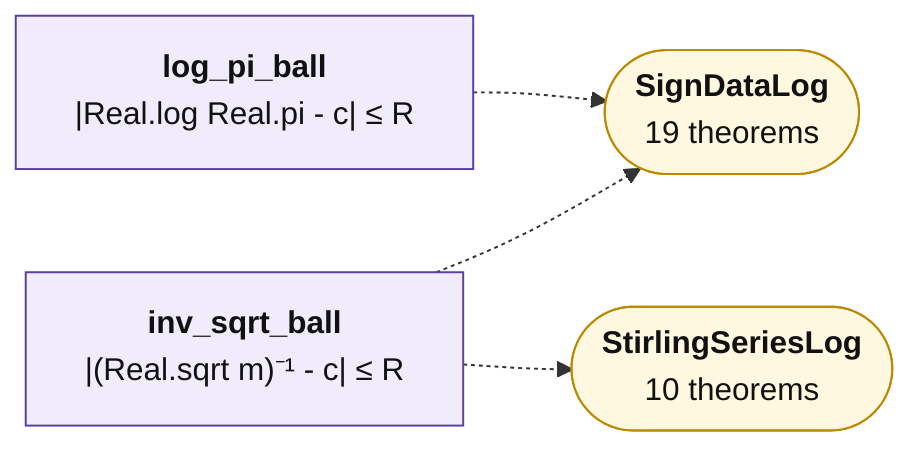

# `lean_stage3/Stage3/SignDataBall.lean`

> **Read from the source text.** This file changed after the last `python3 utilities/lean_map.py --dump`, so the arrows on this page are names occurring in each proof and have not been confirmed by Lean.

SignDataBall — block S14 of `lean_stage3/design/stencil.md`, Turing's sign data: ball arithmetic. 2026-11-25.

32 theorems, 3 definitions, 436 lines. 

**Imports:** nothing in this tree  
**Imported by:** [`SignDataLog`](../lean_stage3/SignDataLog.md), [`SignDataZeta`](../lean_stage3/SignDataZeta.md)

## The picture

### Diagram 1 of 2: `cx_re` to `log_pow_ball`

```mermaid
flowchart LR
  n0["<b>cx_re</b><br/>(cx a b).re = a"]:::cnt
  n1["<b>cx_im</b><br/>(cx a b).im = b"]:::cnt
  n2["<b>norm_cx_le</b><br/>‖cx a b‖ ≤ |a| + |b|"]:::shp
  n3["<b>cx_mul ■</b><br/>cx a b * cx c d = cx (a * c - b * d) (a * d + b * c)"]:::shp
  n4["<b>ball_exact ■</b><br/>‖cx a b - cx a b‖ ≤ 0"]:::cnt
  n5["<b>ball_add</b><br/>‖z + w - cx e f‖ ≤ R"]:::shp
  n6["<b>ball_mul</b><br/>‖z * w - cx e f‖ ≤ R"]:::shp
  n7["<b>ball_conj</b><br/>‖(starRingEnd ℂ) z - cx a (-b)‖ ≤ r"]:::shp
  n8["<b>ball_ofReal</b><br/>‖(x : ℂ) - cx c 0‖ ≤ e"]:::shp
  n9["<b>ball_mono ■</b><br/>‖z - cx a b‖ ≤ R"]:::cnt
  n10["<b>re_pos_of_ball</b><br/>0 ＜ z.re"]:::shp
  n11["<b>re_neg_of_ball</b><br/>z.re ＜ 0"]:::shp
  n12["<b>real_round ■</b><br/>|x - c| ≤ R"]:::cnt
  n13["<b>real_mul_ball</b><br/>|u * x - u * a| ≤ |u| * e"]:::cnt
  n14["<b>neg_mul_ball</b><br/>|-(t * x) - -(t * a)| ≤ |t| * e"]:::cnt
  n15["<b>phase_ball</b><br/>|(t / 2) * (x - y) - (t / 2) * (a - b)| ≤ |t / 2| * (e₁ + e₂)"]:::cnt
  n16["<b>taylor_eq</b><br/>∑ m ∈ Finset.range (2 * K), ((y : ℂ) * I) ^ m / (m.factorial : ℂ…"]:::shp
  n17["<b>norm_exp_sub_exp_le</b><br/>‖cexp ((y : ℂ) * I) - cexp ((y₀ : ℂ) * I)‖ ≤ |y - y₀|"]:::shp
  n18["<b>exp_ball_core</b><br/>‖cexp ((y : ℂ) * I) - cx (cosP K y₀) (sinP K y₀)‖ ≤ ε + |y₀| ^ (…"]:::shp
  n19["<b>exp_reduce</b><br/>cexp ((x : ℂ) * I) = cexp (((x - (j * (Real.pi / 2) + k * (2 * R…"]:::shp
  n20["<b>pi_ball</b><br/>|Real.pi - 3.14159265358979323846| ≤ 1 / 10 ^ 20"]:::shp
  n21["<b>red_ball</b><br/>|(x - (j * (Real.pi / 2) + k * (2 * Real.pi))) - y₀| ≤ ε'"]:::shp
  n22["<b>exp_ball_red</b><br/>‖cexp (((x - (j * (Real.pi / 2) + k * (2 * Real.pi)) : ℝ) : ℂ) *…"]:::shp
  n23["<b>exp_ball0</b><br/>‖cexp ((x : ℂ) * I) - cx e f‖ ≤ R"]:::shp
  n24["<b>exp_ball1</b><br/>‖cexp ((x : ℂ) * I) - cx (-f) e‖ ≤ R"]:::shp
  n25["<b>exp_ball2</b><br/>‖cexp ((x : ℂ) * I) - cx (-e) (-f)‖ ≤ R"]:::shp
  n26["<b>exp_ball3</b><br/>‖cexp ((x : ℂ) * I) - cx f (-e)‖ ≤ R"]:::shp
  n27["<b>log_one_ball ■</b><br/>|Real.log 1 - 0| ≤ 0"]:::shp
  n28["<b>log_succ_ball</b><br/>|Real.log q - c| ≤ R"]:::shp
  n29["<b>log_pow_ball</b><br/>|Real.log (b ^ m) - m * a| ≤ m * e"]:::shp
  x0(["<b>SignDataZeta</b><br/>norm_le_of_sq"]):::ext
  x1(["<b>SignDataPt14</b><br/>91 theorems"]):::ext
  x2(["<b>SignDataPt18</b><br/>146 theorems"]):::ext
  x3(["<b>SignDataPt23</b><br/>152 theorems"]):::ext
  x4(["<b>SignDataPt29_2</b><br/>85 theorems"]):::ext
  x5(["<b>SignDataPt39</b><br/>548 theorems"]):::ext
  x6(["<b>SignDataPt42</b><br/>557 theorems"]):::ext
  x7(["<b>SignDataPt49</b><br/>572 theorems"]):::ext
  x8(["<b>SignDataPt55_2</b><br/>280 theorems"]):::ext
  x9(["<b>SignDataPt63_2</b><br/>292 theorems"]):::ext
  x10(["<b>SignDataPt71_2</b><br/>286 theorems"]):::ext
  x11(["<b>SignDataPt91_2</b><br/>548 theorems"]):::ext
  x12(["<b>StirlingSeriesPt100</b><br/>88 theorems"]):::ext
  x13(["<b>StirlingSeriesPt49</b><br/>58 theorems"]):::ext
  x14(["<b>SignDataGamma</b><br/>re_lambda_neg<br/>re_lambda_pos"]):::ext
  x15(["<b>StirlingSeriesPhase</b><br/>re_lambda_neg_stir3<br/>re_lambda_pos_stir3<br/>stirPhase3_ball"]):::ext
  x16(["<b>StirlingSeriesK5</b><br/>im_stirMain_ball"]):::ext
  x17(["<b>SignDataLog</b><br/>21 theorems"]):::ext
  x18(["<b>StirlingSeriesLog</b><br/>10 theorems"]):::ext
  n13 --> n29
  n16 --> n18
  n17 --> n18
  n18 --> n22
  n19 --> n23
  n19 --> n24
  n19 --> n25
  n19 --> n26
  n2 --> n22
  n2 --> n5
  n2 --> n6
  n20 --> n21
  n21 --> n22
  n22 --> n23
  n22 --> n24
  n22 --> n25
  n22 --> n26
  n0 -.-> x0
  n1 -.-> x0
  n10 -.-> x14
  n10 -.-> x15
  n11 -.-> x14
  n11 -.-> x15
  n14 -.-> x1
  n14 -.-> x10
  n14 -.-> x11
  n14 -.-> x12
  n14 -.-> x13
  n14 -.-> x2
  n14 -.-> x3
  n14 -.-> x4
  n14 -.-> x5
  n14 -.-> x6
  n14 -.-> x7
  n14 -.-> x8
  n14 -.-> x9
  n15 -.-> x1
  n15 -.-> x10
  n15 -.-> x11
  n15 -.-> x2
  n15 -.-> x3
  n15 -.-> x4
  n15 -.-> x5
  n15 -.-> x6
  n15 -.-> x7
  n15 -.-> x8
  n15 -.-> x9
  n20 -.-> x15
  n20 -.-> x16
  n23 -.-> x1
  n23 -.-> x10
  n23 -.-> x11
  n23 -.-> x12
  n23 -.-> x13
  n23 -.-> x2
  n23 -.-> x3
  n23 -.-> x5
  n23 -.-> x6
  n23 -.-> x7
  n23 -.-> x8
  n23 -.-> x9
  n24 -.-> x1
  n24 -.-> x10
  n24 -.-> x11
  n24 -.-> x12
  n24 -.-> x13
  n24 -.-> x2
  n24 -.-> x4
  n24 -.-> x5
  n24 -.-> x6
  n24 -.-> x7
  n24 -.-> x8
  n24 -.-> x9
  n25 -.-> x1
  n25 -.-> x10
  n25 -.-> x11
  n25 -.-> x12
  n25 -.-> x13
  n25 -.-> x2
  n25 -.-> x3
  n25 -.-> x4
  n25 -.-> x5
  n25 -.-> x6
  n25 -.-> x7
  n25 -.-> x8
  n25 -.-> x9
  n26 -.-> x1
  n26 -.-> x10
  n26 -.-> x11
  n26 -.-> x12
  n26 -.-> x13
  n26 -.-> x2
  n26 -.-> x3
  n26 -.-> x4
  n26 -.-> x5
  n26 -.-> x6
  n26 -.-> x7
  n26 -.-> x8
  n28 -.-> x17
  n28 -.-> x18
  n29 -.-> x17
  n5 -.-> x1
  n5 -.-> x10
  n5 -.-> x11
  n5 -.-> x12
  n5 -.-> x13
  n5 -.-> x2
  n5 -.-> x3
  n5 -.-> x4
  n5 -.-> x5
  n5 -.-> x6
  n5 -.-> x7
  n5 -.-> x8
  n5 -.-> x9
  n6 -.-> x1
  n6 -.-> x10
  n6 -.-> x11
  n6 -.-> x12
  n6 -.-> x13
  n6 -.-> x2
  n6 -.-> x3
  n6 -.-> x4
  n6 -.-> x5
  n6 -.-> x6
  n6 -.-> x7
  n6 -.-> x8
  n6 -.-> x9
  n7 -.-> x1
  n7 -.-> x10
  n7 -.-> x11
  n7 -.-> x2
  n7 -.-> x3
  n7 -.-> x4
  n7 -.-> x5
  n7 -.-> x6
  n7 -.-> x7
  n7 -.-> x8
  n7 -.-> x9
  n8 -.-> x1
  n8 -.-> x10
  n8 -.-> x11
  n8 -.-> x12
  n8 -.-> x13
  n8 -.-> x2
  n8 -.-> x3
  n8 -.-> x4
  n8 -.-> x5
  n8 -.-> x6
  n8 -.-> x7
  n8 -.-> x8
  n8 -.-> x9
  classDef cnt fill:#dff5ec,stroke:#17694a,color:#111
  classDef shp fill:#f1ecfb,stroke:#5b3fa0,color:#111
  classDef rh fill:#ffe5e5,stroke:#c22,color:#111,stroke-width:2px
  classDef thm fill:#eef4ff,stroke:#335,color:#111
  classDef end_ fill:#e7f7e7,stroke:#2a7,color:#111,stroke-width:2px
  classDef lone fill:#fff,stroke:#999,color:#111,stroke-dasharray:4 3
  classDef bad fill:#ffe5e5,stroke:#c22,color:#111,stroke-width:2px
  classDef ext fill:#fff8e1,stroke:#b80,color:#111
```



### Diagram 2 of 2: `log_pi_ball` to `inv_sqrt_ball`



An arrow A → B reads "A is used in the proof of B". Green: counting, integers only. Violet: shape, analysis with no ζ. Blue: reads ζ. A name ending in ■ is an end: nothing else uses it. Red: contains `sorry`. Yellow: theorems in another file, counted; a dotted arrow crosses files. Definitions are not drawn; they are listed below the diagram.

## Definitions

<a name="SignData-cx"></a>
### `SignData.cx`

def · line 34

The complex number with real part `a` and imaginary part `b`.

- **Is:** `` cx (a b : ℝ) : ℂ := ⟨a, b⟩ ``
- **Used by 3756:** [`SignData.ball_add`](#SignData-ball_add), [`SignData.ball_conj`](#SignData-ball_conj), [`SignData.ball_exact`](#SignData-ball_exact), [`SignData.ball_mono`](#SignData-ball_mono), [`SignData.ball_mul`](#SignData-ball_mul), [`SignData.ball_ofReal`](#SignData-ball_ofReal), [`SignData.cx_im`](#SignData-cx_im), [`SignData.cx_mul`](#SignData-cx_mul), [`SignData.cx_re`](#SignData-cx_re), [`SignData.exp_ball0`](#SignData-exp_ball0), [`SignData.exp_ball1`](#SignData-exp_ball1), [`SignData.exp_ball2`](#SignData-exp_ball2), [`SignData.exp_ball3`](#SignData-exp_ball3), [`SignData.exp_ball_core`](#SignData-exp_ball_core), [`SignData.exp_ball_red`](#SignData-exp_ball_red), [`SignData.norm_cx_le`](#SignData-norm_cx_le), [`SignData.re_neg_of_ball`](#SignData-re_neg_of_ball), [`SignData.re_pos_of_ball`](#SignData-re_pos_of_ball), [`SignData.taylor_eq`](#SignData-taylor_eq), [`SignData.factor_ball`](../lean_stage3/SignDataGamma.md#SignData-factor_ball), [`SignData.prod_zero_ball`](../lean_stage3/SignDataGamma.md#SignData-prod_zero_ball), [`SignData.re_lambda_neg`](../lean_stage3/SignDataGamma.md#SignData-re_lambda_neg), [`SignData.re_lambda_pos`](../lean_stage3/SignDataGamma.md#SignData-re_lambda_pos), [`SignData.zz_ball`](../lean_stage3/SignDataGamma.md#SignData-zz_ball), [`SignData.p14_E2`](../lean_stage3/SignDataPt14.md#SignData-p14_E2), [`SignData.p14_E3`](../lean_stage3/SignDataPt14.md#SignData-p14_E3), [`SignData.p14_E4`](../lean_stage3/SignDataPt14.md#SignData-p14_E4), [`SignData.p14_E5`](../lean_stage3/SignDataPt14.md#SignData-p14_E5), [`SignData.p14_E6`](../lean_stage3/SignDataPt14.md#SignData-p14_E6), [`SignData.p14_E7`](../lean_stage3/SignDataPt14.md#SignData-p14_E7), [`SignData.p14_E8`](../lean_stage3/SignDataPt14.md#SignData-p14_E8), [`SignData.p14_G`](../lean_stage3/SignDataPt14.md#SignData-p14_G), [`SignData.p14_NB`](../lean_stage3/SignDataPt14.md#SignData-p14_NB), [`SignData.p14_P1`](../lean_stage3/SignDataPt14.md#SignData-p14_P1), [`SignData.p14_P10`](../lean_stage3/SignDataPt14.md#SignData-p14_P10), [`SignData.p14_P11`](../lean_stage3/SignDataPt14.md#SignData-p14_P11), [`SignData.p14_P12`](../lean_stage3/SignDataPt14.md#SignData-p14_P12), [`SignData.p14_P13`](../lean_stage3/SignDataPt14.md#SignData-p14_P13), [`SignData.p14_P14`](../lean_stage3/SignDataPt14.md#SignData-p14_P14), [`SignData.p14_P15`](../lean_stage3/SignDataPt14.md#SignData-p14_P15), and 3716 more (full list in `map/lean_map.json`)

<a name="SignData-cosP"></a>
### `SignData.cosP`

def · line 143

The Taylor polynomial of `cos` of degree `< 2K`.

- **Is:** `` cosP (K : ℕ) (y : ℝ) : ℝ := ∑ i ∈ Finset.range K, (-1) ^ i * y ^ (2 * i) / ((2 * i).factorial : ℝ) ``
- **Used by 163:** [`SignData.exp_ball0`](#SignData-exp_ball0), [`SignData.exp_ball1`](#SignData-exp_ball1), [`SignData.exp_ball2`](#SignData-exp_ball2), [`SignData.exp_ball3`](#SignData-exp_ball3), [`SignData.exp_ball_core`](#SignData-exp_ball_core), [`SignData.exp_ball_red`](#SignData-exp_ball_red), [`SignData.taylor_eq`](#SignData-taylor_eq), [`SignData.p14_E2`](../lean_stage3/SignDataPt14.md#SignData-p14_E2), [`SignData.p14_E3`](../lean_stage3/SignDataPt14.md#SignData-p14_E3), [`SignData.p14_E4`](../lean_stage3/SignDataPt14.md#SignData-p14_E4), [`SignData.p14_E5`](../lean_stage3/SignDataPt14.md#SignData-p14_E5), [`SignData.p14_E6`](../lean_stage3/SignDataPt14.md#SignData-p14_E6), [`SignData.p14_E7`](../lean_stage3/SignDataPt14.md#SignData-p14_E7), [`SignData.p14_E8`](../lean_stage3/SignDataPt14.md#SignData-p14_E8), [`SignData.p14_phase`](../lean_stage3/SignDataPt14.md#SignData-p14_phase), [`SignData.p18_E2`](../lean_stage3/SignDataPt18.md#SignData-p18_E2), [`SignData.p18_E3`](../lean_stage3/SignDataPt18.md#SignData-p18_E3), [`SignData.p18_E4`](../lean_stage3/SignDataPt18.md#SignData-p18_E4), [`SignData.p18_E5`](../lean_stage3/SignDataPt18.md#SignData-p18_E5), [`SignData.p18_phase`](../lean_stage3/SignDataPt18.md#SignData-p18_phase), [`SignData.p23_E2`](../lean_stage3/SignDataPt23.md#SignData-p23_E2), [`SignData.p23_E3`](../lean_stage3/SignDataPt23.md#SignData-p23_E3), [`SignData.p23_E4`](../lean_stage3/SignDataPt23.md#SignData-p23_E4), [`SignData.p23_E5`](../lean_stage3/SignDataPt23.md#SignData-p23_E5), [`SignData.p23_E6`](../lean_stage3/SignDataPt23.md#SignData-p23_E6), [`SignData.p23_E7`](../lean_stage3/SignDataPt23.md#SignData-p23_E7), [`SignData.p23_phase`](../lean_stage3/SignDataPt23.md#SignData-p23_phase), [`SignData.p29_2_E2`](../lean_stage3/SignDataPt29_2.md#SignData-p29_2_E2), [`SignData.p29_2_E3`](../lean_stage3/SignDataPt29_2.md#SignData-p29_2_E3), [`SignData.p29_2_E4`](../lean_stage3/SignDataPt29_2.md#SignData-p29_2_E4), [`SignData.p29_2_E5`](../lean_stage3/SignDataPt29_2.md#SignData-p29_2_E5), [`SignData.p29_2_E6`](../lean_stage3/SignDataPt29_2.md#SignData-p29_2_E6), [`SignData.p29_2_phase`](../lean_stage3/SignDataPt29_2.md#SignData-p29_2_phase), [`SignData.p39_E10`](../lean_stage3/SignDataPt39.md#SignData-p39_E10), [`SignData.p39_E11`](../lean_stage3/SignDataPt39.md#SignData-p39_E11), [`SignData.p39_E2`](../lean_stage3/SignDataPt39.md#SignData-p39_E2), [`SignData.p39_E3`](../lean_stage3/SignDataPt39.md#SignData-p39_E3), [`SignData.p39_E4`](../lean_stage3/SignDataPt39.md#SignData-p39_E4), [`SignData.p39_E5`](../lean_stage3/SignDataPt39.md#SignData-p39_E5), [`SignData.p39_E6`](../lean_stage3/SignDataPt39.md#SignData-p39_E6), and 123 more (full list in `map/lean_map.json`)

<a name="SignData-sinP"></a>
### `SignData.sinP`

def · line 146

The Taylor polynomial of `sin` of degree `< 2K`.

- **Is:** `` sinP (K : ℕ) (y : ℝ) : ℝ := ∑ i ∈ Finset.range K, (-1) ^ i * y ^ (2 * i + 1) / ((2 * i + 1).factorial : ℝ) ``
- **Used by 163:** [`SignData.exp_ball0`](#SignData-exp_ball0), [`SignData.exp_ball1`](#SignData-exp_ball1), [`SignData.exp_ball2`](#SignData-exp_ball2), [`SignData.exp_ball3`](#SignData-exp_ball3), [`SignData.exp_ball_core`](#SignData-exp_ball_core), [`SignData.exp_ball_red`](#SignData-exp_ball_red), [`SignData.taylor_eq`](#SignData-taylor_eq), [`SignData.p14_E2`](../lean_stage3/SignDataPt14.md#SignData-p14_E2), [`SignData.p14_E3`](../lean_stage3/SignDataPt14.md#SignData-p14_E3), [`SignData.p14_E4`](../lean_stage3/SignDataPt14.md#SignData-p14_E4), [`SignData.p14_E5`](../lean_stage3/SignDataPt14.md#SignData-p14_E5), [`SignData.p14_E6`](../lean_stage3/SignDataPt14.md#SignData-p14_E6), [`SignData.p14_E7`](../lean_stage3/SignDataPt14.md#SignData-p14_E7), [`SignData.p14_E8`](../lean_stage3/SignDataPt14.md#SignData-p14_E8), [`SignData.p14_phase`](../lean_stage3/SignDataPt14.md#SignData-p14_phase), [`SignData.p18_E2`](../lean_stage3/SignDataPt18.md#SignData-p18_E2), [`SignData.p18_E3`](../lean_stage3/SignDataPt18.md#SignData-p18_E3), [`SignData.p18_E4`](../lean_stage3/SignDataPt18.md#SignData-p18_E4), [`SignData.p18_E5`](../lean_stage3/SignDataPt18.md#SignData-p18_E5), [`SignData.p18_phase`](../lean_stage3/SignDataPt18.md#SignData-p18_phase), [`SignData.p23_E2`](../lean_stage3/SignDataPt23.md#SignData-p23_E2), [`SignData.p23_E3`](../lean_stage3/SignDataPt23.md#SignData-p23_E3), [`SignData.p23_E4`](../lean_stage3/SignDataPt23.md#SignData-p23_E4), [`SignData.p23_E5`](../lean_stage3/SignDataPt23.md#SignData-p23_E5), [`SignData.p23_E6`](../lean_stage3/SignDataPt23.md#SignData-p23_E6), [`SignData.p23_E7`](../lean_stage3/SignDataPt23.md#SignData-p23_E7), [`SignData.p23_phase`](../lean_stage3/SignDataPt23.md#SignData-p23_phase), [`SignData.p29_2_E2`](../lean_stage3/SignDataPt29_2.md#SignData-p29_2_E2), [`SignData.p29_2_E3`](../lean_stage3/SignDataPt29_2.md#SignData-p29_2_E3), [`SignData.p29_2_E4`](../lean_stage3/SignDataPt29_2.md#SignData-p29_2_E4), [`SignData.p29_2_E5`](../lean_stage3/SignDataPt29_2.md#SignData-p29_2_E5), [`SignData.p29_2_E6`](../lean_stage3/SignDataPt29_2.md#SignData-p29_2_E6), [`SignData.p29_2_phase`](../lean_stage3/SignDataPt29_2.md#SignData-p29_2_phase), [`SignData.p39_E10`](../lean_stage3/SignDataPt39.md#SignData-p39_E10), [`SignData.p39_E11`](../lean_stage3/SignDataPt39.md#SignData-p39_E11), [`SignData.p39_E2`](../lean_stage3/SignDataPt39.md#SignData-p39_E2), [`SignData.p39_E3`](../lean_stage3/SignDataPt39.md#SignData-p39_E3), [`SignData.p39_E4`](../lean_stage3/SignDataPt39.md#SignData-p39_E4), [`SignData.p39_E5`](../lean_stage3/SignDataPt39.md#SignData-p39_E5), [`SignData.p39_E6`](../lean_stage3/SignDataPt39.md#SignData-p39_E6), and 123 more (full list in `map/lean_map.json`)

## Theorems

<a name="SignData-cx_re"></a>
### `SignData.cx_re`

line 36 · arrows read from text

**Counting.** Integers only: nothing in its statement or proof, or in anything it rests on, uses analysis or ζ.

**Proves**

```lean
(cx a b).re = a
```

**Needs** (its hypotheses)

  - `` a b : ℝ ``

**Fed by:** no theorem of this repo; it stands on Mathlib and the definitions below.

**Definitions its proof touches:** [`SignData.cx`](#SignData-cx)

**Feeds** (1 that use it)

  - [`SignData.norm_le_of_sq`](../lean_stage3/SignDataZeta.md#SignData-norm_le_of_sq) (SignDataZeta) — `` ‖cx a b‖ ≤ q ``

<a name="SignData-cx_im"></a>
### `SignData.cx_im`

line 37 · arrows read from text

**Counting.** Integers only: nothing in its statement or proof, or in anything it rests on, uses analysis or ζ.

**Proves**

```lean
(cx a b).im = b
```

**Needs** (its hypotheses)

  - `` a b : ℝ ``

**Fed by:** no theorem of this repo; it stands on Mathlib and the definitions below.

**Definitions its proof touches:** [`SignData.cx`](#SignData-cx)

**Feeds** (1 that use it)

  - [`SignData.norm_le_of_sq`](../lean_stage3/SignDataZeta.md#SignData-norm_le_of_sq) (SignDataZeta) — `` ‖cx a b‖ ≤ q ``

<a name="SignData-norm_cx_le"></a>
### `SignData.norm_cx_le`

line 39 · arrows read from text

**Shape.** Uses real or complex analysis; nothing in it or beneath it reads ζ.

**Proves**

```lean
‖cx a b‖ ≤ |a| + |b|
```

**Needs** (its hypotheses)

  - `` a b : ℝ ``

**Fed by:** no theorem of this repo; it stands on Mathlib and the definitions below.

**Definitions its proof touches:** [`SignData.cx`](#SignData-cx)

**Feeds** (3 that use it)

  - [`SignData.ball_add`](#SignData-ball_add) — `` ‖z + w - cx e f‖ ≤ R ``
  - [`SignData.ball_mul`](#SignData-ball_mul) — `` ‖z * w - cx e f‖ ≤ R ``
  - [`SignData.exp_ball_red`](#SignData-exp_ball_red) — `` ‖cexp (((x - (j * (Real.pi / 2) + k * (2 * Real.pi)) : ℝ) : ℂ) * I) - cx e f‖ ≤ R ``

<a name="SignData-cx_mul"></a>
### `SignData.cx_mul`

line 42 · arrows read from text

**Shape.** Uses real or complex analysis; nothing in it or beneath it reads ζ.

**Proves**

```lean
cx a b * cx c d = cx (a * c - b * d) (a * d + b * c)
```

**Needs** (its hypotheses)

  - `` a b c d : ℝ ``

**Fed by:** no theorem of this repo; it stands on Mathlib and the definitions below.

**Definitions its proof touches:** [`SignData.cx`](#SignData-cx)

**Feeds:** nothing. It is an end.

<a name="SignData-ball_exact"></a>
### `SignData.ball_exact`

line 45 · arrows read from text

**Counting.** Integers only: nothing in its statement or proof, or in anything it rests on, uses analysis or ζ.

**Proves**

```lean
‖cx a b - cx a b‖ ≤ 0
```

**Needs** (its hypotheses)

  - `` a b : ℝ ``

**Fed by:** no theorem of this repo; it stands on Mathlib and the definitions below.

**Definitions its proof touches:** [`SignData.cx`](#SignData-cx)

**Feeds:** nothing. It is an end.

<a name="SignData-ball_add"></a>
### `SignData.ball_add`

line 48 · arrows read from text

**Shape.** Uses real or complex analysis; nothing in it or beneath it reads ζ.

**Why.** Sum of balls, rounded to the centre `(e, f)`.

**Proves**

```lean
‖z + w - cx e f‖ ≤ R
```

**Needs** (its hypotheses)

  - `` hz : ‖z - cx a b‖ ≤ r ``
  - `` hw : ‖w - cx c d‖ ≤ q ``
  - `` hR : |a + c - e| + |b + d - f| + r + q ≤ R ``

**Fed by** (1 theorem its proof uses)

  - [`SignData.norm_cx_le`](#SignData-norm_cx_le) — `` ‖cx a b‖ ≤ |a| + |b| ``

**Definitions its proof touches:** [`SignData.cx`](#SignData-cx)

**Feeds** (156 that use it)

  - [`SignData.p14_S2`](../lean_stage3/SignDataPt14.md#SignData-p14_S2) (SignDataPt14) — `` ‖∑ m ∈ Finset.Icc 1 (1 + 1), ((m : ℕ) : ℂ) ^ (-lineS (14 : ℝ)) - cx (0.320291161662014779228085203864) (0.194925357727584208072744154227)‖ ≤ (0.000000… ``
  - [`SignData.p14_S3`](../lean_stage3/SignDataPt14.md#SignData-p14_S3) (SignDataPt14) — `` ‖∑ m ∈ Finset.Icc 1 (2 + 1), ((m : ℕ) : ℂ) ^ (-lineS (14 : ℝ)) - cx (-0.226392846672863201165566252431) (0.009264569287363486823025564359)‖ ≤ (0.00000… ``
  - [`SignData.p14_S4`](../lean_stage3/SignDataPt14.md#SignData-p14_S4) (SignDataPt14) — `` ‖∑ m ∈ Finset.Icc 1 (3 + 1), ((m : ℕ) : ℂ) ^ (-lineS (14 : ℝ)) - cx (0.197615363119790057042392109304) (-0.255720407698935382923785770731)‖ ≤ (0.00000… ``
  - [`SignData.p14_S5`](../lean_stage3/SignDataPt14.md#SignData-p14_S5) (SignDataPt14) — `` ‖∑ m ∈ Finset.Icc 1 (4 + 1), ((m : ℕ) : ℂ) ^ (-lineS (14 : ℝ)) - cx (-0.185737599576153345034940690792) (-0.025415162443334167005048930224)‖ ≤ (0.0000… ``
  - [`SignData.p14_S6`](../lean_stage3/SignDataPt14.md#SignData-p14_S6) (SignDataPt14) — `` ‖∑ m ∈ Finset.Icc 1 (5 + 1), ((m : ℕ) : ℂ) ^ (-lineS (14 : ℝ)) - cx (0.222038348272528782707294446109) (-0.005782459553117031590143869326)‖ ≤ (0.00000… ``
  - [`SignData.p14_S7`](../lean_stage3/SignDataPt14.md#SignData-p14_S7) (SignDataPt14) — `` ‖∑ m ∈ Finset.Icc 1 (6 + 1), ((m : ℕ) : ℂ) ^ (-lineS (14 : ℝ)) - cx (0.027971148399966046712924513273) (-0.330120346317469066839040500248)‖ ≤ (0.00000… ``
  - [`SignData.p14_S8`](../lean_stage3/SignDataPt14.md#SignData-p14_S8) (SignDataPt14) — `` ‖∑ m ∈ Finset.Icc 1 (7 + 1), ((m : ℕ) : ℂ) ^ (-lineS (14 : ℝ)) - cx (-0.208578687855894312964646726377) (-0.067357763426895296141363044702)‖ ≤ (0.0000… ``
  - [`SignData.p14_Y`](../lean_stage3/SignDataPt14.md#SignData-p14_Y) (SignDataPt14) — `` ‖(∑ m ∈ Finset.Icc 1 (7 + 1), ((m : ℕ) : ℂ) ^ (-lineS (14 : ℝ)) + (((7 + 1 : ℕ)) : ℂ) ^ (-lineS (14 : ℝ)) * emB (14 : ℝ) (7 + 1)) - cx (0.022461553251… ``
  - [`SignData.p18_S2`](../lean_stage3/SignDataPt18.md#SignData-p18_S2) (SignDataPt18) — `` ‖∑ m ∈ Finset.Icc 1 (1 + 1), ((m : ℕ) : ℂ) ^ (-lineS (18 : ℝ)) - cx (1.704262612244207972588033412246) (0.063357501489281966856773607032)‖ ≤ (0.000000… ``
  - [`SignData.p18_S3`](../lean_stage3/SignDataPt18.md#SignData-p18_S3) (SignDataPt18) — `` ‖∑ m ∈ Finset.Icc 1 (2 + 1), ((m : ℕ) : ℂ) ^ (-lineS (18 : ℝ)) - cx (2.051517408062813705387134354146) (-0.397888029778297660634111361301)‖ ≤ (0.00000… ``
  - [`SignData.p18_S4`](../lean_stage3/SignDataPt18.md#SignData-p18_S4) (SignDataPt18) — `` ‖∑ m ∈ Finset.Icc 1 (3 + 1), ((m : ℕ) : ℂ) ^ (-lineS (18 : ℝ)) - cx (2.543489062088859738986033818994) (-0.308647390858148374537195453845)‖ ≤ (0.00000… ``
  - [`SignData.p18_S5`](../lean_stage3/SignDataPt18.md#SignData-p18_S5) (SignDataPt18) — `` ‖∑ m ∈ Finset.Icc 1 (4 + 1), ((m : ℕ) : ℂ) ^ (-lineS (18 : ℝ)) - cx (2.200162152485350310941165746656) (-0.022069943835351994700018746934)‖ ≤ (0.00000… ``
  - [`SignData.p18_Y`](../lean_stage3/SignDataPt18.md#SignData-p18_Y) (SignDataPt18) — `` ‖(∑ m ∈ Finset.Icc 1 (4 + 1), ((m : ℕ) : ℂ) ^ (-lineS (18 : ℝ)) + (((4 + 1 : ℕ)) : ℂ) ^ (-lineS (18 : ℝ)) * emB (18 : ℝ) (4 + 1)) - cx (2.341386472951… ``
  - [`SignData.p23_S2`](../lean_stage3/SignDataPt23.md#SignData-p23_S2) (SignDataPt23) — `` ‖∑ m ∈ Finset.Icc 1 (1 + 1), ((m : ℕ) : ℂ) ^ (-lineS (23 : ℝ)) - cx (0.312233445654673613458734570726) (0.16424727310965380568360950344)‖ ≤ (0.0000000… ``
  - [`SignData.p23_S3`](../lean_stage3/SignDataPt23.md#SignData-p23_S3) (SignDataPt23) — `` ‖∑ m ∈ Finset.Icc 1 (2 + 1), ((m : ℕ) : ℂ) ^ (-lineS (23 : ℝ)) - cx (0.884304033070882783623590612455) (0.086346205423731069171996033398)‖ ≤ (0.000000… ``
  - [`SignData.p23_S4`](../lean_stage3/SignDataPt23.md#SignData-p23_S4) (SignDataPt23) — `` ‖∑ m ∈ Finset.Icc 1 (3 + 1), ((m : ℕ) : ℂ) ^ (-lineS (23 : ℝ)) - cx (1.330349699571291477034935400367) (-0.139581356852778668545235784334)‖ ≤ (0.00000… ``
  - [`SignData.p23_S5`](../lean_stage3/SignDataPt23.md#SignData-p23_S5) (SignDataPt23) — `` ‖∑ m ∈ Finset.Icc 1 (4 + 1), ((m : ℕ) : ℂ) ^ (-lineS (23 : ℝ)) - cx (1.677516450158165786122368746442) (0.142332188914272061454967348097)‖ ≤ (0.000000… ``
  - [`SignData.p23_S6`](../lean_stage3/SignDataPt23.md#SignData-p23_S6) (SignDataPt23) — `` ‖∑ m ∈ Finset.Icc 1 (5 + 1), ((m : ℕ) : ℂ) ^ (-lineS (23 : ℝ)) - cx (1.296860471382103056406966356037) (0.289870971912859749161660015227)‖ ≤ (0.000000… ``
  - [`SignData.p23_S7`](../lean_stage3/SignDataPt23.md#SignData-p23_S7) (SignDataPt23) — `` ‖∑ m ∈ Finset.Icc 1 (6 + 1), ((m : ℕ) : ℂ) ^ (-lineS (23 : ℝ)) - cx (1.567246650463142259531381965519) (0.025771640185005778107915688439)‖ ≤ (0.000000… ``
  - [`SignData.p23_Y`](../lean_stage3/SignDataPt23.md#SignData-p23_Y) (SignDataPt23) — `` ‖(∑ m ∈ Finset.Icc 1 (6 + 1), ((m : ℕ) : ℂ) ^ (-lineS (23 : ℝ)) + (((6 + 1 : ℕ)) : ℂ) ^ (-lineS (23 : ℝ)) * emB (23 : ℝ) (6 + 1)) - cx (1.439321959423… ``
  - [`SignData.p29_2_S2`](../lean_stage3/SignDataPt29_2.md#SignData-p29_2_S2) (SignDataPt29_2) — `` ‖∑ m ∈ Finset.Icc 1 (1 + 1), ((m : ℕ) : ℂ) ^ (-lineS (29/2 : ℝ)) - cx (0.42691690373824390406614786318) (0.414217050323907835417746042704)‖ ≤ (0.00000… ``
  - [`SignData.p29_2_S3`](../lean_stage3/SignDataPt29_2.md#SignData-p29_2_S3) (SignDataPt29_2) — `` ‖∑ m ∈ Finset.Icc 1 (2 + 1), ((m : ℕ) : ℂ) ^ (-lineS (29/2 : ℝ)) - cx (-0.136275448538716880498352040222) (0.541290681223780362493440266438)‖ ≤ (0.000… ``
  - [`SignData.p29_2_S4`](../lean_stage3/SignDataPt29_2.md#SignData-p29_2_S4) (SignDataPt29_2) — `` ‖∑ m ∈ Finset.Icc 1 (3 + 1), ((m : ℕ) : ℂ) ^ (-lineS (29/2 : ℝ)) - cx (0.020573021834744577021258634292) (0.06652910175308921774188221398)‖ ≤ (0.00000… ``
  - [`SignData.p29_2_S5`](../lean_stage3/SignDataPt29_2.md#SignData-p29_2_S5) (SignDataPt29_2) — `` ‖∑ m ∈ Finset.Icc 1 (4 + 1), ((m : ℕ) : ℂ) ^ (-lineS (29/2 : ℝ)) - cx (-0.079244665396053507712837822846) (0.502460781395547146991851928218)‖ ≤ (0.000… ``
  - [`SignData.p29_2_S6`](../lean_stage3/SignDataPt29_2.md#SignData-p29_2_S6) (SignDataPt29_2) — `` ‖∑ m ∈ Finset.Icc 1 (5 + 1), ((m : ℕ) : ℂ) ^ (-lineS (29/2 : ℝ)) - cx (0.190875287028333681260215943667) (0.196353156582127204868625713099)‖ ≤ (0.0000… ``
  - [`SignData.p29_2_Y`](../lean_stage3/SignDataPt29_2.md#SignData-p29_2_Y) (SignDataPt29_2) — `` ‖(∑ m ∈ Finset.Icc 1 (5 + 1), ((m : ℕ) : ℂ) ^ (-lineS (29/2 : ℝ)) + (((5 + 1 : ℕ)) : ℂ) ^ (-lineS (29/2 : ℝ)) * emB (29/2 : ℝ) (5 + 1)) - cx (-0.00355… ``
  - [`SignData.p39_S10`](../lean_stage3/SignDataPt39.md#SignData-p39_S10) (SignDataPt39) — `` ‖∑ m ∈ Finset.Icc 1 (9 + 1), ((m : ℕ) : ℂ) ^ (-lineS (39 : ℝ)) - cx (1.690088328852368934398431227566) (-0.127866035802061658361347498326)‖ ≤ (0.00000… ``
  - [`SignData.p39_S11`](../lean_stage3/SignDataPt39.md#SignData-p39_S11) (SignDataPt39) — `` ‖∑ m ∈ Finset.Icc 1 (10 + 1), ((m : ℕ) : ℂ) ^ (-lineS (39 : ℝ)) - cx (1.914794214364976695823411007372) (0.073172159387523453597990435843)‖ ≤ (0.00000… ``
  - [`SignData.p39_S2`](../lean_stage3/SignDataPt39.md#SignData-p39_S2) (SignDataPt39) — `` ‖∑ m ∈ Finset.Icc 1 (1 + 1), ((m : ℕ) : ℂ) ^ (-lineS (39 : ℝ)) - cx (0.771400549427168905221858840788) (-0.669135480450558497548582908066)‖ ≤ (0.00000… ``
  - [`SignData.p39_S3`](../lean_stage3/SignDataPt39.md#SignData-p39_S3) (SignDataPt39) — `` ‖∑ m ∈ Finset.Icc 1 (2 + 1), ((m : ℕ) : ℂ) ^ (-lineS (39 : ℝ)) - cx (1.014376470665432863278097841599) (-0.145402690726876710409981400528)‖ ≤ (0.00000… ``
  - [`SignData.p39_S4`](../lean_stage3/SignDataPt39.md#SignData-p39_S4) (SignDataPt39) — `` ‖∑ m ∈ Finset.Icc 1 (3 + 1), ((m : ℕ) : ℂ) ^ (-lineS (39 : ℝ)) - cx (0.618891888388487579043560483443) (0.160525315806082112089065690042)‖ ≤ (0.000000… ``
  - [`SignData.p39_S5`](../lean_stage3/SignDataPt39.md#SignData-p39_S5) (SignDataPt39) — `` ‖∑ m ∈ Finset.Icc 1 (4 + 1), ((m : ℕ) : ℂ) ^ (-lineS (39 : ℝ)) - cx (1.065196341824644717809214921409) (0.189026804241829539419704210238)‖ ≤ (0.000000… ``
  - [`SignData.p39_S6`](../lean_stage3/SignDataPt39.md#SignData-p39_S6) (SignDataPt39) — `` ‖∑ m ∈ Finset.Icc 1 (5 + 1), ((m : ℕ) : ℂ) ^ (-lineS (39 : ℝ)) - cx (1.360100371497123566818991928336) (-0.093282033646041730874833606101)‖ ≤ (0.00000… ``
  - [`SignData.p39_S7`](../lean_stage3/SignDataPt39.md#SignData-p39_S7) (SignDataPt39) — `` ‖∑ m ∈ Finset.Icc 1 (6 + 1), ((m : ℕ) : ℂ) ^ (-lineS (39 : ℝ)) - cx (1.693185819359121468769470917807) (-0.271919172225104103940921696627)‖ ≤ (0.00000… ``
  - [`SignData.p39_S8`](../lean_stage3/SignDataPt39.md#SignData-p39_S8) (SignDataPt39) — `` ‖∑ m ∈ Finset.Icc 1 (7 + 1), ((m : ℕ) : ℂ) ^ (-lineS (39 : ℝ)) - cx (1.988300661287880789410837897921) (-0.077221380575164222911936629575)‖ ≤ (0.00000… ``
  - [`SignData.p39_S9`](../lean_stage3/SignDataPt39.md#SignData-p39_S9) (SignDataPt39) — `` ‖∑ m ∈ Finset.Icc 1 (8 + 1), ((m : ℕ) : ℂ) ^ (-lineS (39 : ℝ)) - cx (1.773041924656418390718971592671) (0.17728753363991355451744041409)‖ ≤ (0.0000000… ``
  - [`SignData.p39_Y`](../lean_stage3/SignDataPt39.md#SignData-p39_Y) (SignDataPt39) — `` ‖(∑ m ∈ Finset.Icc 1 (10 + 1), ((m : ℕ) : ℂ) ^ (-lineS (39 : ℝ)) + (((10 + 1 : ℕ)) : ℂ) ^ (-lineS (39 : ℝ)) * emB (39 : ℝ) (10 + 1)) - cx (1.788983573… ``
  - [`SignData.p42_S10`](../lean_stage3/SignDataPt42.md#SignData-p42_S10) (SignDataPt42) — `` ‖∑ m ∈ Finset.Icc 1 (9 + 1), ((m : ℕ) : ℂ) ^ (-lineS (42 : ℝ)) - cx (0.871390516602605291344658442557) (0.352270619900081225831485785469)‖ ≤ (0.000000… ``
  - [`SignData.p42_S11`](../lean_stage3/SignDataPt42.md#SignData-p42_S11) (SignDataPt42) — `` ‖∑ m ∈ Finset.Icc 1 (10 + 1), ((m : ℕ) : ℂ) ^ (-lineS (42 : ℝ)) - cx (1.167996130976243047683852438802) (0.298102359533628615466316706192)‖ ≤ (0.00000… ``
  - [`SignData.p42_S12`](../lean_stage3/SignDataPt42.md#SignData-p42_S12) (SignDataPt42) — `` ‖∑ m ∈ Finset.Icc 1 (11 + 1), ((m : ℕ) : ℂ) ^ (-lineS (42 : ℝ)) - cx (0.946005088207703286254908854098) (0.482637749808420306510100994044)‖ ≤ (0.00000… ``
  - [`SignData.p42_S13`](../lean_stage3/SignDataPt42.md#SignData-p42_S13) (SignDataPt42) — `` ‖∑ m ∈ Finset.Icc 1 (12 + 1), ((m : ℕ) : ℂ) ^ (-lineS (42 : ℝ)) - cx (1.11541117877887164229582022357) (0.263036626404030530848731047879)‖ ≤ (0.000000… ``
  - [`SignData.p42_S14`](../lean_stage3/SignDataPt42.md#SignData-p42_S14) (SignDataPt42) — `` ‖∑ m ∈ Finset.Icc 1 (13 + 1), ((m : ℕ) : ℂ) ^ (-lineS (42 : ℝ)) - cx (0.946088152401110329334520555025) (0.469817389935959136589177610127)‖ ≤ (0.00000… ``
  - [`SignData.p42_S2`](../lean_stage3/SignDataPt42.md#SignData-p42_S2) (SignDataPt42) — `` ‖∑ m ∈ Finset.Icc 1 (1 + 1), ((m : ℕ) : ℂ) ^ (-lineS (42 : ℝ)) - cx (0.52690032734194584761845509148) (0.525525165649412081764633272315)‖ ≤ (0.0000000… ``
  - [`SignData.p42_S3`](../lean_stage3/SignDataPt42.md#SignData-p42_S3) (SignDataPt42) — `` ‖∑ m ∈ Finset.Icc 1 (2 + 1), ((m : ℕ) : ℂ) ^ (-lineS (42 : ℝ)) - cx (0.206346222269242632008084392094) (0.045339369259752426197688588894)‖ ≤ (0.000000… ``
  - [`SignData.p42_S4`](../lean_stage3/SignDataPt42.md#SignData-p42_S4) (SignDataPt42) — `` ‖∑ m ∈ Finset.Icc 1 (3 + 1), ((m : ℕ) : ℂ) ^ (-lineS (42 : ℝ)) - cx (0.153992822599864206968832178005) (-0.451912198402993436578604403475)‖ ≤ (0.00000… ``
  - [`SignData.p42_S5`](../lean_stage3/SignDataPt42.md#SignData-p42_S5) (SignDataPt42) — `` ‖∑ m ∈ Finset.Icc 1 (4 + 1), ((m : ℕ) : ℂ) ^ (-lineS (42 : ℝ)) - cx (0.1773045622042838055240616748) (-0.005306597456682268645238198374)‖ ≤ (0.0000000… ``
  - [`SignData.p42_S6`](../lean_stage3/SignDataPt42.md#SignData-p42_S6) (SignDataPt42) — `` ‖∑ m ∈ Finset.Icc 1 (5 + 1), ((m : ℕ) : ℂ) ^ (-lineS (42 : ℝ)) - cx (0.581308324598070962780411229412) (0.053409896293634912516457138226)‖ ≤ (0.000000… ``
  - [`SignData.p42_S7`](../lean_stage3/SignDataPt42.md#SignData-p42_S7) (SignDataPt42) — `` ‖∑ m ∈ Finset.Icc 1 (6 + 1), ((m : ℕ) : ℂ) ^ (-lineS (42 : ℝ)) - cx (0.958858651327495910070067791108) (0.03572109634430744754587177548)‖ ≤ (0.0000000… ``
  - [`SignData.p42_S8`](../lean_stage3/SignDataPt42.md#SignData-p42_S8) (SignDataPt42) — `` ‖∑ m ∈ Finset.Icc 1 (7 + 1), ((m : ℕ) : ℂ) ^ (-lineS (42 : ℝ)) - cx (1.24494524012577493302749312836) (0.243457621081206835830608805752)‖ ≤ (0.0000000… ``
  - [`SignData.p42_S9`](../lean_stage3/SignDataPt42.md#SignData-p42_S9) (SignDataPt42) — `` ‖∑ m ∈ Finset.Icc 1 (8 + 1), ((m : ℕ) : ℂ) ^ (-lineS (42 : ℝ)) - cx (1.117121775478941156726900600247) (0.55130867759521451003301206589)‖ ≤ (0.0000000… ``
  - [`SignData.p42_Y`](../lean_stage3/SignDataPt42.md#SignData-p42_Y) (SignDataPt42) — `` ‖(∑ m ∈ Finset.Icc 1 (13 + 1), ((m : ℕ) : ℂ) ^ (-lineS (42 : ℝ)) + (((13 + 1 : ℕ)) : ℂ) ^ (-lineS (42 : ℝ)) * emB (42 : ℝ) (13 + 1)) - cx (1.039730355… ``
  - [`SignData.p49_S10`](../lean_stage3/SignDataPt49.md#SignData-p49_S10) (SignDataPt49) — `` ‖∑ m ∈ Finset.Icc 1 (9 + 1), ((m : ℕ) : ℂ) ^ (-lineS (49 : ℝ)) - cx (0.822447535334268797423370235095) (-0.332414158661502812053555110712)‖ ≤ (0.00000… ``
  - [`SignData.p49_S11`](../lean_stage3/SignDataPt49.md#SignData-p49_S11) (SignDataPt49) — `` ‖∑ m ∈ Finset.Icc 1 (10 + 1), ((m : ℕ) : ℂ) ^ (-lineS (49 : ℝ)) - cx (0.729649160848322548907087280595) (-0.045538658484410328735910966465)‖ ≤ (0.0000… ``
  - [`SignData.p49_S12`](../lean_stage3/SignDataPt49.md#SignData-p49_S12) (SignDataPt49) — `` ‖∑ m ∈ Finset.Icc 1 (11 + 1), ((m : ℕ) : ℂ) ^ (-lineS (49 : ℝ)) - cx (0.520742956416276535611270251025) (-0.244765993664925986720135418192)‖ ≤ (0.0000… ``
  - [`SignData.p49_S13`](../lean_stage3/SignDataPt49.md#SignData-p49_S13) (SignDataPt49) — `` ‖∑ m ∈ Finset.Icc 1 (12 + 1), ((m : ℕ) : ℂ) ^ (-lineS (49 : ℝ)) - cx (0.798043978138280523495203492267) (-0.249983299004811274961734735761)‖ ≤ (0.0000… ``
  - [`SignData.p49_S14`](../lean_stage3/SignDataPt49.md#SignData-p49_S14) (SignDataPt49) — `` ‖∑ m ∈ Finset.Icc 1 (13 + 1), ((m : ℕ) : ℂ) ^ (-lineS (49 : ℝ)) - cx (0.564599100562988238815428292834) (-0.119860047575913195923287120675)‖ ≤ (0.0000… ``
  - [`SignData.p49_S15`](../lean_stage3/SignDataPt49.md#SignData-p49_S15) (SignDataPt49) — `` ‖∑ m ∈ Finset.Icc 1 (14 + 1), ((m : ℕ) : ℂ) ^ (-lineS (49 : ℝ)) - cx (0.753947752366180119768272007422) (-0.295398518365026163848722093529)‖ ≤ (0.0000… ``
  - [`SignData.p49_S16`](../lean_stage3/SignDataPt49.md#SignData-p49_S16) (SignDataPt49) — `` ‖∑ m ∈ Finset.Icc 1 (15 + 1), ((m : ℕ) : ℂ) ^ (-lineS (49 : ℝ)) - cx (0.574185481722156560469417001442) (-0.121658695489253593666234028538)‖ ≤ (0.0000… ``
  - [`SignData.p49_S17`](../lean_stage3/SignDataPt49.md#SignData-p49_S17) (SignDataPt49) — `` ‖∑ m ∈ Finset.Icc 1 (16 + 1), ((m : ℕ) : ℂ) ^ (-lineS (49 : ℝ)) - cx (0.77471727737890157818674972974) (-0.258079105774687664159197218624)‖ ≤ (0.00000… ``
  - [`SignData.p49_S18`](../lean_stage3/SignDataPt49.md#SignData-p49_S18) (SignDataPt49) — `` ‖∑ m ∈ Finset.Icc 1 (17 + 1), ((m : ℕ) : ℂ) ^ (-lineS (49 : ℝ)) - cx (0.546729084310326756926340299245) (-0.198271586373848045471259398153)‖ ≤ (0.0000… ``
  - and 96 more; the full list is in `map/lean_map.json`

<a name="SignData-ball_mul"></a>
### `SignData.ball_mul`

line 60 · arrows read from text

**Shape.** Uses real or complex analysis; nothing in it or beneath it reads ζ.

**Why.** Product of balls, rounded to the centre `(e, f)`.

**Proves**

```lean
‖z * w - cx e f‖ ≤ R
```

**Needs** (its hypotheses)

  - `` hz : ‖z - cx a b‖ ≤ r ``
  - `` hw : ‖w - cx c d‖ ≤ q ``
  - `` hR : (|a| + |b|) * q + (|c| + |d|) * r + r * q + |a * c - b * d - e| + |a * d + b * c - f| ≤ R ``

**Fed by** (1 theorem its proof uses)

  - [`SignData.norm_cx_le`](#SignData-norm_cx_le) — `` ‖cx a b‖ ≤ |a| + |b| ``

**Definitions its proof touches:** [`SignData.cx`](#SignData-cx)

**Feeds** (3391 that use it)

  - [`SignData.p14_G`](../lean_stage3/SignDataPt14.md#SignData-p14_G) (SignDataPt14) — `` ‖gammaDir (14 : ℝ) 64 - cx (-22741.532926692913019148935605107414) (-71644.350647772723613163941115458181)‖ ≤ (0.001276075643759393038301710258) ``
  - [`SignData.p14_NB`](../lean_stage3/SignDataPt14.md#SignData-p14_NB) (SignDataPt14) — `` ‖(((8 : ℕ)) : ℂ) ^ (-lineS (14 : ℝ)) * emB (14 : ℝ) 8 - cx (0.231040241106962438163161808154) (-0.035947893512639355574654835797)‖ ≤ (0.00000000115146… ``
  - [`SignData.p14_P1`](../lean_stage3/SignDataPt14.md#SignData-p14_P1) (SignDataPt14) — `` ‖∏ j ∈ Finset.range (0 + 1), (1 + zz (14 : ℝ) / ((j : ℂ) + 1)) - cx (1.25) (7)‖ ≤ (0) ``
  - [`SignData.p14_P10`](../lean_stage3/SignDataPt14.md#SignData-p14_P10) (SignDataPt14) — `` ‖∏ j ∈ Finset.range (9 + 1), (1 + zz (14 : ℝ) / ((j : ℂ) + 1)) - cx (-1165.141953986230087868961287133478) (142.775896270701914657781153549384)‖ ≤ (0.… ``
  - [`SignData.p14_P11`](../lean_stage3/SignDataPt14.md#SignData-p14_P11) (SignDataPt14) — `` ‖∏ j ∈ Finset.range (10 + 1), (1 + zz (14 : ℝ) / ((j : ℂ) + 1)) - cx (-1282.479841476363808284571141372483) (-595.433167714383097743881002954889)‖ ≤ (… ``
  - [`SignData.p14_P12`](../lean_stage3/SignDataPt14.md#SignData-p14_P12) (SignDataPt14) — `` ‖∏ j ∈ Finset.range (11 + 1), (1 + zz (14 : ℝ) / ((j : ℂ) + 1)) - cx (-961.862157007064580606569121760724) (-1355.951266236311633779545022983731)‖ ≤ (… ``
  - [`SignData.p14_P13`](../lean_stage3/SignDataPt14.md#SignData-p14_P13) (SignDataPt14) — `` ‖∏ j ∈ Finset.range (12 + 1), (1 + zz (14 : ℝ) / ((j : ℂ) + 1)) - cx (-250.231901283801865890786592495652) (-1899.953028975429323986535031296885)‖ ≤ (… ``
  - [`SignData.p14_P14`](../lean_stage3/SignDataPt14.md#SignData-p14_P14) (SignDataPt14) — `` ‖∏ j ∈ Finset.range (13 + 1), (1 + zz (14 : ℝ) / ((j : ℂ) + 1)) - cx (695.276186395273477068716876858225) (-2058.996712277605780574545024532155)‖ ≤ (0… ``
  - [`SignData.p14_P15`](../lean_stage3/SignDataPt14.md#SignData-p14_P15) (SignDataPt14) — `` ‖∏ j ∈ Finset.range (14 + 1), (1 + zz (14 : ℝ) / ((j : ℂ) + 1)) - cx (1667.729255231410732621316502920868) (-1768.851103831104920952052899073853)‖ ≤ (… ``
  - [`SignData.p14_P16`](../lean_stage3/SignDataPt14.md#SignData-p14_P16) (SignDataPt14) — `` ‖∏ j ∈ Finset.range (15 + 1), (1 + zz (14 : ℝ) / ((j : ℂ) + 1)) - cx (2467.659882770509928235047716623817) (-1066.857853164723739820102755594002)‖ ≤ (… ``
  - [`SignData.p14_P17`](../lean_stage3/SignDataPt14.md#SignData-p14_P17) (SignDataPt14) — `` ‖∏ j ∈ Finset.range (16 + 1), (1 + zz (14 : ℝ) / ((j : ℂ) + 1)) - cx (2943.243408820256614164428964759933) (-66.451693393995000838319912801754)‖ ≤ (0.… ``
  - [`SignData.p14_P18`](../lean_stage3/SignDataPt14.md#SignData-p14_P18) (SignDataPt14) — `` ‖∏ j ∈ Finset.range (17 + 1), (1 + zz (14 : ℝ) / ((j : ℂ) + 1)) - cx (3009.964114707091567464948222026725) (1077.220025405632640769536908038196)‖ ≤ (0… ``
  - [`SignData.p14_P19`](../lean_stage3/SignDataPt14.md#SignData-p14_P19) (SignDataPt14) — `` ‖∏ j ∈ Finset.range (18 + 1), (1 + zz (14 : ℝ) / ((j : ℂ) + 1)) - cx (2652.698370014320220437552364091952) (2200.328120632003647740432791259071)‖ ≤ (0… ``
  - [`SignData.p14_P2`](../lean_stage3/SignDataPt14.md#SignData-p14_P2) (SignDataPt14) — `` ‖∏ j ∈ Finset.range (1 + 1), (1 + zz (14 : ℝ) / ((j : ℂ) + 1)) - cx (-23.09375) (12.25)‖ ≤ (0) ``
  - [`SignData.p14_P20`](../lean_stage3/SignDataPt14.md#SignData-p14_P20) (SignDataPt14) — `` ‖∏ j ∈ Finset.range (19 + 1), (1 + zz (14 : ℝ) / ((j : ℂ) + 1)) - cx (1915.742257418297946483870291702427) (3156.276651644915770490331528581993)‖ ≤ (0… ``
  - [`SignData.p14_P21`](../lean_stage3/SignDataPt14.md#SignData-p14_P21) (SignDataPt14) — `` ‖∏ j ∈ Finset.range (20 + 1), (1 + zz (14 : ℝ) / ((j : ℂ) + 1)) - cx (886.456495648781950921424904695363) (3832.432126161073607062220810680207)‖ ≤ (0.… ``
  - [`SignData.p14_P22`](../lean_stage3/SignDataPt14.md#SignData-p14_P22) (SignDataPt14) — `` ‖∏ j ∈ Finset.range (21 + 1), (1 + zz (14 : ℝ) / ((j : ℂ) + 1)) - cx (-322.88035704282349279244734296771) (4158.036830755698246072017607750098)‖ ≤ (0.… ``
  - [`SignData.p14_P23`](../lean_stage3/SignDataPt14.md#SignData-p14_P23) (SignDataPt14) — `` ‖∏ j ∈ Finset.range (22 + 1), (1 + zz (14 : ℝ) / ((j : ℂ) + 1)) - cx (-1591.879396371110170866457564271737) (4104.964948511748685722925129539818)‖ ≤ (… ``
  - [`SignData.p14_P24`](../lean_stage3/SignDataPt14.md#SignData-p14_P24) (SignDataPt14) — `` ‖∏ j ∈ Finset.range (23 + 1), (1 + zz (14 : ℝ) / ((j : ℂ) + 1)) - cx (-2805.742916732569268482169660015348) (3683.426842783838934696488810059934)‖ ≤ (… ``
  - [`SignData.p14_P25`](../lean_stage3/SignDataPt14.md#SignData-p14_P25) (SignDataPt14) — `` ‖∏ j ∈ Finset.range (24 + 1), (1 + zz (14 : ℝ) / ((j : ℂ) + 1)) - cx (-3865.159861879369862882008223432283) (2934.653094526557928868446193356236)‖ ≤ (… ``
  - [`SignData.p14_P26`](../lean_stage3/SignDataPt14.md#SignData-p14_P26) (SignDataPt14) — `` ‖∏ j ∈ Finset.range (25 + 1), (1 + zz (14 : ℝ) / ((j : ℂ) + 1)) - cx (-4692.42377061612940010507073917658) (1922.250949929482945870102115829816)‖ ≤ (0… ``
  - [`SignData.p14_P27`](../lean_stage3/SignDataPt14.md#SignData-p14_P27) (SignDataPt14) — `` ‖∏ j ∈ Finset.range (26 + 1), (1 + zz (14 : ℝ) / ((j : ℂ) + 1)) - cx (-5234.233496251700250887181201976686) (723.495258935759424971288425263942)‖ ≤ (0… ``
  - [`SignData.p14_P28`](../lean_stage3/SignDataPt14.md#SignData-p14_P28) (SignDataPt14) — `` ‖∏ j ∈ Finset.range (27 + 1), (1 + zz (14 : ℝ) / ((j : ℂ) + 1)) - cx (-5461.841538630744573655781711881749) (-578.603336029524928598977514290373)‖ ≤ (… ``
  - [`SignData.p14_P29`](../lean_stage3/SignDataPt14.md#SignData-p14_P29) (SignDataPt14) — `` ‖∏ j ∈ Finset.range (28 + 1), (1 + zz (14 : ℝ) / ((j : ℂ) + 1)) - cx (-5369.263505266986354456509395603743) (-1901.96683963030400610726083710916)‖ ≤ (… ``
  - [`SignData.p14_P3`](../lean_stage3/SignDataPt14.md#SignData-p14_P3) (SignDataPt14) — `` ‖∏ j ∈ Finset.range (2 + 1), (1 + zz (14 : ℝ) / ((j : ℂ) + 1)) - cx (-53.6015625) (-40.614583333333333333333333333333)‖ ≤ (0.0000000000000000000000000… ``
  - [`SignData.p14_P30`](../lean_stage3/SignDataPt14.md#SignData-p14_P30) (SignDataPt14) — `` ‖∏ j ∈ Finset.range (29 + 1), (1 + zz (14 : ℝ) / ((j : ℂ) + 1)) - cx (-4970.215105230473639318619445241637) (-3170.644714522853355531340203059276)‖ ≤ … ``
  - [`SignData.p14_P31`](../lean_stage3/SignDataPt14.md#SignData-p14_P31) (SignDataPt14) — `` ‖∏ j ∈ Finset.range (30 + 1), (1 + zz (14 : ℝ) / ((j : ℂ) + 1)) - cx (-4294.345452799752507741531491689878) (-4318.521066627499446309184434267543)‖ ≤ … ``
  - [`SignData.p14_P32`](../lean_stage3/SignDataPt14.md#SignData-p14_P32) (SignDataPt14) — `` ‖∏ j ∈ Finset.range (31 + 1), (1 + zz (14 : ℝ) / ((j : ℂ) + 1)) - cx (-3383.21854332498507032812811147268) (-5291.647580260472646801934951467419)‖ ≤ (… ``
  - [`SignData.p14_P33`](../lean_stage3/SignDataPt14.md#SignData-p14_P33) (SignDataPt14) — `` ‖∏ j ∈ Finset.range (32 + 1), (1 + zz (14 : ℝ) / ((j : ℂ) + 1)) - cx (-2286.378287991892274569597425642263) (-6049.388237785927606013976785351529)‖ ≤ … ``
  - [`SignData.p14_P34`](../lean_stage3/SignDataPt14.md#SignData-p14_P34) (SignDataPt14) — `` ‖∏ j ∈ Finset.range (33 + 1), (1 + zz (14 : ℝ) / ((j : ℂ) + 1)) - cx (-1057.727608800612269467966892081965) (-6564.593975297390189057820202287815)‖ ≤ … ``
  - [`SignData.p14_P35`](../lean_stage3/SignDataPt14.md#SignData-p14_P35) (SignDataPt14) — `` ‖∏ j ∈ Finset.range (34 + 1), (1 + zz (14 : ℝ) / ((j : ℂ) + 1)) - cx (247.635989053147109275968813432155) (-6823.029454023922572873255153577692)‖ ≤ (0… ``
  - [`SignData.p14_P36`](../lean_stage3/SignDataPt14.md#SignData-p14_P36) (SignDataPt14) — `` ‖∏ j ∈ Finset.range (35 + 1), (1 + zz (14 : ℝ) / ((j : ℂ) + 1)) - cx (1576.055855037334464482407098943318) (-6822.260160694310097270103267310174)‖ ≤ (… ``
  - [`SignData.p14_P37`](../lean_stage3/SignDataPt14.md#SignData-p14_P37) (SignDataPt14) — `` ‖∏ j ∈ Finset.range (36 + 1), (1 + zz (14 : ℝ) / ((j : ℂ) + 1)) - cx (2877.402749324348094131361819102968) (-6570.183783800046212754986405802723)‖ ≤ (… ``
  - [`SignData.p14_P38`](../lean_stage3/SignDataPt14.md#SignData-p14_P38) (SignDataPt14) — `` ‖∏ j ∈ Finset.range (37 + 1), (1 + zz (14 : ℝ) / ((j : ℂ) + 1)) - cx (4106.630043375174686573934063718621) (-6083.360802238982394183123612848247)‖ ≤ (… ``
  - [`SignData.p14_P39`](../lean_stage3/SignDataPt14.md#SignData-p14_P39) (SignDataPt14) — `` ‖∏ j ∈ Finset.range (38 + 1), (1 + zz (14 : ℝ) / ((j : ℂ) + 1)) - cx (5224.839867132012389930994289510092) (-5385.269261134713747837693932263163)‖ ≤ (… ``
  - [`SignData.p14_P4`](../lean_stage3/SignDataPt14.md#SignData-p14_P4) (SignDataPt14) — `` ‖∏ j ∈ Finset.range (3 + 1), (1 + zz (14 : ℝ) / ((j : ℂ) + 1)) - cx (14.123860677083333333333333333333) (-136.955729166666666666666666666666)‖ ≤ (0.00… ``
  - [`SignData.p14_P40`](../lean_stage3/SignDataPt14.md#SignData-p14_P40) (SignDataPt14) — `` ‖∏ j ∈ Finset.range (39 + 1), (1 + zz (14 : ℝ) / ((j : ℂ) + 1)) - cx (6199.917237000162373239659441965584) (-4504.580217268703540523755518675542)‖ ≤ (… ``
  - [`SignData.p14_P41`](../lean_stage3/SignDataPt14.md#SignData-p14_P41) (SignDataPt14) — `` ‖∏ j ∈ Finset.range (40 + 1), (1 + zz (14 : ℝ) / ((j : ℂ) + 1)) - cx (7006.79628163750299219029855150754) (-3473.524714715436205705543879307488)‖ ≤ (0… ``
  - [`SignData.p14_P42`](../lean_stage3/SignDataPt14.md#SignData-p14_P42) (SignDataPt14) — `` ‖∏ j ∈ Finset.range (41 + 1), (1 + zz (14 : ℝ) / ((j : ℂ) + 1)) - cx (7627.424188147441782380450498960619) (-2326.401076792015684422074739052109)‖ ≤ (… ``
  - [`SignData.p14_P43`](../lean_stage3/SignDataPt14.md#SignData-p14_P43) (SignDataPt14) — `` ‖∏ j ∈ Finset.range (42 + 1), (1 + zz (14 : ℝ) / ((j : ℂ) + 1)) - cx (8050.486131974906206486255982637478) (-1098.252959400525252897478580727427)‖ ≤ (… ``
  - [`SignData.p14_P44`](../lean_stage3/SignDataPt14.md#SignData-p14_P44) (SignDataPt14) — `` ‖∏ j ∈ Finset.range (43 + 1), (1 + zz (14 : ℝ) / ((j : ℂ) + 1)) - cx (8270.949592174847191074981302200009) (176.266124326161386470235560938039)‖ ≤ (0.… ``
  - [`SignData.p14_P45`](../lean_stage3/SignDataPt14.md#SignData-p14_P45) (SignDataPt14) — `` ‖∏ j ∈ Finset.range (44 + 1), (1 + zz (14 : ℝ) / ((j : ℂ) + 1)) - cx (8289.480137236193459796694555510759) (1463.837539355171846117845072174363)‖ ≤ (0… ``
  - [`SignData.p14_P46`](../lean_stage3/SignDataPt14.md#SignData-p14_P46) (SignDataPt14) — `` ‖∏ j ∈ Finset.range (45 + 1), (1 + zz (14 : ℝ) / ((j : ℂ) + 1)) - cx (8111.773773297559665060265384503306) (2733.235807735435915250591227753035)‖ ≤ (0… ``
  - [`SignData.p14_P47`](../lean_stage3/SignDataPt14.md#SignData-p14_P47) (SignDataPt14) — `` ‖∏ j ∈ Finset.range (46 + 1), (1 + zz (14 : ℝ) / ((j : ℂ) + 1)) - cx (7747.843832641737080156242570712978) (3955.910815501750311723665812826682)‖ ≤ (0… ``
  - [`SignData.p14_P48`](../lean_stage3/SignDataPt14.md#SignData-p14_P48) (SignDataPt14) — `` ‖∏ j ∈ Finset.range (47 + 1), (1 + zz (14 : ℝ) / ((j : ℂ) + 1)) - cx (7211.293525342740873655688403064884) (5106.40840992607525212001194716413)‖ ≤ (0.… ``
  - [`SignData.p14_P49`](../lean_stage3/SignDataPt14.md#SignData-p14_P49) (SignDataPt14) — `` ‖∏ j ∈ Finset.range (48 + 1), (1 + zz (14 : ℝ) / ((j : ℂ) + 1)) - cx (6518.598923543825740055154494301972) (6162.646303393028413928579739169134)‖ ≤ (0… ``
  - [`SignData.p14_P5`](../lean_stage3/SignDataPt14.md#SignData-p14_P5) (SignDataPt14) — `` ‖∏ j ∈ Finset.range (4 + 1), (1 + zz (14 : ℝ) / ((j : ℂ) + 1)) - cx (206.568074544270833333333333333332) (-124.030110677083333333333333333333)‖ ≤ (0.0… ``
  - [`SignData.p14_P50`](../lean_stage3/SignDataPt14.md#SignData-p14_P50) (SignDataPt14) — `` ‖∏ j ∈ Finset.range (49 + 1), (1 + zz (14 : ℝ) / ((j : ℂ) + 1)) - cx (5688.421435686520890805429103289803) (7106.063384206129159605944267067256)‖ ≤ (0… ``
  - [`SignData.p14_P51`](../lean_stage3/SignDataPt14.md#SignData-p14_P51) (SignDataPt14) — `` ‖∏ j ∈ Finset.range (50 + 1), (1 + zz (14 : ℝ) / ((j : ℂ) + 1)) - cx (4740.963821362574343853659444590816) (7921.660754713132660106718576671088)‖ ≤ (0… ``
  - [`SignData.p14_P52`](../lean_stage3/SignDataPt14.md#SignData-p14_P52) (SignDataPt14) — `` ‖∏ j ∈ Finset.range (51 + 1), (1 + zz (14 : ℝ) / ((j : ℂ) + 1)) - cx (3697.379507369280400877051460445625) (8597.952330448061574952916571984617)‖ ≤ (0… ``
  - [`SignData.p14_P53`](../lean_stage3/SignDataPt14.md#SignData-p14_P53) (SignDataPt14) — `` ‖∏ j ∈ Finset.range (52 + 1), (1 + zz (14 : ℝ) / ((j : ℂ) + 1)) - cx (2579.241367061844345698727816317683) (9126.841851848004559856267314741514)‖ ≤ (0… ``
  - [`SignData.p14_P54`](../lean_stage3/SignDataPt14.md#SignData-p14_P54) (SignDataPt14) — `` ‖∏ j ∈ Finset.range (53 + 1), (1 + zz (14 : ℝ) / ((j : ℂ) + 1)) - cx (1408.07317037350044139189097837118) (9503.441852447910329483214750721313)‖ ≤ (0.… ``
  - [`SignData.p14_P55`](../lean_stage3/SignDataPt14.md#SignData-p14_P55) (SignDataPt14) — `` ‖∏ j ∈ Finset.range (54 + 1), (1 + zz (14 : ℝ) / ((j : ℂ) + 1)) - cx (204.9445399272823105548995145447) (9725.848628006573614430742760471833)‖ ≤ (0.00… ``
  - [`SignData.p14_P56`](../lean_stage3/SignDataPt14.md#SignData-p14_P56) (SignDataPt14) — `` ‖∏ j ∈ Finset.range (55 + 1), (1 + zz (14 : ℝ) / ((j : ℂ) + 1)) - cx (-1009.871607591721166648251814824347) (9794.885662586798964028813872827741)‖ ≤ (… ``
  - [`SignData.p14_P57`](../lean_stage3/SignDataPt14.md#SignData-p14_P57) (SignDataPt14) — `` ‖∏ j ∈ Finset.range (56 + 1), (1 + zz (14 : ℝ) / ((j : ℂ) + 1)) - cx (-2217.181564433923325242352868569966) (9713.826367192143728493190026589785)‖ ≤ (… ``
  - [`SignData.p14_P58`](../lean_stage3/SignDataPt14.md#SignData-p14_P58) (SignDataPt14) — `` ‖∏ j ∈ Finset.range (57 + 1), (1 + zz (14 : ℝ) / ((j : ℂ) + 1)) - cx (-3399.096736183121375772748013453949) (9488.105429963877739793652568428711)‖ ≤ (… ``
  - [`SignData.p14_P59`](../lean_stage3/SignDataPt14.md#SignData-p14_P59) (SignDataPt14) — `` ‖∏ j ∈ Finset.range (58 + 1), (1 + zz (14 : ℝ) / ((j : ℂ) + 1)) - cx (-4539.207112349103147340523521629618) (9125.026602916574685633299637037686)‖ ≤ (… ``
  - [`SignData.p14_P6`](../lean_stage3/SignDataPt14.md#SignData-p14_P6) (SignDataPt14) — `` ‖∏ j ∈ Finset.range (5 + 1), (1 + zz (14 : ℝ) / ((j : ℂ) + 1)) - cx (359.876873440212673611111111111109) (111.798055013020833333333333333332)‖ ≤ (0.00… ``
  - [`SignData.p14_P60`](../lean_stage3/SignDataPt14.md#SignData-p14_P60) (SignDataPt14) — `` ‖∏ j ∈ Finset.range (59 + 1), (1 + zz (14 : ℝ) / ((j : ℂ) + 1)) - cx (-5622.706912324158123778327327290805) (8633.473383987998379633710641335221)‖ ≤ (… ``
  - [`SignData.p14_P61`](../lean_stage3/SignDataPt14.md#SignData-p14_P61) (SignDataPt14) — `` ‖∏ j ∈ Finset.range (60 + 1), (1 + zz (14 : ℝ) / ((j : ℂ) + 1)) - cx (-6636.477247012633995718992185014891) (8023.627809557308096493712876897486)‖ ≤ (… ``
  - and 3331 more; the full list is in `map/lean_map.json`

<a name="SignData-ball_conj"></a>
### `SignData.ball_conj`

line 86 · arrows read from text

**Shape.** Uses real or complex analysis; nothing in it or beneath it reads ζ.

**Why.** The conjugate of a ball.

**Proves**

```lean
‖(starRingEnd ℂ) z - cx a (-b)‖ ≤ r
```

**Needs** (its hypotheses)

  - `` hz : ‖z - cx a b‖ ≤ r ``

**Fed by:** no theorem of this repo; it stands on Mathlib and the definitions below.

**Definitions its proof touches:** [`SignData.cx`](#SignData-cx)

**Feeds** (11 that use it)

  - [`SignData.p14_G`](../lean_stage3/SignDataPt14.md#SignData-p14_G) (SignDataPt14) — `` ‖gammaDir (14 : ℝ) 64 - cx (-22741.532926692913019148935605107414) (-71644.350647772723613163941115458181)‖ ≤ (0.001276075643759393038301710258) ``
  - [`SignData.p18_G`](../lean_stage3/SignDataPt18.md#SignData-p18_G) (SignDataPt18) — `` ‖gammaDir (18 : ℝ) 128 - cx (2343456.817065872583834581598633805351) (49193.707363800559584241301880750782)‖ ≤ (0.054300598715689145304050253848) ``
  - [`SignData.p23_G`](../lean_stage3/SignDataPt23.md#SignData-p23_G) (SignDataPt23) — `` ‖gammaDir (23 : ℝ) 128 - cx (-101774687.302591463534036638463898341445) (19917399.15094853046072994760116585167)‖ ≤ (3.145337280129405252605357131032) ``
  - [`SignData.p29_2_G`](../lean_stage3/SignDataPt29_2.md#SignData-p29_2_G) (SignDataPt29_2) — `` ‖gammaDir (29/2 : ℝ) 64 - cx (-11683.110714080391061839302290880337) (-108640.929982406938165931528414869708)‖ ≤ (0.001429192002204462801188998913) ``
  - [`SignData.p39_G`](../lean_stage3/SignDataPt39.md#SignData-p39_G) (SignDataPt39) — `` ‖gammaDir (39 : ℝ) 512 - cx (-55246427878295.290611427558006230601021655805) (1797463561745.854899405425004395752738519039)‖ ≤ (3527703.98761814099796… ``
  - [`SignData.p42_G`](../lean_stage3/SignDataPt42.md#SignData-p42_G) (SignDataPt42) — `` ‖gammaDir (42 : ℝ) 512 - cx (519438194354492.224299525237363557324468190541) (-209113730234022.780462066128810380532102517673)‖ ≤ (40268300.4427744287… ``
  - [`SignData.p49_G`](../lean_stage3/SignDataPt49.md#SignData-p49_G) (SignDataPt49) — `` ‖gammaDir (49 : ℝ) 512 - cx (117835837768211458.56378046185613297994930599767) (30265671222054122.375222260840010679095140771824)‖ ≤ (48074858728.5439… ``
  - [`SignData.p55_2_G`](../lean_stage3/SignDataPt55_2.md#SignData-p55_2_G) (SignDataPt55_2) — `` ‖gammaDir (55/2 : ℝ) 256 - cx (5029779522.18574168643663545419746989029) (-877272987.431169181540207114866605853007)‖ ≤ (218.7924245741868539172031247… ``
  - [`SignData.p63_2_G`](../lean_stage3/SignDataPt63_2.md#SignData-p63_2_G) (SignDataPt63_2) — `` ‖gammaDir (63/2 : ℝ) 256 - cx (-106057178948.223657601008508517760101415248) (25059511435.076128310532259455288455892631)‖ ≤ (5108.8388329878592997401… ``
  - [`SignData.p71_2_G`](../lean_stage3/SignDataPt71_2.md#SignData-p71_2_G) (SignDataPt71_2) — `` ‖gammaDir (71/2 : ℝ) 256 - cx (2279307187096.87757766000386467266438637499) (-85859648673.426615347241848016075634150794)‖ ≤ (119095.97088553715774252… ``
  - [`SignData.p91_2_G`](../lean_stage3/SignDataPt91_2.md#SignData-p91_2_G) (SignDataPt91_2) — `` ‖gammaDir (91/2 : ℝ) 512 - cx (-8211446505084268.581586607660746684645407372189) (1097786945481935.161945692799479876262535098059)‖ ≤ (753569259.97712… ``

<a name="SignData-ball_ofReal"></a>
### `SignData.ball_ofReal`

line 94 · arrows read from text

**Shape.** Uses real or complex analysis; nothing in it or beneath it reads ζ.

**Why.** A real ball as a complex ball.

**Proves**

```lean
‖(x : ℂ) - cx c 0‖ ≤ e
```

**Needs** (its hypotheses)

  - `` h : |x - c| ≤ e ``

**Fed by:** no theorem of this repo; it stands on Mathlib and the definitions below.

**Definitions its proof touches:** [`SignData.cx`](#SignData-cx)

**Feeds** (143 that use it)

  - [`SignData.p14_T2`](../lean_stage3/SignDataPt14.md#SignData-p14_T2) (SignDataPt14) — `` ‖(((2 : ℕ)) : ℂ) ^ (-lineS (14 : ℝ)) - cx (-0.679708838337985220771914796136) (0.194925357727584208072744154227)‖ ≤ (0.000000002474873734174129538843) ``
  - [`SignData.p14_T3`](../lean_stage3/SignDataPt14.md#SignData-p14_T3) (SignDataPt14) — `` ‖(((3 : ℕ)) : ℂ) ^ (-lineS (14 : ℝ)) - cx (-0.546684008334877980393651456295) (-0.185660788440220721249718589868)‖ ≤ (0.000000002020784829410994313809… ``
  - [`SignData.p14_T4`](../lean_stage3/SignDataPt14.md#SignData-p14_T4) (SignDataPt14) — `` ‖(((4 : ℕ)) : ℂ) ^ (-lineS (14 : ℝ)) - cx (0.424008209792653258207958361735) (-0.26498497698629886974681133509)‖ ≤ (0.000000001750084156517625160689) ``
  - [`SignData.p14_T5`](../lean_stage3/SignDataPt14.md#SignData-p14_T5) (SignDataPt14) — `` ‖(((5 : ℕ)) : ℂ) ^ (-lineS (14 : ℝ)) - cx (-0.383352962695943402077332800096) (0.230305245255601215918736840507)‖ ≤ (0.000000001565339268943440107931) ``
  - [`SignData.p14_T6`](../lean_stage3/SignDataPt14.md#SignData-p14_T6) (SignDataPt14) — `` ‖(((6 : ℕ)) : ℂ) ^ (-lineS (14 : ℝ)) - cx (0.407775947848682127742235136901) (0.019632702890217135414905060898)‖ ≤ (0.000000001428963968290971738045) ``
  - [`SignData.p14_T7`](../lean_stage3/SignDataPt14.md#SignData-p14_T7) (SignDataPt14) — `` ‖(((7 : ℕ)) : ℂ) ^ (-lineS (14 : ℝ)) - cx (-0.194067199872562735994369932836) (-0.324337886764352035248896630922)‖ ≤ (0.000000001322990101142493007309… ``
  - [`SignData.p14_T8`](../lean_stage3/SignDataPt14.md#SignData-p14_T8) (SignDataPt14) — `` ‖(((8 : ℕ)) : ℂ) ^ (-lineS (14 : ℝ)) - cx (-0.23654983625586035967757123965) (0.262762582890573770697677455546)‖ ≤ (0.000000001237564018329688739307) ``
  - [`SignData.p18_T2`](../lean_stage3/SignDataPt18.md#SignData-p18_T2) (SignDataPt18) — `` ‖(((2 : ℕ)) : ℂ) ^ (-lineS (18 : ℝ)) - cx (0.704262612244207972588033412246) (0.063357501489281966856773607032)‖ ≤ (0.000000003181980515367748131054) ``
  - [`SignData.p18_T3`](../lean_stage3/SignDataPt18.md#SignData-p18_T3) (SignDataPt18) — `` ‖(((3 : ℕ)) : ℂ) ^ (-lineS (18 : ℝ)) - cx (0.3472547958186057327991009419) (-0.461245531267579627490884968333)‖ ≤ (0.000000002598151923527790665535) ``
  - [`SignData.p18_T4`](../lean_stage3/SignDataPt18.md#SignData-p18_T4) (SignDataPt18) — `` ‖(((4 : ℕ)) : ℂ) ^ (-lineS (18 : ℝ)) - cx (0.491971654026046033598899464848) (0.089240638920149286096915907456)‖ ≤ (0.000000002250108201238015282242) ``
  - [`SignData.p18_T5`](../lean_stage3/SignDataPt18.md#SignData-p18_T5) (SignDataPt18) — `` ‖(((5 : ℕ)) : ℂ) ^ (-lineS (18 : ℝ)) - cx (-0.343326909603509428044868072338) (0.286577447022796379837176706911)‖ ≤ (0.000000002012579060068804448516) ``
  - [`SignData.p23_T2`](../lean_stage3/SignDataPt23.md#SignData-p23_T2) (SignDataPt23) — `` ‖(((2 : ℕ)) : ℂ) ^ (-lineS (23 : ℝ)) - cx (-0.687766554345326386541265429274) (0.16424727310965380568360950344)‖ ≤ (0.000000004065863991858003604367) ``
  - [`SignData.p23_T3`](../lean_stage3/SignDataPt23.md#SignData-p23_T3) (SignDataPt23) — `` ‖(((3 : ℕ)) : ℂ) ^ (-lineS (23 : ℝ)) - cx (0.572070587416209170164856041729) (-0.077901067685922736511613470042)‖ ≤ (0.000000003319860791171905799637) ``
  - [`SignData.p23_T4`](../lean_stage3/SignDataPt23.md#SignData-p23_T4) (SignDataPt23) — `` ‖(((4 : ℕ)) : ℂ) ^ (-lineS (23 : ℝ)) - cx (0.446045666500408693411344787912) (-0.225927562276509737717231817732)‖ ≤ (0.000000002875138257136630695252) ``
  - [`SignData.p23_T5`](../lean_stage3/SignDataPt23.md#SignData-p23_T5) (SignDataPt23) — `` ‖(((5 : ℕ)) : ℂ) ^ (-lineS (23 : ℝ)) - cx (0.347166750586874309087433346075) (0.281913545767050730000203132431)‖ ≤ (0.000000002571628798978214756386) ``
  - [`SignData.p23_T6`](../lean_stage3/SignDataPt23.md#SignData-p23_T6) (SignDataPt23) — `` ‖(((6 : ℕ)) : ℂ) ^ (-lineS (23 : ℝ)) - cx (-0.380655978776062729715402390405) (0.14753878299858768770669266713)‖ ≤ (0.000000002347583662191093746384) ``
  - [`SignData.p23_T7`](../lean_stage3/SignDataPt23.md#SignData-p23_T7) (SignDataPt23) — `` ‖(((7 : ℕ)) : ℂ) ^ (-lineS (23 : ℝ)) - cx (0.270386179081039203124415609482) (-0.264099331727853971053744326788)‖ ≤ (0.00000000217348373759206453894) ``
  - [`SignData.p29_2_T2`](../lean_stage3/SignDataPt29_2.md#SignData-p29_2_T2) (SignDataPt29_2) — `` ‖(((2 : ℕ)) : ℂ) ^ (-lineS (29/2 : ℝ)) - cx (-0.57308309626175609593385213682) (0.414217050323907835417746042704)‖ ≤ (0.000000002563262081822473923591… ``
  - [`SignData.p29_2_T3`](../lean_stage3/SignDataPt29_2.md#SignData-p29_2_T3) (SignDataPt29_2) — `` ‖(((3 : ℕ)) : ℂ) ^ (-lineS (29/2 : ℝ)) - cx (-0.563192352276960784564499903402) (0.127073630899872527075694223734)‖ ≤ (0.00000000209295571617312851869… ``
  - [`SignData.p29_2_T4`](../lean_stage3/SignDataPt29_2.md#SignData-p29_2_T4) (SignDataPt29_2) — `` ‖(((4 : ℕ)) : ℂ) ^ (-lineS (29/2 : ℝ)) - cx (0.156848470373461457519610674514) (-0.474761579470691144751558052458)‖ ≤ (0.00000000181258716210985982037… ``
  - [`SignData.p29_2_T5`](../lean_stage3/SignDataPt29_2.md#SignData-p29_2_T5) (SignDataPt29_2) — `` ‖(((5 : ℕ)) : ℂ) ^ (-lineS (29/2 : ℝ)) - cx (-0.099817687230798084734096457138) (0.435931679642457929249969714238)‖ ≤ (0.00000000162124424283383973916… ``
  - [`SignData.p29_2_T6`](../lean_stage3/SignDataPt29_2.md#SignData-p29_2_T6) (SignDataPt29_2) — `` ‖(((6 : ℕ)) : ℂ) ^ (-lineS (29/2 : ℝ)) - cx (0.270119952424387188973053766513) (-0.306107624813419942123226215119)‖ ≤ (0.00000000147999839573165510762… ``
  - [`SignData.p39_T10`](../lean_stage3/SignDataPt39.md#SignData-p39_T10) (SignDataPt39) — `` ‖(((10 : ℕ)) : ℂ) ^ (-lineS (39 : ℝ)) - cx (-0.082953595804049456320540365105) (-0.305153569441975212878787912416)‖ ≤ (0.00000000308361862182174747430… ``
  - [`SignData.p39_T11`](../lean_stage3/SignDataPt39.md#SignData-p39_T11) (SignDataPt39) — `` ‖(((11 : ℕ)) : ℂ) ^ (-lineS (39 : ℝ)) - cx (0.224705885512607761424979779806) (0.201038195189585111959337934169)‖ ≤ (0.000000002940149056881650711751) ``
  - [`SignData.p39_T2`](../lean_stage3/SignDataPt39.md#SignData-p39_T2) (SignDataPt39) — `` ‖(((2 : ℕ)) : ℂ) ^ (-lineS (39 : ℝ)) - cx (-0.228599450572831094778141159212) (-0.669135480450558497548582908066)‖ ≤ (0.00000000689429111662894243938) ``
  - [`SignData.p39_T3`](../lean_stage3/SignDataPt39.md#SignData-p39_T3) (SignDataPt39) — `` ‖(((3 : ℕ)) : ℂ) ^ (-lineS (39 : ℝ)) - cx (0.242975921238263958056239000811) (0.523732789723681787138601507538)‖ ≤ (0.000000005629329167638169366289) ``
  - [`SignData.p39_T4`](../lean_stage3/SignDataPt39.md#SignData-p39_T4) (SignDataPt39) — `` ‖(((4 : ℕ)) : ℂ) ^ (-lineS (39 : ℝ)) - cx (-0.395484582276945284234537358156) (0.30592800653295882249904709057)‖ ≤ (0.000000004875234436013250348627) ``
  - [`SignData.p39_T5`](../lean_stage3/SignDataPt39.md#SignData-p39_T5) (SignDataPt39) — `` ‖(((5 : ℕ)) : ℂ) ^ (-lineS (39 : ℝ)) - cx (0.446304453436157138765654437966) (0.028501488435747427330638520196)‖ ≤ (0.000000004360587963482115927141) ``
  - [`SignData.p39_T6`](../lean_stage3/SignDataPt39.md#SignData-p39_T6) (SignDataPt39) — `` ‖(((6 : ℕ)) : ℂ) ^ (-lineS (39 : ℝ)) - cx (0.294904029672478849009777006927) (-0.282308837887871270294537816339)‖ ≤ (0.000000003980685340237894315326) ``
  - [`SignData.p39_T7`](../lean_stage3/SignDataPt39.md#SignData-p39_T7) (SignDataPt39) — `` ‖(((7 : ℕ)) : ℂ) ^ (-lineS (39 : ℝ)) - cx (0.333085447861997901950478989471) (-0.178637138579062373066088090526)‖ ≤ (0.000000003685472424611726579325) ``
  - [`SignData.p39_T8`](../lean_stage3/SignDataPt39.md#SignData-p39_T8) (SignDataPt39) — `` ‖(((8 : ℕ)) : ℂ) ^ (-lineS (39 : ℝ)) - cx (0.295114841928759320641366980114) (0.194697791649939881028985067052)‖ ≤ (0.000000003447499765343995650559) ``
  - [`SignData.p39_T9`](../lean_stage3/SignDataPt39.md#SignData-p39_T9) (SignDataPt39) — `` ‖(((9 : ℕ)) : ℂ) ^ (-lineS (39 : ℝ)) - cx (-0.21525873663146239869186630525) (0.254508914215077777429377043665)‖ ≤ (0.000000003250404982307626396133) ``
  - [`SignData.p42_T10`](../lean_stage3/SignDataPt42.md#SignData-p42_T10) (SignDataPt42) — `` ‖(((10 : ℕ)) : ℂ) ^ (-lineS (42 : ℝ)) - cx (-0.24573125887633586538224215769) (-0.199038057695133284201526280421)‖ ≤ (0.000000003320820054270524843406… ``
  - [`SignData.p42_T11`](../lean_stage3/SignDataPt42.md#SignData-p42_T11) (SignDataPt42) — `` ‖(((11 : ℕ)) : ℂ) ^ (-lineS (42 : ℝ)) - cx (0.296605614373637756339193996245) (-0.054168260366452610365169079277)‖ ≤ (0.000000003166314368947642074332… ``
  - [`SignData.p42_T12`](../lean_stage3/SignDataPt42.md#SignData-p42_T12) (SignDataPt42) — `` ‖(((12 : ℕ)) : ℂ) ^ (-lineS (42 : ℝ)) - cx (-0.221991042768539761428943584704) (0.184535390274791691043784287852)‖ ≤ (0.000000003031525510233054343725… ``
  - [`SignData.p42_T13`](../lean_stage3/SignDataPt42.md#SignData-p42_T13) (SignDataPt42) — `` ‖(((13 : ℕ)) : ℂ) ^ (-lineS (42 : ℝ)) - cx (0.169406090571168356040911369472) (-0.219601123404389775661369946165)‖ ≤ (0.000000002912637164459870153254… ``
  - [`SignData.p42_T14`](../lean_stage3/SignDataPt42.md#SignData-p42_T14) (SignDataPt42) — `` ‖(((14 : ℕ)) : ℂ) ^ (-lineS (42 : ℝ)) - cx (-0.169323026377761312961299668545) (0.206780763531928605740446562248)‖ ≤ (0.000000002806702630387035475182… ``
  - [`SignData.p42_T2`](../lean_stage3/SignDataPt42.md#SignData-p42_T2) (SignDataPt42) — `` ‖(((2 : ℕ)) : ℂ) ^ (-lineS (42 : ℝ)) - cx (-0.47309967265805415238154490852) (0.525525165649412081764633272315)‖ ≤ (0.000000007424621202526535121128) ``
  - [`SignData.p42_T3`](../lean_stage3/SignDataPt42.md#SignData-p42_T3) (SignDataPt42) — `` ‖(((3 : ℕ)) : ℂ) ^ (-lineS (42 : ℝ)) - cx (-0.320554105072703215610370699386) (-0.480185796389659655566944683421)‖ ≤ (0.000000006062354488224328899407… ``
  - [`SignData.p42_T4`](../lean_stage3/SignDataPt42.md#SignData-p42_T4) (SignDataPt42) — `` ‖(((4 : ℕ)) : ℂ) ^ (-lineS (42 : ℝ)) - cx (-0.052353399669378425039252214089) (-0.497251567662745862776292992369)‖ ≤ (0.000000005250252469552868991893… ``
  - [`SignData.p42_T5`](../lean_stage3/SignDataPt42.md#SignData-p42_T5) (SignDataPt42) — `` ‖(((5 : ℕ)) : ℂ) ^ (-lineS (42 : ℝ)) - cx (0.023311739604419598555229496795) (0.446605600946311167933366205101)‖ ≤ (0.000000004696017806828081586736) ``
  - [`SignData.p42_T6`](../lean_stage3/SignDataPt42.md#SignData-p42_T6) (SignDataPt42) — `` ‖(((6 : ℕ)) : ℂ) ^ (-lineS (42 : ℝ)) - cx (0.404003762393787157256349554612) (0.0587164937503171811616953366)‖ ≤ (0.000000004286891904872915214131) ``
  - [`SignData.p42_T7`](../lean_stage3/SignDataPt42.md#SignData-p42_T7) (SignDataPt42) — `` ‖(((7 : ℕ)) : ℂ) ^ (-lineS (42 : ℝ)) - cx (0.377550326729424947289656561696) (-0.017688799949327464970585362746)‖ ≤ (0.00000000396897030342936673222) ``
  - [`SignData.p42_T8`](../lean_stage3/SignDataPt42.md#SignData-p42_T8) (SignDataPt42) — `` ‖(((8 : ℕ)) : ℂ) ^ (-lineS (42 : ℝ)) - cx (0.286086588798279022957425337252) (0.207736524736899388284737030272)‖ ≤ (0.00000000371269205498541732975) ``
  - [`SignData.p42_T9`](../lean_stage3/SignDataPt42.md#SignData-p42_T9) (SignDataPt42) — `` ‖(((9 : ℕ)) : ℂ) ^ (-lineS (42 : ℝ)) - cx (-0.127823464646833776300592528113) (0.307851056514007674202403260138)‖ ≤ (0.000000003500436134792161307219) ``
  - [`SignData.p49_T10`](../lean_stage3/SignDataPt49.md#SignData-p49_T10) (SignDataPt49) — `` ‖(((10 : ℕ)) : ℂ) ^ (-lineS (49 : ℝ)) - cx (0.304714876512029845849191264163) (0.084550836969591269477497215954)‖ ≤ (0.000000003874290063315539475378) ``
  - [`SignData.p49_T11`](../lean_stage3/SignDataPt49.md#SignData-p49_T11) (SignDataPt49) — `` ‖(((11 : ℕ)) : ℂ) ^ (-lineS (49 : ℝ)) - cx (-0.0927983744859462485162829545) (0.286875500177092483317644144247)‖ ≤ (0.000000003694033430438698757343) ``
  - [`SignData.p49_T12`](../lean_stage3/SignDataPt49.md#SignData-p49_T12) (SignDataPt49) — `` ‖(((12 : ℕ)) : ℂ) ^ (-lineS (49 : ℝ)) - cx (-0.20890620443204601329581702957) (-0.199227335180515657984224451727)‖ ≤ (0.000000003536779761939967637452… ``
  - [`SignData.p49_T13`](../lean_stage3/SignDataPt49.md#SignData-p49_T13) (SignDataPt49) — `` ‖(((13 : ℕ)) : ℂ) ^ (-lineS (49 : ℝ)) - cx (0.277301021722003987883933241242) (-0.005217305339885288241599317569)‖ ≤ (0.000000003398076691869426634091… ``
  - [`SignData.p49_T14`](../lean_stage3/SignDataPt49.md#SignData-p49_T14) (SignDataPt49) — `` ‖(((14 : ℕ)) : ℂ) ^ (-lineS (49 : ℝ)) - cx (-0.233444877575292284679775199433) (0.130123251428898079038447615086)‖ ≤ (0.000000003274486402117264835227… ``
  - [`SignData.p49_T15`](../lean_stage3/SignDataPt49.md#SignData-p49_T15) (SignDataPt49) — `` ‖(((15 : ℕ)) : ℂ) ^ (-lineS (49 : ℝ)) - cx (0.189348651803191880952843714588) (-0.175538470789112967925434972854)‖ ≤ (0.000000003163558883381518831866… ``
  - [`SignData.p49_T16`](../lean_stage3/SignDataPt49.md#SignData-p49_T16) (SignDataPt49) — `` ‖(((16 : ℕ)) : ℂ) ^ (-lineS (49 : ℝ)) - cx (-0.17976227064402355929885500598) (0.173739822875772570182488064991)‖ ≤ (0.000000003063149139649003333886) ``
  - [`SignData.p49_T17`](../lean_stage3/SignDataPt49.md#SignData-p49_T17) (SignDataPt49) — `` ‖(((17 : ℕ)) : ℂ) ^ (-lineS (49 : ℝ)) - cx (0.200531795656745017717332728298) (-0.136420410285434070492963190086)‖ ≤ (0.000000002971712837383189161068… ``
  - [`SignData.p49_T18`](../lean_stage3/SignDataPt49.md#SignData-p49_T18) (SignDataPt49) — `` ‖(((18 : ℕ)) : ℂ) ^ (-lineS (49 : ℝ)) - cx (-0.227988193068574821260409430495) (0.059807519400839618687937820471)‖ ≤ (0.00000000288799633761525279644) ``
  - [`SignData.p49_T19`](../lean_stage3/SignDataPt49.md#SignData-p49_T19) (SignDataPt49) — `` ‖(((19 : ℕ)) : ℂ) ^ (-lineS (49 : ℝ)) - cx (0.223069853383308359327695426272) (0.053585627353962491123006178135)‖ ≤ (0.000000002811071082315611820794) ``
  - [`SignData.p49_T2`](../lean_stage3/SignDataPt49.md#SignData-p49_T2) (SignDataPt49) — `` ‖(((2 : ℕ)) : ℂ) ^ (-lineS (49 : ℝ)) - cx (-0.586259447237841096474869491187) (-0.395347771619344038458450246979)‖ ≤ (0.000000008662058069612997835312… ``
  - [`SignData.p49_T3`](../lean_stage3/SignDataPt49.md#SignData-p49_T3) (SignDataPt49) — `` ‖(((3 : ℕ)) : ℂ) ^ (-lineS (49 : ℝ)) - cx (-0.526005826310512175613583782468) (0.23801513401615585167641926642)‖ ≤ (0.000000007072746902930081675874) ``
  - [`SignData.p49_T4`](../lean_stage3/SignDataPt49.md#SignData-p49_T4) (SignDataPt49) — `` ‖(((4 : ℕ)) : ℂ) ^ (-lineS (49 : ℝ)) - cx (0.187400279177126714528158973166) (0.463552732021217805622074557128)‖ ≤ (0.000000006125294547811681462929) ``
  - [`SignData.p49_T5`](../lean_stage3/SignDataPt49.md#SignData-p49_T5) (SignDataPt49) — `` ‖(((5 : ℕ)) : ℂ) ^ (-lineS (49 : ℝ)) - cx (-0.424137920176230086682958764925) (0.141799240719341918324916625302)‖ ≤ (0.000000005478687441297565127905) ``
  - [`SignData.p49_T6`](../lean_stage3/SignDataPt49.md#SignData-p49_T6) (SignDataPt49) — `` ‖(((6 : ℕ)) : ℂ) ^ (-lineS (49 : ℝ)) - cx (0.402474637854990851725176074064) (0.068416610191974810838923865093)‖ ≤ (0.000000005001373889016359841699) ``
  - and 83 more; the full list is in `map/lean_map.json`

<a name="SignData-ball_mono"></a>
### `SignData.ball_mono`

line 100 · arrows read from text

**Counting.** Integers only: nothing in its statement or proof, or in anything it rests on, uses analysis or ζ.

**Why.** Enlarging a ball.

**Proves**

```lean
‖z - cx a b‖ ≤ R
```

**Needs** (its hypotheses)

  - `` hz : ‖z - cx a b‖ ≤ r ``
  - `` h : r ≤ R ``

**Fed by:** no theorem of this repo; it stands on Mathlib and the definitions below.

**Definitions its proof touches:** [`SignData.cx`](#SignData-cx)

**Feeds:** nothing. It is an end.

<a name="SignData-re_pos_of_ball"></a>
### `SignData.re_pos_of_ball`

line 103 · arrows read from text

**Shape.** Uses real or complex analysis; nothing in it or beneath it reads ζ.

**Proves**

```lean
0 < z.re
```

**Needs** (its hypotheses)

  - `` hz : ‖z - cx a b‖ ≤ r ``
  - `` ha : r < a ``

**Fed by:** no theorem of this repo; it stands on Mathlib and the definitions below.

**Definitions its proof touches:** [`SignData.cx`](#SignData-cx)

**Feeds** (2 that use it)

  - [`SignData.re_lambda_pos`](../lean_stage3/SignDataGamma.md#SignData-re_lambda_pos) (SignDataGamma) — `` 0 < (completedRiemannZeta (lineS t)).re ``
  - [`StirlingSeries.re_lambda_pos_stir3`](../lean_stage3/StirlingSeriesPhase.md#StirlingSeries-re_lambda_pos_stir3) (StirlingSeriesPhase) — `` 0 < (completedRiemannZeta (lineS t)).re ``

<a name="SignData-re_neg_of_ball"></a>
### `SignData.re_neg_of_ball`

line 111 · arrows read from text

**Shape.** Uses real or complex analysis; nothing in it or beneath it reads ζ.

**Proves**

```lean
z.re < 0
```

**Needs** (its hypotheses)

  - `` hz : ‖z - cx a b‖ ≤ r ``
  - `` ha : a < -r ``

**Fed by:** no theorem of this repo; it stands on Mathlib and the definitions below.

**Definitions its proof touches:** [`SignData.cx`](#SignData-cx)

**Feeds** (2 that use it)

  - [`SignData.re_lambda_neg`](../lean_stage3/SignDataGamma.md#SignData-re_lambda_neg) (SignDataGamma) — `` (completedRiemannZeta (lineS t)).re < 0 ``
  - [`StirlingSeries.re_lambda_neg_stir3`](../lean_stage3/StirlingSeriesPhase.md#StirlingSeries-re_lambda_neg_stir3) (StirlingSeriesPhase) — `` (completedRiemannZeta (lineS t)).re < 0 ``

<a name="SignData-real_round"></a>
### `SignData.real_round`

line 121 · arrows read from text

**Counting.** Integers only: nothing in its statement or proof, or in anything it rests on, uses analysis or ζ.

**Proves**

```lean
|x - c| ≤ R
```

**Needs** (its hypotheses)

  - `` h : |x - a| ≤ e ``
  - `` hR : |a - c| + e ≤ R ``

**Fed by:** no theorem of this repo; it stands on Mathlib.

**Feeds:** nothing. It connects to nothing.

<a name="SignData-real_mul_ball"></a>
### `SignData.real_mul_ball`

line 125 · arrows read from text

**Counting.** Integers only: nothing in its statement or proof, or in anything it rests on, uses analysis or ζ.

**Proves**

```lean
|u * x - u * a| ≤ |u| * e
```

**Needs** (its hypotheses)

  - `` h : |x - a| ≤ e ``
  - `` u : ℝ ``

**Fed by:** no theorem of this repo; it stands on Mathlib.

**Feeds** (1 that use it)

  - [`SignData.log_pow_ball`](#SignData-log_pow_ball) — `` |Real.log (b ^ m) - m * a| ≤ m * e ``

<a name="SignData-neg_mul_ball"></a>
### `SignData.neg_mul_ball`

line 129 · arrows read from text

**Counting.** Integers only: nothing in its statement or proof, or in anything it rests on, uses analysis or ζ.

**Proves**

```lean
|-(t * x) - -(t * a)| ≤ |t| * e
```

**Needs** (its hypotheses)

  - `` h : |x - a| ≤ e ``
  - `` t : ℝ ``

**Fed by:** no theorem of this repo; it stands on Mathlib.

**Feeds** (143 that use it)

  - [`SignData.p14_E2`](../lean_stage3/SignDataPt14.md#SignData-p14_E2) (SignDataPt14) — `` ‖cexp ((((-((14 : ℝ) * Real.log (((2 : ℕ)) : ℝ))) : ℝ) : ℂ) * Complex.I) - cx (-(0.961253457642440241181855761014)) (-(-0.2756660845487767744075643278… ``
  - [`SignData.p14_E3`](../lean_stage3/SignDataPt14.md#SignData-p14_E3) (SignDataPt14) — `` ‖cexp ((((-((14 : ℝ) * Real.log (((3 : ℕ)) : ℝ))) : ℝ) : ℂ) * Complex.I) - cx (-(0.94688447812141625126363548568)) (-(0.321573918551758778340741691955… ``
  - [`SignData.p14_E4`](../lean_stage3/SignDataPt14.md#SignData-p14_E4) (SignDataPt14) — `` ‖cexp ((((-((14 : ℝ) * Real.log (((4 : ℕ)) : ℝ))) : ℝ) : ℂ) * Complex.I) - cx (0.84801641958530651641591672347) (-0.52996995397259773949362267018)‖ ≤ … ``
  - [`SignData.p14_E5`](../lean_stage3/SignDataPt14.md#SignData-p14_E5) (SignDataPt14) — `` ‖cexp ((((-((14 : ℝ) * Real.log (((5 : ℕ)) : ℝ))) : ℝ) : ℂ) * Complex.I) - cx (-(0.857203283964070490032921983389)) (-(-0.5149781839662852474058872994… ``
  - [`SignData.p14_E6`](../lean_stage3/SignDataPt14.md#SignData-p14_E6) (SignDataPt14) — `` ‖cexp ((((-((14 : ℝ) * Real.log (((6 : ℕ)) : ℝ))) : ℝ) : ℂ) * Complex.I) - cx (0.998843001609035031450064349163) (0.048090104352696528263467439119)‖ ≤… ``
  - [`SignData.p14_E7`](../lean_stage3/SignDataPt14.md#SignData-p14_E7) (SignDataPt14) — `` ‖cexp ((((-((14 : ℝ) * Real.log (((7 : ℕ)) : ℝ))) : ℝ) : ℂ) * Complex.I) - cx (-0.51345354849746680672361505507) (-(0.858117389134703120953442154992))… ``
  - [`SignData.p14_E8`](../lean_stage3/SignDataPt14.md#SignData-p14_E8) (SignDataPt14) — `` ‖cexp ((((-((14 : ℝ) * Real.log (((8 : ℕ)) : ℝ))) : ℝ) : ℂ) * Complex.I) - cx (-(0.6690639732203451906722617839)) (0.743204816816068014337900118218)‖ … ``
  - [`SignData.p18_E2`](../lean_stage3/SignDataPt18.md#SignData-p18_E2) (SignDataPt18) — `` ‖cexp ((((-((18 : ℝ) * Real.log (((2 : ℕ)) : ℝ))) : ℝ) : ℂ) * Complex.I) - cx (0.995977737708063064466978646882) (0.089601037884216125280980468076)‖ ≤… ``
  - [`SignData.p18_E3`](../lean_stage3/SignDataPt18.md#SignData-p18_E3) (SignDataPt18) — `` ‖cexp ((((-((18 : ℝ) * Real.log (((3 : ℕ)) : ℝ))) : ℝ) : ℂ) * Complex.I) - cx (0.601462949529781653519223575226) (-(0.798900694919547136211476519698))… ``
  - [`SignData.p18_E4`](../lean_stage3/SignDataPt18.md#SignData-p18_E4) (SignDataPt18) — `` ‖cexp ((((-((18 : ℝ) * Real.log (((4 : ℕ)) : ℝ))) : ℝ) : ℂ) * Complex.I) - cx (0.983943308052092067197798929696) (0.178481277840298572193831814911)‖ ≤… ``
  - [`SignData.p18_E5`](../lean_stage3/SignDataPt18.md#SignData-p18_E5) (SignDataPt18) — `` ‖cexp ((((-((18 : ℝ) * Real.log (((5 : ℕ)) : ℝ))) : ℝ) : ℂ) * Complex.I) - cx (-(0.767702308378372450788553004497)) (-(-0.6408066523613174291906787615… ``
  - [`SignData.p23_E2`](../lean_stage3/SignDataPt23.md#SignData-p23_E2) (SignDataPt23) — `` ‖cexp ((((-((23 : ℝ) * Real.log (((2 : ℕ)) : ℝ))) : ℝ) : ℂ) * Complex.I) - cx (-(0.972648788901772903320750690992)) (-(-0.2322807212144701694990638236… ``
  - [`SignData.p23_E3`](../lean_stage3/SignDataPt23.md#SignData-p23_E3) (SignDataPt23) — `` ‖cexp ((((-((23 : ℝ) * Real.log (((3 : ℕ)) : ℝ))) : ℝ) : ℂ) * Complex.I) - cx (0.990855322920647105540828705576) (-0.134928607195880246862654609362)‖ … ``
  - [`SignData.p23_E4`](../lean_stage3/SignDataPt23.md#SignData-p23_E4) (SignDataPt23) — `` ‖cexp ((((-((23 : ℝ) * Real.log (((4 : ℕ)) : ℝ))) : ℝ) : ℂ) * Complex.I) - cx (0.892091333000817386822689575823) (-0.451855124553019475434463635465)‖ … ``
  - [`SignData.p23_E5`](../lean_stage3/SignDataPt23.md#SignData-p23_E5) (SignDataPt23) — `` ‖cexp ((((-((23 : ℝ) * Real.log (((5 : ℕ)) : ℝ))) : ℝ) : ℂ) * Complex.I) - cx (0.776288453839965963953583023808) (0.630377852113123524540475398874)‖ ≤… ``
  - [`SignData.p23_E6`](../lean_stage3/SignDataPt23.md#SignData-p23_E6) (SignDataPt23) — `` ‖cexp ((((-((23 : ℝ) * Real.log (((6 : ℕ)) : ℝ))) : ℝ) : ℂ) * Complex.I) - cx (-(0.932412915541056797111659273843)) (-(-0.3613947356177536850042188871… ``
  - [`SignData.p23_E7`](../lean_stage3/SignDataPt23.md#SignData-p23_E7) (SignDataPt23) — `` ‖cexp ((((-((23 : ℝ) * Real.log (((7 : ℕ)) : ℝ))) : ℝ) : ℂ) * Complex.I) - cx (0.715374587797404649879137841832) (-0.698741153170251870919384296803)‖ … ``
  - [`SignData.p29_2_E2`](../lean_stage3/SignDataPt29_2.md#SignData-p29_2_E2) (SignDataPt29_2) — `` ‖cexp ((((-((29/2 : ℝ) * Real.log (((2 : ℕ)) : ℝ))) : ℝ) : ℂ) * Complex.I) - cx (-(0.81046188710014143857302951428)) (-(-0.585791370334249284290930337… ``
  - [`SignData.p29_2_E3`](../lean_stage3/SignDataPt29_2.md#SignData-p29_2_E3) (SignDataPt29_2) — `` ‖cexp ((((-((29/2 : ℝ) * Real.log (((3 : ℕ)) : ℝ))) : ℝ) : ℂ) * Complex.I) - cx (-(0.975477768577925555510968784402)) (-(-0.22009798502083364994361068… ``
  - [`SignData.p29_2_E4`](../lean_stage3/SignDataPt29_2.md#SignData-p29_2_E4) (SignDataPt29_2) — `` ‖cexp ((((-((29/2 : ℝ) * Real.log (((4 : ℕ)) : ℝ))) : ℝ) : ℂ) * Complex.I) - cx (0.313696940746922915039221349028) (-(0.949523158941382289503116104915… ``
  - [`SignData.p29_2_E5`](../lean_stage3/SignDataPt29_2.md#SignData-p29_2_E5) (SignDataPt29_2) — `` ‖cexp ((((-((29/2 : ℝ) * Real.log (((5 : ℕ)) : ℝ))) : ℝ) : ℂ) * Complex.I) - cx (-(0.223199134004877257024192073731)) (0.97477286922619714698923410805… ``
  - [`SignData.p29_2_E6`](../lean_stage3/SignDataPt29_2.md#SignData-p29_2_E6) (SignDataPt29_2) — `` ‖cexp ((((-((29/2 : ℝ) * Real.log (((6 : ℕ)) : ℝ))) : ℝ) : ℂ) * Complex.I) - cx (0.661656052784616480650583127838) (-(0.749807487168193599614138308551… ``
  - [`SignData.p39_E10`](../lean_stage3/SignDataPt39.md#SignData-p39_E10) (SignDataPt39) — `` ‖cexp ((((-((39 : ℝ) * Real.log (((10 : ℕ)) : ℝ))) : ℝ) : ℂ) * Complex.I) - cx (-0.26232230284178300430598266158) (-(0.964980315566998436140053063548)… ``
  - [`SignData.p39_E11`](../lean_stage3/SignDataPt39.md#SignData-p39_E11) (SignDataPt39) — `` ‖cexp ((((-((39 : ℝ) * Real.log (((11 : ℕ)) : ℝ))) : ℝ) : ℂ) * Complex.I) - cx (0.745265110429877196894911811327) (0.666768261974085676375982609564)‖ … ``
  - [`SignData.p39_E2`](../lean_stage3/SignDataPt39.md#SignData-p39_E2) (SignDataPt39) — `` ‖cexp ((((-((39 : ℝ) * Real.log (((2 : ℕ)) : ℝ))) : ℝ) : ℂ) * Complex.I) - cx (-0.323288443351135726138064255196) (-(0.946300471518216832441192256385)… ``
  - [`SignData.p39_E3`](../lean_stage3/SignDataPt39.md#SignData-p39_E3) (SignDataPt39) — `` ‖cexp ((((-((39 : ℝ) * Real.log (((3 : ℕ)) : ℝ))) : ℝ) : ℂ) * Complex.I) - cx (-(-0.420846640600527012296684481949)) (0.907131801391204038374204218909… ``
  - [`SignData.p39_E4`](../lean_stage3/SignDataPt39.md#SignData-p39_E4) (SignDataPt39) — `` ‖cexp ((((-((39 : ℝ) * Real.log (((4 : ℕ)) : ℝ))) : ℝ) : ℂ) * Complex.I) - cx (-(0.790969164553890568469074716312)) (-(-0.6118560130659176449980941811… ``
  - [`SignData.p39_E5`](../lean_stage3/SignDataPt39.md#SignData-p39_E5) (SignDataPt39) — `` ‖cexp ((((-((39 : ℝ) * Real.log (((5 : ℕ)) : ℝ))) : ℝ) : ℂ) * Complex.I) - cx (0.99796709654413695922274435856) (0.063731265602255394566687166799)‖ ≤ … ``
  - [`SignData.p39_E6`](../lean_stage3/SignDataPt39.md#SignData-p39_E6) (SignDataPt39) — `` ‖cexp ((((-((39 : ℝ) * Real.log (((6 : ℕ)) : ℝ))) : ℝ) : ℂ) * Complex.I) - cx (0.722364395788162937471023052711) (-0.691512602703379721564288096357)‖ … ``
  - [`SignData.p39_E7`](../lean_stage3/SignDataPt39.md#SignData-p39_E7) (SignDataPt39) — `` ‖cexp ((((-((39 : ℝ) * Real.log (((7 : ℕ)) : ℝ))) : ℝ) : ℂ) * Complex.I) - cx (0.881261260377417281929630834492) (-0.472629443600381228956714258371)‖ … ``
  - [`SignData.p39_E8`](../lean_stage3/SignDataPt39.md#SignData-p39_E8) (SignDataPt39) — `` ‖cexp ((((-((39 : ℝ) * Real.log (((8 : ℕ)) : ℝ))) : ℝ) : ℂ) * Complex.I) - cx (0.834710823826487110872881667866) (0.55068851503087223662614508045)‖ ≤ … ``
  - [`SignData.p39_E9`](../lean_stage3/SignDataPt39.md#SignData-p39_E9) (SignDataPt39) — `` ‖cexp ((((-((39 : ℝ) * Real.log (((9 : ℕ)) : ℝ))) : ℝ) : ℂ) * Complex.I) - cx (-(0.645776209894387196075598915748)) (0.763526742645233332288131130992)… ``
  - [`SignData.p42_E10`](../lean_stage3/SignDataPt42.md#SignData-p42_E10) (SignDataPt42) — `` ‖cexp ((((-((42 : ℝ) * Real.log (((10 : ℕ)) : ℝ))) : ℝ) : ℂ) * Complex.I) - cx (-(0.777070470349689674975876348873)) (-(0.6294136033726249705499812697… ``
  - [`SignData.p42_E11`](../lean_stage3/SignDataPt42.md#SignData-p42_E11) (SignDataPt42) — `` ‖cexp ((((-((42 : ℝ) * Real.log (((11 : ℕ)) : ℝ))) : ℝ) : ℂ) * Complex.I) - cx (0.983729533590200895749583239722) (-0.179655795181802603458386369665)‖… ``
  - [`SignData.p42_E12`](../lean_stage3/SignDataPt42.md#SignData-p42_E12) (SignDataPt42) — `` ‖cexp ((((-((42 : ℝ) * Real.log (((12 : ℕ)) : ℝ))) : ℝ) : ℂ) * Complex.I) - cx (-(0.768999529800612943184183394889)) (-(-0.639249343500981787217671575… ``
  - [`SignData.p42_E13`](../lean_stage3/SignDataPt42.md#SignData-p42_E13) (SignDataPt42) — `` ‖cexp ((((-((42 : ℝ) * Real.log (((13 : ℕ)) : ℝ))) : ℝ) : ℂ) * Complex.I) - cx (0.610802345930244156577169120903) (-(0.791783110584022466249406067019)… ``
  - [`SignData.p42_E14`](../lean_stage3/SignDataPt42.md#SignData-p42_E14) (SignDataPt42) — `` ‖cexp ((((-((42 : ℝ) * Real.log (((14 : ℕ)) : ℝ))) : ℝ) : ℂ) * Complex.I) - cx (-(0.633548752397269540432742662724)) (0.773702771311996305133390203999… ``
  - [`SignData.p42_E2`](../lean_stage3/SignDataPt42.md#SignData-p42_E2) (SignDataPt42) — `` ‖cexp ((((-((42 : ℝ) * Real.log (((2 : ℕ)) : ℝ))) : ℝ) : ℂ) * Complex.I) - cx (-(0.669063973427291916286815082708)) (0.743204816629765940682680217072)… ``
  - [`SignData.p42_E3`](../lean_stage3/SignDataPt42.md#SignData-p42_E3) (SignDataPt42) — `` ‖cexp ((((-((42 : ℝ) * Real.log (((3 : ℕ)) : ℝ))) : ℝ) : ℂ) * Complex.I) - cx (-0.555215996560694349992309630905) (-(0.831706196419814489120539581043)… ``
  - [`SignData.p42_E4`](../lean_stage3/SignDataPt42.md#SignData-p42_E4) (SignDataPt42) — `` ‖cexp ((((-((42 : ℝ) * Real.log (((4 : ℕ)) : ℝ))) : ℝ) : ℂ) * Complex.I) - cx (-0.104706799338756850078504428178) (-(0.994503135325491725552585984738)… ``
  - [`SignData.p42_E5`](../lean_stage3/SignDataPt42.md#SignData-p42_E5) (SignDataPt42) — `` ‖cexp ((((-((42 : ℝ) * Real.log (((5 : ℕ)) : ℝ))) : ℝ) : ℂ) * Complex.I) - cx (-(-0.052126634429256279260206725105)) (0.998640482848096176604862864199… ``
  - [`SignData.p42_E6`](../lean_stage3/SignDataPt42.md#SignData-p42_E6) (SignDataPt42) — `` ‖cexp ((((-((42 : ℝ) * Real.log (((6 : ℕ)) : ℝ))) : ℝ) : ℂ) * Complex.I) - cx (0.989603072029393904526882759668) (0.143825449173594516410114496309)‖ ≤… ``
  - [`SignData.p42_E7`](../lean_stage3/SignDataPt42.md#SignData-p42_E7) (SignDataPt42) — `` ‖cexp ((((-((42 : ℝ) * Real.log (((7 : ℕ)) : ℝ))) : ℝ) : ℂ) * Complex.I) - cx (0.998904271937240595115246264234) (-0.046800165657092404048224811706)‖ … ``
  - [`SignData.p42_E8`](../lean_stage3/SignDataPt42.md#SignData-p42_E8) (SignDataPt42) — `` ‖cexp ((((-((42 : ℝ) * Real.log (((8 : ℕ)) : ℝ))) : ℝ) : ℂ) * Complex.I) - cx (0.80917506778316193267140565464) (0.587567621366354131152771439893)‖ ≤ … ``
  - [`SignData.p42_E9`](../lean_stage3/SignDataPt42.md#SignData-p42_E9) (SignDataPt42) — `` ‖cexp ((((-((42 : ℝ) * Real.log (((9 : ℕ)) : ℝ))) : ℝ) : ℂ) * Complex.I) - cx (-(0.383470393940501328901777584338)) (0.923553169542023022607209780411)… ``
  - [`SignData.p49_E10`](../lean_stage3/SignDataPt49.md#SignData-p49_E10) (SignDataPt49) — `` ‖cexp ((((-((49 : ℝ) * Real.log (((10 : ℕ)) : ℝ))) : ℝ) : ℂ) * Complex.I) - cx (0.963593046714958390139362185665) (0.267373222897477184248616449246)‖ … ``
  - [`SignData.p49_E11`](../lean_stage3/SignDataPt49.md#SignData-p49_E11) (SignDataPt49) — `` ‖cexp ((((-((49 : ℝ) * Real.log (((11 : ℕ)) : ℝ))) : ℝ) : ℂ) * Complex.I) - cx (-(0.307777389324773362727021086033)) (0.951458395632949829771669541356… ``
  - [`SignData.p49_E12`](../lean_stage3/SignDataPt49.md#SignData-p49_E12) (SignDataPt49) — `` ‖cexp ((((-((49 : ℝ) * Real.log (((12 : ℕ)) : ℝ))) : ℝ) : ℂ) * Complex.I) - cx (-(0.723672320185348540337092735067)) (-(0.6901437335784150866437781956… ``
  - [`SignData.p49_E13`](../lean_stage3/SignDataPt49.md#SignData-p49_E13) (SignDataPt49) — `` ‖cexp ((((-((49 : ℝ) * Real.log (((13 : ℕ)) : ℝ))) : ℝ) : ℂ) * Complex.I) - cx (0.999823052557238879120030502138) (-0.018811261922708483189881440846)‖… ``
  - [`SignData.p49_E14`](../lean_stage3/SignDataPt49.md#SignData-p49_E14) (SignDataPt49) — `` ‖cexp ((((-((49 : ℝ) * Real.log (((14 : ℕ)) : ℝ))) : ℝ) : ℂ) * Complex.I) - cx (-(0.873470750584130800088945823713)) (-(-0.486876624899979320782963188… ``
  - [`SignData.p49_E15`](../lean_stage3/SignDataPt49.md#SignData-p49_E15) (SignDataPt49) — `` ‖cexp ((((-((49 : ℝ) * Real.log (((15 : ℕ)) : ℝ))) : ℝ) : ℂ) * Complex.I) - cx (0.733344175060589132142689672711) (-0.679857573984951645728051097535)‖… ``
  - [`SignData.p49_E16`](../lean_stage3/SignDataPt49.md#SignData-p49_E16) (SignDataPt49) — `` ‖cexp ((((-((49 : ℝ) * Real.log (((16 : ℕ)) : ℝ))) : ℝ) : ℂ) * Complex.I) - cx (-(0.719049082576094237195420023918)) (-(-0.694959291503090280729952259… ``
  - [`SignData.p49_E17`](../lean_stage3/SignDataPt49.md#SignData-p49_E17) (SignDataPt49) — `` ‖cexp ((((-((49 : ℝ) * Real.log (((17 : ℕ)) : ℝ))) : ℝ) : ℂ) * Complex.I) - cx (0.826813774787536530903078968627) (-0.562475761096942577239946576211)‖… ``
  - [`SignData.p49_E18`](../lean_stage3/SignDataPt49.md#SignData-p49_E18) (SignDataPt49) — `` ‖cexp ((((-((49 : ℝ) * Real.log (((18 : ℕ)) : ℝ))) : ℝ) : ℂ) * Complex.I) - cx (-(0.967271984095542522771977112434)) (-(-0.253741815205678176914863542… ``
  - [`SignData.p49_E19`](../lean_stage3/SignDataPt49.md#SignData-p49_E19) (SignDataPt49) — `` ‖cexp ((((-((49 : ℝ) * Real.log (((19 : ℕ)) : ℝ))) : ℝ) : ℂ) * Complex.I) - cx (0.972338948248275751342291868744) (0.233574334462151320908032602483)‖ … ``
  - [`SignData.p49_E2`](../lean_stage3/SignDataPt49.md#SignData-p49_E2) (SignDataPt49) — `` ‖cexp ((((-((49 : ℝ) * Real.log (((2 : ℕ)) : ℝ))) : ℝ) : ℂ) * Complex.I) - cx (-(0.829096061353108815313364206236)) (-(0.55910618047805733687774796518… ``
  - [`SignData.p49_E3`](../lean_stage3/SignDataPt49.md#SignData-p49_E3) (SignDataPt49) — `` ‖cexp ((((-((49 : ℝ) * Real.log (((3 : ℕ)) : ℝ))) : ℝ) : ℂ) * Complex.I) - cx (-(0.911068816247057217206025703191)) (-(-0.4122543050862972991915974641… ``
  - [`SignData.p49_E4`](../lean_stage3/SignDataPt49.md#SignData-p49_E4) (SignDataPt49) — `` ‖cexp ((((-((49 : ℝ) * Real.log (((4 : ℕ)) : ℝ))) : ℝ) : ℂ) * Complex.I) - cx (-(-0.374800558354253429056317946331)) (0.927105464042435611244149114255… ``
  - [`SignData.p49_E5`](../lean_stage3/SignDataPt49.md#SignData-p49_E5) (SignDataPt49) — `` ‖cexp ((((-((49 : ℝ) * Real.log (((5 : ℕ)) : ℝ))) : ℝ) : ℂ) * Complex.I) - cx (-(0.948401221349430055776194616157)) (-(-0.3170727414063047075502667812… ``
  - [`SignData.p49_E6`](../lean_stage3/SignDataPt49.md#SignData-p49_E6) (SignDataPt49) — `` ‖cexp ((((-((49 : ℝ) * Real.log (((6 : ℕ)) : ℝ))) : ℝ) : ℂ) * Complex.I) - cx (0.985857497156174296252574168149) (0.167585784901237340527590176717)‖ ≤… ``
  - and 83 more; the full list is in `map/lean_map.json`

<a name="SignData-phase_ball"></a>
### `SignData.phase_ball`

line 134 · arrows read from text

**Counting.** Integers only: nothing in its statement or proof, or in anything it rests on, uses analysis or ζ.

**Proves**

```lean
|(t / 2) * (x - y) - (t / 2) * (a - b)| ≤ |t / 2| * (e₁ + e₂)
```

**Needs** (its hypotheses)

  - `` h1 : |x - a| ≤ e₁ ``
  - `` h2 : |y - b| ≤ e₂ ``
  - `` t : ℝ ``

**Fed by:** no theorem of this repo; it stands on Mathlib.

**Feeds** (11 that use it)

  - [`SignData.p14_phase`](../lean_stage3/SignDataPt14.md#SignData-p14_phase) (SignDataPt14) — `` ‖cexp (((((14 : ℝ) / 2) * (Real.log (((64 : ℕ)) : ℝ) - Real.log Real.pi) : ℝ) : ℂ) * Complex.I) - cx (-(0.6277973203200831287054920208)) (0.7783768525… ``
  - [`SignData.p18_phase`](../lean_stage3/SignDataPt18.md#SignData-p18_phase) (SignDataPt18) — `` ‖cexp (((((18 : ℝ) / 2) * (Real.log (((128 : ℕ)) : ℝ) - Real.log Real.pi) : ℝ) : ℂ) * Complex.I) - cx (-(0.369973539823533908439658508356)) (0.9290422… ``
  - [`SignData.p23_phase`](../lean_stage3/SignDataPt23.md#SignData-p23_phase) (SignDataPt23) — `` ‖cexp (((((23 : ℝ) / 2) * (Real.log (((128 : ℕ)) : ℝ) - Real.log Real.pi) : ℝ) : ℂ) * Complex.I) - cx (0.220623351312694027398965170429) (-(0.97535908… ``
  - [`SignData.p29_2_phase`](../lean_stage3/SignDataPt29_2.md#SignData-p29_2_phase) (SignDataPt29_2) — `` ‖cexp (((((29/2 : ℝ) / 2) * (Real.log (((64 : ℕ)) : ℝ) - Real.log Real.pi) : ℝ) : ℂ) * Complex.I) - cx (-(0.990418964609810764758707055595)) (-(-0.138… ``
  - [`SignData.p39_phase`](../lean_stage3/SignDataPt39.md#SignData-p39_phase) (SignDataPt39) — `` ‖cexp (((((39 : ℝ) / 2) * (Real.log (((512 : ℕ)) : ℝ) - Real.log Real.pi) : ℝ) : ℂ) * Complex.I) - cx (0.35688280691913244314628183446) (-(0.934149164… ``
  - [`SignData.p42_phase`](../lean_stage3/SignDataPt42.md#SignData-p42_phase) (SignDataPt42) — `` ‖cexp (((((42 : ℝ) / 2) * (Real.log (((512 : ℕ)) : ℝ) - Real.log Real.pi) : ℝ) : ℂ) * Complex.I) - cx (0.988570048824022088890565013104) (0.1507622584… ``
  - [`SignData.p49_phase`](../lean_stage3/SignDataPt49.md#SignData-p49_phase) (SignDataPt49) — `` ‖cexp (((((49 : ℝ) / 2) * (Real.log (((512 : ℕ)) : ℝ) - Real.log Real.pi) : ℝ) : ℂ) * Complex.I) - cx (0.644341041333508658791099247021) (-(0.76473827… ``
  - [`SignData.p55_2_phase`](../lean_stage3/SignDataPt55_2.md#SignData-p55_2_phase) (SignDataPt55_2) — `` ‖cexp (((((55/2 : ℝ) / 2) * (Real.log (((256 : ℕ)) : ℝ) - Real.log Real.pi) : ℝ) : ℂ) * Complex.I) - cx (-0.685217888200965880868050328667) (-(0.72833… ``
  - [`SignData.p63_2_phase`](../lean_stage3/SignDataPt63_2.md#SignData-p63_2_phase) (SignDataPt63_2) — `` ‖cexp (((((63/2 : ℝ) / 2) * (Real.log (((256 : ℕ)) : ℝ) - Real.log Real.pi) : ℝ) : ℂ) * Complex.I) - cx (0.981622517753374462253459104409) (0.19083299… ``
  - [`SignData.p71_2_phase`](../lean_stage3/SignDataPt71_2.md#SignData-p71_2_phase) (SignDataPt71_2) — `` ‖cexp (((((71/2 : ℝ) / 2) * (Real.log (((256 : ℕ)) : ℝ) - Real.log Real.pi) : ℝ) : ℂ) * Complex.I) - cx (-(0.908183701932887392373663860388)) (-(-0.41… ``
  - [`SignData.p91_2_phase`](../lean_stage3/SignDataPt91_2.md#SignData-p91_2_phase) (SignDataPt91_2) — `` ‖cexp (((((91/2 : ℝ) / 2) * (Real.log (((512 : ℕ)) : ℝ) - Real.log Real.pi) : ℝ) : ℂ) * Complex.I) - cx (-(0.936020812661295027874964469849)) (-(-0.35… ``

<a name="SignData-taylor_eq"></a>
### `SignData.taylor_eq`

line 149 · arrows read from text

**Shape.** Uses real or complex analysis; nothing in it or beneath it reads ζ.

**Proves**

```lean
∑ m ∈ Finset.range (2 * K), ((y : ℂ) * I) ^ m / (m.factorial : ℂ) = cx (cosP K y) (sinP K y)
```

**Needs** (its hypotheses)

  - `` K : ℕ ``
  - `` y : ℝ ``

**Fed by:** no theorem of this repo; it stands on Mathlib and the definitions below.

**Definitions its proof touches:** [`SignData.cosP`](#SignData-cosP), [`SignData.cx`](#SignData-cx), [`SignData.sinP`](#SignData-sinP)

**Feeds** (1 that use it)

  - [`SignData.exp_ball_core`](#SignData-exp_ball_core) — `` ‖cexp ((y : ℂ) * I) - cx (cosP K y₀) (sinP K y₀)‖ ≤ ε + |y₀| ^ (2 * K) * ((2 * K + 1 : ℝ) / (((2 * K).factorial : ℝ) * (2 * K))) ``

<a name="SignData-norm_exp_sub_exp_le"></a>
### `SignData.norm_exp_sub_exp_le`

line 178 · arrows read from text

**Shape.** Uses real or complex analysis; nothing in it or beneath it reads ζ.

**Proves**

```lean
‖cexp ((y : ℂ) * I) - cexp ((y₀ : ℂ) * I)‖ ≤ |y - y₀|
```

**Needs** (its hypotheses)

  - `` y y₀ : ℝ ``

**Fed by:** no theorem of this repo; it stands on Mathlib.

**Feeds** (1 that use it)

  - [`SignData.exp_ball_core`](#SignData-exp_ball_core) — `` ‖cexp ((y : ℂ) * I) - cx (cosP K y₀) (sinP K y₀)‖ ≤ ε + |y₀| ^ (2 * K) * ((2 * K + 1 : ℝ) / (((2 * K).factorial : ℝ) * (2 * K))) ``

<a name="SignData-exp_ball_core"></a>
### `SignData.exp_ball_core`

line 191 · arrows read from text

**Shape.** Uses real or complex analysis; nothing in it or beneath it reads ζ.

**Why.** The core enclosure of `e^{iy}`.

**Proves**

```lean
‖cexp ((y : ℂ) * I) - cx (cosP K y₀) (sinP K y₀)‖ ≤ ε + |y₀| ^ (2 * K) * ((2 * K + 1 : ℝ) / (((2 * K).factorial : ℝ) * (2 * K)))
```

**Needs** (its hypotheses)

  - `` hy : |y - y₀| ≤ ε ``
  - `` hy₀ : |y₀| ≤ 1 ``
  - `` hK : 0 < K ``

**Fed by** (2 theorems its proof uses)

  - [`SignData.norm_exp_sub_exp_le`](#SignData-norm_exp_sub_exp_le) — `` ‖cexp ((y : ℂ) * I) - cexp ((y₀ : ℂ) * I)‖ ≤ |y - y₀| ``
  - [`SignData.taylor_eq`](#SignData-taylor_eq) — `` ∑ m ∈ Finset.range (2 * K), ((y : ℂ) * I) ^ m / (m.factorial : ℂ) = cx (cosP K y) (sinP K y) ``

**Definitions its proof touches:** [`SignData.cosP`](#SignData-cosP), [`SignData.cx`](#SignData-cx), [`SignData.sinP`](#SignData-sinP)

**Feeds** (1 that use it)

  - [`SignData.exp_ball_red`](#SignData-exp_ball_red) — `` ‖cexp (((x - (j * (Real.pi / 2) + k * (2 * Real.pi)) : ℝ) : ℂ) * I) - cx e f‖ ≤ R ``

<a name="SignData-exp_reduce"></a>
### `SignData.exp_reduce`

line 211 · arrows read from text

**Shape.** Uses real or complex analysis; nothing in it or beneath it reads ζ.

**Why.** Range reduction: `e^{ix} = e^{i(x − jπ/2 − 2πk)} · I^j`.

**Proves**

```lean
cexp ((x : ℂ) * I) = cexp (((x - (j * (Real.pi / 2) + k * (2 * Real.pi)) : ℝ) : ℂ) * I) * I ^ j
```

**Needs** (its hypotheses)

  - `` x : ℝ ``
  - `` j : ℕ ``
  - `` k : ℤ ``

**Fed by:** no theorem of this repo; it stands on Mathlib.

**Feeds** (4 that use it)

  - [`SignData.exp_ball0`](#SignData-exp_ball0) — `` ‖cexp ((x : ℂ) * I) - cx e f‖ ≤ R ``
  - [`SignData.exp_ball1`](#SignData-exp_ball1) — `` ‖cexp ((x : ℂ) * I) - cx (-f) e‖ ≤ R ``
  - [`SignData.exp_ball2`](#SignData-exp_ball2) — `` ‖cexp ((x : ℂ) * I) - cx (-e) (-f)‖ ≤ R ``
  - [`SignData.exp_ball3`](#SignData-exp_ball3) — `` ‖cexp ((x : ℂ) * I) - cx f (-e)‖ ≤ R ``

<a name="SignData-pi_ball"></a>
### `SignData.pi_ball`

line 221 · arrows read from text

**Shape.** Uses real or complex analysis; nothing in it or beneath it reads ζ.

**Why.** `π` to twenty digits as a ball.

**Proves**

```lean
|Real.pi - 3.14159265358979323846| ≤ 1 / 10 ^ 20
```

**Fed by:** no theorem of this repo; it stands on Mathlib.

**Feeds** (3 that use it)

  - [`SignData.red_ball`](#SignData-red_ball) — `` |(x - (j * (Real.pi / 2) + k * (2 * Real.pi))) - y₀| ≤ ε' ``
  - [`StirlingSeries.im_stirMain_ball`](../lean_stage3/StirlingSeriesK5.md#StirlingSeries-im_stirMain_ball) (StirlingSeriesK5) — `` |(stirMain K (zz t)).im - φ₀| ≤ E ``
  - [`StirlingSeries.stirPhase3_ball`](../lean_stage3/StirlingSeriesPhase.md#StirlingSeries-stirPhase3_ball) (StirlingSeriesPhase) — `` |stirPhase 3 t - φ₀| ≤ E ``

<a name="SignData-red_ball"></a>
### `SignData.red_ball`

line 226 · arrows read from text

**Shape.** Uses real or complex analysis; nothing in it or beneath it reads ζ.

**Proves**

```lean
|(x - (j * (Real.pi / 2) + k * (2 * Real.pi))) - y₀| ≤ ε'
```

**Needs** (its hypotheses)

  - `` hx : |x - x₀| ≤ ε ``
  - `` j : ℕ ``
  - `` k : ℤ ``
  - `` hε : |x₀ - ((j : ℝ) / 2 + 2 * k) * 3.14159265358979323846 - y₀| + |(j : ℝ) / 2 + 2 * k| * (1 / 10 ^ 20) + ε ≤ ε' ``

**Fed by** (1 theorem its proof uses)

  - [`SignData.pi_ball`](#SignData-pi_ball) — `` |Real.pi - 3.14159265358979323846| ≤ 1 / 10 ^ 20 ``

**Feeds** (1 that use it)

  - [`SignData.exp_ball_red`](#SignData-exp_ball_red) — `` ‖cexp (((x - (j * (Real.pi / 2) + k * (2 * Real.pi)) : ℝ) : ℂ) * I) - cx e f‖ ≤ R ``

<a name="SignData-exp_ball_red"></a>
### `SignData.exp_ball_red`

line 242 · arrows read from text

**Shape.** Uses real or complex analysis; nothing in it or beneath it reads ζ.

**Proves**

```lean
‖cexp (((x - (j * (Real.pi / 2) + k * (2 * Real.pi)) : ℝ) : ℂ) * I) - cx e f‖ ≤ R
```

**Needs** (its hypotheses)

  - `` hx : |x - x₀| ≤ ε ``
  - `` j : ℕ ``
  - `` k : ℤ ``
  - `` hε : |x₀ - ((j : ℝ) / 2 + 2 * k) * 3.14159265358979323846 - y₀| + |(j : ℝ) / 2 + 2 * k| * (1 / 10 ^ 20) + ε ≤ ε' ``
  - `` hy₀ : |y₀| ≤ 1 ``
  - `` K : ℕ ``
  - `` hK : 0 < K ``
  - `` hR : ε' + |y₀| ^ (2 * K) * ((2 * K + 1 : ℝ) / (((2 * K).factorial : ℝ) * (2 * K))) + |cosP K y₀ - e| + |sinP K y₀ - f| ≤ R ``

**Fed by** (3 theorems its proof uses)

  - [`SignData.exp_ball_core`](#SignData-exp_ball_core) — `` ‖cexp ((y : ℂ) * I) - cx (cosP K y₀) (sinP K y₀)‖ ≤ ε + |y₀| ^ (2 * K) * ((2 * K + 1 : ℝ) / (((2 * K).factorial : ℝ) * (2 * K))) ``
  - [`SignData.norm_cx_le`](#SignData-norm_cx_le) — `` ‖cx a b‖ ≤ |a| + |b| ``
  - [`SignData.red_ball`](#SignData-red_ball) — `` |(x - (j * (Real.pi / 2) + k * (2 * Real.pi))) - y₀| ≤ ε' ``

**Definitions its proof touches:** [`SignData.cosP`](#SignData-cosP), [`SignData.cx`](#SignData-cx), [`SignData.sinP`](#SignData-sinP)

**Feeds** (4 that use it)

  - [`SignData.exp_ball0`](#SignData-exp_ball0) — `` ‖cexp ((x : ℂ) * I) - cx e f‖ ≤ R ``
  - [`SignData.exp_ball1`](#SignData-exp_ball1) — `` ‖cexp ((x : ℂ) * I) - cx (-f) e‖ ≤ R ``
  - [`SignData.exp_ball2`](#SignData-exp_ball2) — `` ‖cexp ((x : ℂ) * I) - cx (-e) (-f)‖ ≤ R ``
  - [`SignData.exp_ball3`](#SignData-exp_ball3) — `` ‖cexp ((x : ℂ) * I) - cx f (-e)‖ ≤ R ``

<a name="SignData-exp_ball0"></a>
### `SignData.exp_ball0`

line 260 · arrows read from text

**Shape.** Uses real or complex analysis; nothing in it or beneath it reads ζ.

**Why.** Reduction by `2πk` and `j = 0`.

**Proves**

```lean
‖cexp ((x : ℂ) * I) - cx e f‖ ≤ R
```

**Needs** (its hypotheses)

  - `` hx : |x - x₀| ≤ ε ``
  - `` k : ℤ ``
  - `` hε : |x₀ - ((0 : ℕ) / 2 + 2 * k) * 3.14159265358979323846 - y₀| + |((0 : ℕ) : ℝ) / 2 + 2 * k| * (1 / 10 ^ 20) + ε ≤ ε' ``
  - `` hy₀ : |y₀| ≤ 1 ``
  - `` K : ℕ ``
  - `` hK : 0 < K ``
  - `` hR : ε' + |y₀| ^ (2 * K) * ((2 * K + 1 : ℝ) / (((2 * K).factorial : ℝ) * (2 * K))) + |cosP K y₀ - e| + |sinP K y₀ - f| ≤ R ``

**Fed by** (2 theorems its proof uses)

  - [`SignData.exp_ball_red`](#SignData-exp_ball_red) — `` ‖cexp (((x - (j * (Real.pi / 2) + k * (2 * Real.pi)) : ℝ) : ℂ) * I) - cx e f‖ ≤ R ``
  - [`SignData.exp_reduce`](#SignData-exp_reduce) — `` cexp ((x : ℂ) * I) = cexp (((x - (j * (Real.pi / 2) + k * (2 * Real.pi)) : ℝ) : ℂ) * I) * I ^ j ``

**Definitions its proof touches:** [`SignData.cosP`](#SignData-cosP), [`SignData.cx`](#SignData-cx), [`SignData.sinP`](#SignData-sinP)

**Feeds** (63 that use it)

  - [`SignData.p14_E4`](../lean_stage3/SignDataPt14.md#SignData-p14_E4) (SignDataPt14) — `` ‖cexp ((((-((14 : ℝ) * Real.log (((4 : ℕ)) : ℝ))) : ℝ) : ℂ) * Complex.I) - cx (0.84801641958530651641591672347) (-0.52996995397259773949362267018)‖ ≤ … ``
  - [`SignData.p14_E6`](../lean_stage3/SignDataPt14.md#SignData-p14_E6) (SignDataPt14) — `` ‖cexp ((((-((14 : ℝ) * Real.log (((6 : ℕ)) : ℝ))) : ℝ) : ℂ) * Complex.I) - cx (0.998843001609035031450064349163) (0.048090104352696528263467439119)‖ ≤… ``
  - [`SignData.p18_E2`](../lean_stage3/SignDataPt18.md#SignData-p18_E2) (SignDataPt18) — `` ‖cexp ((((-((18 : ℝ) * Real.log (((2 : ℕ)) : ℝ))) : ℝ) : ℂ) * Complex.I) - cx (0.995977737708063064466978646882) (0.089601037884216125280980468076)‖ ≤… ``
  - [`SignData.p18_E4`](../lean_stage3/SignDataPt18.md#SignData-p18_E4) (SignDataPt18) — `` ‖cexp ((((-((18 : ℝ) * Real.log (((4 : ℕ)) : ℝ))) : ℝ) : ℂ) * Complex.I) - cx (0.983943308052092067197798929696) (0.178481277840298572193831814911)‖ ≤… ``
  - [`SignData.p23_E3`](../lean_stage3/SignDataPt23.md#SignData-p23_E3) (SignDataPt23) — `` ‖cexp ((((-((23 : ℝ) * Real.log (((3 : ℕ)) : ℝ))) : ℝ) : ℂ) * Complex.I) - cx (0.990855322920647105540828705576) (-0.134928607195880246862654609362)‖ … ``
  - [`SignData.p23_E4`](../lean_stage3/SignDataPt23.md#SignData-p23_E4) (SignDataPt23) — `` ‖cexp ((((-((23 : ℝ) * Real.log (((4 : ℕ)) : ℝ))) : ℝ) : ℂ) * Complex.I) - cx (0.892091333000817386822689575823) (-0.451855124553019475434463635465)‖ … ``
  - [`SignData.p23_E5`](../lean_stage3/SignDataPt23.md#SignData-p23_E5) (SignDataPt23) — `` ‖cexp ((((-((23 : ℝ) * Real.log (((5 : ℕ)) : ℝ))) : ℝ) : ℂ) * Complex.I) - cx (0.776288453839965963953583023808) (0.630377852113123524540475398874)‖ ≤… ``
  - [`SignData.p23_E7`](../lean_stage3/SignDataPt23.md#SignData-p23_E7) (SignDataPt23) — `` ‖cexp ((((-((23 : ℝ) * Real.log (((7 : ℕ)) : ℝ))) : ℝ) : ℂ) * Complex.I) - cx (0.715374587797404649879137841832) (-0.698741153170251870919384296803)‖ … ``
  - [`SignData.p39_E11`](../lean_stage3/SignDataPt39.md#SignData-p39_E11) (SignDataPt39) — `` ‖cexp ((((-((39 : ℝ) * Real.log (((11 : ℕ)) : ℝ))) : ℝ) : ℂ) * Complex.I) - cx (0.745265110429877196894911811327) (0.666768261974085676375982609564)‖ … ``
  - [`SignData.p39_E5`](../lean_stage3/SignDataPt39.md#SignData-p39_E5) (SignDataPt39) — `` ‖cexp ((((-((39 : ℝ) * Real.log (((5 : ℕ)) : ℝ))) : ℝ) : ℂ) * Complex.I) - cx (0.99796709654413695922274435856) (0.063731265602255394566687166799)‖ ≤ … ``
  - [`SignData.p39_E6`](../lean_stage3/SignDataPt39.md#SignData-p39_E6) (SignDataPt39) — `` ‖cexp ((((-((39 : ℝ) * Real.log (((6 : ℕ)) : ℝ))) : ℝ) : ℂ) * Complex.I) - cx (0.722364395788162937471023052711) (-0.691512602703379721564288096357)‖ … ``
  - [`SignData.p39_E7`](../lean_stage3/SignDataPt39.md#SignData-p39_E7) (SignDataPt39) — `` ‖cexp ((((-((39 : ℝ) * Real.log (((7 : ℕ)) : ℝ))) : ℝ) : ℂ) * Complex.I) - cx (0.881261260377417281929630834492) (-0.472629443600381228956714258371)‖ … ``
  - [`SignData.p39_E8`](../lean_stage3/SignDataPt39.md#SignData-p39_E8) (SignDataPt39) — `` ‖cexp ((((-((39 : ℝ) * Real.log (((8 : ℕ)) : ℝ))) : ℝ) : ℂ) * Complex.I) - cx (0.834710823826487110872881667866) (0.55068851503087223662614508045)‖ ≤ … ``
  - [`SignData.p42_E11`](../lean_stage3/SignDataPt42.md#SignData-p42_E11) (SignDataPt42) — `` ‖cexp ((((-((42 : ℝ) * Real.log (((11 : ℕ)) : ℝ))) : ℝ) : ℂ) * Complex.I) - cx (0.983729533590200895749583239722) (-0.179655795181802603458386369665)‖… ``
  - [`SignData.p42_E6`](../lean_stage3/SignDataPt42.md#SignData-p42_E6) (SignDataPt42) — `` ‖cexp ((((-((42 : ℝ) * Real.log (((6 : ℕ)) : ℝ))) : ℝ) : ℂ) * Complex.I) - cx (0.989603072029393904526882759668) (0.143825449173594516410114496309)‖ ≤… ``
  - [`SignData.p42_E7`](../lean_stage3/SignDataPt42.md#SignData-p42_E7) (SignDataPt42) — `` ‖cexp ((((-((42 : ℝ) * Real.log (((7 : ℕ)) : ℝ))) : ℝ) : ℂ) * Complex.I) - cx (0.998904271937240595115246264234) (-0.046800165657092404048224811706)‖ … ``
  - [`SignData.p42_E8`](../lean_stage3/SignDataPt42.md#SignData-p42_E8) (SignDataPt42) — `` ‖cexp ((((-((42 : ℝ) * Real.log (((8 : ℕ)) : ℝ))) : ℝ) : ℂ) * Complex.I) - cx (0.80917506778316193267140565464) (0.587567621366354131152771439893)‖ ≤ … ``
  - [`SignData.p42_phase`](../lean_stage3/SignDataPt42.md#SignData-p42_phase) (SignDataPt42) — `` ‖cexp (((((42 : ℝ) / 2) * (Real.log (((512 : ℕ)) : ℝ) - Real.log Real.pi) : ℝ) : ℂ) * Complex.I) - cx (0.988570048824022088890565013104) (0.1507622584… ``
  - [`SignData.p49_E10`](../lean_stage3/SignDataPt49.md#SignData-p49_E10) (SignDataPt49) — `` ‖cexp ((((-((49 : ℝ) * Real.log (((10 : ℕ)) : ℝ))) : ℝ) : ℂ) * Complex.I) - cx (0.963593046714958390139362185665) (0.267373222897477184248616449246)‖ … ``
  - [`SignData.p49_E13`](../lean_stage3/SignDataPt49.md#SignData-p49_E13) (SignDataPt49) — `` ‖cexp ((((-((49 : ℝ) * Real.log (((13 : ℕ)) : ℝ))) : ℝ) : ℂ) * Complex.I) - cx (0.999823052557238879120030502138) (-0.018811261922708483189881440846)‖… ``
  - [`SignData.p49_E15`](../lean_stage3/SignDataPt49.md#SignData-p49_E15) (SignDataPt49) — `` ‖cexp ((((-((49 : ℝ) * Real.log (((15 : ℕ)) : ℝ))) : ℝ) : ℂ) * Complex.I) - cx (0.733344175060589132142689672711) (-0.679857573984951645728051097535)‖… ``
  - [`SignData.p49_E17`](../lean_stage3/SignDataPt49.md#SignData-p49_E17) (SignDataPt49) — `` ‖cexp ((((-((49 : ℝ) * Real.log (((17 : ℕ)) : ℝ))) : ℝ) : ℂ) * Complex.I) - cx (0.826813774787536530903078968627) (-0.562475761096942577239946576211)‖… ``
  - [`SignData.p49_E19`](../lean_stage3/SignDataPt49.md#SignData-p49_E19) (SignDataPt49) — `` ‖cexp ((((-((49 : ℝ) * Real.log (((19 : ℕ)) : ℝ))) : ℝ) : ℂ) * Complex.I) - cx (0.972338948248275751342291868744) (0.233574334462151320908032602483)‖ … ``
  - [`SignData.p49_E6`](../lean_stage3/SignDataPt49.md#SignData-p49_E6) (SignDataPt49) — `` ‖cexp ((((-((49 : ℝ) * Real.log (((6 : ℕ)) : ℝ))) : ℝ) : ℂ) * Complex.I) - cx (0.985857497156174296252574168149) (0.167585784901237340527590176717)‖ ≤… ``
  - [`SignData.p55_2_E2`](../lean_stage3/SignDataPt55_2.md#SignData-p55_2_E2) (SignDataPt55_2) — `` ‖cexp ((((-((55/2 : ℝ) * Real.log (((2 : ℕ)) : ℝ))) : ℝ) : ℂ) * Complex.I) - cx (0.977613818467166943782778721833) (-0.210407276352423602850609864343)… ``
  - [`SignData.p55_2_E4`](../lean_stage3/SignDataPt55_2.md#SignData-p55_2_E4) (SignDataPt55_2) — `` ‖cexp ((((-((55/2 : ℝ) * Real.log (((4 : ℕ)) : ℝ))) : ℝ) : ℂ) * Complex.I) - cx (0.911457556003399944544216690754) (-0.411394121985607681713749324234)… ``
  - [`SignData.p55_2_E5`](../lean_stage3/SignDataPt55_2.md#SignData-p55_2_E5) (SignDataPt55_2) — `` ‖cexp ((((-((55/2 : ℝ) * Real.log (((5 : ℕ)) : ℝ))) : ℝ) : ℂ) * Complex.I) - cx (0.961813029128074808553648430004) (-0.273707319959618763346933483926)… ``
  - [`SignData.p63_2_E11`](../lean_stage3/SignDataPt63_2.md#SignData-p63_2_E11) (SignDataPt63_2) — `` ‖cexp ((((-((63/2 : ℝ) * Real.log (((11 : ℕ)) : ℝ))) : ℝ) : ℂ) * Complex.I) - cx (0.990836963971714526489686808895) (-0.13506335856669376262131880847)… ``
  - [`SignData.p63_2_E4`](../lean_stage3/SignDataPt63_2.md#SignData-p63_2_E4) (SignDataPt63_2) — `` ‖cexp ((((-((63/2 : ℝ) * Real.log (((4 : ℕ)) : ℝ))) : ℝ) : ℂ) * Complex.I) - cx (0.951098067409576120675543678621) (0.30888908392782254082391134591)‖ … ``
  - [`SignData.p63_2_E5`](../lean_stage3/SignDataPt63_2.md#SignData-p63_2_E5) (SignDataPt63_2) — `` ‖cexp ((((-((63/2 : ℝ) * Real.log (((5 : ℕ)) : ℝ))) : ℝ) : ℂ) * Complex.I) - cx (0.908208978402447965136397275808) (-0.418516966859387679960953377083)… ``
  - [`SignData.p63_2_E6`](../lean_stage3/SignDataPt63_2.md#SignData-p63_2_E6) (SignDataPt63_2) — `` ‖cexp ((((-((63/2 : ℝ) * Real.log (((6 : ℕ)) : ℝ))) : ℝ) : ℂ) * Complex.I) - cx (0.994147283790061660896213468875) (0.108033226985231738984842785025)‖… ``
  - [`SignData.p63_2_E9`](../lean_stage3/SignDataPt63_2.md#SignData-p63_2_E9) (SignDataPt63_2) — `` ‖cexp ((((-((63/2 : ℝ) * Real.log (((9 : ℕ)) : ℝ))) : ℝ) : ℂ) * Complex.I) - cx (0.995247152900720145401407499874) (-0.097381233525821474208801478449)… ``
  - [`SignData.p63_2_phase`](../lean_stage3/SignDataPt63_2.md#SignData-p63_2_phase) (SignDataPt63_2) — `` ‖cexp (((((63/2 : ℝ) / 2) * (Real.log (((256 : ℕ)) : ℝ) - Real.log Real.pi) : ℝ) : ℂ) * Complex.I) - cx (0.981622517753374462253459104409) (0.19083299… ``
  - [`SignData.p71_2_E2`](../lean_stage3/SignDataPt71_2.md#SignData-p71_2_E2) (SignDataPt71_2) — `` ‖cexp ((((-((71/2 : ℝ) * Real.log (((2 : ℕ)) : ℝ))) : ℝ) : ℂ) * Complex.I) - cx (0.864814102415483135888607366638) (0.502092191000121257321120086426)‖… ``
  - [`SignData.p71_2_E5`](../lean_stage3/SignDataPt71_2.md#SignData-p71_2_E5) (SignDataPt71_2) — `` ‖cexp ((((-((71/2 : ℝ) * Real.log (((5 : ℕ)) : ℝ))) : ℝ) : ℂ) * Complex.I) - cx (0.832950293851902143069880029751) (-0.55334781825903124357524843098)‖… ``
  - [`SignData.p71_2_E6`](../lean_stage3/SignDataPt71_2.md#SignData-p71_2_E6) (SignDataPt71_2) — `` ‖cexp ((((-((71/2 : ℝ) * Real.log (((6 : ℕ)) : ℝ))) : ℝ) : ℂ) * Complex.I) - cx (0.713995414834716410816259329178) (-0.700150374987403134414247492392)… ``
  - [`SignData.p71_2_E7`](../lean_stage3/SignDataPt71_2.md#SignData-p71_2_E7) (SignDataPt71_2) — `` ‖cexp ((((-((71/2 : ℝ) * Real.log (((7 : ℕ)) : ℝ))) : ℝ) : ℂ) * Complex.I) - cx (0.999379555081957376086764896069) (0.035220801867489089127021590243)‖… ``
  - [`SignData.p91_2_E2`](../lean_stage3/SignDataPt91_2.md#SignData-p91_2_E2) (SignDataPt91_2) — `` ‖cexp ((((-((91/2 : ℝ) * Real.log (((2 : ℕ)) : ℝ))) : ℝ) : ℂ) * Complex.I) - cx (0.992534309608638216545060226073) (-0.121965750314192284111544807736)… ``
  - [`SignData.p91_2_E3`](../lean_stage3/SignDataPt91_2.md#SignData-p91_2_E3) (SignDataPt91_2) — `` ‖cexp ((((-((91/2 : ℝ) * Real.log (((3 : ℕ)) : ℝ))) : ℝ) : ℂ) * Complex.I) - cx (0.961434979805966936391946339317) (0.275032324655666518658272663118)‖… ``
  - [`SignData.p91_2_E4`](../lean_stage3/SignDataPt91_2.md#SignData-p91_2_E4) (SignDataPt91_2) — `` ‖cexp ((((-((91/2 : ℝ) * Real.log (((4 : ℕ)) : ℝ))) : ℝ) : ℂ) * Complex.I) - cx (0.970248711391039236903844565097) (-0.242110384007022399613973931507)… ``
  - [`SignData.p91_2_E6`](../lean_stage3/SignDataPt91_2.md#SignData-p91_2_E6) (SignDataPt91_2) — `` ‖cexp ((((-((91/2 : ℝ) * Real.log (((6 : ℕ)) : ℝ))) : ℝ) : ℂ) * Complex.I) - cx (0.98780172782305602070702213895) (0.15571687933485294765689412019)‖ ≤… ``
  - [`SignData.p91_2_E7`](../lean_stage3/SignDataPt91_2.md#SignData-p91_2_E7) (SignDataPt91_2) — `` ‖cexp ((((-((91/2 : ℝ) * Real.log (((7 : ℕ)) : ℝ))) : ℝ) : ℂ) * Complex.I) - cx (0.839563284480796960379436856621) (-0.543261899411155460593987822752)… ``
  - [`SignData.p91_2_E8`](../lean_stage3/SignDataPt91_2.md#SignData-p91_2_E8) (SignDataPt91_2) — `` ‖cexp ((((-((91/2 : ℝ) * Real.log (((8 : ℕ)) : ℝ))) : ℝ) : ℂ) * Complex.I) - cx (0.933475960102626120955660191505) (-0.35863997533805453688600242972)‖… ``
  - [`SignData.p91_2_E9`](../lean_stage3/SignDataPt91_2.md#SignData-p91_2_E9) (SignDataPt91_2) — `` ‖cexp ((((-((91/2 : ℝ) * Real.log (((9 : ℕ)) : ℝ))) : ℝ) : ℂ) * Complex.I) - cx (0.848714441028285318001975155162) (0.528851394618606639149194241585)‖… ``
  - [`StirlingSeries.s100_E14`](../lean_stage3/StirlingSeriesPt100.md#StirlingSeries-s100_E14) (StirlingSeriesPt100) — `` ‖cexp ((((-((100 : ℝ) * Real.log (((14 : ℕ)) : ℝ))) : ℝ) : ℂ) * Complex.I) - cx (0.999928598894788523382275345387) (-0.011949774571310030160433977041)… ``
  - [`StirlingSeries.s100_E15`](../lean_stage3/StirlingSeriesPt100.md#StirlingSeries-s100_E15) (StirlingSeriesPt100) — `` ‖cexp ((((-((100 : ℝ) * Real.log (((15 : ℕ)) : ℝ))) : ℝ) : ℂ) * Complex.I) - cx (0.809173686923509358986734929129) (-0.587569523027372871425065571484)… ``
  - [`StirlingSeries.s100_E17`](../lean_stage3/StirlingSeriesPt100.md#StirlingSeries-s100_E17) (StirlingSeriesPt100) — `` ‖cexp ((((-((100 : ℝ) * Real.log (((17 : ℕ)) : ℝ))) : ℝ) : ℂ) * Complex.I) - cx (0.837559438147487834790799894218) (-0.546346215846750877758720948247)… ``
  - [`StirlingSeries.s100_E18`](../lean_stage3/StirlingSeriesPt100.md#StirlingSeries-s100_E18) (StirlingSeriesPt100) — `` ‖cexp ((((-((100 : ℝ) * Real.log (((18 : ℕ)) : ℝ))) : ℝ) : ℂ) * Complex.I) - cx (0.999943271623443993302203723715) (-0.010651456942752325443595414821)… ``
  - [`StirlingSeries.s100_E2`](../lean_stage3/StirlingSeriesPt100.md#StirlingSeries-s100_E2) (StirlingSeriesPt100) — `` ‖cexp ((((-((100 : ℝ) * Real.log (((2 : ℕ)) : ℝ))) : ℝ) : ℂ) * Complex.I) - cx (0.980130166108928452346011677602) (-0.198355381785532403103887577243)‖… ``
  - [`StirlingSeries.s100_E23`](../lean_stage3/StirlingSeriesPt100.md#StirlingSeries-s100_E23) (StirlingSeriesPt100) — `` ‖cexp ((((-((100 : ℝ) * Real.log (((23 : ℕ)) : ℝ))) : ℝ) : ℂ) * Complex.I) - cx (0.819737508609686202067943426674) (0.572739397089448212630923824822)‖… ``
  - [`StirlingSeries.s100_E28`](../lean_stage3/StirlingSeriesPt100.md#StirlingSeries-s100_E28) (StirlingSeriesPt100) — `` ‖cexp ((((-((100 : ℝ) * Real.log (((28 : ℕ)) : ℝ))) : ℝ) : ℂ) * Complex.I) - cx (0.977689881425668544815507998064) (-0.210053554499470874739640853872)… ``
  - [`StirlingSeries.s100_E4`](../lean_stage3/StirlingSeriesPt100.md#StirlingSeries-s100_E4) (StirlingSeriesPt100) — `` ‖cexp ((((-((100 : ℝ) * Real.log (((4 : ℕ)) : ℝ))) : ℝ) : ℂ) * Complex.I) - cx (0.921310284646746566748588693713) (-0.388828187512339204648366963227)‖… ``
  - [`StirlingSeries.s100_E7`](../lean_stage3/StirlingSeriesPt100.md#StirlingSeries-s100_E7) (StirlingSeriesPt100) — `` ‖cexp ((((-((100 : ℝ) * Real.log (((7 : ℕ)) : ℝ))) : ℝ) : ℂ) * Complex.I) - cx (0.98243048564357703340061174777) (0.186628885433432786357525054262)‖ ≤… ``
  - [`StirlingSeries.s100_E8`](../lean_stage3/StirlingSeriesPt100.md#StirlingSeries-s100_E8) (StirlingSeriesPt100) — `` ‖cexp ((((-((100 : ℝ) * Real.log (((8 : ℕ)) : ℝ))) : ℝ) : ℂ) * Complex.I) - cx (0.825877838184971295114613296044) (-0.563849090089643018981454486578)‖… ``
  - [`StirlingSeries.s100_E9`](../lean_stage3/StirlingSeriesPt100.md#StirlingSeries-s100_E9) (StirlingSeriesPt100) — `` ‖cexp ((((-((100 : ℝ) * Real.log (((9 : ℕ)) : ℝ))) : ℝ) : ℂ) * Complex.I) - cx (0.982187338537403166134062957709) (0.187904316120765531912102083428)‖ … ``
  - [`StirlingSeries.s100_dir`](../lean_stage3/StirlingSeriesPt100.md#StirlingSeries-s100_dir) (StirlingSeriesPt100) — `` ‖stirDir 3 (100 : ℝ) - cx (0.999971340644235376295815569429) (0.007570857954721813765943243867)‖ ≤ (0.000000050002096024211132047209) ``
  - [`StirlingSeries.s49_E10`](../lean_stage3/StirlingSeriesPt49.md#StirlingSeries-s49_E10) (StirlingSeriesPt49) — `` ‖cexp ((((-((49 : ℝ) * Real.log (((10 : ℕ)) : ℝ))) : ℝ) : ℂ) * Complex.I) - cx (0.963593046714958390139362185665) (0.267373222897477184248616449246)‖ … ``
  - [`StirlingSeries.s49_E13`](../lean_stage3/StirlingSeriesPt49.md#StirlingSeries-s49_E13) (StirlingSeriesPt49) — `` ‖cexp ((((-((49 : ℝ) * Real.log (((13 : ℕ)) : ℝ))) : ℝ) : ℂ) * Complex.I) - cx (0.999823052557238879120030502138) (-0.018811261922708483189881440846)‖… ``
  - [`StirlingSeries.s49_E15`](../lean_stage3/StirlingSeriesPt49.md#StirlingSeries-s49_E15) (StirlingSeriesPt49) — `` ‖cexp ((((-((49 : ℝ) * Real.log (((15 : ℕ)) : ℝ))) : ℝ) : ℂ) * Complex.I) - cx (0.733344175060589132142689672711) (-0.679857573984951645728051097535)‖… ``
  - [`StirlingSeries.s49_E17`](../lean_stage3/StirlingSeriesPt49.md#StirlingSeries-s49_E17) (StirlingSeriesPt49) — `` ‖cexp ((((-((49 : ℝ) * Real.log (((17 : ℕ)) : ℝ))) : ℝ) : ℂ) * Complex.I) - cx (0.826813774787536530903078968627) (-0.562475761096942577239946576211)‖… ``
  - and 3 more; the full list is in `map/lean_map.json`

<a name="SignData-exp_ball1"></a>
### `SignData.exp_ball1`

line 271 · arrows read from text

**Shape.** Uses real or complex analysis; nothing in it or beneath it reads ζ.

**Why.** Reduction by `π/2 + 2πk`.

**Proves**

```lean
‖cexp ((x : ℂ) * I) - cx (-f) e‖ ≤ R
```

**Needs** (its hypotheses)

  - `` hx : |x - x₀| ≤ ε ``
  - `` k : ℤ ``
  - `` hε : |x₀ - ((1 : ℕ) / 2 + 2 * k) * 3.14159265358979323846 - y₀| + |((1 : ℕ) : ℝ) / 2 + 2 * k| * (1 / 10 ^ 20) + ε ≤ ε' ``
  - `` hy₀ : |y₀| ≤ 1 ``
  - `` K : ℕ ``
  - `` hK : 0 < K ``
  - `` hR : ε' + |y₀| ^ (2 * K) * ((2 * K + 1 : ℝ) / (((2 * K).factorial : ℝ) * (2 * K))) + |cosP K y₀ - e| + |sinP K y₀ - f| ≤ R ``

**Fed by** (2 theorems its proof uses)

  - [`SignData.exp_ball_red`](#SignData-exp_ball_red) — `` ‖cexp (((x - (j * (Real.pi / 2) + k * (2 * Real.pi)) : ℝ) : ℂ) * I) - cx e f‖ ≤ R ``
  - [`SignData.exp_reduce`](#SignData-exp_reduce) — `` cexp ((x : ℂ) * I) = cexp (((x - (j * (Real.pi / 2) + k * (2 * Real.pi)) : ℝ) : ℂ) * I) * I ^ j ``

**Definitions its proof touches:** [`SignData.cosP`](#SignData-cosP), [`SignData.cx`](#SignData-cx), [`SignData.sinP`](#SignData-sinP)

**Feeds** (26 that use it)

  - [`SignData.p14_E8`](../lean_stage3/SignDataPt14.md#SignData-p14_E8) (SignDataPt14) — `` ‖cexp ((((-((14 : ℝ) * Real.log (((8 : ℕ)) : ℝ))) : ℝ) : ℂ) * Complex.I) - cx (-(0.6690639732203451906722617839)) (0.743204816816068014337900118218)‖ … ``
  - [`SignData.p14_phase`](../lean_stage3/SignDataPt14.md#SignData-p14_phase) (SignDataPt14) — `` ‖cexp (((((14 : ℝ) / 2) * (Real.log (((64 : ℕ)) : ℝ) - Real.log Real.pi) : ℝ) : ℂ) * Complex.I) - cx (-(0.6277973203200831287054920208)) (0.7783768525… ``
  - [`SignData.p18_phase`](../lean_stage3/SignDataPt18.md#SignData-p18_phase) (SignDataPt18) — `` ‖cexp (((((18 : ℝ) / 2) * (Real.log (((128 : ℕ)) : ℝ) - Real.log Real.pi) : ℝ) : ℂ) * Complex.I) - cx (-(0.369973539823533908439658508356)) (0.9290422… ``
  - [`SignData.p29_2_E5`](../lean_stage3/SignDataPt29_2.md#SignData-p29_2_E5) (SignDataPt29_2) — `` ‖cexp ((((-((29/2 : ℝ) * Real.log (((5 : ℕ)) : ℝ))) : ℝ) : ℂ) * Complex.I) - cx (-(0.223199134004877257024192073731)) (0.97477286922619714698923410805… ``
  - [`SignData.p39_E3`](../lean_stage3/SignDataPt39.md#SignData-p39_E3) (SignDataPt39) — `` ‖cexp ((((-((39 : ℝ) * Real.log (((3 : ℕ)) : ℝ))) : ℝ) : ℂ) * Complex.I) - cx (-(-0.420846640600527012296684481949)) (0.907131801391204038374204218909… ``
  - [`SignData.p39_E9`](../lean_stage3/SignDataPt39.md#SignData-p39_E9) (SignDataPt39) — `` ‖cexp ((((-((39 : ℝ) * Real.log (((9 : ℕ)) : ℝ))) : ℝ) : ℂ) * Complex.I) - cx (-(0.645776209894387196075598915748)) (0.763526742645233332288131130992)… ``
  - [`SignData.p42_E14`](../lean_stage3/SignDataPt42.md#SignData-p42_E14) (SignDataPt42) — `` ‖cexp ((((-((42 : ℝ) * Real.log (((14 : ℕ)) : ℝ))) : ℝ) : ℂ) * Complex.I) - cx (-(0.633548752397269540432742662724)) (0.773702771311996305133390203999… ``
  - [`SignData.p42_E2`](../lean_stage3/SignDataPt42.md#SignData-p42_E2) (SignDataPt42) — `` ‖cexp ((((-((42 : ℝ) * Real.log (((2 : ℕ)) : ℝ))) : ℝ) : ℂ) * Complex.I) - cx (-(0.669063973427291916286815082708)) (0.743204816629765940682680217072)… ``
  - [`SignData.p42_E5`](../lean_stage3/SignDataPt42.md#SignData-p42_E5) (SignDataPt42) — `` ‖cexp ((((-((42 : ℝ) * Real.log (((5 : ℕ)) : ℝ))) : ℝ) : ℂ) * Complex.I) - cx (-(-0.052126634429256279260206725105)) (0.998640482848096176604862864199… ``
  - [`SignData.p42_E9`](../lean_stage3/SignDataPt42.md#SignData-p42_E9) (SignDataPt42) — `` ‖cexp ((((-((42 : ℝ) * Real.log (((9 : ℕ)) : ℝ))) : ℝ) : ℂ) * Complex.I) - cx (-(0.383470393940501328901777584338)) (0.923553169542023022607209780411)… ``
  - [`SignData.p49_E11`](../lean_stage3/SignDataPt49.md#SignData-p49_E11) (SignDataPt49) — `` ‖cexp ((((-((49 : ℝ) * Real.log (((11 : ℕ)) : ℝ))) : ℝ) : ℂ) * Complex.I) - cx (-(0.307777389324773362727021086033)) (0.951458395632949829771669541356… ``
  - [`SignData.p49_E4`](../lean_stage3/SignDataPt49.md#SignData-p49_E4) (SignDataPt49) — `` ‖cexp ((((-((49 : ℝ) * Real.log (((4 : ℕ)) : ℝ))) : ℝ) : ℂ) * Complex.I) - cx (-(-0.374800558354253429056317946331)) (0.927105464042435611244149114255… ``
  - [`SignData.p55_2_E3`](../lean_stage3/SignDataPt55_2.md#SignData-p55_2_E3) (SignDataPt55_2) — `` ‖cexp ((((-((55/2 : ℝ) * Real.log (((3 : ℕ)) : ℝ))) : ℝ) : ℂ) * Complex.I) - cx (-(-0.358544003442452455420244945517)) (0.9335128266903774267588410680… ``
  - [`SignData.p55_2_E6`](../lean_stage3/SignDataPt55_2.md#SignData-p55_2_E6) (SignDataPt55_2) — `` ‖cexp ((((-((55/2 : ℝ) * Real.log (((6 : ℕ)) : ℝ))) : ℝ) : ℂ) * Complex.I) - cx (-(-0.546935463826809627328058233329)) (0.8371747717224597646907394324… ``
  - [`SignData.p63_2_E7`](../lean_stage3/SignDataPt63_2.md#SignData-p63_2_E7) (SignDataPt63_2) — `` ‖cexp ((((-((63/2 : ℝ) * Real.log (((7 : ℕ)) : ℝ))) : ℝ) : ℂ) * Complex.I) - cx (-(-0.035105735134207031316291331562)) (0.9993836037081491472736622479… ``
  - [`SignData.p71_2_E4`](../lean_stage3/SignDataPt71_2.md#SignData-p71_2_E4) (SignDataPt71_2) — `` ‖cexp ((((-((71/2 : ℝ) * Real.log (((4 : ℕ)) : ℝ))) : ℝ) : ℂ) * Complex.I) - cx (-(-0.495806863779989706504898114671)) (0.8684328148041451866626476173… ``
  - [`SignData.p71_2_E8`](../lean_stage3/SignDataPt71_2.md#SignData-p71_2_E8) (SignDataPt71_2) — `` ‖cexp ((((-((71/2 : ℝ) * Real.log (((8 : ℕ)) : ℝ))) : ℝ) : ℂ) * Complex.I) - cx (-(0.007252566497066419874002253859)) (0.99997369979375239052654438399… ``
  - [`SignData.p91_2_E10`](../lean_stage3/SignDataPt91_2.md#SignData-p91_2_E10) (SignDataPt91_2) — `` ‖cexp ((((-((91/2 : ℝ) * Real.log (((10 : ℕ)) : ℝ))) : ℝ) : ℂ) * Complex.I) - cx (-(0.457989433083761192297653679825)) (0.8889576363267346549631390506… ``
  - [`SignData.p91_2_E5`](../lean_stage3/SignDataPt91_2.md#SignData-p91_2_E5) (SignDataPt91_2) — `` ‖cexp ((((-((91/2 : ℝ) * Real.log (((5 : ℕ)) : ℝ))) : ℝ) : ℂ) * Complex.I) - cx (-(0.562992611259906511027083503382)) (0.82646192874611700919008230332… ``
  - [`StirlingSeries.s100_E10`](../lean_stage3/StirlingSeriesPt100.md#StirlingSeries-s100_E10) (StirlingSeriesPt100) — `` ‖cexp ((((-((100 : ℝ) * Real.log (((10 : ℕ)) : ℝ))) : ℝ) : ℂ) * Complex.I) - cx (-(0.604032038531736553214384362705)) (0.79696003439770725298667172085… ``
  - [`StirlingSeries.s100_E13`](../lean_stage3/StirlingSeriesPt100.md#StirlingSeries-s100_E13) (StirlingSeriesPt100) — `` ‖cexp ((((-((100 : ℝ) * Real.log (((13 : ℕ)) : ℝ))) : ℝ) : ℂ) * Complex.I) - cx (-(-0.43958310581077937969014945169)) (0.89820192222336572995242642771… ``
  - [`StirlingSeries.s100_E19`](../lean_stage3/StirlingSeriesPt100.md#StirlingSeries-s100_E19) (StirlingSeriesPt100) — `` ‖cexp ((((-((100 : ℝ) * Real.log (((19 : ℕ)) : ℝ))) : ℝ) : ℂ) * Complex.I) - cx (-(-0.648022256775867527270215681679)) (0.7616213985459649706045856707… ``
  - [`StirlingSeries.s100_E20`](../lean_stage3/StirlingSeriesPt100.md#StirlingSeries-s100_E20) (StirlingSeriesPt100) — `` ‖cexp ((((-((100 : ℝ) * Real.log (((20 : ℕ)) : ℝ))) : ℝ) : ℂ) * Complex.I) - cx (-(0.433948709474731235154872988879)) (0.90093757694149671067407505851… ``
  - [`StirlingSeries.s100_E26`](../lean_stage3/StirlingSeriesPt100.md#StirlingSeries-s100_E26) (StirlingSeriesPt100) — `` ‖cexp ((((-((100 : ℝ) * Real.log (((26 : ℕ)) : ℝ))) : ℝ) : ℂ) * Complex.I) - cx (-(-0.609011848508619969196626619559)) (0.7931611238431405375941492877… ``
  - [`StirlingSeries.s49_E11`](../lean_stage3/StirlingSeriesPt49.md#StirlingSeries-s49_E11) (StirlingSeriesPt49) — `` ‖cexp ((((-((49 : ℝ) * Real.log (((11 : ℕ)) : ℝ))) : ℝ) : ℂ) * Complex.I) - cx (-(0.307777389324773362727021086033)) (0.951458395632949829771669541356… ``
  - [`StirlingSeries.s49_E4`](../lean_stage3/StirlingSeriesPt49.md#StirlingSeries-s49_E4) (StirlingSeriesPt49) — `` ‖cexp ((((-((49 : ℝ) * Real.log (((4 : ℕ)) : ℝ))) : ℝ) : ℂ) * Complex.I) - cx (-(-0.374800558354253429056317946331)) (0.927105464042435611244149114255… ``

<a name="SignData-exp_ball2"></a>
### `SignData.exp_ball2`

line 288 · arrows read from text

**Shape.** Uses real or complex analysis; nothing in it or beneath it reads ζ.

**Why.** Reduction by `π + 2πk`.

**Proves**

```lean
‖cexp ((x : ℂ) * I) - cx (-e) (-f)‖ ≤ R
```

**Needs** (its hypotheses)

  - `` hx : |x - x₀| ≤ ε ``
  - `` k : ℤ ``
  - `` hε : |x₀ - ((2 : ℕ) / 2 + 2 * k) * 3.14159265358979323846 - y₀| + |((2 : ℕ) : ℝ) / 2 + 2 * k| * (1 / 10 ^ 20) + ε ≤ ε' ``
  - `` hy₀ : |y₀| ≤ 1 ``
  - `` K : ℕ ``
  - `` hK : 0 < K ``
  - `` hR : ε' + |y₀| ^ (2 * K) * ((2 * K + 1 : ℝ) / (((2 * K).factorial : ℝ) * (2 * K))) + |cosP K y₀ - e| + |sinP K y₀ - f| ≤ R ``

**Fed by** (2 theorems its proof uses)

  - [`SignData.exp_ball_red`](#SignData-exp_ball_red) — `` ‖cexp (((x - (j * (Real.pi / 2) + k * (2 * Real.pi)) : ℝ) : ℂ) * I) - cx e f‖ ≤ R ``
  - [`SignData.exp_reduce`](#SignData-exp_reduce) — `` cexp ((x : ℂ) * I) = cexp (((x - (j * (Real.pi / 2) + k * (2 * Real.pi)) : ℝ) : ℂ) * I) * I ^ j ``

**Definitions its proof touches:** [`SignData.cosP`](#SignData-cosP), [`SignData.cx`](#SignData-cx), [`SignData.sinP`](#SignData-sinP)

**Feeds** (42 that use it)

  - [`SignData.p14_E2`](../lean_stage3/SignDataPt14.md#SignData-p14_E2) (SignDataPt14) — `` ‖cexp ((((-((14 : ℝ) * Real.log (((2 : ℕ)) : ℝ))) : ℝ) : ℂ) * Complex.I) - cx (-(0.961253457642440241181855761014)) (-(-0.2756660845487767744075643278… ``
  - [`SignData.p14_E3`](../lean_stage3/SignDataPt14.md#SignData-p14_E3) (SignDataPt14) — `` ‖cexp ((((-((14 : ℝ) * Real.log (((3 : ℕ)) : ℝ))) : ℝ) : ℂ) * Complex.I) - cx (-(0.94688447812141625126363548568)) (-(0.321573918551758778340741691955… ``
  - [`SignData.p14_E5`](../lean_stage3/SignDataPt14.md#SignData-p14_E5) (SignDataPt14) — `` ‖cexp ((((-((14 : ℝ) * Real.log (((5 : ℕ)) : ℝ))) : ℝ) : ℂ) * Complex.I) - cx (-(0.857203283964070490032921983389)) (-(-0.5149781839662852474058872994… ``
  - [`SignData.p18_E5`](../lean_stage3/SignDataPt18.md#SignData-p18_E5) (SignDataPt18) — `` ‖cexp ((((-((18 : ℝ) * Real.log (((5 : ℕ)) : ℝ))) : ℝ) : ℂ) * Complex.I) - cx (-(0.767702308378372450788553004497)) (-(-0.6408066523613174291906787615… ``
  - [`SignData.p23_E2`](../lean_stage3/SignDataPt23.md#SignData-p23_E2) (SignDataPt23) — `` ‖cexp ((((-((23 : ℝ) * Real.log (((2 : ℕ)) : ℝ))) : ℝ) : ℂ) * Complex.I) - cx (-(0.972648788901772903320750690992)) (-(-0.2322807212144701694990638236… ``
  - [`SignData.p23_E6`](../lean_stage3/SignDataPt23.md#SignData-p23_E6) (SignDataPt23) — `` ‖cexp ((((-((23 : ℝ) * Real.log (((6 : ℕ)) : ℝ))) : ℝ) : ℂ) * Complex.I) - cx (-(0.932412915541056797111659273843)) (-(-0.3613947356177536850042188871… ``
  - [`SignData.p29_2_E2`](../lean_stage3/SignDataPt29_2.md#SignData-p29_2_E2) (SignDataPt29_2) — `` ‖cexp ((((-((29/2 : ℝ) * Real.log (((2 : ℕ)) : ℝ))) : ℝ) : ℂ) * Complex.I) - cx (-(0.81046188710014143857302951428)) (-(-0.585791370334249284290930337… ``
  - [`SignData.p29_2_E3`](../lean_stage3/SignDataPt29_2.md#SignData-p29_2_E3) (SignDataPt29_2) — `` ‖cexp ((((-((29/2 : ℝ) * Real.log (((3 : ℕ)) : ℝ))) : ℝ) : ℂ) * Complex.I) - cx (-(0.975477768577925555510968784402)) (-(-0.22009798502083364994361068… ``
  - [`SignData.p29_2_phase`](../lean_stage3/SignDataPt29_2.md#SignData-p29_2_phase) (SignDataPt29_2) — `` ‖cexp (((((29/2 : ℝ) / 2) * (Real.log (((64 : ℕ)) : ℝ) - Real.log Real.pi) : ℝ) : ℂ) * Complex.I) - cx (-(0.990418964609810764758707055595)) (-(-0.138… ``
  - [`SignData.p39_E4`](../lean_stage3/SignDataPt39.md#SignData-p39_E4) (SignDataPt39) — `` ‖cexp ((((-((39 : ℝ) * Real.log (((4 : ℕ)) : ℝ))) : ℝ) : ℂ) * Complex.I) - cx (-(0.790969164553890568469074716312)) (-(-0.6118560130659176449980941811… ``
  - [`SignData.p42_E10`](../lean_stage3/SignDataPt42.md#SignData-p42_E10) (SignDataPt42) — `` ‖cexp ((((-((42 : ℝ) * Real.log (((10 : ℕ)) : ℝ))) : ℝ) : ℂ) * Complex.I) - cx (-(0.777070470349689674975876348873)) (-(0.6294136033726249705499812697… ``
  - [`SignData.p42_E12`](../lean_stage3/SignDataPt42.md#SignData-p42_E12) (SignDataPt42) — `` ‖cexp ((((-((42 : ℝ) * Real.log (((12 : ℕ)) : ℝ))) : ℝ) : ℂ) * Complex.I) - cx (-(0.768999529800612943184183394889)) (-(-0.639249343500981787217671575… ``
  - [`SignData.p49_E12`](../lean_stage3/SignDataPt49.md#SignData-p49_E12) (SignDataPt49) — `` ‖cexp ((((-((49 : ℝ) * Real.log (((12 : ℕ)) : ℝ))) : ℝ) : ℂ) * Complex.I) - cx (-(0.723672320185348540337092735067)) (-(0.6901437335784150866437781956… ``
  - [`SignData.p49_E14`](../lean_stage3/SignDataPt49.md#SignData-p49_E14) (SignDataPt49) — `` ‖cexp ((((-((49 : ℝ) * Real.log (((14 : ℕ)) : ℝ))) : ℝ) : ℂ) * Complex.I) - cx (-(0.873470750584130800088945823713)) (-(-0.486876624899979320782963188… ``
  - [`SignData.p49_E16`](../lean_stage3/SignDataPt49.md#SignData-p49_E16) (SignDataPt49) — `` ‖cexp ((((-((49 : ℝ) * Real.log (((16 : ℕ)) : ℝ))) : ℝ) : ℂ) * Complex.I) - cx (-(0.719049082576094237195420023918)) (-(-0.694959291503090280729952259… ``
  - [`SignData.p49_E18`](../lean_stage3/SignDataPt49.md#SignData-p49_E18) (SignDataPt49) — `` ‖cexp ((((-((49 : ℝ) * Real.log (((18 : ℕ)) : ℝ))) : ℝ) : ℂ) * Complex.I) - cx (-(0.967271984095542522771977112434)) (-(-0.253741815205678176914863542… ``
  - [`SignData.p49_E2`](../lean_stage3/SignDataPt49.md#SignData-p49_E2) (SignDataPt49) — `` ‖cexp ((((-((49 : ℝ) * Real.log (((2 : ℕ)) : ℝ))) : ℝ) : ℂ) * Complex.I) - cx (-(0.829096061353108815313364206236)) (-(0.55910618047805733687774796518… ``
  - [`SignData.p49_E3`](../lean_stage3/SignDataPt49.md#SignData-p49_E3) (SignDataPt49) — `` ‖cexp ((((-((49 : ℝ) * Real.log (((3 : ℕ)) : ℝ))) : ℝ) : ℂ) * Complex.I) - cx (-(0.911068816247057217206025703191)) (-(-0.4122543050862972991915974641… ``
  - [`SignData.p49_E5`](../lean_stage3/SignDataPt49.md#SignData-p49_E5) (SignDataPt49) — `` ‖cexp ((((-((49 : ℝ) * Real.log (((5 : ℕ)) : ℝ))) : ℝ) : ℂ) * Complex.I) - cx (-(0.948401221349430055776194616157)) (-(-0.3170727414063047075502667812… ``
  - [`SignData.p55_2_E7`](../lean_stage3/SignDataPt55_2.md#SignData-p55_2_E7) (SignDataPt55_2) — `` ‖cexp ((((-((55/2 : ℝ) * Real.log (((7 : ℕ)) : ℝ))) : ℝ) : ℂ) * Complex.I) - cx (-(0.994444879097530489168354563331)) (-(-0.10525864542496244755109850… ``
  - [`SignData.p63_2_E10`](../lean_stage3/SignDataPt63_2.md#SignData-p63_2_E10) (SignDataPt63_2) — `` ‖cexp ((((-((63/2 : ℝ) * Real.log (((10 : ℕ)) : ℝ))) : ℝ) : ℂ) * Complex.I) - cx (-(0.962479651546942202210620118392)) (-(-0.2713538655668585070233429… ``
  - [`SignData.p63_2_E2`](../lean_stage3/SignDataPt63_2.md#SignData-p63_2_E2) (SignDataPt63_2) — `` ‖cexp ((((-((63/2 : ℝ) * Real.log (((2 : ℕ)) : ℝ))) : ℝ) : ℂ) * Complex.I) - cx (-(0.987698857778222911592159765792)) (-(0.156368047706664771330863712… ``
  - [`SignData.p63_2_E3`](../lean_stage3/SignDataPt63_2.md#SignData-p63_2_E3) (SignDataPt63_2) — `` ‖cexp ((((-((63/2 : ℝ) * Real.log (((3 : ℕ)) : ℝ))) : ℝ) : ℂ) * Complex.I) - cx (-(0.998811081469169557695102555835)) (-(-0.04874857469083514232798099… ``
  - [`SignData.p63_2_E8`](../lean_stage3/SignDataPt63_2.md#SignData-p63_2_E8) (SignDataPt63_2) — `` ‖cexp ((((-((63/2 : ℝ) * Real.log (((8 : ℕ)) : ℝ))) : ℝ) : ℂ) * Complex.I) - cx (-(0.89109809194597743106306398457)) (-(0.4538107430749500802372456580… ``
  - [`SignData.p71_2_E9`](../lean_stage3/SignDataPt71_2.md#SignData-p71_2_E9) (SignDataPt71_2) — `` ‖cexp ((((-((71/2 : ℝ) * Real.log (((9 : ℕ)) : ℝ))) : ℝ) : ℂ) * Complex.I) - cx (-(0.858558993758451320502812480285)) (-(0.512714788392606778419836258… ``
  - [`SignData.p71_2_phase`](../lean_stage3/SignDataPt71_2.md#SignData-p71_2_phase) (SignDataPt71_2) — `` ‖cexp (((((71/2 : ℝ) / 2) * (Real.log (((256 : ℕ)) : ℝ) - Real.log Real.pi) : ℝ) : ℂ) * Complex.I) - cx (-(0.908183701932887392373663860388)) (-(-0.41… ``
  - [`SignData.p91_2_phase`](../lean_stage3/SignDataPt91_2.md#SignData-p91_2_phase) (SignDataPt91_2) — `` ‖cexp (((((91/2 : ℝ) / 2) * (Real.log (((512 : ℕ)) : ℝ) - Real.log Real.pi) : ℝ) : ℂ) * Complex.I) - cx (-(0.936020812661295027874964469849)) (-(-0.35… ``
  - [`StirlingSeries.s100_E12`](../lean_stage3/StirlingSeriesPt100.md#StirlingSeries-s100_E12) (StirlingSeriesPt100) — `` ‖cexp ((((-((100 : ℝ) * Real.log (((12 : ℕ)) : ℝ))) : ℝ) : ℂ) * Complex.I) - cx (-(0.953893383238039319739366048696)) (-(-0.30014565366616096804367466… ``
  - [`StirlingSeries.s100_E21`](../lean_stage3/StirlingSeriesPt100.md#StirlingSeries-s100_E21) (StirlingSeriesPt100) — `` ‖cexp ((((-((100 : ℝ) * Real.log (((21 : ℕ)) : ℝ))) : ℝ) : ℂ) * Complex.I) - cx (-(0.960432980965226943714830415552)) (-(0.278511200985253049502066134… ``
  - [`StirlingSeries.s100_E24`](../lean_stage3/StirlingSeriesPt100.md#StirlingSeries-s100_E24) (StirlingSeriesPt100) — `` ‖cexp ((((-((100 : ℝ) * Real.log (((24 : ℕ)) : ℝ))) : ℝ) : ℂ) * Complex.I) - cx (-(0.875404173958508075709450900972)) (-(-0.48339169646987331284231866… ``
  - [`StirlingSeries.s100_E27`](../lean_stage3/StirlingSeriesPt100.md#StirlingSeries-s100_E27) (StirlingSeriesPt100) — `` ‖cexp ((((-((100 : ℝ) * Real.log (((27 : ℕ)) : ℝ))) : ℝ) : ℂ) * Complex.I) - cx (-(0.960070552378529655773954541115)) (-(0.279757992657198169141607255… ``
  - [`StirlingSeries.s100_E29`](../lean_stage3/StirlingSeriesPt100.md#StirlingSeries-s100_E29) (StirlingSeriesPt100) — `` ‖cexp ((((-((100 : ℝ) * Real.log (((29 : ℕ)) : ℝ))) : ℝ) : ℂ) * Complex.I) - cx (-(0.836917734160420441869366372007)) (-(-0.54732870036915460348123520… ``
  - [`StirlingSeries.s100_E3`](../lean_stage3/StirlingSeriesPt100.md#StirlingSeries-s100_E3) (StirlingSeriesPt100) — `` ‖cexp ((((-((100 : ℝ) * Real.log (((3 : ℕ)) : ℝ))) : ℝ) : ℂ) * Complex.I) - cx (-(0.995536874844560175044276063213)) (-(0.0943733586597750061753246336… ``
  - [`StirlingSeries.s100_E5`](../lean_stage3/StirlingSeriesPt100.md#StirlingSeries-s100_E5) (StirlingSeriesPt100) — `` ‖cexp ((((-((100 : ℝ) * Real.log (((5 : ℕ)) : ℝ))) : ℝ) : ℂ) * Complex.I) - cx (-(0.750111334809617160772942341066)) (-(-0.661311564536818323399243094… ``
  - [`StirlingSeries.s100_E6`](../lean_stage3/StirlingSeriesPt100.md#StirlingSeries-s100_E6) (StirlingSeriesPt100) — `` ‖cexp ((((-((100 : ℝ) * Real.log (((6 : ℕ)) : ℝ))) : ℝ) : ℂ) * Complex.I) - cx (-(0.994475185991911525436531192815)) (-(-0.104971922180900252827291743… ``
  - [`StirlingSeries.s49_E12`](../lean_stage3/StirlingSeriesPt49.md#StirlingSeries-s49_E12) (StirlingSeriesPt49) — `` ‖cexp ((((-((49 : ℝ) * Real.log (((12 : ℕ)) : ℝ))) : ℝ) : ℂ) * Complex.I) - cx (-(0.723672320185348540337092735067)) (-(0.6901437335784150866437781956… ``
  - [`StirlingSeries.s49_E14`](../lean_stage3/StirlingSeriesPt49.md#StirlingSeries-s49_E14) (StirlingSeriesPt49) — `` ‖cexp ((((-((49 : ℝ) * Real.log (((14 : ℕ)) : ℝ))) : ℝ) : ℂ) * Complex.I) - cx (-(0.873470750584130800088945823713)) (-(-0.486876624899979320782963188… ``
  - [`StirlingSeries.s49_E16`](../lean_stage3/StirlingSeriesPt49.md#StirlingSeries-s49_E16) (StirlingSeriesPt49) — `` ‖cexp ((((-((49 : ℝ) * Real.log (((16 : ℕ)) : ℝ))) : ℝ) : ℂ) * Complex.I) - cx (-(0.719049082576094237195420023918)) (-(-0.694959291503090280729952259… ``
  - [`StirlingSeries.s49_E18`](../lean_stage3/StirlingSeriesPt49.md#StirlingSeries-s49_E18) (StirlingSeriesPt49) — `` ‖cexp ((((-((49 : ℝ) * Real.log (((18 : ℕ)) : ℝ))) : ℝ) : ℂ) * Complex.I) - cx (-(0.967271984095542522771977112434)) (-(-0.253741815205678176914863542… ``
  - [`StirlingSeries.s49_E2`](../lean_stage3/StirlingSeriesPt49.md#StirlingSeries-s49_E2) (StirlingSeriesPt49) — `` ‖cexp ((((-((49 : ℝ) * Real.log (((2 : ℕ)) : ℝ))) : ℝ) : ℂ) * Complex.I) - cx (-(0.829096061353108815313364206236)) (-(0.55910618047805733687774796518… ``
  - [`StirlingSeries.s49_E3`](../lean_stage3/StirlingSeriesPt49.md#StirlingSeries-s49_E3) (StirlingSeriesPt49) — `` ‖cexp ((((-((49 : ℝ) * Real.log (((3 : ℕ)) : ℝ))) : ℝ) : ℂ) * Complex.I) - cx (-(0.911068816247057217206025703191)) (-(-0.4122543050862972991915974641… ``
  - [`StirlingSeries.s49_E5`](../lean_stage3/StirlingSeriesPt49.md#StirlingSeries-s49_E5) (StirlingSeriesPt49) — `` ‖cexp ((((-((49 : ℝ) * Real.log (((5 : ℕ)) : ℝ))) : ℝ) : ℂ) * Complex.I) - cx (-(0.948401221349430055776194616157)) (-(-0.3170727414063047075502667812… ``

<a name="SignData-exp_ball3"></a>
### `SignData.exp_ball3`

line 306 · arrows read from text

**Shape.** Uses real or complex analysis; nothing in it or beneath it reads ζ.

**Why.** Reduction by `3π/2 + 2πk`.

**Proves**

```lean
‖cexp ((x : ℂ) * I) - cx f (-e)‖ ≤ R
```

**Needs** (its hypotheses)

  - `` hx : |x - x₀| ≤ ε ``
  - `` k : ℤ ``
  - `` hε : |x₀ - ((3 : ℕ) / 2 + 2 * k) * 3.14159265358979323846 - y₀| + |((3 : ℕ) : ℝ) / 2 + 2 * k| * (1 / 10 ^ 20) + ε ≤ ε' ``
  - `` hy₀ : |y₀| ≤ 1 ``
  - `` K : ℕ ``
  - `` hK : 0 < K ``
  - `` hR : ε' + |y₀| ^ (2 * K) * ((2 * K + 1 : ℝ) / (((2 * K).factorial : ℝ) * (2 * K))) + |cosP K y₀ - e| + |sinP K y₀ - f| ≤ R ``

**Fed by** (2 theorems its proof uses)

  - [`SignData.exp_ball_red`](#SignData-exp_ball_red) — `` ‖cexp (((x - (j * (Real.pi / 2) + k * (2 * Real.pi)) : ℝ) : ℂ) * I) - cx e f‖ ≤ R ``
  - [`SignData.exp_reduce`](#SignData-exp_reduce) — `` cexp ((x : ℂ) * I) = cexp (((x - (j * (Real.pi / 2) + k * (2 * Real.pi)) : ℝ) : ℂ) * I) * I ^ j ``

**Definitions its proof touches:** [`SignData.cosP`](#SignData-cosP), [`SignData.cx`](#SignData-cx), [`SignData.sinP`](#SignData-sinP)

**Feeds** (25 that use it)

  - [`SignData.p14_E7`](../lean_stage3/SignDataPt14.md#SignData-p14_E7) (SignDataPt14) — `` ‖cexp ((((-((14 : ℝ) * Real.log (((7 : ℕ)) : ℝ))) : ℝ) : ℂ) * Complex.I) - cx (-0.51345354849746680672361505507) (-(0.858117389134703120953442154992))… ``
  - [`SignData.p18_E3`](../lean_stage3/SignDataPt18.md#SignData-p18_E3) (SignDataPt18) — `` ‖cexp ((((-((18 : ℝ) * Real.log (((3 : ℕ)) : ℝ))) : ℝ) : ℂ) * Complex.I) - cx (0.601462949529781653519223575226) (-(0.798900694919547136211476519698))… ``
  - [`SignData.p23_phase`](../lean_stage3/SignDataPt23.md#SignData-p23_phase) (SignDataPt23) — `` ‖cexp (((((23 : ℝ) / 2) * (Real.log (((128 : ℕ)) : ℝ) - Real.log Real.pi) : ℝ) : ℂ) * Complex.I) - cx (0.220623351312694027398965170429) (-(0.97535908… ``
  - [`SignData.p29_2_E4`](../lean_stage3/SignDataPt29_2.md#SignData-p29_2_E4) (SignDataPt29_2) — `` ‖cexp ((((-((29/2 : ℝ) * Real.log (((4 : ℕ)) : ℝ))) : ℝ) : ℂ) * Complex.I) - cx (0.313696940746922915039221349028) (-(0.949523158941382289503116104915… ``
  - [`SignData.p29_2_E6`](../lean_stage3/SignDataPt29_2.md#SignData-p29_2_E6) (SignDataPt29_2) — `` ‖cexp ((((-((29/2 : ℝ) * Real.log (((6 : ℕ)) : ℝ))) : ℝ) : ℂ) * Complex.I) - cx (0.661656052784616480650583127838) (-(0.749807487168193599614138308551… ``
  - [`SignData.p39_E10`](../lean_stage3/SignDataPt39.md#SignData-p39_E10) (SignDataPt39) — `` ‖cexp ((((-((39 : ℝ) * Real.log (((10 : ℕ)) : ℝ))) : ℝ) : ℂ) * Complex.I) - cx (-0.26232230284178300430598266158) (-(0.964980315566998436140053063548)… ``
  - [`SignData.p39_E2`](../lean_stage3/SignDataPt39.md#SignData-p39_E2) (SignDataPt39) — `` ‖cexp ((((-((39 : ℝ) * Real.log (((2 : ℕ)) : ℝ))) : ℝ) : ℂ) * Complex.I) - cx (-0.323288443351135726138064255196) (-(0.946300471518216832441192256385)… ``
  - [`SignData.p39_phase`](../lean_stage3/SignDataPt39.md#SignData-p39_phase) (SignDataPt39) — `` ‖cexp (((((39 : ℝ) / 2) * (Real.log (((512 : ℕ)) : ℝ) - Real.log Real.pi) : ℝ) : ℂ) * Complex.I) - cx (0.35688280691913244314628183446) (-(0.934149164… ``
  - [`SignData.p42_E13`](../lean_stage3/SignDataPt42.md#SignData-p42_E13) (SignDataPt42) — `` ‖cexp ((((-((42 : ℝ) * Real.log (((13 : ℕ)) : ℝ))) : ℝ) : ℂ) * Complex.I) - cx (0.610802345930244156577169120903) (-(0.791783110584022466249406067019)… ``
  - [`SignData.p42_E3`](../lean_stage3/SignDataPt42.md#SignData-p42_E3) (SignDataPt42) — `` ‖cexp ((((-((42 : ℝ) * Real.log (((3 : ℕ)) : ℝ))) : ℝ) : ℂ) * Complex.I) - cx (-0.555215996560694349992309630905) (-(0.831706196419814489120539581043)… ``
  - [`SignData.p42_E4`](../lean_stage3/SignDataPt42.md#SignData-p42_E4) (SignDataPt42) — `` ‖cexp ((((-((42 : ℝ) * Real.log (((4 : ℕ)) : ℝ))) : ℝ) : ℂ) * Complex.I) - cx (-0.104706799338756850078504428178) (-(0.994503135325491725552585984738)… ``
  - [`SignData.p49_E7`](../lean_stage3/SignDataPt49.md#SignData-p49_E7) (SignDataPt49) — `` ‖cexp ((((-((49 : ℝ) * Real.log (((7 : ℕ)) : ℝ))) : ℝ) : ℂ) * Complex.I) - cx (0.45197542933921751807375912854) (-(0.892030386967635756881720870862))‖… ``
  - [`SignData.p49_E8`](../lean_stage3/SignDataPt49.md#SignData-p49_E8) (SignDataPt49) — `` ‖cexp ((((-((49 : ℝ) * Real.log (((8 : ℕ)) : ℝ))) : ℝ) : ℂ) * Complex.I) - cx (0.207604727699979652297942031267) (-(0.978212797420181628482487297357))… ``
  - [`SignData.p49_E9`](../lean_stage3/SignDataPt49.md#SignData-p49_E9) (SignDataPt49) — `` ‖cexp ((((-((49 : ℝ) * Real.log (((9 : ℕ)) : ℝ))) : ℝ) : ℂ) * Complex.I) - cx (0.660092775509601089415384514153) (-(0.751184083777093469527807872819))… ``
  - [`SignData.p49_phase`](../lean_stage3/SignDataPt49.md#SignData-p49_phase) (SignDataPt49) — `` ‖cexp (((((49 : ℝ) / 2) * (Real.log (((512 : ℕ)) : ℝ) - Real.log Real.pi) : ℝ) : ℂ) * Complex.I) - cx (0.644341041333508658791099247021) (-(0.76473827… ``
  - [`SignData.p55_2_phase`](../lean_stage3/SignDataPt55_2.md#SignData-p55_2_phase) (SignDataPt55_2) — `` ‖cexp (((((55/2 : ℝ) / 2) * (Real.log (((256 : ℕ)) : ℝ) - Real.log Real.pi) : ℝ) : ℂ) * Complex.I) - cx (-0.685217888200965880868050328667) (-(0.72833… ``
  - [`SignData.p71_2_E3`](../lean_stage3/SignDataPt71_2.md#SignData-p71_2_E3) (SignDataPt71_2) — `` ‖cexp ((((-((71/2 : ℝ) * Real.log (((3 : ℕ)) : ℝ))) : ℝ) : ℂ) * Complex.I) - cx (0.265933268342405023336551989178) (-(0.963991440205112195897546931753… ``
  - [`SignData.p91_2_E11`](../lean_stage3/SignDataPt91_2.md#SignData-p91_2_E11) (SignDataPt91_2) — `` ‖cexp ((((-((91/2 : ℝ) * Real.log (((11 : ℕ)) : ℝ))) : ℝ) : ℂ) * Complex.I) - cx (-0.65884949229690189044581124102) (-(0.75227478124692882497537577025… ``
  - [`StirlingSeries.s100_E11`](../lean_stage3/StirlingSeriesPt100.md#StirlingSeries-s100_E11) (StirlingSeriesPt100) — `` ‖cexp ((((-((100 : ℝ) * Real.log (((11 : ℕ)) : ℝ))) : ℝ) : ℂ) * Complex.I) - cx (0.516116542563805878832381028375) (-(0.85651836786608561007515218839)… ``
  - [`StirlingSeries.s100_E16`](../lean_stage3/StirlingSeriesPt100.md#StirlingSeries-s100_E16) (StirlingSeriesPt100) — `` ‖cexp ((((-((100 : ℝ) * Real.log (((16 : ℕ)) : ℝ))) : ℝ) : ℂ) * Complex.I) - cx (0.697625280479366810375979321229) (-(0.716462816924985151140529848865… ``
  - [`StirlingSeries.s100_E22`](../lean_stage3/StirlingSeriesPt100.md#StirlingSeries-s100_E22) (StirlingSeriesPt100) — `` ‖cexp ((((-((100 : ℝ) * Real.log (((22 : ℕ)) : ℝ))) : ℝ) : ℂ) * Complex.I) - cx (0.335966363793826153353671169857) (-(0.941873984352022783470837265696… ``
  - [`StirlingSeries.s100_E25`](../lean_stage3/StirlingSeriesPt100.md#StirlingSeries-s100_E25) (StirlingSeriesPt100) — `` ‖cexp ((((-((100 : ℝ) * Real.log (((25 : ℕ)) : ℝ))) : ℝ) : ℂ) * Complex.I) - cx (0.125334028233470410498337793327) (-(0.992114600924092660847045288773… ``
  - [`StirlingSeries.s49_E7`](../lean_stage3/StirlingSeriesPt49.md#StirlingSeries-s49_E7) (StirlingSeriesPt49) — `` ‖cexp ((((-((49 : ℝ) * Real.log (((7 : ℕ)) : ℝ))) : ℝ) : ℂ) * Complex.I) - cx (0.45197542933921751807375912854) (-(0.892030386967635756881720870862))‖… ``
  - [`StirlingSeries.s49_E8`](../lean_stage3/StirlingSeriesPt49.md#StirlingSeries-s49_E8) (StirlingSeriesPt49) — `` ‖cexp ((((-((49 : ℝ) * Real.log (((8 : ℕ)) : ℝ))) : ℝ) : ℂ) * Complex.I) - cx (0.207604727699979652297942031267) (-(0.978212797420181628482487297357))… ``
  - [`StirlingSeries.s49_E9`](../lean_stage3/StirlingSeriesPt49.md#StirlingSeries-s49_E9) (StirlingSeriesPt49) — `` ‖cexp ((((-((49 : ℝ) * Real.log (((9 : ℕ)) : ℝ))) : ℝ) : ℂ) * Complex.I) - cx (0.660092775509601089415384514153) (-(0.751184083777093469527807872819))… ``

<a name="SignData-log_one_ball"></a>
### `SignData.log_one_ball`

line 325 · arrows read from text

**Shape.** Uses real or complex analysis; nothing in it or beneath it reads ζ.

**Proves**

```lean
|Real.log 1 - 0| ≤ 0
```

**Fed by:** no theorem of this repo; it stands on Mathlib.

**Feeds:** nothing. It connects to nothing.

<a name="SignData-log_succ_ball"></a>
### `SignData.log_succ_ball`

line 328 · arrows read from text

**Shape.** Uses real or complex analysis; nothing in it or beneath it reads ζ.

**Why.** `log(p + 1)` from `log p` by the series of `log(1 − 1/q)`, `q = p + 1`.

**Proves**

```lean
|Real.log q - c| ≤ R
```

**Needs** (its hypotheses)

  - `` hp : 0 < p ``
  - `` hq : q = p + 1 ``
  - `` h : |Real.log p - a| ≤ e ``
  - `` K : ℕ ``
  - `` hR : e + |a + ∑ i ∈ Finset.range K, (1 / q) ^ (i + 1) / ((i : ℝ) + 1) - c| + (1 / q) ^ (K + 1) / (1 - 1 / q) ≤ R ``

**Fed by:** no theorem of this repo; it stands on Mathlib.

**Feeds** (27 that use it)

  - [`SignData.log_ball_10`](../lean_stage3/SignDataLog.md#SignData-log_ball_10) (SignDataLog) — `` |Real.log (((10 : ℕ)) : ℝ) - (2.302585092984098735657405232358)| ≤ (0.000000000250032263589228775533) ``
  - [`SignData.log_ball_11`](../lean_stage3/SignDataLog.md#SignData-log_ball_11) (SignDataLog) — `` |Real.log (((11 : ℕ)) : ℝ) - (2.397895272788423390160638914682)| ≤ (0.000000000250035160233026142414) ``
  - [`SignData.log_ball_12`](../lean_stage3/SignDataLog.md#SignData-log_ball_12) (SignDataLog) — `` |Real.log (((12 : ℕ)) : ℝ) - (2.484906649778053096001283444008)| ≤ (0.00000000025003600990465329859) ``
  - [`SignData.log_ball_13`](../lean_stage3/SignDataLog.md#SignData-log_ball_13) (SignDataLog) — `` |Real.log (((13 : ℕ)) : ℝ) - (2.564949357451589248303973730065)| ≤ (0.000000000250039586736521464553) ``
  - [`SignData.log_ball_14`](../lean_stage3/SignDataLog.md#SignData-log_ball_14) (SignDataLog) — `` |Real.log (((14 : ℕ)) : ℝ) - (2.639057329605311022970451423173)| ≤ (0.000000000250040943550219800809) ``
  - [`SignData.log_ball_15`](../lean_stage3/SignDataLog.md#SignData-log_ball_15) (SignDataLog) — `` |Real.log (((15 : ℕ)) : ℝ) - (2.708050201092261790030957852678)| ≤ (0.00000000025004920142160829253) ``
  - [`SignData.log_ball_16`](../lean_stage3/SignDataLog.md#SignData-log_ball_16) (SignDataLog) — `` |Real.log (((16 : ℕ)) : ℝ) - (2.772588722229832647511359697862)| ≤ (0.000000000250052990982865679732) ``
  - [`SignData.log_ball_17`](../lean_stage3/SignDataLog.md#SignData-log_ball_17) (SignDataLog) — `` |Real.log (((17 : ℕ)) : ℝ) - (2.833213344046267338845182082273)| ≤ (0.000000000250054814634508383847) ``
  - [`SignData.log_ball_18`](../lean_stage3/SignDataLog.md#SignData-log_ball_18) (SignDataLog) — `` |Real.log (((18 : ℕ)) : ℝ) - (2.890371757886215874872377017636)| ≤ (0.00000000025005572991355977543) ``
  - [`SignData.log_ball_19`](../lean_stage3/SignDataLog.md#SignData-log_ball_19) (SignDataLog) — `` |Real.log (((19 : ℕ)) : ℝ) - (2.944438979156490822698758619737)| ≤ (0.000000000250064791233927153323) ``
  - [`SignData.log_ball_3`](../lean_stage3/SignDataLog.md#SignData-log_ball_3) (SignDataLog) — `` |Real.log (((3 : ℕ)) : ℝ) - (1.098612288658164142930964760306)| ≤ (0.000000000250007285403624428292) ``
  - [`SignData.log_ball_4`](../lean_stage3/SignDataLog.md#SignData-log_ball_4) (SignDataLog) — `` |Real.log (((4 : ℕ)) : ℝ) - (1.386294361109944875563750019823)| ≤ (0.000000000250012022355196162294) ``
  - [`SignData.log_ball_5`](../lean_stage3/SignDataLog.md#SignData-log_ball_5) (SignDataLog) — `` |Real.log (((5 : ℕ)) : ℝ) - (1.609437912424154507888186373287)| ≤ (0.000000000250014643795196162295) ``
  - [`SignData.log_ball_6`](../lean_stage3/SignDataLog.md#SignData-log_ball_6) (SignDataLog) — `` |Real.log (((6 : ℕ)) : ℝ) - (1.791759469218109031470825672761)| ≤ (0.000000000250016613075280171998) ``
  - [`SignData.log_ball_7`](../lean_stage3/SignDataLog.md#SignData-log_ball_7) (SignDataLog) — `` |Real.log (((7 : ℕ)) : ℝ) - (1.945910149045367043442249594592)| ≤ (0.000000000250021628181194999771) ``
  - [`SignData.log_ball_8`](../lean_stage3/SignDataLog.md#SignData-log_ball_8) (SignDataLog) — `` |Real.log (((8 : ℕ)) : ℝ) - (2.079441541669889414922705144822)| ≤ (0.000000000250025688425399343201) ``
  - [`SignData.log_ball_9`](../lean_stage3/SignDataLog.md#SignData-log_ball_9) (SignDataLog) — `` |Real.log (((9 : ℕ)) : ℝ) - (2.19722457732627250799617757113)| ≤ (0.000000000250031152478117664421) ``
  - [`StirlingSeries.log_ball_20`](../lean_stage3/StirlingSeriesLog.md#StirlingSeries-log_ball_20) (StirlingSeriesLog) — `` |Real.log (((20 : ℕ)) : ℝ) - (2.995732273544040890903123699102)| ≤ (0.000000000250069931036558732271) ``
  - [`StirlingSeries.log_ball_21`](../lean_stage3/StirlingSeriesLog.md#StirlingSeries-log_ball_21) (StirlingSeriesLog) — `` |Real.log (((21 : ℕ)) : ℝ) - (3.044522437713472622584109651714)| ≤ (0.000000000250072928659867036761) ``
  - [`StirlingSeries.log_ball_22`](../lean_stage3/StirlingSeriesLog.md#StirlingSeries-log_ball_22) (StirlingSeriesLog) — `` |Real.log (((22 : ℕ)) : ℝ) - (3.091042453348365317214688221636)| ≤ (0.0000000002500747215509079107) ``
  - [`StirlingSeries.log_ball_23`](../lean_stage3/StirlingSeriesLog.md#StirlingSeries-log_ball_23) (StirlingSeriesLog) — `` |Real.log (((23 : ℕ)) : ℝ) - (3.135494215919199055169006622998)| ≤ (0.000000000250075818784155965857) ``
  - [`StirlingSeries.log_ball_24`](../lean_stage3/StirlingSeriesLog.md#StirlingSeries-log_ball_24) (StirlingSeriesLog) — `` |Real.log (((24 : ℕ)) : ℝ) - (3.178053830337994921893530313829)| ≤ (0.000000000250076504524572447879) ``
  - [`StirlingSeries.log_ball_25`](../lean_stage3/StirlingSeriesLog.md#StirlingSeries-log_ball_25) (StirlingSeriesLog) — `` |Real.log (((25 : ℕ)) : ℝ) - (3.218875824858250011866355710654)| ≤ (0.000000000250076941431239114547) ``
  - [`StirlingSeries.log_ball_26`](../lean_stage3/StirlingSeriesLog.md#StirlingSeries-log_ball_26) (StirlingSeriesLog) — `` |Real.log (((26 : ℕ)) : ℝ) - (3.258096538011530574081236766765)| ≤ (0.000000000250084308587127577629) ``
  - [`StirlingSeries.log_ball_27`](../lean_stage3/StirlingSeriesLog.md#StirlingSeries-log_ball_27) (StirlingSeriesLog) — `` |Real.log (((27 : ℕ)) : ℝ) - (3.295836865994377100174496101552)| ≤ (0.000000000250089352328098335678) ``
  - [`StirlingSeries.log_ball_28`](../lean_stage3/StirlingSeriesLog.md#StirlingSeries-log_ball_28) (StirlingSeriesLog) — `` |Real.log (((28 : ℕ)) : ℝ) - (3.33220451016525160098260040834)| ≤ (0.000000000250092853504186808688) ``
  - [`StirlingSeries.log_ball_29`](../lean_stage3/StirlingSeriesLog.md#StirlingSeries-log_ball_29) (StirlingSeriesLog) — `` |Real.log (((29 : ℕ)) : ℝ) - (3.367295829976521458836542724803)| ≤ (0.000000000250095315345114975566) ``

<a name="SignData-log_pow_ball"></a>
### `SignData.log_pow_ball`

line 350 · arrows read from text

**Shape.** Uses real or complex analysis; nothing in it or beneath it reads ζ.

**Proves**

```lean
|Real.log (b ^ m) - m * a| ≤ m * e
```

**Needs** (its hypotheses)

  - `` h : |Real.log b - a| ≤ e ``
  - `` m : ℕ ``

**Fed by** (1 theorem its proof uses)

  - [`SignData.real_mul_ball`](#SignData-real_mul_ball) — `` |u * x - u * a| ≤ |u| * e ``

**Feeds** (4 that use it)

  - [`SignData.log_pow2_ball_128`](../lean_stage3/SignDataLog.md#SignData-log_pow2_ball_128) (SignDataLog) — `` |Real.log (((128 : ℕ)) : ℝ) - (4.85203026385)| ≤ (0.00000000175) ``
  - [`SignData.log_pow2_ball_256`](../lean_stage3/SignDataLog.md#SignData-log_pow2_ball_256) (SignDataLog) — `` |Real.log (((256 : ℕ)) : ℝ) - (5.5451774444)| ≤ (0.000000002) ``
  - [`SignData.log_pow2_ball_512`](../lean_stage3/SignDataLog.md#SignData-log_pow2_ball_512) (SignDataLog) — `` |Real.log (((512 : ℕ)) : ℝ) - (6.23832462495)| ≤ (0.00000000225) ``
  - [`SignData.log_pow2_ball_64`](../lean_stage3/SignDataLog.md#SignData-log_pow2_ball_64) (SignDataLog) — `` |Real.log (((64 : ℕ)) : ℝ) - (4.1588830833)| ≤ (0.0000000015) ``

<a name="SignData-log_pi_ball"></a>
### `SignData.log_pi_ball`

line 357 · arrows read from text

**Shape.** Uses real or complex analysis; nothing in it or beneath it reads ζ.

**Why.** `log π` from `log 3` and the series at `x₀ = 1 − π₀/3`, `π₀` the 20-digit value.

**Proves**

```lean
|Real.log Real.pi - c| ≤ R
```

**Needs** (its hypotheses)

  - `` h3 : |Real.log 3 - a| ≤ e ``
  - `` K : ℕ ``
  - `` hR : e + |a - ∑ i ∈ Finset.range K, (1 - 3.14159265358979323846 / 3 : ℝ) ^ (i + 1) / ((i : ℝ) + 1) - c| + |(1 - 3.14159265358979323846 / 3 : ℝ)| ^ (K + 1) / (1 - |(1 - 3.14159265358979323846 / 3 : ℝ)|) + 1 / 10 ^ 20 ≤ R ``

**Fed by:** no theorem of this repo; it stands on Mathlib.

**Feeds** (1 that use it)

  - [`SignData.log_pi_ball'`](../lean_stage3/SignDataLog.md#SignData-log_pi_ball-) (SignDataLog) — `` |Real.log Real.pi - (1.144729885839454400081836469865)| ≤ (0.000000000250010002548919421399) ``

<a name="SignData-inv_sqrt_ball"></a>
### `SignData.inv_sqrt_ball`

line 402 · arrows read from text

**Shape.** Uses real or complex analysis; nothing in it or beneath it reads ζ.

**Proves**

```lean
|(Real.sqrt m)⁻¹ - c| ≤ R
```

**Needs** (its hypotheses)

  - `` hm : 0 < m ``
  - `` hhi : 0 < hi ``
  - `` h1 : lo ^ 2 * m ≤ 1 ``
  - `` h2 : 1 ≤ hi ^ 2 * m ``
  - `` hR1 : hi - c ≤ R ``
  - `` hR2 : c - lo ≤ R ``

**Fed by:** no theorem of this repo; it stands on Mathlib.

**Feeds** (28 that use it)

  - [`SignData.isqrt_ball_10`](../lean_stage3/SignDataLog.md#SignData-isqrt_ball_10) (SignDataLog) — `` |(Real.sqrt (((10 : ℕ)) : ℝ))⁻¹ - (0.316227766016837933199889354444)| ≤ (0.000000000000000000000000000001) ``
  - [`SignData.isqrt_ball_11`](../lean_stage3/SignDataLog.md#SignData-isqrt_ball_11) (SignDataLog) — `` |(Real.sqrt (((11 : ℕ)) : ℝ))⁻¹ - (0.30151134457776362264681206697)| ≤ (0.000000000000000000000000000001) ``
  - [`SignData.isqrt_ball_12`](../lean_stage3/SignDataLog.md#SignData-isqrt_ball_12) (SignDataLog) — `` |(Real.sqrt (((12 : ℕ)) : ℝ))⁻¹ - (0.28867513459481288225457439025)| ≤ (0.000000000000000000000000000001) ``
  - [`SignData.isqrt_ball_13`](../lean_stage3/SignDataLog.md#SignData-isqrt_ball_13) (SignDataLog) — `` |(Real.sqrt (((13 : ℕ)) : ℝ))⁻¹ - (0.277350098112614561009170866728)| ≤ (0.000000000000000000000000000001) ``
  - [`SignData.isqrt_ball_14`](../lean_stage3/SignDataLog.md#SignData-isqrt_ball_14) (SignDataLog) — `` |(Real.sqrt (((14 : ℕ)) : ℝ))⁻¹ - (0.26726124191242438468455348088)| ≤ (0.000000000000000000000000000001) ``
  - [`SignData.isqrt_ball_15`](../lean_stage3/SignDataLog.md#SignData-isqrt_ball_15) (SignDataLog) — `` |(Real.sqrt (((15 : ℕ)) : ℝ))⁻¹ - (0.258198889747161125678617693318)| ≤ (0.000000000000000000000000000001) ``
  - [`SignData.isqrt_ball_16`](../lean_stage3/SignDataLog.md#SignData-isqrt_ball_16) (SignDataLog) — `` |(Real.sqrt (((16 : ℕ)) : ℝ))⁻¹ - (0.25)| ≤ (0.000000000000000000000000000001) ``
  - [`SignData.isqrt_ball_17`](../lean_stage3/SignDataLog.md#SignData-isqrt_ball_17) (SignDataLog) — `` |(Real.sqrt (((17 : ℕ)) : ℝ))⁻¹ - (0.242535625036332973518906462116)| ≤ (0.000000000000000000000000000001) ``
  - [`SignData.isqrt_ball_18`](../lean_stage3/SignDataLog.md#SignData-isqrt_ball_18) (SignDataLog) — `` |(Real.sqrt (((18 : ℕ)) : ℝ))⁻¹ - (0.235702260395515841466948120702)| ≤ (0.000000000000000000000000000001) ``
  - [`SignData.isqrt_ball_19`](../lean_stage3/SignDataLog.md#SignData-isqrt_ball_19) (SignDataLog) — `` |(Real.sqrt (((19 : ℕ)) : ℝ))⁻¹ - (0.229415733870561765907209578098)| ≤ (0.000000000000000000000000000001) ``
  - [`SignData.isqrt_ball_2`](../lean_stage3/SignDataLog.md#SignData-isqrt_ball_2) (SignDataLog) — `` |(Real.sqrt (((2 : ℕ)) : ℝ))⁻¹ - (0.707106781186547524400844362104)| ≤ (0.000000000000000000000000000001) ``
  - [`SignData.isqrt_ball_3`](../lean_stage3/SignDataLog.md#SignData-isqrt_ball_3) (SignDataLog) — `` |(Real.sqrt (((3 : ℕ)) : ℝ))⁻¹ - (0.577350269189625764509148780502)| ≤ (0.000000000000000000000000000001) ``
  - [`SignData.isqrt_ball_4`](../lean_stage3/SignDataLog.md#SignData-isqrt_ball_4) (SignDataLog) — `` |(Real.sqrt (((4 : ℕ)) : ℝ))⁻¹ - (0.5)| ≤ (0.000000000000000000000000000001) ``
  - [`SignData.isqrt_ball_5`](../lean_stage3/SignDataLog.md#SignData-isqrt_ball_5) (SignDataLog) — `` |(Real.sqrt (((5 : ℕ)) : ℝ))⁻¹ - (0.447213595499957939281834733746)| ≤ (0.000000000000000000000000000001) ``
  - [`SignData.isqrt_ball_6`](../lean_stage3/SignDataLog.md#SignData-isqrt_ball_6) (SignDataLog) — `` |(Real.sqrt (((6 : ℕ)) : ℝ))⁻¹ - (0.40824829046386301636621401245)| ≤ (0.000000000000000000000000000001) ``
  - [`SignData.isqrt_ball_7`](../lean_stage3/SignDataLog.md#SignData-isqrt_ball_7) (SignDataLog) — `` |(Real.sqrt (((7 : ℕ)) : ℝ))⁻¹ - (0.377964473009227227214516536234)| ≤ (0.000000000000000000000000000001) ``
  - [`SignData.isqrt_ball_8`](../lean_stage3/SignDataLog.md#SignData-isqrt_ball_8) (SignDataLog) — `` |(Real.sqrt (((8 : ℕ)) : ℝ))⁻¹ - (0.353553390593273762200422181052)| ≤ (0.000000000000000000000000000001) ``
  - [`SignData.isqrt_ball_9`](../lean_stage3/SignDataLog.md#SignData-isqrt_ball_9) (SignDataLog) — `` |(Real.sqrt (((9 : ℕ)) : ℝ))⁻¹ - (0.333333333333333333333333333334)| ≤ (0.000000000000000000000000000001) ``
  - [`StirlingSeries.isqrt_ball_20`](../lean_stage3/StirlingSeriesLog.md#StirlingSeries-isqrt_ball_20) (StirlingSeriesLog) — `` |(Real.sqrt (((20 : ℕ)) : ℝ))⁻¹ - (0.223606797749978969640917366874)| ≤ (0.000000000000000000000000000001) ``
  - [`StirlingSeries.isqrt_ball_21`](../lean_stage3/StirlingSeriesLog.md#StirlingSeries-isqrt_ball_21) (StirlingSeriesLog) — `` |(Real.sqrt (((21 : ℕ)) : ℝ))⁻¹ - (0.218217890235992381266097485416)| ≤ (0.000000000000000000000000000001) ``
  - [`StirlingSeries.isqrt_ball_22`](../lean_stage3/StirlingSeriesLog.md#StirlingSeries-isqrt_ball_22) (StirlingSeriesLog) — `` |(Real.sqrt (((22 : ℕ)) : ℝ))⁻¹ - (0.213200716355610434298437732434)| ≤ (0.000000000000000000000000000001) ``
  - [`StirlingSeries.isqrt_ball_23`](../lean_stage3/StirlingSeriesLog.md#StirlingSeries-isqrt_ball_23) (StirlingSeriesLog) — `` |(Real.sqrt (((23 : ℕ)) : ℝ))⁻¹ - (0.20851441405707476267814948105)| ≤ (0.000000000000000000000000000001) ``
  - [`StirlingSeries.isqrt_ball_24`](../lean_stage3/StirlingSeriesLog.md#StirlingSeries-isqrt_ball_24) (StirlingSeriesLog) — `` |(Real.sqrt (((24 : ℕ)) : ℝ))⁻¹ - (0.204124145231931508183107006226)| ≤ (0.000000000000000000000000000001) ``
  - [`StirlingSeries.isqrt_ball_25`](../lean_stage3/StirlingSeriesLog.md#StirlingSeries-isqrt_ball_25) (StirlingSeriesLog) — `` |(Real.sqrt (((25 : ℕ)) : ℝ))⁻¹ - (0.2)| ≤ (0.000000000000000000000000000001) ``
  - [`StirlingSeries.isqrt_ball_26`](../lean_stage3/StirlingSeriesLog.md#StirlingSeries-isqrt_ball_26) (StirlingSeriesLog) — `` |(Real.sqrt (((26 : ℕ)) : ℝ))⁻¹ - (0.196116135138184031924162465732)| ≤ (0.000000000000000000000000000001) ``
  - [`StirlingSeries.isqrt_ball_27`](../lean_stage3/StirlingSeriesLog.md#StirlingSeries-isqrt_ball_27) (StirlingSeriesLog) — `` |(Real.sqrt (((27 : ℕ)) : ℝ))⁻¹ - (0.192450089729875254836382926834)| ≤ (0.000000000000000000000000000001) ``
  - [`StirlingSeries.isqrt_ball_28`](../lean_stage3/StirlingSeriesLog.md#StirlingSeries-isqrt_ball_28) (StirlingSeriesLog) — `` |(Real.sqrt (((28 : ℕ)) : ℝ))⁻¹ - (0.188982236504613613607258268118)| ≤ (0.000000000000000000000000000001) ``
  - [`StirlingSeries.isqrt_ball_29`](../lean_stage3/StirlingSeriesLog.md#StirlingSeries-isqrt_ball_29) (StirlingSeriesLog) — `` |(Real.sqrt (((29 : ℕ)) : ℝ))⁻¹ - (0.185695338177051863146576223846)| ≤ (0.000000000000000000000000000001) ``

