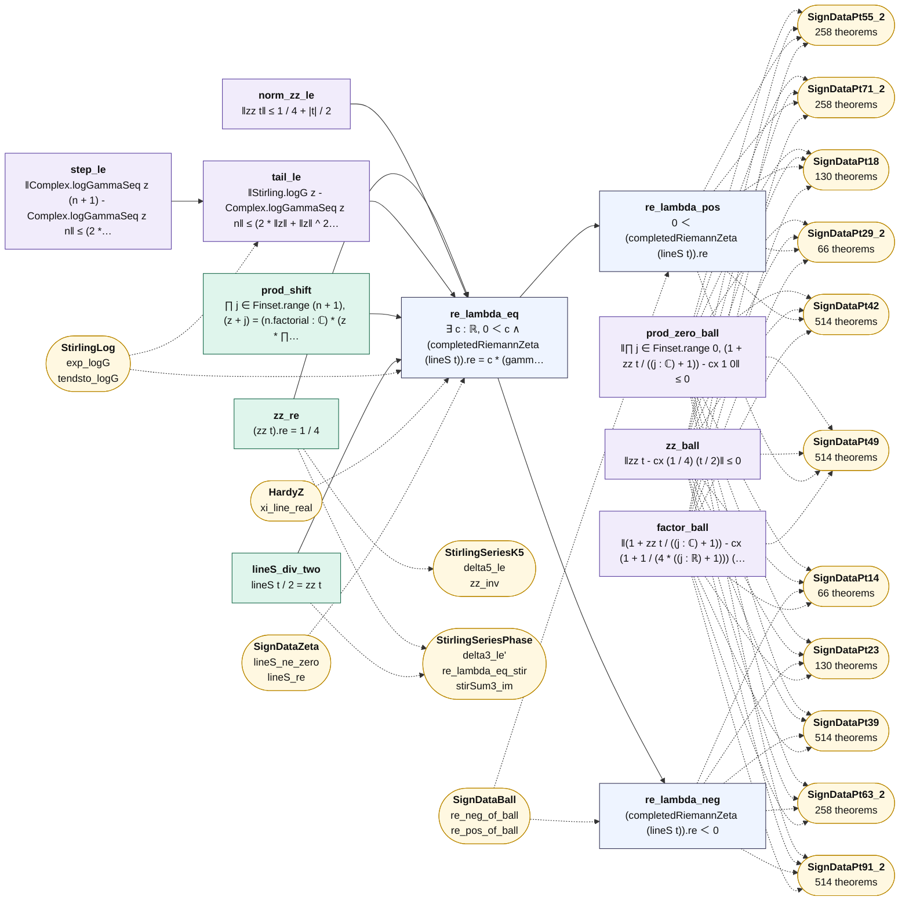

# `lean_stage3/Stage3/SignDataGamma.lean`

> **Read from the source text.** This file changed after the last `python3 utilities/lean_map.py --dump`, so the arrows on this page are names occurring in each proof and have not been confirmed by Lean.

SignDataGamma — block S14 of `lean_stage3/design/stencil.md`, Turing's sign data: the phase of `Gammaℝ` on the line, to within `π/2`. 2026-11-25.

12 theorems, 2 definitions, 353 lines. 

**Imports:** [`HardyZ`](../lean_stage3/HardyZ.md), [`SignDataZeta`](../lean_stage3/SignDataZeta.md), [`StirlingLog`](../lean_stage3/StirlingLog.md)  
**Imported by:** [`SignDataPt14`](../lean_stage3/SignDataPt14.md), [`SignDataPt18`](../lean_stage3/SignDataPt18.md), [`SignDataPt23`](../lean_stage3/SignDataPt23.md), [`SignDataPt29_2`](../lean_stage3/SignDataPt29_2.md), [`SignDataPt39`](../lean_stage3/SignDataPt39.md), [`SignDataPt42`](../lean_stage3/SignDataPt42.md), [`SignDataPt49`](../lean_stage3/SignDataPt49.md), [`SignDataPt55_2`](../lean_stage3/SignDataPt55_2.md), [`SignDataPt63_2`](../lean_stage3/SignDataPt63_2.md), [`SignDataPt71_2`](../lean_stage3/SignDataPt71_2.md), [`SignDataPt91_2`](../lean_stage3/SignDataPt91_2.md), [`StirlingSeriesPhase`](../lean_stage3/StirlingSeriesPhase.md)

## The picture



An arrow A → B reads "A is used in the proof of B". Green: counting, integers only. Violet: shape, analysis with no ζ. Blue: reads ζ. A name ending in ■ is an end: nothing else uses it. Red: contains `sorry`. Yellow: theorems in another file, counted; a dotted arrow crosses files. Definitions are not drawn; they are listed below the diagram.

## Definitions

<a name="SignData-zz"></a>
### `SignData.zz`

def · line 41

`z = s/2 = 1/4 + it/2` on the line.

- **Is:** `` zz (t : ℝ) : ℂ := 1 / 4 + ((t / 2 : ℝ) : ℂ) * I ``
- **Used by 3236:** [`SignData.factor_ball`](#SignData-factor_ball), [`SignData.gammaDir`](#SignData-gammaDir), [`SignData.lineS_div_two`](#SignData-lineS_div_two), [`SignData.norm_zz_le`](#SignData-norm_zz_le), [`SignData.prod_zero_ball`](#SignData-prod_zero_ball), [`SignData.re_lambda_eq`](#SignData-re_lambda_eq), [`SignData.zz_ball`](#SignData-zz_ball), [`SignData.zz_re`](#SignData-zz_re), [`SignData.p14_P1`](../lean_stage3/SignDataPt14.md#SignData-p14_P1), [`SignData.p14_P10`](../lean_stage3/SignDataPt14.md#SignData-p14_P10), [`SignData.p14_P11`](../lean_stage3/SignDataPt14.md#SignData-p14_P11), [`SignData.p14_P12`](../lean_stage3/SignDataPt14.md#SignData-p14_P12), [`SignData.p14_P13`](../lean_stage3/SignDataPt14.md#SignData-p14_P13), [`SignData.p14_P14`](../lean_stage3/SignDataPt14.md#SignData-p14_P14), [`SignData.p14_P15`](../lean_stage3/SignDataPt14.md#SignData-p14_P15), [`SignData.p14_P16`](../lean_stage3/SignDataPt14.md#SignData-p14_P16), [`SignData.p14_P17`](../lean_stage3/SignDataPt14.md#SignData-p14_P17), [`SignData.p14_P18`](../lean_stage3/SignDataPt14.md#SignData-p14_P18), [`SignData.p14_P19`](../lean_stage3/SignDataPt14.md#SignData-p14_P19), [`SignData.p14_P2`](../lean_stage3/SignDataPt14.md#SignData-p14_P2), [`SignData.p14_P20`](../lean_stage3/SignDataPt14.md#SignData-p14_P20), [`SignData.p14_P21`](../lean_stage3/SignDataPt14.md#SignData-p14_P21), [`SignData.p14_P22`](../lean_stage3/SignDataPt14.md#SignData-p14_P22), [`SignData.p14_P23`](../lean_stage3/SignDataPt14.md#SignData-p14_P23), [`SignData.p14_P24`](../lean_stage3/SignDataPt14.md#SignData-p14_P24), [`SignData.p14_P25`](../lean_stage3/SignDataPt14.md#SignData-p14_P25), [`SignData.p14_P26`](../lean_stage3/SignDataPt14.md#SignData-p14_P26), [`SignData.p14_P27`](../lean_stage3/SignDataPt14.md#SignData-p14_P27), [`SignData.p14_P28`](../lean_stage3/SignDataPt14.md#SignData-p14_P28), [`SignData.p14_P29`](../lean_stage3/SignDataPt14.md#SignData-p14_P29), [`SignData.p14_P3`](../lean_stage3/SignDataPt14.md#SignData-p14_P3), [`SignData.p14_P30`](../lean_stage3/SignDataPt14.md#SignData-p14_P30), [`SignData.p14_P31`](../lean_stage3/SignDataPt14.md#SignData-p14_P31), [`SignData.p14_P32`](../lean_stage3/SignDataPt14.md#SignData-p14_P32), [`SignData.p14_P33`](../lean_stage3/SignDataPt14.md#SignData-p14_P33), [`SignData.p14_P34`](../lean_stage3/SignDataPt14.md#SignData-p14_P34), [`SignData.p14_P35`](../lean_stage3/SignDataPt14.md#SignData-p14_P35), [`SignData.p14_P36`](../lean_stage3/SignDataPt14.md#SignData-p14_P36), [`SignData.p14_P37`](../lean_stage3/SignDataPt14.md#SignData-p14_P37), [`SignData.p14_P38`](../lean_stage3/SignDataPt14.md#SignData-p14_P38), and 3196 more (full list in `map/lean_map.json`)

<a name="SignData-gammaDir"></a>
### `SignData.gammaDir`

def · line 44

The direction of `Gammaℝ(1/2 + it)` up to `e^δ` and a positive factor.

- **Is:** `` gammaDir (t : ℝ) (n : ℕ) : ℂ := cexp ((((t / 2) * (Real.log n - Real.log Real.pi)) : ℝ) * I) * (starRingEnd ℂ) (zz t * ∏ j ∈ Finset.range n, (1 + zz t / ((j : ℂ) + 1))) ``
- **Built from:** [`SignData.zz`](#SignData-zz)
- **Used by 25:** [`SignData.re_lambda_eq`](#SignData-re_lambda_eq), [`SignData.re_lambda_neg`](#SignData-re_lambda_neg), [`SignData.re_lambda_pos`](#SignData-re_lambda_pos), [`SignData.p14_G`](../lean_stage3/SignDataPt14.md#SignData-p14_G), [`SignData.p14_X`](../lean_stage3/SignDataPt14.md#SignData-p14_X), [`SignData.p18_G`](../lean_stage3/SignDataPt18.md#SignData-p18_G), [`SignData.p18_X`](../lean_stage3/SignDataPt18.md#SignData-p18_X), [`SignData.p23_G`](../lean_stage3/SignDataPt23.md#SignData-p23_G), [`SignData.p23_X`](../lean_stage3/SignDataPt23.md#SignData-p23_X), [`SignData.p29_2_G`](../lean_stage3/SignDataPt29_2.md#SignData-p29_2_G), [`SignData.p29_2_X`](../lean_stage3/SignDataPt29_2.md#SignData-p29_2_X), [`SignData.p39_G`](../lean_stage3/SignDataPt39.md#SignData-p39_G), [`SignData.p39_X`](../lean_stage3/SignDataPt39.md#SignData-p39_X), [`SignData.p42_G`](../lean_stage3/SignDataPt42.md#SignData-p42_G), [`SignData.p42_X`](../lean_stage3/SignDataPt42.md#SignData-p42_X), [`SignData.p49_G`](../lean_stage3/SignDataPt49.md#SignData-p49_G), [`SignData.p49_X`](../lean_stage3/SignDataPt49.md#SignData-p49_X), [`SignData.p55_2_G`](../lean_stage3/SignDataPt55_2.md#SignData-p55_2_G), [`SignData.p55_2_X`](../lean_stage3/SignDataPt55_2.md#SignData-p55_2_X), [`SignData.p63_2_G`](../lean_stage3/SignDataPt63_2.md#SignData-p63_2_G), [`SignData.p63_2_X`](../lean_stage3/SignDataPt63_2.md#SignData-p63_2_X), [`SignData.p71_2_G`](../lean_stage3/SignDataPt71_2.md#SignData-p71_2_G), [`SignData.p71_2_X`](../lean_stage3/SignDataPt71_2.md#SignData-p71_2_X), [`SignData.p91_2_G`](../lean_stage3/SignDataPt91_2.md#SignData-p91_2_G), [`SignData.p91_2_X`](../lean_stage3/SignDataPt91_2.md#SignData-p91_2_X)

## Theorems

<a name="SignData-zz_re"></a>
### `SignData.zz_re`

line 48 · arrows read from text

**Counting.** Integers only: nothing in its statement or proof, or in anything it rests on, uses analysis or ζ.

**Proves**

```lean
(zz t).re = 1 / 4
```

**Needs** (its hypotheses)

  - `` t : ℝ ``

**Fed by:** no theorem of this repo; it stands on Mathlib and the definitions below.

**Definitions its proof touches:** [`SignData.zz`](#SignData-zz)

**Feeds** (6 that use it)

  - [`SignData.re_lambda_eq`](#SignData-re_lambda_eq) — `` ∃ c : ℝ, 0 < c ∧ (completedRiemannZeta (lineS t)).re = c * (gammaDir t n * riemannZeta (lineS t)).re ``
  - [`StirlingSeries.delta5_le`](../lean_stage3/StirlingSeriesK5.md#StirlingSeries-delta5_le) (StirlingSeriesK5) — `` ‖Stirling.logG (zz t) - stirMain 5 (zz t) - ((Real.log (2 * Real.pi) / 2 : ℝ) : ℂ)‖ ≤ 10 / |t| ^ 7 ``
  - [`StirlingSeries.zz_inv`](../lean_stage3/StirlingSeriesK5.md#StirlingSeries-zz_inv) (StirlingSeriesK5) — `` (zz t)⁻¹ = cx ((1 / 4) / ((1 / 4 : ℝ) ^ 2 + (t / 2) ^ 2)) (-(t / 2) / ((1 / 4 : ℝ) ^ 2 + (t / 2) ^ 2)) ``
  - [`StirlingSeries.delta3_le'`](../lean_stage3/StirlingSeriesPhase.md#StirlingSeries-delta3_le-) (StirlingSeriesPhase) — `` ‖Stirling.logG (zz t) - stirMain 3 (zz t) - ((Real.log (2 * Real.pi) / 2 : ℝ) : ℂ)‖ ≤ 2 / 5 / |t| ^ 3 ``
  - [`StirlingSeries.re_lambda_eq_stir`](../lean_stage3/StirlingSeriesPhase.md#StirlingSeries-re_lambda_eq_stir) (StirlingSeriesPhase) — `` ∃ c : ℝ, 0 < c ∧ (completedRiemannZeta (lineS t)).re = c * (stirDir K t * riemannZeta (lineS t)).re ``
  - [`StirlingSeries.stirSum3_im`](../lean_stage3/StirlingSeriesPhase.md#StirlingSeries-stirSum3_im) (StirlingSeriesPhase) — `` (stirSum 3 (zz t)).im = sig3 t ``

<a name="SignData-norm_zz_le"></a>
### `SignData.norm_zz_le`

line 50 · arrows read from text

**Shape.** Uses real or complex analysis; nothing in it or beneath it reads ζ.

**Proves**

```lean
‖zz t‖ ≤ 1 / 4 + |t| / 2
```

**Needs** (its hypotheses)

  - `` t : ℝ ``

**Fed by:** no theorem of this repo; it stands on Mathlib and the definitions below.

**Definitions its proof touches:** [`SignData.zz`](#SignData-zz)

**Feeds** (1 that use it)

  - [`SignData.re_lambda_eq`](#SignData-re_lambda_eq) — `` ∃ c : ℝ, 0 < c ∧ (completedRiemannZeta (lineS t)).re = c * (gammaDir t n * riemannZeta (lineS t)).re ``

<a name="SignData-step_le"></a>
### `SignData.step_le`

line 58 · arrows read from text

**Shape.** Uses real or complex analysis; nothing in it or beneath it reads ζ.

**Why.** One increment of `logGammaSeq` (the estimate of PNT+'s `cauchySeq_logGammaSeq`).

**Proves**

```lean
‖Complex.logGammaSeq z (n + 1) - Complex.logGammaSeq z n‖ ≤ (2 * ‖z‖ + ‖z‖ ^ 2) * (1 / ((n : ℝ) + 1) ^ 2)
```

**Needs** (its hypotheses)

  - `` hz : 0 < z.re ``
  - `` hn1 : 1 ≤ n ``
  - `` hn2R : 2 * ‖z‖ ≤ (n : ℝ) ``

**Fed by:** no theorem of this repo; it stands on Mathlib.

**Feeds** (1 that use it)

  - [`SignData.tail_le`](#SignData-tail_le) — `` ‖Stirling.logG z - Complex.logGammaSeq z n‖ ≤ (2 * ‖z‖ + ‖z‖ ^ 2) / n ``

<a name="SignData-tail_le"></a>
### `SignData.tail_le`

line 132 · arrows read from text

**Shape.** Uses real or complex analysis; nothing in it or beneath it reads ζ.

**Why.** The tail: `‖logG z − logGammaSeq z n‖ ≤ (2‖z‖ + ‖z‖²)/n` for `n ≥ max(1, 2‖z‖)`.

**Proves**

```lean
‖Stirling.logG z - Complex.logGammaSeq z n‖ ≤ (2 * ‖z‖ + ‖z‖ ^ 2) / n
```

**Needs** (its hypotheses)

  - `` hz : 0 < z.re ``
  - `` hn1 : 1 ≤ n ``
  - `` hn2 : 2 * ‖z‖ ≤ (n : ℝ) ``

**Fed by** (2 theorems its proof uses)

  - [`SignData.step_le`](#SignData-step_le) — `` ‖Complex.logGammaSeq z (n + 1) - Complex.logGammaSeq z n‖ ≤ (2 * ‖z‖ + ‖z‖ ^ 2) * (1 / ((n : ℝ) + 1) ^ 2) ``
  - [`Stirling.tendsto_logG`](../lean_stage3/StirlingLog.md#Stirling-tendsto_logG) (StirlingLog) — `` Tendsto (Complex.logGammaSeq z) atTop (𝓝 (logG z)) ``

**Definitions its proof touches:** [`Stirling.logG`](../lean_stage3/StirlingLog.md#Stirling-logG)

**Feeds** (1 that use it)

  - [`SignData.re_lambda_eq`](#SignData-re_lambda_eq) — `` ∃ c : ℝ, 0 < c ∧ (completedRiemannZeta (lineS t)).re = c * (gammaDir t n * riemannZeta (lineS t)).re ``

<a name="SignData-prod_shift"></a>
### `SignData.prod_shift`

line 166 · arrows read from text

**Counting.** Integers only: nothing in its statement or proof, or in anything it rests on, uses analysis or ζ.

**Why.** `∏_{j<n+1}(z+j) = n!·(z·∏_{j<n}(1 + z/(j+1)))`.

**Proves**

```lean
∏ j ∈ Finset.range (n + 1), (z + j) = (n.factorial : ℂ) * (z * ∏ j ∈ Finset.range n, (1 + z / ((j : ℂ) + 1)))
```

**Needs** (its hypotheses)

  - `` z : ℂ ``
  - `` n : ℕ ``

**Fed by:** no theorem of this repo; it stands on Mathlib.

**Feeds** (1 that use it)

  - [`SignData.re_lambda_eq`](#SignData-re_lambda_eq) — `` ∃ c : ℝ, 0 < c ∧ (completedRiemannZeta (lineS t)).re = c * (gammaDir t n * riemannZeta (lineS t)).re ``

<a name="SignData-lineS_div_two"></a>
### `SignData.lineS_div_two`

line 178 · arrows read from text

**Counting.** Integers only: nothing in its statement or proof, or in anything it rests on, uses analysis or ζ.

**Proves**

```lean
lineS t / 2 = zz t
```

**Needs** (its hypotheses)

  - `` t : ℝ ``

**Fed by:** no theorem of this repo; it stands on Mathlib and the definitions below.

**Definitions its proof touches:** [`SignData.zz`](#SignData-zz), [`SignData.lineS`](../lean_stage3/SignDataZeta.md#SignData-lineS)

**Feeds** (2 that use it)

  - [`SignData.re_lambda_eq`](#SignData-re_lambda_eq) — `` ∃ c : ℝ, 0 < c ∧ (completedRiemannZeta (lineS t)).re = c * (gammaDir t n * riemannZeta (lineS t)).re ``
  - [`StirlingSeries.re_lambda_eq_stir`](../lean_stage3/StirlingSeriesPhase.md#StirlingSeries-re_lambda_eq_stir) (StirlingSeriesPhase) — `` ∃ c : ℝ, 0 < c ∧ (completedRiemannZeta (lineS t)).re = c * (stirDir K t * riemannZeta (lineS t)).re ``

<a name="SignData-re_lambda_eq"></a>
### `SignData.re_lambda_eq`

line 182 · arrows read from text

**Reads ζ.** It, or something it rests on, uses the zeta function, its zeros or the Riemann hypothesis.

**Why.** The phase of `Gammaℝ`, to within `π/2`.

**Proves**

```lean
∃ c : ℝ, 0 < c ∧ (completedRiemannZeta (lineS t)).re = c * (gammaDir t n * riemannZeta (lineS t)).re
```

**Needs** (its hypotheses)

  - `` t : ℝ ``
  - `` hn1 : 1 ≤ n ``
  - `` h1 : 1 / 2 + |t| ≤ n ``
  - `` h2 : 2 * (1 / 4 + |t| / 2) + (1 / 4 + |t| / 2) ^ 2 ≤ 3 / 2 * n ``

**Fed by** (9 theorems its proof uses)

  - [`HardyZ.xi_line_real`](../lean_stage3/HardyZ.md#HardyZ-xi_line_real) (HardyZ) — `` (completedRiemannZeta (1/2 + t * Complex.I)).im = 0 ``
  - [`SignData.lineS_div_two`](#SignData-lineS_div_two) — `` lineS t / 2 = zz t ``
  - [`SignData.norm_zz_le`](#SignData-norm_zz_le) — `` ‖zz t‖ ≤ 1 / 4 + |t| / 2 ``
  - [`SignData.prod_shift`](#SignData-prod_shift) — `` ∏ j ∈ Finset.range (n + 1), (z + j) = (n.factorial : ℂ) * (z * ∏ j ∈ Finset.range n, (1 + z / ((j : ℂ) + 1))) ``
  - [`SignData.tail_le`](#SignData-tail_le) — `` ‖Stirling.logG z - Complex.logGammaSeq z n‖ ≤ (2 * ‖z‖ + ‖z‖ ^ 2) / n ``
  - [`SignData.zz_re`](#SignData-zz_re) — `` (zz t).re = 1 / 4 ``
  - [`SignData.lineS_ne_zero`](../lean_stage3/SignDataZeta.md#SignData-lineS_ne_zero) (SignDataZeta) — `` lineS t ≠ 0 ``
  - [`SignData.lineS_re`](../lean_stage3/SignDataZeta.md#SignData-lineS_re) (SignDataZeta) — `` (lineS t).re = 1 / 2 ``
  - [`Stirling.exp_logG`](../lean_stage3/StirlingLog.md#Stirling-exp_logG) (StirlingLog) — `` cexp (logG z) = Gamma z ``

**Definitions its proof touches:** [`SignData.gammaDir`](#SignData-gammaDir), [`SignData.zz`](#SignData-zz), [`SignData.lineS`](../lean_stage3/SignDataZeta.md#SignData-lineS), [`Stirling.logG`](../lean_stage3/StirlingLog.md#Stirling-logG)

**Feeds** (2 that use it)

  - [`SignData.re_lambda_neg`](#SignData-re_lambda_neg) — `` (completedRiemannZeta (lineS t)).re < 0 ``
  - [`SignData.re_lambda_pos`](#SignData-re_lambda_pos) — `` 0 < (completedRiemannZeta (lineS t)).re ``

<a name="SignData-re_lambda_pos"></a>
### `SignData.re_lambda_pos`

line 297 · arrows read from text

**Reads ζ.** It, or something it rests on, uses the zeta function, its zeros or the Riemann hypothesis.

**Proves**

```lean
0 < (completedRiemannZeta (lineS t)).re
```

**Needs** (its hypotheses)

  - `` t : ℝ ``
  - `` hn1 : 1 ≤ n ``
  - `` h1 : 1 / 2 + |t| ≤ n ``
  - `` h2 : 2 * (1 / 4 + |t| / 2) + (1 / 4 + |t| / 2) ^ 2 ≤ 3 / 2 * n ``
  - `` hX : ‖gammaDir t n * riemannZeta (lineS t) - cx a b‖ ≤ r ``
  - `` ha : r < a ``

**Fed by** (2 theorems its proof uses)

  - [`SignData.re_pos_of_ball`](../lean_stage3/SignDataBall.md#SignData-re_pos_of_ball) (SignDataBall) — `` 0 < z.re ``
  - [`SignData.re_lambda_eq`](#SignData-re_lambda_eq) — `` ∃ c : ℝ, 0 < c ∧ (completedRiemannZeta (lineS t)).re = c * (gammaDir t n * riemannZeta (lineS t)).re ``

**Definitions its proof touches:** [`SignData.cx`](../lean_stage3/SignDataBall.md#SignData-cx), [`SignData.gammaDir`](#SignData-gammaDir), [`SignData.lineS`](../lean_stage3/SignDataZeta.md#SignData-lineS)

**Feeds** (6 that use it)

  - [`SignData.sign_18`](../lean_stage3/SignDataPt18.md#SignData-sign_18) (SignDataPt18) — `` 0 < (completedRiemannZeta (lineS (18 : ℝ))).re ``
  - [`SignData.sign_29_2`](../lean_stage3/SignDataPt29_2.md#SignData-sign_29_2) (SignDataPt29_2) — `` 0 < (completedRiemannZeta (lineS (29/2 : ℝ))).re ``
  - [`SignData.sign_42`](../lean_stage3/SignDataPt42.md#SignData-sign_42) (SignDataPt42) — `` 0 < (completedRiemannZeta (lineS (42 : ℝ))).re ``
  - [`SignData.sign_49`](../lean_stage3/SignDataPt49.md#SignData-sign_49) (SignDataPt49) — `` 0 < (completedRiemannZeta (lineS (49 : ℝ))).re ``
  - [`SignData.sign_55_2`](../lean_stage3/SignDataPt55_2.md#SignData-sign_55_2) (SignDataPt55_2) — `` 0 < (completedRiemannZeta (lineS (55/2 : ℝ))).re ``
  - [`SignData.sign_71_2`](../lean_stage3/SignDataPt71_2.md#SignData-sign_71_2) (SignDataPt71_2) — `` 0 < (completedRiemannZeta (lineS (71/2 : ℝ))).re ``

<a name="SignData-re_lambda_neg"></a>
### `SignData.re_lambda_neg`

line 305 · arrows read from text

**Reads ζ.** It, or something it rests on, uses the zeta function, its zeros or the Riemann hypothesis.

**Proves**

```lean
(completedRiemannZeta (lineS t)).re < 0
```

**Needs** (its hypotheses)

  - `` t : ℝ ``
  - `` hn1 : 1 ≤ n ``
  - `` h1 : 1 / 2 + |t| ≤ n ``
  - `` h2 : 2 * (1 / 4 + |t| / 2) + (1 / 4 + |t| / 2) ^ 2 ≤ 3 / 2 * n ``
  - `` hX : ‖gammaDir t n * riemannZeta (lineS t) - cx a b‖ ≤ r ``
  - `` ha : a < -r ``

**Fed by** (2 theorems its proof uses)

  - [`SignData.re_neg_of_ball`](../lean_stage3/SignDataBall.md#SignData-re_neg_of_ball) (SignDataBall) — `` z.re < 0 ``
  - [`SignData.re_lambda_eq`](#SignData-re_lambda_eq) — `` ∃ c : ℝ, 0 < c ∧ (completedRiemannZeta (lineS t)).re = c * (gammaDir t n * riemannZeta (lineS t)).re ``

**Definitions its proof touches:** [`SignData.cx`](../lean_stage3/SignDataBall.md#SignData-cx), [`SignData.gammaDir`](#SignData-gammaDir), [`SignData.lineS`](../lean_stage3/SignDataZeta.md#SignData-lineS)

**Feeds** (5 that use it)

  - [`SignData.sign_14`](../lean_stage3/SignDataPt14.md#SignData-sign_14) (SignDataPt14) — `` (completedRiemannZeta (lineS (14 : ℝ))).re < 0 ``
  - [`SignData.sign_23`](../lean_stage3/SignDataPt23.md#SignData-sign_23) (SignDataPt23) — `` (completedRiemannZeta (lineS (23 : ℝ))).re < 0 ``
  - [`SignData.sign_39`](../lean_stage3/SignDataPt39.md#SignData-sign_39) (SignDataPt39) — `` (completedRiemannZeta (lineS (39 : ℝ))).re < 0 ``
  - [`SignData.sign_63_2`](../lean_stage3/SignDataPt63_2.md#SignData-sign_63_2) (SignDataPt63_2) — `` (completedRiemannZeta (lineS (63/2 : ℝ))).re < 0 ``
  - [`SignData.sign_91_2`](../lean_stage3/SignDataPt91_2.md#SignData-sign_91_2) (SignDataPt91_2) — `` (completedRiemannZeta (lineS (91/2 : ℝ))).re < 0 ``

<a name="SignData-factor_ball"></a>
### `SignData.factor_ball`

line 314 · arrows read from text

**Shape.** Uses real or complex analysis; nothing in it or beneath it reads ζ.

**Why.** The factor `1 + z/(j+1)` as an exact Gaussian rational.

**Proves**

```lean
‖(1 + zz t / ((j : ℂ) + 1)) - cx (1 + 1 / (4 * ((j : ℝ) + 1))) (t / (2 * ((j : ℝ) + 1)))‖ ≤ 0
```

**Needs** (its hypotheses)

  - `` t : ℝ ``
  - `` j : ℕ ``

**Fed by:** no theorem of this repo; it stands on Mathlib and the definitions below.

**Definitions its proof touches:** [`SignData.cx`](../lean_stage3/SignDataBall.md#SignData-cx), [`SignData.zz`](#SignData-zz)

**Feeds** (3200 that use it)

  - [`SignData.p14_P1`](../lean_stage3/SignDataPt14.md#SignData-p14_P1) (SignDataPt14) — `` ‖∏ j ∈ Finset.range (0 + 1), (1 + zz (14 : ℝ) / ((j : ℂ) + 1)) - cx (1.25) (7)‖ ≤ (0) ``
  - [`SignData.p14_P10`](../lean_stage3/SignDataPt14.md#SignData-p14_P10) (SignDataPt14) — `` ‖∏ j ∈ Finset.range (9 + 1), (1 + zz (14 : ℝ) / ((j : ℂ) + 1)) - cx (-1165.141953986230087868961287133478) (142.775896270701914657781153549384)‖ ≤ (0.… ``
  - [`SignData.p14_P11`](../lean_stage3/SignDataPt14.md#SignData-p14_P11) (SignDataPt14) — `` ‖∏ j ∈ Finset.range (10 + 1), (1 + zz (14 : ℝ) / ((j : ℂ) + 1)) - cx (-1282.479841476363808284571141372483) (-595.433167714383097743881002954889)‖ ≤ (… ``
  - [`SignData.p14_P12`](../lean_stage3/SignDataPt14.md#SignData-p14_P12) (SignDataPt14) — `` ‖∏ j ∈ Finset.range (11 + 1), (1 + zz (14 : ℝ) / ((j : ℂ) + 1)) - cx (-961.862157007064580606569121760724) (-1355.951266236311633779545022983731)‖ ≤ (… ``
  - [`SignData.p14_P13`](../lean_stage3/SignDataPt14.md#SignData-p14_P13) (SignDataPt14) — `` ‖∏ j ∈ Finset.range (12 + 1), (1 + zz (14 : ℝ) / ((j : ℂ) + 1)) - cx (-250.231901283801865890786592495652) (-1899.953028975429323986535031296885)‖ ≤ (… ``
  - [`SignData.p14_P14`](../lean_stage3/SignDataPt14.md#SignData-p14_P14) (SignDataPt14) — `` ‖∏ j ∈ Finset.range (13 + 1), (1 + zz (14 : ℝ) / ((j : ℂ) + 1)) - cx (695.276186395273477068716876858225) (-2058.996712277605780574545024532155)‖ ≤ (0… ``
  - [`SignData.p14_P15`](../lean_stage3/SignDataPt14.md#SignData-p14_P15) (SignDataPt14) — `` ‖∏ j ∈ Finset.range (14 + 1), (1 + zz (14 : ℝ) / ((j : ℂ) + 1)) - cx (1667.729255231410732621316502920868) (-1768.851103831104920952052899073853)‖ ≤ (… ``
  - [`SignData.p14_P16`](../lean_stage3/SignDataPt14.md#SignData-p14_P16) (SignDataPt14) — `` ‖∏ j ∈ Finset.range (15 + 1), (1 + zz (14 : ℝ) / ((j : ℂ) + 1)) - cx (2467.659882770509928235047716623817) (-1066.857853164723739820102755594002)‖ ≤ (… ``
  - [`SignData.p14_P17`](../lean_stage3/SignDataPt14.md#SignData-p14_P17) (SignDataPt14) — `` ‖∏ j ∈ Finset.range (16 + 1), (1 + zz (14 : ℝ) / ((j : ℂ) + 1)) - cx (2943.243408820256614164428964759933) (-66.451693393995000838319912801754)‖ ≤ (0.… ``
  - [`SignData.p14_P18`](../lean_stage3/SignDataPt14.md#SignData-p14_P18) (SignDataPt14) — `` ‖∏ j ∈ Finset.range (17 + 1), (1 + zz (14 : ℝ) / ((j : ℂ) + 1)) - cx (3009.964114707091567464948222026725) (1077.220025405632640769536908038196)‖ ≤ (0… ``
  - [`SignData.p14_P19`](../lean_stage3/SignDataPt14.md#SignData-p14_P19) (SignDataPt14) — `` ‖∏ j ∈ Finset.range (18 + 1), (1 + zz (14 : ℝ) / ((j : ℂ) + 1)) - cx (2652.698370014320220437552364091952) (2200.328120632003647740432791259071)‖ ≤ (0… ``
  - [`SignData.p14_P2`](../lean_stage3/SignDataPt14.md#SignData-p14_P2) (SignDataPt14) — `` ‖∏ j ∈ Finset.range (1 + 1), (1 + zz (14 : ℝ) / ((j : ℂ) + 1)) - cx (-23.09375) (12.25)‖ ≤ (0) ``
  - [`SignData.p14_P20`](../lean_stage3/SignDataPt14.md#SignData-p14_P20) (SignDataPt14) — `` ‖∏ j ∈ Finset.range (19 + 1), (1 + zz (14 : ℝ) / ((j : ℂ) + 1)) - cx (1915.742257418297946483870291702427) (3156.276651644915770490331528581993)‖ ≤ (0… ``
  - [`SignData.p14_P21`](../lean_stage3/SignDataPt14.md#SignData-p14_P21) (SignDataPt14) — `` ‖∏ j ∈ Finset.range (20 + 1), (1 + zz (14 : ℝ) / ((j : ℂ) + 1)) - cx (886.456495648781950921424904695363) (3832.432126161073607062220810680207)‖ ≤ (0.… ``
  - [`SignData.p14_P22`](../lean_stage3/SignDataPt14.md#SignData-p14_P22) (SignDataPt14) — `` ‖∏ j ∈ Finset.range (21 + 1), (1 + zz (14 : ℝ) / ((j : ℂ) + 1)) - cx (-322.88035704282349279244734296771) (4158.036830755698246072017607750098)‖ ≤ (0.… ``
  - [`SignData.p14_P23`](../lean_stage3/SignDataPt14.md#SignData-p14_P23) (SignDataPt14) — `` ‖∏ j ∈ Finset.range (22 + 1), (1 + zz (14 : ℝ) / ((j : ℂ) + 1)) - cx (-1591.879396371110170866457564271737) (4104.964948511748685722925129539818)‖ ≤ (… ``
  - [`SignData.p14_P24`](../lean_stage3/SignDataPt14.md#SignData-p14_P24) (SignDataPt14) — `` ‖∏ j ∈ Finset.range (23 + 1), (1 + zz (14 : ℝ) / ((j : ℂ) + 1)) - cx (-2805.742916732569268482169660015348) (3683.426842783838934696488810059934)‖ ≤ (… ``
  - [`SignData.p14_P25`](../lean_stage3/SignDataPt14.md#SignData-p14_P25) (SignDataPt14) — `` ‖∏ j ∈ Finset.range (24 + 1), (1 + zz (14 : ℝ) / ((j : ℂ) + 1)) - cx (-3865.159861879369862882008223432283) (2934.653094526557928868446193356236)‖ ≤ (… ``
  - [`SignData.p14_P26`](../lean_stage3/SignDataPt14.md#SignData-p14_P26) (SignDataPt14) — `` ‖∏ j ∈ Finset.range (25 + 1), (1 + zz (14 : ℝ) / ((j : ℂ) + 1)) - cx (-4692.42377061612940010507073917658) (1922.250949929482945870102115829816)‖ ≤ (0… ``
  - [`SignData.p14_P27`](../lean_stage3/SignDataPt14.md#SignData-p14_P27) (SignDataPt14) — `` ‖∏ j ∈ Finset.range (26 + 1), (1 + zz (14 : ℝ) / ((j : ℂ) + 1)) - cx (-5234.233496251700250887181201976686) (723.495258935759424971288425263942)‖ ≤ (0… ``
  - [`SignData.p14_P28`](../lean_stage3/SignDataPt14.md#SignData-p14_P28) (SignDataPt14) — `` ‖∏ j ∈ Finset.range (27 + 1), (1 + zz (14 : ℝ) / ((j : ℂ) + 1)) - cx (-5461.841538630744573655781711881749) (-578.603336029524928598977514290373)‖ ≤ (… ``
  - [`SignData.p14_P29`](../lean_stage3/SignDataPt14.md#SignData-p14_P29) (SignDataPt14) — `` ‖∏ j ∈ Finset.range (28 + 1), (1 + zz (14 : ℝ) / ((j : ℂ) + 1)) - cx (-5369.263505266986354456509395603743) (-1901.96683963030400610726083710916)‖ ≤ (… ``
  - [`SignData.p14_P3`](../lean_stage3/SignDataPt14.md#SignData-p14_P3) (SignDataPt14) — `` ‖∏ j ∈ Finset.range (2 + 1), (1 + zz (14 : ℝ) / ((j : ℂ) + 1)) - cx (-53.6015625) (-40.614583333333333333333333333333)‖ ≤ (0.0000000000000000000000000… ``
  - [`SignData.p14_P30`](../lean_stage3/SignDataPt14.md#SignData-p14_P30) (SignDataPt14) — `` ‖∏ j ∈ Finset.range (29 + 1), (1 + zz (14 : ℝ) / ((j : ℂ) + 1)) - cx (-4970.215105230473639318619445241637) (-3170.644714522853355531340203059276)‖ ≤ … ``
  - [`SignData.p14_P31`](../lean_stage3/SignDataPt14.md#SignData-p14_P31) (SignDataPt14) — `` ‖∏ j ∈ Finset.range (30 + 1), (1 + zz (14 : ℝ) / ((j : ℂ) + 1)) - cx (-4294.345452799752507741531491689878) (-4318.521066627499446309184434267543)‖ ≤ … ``
  - [`SignData.p14_P32`](../lean_stage3/SignDataPt14.md#SignData-p14_P32) (SignDataPt14) — `` ‖∏ j ∈ Finset.range (31 + 1), (1 + zz (14 : ℝ) / ((j : ℂ) + 1)) - cx (-3383.21854332498507032812811147268) (-5291.647580260472646801934951467419)‖ ≤ (… ``
  - [`SignData.p14_P33`](../lean_stage3/SignDataPt14.md#SignData-p14_P33) (SignDataPt14) — `` ‖∏ j ∈ Finset.range (32 + 1), (1 + zz (14 : ℝ) / ((j : ℂ) + 1)) - cx (-2286.378287991892274569597425642263) (-6049.388237785927606013976785351529)‖ ≤ … ``
  - [`SignData.p14_P34`](../lean_stage3/SignDataPt14.md#SignData-p14_P34) (SignDataPt14) — `` ‖∏ j ∈ Finset.range (33 + 1), (1 + zz (14 : ℝ) / ((j : ℂ) + 1)) - cx (-1057.727608800612269467966892081965) (-6564.593975297390189057820202287815)‖ ≤ … ``
  - [`SignData.p14_P35`](../lean_stage3/SignDataPt14.md#SignData-p14_P35) (SignDataPt14) — `` ‖∏ j ∈ Finset.range (34 + 1), (1 + zz (14 : ℝ) / ((j : ℂ) + 1)) - cx (247.635989053147109275968813432155) (-6823.029454023922572873255153577692)‖ ≤ (0… ``
  - [`SignData.p14_P36`](../lean_stage3/SignDataPt14.md#SignData-p14_P36) (SignDataPt14) — `` ‖∏ j ∈ Finset.range (35 + 1), (1 + zz (14 : ℝ) / ((j : ℂ) + 1)) - cx (1576.055855037334464482407098943318) (-6822.260160694310097270103267310174)‖ ≤ (… ``
  - [`SignData.p14_P37`](../lean_stage3/SignDataPt14.md#SignData-p14_P37) (SignDataPt14) — `` ‖∏ j ∈ Finset.range (36 + 1), (1 + zz (14 : ℝ) / ((j : ℂ) + 1)) - cx (2877.402749324348094131361819102968) (-6570.183783800046212754986405802723)‖ ≤ (… ``
  - [`SignData.p14_P38`](../lean_stage3/SignDataPt14.md#SignData-p14_P38) (SignDataPt14) — `` ‖∏ j ∈ Finset.range (37 + 1), (1 + zz (14 : ℝ) / ((j : ℂ) + 1)) - cx (4106.630043375174686573934063718621) (-6083.360802238982394183123612848247)‖ ≤ (… ``
  - [`SignData.p14_P39`](../lean_stage3/SignDataPt14.md#SignData-p14_P39) (SignDataPt14) — `` ‖∏ j ∈ Finset.range (38 + 1), (1 + zz (14 : ℝ) / ((j : ℂ) + 1)) - cx (5224.839867132012389930994289510092) (-5385.269261134713747837693932263163)‖ ≤ (… ``
  - [`SignData.p14_P4`](../lean_stage3/SignDataPt14.md#SignData-p14_P4) (SignDataPt14) — `` ‖∏ j ∈ Finset.range (3 + 1), (1 + zz (14 : ℝ) / ((j : ℂ) + 1)) - cx (14.123860677083333333333333333333) (-136.955729166666666666666666666666)‖ ≤ (0.00… ``
  - [`SignData.p14_P40`](../lean_stage3/SignDataPt14.md#SignData-p14_P40) (SignDataPt14) — `` ‖∏ j ∈ Finset.range (39 + 1), (1 + zz (14 : ℝ) / ((j : ℂ) + 1)) - cx (6199.917237000162373239659441965584) (-4504.580217268703540523755518675542)‖ ≤ (… ``
  - [`SignData.p14_P41`](../lean_stage3/SignDataPt14.md#SignData-p14_P41) (SignDataPt14) — `` ‖∏ j ∈ Finset.range (40 + 1), (1 + zz (14 : ℝ) / ((j : ℂ) + 1)) - cx (7006.79628163750299219029855150754) (-3473.524714715436205705543879307488)‖ ≤ (0… ``
  - [`SignData.p14_P42`](../lean_stage3/SignDataPt14.md#SignData-p14_P42) (SignDataPt14) — `` ‖∏ j ∈ Finset.range (41 + 1), (1 + zz (14 : ℝ) / ((j : ℂ) + 1)) - cx (7627.424188147441782380450498960619) (-2326.401076792015684422074739052109)‖ ≤ (… ``
  - [`SignData.p14_P43`](../lean_stage3/SignDataPt14.md#SignData-p14_P43) (SignDataPt14) — `` ‖∏ j ∈ Finset.range (42 + 1), (1 + zz (14 : ℝ) / ((j : ℂ) + 1)) - cx (8050.486131974906206486255982637478) (-1098.252959400525252897478580727427)‖ ≤ (… ``
  - [`SignData.p14_P44`](../lean_stage3/SignDataPt14.md#SignData-p14_P44) (SignDataPt14) — `` ‖∏ j ∈ Finset.range (43 + 1), (1 + zz (14 : ℝ) / ((j : ℂ) + 1)) - cx (8270.949592174847191074981302200009) (176.266124326161386470235560938039)‖ ≤ (0.… ``
  - [`SignData.p14_P45`](../lean_stage3/SignDataPt14.md#SignData-p14_P45) (SignDataPt14) — `` ‖∏ j ∈ Finset.range (44 + 1), (1 + zz (14 : ℝ) / ((j : ℂ) + 1)) - cx (8289.480137236193459796694555510759) (1463.837539355171846117845072174363)‖ ≤ (0… ``
  - [`SignData.p14_P46`](../lean_stage3/SignDataPt14.md#SignData-p14_P46) (SignDataPt14) — `` ‖∏ j ∈ Finset.range (45 + 1), (1 + zz (14 : ℝ) / ((j : ℂ) + 1)) - cx (8111.773773297559665060265384503306) (2733.235807735435915250591227753035)‖ ≤ (0… ``
  - [`SignData.p14_P47`](../lean_stage3/SignDataPt14.md#SignData-p14_P47) (SignDataPt14) — `` ‖∏ j ∈ Finset.range (46 + 1), (1 + zz (14 : ℝ) / ((j : ℂ) + 1)) - cx (7747.843832641737080156242570712978) (3955.910815501750311723665812826682)‖ ≤ (0… ``
  - [`SignData.p14_P48`](../lean_stage3/SignDataPt14.md#SignData-p14_P48) (SignDataPt14) — `` ‖∏ j ∈ Finset.range (47 + 1), (1 + zz (14 : ℝ) / ((j : ℂ) + 1)) - cx (7211.293525342740873655688403064884) (5106.40840992607525212001194716413)‖ ≤ (0.… ``
  - [`SignData.p14_P49`](../lean_stage3/SignDataPt14.md#SignData-p14_P49) (SignDataPt14) — `` ‖∏ j ∈ Finset.range (48 + 1), (1 + zz (14 : ℝ) / ((j : ℂ) + 1)) - cx (6518.598923543825740055154494301972) (6162.646303393028413928579739169134)‖ ≤ (0… ``
  - [`SignData.p14_P5`](../lean_stage3/SignDataPt14.md#SignData-p14_P5) (SignDataPt14) — `` ‖∏ j ∈ Finset.range (4 + 1), (1 + zz (14 : ℝ) / ((j : ℂ) + 1)) - cx (206.568074544270833333333333333332) (-124.030110677083333333333333333333)‖ ≤ (0.0… ``
  - [`SignData.p14_P50`](../lean_stage3/SignDataPt14.md#SignData-p14_P50) (SignDataPt14) — `` ‖∏ j ∈ Finset.range (49 + 1), (1 + zz (14 : ℝ) / ((j : ℂ) + 1)) - cx (5688.421435686520890805429103289803) (7106.063384206129159605944267067256)‖ ≤ (0… ``
  - [`SignData.p14_P51`](../lean_stage3/SignDataPt14.md#SignData-p14_P51) (SignDataPt14) — `` ‖∏ j ∈ Finset.range (50 + 1), (1 + zz (14 : ℝ) / ((j : ℂ) + 1)) - cx (4740.963821362574343853659444590816) (7921.660754713132660106718576671088)‖ ≤ (0… ``
  - [`SignData.p14_P52`](../lean_stage3/SignDataPt14.md#SignData-p14_P52) (SignDataPt14) — `` ‖∏ j ∈ Finset.range (51 + 1), (1 + zz (14 : ℝ) / ((j : ℂ) + 1)) - cx (3697.379507369280400877051460445625) (8597.952330448061574952916571984617)‖ ≤ (0… ``
  - [`SignData.p14_P53`](../lean_stage3/SignDataPt14.md#SignData-p14_P53) (SignDataPt14) — `` ‖∏ j ∈ Finset.range (52 + 1), (1 + zz (14 : ℝ) / ((j : ℂ) + 1)) - cx (2579.241367061844345698727816317683) (9126.841851848004559856267314741514)‖ ≤ (0… ``
  - [`SignData.p14_P54`](../lean_stage3/SignDataPt14.md#SignData-p14_P54) (SignDataPt14) — `` ‖∏ j ∈ Finset.range (53 + 1), (1 + zz (14 : ℝ) / ((j : ℂ) + 1)) - cx (1408.07317037350044139189097837118) (9503.441852447910329483214750721313)‖ ≤ (0.… ``
  - [`SignData.p14_P55`](../lean_stage3/SignDataPt14.md#SignData-p14_P55) (SignDataPt14) — `` ‖∏ j ∈ Finset.range (54 + 1), (1 + zz (14 : ℝ) / ((j : ℂ) + 1)) - cx (204.9445399272823105548995145447) (9725.848628006573614430742760471833)‖ ≤ (0.00… ``
  - [`SignData.p14_P56`](../lean_stage3/SignDataPt14.md#SignData-p14_P56) (SignDataPt14) — `` ‖∏ j ∈ Finset.range (55 + 1), (1 + zz (14 : ℝ) / ((j : ℂ) + 1)) - cx (-1009.871607591721166648251814824347) (9794.885662586798964028813872827741)‖ ≤ (… ``
  - [`SignData.p14_P57`](../lean_stage3/SignDataPt14.md#SignData-p14_P57) (SignDataPt14) — `` ‖∏ j ∈ Finset.range (56 + 1), (1 + zz (14 : ℝ) / ((j : ℂ) + 1)) - cx (-2217.181564433923325242352868569966) (9713.826367192143728493190026589785)‖ ≤ (… ``
  - [`SignData.p14_P58`](../lean_stage3/SignDataPt14.md#SignData-p14_P58) (SignDataPt14) — `` ‖∏ j ∈ Finset.range (57 + 1), (1 + zz (14 : ℝ) / ((j : ℂ) + 1)) - cx (-3399.096736183121375772748013453949) (9488.105429963877739793652568428711)‖ ≤ (… ``
  - [`SignData.p14_P59`](../lean_stage3/SignDataPt14.md#SignData-p14_P59) (SignDataPt14) — `` ‖∏ j ∈ Finset.range (58 + 1), (1 + zz (14 : ℝ) / ((j : ℂ) + 1)) - cx (-4539.207112349103147340523521629618) (9125.026602916574685633299637037686)‖ ≤ (… ``
  - [`SignData.p14_P6`](../lean_stage3/SignDataPt14.md#SignData-p14_P6) (SignDataPt14) — `` ‖∏ j ∈ Finset.range (5 + 1), (1 + zz (14 : ℝ) / ((j : ℂ) + 1)) - cx (359.876873440212673611111111111109) (111.798055013020833333333333333332)‖ ≤ (0.00… ``
  - [`SignData.p14_P60`](../lean_stage3/SignDataPt14.md#SignData-p14_P60) (SignDataPt14) — `` ‖∏ j ∈ Finset.range (59 + 1), (1 + zz (14 : ℝ) / ((j : ℂ) + 1)) - cx (-5622.706912324158123778327327290805) (8633.473383987998379633710641335221)‖ ≤ (… ``
  - [`SignData.p14_P61`](../lean_stage3/SignDataPt14.md#SignData-p14_P61) (SignDataPt14) — `` ‖∏ j ∈ Finset.range (60 + 1), (1 + zz (14 : ℝ) / ((j : ℂ) + 1)) - cx (-6636.477247012633995718992185014891) (8023.627809557308096493712876897486)‖ ≤ (… ``
  - [`SignData.p14_P62`](../lean_stage3/SignDataPt14.md#SignData-p14_P62) (SignDataPt14) — `` ‖∏ j ∈ Finset.range (61 + 1), (1 + zz (14 : ℝ) / ((j : ℂ) + 1)) - cx (-7569.130698281251982402633123475151) (7306.701458320225661882269053092972)‖ ≤ (… ``
  - [`SignData.p14_P63`](../lean_stage3/SignDataPt14.md#SignData-p14_P63) (SignDataPt14) — `` ‖∏ j ∈ Finset.range (62 + 1), (1 + zz (14 : ℝ) / ((j : ℂ) + 1)) - cx (-8411.02264880207567492289568938816) (6494.681783345801733924366440377848)‖ ≤ (0… ``
  - and 3140 more; the full list is in `map/lean_map.json`

<a name="SignData-prod_zero_ball"></a>
### `SignData.prod_zero_ball`

line 329 · arrows read from text

**Shape.** Uses real or complex analysis; nothing in it or beneath it reads ζ.

**Proves**

```lean
‖∏ j ∈ Finset.range 0, (1 + zz t / ((j : ℂ) + 1)) - cx 1 0‖ ≤ 0
```

**Needs** (its hypotheses)

  - `` t : ℝ ``

**Fed by:** no theorem of this repo; it stands on Mathlib and the definitions below.

**Definitions its proof touches:** [`SignData.cx`](../lean_stage3/SignDataBall.md#SignData-cx), [`SignData.zz`](#SignData-zz)

**Feeds** (11 that use it)

  - [`SignData.p14_P1`](../lean_stage3/SignDataPt14.md#SignData-p14_P1) (SignDataPt14) — `` ‖∏ j ∈ Finset.range (0 + 1), (1 + zz (14 : ℝ) / ((j : ℂ) + 1)) - cx (1.25) (7)‖ ≤ (0) ``
  - [`SignData.p18_P1`](../lean_stage3/SignDataPt18.md#SignData-p18_P1) (SignDataPt18) — `` ‖∏ j ∈ Finset.range (0 + 1), (1 + zz (18 : ℝ) / ((j : ℂ) + 1)) - cx (1.25) (9)‖ ≤ (0) ``
  - [`SignData.p23_P1`](../lean_stage3/SignDataPt23.md#SignData-p23_P1) (SignDataPt23) — `` ‖∏ j ∈ Finset.range (0 + 1), (1 + zz (23 : ℝ) / ((j : ℂ) + 1)) - cx (1.25) (11.5)‖ ≤ (0) ``
  - [`SignData.p29_2_P1`](../lean_stage3/SignDataPt29_2.md#SignData-p29_2_P1) (SignDataPt29_2) — `` ‖∏ j ∈ Finset.range (0 + 1), (1 + zz (29/2 : ℝ) / ((j : ℂ) + 1)) - cx (1.25) (7.25)‖ ≤ (0) ``
  - [`SignData.p39_P1`](../lean_stage3/SignDataPt39.md#SignData-p39_P1) (SignDataPt39) — `` ‖∏ j ∈ Finset.range (0 + 1), (1 + zz (39 : ℝ) / ((j : ℂ) + 1)) - cx (1.25) (19.5)‖ ≤ (0) ``
  - [`SignData.p42_P1`](../lean_stage3/SignDataPt42.md#SignData-p42_P1) (SignDataPt42) — `` ‖∏ j ∈ Finset.range (0 + 1), (1 + zz (42 : ℝ) / ((j : ℂ) + 1)) - cx (1.25) (21)‖ ≤ (0) ``
  - [`SignData.p49_P1`](../lean_stage3/SignDataPt49.md#SignData-p49_P1) (SignDataPt49) — `` ‖∏ j ∈ Finset.range (0 + 1), (1 + zz (49 : ℝ) / ((j : ℂ) + 1)) - cx (1.25) (24.5)‖ ≤ (0) ``
  - [`SignData.p55_2_P1`](../lean_stage3/SignDataPt55_2.md#SignData-p55_2_P1) (SignDataPt55_2) — `` ‖∏ j ∈ Finset.range (0 + 1), (1 + zz (55/2 : ℝ) / ((j : ℂ) + 1)) - cx (1.25) (13.75)‖ ≤ (0) ``
  - [`SignData.p63_2_P1`](../lean_stage3/SignDataPt63_2.md#SignData-p63_2_P1) (SignDataPt63_2) — `` ‖∏ j ∈ Finset.range (0 + 1), (1 + zz (63/2 : ℝ) / ((j : ℂ) + 1)) - cx (1.25) (15.75)‖ ≤ (0) ``
  - [`SignData.p71_2_P1`](../lean_stage3/SignDataPt71_2.md#SignData-p71_2_P1) (SignDataPt71_2) — `` ‖∏ j ∈ Finset.range (0 + 1), (1 + zz (71/2 : ℝ) / ((j : ℂ) + 1)) - cx (1.25) (17.75)‖ ≤ (0) ``
  - [`SignData.p91_2_P1`](../lean_stage3/SignDataPt91_2.md#SignData-p91_2_P1) (SignDataPt91_2) — `` ‖∏ j ∈ Finset.range (0 + 1), (1 + zz (91/2 : ℝ) / ((j : ℂ) + 1)) - cx (1.25) (22.75)‖ ≤ (0) ``

<a name="SignData-zz_ball"></a>
### `SignData.zz_ball`

line 334 · arrows read from text

**Shape.** Uses real or complex analysis; nothing in it or beneath it reads ζ.

**Proves**

```lean
‖zz t - cx (1 / 4) (t / 2)‖ ≤ 0
```

**Needs** (its hypotheses)

  - `` t : ℝ ``

**Fed by:** no theorem of this repo; it stands on Mathlib and the definitions below.

**Definitions its proof touches:** [`SignData.cx`](../lean_stage3/SignDataBall.md#SignData-cx), [`SignData.zz`](#SignData-zz)

**Feeds** (11 that use it)

  - [`SignData.p14_W`](../lean_stage3/SignDataPt14.md#SignData-p14_W) (SignDataPt14) — `` ‖zz (14 : ℝ) * ∏ j ∈ Finset.range (63 + 1), (1 + zz (14 : ℝ) / ((j : ℂ) + 1)) - cx (-41489.230729464236176938727672833998) (-62679.6141745795236224815… ``
  - [`SignData.p18_W`](../lean_stage3/SignDataPt18.md#SignData-p18_W) (SignDataPt18) — `` ‖zz (18 : ℝ) * ∏ j ∈ Finset.range (127 + 1), (1 + zz (18 : ℝ) / ((j : ℂ) + 1)) - cx (-821313.979405293454307012436177139409) (2195370.8619570742233167… ``
  - [`SignData.p23_W`](../lean_stage3/SignDataPt23.md#SignData-p23_W) (SignDataPt23) — `` ‖zz (23 : ℝ) * ∏ j ∈ Finset.range (127 + 1), (1 + zz (23 : ℝ) / ((j : ℂ) + 1)) - cx (-41880488.722935398125271027951740203536) (94872622.1246496288657… ``
  - [`SignData.p29_2_W`](../lean_stage3/SignDataPt29_2.md#SignData-p29_2_W) (SignDataPt29_2) — `` ‖zz (29/2 : ℝ) * ∏ j ∈ Finset.range (63 + 1), (1 + zz (29/2 : ℝ) / ((j : ℂ) + 1)) - cx (-3431.612713120354211937923083012241) (-109213.418486863863886… ``
  - [`SignData.p39_W`](../lean_stage3/SignDataPt39.md#SignData-p39_W) (SignDataPt39) — `` ‖zz (39 : ℝ) * ∏ j ∈ Finset.range (511 + 1), (1 + zz (39 : ℝ) / ((j : ℂ) + 1)) - cx (-21395599338452.64240972021162053552491500139) (50966920620299.32… ``
  - [`SignData.p42_W`](../lean_stage3/SignDataPt42.md#SignData-p42_W) (SignDataPt42) — `` ‖zz (42 : ℝ) * ∏ j ∈ Finset.range (511 + 1), (1 + zz (42 : ℝ) / ((j : ℂ) + 1)) - cx (481974582914477.164479253538615334003814962742) (285035245804898.… ``
  - [`SignData.p49_W`](../lean_stage3/SignDataPt49.md#SignData-p49_W) (SignDataPt49) — `` ‖zz (49 : ℝ) * ∏ j ∈ Finset.range (511 + 1), (1 + zz (49 : ℝ) / ((j : ℂ) + 1)) - cx (52781149346400291.660096519667971193929127918354) (-1096149888962… ``
  - [`SignData.p55_2_W`](../lean_stage3/SignDataPt55_2.md#SignData-p55_2_W) (SignDataPt55_2) — `` ‖zz (55/2 : ℝ) * ∏ j ∈ Finset.range (255 + 1), (1 + zz (55/2 : ℝ) / ((j : ℂ) + 1)) - cx (-2807543526.66536393539042813884487873825) (-4264503403.93284… ``
  - [`SignData.p63_2_W`](../lean_stage3/SignDataPt63_2.md#SignData-p63_2_W) (SignDataPt63_2) — `` ‖zz (63/2 : ℝ) * ∏ j ∈ Finset.range (255 + 1), (1 + zz (63/2 : ℝ) / ((j : ℂ) + 1)) - cx (-99325933361.323847819754878954836786226657) (-44838189991.59… ``
  - [`SignData.p71_2_W`](../lean_stage3/SignDataPt71_2.md#SignData-p71_2_W) (SignDataPt71_2) — `` ‖zz (71/2 : ℝ) * ∏ j ∈ Finset.range (255 + 1), (1 + zz (71/2 : ℝ) / ((j : ℂ) + 1)) - cx (-2105968067921.514946557879946839250894735874) (876077410573.… ``
  - [`SignData.p91_2_W`](../lean_stage3/SignDataPt91_2.md#SignData-p91_2_W) (SignDataPt91_2) — `` ‖zz (91/2 : ℝ) * ∏ j ∈ Finset.range (511 + 1), (1 + zz (91/2 : ℝ) / ((j : ℂ) + 1)) - cx (8072445075613274.390032461348582496358345134155) (-1862423256… ``

