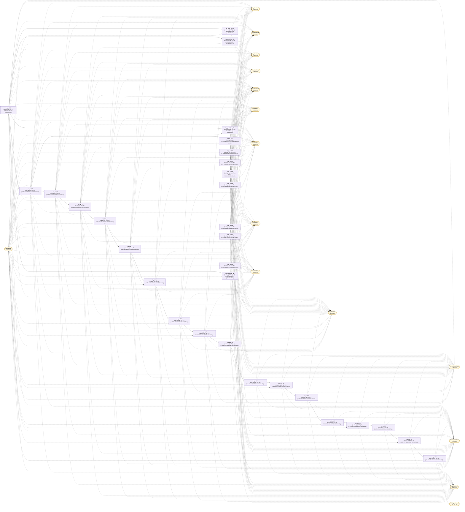
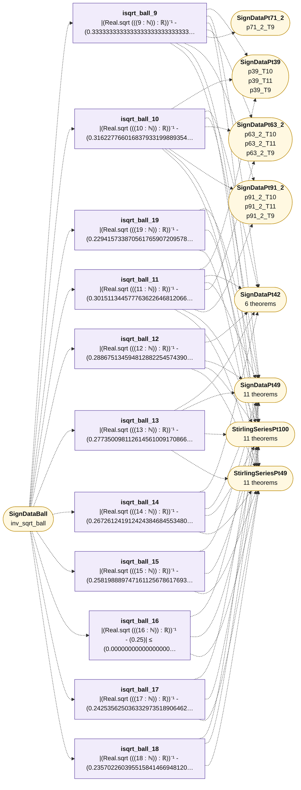

# `lean_stage3/Stage3/SignDataLog.lean`

> **Read from the source text.** This file changed after the last `python3 utilities/lean_map.py --dump`, so the arrows on this page are names occurring in each proof and have not been confirmed by Lean.

SignDataLog — block S14 of `lean_stage3/design/stencil.md`, Turing's sign data: the shared real balls. 2026-11-25. Generated by `lean_stage3/checks/signdata/gen_signdata.py`; do not edit by hand.

41 theorems, 0 definitions, 213 lines. 

**Imports:** [`SignDataBall`](../lean_stage3/SignDataBall.md)  
**Imported by:** [`SignDataPt14`](../lean_stage3/SignDataPt14.md), [`SignDataPt18`](../lean_stage3/SignDataPt18.md), [`SignDataPt23`](../lean_stage3/SignDataPt23.md), [`SignDataPt29_2`](../lean_stage3/SignDataPt29_2.md), [`SignDataPt39`](../lean_stage3/SignDataPt39.md), [`SignDataPt42`](../lean_stage3/SignDataPt42.md), [`SignDataPt49`](../lean_stage3/SignDataPt49.md), [`SignDataPt55_2`](../lean_stage3/SignDataPt55_2.md), [`SignDataPt63_2`](../lean_stage3/SignDataPt63_2.md), [`SignDataPt71_2`](../lean_stage3/SignDataPt71_2.md), [`SignDataPt91_2`](../lean_stage3/SignDataPt91_2.md), [`StirlingSeriesLog`](../lean_stage3/StirlingSeriesLog.md), [`StirlingSeriesPt100`](../lean_stage3/StirlingSeriesPt100.md), [`StirlingSeriesPt49`](../lean_stage3/StirlingSeriesPt49.md)

## The picture

### Diagram 1 of 2: `log_ball_2` to `isqrt_ball_8`



### Diagram 2 of 2: `isqrt_ball_9` to `isqrt_ball_19`



An arrow A → B reads "A is used in the proof of B". Green: counting, integers only. Violet: shape, analysis with no ζ. Blue: reads ζ. A name ending in ■ is an end: nothing else uses it. Red: contains `sorry`. Yellow: theorems in another file, counted; a dotted arrow crosses files. Definitions are not drawn; they are listed below the diagram.

## Theorems

<a name="SignData-log_ball_2"></a>
### `SignData.log_ball_2`

line 24 · arrows read from text

**Shape.** Uses real or complex analysis; nothing in it or beneath it reads ζ.

**Proves**

```lean
|Real.log ((2 : ℕ) : ℝ) - (0.69314718055)| ≤ (0.00000000025)
```

**Fed by:** no theorem of this repo; it stands on Mathlib.

**Feeds** (20 that use it)

  - [`SignData.log_ball_3`](#SignData-log_ball_3) — `` |Real.log (((3 : ℕ)) : ℝ) - (1.098612288658164142930964760306)| ≤ (0.000000000250007285403624428292) ``
  - [`SignData.log_pow2_ball_128`](#SignData-log_pow2_ball_128) — `` |Real.log (((128 : ℕ)) : ℝ) - (4.85203026385)| ≤ (0.00000000175) ``
  - [`SignData.log_pow2_ball_256`](#SignData-log_pow2_ball_256) — `` |Real.log (((256 : ℕ)) : ℝ) - (5.5451774444)| ≤ (0.000000002) ``
  - [`SignData.log_pow2_ball_512`](#SignData-log_pow2_ball_512) — `` |Real.log (((512 : ℕ)) : ℝ) - (6.23832462495)| ≤ (0.00000000225) ``
  - [`SignData.log_pow2_ball_64`](#SignData-log_pow2_ball_64) — `` |Real.log (((64 : ℕ)) : ℝ) - (4.1588830833)| ≤ (0.0000000015) ``
  - [`SignData.p14_E2`](../lean_stage3/SignDataPt14.md#SignData-p14_E2) (SignDataPt14) — `` ‖cexp ((((-((14 : ℝ) * Real.log (((2 : ℕ)) : ℝ))) : ℝ) : ℂ) * Complex.I) - cx (-(0.961253457642440241181855761014)) (-(-0.2756660845487767744075643278… ``
  - [`SignData.p18_E2`](../lean_stage3/SignDataPt18.md#SignData-p18_E2) (SignDataPt18) — `` ‖cexp ((((-((18 : ℝ) * Real.log (((2 : ℕ)) : ℝ))) : ℝ) : ℂ) * Complex.I) - cx (0.995977737708063064466978646882) (0.089601037884216125280980468076)‖ ≤… ``
  - [`SignData.p23_E2`](../lean_stage3/SignDataPt23.md#SignData-p23_E2) (SignDataPt23) — `` ‖cexp ((((-((23 : ℝ) * Real.log (((2 : ℕ)) : ℝ))) : ℝ) : ℂ) * Complex.I) - cx (-(0.972648788901772903320750690992)) (-(-0.2322807212144701694990638236… ``
  - [`SignData.p29_2_E2`](../lean_stage3/SignDataPt29_2.md#SignData-p29_2_E2) (SignDataPt29_2) — `` ‖cexp ((((-((29/2 : ℝ) * Real.log (((2 : ℕ)) : ℝ))) : ℝ) : ℂ) * Complex.I) - cx (-(0.81046188710014143857302951428)) (-(-0.585791370334249284290930337… ``
  - [`SignData.p39_E2`](../lean_stage3/SignDataPt39.md#SignData-p39_E2) (SignDataPt39) — `` ‖cexp ((((-((39 : ℝ) * Real.log (((2 : ℕ)) : ℝ))) : ℝ) : ℂ) * Complex.I) - cx (-0.323288443351135726138064255196) (-(0.946300471518216832441192256385)… ``
  - [`SignData.p42_E2`](../lean_stage3/SignDataPt42.md#SignData-p42_E2) (SignDataPt42) — `` ‖cexp ((((-((42 : ℝ) * Real.log (((2 : ℕ)) : ℝ))) : ℝ) : ℂ) * Complex.I) - cx (-(0.669063973427291916286815082708)) (0.743204816629765940682680217072)… ``
  - [`SignData.p49_E2`](../lean_stage3/SignDataPt49.md#SignData-p49_E2) (SignDataPt49) — `` ‖cexp ((((-((49 : ℝ) * Real.log (((2 : ℕ)) : ℝ))) : ℝ) : ℂ) * Complex.I) - cx (-(0.829096061353108815313364206236)) (-(0.55910618047805733687774796518… ``
  - [`SignData.p55_2_E2`](../lean_stage3/SignDataPt55_2.md#SignData-p55_2_E2) (SignDataPt55_2) — `` ‖cexp ((((-((55/2 : ℝ) * Real.log (((2 : ℕ)) : ℝ))) : ℝ) : ℂ) * Complex.I) - cx (0.977613818467166943782778721833) (-0.210407276352423602850609864343)… ``
  - [`SignData.p63_2_E2`](../lean_stage3/SignDataPt63_2.md#SignData-p63_2_E2) (SignDataPt63_2) — `` ‖cexp ((((-((63/2 : ℝ) * Real.log (((2 : ℕ)) : ℝ))) : ℝ) : ℂ) * Complex.I) - cx (-(0.987698857778222911592159765792)) (-(0.156368047706664771330863712… ``
  - [`SignData.p71_2_E2`](../lean_stage3/SignDataPt71_2.md#SignData-p71_2_E2) (SignDataPt71_2) — `` ‖cexp ((((-((71/2 : ℝ) * Real.log (((2 : ℕ)) : ℝ))) : ℝ) : ℂ) * Complex.I) - cx (0.864814102415483135888607366638) (0.502092191000121257321120086426)‖… ``
  - [`SignData.p91_2_E2`](../lean_stage3/SignDataPt91_2.md#SignData-p91_2_E2) (SignDataPt91_2) — `` ‖cexp ((((-((91/2 : ℝ) * Real.log (((2 : ℕ)) : ℝ))) : ℝ) : ℂ) * Complex.I) - cx (0.992534309608638216545060226073) (-0.121965750314192284111544807736)… ``
  - [`StirlingSeries.s100_E2`](../lean_stage3/StirlingSeriesPt100.md#StirlingSeries-s100_E2) (StirlingSeriesPt100) — `` ‖cexp ((((-((100 : ℝ) * Real.log (((2 : ℕ)) : ℝ))) : ℝ) : ℂ) * Complex.I) - cx (0.980130166108928452346011677602) (-0.198355381785532403103887577243)‖… ``
  - [`StirlingSeries.s100_logt`](../lean_stage3/StirlingSeriesPt100.md#StirlingSeries-s100_logt) (StirlingSeriesPt100) — `` |Real.log ((100 : ℝ) / 2) - (3.912023005398309015776372746574)| ≤ (0.00000000075002928759039232459) ``
  - [`StirlingSeries.s49_E2`](../lean_stage3/StirlingSeriesPt49.md#StirlingSeries-s49_E2) (StirlingSeriesPt49) — `` ‖cexp ((((-((49 : ℝ) * Real.log (((2 : ℕ)) : ℝ))) : ℝ) : ℂ) * Complex.I) - cx (-(0.829096061353108815313364206236)) (-(0.55910618047805733687774796518… ``
  - [`StirlingSeries.s49_logt`](../lean_stage3/StirlingSeriesPt49.md#StirlingSeries-s49_logt) (StirlingSeriesPt49) — `` |Real.log ((49 : ℝ) / 2) - (3.198673117540734086884499189184)| ≤ (0.000000000750043256362389999542) ``

<a name="SignData-log_ball_3"></a>
### `SignData.log_ball_3`

line 29 · arrows read from text

**Shape.** Uses real or complex analysis; nothing in it or beneath it reads ζ.

**Proves**

```lean
|Real.log (((3 : ℕ)) : ℝ) - (1.098612288658164142930964760306)| ≤ (0.000000000250007285403624428292)
```

**Fed by** (2 theorems its proof uses)

  - [`SignData.log_succ_ball`](../lean_stage3/SignDataBall.md#SignData-log_succ_ball) (SignDataBall) — `` |Real.log q - c| ≤ R ``
  - [`SignData.log_ball_2`](#SignData-log_ball_2) — `` |Real.log ((2 : ℕ) : ℝ) - (0.69314718055)| ≤ (0.00000000025) ``

**Feeds** (15 that use it)

  - [`SignData.log_ball_4`](#SignData-log_ball_4) — `` |Real.log (((4 : ℕ)) : ℝ) - (1.386294361109944875563750019823)| ≤ (0.000000000250012022355196162294) ``
  - [`SignData.log_pi_ball'`](#SignData-log_pi_ball-) — `` |Real.log Real.pi - (1.144729885839454400081836469865)| ≤ (0.000000000250010002548919421399) ``
  - [`SignData.p14_E3`](../lean_stage3/SignDataPt14.md#SignData-p14_E3) (SignDataPt14) — `` ‖cexp ((((-((14 : ℝ) * Real.log (((3 : ℕ)) : ℝ))) : ℝ) : ℂ) * Complex.I) - cx (-(0.94688447812141625126363548568)) (-(0.321573918551758778340741691955… ``
  - [`SignData.p18_E3`](../lean_stage3/SignDataPt18.md#SignData-p18_E3) (SignDataPt18) — `` ‖cexp ((((-((18 : ℝ) * Real.log (((3 : ℕ)) : ℝ))) : ℝ) : ℂ) * Complex.I) - cx (0.601462949529781653519223575226) (-(0.798900694919547136211476519698))… ``
  - [`SignData.p23_E3`](../lean_stage3/SignDataPt23.md#SignData-p23_E3) (SignDataPt23) — `` ‖cexp ((((-((23 : ℝ) * Real.log (((3 : ℕ)) : ℝ))) : ℝ) : ℂ) * Complex.I) - cx (0.990855322920647105540828705576) (-0.134928607195880246862654609362)‖ … ``
  - [`SignData.p29_2_E3`](../lean_stage3/SignDataPt29_2.md#SignData-p29_2_E3) (SignDataPt29_2) — `` ‖cexp ((((-((29/2 : ℝ) * Real.log (((3 : ℕ)) : ℝ))) : ℝ) : ℂ) * Complex.I) - cx (-(0.975477768577925555510968784402)) (-(-0.22009798502083364994361068… ``
  - [`SignData.p39_E3`](../lean_stage3/SignDataPt39.md#SignData-p39_E3) (SignDataPt39) — `` ‖cexp ((((-((39 : ℝ) * Real.log (((3 : ℕ)) : ℝ))) : ℝ) : ℂ) * Complex.I) - cx (-(-0.420846640600527012296684481949)) (0.907131801391204038374204218909… ``
  - [`SignData.p42_E3`](../lean_stage3/SignDataPt42.md#SignData-p42_E3) (SignDataPt42) — `` ‖cexp ((((-((42 : ℝ) * Real.log (((3 : ℕ)) : ℝ))) : ℝ) : ℂ) * Complex.I) - cx (-0.555215996560694349992309630905) (-(0.831706196419814489120539581043)… ``
  - [`SignData.p49_E3`](../lean_stage3/SignDataPt49.md#SignData-p49_E3) (SignDataPt49) — `` ‖cexp ((((-((49 : ℝ) * Real.log (((3 : ℕ)) : ℝ))) : ℝ) : ℂ) * Complex.I) - cx (-(0.911068816247057217206025703191)) (-(-0.4122543050862972991915974641… ``
  - [`SignData.p55_2_E3`](../lean_stage3/SignDataPt55_2.md#SignData-p55_2_E3) (SignDataPt55_2) — `` ‖cexp ((((-((55/2 : ℝ) * Real.log (((3 : ℕ)) : ℝ))) : ℝ) : ℂ) * Complex.I) - cx (-(-0.358544003442452455420244945517)) (0.9335128266903774267588410680… ``
  - [`SignData.p63_2_E3`](../lean_stage3/SignDataPt63_2.md#SignData-p63_2_E3) (SignDataPt63_2) — `` ‖cexp ((((-((63/2 : ℝ) * Real.log (((3 : ℕ)) : ℝ))) : ℝ) : ℂ) * Complex.I) - cx (-(0.998811081469169557695102555835)) (-(-0.04874857469083514232798099… ``
  - [`SignData.p71_2_E3`](../lean_stage3/SignDataPt71_2.md#SignData-p71_2_E3) (SignDataPt71_2) — `` ‖cexp ((((-((71/2 : ℝ) * Real.log (((3 : ℕ)) : ℝ))) : ℝ) : ℂ) * Complex.I) - cx (0.265933268342405023336551989178) (-(0.963991440205112195897546931753… ``
  - [`SignData.p91_2_E3`](../lean_stage3/SignDataPt91_2.md#SignData-p91_2_E3) (SignDataPt91_2) — `` ‖cexp ((((-((91/2 : ℝ) * Real.log (((3 : ℕ)) : ℝ))) : ℝ) : ℂ) * Complex.I) - cx (0.961434979805966936391946339317) (0.275032324655666518658272663118)‖… ``
  - [`StirlingSeries.s100_E3`](../lean_stage3/StirlingSeriesPt100.md#StirlingSeries-s100_E3) (StirlingSeriesPt100) — `` ‖cexp ((((-((100 : ℝ) * Real.log (((3 : ℕ)) : ℝ))) : ℝ) : ℂ) * Complex.I) - cx (-(0.995536874844560175044276063213)) (-(0.0943733586597750061753246336… ``
  - [`StirlingSeries.s49_E3`](../lean_stage3/StirlingSeriesPt49.md#StirlingSeries-s49_E3) (StirlingSeriesPt49) — `` ‖cexp ((((-((49 : ℝ) * Real.log (((3 : ℕ)) : ℝ))) : ℝ) : ℂ) * Complex.I) - cx (-(0.911068816247057217206025703191)) (-(-0.4122543050862972991915974641… ``

<a name="SignData-log_ball_4"></a>
### `SignData.log_ball_4`

line 33 · arrows read from text

**Shape.** Uses real or complex analysis; nothing in it or beneath it reads ζ.

**Proves**

```lean
|Real.log (((4 : ℕ)) : ℝ) - (1.386294361109944875563750019823)| ≤ (0.000000000250012022355196162294)
```

**Fed by** (2 theorems its proof uses)

  - [`SignData.log_succ_ball`](../lean_stage3/SignDataBall.md#SignData-log_succ_ball) (SignDataBall) — `` |Real.log q - c| ≤ R ``
  - [`SignData.log_ball_3`](#SignData-log_ball_3) — `` |Real.log (((3 : ℕ)) : ℝ) - (1.098612288658164142930964760306)| ≤ (0.000000000250007285403624428292) ``

**Feeds** (14 that use it)

  - [`SignData.log_ball_5`](#SignData-log_ball_5) — `` |Real.log (((5 : ℕ)) : ℝ) - (1.609437912424154507888186373287)| ≤ (0.000000000250014643795196162295) ``
  - [`SignData.p14_E4`](../lean_stage3/SignDataPt14.md#SignData-p14_E4) (SignDataPt14) — `` ‖cexp ((((-((14 : ℝ) * Real.log (((4 : ℕ)) : ℝ))) : ℝ) : ℂ) * Complex.I) - cx (0.84801641958530651641591672347) (-0.52996995397259773949362267018)‖ ≤ … ``
  - [`SignData.p18_E4`](../lean_stage3/SignDataPt18.md#SignData-p18_E4) (SignDataPt18) — `` ‖cexp ((((-((18 : ℝ) * Real.log (((4 : ℕ)) : ℝ))) : ℝ) : ℂ) * Complex.I) - cx (0.983943308052092067197798929696) (0.178481277840298572193831814911)‖ ≤… ``
  - [`SignData.p23_E4`](../lean_stage3/SignDataPt23.md#SignData-p23_E4) (SignDataPt23) — `` ‖cexp ((((-((23 : ℝ) * Real.log (((4 : ℕ)) : ℝ))) : ℝ) : ℂ) * Complex.I) - cx (0.892091333000817386822689575823) (-0.451855124553019475434463635465)‖ … ``
  - [`SignData.p29_2_E4`](../lean_stage3/SignDataPt29_2.md#SignData-p29_2_E4) (SignDataPt29_2) — `` ‖cexp ((((-((29/2 : ℝ) * Real.log (((4 : ℕ)) : ℝ))) : ℝ) : ℂ) * Complex.I) - cx (0.313696940746922915039221349028) (-(0.949523158941382289503116104915… ``
  - [`SignData.p39_E4`](../lean_stage3/SignDataPt39.md#SignData-p39_E4) (SignDataPt39) — `` ‖cexp ((((-((39 : ℝ) * Real.log (((4 : ℕ)) : ℝ))) : ℝ) : ℂ) * Complex.I) - cx (-(0.790969164553890568469074716312)) (-(-0.6118560130659176449980941811… ``
  - [`SignData.p42_E4`](../lean_stage3/SignDataPt42.md#SignData-p42_E4) (SignDataPt42) — `` ‖cexp ((((-((42 : ℝ) * Real.log (((4 : ℕ)) : ℝ))) : ℝ) : ℂ) * Complex.I) - cx (-0.104706799338756850078504428178) (-(0.994503135325491725552585984738)… ``
  - [`SignData.p49_E4`](../lean_stage3/SignDataPt49.md#SignData-p49_E4) (SignDataPt49) — `` ‖cexp ((((-((49 : ℝ) * Real.log (((4 : ℕ)) : ℝ))) : ℝ) : ℂ) * Complex.I) - cx (-(-0.374800558354253429056317946331)) (0.927105464042435611244149114255… ``
  - [`SignData.p55_2_E4`](../lean_stage3/SignDataPt55_2.md#SignData-p55_2_E4) (SignDataPt55_2) — `` ‖cexp ((((-((55/2 : ℝ) * Real.log (((4 : ℕ)) : ℝ))) : ℝ) : ℂ) * Complex.I) - cx (0.911457556003399944544216690754) (-0.411394121985607681713749324234)… ``
  - [`SignData.p63_2_E4`](../lean_stage3/SignDataPt63_2.md#SignData-p63_2_E4) (SignDataPt63_2) — `` ‖cexp ((((-((63/2 : ℝ) * Real.log (((4 : ℕ)) : ℝ))) : ℝ) : ℂ) * Complex.I) - cx (0.951098067409576120675543678621) (0.30888908392782254082391134591)‖ … ``
  - [`SignData.p71_2_E4`](../lean_stage3/SignDataPt71_2.md#SignData-p71_2_E4) (SignDataPt71_2) — `` ‖cexp ((((-((71/2 : ℝ) * Real.log (((4 : ℕ)) : ℝ))) : ℝ) : ℂ) * Complex.I) - cx (-(-0.495806863779989706504898114671)) (0.8684328148041451866626476173… ``
  - [`SignData.p91_2_E4`](../lean_stage3/SignDataPt91_2.md#SignData-p91_2_E4) (SignDataPt91_2) — `` ‖cexp ((((-((91/2 : ℝ) * Real.log (((4 : ℕ)) : ℝ))) : ℝ) : ℂ) * Complex.I) - cx (0.970248711391039236903844565097) (-0.242110384007022399613973931507)… ``
  - [`StirlingSeries.s100_E4`](../lean_stage3/StirlingSeriesPt100.md#StirlingSeries-s100_E4) (StirlingSeriesPt100) — `` ‖cexp ((((-((100 : ℝ) * Real.log (((4 : ℕ)) : ℝ))) : ℝ) : ℂ) * Complex.I) - cx (0.921310284646746566748588693713) (-0.388828187512339204648366963227)‖… ``
  - [`StirlingSeries.s49_E4`](../lean_stage3/StirlingSeriesPt49.md#StirlingSeries-s49_E4) (StirlingSeriesPt49) — `` ‖cexp ((((-((49 : ℝ) * Real.log (((4 : ℕ)) : ℝ))) : ℝ) : ℂ) * Complex.I) - cx (-(-0.374800558354253429056317946331)) (0.927105464042435611244149114255… ``

<a name="SignData-log_ball_5"></a>
### `SignData.log_ball_5`

line 37 · arrows read from text

**Shape.** Uses real or complex analysis; nothing in it or beneath it reads ζ.

**Proves**

```lean
|Real.log (((5 : ℕ)) : ℝ) - (1.609437912424154507888186373287)| ≤ (0.000000000250014643795196162295)
```

**Fed by** (2 theorems its proof uses)

  - [`SignData.log_succ_ball`](../lean_stage3/SignDataBall.md#SignData-log_succ_ball) (SignDataBall) — `` |Real.log q - c| ≤ R ``
  - [`SignData.log_ball_4`](#SignData-log_ball_4) — `` |Real.log (((4 : ℕ)) : ℝ) - (1.386294361109944875563750019823)| ≤ (0.000000000250012022355196162294) ``

**Feeds** (15 that use it)

  - [`SignData.log_ball_6`](#SignData-log_ball_6) — `` |Real.log (((6 : ℕ)) : ℝ) - (1.791759469218109031470825672761)| ≤ (0.000000000250016613075280171998) ``
  - [`SignData.p14_E5`](../lean_stage3/SignDataPt14.md#SignData-p14_E5) (SignDataPt14) — `` ‖cexp ((((-((14 : ℝ) * Real.log (((5 : ℕ)) : ℝ))) : ℝ) : ℂ) * Complex.I) - cx (-(0.857203283964070490032921983389)) (-(-0.5149781839662852474058872994… ``
  - [`SignData.p18_E5`](../lean_stage3/SignDataPt18.md#SignData-p18_E5) (SignDataPt18) — `` ‖cexp ((((-((18 : ℝ) * Real.log (((5 : ℕ)) : ℝ))) : ℝ) : ℂ) * Complex.I) - cx (-(0.767702308378372450788553004497)) (-(-0.6408066523613174291906787615… ``
  - [`SignData.p23_E5`](../lean_stage3/SignDataPt23.md#SignData-p23_E5) (SignDataPt23) — `` ‖cexp ((((-((23 : ℝ) * Real.log (((5 : ℕ)) : ℝ))) : ℝ) : ℂ) * Complex.I) - cx (0.776288453839965963953583023808) (0.630377852113123524540475398874)‖ ≤… ``
  - [`SignData.p29_2_E5`](../lean_stage3/SignDataPt29_2.md#SignData-p29_2_E5) (SignDataPt29_2) — `` ‖cexp ((((-((29/2 : ℝ) * Real.log (((5 : ℕ)) : ℝ))) : ℝ) : ℂ) * Complex.I) - cx (-(0.223199134004877257024192073731)) (0.97477286922619714698923410805… ``
  - [`SignData.p39_E5`](../lean_stage3/SignDataPt39.md#SignData-p39_E5) (SignDataPt39) — `` ‖cexp ((((-((39 : ℝ) * Real.log (((5 : ℕ)) : ℝ))) : ℝ) : ℂ) * Complex.I) - cx (0.99796709654413695922274435856) (0.063731265602255394566687166799)‖ ≤ … ``
  - [`SignData.p42_E5`](../lean_stage3/SignDataPt42.md#SignData-p42_E5) (SignDataPt42) — `` ‖cexp ((((-((42 : ℝ) * Real.log (((5 : ℕ)) : ℝ))) : ℝ) : ℂ) * Complex.I) - cx (-(-0.052126634429256279260206725105)) (0.998640482848096176604862864199… ``
  - [`SignData.p49_E5`](../lean_stage3/SignDataPt49.md#SignData-p49_E5) (SignDataPt49) — `` ‖cexp ((((-((49 : ℝ) * Real.log (((5 : ℕ)) : ℝ))) : ℝ) : ℂ) * Complex.I) - cx (-(0.948401221349430055776194616157)) (-(-0.3170727414063047075502667812… ``
  - [`SignData.p55_2_E5`](../lean_stage3/SignDataPt55_2.md#SignData-p55_2_E5) (SignDataPt55_2) — `` ‖cexp ((((-((55/2 : ℝ) * Real.log (((5 : ℕ)) : ℝ))) : ℝ) : ℂ) * Complex.I) - cx (0.961813029128074808553648430004) (-0.273707319959618763346933483926)… ``
  - [`SignData.p63_2_E5`](../lean_stage3/SignDataPt63_2.md#SignData-p63_2_E5) (SignDataPt63_2) — `` ‖cexp ((((-((63/2 : ℝ) * Real.log (((5 : ℕ)) : ℝ))) : ℝ) : ℂ) * Complex.I) - cx (0.908208978402447965136397275808) (-0.418516966859387679960953377083)… ``
  - [`SignData.p71_2_E5`](../lean_stage3/SignDataPt71_2.md#SignData-p71_2_E5) (SignDataPt71_2) — `` ‖cexp ((((-((71/2 : ℝ) * Real.log (((5 : ℕ)) : ℝ))) : ℝ) : ℂ) * Complex.I) - cx (0.832950293851902143069880029751) (-0.55334781825903124357524843098)‖… ``
  - [`SignData.p91_2_E5`](../lean_stage3/SignDataPt91_2.md#SignData-p91_2_E5) (SignDataPt91_2) — `` ‖cexp ((((-((91/2 : ℝ) * Real.log (((5 : ℕ)) : ℝ))) : ℝ) : ℂ) * Complex.I) - cx (-(0.562992611259906511027083503382)) (0.82646192874611700919008230332… ``
  - [`StirlingSeries.s100_E5`](../lean_stage3/StirlingSeriesPt100.md#StirlingSeries-s100_E5) (StirlingSeriesPt100) — `` ‖cexp ((((-((100 : ℝ) * Real.log (((5 : ℕ)) : ℝ))) : ℝ) : ℂ) * Complex.I) - cx (-(0.750111334809617160772942341066)) (-(-0.661311564536818323399243094… ``
  - [`StirlingSeries.s100_logt`](../lean_stage3/StirlingSeriesPt100.md#StirlingSeries-s100_logt) (StirlingSeriesPt100) — `` |Real.log ((100 : ℝ) / 2) - (3.912023005398309015776372746574)| ≤ (0.00000000075002928759039232459) ``
  - [`StirlingSeries.s49_E5`](../lean_stage3/StirlingSeriesPt49.md#StirlingSeries-s49_E5) (StirlingSeriesPt49) — `` ‖cexp ((((-((49 : ℝ) * Real.log (((5 : ℕ)) : ℝ))) : ℝ) : ℂ) * Complex.I) - cx (-(0.948401221349430055776194616157)) (-(-0.3170727414063047075502667812… ``

<a name="SignData-log_ball_6"></a>
### `SignData.log_ball_6`

line 41 · arrows read from text

**Shape.** Uses real or complex analysis; nothing in it or beneath it reads ζ.

**Proves**

```lean
|Real.log (((6 : ℕ)) : ℝ) - (1.791759469218109031470825672761)| ≤ (0.000000000250016613075280171998)
```

**Fed by** (2 theorems its proof uses)

  - [`SignData.log_succ_ball`](../lean_stage3/SignDataBall.md#SignData-log_succ_ball) (SignDataBall) — `` |Real.log q - c| ≤ R ``
  - [`SignData.log_ball_5`](#SignData-log_ball_5) — `` |Real.log (((5 : ℕ)) : ℝ) - (1.609437912424154507888186373287)| ≤ (0.000000000250014643795196162295) ``

**Feeds** (13 that use it)

  - [`SignData.log_ball_7`](#SignData-log_ball_7) — `` |Real.log (((7 : ℕ)) : ℝ) - (1.945910149045367043442249594592)| ≤ (0.000000000250021628181194999771) ``
  - [`SignData.p14_E6`](../lean_stage3/SignDataPt14.md#SignData-p14_E6) (SignDataPt14) — `` ‖cexp ((((-((14 : ℝ) * Real.log (((6 : ℕ)) : ℝ))) : ℝ) : ℂ) * Complex.I) - cx (0.998843001609035031450064349163) (0.048090104352696528263467439119)‖ ≤… ``
  - [`SignData.p23_E6`](../lean_stage3/SignDataPt23.md#SignData-p23_E6) (SignDataPt23) — `` ‖cexp ((((-((23 : ℝ) * Real.log (((6 : ℕ)) : ℝ))) : ℝ) : ℂ) * Complex.I) - cx (-(0.932412915541056797111659273843)) (-(-0.3613947356177536850042188871… ``
  - [`SignData.p29_2_E6`](../lean_stage3/SignDataPt29_2.md#SignData-p29_2_E6) (SignDataPt29_2) — `` ‖cexp ((((-((29/2 : ℝ) * Real.log (((6 : ℕ)) : ℝ))) : ℝ) : ℂ) * Complex.I) - cx (0.661656052784616480650583127838) (-(0.749807487168193599614138308551… ``
  - [`SignData.p39_E6`](../lean_stage3/SignDataPt39.md#SignData-p39_E6) (SignDataPt39) — `` ‖cexp ((((-((39 : ℝ) * Real.log (((6 : ℕ)) : ℝ))) : ℝ) : ℂ) * Complex.I) - cx (0.722364395788162937471023052711) (-0.691512602703379721564288096357)‖ … ``
  - [`SignData.p42_E6`](../lean_stage3/SignDataPt42.md#SignData-p42_E6) (SignDataPt42) — `` ‖cexp ((((-((42 : ℝ) * Real.log (((6 : ℕ)) : ℝ))) : ℝ) : ℂ) * Complex.I) - cx (0.989603072029393904526882759668) (0.143825449173594516410114496309)‖ ≤… ``
  - [`SignData.p49_E6`](../lean_stage3/SignDataPt49.md#SignData-p49_E6) (SignDataPt49) — `` ‖cexp ((((-((49 : ℝ) * Real.log (((6 : ℕ)) : ℝ))) : ℝ) : ℂ) * Complex.I) - cx (0.985857497156174296252574168149) (0.167585784901237340527590176717)‖ ≤… ``
  - [`SignData.p55_2_E6`](../lean_stage3/SignDataPt55_2.md#SignData-p55_2_E6) (SignDataPt55_2) — `` ‖cexp ((((-((55/2 : ℝ) * Real.log (((6 : ℕ)) : ℝ))) : ℝ) : ℂ) * Complex.I) - cx (-(-0.546935463826809627328058233329)) (0.8371747717224597646907394324… ``
  - [`SignData.p63_2_E6`](../lean_stage3/SignDataPt63_2.md#SignData-p63_2_E6) (SignDataPt63_2) — `` ‖cexp ((((-((63/2 : ℝ) * Real.log (((6 : ℕ)) : ℝ))) : ℝ) : ℂ) * Complex.I) - cx (0.994147283790061660896213468875) (0.108033226985231738984842785025)‖… ``
  - [`SignData.p71_2_E6`](../lean_stage3/SignDataPt71_2.md#SignData-p71_2_E6) (SignDataPt71_2) — `` ‖cexp ((((-((71/2 : ℝ) * Real.log (((6 : ℕ)) : ℝ))) : ℝ) : ℂ) * Complex.I) - cx (0.713995414834716410816259329178) (-0.700150374987403134414247492392)… ``
  - [`SignData.p91_2_E6`](../lean_stage3/SignDataPt91_2.md#SignData-p91_2_E6) (SignDataPt91_2) — `` ‖cexp ((((-((91/2 : ℝ) * Real.log (((6 : ℕ)) : ℝ))) : ℝ) : ℂ) * Complex.I) - cx (0.98780172782305602070702213895) (0.15571687933485294765689412019)‖ ≤… ``
  - [`StirlingSeries.s100_E6`](../lean_stage3/StirlingSeriesPt100.md#StirlingSeries-s100_E6) (StirlingSeriesPt100) — `` ‖cexp ((((-((100 : ℝ) * Real.log (((6 : ℕ)) : ℝ))) : ℝ) : ℂ) * Complex.I) - cx (-(0.994475185991911525436531192815)) (-(-0.104971922180900252827291743… ``
  - [`StirlingSeries.s49_E6`](../lean_stage3/StirlingSeriesPt49.md#StirlingSeries-s49_E6) (StirlingSeriesPt49) — `` ‖cexp ((((-((49 : ℝ) * Real.log (((6 : ℕ)) : ℝ))) : ℝ) : ℂ) * Complex.I) - cx (0.985857497156174296252574168149) (0.167585784901237340527590176717)‖ ≤… ``

<a name="SignData-log_ball_7"></a>
### `SignData.log_ball_7`

line 45 · arrows read from text

**Shape.** Uses real or complex analysis; nothing in it or beneath it reads ζ.

**Proves**

```lean
|Real.log (((7 : ℕ)) : ℝ) - (1.945910149045367043442249594592)| ≤ (0.000000000250021628181194999771)
```

**Fed by** (2 theorems its proof uses)

  - [`SignData.log_succ_ball`](../lean_stage3/SignDataBall.md#SignData-log_succ_ball) (SignDataBall) — `` |Real.log q - c| ≤ R ``
  - [`SignData.log_ball_6`](#SignData-log_ball_6) — `` |Real.log (((6 : ℕ)) : ℝ) - (1.791759469218109031470825672761)| ≤ (0.000000000250016613075280171998) ``

**Feeds** (13 that use it)

  - [`SignData.log_ball_8`](#SignData-log_ball_8) — `` |Real.log (((8 : ℕ)) : ℝ) - (2.079441541669889414922705144822)| ≤ (0.000000000250025688425399343201) ``
  - [`SignData.p14_E7`](../lean_stage3/SignDataPt14.md#SignData-p14_E7) (SignDataPt14) — `` ‖cexp ((((-((14 : ℝ) * Real.log (((7 : ℕ)) : ℝ))) : ℝ) : ℂ) * Complex.I) - cx (-0.51345354849746680672361505507) (-(0.858117389134703120953442154992))… ``
  - [`SignData.p23_E7`](../lean_stage3/SignDataPt23.md#SignData-p23_E7) (SignDataPt23) — `` ‖cexp ((((-((23 : ℝ) * Real.log (((7 : ℕ)) : ℝ))) : ℝ) : ℂ) * Complex.I) - cx (0.715374587797404649879137841832) (-0.698741153170251870919384296803)‖ … ``
  - [`SignData.p39_E7`](../lean_stage3/SignDataPt39.md#SignData-p39_E7) (SignDataPt39) — `` ‖cexp ((((-((39 : ℝ) * Real.log (((7 : ℕ)) : ℝ))) : ℝ) : ℂ) * Complex.I) - cx (0.881261260377417281929630834492) (-0.472629443600381228956714258371)‖ … ``
  - [`SignData.p42_E7`](../lean_stage3/SignDataPt42.md#SignData-p42_E7) (SignDataPt42) — `` ‖cexp ((((-((42 : ℝ) * Real.log (((7 : ℕ)) : ℝ))) : ℝ) : ℂ) * Complex.I) - cx (0.998904271937240595115246264234) (-0.046800165657092404048224811706)‖ … ``
  - [`SignData.p49_E7`](../lean_stage3/SignDataPt49.md#SignData-p49_E7) (SignDataPt49) — `` ‖cexp ((((-((49 : ℝ) * Real.log (((7 : ℕ)) : ℝ))) : ℝ) : ℂ) * Complex.I) - cx (0.45197542933921751807375912854) (-(0.892030386967635756881720870862))‖… ``
  - [`SignData.p55_2_E7`](../lean_stage3/SignDataPt55_2.md#SignData-p55_2_E7) (SignDataPt55_2) — `` ‖cexp ((((-((55/2 : ℝ) * Real.log (((7 : ℕ)) : ℝ))) : ℝ) : ℂ) * Complex.I) - cx (-(0.994444879097530489168354563331)) (-(-0.10525864542496244755109850… ``
  - [`SignData.p63_2_E7`](../lean_stage3/SignDataPt63_2.md#SignData-p63_2_E7) (SignDataPt63_2) — `` ‖cexp ((((-((63/2 : ℝ) * Real.log (((7 : ℕ)) : ℝ))) : ℝ) : ℂ) * Complex.I) - cx (-(-0.035105735134207031316291331562)) (0.9993836037081491472736622479… ``
  - [`SignData.p71_2_E7`](../lean_stage3/SignDataPt71_2.md#SignData-p71_2_E7) (SignDataPt71_2) — `` ‖cexp ((((-((71/2 : ℝ) * Real.log (((7 : ℕ)) : ℝ))) : ℝ) : ℂ) * Complex.I) - cx (0.999379555081957376086764896069) (0.035220801867489089127021590243)‖… ``
  - [`SignData.p91_2_E7`](../lean_stage3/SignDataPt91_2.md#SignData-p91_2_E7) (SignDataPt91_2) — `` ‖cexp ((((-((91/2 : ℝ) * Real.log (((7 : ℕ)) : ℝ))) : ℝ) : ℂ) * Complex.I) - cx (0.839563284480796960379436856621) (-0.543261899411155460593987822752)… ``
  - [`StirlingSeries.s100_E7`](../lean_stage3/StirlingSeriesPt100.md#StirlingSeries-s100_E7) (StirlingSeriesPt100) — `` ‖cexp ((((-((100 : ℝ) * Real.log (((7 : ℕ)) : ℝ))) : ℝ) : ℂ) * Complex.I) - cx (0.98243048564357703340061174777) (0.186628885433432786357525054262)‖ ≤… ``
  - [`StirlingSeries.s49_E7`](../lean_stage3/StirlingSeriesPt49.md#StirlingSeries-s49_E7) (StirlingSeriesPt49) — `` ‖cexp ((((-((49 : ℝ) * Real.log (((7 : ℕ)) : ℝ))) : ℝ) : ℂ) * Complex.I) - cx (0.45197542933921751807375912854) (-(0.892030386967635756881720870862))‖… ``
  - [`StirlingSeries.s49_logt`](../lean_stage3/StirlingSeriesPt49.md#StirlingSeries-s49_logt) (StirlingSeriesPt49) — `` |Real.log ((49 : ℝ) / 2) - (3.198673117540734086884499189184)| ≤ (0.000000000750043256362389999542) ``

<a name="SignData-log_ball_8"></a>
### `SignData.log_ball_8`

line 49 · arrows read from text

**Shape.** Uses real or complex analysis; nothing in it or beneath it reads ζ.

**Proves**

```lean
|Real.log (((8 : ℕ)) : ℝ) - (2.079441541669889414922705144822)| ≤ (0.000000000250025688425399343201)
```

**Fed by** (2 theorems its proof uses)

  - [`SignData.log_succ_ball`](../lean_stage3/SignDataBall.md#SignData-log_succ_ball) (SignDataBall) — `` |Real.log q - c| ≤ R ``
  - [`SignData.log_ball_7`](#SignData-log_ball_7) — `` |Real.log (((7 : ℕ)) : ℝ) - (1.945910149045367043442249594592)| ≤ (0.000000000250021628181194999771) ``

**Feeds** (10 that use it)

  - [`SignData.log_ball_9`](#SignData-log_ball_9) — `` |Real.log (((9 : ℕ)) : ℝ) - (2.19722457732627250799617757113)| ≤ (0.000000000250031152478117664421) ``
  - [`SignData.p14_E8`](../lean_stage3/SignDataPt14.md#SignData-p14_E8) (SignDataPt14) — `` ‖cexp ((((-((14 : ℝ) * Real.log (((8 : ℕ)) : ℝ))) : ℝ) : ℂ) * Complex.I) - cx (-(0.6690639732203451906722617839)) (0.743204816816068014337900118218)‖ … ``
  - [`SignData.p39_E8`](../lean_stage3/SignDataPt39.md#SignData-p39_E8) (SignDataPt39) — `` ‖cexp ((((-((39 : ℝ) * Real.log (((8 : ℕ)) : ℝ))) : ℝ) : ℂ) * Complex.I) - cx (0.834710823826487110872881667866) (0.55068851503087223662614508045)‖ ≤ … ``
  - [`SignData.p42_E8`](../lean_stage3/SignDataPt42.md#SignData-p42_E8) (SignDataPt42) — `` ‖cexp ((((-((42 : ℝ) * Real.log (((8 : ℕ)) : ℝ))) : ℝ) : ℂ) * Complex.I) - cx (0.80917506778316193267140565464) (0.587567621366354131152771439893)‖ ≤ … ``
  - [`SignData.p49_E8`](../lean_stage3/SignDataPt49.md#SignData-p49_E8) (SignDataPt49) — `` ‖cexp ((((-((49 : ℝ) * Real.log (((8 : ℕ)) : ℝ))) : ℝ) : ℂ) * Complex.I) - cx (0.207604727699979652297942031267) (-(0.978212797420181628482487297357))… ``
  - [`SignData.p63_2_E8`](../lean_stage3/SignDataPt63_2.md#SignData-p63_2_E8) (SignDataPt63_2) — `` ‖cexp ((((-((63/2 : ℝ) * Real.log (((8 : ℕ)) : ℝ))) : ℝ) : ℂ) * Complex.I) - cx (-(0.89109809194597743106306398457)) (-(0.4538107430749500802372456580… ``
  - [`SignData.p71_2_E8`](../lean_stage3/SignDataPt71_2.md#SignData-p71_2_E8) (SignDataPt71_2) — `` ‖cexp ((((-((71/2 : ℝ) * Real.log (((8 : ℕ)) : ℝ))) : ℝ) : ℂ) * Complex.I) - cx (-(0.007252566497066419874002253859)) (0.99997369979375239052654438399… ``
  - [`SignData.p91_2_E8`](../lean_stage3/SignDataPt91_2.md#SignData-p91_2_E8) (SignDataPt91_2) — `` ‖cexp ((((-((91/2 : ℝ) * Real.log (((8 : ℕ)) : ℝ))) : ℝ) : ℂ) * Complex.I) - cx (0.933475960102626120955660191505) (-0.35863997533805453688600242972)‖… ``
  - [`StirlingSeries.s100_E8`](../lean_stage3/StirlingSeriesPt100.md#StirlingSeries-s100_E8) (StirlingSeriesPt100) — `` ‖cexp ((((-((100 : ℝ) * Real.log (((8 : ℕ)) : ℝ))) : ℝ) : ℂ) * Complex.I) - cx (0.825877838184971295114613296044) (-0.563849090089643018981454486578)‖… ``
  - [`StirlingSeries.s49_E8`](../lean_stage3/StirlingSeriesPt49.md#StirlingSeries-s49_E8) (StirlingSeriesPt49) — `` ‖cexp ((((-((49 : ℝ) * Real.log (((8 : ℕ)) : ℝ))) : ℝ) : ℂ) * Complex.I) - cx (0.207604727699979652297942031267) (-(0.978212797420181628482487297357))… ``

<a name="SignData-log_ball_9"></a>
### `SignData.log_ball_9`

line 53 · arrows read from text

**Shape.** Uses real or complex analysis; nothing in it or beneath it reads ζ.

**Proves**

```lean
|Real.log (((9 : ℕ)) : ℝ) - (2.19722457732627250799617757113)| ≤ (0.000000000250031152478117664421)
```

**Fed by** (2 theorems its proof uses)

  - [`SignData.log_succ_ball`](../lean_stage3/SignDataBall.md#SignData-log_succ_ball) (SignDataBall) — `` |Real.log q - c| ≤ R ``
  - [`SignData.log_ball_8`](#SignData-log_ball_8) — `` |Real.log (((8 : ℕ)) : ℝ) - (2.079441541669889414922705144822)| ≤ (0.000000000250025688425399343201) ``

**Feeds** (9 that use it)

  - [`SignData.log_ball_10`](#SignData-log_ball_10) — `` |Real.log (((10 : ℕ)) : ℝ) - (2.302585092984098735657405232358)| ≤ (0.000000000250032263589228775533) ``
  - [`SignData.p39_E9`](../lean_stage3/SignDataPt39.md#SignData-p39_E9) (SignDataPt39) — `` ‖cexp ((((-((39 : ℝ) * Real.log (((9 : ℕ)) : ℝ))) : ℝ) : ℂ) * Complex.I) - cx (-(0.645776209894387196075598915748)) (0.763526742645233332288131130992)… ``
  - [`SignData.p42_E9`](../lean_stage3/SignDataPt42.md#SignData-p42_E9) (SignDataPt42) — `` ‖cexp ((((-((42 : ℝ) * Real.log (((9 : ℕ)) : ℝ))) : ℝ) : ℂ) * Complex.I) - cx (-(0.383470393940501328901777584338)) (0.923553169542023022607209780411)… ``
  - [`SignData.p49_E9`](../lean_stage3/SignDataPt49.md#SignData-p49_E9) (SignDataPt49) — `` ‖cexp ((((-((49 : ℝ) * Real.log (((9 : ℕ)) : ℝ))) : ℝ) : ℂ) * Complex.I) - cx (0.660092775509601089415384514153) (-(0.751184083777093469527807872819))… ``
  - [`SignData.p63_2_E9`](../lean_stage3/SignDataPt63_2.md#SignData-p63_2_E9) (SignDataPt63_2) — `` ‖cexp ((((-((63/2 : ℝ) * Real.log (((9 : ℕ)) : ℝ))) : ℝ) : ℂ) * Complex.I) - cx (0.995247152900720145401407499874) (-0.097381233525821474208801478449)… ``
  - [`SignData.p71_2_E9`](../lean_stage3/SignDataPt71_2.md#SignData-p71_2_E9) (SignDataPt71_2) — `` ‖cexp ((((-((71/2 : ℝ) * Real.log (((9 : ℕ)) : ℝ))) : ℝ) : ℂ) * Complex.I) - cx (-(0.858558993758451320502812480285)) (-(0.512714788392606778419836258… ``
  - [`SignData.p91_2_E9`](../lean_stage3/SignDataPt91_2.md#SignData-p91_2_E9) (SignDataPt91_2) — `` ‖cexp ((((-((91/2 : ℝ) * Real.log (((9 : ℕ)) : ℝ))) : ℝ) : ℂ) * Complex.I) - cx (0.848714441028285318001975155162) (0.528851394618606639149194241585)‖… ``
  - [`StirlingSeries.s100_E9`](../lean_stage3/StirlingSeriesPt100.md#StirlingSeries-s100_E9) (StirlingSeriesPt100) — `` ‖cexp ((((-((100 : ℝ) * Real.log (((9 : ℕ)) : ℝ))) : ℝ) : ℂ) * Complex.I) - cx (0.982187338537403166134062957709) (0.187904316120765531912102083428)‖ … ``
  - [`StirlingSeries.s49_E9`](../lean_stage3/StirlingSeriesPt49.md#StirlingSeries-s49_E9) (StirlingSeriesPt49) — `` ‖cexp ((((-((49 : ℝ) * Real.log (((9 : ℕ)) : ℝ))) : ℝ) : ℂ) * Complex.I) - cx (0.660092775509601089415384514153) (-(0.751184083777093469527807872819))… ``

<a name="SignData-log_ball_10"></a>
### `SignData.log_ball_10`

line 57 · arrows read from text

**Shape.** Uses real or complex analysis; nothing in it or beneath it reads ζ.

**Proves**

```lean
|Real.log (((10 : ℕ)) : ℝ) - (2.302585092984098735657405232358)| ≤ (0.000000000250032263589228775533)
```

**Fed by** (2 theorems its proof uses)

  - [`SignData.log_succ_ball`](../lean_stage3/SignDataBall.md#SignData-log_succ_ball) (SignDataBall) — `` |Real.log q - c| ≤ R ``
  - [`SignData.log_ball_9`](#SignData-log_ball_9) — `` |Real.log (((9 : ℕ)) : ℝ) - (2.19722457732627250799617757113)| ≤ (0.000000000250031152478117664421) ``

**Feeds** (8 that use it)

  - [`SignData.log_ball_11`](#SignData-log_ball_11) — `` |Real.log (((11 : ℕ)) : ℝ) - (2.397895272788423390160638914682)| ≤ (0.000000000250035160233026142414) ``
  - [`SignData.p39_E10`](../lean_stage3/SignDataPt39.md#SignData-p39_E10) (SignDataPt39) — `` ‖cexp ((((-((39 : ℝ) * Real.log (((10 : ℕ)) : ℝ))) : ℝ) : ℂ) * Complex.I) - cx (-0.26232230284178300430598266158) (-(0.964980315566998436140053063548)… ``
  - [`SignData.p42_E10`](../lean_stage3/SignDataPt42.md#SignData-p42_E10) (SignDataPt42) — `` ‖cexp ((((-((42 : ℝ) * Real.log (((10 : ℕ)) : ℝ))) : ℝ) : ℂ) * Complex.I) - cx (-(0.777070470349689674975876348873)) (-(0.6294136033726249705499812697… ``
  - [`SignData.p49_E10`](../lean_stage3/SignDataPt49.md#SignData-p49_E10) (SignDataPt49) — `` ‖cexp ((((-((49 : ℝ) * Real.log (((10 : ℕ)) : ℝ))) : ℝ) : ℂ) * Complex.I) - cx (0.963593046714958390139362185665) (0.267373222897477184248616449246)‖ … ``
  - [`SignData.p63_2_E10`](../lean_stage3/SignDataPt63_2.md#SignData-p63_2_E10) (SignDataPt63_2) — `` ‖cexp ((((-((63/2 : ℝ) * Real.log (((10 : ℕ)) : ℝ))) : ℝ) : ℂ) * Complex.I) - cx (-(0.962479651546942202210620118392)) (-(-0.2713538655668585070233429… ``
  - [`SignData.p91_2_E10`](../lean_stage3/SignDataPt91_2.md#SignData-p91_2_E10) (SignDataPt91_2) — `` ‖cexp ((((-((91/2 : ℝ) * Real.log (((10 : ℕ)) : ℝ))) : ℝ) : ℂ) * Complex.I) - cx (-(0.457989433083761192297653679825)) (0.8889576363267346549631390506… ``
  - [`StirlingSeries.s100_E10`](../lean_stage3/StirlingSeriesPt100.md#StirlingSeries-s100_E10) (StirlingSeriesPt100) — `` ‖cexp ((((-((100 : ℝ) * Real.log (((10 : ℕ)) : ℝ))) : ℝ) : ℂ) * Complex.I) - cx (-(0.604032038531736553214384362705)) (0.79696003439770725298667172085… ``
  - [`StirlingSeries.s49_E10`](../lean_stage3/StirlingSeriesPt49.md#StirlingSeries-s49_E10) (StirlingSeriesPt49) — `` ‖cexp ((((-((49 : ℝ) * Real.log (((10 : ℕ)) : ℝ))) : ℝ) : ℂ) * Complex.I) - cx (0.963593046714958390139362185665) (0.267373222897477184248616449246)‖ … ``

<a name="SignData-log_ball_11"></a>
### `SignData.log_ball_11`

line 61 · arrows read from text

**Shape.** Uses real or complex analysis; nothing in it or beneath it reads ζ.

**Proves**

```lean
|Real.log (((11 : ℕ)) : ℝ) - (2.397895272788423390160638914682)| ≤ (0.000000000250035160233026142414)
```

**Fed by** (2 theorems its proof uses)

  - [`SignData.log_succ_ball`](../lean_stage3/SignDataBall.md#SignData-log_succ_ball) (SignDataBall) — `` |Real.log q - c| ≤ R ``
  - [`SignData.log_ball_10`](#SignData-log_ball_10) — `` |Real.log (((10 : ℕ)) : ℝ) - (2.302585092984098735657405232358)| ≤ (0.000000000250032263589228775533) ``

**Feeds** (8 that use it)

  - [`SignData.log_ball_12`](#SignData-log_ball_12) — `` |Real.log (((12 : ℕ)) : ℝ) - (2.484906649778053096001283444008)| ≤ (0.00000000025003600990465329859) ``
  - [`SignData.p39_E11`](../lean_stage3/SignDataPt39.md#SignData-p39_E11) (SignDataPt39) — `` ‖cexp ((((-((39 : ℝ) * Real.log (((11 : ℕ)) : ℝ))) : ℝ) : ℂ) * Complex.I) - cx (0.745265110429877196894911811327) (0.666768261974085676375982609564)‖ … ``
  - [`SignData.p42_E11`](../lean_stage3/SignDataPt42.md#SignData-p42_E11) (SignDataPt42) — `` ‖cexp ((((-((42 : ℝ) * Real.log (((11 : ℕ)) : ℝ))) : ℝ) : ℂ) * Complex.I) - cx (0.983729533590200895749583239722) (-0.179655795181802603458386369665)‖… ``
  - [`SignData.p49_E11`](../lean_stage3/SignDataPt49.md#SignData-p49_E11) (SignDataPt49) — `` ‖cexp ((((-((49 : ℝ) * Real.log (((11 : ℕ)) : ℝ))) : ℝ) : ℂ) * Complex.I) - cx (-(0.307777389324773362727021086033)) (0.951458395632949829771669541356… ``
  - [`SignData.p63_2_E11`](../lean_stage3/SignDataPt63_2.md#SignData-p63_2_E11) (SignDataPt63_2) — `` ‖cexp ((((-((63/2 : ℝ) * Real.log (((11 : ℕ)) : ℝ))) : ℝ) : ℂ) * Complex.I) - cx (0.990836963971714526489686808895) (-0.13506335856669376262131880847)… ``
  - [`SignData.p91_2_E11`](../lean_stage3/SignDataPt91_2.md#SignData-p91_2_E11) (SignDataPt91_2) — `` ‖cexp ((((-((91/2 : ℝ) * Real.log (((11 : ℕ)) : ℝ))) : ℝ) : ℂ) * Complex.I) - cx (-0.65884949229690189044581124102) (-(0.75227478124692882497537577025… ``
  - [`StirlingSeries.s100_E11`](../lean_stage3/StirlingSeriesPt100.md#StirlingSeries-s100_E11) (StirlingSeriesPt100) — `` ‖cexp ((((-((100 : ℝ) * Real.log (((11 : ℕ)) : ℝ))) : ℝ) : ℂ) * Complex.I) - cx (0.516116542563805878832381028375) (-(0.85651836786608561007515218839)… ``
  - [`StirlingSeries.s49_E11`](../lean_stage3/StirlingSeriesPt49.md#StirlingSeries-s49_E11) (StirlingSeriesPt49) — `` ‖cexp ((((-((49 : ℝ) * Real.log (((11 : ℕ)) : ℝ))) : ℝ) : ℂ) * Complex.I) - cx (-(0.307777389324773362727021086033)) (0.951458395632949829771669541356… ``

<a name="SignData-log_ball_12"></a>
### `SignData.log_ball_12`

line 65 · arrows read from text

**Shape.** Uses real or complex analysis; nothing in it or beneath it reads ζ.

**Proves**

```lean
|Real.log (((12 : ℕ)) : ℝ) - (2.484906649778053096001283444008)| ≤ (0.00000000025003600990465329859)
```

**Fed by** (2 theorems its proof uses)

  - [`SignData.log_succ_ball`](../lean_stage3/SignDataBall.md#SignData-log_succ_ball) (SignDataBall) — `` |Real.log q - c| ≤ R ``
  - [`SignData.log_ball_11`](#SignData-log_ball_11) — `` |Real.log (((11 : ℕ)) : ℝ) - (2.397895272788423390160638914682)| ≤ (0.000000000250035160233026142414) ``

**Feeds** (5 that use it)

  - [`SignData.log_ball_13`](#SignData-log_ball_13) — `` |Real.log (((13 : ℕ)) : ℝ) - (2.564949357451589248303973730065)| ≤ (0.000000000250039586736521464553) ``
  - [`SignData.p42_E12`](../lean_stage3/SignDataPt42.md#SignData-p42_E12) (SignDataPt42) — `` ‖cexp ((((-((42 : ℝ) * Real.log (((12 : ℕ)) : ℝ))) : ℝ) : ℂ) * Complex.I) - cx (-(0.768999529800612943184183394889)) (-(-0.639249343500981787217671575… ``
  - [`SignData.p49_E12`](../lean_stage3/SignDataPt49.md#SignData-p49_E12) (SignDataPt49) — `` ‖cexp ((((-((49 : ℝ) * Real.log (((12 : ℕ)) : ℝ))) : ℝ) : ℂ) * Complex.I) - cx (-(0.723672320185348540337092735067)) (-(0.6901437335784150866437781956… ``
  - [`StirlingSeries.s100_E12`](../lean_stage3/StirlingSeriesPt100.md#StirlingSeries-s100_E12) (StirlingSeriesPt100) — `` ‖cexp ((((-((100 : ℝ) * Real.log (((12 : ℕ)) : ℝ))) : ℝ) : ℂ) * Complex.I) - cx (-(0.953893383238039319739366048696)) (-(-0.30014565366616096804367466… ``
  - [`StirlingSeries.s49_E12`](../lean_stage3/StirlingSeriesPt49.md#StirlingSeries-s49_E12) (StirlingSeriesPt49) — `` ‖cexp ((((-((49 : ℝ) * Real.log (((12 : ℕ)) : ℝ))) : ℝ) : ℂ) * Complex.I) - cx (-(0.723672320185348540337092735067)) (-(0.6901437335784150866437781956… ``

<a name="SignData-log_ball_13"></a>
### `SignData.log_ball_13`

line 69 · arrows read from text

**Shape.** Uses real or complex analysis; nothing in it or beneath it reads ζ.

**Proves**

```lean
|Real.log (((13 : ℕ)) : ℝ) - (2.564949357451589248303973730065)| ≤ (0.000000000250039586736521464553)
```

**Fed by** (2 theorems its proof uses)

  - [`SignData.log_succ_ball`](../lean_stage3/SignDataBall.md#SignData-log_succ_ball) (SignDataBall) — `` |Real.log q - c| ≤ R ``
  - [`SignData.log_ball_12`](#SignData-log_ball_12) — `` |Real.log (((12 : ℕ)) : ℝ) - (2.484906649778053096001283444008)| ≤ (0.00000000025003600990465329859) ``

**Feeds** (5 that use it)

  - [`SignData.log_ball_14`](#SignData-log_ball_14) — `` |Real.log (((14 : ℕ)) : ℝ) - (2.639057329605311022970451423173)| ≤ (0.000000000250040943550219800809) ``
  - [`SignData.p42_E13`](../lean_stage3/SignDataPt42.md#SignData-p42_E13) (SignDataPt42) — `` ‖cexp ((((-((42 : ℝ) * Real.log (((13 : ℕ)) : ℝ))) : ℝ) : ℂ) * Complex.I) - cx (0.610802345930244156577169120903) (-(0.791783110584022466249406067019)… ``
  - [`SignData.p49_E13`](../lean_stage3/SignDataPt49.md#SignData-p49_E13) (SignDataPt49) — `` ‖cexp ((((-((49 : ℝ) * Real.log (((13 : ℕ)) : ℝ))) : ℝ) : ℂ) * Complex.I) - cx (0.999823052557238879120030502138) (-0.018811261922708483189881440846)‖… ``
  - [`StirlingSeries.s100_E13`](../lean_stage3/StirlingSeriesPt100.md#StirlingSeries-s100_E13) (StirlingSeriesPt100) — `` ‖cexp ((((-((100 : ℝ) * Real.log (((13 : ℕ)) : ℝ))) : ℝ) : ℂ) * Complex.I) - cx (-(-0.43958310581077937969014945169)) (0.89820192222336572995242642771… ``
  - [`StirlingSeries.s49_E13`](../lean_stage3/StirlingSeriesPt49.md#StirlingSeries-s49_E13) (StirlingSeriesPt49) — `` ‖cexp ((((-((49 : ℝ) * Real.log (((13 : ℕ)) : ℝ))) : ℝ) : ℂ) * Complex.I) - cx (0.999823052557238879120030502138) (-0.018811261922708483189881440846)‖… ``

<a name="SignData-log_ball_14"></a>
### `SignData.log_ball_14`

line 73 · arrows read from text

**Shape.** Uses real or complex analysis; nothing in it or beneath it reads ζ.

**Proves**

```lean
|Real.log (((14 : ℕ)) : ℝ) - (2.639057329605311022970451423173)| ≤ (0.000000000250040943550219800809)
```

**Fed by** (2 theorems its proof uses)

  - [`SignData.log_succ_ball`](../lean_stage3/SignDataBall.md#SignData-log_succ_ball) (SignDataBall) — `` |Real.log q - c| ≤ R ``
  - [`SignData.log_ball_13`](#SignData-log_ball_13) — `` |Real.log (((13 : ℕ)) : ℝ) - (2.564949357451589248303973730065)| ≤ (0.000000000250039586736521464553) ``

**Feeds** (5 that use it)

  - [`SignData.log_ball_15`](#SignData-log_ball_15) — `` |Real.log (((15 : ℕ)) : ℝ) - (2.708050201092261790030957852678)| ≤ (0.00000000025004920142160829253) ``
  - [`SignData.p42_E14`](../lean_stage3/SignDataPt42.md#SignData-p42_E14) (SignDataPt42) — `` ‖cexp ((((-((42 : ℝ) * Real.log (((14 : ℕ)) : ℝ))) : ℝ) : ℂ) * Complex.I) - cx (-(0.633548752397269540432742662724)) (0.773702771311996305133390203999… ``
  - [`SignData.p49_E14`](../lean_stage3/SignDataPt49.md#SignData-p49_E14) (SignDataPt49) — `` ‖cexp ((((-((49 : ℝ) * Real.log (((14 : ℕ)) : ℝ))) : ℝ) : ℂ) * Complex.I) - cx (-(0.873470750584130800088945823713)) (-(-0.486876624899979320782963188… ``
  - [`StirlingSeries.s100_E14`](../lean_stage3/StirlingSeriesPt100.md#StirlingSeries-s100_E14) (StirlingSeriesPt100) — `` ‖cexp ((((-((100 : ℝ) * Real.log (((14 : ℕ)) : ℝ))) : ℝ) : ℂ) * Complex.I) - cx (0.999928598894788523382275345387) (-0.011949774571310030160433977041)… ``
  - [`StirlingSeries.s49_E14`](../lean_stage3/StirlingSeriesPt49.md#StirlingSeries-s49_E14) (StirlingSeriesPt49) — `` ‖cexp ((((-((49 : ℝ) * Real.log (((14 : ℕ)) : ℝ))) : ℝ) : ℂ) * Complex.I) - cx (-(0.873470750584130800088945823713)) (-(-0.486876624899979320782963188… ``

<a name="SignData-log_ball_15"></a>
### `SignData.log_ball_15`

line 77 · arrows read from text

**Shape.** Uses real or complex analysis; nothing in it or beneath it reads ζ.

**Proves**

```lean
|Real.log (((15 : ℕ)) : ℝ) - (2.708050201092261790030957852678)| ≤ (0.00000000025004920142160829253)
```

**Fed by** (2 theorems its proof uses)

  - [`SignData.log_succ_ball`](../lean_stage3/SignDataBall.md#SignData-log_succ_ball) (SignDataBall) — `` |Real.log q - c| ≤ R ``
  - [`SignData.log_ball_14`](#SignData-log_ball_14) — `` |Real.log (((14 : ℕ)) : ℝ) - (2.639057329605311022970451423173)| ≤ (0.000000000250040943550219800809) ``

**Feeds** (4 that use it)

  - [`SignData.log_ball_16`](#SignData-log_ball_16) — `` |Real.log (((16 : ℕ)) : ℝ) - (2.772588722229832647511359697862)| ≤ (0.000000000250052990982865679732) ``
  - [`SignData.p49_E15`](../lean_stage3/SignDataPt49.md#SignData-p49_E15) (SignDataPt49) — `` ‖cexp ((((-((49 : ℝ) * Real.log (((15 : ℕ)) : ℝ))) : ℝ) : ℂ) * Complex.I) - cx (0.733344175060589132142689672711) (-0.679857573984951645728051097535)‖… ``
  - [`StirlingSeries.s100_E15`](../lean_stage3/StirlingSeriesPt100.md#StirlingSeries-s100_E15) (StirlingSeriesPt100) — `` ‖cexp ((((-((100 : ℝ) * Real.log (((15 : ℕ)) : ℝ))) : ℝ) : ℂ) * Complex.I) - cx (0.809173686923509358986734929129) (-0.587569523027372871425065571484)… ``
  - [`StirlingSeries.s49_E15`](../lean_stage3/StirlingSeriesPt49.md#StirlingSeries-s49_E15) (StirlingSeriesPt49) — `` ‖cexp ((((-((49 : ℝ) * Real.log (((15 : ℕ)) : ℝ))) : ℝ) : ℂ) * Complex.I) - cx (0.733344175060589132142689672711) (-0.679857573984951645728051097535)‖… ``

<a name="SignData-log_ball_16"></a>
### `SignData.log_ball_16`

line 81 · arrows read from text

**Shape.** Uses real or complex analysis; nothing in it or beneath it reads ζ.

**Proves**

```lean
|Real.log (((16 : ℕ)) : ℝ) - (2.772588722229832647511359697862)| ≤ (0.000000000250052990982865679732)
```

**Fed by** (2 theorems its proof uses)

  - [`SignData.log_succ_ball`](../lean_stage3/SignDataBall.md#SignData-log_succ_ball) (SignDataBall) — `` |Real.log q - c| ≤ R ``
  - [`SignData.log_ball_15`](#SignData-log_ball_15) — `` |Real.log (((15 : ℕ)) : ℝ) - (2.708050201092261790030957852678)| ≤ (0.00000000025004920142160829253) ``

**Feeds** (4 that use it)

  - [`SignData.log_ball_17`](#SignData-log_ball_17) — `` |Real.log (((17 : ℕ)) : ℝ) - (2.833213344046267338845182082273)| ≤ (0.000000000250054814634508383847) ``
  - [`SignData.p49_E16`](../lean_stage3/SignDataPt49.md#SignData-p49_E16) (SignDataPt49) — `` ‖cexp ((((-((49 : ℝ) * Real.log (((16 : ℕ)) : ℝ))) : ℝ) : ℂ) * Complex.I) - cx (-(0.719049082576094237195420023918)) (-(-0.694959291503090280729952259… ``
  - [`StirlingSeries.s100_E16`](../lean_stage3/StirlingSeriesPt100.md#StirlingSeries-s100_E16) (StirlingSeriesPt100) — `` ‖cexp ((((-((100 : ℝ) * Real.log (((16 : ℕ)) : ℝ))) : ℝ) : ℂ) * Complex.I) - cx (0.697625280479366810375979321229) (-(0.716462816924985151140529848865… ``
  - [`StirlingSeries.s49_E16`](../lean_stage3/StirlingSeriesPt49.md#StirlingSeries-s49_E16) (StirlingSeriesPt49) — `` ‖cexp ((((-((49 : ℝ) * Real.log (((16 : ℕ)) : ℝ))) : ℝ) : ℂ) * Complex.I) - cx (-(0.719049082576094237195420023918)) (-(-0.694959291503090280729952259… ``

<a name="SignData-log_ball_17"></a>
### `SignData.log_ball_17`

line 85 · arrows read from text

**Shape.** Uses real or complex analysis; nothing in it or beneath it reads ζ.

**Proves**

```lean
|Real.log (((17 : ℕ)) : ℝ) - (2.833213344046267338845182082273)| ≤ (0.000000000250054814634508383847)
```

**Fed by** (2 theorems its proof uses)

  - [`SignData.log_succ_ball`](../lean_stage3/SignDataBall.md#SignData-log_succ_ball) (SignDataBall) — `` |Real.log q - c| ≤ R ``
  - [`SignData.log_ball_16`](#SignData-log_ball_16) — `` |Real.log (((16 : ℕ)) : ℝ) - (2.772588722229832647511359697862)| ≤ (0.000000000250052990982865679732) ``

**Feeds** (4 that use it)

  - [`SignData.log_ball_18`](#SignData-log_ball_18) — `` |Real.log (((18 : ℕ)) : ℝ) - (2.890371757886215874872377017636)| ≤ (0.00000000025005572991355977543) ``
  - [`SignData.p49_E17`](../lean_stage3/SignDataPt49.md#SignData-p49_E17) (SignDataPt49) — `` ‖cexp ((((-((49 : ℝ) * Real.log (((17 : ℕ)) : ℝ))) : ℝ) : ℂ) * Complex.I) - cx (0.826813774787536530903078968627) (-0.562475761096942577239946576211)‖… ``
  - [`StirlingSeries.s100_E17`](../lean_stage3/StirlingSeriesPt100.md#StirlingSeries-s100_E17) (StirlingSeriesPt100) — `` ‖cexp ((((-((100 : ℝ) * Real.log (((17 : ℕ)) : ℝ))) : ℝ) : ℂ) * Complex.I) - cx (0.837559438147487834790799894218) (-0.546346215846750877758720948247)… ``
  - [`StirlingSeries.s49_E17`](../lean_stage3/StirlingSeriesPt49.md#StirlingSeries-s49_E17) (StirlingSeriesPt49) — `` ‖cexp ((((-((49 : ℝ) * Real.log (((17 : ℕ)) : ℝ))) : ℝ) : ℂ) * Complex.I) - cx (0.826813774787536530903078968627) (-0.562475761096942577239946576211)‖… ``

<a name="SignData-log_ball_18"></a>
### `SignData.log_ball_18`

line 89 · arrows read from text

**Shape.** Uses real or complex analysis; nothing in it or beneath it reads ζ.

**Proves**

```lean
|Real.log (((18 : ℕ)) : ℝ) - (2.890371757886215874872377017636)| ≤ (0.00000000025005572991355977543)
```

**Fed by** (2 theorems its proof uses)

  - [`SignData.log_succ_ball`](../lean_stage3/SignDataBall.md#SignData-log_succ_ball) (SignDataBall) — `` |Real.log q - c| ≤ R ``
  - [`SignData.log_ball_17`](#SignData-log_ball_17) — `` |Real.log (((17 : ℕ)) : ℝ) - (2.833213344046267338845182082273)| ≤ (0.000000000250054814634508383847) ``

**Feeds** (4 that use it)

  - [`SignData.log_ball_19`](#SignData-log_ball_19) — `` |Real.log (((19 : ℕ)) : ℝ) - (2.944438979156490822698758619737)| ≤ (0.000000000250064791233927153323) ``
  - [`SignData.p49_E18`](../lean_stage3/SignDataPt49.md#SignData-p49_E18) (SignDataPt49) — `` ‖cexp ((((-((49 : ℝ) * Real.log (((18 : ℕ)) : ℝ))) : ℝ) : ℂ) * Complex.I) - cx (-(0.967271984095542522771977112434)) (-(-0.253741815205678176914863542… ``
  - [`StirlingSeries.s100_E18`](../lean_stage3/StirlingSeriesPt100.md#StirlingSeries-s100_E18) (StirlingSeriesPt100) — `` ‖cexp ((((-((100 : ℝ) * Real.log (((18 : ℕ)) : ℝ))) : ℝ) : ℂ) * Complex.I) - cx (0.999943271623443993302203723715) (-0.010651456942752325443595414821)… ``
  - [`StirlingSeries.s49_E18`](../lean_stage3/StirlingSeriesPt49.md#StirlingSeries-s49_E18) (StirlingSeriesPt49) — `` ‖cexp ((((-((49 : ℝ) * Real.log (((18 : ℕ)) : ℝ))) : ℝ) : ℂ) * Complex.I) - cx (-(0.967271984095542522771977112434)) (-(-0.253741815205678176914863542… ``

<a name="SignData-log_ball_19"></a>
### `SignData.log_ball_19`

line 93 · arrows read from text

**Shape.** Uses real or complex analysis; nothing in it or beneath it reads ζ.

**Proves**

```lean
|Real.log (((19 : ℕ)) : ℝ) - (2.944438979156490822698758619737)| ≤ (0.000000000250064791233927153323)
```

**Fed by** (2 theorems its proof uses)

  - [`SignData.log_succ_ball`](../lean_stage3/SignDataBall.md#SignData-log_succ_ball) (SignDataBall) — `` |Real.log q - c| ≤ R ``
  - [`SignData.log_ball_18`](#SignData-log_ball_18) — `` |Real.log (((18 : ℕ)) : ℝ) - (2.890371757886215874872377017636)| ≤ (0.00000000025005572991355977543) ``

**Feeds** (4 that use it)

  - [`SignData.p49_E19`](../lean_stage3/SignDataPt49.md#SignData-p49_E19) (SignDataPt49) — `` ‖cexp ((((-((49 : ℝ) * Real.log (((19 : ℕ)) : ℝ))) : ℝ) : ℂ) * Complex.I) - cx (0.972338948248275751342291868744) (0.233574334462151320908032602483)‖ … ``
  - [`StirlingSeries.log_ball_20`](../lean_stage3/StirlingSeriesLog.md#StirlingSeries-log_ball_20) (StirlingSeriesLog) — `` |Real.log (((20 : ℕ)) : ℝ) - (2.995732273544040890903123699102)| ≤ (0.000000000250069931036558732271) ``
  - [`StirlingSeries.s100_E19`](../lean_stage3/StirlingSeriesPt100.md#StirlingSeries-s100_E19) (StirlingSeriesPt100) — `` ‖cexp ((((-((100 : ℝ) * Real.log (((19 : ℕ)) : ℝ))) : ℝ) : ℂ) * Complex.I) - cx (-(-0.648022256775867527270215681679)) (0.7616213985459649706045856707… ``
  - [`StirlingSeries.s49_E19`](../lean_stage3/StirlingSeriesPt49.md#StirlingSeries-s49_E19) (StirlingSeriesPt49) — `` ‖cexp ((((-((49 : ℝ) * Real.log (((19 : ℕ)) : ℝ))) : ℝ) : ℂ) * Complex.I) - cx (0.972338948248275751342291868744) (0.233574334462151320908032602483)‖ … ``

<a name="SignData-log_pi_ball-"></a>
### `SignData.log_pi_ball'`

line 97 · arrows read from text

**Shape.** Uses real or complex analysis; nothing in it or beneath it reads ζ.

**Proves**

```lean
|Real.log Real.pi - (1.144729885839454400081836469865)| ≤ (0.000000000250010002548919421399)
```

**Fed by** (2 theorems its proof uses)

  - [`SignData.log_pi_ball`](../lean_stage3/SignDataBall.md#SignData-log_pi_ball) (SignDataBall) — `` |Real.log Real.pi - c| ≤ R ``
  - [`SignData.log_ball_3`](#SignData-log_ball_3) — `` |Real.log (((3 : ℕ)) : ℝ) - (1.098612288658164142930964760306)| ≤ (0.000000000250007285403624428292) ``

**Feeds** (13 that use it)

  - [`SignData.p14_phase`](../lean_stage3/SignDataPt14.md#SignData-p14_phase) (SignDataPt14) — `` ‖cexp (((((14 : ℝ) / 2) * (Real.log (((64 : ℕ)) : ℝ) - Real.log Real.pi) : ℝ) : ℂ) * Complex.I) - cx (-(0.6277973203200831287054920208)) (0.7783768525… ``
  - [`SignData.p18_phase`](../lean_stage3/SignDataPt18.md#SignData-p18_phase) (SignDataPt18) — `` ‖cexp (((((18 : ℝ) / 2) * (Real.log (((128 : ℕ)) : ℝ) - Real.log Real.pi) : ℝ) : ℂ) * Complex.I) - cx (-(0.369973539823533908439658508356)) (0.9290422… ``
  - [`SignData.p23_phase`](../lean_stage3/SignDataPt23.md#SignData-p23_phase) (SignDataPt23) — `` ‖cexp (((((23 : ℝ) / 2) * (Real.log (((128 : ℕ)) : ℝ) - Real.log Real.pi) : ℝ) : ℂ) * Complex.I) - cx (0.220623351312694027398965170429) (-(0.97535908… ``
  - [`SignData.p29_2_phase`](../lean_stage3/SignDataPt29_2.md#SignData-p29_2_phase) (SignDataPt29_2) — `` ‖cexp (((((29/2 : ℝ) / 2) * (Real.log (((64 : ℕ)) : ℝ) - Real.log Real.pi) : ℝ) : ℂ) * Complex.I) - cx (-(0.990418964609810764758707055595)) (-(-0.138… ``
  - [`SignData.p39_phase`](../lean_stage3/SignDataPt39.md#SignData-p39_phase) (SignDataPt39) — `` ‖cexp (((((39 : ℝ) / 2) * (Real.log (((512 : ℕ)) : ℝ) - Real.log Real.pi) : ℝ) : ℂ) * Complex.I) - cx (0.35688280691913244314628183446) (-(0.934149164… ``
  - [`SignData.p42_phase`](../lean_stage3/SignDataPt42.md#SignData-p42_phase) (SignDataPt42) — `` ‖cexp (((((42 : ℝ) / 2) * (Real.log (((512 : ℕ)) : ℝ) - Real.log Real.pi) : ℝ) : ℂ) * Complex.I) - cx (0.988570048824022088890565013104) (0.1507622584… ``
  - [`SignData.p49_phase`](../lean_stage3/SignDataPt49.md#SignData-p49_phase) (SignDataPt49) — `` ‖cexp (((((49 : ℝ) / 2) * (Real.log (((512 : ℕ)) : ℝ) - Real.log Real.pi) : ℝ) : ℂ) * Complex.I) - cx (0.644341041333508658791099247021) (-(0.76473827… ``
  - [`SignData.p55_2_phase`](../lean_stage3/SignDataPt55_2.md#SignData-p55_2_phase) (SignDataPt55_2) — `` ‖cexp (((((55/2 : ℝ) / 2) * (Real.log (((256 : ℕ)) : ℝ) - Real.log Real.pi) : ℝ) : ℂ) * Complex.I) - cx (-0.685217888200965880868050328667) (-(0.72833… ``
  - [`SignData.p63_2_phase`](../lean_stage3/SignDataPt63_2.md#SignData-p63_2_phase) (SignDataPt63_2) — `` ‖cexp (((((63/2 : ℝ) / 2) * (Real.log (((256 : ℕ)) : ℝ) - Real.log Real.pi) : ℝ) : ℂ) * Complex.I) - cx (0.981622517753374462253459104409) (0.19083299… ``
  - [`SignData.p71_2_phase`](../lean_stage3/SignDataPt71_2.md#SignData-p71_2_phase) (SignDataPt71_2) — `` ‖cexp (((((71/2 : ℝ) / 2) * (Real.log (((256 : ℕ)) : ℝ) - Real.log Real.pi) : ℝ) : ℂ) * Complex.I) - cx (-(0.908183701932887392373663860388)) (-(-0.41… ``
  - [`SignData.p91_2_phase`](../lean_stage3/SignDataPt91_2.md#SignData-p91_2_phase) (SignDataPt91_2) — `` ‖cexp (((((91/2 : ℝ) / 2) * (Real.log (((512 : ℕ)) : ℝ) - Real.log Real.pi) : ℝ) : ℂ) * Complex.I) - cx (-(0.936020812661295027874964469849)) (-(-0.35… ``
  - [`StirlingSeries.s100_phase`](../lean_stage3/StirlingSeriesPt100.md#StirlingSeries-s100_phase) (StirlingSeriesPt100) — `` |stirPhase 3 (100 : ℝ) - (87.972165230795065475414495752782)| ≤ (0.000000050002096023926636294426) ``
  - [`StirlingSeries.s49_phase`](../lean_stage3/StirlingSeriesPt49.md#StirlingSeries-s49_phase) (StirlingSeriesPt49) — `` |stirPhase 3 (49 : ℝ) - (25.429335275466978691697713324213)| ≤ (0.000000024506009433967955787846) ``

<a name="SignData-log_pow2_ball_64"></a>
### `SignData.log_pow2_ball_64`

line 102 · arrows read from text

**Shape.** Uses real or complex analysis; nothing in it or beneath it reads ζ.

**Proves**

```lean
|Real.log (((64 : ℕ)) : ℝ) - (4.1588830833)| ≤ (0.0000000015)
```

**Fed by** (2 theorems its proof uses)

  - [`SignData.log_pow_ball`](../lean_stage3/SignDataBall.md#SignData-log_pow_ball) (SignDataBall) — `` |Real.log (b ^ m) - m * a| ≤ m * e ``
  - [`SignData.log_ball_2`](#SignData-log_ball_2) — `` |Real.log ((2 : ℕ) : ℝ) - (0.69314718055)| ≤ (0.00000000025) ``

**Feeds** (2 that use it)

  - [`SignData.p14_phase`](../lean_stage3/SignDataPt14.md#SignData-p14_phase) (SignDataPt14) — `` ‖cexp (((((14 : ℝ) / 2) * (Real.log (((64 : ℕ)) : ℝ) - Real.log Real.pi) : ℝ) : ℂ) * Complex.I) - cx (-(0.6277973203200831287054920208)) (0.7783768525… ``
  - [`SignData.p29_2_phase`](../lean_stage3/SignDataPt29_2.md#SignData-p29_2_phase) (SignDataPt29_2) — `` ‖cexp (((((29/2 : ℝ) / 2) * (Real.log (((64 : ℕ)) : ℝ) - Real.log Real.pi) : ℝ) : ℂ) * Complex.I) - cx (-(0.990418964609810764758707055595)) (-(-0.138… ``

<a name="SignData-log_pow2_ball_128"></a>
### `SignData.log_pow2_ball_128`

line 110 · arrows read from text

**Shape.** Uses real or complex analysis; nothing in it or beneath it reads ζ.

**Proves**

```lean
|Real.log (((128 : ℕ)) : ℝ) - (4.85203026385)| ≤ (0.00000000175)
```

**Fed by** (2 theorems its proof uses)

  - [`SignData.log_pow_ball`](../lean_stage3/SignDataBall.md#SignData-log_pow_ball) (SignDataBall) — `` |Real.log (b ^ m) - m * a| ≤ m * e ``
  - [`SignData.log_ball_2`](#SignData-log_ball_2) — `` |Real.log ((2 : ℕ) : ℝ) - (0.69314718055)| ≤ (0.00000000025) ``

**Feeds** (2 that use it)

  - [`SignData.p18_phase`](../lean_stage3/SignDataPt18.md#SignData-p18_phase) (SignDataPt18) — `` ‖cexp (((((18 : ℝ) / 2) * (Real.log (((128 : ℕ)) : ℝ) - Real.log Real.pi) : ℝ) : ℂ) * Complex.I) - cx (-(0.369973539823533908439658508356)) (0.9290422… ``
  - [`SignData.p23_phase`](../lean_stage3/SignDataPt23.md#SignData-p23_phase) (SignDataPt23) — `` ‖cexp (((((23 : ℝ) / 2) * (Real.log (((128 : ℕ)) : ℝ) - Real.log Real.pi) : ℝ) : ℂ) * Complex.I) - cx (0.220623351312694027398965170429) (-(0.97535908… ``

<a name="SignData-log_pow2_ball_256"></a>
### `SignData.log_pow2_ball_256`

line 118 · arrows read from text

**Shape.** Uses real or complex analysis; nothing in it or beneath it reads ζ.

**Proves**

```lean
|Real.log (((256 : ℕ)) : ℝ) - (5.5451774444)| ≤ (0.000000002)
```

**Fed by** (2 theorems its proof uses)

  - [`SignData.log_pow_ball`](../lean_stage3/SignDataBall.md#SignData-log_pow_ball) (SignDataBall) — `` |Real.log (b ^ m) - m * a| ≤ m * e ``
  - [`SignData.log_ball_2`](#SignData-log_ball_2) — `` |Real.log ((2 : ℕ) : ℝ) - (0.69314718055)| ≤ (0.00000000025) ``

**Feeds** (3 that use it)

  - [`SignData.p55_2_phase`](../lean_stage3/SignDataPt55_2.md#SignData-p55_2_phase) (SignDataPt55_2) — `` ‖cexp (((((55/2 : ℝ) / 2) * (Real.log (((256 : ℕ)) : ℝ) - Real.log Real.pi) : ℝ) : ℂ) * Complex.I) - cx (-0.685217888200965880868050328667) (-(0.72833… ``
  - [`SignData.p63_2_phase`](../lean_stage3/SignDataPt63_2.md#SignData-p63_2_phase) (SignDataPt63_2) — `` ‖cexp (((((63/2 : ℝ) / 2) * (Real.log (((256 : ℕ)) : ℝ) - Real.log Real.pi) : ℝ) : ℂ) * Complex.I) - cx (0.981622517753374462253459104409) (0.19083299… ``
  - [`SignData.p71_2_phase`](../lean_stage3/SignDataPt71_2.md#SignData-p71_2_phase) (SignDataPt71_2) — `` ‖cexp (((((71/2 : ℝ) / 2) * (Real.log (((256 : ℕ)) : ℝ) - Real.log Real.pi) : ℝ) : ℂ) * Complex.I) - cx (-(0.908183701932887392373663860388)) (-(-0.41… ``

<a name="SignData-log_pow2_ball_512"></a>
### `SignData.log_pow2_ball_512`

line 126 · arrows read from text

**Shape.** Uses real or complex analysis; nothing in it or beneath it reads ζ.

**Proves**

```lean
|Real.log (((512 : ℕ)) : ℝ) - (6.23832462495)| ≤ (0.00000000225)
```

**Fed by** (2 theorems its proof uses)

  - [`SignData.log_pow_ball`](../lean_stage3/SignDataBall.md#SignData-log_pow_ball) (SignDataBall) — `` |Real.log (b ^ m) - m * a| ≤ m * e ``
  - [`SignData.log_ball_2`](#SignData-log_ball_2) — `` |Real.log ((2 : ℕ) : ℝ) - (0.69314718055)| ≤ (0.00000000025) ``

**Feeds** (4 that use it)

  - [`SignData.p39_phase`](../lean_stage3/SignDataPt39.md#SignData-p39_phase) (SignDataPt39) — `` ‖cexp (((((39 : ℝ) / 2) * (Real.log (((512 : ℕ)) : ℝ) - Real.log Real.pi) : ℝ) : ℂ) * Complex.I) - cx (0.35688280691913244314628183446) (-(0.934149164… ``
  - [`SignData.p42_phase`](../lean_stage3/SignDataPt42.md#SignData-p42_phase) (SignDataPt42) — `` ‖cexp (((((42 : ℝ) / 2) * (Real.log (((512 : ℕ)) : ℝ) - Real.log Real.pi) : ℝ) : ℂ) * Complex.I) - cx (0.988570048824022088890565013104) (0.1507622584… ``
  - [`SignData.p49_phase`](../lean_stage3/SignDataPt49.md#SignData-p49_phase) (SignDataPt49) — `` ‖cexp (((((49 : ℝ) / 2) * (Real.log (((512 : ℕ)) : ℝ) - Real.log Real.pi) : ℝ) : ℂ) * Complex.I) - cx (0.644341041333508658791099247021) (-(0.76473827… ``
  - [`SignData.p91_2_phase`](../lean_stage3/SignDataPt91_2.md#SignData-p91_2_phase) (SignDataPt91_2) — `` ‖cexp (((((91/2 : ℝ) / 2) * (Real.log (((512 : ℕ)) : ℝ) - Real.log Real.pi) : ℝ) : ℂ) * Complex.I) - cx (-(0.936020812661295027874964469849)) (-(-0.35… ``

<a name="SignData-isqrt_ball_2"></a>
### `SignData.isqrt_ball_2`

line 134 · arrows read from text

**Shape.** Uses real or complex analysis; nothing in it or beneath it reads ζ.

**Proves**

```lean
|(Real.sqrt (((2 : ℕ)) : ℝ))⁻¹ - (0.707106781186547524400844362104)| ≤ (0.000000000000000000000000000001)
```

**Fed by** (1 theorem its proof uses)

  - [`SignData.inv_sqrt_ball`](../lean_stage3/SignDataBall.md#SignData-inv_sqrt_ball) (SignDataBall) — `` |(Real.sqrt m)⁻¹ - c| ≤ R ``

**Feeds** (13 that use it)

  - [`SignData.p14_T2`](../lean_stage3/SignDataPt14.md#SignData-p14_T2) (SignDataPt14) — `` ‖(((2 : ℕ)) : ℂ) ^ (-lineS (14 : ℝ)) - cx (-0.679708838337985220771914796136) (0.194925357727584208072744154227)‖ ≤ (0.000000002474873734174129538843) ``
  - [`SignData.p18_T2`](../lean_stage3/SignDataPt18.md#SignData-p18_T2) (SignDataPt18) — `` ‖(((2 : ℕ)) : ℂ) ^ (-lineS (18 : ℝ)) - cx (0.704262612244207972588033412246) (0.063357501489281966856773607032)‖ ≤ (0.000000003181980515367748131054) ``
  - [`SignData.p23_T2`](../lean_stage3/SignDataPt23.md#SignData-p23_T2) (SignDataPt23) — `` ‖(((2 : ℕ)) : ℂ) ^ (-lineS (23 : ℝ)) - cx (-0.687766554345326386541265429274) (0.16424727310965380568360950344)‖ ≤ (0.000000004065863991858003604367) ``
  - [`SignData.p29_2_T2`](../lean_stage3/SignDataPt29_2.md#SignData-p29_2_T2) (SignDataPt29_2) — `` ‖(((2 : ℕ)) : ℂ) ^ (-lineS (29/2 : ℝ)) - cx (-0.57308309626175609593385213682) (0.414217050323907835417746042704)‖ ≤ (0.000000002563262081822473923591… ``
  - [`SignData.p39_T2`](../lean_stage3/SignDataPt39.md#SignData-p39_T2) (SignDataPt39) — `` ‖(((2 : ℕ)) : ℂ) ^ (-lineS (39 : ℝ)) - cx (-0.228599450572831094778141159212) (-0.669135480450558497548582908066)‖ ≤ (0.00000000689429111662894243938) ``
  - [`SignData.p42_T2`](../lean_stage3/SignDataPt42.md#SignData-p42_T2) (SignDataPt42) — `` ‖(((2 : ℕ)) : ℂ) ^ (-lineS (42 : ℝ)) - cx (-0.47309967265805415238154490852) (0.525525165649412081764633272315)‖ ≤ (0.000000007424621202526535121128) ``
  - [`SignData.p49_T2`](../lean_stage3/SignDataPt49.md#SignData-p49_T2) (SignDataPt49) — `` ‖(((2 : ℕ)) : ℂ) ^ (-lineS (49 : ℝ)) - cx (-0.586259447237841096474869491187) (-0.395347771619344038458450246979)‖ ≤ (0.000000008662058069612997835312… ``
  - [`SignData.p55_2_T2`](../lean_stage3/SignDataPt55_2.md#SignData-p55_2_T2) (SignDataPt55_2) — `` ‖(((2 : ℕ)) : ℂ) ^ (-lineS (55/2 : ℝ)) - cx (0.691277360419808209462955081335) (-0.148780411919790631879586110045)‖ ≤ (0.00000000486135912069994063713… ``
  - [`SignData.p63_2_T2`](../lean_stage3/SignDataPt63_2.md#SignData-p63_2_T2) (SignDataPt63_2) — `` ‖(((2 : ℕ)) : ℂ) ^ (-lineS (63/2 : ℝ)) - cx (-0.698408560105188791688448820701) (-0.110568906894284230896939567582)‖ ≤ (0.0000000055684659018935592293… ``
  - [`SignData.p71_2_T2`](../lean_stage3/SignDataPt71_2.md#SignData-p71_2_T2) (SignDataPt71_2) — `` ‖(((2 : ℕ)) : ℂ) ^ (-lineS (71/2 : ℝ)) - cx (0.611515916283745534650525385081) (0.355032793036996968126078435899)‖ ≤ (0.00000000627557268308717862422) ``
  - [`SignData.p91_2_T2`](../lean_stage3/SignDataPt91_2.md#SignData-p91_2_T2) (SignDataPt91_2) — `` ‖(((2 : ℕ)) : ℂ) ^ (-lineS (91/2 : ℝ)) - cx (0.701827740884576357435151128419) (-0.08624280911967065341595596998)‖ ≤ (0.000000008043339636067688768181… ``
  - [`StirlingSeries.s100_T2`](../lean_stage3/StirlingSeriesPt100.md#StirlingSeries-s100_T2) (StirlingSeriesPt100) — `` ‖(((2 : ℕ)) : ℂ) ^ (-lineS (100 : ℝ)) - cx (0.693056686901120549375909183829) (-0.140258435545396555353659758633)‖ ≤ (0.000000017677669529819251601885… ``
  - [`StirlingSeries.s49_T2`](../lean_stage3/StirlingSeriesPt49.md#StirlingSeries-s49_T2) (StirlingSeriesPt49) — `` ‖(((2 : ℕ)) : ℂ) ^ (-lineS (49 : ℝ)) - cx (-0.586259447237841096474869491187) (-0.395347771619344038458450246979)‖ ≤ (0.000000008662058069612997835312… ``

<a name="SignData-isqrt_ball_3"></a>
### `SignData.isqrt_ball_3`

line 138 · arrows read from text

**Shape.** Uses real or complex analysis; nothing in it or beneath it reads ζ.

**Proves**

```lean
|(Real.sqrt (((3 : ℕ)) : ℝ))⁻¹ - (0.577350269189625764509148780502)| ≤ (0.000000000000000000000000000001)
```

**Fed by** (1 theorem its proof uses)

  - [`SignData.inv_sqrt_ball`](../lean_stage3/SignDataBall.md#SignData-inv_sqrt_ball) (SignDataBall) — `` |(Real.sqrt m)⁻¹ - c| ≤ R ``

**Feeds** (13 that use it)

  - [`SignData.p14_T3`](../lean_stage3/SignDataPt14.md#SignData-p14_T3) (SignDataPt14) — `` ‖(((3 : ℕ)) : ℂ) ^ (-lineS (14 : ℝ)) - cx (-0.546684008334877980393651456295) (-0.185660788440220721249718589868)‖ ≤ (0.000000002020784829410994313809… ``
  - [`SignData.p18_T3`](../lean_stage3/SignDataPt18.md#SignData-p18_T3) (SignDataPt18) — `` ‖(((3 : ℕ)) : ℂ) ^ (-lineS (18 : ℝ)) - cx (0.3472547958186057327991009419) (-0.461245531267579627490884968333)‖ ≤ (0.000000002598151923527790665535) ``
  - [`SignData.p23_T3`](../lean_stage3/SignDataPt23.md#SignData-p23_T3) (SignDataPt23) — `` ‖(((3 : ℕ)) : ℂ) ^ (-lineS (23 : ℝ)) - cx (0.572070587416209170164856041729) (-0.077901067685922736511613470042)‖ ≤ (0.000000003319860791171905799637) ``
  - [`SignData.p29_2_T3`](../lean_stage3/SignDataPt29_2.md#SignData-p29_2_T3) (SignDataPt29_2) — `` ‖(((3 : ℕ)) : ℂ) ^ (-lineS (29/2 : ℝ)) - cx (-0.563192352276960784564499903402) (0.127073630899872527075694223734)‖ ≤ (0.00000000209295571617312851869… ``
  - [`SignData.p39_T3`](../lean_stage3/SignDataPt39.md#SignData-p39_T3) (SignDataPt39) — `` ‖(((3 : ℕ)) : ℂ) ^ (-lineS (39 : ℝ)) - cx (0.242975921238263958056239000811) (0.523732789723681787138601507538)‖ ≤ (0.000000005629329167638169366289) ``
  - [`SignData.p42_T3`](../lean_stage3/SignDataPt42.md#SignData-p42_T3) (SignDataPt42) — `` ‖(((3 : ℕ)) : ℂ) ^ (-lineS (42 : ℝ)) - cx (-0.320554105072703215610370699386) (-0.480185796389659655566944683421)‖ ≤ (0.000000006062354488224328899407… ``
  - [`SignData.p49_T3`](../lean_stage3/SignDataPt49.md#SignData-p49_T3) (SignDataPt49) — `` ‖(((3 : ℕ)) : ℂ) ^ (-lineS (49 : ℝ)) - cx (-0.526005826310512175613583782468) (0.23801513401615585167641926642)‖ ≤ (0.000000007072746902930081675874) ``
  - [`SignData.p55_2_T3`](../lean_stage3/SignDataPt55_2.md#SignData-p55_2_T3) (SignDataPt55_2) — `` ‖(((3 : ℕ)) : ℂ) ^ (-lineS (55/2 : ℝ)) - cx (0.207005476903826031919534846342) (0.538963881781657870491004017047)‖ ≤ (0.000000003969398772052361543057… ``
  - [`SignData.p63_2_T3`](../lean_stage3/SignDataPt63_2.md#SignData-p63_2_T3) (SignDataPt63_2) — `` ‖(((3 : ℕ)) : ℂ) ^ (-lineS (63/2 : ℝ)) - cx (-0.576663846755806274265679444499) (0.028145002720364247002194070166)‖ ≤ (0.00000000454676586617140017955… ``
  - [`SignData.p71_2_T3`](../lean_stage3/SignDataPt71_2.md#SignData-p71_2_T3) (SignDataPt71_2) — `` ‖(((3 : ℕ)) : ℂ) ^ (-lineS (71/2 : ℝ)) - cx (0.153536644063964523648154733903) (-0.556560717498916555305799200535)‖ ≤ (0.00000000512413296028643305460… ``
  - [`SignData.p91_2_T3`](../lean_stage3/SignDataPt91_2.md#SignData-p91_2_T3) (SignDataPt91_2) — `` ‖(((3 : ℕ)) : ℂ) ^ (-lineS (91/2 : ℝ)) - cx (0.55508474439929742160254060801) (0.158789986675797611749206414353)‖ ≤ (0.000000006567550695578345369269) ``
  - [`StirlingSeries.s100_T3`](../lean_stage3/StirlingSeriesPt100.md#StirlingSeries-s100_T3) (StirlingSeriesPt100) — `` ‖(((3 : ℕ)) : ℂ) ^ (-lineS (100 : ℝ)) - cx (-0.574773482679705591237948362215) (-0.054486484026550199579956270464)‖ ≤ (0.00000001443417735291912314658… ``
  - [`StirlingSeries.s49_T3`](../lean_stage3/StirlingSeriesPt49.md#StirlingSeries-s49_T3) (StirlingSeriesPt49) — `` ‖(((3 : ℕ)) : ℂ) ^ (-lineS (49 : ℝ)) - cx (-0.526005826310512175613583782468) (0.23801513401615585167641926642)‖ ≤ (0.000000007072746902930081675874) ``

<a name="SignData-isqrt_ball_4"></a>
### `SignData.isqrt_ball_4`

line 142 · arrows read from text

**Shape.** Uses real or complex analysis; nothing in it or beneath it reads ζ.

**Proves**

```lean
|(Real.sqrt (((4 : ℕ)) : ℝ))⁻¹ - (0.5)| ≤ (0.000000000000000000000000000001)
```

**Fed by** (1 theorem its proof uses)

  - [`SignData.inv_sqrt_ball`](../lean_stage3/SignDataBall.md#SignData-inv_sqrt_ball) (SignDataBall) — `` |(Real.sqrt m)⁻¹ - c| ≤ R ``

**Feeds** (13 that use it)

  - [`SignData.p14_T4`](../lean_stage3/SignDataPt14.md#SignData-p14_T4) (SignDataPt14) — `` ‖(((4 : ℕ)) : ℂ) ^ (-lineS (14 : ℝ)) - cx (0.424008209792653258207958361735) (-0.26498497698629886974681133509)‖ ≤ (0.000000001750084156517625160689) ``
  - [`SignData.p18_T4`](../lean_stage3/SignDataPt18.md#SignData-p18_T4) (SignDataPt18) — `` ‖(((4 : ℕ)) : ℂ) ^ (-lineS (18 : ℝ)) - cx (0.491971654026046033598899464848) (0.089240638920149286096915907456)‖ ≤ (0.000000002250108201238015282242) ``
  - [`SignData.p23_T4`](../lean_stage3/SignDataPt23.md#SignData-p23_T4) (SignDataPt23) — `` ‖(((4 : ℕ)) : ℂ) ^ (-lineS (23 : ℝ)) - cx (0.446045666500408693411344787912) (-0.225927562276509737717231817732)‖ ≤ (0.000000002875138257136630695252) ``
  - [`SignData.p29_2_T4`](../lean_stage3/SignDataPt29_2.md#SignData-p29_2_T4) (SignDataPt29_2) — `` ‖(((4 : ℕ)) : ℂ) ^ (-lineS (29/2 : ℝ)) - cx (0.156848470373461457519610674514) (-0.474761579470691144751558052458)‖ ≤ (0.00000000181258716210985982037… ``
  - [`SignData.p39_T4`](../lean_stage3/SignDataPt39.md#SignData-p39_T4) (SignDataPt39) — `` ‖(((4 : ℕ)) : ℂ) ^ (-lineS (39 : ℝ)) - cx (-0.395484582276945284234537358156) (0.30592800653295882249904709057)‖ ≤ (0.000000004875234436013250348627) ``
  - [`SignData.p42_T4`](../lean_stage3/SignDataPt42.md#SignData-p42_T4) (SignDataPt42) — `` ‖(((4 : ℕ)) : ℂ) ^ (-lineS (42 : ℝ)) - cx (-0.052353399669378425039252214089) (-0.497251567662745862776292992369)‖ ≤ (0.000000005250252469552868991893… ``
  - [`SignData.p49_T4`](../lean_stage3/SignDataPt49.md#SignData-p49_T4) (SignDataPt49) — `` ‖(((4 : ℕ)) : ℂ) ^ (-lineS (49 : ℝ)) - cx (0.187400279177126714528158973166) (0.463552732021217805622074557128)‖ ≤ (0.000000006125294547811681462929) ``
  - [`SignData.p55_2_T4`](../lean_stage3/SignDataPt55_2.md#SignData-p55_2_T4) (SignDataPt55_2) — `` ‖(((4 : ℕ)) : ℂ) ^ (-lineS (55/2 : ℝ)) - cx (0.455728778001699972272108345377) (-0.205697060992803840856874662117)‖ ≤ (0.00000000343766530744551001171… ``
  - [`SignData.p63_2_T4`](../lean_stage3/SignDataPt63_2.md#SignData-p63_2_T4) (SignDataPt63_2) — `` ‖(((4 : ℕ)) : ℂ) ^ (-lineS (63/2 : ℝ)) - cx (0.47554903370478806033777183931) (0.154444541963911270411955672955)‖ ≤ (0.00000000393768935216527674394) ``
  - [`SignData.p71_2_T4`](../lean_stage3/SignDataPt71_2.md#SignData-p71_2_T4) (SignDataPt71_2) — `` ‖(((4 : ℕ)) : ℂ) ^ (-lineS (71/2 : ℝ)) - cx (0.247903431889994853252449057336) (0.434216407402072593331323808694)‖ ≤ (0.000000004437713396883795162538… ``
  - [`SignData.p91_2_T4`](../lean_stage3/SignDataPt91_2.md#SignData-p91_2_T4) (SignDataPt91_2) — `` ‖(((4 : ℕ)) : ℂ) ^ (-lineS (91/2 : ℝ)) - cx (0.485124355695519618451922282548) (-0.121055192003511199806986965754)‖ ≤ (0.00000000568777350868102564316… ``
  - [`StirlingSeries.s100_T4`](../lean_stage3/StirlingSeriesPt100.md#StirlingSeries-s100_T4) (StirlingSeriesPt100) — `` ‖(((4 : ℕ)) : ℂ) ^ (-lineS (100 : ℝ)) - cx (0.460655142323373283374294346856) (-0.194414093756169602324183481614)‖ ≤ (0.000000012500601117982307125851… ``
  - [`StirlingSeries.s49_T4`](../lean_stage3/StirlingSeriesPt49.md#StirlingSeries-s49_T4) (StirlingSeriesPt49) — `` ‖(((4 : ℕ)) : ℂ) ^ (-lineS (49 : ℝ)) - cx (0.187400279177126714528158973166) (0.463552732021217805622074557128)‖ ≤ (0.000000006125294547811681462929) ``

<a name="SignData-isqrt_ball_5"></a>
### `SignData.isqrt_ball_5`

line 146 · arrows read from text

**Shape.** Uses real or complex analysis; nothing in it or beneath it reads ζ.

**Proves**

```lean
|(Real.sqrt (((5 : ℕ)) : ℝ))⁻¹ - (0.447213595499957939281834733746)| ≤ (0.000000000000000000000000000001)
```

**Fed by** (1 theorem its proof uses)

  - [`SignData.inv_sqrt_ball`](../lean_stage3/SignDataBall.md#SignData-inv_sqrt_ball) (SignDataBall) — `` |(Real.sqrt m)⁻¹ - c| ≤ R ``

**Feeds** (13 that use it)

  - [`SignData.p14_T5`](../lean_stage3/SignDataPt14.md#SignData-p14_T5) (SignDataPt14) — `` ‖(((5 : ℕ)) : ℂ) ^ (-lineS (14 : ℝ)) - cx (-0.383352962695943402077332800096) (0.230305245255601215918736840507)‖ ≤ (0.000000001565339268943440107931) ``
  - [`SignData.p18_T5`](../lean_stage3/SignDataPt18.md#SignData-p18_T5) (SignDataPt18) — `` ‖(((5 : ℕ)) : ℂ) ^ (-lineS (18 : ℝ)) - cx (-0.343326909603509428044868072338) (0.286577447022796379837176706911)‖ ≤ (0.000000002012579060068804448516) ``
  - [`SignData.p23_T5`](../lean_stage3/SignDataPt23.md#SignData-p23_T5) (SignDataPt23) — `` ‖(((5 : ℕ)) : ℂ) ^ (-lineS (23 : ℝ)) - cx (0.347166750586874309087433346075) (0.281913545767050730000203132431)‖ ≤ (0.000000002571628798978214756386) ``
  - [`SignData.p29_2_T5`](../lean_stage3/SignDataPt29_2.md#SignData-p29_2_T5) (SignDataPt29_2) — `` ‖(((5 : ℕ)) : ℂ) ^ (-lineS (29/2 : ℝ)) - cx (-0.099817687230798084734096457138) (0.435931679642457929249969714238)‖ ≤ (0.00000000162124424283383973916… ``
  - [`SignData.p39_T5`](../lean_stage3/SignDataPt39.md#SignData-p39_T5) (SignDataPt39) — `` ‖(((5 : ℕ)) : ℂ) ^ (-lineS (39 : ℝ)) - cx (0.446304453436157138765654437966) (0.028501488435747427330638520196)‖ ≤ (0.000000004360587963482115927141) ``
  - [`SignData.p42_T5`](../lean_stage3/SignDataPt42.md#SignData-p42_T5) (SignDataPt42) — `` ‖(((5 : ℕ)) : ℂ) ^ (-lineS (42 : ℝ)) - cx (0.023311739604419598555229496795) (0.446605600946311167933366205101)‖ ≤ (0.000000004696017806828081586736) ``
  - [`SignData.p49_T5`](../lean_stage3/SignDataPt49.md#SignData-p49_T5) (SignDataPt49) — `` ‖(((5 : ℕ)) : ℂ) ^ (-lineS (49 : ℝ)) - cx (-0.424137920176230086682958764925) (0.141799240719341918324916625302)‖ ≤ (0.000000005478687441297565127905) ``
  - [`SignData.p55_2_T5`](../lean_stage3/SignDataPt55_2.md#SignData-p55_2_T5) (SignDataPt55_2) — `` ‖(((5 : ℕ)) : ℂ) ^ (-lineS (55/2 : ℝ)) - cx (0.430135862955072110579505432048) (-0.122405634673798509639201145366)‖ ≤ (0.00000000307477356399529040420… ``
  - [`SignData.p63_2_T5`](../lean_stage3/SignDataPt63_2.md#SignData-p63_2_T5) (SignDataPt63_2) — `` ‖(((5 : ℕ)) : ℂ) ^ (-lineS (63/2 : ℝ)) - cx (0.40616340269670240056843112388) (-0.187166477526923504159550804591)‖ ≤ (0.000000003522013355120170566344… ``
  - [`SignData.p71_2_T5`](../lean_stage3/SignDataPt71_2.md#SignData-p71_2_T5) (SignDataPt71_2) — `` ‖(((5 : ℕ)) : ℂ) ^ (-lineS (71/2 : ℝ)) - cx (0.372506695786255667428881075294) (-0.247464667365678638579491967539)‖ ≤ (0.00000000396925314624560635908… ``
  - [`SignData.p91_2_T5`](../lean_stage3/SignDataPt91_2.md#SignData-p91_2_T5) (SignDataPt91_2) — `` ‖(((5 : ℕ)) : ℂ) ^ (-lineS (91/2 : ℝ)) - cx (-0.251777949921452895916731081194) (0.369605010698381032761343937023)‖ ≤ (0.00000000508735262406394799271… ``
  - [`StirlingSeries.s100_T5`](../lean_stage3/StirlingSeriesPt100.md#StirlingSeries-s100_T5) (StirlingSeriesPt100) — `` ‖(((5 : ℕ)) : ℂ) ^ (-lineS (100 : ℝ)) - cx (-0.335459987065481648226323104481) (0.29574752252221299929832187181)‖ ≤ (0.000000011180994778158071384627) ``
  - [`StirlingSeries.s49_T5`](../lean_stage3/StirlingSeriesPt49.md#StirlingSeries-s49_T5) (StirlingSeriesPt49) — `` ‖(((5 : ℕ)) : ℂ) ^ (-lineS (49 : ℝ)) - cx (-0.424137920176230086682958764925) (0.141799240719341918324916625302)‖ ≤ (0.000000005478687441297565127905) ``

<a name="SignData-isqrt_ball_6"></a>
### `SignData.isqrt_ball_6`

line 150 · arrows read from text

**Shape.** Uses real or complex analysis; nothing in it or beneath it reads ζ.

**Proves**

```lean
|(Real.sqrt (((6 : ℕ)) : ℝ))⁻¹ - (0.40824829046386301636621401245)| ≤ (0.000000000000000000000000000001)
```

**Fed by** (1 theorem its proof uses)

  - [`SignData.inv_sqrt_ball`](../lean_stage3/SignDataBall.md#SignData-inv_sqrt_ball) (SignDataBall) — `` |(Real.sqrt m)⁻¹ - c| ≤ R ``

**Feeds** (12 that use it)

  - [`SignData.p14_T6`](../lean_stage3/SignDataPt14.md#SignData-p14_T6) (SignDataPt14) — `` ‖(((6 : ℕ)) : ℂ) ^ (-lineS (14 : ℝ)) - cx (0.407775947848682127742235136901) (0.019632702890217135414905060898)‖ ≤ (0.000000001428963968290971738045) ``
  - [`SignData.p23_T6`](../lean_stage3/SignDataPt23.md#SignData-p23_T6) (SignDataPt23) — `` ‖(((6 : ℕ)) : ℂ) ^ (-lineS (23 : ℝ)) - cx (-0.380655978776062729715402390405) (0.14753878299858768770669266713)‖ ≤ (0.000000002347583662191093746384) ``
  - [`SignData.p29_2_T6`](../lean_stage3/SignDataPt29_2.md#SignData-p29_2_T6) (SignDataPt29_2) — `` ‖(((6 : ℕ)) : ℂ) ^ (-lineS (29/2 : ℝ)) - cx (0.270119952424387188973053766513) (-0.306107624813419942123226215119)‖ ≤ (0.00000000147999839573165510762… ``
  - [`SignData.p39_T6`](../lean_stage3/SignDataPt39.md#SignData-p39_T6) (SignDataPt39) — `` ‖(((6 : ℕ)) : ℂ) ^ (-lineS (39 : ℝ)) - cx (0.294904029672478849009777006927) (-0.282308837887871270294537816339)‖ ≤ (0.000000003980685340237894315326) ``
  - [`SignData.p42_T6`](../lean_stage3/SignDataPt42.md#SignData-p42_T6) (SignDataPt42) — `` ‖(((6 : ℕ)) : ℂ) ^ (-lineS (42 : ℝ)) - cx (0.404003762393787157256349554612) (0.0587164937503171811616953366)‖ ≤ (0.000000004286891904872915214131) ``
  - [`SignData.p49_T6`](../lean_stage3/SignDataPt49.md#SignData-p49_T6) (SignDataPt49) — `` ‖(((6 : ℕ)) : ℂ) ^ (-lineS (49 : ℝ)) - cx (0.402474637854990851725176074064) (0.068416610191974810838923865093)‖ ≤ (0.000000005001373889016359841699) ``
  - [`SignData.p55_2_T6`](../lean_stage3/SignDataPt55_2.md#SignData-p55_2_T6) (SignDataPt55_2) — `` ‖(((6 : ℕ)) : ℂ) ^ (-lineS (55/2 : ℝ)) - cx (0.223285468101355020520575288926) (0.341775169375168968365673585807)‖ ≤ (0.000000002806893509141794506374… ``
  - [`SignData.p63_2_T6`](../lean_stage3/SignDataPt63_2.md#SignData-p63_2_T6) (SignDataPt63_2) — `` ‖(((6 : ℕ)) : ℂ) ^ (-lineS (63/2 : ℝ)) - cx (0.405858929076585549826575594756) (0.044104380230015331231433866342)‖ ≤ (0.000000003215168928653665789873… ``
  - [`SignData.p71_2_T6`](../lean_stage3/SignDataPt71_2.md#SignData-p71_2_T6) (SignDataPt71_2) — `` ‖(((6 : ℕ)) : ℂ) ^ (-lineS (71/2 : ℝ)) - cx (0.291487407505309674147553196897) (-0.285835193656239966016849348486)‖ ≤ (0.00000000362344434816646554310… ``
  - [`SignData.p91_2_T6`](../lean_stage3/SignDataPt91_2.md#SignData-p91_2_T6) (SignDataPt91_2) — `` ‖(((6 : ℕ)) : ℂ) ^ (-lineS (91/2 : ℝ)) - cx (0.403268366701012732067607093572) (0.063571149784821354629785196683)‖ ≤ (0.000000004644132896944637527915… ``
  - [`StirlingSeries.s100_T6`](../lean_stage3/StirlingSeriesPt100.md#StirlingSeries-s100_T6) (StirlingSeriesPt100) — `` ‖(((6 : ℕ)) : ℂ) ^ (-lineS (100 : ℝ)) - cx (-0.405992794589930093566315142937) (0.042854607777058191333901397355)‖ ≤ (0.000000010206885487788572788831… ``
  - [`StirlingSeries.s49_T6`](../lean_stage3/StirlingSeriesPt49.md#StirlingSeries-s49_T6) (StirlingSeriesPt49) — `` ‖(((6 : ℕ)) : ℂ) ^ (-lineS (49 : ℝ)) - cx (0.402474637854990851725176074064) (0.068416610191974810838923865093)‖ ≤ (0.000000005001373889016359841699) ``

<a name="SignData-isqrt_ball_7"></a>
### `SignData.isqrt_ball_7`

line 154 · arrows read from text

**Shape.** Uses real or complex analysis; nothing in it or beneath it reads ζ.

**Proves**

```lean
|(Real.sqrt (((7 : ℕ)) : ℝ))⁻¹ - (0.377964473009227227214516536234)| ≤ (0.000000000000000000000000000001)
```

**Fed by** (1 theorem its proof uses)

  - [`SignData.inv_sqrt_ball`](../lean_stage3/SignDataBall.md#SignData-inv_sqrt_ball) (SignDataBall) — `` |(Real.sqrt m)⁻¹ - c| ≤ R ``

**Feeds** (11 that use it)

  - [`SignData.p14_T7`](../lean_stage3/SignDataPt14.md#SignData-p14_T7) (SignDataPt14) — `` ‖(((7 : ℕ)) : ℂ) ^ (-lineS (14 : ℝ)) - cx (-0.194067199872562735994369932836) (-0.324337886764352035248896630922)‖ ≤ (0.000000001322990101142493007309… ``
  - [`SignData.p23_T7`](../lean_stage3/SignDataPt23.md#SignData-p23_T7) (SignDataPt23) — `` ‖(((7 : ℕ)) : ℂ) ^ (-lineS (23 : ℝ)) - cx (0.270386179081039203124415609482) (-0.264099331727853971053744326788)‖ ≤ (0.00000000217348373759206453894) ``
  - [`SignData.p39_T7`](../lean_stage3/SignDataPt39.md#SignData-p39_T7) (SignDataPt39) — `` ‖(((7 : ℕ)) : ℂ) ^ (-lineS (39 : ℝ)) - cx (0.333085447861997901950478989471) (-0.178637138579062373066088090526)‖ ≤ (0.000000003685472424611726579325) ``
  - [`SignData.p42_T7`](../lean_stage3/SignDataPt42.md#SignData-p42_T7) (SignDataPt42) — `` ‖(((7 : ℕ)) : ℂ) ^ (-lineS (42 : ℝ)) - cx (0.377550326729424947289656561696) (-0.017688799949327464970585362746)‖ ≤ (0.00000000396897030342936673222) ``
  - [`SignData.p49_T7`](../lean_stage3/SignDataPt49.md#SignData-p49_T7) (SignDataPt49) — `` ‖(((7 : ℕ)) : ℂ) ^ (-lineS (49 : ℝ)) - cx (0.170830654963316567433007967754) (-0.337155795118439483968559237898)‖ ≤ (0.000000004630465353999668015889) ``
  - [`SignData.p55_2_T7`](../lean_stage3/SignDataPt55_2.md#SignData-p55_2_T7) (SignDataPt55_2) — `` ‖(((7 : ℕ)) : ℂ) ^ (-lineS (55/2 : ℝ)) - cx (-0.375864834664822795791694680709) (0.039784028447711037971069445818)‖ ≤ (0.00000000259873055581635231166… ``
  - [`SignData.p63_2_T7`](../lean_stage3/SignDataPt63_2.md#SignData-p63_2_T7) (SignDataPt63_2) — `` ‖(((7 : ℕ)) : ℂ) ^ (-lineS (63/2 : ℝ)) - cx (0.013268720679602073458972513894) (0.377731497109612977840566581276)‖ ≤ (0.000000002976727727571080137983… ``
  - [`SignData.p71_2_T7`](../lean_stage3/SignDataPt71_2.md#SignData-p71_2_T7) (SignDataPt71_2) — `` ‖(((7 : ℕ)) : ℂ) ^ (-lineS (71/2 : ℝ)) - cx (0.37772996687274799368938056107) (0.013312211816807919746653535581)‖ ≤ (0.000000003354724899325913334734) ``
  - [`SignData.p91_2_T7`](../lean_stage3/SignDataPt91_2.md#SignData-p91_2_T7) (SignDataPt91_2) — `` ‖(((7 : ℕ)) : ℂ) ^ (-lineS (91/2 : ℝ)) - cx (0.31732509437668034293668582998) (-0.205333697516929184967335433092)‖ ≤ (0.000000004299717828713574927584… ``
  - [`StirlingSeries.s100_T7`](../lean_stage3/StirlingSeriesPt100.md#StirlingSeries-s100_T7) (StirlingSeriesPt100) — `` ‖(((7 : ℕ)) : ℂ) ^ (-lineS (100 : ℝ)) - cx (0.371323820774473768577666728374) (0.070539088331146866807229806492)‖ ≤ (0.000000009449929293877644769697) ``
  - [`StirlingSeries.s49_T7`](../lean_stage3/StirlingSeriesPt49.md#StirlingSeries-s49_T7) (StirlingSeriesPt49) — `` ‖(((7 : ℕ)) : ℂ) ^ (-lineS (49 : ℝ)) - cx (0.170830654963316567433007967754) (-0.337155795118439483968559237898)‖ ≤ (0.000000004630465353999668015889) ``

<a name="SignData-isqrt_ball_8"></a>
### `SignData.isqrt_ball_8`

line 158 · arrows read from text

**Shape.** Uses real or complex analysis; nothing in it or beneath it reads ζ.

**Proves**

```lean
|(Real.sqrt (((8 : ℕ)) : ℝ))⁻¹ - (0.353553390593273762200422181052)| ≤ (0.000000000000000000000000000001)
```

**Fed by** (1 theorem its proof uses)

  - [`SignData.inv_sqrt_ball`](../lean_stage3/SignDataBall.md#SignData-inv_sqrt_ball) (SignDataBall) — `` |(Real.sqrt m)⁻¹ - c| ≤ R ``

**Feeds** (9 that use it)

  - [`SignData.p14_T8`](../lean_stage3/SignDataPt14.md#SignData-p14_T8) (SignDataPt14) — `` ‖(((8 : ℕ)) : ℂ) ^ (-lineS (14 : ℝ)) - cx (-0.23654983625586035967757123965) (0.262762582890573770697677455546)‖ ≤ (0.000000001237564018329688739307) ``
  - [`SignData.p39_T8`](../lean_stage3/SignDataPt39.md#SignData-p39_T8) (SignDataPt39) — `` ‖(((8 : ℕ)) : ℂ) ^ (-lineS (39 : ℝ)) - cx (0.295114841928759320641366980114) (0.194697791649939881028985067052)‖ ≤ (0.000000003447499765343995650559) ``
  - [`SignData.p42_T8`](../lean_stage3/SignDataPt42.md#SignData-p42_T8) (SignDataPt42) — `` ‖(((8 : ℕ)) : ℂ) ^ (-lineS (42 : ℝ)) - cx (0.286086588798279022957425337252) (0.207736524736899388284737030272)‖ ≤ (0.00000000371269205498541732975) ``
  - [`SignData.p49_T8`](../lean_stage3/SignDataPt49.md#SignData-p49_T8) (SignDataPt49) — `` ‖(((8 : ℕ)) : ℂ) ^ (-lineS (49 : ℝ)) - cx (0.073399355381521146854119823143) (-0.345850451249636455723774531458)‖ ≤ (0.000000004331474064148458809095) ``
  - [`SignData.p63_2_T8`](../lean_stage3/SignDataPt63_2.md#SignData-p63_2_T8) (SignDataPt63_2) — `` ‖(((8 : ℕ)) : ℂ) ^ (-lineS (63/2 : ℝ)) - cx (-0.315050751758697135114245329945) (-0.160446326901801631819695027659)‖ ≤ (0.0000000027845190412397865403… ``
  - [`SignData.p71_2_T8`](../lean_stage3/SignDataPt71_2.md#SignData-p71_2_T8) (SignDataPt71_2) — `` ‖(((8 : ℕ)) : ℂ) ^ (-lineS (71/2 : ℝ)) - cx (-0.002564169475541015212940201798) (0.353544092066181617469378666679)‖ ≤ (0.00000000313810876076120473520… ``
  - [`SignData.p91_2_T8`](../lean_stage3/SignDataPt91_2.md#SignData-p91_2_T8) (SignDataPt91_2) — `` ‖(((8 : ℕ)) : ℂ) ^ (-lineS (91/2 : ℝ)) - cx (0.330033590731595007740159893137) (-0.126798379283057264965200445505)‖ ≤ (0.00000000402208305956604723010… ``
  - [`StirlingSeries.s100_T8`](../lean_stage3/StirlingSeriesPt100.md#StirlingSeries-s100_T8) (StirlingSeriesPt100) — `` ‖(((8 : ℕ)) : ℂ) ^ (-lineS (100 : ℝ)) - cx (0.291991909906139700618411379082) (-0.199350757584125564241494876388)‖ ≤ (0.000000008839742988055270608698… ``
  - [`StirlingSeries.s49_T8`](../lean_stage3/StirlingSeriesPt49.md#StirlingSeries-s49_T8) (StirlingSeriesPt49) — `` ‖(((8 : ℕ)) : ℂ) ^ (-lineS (49 : ℝ)) - cx (0.073399355381521146854119823143) (-0.345850451249636455723774531458)‖ ≤ (0.000000004331474064148458809095) ``

<a name="SignData-isqrt_ball_9"></a>
### `SignData.isqrt_ball_9`

line 162 · arrows read from text

**Shape.** Uses real or complex analysis; nothing in it or beneath it reads ζ.

**Proves**

```lean
|(Real.sqrt (((9 : ℕ)) : ℝ))⁻¹ - (0.333333333333333333333333333334)| ≤ (0.000000000000000000000000000001)
```

**Fed by** (1 theorem its proof uses)

  - [`SignData.inv_sqrt_ball`](../lean_stage3/SignDataBall.md#SignData-inv_sqrt_ball) (SignDataBall) — `` |(Real.sqrt m)⁻¹ - c| ≤ R ``

**Feeds** (8 that use it)

  - [`SignData.p39_T9`](../lean_stage3/SignDataPt39.md#SignData-p39_T9) (SignDataPt39) — `` ‖(((9 : ℕ)) : ℂ) ^ (-lineS (39 : ℝ)) - cx (-0.21525873663146239869186630525) (0.254508914215077777429377043665)‖ ≤ (0.000000003250404982307626396133) ``
  - [`SignData.p42_T9`](../lean_stage3/SignDataPt42.md#SignData-p42_T9) (SignDataPt42) — `` ‖(((9 : ℕ)) : ℂ) ^ (-lineS (42 : ℝ)) - cx (-0.127823464646833776300592528113) (0.307851056514007674202403260138)‖ ≤ (0.000000003500436134792161307219) ``
  - [`SignData.p49_T9`](../lean_stage3/SignDataPt49.md#SignData-p49_T9) (SignDataPt49) — `` ‖(((9 : ℕ)) : ℂ) ^ (-lineS (49 : ℝ)) - cx (0.220030925169867029805128171385) (-0.250394694592364489842602624274)‖ ≤ (0.000000004083842157258695839116) ``
  - [`SignData.p63_2_T9`](../lean_stage3/SignDataPt63_2.md#SignData-p63_2_T9) (SignDataPt63_2) — `` ‖(((9 : ℕ)) : ℂ) ^ (-lineS (63/2 : ℝ)) - cx (0.331749050966906715133802499959) (-0.032460411175273824736267159483)‖ ≤ (0.00000000262532710109370431289… ``
  - [`SignData.p71_2_T9`](../lean_stage3/SignDataPt71_2.md#SignData-p71_2_T9) (SignDataPt71_2) — `` ‖(((9 : ℕ)) : ℂ) ^ (-lineS (71/2 : ℝ)) - cx (-0.286186331252817106834270826762) (-0.170904929464202259473278752938)‖ ≤ (0.0000000029587019710758275553… ``
  - [`SignData.p91_2_T9`](../lean_stage3/SignDataPt91_2.md#SignData-p91_2_T9) (SignDataPt91_2) — `` ‖(((9 : ℕ)) : ℂ) ^ (-lineS (91/2 : ℝ)) - cx (0.282904813676095106000658385055) (0.176283798206202213049731413862)‖ ≤ (0.000000003792139146026092614119… ``
  - [`StirlingSeries.s100_T9`](../lean_stage3/StirlingSeriesPt100.md#StirlingSeries-s100_T9) (StirlingSeriesPt100) — `` ‖(((9 : ℕ)) : ℂ) ^ (-lineS (100 : ℝ)) - cx (0.32739577951246772204468765257) (0.062634772040255177304034027809)‖ ≤ (0.000000008334371749504669776369) ``
  - [`StirlingSeries.s49_T9`](../lean_stage3/StirlingSeriesPt49.md#StirlingSeries-s49_T9) (StirlingSeriesPt49) — `` ‖(((9 : ℕ)) : ℂ) ^ (-lineS (49 : ℝ)) - cx (0.220030925169867029805128171385) (-0.250394694592364489842602624274)‖ ≤ (0.000000004083842157258695839116) ``

<a name="SignData-isqrt_ball_10"></a>
### `SignData.isqrt_ball_10`

line 166 · arrows read from text

**Shape.** Uses real or complex analysis; nothing in it or beneath it reads ζ.

**Proves**

```lean
|(Real.sqrt (((10 : ℕ)) : ℝ))⁻¹ - (0.316227766016837933199889354444)| ≤ (0.000000000000000000000000000001)
```

**Fed by** (1 theorem its proof uses)

  - [`SignData.inv_sqrt_ball`](../lean_stage3/SignDataBall.md#SignData-inv_sqrt_ball) (SignDataBall) — `` |(Real.sqrt m)⁻¹ - c| ≤ R ``

**Feeds** (7 that use it)

  - [`SignData.p39_T10`](../lean_stage3/SignDataPt39.md#SignData-p39_T10) (SignDataPt39) — `` ‖(((10 : ℕ)) : ℂ) ^ (-lineS (39 : ℝ)) - cx (-0.082953595804049456320540365105) (-0.305153569441975212878787912416)‖ ≤ (0.00000000308361862182174747430… ``
  - [`SignData.p42_T10`](../lean_stage3/SignDataPt42.md#SignData-p42_T10) (SignDataPt42) — `` ‖(((10 : ℕ)) : ℂ) ^ (-lineS (42 : ℝ)) - cx (-0.24573125887633586538224215769) (-0.199038057695133284201526280421)‖ ≤ (0.000000003320820054270524843406… ``
  - [`SignData.p49_T10`](../lean_stage3/SignDataPt49.md#SignData-p49_T10) (SignDataPt49) — `` ‖(((10 : ℕ)) : ℂ) ^ (-lineS (49 : ℝ)) - cx (0.304714876512029845849191264163) (0.084550836969591269477497215954)‖ ≤ (0.000000003874290063315539475378) ``
  - [`SignData.p63_2_T10`](../lean_stage3/SignDataPt63_2.md#SignData-p63_2_T10) (SignDataPt63_2) — `` ‖(((10 : ℕ)) : ℂ) ^ (-lineS (63/2 : ℝ)) - cx (-0.304362790045354144815184856883) (0.085809626708241027576033565237)‖ ≤ (0.0000000024906150407023630914… ``
  - [`SignData.p91_2_T10`](../lean_stage3/SignDataPt91_2.md#SignData-p91_2_T10) (SignDataPt91_2) — `` ‖(((10 : ℕ)) : ℂ) ^ (-lineS (91/2 : ℝ)) - cx (-0.144828975283395888198302996678) (0.281113087419211955311775366628)‖ ≤ (0.0000000035975550587930009895… ``
  - [`StirlingSeries.s100_T10`](../lean_stage3/StirlingSeriesPt100.md#StirlingSeries-s100_T10) (StirlingSeriesPt100) — `` ‖(((10 : ℕ)) : ℂ) ^ (-lineS (100 : ℝ)) - cx (-0.191011702147487621438915258786) (0.252020891282289279956142142935)‖ ≤ (0.00000000790671441492811491603… ``
  - [`StirlingSeries.s49_T10`](../lean_stage3/StirlingSeriesPt49.md#StirlingSeries-s49_T10) (StirlingSeriesPt49) — `` ‖(((10 : ℕ)) : ℂ) ^ (-lineS (49 : ℝ)) - cx (0.304714876512029845849191264163) (0.084550836969591269477497215954)‖ ≤ (0.000000003874290063315539475378) ``

<a name="SignData-isqrt_ball_11"></a>
### `SignData.isqrt_ball_11`

line 170 · arrows read from text

**Shape.** Uses real or complex analysis; nothing in it or beneath it reads ζ.

**Proves**

```lean
|(Real.sqrt (((11 : ℕ)) : ℝ))⁻¹ - (0.30151134457776362264681206697)| ≤ (0.000000000000000000000000000001)
```

**Fed by** (1 theorem its proof uses)

  - [`SignData.inv_sqrt_ball`](../lean_stage3/SignDataBall.md#SignData-inv_sqrt_ball) (SignDataBall) — `` |(Real.sqrt m)⁻¹ - c| ≤ R ``

**Feeds** (7 that use it)

  - [`SignData.p39_T11`](../lean_stage3/SignDataPt39.md#SignData-p39_T11) (SignDataPt39) — `` ‖(((11 : ℕ)) : ℂ) ^ (-lineS (39 : ℝ)) - cx (0.224705885512607761424979779806) (0.201038195189585111959337934169)‖ ≤ (0.000000002940149056881650711751) ``
  - [`SignData.p42_T11`](../lean_stage3/SignDataPt42.md#SignData-p42_T11) (SignDataPt42) — `` ‖(((11 : ℕ)) : ℂ) ^ (-lineS (42 : ℝ)) - cx (0.296605614373637756339193996245) (-0.054168260366452610365169079277)‖ ≤ (0.000000003166314368947642074332… ``
  - [`SignData.p49_T11`](../lean_stage3/SignDataPt49.md#SignData-p49_T11) (SignDataPt49) — `` ‖(((11 : ℕ)) : ℂ) ^ (-lineS (49 : ℝ)) - cx (-0.0927983744859462485162829545) (0.286875500177092483317644144247)‖ ≤ (0.000000003694033430438698757343) ``
  - [`SignData.p63_2_T11`](../lean_stage3/SignDataPt63_2.md#SignData-p63_2_T11) (SignDataPt63_2) — `` ‖(((11 : ℕ)) : ℂ) ^ (-lineS (63/2 : ℝ)) - cx (0.298748585264460778622895666961) (-0.040723134844632445336709123978)‖ ≤ (0.0000000023747357767100536451… ``
  - [`SignData.p91_2_T11`](../lean_stage3/SignDataPt91_2.md#SignData-p91_2_T11) (SignDataPt91_2) — `` ‖(((11 : ℕ)) : ℂ) ^ (-lineS (91/2 : ℝ)) - cx (-0.198650596296815805472928243988) (-0.226819380785704508729729995876)‖ ≤ (0.000000003430173899692201441… ``
  - [`StirlingSeries.s100_T11`](../lean_stage3/StirlingSeriesPt100.md#StirlingSeries-s100_T11) (StirlingSeriesPt100) — `` ‖(((11 : ℕ)) : ℂ) ^ (-lineS (100 : ℝ)) - cx (0.155614992707239679621464412938) (-0.258250004750855039394663526282)‖ ≤ (0.00000000753884373558945866557… ``
  - [`StirlingSeries.s49_T11`](../lean_stage3/StirlingSeriesPt49.md#StirlingSeries-s49_T11) (StirlingSeriesPt49) — `` ‖(((11 : ℕ)) : ℂ) ^ (-lineS (49 : ℝ)) - cx (-0.0927983744859462485162829545) (0.286875500177092483317644144247)‖ ≤ (0.000000003694033430438698757343) ``

<a name="SignData-isqrt_ball_12"></a>
### `SignData.isqrt_ball_12`

line 174 · arrows read from text

**Shape.** Uses real or complex analysis; nothing in it or beneath it reads ζ.

**Proves**

```lean
|(Real.sqrt (((12 : ℕ)) : ℝ))⁻¹ - (0.28867513459481288225457439025)| ≤ (0.000000000000000000000000000001)
```

**Fed by** (1 theorem its proof uses)

  - [`SignData.inv_sqrt_ball`](../lean_stage3/SignDataBall.md#SignData-inv_sqrt_ball) (SignDataBall) — `` |(Real.sqrt m)⁻¹ - c| ≤ R ``

**Feeds** (4 that use it)

  - [`SignData.p42_T12`](../lean_stage3/SignDataPt42.md#SignData-p42_T12) (SignDataPt42) — `` ‖(((12 : ℕ)) : ℂ) ^ (-lineS (42 : ℝ)) - cx (-0.221991042768539761428943584704) (0.184535390274791691043784287852)‖ ≤ (0.000000003031525510233054343725… ``
  - [`SignData.p49_T12`](../lean_stage3/SignDataPt49.md#SignData-p49_T12) (SignDataPt49) — `` ‖(((12 : ℕ)) : ℂ) ^ (-lineS (49 : ℝ)) - cx (-0.20890620443204601329581702957) (-0.199227335180515657984224451727)‖ ≤ (0.000000003536779761939967637452… ``
  - [`StirlingSeries.s100_T12`](../lean_stage3/StirlingSeriesPt100.md#StirlingSeries-s100_T12) (StirlingSeriesPt100) — `` ‖(((12 : ℕ)) : ℂ) ^ (-lineS (100 : ℝ)) - cx (-0.275365300795342427170415825387) (0.086644586970127110068929969938)‖ ≤ (0.00000000721791788150610707794… ``
  - [`StirlingSeries.s49_T12`](../lean_stage3/StirlingSeriesPt49.md#StirlingSeries-s49_T12) (StirlingSeriesPt49) — `` ‖(((12 : ℕ)) : ℂ) ^ (-lineS (49 : ℝ)) - cx (-0.20890620443204601329581702957) (-0.199227335180515657984224451727)‖ ≤ (0.000000003536779761939967637452… ``

<a name="SignData-isqrt_ball_13"></a>
### `SignData.isqrt_ball_13`

line 178 · arrows read from text

**Shape.** Uses real or complex analysis; nothing in it or beneath it reads ζ.

**Proves**

```lean
|(Real.sqrt (((13 : ℕ)) : ℝ))⁻¹ - (0.277350098112614561009170866728)| ≤ (0.000000000000000000000000000001)
```

**Fed by** (1 theorem its proof uses)

  - [`SignData.inv_sqrt_ball`](../lean_stage3/SignDataBall.md#SignData-inv_sqrt_ball) (SignDataBall) — `` |(Real.sqrt m)⁻¹ - c| ≤ R ``

**Feeds** (4 that use it)

  - [`SignData.p42_T13`](../lean_stage3/SignDataPt42.md#SignData-p42_T13) (SignDataPt42) — `` ‖(((13 : ℕ)) : ℂ) ^ (-lineS (42 : ℝ)) - cx (0.169406090571168356040911369472) (-0.219601123404389775661369946165)‖ ≤ (0.000000002912637164459870153254… ``
  - [`SignData.p49_T13`](../lean_stage3/SignDataPt49.md#SignData-p49_T13) (SignDataPt49) — `` ‖(((13 : ℕ)) : ℂ) ^ (-lineS (49 : ℝ)) - cx (0.277301021722003987883933241242) (-0.005217305339885288241599317569)‖ ≤ (0.000000003398076691869426634091… ``
  - [`StirlingSeries.s100_T13`](../lean_stage3/StirlingSeriesPt100.md#StirlingSeries-s100_T13) (StirlingSeriesPt100) — `` ‖(((13 : ℕ)) : ℂ) ^ (-lineS (100 : ℝ)) - cx (0.121918417525267488901370987052) (0.249116391253589478260924770808)‖ ≤ (0.000000006934850391567951611095… ``
  - [`StirlingSeries.s49_T13`](../lean_stage3/StirlingSeriesPt49.md#StirlingSeries-s49_T13) (StirlingSeriesPt49) — `` ‖(((13 : ℕ)) : ℂ) ^ (-lineS (49 : ℝ)) - cx (0.277301021722003987883933241242) (-0.005217305339885288241599317569)‖ ≤ (0.000000003398076691869426634091… ``

<a name="SignData-isqrt_ball_14"></a>
### `SignData.isqrt_ball_14`

line 182 · arrows read from text

**Shape.** Uses real or complex analysis; nothing in it or beneath it reads ζ.

**Proves**

```lean
|(Real.sqrt (((14 : ℕ)) : ℝ))⁻¹ - (0.26726124191242438468455348088)| ≤ (0.000000000000000000000000000001)
```

**Fed by** (1 theorem its proof uses)

  - [`SignData.inv_sqrt_ball`](../lean_stage3/SignDataBall.md#SignData-inv_sqrt_ball) (SignDataBall) — `` |(Real.sqrt m)⁻¹ - c| ≤ R ``

**Feeds** (4 that use it)

  - [`SignData.p42_T14`](../lean_stage3/SignDataPt42.md#SignData-p42_T14) (SignDataPt42) — `` ‖(((14 : ℕ)) : ℂ) ^ (-lineS (42 : ℝ)) - cx (-0.169323026377761312961299668545) (0.206780763531928605740446562248)‖ ≤ (0.000000002806702630387035475182… ``
  - [`SignData.p49_T14`](../lean_stage3/SignDataPt49.md#SignData-p49_T14) (SignDataPt49) — `` ‖(((14 : ℕ)) : ℂ) ^ (-lineS (49 : ℝ)) - cx (-0.233444877575292284679775199433) (0.130123251428898079038447615086)‖ ≤ (0.000000003274486402117264835227… ``
  - [`StirlingSeries.s100_T14`](../lean_stage3/StirlingSeriesPt100.md#StirlingSeries-s100_T14) (StirlingSeriesPt100) — `` ‖(((14 : ℕ)) : ℂ) ^ (-lineS (100 : ℝ)) - cx (0.267242159164371645766769528474) (-0.003193711592501827366771691923)‖ ≤ (0.00000000668262531044441209869… ``
  - [`StirlingSeries.s49_T14`](../lean_stage3/StirlingSeriesPt49.md#StirlingSeries-s49_T14) (StirlingSeriesPt49) — `` ‖(((14 : ℕ)) : ℂ) ^ (-lineS (49 : ℝ)) - cx (-0.233444877575292284679775199433) (0.130123251428898079038447615086)‖ ≤ (0.000000003274486402117264835227… ``

<a name="SignData-isqrt_ball_15"></a>
### `SignData.isqrt_ball_15`

line 186 · arrows read from text

**Shape.** Uses real or complex analysis; nothing in it or beneath it reads ζ.

**Proves**

```lean
|(Real.sqrt (((15 : ℕ)) : ℝ))⁻¹ - (0.258198889747161125678617693318)| ≤ (0.000000000000000000000000000001)
```

**Fed by** (1 theorem its proof uses)

  - [`SignData.inv_sqrt_ball`](../lean_stage3/SignDataBall.md#SignData-inv_sqrt_ball) (SignDataBall) — `` |(Real.sqrt m)⁻¹ - c| ≤ R ``

**Feeds** (3 that use it)

  - [`SignData.p49_T15`](../lean_stage3/SignDataPt49.md#SignData-p49_T15) (SignDataPt49) — `` ‖(((15 : ℕ)) : ℂ) ^ (-lineS (49 : ℝ)) - cx (0.189348651803191880952843714588) (-0.175538470789112967925434972854)‖ ≤ (0.000000003163558883381518831866… ``
  - [`StirlingSeries.s100_T15`](../lean_stage3/StirlingSeriesPt100.md#StirlingSeries-s100_T15) (StirlingSeriesPt100) — `` ‖(((15 : ℕ)) : ℂ) ^ (-lineS (100 : ℝ)) - cx (0.208927747576267067262763746961) (-0.151709798494936698230272172099)‖ ≤ (0.00000000645624261914550189856… ``
  - [`StirlingSeries.s49_T15`](../lean_stage3/StirlingSeriesPt49.md#StirlingSeries-s49_T15) (StirlingSeriesPt49) — `` ‖(((15 : ℕ)) : ℂ) ^ (-lineS (49 : ℝ)) - cx (0.189348651803191880952843714588) (-0.175538470789112967925434972854)‖ ≤ (0.000000003163558883381518831866… ``

<a name="SignData-isqrt_ball_16"></a>
### `SignData.isqrt_ball_16`

line 190 · arrows read from text

**Shape.** Uses real or complex analysis; nothing in it or beneath it reads ζ.

**Proves**

```lean
|(Real.sqrt (((16 : ℕ)) : ℝ))⁻¹ - (0.25)| ≤ (0.000000000000000000000000000001)
```

**Fed by** (1 theorem its proof uses)

  - [`SignData.inv_sqrt_ball`](../lean_stage3/SignDataBall.md#SignData-inv_sqrt_ball) (SignDataBall) — `` |(Real.sqrt m)⁻¹ - c| ≤ R ``

**Feeds** (3 that use it)

  - [`SignData.p49_T16`](../lean_stage3/SignDataPt49.md#SignData-p49_T16) (SignDataPt49) — `` ‖(((16 : ℕ)) : ℂ) ^ (-lineS (49 : ℝ)) - cx (-0.17976227064402355929885500598) (0.173739822875772570182488064991)‖ ≤ (0.000000003063149139649003333886) ``
  - [`StirlingSeries.s100_T16`](../lean_stage3/StirlingSeriesPt100.md#StirlingSeries-s100_T16) (StirlingSeriesPt100) — `` ‖(((16 : ℕ)) : ℂ) ^ (-lineS (100 : ℝ)) - cx (0.174406320119841702593994830307) (-0.179115704231246287785132462216)‖ ≤ (0.00000000625132477479451080392… ``
  - [`StirlingSeries.s49_T16`](../lean_stage3/StirlingSeriesPt49.md#StirlingSeries-s49_T16) (StirlingSeriesPt49) — `` ‖(((16 : ℕ)) : ℂ) ^ (-lineS (49 : ℝ)) - cx (-0.17976227064402355929885500598) (0.173739822875772570182488064991)‖ ≤ (0.000000003063149139649003333886) ``

<a name="SignData-isqrt_ball_17"></a>
### `SignData.isqrt_ball_17`

line 194 · arrows read from text

**Shape.** Uses real or complex analysis; nothing in it or beneath it reads ζ.

**Proves**

```lean
|(Real.sqrt (((17 : ℕ)) : ℝ))⁻¹ - (0.242535625036332973518906462116)| ≤ (0.000000000000000000000000000001)
```

**Fed by** (1 theorem its proof uses)

  - [`SignData.inv_sqrt_ball`](../lean_stage3/SignDataBall.md#SignData-inv_sqrt_ball) (SignDataBall) — `` |(Real.sqrt m)⁻¹ - c| ≤ R ``

**Feeds** (3 that use it)

  - [`SignData.p49_T17`](../lean_stage3/SignDataPt49.md#SignData-p49_T17) (SignDataPt49) — `` ‖(((17 : ℕ)) : ℂ) ^ (-lineS (49 : ℝ)) - cx (0.200531795656745017717332728298) (-0.136420410285434070492963190086)‖ ≤ (0.000000002971712837383189161068… ``
  - [`StirlingSeries.s100_T17`](../lean_stage3/StirlingSeriesPt100.md#StirlingSeries-s100_T17) (StirlingSeriesPt100) — `` ‖(((17 : ℕ)) : ℂ) ^ (-lineS (100 : ℝ)) - cx (0.203138001836180829077606246974) (-0.132508420946627010949024738119)‖ ≤ (0.00000000606472007629120568421… ``
  - [`StirlingSeries.s49_T17`](../lean_stage3/StirlingSeriesPt49.md#StirlingSeries-s49_T17) (StirlingSeriesPt49) — `` ‖(((17 : ℕ)) : ℂ) ^ (-lineS (49 : ℝ)) - cx (0.200531795656745017717332728298) (-0.136420410285434070492963190086)‖ ≤ (0.000000002971712837383189161068… ``

<a name="SignData-isqrt_ball_18"></a>
### `SignData.isqrt_ball_18`

line 198 · arrows read from text

**Shape.** Uses real or complex analysis; nothing in it or beneath it reads ζ.

**Proves**

```lean
|(Real.sqrt (((18 : ℕ)) : ℝ))⁻¹ - (0.235702260395515841466948120702)| ≤ (0.000000000000000000000000000001)
```

**Fed by** (1 theorem its proof uses)

  - [`SignData.inv_sqrt_ball`](../lean_stage3/SignDataBall.md#SignData-inv_sqrt_ball) (SignDataBall) — `` |(Real.sqrt m)⁻¹ - c| ≤ R ``

**Feeds** (3 that use it)

  - [`SignData.p49_T18`](../lean_stage3/SignDataPt49.md#SignData-p49_T18) (SignDataPt49) — `` ‖(((18 : ℕ)) : ℂ) ^ (-lineS (49 : ℝ)) - cx (-0.227988193068574821260409430495) (0.059807519400839618687937820471)‖ ≤ (0.00000000288799633761525279644) ``
  - [`StirlingSeries.s100_T18`](../lean_stage3/StirlingSeriesPt100.md#StirlingSeries-s100_T18) (StirlingSeriesPt100) — `` ‖(((18 : ℕ)) : ℂ) ^ (-lineS (100 : ℝ)) - cx (0.235688889388933022700113798481) (-0.002510572477912233682872594454)‖ ≤ (0.00000000589387007676505239351… ``
  - [`StirlingSeries.s49_T18`](../lean_stage3/StirlingSeriesPt49.md#StirlingSeries-s49_T18) (StirlingSeriesPt49) — `` ‖(((18 : ℕ)) : ℂ) ^ (-lineS (49 : ℝ)) - cx (-0.227988193068574821260409430495) (0.059807519400839618687937820471)‖ ≤ (0.00000000288799633761525279644) ``

<a name="SignData-isqrt_ball_19"></a>
### `SignData.isqrt_ball_19`

line 202 · arrows read from text

**Shape.** Uses real or complex analysis; nothing in it or beneath it reads ζ.

**Proves**

```lean
|(Real.sqrt (((19 : ℕ)) : ℝ))⁻¹ - (0.229415733870561765907209578098)| ≤ (0.000000000000000000000000000001)
```

**Fed by** (1 theorem its proof uses)

  - [`SignData.inv_sqrt_ball`](../lean_stage3/SignDataBall.md#SignData-inv_sqrt_ball) (SignDataBall) — `` |(Real.sqrt m)⁻¹ - c| ≤ R ``

**Feeds** (3 that use it)

  - [`SignData.p49_T19`](../lean_stage3/SignDataPt49.md#SignData-p49_T19) (SignDataPt49) — `` ‖(((19 : ℕ)) : ℂ) ^ (-lineS (49 : ℝ)) - cx (0.223069853383308359327695426272) (0.053585627353962491123006178135)‖ ≤ (0.000000002811071082315611820794) ``
  - [`StirlingSeries.s100_T19`](../lean_stage3/StirlingSeriesPt100.md#StirlingSeries-s100_T19) (StirlingSeriesPt100) — `` ‖(((19 : ℕ)) : ℂ) ^ (-lineS (100 : ℝ)) - cx (0.148666501602693265685568461795) (0.174727932078946157594468400889)‖ ≤ (0.000000005736879759827565949756… ``
  - [`StirlingSeries.s49_T19`](../lean_stage3/StirlingSeriesPt49.md#StirlingSeries-s49_T19) (StirlingSeriesPt49) — `` ‖(((19 : ℕ)) : ℂ) ^ (-lineS (49 : ℝ)) - cx (0.223069853383308359327695426272) (0.053585627353962491123006178135)‖ ≤ (0.000000002811071082315611820794) ``

