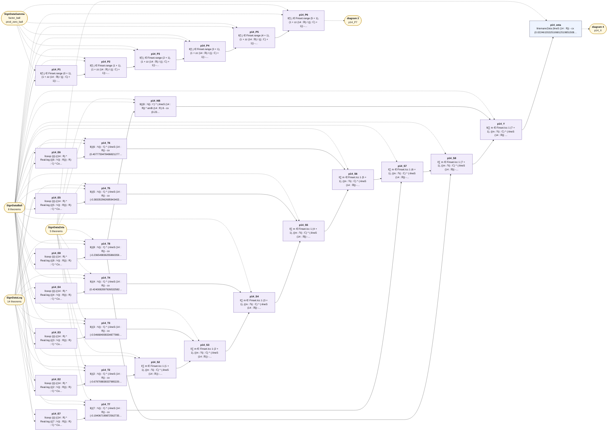
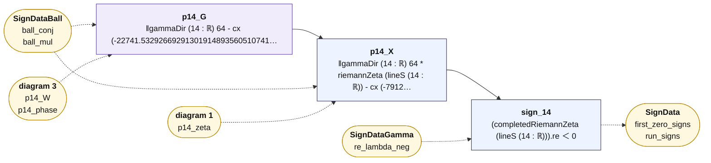

# `lean_stage3/Stage3/SignDataPt14.lean`

> **Read from the source text.** This file changed after the last `python3 utilities/lean_map.py --dump`, so the arrows on this page are names occurring in each proof and have not been confirmed by Lean.

SignDataPt14 — block S14 of `lean_stage3/design/stencil.md`, Turing's sign data: the sign of `Re Λ(1/2 + it)` at `t = 14.0`. 2026-11-25. Generated by `lean_stage3/checks/signdata/gen_signdata.py`; do not edit by hand.

93 theorems, 0 definitions, 497 lines. 

**Imports:** [`SignDataGamma`](../lean_stage3/SignDataGamma.md), [`SignDataLog`](../lean_stage3/SignDataLog.md)  
**Imported by:** [`SignData`](../lean_stage3/SignData.md)

## The picture

### Diagram 1 of 4: `p14_E2` to `p14_P6`



### Diagram 2 of 4: `p14_P7` to `p14_P36`

```mermaid
flowchart LR
  n0["<b>p14_P7</b><br/>‖∏ j ∈ Finset.range (6 + 1), (1 + zz (14 : ℝ) / ((j : ℂ) + 1)) -…"]:::shp
  n1["<b>p14_P8</b><br/>‖∏ j ∈ Finset.range (7 + 1), (1 + zz (14 : ℝ) / ((j : ℂ) + 1)) -…"]:::shp
  n2["<b>p14_P9</b><br/>‖∏ j ∈ Finset.range (8 + 1), (1 + zz (14 : ℝ) / ((j : ℂ) + 1)) -…"]:::shp
  n3["<b>p14_P10</b><br/>‖∏ j ∈ Finset.range (9 + 1), (1 + zz (14 : ℝ) / ((j : ℂ) + 1)) -…"]:::shp
  n4["<b>p14_P11</b><br/>‖∏ j ∈ Finset.range (10 + 1), (1 + zz (14 : ℝ) / ((j : ℂ) + 1)) …"]:::shp
  n5["<b>p14_P12</b><br/>‖∏ j ∈ Finset.range (11 + 1), (1 + zz (14 : ℝ) / ((j : ℂ) + 1)) …"]:::shp
  n6["<b>p14_P13</b><br/>‖∏ j ∈ Finset.range (12 + 1), (1 + zz (14 : ℝ) / ((j : ℂ) + 1)) …"]:::shp
  n7["<b>p14_P14</b><br/>‖∏ j ∈ Finset.range (13 + 1), (1 + zz (14 : ℝ) / ((j : ℂ) + 1)) …"]:::shp
  n8["<b>p14_P15</b><br/>‖∏ j ∈ Finset.range (14 + 1), (1 + zz (14 : ℝ) / ((j : ℂ) + 1)) …"]:::shp
  n9["<b>p14_P16</b><br/>‖∏ j ∈ Finset.range (15 + 1), (1 + zz (14 : ℝ) / ((j : ℂ) + 1)) …"]:::shp
  n10["<b>p14_P17</b><br/>‖∏ j ∈ Finset.range (16 + 1), (1 + zz (14 : ℝ) / ((j : ℂ) + 1)) …"]:::shp
  n11["<b>p14_P18</b><br/>‖∏ j ∈ Finset.range (17 + 1), (1 + zz (14 : ℝ) / ((j : ℂ) + 1)) …"]:::shp
  n12["<b>p14_P19</b><br/>‖∏ j ∈ Finset.range (18 + 1), (1 + zz (14 : ℝ) / ((j : ℂ) + 1)) …"]:::shp
  n13["<b>p14_P20</b><br/>‖∏ j ∈ Finset.range (19 + 1), (1 + zz (14 : ℝ) / ((j : ℂ) + 1)) …"]:::shp
  n14["<b>p14_P21</b><br/>‖∏ j ∈ Finset.range (20 + 1), (1 + zz (14 : ℝ) / ((j : ℂ) + 1)) …"]:::shp
  n15["<b>p14_P22</b><br/>‖∏ j ∈ Finset.range (21 + 1), (1 + zz (14 : ℝ) / ((j : ℂ) + 1)) …"]:::shp
  n16["<b>p14_P23</b><br/>‖∏ j ∈ Finset.range (22 + 1), (1 + zz (14 : ℝ) / ((j : ℂ) + 1)) …"]:::shp
  n17["<b>p14_P24</b><br/>‖∏ j ∈ Finset.range (23 + 1), (1 + zz (14 : ℝ) / ((j : ℂ) + 1)) …"]:::shp
  n18["<b>p14_P25</b><br/>‖∏ j ∈ Finset.range (24 + 1), (1 + zz (14 : ℝ) / ((j : ℂ) + 1)) …"]:::shp
  n19["<b>p14_P26</b><br/>‖∏ j ∈ Finset.range (25 + 1), (1 + zz (14 : ℝ) / ((j : ℂ) + 1)) …"]:::shp
  n20["<b>p14_P27</b><br/>‖∏ j ∈ Finset.range (26 + 1), (1 + zz (14 : ℝ) / ((j : ℂ) + 1)) …"]:::shp
  n21["<b>p14_P28</b><br/>‖∏ j ∈ Finset.range (27 + 1), (1 + zz (14 : ℝ) / ((j : ℂ) + 1)) …"]:::shp
  n22["<b>p14_P29</b><br/>‖∏ j ∈ Finset.range (28 + 1), (1 + zz (14 : ℝ) / ((j : ℂ) + 1)) …"]:::shp
  n23["<b>p14_P30</b><br/>‖∏ j ∈ Finset.range (29 + 1), (1 + zz (14 : ℝ) / ((j : ℂ) + 1)) …"]:::shp
  n24["<b>p14_P31</b><br/>‖∏ j ∈ Finset.range (30 + 1), (1 + zz (14 : ℝ) / ((j : ℂ) + 1)) …"]:::shp
  n25["<b>p14_P32</b><br/>‖∏ j ∈ Finset.range (31 + 1), (1 + zz (14 : ℝ) / ((j : ℂ) + 1)) …"]:::shp
  n26["<b>p14_P33</b><br/>‖∏ j ∈ Finset.range (32 + 1), (1 + zz (14 : ℝ) / ((j : ℂ) + 1)) …"]:::shp
  n27["<b>p14_P34</b><br/>‖∏ j ∈ Finset.range (33 + 1), (1 + zz (14 : ℝ) / ((j : ℂ) + 1)) …"]:::shp
  n28["<b>p14_P35</b><br/>‖∏ j ∈ Finset.range (34 + 1), (1 + zz (14 : ℝ) / ((j : ℂ) + 1)) …"]:::shp
  n29["<b>p14_P36</b><br/>‖∏ j ∈ Finset.range (35 + 1), (1 + zz (14 : ℝ) / ((j : ℂ) + 1)) …"]:::shp
  x0(["<b>SignDataBall</b><br/>ball_mul"]):::ext
  x1(["<b>SignDataGamma</b><br/>factor_ball"]):::ext
  x2(["<b>diagram 1</b><br/>p14_P6"]):::ext
  x3(["<b>diagram 3</b><br/>p14_P37"]):::ext
  n0 --> n1
  n1 --> n2
  n10 --> n11
  n11 --> n12
  n12 --> n13
  n13 --> n14
  n14 --> n15
  n15 --> n16
  n16 --> n17
  n17 --> n18
  n18 --> n19
  n19 --> n20
  n2 --> n3
  n20 --> n21
  n21 --> n22
  n22 --> n23
  n23 --> n24
  n24 --> n25
  n25 --> n26
  n26 --> n27
  n27 --> n28
  n28 --> n29
  n3 --> n4
  n4 --> n5
  n5 --> n6
  n6 --> n7
  n7 --> n8
  n8 --> n9
  n9 --> n10
  n29 -.-> x3
  x0 -.-> n0
  x0 -.-> n1
  x0 -.-> n10
  x0 -.-> n11
  x0 -.-> n12
  x0 -.-> n13
  x0 -.-> n14
  x0 -.-> n15
  x0 -.-> n16
  x0 -.-> n17
  x0 -.-> n18
  x0 -.-> n19
  x0 -.-> n2
  x0 -.-> n20
  x0 -.-> n21
  x0 -.-> n22
  x0 -.-> n23
  x0 -.-> n24
  x0 -.-> n25
  x0 -.-> n26
  x0 -.-> n27
  x0 -.-> n28
  x0 -.-> n29
  x0 -.-> n3
  x0 -.-> n4
  x0 -.-> n5
  x0 -.-> n6
  x0 -.-> n7
  x0 -.-> n8
  x0 -.-> n9
  x1 -.-> n0
  x1 -.-> n1
  x1 -.-> n10
  x1 -.-> n11
  x1 -.-> n12
  x1 -.-> n13
  x1 -.-> n14
  x1 -.-> n15
  x1 -.-> n16
  x1 -.-> n17
  x1 -.-> n18
  x1 -.-> n19
  x1 -.-> n2
  x1 -.-> n20
  x1 -.-> n21
  x1 -.-> n22
  x1 -.-> n23
  x1 -.-> n24
  x1 -.-> n25
  x1 -.-> n26
  x1 -.-> n27
  x1 -.-> n28
  x1 -.-> n29
  x1 -.-> n3
  x1 -.-> n4
  x1 -.-> n5
  x1 -.-> n6
  x1 -.-> n7
  x1 -.-> n8
  x1 -.-> n9
  x2 -.-> n0
  classDef cnt fill:#dff5ec,stroke:#17694a,color:#111
  classDef shp fill:#f1ecfb,stroke:#5b3fa0,color:#111
  classDef rh fill:#ffe5e5,stroke:#c22,color:#111,stroke-width:2px
  classDef thm fill:#eef4ff,stroke:#335,color:#111
  classDef end_ fill:#e7f7e7,stroke:#2a7,color:#111,stroke-width:2px
  classDef lone fill:#fff,stroke:#999,color:#111,stroke-dasharray:4 3
  classDef bad fill:#ffe5e5,stroke:#c22,color:#111,stroke-width:2px
  classDef ext fill:#fff8e1,stroke:#b80,color:#111
```



### Diagram 3 of 4: `p14_P37` to `p14_phase`

```mermaid
flowchart LR
  n0["<b>p14_P37</b><br/>‖∏ j ∈ Finset.range (36 + 1), (1 + zz (14 : ℝ) / ((j : ℂ) + 1)) …"]:::shp
  n1["<b>p14_P38</b><br/>‖∏ j ∈ Finset.range (37 + 1), (1 + zz (14 : ℝ) / ((j : ℂ) + 1)) …"]:::shp
  n2["<b>p14_P39</b><br/>‖∏ j ∈ Finset.range (38 + 1), (1 + zz (14 : ℝ) / ((j : ℂ) + 1)) …"]:::shp
  n3["<b>p14_P40</b><br/>‖∏ j ∈ Finset.range (39 + 1), (1 + zz (14 : ℝ) / ((j : ℂ) + 1)) …"]:::shp
  n4["<b>p14_P41</b><br/>‖∏ j ∈ Finset.range (40 + 1), (1 + zz (14 : ℝ) / ((j : ℂ) + 1)) …"]:::shp
  n5["<b>p14_P42</b><br/>‖∏ j ∈ Finset.range (41 + 1), (1 + zz (14 : ℝ) / ((j : ℂ) + 1)) …"]:::shp
  n6["<b>p14_P43</b><br/>‖∏ j ∈ Finset.range (42 + 1), (1 + zz (14 : ℝ) / ((j : ℂ) + 1)) …"]:::shp
  n7["<b>p14_P44</b><br/>‖∏ j ∈ Finset.range (43 + 1), (1 + zz (14 : ℝ) / ((j : ℂ) + 1)) …"]:::shp
  n8["<b>p14_P45</b><br/>‖∏ j ∈ Finset.range (44 + 1), (1 + zz (14 : ℝ) / ((j : ℂ) + 1)) …"]:::shp
  n9["<b>p14_P46</b><br/>‖∏ j ∈ Finset.range (45 + 1), (1 + zz (14 : ℝ) / ((j : ℂ) + 1)) …"]:::shp
  n10["<b>p14_P47</b><br/>‖∏ j ∈ Finset.range (46 + 1), (1 + zz (14 : ℝ) / ((j : ℂ) + 1)) …"]:::shp
  n11["<b>p14_P48</b><br/>‖∏ j ∈ Finset.range (47 + 1), (1 + zz (14 : ℝ) / ((j : ℂ) + 1)) …"]:::shp
  n12["<b>p14_P49</b><br/>‖∏ j ∈ Finset.range (48 + 1), (1 + zz (14 : ℝ) / ((j : ℂ) + 1)) …"]:::shp
  n13["<b>p14_P50</b><br/>‖∏ j ∈ Finset.range (49 + 1), (1 + zz (14 : ℝ) / ((j : ℂ) + 1)) …"]:::shp
  n14["<b>p14_P51</b><br/>‖∏ j ∈ Finset.range (50 + 1), (1 + zz (14 : ℝ) / ((j : ℂ) + 1)) …"]:::shp
  n15["<b>p14_P52</b><br/>‖∏ j ∈ Finset.range (51 + 1), (1 + zz (14 : ℝ) / ((j : ℂ) + 1)) …"]:::shp
  n16["<b>p14_P53</b><br/>‖∏ j ∈ Finset.range (52 + 1), (1 + zz (14 : ℝ) / ((j : ℂ) + 1)) …"]:::shp
  n17["<b>p14_P54</b><br/>‖∏ j ∈ Finset.range (53 + 1), (1 + zz (14 : ℝ) / ((j : ℂ) + 1)) …"]:::shp
  n18["<b>p14_P55</b><br/>‖∏ j ∈ Finset.range (54 + 1), (1 + zz (14 : ℝ) / ((j : ℂ) + 1)) …"]:::shp
  n19["<b>p14_P56</b><br/>‖∏ j ∈ Finset.range (55 + 1), (1 + zz (14 : ℝ) / ((j : ℂ) + 1)) …"]:::shp
  n20["<b>p14_P57</b><br/>‖∏ j ∈ Finset.range (56 + 1), (1 + zz (14 : ℝ) / ((j : ℂ) + 1)) …"]:::shp
  n21["<b>p14_P58</b><br/>‖∏ j ∈ Finset.range (57 + 1), (1 + zz (14 : ℝ) / ((j : ℂ) + 1)) …"]:::shp
  n22["<b>p14_P59</b><br/>‖∏ j ∈ Finset.range (58 + 1), (1 + zz (14 : ℝ) / ((j : ℂ) + 1)) …"]:::shp
  n23["<b>p14_P60</b><br/>‖∏ j ∈ Finset.range (59 + 1), (1 + zz (14 : ℝ) / ((j : ℂ) + 1)) …"]:::shp
  n24["<b>p14_P61</b><br/>‖∏ j ∈ Finset.range (60 + 1), (1 + zz (14 : ℝ) / ((j : ℂ) + 1)) …"]:::shp
  n25["<b>p14_P62</b><br/>‖∏ j ∈ Finset.range (61 + 1), (1 + zz (14 : ℝ) / ((j : ℂ) + 1)) …"]:::shp
  n26["<b>p14_P63</b><br/>‖∏ j ∈ Finset.range (62 + 1), (1 + zz (14 : ℝ) / ((j : ℂ) + 1)) …"]:::shp
  n27["<b>p14_P64</b><br/>‖∏ j ∈ Finset.range (63 + 1), (1 + zz (14 : ℝ) / ((j : ℂ) + 1)) …"]:::shp
  n28["<b>p14_W</b><br/>‖zz (14 : ℝ) * ∏ j ∈ Finset.range (63 + 1), (1 + zz (14 : ℝ) / (…"]:::shp
  n29["<b>p14_phase</b><br/>‖cexp (((((14 : ℝ) / 2) * (Real.log (((64 : ℕ)) : ℝ) - Real.log …"]:::shp
  x0(["<b>SignDataBall</b><br/>ball_mul<br/>exp_ball1<br/>phase_ball"]):::ext
  x1(["<b>SignDataGamma</b><br/>factor_ball<br/>zz_ball"]):::ext
  x2(["<b>diagram 2</b><br/>p14_P36"]):::ext
  x3(["<b>diagram 4</b><br/>p14_G"]):::ext
  x4(["<b>SignDataLog</b><br/>log_pi_ball'<br/>log_pow2_ball_64"]):::ext
  n0 --> n1
  n1 --> n2
  n10 --> n11
  n11 --> n12
  n12 --> n13
  n13 --> n14
  n14 --> n15
  n15 --> n16
  n16 --> n17
  n17 --> n18
  n18 --> n19
  n19 --> n20
  n2 --> n3
  n20 --> n21
  n21 --> n22
  n22 --> n23
  n23 --> n24
  n24 --> n25
  n25 --> n26
  n26 --> n27
  n27 --> n28
  n3 --> n4
  n4 --> n5
  n5 --> n6
  n6 --> n7
  n7 --> n8
  n8 --> n9
  n9 --> n10
  n28 -.-> x3
  n29 -.-> x3
  x0 -.-> n0
  x0 -.-> n1
  x0 -.-> n10
  x0 -.-> n11
  x0 -.-> n12
  x0 -.-> n13
  x0 -.-> n14
  x0 -.-> n15
  x0 -.-> n16
  x0 -.-> n17
  x0 -.-> n18
  x0 -.-> n19
  x0 -.-> n2
  x0 -.-> n20
  x0 -.-> n21
  x0 -.-> n22
  x0 -.-> n23
  x0 -.-> n24
  x0 -.-> n25
  x0 -.-> n26
  x0 -.-> n27
  x0 -.-> n28
  x0 -.-> n29
  x0 -.-> n3
  x0 -.-> n4
  x0 -.-> n5
  x0 -.-> n6
  x0 -.-> n7
  x0 -.-> n8
  x0 -.-> n9
  x1 -.-> n0
  x1 -.-> n1
  x1 -.-> n10
  x1 -.-> n11
  x1 -.-> n12
  x1 -.-> n13
  x1 -.-> n14
  x1 -.-> n15
  x1 -.-> n16
  x1 -.-> n17
  x1 -.-> n18
  x1 -.-> n19
  x1 -.-> n2
  x1 -.-> n20
  x1 -.-> n21
  x1 -.-> n22
  x1 -.-> n23
  x1 -.-> n24
  x1 -.-> n25
  x1 -.-> n26
  x1 -.-> n27
  x1 -.-> n28
  x1 -.-> n3
  x1 -.-> n4
  x1 -.-> n5
  x1 -.-> n6
  x1 -.-> n7
  x1 -.-> n8
  x1 -.-> n9
  x2 -.-> n0
  x4 -.-> n29
  classDef cnt fill:#dff5ec,stroke:#17694a,color:#111
  classDef shp fill:#f1ecfb,stroke:#5b3fa0,color:#111
  classDef rh fill:#ffe5e5,stroke:#c22,color:#111,stroke-width:2px
  classDef thm fill:#eef4ff,stroke:#335,color:#111
  classDef end_ fill:#e7f7e7,stroke:#2a7,color:#111,stroke-width:2px
  classDef lone fill:#fff,stroke:#999,color:#111,stroke-dasharray:4 3
  classDef bad fill:#ffe5e5,stroke:#c22,color:#111,stroke-width:2px
  classDef ext fill:#fff8e1,stroke:#b80,color:#111
```



### Diagram 4 of 4: `p14_G` to `sign_14`



An arrow A → B reads "A is used in the proof of B". Green: counting, integers only. Violet: shape, analysis with no ζ. Blue: reads ζ. A name ending in ■ is an end: nothing else uses it. Red: contains `sorry`. Yellow: theorems in another file, counted; a dotted arrow crosses files. Definitions are not drawn; they are listed below the diagram.

## Theorems

<a name="SignData-p14_E2"></a>
### `SignData.p14_E2`

line 31 · arrows read from text

**Shape.** Uses real or complex analysis; nothing in it or beneath it reads ζ.

**Proves**

```lean
‖cexp ((((-((14 : ℝ) * Real.log (((2 : ℕ)) : ℝ))) : ℝ) : ℂ) * Complex.I) - cx (-(0.961253457642440241181855761014)) (-(-0.275666084548776774407564327852))‖ ≤ (0.000000003500000000030000000004)
```

**Fed by** (3 theorems its proof uses)

  - [`SignData.exp_ball2`](../lean_stage3/SignDataBall.md#SignData-exp_ball2) (SignDataBall) — `` ‖cexp ((x : ℂ) * I) - cx (-e) (-f)‖ ≤ R ``
  - [`SignData.neg_mul_ball`](../lean_stage3/SignDataBall.md#SignData-neg_mul_ball) (SignDataBall) — `` |-(t * x) - -(t * a)| ≤ |t| * e ``
  - [`SignData.log_ball_2`](../lean_stage3/SignDataLog.md#SignData-log_ball_2) (SignDataLog) — `` |Real.log ((2 : ℕ) : ℝ) - (0.69314718055)| ≤ (0.00000000025) ``

**Definitions its proof touches:** [`SignData.cosP`](../lean_stage3/SignDataBall.md#SignData-cosP), [`SignData.cx`](../lean_stage3/SignDataBall.md#SignData-cx), [`SignData.sinP`](../lean_stage3/SignDataBall.md#SignData-sinP)

**Feeds** (1 that use it)

  - [`SignData.p14_T2`](#SignData-p14_T2) — `` ‖(((2 : ℕ)) : ℂ) ^ (-lineS (14 : ℝ)) - cx (-0.679708838337985220771914796136) (0.194925357727584208072744154227)‖ ≤ (0.000000002474873734174129538843) ``

<a name="SignData-p14_T2"></a>
### `SignData.p14_T2`

line 37 · arrows read from text

**Shape.** Uses real or complex analysis; nothing in it or beneath it reads ζ.

**Proves**

```lean
‖(((2 : ℕ)) : ℂ) ^ (-lineS (14 : ℝ)) - cx (-0.679708838337985220771914796136) (0.194925357727584208072744154227)‖ ≤ (0.000000002474873734174129538843)
```

**Fed by** (5 theorems its proof uses)

  - [`SignData.ball_mul`](../lean_stage3/SignDataBall.md#SignData-ball_mul) (SignDataBall) — `` ‖z * w - cx e f‖ ≤ R ``
  - [`SignData.ball_ofReal`](../lean_stage3/SignDataBall.md#SignData-ball_ofReal) (SignDataBall) — `` ‖(x : ℂ) - cx c 0‖ ≤ e ``
  - [`SignData.isqrt_ball_2`](../lean_stage3/SignDataLog.md#SignData-isqrt_ball_2) (SignDataLog) — `` |(Real.sqrt (((2 : ℕ)) : ℝ))⁻¹ - (0.707106781186547524400844362104)| ≤ (0.000000000000000000000000000001) ``
  - [`SignData.p14_E2`](#SignData-p14_E2) — `` ‖cexp ((((-((14 : ℝ) * Real.log (((2 : ℕ)) : ℝ))) : ℝ) : ℂ) * Complex.I) - cx (-(0.961253457642440241181855761014)) (-(-0.2756660845487767744075643278… ``
  - [`SignData.natCast_cpow_line`](../lean_stage3/SignDataZeta.md#SignData-natCast_cpow_line) (SignDataZeta) — `` (m : ℂ) ^ (-lineS t) = (((Real.sqrt m)⁻¹ : ℝ) : ℂ) * cexp (((-(t * Real.log m)) : ℝ) * I) ``

**Definitions its proof touches:** [`SignData.cx`](../lean_stage3/SignDataBall.md#SignData-cx), [`SignData.lineS`](../lean_stage3/SignDataZeta.md#SignData-lineS)

**Feeds** (1 that use it)

  - [`SignData.p14_S2`](#SignData-p14_S2) — `` ‖∑ m ∈ Finset.Icc 1 (1 + 1), ((m : ℕ) : ℂ) ^ (-lineS (14 : ℝ)) - cx (0.320291161662014779228085203864) (0.194925357727584208072744154227)‖ ≤ (0.000000… ``

<a name="SignData-p14_E3"></a>
### `SignData.p14_E3`

line 41 · arrows read from text

**Shape.** Uses real or complex analysis; nothing in it or beneath it reads ζ.

**Proves**

```lean
‖cexp ((((-((14 : ℝ) * Real.log (((3 : ℕ)) : ℝ))) : ℝ) : ℂ) * Complex.I) - cx (-(0.94688447812141625126363548568)) (-(0.321573918551758778340741691955))‖ ≤ (0.000000003500101995704248640459)
```

**Fed by** (3 theorems its proof uses)

  - [`SignData.exp_ball2`](../lean_stage3/SignDataBall.md#SignData-exp_ball2) (SignDataBall) — `` ‖cexp ((x : ℂ) * I) - cx (-e) (-f)‖ ≤ R ``
  - [`SignData.neg_mul_ball`](../lean_stage3/SignDataBall.md#SignData-neg_mul_ball) (SignDataBall) — `` |-(t * x) - -(t * a)| ≤ |t| * e ``
  - [`SignData.log_ball_3`](../lean_stage3/SignDataLog.md#SignData-log_ball_3) (SignDataLog) — `` |Real.log (((3 : ℕ)) : ℝ) - (1.098612288658164142930964760306)| ≤ (0.000000000250007285403624428292) ``

**Definitions its proof touches:** [`SignData.cosP`](../lean_stage3/SignDataBall.md#SignData-cosP), [`SignData.cx`](../lean_stage3/SignDataBall.md#SignData-cx), [`SignData.sinP`](../lean_stage3/SignDataBall.md#SignData-sinP)

**Feeds** (1 that use it)

  - [`SignData.p14_T3`](#SignData-p14_T3) — `` ‖(((3 : ℕ)) : ℂ) ^ (-lineS (14 : ℝ)) - cx (-0.546684008334877980393651456295) (-0.185660788440220721249718589868)‖ ≤ (0.000000002020784829410994313809… ``

<a name="SignData-p14_T3"></a>
### `SignData.p14_T3`

line 47 · arrows read from text

**Shape.** Uses real or complex analysis; nothing in it or beneath it reads ζ.

**Proves**

```lean
‖(((3 : ℕ)) : ℂ) ^ (-lineS (14 : ℝ)) - cx (-0.546684008334877980393651456295) (-0.185660788440220721249718589868)‖ ≤ (0.000000002020784829410994313809)
```

**Fed by** (5 theorems its proof uses)

  - [`SignData.ball_mul`](../lean_stage3/SignDataBall.md#SignData-ball_mul) (SignDataBall) — `` ‖z * w - cx e f‖ ≤ R ``
  - [`SignData.ball_ofReal`](../lean_stage3/SignDataBall.md#SignData-ball_ofReal) (SignDataBall) — `` ‖(x : ℂ) - cx c 0‖ ≤ e ``
  - [`SignData.isqrt_ball_3`](../lean_stage3/SignDataLog.md#SignData-isqrt_ball_3) (SignDataLog) — `` |(Real.sqrt (((3 : ℕ)) : ℝ))⁻¹ - (0.577350269189625764509148780502)| ≤ (0.000000000000000000000000000001) ``
  - [`SignData.p14_E3`](#SignData-p14_E3) — `` ‖cexp ((((-((14 : ℝ) * Real.log (((3 : ℕ)) : ℝ))) : ℝ) : ℂ) * Complex.I) - cx (-(0.94688447812141625126363548568)) (-(0.321573918551758778340741691955… ``
  - [`SignData.natCast_cpow_line`](../lean_stage3/SignDataZeta.md#SignData-natCast_cpow_line) (SignDataZeta) — `` (m : ℂ) ^ (-lineS t) = (((Real.sqrt m)⁻¹ : ℝ) : ℂ) * cexp (((-(t * Real.log m)) : ℝ) * I) ``

**Definitions its proof touches:** [`SignData.cx`](../lean_stage3/SignDataBall.md#SignData-cx), [`SignData.lineS`](../lean_stage3/SignDataZeta.md#SignData-lineS)

**Feeds** (1 that use it)

  - [`SignData.p14_S3`](#SignData-p14_S3) — `` ‖∑ m ∈ Finset.Icc 1 (2 + 1), ((m : ℕ) : ℂ) ^ (-lineS (14 : ℝ)) - cx (-0.226392846672863201165566252431) (0.009264569287363486823025564359)‖ ≤ (0.00000… ``

<a name="SignData-p14_E4"></a>
### `SignData.p14_E4`

line 51 · arrows read from text

**Shape.** Uses real or complex analysis; nothing in it or beneath it reads ζ.

**Proves**

```lean
‖cexp ((((-((14 : ℝ) * Real.log (((4 : ℕ)) : ℝ))) : ℝ) : ℂ) * Complex.I) - cx (0.84801641958530651641591672347) (-0.52996995397259773949362267018)‖ ≤ (0.000000003500168313035250321374)
```

**Fed by** (3 theorems its proof uses)

  - [`SignData.exp_ball0`](../lean_stage3/SignDataBall.md#SignData-exp_ball0) (SignDataBall) — `` ‖cexp ((x : ℂ) * I) - cx e f‖ ≤ R ``
  - [`SignData.neg_mul_ball`](../lean_stage3/SignDataBall.md#SignData-neg_mul_ball) (SignDataBall) — `` |-(t * x) - -(t * a)| ≤ |t| * e ``
  - [`SignData.log_ball_4`](../lean_stage3/SignDataLog.md#SignData-log_ball_4) (SignDataLog) — `` |Real.log (((4 : ℕ)) : ℝ) - (1.386294361109944875563750019823)| ≤ (0.000000000250012022355196162294) ``

**Definitions its proof touches:** [`SignData.cosP`](../lean_stage3/SignDataBall.md#SignData-cosP), [`SignData.cx`](../lean_stage3/SignDataBall.md#SignData-cx), [`SignData.sinP`](../lean_stage3/SignDataBall.md#SignData-sinP)

**Feeds** (1 that use it)

  - [`SignData.p14_T4`](#SignData-p14_T4) — `` ‖(((4 : ℕ)) : ℂ) ^ (-lineS (14 : ℝ)) - cx (0.424008209792653258207958361735) (-0.26498497698629886974681133509)‖ ≤ (0.000000001750084156517625160689) ``

<a name="SignData-p14_T4"></a>
### `SignData.p14_T4`

line 57 · arrows read from text

**Shape.** Uses real or complex analysis; nothing in it or beneath it reads ζ.

**Proves**

```lean
‖(((4 : ℕ)) : ℂ) ^ (-lineS (14 : ℝ)) - cx (0.424008209792653258207958361735) (-0.26498497698629886974681133509)‖ ≤ (0.000000001750084156517625160689)
```

**Fed by** (5 theorems its proof uses)

  - [`SignData.ball_mul`](../lean_stage3/SignDataBall.md#SignData-ball_mul) (SignDataBall) — `` ‖z * w - cx e f‖ ≤ R ``
  - [`SignData.ball_ofReal`](../lean_stage3/SignDataBall.md#SignData-ball_ofReal) (SignDataBall) — `` ‖(x : ℂ) - cx c 0‖ ≤ e ``
  - [`SignData.isqrt_ball_4`](../lean_stage3/SignDataLog.md#SignData-isqrt_ball_4) (SignDataLog) — `` |(Real.sqrt (((4 : ℕ)) : ℝ))⁻¹ - (0.5)| ≤ (0.000000000000000000000000000001) ``
  - [`SignData.p14_E4`](#SignData-p14_E4) — `` ‖cexp ((((-((14 : ℝ) * Real.log (((4 : ℕ)) : ℝ))) : ℝ) : ℂ) * Complex.I) - cx (0.84801641958530651641591672347) (-0.52996995397259773949362267018)‖ ≤ … ``
  - [`SignData.natCast_cpow_line`](../lean_stage3/SignDataZeta.md#SignData-natCast_cpow_line) (SignDataZeta) — `` (m : ℂ) ^ (-lineS t) = (((Real.sqrt m)⁻¹ : ℝ) : ℂ) * cexp (((-(t * Real.log m)) : ℝ) * I) ``

**Definitions its proof touches:** [`SignData.cx`](../lean_stage3/SignDataBall.md#SignData-cx), [`SignData.lineS`](../lean_stage3/SignDataZeta.md#SignData-lineS)

**Feeds** (1 that use it)

  - [`SignData.p14_S4`](#SignData-p14_S4) — `` ‖∑ m ∈ Finset.Icc 1 (3 + 1), ((m : ℕ) : ℂ) ^ (-lineS (14 : ℝ)) - cx (0.197615363119790057042392109304) (-0.255720407698935382923785770731)‖ ≤ (0.00000… ``

<a name="SignData-p14_E5"></a>
### `SignData.p14_E5`

line 61 · arrows read from text

**Shape.** Uses real or complex analysis; nothing in it or beneath it reads ζ.

**Proves**

```lean
‖cexp ((((-((14 : ℝ) * Real.log (((5 : ℕ)) : ℝ))) : ℝ) : ℂ) * Complex.I) - cx (-(0.857203283964070490032921983389)) (-(-0.514978183966285247405887299478))‖ ≤ (0.000000003500205013207357487558)
```

**Fed by** (3 theorems its proof uses)

  - [`SignData.exp_ball2`](../lean_stage3/SignDataBall.md#SignData-exp_ball2) (SignDataBall) — `` ‖cexp ((x : ℂ) * I) - cx (-e) (-f)‖ ≤ R ``
  - [`SignData.neg_mul_ball`](../lean_stage3/SignDataBall.md#SignData-neg_mul_ball) (SignDataBall) — `` |-(t * x) - -(t * a)| ≤ |t| * e ``
  - [`SignData.log_ball_5`](../lean_stage3/SignDataLog.md#SignData-log_ball_5) (SignDataLog) — `` |Real.log (((5 : ℕ)) : ℝ) - (1.609437912424154507888186373287)| ≤ (0.000000000250014643795196162295) ``

**Definitions its proof touches:** [`SignData.cosP`](../lean_stage3/SignDataBall.md#SignData-cosP), [`SignData.cx`](../lean_stage3/SignDataBall.md#SignData-cx), [`SignData.sinP`](../lean_stage3/SignDataBall.md#SignData-sinP)

**Feeds** (1 that use it)

  - [`SignData.p14_T5`](#SignData-p14_T5) — `` ‖(((5 : ℕ)) : ℂ) ^ (-lineS (14 : ℝ)) - cx (-0.383352962695943402077332800096) (0.230305245255601215918736840507)‖ ≤ (0.000000001565339268943440107931) ``

<a name="SignData-p14_T5"></a>
### `SignData.p14_T5`

line 67 · arrows read from text

**Shape.** Uses real or complex analysis; nothing in it or beneath it reads ζ.

**Proves**

```lean
‖(((5 : ℕ)) : ℂ) ^ (-lineS (14 : ℝ)) - cx (-0.383352962695943402077332800096) (0.230305245255601215918736840507)‖ ≤ (0.000000001565339268943440107931)
```

**Fed by** (5 theorems its proof uses)

  - [`SignData.ball_mul`](../lean_stage3/SignDataBall.md#SignData-ball_mul) (SignDataBall) — `` ‖z * w - cx e f‖ ≤ R ``
  - [`SignData.ball_ofReal`](../lean_stage3/SignDataBall.md#SignData-ball_ofReal) (SignDataBall) — `` ‖(x : ℂ) - cx c 0‖ ≤ e ``
  - [`SignData.isqrt_ball_5`](../lean_stage3/SignDataLog.md#SignData-isqrt_ball_5) (SignDataLog) — `` |(Real.sqrt (((5 : ℕ)) : ℝ))⁻¹ - (0.447213595499957939281834733746)| ≤ (0.000000000000000000000000000001) ``
  - [`SignData.p14_E5`](#SignData-p14_E5) — `` ‖cexp ((((-((14 : ℝ) * Real.log (((5 : ℕ)) : ℝ))) : ℝ) : ℂ) * Complex.I) - cx (-(0.857203283964070490032921983389)) (-(-0.5149781839662852474058872994… ``
  - [`SignData.natCast_cpow_line`](../lean_stage3/SignDataZeta.md#SignData-natCast_cpow_line) (SignDataZeta) — `` (m : ℂ) ^ (-lineS t) = (((Real.sqrt m)⁻¹ : ℝ) : ℂ) * cexp (((-(t * Real.log m)) : ℝ) * I) ``

**Definitions its proof touches:** [`SignData.cx`](../lean_stage3/SignDataBall.md#SignData-cx), [`SignData.lineS`](../lean_stage3/SignDataZeta.md#SignData-lineS)

**Feeds** (1 that use it)

  - [`SignData.p14_S5`](#SignData-p14_S5) — `` ‖∑ m ∈ Finset.Icc 1 (4 + 1), ((m : ℕ) : ℂ) ^ (-lineS (14 : ℝ)) - cx (-0.185737599576153345034940690792) (-0.025415162443334167005048930224)‖ ≤ (0.0000… ``

<a name="SignData-p14_E6"></a>
### `SignData.p14_E6`

line 71 · arrows read from text

**Shape.** Uses real or complex analysis; nothing in it or beneath it reads ζ.

**Proves**

```lean
‖cexp ((((-((14 : ℝ) * Real.log (((6 : ℕ)) : ℝ))) : ℝ) : ℂ) * Complex.I) - cx (0.998843001609035031450064349163) (0.048090104352696528263467439119)‖ ≤ (0.000000003500232583135481826627)
```

**Fed by** (3 theorems its proof uses)

  - [`SignData.exp_ball0`](../lean_stage3/SignDataBall.md#SignData-exp_ball0) (SignDataBall) — `` ‖cexp ((x : ℂ) * I) - cx e f‖ ≤ R ``
  - [`SignData.neg_mul_ball`](../lean_stage3/SignDataBall.md#SignData-neg_mul_ball) (SignDataBall) — `` |-(t * x) - -(t * a)| ≤ |t| * e ``
  - [`SignData.log_ball_6`](../lean_stage3/SignDataLog.md#SignData-log_ball_6) (SignDataLog) — `` |Real.log (((6 : ℕ)) : ℝ) - (1.791759469218109031470825672761)| ≤ (0.000000000250016613075280171998) ``

**Definitions its proof touches:** [`SignData.cosP`](../lean_stage3/SignDataBall.md#SignData-cosP), [`SignData.cx`](../lean_stage3/SignDataBall.md#SignData-cx), [`SignData.sinP`](../lean_stage3/SignDataBall.md#SignData-sinP)

**Feeds** (1 that use it)

  - [`SignData.p14_T6`](#SignData-p14_T6) — `` ‖(((6 : ℕ)) : ℂ) ^ (-lineS (14 : ℝ)) - cx (0.407775947848682127742235136901) (0.019632702890217135414905060898)‖ ≤ (0.000000001428963968290971738045) ``

<a name="SignData-p14_T6"></a>
### `SignData.p14_T6`

line 77 · arrows read from text

**Shape.** Uses real or complex analysis; nothing in it or beneath it reads ζ.

**Proves**

```lean
‖(((6 : ℕ)) : ℂ) ^ (-lineS (14 : ℝ)) - cx (0.407775947848682127742235136901) (0.019632702890217135414905060898)‖ ≤ (0.000000001428963968290971738045)
```

**Fed by** (5 theorems its proof uses)

  - [`SignData.ball_mul`](../lean_stage3/SignDataBall.md#SignData-ball_mul) (SignDataBall) — `` ‖z * w - cx e f‖ ≤ R ``
  - [`SignData.ball_ofReal`](../lean_stage3/SignDataBall.md#SignData-ball_ofReal) (SignDataBall) — `` ‖(x : ℂ) - cx c 0‖ ≤ e ``
  - [`SignData.isqrt_ball_6`](../lean_stage3/SignDataLog.md#SignData-isqrt_ball_6) (SignDataLog) — `` |(Real.sqrt (((6 : ℕ)) : ℝ))⁻¹ - (0.40824829046386301636621401245)| ≤ (0.000000000000000000000000000001) ``
  - [`SignData.p14_E6`](#SignData-p14_E6) — `` ‖cexp ((((-((14 : ℝ) * Real.log (((6 : ℕ)) : ℝ))) : ℝ) : ℂ) * Complex.I) - cx (0.998843001609035031450064349163) (0.048090104352696528263467439119)‖ ≤… ``
  - [`SignData.natCast_cpow_line`](../lean_stage3/SignDataZeta.md#SignData-natCast_cpow_line) (SignDataZeta) — `` (m : ℂ) ^ (-lineS t) = (((Real.sqrt m)⁻¹ : ℝ) : ℂ) * cexp (((-(t * Real.log m)) : ℝ) * I) ``

**Definitions its proof touches:** [`SignData.cx`](../lean_stage3/SignDataBall.md#SignData-cx), [`SignData.lineS`](../lean_stage3/SignDataZeta.md#SignData-lineS)

**Feeds** (1 that use it)

  - [`SignData.p14_S6`](#SignData-p14_S6) — `` ‖∑ m ∈ Finset.Icc 1 (5 + 1), ((m : ℕ) : ℂ) ^ (-lineS (14 : ℝ)) - cx (0.222038348272528782707294446109) (-0.005782459553117031590143869326)‖ ≤ (0.00000… ``

<a name="SignData-p14_E7"></a>
### `SignData.p14_E7`

line 81 · arrows read from text

**Shape.** Uses real or complex analysis; nothing in it or beneath it reads ζ.

**Proves**

```lean
‖cexp ((((-((14 : ℝ) * Real.log (((7 : ℕ)) : ℝ))) : ℝ) : ℂ) * Complex.I) - cx (-0.51345354849746680672361505507) (-(0.858117389134703120953442154992))‖ ≤ (0.000000003500302794623226183751)
```

**Fed by** (3 theorems its proof uses)

  - [`SignData.exp_ball3`](../lean_stage3/SignDataBall.md#SignData-exp_ball3) (SignDataBall) — `` ‖cexp ((x : ℂ) * I) - cx f (-e)‖ ≤ R ``
  - [`SignData.neg_mul_ball`](../lean_stage3/SignDataBall.md#SignData-neg_mul_ball) (SignDataBall) — `` |-(t * x) - -(t * a)| ≤ |t| * e ``
  - [`SignData.log_ball_7`](../lean_stage3/SignDataLog.md#SignData-log_ball_7) (SignDataLog) — `` |Real.log (((7 : ℕ)) : ℝ) - (1.945910149045367043442249594592)| ≤ (0.000000000250021628181194999771) ``

**Definitions its proof touches:** [`SignData.cosP`](../lean_stage3/SignDataBall.md#SignData-cosP), [`SignData.cx`](../lean_stage3/SignDataBall.md#SignData-cx), [`SignData.sinP`](../lean_stage3/SignDataBall.md#SignData-sinP)

**Feeds** (1 that use it)

  - [`SignData.p14_T7`](#SignData-p14_T7) — `` ‖(((7 : ℕ)) : ℂ) ^ (-lineS (14 : ℝ)) - cx (-0.194067199872562735994369932836) (-0.324337886764352035248896630922)‖ ≤ (0.000000001322990101142493007309… ``

<a name="SignData-p14_T7"></a>
### `SignData.p14_T7`

line 87 · arrows read from text

**Shape.** Uses real or complex analysis; nothing in it or beneath it reads ζ.

**Proves**

```lean
‖(((7 : ℕ)) : ℂ) ^ (-lineS (14 : ℝ)) - cx (-0.194067199872562735994369932836) (-0.324337886764352035248896630922)‖ ≤ (0.000000001322990101142493007309)
```

**Fed by** (5 theorems its proof uses)

  - [`SignData.ball_mul`](../lean_stage3/SignDataBall.md#SignData-ball_mul) (SignDataBall) — `` ‖z * w - cx e f‖ ≤ R ``
  - [`SignData.ball_ofReal`](../lean_stage3/SignDataBall.md#SignData-ball_ofReal) (SignDataBall) — `` ‖(x : ℂ) - cx c 0‖ ≤ e ``
  - [`SignData.isqrt_ball_7`](../lean_stage3/SignDataLog.md#SignData-isqrt_ball_7) (SignDataLog) — `` |(Real.sqrt (((7 : ℕ)) : ℝ))⁻¹ - (0.377964473009227227214516536234)| ≤ (0.000000000000000000000000000001) ``
  - [`SignData.p14_E7`](#SignData-p14_E7) — `` ‖cexp ((((-((14 : ℝ) * Real.log (((7 : ℕ)) : ℝ))) : ℝ) : ℂ) * Complex.I) - cx (-0.51345354849746680672361505507) (-(0.858117389134703120953442154992))… ``
  - [`SignData.natCast_cpow_line`](../lean_stage3/SignDataZeta.md#SignData-natCast_cpow_line) (SignDataZeta) — `` (m : ℂ) ^ (-lineS t) = (((Real.sqrt m)⁻¹ : ℝ) : ℂ) * cexp (((-(t * Real.log m)) : ℝ) * I) ``

**Definitions its proof touches:** [`SignData.cx`](../lean_stage3/SignDataBall.md#SignData-cx), [`SignData.lineS`](../lean_stage3/SignDataZeta.md#SignData-lineS)

**Feeds** (1 that use it)

  - [`SignData.p14_S7`](#SignData-p14_S7) — `` ‖∑ m ∈ Finset.Icc 1 (6 + 1), ((m : ℕ) : ℂ) ^ (-lineS (14 : ℝ)) - cx (0.027971148399966046712924513273) (-0.330120346317469066839040500248)‖ ≤ (0.00000… ``

<a name="SignData-p14_E8"></a>
### `SignData.p14_E8`

line 91 · arrows read from text

**Shape.** Uses real or complex analysis; nothing in it or beneath it reads ζ.

**Proves**

```lean
‖cexp ((((-((14 : ℝ) * Real.log (((8 : ℕ)) : ℝ))) : ℝ) : ℂ) * Complex.I) - cx (-(0.6690639732203451906722617839)) (0.743204816816068014337900118218)‖ ≤ (0.000000003500359638053582820354)
```

**Fed by** (3 theorems its proof uses)

  - [`SignData.exp_ball1`](../lean_stage3/SignDataBall.md#SignData-exp_ball1) (SignDataBall) — `` ‖cexp ((x : ℂ) * I) - cx (-f) e‖ ≤ R ``
  - [`SignData.neg_mul_ball`](../lean_stage3/SignDataBall.md#SignData-neg_mul_ball) (SignDataBall) — `` |-(t * x) - -(t * a)| ≤ |t| * e ``
  - [`SignData.log_ball_8`](../lean_stage3/SignDataLog.md#SignData-log_ball_8) (SignDataLog) — `` |Real.log (((8 : ℕ)) : ℝ) - (2.079441541669889414922705144822)| ≤ (0.000000000250025688425399343201) ``

**Definitions its proof touches:** [`SignData.cosP`](../lean_stage3/SignDataBall.md#SignData-cosP), [`SignData.cx`](../lean_stage3/SignDataBall.md#SignData-cx), [`SignData.sinP`](../lean_stage3/SignDataBall.md#SignData-sinP)

**Feeds** (1 that use it)

  - [`SignData.p14_T8`](#SignData-p14_T8) — `` ‖(((8 : ℕ)) : ℂ) ^ (-lineS (14 : ℝ)) - cx (-0.23654983625586035967757123965) (0.262762582890573770697677455546)‖ ≤ (0.000000001237564018329688739307) ``

<a name="SignData-p14_T8"></a>
### `SignData.p14_T8`

line 97 · arrows read from text

**Shape.** Uses real or complex analysis; nothing in it or beneath it reads ζ.

**Proves**

```lean
‖(((8 : ℕ)) : ℂ) ^ (-lineS (14 : ℝ)) - cx (-0.23654983625586035967757123965) (0.262762582890573770697677455546)‖ ≤ (0.000000001237564018329688739307)
```

**Fed by** (5 theorems its proof uses)

  - [`SignData.ball_mul`](../lean_stage3/SignDataBall.md#SignData-ball_mul) (SignDataBall) — `` ‖z * w - cx e f‖ ≤ R ``
  - [`SignData.ball_ofReal`](../lean_stage3/SignDataBall.md#SignData-ball_ofReal) (SignDataBall) — `` ‖(x : ℂ) - cx c 0‖ ≤ e ``
  - [`SignData.isqrt_ball_8`](../lean_stage3/SignDataLog.md#SignData-isqrt_ball_8) (SignDataLog) — `` |(Real.sqrt (((8 : ℕ)) : ℝ))⁻¹ - (0.353553390593273762200422181052)| ≤ (0.000000000000000000000000000001) ``
  - [`SignData.p14_E8`](#SignData-p14_E8) — `` ‖cexp ((((-((14 : ℝ) * Real.log (((8 : ℕ)) : ℝ))) : ℝ) : ℂ) * Complex.I) - cx (-(0.6690639732203451906722617839)) (0.743204816816068014337900118218)‖ … ``
  - [`SignData.natCast_cpow_line`](../lean_stage3/SignDataZeta.md#SignData-natCast_cpow_line) (SignDataZeta) — `` (m : ℂ) ^ (-lineS t) = (((Real.sqrt m)⁻¹ : ℝ) : ℂ) * cexp (((-(t * Real.log m)) : ℝ) * I) ``

**Definitions its proof touches:** [`SignData.cx`](../lean_stage3/SignDataBall.md#SignData-cx), [`SignData.lineS`](../lean_stage3/SignDataZeta.md#SignData-lineS)

**Feeds** (2 that use it)

  - [`SignData.p14_NB`](#SignData-p14_NB) — `` ‖(((8 : ℕ)) : ℂ) ^ (-lineS (14 : ℝ)) * emB (14 : ℝ) 8 - cx (0.231040241106962438163161808154) (-0.035947893512639355574654835797)‖ ≤ (0.00000000115146… ``
  - [`SignData.p14_S8`](#SignData-p14_S8) — `` ‖∑ m ∈ Finset.Icc 1 (7 + 1), ((m : ℕ) : ℂ) ^ (-lineS (14 : ℝ)) - cx (-0.208578687855894312964646726377) (-0.067357763426895296141363044702)‖ ≤ (0.0000… ``

<a name="SignData-p14_S2"></a>
### `SignData.p14_S2`

line 101 · arrows read from text

**Shape.** Uses real or complex analysis; nothing in it or beneath it reads ζ.

**Proves**

```lean
‖∑ m ∈ Finset.Icc 1 (1 + 1), ((m : ℕ) : ℂ) ^ (-lineS (14 : ℝ)) - cx (0.320291161662014779228085203864) (0.194925357727584208072744154227)‖ ≤ (0.000000002474873734174129538843)
```

**Fed by** (3 theorems its proof uses)

  - [`SignData.ball_add`](../lean_stage3/SignDataBall.md#SignData-ball_add) (SignDataBall) — `` ‖z + w - cx e f‖ ≤ R ``
  - [`SignData.p14_T2`](#SignData-p14_T2) — `` ‖(((2 : ℕ)) : ℂ) ^ (-lineS (14 : ℝ)) - cx (-0.679708838337985220771914796136) (0.194925357727584208072744154227)‖ ≤ (0.000000002474873734174129538843) ``
  - [`SignData.sum_one_ball`](../lean_stage3/SignDataZeta.md#SignData-sum_one_ball) (SignDataZeta) — `` ‖∑ m ∈ Finset.Icc 1 1, ((m : ℕ) : ℂ) ^ (-lineS t) - cx 1 0‖ ≤ 0 ``

**Definitions its proof touches:** [`SignData.cx`](../lean_stage3/SignDataBall.md#SignData-cx), [`SignData.lineS`](../lean_stage3/SignDataZeta.md#SignData-lineS)

**Feeds** (1 that use it)

  - [`SignData.p14_S3`](#SignData-p14_S3) — `` ‖∑ m ∈ Finset.Icc 1 (2 + 1), ((m : ℕ) : ℂ) ^ (-lineS (14 : ℝ)) - cx (-0.226392846672863201165566252431) (0.009264569287363486823025564359)‖ ≤ (0.00000… ``

<a name="SignData-p14_S3"></a>
### `SignData.p14_S3`

line 106 · arrows read from text

**Shape.** Uses real or complex analysis; nothing in it or beneath it reads ζ.

**Proves**

```lean
‖∑ m ∈ Finset.Icc 1 (2 + 1), ((m : ℕ) : ℂ) ^ (-lineS (14 : ℝ)) - cx (-0.226392846672863201165566252431) (0.009264569287363486823025564359)‖ ≤ (0.000000004495658563585123852652)
```

**Fed by** (3 theorems its proof uses)

  - [`SignData.ball_add`](../lean_stage3/SignDataBall.md#SignData-ball_add) (SignDataBall) — `` ‖z + w - cx e f‖ ≤ R ``
  - [`SignData.p14_S2`](#SignData-p14_S2) — `` ‖∑ m ∈ Finset.Icc 1 (1 + 1), ((m : ℕ) : ℂ) ^ (-lineS (14 : ℝ)) - cx (0.320291161662014779228085203864) (0.194925357727584208072744154227)‖ ≤ (0.000000… ``
  - [`SignData.p14_T3`](#SignData-p14_T3) — `` ‖(((3 : ℕ)) : ℂ) ^ (-lineS (14 : ℝ)) - cx (-0.546684008334877980393651456295) (-0.185660788440220721249718589868)‖ ≤ (0.000000002020784829410994313809… ``

**Definitions its proof touches:** [`SignData.cx`](../lean_stage3/SignDataBall.md#SignData-cx), [`SignData.lineS`](../lean_stage3/SignDataZeta.md#SignData-lineS)

**Feeds** (1 that use it)

  - [`SignData.p14_S4`](#SignData-p14_S4) — `` ‖∑ m ∈ Finset.Icc 1 (3 + 1), ((m : ℕ) : ℂ) ^ (-lineS (14 : ℝ)) - cx (0.197615363119790057042392109304) (-0.255720407698935382923785770731)‖ ≤ (0.00000… ``

<a name="SignData-p14_S4"></a>
### `SignData.p14_S4`

line 111 · arrows read from text

**Shape.** Uses real or complex analysis; nothing in it or beneath it reads ζ.

**Proves**

```lean
‖∑ m ∈ Finset.Icc 1 (3 + 1), ((m : ℕ) : ℂ) ^ (-lineS (14 : ℝ)) - cx (0.197615363119790057042392109304) (-0.255720407698935382923785770731)‖ ≤ (0.000000006245742720102749013341)
```

**Fed by** (3 theorems its proof uses)

  - [`SignData.ball_add`](../lean_stage3/SignDataBall.md#SignData-ball_add) (SignDataBall) — `` ‖z + w - cx e f‖ ≤ R ``
  - [`SignData.p14_S3`](#SignData-p14_S3) — `` ‖∑ m ∈ Finset.Icc 1 (2 + 1), ((m : ℕ) : ℂ) ^ (-lineS (14 : ℝ)) - cx (-0.226392846672863201165566252431) (0.009264569287363486823025564359)‖ ≤ (0.00000… ``
  - [`SignData.p14_T4`](#SignData-p14_T4) — `` ‖(((4 : ℕ)) : ℂ) ^ (-lineS (14 : ℝ)) - cx (0.424008209792653258207958361735) (-0.26498497698629886974681133509)‖ ≤ (0.000000001750084156517625160689) ``

**Definitions its proof touches:** [`SignData.cx`](../lean_stage3/SignDataBall.md#SignData-cx), [`SignData.lineS`](../lean_stage3/SignDataZeta.md#SignData-lineS)

**Feeds** (1 that use it)

  - [`SignData.p14_S5`](#SignData-p14_S5) — `` ‖∑ m ∈ Finset.Icc 1 (4 + 1), ((m : ℕ) : ℂ) ^ (-lineS (14 : ℝ)) - cx (-0.185737599576153345034940690792) (-0.025415162443334167005048930224)‖ ≤ (0.0000… ``

<a name="SignData-p14_S5"></a>
### `SignData.p14_S5`

line 116 · arrows read from text

**Shape.** Uses real or complex analysis; nothing in it or beneath it reads ζ.

**Proves**

```lean
‖∑ m ∈ Finset.Icc 1 (4 + 1), ((m : ℕ) : ℂ) ^ (-lineS (14 : ℝ)) - cx (-0.185737599576153345034940690792) (-0.025415162443334167005048930224)‖ ≤ (0.000000007811081989046189121272)
```

**Fed by** (3 theorems its proof uses)

  - [`SignData.ball_add`](../lean_stage3/SignDataBall.md#SignData-ball_add) (SignDataBall) — `` ‖z + w - cx e f‖ ≤ R ``
  - [`SignData.p14_S4`](#SignData-p14_S4) — `` ‖∑ m ∈ Finset.Icc 1 (3 + 1), ((m : ℕ) : ℂ) ^ (-lineS (14 : ℝ)) - cx (0.197615363119790057042392109304) (-0.255720407698935382923785770731)‖ ≤ (0.00000… ``
  - [`SignData.p14_T5`](#SignData-p14_T5) — `` ‖(((5 : ℕ)) : ℂ) ^ (-lineS (14 : ℝ)) - cx (-0.383352962695943402077332800096) (0.230305245255601215918736840507)‖ ≤ (0.000000001565339268943440107931) ``

**Definitions its proof touches:** [`SignData.cx`](../lean_stage3/SignDataBall.md#SignData-cx), [`SignData.lineS`](../lean_stage3/SignDataZeta.md#SignData-lineS)

**Feeds** (1 that use it)

  - [`SignData.p14_S6`](#SignData-p14_S6) — `` ‖∑ m ∈ Finset.Icc 1 (5 + 1), ((m : ℕ) : ℂ) ^ (-lineS (14 : ℝ)) - cx (0.222038348272528782707294446109) (-0.005782459553117031590143869326)‖ ≤ (0.00000… ``

<a name="SignData-p14_S6"></a>
### `SignData.p14_S6`

line 121 · arrows read from text

**Shape.** Uses real or complex analysis; nothing in it or beneath it reads ζ.

**Proves**

```lean
‖∑ m ∈ Finset.Icc 1 (5 + 1), ((m : ℕ) : ℂ) ^ (-lineS (14 : ℝ)) - cx (0.222038348272528782707294446109) (-0.005782459553117031590143869326)‖ ≤ (0.000000009240045957337160859317)
```

**Fed by** (3 theorems its proof uses)

  - [`SignData.ball_add`](../lean_stage3/SignDataBall.md#SignData-ball_add) (SignDataBall) — `` ‖z + w - cx e f‖ ≤ R ``
  - [`SignData.p14_S5`](#SignData-p14_S5) — `` ‖∑ m ∈ Finset.Icc 1 (4 + 1), ((m : ℕ) : ℂ) ^ (-lineS (14 : ℝ)) - cx (-0.185737599576153345034940690792) (-0.025415162443334167005048930224)‖ ≤ (0.0000… ``
  - [`SignData.p14_T6`](#SignData-p14_T6) — `` ‖(((6 : ℕ)) : ℂ) ^ (-lineS (14 : ℝ)) - cx (0.407775947848682127742235136901) (0.019632702890217135414905060898)‖ ≤ (0.000000001428963968290971738045) ``

**Definitions its proof touches:** [`SignData.cx`](../lean_stage3/SignDataBall.md#SignData-cx), [`SignData.lineS`](../lean_stage3/SignDataZeta.md#SignData-lineS)

**Feeds** (1 that use it)

  - [`SignData.p14_S7`](#SignData-p14_S7) — `` ‖∑ m ∈ Finset.Icc 1 (6 + 1), ((m : ℕ) : ℂ) ^ (-lineS (14 : ℝ)) - cx (0.027971148399966046712924513273) (-0.330120346317469066839040500248)‖ ≤ (0.00000… ``

<a name="SignData-p14_S7"></a>
### `SignData.p14_S7`

line 126 · arrows read from text

**Shape.** Uses real or complex analysis; nothing in it or beneath it reads ζ.

**Proves**

```lean
‖∑ m ∈ Finset.Icc 1 (6 + 1), ((m : ℕ) : ℂ) ^ (-lineS (14 : ℝ)) - cx (0.027971148399966046712924513273) (-0.330120346317469066839040500248)‖ ≤ (0.000000010563036058479653866626)
```

**Fed by** (3 theorems its proof uses)

  - [`SignData.ball_add`](../lean_stage3/SignDataBall.md#SignData-ball_add) (SignDataBall) — `` ‖z + w - cx e f‖ ≤ R ``
  - [`SignData.p14_S6`](#SignData-p14_S6) — `` ‖∑ m ∈ Finset.Icc 1 (5 + 1), ((m : ℕ) : ℂ) ^ (-lineS (14 : ℝ)) - cx (0.222038348272528782707294446109) (-0.005782459553117031590143869326)‖ ≤ (0.00000… ``
  - [`SignData.p14_T7`](#SignData-p14_T7) — `` ‖(((7 : ℕ)) : ℂ) ^ (-lineS (14 : ℝ)) - cx (-0.194067199872562735994369932836) (-0.324337886764352035248896630922)‖ ≤ (0.000000001322990101142493007309… ``

**Definitions its proof touches:** [`SignData.cx`](../lean_stage3/SignDataBall.md#SignData-cx), [`SignData.lineS`](../lean_stage3/SignDataZeta.md#SignData-lineS)

**Feeds** (1 that use it)

  - [`SignData.p14_S8`](#SignData-p14_S8) — `` ‖∑ m ∈ Finset.Icc 1 (7 + 1), ((m : ℕ) : ℂ) ^ (-lineS (14 : ℝ)) - cx (-0.208578687855894312964646726377) (-0.067357763426895296141363044702)‖ ≤ (0.0000… ``

<a name="SignData-p14_S8"></a>
### `SignData.p14_S8`

line 131 · arrows read from text

**Shape.** Uses real or complex analysis; nothing in it or beneath it reads ζ.

**Proves**

```lean
‖∑ m ∈ Finset.Icc 1 (7 + 1), ((m : ℕ) : ℂ) ^ (-lineS (14 : ℝ)) - cx (-0.208578687855894312964646726377) (-0.067357763426895296141363044702)‖ ≤ (0.000000011800600076809342605933)
```

**Fed by** (3 theorems its proof uses)

  - [`SignData.ball_add`](../lean_stage3/SignDataBall.md#SignData-ball_add) (SignDataBall) — `` ‖z + w - cx e f‖ ≤ R ``
  - [`SignData.p14_S7`](#SignData-p14_S7) — `` ‖∑ m ∈ Finset.Icc 1 (6 + 1), ((m : ℕ) : ℂ) ^ (-lineS (14 : ℝ)) - cx (0.027971148399966046712924513273) (-0.330120346317469066839040500248)‖ ≤ (0.00000… ``
  - [`SignData.p14_T8`](#SignData-p14_T8) — `` ‖(((8 : ℕ)) : ℂ) ^ (-lineS (14 : ℝ)) - cx (-0.23654983625586035967757123965) (0.262762582890573770697677455546)‖ ≤ (0.000000001237564018329688739307) ``

**Definitions its proof touches:** [`SignData.cx`](../lean_stage3/SignDataBall.md#SignData-cx), [`SignData.lineS`](../lean_stage3/SignDataZeta.md#SignData-lineS)

**Feeds** (1 that use it)

  - [`SignData.p14_Y`](#SignData-p14_Y) — `` ‖(∑ m ∈ Finset.Icc 1 (7 + 1), ((m : ℕ) : ℂ) ^ (-lineS (14 : ℝ)) + (((7 + 1 : ℕ)) : ℂ) ^ (-lineS (14 : ℝ)) * emB (14 : ℝ) (7 + 1)) - cx (0.022461553251… ``

<a name="SignData-p14_NB"></a>
### `SignData.p14_NB`

line 136 · arrows read from text

**Shape.** Uses real or complex analysis; nothing in it or beneath it reads ζ.

**Proves**

```lean
‖(((8 : ℕ)) : ℂ) ^ (-lineS (14 : ℝ)) * emB (14 : ℝ) 8 - cx (0.231040241106962438163161808154) (-0.035947893512639355574654835797)‖ ≤ (0.000000001151464756321200337935)
```

**Fed by** (3 theorems its proof uses)

  - [`SignData.ball_mul`](../lean_stage3/SignDataBall.md#SignData-ball_mul) (SignDataBall) — `` ‖z * w - cx e f‖ ≤ R ``
  - [`SignData.p14_T8`](#SignData-p14_T8) — `` ‖(((8 : ℕ)) : ℂ) ^ (-lineS (14 : ℝ)) - cx (-0.23654983625586035967757123965) (0.262762582890573770697677455546)‖ ≤ (0.000000001237564018329688739307) ``
  - [`SignData.emB_ball`](../lean_stage3/SignDataZeta.md#SignData-emB_ball) (SignDataZeta) — `` ‖emB t N - cx (Bre t N) (Bim t N)‖ ≤ 0 ``

**Definitions its proof touches:** [`SignData.cx`](../lean_stage3/SignDataBall.md#SignData-cx), [`SignData.Bim`](../lean_stage3/SignDataZeta.md#SignData-Bim), [`SignData.Bre`](../lean_stage3/SignDataZeta.md#SignData-Bre), [`SignData.emB`](../lean_stage3/SignDataZeta.md#SignData-emB), [`SignData.lineS`](../lean_stage3/SignDataZeta.md#SignData-lineS)

**Feeds** (1 that use it)

  - [`SignData.p14_Y`](#SignData-p14_Y) — `` ‖(∑ m ∈ Finset.Icc 1 (7 + 1), ((m : ℕ) : ℂ) ^ (-lineS (14 : ℝ)) + (((7 + 1 : ℕ)) : ℂ) ^ (-lineS (14 : ℝ)) * emB (14 : ℝ) (7 + 1)) - cx (0.022461553251… ``

<a name="SignData-p14_Y"></a>
### `SignData.p14_Y`

line 139 · arrows read from text

**Shape.** Uses real or complex analysis; nothing in it or beneath it reads ζ.

**Proves**

```lean
‖(∑ m ∈ Finset.Icc 1 (7 + 1), ((m : ℕ) : ℂ) ^ (-lineS (14 : ℝ)) + (((7 + 1 : ℕ)) : ℂ) ^ (-lineS (14 : ℝ)) * emB (14 : ℝ) (7 + 1)) - cx (0.022461553251068125198515081777) (-0.103305656939534651716017880499)‖ ≤ (0.000000012952064833130542943868)
```

**Fed by** (3 theorems its proof uses)

  - [`SignData.ball_add`](../lean_stage3/SignDataBall.md#SignData-ball_add) (SignDataBall) — `` ‖z + w - cx e f‖ ≤ R ``
  - [`SignData.p14_NB`](#SignData-p14_NB) — `` ‖(((8 : ℕ)) : ℂ) ^ (-lineS (14 : ℝ)) * emB (14 : ℝ) 8 - cx (0.231040241106962438163161808154) (-0.035947893512639355574654835797)‖ ≤ (0.00000000115146… ``
  - [`SignData.p14_S8`](#SignData-p14_S8) — `` ‖∑ m ∈ Finset.Icc 1 (7 + 1), ((m : ℕ) : ℂ) ^ (-lineS (14 : ℝ)) - cx (-0.208578687855894312964646726377) (-0.067357763426895296141363044702)‖ ≤ (0.0000… ``

**Definitions its proof touches:** [`SignData.cx`](../lean_stage3/SignDataBall.md#SignData-cx), [`SignData.emB`](../lean_stage3/SignDataZeta.md#SignData-emB), [`SignData.lineS`](../lean_stage3/SignDataZeta.md#SignData-lineS)

**Feeds** (1 that use it)

  - [`SignData.p14_zeta`](#SignData-p14_zeta) — `` ‖riemannZeta (lineS (14 : ℝ)) - cx (0.022461553251068125198515081777) (-0.103305656939534651716017880499)‖ ≤ (0.011092596427966542382196080116) ``

<a name="SignData-p14_zeta"></a>
### `SignData.p14_zeta`

line 143 · arrows read from text

**Reads ζ.** It, or something it rests on, uses the zeta function, its zeros or the Riemann hypothesis.

**Proves**

```lean
‖riemannZeta (lineS (14 : ℝ)) - cx (0.022461553251068125198515081777) (-0.103305656939534651716017880499)‖ ≤ (0.011092596427966542382196080116)
```

**Fed by** (3 theorems its proof uses)

  - [`SignData.p14_Y`](#SignData-p14_Y) — `` ‖(∑ m ∈ Finset.Icc 1 (7 + 1), ((m : ℕ) : ℂ) ^ (-lineS (14 : ℝ)) + (((7 + 1 : ℕ)) : ℂ) ^ (-lineS (14 : ℝ)) * emB (14 : ℝ) (7 + 1)) - cx (0.022461553251… ``
  - [`SignData.rem_le`](../lean_stage3/SignDataZeta.md#SignData-rem_le) (SignDataZeta) — `` (∏ i ∈ Finset.range 4, ‖lineS t + i‖) / 24 * ((1 / 30) * ((N : ℝ) ^ (-(7 / 2) : ℝ) / (7 / 2))) ≤ Q ``
  - [`SignData.zeta_ball`](../lean_stage3/SignDataZeta.md#SignData-zeta_ball) (SignDataZeta) — `` ‖riemannZeta (lineS t) - cx a b‖ ≤ R ``

**Definitions its proof touches:** [`SignData.cx`](../lean_stage3/SignDataBall.md#SignData-cx), [`SignData.lineS`](../lean_stage3/SignDataZeta.md#SignData-lineS)

**Feeds** (1 that use it)

  - [`SignData.p14_X`](#SignData-p14_X) — `` ‖gammaDir (14 : ℝ) 64 * riemannZeta (lineS (14 : ℝ)) - cx (-7912.076862518368201589090303406906) (740.085601590925346170149545019006)‖ ≤ (1046.9846896… ``

<a name="SignData-p14_P1"></a>
### `SignData.p14_P1`

line 150 · arrows read from text

**Shape.** Uses real or complex analysis; nothing in it or beneath it reads ζ.

**Proves**

```lean
‖∏ j ∈ Finset.range (0 + 1), (1 + zz (14 : ℝ) / ((j : ℂ) + 1)) - cx (1.25) (7)‖ ≤ (0)
```

**Fed by** (3 theorems its proof uses)

  - [`SignData.ball_mul`](../lean_stage3/SignDataBall.md#SignData-ball_mul) (SignDataBall) — `` ‖z * w - cx e f‖ ≤ R ``
  - [`SignData.factor_ball`](../lean_stage3/SignDataGamma.md#SignData-factor_ball) (SignDataGamma) — `` ‖(1 + zz t / ((j : ℂ) + 1)) - cx (1 + 1 / (4 * ((j : ℝ) + 1))) (t / (2 * ((j : ℝ) + 1)))‖ ≤ 0 ``
  - [`SignData.prod_zero_ball`](../lean_stage3/SignDataGamma.md#SignData-prod_zero_ball) (SignDataGamma) — `` ‖∏ j ∈ Finset.range 0, (1 + zz t / ((j : ℂ) + 1)) - cx 1 0‖ ≤ 0 ``

**Definitions its proof touches:** [`SignData.cx`](../lean_stage3/SignDataBall.md#SignData-cx), [`SignData.zz`](../lean_stage3/SignDataGamma.md#SignData-zz)

**Feeds** (1 that use it)

  - [`SignData.p14_P2`](#SignData-p14_P2) — `` ‖∏ j ∈ Finset.range (1 + 1), (1 + zz (14 : ℝ) / ((j : ℂ) + 1)) - cx (-23.09375) (12.25)‖ ≤ (0) ``

<a name="SignData-p14_P2"></a>
### `SignData.p14_P2`

line 155 · arrows read from text

**Shape.** Uses real or complex analysis; nothing in it or beneath it reads ζ.

**Proves**

```lean
‖∏ j ∈ Finset.range (1 + 1), (1 + zz (14 : ℝ) / ((j : ℂ) + 1)) - cx (-23.09375) (12.25)‖ ≤ (0)
```

**Fed by** (3 theorems its proof uses)

  - [`SignData.ball_mul`](../lean_stage3/SignDataBall.md#SignData-ball_mul) (SignDataBall) — `` ‖z * w - cx e f‖ ≤ R ``
  - [`SignData.factor_ball`](../lean_stage3/SignDataGamma.md#SignData-factor_ball) (SignDataGamma) — `` ‖(1 + zz t / ((j : ℂ) + 1)) - cx (1 + 1 / (4 * ((j : ℝ) + 1))) (t / (2 * ((j : ℝ) + 1)))‖ ≤ 0 ``
  - [`SignData.p14_P1`](#SignData-p14_P1) — `` ‖∏ j ∈ Finset.range (0 + 1), (1 + zz (14 : ℝ) / ((j : ℂ) + 1)) - cx (1.25) (7)‖ ≤ (0) ``

**Definitions its proof touches:** [`SignData.cx`](../lean_stage3/SignDataBall.md#SignData-cx), [`SignData.zz`](../lean_stage3/SignDataGamma.md#SignData-zz)

**Feeds** (1 that use it)

  - [`SignData.p14_P3`](#SignData-p14_P3) — `` ‖∏ j ∈ Finset.range (2 + 1), (1 + zz (14 : ℝ) / ((j : ℂ) + 1)) - cx (-53.6015625) (-40.614583333333333333333333333333)‖ ≤ (0.0000000000000000000000000… ``

<a name="SignData-p14_P3"></a>
### `SignData.p14_P3`

line 160 · arrows read from text

**Shape.** Uses real or complex analysis; nothing in it or beneath it reads ζ.

**Proves**

```lean
‖∏ j ∈ Finset.range (2 + 1), (1 + zz (14 : ℝ) / ((j : ℂ) + 1)) - cx (-53.6015625) (-40.614583333333333333333333333333)‖ ≤ (0.000000000000000000000000000001)
```

**Fed by** (3 theorems its proof uses)

  - [`SignData.ball_mul`](../lean_stage3/SignDataBall.md#SignData-ball_mul) (SignDataBall) — `` ‖z * w - cx e f‖ ≤ R ``
  - [`SignData.factor_ball`](../lean_stage3/SignDataGamma.md#SignData-factor_ball) (SignDataGamma) — `` ‖(1 + zz t / ((j : ℂ) + 1)) - cx (1 + 1 / (4 * ((j : ℝ) + 1))) (t / (2 * ((j : ℝ) + 1)))‖ ≤ 0 ``
  - [`SignData.p14_P2`](#SignData-p14_P2) — `` ‖∏ j ∈ Finset.range (1 + 1), (1 + zz (14 : ℝ) / ((j : ℂ) + 1)) - cx (-23.09375) (12.25)‖ ≤ (0) ``

**Definitions its proof touches:** [`SignData.cx`](../lean_stage3/SignDataBall.md#SignData-cx), [`SignData.zz`](../lean_stage3/SignDataGamma.md#SignData-zz)

**Feeds** (1 that use it)

  - [`SignData.p14_P4`](#SignData-p14_P4) — `` ‖∏ j ∈ Finset.range (3 + 1), (1 + zz (14 : ℝ) / ((j : ℂ) + 1)) - cx (14.123860677083333333333333333333) (-136.955729166666666666666666666666)‖ ≤ (0.00… ``

<a name="SignData-p14_P4"></a>
### `SignData.p14_P4`

line 165 · arrows read from text

**Shape.** Uses real or complex analysis; nothing in it or beneath it reads ζ.

**Proves**

```lean
‖∏ j ∈ Finset.range (3 + 1), (1 + zz (14 : ℝ) / ((j : ℂ) + 1)) - cx (14.123860677083333333333333333333) (-136.955729166666666666666666666666)‖ ≤ (0.000000000000000000000000000004)
```

**Fed by** (3 theorems its proof uses)

  - [`SignData.ball_mul`](../lean_stage3/SignDataBall.md#SignData-ball_mul) (SignDataBall) — `` ‖z * w - cx e f‖ ≤ R ``
  - [`SignData.factor_ball`](../lean_stage3/SignDataGamma.md#SignData-factor_ball) (SignDataGamma) — `` ‖(1 + zz t / ((j : ℂ) + 1)) - cx (1 + 1 / (4 * ((j : ℝ) + 1))) (t / (2 * ((j : ℝ) + 1)))‖ ≤ 0 ``
  - [`SignData.p14_P3`](#SignData-p14_P3) — `` ‖∏ j ∈ Finset.range (2 + 1), (1 + zz (14 : ℝ) / ((j : ℂ) + 1)) - cx (-53.6015625) (-40.614583333333333333333333333333)‖ ≤ (0.0000000000000000000000000… ``

**Definitions its proof touches:** [`SignData.cx`](../lean_stage3/SignDataBall.md#SignData-cx), [`SignData.zz`](../lean_stage3/SignDataGamma.md#SignData-zz)

**Feeds** (1 that use it)

  - [`SignData.p14_P5`](#SignData-p14_P5) — `` ‖∏ j ∈ Finset.range (4 + 1), (1 + zz (14 : ℝ) / ((j : ℂ) + 1)) - cx (206.568074544270833333333333333332) (-124.030110677083333333333333333333)‖ ≤ (0.0… ``

<a name="SignData-p14_P5"></a>
### `SignData.p14_P5`

line 170 · arrows read from text

**Shape.** Uses real or complex analysis; nothing in it or beneath it reads ζ.

**Proves**

```lean
‖∏ j ∈ Finset.range (4 + 1), (1 + zz (14 : ℝ) / ((j : ℂ) + 1)) - cx (206.568074544270833333333333333332) (-124.030110677083333333333333333333)‖ ≤ (0.00000000000000000000000000001)
```

**Fed by** (3 theorems its proof uses)

  - [`SignData.ball_mul`](../lean_stage3/SignDataBall.md#SignData-ball_mul) (SignDataBall) — `` ‖z * w - cx e f‖ ≤ R ``
  - [`SignData.factor_ball`](../lean_stage3/SignDataGamma.md#SignData-factor_ball) (SignDataGamma) — `` ‖(1 + zz t / ((j : ℂ) + 1)) - cx (1 + 1 / (4 * ((j : ℝ) + 1))) (t / (2 * ((j : ℝ) + 1)))‖ ≤ 0 ``
  - [`SignData.p14_P4`](#SignData-p14_P4) — `` ‖∏ j ∈ Finset.range (3 + 1), (1 + zz (14 : ℝ) / ((j : ℂ) + 1)) - cx (14.123860677083333333333333333333) (-136.955729166666666666666666666666)‖ ≤ (0.00… ``

**Definitions its proof touches:** [`SignData.cx`](../lean_stage3/SignDataBall.md#SignData-cx), [`SignData.zz`](../lean_stage3/SignDataGamma.md#SignData-zz)

**Feeds** (1 that use it)

  - [`SignData.p14_P6`](#SignData-p14_P6) — `` ‖∏ j ∈ Finset.range (5 + 1), (1 + zz (14 : ℝ) / ((j : ℂ) + 1)) - cx (359.876873440212673611111111111109) (111.798055013020833333333333333332)‖ ≤ (0.00… ``

<a name="SignData-p14_P6"></a>
### `SignData.p14_P6`

line 175 · arrows read from text

**Shape.** Uses real or complex analysis; nothing in it or beneath it reads ζ.

**Proves**

```lean
‖∏ j ∈ Finset.range (5 + 1), (1 + zz (14 : ℝ) / ((j : ℂ) + 1)) - cx (359.876873440212673611111111111109) (111.798055013020833333333333333332)‖ ≤ (0.000000000000000000000000000023)
```

**Fed by** (3 theorems its proof uses)

  - [`SignData.ball_mul`](../lean_stage3/SignDataBall.md#SignData-ball_mul) (SignDataBall) — `` ‖z * w - cx e f‖ ≤ R ``
  - [`SignData.factor_ball`](../lean_stage3/SignDataGamma.md#SignData-factor_ball) (SignDataGamma) — `` ‖(1 + zz t / ((j : ℂ) + 1)) - cx (1 + 1 / (4 * ((j : ℝ) + 1))) (t / (2 * ((j : ℝ) + 1)))‖ ≤ 0 ``
  - [`SignData.p14_P5`](#SignData-p14_P5) — `` ‖∏ j ∈ Finset.range (4 + 1), (1 + zz (14 : ℝ) / ((j : ℂ) + 1)) - cx (206.568074544270833333333333333332) (-124.030110677083333333333333333333)‖ ≤ (0.0… ``

**Definitions its proof touches:** [`SignData.cx`](../lean_stage3/SignDataBall.md#SignData-cx), [`SignData.zz`](../lean_stage3/SignDataGamma.md#SignData-zz)

**Feeds** (1 that use it)

  - [`SignData.p14_P7`](#SignData-p14_P7) — `` ‖∏ j ∈ Finset.range (6 + 1), (1 + zz (14 : ℝ) / ((j : ℂ) + 1)) - cx (260.931563907199435763888888888888) (475.667716132269965277777777777774)‖ ≤ (0.00… ``

<a name="SignData-p14_P7"></a>
### `SignData.p14_P7`

line 180 · arrows read from text

**Shape.** Uses real or complex analysis; nothing in it or beneath it reads ζ.

**Proves**

```lean
‖∏ j ∈ Finset.range (6 + 1), (1 + zz (14 : ℝ) / ((j : ℂ) + 1)) - cx (260.931563907199435763888888888888) (475.667716132269965277777777777774)‖ ≤ (0.000000000000000000000000000048)
```

**Fed by** (3 theorems its proof uses)

  - [`SignData.ball_mul`](../lean_stage3/SignDataBall.md#SignData-ball_mul) (SignDataBall) — `` ‖z * w - cx e f‖ ≤ R ``
  - [`SignData.factor_ball`](../lean_stage3/SignDataGamma.md#SignData-factor_ball) (SignDataGamma) — `` ‖(1 + zz t / ((j : ℂ) + 1)) - cx (1 + 1 / (4 * ((j : ℝ) + 1))) (t / (2 * ((j : ℝ) + 1)))‖ ≤ 0 ``
  - [`SignData.p14_P6`](#SignData-p14_P6) — `` ‖∏ j ∈ Finset.range (5 + 1), (1 + zz (14 : ℝ) / ((j : ℂ) + 1)) - cx (359.876873440212673611111111111109) (111.798055013020833333333333333332)‖ ≤ (0.00… ``

**Definitions its proof touches:** [`SignData.cx`](../lean_stage3/SignDataBall.md#SignData-cx), [`SignData.zz`](../lean_stage3/SignDataGamma.md#SignData-zz)

**Feeds** (1 that use it)

  - [`SignData.p14_P8`](#SignData-p14_P8) — `` ‖∏ j ∈ Finset.range (7 + 1), (1 + zz (14 : ℝ) / ((j : ℂ) + 1)) - cx (-147.123576336436801486545138888886) (718.847450680202907986111111111106)‖ ≤ (0.0… ``

<a name="SignData-p14_P8"></a>
### `SignData.p14_P8`

line 185 · arrows read from text

**Shape.** Uses real or complex analysis; nothing in it or beneath it reads ζ.

**Proves**

```lean
‖∏ j ∈ Finset.range (7 + 1), (1 + zz (14 : ℝ) / ((j : ℂ) + 1)) - cx (-147.123576336436801486545138888886) (718.847450680202907986111111111106)‖ ≤ (0.000000000000000000000000000093)
```

**Fed by** (3 theorems its proof uses)

  - [`SignData.ball_mul`](../lean_stage3/SignDataBall.md#SignData-ball_mul) (SignDataBall) — `` ‖z * w - cx e f‖ ≤ R ``
  - [`SignData.factor_ball`](../lean_stage3/SignDataGamma.md#SignData-factor_ball) (SignDataGamma) — `` ‖(1 + zz t / ((j : ℂ) + 1)) - cx (1 + 1 / (4 * ((j : ℝ) + 1))) (t / (2 * ((j : ℝ) + 1)))‖ ≤ 0 ``
  - [`SignData.p14_P7`](#SignData-p14_P7) — `` ‖∏ j ∈ Finset.range (6 + 1), (1 + zz (14 : ℝ) / ((j : ℂ) + 1)) - cx (260.931563907199435763888888888888) (475.667716132269965277777777777774)‖ ≤ (0.00… ``

**Definitions its proof touches:** [`SignData.cx`](../lean_stage3/SignDataBall.md#SignData-cx), [`SignData.zz`](../lean_stage3/SignDataGamma.md#SignData-zz)

**Feeds** (1 that use it)

  - [`SignData.p14_P9`](#SignData-p14_P9) — `` ‖∏ j ∈ Finset.range (8 + 1), (1 + zz (14 : ℝ) / ((j : ℂ) + 1)) - cx (-710.313915097051196628146701388882) (624.385987159646587607301311728392)‖ ≤ (0.0… ``

<a name="SignData-p14_P9"></a>
### `SignData.p14_P9`

line 190 · arrows read from text

**Shape.** Uses real or complex analysis; nothing in it or beneath it reads ζ.

**Proves**

```lean
‖∏ j ∈ Finset.range (8 + 1), (1 + zz (14 : ℝ) / ((j : ℂ) + 1)) - cx (-710.313915097051196628146701388882) (624.385987159646587607301311728392)‖ ≤ (0.000000000000000000000000000169)
```

**Fed by** (3 theorems its proof uses)

  - [`SignData.ball_mul`](../lean_stage3/SignDataBall.md#SignData-ball_mul) (SignDataBall) — `` ‖z * w - cx e f‖ ≤ R ``
  - [`SignData.factor_ball`](../lean_stage3/SignDataGamma.md#SignData-factor_ball) (SignDataGamma) — `` ‖(1 + zz t / ((j : ℂ) + 1)) - cx (1 + 1 / (4 * ((j : ℝ) + 1))) (t / (2 * ((j : ℝ) + 1)))‖ ≤ 0 ``
  - [`SignData.p14_P8`](#SignData-p14_P8) — `` ‖∏ j ∈ Finset.range (7 + 1), (1 + zz (14 : ℝ) / ((j : ℂ) + 1)) - cx (-147.123576336436801486545138888886) (718.847450680202907986111111111106)‖ ≤ (0.0… ``

**Definitions its proof touches:** [`SignData.cx`](../lean_stage3/SignDataBall.md#SignData-cx), [`SignData.zz`](../lean_stage3/SignDataGamma.md#SignData-zz)

**Feeds** (1 that use it)

  - [`SignData.p14_P10`](#SignData-p14_P10) — `` ‖∏ j ∈ Finset.range (9 + 1), (1 + zz (14 : ℝ) / ((j : ℂ) + 1)) - cx (-1165.141953986230087868961287133478) (142.775896270701914657781153549384)‖ ≤ (0.… ``

<a name="SignData-p14_P10"></a>
### `SignData.p14_P10`

line 195 · arrows read from text

**Shape.** Uses real or complex analysis; nothing in it or beneath it reads ζ.

**Proves**

```lean
‖∏ j ∈ Finset.range (9 + 1), (1 + zz (14 : ℝ) / ((j : ℂ) + 1)) - cx (-1165.141953986230087868961287133478) (142.775896270701914657781153549384)‖ ≤ (0.000000000000000000000000000293)
```

**Fed by** (3 theorems its proof uses)

  - [`SignData.ball_mul`](../lean_stage3/SignDataBall.md#SignData-ball_mul) (SignDataBall) — `` ‖z * w - cx e f‖ ≤ R ``
  - [`SignData.factor_ball`](../lean_stage3/SignDataGamma.md#SignData-factor_ball) (SignDataGamma) — `` ‖(1 + zz t / ((j : ℂ) + 1)) - cx (1 + 1 / (4 * ((j : ℝ) + 1))) (t / (2 * ((j : ℝ) + 1)))‖ ≤ 0 ``
  - [`SignData.p14_P9`](#SignData-p14_P9) — `` ‖∏ j ∈ Finset.range (8 + 1), (1 + zz (14 : ℝ) / ((j : ℂ) + 1)) - cx (-710.313915097051196628146701388882) (624.385987159646587607301311728392)‖ ≤ (0.0… ``

**Definitions its proof touches:** [`SignData.cx`](../lean_stage3/SignDataBall.md#SignData-cx), [`SignData.zz`](../lean_stage3/SignDataGamma.md#SignData-zz)

**Feeds** (1 that use it)

  - [`SignData.p14_P11`](#SignData-p14_P11) — `` ‖∏ j ∈ Finset.range (10 + 1), (1 + zz (14 : ℝ) / ((j : ℂ) + 1)) - cx (-1282.479841476363808284571141372483) (-595.433167714383097743881002954889)‖ ≤ (… ``

<a name="SignData-p14_P11"></a>
### `SignData.p14_P11`

line 200 · arrows read from text

**Shape.** Uses real or complex analysis; nothing in it or beneath it reads ζ.

**Proves**

```lean
‖∏ j ∈ Finset.range (10 + 1), (1 + zz (14 : ℝ) / ((j : ℂ) + 1)) - cx (-1282.479841476363808284571141372483) (-595.433167714383097743881002954889)‖ ≤ (0.000000000000000000000000000487)
```

**Fed by** (3 theorems its proof uses)

  - [`SignData.ball_mul`](../lean_stage3/SignDataBall.md#SignData-ball_mul) (SignDataBall) — `` ‖z * w - cx e f‖ ≤ R ``
  - [`SignData.factor_ball`](../lean_stage3/SignDataGamma.md#SignData-factor_ball) (SignDataGamma) — `` ‖(1 + zz t / ((j : ℂ) + 1)) - cx (1 + 1 / (4 * ((j : ℝ) + 1))) (t / (2 * ((j : ℝ) + 1)))‖ ≤ 0 ``
  - [`SignData.p14_P10`](#SignData-p14_P10) — `` ‖∏ j ∈ Finset.range (9 + 1), (1 + zz (14 : ℝ) / ((j : ℂ) + 1)) - cx (-1165.141953986230087868961287133478) (142.775896270701914657781153549384)‖ ≤ (0.… ``

**Definitions its proof touches:** [`SignData.cx`](../lean_stage3/SignDataBall.md#SignData-cx), [`SignData.zz`](../lean_stage3/SignDataGamma.md#SignData-zz)

**Feeds** (1 that use it)

  - [`SignData.p14_P12`](#SignData-p14_P12) — `` ‖∏ j ∈ Finset.range (11 + 1), (1 + zz (14 : ℝ) / ((j : ℂ) + 1)) - cx (-961.862157007064580606569121760724) (-1355.951266236311633779545022983731)‖ ≤ (… ``

<a name="SignData-p14_P12"></a>
### `SignData.p14_P12`

line 205 · arrows read from text

**Shape.** Uses real or complex analysis; nothing in it or beneath it reads ζ.

**Proves**

```lean
‖∏ j ∈ Finset.range (11 + 1), (1 + zz (14 : ℝ) / ((j : ℂ) + 1)) - cx (-961.862157007064580606569121760724) (-1355.951266236311633779545022983731)‖ ≤ (0.000000000000000000000000000782)
```

**Fed by** (3 theorems its proof uses)

  - [`SignData.ball_mul`](../lean_stage3/SignDataBall.md#SignData-ball_mul) (SignDataBall) — `` ‖z * w - cx e f‖ ≤ R ``
  - [`SignData.factor_ball`](../lean_stage3/SignDataGamma.md#SignData-factor_ball) (SignDataGamma) — `` ‖(1 + zz t / ((j : ℂ) + 1)) - cx (1 + 1 / (4 * ((j : ℝ) + 1))) (t / (2 * ((j : ℝ) + 1)))‖ ≤ 0 ``
  - [`SignData.p14_P11`](#SignData-p14_P11) — `` ‖∏ j ∈ Finset.range (10 + 1), (1 + zz (14 : ℝ) / ((j : ℂ) + 1)) - cx (-1282.479841476363808284571141372483) (-595.433167714383097743881002954889)‖ ≤ (… ``

**Definitions its proof touches:** [`SignData.cx`](../lean_stage3/SignDataBall.md#SignData-cx), [`SignData.zz`](../lean_stage3/SignDataGamma.md#SignData-zz)

**Feeds** (1 that use it)

  - [`SignData.p14_P13`](#SignData-p14_P13) — `` ‖∏ j ∈ Finset.range (12 + 1), (1 + zz (14 : ℝ) / ((j : ℂ) + 1)) - cx (-250.231901283801865890786592495652) (-1899.953028975429323986535031296885)‖ ≤ (… ``

<a name="SignData-p14_P13"></a>
### `SignData.p14_P13`

line 210 · arrows read from text

**Shape.** Uses real or complex analysis; nothing in it or beneath it reads ζ.

**Proves**

```lean
‖∏ j ∈ Finset.range (12 + 1), (1 + zz (14 : ℝ) / ((j : ℂ) + 1)) - cx (-250.231901283801865890786592495652) (-1899.953028975429323986535031296885)‖ ≤ (0.000000000000000000000000001219)
```

**Fed by** (3 theorems its proof uses)

  - [`SignData.ball_mul`](../lean_stage3/SignDataBall.md#SignData-ball_mul) (SignDataBall) — `` ‖z * w - cx e f‖ ≤ R ``
  - [`SignData.factor_ball`](../lean_stage3/SignDataGamma.md#SignData-factor_ball) (SignDataGamma) — `` ‖(1 + zz t / ((j : ℂ) + 1)) - cx (1 + 1 / (4 * ((j : ℝ) + 1))) (t / (2 * ((j : ℝ) + 1)))‖ ≤ 0 ``
  - [`SignData.p14_P12`](#SignData-p14_P12) — `` ‖∏ j ∈ Finset.range (11 + 1), (1 + zz (14 : ℝ) / ((j : ℂ) + 1)) - cx (-961.862157007064580606569121760724) (-1355.951266236311633779545022983731)‖ ≤ (… ``

**Definitions its proof touches:** [`SignData.cx`](../lean_stage3/SignDataBall.md#SignData-cx), [`SignData.zz`](../lean_stage3/SignDataGamma.md#SignData-zz)

**Feeds** (1 that use it)

  - [`SignData.p14_P14`](#SignData-p14_P14) — `` ‖∏ j ∈ Finset.range (13 + 1), (1 + zz (14 : ℝ) / ((j : ℂ) + 1)) - cx (695.276186395273477068716876858225) (-2058.996712277605780574545024532155)‖ ≤ (0… ``

<a name="SignData-p14_P14"></a>
### `SignData.p14_P14`

line 215 · arrows read from text

**Shape.** Uses real or complex analysis; nothing in it or beneath it reads ζ.

**Proves**

```lean
‖∏ j ∈ Finset.range (13 + 1), (1 + zz (14 : ℝ) / ((j : ℂ) + 1)) - cx (695.276186395273477068716876858225) (-2058.996712277605780574545024532155)‖ ≤ (0.000000000000000000000000001851)
```

**Fed by** (3 theorems its proof uses)

  - [`SignData.ball_mul`](../lean_stage3/SignDataBall.md#SignData-ball_mul) (SignDataBall) — `` ‖z * w - cx e f‖ ≤ R ``
  - [`SignData.factor_ball`](../lean_stage3/SignDataGamma.md#SignData-factor_ball) (SignDataGamma) — `` ‖(1 + zz t / ((j : ℂ) + 1)) - cx (1 + 1 / (4 * ((j : ℝ) + 1))) (t / (2 * ((j : ℝ) + 1)))‖ ≤ 0 ``
  - [`SignData.p14_P13`](#SignData-p14_P13) — `` ‖∏ j ∈ Finset.range (12 + 1), (1 + zz (14 : ℝ) / ((j : ℂ) + 1)) - cx (-250.231901283801865890786592495652) (-1899.953028975429323986535031296885)‖ ≤ (… ``

**Definitions its proof touches:** [`SignData.cx`](../lean_stage3/SignDataBall.md#SignData-cx), [`SignData.zz`](../lean_stage3/SignDataGamma.md#SignData-zz)

**Feeds** (1 that use it)

  - [`SignData.p14_P15`](#SignData-p14_P15) — `` ‖∏ j ∈ Finset.range (14 + 1), (1 + zz (14 : ℝ) / ((j : ℂ) + 1)) - cx (1667.729255231410732621316502920868) (-1768.851103831104920952052899073853)‖ ≤ (… ``

<a name="SignData-p14_P15"></a>
### `SignData.p14_P15`

line 220 · arrows read from text

**Shape.** Uses real or complex analysis; nothing in it or beneath it reads ζ.

**Proves**

```lean
‖∏ j ∈ Finset.range (14 + 1), (1 + zz (14 : ℝ) / ((j : ℂ) + 1)) - cx (1667.729255231410732621316502920868) (-1768.851103831104920952052899073853)‖ ≤ (0.000000000000000000000000002747)
```

**Fed by** (3 theorems its proof uses)

  - [`SignData.ball_mul`](../lean_stage3/SignDataBall.md#SignData-ball_mul) (SignDataBall) — `` ‖z * w - cx e f‖ ≤ R ``
  - [`SignData.factor_ball`](../lean_stage3/SignDataGamma.md#SignData-factor_ball) (SignDataGamma) — `` ‖(1 + zz t / ((j : ℂ) + 1)) - cx (1 + 1 / (4 * ((j : ℝ) + 1))) (t / (2 * ((j : ℝ) + 1)))‖ ≤ 0 ``
  - [`SignData.p14_P14`](#SignData-p14_P14) — `` ‖∏ j ∈ Finset.range (13 + 1), (1 + zz (14 : ℝ) / ((j : ℂ) + 1)) - cx (695.276186395273477068716876858225) (-2058.996712277605780574545024532155)‖ ≤ (0… ``

**Definitions its proof touches:** [`SignData.cx`](../lean_stage3/SignDataBall.md#SignData-cx), [`SignData.zz`](../lean_stage3/SignDataGamma.md#SignData-zz)

**Feeds** (1 that use it)

  - [`SignData.p14_P16`](#SignData-p14_P16) — `` ‖∏ j ∈ Finset.range (15 + 1), (1 + zz (14 : ℝ) / ((j : ℂ) + 1)) - cx (2467.659882770509928235047716623817) (-1066.857853164723739820102755594002)‖ ≤ (… ``

<a name="SignData-p14_P16"></a>
### `SignData.p14_P16`

line 225 · arrows read from text

**Shape.** Uses real or complex analysis; nothing in it or beneath it reads ζ.

**Proves**

```lean
‖∏ j ∈ Finset.range (15 + 1), (1 + zz (14 : ℝ) / ((j : ℂ) + 1)) - cx (2467.659882770509928235047716623817) (-1066.857853164723739820102755594002)‖ ≤ (0.000000000000000000000000003993)
```

**Fed by** (3 theorems its proof uses)

  - [`SignData.ball_mul`](../lean_stage3/SignDataBall.md#SignData-ball_mul) (SignDataBall) — `` ‖z * w - cx e f‖ ≤ R ``
  - [`SignData.factor_ball`](../lean_stage3/SignDataGamma.md#SignData-factor_ball) (SignDataGamma) — `` ‖(1 + zz t / ((j : ℂ) + 1)) - cx (1 + 1 / (4 * ((j : ℝ) + 1))) (t / (2 * ((j : ℝ) + 1)))‖ ≤ 0 ``
  - [`SignData.p14_P15`](#SignData-p14_P15) — `` ‖∏ j ∈ Finset.range (14 + 1), (1 + zz (14 : ℝ) / ((j : ℂ) + 1)) - cx (1667.729255231410732621316502920868) (-1768.851103831104920952052899073853)‖ ≤ (… ``

**Definitions its proof touches:** [`SignData.cx`](../lean_stage3/SignDataBall.md#SignData-cx), [`SignData.zz`](../lean_stage3/SignDataGamma.md#SignData-zz)

**Feeds** (1 that use it)

  - [`SignData.p14_P17`](#SignData-p14_P17) — `` ‖∏ j ∈ Finset.range (16 + 1), (1 + zz (14 : ℝ) / ((j : ℂ) + 1)) - cx (2943.243408820256614164428964759933) (-66.451693393995000838319912801754)‖ ≤ (0.… ``

<a name="SignData-p14_P17"></a>
### `SignData.p14_P17`

line 230 · arrows read from text

**Shape.** Uses real or complex analysis; nothing in it or beneath it reads ζ.

**Proves**

```lean
‖∏ j ∈ Finset.range (16 + 1), (1 + zz (14 : ℝ) / ((j : ℂ) + 1)) - cx (2943.243408820256614164428964759933) (-66.451693393995000838319912801754)‖ ≤ (0.000000000000000000000000005697)
```

**Fed by** (3 theorems its proof uses)

  - [`SignData.ball_mul`](../lean_stage3/SignDataBall.md#SignData-ball_mul) (SignDataBall) — `` ‖z * w - cx e f‖ ≤ R ``
  - [`SignData.factor_ball`](../lean_stage3/SignDataGamma.md#SignData-factor_ball) (SignDataGamma) — `` ‖(1 + zz t / ((j : ℂ) + 1)) - cx (1 + 1 / (4 * ((j : ℝ) + 1))) (t / (2 * ((j : ℝ) + 1)))‖ ≤ 0 ``
  - [`SignData.p14_P16`](#SignData-p14_P16) — `` ‖∏ j ∈ Finset.range (15 + 1), (1 + zz (14 : ℝ) / ((j : ℂ) + 1)) - cx (2467.659882770509928235047716623817) (-1066.857853164723739820102755594002)‖ ≤ (… ``

**Definitions its proof touches:** [`SignData.cx`](../lean_stage3/SignDataBall.md#SignData-cx), [`SignData.zz`](../lean_stage3/SignDataGamma.md#SignData-zz)

**Feeds** (1 that use it)

  - [`SignData.p14_P18`](#SignData-p14_P18) — `` ‖∏ j ∈ Finset.range (17 + 1), (1 + zz (14 : ℝ) / ((j : ℂ) + 1)) - cx (3009.964114707091567464948222026725) (1077.220025405632640769536908038196)‖ ≤ (0… ``

<a name="SignData-p14_P18"></a>
### `SignData.p14_P18`

line 235 · arrows read from text

**Shape.** Uses real or complex analysis; nothing in it or beneath it reads ζ.

**Proves**

```lean
‖∏ j ∈ Finset.range (17 + 1), (1 + zz (14 : ℝ) / ((j : ℂ) + 1)) - cx (3009.964114707091567464948222026725) (1077.220025405632640769536908038196)‖ ≤ (0.000000000000000000000000007993)
```

**Fed by** (3 theorems its proof uses)

  - [`SignData.ball_mul`](../lean_stage3/SignDataBall.md#SignData-ball_mul) (SignDataBall) — `` ‖z * w - cx e f‖ ≤ R ``
  - [`SignData.factor_ball`](../lean_stage3/SignDataGamma.md#SignData-factor_ball) (SignDataGamma) — `` ‖(1 + zz t / ((j : ℂ) + 1)) - cx (1 + 1 / (4 * ((j : ℝ) + 1))) (t / (2 * ((j : ℝ) + 1)))‖ ≤ 0 ``
  - [`SignData.p14_P17`](#SignData-p14_P17) — `` ‖∏ j ∈ Finset.range (16 + 1), (1 + zz (14 : ℝ) / ((j : ℂ) + 1)) - cx (2943.243408820256614164428964759933) (-66.451693393995000838319912801754)‖ ≤ (0.… ``

**Definitions its proof touches:** [`SignData.cx`](../lean_stage3/SignDataBall.md#SignData-cx), [`SignData.zz`](../lean_stage3/SignDataGamma.md#SignData-zz)

**Feeds** (1 that use it)

  - [`SignData.p14_P19`](#SignData-p14_P19) — `` ‖∏ j ∈ Finset.range (18 + 1), (1 + zz (14 : ℝ) / ((j : ℂ) + 1)) - cx (2652.698370014320220437552364091952) (2200.328120632003647740432791259071)‖ ≤ (0… ``

<a name="SignData-p14_P19"></a>
### `SignData.p14_P19`

line 240 · arrows read from text

**Shape.** Uses real or complex analysis; nothing in it or beneath it reads ζ.

**Proves**

```lean
‖∏ j ∈ Finset.range (18 + 1), (1 + zz (14 : ℝ) / ((j : ℂ) + 1)) - cx (2652.698370014320220437552364091952) (2200.328120632003647740432791259071)‖ ≤ (0.000000000000000000000000011044)
```

**Fed by** (3 theorems its proof uses)

  - [`SignData.ball_mul`](../lean_stage3/SignDataBall.md#SignData-ball_mul) (SignDataBall) — `` ‖z * w - cx e f‖ ≤ R ``
  - [`SignData.factor_ball`](../lean_stage3/SignDataGamma.md#SignData-factor_ball) (SignDataGamma) — `` ‖(1 + zz t / ((j : ℂ) + 1)) - cx (1 + 1 / (4 * ((j : ℝ) + 1))) (t / (2 * ((j : ℝ) + 1)))‖ ≤ 0 ``
  - [`SignData.p14_P18`](#SignData-p14_P18) — `` ‖∏ j ∈ Finset.range (17 + 1), (1 + zz (14 : ℝ) / ((j : ℂ) + 1)) - cx (3009.964114707091567464948222026725) (1077.220025405632640769536908038196)‖ ≤ (0… ``

**Definitions its proof touches:** [`SignData.cx`](../lean_stage3/SignDataBall.md#SignData-cx), [`SignData.zz`](../lean_stage3/SignDataGamma.md#SignData-zz)

**Feeds** (1 that use it)

  - [`SignData.p14_P20`](#SignData-p14_P20) — `` ‖∏ j ∈ Finset.range (19 + 1), (1 + zz (14 : ℝ) / ((j : ℂ) + 1)) - cx (1915.742257418297946483870291702427) (3156.276651644915770490331528581993)‖ ≤ (0… ``

<a name="SignData-p14_P20"></a>
### `SignData.p14_P20`

line 245 · arrows read from text

**Shape.** Uses real or complex analysis; nothing in it or beneath it reads ζ.

**Proves**

```lean
‖∏ j ∈ Finset.range (19 + 1), (1 + zz (14 : ℝ) / ((j : ℂ) + 1)) - cx (1915.742257418297946483870291702427) (3156.276651644915770490331528581993)‖ ≤ (0.000000000000000000000000015049)
```

**Fed by** (3 theorems its proof uses)

  - [`SignData.ball_mul`](../lean_stage3/SignDataBall.md#SignData-ball_mul) (SignDataBall) — `` ‖z * w - cx e f‖ ≤ R ``
  - [`SignData.factor_ball`](../lean_stage3/SignDataGamma.md#SignData-factor_ball) (SignDataGamma) — `` ‖(1 + zz t / ((j : ℂ) + 1)) - cx (1 + 1 / (4 * ((j : ℝ) + 1))) (t / (2 * ((j : ℝ) + 1)))‖ ≤ 0 ``
  - [`SignData.p14_P19`](#SignData-p14_P19) — `` ‖∏ j ∈ Finset.range (18 + 1), (1 + zz (14 : ℝ) / ((j : ℂ) + 1)) - cx (2652.698370014320220437552364091952) (2200.328120632003647740432791259071)‖ ≤ (0… ``

**Definitions its proof touches:** [`SignData.cx`](../lean_stage3/SignDataBall.md#SignData-cx), [`SignData.zz`](../lean_stage3/SignDataGamma.md#SignData-zz)

**Feeds** (1 that use it)

  - [`SignData.p14_P21`](#SignData-p14_P21) — `` ‖∏ j ∈ Finset.range (20 + 1), (1 + zz (14 : ℝ) / ((j : ℂ) + 1)) - cx (886.456495648781950921424904695363) (3832.432126161073607062220810680207)‖ ≤ (0.… ``

<a name="SignData-p14_P21"></a>
### `SignData.p14_P21`

line 250 · arrows read from text

**Shape.** Uses real or complex analysis; nothing in it or beneath it reads ζ.

**Proves**

```lean
‖∏ j ∈ Finset.range (20 + 1), (1 + zz (14 : ℝ) / ((j : ℂ) + 1)) - cx (886.456495648781950921424904695363) (3832.432126161073607062220810680207)‖ ≤ (0.000000000000000000000000020245)
```

**Fed by** (3 theorems its proof uses)

  - [`SignData.ball_mul`](../lean_stage3/SignDataBall.md#SignData-ball_mul) (SignDataBall) — `` ‖z * w - cx e f‖ ≤ R ``
  - [`SignData.factor_ball`](../lean_stage3/SignDataGamma.md#SignData-factor_ball) (SignDataGamma) — `` ‖(1 + zz t / ((j : ℂ) + 1)) - cx (1 + 1 / (4 * ((j : ℝ) + 1))) (t / (2 * ((j : ℝ) + 1)))‖ ≤ 0 ``
  - [`SignData.p14_P20`](#SignData-p14_P20) — `` ‖∏ j ∈ Finset.range (19 + 1), (1 + zz (14 : ℝ) / ((j : ℂ) + 1)) - cx (1915.742257418297946483870291702427) (3156.276651644915770490331528581993)‖ ≤ (0… ``

**Definitions its proof touches:** [`SignData.cx`](../lean_stage3/SignDataBall.md#SignData-cx), [`SignData.zz`](../lean_stage3/SignDataGamma.md#SignData-zz)

**Feeds** (1 that use it)

  - [`SignData.p14_P22`](#SignData-p14_P22) — `` ‖∏ j ∈ Finset.range (21 + 1), (1 + zz (14 : ℝ) / ((j : ℂ) + 1)) - cx (-322.88035704282349279244734296771) (4158.036830755698246072017607750098)‖ ≤ (0.… ``

<a name="SignData-p14_P22"></a>
### `SignData.p14_P22`

line 255 · arrows read from text

**Shape.** Uses real or complex analysis; nothing in it or beneath it reads ζ.

**Proves**

```lean
‖∏ j ∈ Finset.range (21 + 1), (1 + zz (14 : ℝ) / ((j : ℂ) + 1)) - cx (-322.88035704282349279244734296771) (4158.036830755698246072017607750098)‖ ≤ (0.000000000000000000000000026918)
```

**Fed by** (3 theorems its proof uses)

  - [`SignData.ball_mul`](../lean_stage3/SignDataBall.md#SignData-ball_mul) (SignDataBall) — `` ‖z * w - cx e f‖ ≤ R ``
  - [`SignData.factor_ball`](../lean_stage3/SignDataGamma.md#SignData-factor_ball) (SignDataGamma) — `` ‖(1 + zz t / ((j : ℂ) + 1)) - cx (1 + 1 / (4 * ((j : ℝ) + 1))) (t / (2 * ((j : ℝ) + 1)))‖ ≤ 0 ``
  - [`SignData.p14_P21`](#SignData-p14_P21) — `` ‖∏ j ∈ Finset.range (20 + 1), (1 + zz (14 : ℝ) / ((j : ℂ) + 1)) - cx (886.456495648781950921424904695363) (3832.432126161073607062220810680207)‖ ≤ (0.… ``

**Definitions its proof touches:** [`SignData.cx`](../lean_stage3/SignDataBall.md#SignData-cx), [`SignData.zz`](../lean_stage3/SignDataGamma.md#SignData-zz)

**Feeds** (1 that use it)

  - [`SignData.p14_P23`](#SignData-p14_P23) — `` ‖∏ j ∈ Finset.range (22 + 1), (1 + zz (14 : ℝ) / ((j : ℂ) + 1)) - cx (-1591.879396371110170866457564271737) (4104.964948511748685722925129539818)‖ ≤ (… ``

<a name="SignData-p14_P23"></a>
### `SignData.p14_P23`

line 260 · arrows read from text

**Shape.** Uses real or complex analysis; nothing in it or beneath it reads ζ.

**Proves**

```lean
‖∏ j ∈ Finset.range (22 + 1), (1 + zz (14 : ℝ) / ((j : ℂ) + 1)) - cx (-1591.879396371110170866457564271737) (4104.964948511748685722925129539818)‖ ≤ (0.000000000000000000000000035404)
```

**Fed by** (3 theorems its proof uses)

  - [`SignData.ball_mul`](../lean_stage3/SignDataBall.md#SignData-ball_mul) (SignDataBall) — `` ‖z * w - cx e f‖ ≤ R ``
  - [`SignData.factor_ball`](../lean_stage3/SignDataGamma.md#SignData-factor_ball) (SignDataGamma) — `` ‖(1 + zz t / ((j : ℂ) + 1)) - cx (1 + 1 / (4 * ((j : ℝ) + 1))) (t / (2 * ((j : ℝ) + 1)))‖ ≤ 0 ``
  - [`SignData.p14_P22`](#SignData-p14_P22) — `` ‖∏ j ∈ Finset.range (21 + 1), (1 + zz (14 : ℝ) / ((j : ℂ) + 1)) - cx (-322.88035704282349279244734296771) (4158.036830755698246072017607750098)‖ ≤ (0.… ``

**Definitions its proof touches:** [`SignData.cx`](../lean_stage3/SignDataBall.md#SignData-cx), [`SignData.zz`](../lean_stage3/SignDataGamma.md#SignData-zz)

**Feeds** (1 that use it)

  - [`SignData.p14_P24`](#SignData-p14_P24) — `` ‖∏ j ∈ Finset.range (23 + 1), (1 + zz (14 : ℝ) / ((j : ℂ) + 1)) - cx (-2805.742916732569268482169660015348) (3683.426842783838934696488810059934)‖ ≤ (… ``

<a name="SignData-p14_P24"></a>
### `SignData.p14_P24`

line 265 · arrows read from text

**Shape.** Uses real or complex analysis; nothing in it or beneath it reads ζ.

**Proves**

```lean
‖∏ j ∈ Finset.range (23 + 1), (1 + zz (14 : ℝ) / ((j : ℂ) + 1)) - cx (-2805.742916732569268482169660015348) (3683.426842783838934696488810059934)‖ ≤ (0.0000000000000000000000000461)
```

**Fed by** (3 theorems its proof uses)

  - [`SignData.ball_mul`](../lean_stage3/SignDataBall.md#SignData-ball_mul) (SignDataBall) — `` ‖z * w - cx e f‖ ≤ R ``
  - [`SignData.factor_ball`](../lean_stage3/SignDataGamma.md#SignData-factor_ball) (SignDataGamma) — `` ‖(1 + zz t / ((j : ℂ) + 1)) - cx (1 + 1 / (4 * ((j : ℝ) + 1))) (t / (2 * ((j : ℝ) + 1)))‖ ≤ 0 ``
  - [`SignData.p14_P23`](#SignData-p14_P23) — `` ‖∏ j ∈ Finset.range (22 + 1), (1 + zz (14 : ℝ) / ((j : ℂ) + 1)) - cx (-1591.879396371110170866457564271737) (4104.964948511748685722925129539818)‖ ≤ (… ``

**Definitions its proof touches:** [`SignData.cx`](../lean_stage3/SignDataBall.md#SignData-cx), [`SignData.zz`](../lean_stage3/SignDataGamma.md#SignData-zz)

**Feeds** (1 that use it)

  - [`SignData.p14_P25`](#SignData-p14_P25) — `` ‖∏ j ∈ Finset.range (24 + 1), (1 + zz (14 : ℝ) / ((j : ℂ) + 1)) - cx (-3865.159861879369862882008223432283) (2934.653094526557928868446193356236)‖ ≤ (… ``

<a name="SignData-p14_P25"></a>
### `SignData.p14_P25`

line 270 · arrows read from text

**Shape.** Uses real or complex analysis; nothing in it or beneath it reads ζ.

**Proves**

```lean
‖∏ j ∈ Finset.range (24 + 1), (1 + zz (14 : ℝ) / ((j : ℂ) + 1)) - cx (-3865.159861879369862882008223432283) (2934.653094526557928868446193356236)‖ ≤ (0.00000000000000000000000005947)
```

**Fed by** (3 theorems its proof uses)

  - [`SignData.ball_mul`](../lean_stage3/SignDataBall.md#SignData-ball_mul) (SignDataBall) — `` ‖z * w - cx e f‖ ≤ R ``
  - [`SignData.factor_ball`](../lean_stage3/SignDataGamma.md#SignData-factor_ball) (SignDataGamma) — `` ‖(1 + zz t / ((j : ℂ) + 1)) - cx (1 + 1 / (4 * ((j : ℝ) + 1))) (t / (2 * ((j : ℝ) + 1)))‖ ≤ 0 ``
  - [`SignData.p14_P24`](#SignData-p14_P24) — `` ‖∏ j ∈ Finset.range (23 + 1), (1 + zz (14 : ℝ) / ((j : ℂ) + 1)) - cx (-2805.742916732569268482169660015348) (3683.426842783838934696488810059934)‖ ≤ (… ``

**Definitions its proof touches:** [`SignData.cx`](../lean_stage3/SignDataBall.md#SignData-cx), [`SignData.zz`](../lean_stage3/SignDataGamma.md#SignData-zz)

**Feeds** (1 that use it)

  - [`SignData.p14_P26`](#SignData-p14_P26) — `` ‖∏ j ∈ Finset.range (25 + 1), (1 + zz (14 : ℝ) / ((j : ℂ) + 1)) - cx (-4692.42377061612940010507073917658) (1922.250949929482945870102115829816)‖ ≤ (0… ``

<a name="SignData-p14_P26"></a>
### `SignData.p14_P26`

line 275 · arrows read from text

**Shape.** Uses real or complex analysis; nothing in it or beneath it reads ζ.

**Proves**

```lean
‖∏ j ∈ Finset.range (25 + 1), (1 + zz (14 : ℝ) / ((j : ℂ) + 1)) - cx (-4692.42377061612940010507073917658) (1922.250949929482945870102115829816)‖ ≤ (0.000000000000000000000000076054)
```

**Fed by** (3 theorems its proof uses)

  - [`SignData.ball_mul`](../lean_stage3/SignDataBall.md#SignData-ball_mul) (SignDataBall) — `` ‖z * w - cx e f‖ ≤ R ``
  - [`SignData.factor_ball`](../lean_stage3/SignDataGamma.md#SignData-factor_ball) (SignDataGamma) — `` ‖(1 + zz t / ((j : ℂ) + 1)) - cx (1 + 1 / (4 * ((j : ℝ) + 1))) (t / (2 * ((j : ℝ) + 1)))‖ ≤ 0 ``
  - [`SignData.p14_P25`](#SignData-p14_P25) — `` ‖∏ j ∈ Finset.range (24 + 1), (1 + zz (14 : ℝ) / ((j : ℂ) + 1)) - cx (-3865.159861879369862882008223432283) (2934.653094526557928868446193356236)‖ ≤ (… ``

**Definitions its proof touches:** [`SignData.cx`](../lean_stage3/SignDataBall.md#SignData-cx), [`SignData.zz`](../lean_stage3/SignDataGamma.md#SignData-zz)

**Feeds** (1 that use it)

  - [`SignData.p14_P27`](#SignData-p14_P27) — `` ‖∏ j ∈ Finset.range (26 + 1), (1 + zz (14 : ℝ) / ((j : ℂ) + 1)) - cx (-5234.233496251700250887181201976686) (723.495258935759424971288425263942)‖ ≤ (0… ``

<a name="SignData-p14_P27"></a>
### `SignData.p14_P27`

line 280 · arrows read from text

**Shape.** Uses real or complex analysis; nothing in it or beneath it reads ζ.

**Proves**

```lean
‖∏ j ∈ Finset.range (26 + 1), (1 + zz (14 : ℝ) / ((j : ℂ) + 1)) - cx (-5234.233496251700250887181201976686) (723.495258935759424971288425263942)‖ ≤ (0.000000000000000000000000096477)
```

**Fed by** (3 theorems its proof uses)

  - [`SignData.ball_mul`](../lean_stage3/SignDataBall.md#SignData-ball_mul) (SignDataBall) — `` ‖z * w - cx e f‖ ≤ R ``
  - [`SignData.factor_ball`](../lean_stage3/SignDataGamma.md#SignData-factor_ball) (SignDataGamma) — `` ‖(1 + zz t / ((j : ℂ) + 1)) - cx (1 + 1 / (4 * ((j : ℝ) + 1))) (t / (2 * ((j : ℝ) + 1)))‖ ≤ 0 ``
  - [`SignData.p14_P26`](#SignData-p14_P26) — `` ‖∏ j ∈ Finset.range (25 + 1), (1 + zz (14 : ℝ) / ((j : ℂ) + 1)) - cx (-4692.42377061612940010507073917658) (1922.250949929482945870102115829816)‖ ≤ (0… ``

**Definitions its proof touches:** [`SignData.cx`](../lean_stage3/SignDataBall.md#SignData-cx), [`SignData.zz`](../lean_stage3/SignDataGamma.md#SignData-zz)

**Feeds** (1 that use it)

  - [`SignData.p14_P28`](#SignData-p14_P28) — `` ‖∏ j ∈ Finset.range (27 + 1), (1 + zz (14 : ℝ) / ((j : ℂ) + 1)) - cx (-5461.841538630744573655781711881749) (-578.603336029524928598977514290373)‖ ≤ (… ``

<a name="SignData-p14_P28"></a>
### `SignData.p14_P28`

line 285 · arrows read from text

**Shape.** Uses real or complex analysis; nothing in it or beneath it reads ζ.

**Proves**

```lean
‖∏ j ∈ Finset.range (27 + 1), (1 + zz (14 : ℝ) / ((j : ℂ) + 1)) - cx (-5461.841538630744573655781711881749) (-578.603336029524928598977514290373)‖ ≤ (0.000000000000000000000000121458)
```

**Fed by** (3 theorems its proof uses)

  - [`SignData.ball_mul`](../lean_stage3/SignDataBall.md#SignData-ball_mul) (SignDataBall) — `` ‖z * w - cx e f‖ ≤ R ``
  - [`SignData.factor_ball`](../lean_stage3/SignDataGamma.md#SignData-factor_ball) (SignDataGamma) — `` ‖(1 + zz t / ((j : ℂ) + 1)) - cx (1 + 1 / (4 * ((j : ℝ) + 1))) (t / (2 * ((j : ℝ) + 1)))‖ ≤ 0 ``
  - [`SignData.p14_P27`](#SignData-p14_P27) — `` ‖∏ j ∈ Finset.range (26 + 1), (1 + zz (14 : ℝ) / ((j : ℂ) + 1)) - cx (-5234.233496251700250887181201976686) (723.495258935759424971288425263942)‖ ≤ (0… ``

**Definitions its proof touches:** [`SignData.cx`](../lean_stage3/SignDataBall.md#SignData-cx), [`SignData.zz`](../lean_stage3/SignDataGamma.md#SignData-zz)

**Feeds** (1 that use it)

  - [`SignData.p14_P29`](#SignData-p14_P29) — `` ‖∏ j ∈ Finset.range (28 + 1), (1 + zz (14 : ℝ) / ((j : ℂ) + 1)) - cx (-5369.263505266986354456509395603743) (-1901.96683963030400610726083710916)‖ ≤ (… ``

<a name="SignData-p14_P29"></a>
### `SignData.p14_P29`

line 290 · arrows read from text

**Shape.** Uses real or complex analysis; nothing in it or beneath it reads ζ.

**Proves**

```lean
‖∏ j ∈ Finset.range (28 + 1), (1 + zz (14 : ℝ) / ((j : ℂ) + 1)) - cx (-5369.263505266986354456509395603743) (-1901.96683963030400610726083710916)‖ ≤ (0.000000000000000000000000151823)
```

**Fed by** (3 theorems its proof uses)

  - [`SignData.ball_mul`](../lean_stage3/SignDataBall.md#SignData-ball_mul) (SignDataBall) — `` ‖z * w - cx e f‖ ≤ R ``
  - [`SignData.factor_ball`](../lean_stage3/SignDataGamma.md#SignData-factor_ball) (SignDataGamma) — `` ‖(1 + zz t / ((j : ℂ) + 1)) - cx (1 + 1 / (4 * ((j : ℝ) + 1))) (t / (2 * ((j : ℝ) + 1)))‖ ≤ 0 ``
  - [`SignData.p14_P28`](#SignData-p14_P28) — `` ‖∏ j ∈ Finset.range (27 + 1), (1 + zz (14 : ℝ) / ((j : ℂ) + 1)) - cx (-5461.841538630744573655781711881749) (-578.603336029524928598977514290373)‖ ≤ (… ``

**Definitions its proof touches:** [`SignData.cx`](../lean_stage3/SignDataBall.md#SignData-cx), [`SignData.zz`](../lean_stage3/SignDataGamma.md#SignData-zz)

**Feeds** (1 that use it)

  - [`SignData.p14_P30`](#SignData-p14_P30) — `` ‖∏ j ∈ Finset.range (29 + 1), (1 + zz (14 : ℝ) / ((j : ℂ) + 1)) - cx (-4970.215105230473639318619445241637) (-3170.644714522853355531340203059276)‖ ≤ … ``

<a name="SignData-p14_P30"></a>
### `SignData.p14_P30`

line 295 · arrows read from text

**Shape.** Uses real or complex analysis; nothing in it or beneath it reads ζ.

**Proves**

```lean
‖∏ j ∈ Finset.range (29 + 1), (1 + zz (14 : ℝ) / ((j : ℂ) + 1)) - cx (-4970.215105230473639318619445241637) (-3170.644714522853355531340203059276)‖ ≤ (0.000000000000000000000000188515)
```

**Fed by** (3 theorems its proof uses)

  - [`SignData.ball_mul`](../lean_stage3/SignDataBall.md#SignData-ball_mul) (SignDataBall) — `` ‖z * w - cx e f‖ ≤ R ``
  - [`SignData.factor_ball`](../lean_stage3/SignDataGamma.md#SignData-factor_ball) (SignDataGamma) — `` ‖(1 + zz t / ((j : ℂ) + 1)) - cx (1 + 1 / (4 * ((j : ℝ) + 1))) (t / (2 * ((j : ℝ) + 1)))‖ ≤ 0 ``
  - [`SignData.p14_P29`](#SignData-p14_P29) — `` ‖∏ j ∈ Finset.range (28 + 1), (1 + zz (14 : ℝ) / ((j : ℂ) + 1)) - cx (-5369.263505266986354456509395603743) (-1901.96683963030400610726083710916)‖ ≤ (… ``

**Definitions its proof touches:** [`SignData.cx`](../lean_stage3/SignDataBall.md#SignData-cx), [`SignData.zz`](../lean_stage3/SignDataGamma.md#SignData-zz)

**Feeds** (1 that use it)

  - [`SignData.p14_P31`](#SignData-p14_P31) — `` ‖∏ j ∈ Finset.range (30 + 1), (1 + zz (14 : ℝ) / ((j : ℂ) + 1)) - cx (-4294.345452799752507741531491689878) (-4318.521066627499446309184434267543)‖ ≤ … ``

<a name="SignData-p14_P31"></a>
### `SignData.p14_P31`

line 300 · arrows read from text

**Shape.** Uses real or complex analysis; nothing in it or beneath it reads ζ.

**Proves**

```lean
‖∏ j ∈ Finset.range (30 + 1), (1 + zz (14 : ℝ) / ((j : ℂ) + 1)) - cx (-4294.345452799752507741531491689878) (-4318.521066627499446309184434267543)‖ ≤ (0.000000000000000000000000232604)
```

**Fed by** (3 theorems its proof uses)

  - [`SignData.ball_mul`](../lean_stage3/SignDataBall.md#SignData-ball_mul) (SignDataBall) — `` ‖z * w - cx e f‖ ≤ R ``
  - [`SignData.factor_ball`](../lean_stage3/SignDataGamma.md#SignData-factor_ball) (SignDataGamma) — `` ‖(1 + zz t / ((j : ℂ) + 1)) - cx (1 + 1 / (4 * ((j : ℝ) + 1))) (t / (2 * ((j : ℝ) + 1)))‖ ≤ 0 ``
  - [`SignData.p14_P30`](#SignData-p14_P30) — `` ‖∏ j ∈ Finset.range (29 + 1), (1 + zz (14 : ℝ) / ((j : ℂ) + 1)) - cx (-4970.215105230473639318619445241637) (-3170.644714522853355531340203059276)‖ ≤ … ``

**Definitions its proof touches:** [`SignData.cx`](../lean_stage3/SignDataBall.md#SignData-cx), [`SignData.zz`](../lean_stage3/SignDataGamma.md#SignData-zz)

**Feeds** (1 that use it)

  - [`SignData.p14_P32`](#SignData-p14_P32) — `` ‖∏ j ∈ Finset.range (31 + 1), (1 + zz (14 : ℝ) / ((j : ℂ) + 1)) - cx (-3383.21854332498507032812811147268) (-5291.647580260472646801934951467419)‖ ≤ (… ``

<a name="SignData-p14_P32"></a>
### `SignData.p14_P32`

line 305 · arrows read from text

**Shape.** Uses real or complex analysis; nothing in it or beneath it reads ζ.

**Proves**

```lean
‖∏ j ∈ Finset.range (31 + 1), (1 + zz (14 : ℝ) / ((j : ℂ) + 1)) - cx (-3383.21854332498507032812811147268) (-5291.647580260472646801934951467419)‖ ≤ (0.000000000000000000000000285304)
```

**Fed by** (3 theorems its proof uses)

  - [`SignData.ball_mul`](../lean_stage3/SignDataBall.md#SignData-ball_mul) (SignDataBall) — `` ‖z * w - cx e f‖ ≤ R ``
  - [`SignData.factor_ball`](../lean_stage3/SignDataGamma.md#SignData-factor_ball) (SignDataGamma) — `` ‖(1 + zz t / ((j : ℂ) + 1)) - cx (1 + 1 / (4 * ((j : ℝ) + 1))) (t / (2 * ((j : ℝ) + 1)))‖ ≤ 0 ``
  - [`SignData.p14_P31`](#SignData-p14_P31) — `` ‖∏ j ∈ Finset.range (30 + 1), (1 + zz (14 : ℝ) / ((j : ℂ) + 1)) - cx (-4294.345452799752507741531491689878) (-4318.521066627499446309184434267543)‖ ≤ … ``

**Definitions its proof touches:** [`SignData.cx`](../lean_stage3/SignDataBall.md#SignData-cx), [`SignData.zz`](../lean_stage3/SignDataGamma.md#SignData-zz)

**Feeds** (1 that use it)

  - [`SignData.p14_P33`](#SignData-p14_P33) — `` ‖∏ j ∈ Finset.range (32 + 1), (1 + zz (14 : ℝ) / ((j : ℂ) + 1)) - cx (-2286.378287991892274569597425642263) (-6049.388237785927606013976785351529)‖ ≤ … ``

<a name="SignData-p14_P33"></a>
### `SignData.p14_P33`

line 310 · arrows read from text

**Shape.** Uses real or complex analysis; nothing in it or beneath it reads ζ.

**Proves**

```lean
‖∏ j ∈ Finset.range (32 + 1), (1 + zz (14 : ℝ) / ((j : ℂ) + 1)) - cx (-2286.378287991892274569597425642263) (-6049.388237785927606013976785351529)‖ ≤ (0.000000000000000000000000347985)
```

**Fed by** (3 theorems its proof uses)

  - [`SignData.ball_mul`](../lean_stage3/SignDataBall.md#SignData-ball_mul) (SignDataBall) — `` ‖z * w - cx e f‖ ≤ R ``
  - [`SignData.factor_ball`](../lean_stage3/SignDataGamma.md#SignData-factor_ball) (SignDataGamma) — `` ‖(1 + zz t / ((j : ℂ) + 1)) - cx (1 + 1 / (4 * ((j : ℝ) + 1))) (t / (2 * ((j : ℝ) + 1)))‖ ≤ 0 ``
  - [`SignData.p14_P32`](#SignData-p14_P32) — `` ‖∏ j ∈ Finset.range (31 + 1), (1 + zz (14 : ℝ) / ((j : ℂ) + 1)) - cx (-3383.21854332498507032812811147268) (-5291.647580260472646801934951467419)‖ ≤ (… ``

**Definitions its proof touches:** [`SignData.cx`](../lean_stage3/SignDataBall.md#SignData-cx), [`SignData.zz`](../lean_stage3/SignDataGamma.md#SignData-zz)

**Feeds** (1 that use it)

  - [`SignData.p14_P34`](#SignData-p14_P34) — `` ‖∏ j ∈ Finset.range (33 + 1), (1 + zz (14 : ℝ) / ((j : ℂ) + 1)) - cx (-1057.727608800612269467966892081965) (-6564.593975297390189057820202287815)‖ ≤ … ``

<a name="SignData-p14_P34"></a>
### `SignData.p14_P34`

line 315 · arrows read from text

**Shape.** Uses real or complex analysis; nothing in it or beneath it reads ζ.

**Proves**

```lean
‖∏ j ∈ Finset.range (33 + 1), (1 + zz (14 : ℝ) / ((j : ℂ) + 1)) - cx (-1057.727608800612269467966892081965) (-6564.593975297390189057820202287815)‖ ≤ (0.000000000000000000000000422188)
```

**Fed by** (3 theorems its proof uses)

  - [`SignData.ball_mul`](../lean_stage3/SignDataBall.md#SignData-ball_mul) (SignDataBall) — `` ‖z * w - cx e f‖ ≤ R ``
  - [`SignData.factor_ball`](../lean_stage3/SignDataGamma.md#SignData-factor_ball) (SignDataGamma) — `` ‖(1 + zz t / ((j : ℂ) + 1)) - cx (1 + 1 / (4 * ((j : ℝ) + 1))) (t / (2 * ((j : ℝ) + 1)))‖ ≤ 0 ``
  - [`SignData.p14_P33`](#SignData-p14_P33) — `` ‖∏ j ∈ Finset.range (32 + 1), (1 + zz (14 : ℝ) / ((j : ℂ) + 1)) - cx (-2286.378287991892274569597425642263) (-6049.388237785927606013976785351529)‖ ≤ … ``

**Definitions its proof touches:** [`SignData.cx`](../lean_stage3/SignDataBall.md#SignData-cx), [`SignData.zz`](../lean_stage3/SignDataGamma.md#SignData-zz)

**Feeds** (1 that use it)

  - [`SignData.p14_P35`](#SignData-p14_P35) — `` ‖∏ j ∈ Finset.range (34 + 1), (1 + zz (14 : ℝ) / ((j : ℂ) + 1)) - cx (247.635989053147109275968813432155) (-6823.029454023922572873255153577692)‖ ≤ (0… ``

<a name="SignData-p14_P35"></a>
### `SignData.p14_P35`

line 320 · arrows read from text

**Shape.** Uses real or complex analysis; nothing in it or beneath it reads ζ.

**Proves**

```lean
‖∏ j ∈ Finset.range (34 + 1), (1 + zz (14 : ℝ) / ((j : ℂ) + 1)) - cx (247.635989053147109275968813432155) (-6823.029454023922572873255153577692)‖ ≤ (0.000000000000000000000000509643)
```

**Fed by** (3 theorems its proof uses)

  - [`SignData.ball_mul`](../lean_stage3/SignDataBall.md#SignData-ball_mul) (SignDataBall) — `` ‖z * w - cx e f‖ ≤ R ``
  - [`SignData.factor_ball`](../lean_stage3/SignDataGamma.md#SignData-factor_ball) (SignDataGamma) — `` ‖(1 + zz t / ((j : ℂ) + 1)) - cx (1 + 1 / (4 * ((j : ℝ) + 1))) (t / (2 * ((j : ℝ) + 1)))‖ ≤ 0 ``
  - [`SignData.p14_P34`](#SignData-p14_P34) — `` ‖∏ j ∈ Finset.range (33 + 1), (1 + zz (14 : ℝ) / ((j : ℂ) + 1)) - cx (-1057.727608800612269467966892081965) (-6564.593975297390189057820202287815)‖ ≤ … ``

**Definitions its proof touches:** [`SignData.cx`](../lean_stage3/SignDataBall.md#SignData-cx), [`SignData.zz`](../lean_stage3/SignDataGamma.md#SignData-zz)

**Feeds** (1 that use it)

  - [`SignData.p14_P36`](#SignData-p14_P36) — `` ‖∏ j ∈ Finset.range (35 + 1), (1 + zz (14 : ℝ) / ((j : ℂ) + 1)) - cx (1576.055855037334464482407098943318) (-6822.260160694310097270103267310174)‖ ≤ (… ``

<a name="SignData-p14_P36"></a>
### `SignData.p14_P36`

line 325 · arrows read from text

**Shape.** Uses real or complex analysis; nothing in it or beneath it reads ζ.

**Proves**

```lean
‖∏ j ∈ Finset.range (35 + 1), (1 + zz (14 : ℝ) / ((j : ℂ) + 1)) - cx (1576.055855037334464482407098943318) (-6822.260160694310097270103267310174)‖ ≤ (0.000000000000000000000000612281)
```

**Fed by** (3 theorems its proof uses)

  - [`SignData.ball_mul`](../lean_stage3/SignDataBall.md#SignData-ball_mul) (SignDataBall) — `` ‖z * w - cx e f‖ ≤ R ``
  - [`SignData.factor_ball`](../lean_stage3/SignDataGamma.md#SignData-factor_ball) (SignDataGamma) — `` ‖(1 + zz t / ((j : ℂ) + 1)) - cx (1 + 1 / (4 * ((j : ℝ) + 1))) (t / (2 * ((j : ℝ) + 1)))‖ ≤ 0 ``
  - [`SignData.p14_P35`](#SignData-p14_P35) — `` ‖∏ j ∈ Finset.range (34 + 1), (1 + zz (14 : ℝ) / ((j : ℂ) + 1)) - cx (247.635989053147109275968813432155) (-6823.029454023922572873255153577692)‖ ≤ (0… ``

**Definitions its proof touches:** [`SignData.cx`](../lean_stage3/SignDataBall.md#SignData-cx), [`SignData.zz`](../lean_stage3/SignDataGamma.md#SignData-zz)

**Feeds** (1 that use it)

  - [`SignData.p14_P37`](#SignData-p14_P37) — `` ‖∏ j ∈ Finset.range (36 + 1), (1 + zz (14 : ℝ) / ((j : ℂ) + 1)) - cx (2877.402749324348094131361819102968) (-6570.183783800046212754986405802723)‖ ≤ (… ``

<a name="SignData-p14_P37"></a>
### `SignData.p14_P37`

line 330 · arrows read from text

**Shape.** Uses real or complex analysis; nothing in it or beneath it reads ζ.

**Proves**

```lean
‖∏ j ∈ Finset.range (36 + 1), (1 + zz (14 : ℝ) / ((j : ℂ) + 1)) - cx (2877.402749324348094131361819102968) (-6570.183783800046212754986405802723)‖ ≤ (0.000000000000000000000000732256)
```

**Fed by** (3 theorems its proof uses)

  - [`SignData.ball_mul`](../lean_stage3/SignDataBall.md#SignData-ball_mul) (SignDataBall) — `` ‖z * w - cx e f‖ ≤ R ``
  - [`SignData.factor_ball`](../lean_stage3/SignDataGamma.md#SignData-factor_ball) (SignDataGamma) — `` ‖(1 + zz t / ((j : ℂ) + 1)) - cx (1 + 1 / (4 * ((j : ℝ) + 1))) (t / (2 * ((j : ℝ) + 1)))‖ ≤ 0 ``
  - [`SignData.p14_P36`](#SignData-p14_P36) — `` ‖∏ j ∈ Finset.range (35 + 1), (1 + zz (14 : ℝ) / ((j : ℂ) + 1)) - cx (1576.055855037334464482407098943318) (-6822.260160694310097270103267310174)‖ ≤ (… ``

**Definitions its proof touches:** [`SignData.cx`](../lean_stage3/SignDataBall.md#SignData-cx), [`SignData.zz`](../lean_stage3/SignDataGamma.md#SignData-zz)

**Feeds** (1 that use it)

  - [`SignData.p14_P38`](#SignData-p14_P38) — `` ‖∏ j ∈ Finset.range (37 + 1), (1 + zz (14 : ℝ) / ((j : ℂ) + 1)) - cx (4106.630043375174686573934063718621) (-6083.360802238982394183123612848247)‖ ≤ (… ``

<a name="SignData-p14_P38"></a>
### `SignData.p14_P38`

line 335 · arrows read from text

**Shape.** Uses real or complex analysis; nothing in it or beneath it reads ζ.

**Proves**

```lean
‖∏ j ∈ Finset.range (37 + 1), (1 + zz (14 : ℝ) / ((j : ℂ) + 1)) - cx (4106.630043375174686573934063718621) (-6083.360802238982394183123612848247)‖ ≤ (0.000000000000000000000000871964)
```

**Fed by** (3 theorems its proof uses)

  - [`SignData.ball_mul`](../lean_stage3/SignDataBall.md#SignData-ball_mul) (SignDataBall) — `` ‖z * w - cx e f‖ ≤ R ``
  - [`SignData.factor_ball`](../lean_stage3/SignDataGamma.md#SignData-factor_ball) (SignDataGamma) — `` ‖(1 + zz t / ((j : ℂ) + 1)) - cx (1 + 1 / (4 * ((j : ℝ) + 1))) (t / (2 * ((j : ℝ) + 1)))‖ ≤ 0 ``
  - [`SignData.p14_P37`](#SignData-p14_P37) — `` ‖∏ j ∈ Finset.range (36 + 1), (1 + zz (14 : ℝ) / ((j : ℂ) + 1)) - cx (2877.402749324348094131361819102968) (-6570.183783800046212754986405802723)‖ ≤ (… ``

**Definitions its proof touches:** [`SignData.cx`](../lean_stage3/SignDataBall.md#SignData-cx), [`SignData.zz`](../lean_stage3/SignDataGamma.md#SignData-zz)

**Feeds** (1 that use it)

  - [`SignData.p14_P39`](#SignData-p14_P39) — `` ‖∏ j ∈ Finset.range (38 + 1), (1 + zz (14 : ℝ) / ((j : ℂ) + 1)) - cx (5224.839867132012389930994289510092) (-5385.269261134713747837693932263163)‖ ≤ (… ``

<a name="SignData-p14_P39"></a>
### `SignData.p14_P39`

line 340 · arrows read from text

**Shape.** Uses real or complex analysis; nothing in it or beneath it reads ζ.

**Proves**

```lean
‖∏ j ∈ Finset.range (38 + 1), (1 + zz (14 : ℝ) / ((j : ℂ) + 1)) - cx (5224.839867132012389930994289510092) (-5385.269261134713747837693932263163)‖ ≤ (0.000000000000000000000001034061)
```

**Fed by** (3 theorems its proof uses)

  - [`SignData.ball_mul`](../lean_stage3/SignDataBall.md#SignData-ball_mul) (SignDataBall) — `` ‖z * w - cx e f‖ ≤ R ``
  - [`SignData.factor_ball`](../lean_stage3/SignDataGamma.md#SignData-factor_ball) (SignDataGamma) — `` ‖(1 + zz t / ((j : ℂ) + 1)) - cx (1 + 1 / (4 * ((j : ℝ) + 1))) (t / (2 * ((j : ℝ) + 1)))‖ ≤ 0 ``
  - [`SignData.p14_P38`](#SignData-p14_P38) — `` ‖∏ j ∈ Finset.range (37 + 1), (1 + zz (14 : ℝ) / ((j : ℂ) + 1)) - cx (4106.630043375174686573934063718621) (-6083.360802238982394183123612848247)‖ ≤ (… ``

**Definitions its proof touches:** [`SignData.cx`](../lean_stage3/SignDataBall.md#SignData-cx), [`SignData.zz`](../lean_stage3/SignDataGamma.md#SignData-zz)

**Feeds** (1 that use it)

  - [`SignData.p14_P40`](#SignData-p14_P40) — `` ‖∏ j ∈ Finset.range (39 + 1), (1 + zz (14 : ℝ) / ((j : ℂ) + 1)) - cx (6199.917237000162373239659441965584) (-4504.580217268703540523755518675542)‖ ≤ (… ``

<a name="SignData-p14_P40"></a>
### `SignData.p14_P40`

line 345 · arrows read from text

**Shape.** Uses real or complex analysis; nothing in it or beneath it reads ζ.

**Proves**

```lean
‖∏ j ∈ Finset.range (39 + 1), (1 + zz (14 : ℝ) / ((j : ℂ) + 1)) - cx (6199.917237000162373239659441965584) (-4504.580217268703540523755518675542)‖ ≤ (0.000000000000000000000001221486)
```

**Fed by** (3 theorems its proof uses)

  - [`SignData.ball_mul`](../lean_stage3/SignDataBall.md#SignData-ball_mul) (SignDataBall) — `` ‖z * w - cx e f‖ ≤ R ``
  - [`SignData.factor_ball`](../lean_stage3/SignDataGamma.md#SignData-factor_ball) (SignDataGamma) — `` ‖(1 + zz t / ((j : ℂ) + 1)) - cx (1 + 1 / (4 * ((j : ℝ) + 1))) (t / (2 * ((j : ℝ) + 1)))‖ ≤ 0 ``
  - [`SignData.p14_P39`](#SignData-p14_P39) — `` ‖∏ j ∈ Finset.range (38 + 1), (1 + zz (14 : ℝ) / ((j : ℂ) + 1)) - cx (5224.839867132012389930994289510092) (-5385.269261134713747837693932263163)‖ ≤ (… ``

**Definitions its proof touches:** [`SignData.cx`](../lean_stage3/SignDataBall.md#SignData-cx), [`SignData.zz`](../lean_stage3/SignDataGamma.md#SignData-zz)

**Feeds** (1 that use it)

  - [`SignData.p14_P41`](#SignData-p14_P41) — `` ‖∏ j ∈ Finset.range (40 + 1), (1 + zz (14 : ℝ) / ((j : ℂ) + 1)) - cx (7006.79628163750299219029855150754) (-3473.524714715436205705543879307488)‖ ≤ (0… ``

<a name="SignData-p14_P41"></a>
### `SignData.p14_P41`

line 350 · arrows read from text

**Shape.** Uses real or complex analysis; nothing in it or beneath it reads ζ.

**Proves**

```lean
‖∏ j ∈ Finset.range (40 + 1), (1 + zz (14 : ℝ) / ((j : ℂ) + 1)) - cx (7006.79628163750299219029855150754) (-3473.524714715436205705543879307488)‖ ≤ (0.000000000000000000000001437481)
```

**Fed by** (3 theorems its proof uses)

  - [`SignData.ball_mul`](../lean_stage3/SignDataBall.md#SignData-ball_mul) (SignDataBall) — `` ‖z * w - cx e f‖ ≤ R ``
  - [`SignData.factor_ball`](../lean_stage3/SignDataGamma.md#SignData-factor_ball) (SignDataGamma) — `` ‖(1 + zz t / ((j : ℂ) + 1)) - cx (1 + 1 / (4 * ((j : ℝ) + 1))) (t / (2 * ((j : ℝ) + 1)))‖ ≤ 0 ``
  - [`SignData.p14_P40`](#SignData-p14_P40) — `` ‖∏ j ∈ Finset.range (39 + 1), (1 + zz (14 : ℝ) / ((j : ℂ) + 1)) - cx (6199.917237000162373239659441965584) (-4504.580217268703540523755518675542)‖ ≤ (… ``

**Definitions its proof touches:** [`SignData.cx`](../lean_stage3/SignDataBall.md#SignData-cx), [`SignData.zz`](../lean_stage3/SignDataGamma.md#SignData-zz)

**Feeds** (1 that use it)

  - [`SignData.p14_P42`](#SignData-p14_P42) — `` ‖∏ j ∈ Finset.range (41 + 1), (1 + zz (14 : ℝ) / ((j : ℂ) + 1)) - cx (7627.424188147441782380450498960619) (-2326.401076792015684422074739052109)‖ ≤ (… ``

<a name="SignData-p14_P42"></a>
### `SignData.p14_P42`

line 355 · arrows read from text

**Shape.** Uses real or complex analysis; nothing in it or beneath it reads ζ.

**Proves**

```lean
‖∏ j ∈ Finset.range (41 + 1), (1 + zz (14 : ℝ) / ((j : ℂ) + 1)) - cx (7627.424188147441782380450498960619) (-2326.401076792015684422074739052109)‖ ≤ (0.000000000000000000000001685619)
```

**Fed by** (3 theorems its proof uses)

  - [`SignData.ball_mul`](../lean_stage3/SignDataBall.md#SignData-ball_mul) (SignDataBall) — `` ‖z * w - cx e f‖ ≤ R ``
  - [`SignData.factor_ball`](../lean_stage3/SignDataGamma.md#SignData-factor_ball) (SignDataGamma) — `` ‖(1 + zz t / ((j : ℂ) + 1)) - cx (1 + 1 / (4 * ((j : ℝ) + 1))) (t / (2 * ((j : ℝ) + 1)))‖ ≤ 0 ``
  - [`SignData.p14_P41`](#SignData-p14_P41) — `` ‖∏ j ∈ Finset.range (40 + 1), (1 + zz (14 : ℝ) / ((j : ℂ) + 1)) - cx (7006.79628163750299219029855150754) (-3473.524714715436205705543879307488)‖ ≤ (0… ``

**Definitions its proof touches:** [`SignData.cx`](../lean_stage3/SignDataBall.md#SignData-cx), [`SignData.zz`](../lean_stage3/SignDataGamma.md#SignData-zz)

**Feeds** (1 that use it)

  - [`SignData.p14_P43`](#SignData-p14_P43) — `` ‖∏ j ∈ Finset.range (42 + 1), (1 + zz (14 : ℝ) / ((j : ℂ) + 1)) - cx (8050.486131974906206486255982637478) (-1098.252959400525252897478580727427)‖ ≤ (… ``

<a name="SignData-p14_P43"></a>
### `SignData.p14_P43`

line 360 · arrows read from text

**Shape.** Uses real or complex analysis; nothing in it or beneath it reads ζ.

**Proves**

```lean
‖∏ j ∈ Finset.range (42 + 1), (1 + zz (14 : ℝ) / ((j : ℂ) + 1)) - cx (8050.486131974906206486255982637478) (-1098.252959400525252897478580727427)‖ ≤ (0.000000000000000000000001969824)
```

**Fed by** (3 theorems its proof uses)

  - [`SignData.ball_mul`](../lean_stage3/SignDataBall.md#SignData-ball_mul) (SignDataBall) — `` ‖z * w - cx e f‖ ≤ R ``
  - [`SignData.factor_ball`](../lean_stage3/SignDataGamma.md#SignData-factor_ball) (SignDataGamma) — `` ‖(1 + zz t / ((j : ℂ) + 1)) - cx (1 + 1 / (4 * ((j : ℝ) + 1))) (t / (2 * ((j : ℝ) + 1)))‖ ≤ 0 ``
  - [`SignData.p14_P42`](#SignData-p14_P42) — `` ‖∏ j ∈ Finset.range (41 + 1), (1 + zz (14 : ℝ) / ((j : ℂ) + 1)) - cx (7627.424188147441782380450498960619) (-2326.401076792015684422074739052109)‖ ≤ (… ``

**Definitions its proof touches:** [`SignData.cx`](../lean_stage3/SignDataBall.md#SignData-cx), [`SignData.zz`](../lean_stage3/SignDataGamma.md#SignData-zz)

**Feeds** (1 that use it)

  - [`SignData.p14_P44`](#SignData-p14_P44) — `` ‖∏ j ∈ Finset.range (43 + 1), (1 + zz (14 : ℝ) / ((j : ℂ) + 1)) - cx (8270.949592174847191074981302200009) (176.266124326161386470235560938039)‖ ≤ (0.… ``

<a name="SignData-p14_P44"></a>
### `SignData.p14_P44`

line 365 · arrows read from text

**Shape.** Uses real or complex analysis; nothing in it or beneath it reads ζ.

**Proves**

```lean
‖∏ j ∈ Finset.range (43 + 1), (1 + zz (14 : ℝ) / ((j : ℂ) + 1)) - cx (8270.949592174847191074981302200009) (176.266124326161386470235560938039)‖ ≤ (0.000000000000000000000002294398)
```

**Fed by** (3 theorems its proof uses)

  - [`SignData.ball_mul`](../lean_stage3/SignDataBall.md#SignData-ball_mul) (SignDataBall) — `` ‖z * w - cx e f‖ ≤ R ``
  - [`SignData.factor_ball`](../lean_stage3/SignDataGamma.md#SignData-factor_ball) (SignDataGamma) — `` ‖(1 + zz t / ((j : ℂ) + 1)) - cx (1 + 1 / (4 * ((j : ℝ) + 1))) (t / (2 * ((j : ℝ) + 1)))‖ ≤ 0 ``
  - [`SignData.p14_P43`](#SignData-p14_P43) — `` ‖∏ j ∈ Finset.range (42 + 1), (1 + zz (14 : ℝ) / ((j : ℂ) + 1)) - cx (8050.486131974906206486255982637478) (-1098.252959400525252897478580727427)‖ ≤ (… ``

**Definitions its proof touches:** [`SignData.cx`](../lean_stage3/SignDataBall.md#SignData-cx), [`SignData.zz`](../lean_stage3/SignDataGamma.md#SignData-zz)

**Feeds** (1 that use it)

  - [`SignData.p14_P45`](#SignData-p14_P45) — `` ‖∏ j ∈ Finset.range (44 + 1), (1 + zz (14 : ℝ) / ((j : ℂ) + 1)) - cx (8289.480137236193459796694555510759) (1463.837539355171846117845072174363)‖ ≤ (0… ``

<a name="SignData-p14_P45"></a>
### `SignData.p14_P45`

line 370 · arrows read from text

**Shape.** Uses real or complex analysis; nothing in it or beneath it reads ζ.

**Proves**

```lean
‖∏ j ∈ Finset.range (44 + 1), (1 + zz (14 : ℝ) / ((j : ℂ) + 1)) - cx (8289.480137236193459796694555510759) (1463.837539355171846117845072174363)‖ ≤ (0.000000000000000000000002664052)
```

**Fed by** (3 theorems its proof uses)

  - [`SignData.ball_mul`](../lean_stage3/SignDataBall.md#SignData-ball_mul) (SignDataBall) — `` ‖z * w - cx e f‖ ≤ R ``
  - [`SignData.factor_ball`](../lean_stage3/SignDataGamma.md#SignData-factor_ball) (SignDataGamma) — `` ‖(1 + zz t / ((j : ℂ) + 1)) - cx (1 + 1 / (4 * ((j : ℝ) + 1))) (t / (2 * ((j : ℝ) + 1)))‖ ≤ 0 ``
  - [`SignData.p14_P44`](#SignData-p14_P44) — `` ‖∏ j ∈ Finset.range (43 + 1), (1 + zz (14 : ℝ) / ((j : ℂ) + 1)) - cx (8270.949592174847191074981302200009) (176.266124326161386470235560938039)‖ ≤ (0.… ``

**Definitions its proof touches:** [`SignData.cx`](../lean_stage3/SignDataBall.md#SignData-cx), [`SignData.zz`](../lean_stage3/SignDataGamma.md#SignData-zz)

**Feeds** (1 that use it)

  - [`SignData.p14_P46`](#SignData-p14_P46) — `` ‖∏ j ∈ Finset.range (45 + 1), (1 + zz (14 : ℝ) / ((j : ℂ) + 1)) - cx (8111.773773297559665060265384503306) (2733.235807735435915250591227753035)‖ ≤ (0… ``

<a name="SignData-p14_P46"></a>
### `SignData.p14_P46`

line 375 · arrows read from text

**Shape.** Uses real or complex analysis; nothing in it or beneath it reads ζ.

**Proves**

```lean
‖∏ j ∈ Finset.range (45 + 1), (1 + zz (14 : ℝ) / ((j : ℂ) + 1)) - cx (8111.773773297559665060265384503306) (2733.235807735435915250591227753035)‖ ≤ (0.000000000000000000000003083931)
```

**Fed by** (3 theorems its proof uses)

  - [`SignData.ball_mul`](../lean_stage3/SignDataBall.md#SignData-ball_mul) (SignDataBall) — `` ‖z * w - cx e f‖ ≤ R ``
  - [`SignData.factor_ball`](../lean_stage3/SignDataGamma.md#SignData-factor_ball) (SignDataGamma) — `` ‖(1 + zz t / ((j : ℂ) + 1)) - cx (1 + 1 / (4 * ((j : ℝ) + 1))) (t / (2 * ((j : ℝ) + 1)))‖ ≤ 0 ``
  - [`SignData.p14_P45`](#SignData-p14_P45) — `` ‖∏ j ∈ Finset.range (44 + 1), (1 + zz (14 : ℝ) / ((j : ℂ) + 1)) - cx (8289.480137236193459796694555510759) (1463.837539355171846117845072174363)‖ ≤ (0… ``

**Definitions its proof touches:** [`SignData.cx`](../lean_stage3/SignDataBall.md#SignData-cx), [`SignData.zz`](../lean_stage3/SignDataGamma.md#SignData-zz)

**Feeds** (1 that use it)

  - [`SignData.p14_P47`](#SignData-p14_P47) — `` ‖∏ j ∈ Finset.range (46 + 1), (1 + zz (14 : ℝ) / ((j : ℂ) + 1)) - cx (7747.843832641737080156242570712978) (3955.910815501750311723665812826682)‖ ≤ (0… ``

<a name="SignData-p14_P47"></a>
### `SignData.p14_P47`

line 380 · arrows read from text

**Shape.** Uses real or complex analysis; nothing in it or beneath it reads ζ.

**Proves**

```lean
‖∏ j ∈ Finset.range (46 + 1), (1 + zz (14 : ℝ) / ((j : ℂ) + 1)) - cx (7747.843832641737080156242570712978) (3955.910815501750311723665812826682)‖ ≤ (0.000000000000000000000003559644)
```

**Fed by** (3 theorems its proof uses)

  - [`SignData.ball_mul`](../lean_stage3/SignDataBall.md#SignData-ball_mul) (SignDataBall) — `` ‖z * w - cx e f‖ ≤ R ``
  - [`SignData.factor_ball`](../lean_stage3/SignDataGamma.md#SignData-factor_ball) (SignDataGamma) — `` ‖(1 + zz t / ((j : ℂ) + 1)) - cx (1 + 1 / (4 * ((j : ℝ) + 1))) (t / (2 * ((j : ℝ) + 1)))‖ ≤ 0 ``
  - [`SignData.p14_P46`](#SignData-p14_P46) — `` ‖∏ j ∈ Finset.range (45 + 1), (1 + zz (14 : ℝ) / ((j : ℂ) + 1)) - cx (8111.773773297559665060265384503306) (2733.235807735435915250591227753035)‖ ≤ (0… ``

**Definitions its proof touches:** [`SignData.cx`](../lean_stage3/SignDataBall.md#SignData-cx), [`SignData.zz`](../lean_stage3/SignDataGamma.md#SignData-zz)

**Feeds** (1 that use it)

  - [`SignData.p14_P48`](#SignData-p14_P48) — `` ‖∏ j ∈ Finset.range (47 + 1), (1 + zz (14 : ℝ) / ((j : ℂ) + 1)) - cx (7211.293525342740873655688403064884) (5106.40840992607525212001194716413)‖ ≤ (0.… ``

<a name="SignData-p14_P48"></a>
### `SignData.p14_P48`

line 385 · arrows read from text

**Shape.** Uses real or complex analysis; nothing in it or beneath it reads ζ.

**Proves**

```lean
‖∏ j ∈ Finset.range (47 + 1), (1 + zz (14 : ℝ) / ((j : ℂ) + 1)) - cx (7211.293525342740873655688403064884) (5106.40840992607525212001194716413)‖ ≤ (0.0000000000000000000000040973)
```

**Fed by** (3 theorems its proof uses)

  - [`SignData.ball_mul`](../lean_stage3/SignDataBall.md#SignData-ball_mul) (SignDataBall) — `` ‖z * w - cx e f‖ ≤ R ``
  - [`SignData.factor_ball`](../lean_stage3/SignDataGamma.md#SignData-factor_ball) (SignDataGamma) — `` ‖(1 + zz t / ((j : ℂ) + 1)) - cx (1 + 1 / (4 * ((j : ℝ) + 1))) (t / (2 * ((j : ℝ) + 1)))‖ ≤ 0 ``
  - [`SignData.p14_P47`](#SignData-p14_P47) — `` ‖∏ j ∈ Finset.range (46 + 1), (1 + zz (14 : ℝ) / ((j : ℂ) + 1)) - cx (7747.843832641737080156242570712978) (3955.910815501750311723665812826682)‖ ≤ (0… ``

**Definitions its proof touches:** [`SignData.cx`](../lean_stage3/SignDataBall.md#SignData-cx), [`SignData.zz`](../lean_stage3/SignDataGamma.md#SignData-zz)

**Feeds** (1 that use it)

  - [`SignData.p14_P49`](#SignData-p14_P49) — `` ‖∏ j ∈ Finset.range (48 + 1), (1 + zz (14 : ℝ) / ((j : ℂ) + 1)) - cx (6518.598923543825740055154494301972) (6162.646303393028413928579739169134)‖ ≤ (0… ``

<a name="SignData-p14_P49"></a>
### `SignData.p14_P49`

line 390 · arrows read from text

**Shape.** Uses real or complex analysis; nothing in it or beneath it reads ζ.

**Proves**

```lean
‖∏ j ∈ Finset.range (48 + 1), (1 + zz (14 : ℝ) / ((j : ℂ) + 1)) - cx (6518.598923543825740055154494301972) (6162.646303393028413928579739169134)‖ ≤ (0.000000000000000000000004703534)
```

**Fed by** (3 theorems its proof uses)

  - [`SignData.ball_mul`](../lean_stage3/SignDataBall.md#SignData-ball_mul) (SignDataBall) — `` ‖z * w - cx e f‖ ≤ R ``
  - [`SignData.factor_ball`](../lean_stage3/SignDataGamma.md#SignData-factor_ball) (SignDataGamma) — `` ‖(1 + zz t / ((j : ℂ) + 1)) - cx (1 + 1 / (4 * ((j : ℝ) + 1))) (t / (2 * ((j : ℝ) + 1)))‖ ≤ 0 ``
  - [`SignData.p14_P48`](#SignData-p14_P48) — `` ‖∏ j ∈ Finset.range (47 + 1), (1 + zz (14 : ℝ) / ((j : ℂ) + 1)) - cx (7211.293525342740873655688403064884) (5106.40840992607525212001194716413)‖ ≤ (0.… ``

**Definitions its proof touches:** [`SignData.cx`](../lean_stage3/SignDataBall.md#SignData-cx), [`SignData.zz`](../lean_stage3/SignDataGamma.md#SignData-zz)

**Feeds** (1 that use it)

  - [`SignData.p14_P50`](#SignData-p14_P50) — `` ‖∏ j ∈ Finset.range (49 + 1), (1 + zz (14 : ℝ) / ((j : ℂ) + 1)) - cx (5688.421435686520890805429103289803) (7106.063384206129159605944267067256)‖ ≤ (0… ``

<a name="SignData-p14_P50"></a>
### `SignData.p14_P50`

line 395 · arrows read from text

**Shape.** Uses real or complex analysis; nothing in it or beneath it reads ζ.

**Proves**

```lean
‖∏ j ∈ Finset.range (49 + 1), (1 + zz (14 : ℝ) / ((j : ℂ) + 1)) - cx (5688.421435686520890805429103289803) (7106.063384206129159605944267067256)‖ ≤ (0.000000000000000000000005385547)
```

**Fed by** (3 theorems its proof uses)

  - [`SignData.ball_mul`](../lean_stage3/SignDataBall.md#SignData-ball_mul) (SignDataBall) — `` ‖z * w - cx e f‖ ≤ R ``
  - [`SignData.factor_ball`](../lean_stage3/SignDataGamma.md#SignData-factor_ball) (SignDataGamma) — `` ‖(1 + zz t / ((j : ℂ) + 1)) - cx (1 + 1 / (4 * ((j : ℝ) + 1))) (t / (2 * ((j : ℝ) + 1)))‖ ≤ 0 ``
  - [`SignData.p14_P49`](#SignData-p14_P49) — `` ‖∏ j ∈ Finset.range (48 + 1), (1 + zz (14 : ℝ) / ((j : ℂ) + 1)) - cx (6518.598923543825740055154494301972) (6162.646303393028413928579739169134)‖ ≤ (0… ``

**Definitions its proof touches:** [`SignData.cx`](../lean_stage3/SignDataBall.md#SignData-cx), [`SignData.zz`](../lean_stage3/SignDataGamma.md#SignData-zz)

**Feeds** (1 that use it)

  - [`SignData.p14_P51`](#SignData-p14_P51) — `` ‖∏ j ∈ Finset.range (50 + 1), (1 + zz (14 : ℝ) / ((j : ℂ) + 1)) - cx (4740.963821362574343853659444590816) (7921.660754713132660106718576671088)‖ ≤ (0… ``

<a name="SignData-p14_P51"></a>
### `SignData.p14_P51`

line 400 · arrows read from text

**Shape.** Uses real or complex analysis; nothing in it or beneath it reads ζ.

**Proves**

```lean
‖∏ j ∈ Finset.range (50 + 1), (1 + zz (14 : ℝ) / ((j : ℂ) + 1)) - cx (4740.963821362574343853659444590816) (7921.660754713132660106718576671088)‖ ≤ (0.00000000000000000000000615114)
```

**Fed by** (3 theorems its proof uses)

  - [`SignData.ball_mul`](../lean_stage3/SignDataBall.md#SignData-ball_mul) (SignDataBall) — `` ‖z * w - cx e f‖ ≤ R ``
  - [`SignData.factor_ball`](../lean_stage3/SignDataGamma.md#SignData-factor_ball) (SignDataGamma) — `` ‖(1 + zz t / ((j : ℂ) + 1)) - cx (1 + 1 / (4 * ((j : ℝ) + 1))) (t / (2 * ((j : ℝ) + 1)))‖ ≤ 0 ``
  - [`SignData.p14_P50`](#SignData-p14_P50) — `` ‖∏ j ∈ Finset.range (49 + 1), (1 + zz (14 : ℝ) / ((j : ℂ) + 1)) - cx (5688.421435686520890805429103289803) (7106.063384206129159605944267067256)‖ ≤ (0… ``

**Definitions its proof touches:** [`SignData.cx`](../lean_stage3/SignDataBall.md#SignData-cx), [`SignData.zz`](../lean_stage3/SignDataGamma.md#SignData-zz)

**Feeds** (1 that use it)

  - [`SignData.p14_P52`](#SignData-p14_P52) — `` ‖∏ j ∈ Finset.range (51 + 1), (1 + zz (14 : ℝ) / ((j : ℂ) + 1)) - cx (3697.379507369280400877051460445625) (8597.952330448061574952916571984617)‖ ≤ (0… ``

<a name="SignData-p14_P52"></a>
### `SignData.p14_P52`

line 405 · arrows read from text

**Shape.** Uses real or complex analysis; nothing in it or beneath it reads ζ.

**Proves**

```lean
‖∏ j ∈ Finset.range (51 + 1), (1 + zz (14 : ℝ) / ((j : ℂ) + 1)) - cx (3697.379507369280400877051460445625) (8597.952330448061574952916571984617)‖ ≤ (0.000000000000000000000007008752)
```

**Fed by** (3 theorems its proof uses)

  - [`SignData.ball_mul`](../lean_stage3/SignDataBall.md#SignData-ball_mul) (SignDataBall) — `` ‖z * w - cx e f‖ ≤ R ``
  - [`SignData.factor_ball`](../lean_stage3/SignDataGamma.md#SignData-factor_ball) (SignDataGamma) — `` ‖(1 + zz t / ((j : ℂ) + 1)) - cx (1 + 1 / (4 * ((j : ℝ) + 1))) (t / (2 * ((j : ℝ) + 1)))‖ ≤ 0 ``
  - [`SignData.p14_P51`](#SignData-p14_P51) — `` ‖∏ j ∈ Finset.range (50 + 1), (1 + zz (14 : ℝ) / ((j : ℂ) + 1)) - cx (4740.963821362574343853659444590816) (7921.660754713132660106718576671088)‖ ≤ (0… ``

**Definitions its proof touches:** [`SignData.cx`](../lean_stage3/SignDataBall.md#SignData-cx), [`SignData.zz`](../lean_stage3/SignDataGamma.md#SignData-zz)

**Feeds** (1 that use it)

  - [`SignData.p14_P53`](#SignData-p14_P53) — `` ‖∏ j ∈ Finset.range (52 + 1), (1 + zz (14 : ℝ) / ((j : ℂ) + 1)) - cx (2579.241367061844345698727816317683) (9126.841851848004559856267314741514)‖ ≤ (0… ``

<a name="SignData-p14_P53"></a>
### `SignData.p14_P53`

line 410 · arrows read from text

**Shape.** Uses real or complex analysis; nothing in it or beneath it reads ζ.

**Proves**

```lean
‖∏ j ∈ Finset.range (52 + 1), (1 + zz (14 : ℝ) / ((j : ℂ) + 1)) - cx (2579.241367061844345698727816317683) (9126.841851848004559856267314741514)‖ ≤ (0.000000000000000000000007967497)
```

**Fed by** (3 theorems its proof uses)

  - [`SignData.ball_mul`](../lean_stage3/SignDataBall.md#SignData-ball_mul) (SignDataBall) — `` ‖z * w - cx e f‖ ≤ R ``
  - [`SignData.factor_ball`](../lean_stage3/SignDataGamma.md#SignData-factor_ball) (SignDataGamma) — `` ‖(1 + zz t / ((j : ℂ) + 1)) - cx (1 + 1 / (4 * ((j : ℝ) + 1))) (t / (2 * ((j : ℝ) + 1)))‖ ≤ 0 ``
  - [`SignData.p14_P52`](#SignData-p14_P52) — `` ‖∏ j ∈ Finset.range (51 + 1), (1 + zz (14 : ℝ) / ((j : ℂ) + 1)) - cx (3697.379507369280400877051460445625) (8597.952330448061574952916571984617)‖ ≤ (0… ``

**Definitions its proof touches:** [`SignData.cx`](../lean_stage3/SignDataBall.md#SignData-cx), [`SignData.zz`](../lean_stage3/SignDataGamma.md#SignData-zz)

**Feeds** (1 that use it)

  - [`SignData.p14_P54`](#SignData-p14_P54) — `` ‖∏ j ∈ Finset.range (53 + 1), (1 + zz (14 : ℝ) / ((j : ℂ) + 1)) - cx (1408.07317037350044139189097837118) (9503.441852447910329483214750721313)‖ ≤ (0.… ``

<a name="SignData-p14_P54"></a>
### `SignData.p14_P54`

line 415 · arrows read from text

**Shape.** Uses real or complex analysis; nothing in it or beneath it reads ζ.

**Proves**

```lean
‖∏ j ∈ Finset.range (53 + 1), (1 + zz (14 : ℝ) / ((j : ℂ) + 1)) - cx (1408.07317037350044139189097837118) (9503.441852447910329483214750721313)‖ ≤ (0.000000000000000000000009037208)
```

**Fed by** (3 theorems its proof uses)

  - [`SignData.ball_mul`](../lean_stage3/SignDataBall.md#SignData-ball_mul) (SignDataBall) — `` ‖z * w - cx e f‖ ≤ R ``
  - [`SignData.factor_ball`](../lean_stage3/SignDataGamma.md#SignData-factor_ball) (SignDataGamma) — `` ‖(1 + zz t / ((j : ℂ) + 1)) - cx (1 + 1 / (4 * ((j : ℝ) + 1))) (t / (2 * ((j : ℝ) + 1)))‖ ≤ 0 ``
  - [`SignData.p14_P53`](#SignData-p14_P53) — `` ‖∏ j ∈ Finset.range (52 + 1), (1 + zz (14 : ℝ) / ((j : ℂ) + 1)) - cx (2579.241367061844345698727816317683) (9126.841851848004559856267314741514)‖ ≤ (0… ``

**Definitions its proof touches:** [`SignData.cx`](../lean_stage3/SignDataBall.md#SignData-cx), [`SignData.zz`](../lean_stage3/SignDataGamma.md#SignData-zz)

**Feeds** (1 that use it)

  - [`SignData.p14_P55`](#SignData-p14_P55) — `` ‖∏ j ∈ Finset.range (54 + 1), (1 + zz (14 : ℝ) / ((j : ℂ) + 1)) - cx (204.9445399272823105548995145447) (9725.848628006573614430742760471833)‖ ≤ (0.00… ``

<a name="SignData-p14_P55"></a>
### `SignData.p14_P55`

line 420 · arrows read from text

**Shape.** Uses real or complex analysis; nothing in it or beneath it reads ζ.

**Proves**

```lean
‖∏ j ∈ Finset.range (54 + 1), (1 + zz (14 : ℝ) / ((j : ℂ) + 1)) - cx (204.9445399272823105548995145447) (9725.848628006573614430742760471833)‖ ≤ (0.000000000000000000000010228477)
```

**Fed by** (3 theorems its proof uses)

  - [`SignData.ball_mul`](../lean_stage3/SignDataBall.md#SignData-ball_mul) (SignDataBall) — `` ‖z * w - cx e f‖ ≤ R ``
  - [`SignData.factor_ball`](../lean_stage3/SignDataGamma.md#SignData-factor_ball) (SignDataGamma) — `` ‖(1 + zz t / ((j : ℂ) + 1)) - cx (1 + 1 / (4 * ((j : ℝ) + 1))) (t / (2 * ((j : ℝ) + 1)))‖ ≤ 0 ``
  - [`SignData.p14_P54`](#SignData-p14_P54) — `` ‖∏ j ∈ Finset.range (53 + 1), (1 + zz (14 : ℝ) / ((j : ℂ) + 1)) - cx (1408.07317037350044139189097837118) (9503.441852447910329483214750721313)‖ ≤ (0.… ``

**Definitions its proof touches:** [`SignData.cx`](../lean_stage3/SignDataBall.md#SignData-cx), [`SignData.zz`](../lean_stage3/SignDataGamma.md#SignData-zz)

**Feeds** (1 that use it)

  - [`SignData.p14_P56`](#SignData-p14_P56) — `` ‖∏ j ∈ Finset.range (55 + 1), (1 + zz (14 : ℝ) / ((j : ℂ) + 1)) - cx (-1009.871607591721166648251814824347) (9794.885662586798964028813872827741)‖ ≤ (… ``

<a name="SignData-p14_P56"></a>
### `SignData.p14_P56`

line 425 · arrows read from text

**Shape.** Uses real or complex analysis; nothing in it or beneath it reads ζ.

**Proves**

```lean
‖∏ j ∈ Finset.range (55 + 1), (1 + zz (14 : ℝ) / ((j : ℂ) + 1)) - cx (-1009.871607591721166648251814824347) (9794.885662586798964028813872827741)‖ ≤ (0.000000000000000000000011552701)
```

**Fed by** (3 theorems its proof uses)

  - [`SignData.ball_mul`](../lean_stage3/SignDataBall.md#SignData-ball_mul) (SignDataBall) — `` ‖z * w - cx e f‖ ≤ R ``
  - [`SignData.factor_ball`](../lean_stage3/SignDataGamma.md#SignData-factor_ball) (SignDataGamma) — `` ‖(1 + zz t / ((j : ℂ) + 1)) - cx (1 + 1 / (4 * ((j : ℝ) + 1))) (t / (2 * ((j : ℝ) + 1)))‖ ≤ 0 ``
  - [`SignData.p14_P55`](#SignData-p14_P55) — `` ‖∏ j ∈ Finset.range (54 + 1), (1 + zz (14 : ℝ) / ((j : ℂ) + 1)) - cx (204.9445399272823105548995145447) (9725.848628006573614430742760471833)‖ ≤ (0.00… ``

**Definitions its proof touches:** [`SignData.cx`](../lean_stage3/SignDataBall.md#SignData-cx), [`SignData.zz`](../lean_stage3/SignDataGamma.md#SignData-zz)

**Feeds** (1 that use it)

  - [`SignData.p14_P57`](#SignData-p14_P57) — `` ‖∏ j ∈ Finset.range (56 + 1), (1 + zz (14 : ℝ) / ((j : ℂ) + 1)) - cx (-2217.181564433923325242352868569966) (9713.826367192143728493190026589785)‖ ≤ (… ``

<a name="SignData-p14_P57"></a>
### `SignData.p14_P57`

line 430 · arrows read from text

**Shape.** Uses real or complex analysis; nothing in it or beneath it reads ζ.

**Proves**

```lean
‖∏ j ∈ Finset.range (56 + 1), (1 + zz (14 : ℝ) / ((j : ℂ) + 1)) - cx (-2217.181564433923325242352868569966) (9713.826367192143728493190026589785)‖ ≤ (0.000000000000000000000013022124)
```

**Fed by** (3 theorems its proof uses)

  - [`SignData.ball_mul`](../lean_stage3/SignDataBall.md#SignData-ball_mul) (SignDataBall) — `` ‖z * w - cx e f‖ ≤ R ``
  - [`SignData.factor_ball`](../lean_stage3/SignDataGamma.md#SignData-factor_ball) (SignDataGamma) — `` ‖(1 + zz t / ((j : ℂ) + 1)) - cx (1 + 1 / (4 * ((j : ℝ) + 1))) (t / (2 * ((j : ℝ) + 1)))‖ ≤ 0 ``
  - [`SignData.p14_P56`](#SignData-p14_P56) — `` ‖∏ j ∈ Finset.range (55 + 1), (1 + zz (14 : ℝ) / ((j : ℂ) + 1)) - cx (-1009.871607591721166648251814824347) (9794.885662586798964028813872827741)‖ ≤ (… ``

**Definitions its proof touches:** [`SignData.cx`](../lean_stage3/SignDataBall.md#SignData-cx), [`SignData.zz`](../lean_stage3/SignDataGamma.md#SignData-zz)

**Feeds** (1 that use it)

  - [`SignData.p14_P58`](#SignData-p14_P58) — `` ‖∏ j ∈ Finset.range (57 + 1), (1 + zz (14 : ℝ) / ((j : ℂ) + 1)) - cx (-3399.096736183121375772748013453949) (9488.105429963877739793652568428711)‖ ≤ (… ``

<a name="SignData-p14_P58"></a>
### `SignData.p14_P58`

line 435 · arrows read from text

**Shape.** Uses real or complex analysis; nothing in it or beneath it reads ζ.

**Proves**

```lean
‖∏ j ∈ Finset.range (57 + 1), (1 + zz (14 : ℝ) / ((j : ℂ) + 1)) - cx (-3399.096736183121375772748013453949) (9488.105429963877739793652568428711)‖ ≤ (0.000000000000000000000014649891)
```

**Fed by** (3 theorems its proof uses)

  - [`SignData.ball_mul`](../lean_stage3/SignDataBall.md#SignData-ball_mul) (SignDataBall) — `` ‖z * w - cx e f‖ ≤ R ``
  - [`SignData.factor_ball`](../lean_stage3/SignDataGamma.md#SignData-factor_ball) (SignDataGamma) — `` ‖(1 + zz t / ((j : ℂ) + 1)) - cx (1 + 1 / (4 * ((j : ℝ) + 1))) (t / (2 * ((j : ℝ) + 1)))‖ ≤ 0 ``
  - [`SignData.p14_P57`](#SignData-p14_P57) — `` ‖∏ j ∈ Finset.range (56 + 1), (1 + zz (14 : ℝ) / ((j : ℂ) + 1)) - cx (-2217.181564433923325242352868569966) (9713.826367192143728493190026589785)‖ ≤ (… ``

**Definitions its proof touches:** [`SignData.cx`](../lean_stage3/SignDataBall.md#SignData-cx), [`SignData.zz`](../lean_stage3/SignDataGamma.md#SignData-zz)

**Feeds** (1 that use it)

  - [`SignData.p14_P59`](#SignData-p14_P59) — `` ‖∏ j ∈ Finset.range (58 + 1), (1 + zz (14 : ℝ) / ((j : ℂ) + 1)) - cx (-4539.207112349103147340523521629618) (9125.026602916574685633299637037686)‖ ≤ (… ``

<a name="SignData-p14_P59"></a>
### `SignData.p14_P59`

line 440 · arrows read from text

**Shape.** Uses real or complex analysis; nothing in it or beneath it reads ζ.

**Proves**

```lean
‖∏ j ∈ Finset.range (58 + 1), (1 + zz (14 : ℝ) / ((j : ℂ) + 1)) - cx (-4539.207112349103147340523521629618) (9125.026602916574685633299637037686)‖ ≤ (0.00000000000000000000001645009)
```

**Fed by** (3 theorems its proof uses)

  - [`SignData.ball_mul`](../lean_stage3/SignDataBall.md#SignData-ball_mul) (SignDataBall) — `` ‖z * w - cx e f‖ ≤ R ``
  - [`SignData.factor_ball`](../lean_stage3/SignDataGamma.md#SignData-factor_ball) (SignDataGamma) — `` ‖(1 + zz t / ((j : ℂ) + 1)) - cx (1 + 1 / (4 * ((j : ℝ) + 1))) (t / (2 * ((j : ℝ) + 1)))‖ ≤ 0 ``
  - [`SignData.p14_P58`](#SignData-p14_P58) — `` ‖∏ j ∈ Finset.range (57 + 1), (1 + zz (14 : ℝ) / ((j : ℂ) + 1)) - cx (-3399.096736183121375772748013453949) (9488.105429963877739793652568428711)‖ ≤ (… ``

**Definitions its proof touches:** [`SignData.cx`](../lean_stage3/SignDataBall.md#SignData-cx), [`SignData.zz`](../lean_stage3/SignDataGamma.md#SignData-zz)

**Feeds** (1 that use it)

  - [`SignData.p14_P60`](#SignData-p14_P60) — `` ‖∏ j ∈ Finset.range (59 + 1), (1 + zz (14 : ℝ) / ((j : ℂ) + 1)) - cx (-5622.706912324158123778327327290805) (8633.473383987998379633710641335221)‖ ≤ (… ``

<a name="SignData-p14_P60"></a>
### `SignData.p14_P60`

line 445 · arrows read from text

**Shape.** Uses real or complex analysis; nothing in it or beneath it reads ζ.

**Proves**

```lean
‖∏ j ∈ Finset.range (59 + 1), (1 + zz (14 : ℝ) / ((j : ℂ) + 1)) - cx (-5622.706912324158123778327327290805) (8633.473383987998379633710641335221)‖ ≤ (0.00000000000000000000001843781)
```

**Fed by** (3 theorems its proof uses)

  - [`SignData.ball_mul`](../lean_stage3/SignDataBall.md#SignData-ball_mul) (SignDataBall) — `` ‖z * w - cx e f‖ ≤ R ``
  - [`SignData.factor_ball`](../lean_stage3/SignDataGamma.md#SignData-factor_ball) (SignDataGamma) — `` ‖(1 + zz t / ((j : ℂ) + 1)) - cx (1 + 1 / (4 * ((j : ℝ) + 1))) (t / (2 * ((j : ℝ) + 1)))‖ ≤ 0 ``
  - [`SignData.p14_P59`](#SignData-p14_P59) — `` ‖∏ j ∈ Finset.range (58 + 1), (1 + zz (14 : ℝ) / ((j : ℂ) + 1)) - cx (-4539.207112349103147340523521629618) (9125.026602916574685633299637037686)‖ ≤ (… ``

**Definitions its proof touches:** [`SignData.cx`](../lean_stage3/SignDataBall.md#SignData-cx), [`SignData.zz`](../lean_stage3/SignDataGamma.md#SignData-zz)

**Feeds** (1 that use it)

  - [`SignData.p14_P61`](#SignData-p14_P61) — `` ‖∏ j ∈ Finset.range (60 + 1), (1 + zz (14 : ℝ) / ((j : ℂ) + 1)) - cx (-6636.477247012633995718992185014891) (8023.627809557308096493712876897486)‖ ≤ (… ``

<a name="SignData-p14_P61"></a>
### `SignData.p14_P61`

line 450 · arrows read from text

**Shape.** Uses real or complex analysis; nothing in it or beneath it reads ζ.

**Proves**

```lean
‖∏ j ∈ Finset.range (60 + 1), (1 + zz (14 : ℝ) / ((j : ℂ) + 1)) - cx (-6636.477247012633995718992185014891) (8023.627809557308096493712876897486)‖ ≤ (0.00000000000000000000002062919)
```

**Fed by** (3 theorems its proof uses)

  - [`SignData.ball_mul`](../lean_stage3/SignDataBall.md#SignData-ball_mul) (SignDataBall) — `` ‖z * w - cx e f‖ ≤ R ``
  - [`SignData.factor_ball`](../lean_stage3/SignDataGamma.md#SignData-factor_ball) (SignDataGamma) — `` ‖(1 + zz t / ((j : ℂ) + 1)) - cx (1 + 1 / (4 * ((j : ℝ) + 1))) (t / (2 * ((j : ℝ) + 1)))‖ ≤ 0 ``
  - [`SignData.p14_P60`](#SignData-p14_P60) — `` ‖∏ j ∈ Finset.range (59 + 1), (1 + zz (14 : ℝ) / ((j : ℂ) + 1)) - cx (-5622.706912324158123778327327290805) (8633.473383987998379633710641335221)‖ ≤ (… ``

**Definitions its proof touches:** [`SignData.cx`](../lean_stage3/SignDataBall.md#SignData-cx), [`SignData.zz`](../lean_stage3/SignDataGamma.md#SignData-zz)

**Feeds** (1 that use it)

  - [`SignData.p14_P62`](#SignData-p14_P62) — `` ‖∏ j ∈ Finset.range (61 + 1), (1 + zz (14 : ℝ) / ((j : ℂ) + 1)) - cx (-7569.130698281251982402633123475151) (7306.701458320225661882269053092972)‖ ≤ (… ``

<a name="SignData-p14_P62"></a>
### `SignData.p14_P62`

line 455 · arrows read from text

**Shape.** Uses real or complex analysis; nothing in it or beneath it reads ζ.

**Proves**

```lean
‖∏ j ∈ Finset.range (61 + 1), (1 + zz (14 : ℝ) / ((j : ℂ) + 1)) - cx (-7569.130698281251982402633123475151) (7306.701458320225661882269053092972)‖ ≤ (0.000000000000000000000023041475)
```

**Fed by** (3 theorems its proof uses)

  - [`SignData.ball_mul`](../lean_stage3/SignDataBall.md#SignData-ball_mul) (SignDataBall) — `` ‖z * w - cx e f‖ ≤ R ``
  - [`SignData.factor_ball`](../lean_stage3/SignDataGamma.md#SignData-factor_ball) (SignDataGamma) — `` ‖(1 + zz t / ((j : ℂ) + 1)) - cx (1 + 1 / (4 * ((j : ℝ) + 1))) (t / (2 * ((j : ℝ) + 1)))‖ ≤ 0 ``
  - [`SignData.p14_P61`](#SignData-p14_P61) — `` ‖∏ j ∈ Finset.range (60 + 1), (1 + zz (14 : ℝ) / ((j : ℂ) + 1)) - cx (-6636.477247012633995718992185014891) (8023.627809557308096493712876897486)‖ ≤ (… ``

**Definitions its proof touches:** [`SignData.cx`](../lean_stage3/SignDataBall.md#SignData-cx), [`SignData.zz`](../lean_stage3/SignDataGamma.md#SignData-zz)

**Feeds** (1 that use it)

  - [`SignData.p14_P63`](#SignData-p14_P63) — `` ‖∏ j ∈ Finset.range (62 + 1), (1 + zz (14 : ℝ) / ((j : ℂ) + 1)) - cx (-8411.02264880207567492289568938816) (6494.681783345801733924366440377848)‖ ≤ (0… ``

<a name="SignData-p14_P63"></a>
### `SignData.p14_P63`

line 460 · arrows read from text

**Shape.** Uses real or complex analysis; nothing in it or beneath it reads ζ.

**Proves**

```lean
‖∏ j ∈ Finset.range (62 + 1), (1 + zz (14 : ℝ) / ((j : ℂ) + 1)) - cx (-8411.02264880207567492289568938816) (6494.681783345801733924366440377848)‖ ≤ (0.000000000000000000000025693074)
```

**Fed by** (3 theorems its proof uses)

  - [`SignData.ball_mul`](../lean_stage3/SignDataBall.md#SignData-ball_mul) (SignDataBall) — `` ‖z * w - cx e f‖ ≤ R ``
  - [`SignData.factor_ball`](../lean_stage3/SignDataGamma.md#SignData-factor_ball) (SignDataGamma) — `` ‖(1 + zz t / ((j : ℂ) + 1)) - cx (1 + 1 / (4 * ((j : ℝ) + 1))) (t / (2 * ((j : ℝ) + 1)))‖ ≤ 0 ``
  - [`SignData.p14_P62`](#SignData-p14_P62) — `` ‖∏ j ∈ Finset.range (61 + 1), (1 + zz (14 : ℝ) / ((j : ℂ) + 1)) - cx (-7569.130698281251982402633123475151) (7306.701458320225661882269053092972)‖ ≤ (… ``

**Definitions its proof touches:** [`SignData.cx`](../lean_stage3/SignDataBall.md#SignData-cx), [`SignData.zz`](../lean_stage3/SignDataGamma.md#SignData-zz)

**Feeds** (1 that use it)

  - [`SignData.p14_P64`](#SignData-p14_P64) — `` ‖∏ j ∈ Finset.range (63 + 1), (1 + zz (14 : ℝ) / ((j : ℂ) + 1)) - cx (-9154.23402607740584767604083009116) (5600.096031849269245002816780758744)‖ ≤ (0… ``

<a name="SignData-p14_P64"></a>
### `SignData.p14_P64`

line 465 · arrows read from text

**Shape.** Uses real or complex analysis; nothing in it or beneath it reads ζ.

**Proves**

```lean
‖∏ j ∈ Finset.range (63 + 1), (1 + zz (14 : ℝ) / ((j : ℂ) + 1)) - cx (-9154.23402607740584767604083009116) (5600.096031849269245002816780758744)‖ ≤ (0.000000000000000000000028603618)
```

**Fed by** (3 theorems its proof uses)

  - [`SignData.ball_mul`](../lean_stage3/SignDataBall.md#SignData-ball_mul) (SignDataBall) — `` ‖z * w - cx e f‖ ≤ R ``
  - [`SignData.factor_ball`](../lean_stage3/SignDataGamma.md#SignData-factor_ball) (SignDataGamma) — `` ‖(1 + zz t / ((j : ℂ) + 1)) - cx (1 + 1 / (4 * ((j : ℝ) + 1))) (t / (2 * ((j : ℝ) + 1)))‖ ≤ 0 ``
  - [`SignData.p14_P63`](#SignData-p14_P63) — `` ‖∏ j ∈ Finset.range (62 + 1), (1 + zz (14 : ℝ) / ((j : ℂ) + 1)) - cx (-8411.02264880207567492289568938816) (6494.681783345801733924366440377848)‖ ≤ (0… ``

**Definitions its proof touches:** [`SignData.cx`](../lean_stage3/SignDataBall.md#SignData-cx), [`SignData.zz`](../lean_stage3/SignDataGamma.md#SignData-zz)

**Feeds** (1 that use it)

  - [`SignData.p14_W`](#SignData-p14_W) — `` ‖zz (14 : ℝ) * ∏ j ∈ Finset.range (63 + 1), (1 + zz (14 : ℝ) / ((j : ℂ) + 1)) - cx (-41489.230729464236176938727672833998) (-62679.6141745795236224815… ``

<a name="SignData-p14_W"></a>
### `SignData.p14_W`

line 470 · arrows read from text

**Shape.** Uses real or complex analysis; nothing in it or beneath it reads ζ.

**Proves**

```lean
‖zz (14 : ℝ) * ∏ j ∈ Finset.range (63 + 1), (1 + zz (14 : ℝ) / ((j : ℂ) + 1)) - cx (-41489.230729464236176938727672833998) (-62679.614174579523622481581615448434)‖ ≤ (0.000000000000000000000207376231)
```

**Fed by** (3 theorems its proof uses)

  - [`SignData.ball_mul`](../lean_stage3/SignDataBall.md#SignData-ball_mul) (SignDataBall) — `` ‖z * w - cx e f‖ ≤ R ``
  - [`SignData.zz_ball`](../lean_stage3/SignDataGamma.md#SignData-zz_ball) (SignDataGamma) — `` ‖zz t - cx (1 / 4) (t / 2)‖ ≤ 0 ``
  - [`SignData.p14_P64`](#SignData-p14_P64) — `` ‖∏ j ∈ Finset.range (63 + 1), (1 + zz (14 : ℝ) / ((j : ℂ) + 1)) - cx (-9154.23402607740584767604083009116) (5600.096031849269245002816780758744)‖ ≤ (0… ``

**Definitions its proof touches:** [`SignData.cx`](../lean_stage3/SignDataBall.md#SignData-cx), [`SignData.zz`](../lean_stage3/SignDataGamma.md#SignData-zz)

**Feeds** (1 that use it)

  - [`SignData.p14_G`](#SignData-p14_G) — `` ‖gammaDir (14 : ℝ) 64 - cx (-22741.532926692913019148935605107414) (-71644.350647772723613163941115458181)‖ ≤ (0.001276075643759393038301710258) ``

<a name="SignData-p14_phase"></a>
### `SignData.p14_phase`

line 474 · arrows read from text

**Shape.** Uses real or complex analysis; nothing in it or beneath it reads ζ.

**Proves**

```lean
‖cexp (((((14 : ℝ) / 2) * (Real.log (((64 : ℕ)) : ℝ) - Real.log Real.pi) : ℝ) : ℂ) * Complex.I) - cx (-(0.6277973203200831287054920208)) (0.778376852558529607216700276233)‖ ≤ (0.000000012250070017910476967683)
```

**Fed by** (4 theorems its proof uses)

  - [`SignData.exp_ball1`](../lean_stage3/SignDataBall.md#SignData-exp_ball1) (SignDataBall) — `` ‖cexp ((x : ℂ) * I) - cx (-f) e‖ ≤ R ``
  - [`SignData.phase_ball`](../lean_stage3/SignDataBall.md#SignData-phase_ball) (SignDataBall) — `` |(t / 2) * (x - y) - (t / 2) * (a - b)| ≤ |t / 2| * (e₁ + e₂) ``
  - [`SignData.log_pi_ball'`](../lean_stage3/SignDataLog.md#SignData-log_pi_ball-) (SignDataLog) — `` |Real.log Real.pi - (1.144729885839454400081836469865)| ≤ (0.000000000250010002548919421399) ``
  - [`SignData.log_pow2_ball_64`](../lean_stage3/SignDataLog.md#SignData-log_pow2_ball_64) (SignDataLog) — `` |Real.log (((64 : ℕ)) : ℝ) - (4.1588830833)| ≤ (0.0000000015) ``

**Definitions its proof touches:** [`SignData.cosP`](../lean_stage3/SignDataBall.md#SignData-cosP), [`SignData.cx`](../lean_stage3/SignDataBall.md#SignData-cx), [`SignData.sinP`](../lean_stage3/SignDataBall.md#SignData-sinP)

**Feeds** (1 that use it)

  - [`SignData.p14_G`](#SignData-p14_G) — `` ‖gammaDir (14 : ℝ) 64 - cx (-22741.532926692913019148935605107414) (-71644.350647772723613163941115458181)‖ ≤ (0.001276075643759393038301710258) ``

<a name="SignData-p14_G"></a>
### `SignData.p14_G`

line 480 · arrows read from text

**Shape.** Uses real or complex analysis; nothing in it or beneath it reads ζ.

**Proves**

```lean
‖gammaDir (14 : ℝ) 64 - cx (-22741.532926692913019148935605107414) (-71644.350647772723613163941115458181)‖ ≤ (0.001276075643759393038301710258)
```

**Fed by** (4 theorems its proof uses)

  - [`SignData.ball_conj`](../lean_stage3/SignDataBall.md#SignData-ball_conj) (SignDataBall) — `` ‖(starRingEnd ℂ) z - cx a (-b)‖ ≤ r ``
  - [`SignData.ball_mul`](../lean_stage3/SignDataBall.md#SignData-ball_mul) (SignDataBall) — `` ‖z * w - cx e f‖ ≤ R ``
  - [`SignData.p14_W`](#SignData-p14_W) — `` ‖zz (14 : ℝ) * ∏ j ∈ Finset.range (63 + 1), (1 + zz (14 : ℝ) / ((j : ℂ) + 1)) - cx (-41489.230729464236176938727672833998) (-62679.6141745795236224815… ``
  - [`SignData.p14_phase`](#SignData-p14_phase) — `` ‖cexp (((((14 : ℝ) / 2) * (Real.log (((64 : ℕ)) : ℝ) - Real.log Real.pi) : ℝ) : ℂ) * Complex.I) - cx (-(0.6277973203200831287054920208)) (0.7783768525… ``

**Definitions its proof touches:** [`SignData.cx`](../lean_stage3/SignDataBall.md#SignData-cx), [`SignData.gammaDir`](../lean_stage3/SignDataGamma.md#SignData-gammaDir)

**Feeds** (1 that use it)

  - [`SignData.p14_X`](#SignData-p14_X) — `` ‖gammaDir (14 : ℝ) 64 * riemannZeta (lineS (14 : ℝ)) - cx (-7912.076862518368201589090303406906) (740.085601590925346170149545019006)‖ ≤ (1046.9846896… ``

<a name="SignData-p14_X"></a>
### `SignData.p14_X`

line 483 · arrows read from text

**Reads ζ.** It, or something it rests on, uses the zeta function, its zeros or the Riemann hypothesis.

**Proves**

```lean
‖gammaDir (14 : ℝ) 64 * riemannZeta (lineS (14 : ℝ)) - cx (-7912.076862518368201589090303406906) (740.085601590925346170149545019006)‖ ≤ (1046.984689632049301674504245970115)
```

**Fed by** (3 theorems its proof uses)

  - [`SignData.ball_mul`](../lean_stage3/SignDataBall.md#SignData-ball_mul) (SignDataBall) — `` ‖z * w - cx e f‖ ≤ R ``
  - [`SignData.p14_G`](#SignData-p14_G) — `` ‖gammaDir (14 : ℝ) 64 - cx (-22741.532926692913019148935605107414) (-71644.350647772723613163941115458181)‖ ≤ (0.001276075643759393038301710258) ``
  - [`SignData.p14_zeta`](#SignData-p14_zeta) — `` ‖riemannZeta (lineS (14 : ℝ)) - cx (0.022461553251068125198515081777) (-0.103305656939534651716017880499)‖ ≤ (0.011092596427966542382196080116) ``

**Definitions its proof touches:** [`SignData.cx`](../lean_stage3/SignDataBall.md#SignData-cx), [`SignData.gammaDir`](../lean_stage3/SignDataGamma.md#SignData-gammaDir), [`SignData.lineS`](../lean_stage3/SignDataZeta.md#SignData-lineS)

**Feeds** (1 that use it)

  - [`SignData.sign_14`](#SignData-sign_14) — `` (completedRiemannZeta (lineS (14 : ℝ))).re < 0 ``

<a name="SignData-sign_14"></a>
### `SignData.sign_14`

line 487 · arrows read from text

**Reads ζ.** It, or something it rests on, uses the zeta function, its zeros or the Riemann hypothesis.

**Why.** The sign at `t = 14.0`: `Re Λ(1/2 + it) < 0`.

**Proves**

```lean
(completedRiemannZeta (lineS (14 : ℝ))).re < 0
```

**Fed by** (2 theorems its proof uses)

  - [`SignData.re_lambda_neg`](../lean_stage3/SignDataGamma.md#SignData-re_lambda_neg) (SignDataGamma) — `` (completedRiemannZeta (lineS t)).re < 0 ``
  - [`SignData.p14_X`](#SignData-p14_X) — `` ‖gammaDir (14 : ℝ) 64 * riemannZeta (lineS (14 : ℝ)) - cx (-7912.076862518368201589090303406906) (740.085601590925346170149545019006)‖ ≤ (1046.9846896… ``

**Definitions its proof touches:** [`SignData.lineS`](../lean_stage3/SignDataZeta.md#SignData-lineS)

**Feeds** (2 that use it)

  - [`SignData.first_zero_signs`](../lean_stage3/SignData.md#SignData-first_zero_signs) (SignData) — `` Turing.StmtSignData 1 ![14, 29 / 2] ``
  - [`SignData.run_signs`](../lean_stage3/SignData.md#SignData-run_signs) (SignData) — `` Turing.StmtSignData 9 ![14, 18, 23, 55 / 2, 63 / 2, 71 / 2, 39, 42, 91 / 2, 49] ``

