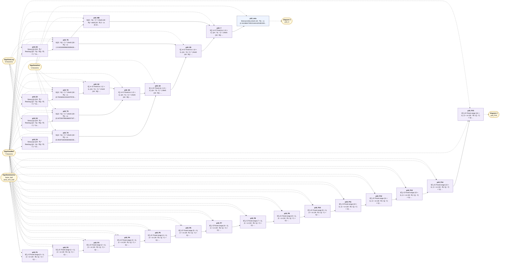

# `lean_stage3/Stage3/SignDataPt18.lean`

> **Read from the source text.** This file changed after the last `python3 utilities/lean_map.py --dump`, so the arrows on this page are names occurring in each proof and have not been confirmed by Lean.

SignDataPt18 — block S14 of `lean_stage3/design/stencil.md`, Turing's sign data: the sign of `Re Λ(1/2 + it)` at `t = 18.0`. 2026-11-25. Generated by `lean_stage3/checks/signdata/gen_signdata.py`; do not edit by hand.

148 theorems, 0 definitions, 772 lines. 

**Imports:** [`SignDataGamma`](../lean_stage3/SignDataGamma.md), [`SignDataLog`](../lean_stage3/SignDataLog.md)  
**Imported by:** [`SignData`](../lean_stage3/SignData.md)

## The picture

### Diagram 1 of 5: `p18_E2` to `p18_P15`



### Diagram 2 of 5: `p18_P16` to `p18_P45`


### Diagram 3 of 5: `p18_P46` to `p18_P75`

```mermaid
flowchart LR
  n0["<b>p18_P46</b><br/>‖∏ j ∈ Finset.range (45 + 1), (1 + zz (18 : ℝ) / ((j : ℂ) + 1)) …"]:::shp
  n1["<b>p18_P47</b><br/>‖∏ j ∈ Finset.range (46 + 1), (1 + zz (18 : ℝ) / ((j : ℂ) + 1)) …"]:::shp
  n2["<b>p18_P48</b><br/>‖∏ j ∈ Finset.range (47 + 1), (1 + zz (18 : ℝ) / ((j : ℂ) + 1)) …"]:::shp
  n3["<b>p18_P49</b><br/>‖∏ j ∈ Finset.range (48 + 1), (1 + zz (18 : ℝ) / ((j : ℂ) + 1)) …"]:::shp
  n4["<b>p18_P50</b><br/>‖∏ j ∈ Finset.range (49 + 1), (1 + zz (18 : ℝ) / ((j : ℂ) + 1)) …"]:::shp
  n5["<b>p18_P51</b><br/>‖∏ j ∈ Finset.range (50 + 1), (1 + zz (18 : ℝ) / ((j : ℂ) + 1)) …"]:::shp
  n6["<b>p18_P52</b><br/>‖∏ j ∈ Finset.range (51 + 1), (1 + zz (18 : ℝ) / ((j : ℂ) + 1)) …"]:::shp
  n7["<b>p18_P53</b><br/>‖∏ j ∈ Finset.range (52 + 1), (1 + zz (18 : ℝ) / ((j : ℂ) + 1)) …"]:::shp
  n8["<b>p18_P54</b><br/>‖∏ j ∈ Finset.range (53 + 1), (1 + zz (18 : ℝ) / ((j : ℂ) + 1)) …"]:::shp
  n9["<b>p18_P55</b><br/>‖∏ j ∈ Finset.range (54 + 1), (1 + zz (18 : ℝ) / ((j : ℂ) + 1)) …"]:::shp
  n10["<b>p18_P56</b><br/>‖∏ j ∈ Finset.range (55 + 1), (1 + zz (18 : ℝ) / ((j : ℂ) + 1)) …"]:::shp
  n11["<b>p18_P57</b><br/>‖∏ j ∈ Finset.range (56 + 1), (1 + zz (18 : ℝ) / ((j : ℂ) + 1)) …"]:::shp
  n12["<b>p18_P58</b><br/>‖∏ j ∈ Finset.range (57 + 1), (1 + zz (18 : ℝ) / ((j : ℂ) + 1)) …"]:::shp
  n13["<b>p18_P59</b><br/>‖∏ j ∈ Finset.range (58 + 1), (1 + zz (18 : ℝ) / ((j : ℂ) + 1)) …"]:::shp
  n14["<b>p18_P60</b><br/>‖∏ j ∈ Finset.range (59 + 1), (1 + zz (18 : ℝ) / ((j : ℂ) + 1)) …"]:::shp
  n15["<b>p18_P61</b><br/>‖∏ j ∈ Finset.range (60 + 1), (1 + zz (18 : ℝ) / ((j : ℂ) + 1)) …"]:::shp
  n16["<b>p18_P62</b><br/>‖∏ j ∈ Finset.range (61 + 1), (1 + zz (18 : ℝ) / ((j : ℂ) + 1)) …"]:::shp
  n17["<b>p18_P63</b><br/>‖∏ j ∈ Finset.range (62 + 1), (1 + zz (18 : ℝ) / ((j : ℂ) + 1)) …"]:::shp
  n18["<b>p18_P64</b><br/>‖∏ j ∈ Finset.range (63 + 1), (1 + zz (18 : ℝ) / ((j : ℂ) + 1)) …"]:::shp
  n19["<b>p18_P65</b><br/>‖∏ j ∈ Finset.range (64 + 1), (1 + zz (18 : ℝ) / ((j : ℂ) + 1)) …"]:::shp
  n20["<b>p18_P66</b><br/>‖∏ j ∈ Finset.range (65 + 1), (1 + zz (18 : ℝ) / ((j : ℂ) + 1)) …"]:::shp
  n21["<b>p18_P67</b><br/>‖∏ j ∈ Finset.range (66 + 1), (1 + zz (18 : ℝ) / ((j : ℂ) + 1)) …"]:::shp
  n22["<b>p18_P68</b><br/>‖∏ j ∈ Finset.range (67 + 1), (1 + zz (18 : ℝ) / ((j : ℂ) + 1)) …"]:::shp
  n23["<b>p18_P69</b><br/>‖∏ j ∈ Finset.range (68 + 1), (1 + zz (18 : ℝ) / ((j : ℂ) + 1)) …"]:::shp
  n24["<b>p18_P70</b><br/>‖∏ j ∈ Finset.range (69 + 1), (1 + zz (18 : ℝ) / ((j : ℂ) + 1)) …"]:::shp
  n25["<b>p18_P71</b><br/>‖∏ j ∈ Finset.range (70 + 1), (1 + zz (18 : ℝ) / ((j : ℂ) + 1)) …"]:::shp
  n26["<b>p18_P72</b><br/>‖∏ j ∈ Finset.range (71 + 1), (1 + zz (18 : ℝ) / ((j : ℂ) + 1)) …"]:::shp
  n27["<b>p18_P73</b><br/>‖∏ j ∈ Finset.range (72 + 1), (1 + zz (18 : ℝ) / ((j : ℂ) + 1)) …"]:::shp
  n28["<b>p18_P74</b><br/>‖∏ j ∈ Finset.range (73 + 1), (1 + zz (18 : ℝ) / ((j : ℂ) + 1)) …"]:::shp
  n29["<b>p18_P75</b><br/>‖∏ j ∈ Finset.range (74 + 1), (1 + zz (18 : ℝ) / ((j : ℂ) + 1)) …"]:::shp
  x0(["<b>SignDataBall</b><br/>ball_mul"]):::ext
  x1(["<b>SignDataGamma</b><br/>factor_ball"]):::ext
  x2(["<b>diagram 2</b><br/>p18_P45"]):::ext
  x3(["<b>diagram 4</b><br/>p18_P76"]):::ext
  n0 --> n1
  n1 --> n2
  n10 --> n11
  n11 --> n12
  n12 --> n13
  n13 --> n14
  n14 --> n15
  n15 --> n16
  n16 --> n17
  n17 --> n18
  n18 --> n19
  n19 --> n20
  n2 --> n3
  n20 --> n21
  n21 --> n22
  n22 --> n23
  n23 --> n24
  n24 --> n25
  n25 --> n26
  n26 --> n27
  n27 --> n28
  n28 --> n29
  n3 --> n4
  n4 --> n5
  n5 --> n6
  n6 --> n7
  n7 --> n8
  n8 --> n9
  n9 --> n10
  n29 -.-> x3
  x0 -.-> n0
  x0 -.-> n1
  x0 -.-> n10
  x0 -.-> n11
  x0 -.-> n12
  x0 -.-> n13
  x0 -.-> n14
  x0 -.-> n15
  x0 -.-> n16
  x0 -.-> n17
  x0 -.-> n18
  x0 -.-> n19
  x0 -.-> n2
  x0 -.-> n20
  x0 -.-> n21
  x0 -.-> n22
  x0 -.-> n23
  x0 -.-> n24
  x0 -.-> n25
  x0 -.-> n26
  x0 -.-> n27
  x0 -.-> n28
  x0 -.-> n29
  x0 -.-> n3
  x0 -.-> n4
  x0 -.-> n5
  x0 -.-> n6
  x0 -.-> n7
  x0 -.-> n8
  x0 -.-> n9
  x1 -.-> n0
  x1 -.-> n1
  x1 -.-> n10
  x1 -.-> n11
  x1 -.-> n12
  x1 -.-> n13
  x1 -.-> n14
  x1 -.-> n15
  x1 -.-> n16
  x1 -.-> n17
  x1 -.-> n18
  x1 -.-> n19
  x1 -.-> n2
  x1 -.-> n20
  x1 -.-> n21
  x1 -.-> n22
  x1 -.-> n23
  x1 -.-> n24
  x1 -.-> n25
  x1 -.-> n26
  x1 -.-> n27
  x1 -.-> n28
  x1 -.-> n29
  x1 -.-> n3
  x1 -.-> n4
  x1 -.-> n5
  x1 -.-> n6
  x1 -.-> n7
  x1 -.-> n8
  x1 -.-> n9
  x2 -.-> n0
  classDef cnt fill:#dff5ec,stroke:#17694a,color:#111
  classDef shp fill:#f1ecfb,stroke:#5b3fa0,color:#111
  classDef rh fill:#ffe5e5,stroke:#c22,color:#111,stroke-width:2px
  classDef thm fill:#eef4ff,stroke:#335,color:#111
  classDef end_ fill:#e7f7e7,stroke:#2a7,color:#111,stroke-width:2px
  classDef lone fill:#fff,stroke:#999,color:#111,stroke-dasharray:4 3
  classDef bad fill:#ffe5e5,stroke:#c22,color:#111,stroke-width:2px
  classDef ext fill:#fff8e1,stroke:#b80,color:#111
```



### Diagram 4 of 5: `p18_P76` to `p18_P105`

```mermaid
flowchart LR
  n0["<b>p18_P76</b><br/>‖∏ j ∈ Finset.range (75 + 1), (1 + zz (18 : ℝ) / ((j : ℂ) + 1)) …"]:::shp
  n1["<b>p18_P77</b><br/>‖∏ j ∈ Finset.range (76 + 1), (1 + zz (18 : ℝ) / ((j : ℂ) + 1)) …"]:::shp
  n2["<b>p18_P78</b><br/>‖∏ j ∈ Finset.range (77 + 1), (1 + zz (18 : ℝ) / ((j : ℂ) + 1)) …"]:::shp
  n3["<b>p18_P79</b><br/>‖∏ j ∈ Finset.range (78 + 1), (1 + zz (18 : ℝ) / ((j : ℂ) + 1)) …"]:::shp
  n4["<b>p18_P80</b><br/>‖∏ j ∈ Finset.range (79 + 1), (1 + zz (18 : ℝ) / ((j : ℂ) + 1)) …"]:::shp
  n5["<b>p18_P81</b><br/>‖∏ j ∈ Finset.range (80 + 1), (1 + zz (18 : ℝ) / ((j : ℂ) + 1)) …"]:::shp
  n6["<b>p18_P82</b><br/>‖∏ j ∈ Finset.range (81 + 1), (1 + zz (18 : ℝ) / ((j : ℂ) + 1)) …"]:::shp
  n7["<b>p18_P83</b><br/>‖∏ j ∈ Finset.range (82 + 1), (1 + zz (18 : ℝ) / ((j : ℂ) + 1)) …"]:::shp
  n8["<b>p18_P84</b><br/>‖∏ j ∈ Finset.range (83 + 1), (1 + zz (18 : ℝ) / ((j : ℂ) + 1)) …"]:::shp
  n9["<b>p18_P85</b><br/>‖∏ j ∈ Finset.range (84 + 1), (1 + zz (18 : ℝ) / ((j : ℂ) + 1)) …"]:::shp
  n10["<b>p18_P86</b><br/>‖∏ j ∈ Finset.range (85 + 1), (1 + zz (18 : ℝ) / ((j : ℂ) + 1)) …"]:::shp
  n11["<b>p18_P87</b><br/>‖∏ j ∈ Finset.range (86 + 1), (1 + zz (18 : ℝ) / ((j : ℂ) + 1)) …"]:::shp
  n12["<b>p18_P88</b><br/>‖∏ j ∈ Finset.range (87 + 1), (1 + zz (18 : ℝ) / ((j : ℂ) + 1)) …"]:::shp
  n13["<b>p18_P89</b><br/>‖∏ j ∈ Finset.range (88 + 1), (1 + zz (18 : ℝ) / ((j : ℂ) + 1)) …"]:::shp
  n14["<b>p18_P90</b><br/>‖∏ j ∈ Finset.range (89 + 1), (1 + zz (18 : ℝ) / ((j : ℂ) + 1)) …"]:::shp
  n15["<b>p18_P91</b><br/>‖∏ j ∈ Finset.range (90 + 1), (1 + zz (18 : ℝ) / ((j : ℂ) + 1)) …"]:::shp
  n16["<b>p18_P92</b><br/>‖∏ j ∈ Finset.range (91 + 1), (1 + zz (18 : ℝ) / ((j : ℂ) + 1)) …"]:::shp
  n17["<b>p18_P93</b><br/>‖∏ j ∈ Finset.range (92 + 1), (1 + zz (18 : ℝ) / ((j : ℂ) + 1)) …"]:::shp
  n18["<b>p18_P94</b><br/>‖∏ j ∈ Finset.range (93 + 1), (1 + zz (18 : ℝ) / ((j : ℂ) + 1)) …"]:::shp
  n19["<b>p18_P95</b><br/>‖∏ j ∈ Finset.range (94 + 1), (1 + zz (18 : ℝ) / ((j : ℂ) + 1)) …"]:::shp
  n20["<b>p18_P96</b><br/>‖∏ j ∈ Finset.range (95 + 1), (1 + zz (18 : ℝ) / ((j : ℂ) + 1)) …"]:::shp
  n21["<b>p18_P97</b><br/>‖∏ j ∈ Finset.range (96 + 1), (1 + zz (18 : ℝ) / ((j : ℂ) + 1)) …"]:::shp
  n22["<b>p18_P98</b><br/>‖∏ j ∈ Finset.range (97 + 1), (1 + zz (18 : ℝ) / ((j : ℂ) + 1)) …"]:::shp
  n23["<b>p18_P99</b><br/>‖∏ j ∈ Finset.range (98 + 1), (1 + zz (18 : ℝ) / ((j : ℂ) + 1)) …"]:::shp
  n24["<b>p18_P100</b><br/>‖∏ j ∈ Finset.range (99 + 1), (1 + zz (18 : ℝ) / ((j : ℂ) + 1)) …"]:::shp
  n25["<b>p18_P101</b><br/>‖∏ j ∈ Finset.range (100 + 1), (1 + zz (18 : ℝ) / ((j : ℂ) + 1))…"]:::shp
  n26["<b>p18_P102</b><br/>‖∏ j ∈ Finset.range (101 + 1), (1 + zz (18 : ℝ) / ((j : ℂ) + 1))…"]:::shp
  n27["<b>p18_P103</b><br/>‖∏ j ∈ Finset.range (102 + 1), (1 + zz (18 : ℝ) / ((j : ℂ) + 1))…"]:::shp
  n28["<b>p18_P104</b><br/>‖∏ j ∈ Finset.range (103 + 1), (1 + zz (18 : ℝ) / ((j : ℂ) + 1))…"]:::shp
  n29["<b>p18_P105</b><br/>‖∏ j ∈ Finset.range (104 + 1), (1 + zz (18 : ℝ) / ((j : ℂ) + 1))…"]:::shp
  x0(["<b>SignDataBall</b><br/>ball_mul"]):::ext
  x1(["<b>SignDataGamma</b><br/>factor_ball"]):::ext
  x2(["<b>diagram 3</b><br/>p18_P75"]):::ext
  x3(["<b>diagram 5</b><br/>p18_P106"]):::ext
  n0 --> n1
  n1 --> n2
  n10 --> n11
  n11 --> n12
  n12 --> n13
  n13 --> n14
  n14 --> n15
  n15 --> n16
  n16 --> n17
  n17 --> n18
  n18 --> n19
  n19 --> n20
  n2 --> n3
  n20 --> n21
  n21 --> n22
  n22 --> n23
  n23 --> n24
  n24 --> n25
  n25 --> n26
  n26 --> n27
  n27 --> n28
  n28 --> n29
  n3 --> n4
  n4 --> n5
  n5 --> n6
  n6 --> n7
  n7 --> n8
  n8 --> n9
  n9 --> n10
  n29 -.-> x3
  x0 -.-> n0
  x0 -.-> n1
  x0 -.-> n10
  x0 -.-> n11
  x0 -.-> n12
  x0 -.-> n13
  x0 -.-> n14
  x0 -.-> n15
  x0 -.-> n16
  x0 -.-> n17
  x0 -.-> n18
  x0 -.-> n19
  x0 -.-> n2
  x0 -.-> n20
  x0 -.-> n21
  x0 -.-> n22
  x0 -.-> n23
  x0 -.-> n24
  x0 -.-> n25
  x0 -.-> n26
  x0 -.-> n27
  x0 -.-> n28
  x0 -.-> n29
  x0 -.-> n3
  x0 -.-> n4
  x0 -.-> n5
  x0 -.-> n6
  x0 -.-> n7
  x0 -.-> n8
  x0 -.-> n9
  x1 -.-> n0
  x1 -.-> n1
  x1 -.-> n10
  x1 -.-> n11
  x1 -.-> n12
  x1 -.-> n13
  x1 -.-> n14
  x1 -.-> n15
  x1 -.-> n16
  x1 -.-> n17
  x1 -.-> n18
  x1 -.-> n19
  x1 -.-> n2
  x1 -.-> n20
  x1 -.-> n21
  x1 -.-> n22
  x1 -.-> n23
  x1 -.-> n24
  x1 -.-> n25
  x1 -.-> n26
  x1 -.-> n27
  x1 -.-> n28
  x1 -.-> n29
  x1 -.-> n3
  x1 -.-> n4
  x1 -.-> n5
  x1 -.-> n6
  x1 -.-> n7
  x1 -.-> n8
  x1 -.-> n9
  x2 -.-> n0
  classDef cnt fill:#dff5ec,stroke:#17694a,color:#111
  classDef shp fill:#f1ecfb,stroke:#5b3fa0,color:#111
  classDef rh fill:#ffe5e5,stroke:#c22,color:#111,stroke-width:2px
  classDef thm fill:#eef4ff,stroke:#335,color:#111
  classDef end_ fill:#e7f7e7,stroke:#2a7,color:#111,stroke-width:2px
  classDef lone fill:#fff,stroke:#999,color:#111,stroke-dasharray:4 3
  classDef bad fill:#ffe5e5,stroke:#c22,color:#111,stroke-width:2px
  classDef ext fill:#fff8e1,stroke:#b80,color:#111
```



### Diagram 5 of 5: `p18_P106` to `sign_18`

```mermaid
flowchart LR
  n0["<b>p18_P106</b><br/>‖∏ j ∈ Finset.range (105 + 1), (1 + zz (18 : ℝ) / ((j : ℂ) + 1))…"]:::shp
  n1["<b>p18_P107</b><br/>‖∏ j ∈ Finset.range (106 + 1), (1 + zz (18 : ℝ) / ((j : ℂ) + 1))…"]:::shp
  n2["<b>p18_P108</b><br/>‖∏ j ∈ Finset.range (107 + 1), (1 + zz (18 : ℝ) / ((j : ℂ) + 1))…"]:::shp
  n3["<b>p18_P109</b><br/>‖∏ j ∈ Finset.range (108 + 1), (1 + zz (18 : ℝ) / ((j : ℂ) + 1))…"]:::shp
  n4["<b>p18_P110</b><br/>‖∏ j ∈ Finset.range (109 + 1), (1 + zz (18 : ℝ) / ((j : ℂ) + 1))…"]:::shp
  n5["<b>p18_P111</b><br/>‖∏ j ∈ Finset.range (110 + 1), (1 + zz (18 : ℝ) / ((j : ℂ) + 1))…"]:::shp
  n6["<b>p18_P112</b><br/>‖∏ j ∈ Finset.range (111 + 1), (1 + zz (18 : ℝ) / ((j : ℂ) + 1))…"]:::shp
  n7["<b>p18_P113</b><br/>‖∏ j ∈ Finset.range (112 + 1), (1 + zz (18 : ℝ) / ((j : ℂ) + 1))…"]:::shp
  n8["<b>p18_P114</b><br/>‖∏ j ∈ Finset.range (113 + 1), (1 + zz (18 : ℝ) / ((j : ℂ) + 1))…"]:::shp
  n9["<b>p18_P115</b><br/>‖∏ j ∈ Finset.range (114 + 1), (1 + zz (18 : ℝ) / ((j : ℂ) + 1))…"]:::shp
  n10["<b>p18_P116</b><br/>‖∏ j ∈ Finset.range (115 + 1), (1 + zz (18 : ℝ) / ((j : ℂ) + 1))…"]:::shp
  n11["<b>p18_P117</b><br/>‖∏ j ∈ Finset.range (116 + 1), (1 + zz (18 : ℝ) / ((j : ℂ) + 1))…"]:::shp
  n12["<b>p18_P118</b><br/>‖∏ j ∈ Finset.range (117 + 1), (1 + zz (18 : ℝ) / ((j : ℂ) + 1))…"]:::shp
  n13["<b>p18_P119</b><br/>‖∏ j ∈ Finset.range (118 + 1), (1 + zz (18 : ℝ) / ((j : ℂ) + 1))…"]:::shp
  n14["<b>p18_P120</b><br/>‖∏ j ∈ Finset.range (119 + 1), (1 + zz (18 : ℝ) / ((j : ℂ) + 1))…"]:::shp
  n15["<b>p18_P121</b><br/>‖∏ j ∈ Finset.range (120 + 1), (1 + zz (18 : ℝ) / ((j : ℂ) + 1))…"]:::shp
  n16["<b>p18_P122</b><br/>‖∏ j ∈ Finset.range (121 + 1), (1 + zz (18 : ℝ) / ((j : ℂ) + 1))…"]:::shp
  n17["<b>p18_P123</b><br/>‖∏ j ∈ Finset.range (122 + 1), (1 + zz (18 : ℝ) / ((j : ℂ) + 1))…"]:::shp
  n18["<b>p18_P124</b><br/>‖∏ j ∈ Finset.range (123 + 1), (1 + zz (18 : ℝ) / ((j : ℂ) + 1))…"]:::shp
  n19["<b>p18_P125</b><br/>‖∏ j ∈ Finset.range (124 + 1), (1 + zz (18 : ℝ) / ((j : ℂ) + 1))…"]:::shp
  n20["<b>p18_P126</b><br/>‖∏ j ∈ Finset.range (125 + 1), (1 + zz (18 : ℝ) / ((j : ℂ) + 1))…"]:::shp
  n21["<b>p18_P127</b><br/>‖∏ j ∈ Finset.range (126 + 1), (1 + zz (18 : ℝ) / ((j : ℂ) + 1))…"]:::shp
  n22["<b>p18_P128</b><br/>‖∏ j ∈ Finset.range (127 + 1), (1 + zz (18 : ℝ) / ((j : ℂ) + 1))…"]:::shp
  n23["<b>p18_W</b><br/>‖zz (18 : ℝ) * ∏ j ∈ Finset.range (127 + 1), (1 + zz (18 : ℝ) / …"]:::shp
  n24["<b>p18_phase</b><br/>‖cexp (((((18 : ℝ) / 2) * (Real.log (((128 : ℕ)) : ℝ) - Real.log…"]:::shp
  n25["<b>p18_G</b><br/>‖gammaDir (18 : ℝ) 128 - cx (2343456.817065872583834581598633805…"]:::shp
  n26["<b>p18_X</b><br/>‖gammaDir (18 : ℝ) 128 * riemannZeta (lineS (18 : ℝ)) - cx (5496…"]:::thm
  n27["<b>sign_18</b><br/>0 ＜ (completedRiemannZeta (lineS (18 : ℝ))).re"]:::thm
  x0(["<b>SignDataBall</b><br/>4 theorems"]):::ext
  x1(["<b>SignDataGamma</b><br/>factor_ball<br/>re_lambda_pos<br/>zz_ball"]):::ext
  x2(["<b>diagram 4</b><br/>p18_P105"]):::ext
  x3(["<b>SignDataLog</b><br/>log_pi_ball'<br/>log_pow2_ball_128"]):::ext
  x4(["<b>diagram 1</b><br/>p18_zeta"]):::ext
  x5(["<b>SignData</b><br/>run_signs"]):::ext
  n0 --> n1
  n1 --> n2
  n10 --> n11
  n11 --> n12
  n12 --> n13
  n13 --> n14
  n14 --> n15
  n15 --> n16
  n16 --> n17
  n17 --> n18
  n18 --> n19
  n19 --> n20
  n2 --> n3
  n20 --> n21
  n21 --> n22
  n22 --> n23
  n23 --> n25
  n24 --> n25
  n25 --> n26
  n26 --> n27
  n3 --> n4
  n4 --> n5
  n5 --> n6
  n6 --> n7
  n7 --> n8
  n8 --> n9
  n9 --> n10
  n27 -.-> x5
  x0 -.-> n0
  x0 -.-> n1
  x0 -.-> n10
  x0 -.-> n11
  x0 -.-> n12
  x0 -.-> n13
  x0 -.-> n14
  x0 -.-> n15
  x0 -.-> n16
  x0 -.-> n17
  x0 -.-> n18
  x0 -.-> n19
  x0 -.-> n2
  x0 -.-> n20
  x0 -.-> n21
  x0 -.-> n22
  x0 -.-> n23
  x0 -.-> n24
  x0 -.-> n25
  x0 -.-> n26
  x0 -.-> n3
  x0 -.-> n4
  x0 -.-> n5
  x0 -.-> n6
  x0 -.-> n7
  x0 -.-> n8
  x0 -.-> n9
  x1 -.-> n0
  x1 -.-> n1
  x1 -.-> n10
  x1 -.-> n11
  x1 -.-> n12
  x1 -.-> n13
  x1 -.-> n14
  x1 -.-> n15
  x1 -.-> n16
  x1 -.-> n17
  x1 -.-> n18
  x1 -.-> n19
  x1 -.-> n2
  x1 -.-> n20
  x1 -.-> n21
  x1 -.-> n22
  x1 -.-> n23
  x1 -.-> n27
  x1 -.-> n3
  x1 -.-> n4
  x1 -.-> n5
  x1 -.-> n6
  x1 -.-> n7
  x1 -.-> n8
  x1 -.-> n9
  x2 -.-> n0
  x3 -.-> n24
  x4 -.-> n26
  classDef cnt fill:#dff5ec,stroke:#17694a,color:#111
  classDef shp fill:#f1ecfb,stroke:#5b3fa0,color:#111
  classDef rh fill:#ffe5e5,stroke:#c22,color:#111,stroke-width:2px
  classDef thm fill:#eef4ff,stroke:#335,color:#111
  classDef end_ fill:#e7f7e7,stroke:#2a7,color:#111,stroke-width:2px
  classDef lone fill:#fff,stroke:#999,color:#111,stroke-dasharray:4 3
  classDef bad fill:#ffe5e5,stroke:#c22,color:#111,stroke-width:2px
  classDef ext fill:#fff8e1,stroke:#b80,color:#111
```



An arrow A → B reads "A is used in the proof of B". Green: counting, integers only. Violet: shape, analysis with no ζ. Blue: reads ζ. A name ending in ■ is an end: nothing else uses it. Red: contains `sorry`. Yellow: theorems in another file, counted; a dotted arrow crosses files. Definitions are not drawn; they are listed below the diagram.

## Theorems

<a name="SignData-p18_E2"></a>
### `SignData.p18_E2`

line 31 · arrows read from text

**Shape.** Uses real or complex analysis; nothing in it or beneath it reads ζ.

**Proves**

```lean
‖cexp ((((-((18 : ℝ) * Real.log (((2 : ℕ)) : ℝ))) : ℝ) : ℂ) * Complex.I) - cx (0.995977737708063064466978646882) (0.089601037884216125280980468076)‖ ≤ (0.000000004500000000040000000001)
```

**Fed by** (3 theorems its proof uses)

  - [`SignData.exp_ball0`](../lean_stage3/SignDataBall.md#SignData-exp_ball0) (SignDataBall) — `` ‖cexp ((x : ℂ) * I) - cx e f‖ ≤ R ``
  - [`SignData.neg_mul_ball`](../lean_stage3/SignDataBall.md#SignData-neg_mul_ball) (SignDataBall) — `` |-(t * x) - -(t * a)| ≤ |t| * e ``
  - [`SignData.log_ball_2`](../lean_stage3/SignDataLog.md#SignData-log_ball_2) (SignDataLog) — `` |Real.log ((2 : ℕ) : ℝ) - (0.69314718055)| ≤ (0.00000000025) ``

**Definitions its proof touches:** [`SignData.cosP`](../lean_stage3/SignDataBall.md#SignData-cosP), [`SignData.cx`](../lean_stage3/SignDataBall.md#SignData-cx), [`SignData.sinP`](../lean_stage3/SignDataBall.md#SignData-sinP)

**Feeds** (1 that use it)

  - [`SignData.p18_T2`](#SignData-p18_T2) — `` ‖(((2 : ℕ)) : ℂ) ^ (-lineS (18 : ℝ)) - cx (0.704262612244207972588033412246) (0.063357501489281966856773607032)‖ ≤ (0.000000003181980515367748131054) ``

<a name="SignData-p18_T2"></a>
### `SignData.p18_T2`

line 37 · arrows read from text

**Shape.** Uses real or complex analysis; nothing in it or beneath it reads ζ.

**Proves**

```lean
‖(((2 : ℕ)) : ℂ) ^ (-lineS (18 : ℝ)) - cx (0.704262612244207972588033412246) (0.063357501489281966856773607032)‖ ≤ (0.000000003181980515367748131054)
```

**Fed by** (5 theorems its proof uses)

  - [`SignData.ball_mul`](../lean_stage3/SignDataBall.md#SignData-ball_mul) (SignDataBall) — `` ‖z * w - cx e f‖ ≤ R ``
  - [`SignData.ball_ofReal`](../lean_stage3/SignDataBall.md#SignData-ball_ofReal) (SignDataBall) — `` ‖(x : ℂ) - cx c 0‖ ≤ e ``
  - [`SignData.isqrt_ball_2`](../lean_stage3/SignDataLog.md#SignData-isqrt_ball_2) (SignDataLog) — `` |(Real.sqrt (((2 : ℕ)) : ℝ))⁻¹ - (0.707106781186547524400844362104)| ≤ (0.000000000000000000000000000001) ``
  - [`SignData.p18_E2`](#SignData-p18_E2) — `` ‖cexp ((((-((18 : ℝ) * Real.log (((2 : ℕ)) : ℝ))) : ℝ) : ℂ) * Complex.I) - cx (0.995977737708063064466978646882) (0.089601037884216125280980468076)‖ ≤… ``
  - [`SignData.natCast_cpow_line`](../lean_stage3/SignDataZeta.md#SignData-natCast_cpow_line) (SignDataZeta) — `` (m : ℂ) ^ (-lineS t) = (((Real.sqrt m)⁻¹ : ℝ) : ℂ) * cexp (((-(t * Real.log m)) : ℝ) * I) ``

**Definitions its proof touches:** [`SignData.cx`](../lean_stage3/SignDataBall.md#SignData-cx), [`SignData.lineS`](../lean_stage3/SignDataZeta.md#SignData-lineS)

**Feeds** (1 that use it)

  - [`SignData.p18_S2`](#SignData-p18_S2) — `` ‖∑ m ∈ Finset.Icc 1 (1 + 1), ((m : ℕ) : ℂ) ^ (-lineS (18 : ℝ)) - cx (1.704262612244207972588033412246) (0.063357501489281966856773607032)‖ ≤ (0.000000… ``

<a name="SignData-p18_E3"></a>
### `SignData.p18_E3`

line 41 · arrows read from text

**Shape.** Uses real or complex analysis; nothing in it or beneath it reads ζ.

**Proves**

```lean
‖cexp ((((-((18 : ℝ) * Real.log (((3 : ℕ)) : ℝ))) : ℝ) : ℂ) * Complex.I) - cx (0.601462949529781653519223575226) (-(0.798900694919547136211476519698))‖ ≤ (0.000000004500131137332941743593)
```

**Fed by** (3 theorems its proof uses)

  - [`SignData.exp_ball3`](../lean_stage3/SignDataBall.md#SignData-exp_ball3) (SignDataBall) — `` ‖cexp ((x : ℂ) * I) - cx f (-e)‖ ≤ R ``
  - [`SignData.neg_mul_ball`](../lean_stage3/SignDataBall.md#SignData-neg_mul_ball) (SignDataBall) — `` |-(t * x) - -(t * a)| ≤ |t| * e ``
  - [`SignData.log_ball_3`](../lean_stage3/SignDataLog.md#SignData-log_ball_3) (SignDataLog) — `` |Real.log (((3 : ℕ)) : ℝ) - (1.098612288658164142930964760306)| ≤ (0.000000000250007285403624428292) ``

**Definitions its proof touches:** [`SignData.cosP`](../lean_stage3/SignDataBall.md#SignData-cosP), [`SignData.cx`](../lean_stage3/SignDataBall.md#SignData-cx), [`SignData.sinP`](../lean_stage3/SignDataBall.md#SignData-sinP)

**Feeds** (1 that use it)

  - [`SignData.p18_T3`](#SignData-p18_T3) — `` ‖(((3 : ℕ)) : ℂ) ^ (-lineS (18 : ℝ)) - cx (0.3472547958186057327991009419) (-0.461245531267579627490884968333)‖ ≤ (0.000000002598151923527790665535) ``

<a name="SignData-p18_T3"></a>
### `SignData.p18_T3`

line 47 · arrows read from text

**Shape.** Uses real or complex analysis; nothing in it or beneath it reads ζ.

**Proves**

```lean
‖(((3 : ℕ)) : ℂ) ^ (-lineS (18 : ℝ)) - cx (0.3472547958186057327991009419) (-0.461245531267579627490884968333)‖ ≤ (0.000000002598151923527790665535)
```

**Fed by** (5 theorems its proof uses)

  - [`SignData.ball_mul`](../lean_stage3/SignDataBall.md#SignData-ball_mul) (SignDataBall) — `` ‖z * w - cx e f‖ ≤ R ``
  - [`SignData.ball_ofReal`](../lean_stage3/SignDataBall.md#SignData-ball_ofReal) (SignDataBall) — `` ‖(x : ℂ) - cx c 0‖ ≤ e ``
  - [`SignData.isqrt_ball_3`](../lean_stage3/SignDataLog.md#SignData-isqrt_ball_3) (SignDataLog) — `` |(Real.sqrt (((3 : ℕ)) : ℝ))⁻¹ - (0.577350269189625764509148780502)| ≤ (0.000000000000000000000000000001) ``
  - [`SignData.p18_E3`](#SignData-p18_E3) — `` ‖cexp ((((-((18 : ℝ) * Real.log (((3 : ℕ)) : ℝ))) : ℝ) : ℂ) * Complex.I) - cx (0.601462949529781653519223575226) (-(0.798900694919547136211476519698))… ``
  - [`SignData.natCast_cpow_line`](../lean_stage3/SignDataZeta.md#SignData-natCast_cpow_line) (SignDataZeta) — `` (m : ℂ) ^ (-lineS t) = (((Real.sqrt m)⁻¹ : ℝ) : ℂ) * cexp (((-(t * Real.log m)) : ℝ) * I) ``

**Definitions its proof touches:** [`SignData.cx`](../lean_stage3/SignDataBall.md#SignData-cx), [`SignData.lineS`](../lean_stage3/SignDataZeta.md#SignData-lineS)

**Feeds** (1 that use it)

  - [`SignData.p18_S3`](#SignData-p18_S3) — `` ‖∑ m ∈ Finset.Icc 1 (2 + 1), ((m : ℕ) : ℂ) ^ (-lineS (18 : ℝ)) - cx (2.051517408062813705387134354146) (-0.397888029778297660634111361301)‖ ≤ (0.00000… ``

<a name="SignData-p18_E4"></a>
### `SignData.p18_E4`

line 51 · arrows read from text

**Shape.** Uses real or complex analysis; nothing in it or beneath it reads ζ.

**Proves**

```lean
‖cexp ((((-((18 : ℝ) * Real.log (((4 : ℕ)) : ℝ))) : ℝ) : ℂ) * Complex.I) - cx (0.983943308052092067197798929696) (0.178481277840298572193831814911)‖ ≤ (0.000000004500216402476030564479)
```

**Fed by** (3 theorems its proof uses)

  - [`SignData.exp_ball0`](../lean_stage3/SignDataBall.md#SignData-exp_ball0) (SignDataBall) — `` ‖cexp ((x : ℂ) * I) - cx e f‖ ≤ R ``
  - [`SignData.neg_mul_ball`](../lean_stage3/SignDataBall.md#SignData-neg_mul_ball) (SignDataBall) — `` |-(t * x) - -(t * a)| ≤ |t| * e ``
  - [`SignData.log_ball_4`](../lean_stage3/SignDataLog.md#SignData-log_ball_4) (SignDataLog) — `` |Real.log (((4 : ℕ)) : ℝ) - (1.386294361109944875563750019823)| ≤ (0.000000000250012022355196162294) ``

**Definitions its proof touches:** [`SignData.cosP`](../lean_stage3/SignDataBall.md#SignData-cosP), [`SignData.cx`](../lean_stage3/SignDataBall.md#SignData-cx), [`SignData.sinP`](../lean_stage3/SignDataBall.md#SignData-sinP)

**Feeds** (1 that use it)

  - [`SignData.p18_T4`](#SignData-p18_T4) — `` ‖(((4 : ℕ)) : ℂ) ^ (-lineS (18 : ℝ)) - cx (0.491971654026046033598899464848) (0.089240638920149286096915907456)‖ ≤ (0.000000002250108201238015282242) ``

<a name="SignData-p18_T4"></a>
### `SignData.p18_T4`

line 57 · arrows read from text

**Shape.** Uses real or complex analysis; nothing in it or beneath it reads ζ.

**Proves**

```lean
‖(((4 : ℕ)) : ℂ) ^ (-lineS (18 : ℝ)) - cx (0.491971654026046033598899464848) (0.089240638920149286096915907456)‖ ≤ (0.000000002250108201238015282242)
```

**Fed by** (5 theorems its proof uses)

  - [`SignData.ball_mul`](../lean_stage3/SignDataBall.md#SignData-ball_mul) (SignDataBall) — `` ‖z * w - cx e f‖ ≤ R ``
  - [`SignData.ball_ofReal`](../lean_stage3/SignDataBall.md#SignData-ball_ofReal) (SignDataBall) — `` ‖(x : ℂ) - cx c 0‖ ≤ e ``
  - [`SignData.isqrt_ball_4`](../lean_stage3/SignDataLog.md#SignData-isqrt_ball_4) (SignDataLog) — `` |(Real.sqrt (((4 : ℕ)) : ℝ))⁻¹ - (0.5)| ≤ (0.000000000000000000000000000001) ``
  - [`SignData.p18_E4`](#SignData-p18_E4) — `` ‖cexp ((((-((18 : ℝ) * Real.log (((4 : ℕ)) : ℝ))) : ℝ) : ℂ) * Complex.I) - cx (0.983943308052092067197798929696) (0.178481277840298572193831814911)‖ ≤… ``
  - [`SignData.natCast_cpow_line`](../lean_stage3/SignDataZeta.md#SignData-natCast_cpow_line) (SignDataZeta) — `` (m : ℂ) ^ (-lineS t) = (((Real.sqrt m)⁻¹ : ℝ) : ℂ) * cexp (((-(t * Real.log m)) : ℝ) * I) ``

**Definitions its proof touches:** [`SignData.cx`](../lean_stage3/SignDataBall.md#SignData-cx), [`SignData.lineS`](../lean_stage3/SignDataZeta.md#SignData-lineS)

**Feeds** (1 that use it)

  - [`SignData.p18_S4`](#SignData-p18_S4) — `` ‖∑ m ∈ Finset.Icc 1 (3 + 1), ((m : ℕ) : ℂ) ^ (-lineS (18 : ℝ)) - cx (2.543489062088859738986033818994) (-0.308647390858148374537195453845)‖ ≤ (0.00000… ``

<a name="SignData-p18_E5"></a>
### `SignData.p18_E5`

line 61 · arrows read from text

**Shape.** Uses real or complex analysis; nothing in it or beneath it reads ζ.

**Proves**

```lean
‖cexp ((((-((18 : ℝ) * Real.log (((5 : ℕ)) : ℝ))) : ℝ) : ℂ) * Complex.I) - cx (-(0.767702308378372450788553004497)) (-(-0.640806652361317429190678761538))‖ ≤ (0.000000004500263588406479321428)
```

**Fed by** (3 theorems its proof uses)

  - [`SignData.exp_ball2`](../lean_stage3/SignDataBall.md#SignData-exp_ball2) (SignDataBall) — `` ‖cexp ((x : ℂ) * I) - cx (-e) (-f)‖ ≤ R ``
  - [`SignData.neg_mul_ball`](../lean_stage3/SignDataBall.md#SignData-neg_mul_ball) (SignDataBall) — `` |-(t * x) - -(t * a)| ≤ |t| * e ``
  - [`SignData.log_ball_5`](../lean_stage3/SignDataLog.md#SignData-log_ball_5) (SignDataLog) — `` |Real.log (((5 : ℕ)) : ℝ) - (1.609437912424154507888186373287)| ≤ (0.000000000250014643795196162295) ``

**Definitions its proof touches:** [`SignData.cosP`](../lean_stage3/SignDataBall.md#SignData-cosP), [`SignData.cx`](../lean_stage3/SignDataBall.md#SignData-cx), [`SignData.sinP`](../lean_stage3/SignDataBall.md#SignData-sinP)

**Feeds** (1 that use it)

  - [`SignData.p18_T5`](#SignData-p18_T5) — `` ‖(((5 : ℕ)) : ℂ) ^ (-lineS (18 : ℝ)) - cx (-0.343326909603509428044868072338) (0.286577447022796379837176706911)‖ ≤ (0.000000002012579060068804448516) ``

<a name="SignData-p18_T5"></a>
### `SignData.p18_T5`

line 67 · arrows read from text

**Shape.** Uses real or complex analysis; nothing in it or beneath it reads ζ.

**Proves**

```lean
‖(((5 : ℕ)) : ℂ) ^ (-lineS (18 : ℝ)) - cx (-0.343326909603509428044868072338) (0.286577447022796379837176706911)‖ ≤ (0.000000002012579060068804448516)
```

**Fed by** (5 theorems its proof uses)

  - [`SignData.ball_mul`](../lean_stage3/SignDataBall.md#SignData-ball_mul) (SignDataBall) — `` ‖z * w - cx e f‖ ≤ R ``
  - [`SignData.ball_ofReal`](../lean_stage3/SignDataBall.md#SignData-ball_ofReal) (SignDataBall) — `` ‖(x : ℂ) - cx c 0‖ ≤ e ``
  - [`SignData.isqrt_ball_5`](../lean_stage3/SignDataLog.md#SignData-isqrt_ball_5) (SignDataLog) — `` |(Real.sqrt (((5 : ℕ)) : ℝ))⁻¹ - (0.447213595499957939281834733746)| ≤ (0.000000000000000000000000000001) ``
  - [`SignData.p18_E5`](#SignData-p18_E5) — `` ‖cexp ((((-((18 : ℝ) * Real.log (((5 : ℕ)) : ℝ))) : ℝ) : ℂ) * Complex.I) - cx (-(0.767702308378372450788553004497)) (-(-0.6408066523613174291906787615… ``
  - [`SignData.natCast_cpow_line`](../lean_stage3/SignDataZeta.md#SignData-natCast_cpow_line) (SignDataZeta) — `` (m : ℂ) ^ (-lineS t) = (((Real.sqrt m)⁻¹ : ℝ) : ℂ) * cexp (((-(t * Real.log m)) : ℝ) * I) ``

**Definitions its proof touches:** [`SignData.cx`](../lean_stage3/SignDataBall.md#SignData-cx), [`SignData.lineS`](../lean_stage3/SignDataZeta.md#SignData-lineS)

**Feeds** (2 that use it)

  - [`SignData.p18_NB`](#SignData-p18_NB) — `` ‖(((5 : ℕ)) : ℂ) ^ (-lineS (18 : ℝ)) * emB (18 : ℝ) 5 - cx (0.141224320466166103312657346197) (-0.168029309493868459311464770731)‖ ≤ (0.00000000114572… ``
  - [`SignData.p18_S5`](#SignData-p18_S5) — `` ‖∑ m ∈ Finset.Icc 1 (4 + 1), ((m : ℕ) : ℂ) ^ (-lineS (18 : ℝ)) - cx (2.200162152485350310941165746656) (-0.022069943835351994700018746934)‖ ≤ (0.00000… ``

<a name="SignData-p18_S2"></a>
### `SignData.p18_S2`

line 71 · arrows read from text

**Shape.** Uses real or complex analysis; nothing in it or beneath it reads ζ.

**Proves**

```lean
‖∑ m ∈ Finset.Icc 1 (1 + 1), ((m : ℕ) : ℂ) ^ (-lineS (18 : ℝ)) - cx (1.704262612244207972588033412246) (0.063357501489281966856773607032)‖ ≤ (0.000000003181980515367748131054)
```

**Fed by** (3 theorems its proof uses)

  - [`SignData.ball_add`](../lean_stage3/SignDataBall.md#SignData-ball_add) (SignDataBall) — `` ‖z + w - cx e f‖ ≤ R ``
  - [`SignData.p18_T2`](#SignData-p18_T2) — `` ‖(((2 : ℕ)) : ℂ) ^ (-lineS (18 : ℝ)) - cx (0.704262612244207972588033412246) (0.063357501489281966856773607032)‖ ≤ (0.000000003181980515367748131054) ``
  - [`SignData.sum_one_ball`](../lean_stage3/SignDataZeta.md#SignData-sum_one_ball) (SignDataZeta) — `` ‖∑ m ∈ Finset.Icc 1 1, ((m : ℕ) : ℂ) ^ (-lineS t) - cx 1 0‖ ≤ 0 ``

**Definitions its proof touches:** [`SignData.cx`](../lean_stage3/SignDataBall.md#SignData-cx), [`SignData.lineS`](../lean_stage3/SignDataZeta.md#SignData-lineS)

**Feeds** (1 that use it)

  - [`SignData.p18_S3`](#SignData-p18_S3) — `` ‖∑ m ∈ Finset.Icc 1 (2 + 1), ((m : ℕ) : ℂ) ^ (-lineS (18 : ℝ)) - cx (2.051517408062813705387134354146) (-0.397888029778297660634111361301)‖ ≤ (0.00000… ``

<a name="SignData-p18_S3"></a>
### `SignData.p18_S3`

line 76 · arrows read from text

**Shape.** Uses real or complex analysis; nothing in it or beneath it reads ζ.

**Proves**

```lean
‖∑ m ∈ Finset.Icc 1 (2 + 1), ((m : ℕ) : ℂ) ^ (-lineS (18 : ℝ)) - cx (2.051517408062813705387134354146) (-0.397888029778297660634111361301)‖ ≤ (0.000000005780132438895538796589)
```

**Fed by** (3 theorems its proof uses)

  - [`SignData.ball_add`](../lean_stage3/SignDataBall.md#SignData-ball_add) (SignDataBall) — `` ‖z + w - cx e f‖ ≤ R ``
  - [`SignData.p18_S2`](#SignData-p18_S2) — `` ‖∑ m ∈ Finset.Icc 1 (1 + 1), ((m : ℕ) : ℂ) ^ (-lineS (18 : ℝ)) - cx (1.704262612244207972588033412246) (0.063357501489281966856773607032)‖ ≤ (0.000000… ``
  - [`SignData.p18_T3`](#SignData-p18_T3) — `` ‖(((3 : ℕ)) : ℂ) ^ (-lineS (18 : ℝ)) - cx (0.3472547958186057327991009419) (-0.461245531267579627490884968333)‖ ≤ (0.000000002598151923527790665535) ``

**Definitions its proof touches:** [`SignData.cx`](../lean_stage3/SignDataBall.md#SignData-cx), [`SignData.lineS`](../lean_stage3/SignDataZeta.md#SignData-lineS)

**Feeds** (1 that use it)

  - [`SignData.p18_S4`](#SignData-p18_S4) — `` ‖∑ m ∈ Finset.Icc 1 (3 + 1), ((m : ℕ) : ℂ) ^ (-lineS (18 : ℝ)) - cx (2.543489062088859738986033818994) (-0.308647390858148374537195453845)‖ ≤ (0.00000… ``

<a name="SignData-p18_S4"></a>
### `SignData.p18_S4`

line 81 · arrows read from text

**Shape.** Uses real or complex analysis; nothing in it or beneath it reads ζ.

**Proves**

```lean
‖∑ m ∈ Finset.Icc 1 (3 + 1), ((m : ℕ) : ℂ) ^ (-lineS (18 : ℝ)) - cx (2.543489062088859738986033818994) (-0.308647390858148374537195453845)‖ ≤ (0.000000008030240640133554078831)
```

**Fed by** (3 theorems its proof uses)

  - [`SignData.ball_add`](../lean_stage3/SignDataBall.md#SignData-ball_add) (SignDataBall) — `` ‖z + w - cx e f‖ ≤ R ``
  - [`SignData.p18_S3`](#SignData-p18_S3) — `` ‖∑ m ∈ Finset.Icc 1 (2 + 1), ((m : ℕ) : ℂ) ^ (-lineS (18 : ℝ)) - cx (2.051517408062813705387134354146) (-0.397888029778297660634111361301)‖ ≤ (0.00000… ``
  - [`SignData.p18_T4`](#SignData-p18_T4) — `` ‖(((4 : ℕ)) : ℂ) ^ (-lineS (18 : ℝ)) - cx (0.491971654026046033598899464848) (0.089240638920149286096915907456)‖ ≤ (0.000000002250108201238015282242) ``

**Definitions its proof touches:** [`SignData.cx`](../lean_stage3/SignDataBall.md#SignData-cx), [`SignData.lineS`](../lean_stage3/SignDataZeta.md#SignData-lineS)

**Feeds** (1 that use it)

  - [`SignData.p18_S5`](#SignData-p18_S5) — `` ‖∑ m ∈ Finset.Icc 1 (4 + 1), ((m : ℕ) : ℂ) ^ (-lineS (18 : ℝ)) - cx (2.200162152485350310941165746656) (-0.022069943835351994700018746934)‖ ≤ (0.00000… ``

<a name="SignData-p18_S5"></a>
### `SignData.p18_S5`

line 86 · arrows read from text

**Shape.** Uses real or complex analysis; nothing in it or beneath it reads ζ.

**Proves**

```lean
‖∑ m ∈ Finset.Icc 1 (4 + 1), ((m : ℕ) : ℂ) ^ (-lineS (18 : ℝ)) - cx (2.200162152485350310941165746656) (-0.022069943835351994700018746934)‖ ≤ (0.000000010042819700202358527347)
```

**Fed by** (3 theorems its proof uses)

  - [`SignData.ball_add`](../lean_stage3/SignDataBall.md#SignData-ball_add) (SignDataBall) — `` ‖z + w - cx e f‖ ≤ R ``
  - [`SignData.p18_S4`](#SignData-p18_S4) — `` ‖∑ m ∈ Finset.Icc 1 (3 + 1), ((m : ℕ) : ℂ) ^ (-lineS (18 : ℝ)) - cx (2.543489062088859738986033818994) (-0.308647390858148374537195453845)‖ ≤ (0.00000… ``
  - [`SignData.p18_T5`](#SignData-p18_T5) — `` ‖(((5 : ℕ)) : ℂ) ^ (-lineS (18 : ℝ)) - cx (-0.343326909603509428044868072338) (0.286577447022796379837176706911)‖ ≤ (0.000000002012579060068804448516) ``

**Definitions its proof touches:** [`SignData.cx`](../lean_stage3/SignDataBall.md#SignData-cx), [`SignData.lineS`](../lean_stage3/SignDataZeta.md#SignData-lineS)

**Feeds** (1 that use it)

  - [`SignData.p18_Y`](#SignData-p18_Y) — `` ‖(∑ m ∈ Finset.Icc 1 (4 + 1), ((m : ℕ) : ℂ) ^ (-lineS (18 : ℝ)) + (((4 + 1 : ℕ)) : ℂ) ^ (-lineS (18 : ℝ)) * emB (18 : ℝ) (4 + 1)) - cx (2.341386472951… ``

<a name="SignData-p18_NB"></a>
### `SignData.p18_NB`

line 91 · arrows read from text

**Shape.** Uses real or complex analysis; nothing in it or beneath it reads ζ.

**Proves**

```lean
‖(((5 : ℕ)) : ℂ) ^ (-lineS (18 : ℝ)) * emB (18 : ℝ) 5 - cx (0.141224320466166103312657346197) (-0.168029309493868459311464770731)‖ ≤ (0.000000001145729041339163681291)
```

**Fed by** (3 theorems its proof uses)

  - [`SignData.ball_mul`](../lean_stage3/SignDataBall.md#SignData-ball_mul) (SignDataBall) — `` ‖z * w - cx e f‖ ≤ R ``
  - [`SignData.p18_T5`](#SignData-p18_T5) — `` ‖(((5 : ℕ)) : ℂ) ^ (-lineS (18 : ℝ)) - cx (-0.343326909603509428044868072338) (0.286577447022796379837176706911)‖ ≤ (0.000000002012579060068804448516) ``
  - [`SignData.emB_ball`](../lean_stage3/SignDataZeta.md#SignData-emB_ball) (SignDataZeta) — `` ‖emB t N - cx (Bre t N) (Bim t N)‖ ≤ 0 ``

**Definitions its proof touches:** [`SignData.cx`](../lean_stage3/SignDataBall.md#SignData-cx), [`SignData.Bim`](../lean_stage3/SignDataZeta.md#SignData-Bim), [`SignData.Bre`](../lean_stage3/SignDataZeta.md#SignData-Bre), [`SignData.emB`](../lean_stage3/SignDataZeta.md#SignData-emB), [`SignData.lineS`](../lean_stage3/SignDataZeta.md#SignData-lineS)

**Feeds** (1 that use it)

  - [`SignData.p18_Y`](#SignData-p18_Y) — `` ‖(∑ m ∈ Finset.Icc 1 (4 + 1), ((m : ℕ) : ℂ) ^ (-lineS (18 : ℝ)) + (((4 + 1 : ℕ)) : ℂ) ^ (-lineS (18 : ℝ)) * emB (18 : ℝ) (4 + 1)) - cx (2.341386472951… ``

<a name="SignData-p18_Y"></a>
### `SignData.p18_Y`

line 94 · arrows read from text

**Shape.** Uses real or complex analysis; nothing in it or beneath it reads ζ.

**Proves**

```lean
‖(∑ m ∈ Finset.Icc 1 (4 + 1), ((m : ℕ) : ℂ) ^ (-lineS (18 : ℝ)) + (((4 + 1 : ℕ)) : ℂ) ^ (-lineS (18 : ℝ)) * emB (18 : ℝ) (4 + 1)) - cx (2.341386472951516414253823092853) (-0.190099253329220454011483517665)‖ ≤ (0.000000011188548741541522208638)
```

**Fed by** (3 theorems its proof uses)

  - [`SignData.ball_add`](../lean_stage3/SignDataBall.md#SignData-ball_add) (SignDataBall) — `` ‖z + w - cx e f‖ ≤ R ``
  - [`SignData.p18_NB`](#SignData-p18_NB) — `` ‖(((5 : ℕ)) : ℂ) ^ (-lineS (18 : ℝ)) * emB (18 : ℝ) 5 - cx (0.141224320466166103312657346197) (-0.168029309493868459311464770731)‖ ≤ (0.00000000114572… ``
  - [`SignData.p18_S5`](#SignData-p18_S5) — `` ‖∑ m ∈ Finset.Icc 1 (4 + 1), ((m : ℕ) : ℂ) ^ (-lineS (18 : ℝ)) - cx (2.200162152485350310941165746656) (-0.022069943835351994700018746934)‖ ≤ (0.00000… ``

**Definitions its proof touches:** [`SignData.cx`](../lean_stage3/SignDataBall.md#SignData-cx), [`SignData.emB`](../lean_stage3/SignDataZeta.md#SignData-emB), [`SignData.lineS`](../lean_stage3/SignDataZeta.md#SignData-lineS)

**Feeds** (1 that use it)

  - [`SignData.p18_zeta`](#SignData-p18_zeta) — `` ‖riemannZeta (lineS (18 : ℝ)) - cx (2.341386472951516414253823092853) (-0.190099253329220454011483517665)‖ ≤ (0.153876495863139559208929366543) ``

<a name="SignData-p18_zeta"></a>
### `SignData.p18_zeta`

line 98 · arrows read from text

**Reads ζ.** It, or something it rests on, uses the zeta function, its zeros or the Riemann hypothesis.

**Proves**

```lean
‖riemannZeta (lineS (18 : ℝ)) - cx (2.341386472951516414253823092853) (-0.190099253329220454011483517665)‖ ≤ (0.153876495863139559208929366543)
```

**Fed by** (3 theorems its proof uses)

  - [`SignData.p18_Y`](#SignData-p18_Y) — `` ‖(∑ m ∈ Finset.Icc 1 (4 + 1), ((m : ℕ) : ℂ) ^ (-lineS (18 : ℝ)) + (((4 + 1 : ℕ)) : ℂ) ^ (-lineS (18 : ℝ)) * emB (18 : ℝ) (4 + 1)) - cx (2.341386472951… ``
  - [`SignData.rem_le`](../lean_stage3/SignDataZeta.md#SignData-rem_le) (SignDataZeta) — `` (∏ i ∈ Finset.range 4, ‖lineS t + i‖) / 24 * ((1 / 30) * ((N : ℝ) ^ (-(7 / 2) : ℝ) / (7 / 2))) ≤ Q ``
  - [`SignData.zeta_ball`](../lean_stage3/SignDataZeta.md#SignData-zeta_ball) (SignDataZeta) — `` ‖riemannZeta (lineS t) - cx a b‖ ≤ R ``

**Definitions its proof touches:** [`SignData.cx`](../lean_stage3/SignDataBall.md#SignData-cx), [`SignData.lineS`](../lean_stage3/SignDataZeta.md#SignData-lineS)

**Feeds** (1 that use it)

  - [`SignData.p18_X`](#SignData-p18_X) — `` ‖gammaDir (18 : ℝ) 128 * riemannZeta (lineS (18 : ℝ)) - cx (5496289.77846240508848993652310620303) (-330307.910157555914499638555753912942)‖ ≤ (368172… ``

<a name="SignData-p18_P1"></a>
### `SignData.p18_P1`

line 105 · arrows read from text

**Shape.** Uses real or complex analysis; nothing in it or beneath it reads ζ.

**Proves**

```lean
‖∏ j ∈ Finset.range (0 + 1), (1 + zz (18 : ℝ) / ((j : ℂ) + 1)) - cx (1.25) (9)‖ ≤ (0)
```

**Fed by** (3 theorems its proof uses)

  - [`SignData.ball_mul`](../lean_stage3/SignDataBall.md#SignData-ball_mul) (SignDataBall) — `` ‖z * w - cx e f‖ ≤ R ``
  - [`SignData.factor_ball`](../lean_stage3/SignDataGamma.md#SignData-factor_ball) (SignDataGamma) — `` ‖(1 + zz t / ((j : ℂ) + 1)) - cx (1 + 1 / (4 * ((j : ℝ) + 1))) (t / (2 * ((j : ℝ) + 1)))‖ ≤ 0 ``
  - [`SignData.prod_zero_ball`](../lean_stage3/SignDataGamma.md#SignData-prod_zero_ball) (SignDataGamma) — `` ‖∏ j ∈ Finset.range 0, (1 + zz t / ((j : ℂ) + 1)) - cx 1 0‖ ≤ 0 ``

**Definitions its proof touches:** [`SignData.cx`](../lean_stage3/SignDataBall.md#SignData-cx), [`SignData.zz`](../lean_stage3/SignDataGamma.md#SignData-zz)

**Feeds** (1 that use it)

  - [`SignData.p18_P2`](#SignData-p18_P2) — `` ‖∏ j ∈ Finset.range (1 + 1), (1 + zz (18 : ℝ) / ((j : ℂ) + 1)) - cx (-39.09375) (15.75)‖ ≤ (0) ``

<a name="SignData-p18_P2"></a>
### `SignData.p18_P2`

line 110 · arrows read from text

**Shape.** Uses real or complex analysis; nothing in it or beneath it reads ζ.

**Proves**

```lean
‖∏ j ∈ Finset.range (1 + 1), (1 + zz (18 : ℝ) / ((j : ℂ) + 1)) - cx (-39.09375) (15.75)‖ ≤ (0)
```

**Fed by** (3 theorems its proof uses)

  - [`SignData.ball_mul`](../lean_stage3/SignDataBall.md#SignData-ball_mul) (SignDataBall) — `` ‖z * w - cx e f‖ ≤ R ``
  - [`SignData.factor_ball`](../lean_stage3/SignDataGamma.md#SignData-factor_ball) (SignDataGamma) — `` ‖(1 + zz t / ((j : ℂ) + 1)) - cx (1 + 1 / (4 * ((j : ℝ) + 1))) (t / (2 * ((j : ℝ) + 1)))‖ ≤ 0 ``
  - [`SignData.p18_P1`](#SignData-p18_P1) — `` ‖∏ j ∈ Finset.range (0 + 1), (1 + zz (18 : ℝ) / ((j : ℂ) + 1)) - cx (1.25) (9)‖ ≤ (0) ``

**Definitions its proof touches:** [`SignData.cx`](../lean_stage3/SignDataBall.md#SignData-cx), [`SignData.zz`](../lean_stage3/SignDataGamma.md#SignData-zz)

**Feeds** (1 that use it)

  - [`SignData.p18_P3`](#SignData-p18_P3) — `` ‖∏ j ∈ Finset.range (2 + 1), (1 + zz (18 : ℝ) / ((j : ℂ) + 1)) - cx (-89.6015625) (-100.21875)‖ ≤ (0) ``

<a name="SignData-p18_P3"></a>
### `SignData.p18_P3`

line 115 · arrows read from text

**Shape.** Uses real or complex analysis; nothing in it or beneath it reads ζ.

**Proves**

```lean
‖∏ j ∈ Finset.range (2 + 1), (1 + zz (18 : ℝ) / ((j : ℂ) + 1)) - cx (-89.6015625) (-100.21875)‖ ≤ (0)
```

**Fed by** (3 theorems its proof uses)

  - [`SignData.ball_mul`](../lean_stage3/SignDataBall.md#SignData-ball_mul) (SignDataBall) — `` ‖z * w - cx e f‖ ≤ R ``
  - [`SignData.factor_ball`](../lean_stage3/SignDataGamma.md#SignData-factor_ball) (SignDataGamma) — `` ‖(1 + zz t / ((j : ℂ) + 1)) - cx (1 + 1 / (4 * ((j : ℝ) + 1))) (t / (2 * ((j : ℝ) + 1)))‖ ≤ 0 ``
  - [`SignData.p18_P2`](#SignData-p18_P2) — `` ‖∏ j ∈ Finset.range (1 + 1), (1 + zz (18 : ℝ) / ((j : ℂ) + 1)) - cx (-39.09375) (15.75)‖ ≤ (0) ``

**Definitions its proof touches:** [`SignData.cx`](../lean_stage3/SignDataBall.md#SignData-cx), [`SignData.zz`](../lean_stage3/SignDataGamma.md#SignData-zz)

**Feeds** (1 that use it)

  - [`SignData.p18_P4`](#SignData-p18_P4) — `` ‖∏ j ∈ Finset.range (3 + 1), (1 + zz (18 : ℝ) / ((j : ℂ) + 1)) - cx (130.29052734375) (-308.0859375)‖ ≤ (0) ``

<a name="SignData-p18_P4"></a>
### `SignData.p18_P4`

line 120 · arrows read from text

**Shape.** Uses real or complex analysis; nothing in it or beneath it reads ζ.

**Proves**

```lean
‖∏ j ∈ Finset.range (3 + 1), (1 + zz (18 : ℝ) / ((j : ℂ) + 1)) - cx (130.29052734375) (-308.0859375)‖ ≤ (0)
```

**Fed by** (3 theorems its proof uses)

  - [`SignData.ball_mul`](../lean_stage3/SignDataBall.md#SignData-ball_mul) (SignDataBall) — `` ‖z * w - cx e f‖ ≤ R ``
  - [`SignData.factor_ball`](../lean_stage3/SignDataGamma.md#SignData-factor_ball) (SignDataGamma) — `` ‖(1 + zz t / ((j : ℂ) + 1)) - cx (1 + 1 / (4 * ((j : ℝ) + 1))) (t / (2 * ((j : ℝ) + 1)))‖ ≤ 0 ``
  - [`SignData.p18_P3`](#SignData-p18_P3) — `` ‖∏ j ∈ Finset.range (2 + 1), (1 + zz (18 : ℝ) / ((j : ℂ) + 1)) - cx (-89.6015625) (-100.21875)‖ ≤ (0) ``

**Definitions its proof touches:** [`SignData.cx`](../lean_stage3/SignDataBall.md#SignData-cx), [`SignData.zz`](../lean_stage3/SignDataGamma.md#SignData-zz)

**Feeds** (1 that use it)

  - [`SignData.p18_P5`](#SignData-p18_P5) — `` ‖∏ j ∈ Finset.range (4 + 1), (1 + zz (18 : ℝ) / ((j : ℂ) + 1)) - cx (691.3597412109375) (-88.96728515625)‖ ≤ (0) ``

<a name="SignData-p18_P5"></a>
### `SignData.p18_P5`

line 125 · arrows read from text

**Shape.** Uses real or complex analysis; nothing in it or beneath it reads ζ.

**Proves**

```lean
‖∏ j ∈ Finset.range (4 + 1), (1 + zz (18 : ℝ) / ((j : ℂ) + 1)) - cx (691.3597412109375) (-88.96728515625)‖ ≤ (0)
```

**Fed by** (3 theorems its proof uses)

  - [`SignData.ball_mul`](../lean_stage3/SignDataBall.md#SignData-ball_mul) (SignDataBall) — `` ‖z * w - cx e f‖ ≤ R ``
  - [`SignData.factor_ball`](../lean_stage3/SignDataGamma.md#SignData-factor_ball) (SignDataGamma) — `` ‖(1 + zz t / ((j : ℂ) + 1)) - cx (1 + 1 / (4 * ((j : ℝ) + 1))) (t / (2 * ((j : ℝ) + 1)))‖ ≤ 0 ``
  - [`SignData.p18_P4`](#SignData-p18_P4) — `` ‖∏ j ∈ Finset.range (3 + 1), (1 + zz (18 : ℝ) / ((j : ℂ) + 1)) - cx (130.29052734375) (-308.0859375)‖ ≤ (0) ``

**Definitions its proof touches:** [`SignData.cx`](../lean_stage3/SignDataBall.md#SignData-cx), [`SignData.zz`](../lean_stage3/SignDataGamma.md#SignData-zz)

**Feeds** (1 that use it)

  - [`SignData.p18_P6`](#SignData-p18_P6) — `` ‖∏ j ∈ Finset.range (5 + 1), (1 + zz (18 : ℝ) / ((j : ℂ) + 1)) - cx (853.6173248291015625) (944.3653564453125)‖ ≤ (0) ``

<a name="SignData-p18_P6"></a>
### `SignData.p18_P6`

line 130 · arrows read from text

**Shape.** Uses real or complex analysis; nothing in it or beneath it reads ζ.

**Proves**

```lean
‖∏ j ∈ Finset.range (5 + 1), (1 + zz (18 : ℝ) / ((j : ℂ) + 1)) - cx (853.6173248291015625) (944.3653564453125)‖ ≤ (0)
```

**Fed by** (3 theorems its proof uses)

  - [`SignData.ball_mul`](../lean_stage3/SignDataBall.md#SignData-ball_mul) (SignDataBall) — `` ‖z * w - cx e f‖ ≤ R ``
  - [`SignData.factor_ball`](../lean_stage3/SignDataGamma.md#SignData-factor_ball) (SignDataGamma) — `` ‖(1 + zz t / ((j : ℂ) + 1)) - cx (1 + 1 / (4 * ((j : ℝ) + 1))) (t / (2 * ((j : ℝ) + 1)))‖ ≤ 0 ``
  - [`SignData.p18_P5`](#SignData-p18_P5) — `` ‖∏ j ∈ Finset.range (4 + 1), (1 + zz (18 : ℝ) / ((j : ℂ) + 1)) - cx (691.3597412109375) (-88.96728515625)‖ ≤ (0) ``

**Definitions its proof touches:** [`SignData.cx`](../lean_stage3/SignDataBall.md#SignData-cx), [`SignData.zz`](../lean_stage3/SignDataGamma.md#SignData-zz)

**Feeds** (1 that use it)

  - [`SignData.p18_P7`](#SignData-p18_P7) — `` ‖∏ j ∈ Finset.range (6 + 1), (1 + zz (18 : ℝ) / ((j : ℂ) + 1)) - cx (-330.080371856689453125) (2075.600679670061383928571428571429)‖ ≤ (0.000000000000… ``

<a name="SignData-p18_P7"></a>
### `SignData.p18_P7`

line 135 · arrows read from text

**Shape.** Uses real or complex analysis; nothing in it or beneath it reads ζ.

**Proves**

```lean
‖∏ j ∈ Finset.range (6 + 1), (1 + zz (18 : ℝ) / ((j : ℂ) + 1)) - cx (-330.080371856689453125) (2075.600679670061383928571428571429)‖ ≤ (0.000000000000000000000000000001)
```

**Fed by** (3 theorems its proof uses)

  - [`SignData.ball_mul`](../lean_stage3/SignDataBall.md#SignData-ball_mul) (SignDataBall) — `` ‖z * w - cx e f‖ ≤ R ``
  - [`SignData.factor_ball`](../lean_stage3/SignDataGamma.md#SignData-factor_ball) (SignDataGamma) — `` ‖(1 + zz t / ((j : ℂ) + 1)) - cx (1 + 1 / (4 * ((j : ℝ) + 1))) (t / (2 * ((j : ℝ) + 1)))‖ ≤ 0 ``
  - [`SignData.p18_P6`](#SignData-p18_P6) — `` ‖∏ j ∈ Finset.range (5 + 1), (1 + zz (18 : ℝ) / ((j : ℂ) + 1)) - cx (853.6173248291015625) (944.3653564453125)‖ ≤ (0) ``

**Definitions its proof touches:** [`SignData.cx`](../lean_stage3/SignDataBall.md#SignData-cx), [`SignData.zz`](../lean_stage3/SignDataGamma.md#SignData-zz)

**Feeds** (1 that use it)

  - [`SignData.p18_P8`](#SignData-p18_P8) — `` ‖∏ j ∈ Finset.range (7 + 1), (1 + zz (18 : ℝ) / ((j : ℂ) + 1)) - cx (-2675.446148106030055454799107142858) (1769.122782570975167410714285714286)‖ ≤ (0… ``

<a name="SignData-p18_P8"></a>
### `SignData.p18_P8`

line 140 · arrows read from text

**Shape.** Uses real or complex analysis; nothing in it or beneath it reads ζ.

**Proves**

```lean
‖∏ j ∈ Finset.range (7 + 1), (1 + zz (18 : ℝ) / ((j : ℂ) + 1)) - cx (-2675.446148106030055454799107142858) (1769.122782570975167410714285714286)‖ ≤ (0.000000000000000000000000000003)
```

**Fed by** (3 theorems its proof uses)

  - [`SignData.ball_mul`](../lean_stage3/SignDataBall.md#SignData-ball_mul) (SignDataBall) — `` ‖z * w - cx e f‖ ≤ R ``
  - [`SignData.factor_ball`](../lean_stage3/SignDataGamma.md#SignData-factor_ball) (SignDataGamma) — `` ‖(1 + zz t / ((j : ℂ) + 1)) - cx (1 + 1 / (4 * ((j : ℝ) + 1))) (t / (2 * ((j : ℝ) + 1)))‖ ≤ 0 ``
  - [`SignData.p18_P7`](#SignData-p18_P7) — `` ‖∏ j ∈ Finset.range (6 + 1), (1 + zz (18 : ℝ) / ((j : ℂ) + 1)) - cx (-330.080371856689453125) (2075.600679670061383928571428571429)‖ ≤ (0.000000000000… ``

**Definitions its proof touches:** [`SignData.cx`](../lean_stage3/SignDataBall.md#SignData-cx), [`SignData.zz`](../lean_stage3/SignDataGamma.md#SignData-zz)

**Feeds** (1 that use it)

  - [`SignData.p18_P9`](#SignData-p18_P9) — `` ‖∏ j ∈ Finset.range (8 + 1), (1 + zz (18 : ℝ) / ((j : ℂ) + 1)) - cx (-4518.886879235506057739257812500001) (-857.181066019194466727120535714286)‖ ≤ (0… ``

<a name="SignData-p18_P9"></a>
### `SignData.p18_P9`

line 145 · arrows read from text

**Shape.** Uses real or complex analysis; nothing in it or beneath it reads ζ.

**Proves**

```lean
‖∏ j ∈ Finset.range (8 + 1), (1 + zz (18 : ℝ) / ((j : ℂ) + 1)) - cx (-4518.886879235506057739257812500001) (-857.181066019194466727120535714286)‖ ≤ (0.000000000000000000000000000007)
```

**Fed by** (3 theorems its proof uses)

  - [`SignData.ball_mul`](../lean_stage3/SignDataBall.md#SignData-ball_mul) (SignDataBall) — `` ‖z * w - cx e f‖ ≤ R ``
  - [`SignData.factor_ball`](../lean_stage3/SignDataGamma.md#SignData-factor_ball) (SignDataGamma) — `` ‖(1 + zz t / ((j : ℂ) + 1)) - cx (1 + 1 / (4 * ((j : ℝ) + 1))) (t / (2 * ((j : ℝ) + 1)))‖ ≤ 0 ``
  - [`SignData.p18_P8`](#SignData-p18_P8) — `` ‖∏ j ∈ Finset.range (7 + 1), (1 + zz (18 : ℝ) / ((j : ℂ) + 1)) - cx (-2675.446148106030055454799107142858) (1769.122782570975167410714285714286)‖ ≤ (0… ``

**Definitions its proof touches:** [`SignData.cx`](../lean_stage3/SignDataBall.md#SignData-cx), [`SignData.zz`](../lean_stage3/SignDataGamma.md#SignData-zz)

**Feeds** (1 that use it)

  - [`SignData.p18_P10`](#SignData-p18_P10) — `` ‖∏ j ∈ Finset.range (9 + 1), (1 + zz (18 : ℝ) / ((j : ℂ) + 1)) - cx (-3860.396091799118689128330775669644) (-4945.608783981629780360630580357144)‖ ≤ (… ``

<a name="SignData-p18_P10"></a>
### `SignData.p18_P10`

line 150 · arrows read from text

**Shape.** Uses real or complex analysis; nothing in it or beneath it reads ζ.

**Proves**

```lean
‖∏ j ∈ Finset.range (9 + 1), (1 + zz (18 : ℝ) / ((j : ℂ) + 1)) - cx (-3860.396091799118689128330775669644) (-4945.608783981629780360630580357144)‖ ≤ (0.000000000000000000000000000014)
```

**Fed by** (3 theorems its proof uses)

  - [`SignData.ball_mul`](../lean_stage3/SignDataBall.md#SignData-ball_mul) (SignDataBall) — `` ‖z * w - cx e f‖ ≤ R ``
  - [`SignData.factor_ball`](../lean_stage3/SignDataGamma.md#SignData-factor_ball) (SignDataGamma) — `` ‖(1 + zz t / ((j : ℂ) + 1)) - cx (1 + 1 / (4 * ((j : ℝ) + 1))) (t / (2 * ((j : ℝ) + 1)))‖ ≤ 0 ``
  - [`SignData.p18_P9`](#SignData-p18_P9) — `` ‖∏ j ∈ Finset.range (8 + 1), (1 + zz (18 : ℝ) / ((j : ℂ) + 1)) - cx (-4518.886879235506057739257812500001) (-857.181066019194466727120535714286)‖ ≤ (0… ``

**Definitions its proof touches:** [`SignData.cx`](../lean_stage3/SignDataBall.md#SignData-cx), [`SignData.zz`](../lean_stage3/SignDataGamma.md#SignData-zz)

**Feeds** (1 that use it)

  - [`SignData.p18_P11`](#SignData-p18_P11) — `` ‖∏ j ∈ Finset.range (10 + 1), (1 + zz (18 : ℝ) / ((j : ℂ) + 1)) - cx (98.274820281325706413813999720982) (-8216.514876907763930110188273640424)‖ ≤ (0.… ``

<a name="SignData-p18_P11"></a>
### `SignData.p18_P11`

line 155 · arrows read from text

**Shape.** Uses real or complex analysis; nothing in it or beneath it reads ζ.

**Proves**

```lean
‖∏ j ∈ Finset.range (10 + 1), (1 + zz (18 : ℝ) / ((j : ℂ) + 1)) - cx (98.274820281325706413813999720982) (-8216.514876907763930110188273640424)‖ ≤ (0.000000000000000000000000000027)
```

**Fed by** (3 theorems its proof uses)

  - [`SignData.ball_mul`](../lean_stage3/SignDataBall.md#SignData-ball_mul) (SignDataBall) — `` ‖z * w - cx e f‖ ≤ R ``
  - [`SignData.factor_ball`](../lean_stage3/SignDataGamma.md#SignData-factor_ball) (SignDataGamma) — `` ‖(1 + zz t / ((j : ℂ) + 1)) - cx (1 + 1 / (4 * ((j : ℝ) + 1))) (t / (2 * ((j : ℝ) + 1)))‖ ≤ 0 ``
  - [`SignData.p18_P10`](#SignData-p18_P10) — `` ‖∏ j ∈ Finset.range (9 + 1), (1 + zz (18 : ℝ) / ((j : ℂ) + 1)) - cx (-3860.396091799118689128330775669644) (-4945.608783981629780360630580357144)‖ ≤ (… ``

**Definitions its proof touches:** [`SignData.cx`](../lean_stage3/SignDataBall.md#SignData-cx), [`SignData.zz`](../lean_stage3/SignDataGamma.md#SignData-zz)

**Feeds** (1 that use it)

  - [`SignData.p18_P12`](#SignData-p18_P12) — `` ‖∏ j ∈ Finset.range (11 + 1), (1 + zz (18 : ℝ) / ((j : ℂ) + 1)) - cx (6262.708370051342939546742996612154) (-8313.98615496568139884379002955053)‖ ≤ (0… ``

<a name="SignData-p18_P12"></a>
### `SignData.p18_P12`

line 160 · arrows read from text

**Shape.** Uses real or complex analysis; nothing in it or beneath it reads ζ.

**Proves**

```lean
‖∏ j ∈ Finset.range (11 + 1), (1 + zz (18 : ℝ) / ((j : ℂ) + 1)) - cx (6262.708370051342939546742996612154) (-8313.98615496568139884379002955053)‖ ≤ (0.000000000000000000000000000049)
```

**Fed by** (3 theorems its proof uses)

  - [`SignData.ball_mul`](../lean_stage3/SignDataBall.md#SignData-ball_mul) (SignDataBall) — `` ‖z * w - cx e f‖ ≤ R ``
  - [`SignData.factor_ball`](../lean_stage3/SignDataGamma.md#SignData-factor_ball) (SignDataGamma) — `` ‖(1 + zz t / ((j : ℂ) + 1)) - cx (1 + 1 / (4 * ((j : ℝ) + 1))) (t / (2 * ((j : ℝ) + 1)))‖ ≤ 0 ``
  - [`SignData.p18_P11`](#SignData-p18_P11) — `` ‖∏ j ∈ Finset.range (10 + 1), (1 + zz (18 : ℝ) / ((j : ℂ) + 1)) - cx (98.274820281325706413813999720982) (-8216.514876907763930110188273640424)‖ ≤ (0.… ``

**Definitions its proof touches:** [`SignData.cx`](../lean_stage3/SignDataBall.md#SignData-cx), [`SignData.zz`](../lean_stage3/SignDataGamma.md#SignData-zz)

**Feeds** (1 that use it)

  - [`SignData.p18_P13`](#SignData-p18_P13) — `` ‖∏ j ∈ Finset.range (12 + 1), (1 + zz (18 : ℝ) / ((j : ℂ) + 1)) - cx (12138.981638297802041429881151620447) (-4138.149324833322467596886994002703)‖ ≤ … ``

<a name="SignData-p18_P13"></a>
### `SignData.p18_P13`

line 165 · arrows read from text

**Shape.** Uses real or complex analysis; nothing in it or beneath it reads ζ.

**Proves**

```lean
‖∏ j ∈ Finset.range (12 + 1), (1 + zz (18 : ℝ) / ((j : ℂ) + 1)) - cx (12138.981638297802041429881151620447) (-4138.149324833322467596886994002703)‖ ≤ (0.000000000000000000000000000085)
```

**Fed by** (3 theorems its proof uses)

  - [`SignData.ball_mul`](../lean_stage3/SignDataBall.md#SignData-ball_mul) (SignDataBall) — `` ‖z * w - cx e f‖ ≤ R ``
  - [`SignData.factor_ball`](../lean_stage3/SignDataGamma.md#SignData-factor_ball) (SignDataGamma) — `` ‖(1 + zz t / ((j : ℂ) + 1)) - cx (1 + 1 / (4 * ((j : ℝ) + 1))) (t / (2 * ((j : ℝ) + 1)))‖ ≤ 0 ``
  - [`SignData.p18_P12`](#SignData-p18_P12) — `` ‖∏ j ∈ Finset.range (11 + 1), (1 + zz (18 : ℝ) / ((j : ℂ) + 1)) - cx (6262.708370051342939546742996612154) (-8313.98615496568139884379002955053)‖ ≤ (0… ``

**Definitions its proof touches:** [`SignData.cx`](../lean_stage3/SignDataBall.md#SignData-cx), [`SignData.zz`](../lean_stage3/SignDataGamma.md#SignData-zz)

**Feeds** (1 that use it)

  - [`SignData.p18_P14`](#SignData-p18_P14) — `` ‖∏ j ∈ Finset.range (13 + 1), (1 + zz (18 : ℝ) / ((j : ℂ) + 1)) - cx (15015.988019231684378481984954043978) (3591.586204700383800686663621431822)‖ ≤ (… ``

<a name="SignData-p18_P14"></a>
### `SignData.p18_P14`

line 170 · arrows read from text

**Shape.** Uses real or complex analysis; nothing in it or beneath it reads ζ.

**Proves**

```lean
‖∏ j ∈ Finset.range (13 + 1), (1 + zz (18 : ℝ) / ((j : ℂ) + 1)) - cx (15015.988019231684378481984954043978) (3591.586204700383800686663621431822)‖ ≤ (0.000000000000000000000000000142)
```

**Fed by** (3 theorems its proof uses)

  - [`SignData.ball_mul`](../lean_stage3/SignDataBall.md#SignData-ball_mul) (SignDataBall) — `` ‖z * w - cx e f‖ ≤ R ``
  - [`SignData.factor_ball`](../lean_stage3/SignDataGamma.md#SignData-factor_ball) (SignDataGamma) — `` ‖(1 + zz t / ((j : ℂ) + 1)) - cx (1 + 1 / (4 * ((j : ℝ) + 1))) (t / (2 * ((j : ℝ) + 1)))‖ ≤ 0 ``
  - [`SignData.p18_P13`](#SignData-p18_P13) — `` ‖∏ j ∈ Finset.range (12 + 1), (1 + zz (18 : ℝ) / ((j : ℂ) + 1)) - cx (12138.981638297802041429881151620447) (-4138.149324833322467596886994002703)‖ ≤ … ``

**Definitions its proof touches:** [`SignData.cx`](../lean_stage3/SignDataBall.md#SignData-cx), [`SignData.zz`](../lean_stage3/SignDataGamma.md#SignData-zz)

**Feeds** (1 that use it)

  - [`SignData.p18_P15`](#SignData-p18_P15) — `` ‖∏ j ∈ Finset.range (14 + 1), (1 + zz (18 : ℝ) / ((j : ℂ) + 1)) - cx (13111.302763398648837711353197085618) (12661.038786317734157787298987548739)‖ ≤ … ``

<a name="SignData-p18_P15"></a>
### `SignData.p18_P15`

line 175 · arrows read from text

**Shape.** Uses real or complex analysis; nothing in it or beneath it reads ζ.

**Proves**

```lean
‖∏ j ∈ Finset.range (14 + 1), (1 + zz (18 : ℝ) / ((j : ℂ) + 1)) - cx (13111.302763398648837711353197085618) (12661.038786317734157787298987548739)‖ ≤ (0.00000000000000000000000000023)
```

**Fed by** (3 theorems its proof uses)

  - [`SignData.ball_mul`](../lean_stage3/SignDataBall.md#SignData-ball_mul) (SignDataBall) — `` ‖z * w - cx e f‖ ≤ R ``
  - [`SignData.factor_ball`](../lean_stage3/SignDataGamma.md#SignData-factor_ball) (SignDataGamma) — `` ‖(1 + zz t / ((j : ℂ) + 1)) - cx (1 + 1 / (4 * ((j : ℝ) + 1))) (t / (2 * ((j : ℝ) + 1)))‖ ≤ 0 ``
  - [`SignData.p18_P14`](#SignData-p18_P14) — `` ‖∏ j ∈ Finset.range (13 + 1), (1 + zz (18 : ℝ) / ((j : ℂ) + 1)) - cx (15015.988019231684378481984954043978) (3591.586204700383800686663621431822)‖ ≤ (… ``

**Definitions its proof touches:** [`SignData.cx`](../lean_stage3/SignDataBall.md#SignData-cx), [`SignData.zz`](../lean_stage3/SignDataGamma.md#SignData-zz)

**Feeds** (1 that use it)

  - [`SignData.p18_P16`](#SignData-p18_P16) — `` ‖∏ j ∈ Finset.range (15 + 1), (1 + zz (18 : ℝ) / ((j : ℂ) + 1)) - cx (6194.332551773027262045237410293915) (20233.975321765688725215361707589848)‖ ≤ (… ``

<a name="SignData-p18_P16"></a>
### `SignData.p18_P16`

line 180 · arrows read from text

**Shape.** Uses real or complex analysis; nothing in it or beneath it reads ζ.

**Proves**

```lean
‖∏ j ∈ Finset.range (15 + 1), (1 + zz (18 : ℝ) / ((j : ℂ) + 1)) - cx (6194.332551773027262045237410293915) (20233.975321765688725215361707589848)‖ ≤ (0.000000000000000000000000000364)
```

**Fed by** (3 theorems its proof uses)

  - [`SignData.ball_mul`](../lean_stage3/SignDataBall.md#SignData-ball_mul) (SignDataBall) — `` ‖z * w - cx e f‖ ≤ R ``
  - [`SignData.factor_ball`](../lean_stage3/SignDataGamma.md#SignData-factor_ball) (SignDataGamma) — `` ‖(1 + zz t / ((j : ℂ) + 1)) - cx (1 + 1 / (4 * ((j : ℝ) + 1))) (t / (2 * ((j : ℝ) + 1)))‖ ≤ 0 ``
  - [`SignData.p18_P15`](#SignData-p18_P15) — `` ‖∏ j ∈ Finset.range (14 + 1), (1 + zz (18 : ℝ) / ((j : ℂ) + 1)) - cx (13111.302763398648837711353197085618) (12661.038786317734157787298987548739)‖ ≤ … ``

**Definitions its proof touches:** [`SignData.cx`](../lean_stage3/SignDataBall.md#SignData-cx), [`SignData.zz`](../lean_stage3/SignDataGamma.md#SignData-zz)

**Feeds** (1 that use it)

  - [`SignData.p18_P17`](#SignData-p18_P17) — `` ‖∏ j ∈ Finset.range (16 + 1), (1 + zz (18 : ℝ) / ((j : ℂ) + 1)) - cx (-4426.678904576851662156347649455212) (23810.886309789139756963066244033536)‖ ≤ … ``

<a name="SignData-p18_P17"></a>
### `SignData.p18_P17`

line 185 · arrows read from text

**Shape.** Uses real or complex analysis; nothing in it or beneath it reads ζ.

**Proves**

```lean
‖∏ j ∈ Finset.range (16 + 1), (1 + zz (18 : ℝ) / ((j : ℂ) + 1)) - cx (-4426.678904576851662156347649455212) (23810.886309789139756963066244033536)‖ ≤ (0.000000000000000000000000000563)
```

**Fed by** (3 theorems its proof uses)

  - [`SignData.ball_mul`](../lean_stage3/SignDataBall.md#SignData-ball_mul) (SignDataBall) — `` ‖z * w - cx e f‖ ≤ R ``
  - [`SignData.factor_ball`](../lean_stage3/SignDataGamma.md#SignData-factor_ball) (SignDataGamma) — `` ‖(1 + zz t / ((j : ℂ) + 1)) - cx (1 + 1 / (4 * ((j : ℝ) + 1))) (t / (2 * ((j : ℝ) + 1)))‖ ≤ 0 ``
  - [`SignData.p18_P16`](#SignData-p18_P16) — `` ‖∏ j ∈ Finset.range (15 + 1), (1 + zz (18 : ℝ) / ((j : ℂ) + 1)) - cx (6194.332551773027262045237410293915) (20233.975321765688725215361707589848)‖ ≤ (… ``

**Definitions its proof touches:** [`SignData.cx`](../lean_stage3/SignDataBall.md#SignData-cx), [`SignData.zz`](../lean_stage3/SignDataGamma.md#SignData-zz)

**Feeds** (1 that use it)

  - [`SignData.p18_P18`](#SignData-p18_P18) — `` ‖∏ j ∈ Finset.range (17 + 1), (1 + zz (18 : ℝ) / ((j : ℂ) + 1)) - cx (-16393.603710923877813723385599936636) (21928.253611803340866953823894917507)‖ ≤… ``

<a name="SignData-p18_P18"></a>
### `SignData.p18_P18`

line 190 · arrows read from text

**Shape.** Uses real or complex analysis; nothing in it or beneath it reads ζ.

**Proves**

```lean
‖∏ j ∈ Finset.range (17 + 1), (1 + zz (18 : ℝ) / ((j : ℂ) + 1)) - cx (-16393.603710923877813723385599936636) (21928.253611803340866953823894917507)‖ ≤ (0.000000000000000000000000000853)
```

**Fed by** (3 theorems its proof uses)

  - [`SignData.ball_mul`](../lean_stage3/SignDataBall.md#SignData-ball_mul) (SignDataBall) — `` ‖z * w - cx e f‖ ≤ R ``
  - [`SignData.factor_ball`](../lean_stage3/SignDataGamma.md#SignData-factor_ball) (SignDataGamma) — `` ‖(1 + zz t / ((j : ℂ) + 1)) - cx (1 + 1 / (4 * ((j : ℝ) + 1))) (t / (2 * ((j : ℝ) + 1)))‖ ≤ 0 ``
  - [`SignData.p18_P17`](#SignData-p18_P17) — `` ‖∏ j ∈ Finset.range (16 + 1), (1 + zz (18 : ℝ) / ((j : ℂ) + 1)) - cx (-4426.678904576851662156347649455212) (23810.886309789139756963066244033536)‖ ≤ … ``

**Definitions its proof touches:** [`SignData.cx`](../lean_stage3/SignDataBall.md#SignData-cx), [`SignData.zz`](../lean_stage3/SignDataGamma.md#SignData-zz)

**Feeds** (1 that use it)

  - [`SignData.p18_P19`](#SignData-p18_P19) — `` ‖∏ j ∈ Finset.range (18 + 1), (1 + zz (18 : ℝ) / ((j : ℂ) + 1)) - cx (-26996.376523237616616671557255423042) (14451.392033099969019228981030406962)‖ ≤… ``

<a name="SignData-p18_P19"></a>
### `SignData.p18_P19`

line 195 · arrows read from text

**Shape.** Uses real or complex analysis; nothing in it or beneath it reads ζ.

**Proves**

```lean
‖∏ j ∈ Finset.range (18 + 1), (1 + zz (18 : ℝ) / ((j : ℂ) + 1)) - cx (-26996.376523237616616671557255423042) (14451.392033099969019228981030406962)‖ ≤ (0.00000000000000000000000000127)
```

**Fed by** (3 theorems its proof uses)

  - [`SignData.ball_mul`](../lean_stage3/SignDataBall.md#SignData-ball_mul) (SignDataBall) — `` ‖z * w - cx e f‖ ≤ R ``
  - [`SignData.factor_ball`](../lean_stage3/SignDataGamma.md#SignData-factor_ball) (SignDataGamma) — `` ‖(1 + zz t / ((j : ℂ) + 1)) - cx (1 + 1 / (4 * ((j : ℝ) + 1))) (t / (2 * ((j : ℝ) + 1)))‖ ≤ 0 ``
  - [`SignData.p18_P18`](#SignData-p18_P18) — `` ‖∏ j ∈ Finset.range (17 + 1), (1 + zz (18 : ℝ) / ((j : ℂ) + 1)) - cx (-16393.603710923877813723385599936636) (21928.253611803340866953823894917507)‖ ≤… ``

**Definitions its proof touches:** [`SignData.cx`](../lean_stage3/SignDataBall.md#SignData-cx), [`SignData.zz`](../lean_stage3/SignDataGamma.md#SignData-zz)

**Feeds** (1 that use it)

  - [`SignData.p18_P20`](#SignData-p18_P20) — `` ‖∏ j ∈ Finset.range (19 + 1), (1 + zz (18 : ℝ) / ((j : ℂ) + 1)) - cx (-33836.957644673072883032993184798963) (2483.66499805679115446714252834668)‖ ≤ (… ``

<a name="SignData-p18_P20"></a>
### `SignData.p18_P20`

line 200 · arrows read from text

**Shape.** Uses real or complex analysis; nothing in it or beneath it reads ζ.

**Proves**

```lean
‖∏ j ∈ Finset.range (19 + 1), (1 + zz (18 : ℝ) / ((j : ℂ) + 1)) - cx (-33836.957644673072883032993184798963) (2483.66499805679115446714252834668)‖ ≤ (0.000000000000000000000000001858)
```

**Fed by** (3 theorems its proof uses)

  - [`SignData.ball_mul`](../lean_stage3/SignDataBall.md#SignData-ball_mul) (SignDataBall) — `` ‖z * w - cx e f‖ ≤ R ``
  - [`SignData.factor_ball`](../lean_stage3/SignDataGamma.md#SignData-factor_ball) (SignDataGamma) — `` ‖(1 + zz t / ((j : ℂ) + 1)) - cx (1 + 1 / (4 * ((j : ℝ) + 1))) (t / (2 * ((j : ℝ) + 1)))‖ ≤ 0 ``
  - [`SignData.p18_P19`](#SignData-p18_P19) — `` ‖∏ j ∈ Finset.range (18 + 1), (1 + zz (18 : ℝ) / ((j : ℂ) + 1)) - cx (-26996.376523237616616671557255423042) (14451.392033099969019228981030406962)‖ ≤… ``

**Definitions its proof touches:** [`SignData.cx`](../lean_stage3/SignDataBall.md#SignData-cx), [`SignData.zz`](../lean_stage3/SignDataGamma.md#SignData-zz)

**Feeds** (1 that use it)

  - [`SignData.p18_P21`](#SignData-p18_P21) — `` ‖∏ j ∈ Finset.range (20 + 1), (1 + zz (18 : ℝ) / ((j : ℂ) + 1)) - cx (-35304.206425324472340697875615814194) (-11988.320837778611614993817139801129)‖ … ``

<a name="SignData-p18_P21"></a>
### `SignData.p18_P21`

line 205 · arrows read from text

**Shape.** Uses real or complex analysis; nothing in it or beneath it reads ζ.

**Proves**

```lean
‖∏ j ∈ Finset.range (20 + 1), (1 + zz (18 : ℝ) / ((j : ℂ) + 1)) - cx (-35304.206425324472340697875615814194) (-11988.320837778611614993817139801129)‖ ≤ (0.000000000000000000000000002678)
```

**Fed by** (3 theorems its proof uses)

  - [`SignData.ball_mul`](../lean_stage3/SignDataBall.md#SignData-ball_mul) (SignDataBall) — `` ‖z * w - cx e f‖ ≤ R ``
  - [`SignData.factor_ball`](../lean_stage3/SignDataGamma.md#SignData-factor_ball) (SignDataGamma) — `` ‖(1 + zz t / ((j : ℂ) + 1)) - cx (1 + 1 / (4 * ((j : ℝ) + 1))) (t / (2 * ((j : ℝ) + 1)))‖ ≤ 0 ``
  - [`SignData.p18_P20`](#SignData-p18_P20) — `` ‖∏ j ∈ Finset.range (19 + 1), (1 + zz (18 : ℝ) / ((j : ℂ) + 1)) - cx (-33836.957644673072883032993184798963) (2483.66499805679115446714252834668)‖ ≤ (… ``

**Definitions its proof touches:** [`SignData.cx`](../lean_stage3/SignDataBall.md#SignData-cx), [`SignData.zz`](../lean_stage3/SignDataGamma.md#SignData-zz)

**Feeds** (1 that use it)

  - [`SignData.p18_P22`](#SignData-p18_P22) — `` ‖∏ j ∈ Finset.range (21 + 1), (1 + zz (18 : ℝ) / ((j : ℂ) + 1)) - cx (-30801.077519248272956617426281529803) (-26567.181657658834522722423268313767)‖ … ``

<a name="SignData-p18_P22"></a>
### `SignData.p18_P22`

line 210 · arrows read from text

**Shape.** Uses real or complex analysis; nothing in it or beneath it reads ζ.

**Proves**

```lean
‖∏ j ∈ Finset.range (21 + 1), (1 + zz (18 : ℝ) / ((j : ℂ) + 1)) - cx (-30801.077519248272956617426281529803) (-26567.181657658834522722423268313767)‖ ≤ (0.000000000000000000000000003805)
```

**Fed by** (3 theorems its proof uses)

  - [`SignData.ball_mul`](../lean_stage3/SignDataBall.md#SignData-ball_mul) (SignDataBall) — `` ‖z * w - cx e f‖ ≤ R ``
  - [`SignData.factor_ball`](../lean_stage3/SignDataGamma.md#SignData-factor_ball) (SignDataGamma) — `` ‖(1 + zz t / ((j : ℂ) + 1)) - cx (1 + 1 / (4 * ((j : ℝ) + 1))) (t / (2 * ((j : ℝ) + 1)))‖ ≤ 0 ``
  - [`SignData.p18_P21`](#SignData-p18_P21) — `` ‖∏ j ∈ Finset.range (20 + 1), (1 + zz (18 : ℝ) / ((j : ℂ) + 1)) - cx (-35304.206425324472340697875615814194) (-11988.320837778611614993817139801129)‖ … ``

**Definitions its proof touches:** [`SignData.cx`](../lean_stage3/SignDataBall.md#SignData-cx), [`SignData.zz`](../lean_stage3/SignDataGamma.md#SignData-zz)

**Feeds** (1 that use it)

  - [`SignData.p18_P23`](#SignData-p18_P23) — `` ‖∏ j ∈ Finset.range (22 + 1), (1 + zz (18 : ℝ) / ((j : ℂ) + 1)) - cx (-20740.018147982297197254493549162783) (-38908.550922339233011428399022698405)‖ … ``

<a name="SignData-p18_P23"></a>
### `SignData.p18_P23`

line 215 · arrows read from text

**Shape.** Uses real or complex analysis; nothing in it or beneath it reads ζ.

**Proves**

```lean
‖∏ j ∈ Finset.range (22 + 1), (1 + zz (18 : ℝ) / ((j : ℂ) + 1)) - cx (-20740.018147982297197254493549162783) (-38908.550922339233011428399022698405)‖ ≤ (0.000000000000000000000000005336)
```

**Fed by** (3 theorems its proof uses)

  - [`SignData.ball_mul`](../lean_stage3/SignDataBall.md#SignData-ball_mul) (SignDataBall) — `` ‖z * w - cx e f‖ ≤ R ``
  - [`SignData.factor_ball`](../lean_stage3/SignDataGamma.md#SignData-factor_ball) (SignDataGamma) — `` ‖(1 + zz t / ((j : ℂ) + 1)) - cx (1 + 1 / (4 * ((j : ℝ) + 1))) (t / (2 * ((j : ℝ) + 1)))‖ ≤ 0 ``
  - [`SignData.p18_P22`](#SignData-p18_P22) — `` ‖∏ j ∈ Finset.range (21 + 1), (1 + zz (18 : ℝ) / ((j : ℂ) + 1)) - cx (-30801.077519248272956617426281529803) (-26567.181657658834522722423268313767)‖ … ``

**Definitions its proof touches:** [`SignData.cx`](../lean_stage3/SignDataBall.md#SignData-cx), [`SignData.zz`](../lean_stage3/SignDataGamma.md#SignData-zz)

**Feeds** (1 that use it)

  - [`SignData.p18_P24`](#SignData-p18_P24) — `` ‖∏ j ∈ Finset.range (23 + 1), (1 + zz (18 : ℝ) / ((j : ℂ) + 1)) - cx (-6365.353407813233747106911556787993) (-47091.35513327362813760121326012089)‖ ≤ … ``

<a name="SignData-p18_P24"></a>
### `SignData.p18_P24`

line 220 · arrows read from text

**Shape.** Uses real or complex analysis; nothing in it or beneath it reads ζ.

**Proves**

```lean
‖∏ j ∈ Finset.range (23 + 1), (1 + zz (18 : ℝ) / ((j : ℂ) + 1)) - cx (-6365.353407813233747106911556787993) (-47091.35513327362813760121326012089)‖ ≤ (0.000000000000000000000000007394)
```

**Fed by** (3 theorems its proof uses)

  - [`SignData.ball_mul`](../lean_stage3/SignDataBall.md#SignData-ball_mul) (SignDataBall) — `` ‖z * w - cx e f‖ ≤ R ``
  - [`SignData.factor_ball`](../lean_stage3/SignDataGamma.md#SignData-factor_ball) (SignDataGamma) — `` ‖(1 + zz t / ((j : ℂ) + 1)) - cx (1 + 1 / (4 * ((j : ℝ) + 1))) (t / (2 * ((j : ℝ) + 1)))‖ ≤ 0 ``
  - [`SignData.p18_P23`](#SignData-p18_P23) — `` ‖∏ j ∈ Finset.range (22 + 1), (1 + zz (18 : ℝ) / ((j : ℂ) + 1)) - cx (-20740.018147982297197254493549162783) (-38908.550922339233011428399022698405)‖ … ``

**Definitions its proof touches:** [`SignData.cx`](../lean_stage3/SignDataBall.md#SignData-cx), [`SignData.zz`](../lean_stage3/SignDataGamma.md#SignData-zz)

**Feeds** (1 that use it)

  - [`SignData.p18_P25`](#SignData-p18_P25) — `` ‖∏ j ∈ Finset.range (24 + 1), (1 + zz (18 : ℝ) / ((j : ℂ) + 1)) - cx (10523.880906087140044958456101287647) (-49853.795911419128567935713553165776)‖ ≤… ``

<a name="SignData-p18_P25"></a>
### `SignData.p18_P25`

line 225 · arrows read from text

**Shape.** Uses real or complex analysis; nothing in it or beneath it reads ζ.

**Proves**

```lean
‖∏ j ∈ Finset.range (24 + 1), (1 + zz (18 : ℝ) / ((j : ℂ) + 1)) - cx (10523.880906087140044958456101287647) (-49853.795911419128567935713553165776)‖ ≤ (0.000000000000000000000000010131)
```

**Fed by** (3 theorems its proof uses)

  - [`SignData.ball_mul`](../lean_stage3/SignDataBall.md#SignData-ball_mul) (SignDataBall) — `` ‖z * w - cx e f‖ ≤ R ``
  - [`SignData.factor_ball`](../lean_stage3/SignDataGamma.md#SignData-factor_ball) (SignDataGamma) — `` ‖(1 + zz t / ((j : ℂ) + 1)) - cx (1 + 1 / (4 * ((j : ℝ) + 1))) (t / (2 * ((j : ℝ) + 1)))‖ ≤ 0 ``
  - [`SignData.p18_P24`](#SignData-p18_P24) — `` ‖∏ j ∈ Finset.range (23 + 1), (1 + zz (18 : ℝ) / ((j : ℂ) + 1)) - cx (-6365.353407813233747106911556787993) (-47091.35513327362813760121326012089)‖ ≤ … ``

**Definitions its proof touches:** [`SignData.cx`](../lean_stage3/SignDataBall.md#SignData-cx), [`SignData.zz`](../lean_stage3/SignDataGamma.md#SignData-zz)

**Feeds** (1 that use it)

  - [`SignData.p18_P26`](#SignData-p18_P26) — `` ‖∏ j ∈ Finset.range (25 + 1), (1 + zz (18 : ℝ) / ((j : ℂ) + 1)) - cx (27882.155268752291665060803639895874) (-46690.2774815372255578340913791928)‖ ≤ (… ``

<a name="SignData-p18_P26"></a>
### `SignData.p18_P26`

line 230 · arrows read from text

**Shape.** Uses real or complex analysis; nothing in it or beneath it reads ζ.

**Proves**

```lean
‖∏ j ∈ Finset.range (25 + 1), (1 + zz (18 : ℝ) / ((j : ℂ) + 1)) - cx (27882.155268752291665060803639895874) (-46690.2774815372255578340913791928)‖ ≤ (0.000000000000000000000000013736)
```

**Fed by** (3 theorems its proof uses)

  - [`SignData.ball_mul`](../lean_stage3/SignDataBall.md#SignData-ball_mul) (SignDataBall) — `` ‖z * w - cx e f‖ ≤ R ``
  - [`SignData.factor_ball`](../lean_stage3/SignDataGamma.md#SignData-factor_ball) (SignDataGamma) — `` ‖(1 + zz t / ((j : ℂ) + 1)) - cx (1 + 1 / (4 * ((j : ℝ) + 1))) (t / (2 * ((j : ℝ) + 1)))‖ ≤ 0 ``
  - [`SignData.p18_P25`](#SignData-p18_P25) — `` ‖∏ j ∈ Finset.range (24 + 1), (1 + zz (18 : ℝ) / ((j : ℂ) + 1)) - cx (10523.880906087140044958456101287647) (-49853.795911419128567935713553165776)‖ ≤… ``

**Definitions its proof touches:** [`SignData.cx`](../lean_stage3/SignDataBall.md#SignData-cx), [`SignData.zz`](../lean_stage3/SignDataGamma.md#SignData-zz)

**Feeds** (1 that use it)

  - [`SignData.p18_P27`](#SignData-p18_P27) — `` ‖∏ j ∈ Finset.range (26 + 1), (1 + zz (18 : ℝ) / ((j : ℂ) + 1)) - cx (43703.749200271665847904211911107325) (-37828.543109374769313534509530516331)‖ ≤… ``

<a name="SignData-p18_P27"></a>
### `SignData.p18_P27`

line 235 · arrows read from text

**Shape.** Uses real or complex analysis; nothing in it or beneath it reads ζ.

**Proves**

```lean
‖∏ j ∈ Finset.range (26 + 1), (1 + zz (18 : ℝ) / ((j : ℂ) + 1)) - cx (43703.749200271665847904211911107325) (-37828.543109374769313534509530516331)‖ ≤ (0.000000000000000000000000018443)
```

**Fed by** (3 theorems its proof uses)

  - [`SignData.ball_mul`](../lean_stage3/SignDataBall.md#SignData-ball_mul) (SignDataBall) — `` ‖z * w - cx e f‖ ≤ R ``
  - [`SignData.factor_ball`](../lean_stage3/SignDataGamma.md#SignData-factor_ball) (SignDataGamma) — `` ‖(1 + zz t / ((j : ℂ) + 1)) - cx (1 + 1 / (4 * ((j : ℝ) + 1))) (t / (2 * ((j : ℝ) + 1)))‖ ≤ 0 ``
  - [`SignData.p18_P26`](#SignData-p18_P26) — `` ‖∏ j ∈ Finset.range (25 + 1), (1 + zz (18 : ℝ) / ((j : ℂ) + 1)) - cx (27882.155268752291665060803639895874) (-46690.2774815372255578340913791928)‖ ≤ (… ``

**Definitions its proof touches:** [`SignData.cx`](../lean_stage3/SignDataBall.md#SignData-cx), [`SignData.zz`](../lean_stage3/SignDataGamma.md#SignData-zz)

**Feeds** (1 that use it)

  - [`SignData.p18_P28`](#SignData-p18_P28) — `` ‖∏ j ∈ Finset.range (27 + 1), (1 + zz (18 : ℝ) / ((j : ℂ) + 1)) - cx (56253.135817573124429468020437979604) (-24118.664287049722874150428108468587)‖ ≤… ``

<a name="SignData-p18_P28"></a>
### `SignData.p18_P28`

line 240 · arrows read from text

**Shape.** Uses real or complex analysis; nothing in it or beneath it reads ζ.

**Proves**

```lean
‖∏ j ∈ Finset.range (27 + 1), (1 + zz (18 : ℝ) / ((j : ℂ) + 1)) - cx (56253.135817573124429468020437979604) (-24118.664287049722874150428108468587)‖ ≤ (0.000000000000000000000000024537)
```

**Fed by** (3 theorems its proof uses)

  - [`SignData.ball_mul`](../lean_stage3/SignDataBall.md#SignData-ball_mul) (SignDataBall) — `` ‖z * w - cx e f‖ ≤ R ``
  - [`SignData.factor_ball`](../lean_stage3/SignDataGamma.md#SignData-factor_ball) (SignDataGamma) — `` ‖(1 + zz t / ((j : ℂ) + 1)) - cx (1 + 1 / (4 * ((j : ℝ) + 1))) (t / (2 * ((j : ℝ) + 1)))‖ ≤ 0 ``
  - [`SignData.p18_P27`](#SignData-p18_P27) — `` ‖∏ j ∈ Finset.range (26 + 1), (1 + zz (18 : ℝ) / ((j : ℂ) + 1)) - cx (43703.749200271665847904211911107325) (-37828.543109374769313534509530516331)‖ ≤… ``

**Definitions its proof touches:** [`SignData.cx`](../lean_stage3/SignDataBall.md#SignData-cx), [`SignData.zz`](../lean_stage3/SignDataGamma.md#SignData-zz)

**Feeds** (1 that use it)

  - [`SignData.p18_P29`](#SignData-p18_P29) — `` ‖∏ j ∈ Finset.range (28 + 1), (1 + zz (18 : ℝ) / ((j : ℂ) + 1)) - cx (64223.17935336073777342391209610761) (-6868.714070277457731161649594168612)‖ ≤ (… ``

<a name="SignData-p18_P29"></a>
### `SignData.p18_P29`

line 245 · arrows read from text

**Shape.** Uses real or complex analysis; nothing in it or beneath it reads ζ.

**Proves**

```lean
‖∏ j ∈ Finset.range (28 + 1), (1 + zz (18 : ℝ) / ((j : ℂ) + 1)) - cx (64223.17935336073777342391209610761) (-6868.714070277457731161649594168612)‖ ≤ (0.000000000000000000000000032365)
```

**Fed by** (3 theorems its proof uses)

  - [`SignData.ball_mul`](../lean_stage3/SignDataBall.md#SignData-ball_mul) (SignDataBall) — `` ‖z * w - cx e f‖ ≤ R ``
  - [`SignData.factor_ball`](../lean_stage3/SignDataGamma.md#SignData-factor_ball) (SignDataGamma) — `` ‖(1 + zz t / ((j : ℂ) + 1)) - cx (1 + 1 / (4 * ((j : ℝ) + 1))) (t / (2 * ((j : ℝ) + 1)))‖ ≤ 0 ``
  - [`SignData.p18_P28`](#SignData-p18_P28) — `` ‖∏ j ∈ Finset.range (27 + 1), (1 + zz (18 : ℝ) / ((j : ℂ) + 1)) - cx (56253.135817573124429468020437979604) (-24118.664287049722874150428108468587)‖ ≤… ``

**Definitions its proof touches:** [`SignData.cx`](../lean_stage3/SignDataBall.md#SignData-cx), [`SignData.zz`](../lean_stage3/SignDataGamma.md#SignData-zz)

**Feeds** (1 that use it)

  - [`SignData.p18_P30`](#SignData-p18_P30) — `` ‖∏ j ∈ Finset.range (29 + 1), (1 + zz (18 : ℝ) / ((j : ℂ) + 1)) - cx (66818.986735721981240884272908492424) (12341.000451811784786439176954712266)‖ ≤ … ``

<a name="SignData-p18_P30"></a>
### `SignData.p18_P30`

line 250 · arrows read from text

**Shape.** Uses real or complex analysis; nothing in it or beneath it reads ζ.

**Proves**

```lean
‖∏ j ∈ Finset.range (29 + 1), (1 + zz (18 : ℝ) / ((j : ℂ) + 1)) - cx (66818.986735721981240884272908492424) (12341.000451811784786439176954712266)‖ ≤ (0.000000000000000000000000042345)
```

**Fed by** (3 theorems its proof uses)

  - [`SignData.ball_mul`](../lean_stage3/SignDataBall.md#SignData-ball_mul) (SignDataBall) — `` ‖z * w - cx e f‖ ≤ R ``
  - [`SignData.factor_ball`](../lean_stage3/SignDataGamma.md#SignData-factor_ball) (SignDataGamma) — `` ‖(1 + zz t / ((j : ℂ) + 1)) - cx (1 + 1 / (4 * ((j : ℝ) + 1))) (t / (2 * ((j : ℝ) + 1)))‖ ≤ 0 ``
  - [`SignData.p18_P29`](#SignData-p18_P29) — `` ‖∏ j ∈ Finset.range (28 + 1), (1 + zz (18 : ℝ) / ((j : ℂ) + 1)) - cx (64223.17935336073777342391209610761) (-6868.714070277457731161649594168612)‖ ≤ (… ``

**Definitions its proof touches:** [`SignData.cx`](../lean_stage3/SignDataBall.md#SignData-cx), [`SignData.zz`](../lean_stage3/SignDataGamma.md#SignData-zz)

**Feeds** (1 that use it)

  - [`SignData.p18_P31`](#SignData-p18_P31) — `` ‖∏ j ∈ Finset.range (30 + 1), (1 + zz (18 : ℝ) / ((j : ℂ) + 1)) - cx (63774.978433064704861280030187031544) (31839.585314213422765941378581006133)‖ ≤ … ``

<a name="SignData-p18_P31"></a>
### `SignData.p18_P31`

line 255 · arrows read from text

**Shape.** Uses real or complex analysis; nothing in it or beneath it reads ζ.

**Proves**

```lean
‖∏ j ∈ Finset.range (30 + 1), (1 + zz (18 : ℝ) / ((j : ℂ) + 1)) - cx (63774.978433064704861280030187031544) (31839.585314213422765941378581006133)‖ ≤ (0.000000000000000000000000054981)
```

**Fed by** (3 theorems its proof uses)

  - [`SignData.ball_mul`](../lean_stage3/SignDataBall.md#SignData-ball_mul) (SignDataBall) — `` ‖z * w - cx e f‖ ≤ R ``
  - [`SignData.factor_ball`](../lean_stage3/SignDataGamma.md#SignData-factor_ball) (SignDataGamma) — `` ‖(1 + zz t / ((j : ℂ) + 1)) - cx (1 + 1 / (4 * ((j : ℝ) + 1))) (t / (2 * ((j : ℝ) + 1)))‖ ≤ 0 ``
  - [`SignData.p18_P30`](#SignData-p18_P30) — `` ‖∏ j ∈ Finset.range (29 + 1), (1 + zz (18 : ℝ) / ((j : ℂ) + 1)) - cx (66818.986735721981240884272908492424) (12341.000451811784786439176954712266)‖ ≤ … ``

**Definitions its proof touches:** [`SignData.cx`](../lean_stage3/SignDataBall.md#SignData-cx), [`SignData.zz`](../lean_stage3/SignDataGamma.md#SignData-zz)

**Feeds** (1 that use it)

  - [`SignData.p18_P32`](#SignData-p18_P32) — `` ‖∏ j ∈ Finset.range (31 + 1), (1 + zz (18 : ℝ) / ((j : ℂ) + 1)) - cx (55318.337082450497715087767696959753) (50025.044758780163373535304091272865)‖ ≤ … ``

<a name="SignData-p18_P32"></a>
### `SignData.p18_P32`

line 260 · arrows read from text

**Shape.** Uses real or complex analysis; nothing in it or beneath it reads ζ.

**Proves**

```lean
‖∏ j ∈ Finset.range (31 + 1), (1 + zz (18 : ℝ) / ((j : ℂ) + 1)) - cx (55318.337082450497715087767696959753) (50025.044758780163373535304091272865)‖ ≤ (0.000000000000000000000000070875)
```

**Fed by** (3 theorems its proof uses)

  - [`SignData.ball_mul`](../lean_stage3/SignDataBall.md#SignData-ball_mul) (SignDataBall) — `` ‖z * w - cx e f‖ ≤ R ``
  - [`SignData.factor_ball`](../lean_stage3/SignDataGamma.md#SignData-factor_ball) (SignDataGamma) — `` ‖(1 + zz t / ((j : ℂ) + 1)) - cx (1 + 1 / (4 * ((j : ℝ) + 1))) (t / (2 * ((j : ℝ) + 1)))‖ ≤ 0 ``
  - [`SignData.p18_P31`](#SignData-p18_P31) — `` ‖∏ j ∈ Finset.range (30 + 1), (1 + zz (18 : ℝ) / ((j : ℂ) + 1)) - cx (63774.978433064704861280030187031544) (31839.585314213422765941378581006133)‖ ≤ … ``

**Definitions its proof touches:** [`SignData.cx`](../lean_stage3/SignDataBall.md#SignData-cx), [`SignData.zz`](../lean_stage3/SignDataGamma.md#SignData-zz)

**Feeds** (1 that use it)

  - [`SignData.p18_P33`](#SignData-p18_P33) — `` ‖∏ j ∈ Finset.range (32 + 1), (1 + zz (18 : ℝ) / ((j : ℂ) + 1)) - cx (42094.221368559320565601531487953212) (65490.84157489378520017693243355941)‖ ≤ (… ``

<a name="SignData-p18_P33"></a>
### `SignData.p18_P33`

line 265 · arrows read from text

**Shape.** Uses real or complex analysis; nothing in it or beneath it reads ζ.

**Proves**

```lean
‖∏ j ∈ Finset.range (32 + 1), (1 + zz (18 : ℝ) / ((j : ℂ) + 1)) - cx (42094.221368559320565601531487953212) (65490.84157489378520017693243355941)‖ ≤ (0.000000000000000000000000090742)
```

**Fed by** (3 theorems its proof uses)

  - [`SignData.ball_mul`](../lean_stage3/SignDataBall.md#SignData-ball_mul) (SignDataBall) — `` ‖z * w - cx e f‖ ≤ R ``
  - [`SignData.factor_ball`](../lean_stage3/SignDataGamma.md#SignData-factor_ball) (SignDataGamma) — `` ‖(1 + zz t / ((j : ℂ) + 1)) - cx (1 + 1 / (4 * ((j : ℝ) + 1))) (t / (2 * ((j : ℝ) + 1)))‖ ≤ 0 ``
  - [`SignData.p18_P32`](#SignData-p18_P32) — `` ‖∏ j ∈ Finset.range (31 + 1), (1 + zz (18 : ℝ) / ((j : ℂ) + 1)) - cx (55318.337082450497715087767696959753) (50025.044758780163373535304091272865)‖ ≤ … ``

**Definitions its proof touches:** [`SignData.cx`](../lean_stage3/SignDataBall.md#SignData-cx), [`SignData.zz`](../lean_stage3/SignDataGamma.md#SignData-zz)

**Feeds** (1 that use it)

  - [`SignData.p18_P34`](#SignData-p18_P34) — `` ‖∏ j ∈ Finset.range (33 + 1), (1 + zz (18 : ℝ) / ((j : ℂ) + 1)) - cx (25067.926697032725369713531222363612) (77114.979889916059652837462330617315)‖ ≤ … ``

<a name="SignData-p18_P34"></a>
### `SignData.p18_P34`

line 270 · arrows read from text

**Shape.** Uses real or complex analysis; nothing in it or beneath it reads ζ.

**Proves**

```lean
‖∏ j ∈ Finset.range (33 + 1), (1 + zz (18 : ℝ) / ((j : ℂ) + 1)) - cx (25067.926697032725369713531222363612) (77114.979889916059652837462330617315)‖ ≤ (0.00000000000000000000000011543)
```

**Fed by** (3 theorems its proof uses)

  - [`SignData.ball_mul`](../lean_stage3/SignDataBall.md#SignData-ball_mul) (SignDataBall) — `` ‖z * w - cx e f‖ ≤ R ``
  - [`SignData.factor_ball`](../lean_stage3/SignDataGamma.md#SignData-factor_ball) (SignDataGamma) — `` ‖(1 + zz t / ((j : ℂ) + 1)) - cx (1 + 1 / (4 * ((j : ℝ) + 1))) (t / (2 * ((j : ℝ) + 1)))‖ ≤ 0 ``
  - [`SignData.p18_P33`](#SignData-p18_P33) — `` ‖∏ j ∈ Finset.range (32 + 1), (1 + zz (18 : ℝ) / ((j : ℂ) + 1)) - cx (42094.221368559320565601531487953212) (65490.84157489378520017693243355941)‖ ≤ (… ``

**Definitions its proof touches:** [`SignData.cx`](../lean_stage3/SignDataBall.md#SignData-cx), [`SignData.zz`](../lean_stage3/SignDataGamma.md#SignData-zz)

**Feeds** (1 that use it)

  - [`SignData.p18_P35`](#SignData-p18_P35) — `` ‖∏ j ∈ Finset.range (34 + 1), (1 + zz (18 : ℝ) / ((j : ℂ) + 1)) - cx (5417.417058890258068767566131793185) (84111.839468366732316855495090158082)‖ ≤ (… ``

<a name="SignData-p18_P35"></a>
### `SignData.p18_P35`

line 275 · arrows read from text

**Shape.** Uses real or complex analysis; nothing in it or beneath it reads ζ.

**Proves**

```lean
‖∏ j ∈ Finset.range (34 + 1), (1 + zz (18 : ℝ) / ((j : ℂ) + 1)) - cx (5417.417058890258068767566131793185) (84111.839468366732316855495090158082)‖ ≤ (0.000000000000000000000000145938)
```

**Fed by** (3 theorems its proof uses)

  - [`SignData.ball_mul`](../lean_stage3/SignDataBall.md#SignData-ball_mul) (SignDataBall) — `` ‖z * w - cx e f‖ ≤ R ``
  - [`SignData.factor_ball`](../lean_stage3/SignDataGamma.md#SignData-factor_ball) (SignDataGamma) — `` ‖(1 + zz t / ((j : ℂ) + 1)) - cx (1 + 1 / (4 * ((j : ℝ) + 1))) (t / (2 * ((j : ℝ) + 1)))‖ ≤ 0 ``
  - [`SignData.p18_P34`](#SignData-p18_P34) — `` ‖∏ j ∈ Finset.range (33 + 1), (1 + zz (18 : ℝ) / ((j : ℂ) + 1)) - cx (25067.926697032725369713531222363612) (77114.979889916059652837462330617315)‖ ≤ … ``

**Definitions its proof touches:** [`SignData.cx`](../lean_stage3/SignDataBall.md#SignData-cx), [`SignData.zz`](../lean_stage3/SignDataGamma.md#SignData-zz)

**Feeds** (1 that use it)

  - [`SignData.p18_P36`](#SignData-p18_P36) — `` ‖∏ j ∈ Finset.range (35 + 1), (1 + zz (18 : ℝ) / ((j : ℂ) + 1)) - cx (-15572.921856403575996079866209275549) (86050.303729397399141803327561232476)‖ ≤… ``

<a name="SignData-p18_P36"></a>
### `SignData.p18_P36`

line 280 · arrows read from text

**Shape.** Uses real or complex analysis; nothing in it or beneath it reads ζ.

**Proves**

```lean
‖∏ j ∈ Finset.range (35 + 1), (1 + zz (18 : ℝ) / ((j : ℂ) + 1)) - cx (-15572.921856403575996079866209275549) (86050.303729397399141803327561232476)‖ ≤ (0.000000000000000000000000183437)
```

**Fed by** (3 theorems its proof uses)

  - [`SignData.ball_mul`](../lean_stage3/SignDataBall.md#SignData-ball_mul) (SignDataBall) — `` ‖z * w - cx e f‖ ≤ R ``
  - [`SignData.factor_ball`](../lean_stage3/SignDataGamma.md#SignData-factor_ball) (SignDataGamma) — `` ‖(1 + zz t / ((j : ℂ) + 1)) - cx (1 + 1 / (4 * ((j : ℝ) + 1))) (t / (2 * ((j : ℝ) + 1)))‖ ≤ 0 ``
  - [`SignData.p18_P35`](#SignData-p18_P35) — `` ‖∏ j ∈ Finset.range (34 + 1), (1 + zz (18 : ℝ) / ((j : ℂ) + 1)) - cx (5417.417058890258068767566131793185) (84111.839468366732316855495090158082)‖ ≤ (… ``

**Definitions its proof touches:** [`SignData.cx`](../lean_stage3/SignDataBall.md#SignData-cx), [`SignData.zz`](../lean_stage3/SignDataGamma.md#SignData-zz)

**Feeds** (1 that use it)

  - [`SignData.p18_P37`](#SignData-p18_P37) — `` ‖∏ j ∈ Finset.range (36 + 1), (1 + zz (18 : ℝ) / ((j : ℂ) + 1)) - cx (-36609.299262584048598113647685043418) (82843.716681416782001823112318173778)‖ ≤… ``

<a name="SignData-p18_P37"></a>
### `SignData.p18_P37`

line 285 · arrows read from text

**Shape.** Uses real or complex analysis; nothing in it or beneath it reads ζ.

**Proves**

```lean
‖∏ j ∈ Finset.range (36 + 1), (1 + zz (18 : ℝ) / ((j : ℂ) + 1)) - cx (-36609.299262584048598113647685043418) (82843.716681416782001823112318173778)‖ ≤ (0.000000000000000000000000229297)
```

**Fed by** (3 theorems its proof uses)

  - [`SignData.ball_mul`](../lean_stage3/SignDataBall.md#SignData-ball_mul) (SignDataBall) — `` ‖z * w - cx e f‖ ≤ R ``
  - [`SignData.factor_ball`](../lean_stage3/SignDataGamma.md#SignData-factor_ball) (SignDataGamma) — `` ‖(1 + zz t / ((j : ℂ) + 1)) - cx (1 + 1 / (4 * ((j : ℝ) + 1))) (t / (2 * ((j : ℝ) + 1)))‖ ≤ 0 ``
  - [`SignData.p18_P36`](#SignData-p18_P36) — `` ‖∏ j ∈ Finset.range (35 + 1), (1 + zz (18 : ℝ) / ((j : ℂ) + 1)) - cx (-15572.921856403575996079866209275549) (86050.303729397399141803327561232476)‖ ≤… ``

**Definitions its proof touches:** [`SignData.cx`](../lean_stage3/SignDataBall.md#SignData-cx), [`SignData.zz`](../lean_stage3/SignDataGamma.md#SignData-zz)

**Feeds** (1 that use it)

  - [`SignData.p18_P38`](#SignData-p18_P38) — `` ‖∏ j ∈ Finset.range (37 + 1), (1 + zz (18 : ℝ) / ((j : ℂ) + 1)) - cx (-56471.030182278707813006711442538809) (74718.117623708828268071347815914638)‖ ≤… ``

<a name="SignData-p18_P38"></a>
### `SignData.p18_P38`

line 290 · arrows read from text

**Shape.** Uses real or complex analysis; nothing in it or beneath it reads ζ.

**Proves**

```lean
‖∏ j ∈ Finset.range (37 + 1), (1 + zz (18 : ℝ) / ((j : ℂ) + 1)) - cx (-56471.030182278707813006711442538809) (74718.117623708828268071347815914638)‖ ≤ (0.000000000000000000000000285113)
```

**Fed by** (3 theorems its proof uses)

  - [`SignData.ball_mul`](../lean_stage3/SignDataBall.md#SignData-ball_mul) (SignDataBall) — `` ‖z * w - cx e f‖ ≤ R ``
  - [`SignData.factor_ball`](../lean_stage3/SignDataGamma.md#SignData-factor_ball) (SignDataGamma) — `` ‖(1 + zz t / ((j : ℂ) + 1)) - cx (1 + 1 / (4 * ((j : ℝ) + 1))) (t / (2 * ((j : ℝ) + 1)))‖ ≤ 0 ``
  - [`SignData.p18_P37`](#SignData-p18_P37) — `` ‖∏ j ∈ Finset.range (36 + 1), (1 + zz (18 : ℝ) / ((j : ℂ) + 1)) - cx (-36609.299262584048598113647685043418) (82843.716681416782001823112318173778)‖ ≤… ``

**Definitions its proof touches:** [`SignData.cx`](../lean_stage3/SignDataBall.md#SignData-cx), [`SignData.zz`](../lean_stage3/SignDataGamma.md#SignData-zz)

**Feeds** (1 that use it)

  - [`SignData.p18_P39`](#SignData-p18_P39) — `` ‖∏ j ∈ Finset.range (38 + 1), (1 + zz (18 : ℝ) / ((j : ℂ) + 1)) - cx (-74075.666494046634258286039858022564) (62165.303720258029210377948686969237)‖ ≤… ``

<a name="SignData-p18_P39"></a>
### `SignData.p18_P39`

line 295 · arrows read from text

**Shape.** Uses real or complex analysis; nothing in it or beneath it reads ζ.

**Proves**

```lean
‖∏ j ∈ Finset.range (38 + 1), (1 + zz (18 : ℝ) / ((j : ℂ) + 1)) - cx (-74075.666494046634258286039858022564) (62165.303720258029210377948686969237)‖ ≤ (0.000000000000000000000000352737)
```

**Fed by** (3 theorems its proof uses)

  - [`SignData.ball_mul`](../lean_stage3/SignDataBall.md#SignData-ball_mul) (SignDataBall) — `` ‖z * w - cx e f‖ ≤ R ``
  - [`SignData.factor_ball`](../lean_stage3/SignDataGamma.md#SignData-factor_ball) (SignDataGamma) — `` ‖(1 + zz t / ((j : ℂ) + 1)) - cx (1 + 1 / (4 * ((j : ℝ) + 1))) (t / (2 * ((j : ℝ) + 1)))‖ ≤ 0 ``
  - [`SignData.p18_P38`](#SignData-p18_P38) — `` ‖∏ j ∈ Finset.range (37 + 1), (1 + zz (18 : ℝ) / ((j : ℂ) + 1)) - cx (-56471.030182278707813006711442538809) (74718.117623708828268071347815914638)‖ ≤… ``

**Definitions its proof touches:** [`SignData.cx`](../lean_stage3/SignDataBall.md#SignData-cx), [`SignData.zz`](../lean_stage3/SignDataGamma.md#SignData-zz)

**Feeds** (1 that use it)

  - [`SignData.p18_P40`](#SignData-p18_P40) — `` ‖∏ j ∈ Finset.range (39 + 1), (1 + zz (18 : ℝ) / ((j : ℂ) + 1)) - cx (-88525.832746692482294735366061703283) (45886.811907349149184828451898207718)‖ ≤… ``

<a name="SignData-p18_P40"></a>
### `SignData.p18_P40`

line 300 · arrows read from text

**Shape.** Uses real or complex analysis; nothing in it or beneath it reads ζ.

**Proves**

```lean
‖∏ j ∈ Finset.range (39 + 1), (1 + zz (18 : ℝ) / ((j : ℂ) + 1)) - cx (-88525.832746692482294735366061703283) (45886.811907349149184828451898207718)‖ ≤ (0.000000000000000000000000434308)
```

**Fed by** (3 theorems its proof uses)

  - [`SignData.ball_mul`](../lean_stage3/SignDataBall.md#SignData-ball_mul) (SignDataBall) — `` ‖z * w - cx e f‖ ≤ R ``
  - [`SignData.factor_ball`](../lean_stage3/SignDataGamma.md#SignData-factor_ball) (SignDataGamma) — `` ‖(1 + zz t / ((j : ℂ) + 1)) - cx (1 + 1 / (4 * ((j : ℝ) + 1))) (t / (2 * ((j : ℝ) + 1)))‖ ≤ 0 ``
  - [`SignData.p18_P39`](#SignData-p18_P39) — `` ‖∏ j ∈ Finset.range (38 + 1), (1 + zz (18 : ℝ) / ((j : ℂ) + 1)) - cx (-74075.666494046634258286039858022564) (62165.303720258029210377948686969237)‖ ≤… ``

**Definitions its proof touches:** [`SignData.cx`](../lean_stage3/SignDataBall.md#SignData-cx), [`SignData.zz`](../lean_stage3/SignDataGamma.md#SignData-zz)

**Feeds** (1 that use it)

  - [`SignData.p18_P41`](#SignData-p18_P41) — `` ‖∏ j ∈ Finset.range (40 + 1), (1 + zz (18 : ℝ) / ((j : ℂ) + 1)) - cx (-99138.339218712371641982680905588534) (26734.109669705367395647691371847288)‖ ≤… ``

<a name="SignData-p18_P41"></a>
### `SignData.p18_P41`

line 305 · arrows read from text

**Shape.** Uses real or complex analysis; nothing in it or beneath it reads ζ.

**Proves**

```lean
‖∏ j ∈ Finset.range (40 + 1), (1 + zz (18 : ℝ) / ((j : ℂ) + 1)) - cx (-99138.339218712371641982680905588534) (26734.109669705367395647691371847288)‖ ≤ (0.000000000000000000000000532293)
```

**Fed by** (3 theorems its proof uses)

  - [`SignData.ball_mul`](../lean_stage3/SignDataBall.md#SignData-ball_mul) (SignDataBall) — `` ‖z * w - cx e f‖ ≤ R ``
  - [`SignData.factor_ball`](../lean_stage3/SignDataGamma.md#SignData-factor_ball) (SignDataGamma) — `` ‖(1 + zz t / ((j : ℂ) + 1)) - cx (1 + 1 / (4 * ((j : ℝ) + 1))) (t / (2 * ((j : ℝ) + 1)))‖ ≤ 0 ``
  - [`SignData.p18_P40`](#SignData-p18_P40) — `` ‖∏ j ∈ Finset.range (39 + 1), (1 + zz (18 : ℝ) / ((j : ℂ) + 1)) - cx (-88525.832746692482294735366061703283) (45886.811907349149184828451898207718)‖ ≤… ``

**Definitions its proof touches:** [`SignData.cx`](../lean_stage3/SignDataBall.md#SignData-cx), [`SignData.zz`](../lean_stage3/SignDataGamma.md#SignData-zz)

**Feeds** (1 that use it)

  - [`SignData.p18_P42`](#SignData-p18_P42) — `` ‖∏ j ∈ Finset.range (41 + 1), (1 + zz (18 : ℝ) / ((j : ℂ) + 1)) - cx (-105457.186167093952581776130728755742) (5649.311442300962564006448388339312)‖ ≤… ``

<a name="SignData-p18_P42"></a>
### `SignData.p18_P42`

line 310 · arrows read from text

**Shape.** Uses real or complex analysis; nothing in it or beneath it reads ζ.

**Proves**

```lean
‖∏ j ∈ Finset.range (41 + 1), (1 + zz (18 : ℝ) / ((j : ℂ) + 1)) - cx (-105457.186167093952581776130728755742) (5649.311442300962564006448388339312)‖ ≤ (0.000000000000000000000000649525)
```

**Fed by** (3 theorems its proof uses)

  - [`SignData.ball_mul`](../lean_stage3/SignDataBall.md#SignData-ball_mul) (SignDataBall) — `` ‖z * w - cx e f‖ ≤ R ``
  - [`SignData.factor_ball`](../lean_stage3/SignDataGamma.md#SignData-factor_ball) (SignDataGamma) — `` ‖(1 + zz t / ((j : ℂ) + 1)) - cx (1 + 1 / (4 * ((j : ℝ) + 1))) (t / (2 * ((j : ℝ) + 1)))‖ ≤ 0 ``
  - [`SignData.p18_P41`](#SignData-p18_P41) — `` ‖∏ j ∈ Finset.range (40 + 1), (1 + zz (18 : ℝ) / ((j : ℂ) + 1)) - cx (-99138.339218712371641982680905588534) (26734.109669705367395647691371847288)‖ ≤… ``

**Definitions its proof touches:** [`SignData.cx`](../lean_stage3/SignDataBall.md#SignData-cx), [`SignData.zz`](../lean_stage3/SignDataGamma.md#SignData-zz)

**Feeds** (1 that use it)

  - [`SignData.p18_P43`](#SignData-p18_P43) — `` ‖∏ j ∈ Finset.range (42 + 1), (1 + zz (18 : ℝ) / ((j : ℂ) + 1)) - cx (-107252.723365291211912508736965435806) (-16390.278037775091682388518227049452)‖… ``

<a name="SignData-p18_P43"></a>
### `SignData.p18_P43`

line 315 · arrows read from text

**Shape.** Uses real or complex analysis; nothing in it or beneath it reads ζ.

**Proves**

```lean
‖∏ j ∈ Finset.range (42 + 1), (1 + zz (18 : ℝ) / ((j : ℂ) + 1)) - cx (-107252.723365291211912508736965435806) (-16390.278037775091682388518227049452)‖ ≤ (0.000000000000000000000000789249)
```

**Fed by** (3 theorems its proof uses)

  - [`SignData.ball_mul`](../lean_stage3/SignDataBall.md#SignData-ball_mul) (SignDataBall) — `` ‖z * w - cx e f‖ ≤ R ``
  - [`SignData.factor_ball`](../lean_stage3/SignDataGamma.md#SignData-factor_ball) (SignDataGamma) — `` ‖(1 + zz t / ((j : ℂ) + 1)) - cx (1 + 1 / (4 * ((j : ℝ) + 1))) (t / (2 * ((j : ℝ) + 1)))‖ ≤ 0 ``
  - [`SignData.p18_P42`](#SignData-p18_P42) — `` ‖∏ j ∈ Finset.range (41 + 1), (1 + zz (18 : ℝ) / ((j : ℂ) + 1)) - cx (-105457.186167093952581776130728755742) (5649.311442300962564006448388339312)‖ ≤… ``

**Definitions its proof touches:** [`SignData.cx`](../lean_stage3/SignDataBall.md#SignData-cx), [`SignData.zz`](../lean_stage3/SignDataGamma.md#SignData-zz)

**Feeds** (1 that use it)

  - [`SignData.p18_P44`](#SignData-p18_P44) — `` ‖∏ j ∈ Finset.range (43 + 1), (1 + zz (18 : ℝ) / ((j : ℂ) + 1)) - cx (-104509.556967594552317886703333570212) (-38421.461669526561685415240096269557)‖… ``

<a name="SignData-p18_P44"></a>
### `SignData.p18_P44`

line 320 · arrows read from text

**Shape.** Uses real or complex analysis; nothing in it or beneath it reads ζ.

**Proves**

```lean
‖∏ j ∈ Finset.range (43 + 1), (1 + zz (18 : ℝ) / ((j : ℂ) + 1)) - cx (-104509.556967594552317886703333570212) (-38421.461669526561685415240096269557)‖ ≤ (0.000000000000000000000000955172)
```

**Fed by** (3 theorems its proof uses)

  - [`SignData.ball_mul`](../lean_stage3/SignDataBall.md#SignData-ball_mul) (SignDataBall) — `` ‖z * w - cx e f‖ ≤ R ``
  - [`SignData.factor_ball`](../lean_stage3/SignDataGamma.md#SignData-factor_ball) (SignDataGamma) — `` ‖(1 + zz t / ((j : ℂ) + 1)) - cx (1 + 1 / (4 * ((j : ℝ) + 1))) (t / (2 * ((j : ℝ) + 1)))‖ ≤ 0 ``
  - [`SignData.p18_P43`](#SignData-p18_P43) — `` ‖∏ j ∈ Finset.range (42 + 1), (1 + zz (18 : ℝ) / ((j : ℂ) + 1)) - cx (-107252.723365291211912508736965435806) (-16390.278037775091682388518227049452)‖… ``

**Definitions its proof touches:** [`SignData.cx`](../lean_stage3/SignDataBall.md#SignData-cx), [`SignData.zz`](../lean_stage3/SignDataGamma.md#SignData-zz)

**Feeds** (1 that use it)

  - [`SignData.p18_P45`](#SignData-p18_P45) — `` ‖∏ j ∈ Finset.range (44 + 1), (1 + zz (18 : ℝ) / ((j : ℂ) + 1)) - cx (-97405.873283509209715903025888391691) (-59536.825627876175269467109874629541)‖ … ``

<a name="SignData-p18_P45"></a>
### `SignData.p18_P45`

line 325 · arrows read from text

**Shape.** Uses real or complex analysis; nothing in it or beneath it reads ζ.

**Proves**

```lean
‖∏ j ∈ Finset.range (44 + 1), (1 + zz (18 : ℝ) / ((j : ℂ) + 1)) - cx (-97405.873283509209715903025888391691) (-59536.825627876175269467109874629541)‖ ≤ (0.000000000000000000000001151514)
```

**Fed by** (3 theorems its proof uses)

  - [`SignData.ball_mul`](../lean_stage3/SignDataBall.md#SignData-ball_mul) (SignDataBall) — `` ‖z * w - cx e f‖ ≤ R ``
  - [`SignData.factor_ball`](../lean_stage3/SignDataGamma.md#SignData-factor_ball) (SignDataGamma) — `` ‖(1 + zz t / ((j : ℂ) + 1)) - cx (1 + 1 / (4 * ((j : ℝ) + 1))) (t / (2 * ((j : ℝ) + 1)))‖ ≤ 0 ``
  - [`SignData.p18_P44`](#SignData-p18_P44) — `` ‖∏ j ∈ Finset.range (43 + 1), (1 + zz (18 : ℝ) / ((j : ℂ) + 1)) - cx (-104509.556967594552317886703333570212) (-38421.461669526561685415240096269557)‖… ``

**Definitions its proof touches:** [`SignData.cx`](../lean_stage3/SignDataBall.md#SignData-cx), [`SignData.zz`](../lean_stage3/SignDataGamma.md#SignData-zz)

**Feeds** (1 that use it)

  - [`SignData.p18_P46`](#SignData-p18_P46) — `` ‖∏ j ∈ Finset.range (45 + 1), (1 + zz (18 : ℝ) / ((j : ℂ) + 1)) - cx (-86286.743667639464607289368662314127) (-78918.066192192521601216979667329163)‖ … ``

<a name="SignData-p18_P46"></a>
### `SignData.p18_P46`

line 330 · arrows read from text

**Shape.** Uses real or complex analysis; nothing in it or beneath it reads ζ.

**Proves**

```lean
‖∏ j ∈ Finset.range (45 + 1), (1 + zz (18 : ℝ) / ((j : ℂ) + 1)) - cx (-86286.743667639464607289368662314127) (-78918.066192192521601216979667329163)‖ ≤ (0.000000000000000000000001383069)
```

**Fed by** (3 theorems its proof uses)

  - [`SignData.ball_mul`](../lean_stage3/SignDataBall.md#SignData-ball_mul) (SignDataBall) — `` ‖z * w - cx e f‖ ≤ R ``
  - [`SignData.factor_ball`](../lean_stage3/SignDataGamma.md#SignData-factor_ball) (SignDataGamma) — `` ‖(1 + zz t / ((j : ℂ) + 1)) - cx (1 + 1 / (4 * ((j : ℝ) + 1))) (t / (2 * ((j : ℝ) + 1)))‖ ≤ 0 ``
  - [`SignData.p18_P45`](#SignData-p18_P45) — `` ‖∏ j ∈ Finset.range (44 + 1), (1 + zz (18 : ℝ) / ((j : ℂ) + 1)) - cx (-97405.873283509209715903025888391691) (-59536.825627876175269467109874629541)‖ … ``

**Definitions its proof touches:** [`SignData.cx`](../lean_stage3/SignDataBall.md#SignData-cx), [`SignData.zz`](../lean_stage3/SignDataGamma.md#SignData-zz)

**Feeds** (1 that use it)

  - [`SignData.p18_P47`](#SignData-p18_P47) — `` ‖∏ j ∈ Finset.range (46 + 1), (1 + zz (18 : ℝ) / ((j : ℂ) + 1)) - cx (-71633.745586515574644329145793369788) (-95860.836608294719726023544834938938)‖ … ``

<a name="SignData-p18_P47"></a>
### `SignData.p18_P47`

line 335 · arrows read from text

**Shape.** Uses real or complex analysis; nothing in it or beneath it reads ζ.

**Proves**

```lean
‖∏ j ∈ Finset.range (46 + 1), (1 + zz (18 : ℝ) / ((j : ℂ) + 1)) - cx (-71633.745586515574644329145793369788) (-95860.836608294719726023544834938938)‖ ≤ (0.000000000000000000000001655269)
```

**Fed by** (3 theorems its proof uses)

  - [`SignData.ball_mul`](../lean_stage3/SignDataBall.md#SignData-ball_mul) (SignDataBall) — `` ‖z * w - cx e f‖ ≤ R ``
  - [`SignData.factor_ball`](../lean_stage3/SignDataGamma.md#SignData-factor_ball) (SignDataGamma) — `` ‖(1 + zz t / ((j : ℂ) + 1)) - cx (1 + 1 / (4 * ((j : ℝ) + 1))) (t / (2 * ((j : ℝ) + 1)))‖ ≤ 0 ``
  - [`SignData.p18_P46`](#SignData-p18_P46) — `` ‖∏ j ∈ Finset.range (45 + 1), (1 + zz (18 : ℝ) / ((j : ℂ) + 1)) - cx (-86286.743667639464607289368662314127) (-78918.066192192521601216979667329163)‖ … ``

**Definitions its proof touches:** [`SignData.cx`](../lean_stage3/SignDataBall.md#SignData-cx), [`SignData.zz`](../lean_stage3/SignDataGamma.md#SignData-zz)

**Feeds** (1 that use it)

  - [`SignData.p18_P48`](#SignData-p18_P48) — `` ‖∏ j ∈ Finset.range (47 + 1), (1 + zz (18 : ℝ) / ((j : ℂ) + 1)) - cx (-54032.931147390083313638945437825871) (-109791.439096434591637074965633877747)‖… ``

<a name="SignData-p18_P48"></a>
### `SignData.p18_P48`

line 340 · arrows read from text

**Shape.** Uses real or complex analysis; nothing in it or beneath it reads ζ.

**Proves**

```lean
‖∏ j ∈ Finset.range (47 + 1), (1 + zz (18 : ℝ) / ((j : ℂ) + 1)) - cx (-54032.931147390083313638945437825871) (-109791.439096434591637074965633877747)‖ ≤ (0.000000000000000000000001974254)
```

**Fed by** (3 theorems its proof uses)

  - [`SignData.ball_mul`](../lean_stage3/SignDataBall.md#SignData-ball_mul) (SignDataBall) — `` ‖z * w - cx e f‖ ≤ R ``
  - [`SignData.factor_ball`](../lean_stage3/SignDataGamma.md#SignData-factor_ball) (SignDataGamma) — `` ‖(1 + zz t / ((j : ℂ) + 1)) - cx (1 + 1 / (4 * ((j : ℝ) + 1))) (t / (2 * ((j : ℝ) + 1)))‖ ≤ 0 ``
  - [`SignData.p18_P47`](#SignData-p18_P47) — `` ‖∏ j ∈ Finset.range (46 + 1), (1 + zz (18 : ℝ) / ((j : ℂ) + 1)) - cx (-71633.745586515574644329145793369788) (-95860.836608294719726023544834938938)‖ … ``

**Definitions its proof touches:** [`SignData.cx`](../lean_stage3/SignDataBall.md#SignData-cx), [`SignData.zz`](../lean_stage3/SignDataGamma.md#SignData-zz)

**Feeds** (1 that use it)

  - [`SignData.p18_P49`](#SignData-p18_P49) — `` ‖∏ j ∈ Finset.range (48 + 1), (1 + zz (18 : ℝ) / ((j : ℂ) + 1)) - cx (-34142.834839613270989041701471592335) (-120276.0154250186609785447462532431)‖ ≤… ``

<a name="SignData-p18_P49"></a>
### `SignData.p18_P49`

line 345 · arrows read from text

**Shape.** Uses real or complex analysis; nothing in it or beneath it reads ζ.

**Proves**

```lean
‖∏ j ∈ Finset.range (48 + 1), (1 + zz (18 : ℝ) / ((j : ℂ) + 1)) - cx (-34142.834839613270989041701471592335) (-120276.0154250186609785447462532431)‖ ≤ (0.000000000000000000000002346946)
```

**Fed by** (3 theorems its proof uses)

  - [`SignData.ball_mul`](../lean_stage3/SignDataBall.md#SignData-ball_mul) (SignDataBall) — `` ‖z * w - cx e f‖ ≤ R ``
  - [`SignData.factor_ball`](../lean_stage3/SignDataGamma.md#SignData-factor_ball) (SignDataGamma) — `` ‖(1 + zz t / ((j : ℂ) + 1)) - cx (1 + 1 / (4 * ((j : ℝ) + 1))) (t / (2 * ((j : ℝ) + 1)))‖ ≤ 0 ``
  - [`SignData.p18_P48`](#SignData-p18_P48) — `` ‖∏ j ∈ Finset.range (47 + 1), (1 + zz (18 : ℝ) / ((j : ℂ) + 1)) - cx (-54032.931147390083313638945437825871) (-109791.439096434591637074965633877747)‖… ``

**Definitions its proof touches:** [`SignData.cx`](../lean_stage3/SignDataBall.md#SignData-cx), [`SignData.zz`](../lean_stage3/SignDataGamma.md#SignData-zz)

**Feeds** (1 that use it)

  - [`SignData.p18_P50`](#SignData-p18_P50) — `` ‖∏ j ∈ Finset.range (49 + 1), (1 + zz (18 : ℝ) / ((j : ℂ) + 1)) - cx (-12663.866237307978367848855653366539) (-127023.105773274143061464976249395936)‖… ``

<a name="SignData-p18_P50"></a>
### `SignData.p18_P50`

line 350 · arrows read from text

**Shape.** Uses real or complex analysis; nothing in it or beneath it reads ζ.

**Proves**

```lean
‖∏ j ∈ Finset.range (49 + 1), (1 + zz (18 : ℝ) / ((j : ℂ) + 1)) - cx (-12663.866237307978367848855653366539) (-127023.105773274143061464976249395936)‖ ≤ (0.000000000000000000000002781132)
```

**Fed by** (3 theorems its proof uses)

  - [`SignData.ball_mul`](../lean_stage3/SignDataBall.md#SignData-ball_mul) (SignDataBall) — `` ‖z * w - cx e f‖ ≤ R ``
  - [`SignData.factor_ball`](../lean_stage3/SignDataGamma.md#SignData-factor_ball) (SignDataGamma) — `` ‖(1 + zz t / ((j : ℂ) + 1)) - cx (1 + 1 / (4 * ((j : ℝ) + 1))) (t / (2 * ((j : ℝ) + 1)))‖ ≤ 0 ``
  - [`SignData.p18_P49`](#SignData-p18_P49) — `` ‖∏ j ∈ Finset.range (48 + 1), (1 + zz (18 : ℝ) / ((j : ℂ) + 1)) - cx (-34142.834839613270989041701471592335) (-120276.0154250186609785447462532431)‖ ≤… ``

**Definitions its proof touches:** [`SignData.cx`](../lean_stage3/SignDataBall.md#SignData-cx), [`SignData.zz`](../lean_stage3/SignDataGamma.md#SignData-zz)

**Feeds** (1 that use it)

  - [`SignData.p18_P51`](#SignData-p18_P51) — `` ‖∏ j ∈ Finset.range (50 + 1), (1 + zz (18 : ℝ) / ((j : ℂ) + 1)) - cx (9689.898182302615611782959490382908) (-129880.567980707287004131759483565501)‖ ≤… ``

<a name="SignData-p18_P51"></a>
### `SignData.p18_P51`

line 355 · arrows read from text

**Shape.** Uses real or complex analysis; nothing in it or beneath it reads ζ.

**Proves**

```lean
‖∏ j ∈ Finset.range (50 + 1), (1 + zz (18 : ℝ) / ((j : ℂ) + 1)) - cx (9689.898182302615611782959490382908) (-129880.567980707287004131759483565501)‖ ≤ (0.000000000000000000000003285554)
```

**Fed by** (3 theorems its proof uses)

  - [`SignData.ball_mul`](../lean_stage3/SignDataBall.md#SignData-ball_mul) (SignDataBall) — `` ‖z * w - cx e f‖ ≤ R ``
  - [`SignData.factor_ball`](../lean_stage3/SignDataGamma.md#SignData-factor_ball) (SignDataGamma) — `` ‖(1 + zz t / ((j : ℂ) + 1)) - cx (1 + 1 / (4 * ((j : ℝ) + 1))) (t / (2 * ((j : ℝ) + 1)))‖ ≤ 0 ``
  - [`SignData.p18_P50`](#SignData-p18_P50) — `` ‖∏ j ∈ Finset.range (49 + 1), (1 + zz (18 : ℝ) / ((j : ℂ) + 1)) - cx (-12663.866237307978367848855653366539) (-127023.105773274143061464976249395936)‖… ``

**Definitions its proof touches:** [`SignData.cx`](../lean_stage3/SignDataBall.md#SignData-cx), [`SignData.zz`](../lean_stage3/SignDataGamma.md#SignData-zz)

**Feeds** (1 that use it)

  - [`SignData.p18_P52`](#SignData-p18_P52) — `` ‖∏ j ∈ Finset.range (51 + 1), (1 + zz (18 : ℝ) / ((j : ℂ) + 1)) - cx (32215.813304839947091400874398549932) (-128827.89602598523472038149610774714)‖ ≤… ``

<a name="SignData-p18_P52"></a>
### `SignData.p18_P52`

line 360 · arrows read from text

**Shape.** Uses real or complex analysis; nothing in it or beneath it reads ζ.

**Proves**

```lean
‖∏ j ∈ Finset.range (51 + 1), (1 + zz (18 : ℝ) / ((j : ℂ) + 1)) - cx (32215.813304839947091400874398549932) (-128827.89602598523472038149610774714)‖ ≤ (0.000000000000000000000003870005)
```

**Fed by** (3 theorems its proof uses)

  - [`SignData.ball_mul`](../lean_stage3/SignDataBall.md#SignData-ball_mul) (SignDataBall) — `` ‖z * w - cx e f‖ ≤ R ``
  - [`SignData.factor_ball`](../lean_stage3/SignDataGamma.md#SignData-factor_ball) (SignDataGamma) — `` ‖(1 + zz t / ((j : ℂ) + 1)) - cx (1 + 1 / (4 * ((j : ℝ) + 1))) (t / (2 * ((j : ℝ) + 1)))‖ ≤ 0 ``
  - [`SignData.p18_P51`](#SignData-p18_P51) — `` ‖∏ j ∈ Finset.range (50 + 1), (1 + zz (18 : ℝ) / ((j : ℂ) + 1)) - cx (9689.898182302615611782959490382908) (-129880.567980707287004131759483565501)‖ ≤… ``

**Definitions its proof touches:** [`SignData.cx`](../lean_stage3/SignDataBall.md#SignData-cx), [`SignData.zz`](../lean_stage3/SignDataGamma.md#SignData-zz)

**Feeds** (1 that use it)

  - [`SignData.p18_P53`](#SignData-p18_P53) — `` ‖∏ j ∈ Finset.range (52 + 1), (1 + zz (18 : ℝ) / ((j : ℂ) + 1)) - cx (54244.209862577250850953396730047323) (-123964.964974342532547881260342463883)‖ … ``

<a name="SignData-p18_P53"></a>
### `SignData.p18_P53`

line 365 · arrows read from text

**Shape.** Uses real or complex analysis; nothing in it or beneath it reads ζ.

**Proves**

```lean
‖∏ j ∈ Finset.range (52 + 1), (1 + zz (18 : ℝ) / ((j : ℂ) + 1)) - cx (54244.209862577250850953396730047323) (-123964.964974342532547881260342463883)‖ ≤ (0.000000000000000000000004545432)
```

**Fed by** (3 theorems its proof uses)

  - [`SignData.ball_mul`](../lean_stage3/SignDataBall.md#SignData-ball_mul) (SignDataBall) — `` ‖z * w - cx e f‖ ≤ R ``
  - [`SignData.factor_ball`](../lean_stage3/SignDataGamma.md#SignData-factor_ball) (SignDataGamma) — `` ‖(1 + zz t / ((j : ℂ) + 1)) - cx (1 + 1 / (4 * ((j : ℝ) + 1))) (t / (2 * ((j : ℝ) + 1)))‖ ≤ 0 ``
  - [`SignData.p18_P52`](#SignData-p18_P52) — `` ‖∏ j ∈ Finset.range (51 + 1), (1 + zz (18 : ℝ) / ((j : ℂ) + 1)) - cx (32215.813304839947091400874398549932) (-128827.89602598523472038149610774714)‖ ≤… ``

**Definitions its proof touches:** [`SignData.cx`](../lean_stage3/SignDataBall.md#SignData-cx), [`SignData.zz`](../lean_stage3/SignDataGamma.md#SignData-zz)

**Feeds** (1 that use it)

  - [`SignData.p18_P54`](#SignData-p18_P54) — `` ‖∏ j ∈ Finset.range (53 + 1), (1 + zz (18 : ℝ) / ((j : ℂ) + 1)) - cx (75156.167959516641696206539179393374) (-115498.175205460872834518107463115551)‖ … ``

<a name="SignData-p18_P54"></a>
### `SignData.p18_P54`

line 370 · arrows read from text

**Shape.** Uses real or complex analysis; nothing in it or beneath it reads ζ.

**Proves**

```lean
‖∏ j ∈ Finset.range (53 + 1), (1 + zz (18 : ℝ) / ((j : ℂ) + 1)) - cx (75156.167959516641696206539179393374) (-115498.175205460872834518107463115551)‖ ≤ (0.000000000000000000000005324049)
```

**Fed by** (3 theorems its proof uses)

  - [`SignData.ball_mul`](../lean_stage3/SignDataBall.md#SignData-ball_mul) (SignDataBall) — `` ‖z * w - cx e f‖ ≤ R ``
  - [`SignData.factor_ball`](../lean_stage3/SignDataGamma.md#SignData-factor_ball) (SignDataGamma) — `` ‖(1 + zz t / ((j : ℂ) + 1)) - cx (1 + 1 / (4 * ((j : ℝ) + 1))) (t / (2 * ((j : ℝ) + 1)))‖ ≤ 0 ``
  - [`SignData.p18_P53`](#SignData-p18_P53) — `` ‖∏ j ∈ Finset.range (52 + 1), (1 + zz (18 : ℝ) / ((j : ℂ) + 1)) - cx (54244.209862577250850953396730047323) (-123964.964974342532547881260342463883)‖ … ``

**Definitions its proof touches:** [`SignData.cx`](../lean_stage3/SignDataBall.md#SignData-cx), [`SignData.zz`](../lean_stage3/SignDataGamma.md#SignData-zz)

**Feeds** (1 that use it)

  - [`SignData.p18_P55`](#SignData-p18_P55) — `` ‖∏ j ∈ Finset.range (54 + 1), (1 + zz (18 : ℝ) / ((j : ℂ) + 1)) - cx (94397.488302044405622292259215082252) (-103724.884881201153615295756085865342)‖ … ``

<a name="SignData-p18_P55"></a>
### `SignData.p18_P55`

line 375 · arrows read from text

**Shape.** Uses real or complex analysis; nothing in it or beneath it reads ζ.

**Proves**

```lean
‖∏ j ∈ Finset.range (54 + 1), (1 + zz (18 : ℝ) / ((j : ℂ) + 1)) - cx (94397.488302044405622292259215082252) (-103724.884881201153615295756085865342)‖ ≤ (0.000000000000000000000006219458)
```

**Fed by** (3 theorems its proof uses)

  - [`SignData.ball_mul`](../lean_stage3/SignDataBall.md#SignData-ball_mul) (SignDataBall) — `` ‖z * w - cx e f‖ ≤ R ``
  - [`SignData.factor_ball`](../lean_stage3/SignDataGamma.md#SignData-factor_ball) (SignDataGamma) — `` ‖(1 + zz t / ((j : ℂ) + 1)) - cx (1 + 1 / (4 * ((j : ℝ) + 1))) (t / (2 * ((j : ℝ) + 1)))‖ ≤ 0 ``
  - [`SignData.p18_P54`](#SignData-p18_P54) — `` ‖∏ j ∈ Finset.range (53 + 1), (1 + zz (18 : ℝ) / ((j : ℂ) + 1)) - cx (75156.167959516641696206539179393374) (-115498.175205460872834518107463115551)‖ … ``

**Definitions its proof touches:** [`SignData.cx`](../lean_stage3/SignDataBall.md#SignData-cx), [`SignData.zz`](../lean_stage3/SignDataGamma.md#SignData-zz)

**Feeds** (1 that use it)

  - [`SignData.p18_P56`](#SignData-p18_P56) — `` ‖∏ j ∈ Finset.range (55 + 1), (1 + zz (18 : ℝ) / ((j : ℂ) + 1)) - cx (111488.976445014432121278596171806513) (-89016.917497306522147495641908824736)‖ … ``

<a name="SignData-p18_P56"></a>
### `SignData.p18_P56`

line 380 · arrows read from text

**Shape.** Uses real or complex analysis; nothing in it or beneath it reads ζ.

**Proves**

```lean
‖∏ j ∈ Finset.range (55 + 1), (1 + zz (18 : ℝ) / ((j : ℂ) + 1)) - cx (111488.976445014432121278596171806513) (-89016.917497306522147495641908824736)‖ ≤ (0.00000000000000000000000724678)
```

**Fed by** (3 theorems its proof uses)

  - [`SignData.ball_mul`](../lean_stage3/SignDataBall.md#SignData-ball_mul) (SignDataBall) — `` ‖z * w - cx e f‖ ≤ R ``
  - [`SignData.factor_ball`](../lean_stage3/SignDataGamma.md#SignData-factor_ball) (SignDataGamma) — `` ‖(1 + zz t / ((j : ℂ) + 1)) - cx (1 + 1 / (4 * ((j : ℝ) + 1))) (t / (2 * ((j : ℝ) + 1)))‖ ≤ 0 ``
  - [`SignData.p18_P55`](#SignData-p18_P55) — `` ‖∏ j ∈ Finset.range (54 + 1), (1 + zz (18 : ℝ) / ((j : ℂ) + 1)) - cx (94397.488302044405622292259215082252) (-103724.884881201153615295756085865342)‖ … ``

**Definitions its proof touches:** [`SignData.cx`](../lean_stage3/SignDataBall.md#SignData-cx), [`SignData.zz`](../lean_stage3/SignDataGamma.md#SignData-zz)

**Feeds** (1 that use it)

  - [`SignData.p18_P57`](#SignData-p18_P57) — `` ‖∏ j ∈ Finset.range (56 + 1), (1 + zz (18 : ℝ) / ((j : ℂ) + 1)) - cx (126033.265946540963829309831719567465) (-71803.81997746786848864242339884136)‖ ≤… ``

<a name="SignData-p18_P57"></a>
### `SignData.p18_P57`

line 385 · arrows read from text

**Shape.** Uses real or complex analysis; nothing in it or beneath it reads ζ.

**Proves**

```lean
‖∏ j ∈ Finset.range (56 + 1), (1 + zz (18 : ℝ) / ((j : ℂ) + 1)) - cx (126033.265946540963829309831719567465) (-71803.81997746786848864242339884136)‖ ≤ (0.000000000000000000000008422793)
```

**Fed by** (3 theorems its proof uses)

  - [`SignData.ball_mul`](../lean_stage3/SignDataBall.md#SignData-ball_mul) (SignDataBall) — `` ‖z * w - cx e f‖ ≤ R ``
  - [`SignData.factor_ball`](../lean_stage3/SignDataGamma.md#SignData-factor_ball) (SignDataGamma) — `` ‖(1 + zz t / ((j : ℂ) + 1)) - cx (1 + 1 / (4 * ((j : ℝ) + 1))) (t / (2 * ((j : ℝ) + 1)))‖ ≤ 0 ``
  - [`SignData.p18_P56`](#SignData-p18_P56) — `` ‖∏ j ∈ Finset.range (55 + 1), (1 + zz (18 : ℝ) / ((j : ℂ) + 1)) - cx (111488.976445014432121278596171806513) (-89016.917497306522147495641908824736)‖ … ``

**Definitions its proof touches:** [`SignData.cx`](../lean_stage3/SignDataBall.md#SignData-cx), [`SignData.zz`](../lean_stage3/SignDataGamma.md#SignData-zz)

**Feeds** (1 that use it)

  - [`SignData.p18_P58`](#SignData-p18_P58) — `` ‖∏ j ∈ Finset.range (57 + 1), (1 + zz (18 : ℝ) / ((j : ℂ) + 1)) - cx (137718.484847986585507846198418178915) (-52556.433106355770086200563405282794)‖ … ``

<a name="SignData-p18_P58"></a>
### `SignData.p18_P58`

line 390 · arrows read from text

**Shape.** Uses real or complex analysis; nothing in it or beneath it reads ζ.

**Proves**

```lean
‖∏ j ∈ Finset.range (57 + 1), (1 + zz (18 : ℝ) / ((j : ℂ) + 1)) - cx (137718.484847986585507846198418178915) (-52556.433106355770086200563405282794)‖ ≤ (0.000000000000000000000009766084)
```

**Fed by** (3 theorems its proof uses)

  - [`SignData.ball_mul`](../lean_stage3/SignDataBall.md#SignData-ball_mul) (SignDataBall) — `` ‖z * w - cx e f‖ ≤ R ``
  - [`SignData.factor_ball`](../lean_stage3/SignDataGamma.md#SignData-factor_ball) (SignDataGamma) — `` ‖(1 + zz t / ((j : ℂ) + 1)) - cx (1 + 1 / (4 * ((j : ℝ) + 1))) (t / (2 * ((j : ℝ) + 1)))‖ ≤ 0 ``
  - [`SignData.p18_P57`](#SignData-p18_P57) — `` ‖∏ j ∈ Finset.range (56 + 1), (1 + zz (18 : ℝ) / ((j : ℂ) + 1)) - cx (126033.265946540963829309831719567465) (-71803.81997746786848864242339884136)‖ ≤… ``

**Definitions its proof touches:** [`SignData.cx`](../lean_stage3/SignDataBall.md#SignData-cx), [`SignData.zz`](../lean_stage3/SignDataGamma.md#SignData-zz)

**Feeds** (1 that use it)

  - [`SignData.p18_P59`](#SignData-p18_P59) — `` ‖∏ j ∈ Finset.range (58 + 1), (1 + zz (18 : ℝ) / ((j : ℂ) + 1)) - cx (146319.120766108595290096480117366879) (-31771.225388469493356555382983040598)‖ … ``

<a name="SignData-p18_P59"></a>
### `SignData.p18_P59`

line 395 · arrows read from text

**Shape.** Uses real or complex analysis; nothing in it or beneath it reads ζ.

**Proves**

```lean
‖∏ j ∈ Finset.range (58 + 1), (1 + zz (18 : ℝ) / ((j : ℂ) + 1)) - cx (146319.120766108595290096480117366879) (-31771.225388469493356555382983040598)‖ ≤ (0.000000000000000000000011297208)
```

**Fed by** (3 theorems its proof uses)

  - [`SignData.ball_mul`](../lean_stage3/SignDataBall.md#SignData-ball_mul) (SignDataBall) — `` ‖z * w - cx e f‖ ≤ R ``
  - [`SignData.factor_ball`](../lean_stage3/SignDataGamma.md#SignData-factor_ball) (SignDataGamma) — `` ‖(1 + zz t / ((j : ℂ) + 1)) - cx (1 + 1 / (4 * ((j : ℝ) + 1))) (t / (2 * ((j : ℝ) + 1)))‖ ≤ 0 ``
  - [`SignData.p18_P58`](#SignData-p18_P58) — `` ‖∏ j ∈ Finset.range (57 + 1), (1 + zz (18 : ℝ) / ((j : ℂ) + 1)) - cx (137718.484847986585507846198418178915) (-52556.433106355770086200563405282794)‖ … ``

**Definitions its proof touches:** [`SignData.cx`](../lean_stage3/SignDataBall.md#SignData-cx), [`SignData.zz`](../lean_stage3/SignDataGamma.md#SignData-zz)

**Feeds** (1 that use it)

  - [`SignData.p18_P60`](#SignData-p18_P60) — `` ‖∏ j ∈ Finset.range (59 + 1), (1 + zz (18 : ℝ) / ((j : ℂ) + 1)) - cx (151694.467577571138440621856231978664) (-9955.737379338493618693225061198235)‖ ≤… ``

<a name="SignData-p18_P60"></a>
### `SignData.p18_P60`

line 400 · arrows read from text

**Shape.** Uses real or complex analysis; nothing in it or beneath it reads ζ.

**Proves**

```lean
‖∏ j ∈ Finset.range (59 + 1), (1 + zz (18 : ℝ) / ((j : ℂ) + 1)) - cx (151694.467577571138440621856231978664) (-9955.737379338493618693225061198235)‖ ≤ (0.000000000000000000000013038862)
```

**Fed by** (3 theorems its proof uses)

  - [`SignData.ball_mul`](../lean_stage3/SignDataBall.md#SignData-ball_mul) (SignDataBall) — `` ‖z * w - cx e f‖ ≤ R ``
  - [`SignData.factor_ball`](../lean_stage3/SignDataGamma.md#SignData-factor_ball) (SignDataGamma) — `` ‖(1 + zz t / ((j : ℂ) + 1)) - cx (1 + 1 / (4 * ((j : ℝ) + 1))) (t / (2 * ((j : ℝ) + 1)))‖ ≤ 0 ``
  - [`SignData.p18_P59`](#SignData-p18_P59) — `` ‖∏ j ∈ Finset.range (58 + 1), (1 + zz (18 : ℝ) / ((j : ℂ) + 1)) - cx (146319.120766108595290096480117366879) (-31771.225388469493356555382983040598)‖ … ``

**Definitions its proof touches:** [`SignData.cx`](../lean_stage3/SignDataBall.md#SignData-cx), [`SignData.zz`](../lean_stage3/SignDataGamma.md#SignData-zz)

**Feeds** (1 that use it)

  - [`SignData.p18_P61`](#SignData-p18_P61) — `` ‖∏ j ∈ Finset.range (60 + 1), (1 + zz (18 : ℝ) / ((j : ℂ) + 1)) - cx (153785.045500660306099284060979663562) (12384.611372355041177387486411301903)‖ ≤… ``

<a name="SignData-p18_P61"></a>
### `SignData.p18_P61`

line 405 · arrows read from text

**Shape.** Uses real or complex analysis; nothing in it or beneath it reads ζ.

**Proves**

```lean
‖∏ j ∈ Finset.range (60 + 1), (1 + zz (18 : ℝ) / ((j : ℂ) + 1)) - cx (153785.045500660306099284060979663562) (12384.611372355041177387486411301903)‖ ≤ (0.000000000000000000000015016067)
```

**Fed by** (3 theorems its proof uses)

  - [`SignData.ball_mul`](../lean_stage3/SignDataBall.md#SignData-ball_mul) (SignDataBall) — `` ‖z * w - cx e f‖ ≤ R ``
  - [`SignData.factor_ball`](../lean_stage3/SignDataGamma.md#SignData-factor_ball) (SignDataGamma) — `` ‖(1 + zz t / ((j : ℂ) + 1)) - cx (1 + 1 / (4 * ((j : ℝ) + 1))) (t / (2 * ((j : ℝ) + 1)))‖ ≤ 0 ``
  - [`SignData.p18_P60`](#SignData-p18_P60) — `` ‖∏ j ∈ Finset.range (59 + 1), (1 + zz (18 : ℝ) / ((j : ℂ) + 1)) - cx (151694.467577571138440621856231978664) (-9955.737379338493618693225061198235)‖ ≤… ``

**Definitions its proof touches:** [`SignData.cx`](../lean_stage3/SignDataBall.md#SignData-cx), [`SignData.zz`](../lean_stage3/SignDataGamma.md#SignData-zz)

**Feeds** (1 that use it)

  - [`SignData.p18_P62`](#SignData-p18_P62) — `` ‖∏ j ∈ Finset.range (61 + 1), (1 + zz (18 : ℝ) / ((j : ℂ) + 1)) - cx (152607.380323627559420708797069069994) (34758.184958629743035256896418072831)‖ ≤… ``

<a name="SignData-p18_P62"></a>
### `SignData.p18_P62`

line 410 · arrows read from text

**Shape.** Uses real or complex analysis; nothing in it or beneath it reads ζ.

**Proves**

```lean
‖∏ j ∈ Finset.range (61 + 1), (1 + zz (18 : ℝ) / ((j : ℂ) + 1)) - cx (152607.380323627559420708797069069994) (34758.184958629743035256896418072831)‖ ≤ (0.000000000000000000000017256368)
```

**Fed by** (3 theorems its proof uses)

  - [`SignData.ball_mul`](../lean_stage3/SignDataBall.md#SignData-ball_mul) (SignDataBall) — `` ‖z * w - cx e f‖ ≤ R ``
  - [`SignData.factor_ball`](../lean_stage3/SignDataGamma.md#SignData-factor_ball) (SignDataGamma) — `` ‖(1 + zz t / ((j : ℂ) + 1)) - cx (1 + 1 / (4 * ((j : ℝ) + 1))) (t / (2 * ((j : ℝ) + 1)))‖ ≤ 0 ``
  - [`SignData.p18_P61`](#SignData-p18_P61) — `` ‖∏ j ∈ Finset.range (60 + 1), (1 + zz (18 : ℝ) / ((j : ℂ) + 1)) - cx (153785.045500660306099284060979663562) (12384.611372355041177387486411301903)‖ ≤… ``

**Definitions its proof touches:** [`SignData.cx`](../lean_stage3/SignDataBall.md#SignData-cx), [`SignData.zz`](../lean_stage3/SignDataGamma.md#SignData-zz)

**Feeds** (1 that use it)

  - [`SignData.p18_P63`](#SignData-p18_P63) — `` ‖∏ j ∈ Finset.range (62 + 1), (1 + zz (18 : ℝ) / ((j : ℂ) + 1)) - cx (148247.510172091673746706656299301931) (56697.168595967925107402823366106929)‖ ≤… ``

<a name="SignData-p18_P63"></a>
### `SignData.p18_P63`

line 415 · arrows read from text

**Shape.** Uses real or complex analysis; nothing in it or beneath it reads ζ.

**Proves**

```lean
‖∏ j ∈ Finset.range (62 + 1), (1 + zz (18 : ℝ) / ((j : ℂ) + 1)) - cx (148247.510172091673746706656299301931) (56697.168595967925107402823366106929)‖ ≤ (0.000000000000000000000019790042)
```

**Fed by** (3 theorems its proof uses)

  - [`SignData.ball_mul`](../lean_stage3/SignDataBall.md#SignData-ball_mul) (SignDataBall) — `` ‖z * w - cx e f‖ ≤ R ``
  - [`SignData.factor_ball`](../lean_stage3/SignDataGamma.md#SignData-factor_ball) (SignDataGamma) — `` ‖(1 + zz t / ((j : ℂ) + 1)) - cx (1 + 1 / (4 * ((j : ℝ) + 1))) (t / (2 * ((j : ℝ) + 1)))‖ ≤ 0 ``
  - [`SignData.p18_P62`](#SignData-p18_P62) — `` ‖∏ j ∈ Finset.range (61 + 1), (1 + zz (18 : ℝ) / ((j : ℂ) + 1)) - cx (152607.380323627559420708797069069994) (34758.184958629743035256896418072831)‖ ≤… ``

**Definitions its proof touches:** [`SignData.cx`](../lean_stage3/SignDataBall.md#SignData-cx), [`SignData.zz`](../lean_stage3/SignDataGamma.md#SignData-zz)

**Feeds** (1 that use it)

  - [`SignData.p18_P64`](#SignData-p18_P64) — `` ‖∏ j ∈ Finset.range (63 + 1), (1 + zz (18 : ℝ) / ((j : ℂ) + 1)) - cx (140853.562674893417379051207139612292) (77765.948028746316435484239186970118)‖ ≤… ``

<a name="SignData-p18_P64"></a>
### `SignData.p18_P64`

line 420 · arrows read from text

**Shape.** Uses real or complex analysis; nothing in it or beneath it reads ζ.

**Proves**

```lean
‖∏ j ∈ Finset.range (63 + 1), (1 + zz (18 : ℝ) / ((j : ℂ) + 1)) - cx (140853.562674893417379051207139612292) (77765.948028746316435484239186970118)‖ ≤ (0.000000000000000000000022650323)
```

**Fed by** (3 theorems its proof uses)

  - [`SignData.ball_mul`](../lean_stage3/SignDataBall.md#SignData-ball_mul) (SignDataBall) — `` ‖z * w - cx e f‖ ≤ R ``
  - [`SignData.factor_ball`](../lean_stage3/SignDataGamma.md#SignData-factor_ball) (SignDataGamma) — `` ‖(1 + zz t / ((j : ℂ) + 1)) - cx (1 + 1 / (4 * ((j : ℝ) + 1))) (t / (2 * ((j : ℝ) + 1)))‖ ≤ 0 ``
  - [`SignData.p18_P63`](#SignData-p18_P63) — `` ‖∏ j ∈ Finset.range (62 + 1), (1 + zz (18 : ℝ) / ((j : ℂ) + 1)) - cx (148247.510172091673746706656299301931) (56697.168595967925107402823366106929)‖ ≤… ``

**Definitions its proof touches:** [`SignData.cx`](../lean_stage3/SignDataBall.md#SignData-cx), [`SignData.zz`](../lean_stage3/SignDataGamma.md#SignData-zz)

**Feeds** (1 that use it)

  - [`SignData.p18_P65`](#SignData-p18_P65) — `` ‖∏ j ∈ Finset.range (64 + 1), (1 + zz (18 : ℝ) / ((j : ℂ) + 1)) - cx (130627.714342739671324057432510414938) (97567.848814611352366566268787789397)‖ ≤… ``

<a name="SignData-p18_P65"></a>
### `SignData.p18_P65`

line 425 · arrows read from text

**Shape.** Uses real or complex analysis; nothing in it or beneath it reads ζ.

**Proves**

```lean
‖∏ j ∈ Finset.range (64 + 1), (1 + zz (18 : ℝ) / ((j : ℂ) + 1)) - cx (130627.714342739671324057432510414938) (97567.848814611352366566268787789397)‖ ≤ (0.000000000000000000000025873639)
```

**Fed by** (3 theorems its proof uses)

  - [`SignData.ball_mul`](../lean_stage3/SignDataBall.md#SignData-ball_mul) (SignDataBall) — `` ‖z * w - cx e f‖ ≤ R ``
  - [`SignData.factor_ball`](../lean_stage3/SignDataGamma.md#SignData-factor_ball) (SignDataGamma) — `` ‖(1 + zz t / ((j : ℂ) + 1)) - cx (1 + 1 / (4 * ((j : ℝ) + 1))) (t / (2 * ((j : ℝ) + 1)))‖ ≤ 0 ``
  - [`SignData.p18_P64`](#SignData-p18_P64) — `` ‖∏ j ∈ Finset.range (63 + 1), (1 + zz (18 : ℝ) / ((j : ℂ) + 1)) - cx (140853.562674893417379051207139612292) (77765.948028746316435484239186970118)‖ ≤… ``

**Definitions its proof touches:** [`SignData.cx`](../lean_stage3/SignDataBall.md#SignData-cx), [`SignData.zz`](../lean_stage3/SignDataGamma.md#SignData-zz)

**Feeds** (1 that use it)

  - [`SignData.p18_P66`](#SignData-p18_P66) — `` ‖∏ j ∈ Finset.range (65 + 1), (1 + zz (18 : ℝ) / ((j : ℂ) + 1)) - cx (117817.80963446971293817740128371038) (115750.294137161502063659578784617909)‖ ≤… ``

<a name="SignData-p18_P66"></a>
### `SignData.p18_P66`

line 430 · arrows read from text

**Shape.** Uses real or complex analysis; nothing in it or beneath it reads ζ.

**Proves**

```lean
‖∏ j ∈ Finset.range (65 + 1), (1 + zz (18 : ℝ) / ((j : ℂ) + 1)) - cx (117817.80963446971293817740128371038) (115750.294137161502063659578784617909)‖ ≤ (0.000000000000000000000029499869)
```

**Fed by** (3 theorems its proof uses)

  - [`SignData.ball_mul`](../lean_stage3/SignDataBall.md#SignData-ball_mul) (SignDataBall) — `` ‖z * w - cx e f‖ ≤ R ``
  - [`SignData.factor_ball`](../lean_stage3/SignDataGamma.md#SignData-factor_ball) (SignDataGamma) — `` ‖(1 + zz t / ((j : ℂ) + 1)) - cx (1 + 1 / (4 * ((j : ℝ) + 1))) (t / (2 * ((j : ℝ) + 1)))‖ ≤ 0 ``
  - [`SignData.p18_P65`](#SignData-p18_P65) — `` ‖∏ j ∈ Finset.range (64 + 1), (1 + zz (18 : ℝ) / ((j : ℂ) + 1)) - cx (130627.714342739671324057432510414938) (97567.848814611352366566268787789397)‖ ≤… ``

**Definitions its proof touches:** [`SignData.cx`](../lean_stage3/SignDataBall.md#SignData-cx), [`SignData.zz`](../lean_stage3/SignDataGamma.md#SignData-zz)

**Feeds** (1 that use it)

  - [`SignData.p18_P67`](#SignData-p18_P67) — `` ‖∏ j ∈ Finset.range (66 + 1), (1 + zz (18 : ℝ) / ((j : ℂ) + 1)) - cx (102708.881353487084724171552645790476) (132008.471155736394480965720668939519)‖ … ``

<a name="SignData-p18_P67"></a>
### `SignData.p18_P67`

line 435 · arrows read from text

**Shape.** Uses real or complex analysis; nothing in it or beneath it reads ζ.

**Proves**

```lean
‖∏ j ∈ Finset.range (66 + 1), (1 + zz (18 : ℝ) / ((j : ℂ) + 1)) - cx (102708.881353487084724171552645790476) (132008.471155736394480965720668939519)‖ ≤ (0.000000000000000000000033572613)
```

**Fed by** (3 theorems its proof uses)

  - [`SignData.ball_mul`](../lean_stage3/SignDataBall.md#SignData-ball_mul) (SignDataBall) — `` ‖z * w - cx e f‖ ≤ R ``
  - [`SignData.factor_ball`](../lean_stage3/SignDataGamma.md#SignData-factor_ball) (SignDataGamma) — `` ‖(1 + zz t / ((j : ℂ) + 1)) - cx (1 + 1 / (4 * ((j : ℝ) + 1))) (t / (2 * ((j : ℝ) + 1)))‖ ≤ 0 ``
  - [`SignData.p18_P66`](#SignData-p18_P66) — `` ‖∏ j ∈ Finset.range (65 + 1), (1 + zz (18 : ℝ) / ((j : ℂ) + 1)) - cx (117817.80963446971293817740128371038) (115750.294137161502063659578784617909)‖ ≤… ``

**Definitions its proof touches:** [`SignData.cx`](../lean_stage3/SignDataBall.md#SignData-cx), [`SignData.zz`](../lean_stage3/SignDataGamma.md#SignData-zz)

**Feeds** (1 that use it)

  - [`SignData.p18_P68`](#SignData-p18_P68) — `` ‖∏ j ∈ Finset.range (67 + 1), (1 + zz (18 : ℝ) / ((j : ℂ) + 1)) - cx (85614.778117262735030823779147863887) (146087.618949417539497697858962753477)‖ ≤… ``

<a name="SignData-p18_P68"></a>
### `SignData.p18_P68`

line 440 · arrows read from text

**Shape.** Uses real or complex analysis; nothing in it or beneath it reads ζ.

**Proves**

```lean
‖∏ j ∈ Finset.range (67 + 1), (1 + zz (18 : ℝ) / ((j : ℂ) + 1)) - cx (85614.778117262735030823779147863887) (146087.618949417539497697858962753477)‖ ≤ (0.000000000000000000000038139477)
```

**Fed by** (3 theorems its proof uses)

  - [`SignData.ball_mul`](../lean_stage3/SignDataBall.md#SignData-ball_mul) (SignDataBall) — `` ‖z * w - cx e f‖ ≤ R ``
  - [`SignData.factor_ball`](../lean_stage3/SignDataGamma.md#SignData-factor_ball) (SignDataGamma) — `` ‖(1 + zz t / ((j : ℂ) + 1)) - cx (1 + 1 / (4 * ((j : ℝ) + 1))) (t / (2 * ((j : ℝ) + 1)))‖ ≤ 0 ``
  - [`SignData.p18_P67`](#SignData-p18_P67) — `` ‖∏ j ∈ Finset.range (66 + 1), (1 + zz (18 : ℝ) / ((j : ℂ) + 1)) - cx (102708.881353487084724171552645790476) (132008.471155736394480965720668939519)‖ … ``

**Definitions its proof touches:** [`SignData.cx`](../lean_stage3/SignDataBall.md#SignData-cx), [`SignData.zz`](../lean_stage3/SignDataGamma.md#SignData-zz)

**Feeds** (1 that use it)

  - [`SignData.p18_P69`](#SignData-p18_P69) — `` ‖∏ j ∈ Finset.range (68 + 1), (1 + zz (18 : ℝ) / ((j : ℂ) + 1)) - cx (66870.069769212848484134289497460766) (157784.066888442452543376677471035555)‖ ≤… ``

<a name="SignData-p18_P69"></a>
### `SignData.p18_P69`

line 445 · arrows read from text

**Shape.** Uses real or complex analysis; nothing in it or beneath it reads ζ.

**Proves**

```lean
‖∏ j ∈ Finset.range (68 + 1), (1 + zz (18 : ℝ) / ((j : ℂ) + 1)) - cx (66870.069769212848484134289497460766) (157784.066888442452543376677471035555)‖ ≤ (0.000000000000000000000043252379)
```

**Fed by** (3 theorems its proof uses)

  - [`SignData.ball_mul`](../lean_stage3/SignDataBall.md#SignData-ball_mul) (SignDataBall) — `` ‖z * w - cx e f‖ ≤ R ``
  - [`SignData.factor_ball`](../lean_stage3/SignDataGamma.md#SignData-factor_ball) (SignDataGamma) — `` ‖(1 + zz t / ((j : ℂ) + 1)) - cx (1 + 1 / (4 * ((j : ℝ) + 1))) (t / (2 * ((j : ℝ) + 1)))‖ ≤ 0 ``
  - [`SignData.p18_P68`](#SignData-p18_P68) — `` ‖∏ j ∈ Finset.range (67 + 1), (1 + zz (18 : ℝ) / ((j : ℂ) + 1)) - cx (85614.778117262735030823779147863887) (146087.618949417539497697858962753477)‖ ≤… ``

**Definitions its proof touches:** [`SignData.cx`](../lean_stage3/SignDataBall.md#SignData-cx), [`SignData.zz`](../lean_stage3/SignDataGamma.md#SignData-zz)

**Feeds** (1 that use it)

  - [`SignData.p18_P70`](#SignData-p18_P70) — `` ‖∏ j ∈ Finset.range (69 + 1), (1 + zz (18 : ℝ) / ((j : ℂ) + 1)) - cx (46822.368561303150473143481999389983) (166945.161811942827536134574254534209)‖ ≤… ``

<a name="SignData-p18_P70"></a>
### `SignData.p18_P70`

line 450 · arrows read from text

**Shape.** Uses real or complex analysis; nothing in it or beneath it reads ζ.

**Proves**

```lean
‖∏ j ∈ Finset.range (69 + 1), (1 + zz (18 : ℝ) / ((j : ℂ) + 1)) - cx (46822.368561303150473143481999389983) (166945.161811942827536134574254534209)‖ ≤ (0.000000000000000000000048967873)
```

**Fed by** (3 theorems its proof uses)

  - [`SignData.ball_mul`](../lean_stage3/SignDataBall.md#SignData-ball_mul) (SignDataBall) — `` ‖z * w - cx e f‖ ≤ R ``
  - [`SignData.factor_ball`](../lean_stage3/SignDataGamma.md#SignData-factor_ball) (SignDataGamma) — `` ‖(1 + zz t / ((j : ℂ) + 1)) - cx (1 + 1 / (4 * ((j : ℝ) + 1))) (t / (2 * ((j : ℝ) + 1)))‖ ≤ 0 ``
  - [`SignData.p18_P69`](#SignData-p18_P69) — `` ‖∏ j ∈ Finset.range (68 + 1), (1 + zz (18 : ℝ) / ((j : ℂ) + 1)) - cx (66870.069769212848484134289497460766) (157784.066888442452543376677471035555)‖ ≤… ``

**Definitions its proof touches:** [`SignData.cx`](../lean_stage3/SignDataBall.md#SignData-cx), [`SignData.zz`](../lean_stage3/SignDataGamma.md#SignData-zz)

**Feeds** (1 that use it)

  - [`SignData.p18_P71`](#SignData-p18_P71) — `` ‖∏ j ∈ Finset.range (70 + 1), (1 + zz (18 : ℝ) / ((j : ℂ) + 1)) - cx (25825.173291343155258961435551629978) (173468.226706375419946589855684930595)‖ ≤… ``

<a name="SignData-p18_P71"></a>
### `SignData.p18_P71`

line 455 · arrows read from text

**Shape.** Uses real or complex analysis; nothing in it or beneath it reads ζ.

**Proves**

```lean
‖∏ j ∈ Finset.range (70 + 1), (1 + zz (18 : ℝ) / ((j : ℂ) + 1)) - cx (25825.173291343155258961435551629978) (173468.226706375419946589855684930595)‖ ≤ (0.000000000000000000000055347491)
```

**Fed by** (3 theorems its proof uses)

  - [`SignData.ball_mul`](../lean_stage3/SignDataBall.md#SignData-ball_mul) (SignDataBall) — `` ‖z * w - cx e f‖ ≤ R ``
  - [`SignData.factor_ball`](../lean_stage3/SignDataGamma.md#SignData-factor_ball) (SignDataGamma) — `` ‖(1 + zz t / ((j : ℂ) + 1)) - cx (1 + 1 / (4 * ((j : ℝ) + 1))) (t / (2 * ((j : ℝ) + 1)))‖ ≤ 0 ``
  - [`SignData.p18_P70`](#SignData-p18_P70) — `` ‖∏ j ∈ Finset.range (69 + 1), (1 + zz (18 : ℝ) / ((j : ℂ) + 1)) - cx (46822.368561303150473143481999389983) (166945.161811942827536134574254534209)‖ ≤… ``

**Definitions its proof touches:** [`SignData.cx`](../lean_stage3/SignDataBall.md#SignData-cx), [`SignData.zz`](../lean_stage3/SignDataGamma.md#SignData-zz)

**Feeds** (1 that use it)

  - [`SignData.p18_P72`](#SignData-p18_P72) — `` ‖∏ j ∈ Finset.range (71 + 1), (1 + zz (18 : ℝ) / ((j : ℂ) + 1)) - cx (4231.315693641169276953541908901258) (177298.693599412673450996805461123685)‖ ≤ … ``

<a name="SignData-p18_P72"></a>
### `SignData.p18_P72`

line 460 · arrows read from text

**Shape.** Uses real or complex analysis; nothing in it or beneath it reads ζ.

**Proves**

```lean
‖∏ j ∈ Finset.range (71 + 1), (1 + zz (18 : ℝ) / ((j : ℂ) + 1)) - cx (4231.315693641169276953541908901258) (177298.693599412673450996805461123685)‖ ≤ (0.000000000000000000000062458107)
```

**Fed by** (3 theorems its proof uses)

  - [`SignData.ball_mul`](../lean_stage3/SignDataBall.md#SignData-ball_mul) (SignDataBall) — `` ‖z * w - cx e f‖ ≤ R ``
  - [`SignData.factor_ball`](../lean_stage3/SignDataGamma.md#SignData-factor_ball) (SignDataGamma) — `` ‖(1 + zz t / ((j : ℂ) + 1)) - cx (1 + 1 / (4 * ((j : ℝ) + 1))) (t / (2 * ((j : ℝ) + 1)))‖ ≤ 0 ``
  - [`SignData.p18_P71`](#SignData-p18_P71) — `` ‖∏ j ∈ Finset.range (70 + 1), (1 + zz (18 : ℝ) / ((j : ℂ) + 1)) - cx (25825.173291343155258961435551629978) (173468.226706375419946589855684930595)‖ ≤… ``

**Definitions its proof touches:** [`SignData.cx`](../lean_stage3/SignDataBall.md#SignData-cx), [`SignData.zz`](../lean_stage3/SignDataGamma.md#SignData-zz)

**Feeds** (1 that use it)

  - [`SignData.p18_P73`](#SignData-p18_P73) — `` ‖∏ j ∈ Finset.range (72 + 1), (1 + zz (18 : ℝ) / ((j : ℂ) + 1)) - cx (-17612.936545691759061946908278398576) (178427.549964380121284631477769964675)‖ … ``

<a name="SignData-p18_P73"></a>
### `SignData.p18_P73`

line 465 · arrows read from text

**Shape.** Uses real or complex analysis; nothing in it or beneath it reads ζ.

**Proves**

```lean
‖∏ j ∈ Finset.range (72 + 1), (1 + zz (18 : ℝ) / ((j : ℂ) + 1)) - cx (-17612.936545691759061946908278398576) (178427.549964380121284631477769964675)‖ ≤ (0.00000000000000000000007037232)
```

**Fed by** (3 theorems its proof uses)

  - [`SignData.ball_mul`](../lean_stage3/SignDataBall.md#SignData-ball_mul) (SignDataBall) — `` ‖z * w - cx e f‖ ≤ R ``
  - [`SignData.factor_ball`](../lean_stage3/SignDataGamma.md#SignData-factor_ball) (SignDataGamma) — `` ‖(1 + zz t / ((j : ℂ) + 1)) - cx (1 + 1 / (4 * ((j : ℝ) + 1))) (t / (2 * ((j : ℝ) + 1)))‖ ≤ 0 ``
  - [`SignData.p18_P72`](#SignData-p18_P72) — `` ‖∏ j ∈ Finset.range (71 + 1), (1 + zz (18 : ℝ) / ((j : ℂ) + 1)) - cx (4231.315693641169276953541908901258) (177298.693599412673450996805461123685)‖ ≤ … ``

**Definitions its proof touches:** [`SignData.cx`](../lean_stage3/SignDataBall.md#SignData-cx), [`SignData.zz`](../lean_stage3/SignDataGamma.md#SignData-zz)

**Feeds** (1 that use it)

  - [`SignData.p18_P74`](#SignData-p18_P74) — `` ‖∏ j ∈ Finset.range (73 + 1), (1 + zz (18 : ℝ) / ((j : ℂ) + 1)) - cx (-39373.08767833830002582758431892941) (176888.231837081056403058987161003918)‖ ≤… ``

<a name="SignData-p18_P74"></a>
### `SignData.p18_P74`

line 470 · arrows read from text

**Shape.** Uses real or complex analysis; nothing in it or beneath it reads ζ.

**Proves**

```lean
‖∏ j ∈ Finset.range (73 + 1), (1 + zz (18 : ℝ) / ((j : ℂ) + 1)) - cx (-39373.08767833830002582758431892941) (176888.231837081056403058987161003918)‖ ≤ (0.000000000000000000000079168861)
```

**Fed by** (3 theorems its proof uses)

  - [`SignData.ball_mul`](../lean_stage3/SignDataBall.md#SignData-ball_mul) (SignDataBall) — `` ‖z * w - cx e f‖ ≤ R ``
  - [`SignData.factor_ball`](../lean_stage3/SignDataGamma.md#SignData-factor_ball) (SignDataGamma) — `` ‖(1 + zz t / ((j : ℂ) + 1)) - cx (1 + 1 / (4 * ((j : ℝ) + 1))) (t / (2 * ((j : ℝ) + 1)))‖ ≤ 0 ``
  - [`SignData.p18_P73`](#SignData-p18_P73) — `` ‖∏ j ∈ Finset.range (72 + 1), (1 + zz (18 : ℝ) / ((j : ℂ) + 1)) - cx (-17612.936545691759061946908278398576) (178427.549964380121284631477769964675)‖ … ``

**Definitions its proof touches:** [`SignData.cx`](../lean_stage3/SignDataBall.md#SignData-cx), [`SignData.zz`](../lean_stage3/SignDataGamma.md#SignData-zz)

**Feeds** (1 that use it)

  - [`SignData.p18_P75`](#SignData-p18_P75) — `` ‖∏ j ∈ Finset.range (74 + 1), (1 + zz (18 : ℝ) / ((j : ℂ) + 1)) - cx (-60730.919124382487794280754725979645) (172753.088755137397254636540333269069)‖ … ``

<a name="SignData-p18_P75"></a>
### `SignData.p18_P75`

line 475 · arrows read from text

**Shape.** Uses real or complex analysis; nothing in it or beneath it reads ζ.

**Proves**

```lean
‖∏ j ∈ Finset.range (74 + 1), (1 + zz (18 : ℝ) / ((j : ℂ) + 1)) - cx (-60730.919124382487794280754725979645) (172753.088755137397254636540333269069)‖ ≤ (0.000000000000000000000088933022)
```

**Fed by** (3 theorems its proof uses)

  - [`SignData.ball_mul`](../lean_stage3/SignDataBall.md#SignData-ball_mul) (SignDataBall) — `` ‖z * w - cx e f‖ ≤ R ``
  - [`SignData.factor_ball`](../lean_stage3/SignDataGamma.md#SignData-factor_ball) (SignDataGamma) — `` ‖(1 + zz t / ((j : ℂ) + 1)) - cx (1 + 1 / (4 * ((j : ℝ) + 1))) (t / (2 * ((j : ℝ) + 1)))‖ ≤ 0 ``
  - [`SignData.p18_P74`](#SignData-p18_P74) — `` ‖∏ j ∈ Finset.range (73 + 1), (1 + zz (18 : ℝ) / ((j : ℂ) + 1)) - cx (-39373.08767833830002582758431892941) (176888.231837081056403058987161003918)‖ ≤… ``

**Definitions its proof touches:** [`SignData.cx`](../lean_stage3/SignDataBall.md#SignData-cx), [`SignData.zz`](../lean_stage3/SignDataGamma.md#SignData-zz)

**Feeds** (1 that use it)

  - [`SignData.p18_P76`](#SignData-p18_P76) — `` ‖∏ j ∈ Finset.range (75 + 1), (1 + zz (18 : ℝ) / ((j : ℂ) + 1)) - cx (-81388.294500400016705337321195465389) (166129.53612447084408575670273523618)‖ ≤… ``

<a name="SignData-p18_P76"></a>
### `SignData.p18_P76`

line 480 · arrows read from text

**Shape.** Uses real or complex analysis; nothing in it or beneath it reads ζ.

**Proves**

```lean
‖∏ j ∈ Finset.range (75 + 1), (1 + zz (18 : ℝ) / ((j : ℂ) + 1)) - cx (-81388.294500400016705337321195465389) (166129.53612447084408575670273523618)‖ ≤ (0.000000000000000000000099757108)
```

**Fed by** (3 theorems its proof uses)

  - [`SignData.ball_mul`](../lean_stage3/SignDataBall.md#SignData-ball_mul) (SignDataBall) — `` ‖z * w - cx e f‖ ≤ R ``
  - [`SignData.factor_ball`](../lean_stage3/SignDataGamma.md#SignData-factor_ball) (SignDataGamma) — `` ‖(1 + zz t / ((j : ℂ) + 1)) - cx (1 + 1 / (4 * ((j : ℝ) + 1))) (t / (2 * ((j : ℝ) + 1)))‖ ≤ 0 ``
  - [`SignData.p18_P75`](#SignData-p18_P75) — `` ‖∏ j ∈ Finset.range (74 + 1), (1 + zz (18 : ℝ) / ((j : ℂ) + 1)) - cx (-60730.919124382487794280754725979645) (172753.088755137397254636540333269069)‖ … ``

**Definitions its proof touches:** [`SignData.cx`](../lean_stage3/SignDataBall.md#SignData-cx), [`SignData.zz`](../lean_stage3/SignDataGamma.md#SignData-zz)

**Feeds** (1 that use it)

  - [`SignData.p18_P77`](#SignData-p18_P77) — `` ‖∏ j ∈ Finset.range (76 + 1), (1 + zz (18 : ℝ) / ((j : ℂ) + 1)) - cx (-101070.280198391414120248290739828921) (157156.000196256786432164537604387096)‖… ``

<a name="SignData-p18_P77"></a>
### `SignData.p18_P77`

line 485 · arrows read from text

**Shape.** Uses real or complex analysis; nothing in it or beneath it reads ζ.

**Proves**

```lean
‖∏ j ∈ Finset.range (76 + 1), (1 + zz (18 : ℝ) / ((j : ℂ) + 1)) - cx (-101070.280198391414120248290739828921) (157156.000196256786432164537604387096)‖ ≤ (0.000000000000000000000111740917)
```

**Fed by** (3 theorems its proof uses)

  - [`SignData.ball_mul`](../lean_stage3/SignDataBall.md#SignData-ball_mul) (SignDataBall) — `` ‖z * w - cx e f‖ ≤ R ``
  - [`SignData.factor_ball`](../lean_stage3/SignDataGamma.md#SignData-factor_ball) (SignDataGamma) — `` ‖(1 + zz t / ((j : ℂ) + 1)) - cx (1 + 1 / (4 * ((j : ℝ) + 1))) (t / (2 * ((j : ℝ) + 1)))‖ ≤ 0 ``
  - [`SignData.p18_P76`](#SignData-p18_P76) — `` ‖∏ j ∈ Finset.range (75 + 1), (1 + zz (18 : ℝ) / ((j : ℂ) + 1)) - cx (-81388.294500400016705337321195465389) (166129.53612447084408575670273523618)‖ ≤… ``

**Definitions its proof touches:** [`SignData.cx`](../lean_stage3/SignDataBall.md#SignData-cx), [`SignData.zz`](../lean_stage3/SignDataGamma.md#SignData-zz)

**Feeds** (1 that use it)

  - [`SignData.p18_P78`](#SignData-p18_P78) — `` ‖∏ j ∈ Finset.range (77 + 1), (1 + zz (18 : ℝ) / ((j : ℂ) + 1)) - cx (-119527.608042185118369216789600398679) (145997.749917584241169674877575446538)‖… ``

<a name="SignData-p18_P78"></a>
### `SignData.p18_P78`

line 490 · arrows read from text

**Shape.** Uses real or complex analysis; nothing in it or beneath it reads ζ.

**Proves**

```lean
‖∏ j ∈ Finset.range (77 + 1), (1 + zz (18 : ℝ) / ((j : ℂ) + 1)) - cx (-119527.608042185118369216789600398679) (145997.749917584241169674877575446538)‖ ≤ (0.000000000000000000000124992245)
```

**Fed by** (3 theorems its proof uses)

  - [`SignData.ball_mul`](../lean_stage3/SignDataBall.md#SignData-ball_mul) (SignDataBall) — `` ‖z * w - cx e f‖ ≤ R ``
  - [`SignData.factor_ball`](../lean_stage3/SignDataGamma.md#SignData-factor_ball) (SignDataGamma) — `` ‖(1 + zz t / ((j : ℂ) + 1)) - cx (1 + 1 / (4 * ((j : ℝ) + 1))) (t / (2 * ((j : ℝ) + 1)))‖ ≤ 0 ``
  - [`SignData.p18_P77`](#SignData-p18_P77) — `` ‖∏ j ∈ Finset.range (76 + 1), (1 + zz (18 : ℝ) / ((j : ℂ) + 1)) - cx (-101070.280198391414120248290739828921) (157156.000196256786432164537604387096)‖… ``

**Definitions its proof touches:** [`SignData.cx`](../lean_stage3/SignDataBall.md#SignData-cx), [`SignData.zz`](../lean_stage3/SignDataGamma.md#SignData-zz)

**Feeds** (1 that use it)

  - [`SignData.p18_P79`](#SignData-p18_P79) — `` ‖∏ j ∈ Finset.range (78 + 1), (1 + zz (18 : ℝ) / ((j : ℂ) + 1)) - cx (-136538.51502027125064920891739253942) (132842.698842897279080680796727222152)‖ … ``

<a name="SignData-p18_P79"></a>
### `SignData.p18_P79`

line 495 · arrows read from text

**Shape.** Uses real or complex analysis; nothing in it or beneath it reads ζ.

**Proves**

```lean
‖∏ j ∈ Finset.range (78 + 1), (1 + zz (18 : ℝ) / ((j : ℂ) + 1)) - cx (-136538.51502027125064920891739253942) (132842.698842897279080680796727222152)‖ ≤ (0.000000000000000000000139627414)
```

**Fed by** (3 theorems its proof uses)

  - [`SignData.ball_mul`](../lean_stage3/SignDataBall.md#SignData-ball_mul) (SignDataBall) — `` ‖z * w - cx e f‖ ≤ R ``
  - [`SignData.factor_ball`](../lean_stage3/SignDataGamma.md#SignData-factor_ball) (SignDataGamma) — `` ‖(1 + zz t / ((j : ℂ) + 1)) - cx (1 + 1 / (4 * ((j : ℝ) + 1))) (t / (2 * ((j : ℝ) + 1)))‖ ≤ 0 ``
  - [`SignData.p18_P78`](#SignData-p18_P78) — `` ‖∏ j ∈ Finset.range (77 + 1), (1 + zz (18 : ℝ) / ((j : ℂ) + 1)) - cx (-119527.608042185118369216789600398679) (145997.749917584241169674877575446538)‖… ``

**Definitions its proof touches:** [`SignData.cx`](../lean_stage3/SignDataBall.md#SignData-cx), [`SignData.zz`](../lean_stage3/SignDataGamma.md#SignData-zz)

**Feeds** (1 that use it)

  - [`SignData.p18_P80`](#SignData-p18_P80) — `` ‖∏ j ∈ Finset.range (79 + 1), (1 + zz (18 : ℝ) / ((j : ℂ) + 1)) - cx (-151910.001499535542204064284891203598) (117897.249337000817379771921010334036)‖… ``

<a name="SignData-p18_P80"></a>
### `SignData.p18_P80`

line 500 · arrows read from text

**Shape.** Uses real or complex analysis; nothing in it or beneath it reads ζ.

**Proves**

```lean
‖∏ j ∈ Finset.range (79 + 1), (1 + zz (18 : ℝ) / ((j : ℂ) + 1)) - cx (-151910.001499535542204064284891203598) (117897.249337000817379771921010334036)‖ ≤ (0.000000000000000000000155771835)
```

**Fed by** (3 theorems its proof uses)

  - [`SignData.ball_mul`](../lean_stage3/SignDataBall.md#SignData-ball_mul) (SignDataBall) — `` ‖z * w - cx e f‖ ≤ R ``
  - [`SignData.factor_ball`](../lean_stage3/SignDataGamma.md#SignData-factor_ball) (SignDataGamma) — `` ‖(1 + zz t / ((j : ℂ) + 1)) - cx (1 + 1 / (4 * ((j : ℝ) + 1))) (t / (2 * ((j : ℝ) + 1)))‖ ≤ 0 ``
  - [`SignData.p18_P79`](#SignData-p18_P79) — `` ‖∏ j ∈ Finset.range (78 + 1), (1 + zz (18 : ℝ) / ((j : ℂ) + 1)) - cx (-136538.51502027125064920891739253942) (132842.698842897279080680796727222152)‖ … ``

**Definitions its proof touches:** [`SignData.cx`](../lean_stage3/SignDataBall.md#SignData-cx), [`SignData.zz`](../lean_stage3/SignDataGamma.md#SignData-zz)

**Feeds** (1 that use it)

  - [`SignData.p18_P81`](#SignData-p18_P81) — `` ‖∏ j ∈ Finset.range (80 + 1), (1 + zz (18 : ℝ) / ((j : ℂ) + 1)) - cx (-165478.553899632964944421857240781465) (101382.24068068514237370234590208405)‖ … ``

<a name="SignData-p18_P81"></a>
### `SignData.p18_P81`

line 505 · arrows read from text

**Shape.** Uses real or complex analysis; nothing in it or beneath it reads ζ.

**Proves**

```lean
‖∏ j ∈ Finset.range (80 + 1), (1 + zz (18 : ℝ) / ((j : ℂ) + 1)) - cx (-165478.553899632964944421857240781465) (101382.24068068514237370234590208405)‖ ≤ (0.000000000000000000000173560595)
```

**Fed by** (3 theorems its proof uses)

  - [`SignData.ball_mul`](../lean_stage3/SignDataBall.md#SignData-ball_mul) (SignDataBall) — `` ‖z * w - cx e f‖ ≤ R ``
  - [`SignData.factor_ball`](../lean_stage3/SignDataGamma.md#SignData-factor_ball) (SignDataGamma) — `` ‖(1 + zz t / ((j : ℂ) + 1)) - cx (1 + 1 / (4 * ((j : ℝ) + 1))) (t / (2 * ((j : ℝ) + 1)))‖ ≤ 0 ``
  - [`SignData.p18_P80`](#SignData-p18_P80) — `` ‖∏ j ∈ Finset.range (79 + 1), (1 + zz (18 : ℝ) / ((j : ℂ) + 1)) - cx (-151910.001499535542204064284891203598) (117897.249337000817379771921010334036)‖… ``

**Definitions its proof touches:** [`SignData.cx`](../lean_stage3/SignDataBall.md#SignData-cx), [`SignData.zz`](../lean_stage3/SignDataGamma.md#SignData-zz)

**Feeds** (1 that use it)

  - [`SignData.p18_P82`](#SignData-p18_P82) — `` ‖∏ j ∈ Finset.range (81 + 1), (1 + zz (18 : ℝ) / ((j : ℂ) + 1)) - cx (-177110.380785011922537097791111866243) (83529.052571825076533380746771699755)‖ … ``

<a name="SignData-p18_P82"></a>
### `SignData.p18_P82`

line 510 · arrows read from text

**Shape.** Uses real or complex analysis; nothing in it or beneath it reads ζ.

**Proves**

```lean
‖∏ j ∈ Finset.range (81 + 1), (1 + zz (18 : ℝ) / ((j : ℂ) + 1)) - cx (-177110.380785011922537097791111866243) (83529.052571825076533380746771699755)‖ ≤ (0.000000000000000000000193139078)
```

**Fed by** (3 theorems its proof uses)

  - [`SignData.ball_mul`](../lean_stage3/SignDataBall.md#SignData-ball_mul) (SignDataBall) — `` ‖z * w - cx e f‖ ≤ R ``
  - [`SignData.factor_ball`](../lean_stage3/SignDataGamma.md#SignData-factor_ball) (SignDataGamma) — `` ‖(1 + zz t / ((j : ℂ) + 1)) - cx (1 + 1 / (4 * ((j : ℝ) + 1))) (t / (2 * ((j : ℝ) + 1)))‖ ≤ 0 ``
  - [`SignData.p18_P81`](#SignData-p18_P81) — `` ‖∏ j ∈ Finset.range (80 + 1), (1 + zz (18 : ℝ) / ((j : ℂ) + 1)) - cx (-165478.553899632964944421857240781465) (101382.24068068514237370234590208405)‖ … ``

**Definitions its proof touches:** [`SignData.cx`](../lean_stage3/SignDataBall.md#SignData-cx), [`SignData.zz`](../lean_stage3/SignDataGamma.md#SignData-zz)

**Feeds** (1 that use it)

  - [`SignData.p18_P83`](#SignData-p18_P83) — `` ‖∏ j ∈ Finset.range (82 + 1), (1 + zz (18 : ℝ) / ((j : ℂ) + 1)) - cx (-186701.212933718894457997805192869428) (64575.906018546148416506831912496487)‖ … ``

<a name="SignData-p18_P83"></a>
### `SignData.p18_P83`

line 515 · arrows read from text

**Shape.** Uses real or complex analysis; nothing in it or beneath it reads ζ.

**Proves**

```lean
‖∏ j ∈ Finset.range (82 + 1), (1 + zz (18 : ℝ) / ((j : ℂ) + 1)) - cx (-186701.212933718894457997805192869428) (64575.906018546148416506831912496487)‖ ≤ (0.000000000000000000000214663614)
```

**Fed by** (3 theorems its proof uses)

  - [`SignData.ball_mul`](../lean_stage3/SignDataBall.md#SignData-ball_mul) (SignDataBall) — `` ‖z * w - cx e f‖ ≤ R ``
  - [`SignData.factor_ball`](../lean_stage3/SignDataGamma.md#SignData-factor_ball) (SignDataGamma) — `` ‖(1 + zz t / ((j : ℂ) + 1)) - cx (1 + 1 / (4 * ((j : ℝ) + 1))) (t / (2 * ((j : ℝ) + 1)))‖ ≤ 0 ``
  - [`SignData.p18_P82`](#SignData-p18_P82) — `` ‖∏ j ∈ Finset.range (81 + 1), (1 + zz (18 : ℝ) / ((j : ℂ) + 1)) - cx (-177110.380785011922537097791111866243) (83529.052571825076533380746771699755)‖ … ``

**Definitions its proof touches:** [`SignData.cx`](../lean_stage3/SignDataBall.md#SignData-cx), [`SignData.zz`](../lean_stage3/SignDataGamma.md#SignData-zz)

**Feeds** (1 that use it)

  - [`SignData.p18_P84`](#SignData-p18_P84) — `` ‖∏ j ∈ Finset.range (83 + 1), (1 + zz (18 : ℝ) / ((j : ℂ) + 1)) - cx (-194175.718378961097545653292556091877) (44764.394829274320880580004070142907)‖ … ``

<a name="SignData-p18_P84"></a>
### `SignData.p18_P84`

line 520 · arrows read from text

**Shape.** Uses real or complex analysis; nothing in it or beneath it reads ζ.

**Proves**

```lean
‖∏ j ∈ Finset.range (83 + 1), (1 + zz (18 : ℝ) / ((j : ℂ) + 1)) - cx (-194175.718378961097545653292556091877) (44764.394829274320880580004070142907)‖ ≤ (0.000000000000000000000238302168)
```

**Fed by** (3 theorems its proof uses)

  - [`SignData.ball_mul`](../lean_stage3/SignDataBall.md#SignData-ball_mul) (SignDataBall) — `` ‖z * w - cx e f‖ ≤ R ``
  - [`SignData.factor_ball`](../lean_stage3/SignDataGamma.md#SignData-factor_ball) (SignDataGamma) — `` ‖(1 + zz t / ((j : ℂ) + 1)) - cx (1 + 1 / (4 * ((j : ℝ) + 1))) (t / (2 * ((j : ℝ) + 1)))‖ ≤ 0 ``
  - [`SignData.p18_P83`](#SignData-p18_P83) — `` ‖∏ j ∈ Finset.range (82 + 1), (1 + zz (18 : ℝ) / ((j : ℂ) + 1)) - cx (-186701.212933718894457997805192869428) (64575.906018546148416506831912496487)‖ … ``

**Definitions its proof touches:** [`SignData.cx`](../lean_stage3/SignDataBall.md#SignData-cx), [`SignData.zz`](../lean_stage3/SignDataGamma.md#SignData-zz)

**Feeds** (1 that use it)

  - [`SignData.p18_P85`](#SignData-p18_P85) — `` ‖∏ j ∈ Finset.range (84 + 1), (1 + zz (18 : ℝ) / ((j : ℂ) + 1)) - cx (-199486.582885528264161084273259271984) (24336.272868058658554806655458527717)‖ … ``

<a name="SignData-p18_P85"></a>
### `SignData.p18_P85`

line 525 · arrows read from text

**Shape.** Uses real or complex analysis; nothing in it or beneath it reads ζ.

**Proves**

```lean
‖∏ j ∈ Finset.range (84 + 1), (1 + zz (18 : ℝ) / ((j : ℂ) + 1)) - cx (-199486.582885528264161084273259271984) (24336.272868058658554806655458527717)‖ ≤ (0.000000000000000000000264235052)
```

**Fed by** (3 theorems its proof uses)

  - [`SignData.ball_mul`](../lean_stage3/SignDataBall.md#SignData-ball_mul) (SignDataBall) — `` ‖z * w - cx e f‖ ≤ R ``
  - [`SignData.factor_ball`](../lean_stage3/SignDataGamma.md#SignData-factor_ball) (SignDataGamma) — `` ‖(1 + zz t / ((j : ℂ) + 1)) - cx (1 + 1 / (4 * ((j : ℝ) + 1))) (t / (2 * ((j : ℝ) + 1)))‖ ≤ 0 ``
  - [`SignData.p18_P84`](#SignData-p18_P84) — `` ‖∏ j ∈ Finset.range (83 + 1), (1 + zz (18 : ℝ) / ((j : ℂ) + 1)) - cx (-194175.718378961097545653292556091877) (44764.394829274320880580004070142907)‖ … ``

**Definitions its proof touches:** [`SignData.cx`](../lean_stage3/SignDataBall.md#SignData-cx), [`SignData.zz`](../lean_stage3/SignDataGamma.md#SignData-zz)

**Feeds** (1 that use it)

  - [`SignData.p18_P86`](#SignData-p18_P86) — `` ‖∏ j ∈ Finset.range (85 + 1), (1 + zz (18 : ℝ) / ((j : ℂ) + 1)) - cx (-202613.30499638768268472998218301114) (3530.514987212847940724599697262416)‖ ≤ … ``

<a name="SignData-p18_P86"></a>
### `SignData.p18_P86`

line 530 · arrows read from text

**Shape.** Uses real or complex analysis; nothing in it or beneath it reads ζ.

**Proves**

```lean
‖∏ j ∈ Finset.range (85 + 1), (1 + zz (18 : ℝ) / ((j : ℂ) + 1)) - cx (-202613.30499638768268472998218301114) (3530.514987212847940724599697262416)‖ ≤ (0.000000000000000000000292655684)
```

**Fed by** (3 theorems its proof uses)

  - [`SignData.ball_mul`](../lean_stage3/SignDataBall.md#SignData-ball_mul) (SignDataBall) — `` ‖z * w - cx e f‖ ≤ R ``
  - [`SignData.factor_ball`](../lean_stage3/SignDataGamma.md#SignData-factor_ball) (SignDataGamma) — `` ‖(1 + zz t / ((j : ℂ) + 1)) - cx (1 + 1 / (4 * ((j : ℝ) + 1))) (t / (2 * ((j : ℝ) + 1)))‖ ≤ 0 ``
  - [`SignData.p18_P85`](#SignData-p18_P85) — `` ‖∏ j ∈ Finset.range (84 + 1), (1 + zz (18 : ℝ) / ((j : ℂ) + 1)) - cx (-199486.582885528264161084273259271984) (24336.272868058658554806655458527717)‖ … ``

**Definitions its proof touches:** [`SignData.cx`](../lean_stage3/SignDataBall.md#SignData-cx), [`SignData.zz`](../lean_stage3/SignDataGamma.md#SignData-zz)

**Feeds** (1 that use it)

  - [`SignData.p18_P87`](#SignData-p18_P87) — `` ‖∏ j ∈ Finset.range (86 + 1), (1 + zz (18 : ℝ) / ((j : ℂ) + 1)) - cx (-203560.752825514263743784049916587169) (-17419.336923369748980854580644378787)‖… ``

<a name="SignData-p18_P87"></a>
### `SignData.p18_P87`

line 535 · arrows read from text

**Shape.** Uses real or complex analysis; nothing in it or beneath it reads ζ.

**Proves**

```lean
‖∏ j ∈ Finset.range (86 + 1), (1 + zz (18 : ℝ) / ((j : ℂ) + 1)) - cx (-203560.752825514263743784049916587169) (-17419.336923369748980854580644378787)‖ ≤ (0.000000000000000000000323771375)
```

**Fed by** (3 theorems its proof uses)

  - [`SignData.ball_mul`](../lean_stage3/SignDataBall.md#SignData-ball_mul) (SignDataBall) — `` ‖z * w - cx e f‖ ≤ R ``
  - [`SignData.factor_ball`](../lean_stage3/SignDataGamma.md#SignData-factor_ball) (SignDataGamma) — `` ‖(1 + zz t / ((j : ℂ) + 1)) - cx (1 + 1 / (4 * ((j : ℝ) + 1))) (t / (2 * ((j : ℝ) + 1)))‖ ≤ 0 ``
  - [`SignData.p18_P86`](#SignData-p18_P86) — `` ‖∏ j ∈ Finset.range (85 + 1), (1 + zz (18 : ℝ) / ((j : ℂ) + 1)) - cx (-202613.30499638768268472998218301114) (3530.514987212847940724599697262416)‖ ≤ … ``

**Definitions its proof touches:** [`SignData.cx`](../lean_stage3/SignDataBall.md#SignData-cx), [`SignData.zz`](../lean_stage3/SignDataGamma.md#SignData-zz)

**Feeds** (1 that use it)

  - [`SignData.p18_P88`](#SignData-p18_P88) — `` ‖∏ j ∈ Finset.range (87 + 1), (1 + zz (18 : ℝ) / ((j : ℂ) + 1)) - cx (-202357.527324333023120014217947038734) (-38287.537033147826377891740808133096)‖… ``

<a name="SignData-p18_P88"></a>
### `SignData.p18_P88`

line 540 · arrows read from text

**Shape.** Uses real or complex analysis; nothing in it or beneath it reads ζ.

**Proves**

```lean
‖∏ j ∈ Finset.range (87 + 1), (1 + zz (18 : ℝ) / ((j : ℂ) + 1)) - cx (-202357.527324333023120014217947038734) (-38287.537033147826377891740808133096)‖ ≤ (0.000000000000000000000357804162)
```

**Fed by** (3 theorems its proof uses)

  - [`SignData.ball_mul`](../lean_stage3/SignDataBall.md#SignData-ball_mul) (SignDataBall) — `` ‖z * w - cx e f‖ ≤ R ``
  - [`SignData.factor_ball`](../lean_stage3/SignDataGamma.md#SignData-factor_ball) (SignDataGamma) — `` ‖(1 + zz t / ((j : ℂ) + 1)) - cx (1 + 1 / (4 * ((j : ℝ) + 1))) (t / (2 * ((j : ℝ) + 1)))‖ ≤ 0 ``
  - [`SignData.p18_P87`](#SignData-p18_P87) — `` ‖∏ j ∈ Finset.range (86 + 1), (1 + zz (18 : ℝ) / ((j : ℂ) + 1)) - cx (-203560.752825514263743784049916587169) (-17419.336923369748980854580644378787)‖… ``

**Definitions its proof touches:** [`SignData.cx`](../lean_stage3/SignDataBall.md#SignData-cx), [`SignData.zz`](../lean_stage3/SignDataGamma.md#SignData-zz)

**Feeds** (1 that use it)

  - [`SignData.p18_P89`](#SignData-p18_P89) — `` ‖∏ j ∈ Finset.range (88 + 1), (1 + zz (18 : ℝ) / ((j : ℂ) + 1)) - cx (-199054.173937060582877081385219101226) (-58858.207035139783284347930658980083)‖… ``

<a name="SignData-p18_P89"></a>
### `SignData.p18_P89`

line 545 · arrows read from text

**Shape.** Uses real or complex analysis; nothing in it or beneath it reads ζ.

**Proves**

```lean
‖∏ j ∈ Finset.range (88 + 1), (1 + zz (18 : ℝ) / ((j : ℂ) + 1)) - cx (-199054.173937060582877081385219101226) (-58858.207035139783284347930658980083)‖ ≤ (0.000000000000000000000394991674)
```

**Fed by** (3 theorems its proof uses)

  - [`SignData.ball_mul`](../lean_stage3/SignDataBall.md#SignData-ball_mul) (SignDataBall) — `` ‖z * w - cx e f‖ ≤ R ``
  - [`SignData.factor_ball`](../lean_stage3/SignDataGamma.md#SignData-factor_ball) (SignDataGamma) — `` ‖(1 + zz t / ((j : ℂ) + 1)) - cx (1 + 1 / (4 * ((j : ℝ) + 1))) (t / (2 * ((j : ℝ) + 1)))‖ ≤ 0 ``
  - [`SignData.p18_P88`](#SignData-p18_P88) — `` ‖∏ j ∈ Finset.range (87 + 1), (1 + zz (18 : ℝ) / ((j : ℂ) + 1)) - cx (-202357.527324333023120014217947038734) (-38287.537033147826377891740808133096)‖… ``

**Definitions its proof touches:** [`SignData.cx`](../lean_stage3/SignDataBall.md#SignData-cx), [`SignData.zz`](../lean_stage3/SignDataGamma.md#SignData-zz)

**Feeds** (1 that use it)

  - [`SignData.p18_P90`](#SignData-p18_P90) — `` ‖∏ j ∈ Finset.range (89 + 1), (1 + zz (18 : ℝ) / ((j : ℂ) + 1)) - cx (-193721.281494482883945527373778811832) (-78927.119448387896525623702321609595)‖… ``

<a name="SignData-p18_P90"></a>
### `SignData.p18_P90`

line 550 · arrows read from text

**Shape.** Uses real or complex analysis; nothing in it or beneath it reads ζ.

**Proves**

```lean
‖∏ j ∈ Finset.range (89 + 1), (1 + zz (18 : ℝ) / ((j : ℂ) + 1)) - cx (-193721.281494482883945527373778811832) (-78927.119448387896525623702321609595)‖ ≤ (0.000000000000000000000435588041)
```

**Fed by** (3 theorems its proof uses)

  - [`SignData.ball_mul`](../lean_stage3/SignDataBall.md#SignData-ball_mul) (SignDataBall) — `` ‖z * w - cx e f‖ ≤ R ``
  - [`SignData.factor_ball`](../lean_stage3/SignDataGamma.md#SignData-factor_ball) (SignDataGamma) — `` ‖(1 + zz t / ((j : ℂ) + 1)) - cx (1 + 1 / (4 * ((j : ℝ) + 1))) (t / (2 * ((j : ℝ) + 1)))‖ ≤ 0 ``
  - [`SignData.p18_P89`](#SignData-p18_P89) — `` ‖∏ j ∈ Finset.range (88 + 1), (1 + zz (18 : ℝ) / ((j : ℂ) + 1)) - cx (-199054.173937060582877081385219101226) (-58858.207035139783284347930658980083)‖… ``

**Definitions its proof touches:** [`SignData.cx`](../lean_stage3/SignDataBall.md#SignData-cx), [`SignData.zz`](../lean_stage3/SignDataGamma.md#SignData-zz)

**Feeds** (1 that use it)

  - [`SignData.p18_P91`](#SignData-p18_P91) — `` ‖∏ j ∈ Finset.range (90 + 1), (1 + zz (18 : ℝ) / ((j : ℂ) + 1)) - cx (-186447.503970726066937349005894748278) (-98303.199814458697950251749459958044)‖… ``

<a name="SignData-p18_P91"></a>
### `SignData.p18_P91`

line 555 · arrows read from text

**Shape.** Uses real or complex analysis; nothing in it or beneath it reads ζ.

**Proves**

```lean
‖∏ j ∈ Finset.range (90 + 1), (1 + zz (18 : ℝ) / ((j : ℂ) + 1)) - cx (-186447.503970726066937349005894748278) (-98303.199814458697950251749459958044)‖ ≤ (0.000000000000000000000479864848)
```

**Fed by** (3 theorems its proof uses)

  - [`SignData.ball_mul`](../lean_stage3/SignDataBall.md#SignData-ball_mul) (SignDataBall) — `` ‖z * w - cx e f‖ ≤ R ``
  - [`SignData.factor_ball`](../lean_stage3/SignDataGamma.md#SignData-factor_ball) (SignDataGamma) — `` ‖(1 + zz t / ((j : ℂ) + 1)) - cx (1 + 1 / (4 * ((j : ℝ) + 1))) (t / (2 * ((j : ℝ) + 1)))‖ ≤ 0 ``
  - [`SignData.p18_P90`](#SignData-p18_P90) — `` ‖∏ j ∈ Finset.range (89 + 1), (1 + zz (18 : ℝ) / ((j : ℂ) + 1)) - cx (-193721.281494482883945527373778811832) (-78927.119448387896525623702321609595)‖… ``

**Definitions its proof touches:** [`SignData.cx`](../lean_stage3/SignDataBall.md#SignData-cx), [`SignData.zz`](../lean_stage3/SignDataGamma.md#SignData-zz)

**Feeds** (1 that use it)

  - [`SignData.p18_P92`](#SignData-p18_P92) — `` ‖∏ j ∈ Finset.range (91 + 1), (1 + zz (18 : ℝ) / ((j : ℂ) + 1)) - cx (-177337.537423579906450197609224466372) (-116809.757811090755308118097181889827)… ``

<a name="SignData-p18_P92"></a>
### `SignData.p18_P92`

line 560 · arrows read from text

**Shape.** Uses real or complex analysis; nothing in it or beneath it reads ζ.

**Proves**

```lean
‖∏ j ∈ Finset.range (91 + 1), (1 + zz (18 : ℝ) / ((j : ℂ) + 1)) - cx (-177337.537423579906450197609224466372) (-116809.757811090755308118097181889827)‖ ≤ (0.00000000000000000000052811213)
```

**Fed by** (3 theorems its proof uses)

  - [`SignData.ball_mul`](../lean_stage3/SignDataBall.md#SignData-ball_mul) (SignDataBall) — `` ‖z * w - cx e f‖ ≤ R ``
  - [`SignData.factor_ball`](../lean_stage3/SignDataGamma.md#SignData-factor_ball) (SignDataGamma) — `` ‖(1 + zz t / ((j : ℂ) + 1)) - cx (1 + 1 / (4 * ((j : ℝ) + 1))) (t / (2 * ((j : ℝ) + 1)))‖ ≤ 0 ``
  - [`SignData.p18_P91`](#SignData-p18_P91) — `` ‖∏ j ∈ Finset.range (90 + 1), (1 + zz (18 : ℝ) / ((j : ℂ) + 1)) - cx (-186447.503970726066937349005894748278) (-98303.199814458697950251749459958044)‖… ``

**Definitions its proof touches:** [`SignData.cx`](../lean_stage3/SignDataBall.md#SignData-cx), [`SignData.zz`](../lean_stage3/SignDataGamma.md#SignData-zz)

**Feeds** (1 that use it)

  - [`SignData.p18_P93`](#SignData-p18_P93) — `` ‖∏ j ∈ Finset.range (92 + 1), (1 + zz (18 : ℝ) / ((j : ℂ) + 1)) - cx (-166510.081123107628803310367586499793) (-134285.459706413248285309581131520685)… ``

<a name="SignData-p18_P93"></a>
### `SignData.p18_P93`

line 565 · arrows read from text

**Shape.** Uses real or complex analysis; nothing in it or beneath it reads ζ.

**Proves**

```lean
‖∏ j ∈ Finset.range (92 + 1), (1 + zz (18 : ℝ) / ((j : ℂ) + 1)) - cx (-166510.081123107628803310367586499793) (-134285.459706413248285309581131520685)‖ ≤ (0.000000000000000000000580639412)
```

**Fed by** (3 theorems its proof uses)

  - [`SignData.ball_mul`](../lean_stage3/SignDataBall.md#SignData-ball_mul) (SignDataBall) — `` ‖z * w - cx e f‖ ≤ R ``
  - [`SignData.factor_ball`](../lean_stage3/SignDataGamma.md#SignData-factor_ball) (SignDataGamma) — `` ‖(1 + zz t / ((j : ℂ) + 1)) - cx (1 + 1 / (4 * ((j : ℝ) + 1))) (t / (2 * ((j : ℝ) + 1)))‖ ≤ 0 ``
  - [`SignData.p18_P92`](#SignData-p18_P92) — `` ‖∏ j ∈ Finset.range (91 + 1), (1 + zz (18 : ℝ) / ((j : ℂ) + 1)) - cx (-177337.537423579906450197609224466372) (-116809.757811090755308118097181889827)… ``

**Definitions its proof touches:** [`SignData.cx`](../lean_stage3/SignDataBall.md#SignData-cx), [`SignData.zz`](../lean_stage3/SignDataGamma.md#SignData-zz)

**Feeds** (1 that use it)

  - [`SignData.p18_P94`](#SignData-p18_P94) — `` ‖∏ j ∈ Finset.range (93 + 1), (1 + zz (18 : ℝ) / ((j : ℂ) + 1)) - cx (-154095.808601012497661108679945148078) (-150585.056462100184150215120531109816)… ``

<a name="SignData-p18_P94"></a>
### `SignData.p18_P94`

line 570 · arrows read from text

**Shape.** Uses real or complex analysis; nothing in it or beneath it reads ζ.

**Proves**

```lean
‖∏ j ∈ Finset.range (93 + 1), (1 + zz (18 : ℝ) / ((j : ℂ) + 1)) - cx (-154095.808601012497661108679945148078) (-150585.056462100184150215120531109816)‖ ≤ (0.000000000000000000000637776802)
```

**Fed by** (3 theorems its proof uses)

  - [`SignData.ball_mul`](../lean_stage3/SignDataBall.md#SignData-ball_mul) (SignDataBall) — `` ‖z * w - cx e f‖ ≤ R ``
  - [`SignData.factor_ball`](../lean_stage3/SignDataGamma.md#SignData-factor_ball) (SignDataGamma) — `` ‖(1 + zz t / ((j : ℂ) + 1)) - cx (1 + 1 / (4 * ((j : ℝ) + 1))) (t / (2 * ((j : ℝ) + 1)))‖ ≤ 0 ``
  - [`SignData.p18_P93`](#SignData-p18_P93) — `` ‖∏ j ∈ Finset.range (92 + 1), (1 + zz (18 : ℝ) / ((j : ℂ) + 1)) - cx (-166510.081123107628803310367586499793) (-134285.459706413248285309581131520685)… ``

**Definitions its proof touches:** [`SignData.cx`](../lean_stage3/SignDataBall.md#SignData-cx), [`SignData.zz`](../lean_stage3/SignDataGamma.md#SignData-zz)

**Feeds** (1 that use it)

  - [`SignData.p18_P95`](#SignData-p18_P95) — `` ‖∏ j ∈ Finset.range (94 + 1), (1 + zz (18 : ℝ) / ((j : ℂ) + 1)) - cx (-140235.371169342513103880691368372275) (-165579.883214991105465873351053626765)… ``

<a name="SignData-p18_P95"></a>
### `SignData.p18_P95`

line 575 · arrows read from text

**Shape.** Uses real or complex analysis; nothing in it or beneath it reads ζ.

**Proves**

```lean
‖∏ j ∈ Finset.range (94 + 1), (1 + zz (18 : ℝ) / ((j : ℂ) + 1)) - cx (-140235.371169342513103880691368372275) (-165579.883214991105465873351053626765)‖ ≤ (0.000000000000000000000699876123)
```

**Fed by** (3 theorems its proof uses)

  - [`SignData.ball_mul`](../lean_stage3/SignDataBall.md#SignData-ball_mul) (SignDataBall) — `` ‖z * w - cx e f‖ ≤ R ``
  - [`SignData.factor_ball`](../lean_stage3/SignDataGamma.md#SignData-factor_ball) (SignDataGamma) — `` ‖(1 + zz t / ((j : ℂ) + 1)) - cx (1 + 1 / (4 * ((j : ℝ) + 1))) (t / (2 * ((j : ℝ) + 1)))‖ ≤ 0 ``
  - [`SignData.p18_P94`](#SignData-p18_P94) — `` ‖∏ j ∈ Finset.range (93 + 1), (1 + zz (18 : ℝ) / ((j : ℂ) + 1)) - cx (-154095.808601012497661108679945148078) (-150585.056462100184150215120531109816)… ``

**Definitions its proof touches:** [`SignData.cx`](../lean_stage3/SignDataBall.md#SignData-cx), [`SignData.zz`](../lean_stage3/SignDataGamma.md#SignData-zz)

**Feeds** (1 that use it)

  - [`SignData.p18_P96`](#SignData-p18_P96) — `` ‖∏ j ∈ Finset.range (95 + 1), (1 + zz (18 : ℝ) / ((j : ℂ) + 1)) - cx (-125077.453397023926427663087340866569) (-179158.146874656005406512877721113819)… ``

<a name="SignData-p18_P96"></a>
### `SignData.p18_P96`

line 580 · arrows read from text

**Shape.** Uses real or complex analysis; nothing in it or beneath it reads ζ.

**Proves**

```lean
‖∏ j ∈ Finset.range (95 + 1), (1 + zz (18 : ℝ) / ((j : ℂ) + 1)) - cx (-125077.453397023926427663087340866569) (-179158.146874656005406512877721113819)‖ ≤ (0.000000000000000000000767312105)
```

**Fed by** (3 theorems its proof uses)

  - [`SignData.ball_mul`](../lean_stage3/SignDataBall.md#SignData-ball_mul) (SignDataBall) — `` ‖z * w - cx e f‖ ≤ R ``
  - [`SignData.factor_ball`](../lean_stage3/SignDataGamma.md#SignData-factor_ball) (SignDataGamma) — `` ‖(1 + zz t / ((j : ℂ) + 1)) - cx (1 + 1 / (4 * ((j : ℝ) + 1))) (t / (2 * ((j : ℝ) + 1)))‖ ≤ 0 ``
  - [`SignData.p18_P95`](#SignData-p18_P95) — `` ‖∏ j ∈ Finset.range (94 + 1), (1 + zz (18 : ℝ) / ((j : ℂ) + 1)) - cx (-140235.371169342513103880691368372275) (-165579.883214991105465873351053626765)… ``

**Definitions its proof touches:** [`SignData.cx`](../lean_stage3/SignDataBall.md#SignData-cx), [`SignData.zz`](../lean_stage3/SignDataGamma.md#SignData-zz)

**Feeds** (1 that use it)

  - [`SignData.p18_P97`](#SignData-p18_P97) — `` ‖∏ j ∈ Finset.range (96 + 1), (1 + zz (18 : ℝ) / ((j : ℂ) + 1)) - cx (-108776.897123594564911666178808342778) (-191225.01921787125632610665097367132)‖… ``

<a name="SignData-p18_P97"></a>
### `SignData.p18_P97`

line 585 · arrows read from text

**Shape.** Uses real or complex analysis; nothing in it or beneath it reads ζ.

**Proves**

```lean
‖∏ j ∈ Finset.range (96 + 1), (1 + zz (18 : ℝ) / ((j : ℂ) + 1)) - cx (-108776.897123594564911666178808342778) (-191225.01921787125632610665097367132)‖ ≤ (0.000000000000000000000840483621)
```

**Fed by** (3 theorems its proof uses)

  - [`SignData.ball_mul`](../lean_stage3/SignDataBall.md#SignData-ball_mul) (SignDataBall) — `` ‖z * w - cx e f‖ ≤ R ``
  - [`SignData.factor_ball`](../lean_stage3/SignDataGamma.md#SignData-factor_ball) (SignDataGamma) — `` ‖(1 + zz t / ((j : ℂ) + 1)) - cx (1 + 1 / (4 * ((j : ℝ) + 1))) (t / (2 * ((j : ℝ) + 1)))‖ ≤ 0 ``
  - [`SignData.p18_P96`](#SignData-p18_P96) — `` ‖∏ j ∈ Finset.range (95 + 1), (1 + zz (18 : ℝ) / ((j : ℂ) + 1)) - cx (-125077.453397023926427663087340866569) (-179158.146874656005406512877721113819)… ``

**Definitions its proof touches:** [`SignData.cx`](../lean_stage3/SignDataBall.md#SignData-cx), [`SignData.zz`](../lean_stage3/SignDataGamma.md#SignData-zz)

**Feeds** (1 that use it)

  - [`SignData.p18_P98`](#SignData-p18_P98) — `` ‖∏ j ∈ Finset.range (97 + 1), (1 + zz (18 : ℝ) / ((j : ℂ) + 1)) - cx (-91492.907851350251996288185807720776) (-201702.553186410224675969123137125431)‖… ``

<a name="SignData-p18_P98"></a>
### `SignData.p18_P98`

line 590 · arrows read from text

**Shape.** Uses real or complex analysis; nothing in it or beneath it reads ζ.

**Proves**

```lean
‖∏ j ∈ Finset.range (97 + 1), (1 + zz (18 : ℝ) / ((j : ℂ) + 1)) - cx (-91492.907851350251996288185807720776) (-201702.553186410224675969123137125431)‖ ≤ (0.000000000000000000000919814984)
```

**Fed by** (3 theorems its proof uses)

  - [`SignData.ball_mul`](../lean_stage3/SignDataBall.md#SignData-ball_mul) (SignDataBall) — `` ‖z * w - cx e f‖ ≤ R ``
  - [`SignData.factor_ball`](../lean_stage3/SignDataGamma.md#SignData-factor_ball) (SignDataGamma) — `` ‖(1 + zz t / ((j : ℂ) + 1)) - cx (1 + 1 / (4 * ((j : ℝ) + 1))) (t / (2 * ((j : ℝ) + 1)))‖ ≤ 0 ``
  - [`SignData.p18_P97`](#SignData-p18_P97) — `` ‖∏ j ∈ Finset.range (96 + 1), (1 + zz (18 : ℝ) / ((j : ℂ) + 1)) - cx (-108776.897123594564911666178808342778) (-191225.01921787125632610665097367132)‖… ``

**Definitions its proof touches:** [`SignData.cx`](../lean_stage3/SignDataBall.md#SignData-cx), [`SignData.zz`](../lean_stage3/SignDataGamma.md#SignData-zz)

**Feeds** (1 that use it)

  - [`SignData.p18_P99`](#SignData-p18_P99) — `` ‖∏ j ∈ Finset.range (98 + 1), (1 + zz (18 : ℝ) / ((j : ℂ) + 1)) - cx (-73387.354803725459480281619527092506) (-210529.440145589566333904334784133192)‖… ``

<a name="SignData-p18_P99"></a>
### `SignData.p18_P99`

line 595 · arrows read from text

**Shape.** Uses real or complex analysis; nothing in it or beneath it reads ζ.

**Proves**

```lean
‖∏ j ∈ Finset.range (98 + 1), (1 + zz (18 : ℝ) / ((j : ℂ) + 1)) - cx (-73387.354803725459480281619527092506) (-210529.440145589566333904334784133192)‖ ≤ (0.000000000000000000001005757294)
```

**Fed by** (3 theorems its proof uses)

  - [`SignData.ball_mul`](../lean_stage3/SignDataBall.md#SignData-ball_mul) (SignDataBall) — `` ‖z * w - cx e f‖ ≤ R ``
  - [`SignData.factor_ball`](../lean_stage3/SignDataGamma.md#SignData-factor_ball) (SignDataGamma) — `` ‖(1 + zz t / ((j : ℂ) + 1)) - cx (1 + 1 / (4 * ((j : ℝ) + 1))) (t / (2 * ((j : ℝ) + 1)))‖ ≤ 0 ``
  - [`SignData.p18_P98`](#SignData-p18_P98) — `` ‖∏ j ∈ Finset.range (97 + 1), (1 + zz (18 : ℝ) / ((j : ℂ) + 1)) - cx (-91492.907851350251996288185807720776) (-201702.553186410224675969123137125431)‖… ``

**Definitions its proof touches:** [`SignData.cx`](../lean_stage3/SignDataBall.md#SignData-cx), [`SignData.zz`](../lean_stage3/SignDataGamma.md#SignData-zz)

**Feeds** (1 that use it)

  - [`SignData.p18_P100`](#SignData-p18_P100) — `` ‖∏ j ∈ Finset.range (99 + 1), (1 + zz (18 : ℝ) / ((j : ℂ) + 1)) - cx (-54623.17357763171215893093344533825) (-217660.625678288831602964441378531851)‖ … ``

<a name="SignData-p18_P100"></a>
### `SignData.p18_P100`

line 600 · arrows read from text

**Shape.** Uses real or complex analysis; nothing in it or beneath it reads ζ.

**Proves**

```lean
‖∏ j ∈ Finset.range (99 + 1), (1 + zz (18 : ℝ) / ((j : ℂ) + 1)) - cx (-54623.17357763171215893093344533825) (-217660.625678288831602964441378531851)‖ ≤ (0.000000000000000000001098789845)
```

**Fed by** (3 theorems its proof uses)

  - [`SignData.ball_mul`](../lean_stage3/SignDataBall.md#SignData-ball_mul) (SignDataBall) — `` ‖z * w - cx e f‖ ≤ R ``
  - [`SignData.factor_ball`](../lean_stage3/SignDataGamma.md#SignData-factor_ball) (SignDataGamma) — `` ‖(1 + zz t / ((j : ℂ) + 1)) - cx (1 + 1 / (4 * ((j : ℝ) + 1))) (t / (2 * ((j : ℝ) + 1)))‖ ≤ 0 ``
  - [`SignData.p18_P99`](#SignData-p18_P99) — `` ‖∏ j ∈ Finset.range (98 + 1), (1 + zz (18 : ℝ) / ((j : ℂ) + 1)) - cx (-73387.354803725459480281619527092506) (-210529.440145589566333904334784133192)‖… ``

**Definitions its proof touches:** [`SignData.cx`](../lean_stage3/SignDataBall.md#SignData-cx), [`SignData.zz`](../lean_stage3/SignDataGamma.md#SignData-zz)

**Feeds** (1 that use it)

  - [`SignData.p18_P101`](#SignData-p18_P101) — `` ‖∏ j ∈ Finset.range (100 + 1), (1 + zz (18 : ℝ) / ((j : ℂ) + 1)) - cx (-35362.878154758528432327495434987239) (-223066.801110152768408223050401825685)… ``

<a name="SignData-p18_P101"></a>
### `SignData.p18_P101`

line 605 · arrows read from text

**Shape.** Uses real or complex analysis; nothing in it or beneath it reads ζ.

**Proves**

```lean
‖∏ j ∈ Finset.range (100 + 1), (1 + zz (18 : ℝ) / ((j : ℂ) + 1)) - cx (-35362.878154758528432327495434987239) (-223066.801110152768408223050401825685)‖ ≤ (0.000000000000000000001199421589)
```

**Fed by** (3 theorems its proof uses)

  - [`SignData.ball_mul`](../lean_stage3/SignDataBall.md#SignData-ball_mul) (SignDataBall) — `` ‖z * w - cx e f‖ ≤ R ``
  - [`SignData.factor_ball`](../lean_stage3/SignDataGamma.md#SignData-factor_ball) (SignDataGamma) — `` ‖(1 + zz t / ((j : ℂ) + 1)) - cx (1 + 1 / (4 * ((j : ℝ) + 1))) (t / (2 * ((j : ℝ) + 1)))‖ ≤ 0 ``
  - [`SignData.p18_P100`](#SignData-p18_P100) — `` ‖∏ j ∈ Finset.range (99 + 1), (1 + zz (18 : ℝ) / ((j : ℂ) + 1)) - cx (-54623.17357763171215893093344533825) (-217660.625678288831602964441378531851)‖ … ``

**Definitions its proof touches:** [`SignData.cx`](../lean_stage3/SignDataBall.md#SignData-cx), [`SignData.zz`](../lean_stage3/SignDataGamma.md#SignData-zz)

**Feeds** (1 that use it)

  - [`SignData.p18_P102`](#SignData-p18_P102) — `` ‖∏ j ∈ Finset.range (101 + 1), (1 + zz (18 : ℝ) / ((j : ℂ) + 1)) - cx (-15767.187071889064867955676025598177) (-226733.787420646542408154454534329034)… ``

<a name="SignData-p18_P102"></a>
### `SignData.p18_P102`

line 610 · arrows read from text

**Shape.** Uses real or complex analysis; nothing in it or beneath it reads ζ.

**Proves**

```lean
‖∏ j ∈ Finset.range (101 + 1), (1 + zz (18 : ℝ) / ((j : ℂ) + 1)) - cx (-15767.187071889064867955676025598177) (-226733.787420646542408154454534329034)‖ ≤ (0.000000000000000000001308192666)
```

**Fed by** (3 theorems its proof uses)

  - [`SignData.ball_mul`](../lean_stage3/SignDataBall.md#SignData-ball_mul) (SignDataBall) — `` ‖z * w - cx e f‖ ≤ R ``
  - [`SignData.factor_ball`](../lean_stage3/SignDataGamma.md#SignData-factor_ball) (SignDataGamma) — `` ‖(1 + zz t / ((j : ℂ) + 1)) - cx (1 + 1 / (4 * ((j : ℝ) + 1))) (t / (2 * ((j : ℝ) + 1)))‖ ≤ 0 ``
  - [`SignData.p18_P101`](#SignData-p18_P101) — `` ‖∏ j ∈ Finset.range (100 + 1), (1 + zz (18 : ℝ) / ((j : ℂ) + 1)) - cx (-35362.878154758528432327495434987239) (-223066.801110152768408223050401825685)… ``

**Definitions its proof touches:** [`SignData.cx`](../lean_stage3/SignDataBall.md#SignData-cx), [`SignData.zz`](../lean_stage3/SignDataGamma.md#SignData-zz)

**Feeds** (1 that use it)

  - [`SignData.p18_P103`](#SignData-p18_P103) — `` ‖∏ j ∈ Finset.range (102 + 1), (1 + zz (18 : ℝ) / ((j : ℂ) + 1)) - cx (4006.233219546339165601616904523782) (-228661.8275226092921111995001446588)‖ ≤ … ``

<a name="SignData-p18_P103"></a>
### `SignData.p18_P103`

line 615 · arrows read from text

**Shape.** Uses real or complex analysis; nothing in it or beneath it reads ζ.

**Proves**

```lean
‖∏ j ∈ Finset.range (102 + 1), (1 + zz (18 : ℝ) / ((j : ℂ) + 1)) - cx (4006.233219546339165601616904523782) (-228661.8275226092921111995001446588)‖ ≤ (0.000000000000000000001425675989)
```

**Fed by** (3 theorems its proof uses)

  - [`SignData.ball_mul`](../lean_stage3/SignDataBall.md#SignData-ball_mul) (SignDataBall) — `` ‖z * w - cx e f‖ ≤ R ``
  - [`SignData.factor_ball`](../lean_stage3/SignDataGamma.md#SignData-factor_ball) (SignDataGamma) — `` ‖(1 + zz t / ((j : ℂ) + 1)) - cx (1 + 1 / (4 * ((j : ℝ) + 1))) (t / (2 * ((j : ℝ) + 1)))‖ ≤ 0 ``
  - [`SignData.p18_P102`](#SignData-p18_P102) — `` ‖∏ j ∈ Finset.range (101 + 1), (1 + zz (18 : ℝ) / ((j : ℂ) + 1)) - cx (-15767.187071889064867955676025598177) (-226733.787420646542408154454534329034)… ``

**Definitions its proof touches:** [`SignData.cx`](../lean_stage3/SignDataBall.md#SignData-cx), [`SignData.zz`](../lean_stage3/SignDataGamma.md#SignData-zz)

**Feeds** (1 that use it)

  - [`SignData.p18_P104`](#SignData-p18_P104) — `` ‖∏ j ∈ Finset.range (103 + 1), (1 + zz (18 : ℝ) / ((j : ℂ) + 1)) - cx (23803.906354242206605911192919216668) (-228864.802117847131250982051326345826)‖… ``

<a name="SignData-p18_P104"></a>
### `SignData.p18_P104`

line 620 · arrows read from text

**Shape.** Uses real or complex analysis; nothing in it or beneath it reads ζ.

**Proves**

```lean
‖∏ j ∈ Finset.range (103 + 1), (1 + zz (18 : ℝ) / ((j : ℂ) + 1)) - cx (23803.906354242206605911192919216668) (-228864.802117847131250982051326345826)‖ ≤ (0.000000000000000000001552478902)
```

**Fed by** (3 theorems its proof uses)

  - [`SignData.ball_mul`](../lean_stage3/SignDataBall.md#SignData-ball_mul) (SignDataBall) — `` ‖z * w - cx e f‖ ≤ R ``
  - [`SignData.factor_ball`](../lean_stage3/SignDataGamma.md#SignData-factor_ball) (SignDataGamma) — `` ‖(1 + zz t / ((j : ℂ) + 1)) - cx (1 + 1 / (4 * ((j : ℝ) + 1))) (t / (2 * ((j : ℝ) + 1)))‖ ≤ 0 ``
  - [`SignData.p18_P103`](#SignData-p18_P103) — `` ‖∏ j ∈ Finset.range (102 + 1), (1 + zz (18 : ℝ) / ((j : ℂ) + 1)) - cx (4006.233219546339165601616904523782) (-228661.8275226092921111995001446588)‖ ≤ … ``

**Definitions its proof touches:** [`SignData.cx`](../lean_stage3/SignDataBall.md#SignData-cx), [`SignData.zz`](../lean_stage3/SignDataGamma.md#SignData-zz)

**Feeds** (1 that use it)

  - [`SignData.p18_P105`](#SignData-p18_P105) — `` ‖∏ j ∈ Finset.range (104 + 1), (1 + zz (18 : ℝ) / ((j : ℂ) + 1)) - cx (43477.56536042491834791420492080635) (-227369.383483002197187739620626904268)‖ … ``

<a name="SignData-p18_P105"></a>
### `SignData.p18_P105`

line 625 · arrows read from text

**Shape.** Uses real or complex analysis; nothing in it or beneath it reads ζ.

**Proves**

```lean
‖∏ j ∈ Finset.range (104 + 1), (1 + zz (18 : ℝ) / ((j : ℂ) + 1)) - cx (43477.56536042491834791420492080635) (-227369.383483002197187739620626904268)‖ ≤ (0.000000000000000000001689244901)
```

**Fed by** (3 theorems its proof uses)

  - [`SignData.ball_mul`](../lean_stage3/SignDataBall.md#SignData-ball_mul) (SignDataBall) — `` ‖z * w - cx e f‖ ≤ R ``
  - [`SignData.factor_ball`](../lean_stage3/SignDataGamma.md#SignData-factor_ball) (SignDataGamma) — `` ‖(1 + zz t / ((j : ℂ) + 1)) - cx (1 + 1 / (4 * ((j : ℝ) + 1))) (t / (2 * ((j : ℝ) + 1)))‖ ≤ 0 ``
  - [`SignData.p18_P104`](#SignData-p18_P104) — `` ‖∏ j ∈ Finset.range (103 + 1), (1 + zz (18 : ℝ) / ((j : ℂ) + 1)) - cx (23803.906354242206605911192919216668) (-228864.802117847131250982051326345826)‖… ``

**Definitions its proof touches:** [`SignData.cx`](../lean_stage3/SignDataBall.md#SignData-cx), [`SignData.zz`](../lean_stage3/SignDataGamma.md#SignData-zz)

**Feeds** (1 that use it)

  - [`SignData.p18_P106`](#SignData-p18_P106) — `` ‖∏ j ∈ Finset.range (105 + 1), (1 + zz (18 : ℝ) / ((j : ℂ) + 1)) - cx (62885.054442378937256184347721488803) (-224214.140630426030057227423087936994)‖… ``

<a name="SignData-p18_P106"></a>
### `SignData.p18_P106`

line 630 · arrows read from text

**Shape.** Uses real or complex analysis; nothing in it or beneath it reads ζ.

**Proves**

```lean
‖∏ j ∈ Finset.range (105 + 1), (1 + zz (18 : ℝ) / ((j : ℂ) + 1)) - cx (62885.054442378937256184347721488803) (-224214.140630426030057227423087936994)‖ ≤ (0.000000000000000000001836655424)
```

**Fed by** (3 theorems its proof uses)

  - [`SignData.ball_mul`](../lean_stage3/SignDataBall.md#SignData-ball_mul) (SignDataBall) — `` ‖z * w - cx e f‖ ≤ R ``
  - [`SignData.factor_ball`](../lean_stage3/SignDataGamma.md#SignData-factor_ball) (SignDataGamma) — `` ‖(1 + zz t / ((j : ℂ) + 1)) - cx (1 + 1 / (4 * ((j : ℝ) + 1))) (t / (2 * ((j : ℝ) + 1)))‖ ≤ 0 ``
  - [`SignData.p18_P105`](#SignData-p18_P105) — `` ‖∏ j ∈ Finset.range (104 + 1), (1 + zz (18 : ℝ) / ((j : ℂ) + 1)) - cx (43477.56536042491834791420492080635) (-227369.383483002197187739620626904268)‖ … ``

**Definitions its proof touches:** [`SignData.cx`](../lean_stage3/SignDataBall.md#SignData-cx), [`SignData.zz`](../lean_stage3/SignDataGamma.md#SignData-zz)

**Feeds** (1 that use it)

  - [`SignData.p18_P107`](#SignData-p18_P107) — `` ‖∏ j ∈ Finset.range (106 + 1), (1 + zz (18 : ℝ) / ((j : ℂ) + 1)) - cx (81891.115463728741039633814027300066) (-219448.608342353096152635345763437789)‖… ``

<a name="SignData-p18_P107"></a>
### `SignData.p18_P107`

line 635 · arrows read from text

**Shape.** Uses real or complex analysis; nothing in it or beneath it reads ζ.

**Proves**

```lean
‖∏ j ∈ Finset.range (106 + 1), (1 + zz (18 : ℝ) / ((j : ℂ) + 1)) - cx (81891.115463728741039633814027300066) (-219448.608342353096152635345763437789)‖ ≤ (0.000000000000000000001995431712)
```

**Fed by** (3 theorems its proof uses)

  - [`SignData.ball_mul`](../lean_stage3/SignDataBall.md#SignData-ball_mul) (SignDataBall) — `` ‖z * w - cx e f‖ ≤ R ``
  - [`SignData.factor_ball`](../lean_stage3/SignDataGamma.md#SignData-factor_ball) (SignDataGamma) — `` ‖(1 + zz t / ((j : ℂ) + 1)) - cx (1 + 1 / (4 * ((j : ℝ) + 1))) (t / (2 * ((j : ℝ) + 1)))‖ ≤ 0 ``
  - [`SignData.p18_P106`](#SignData-p18_P106) — `` ‖∏ j ∈ Finset.range (105 + 1), (1 + zz (18 : ℝ) / ((j : ℂ) + 1)) - cx (62885.054442378937256184347721488803) (-224214.140630426030057227423087936994)‖… ``

**Definitions its proof touches:** [`SignData.cx`](../lean_stage3/SignDataBall.md#SignData-cx), [`SignData.zz`](../lean_stage3/SignDataGamma.md#SignData-zz)

**Feeds** (1 that use it)

  - [`SignData.p18_P108`](#SignData-p18_P108) — `` ‖∏ j ∈ Finset.range (107 + 1), (1 + zz (18 : ℝ) / ((j : ℂ) + 1)) - cx (100368.062259535315582537763706723817) (-213132.331610057073973759924561541112)… ``

<a name="SignData-p18_P108"></a>
### `SignData.p18_P108`

line 640 · arrows read from text

**Shape.** Uses real or complex analysis; nothing in it or beneath it reads ζ.

**Proves**

```lean
‖∏ j ∈ Finset.range (107 + 1), (1 + zz (18 : ℝ) / ((j : ℂ) + 1)) - cx (100368.062259535315582537763706723817) (-213132.331610057073973759924561541112)‖ ≤ (0.000000000000000000002166336744)
```

**Fed by** (3 theorems its proof uses)

  - [`SignData.ball_mul`](../lean_stage3/SignDataBall.md#SignData-ball_mul) (SignDataBall) — `` ‖z * w - cx e f‖ ≤ R ``
  - [`SignData.factor_ball`](../lean_stage3/SignDataGamma.md#SignData-factor_ball) (SignDataGamma) — `` ‖(1 + zz t / ((j : ℂ) + 1)) - cx (1 + 1 / (4 * ((j : ℝ) + 1))) (t / (2 * ((j : ℝ) + 1)))‖ ≤ 0 ``
  - [`SignData.p18_P107`](#SignData-p18_P107) — `` ‖∏ j ∈ Finset.range (106 + 1), (1 + zz (18 : ℝ) / ((j : ℂ) + 1)) - cx (81891.115463728741039633814027300066) (-219448.608342353096152635345763437789)‖… ``

**Definitions its proof touches:** [`SignData.cx`](../lean_stage3/SignDataBall.md#SignData-cx), [`SignData.zz`](../lean_stage3/SignDataGamma.md#SignData-zz)

**Feeds** (1 that use it)

  - [`SignData.p18_P109`](#SignData-p18_P109) — `` ‖∏ j ∈ Finset.range (108 + 1), (1 + zz (18 : ℝ) / ((j : ℂ) + 1)) - cx (118196.346663713274249138440422141716) (-205333.896037274472398077356743007818)… ``

<a name="SignData-p18_P109"></a>
### `SignData.p18_P109`

line 645 · arrows read from text

**Shape.** Uses real or complex analysis; nothing in it or beneath it reads ζ.

**Proves**

```lean
‖∏ j ∈ Finset.range (108 + 1), (1 + zz (18 : ℝ) / ((j : ℂ) + 1)) - cx (118196.346663713274249138440422141716) (-205333.896037274472398077356743007818)‖ ≤ (0.000000000000000000002350177249)
```

**Fed by** (3 theorems its proof uses)

  - [`SignData.ball_mul`](../lean_stage3/SignDataBall.md#SignData-ball_mul) (SignDataBall) — `` ‖z * w - cx e f‖ ≤ R ``
  - [`SignData.factor_ball`](../lean_stage3/SignDataGamma.md#SignData-factor_ball) (SignDataGamma) — `` ‖(1 + zz t / ((j : ℂ) + 1)) - cx (1 + 1 / (4 * ((j : ℝ) + 1))) (t / (2 * ((j : ℝ) + 1)))‖ ≤ 0 ``
  - [`SignData.p18_P108`](#SignData-p18_P108) — `` ‖∏ j ∈ Finset.range (107 + 1), (1 + zz (18 : ℝ) / ((j : ℂ) + 1)) - cx (100368.062259535315582537763706723817) (-213132.331610057073973759924561541112)… ``

**Definitions its proof touches:** [`SignData.cx`](../lean_stage3/SignDataBall.md#SignData-cx), [`SignData.zz`](../lean_stage3/SignDataGamma.md#SignData-zz)

**Feeds** (1 that use it)

  - [`SignData.p18_P110`](#SignData-p18_P110) — `` ‖∏ j ∈ Finset.range (109 + 1), (1 + zz (18 : ℝ) / ((j : ℂ) + 1)) - cx (135265.020763725988523183720611165405) (-196129.953801237191942234387428339423)… ``

<a name="SignData-p18_P110"></a>
### `SignData.p18_P110`

line 650 · arrows read from text

**Shape.** Uses real or complex analysis; nothing in it or beneath it reads ζ.

**Proves**

```lean
‖∏ j ∈ Finset.range (109 + 1), (1 + zz (18 : ℝ) / ((j : ℂ) + 1)) - cx (135265.020763725988523183720611165405) (-196129.953801237191942234387428339423)‖ ≤ (0.000000000000000000002547805791)
```

**Fed by** (3 theorems its proof uses)

  - [`SignData.ball_mul`](../lean_stage3/SignDataBall.md#SignData-ball_mul) (SignDataBall) — `` ‖z * w - cx e f‖ ≤ R ``
  - [`SignData.factor_ball`](../lean_stage3/SignDataGamma.md#SignData-factor_ball) (SignDataGamma) — `` ‖(1 + zz t / ((j : ℂ) + 1)) - cx (1 + 1 / (4 * ((j : ℝ) + 1))) (t / (2 * ((j : ℝ) + 1)))‖ ≤ 0 ``
  - [`SignData.p18_P109`](#SignData-p18_P109) — `` ‖∏ j ∈ Finset.range (108 + 1), (1 + zz (18 : ℝ) / ((j : ℂ) + 1)) - cx (118196.346663713274249138440422141716) (-205333.896037274472398077356743007818)… ``

**Definitions its proof touches:** [`SignData.cx`](../lean_stage3/SignDataBall.md#SignData-cx), [`SignData.zz`](../lean_stage3/SignDataGamma.md#SignData-zz)

**Feeds** (1 that use it)

  - [`SignData.p18_P111`](#SignData-p18_P111) — `` ‖∏ j ∈ Finset.range (110 + 1), (1 + zz (18 : ℝ) / ((j : ℂ) + 1)) - cx (151472.100397978837393552237881506361) (-185604.253815442375737521820863984434)… ``

<a name="SignData-p18_P111"></a>
### `SignData.p18_P111`

line 655 · arrows read from text

**Shape.** Uses real or complex analysis; nothing in it or beneath it reads ζ.

**Proves**

```lean
‖∏ j ∈ Finset.range (110 + 1), (1 + zz (18 : ℝ) / ((j : ℂ) + 1)) - cx (151472.100397978837393552237881506361) (-185604.253815442375737521820863984434)‖ ≤ (0.000000000000000000002760122941)
```

**Fed by** (3 theorems its proof uses)

  - [`SignData.ball_mul`](../lean_stage3/SignDataBall.md#SignData-ball_mul) (SignDataBall) — `` ‖z * w - cx e f‖ ≤ R ``
  - [`SignData.factor_ball`](../lean_stage3/SignDataGamma.md#SignData-factor_ball) (SignDataGamma) — `` ‖(1 + zz t / ((j : ℂ) + 1)) - cx (1 + 1 / (4 * ((j : ℝ) + 1))) (t / (2 * ((j : ℝ) + 1)))‖ ≤ 0 ``
  - [`SignData.p18_P110`](#SignData-p18_P110) — `` ‖∏ j ∈ Finset.range (109 + 1), (1 + zz (18 : ℝ) / ((j : ℂ) + 1)) - cx (135265.020763725988523183720611165405) (-196129.953801237191942234387428339423)… ``

**Definitions its proof touches:** [`SignData.cx`](../lean_stage3/SignDataBall.md#SignData-cx), [`SignData.zz`](../lean_stage3/SignDataGamma.md#SignData-zz)

**Feeds** (1 that use it)

  - [`SignData.p18_P112`](#SignData-p18_P112) — `` ‖∏ j ∈ Finset.range (111 + 1), (1 + zz (18 : ℝ) / ((j : ℂ) + 1)) - cx (166724.835303679516777356563303347758) (-173846.683814299974464239770098649067)… ``

<a name="SignData-p18_P112"></a>
### `SignData.p18_P112`

line 660 · arrows read from text

**Shape.** Uses real or complex analysis; nothing in it or beneath it reads ζ.

**Proves**

```lean
‖∏ j ∈ Finset.range (111 + 1), (1 + zz (18 : ℝ) / ((j : ℂ) + 1)) - cx (166724.835303679516777356563303347758) (-173846.683814299974464239770098649067)‖ ≤ (0.000000000000000000002988079524)
```

**Fed by** (3 theorems its proof uses)

  - [`SignData.ball_mul`](../lean_stage3/SignDataBall.md#SignData-ball_mul) (SignDataBall) — `` ‖z * w - cx e f‖ ≤ R ``
  - [`SignData.factor_ball`](../lean_stage3/SignDataGamma.md#SignData-factor_ball) (SignDataGamma) — `` ‖(1 + zz t / ((j : ℂ) + 1)) - cx (1 + 1 / (4 * ((j : ℝ) + 1))) (t / (2 * ((j : ℝ) + 1)))‖ ≤ 0 ``
  - [`SignData.p18_P111`](#SignData-p18_P111) — `` ‖∏ j ∈ Finset.range (110 + 1), (1 + zz (18 : ℝ) / ((j : ℂ) + 1)) - cx (151472.100397978837393552237881506361) (-185604.253815442375737521820863984434)… ``

**Definitions its proof touches:** [`SignData.cx`](../lean_stage3/SignDataBall.md#SignData-cx), [`SignData.zz`](../lean_stage3/SignDataGamma.md#SignData-zz)

**Feeds** (1 that use it)

  - [`SignData.p18_P113`](#SignData-p18_P113) — `` ‖∏ j ∈ Finset.range (112 + 1), (1 + zz (18 : ℝ) / ((j : ℂ) + 1)) - cx (180939.891614782345532865386946831639) (-160952.331187932358027247299946388292)… ``

<a name="SignData-p18_P113"></a>
### `SignData.p18_P113`

line 665 · arrows read from text

**Shape.** Uses real or complex analysis; nothing in it or beneath it reads ζ.

**Proves**

```lean
‖∏ j ∈ Finset.range (112 + 1), (1 + zz (18 : ℝ) / ((j : ℂ) + 1)) - cx (180939.891614782345532865386946831639) (-160952.331187932358027247299946388292)‖ ≤ (0.000000000000000000003232678955)
```

**Fed by** (3 theorems its proof uses)

  - [`SignData.ball_mul`](../lean_stage3/SignDataBall.md#SignData-ball_mul) (SignDataBall) — `` ‖z * w - cx e f‖ ≤ R ``
  - [`SignData.factor_ball`](../lean_stage3/SignDataGamma.md#SignData-factor_ball) (SignDataGamma) — `` ‖(1 + zz t / ((j : ℂ) + 1)) - cx (1 + 1 / (4 * ((j : ℝ) + 1))) (t / (2 * ((j : ℝ) + 1)))‖ ≤ 0 ``
  - [`SignData.p18_P112`](#SignData-p18_P112) — `` ‖∏ j ∈ Finset.range (111 + 1), (1 + zz (18 : ℝ) / ((j : ℂ) + 1)) - cx (166724.835303679516777356563303347758) (-173846.683814299974464239770098649067)… ``

**Definitions its proof touches:** [`SignData.cx`](../lean_stage3/SignDataBall.md#SignData-cx), [`SignData.zz`](../lean_stage3/SignDataGamma.md#SignData-zz)

**Feeds** (1 that use it)

  - [`SignData.p18_P114`](#SignData-p18_P114) — `` ‖∏ j ∈ Finset.range (113 + 1), (1 + zz (18 : ℝ) / ((j : ℂ) + 1)) - cx (194043.452611230475433114878580640433) (-147020.568541124831533484346810117347)… ``

<a name="SignData-p18_P114"></a>
### `SignData.p18_P114`

line 670 · arrows read from text

**Shape.** Uses real or complex analysis; nothing in it or beneath it reads ζ.

**Proves**

```lean
‖∏ j ∈ Finset.range (113 + 1), (1 + zz (18 : ℝ) / ((j : ℂ) + 1)) - cx (194043.452611230475433114878580640433) (-147020.568541124831533484346810117347)‖ ≤ (0.000000000000000000003494979661)
```

**Fed by** (3 theorems its proof uses)

  - [`SignData.ball_mul`](../lean_stage3/SignDataBall.md#SignData-ball_mul) (SignDataBall) — `` ‖z * w - cx e f‖ ≤ R ``
  - [`SignData.factor_ball`](../lean_stage3/SignDataGamma.md#SignData-factor_ball) (SignDataGamma) — `` ‖(1 + zz t / ((j : ℂ) + 1)) - cx (1 + 1 / (4 * ((j : ℝ) + 1))) (t / (2 * ((j : ℝ) + 1)))‖ ≤ 0 ``
  - [`SignData.p18_P113`](#SignData-p18_P113) — `` ‖∏ j ∈ Finset.range (112 + 1), (1 + zz (18 : ℝ) / ((j : ℂ) + 1)) - cx (180939.891614782345532865386946831639) (-160952.331187932358027247299946388292)… ``

**Definitions its proof touches:** [`SignData.cx`](../lean_stage3/SignDataBall.md#SignData-cx), [`SignData.zz`](../lean_stage3/SignDataGamma.md#SignData-zz)

**Feeds** (1 that use it)

  - [`SignData.p18_P115`](#SignData-p18_P115) — `` ‖∏ j ∈ Finset.range (114 + 1), (1 + zz (18 : ℝ) / ((j : ℂ) + 1)) - cx (205971.243741864658934503033719216226) (-132154.16913794402222031336576208922)‖… ``

<a name="SignData-p18_P115"></a>
### `SignData.p18_P115`

line 675 · arrows read from text

**Shape.** Uses real or complex analysis; nothing in it or beneath it reads ζ.

**Proves**

```lean
‖∏ j ∈ Finset.range (114 + 1), (1 + zz (18 : ℝ) / ((j : ℂ) + 1)) - cx (205971.243741864658934503033719216226) (-132154.16913794402222031336576208922)‖ ≤ (0.000000000000000000003776097591)
```

**Fed by** (3 theorems its proof uses)

  - [`SignData.ball_mul`](../lean_stage3/SignDataBall.md#SignData-ball_mul) (SignDataBall) — `` ‖z * w - cx e f‖ ≤ R ``
  - [`SignData.factor_ball`](../lean_stage3/SignDataGamma.md#SignData-factor_ball) (SignDataGamma) — `` ‖(1 + zz t / ((j : ℂ) + 1)) - cx (1 + 1 / (4 * ((j : ℝ) + 1))) (t / (2 * ((j : ℝ) + 1)))‖ ≤ 0 ``
  - [`SignData.p18_P114`](#SignData-p18_P114) — `` ‖∏ j ∈ Finset.range (113 + 1), (1 + zz (18 : ℝ) / ((j : ℂ) + 1)) - cx (194043.452611230475433114878580640433) (-147020.568541124831533484346810117347)… ``

**Definitions its proof touches:** [`SignData.cx`](../lean_stage3/SignDataBall.md#SignData-cx), [`SignData.zz`](../lean_stage3/SignDataGamma.md#SignData-zz)

**Feeds** (1 that use it)

  - [`SignData.p18_P116`](#SignData-p18_P116) — `` ‖∏ j ∈ Finset.range (115 + 1), (1 + zz (18 : ℝ) / ((j : ℂ) + 1)) - cx (216668.487993390196561368947945842149) (-116458.456625941471143973288503189015)… ``

<a name="SignData-p18_P116"></a>
### `SignData.p18_P116`

line 680 · arrows read from text

**Shape.** Uses real or complex analysis; nothing in it or beneath it reads ζ.

**Proves**

```lean
‖∏ j ∈ Finset.range (115 + 1), (1 + zz (18 : ℝ) / ((j : ℂ) + 1)) - cx (216668.487993390196561368947945842149) (-116458.456625941471143973288503189015)‖ ≤ (0.000000000000000000004077208823)
```

**Fed by** (3 theorems its proof uses)

  - [`SignData.ball_mul`](../lean_stage3/SignDataBall.md#SignData-ball_mul) (SignDataBall) — `` ‖z * w - cx e f‖ ≤ R ``
  - [`SignData.factor_ball`](../lean_stage3/SignDataGamma.md#SignData-factor_ball) (SignDataGamma) — `` ‖(1 + zz t / ((j : ℂ) + 1)) - cx (1 + 1 / (4 * ((j : ℝ) + 1))) (t / (2 * ((j : ℝ) + 1)))‖ ≤ 0 ``
  - [`SignData.p18_P115`](#SignData-p18_P115) — `` ‖∏ j ∈ Finset.range (114 + 1), (1 + zz (18 : ℝ) / ((j : ℂ) + 1)) - cx (205971.243741864658934503033719216226) (-132154.16913794402222031336576208922)‖… ``

**Definitions its proof touches:** [`SignData.cx`](../lean_stage3/SignDataBall.md#SignData-cx), [`SignData.zz`](../lean_stage3/SignDataGamma.md#SignData-zz)

**Feeds** (1 that use it)

  - [`SignData.p18_P117`](#SignData-p18_P117) — `` ‖∏ j ∈ Finset.range (116 + 1), (1 + zz (18 : ℝ) / ((j : ℂ) + 1)) - cx (226089.797665457040915523664471612762) (-100040.49271325748480836365423492592)‖… ``

<a name="SignData-p18_P117"></a>
### `SignData.p18_P117`

line 685 · arrows read from text

**Shape.** Uses real or complex analysis; nothing in it or beneath it reads ζ.

**Proves**

```lean
‖∏ j ∈ Finset.range (116 + 1), (1 + zz (18 : ℝ) / ((j : ℂ) + 1)) - cx (226089.797665457040915523664471612762) (-100040.49271325748480836365423492592)‖ ≤ (0.000000000000000000004399552257)
```

**Fed by** (3 theorems its proof uses)

  - [`SignData.ball_mul`](../lean_stage3/SignDataBall.md#SignData-ball_mul) (SignDataBall) — `` ‖z * w - cx e f‖ ≤ R ``
  - [`SignData.factor_ball`](../lean_stage3/SignDataGamma.md#SignData-factor_ball) (SignDataGamma) — `` ‖(1 + zz t / ((j : ℂ) + 1)) - cx (1 + 1 / (4 * ((j : ℝ) + 1))) (t / (2 * ((j : ℝ) + 1)))‖ ≤ 0 ``
  - [`SignData.p18_P116`](#SignData-p18_P116) — `` ‖∏ j ∈ Finset.range (115 + 1), (1 + zz (18 : ℝ) / ((j : ℂ) + 1)) - cx (216668.487993390196561368947945842149) (-116458.456625941471143973288503189015)… ``

**Definitions its proof touches:** [`SignData.cx`](../lean_stage3/SignDataBall.md#SignData-cx), [`SignData.zz`](../lean_stage3/SignDataGamma.md#SignData-zz)

**Feeds** (1 that use it)

  - [`SignData.p18_P118`](#SignData-p18_P118) — `` ‖∏ j ∈ Finset.range (117 + 1), (1 + zz (18 : ℝ) / ((j : ℂ) + 1)) - cx (234199.008545420444504541917049852054) (-83008.30579960664585041770451724979)‖ … ``

<a name="SignData-p18_P118"></a>
### `SignData.p18_P118`

line 690 · arrows read from text

**Shape.** Uses real or complex analysis; nothing in it or beneath it reads ζ.

**Proves**

```lean
‖∏ j ∈ Finset.range (117 + 1), (1 + zz (18 : ℝ) / ((j : ℂ) + 1)) - cx (234199.008545420444504541917049852054) (-83008.30579960664585041770451724979)‖ ≤ (0.000000000000000000004744432414)
```

**Fed by** (3 theorems its proof uses)

  - [`SignData.ball_mul`](../lean_stage3/SignDataBall.md#SignData-ball_mul) (SignDataBall) — `` ‖z * w - cx e f‖ ≤ R ``
  - [`SignData.factor_ball`](../lean_stage3/SignDataGamma.md#SignData-factor_ball) (SignDataGamma) — `` ‖(1 + zz t / ((j : ℂ) + 1)) - cx (1 + 1 / (4 * ((j : ℝ) + 1))) (t / (2 * ((j : ℝ) + 1)))‖ ≤ 0 ``
  - [`SignData.p18_P117`](#SignData-p18_P117) — `` ‖∏ j ∈ Finset.range (116 + 1), (1 + zz (18 : ℝ) / ((j : ℂ) + 1)) - cx (226089.797665457040915523664471612762) (-100040.49271325748480836365423492592)‖… ``

**Definitions its proof touches:** [`SignData.cx`](../lean_stage3/SignDataBall.md#SignData-cx), [`SignData.zz`](../lean_stage3/SignDataGamma.md#SignData-zz)

**Feeds** (1 that use it)

  - [`SignData.p18_P119`](#SignData-p18_P119) — `` ‖∏ j ∈ Finset.range (118 + 1), (1 + zz (18 : ℝ) / ((j : ℂ) + 1)) - cx (240968.96236334325899008725167100929) (-65470.162938607634597659109329692176)‖ … ``

<a name="SignData-p18_P119"></a>
### `SignData.p18_P119`

line 695 · arrows read from text

**Shape.** Uses real or complex analysis; nothing in it or beneath it reads ζ.

**Proves**

```lean
‖∏ j ∈ Finset.range (118 + 1), (1 + zz (18 : ℝ) / ((j : ℂ) + 1)) - cx (240968.96236334325899008725167100929) (-65470.162938607634597659109329692176)‖ ≤ (0.00000000000000000000511322233)
```

**Fed by** (3 theorems its proof uses)

  - [`SignData.ball_mul`](../lean_stage3/SignDataBall.md#SignData-ball_mul) (SignDataBall) — `` ‖z * w - cx e f‖ ≤ R ``
  - [`SignData.factor_ball`](../lean_stage3/SignDataGamma.md#SignData-factor_ball) (SignDataGamma) — `` ‖(1 + zz t / ((j : ℂ) + 1)) - cx (1 + 1 / (4 * ((j : ℝ) + 1))) (t / (2 * ((j : ℝ) + 1)))‖ ≤ 0 ``
  - [`SignData.p18_P118`](#SignData-p18_P118) — `` ‖∏ j ∈ Finset.range (117 + 1), (1 + zz (18 : ℝ) / ((j : ℂ) + 1)) - cx (234199.008545420444504541917049852054) (-83008.30579960664585041770451724979)‖ … ``

**Definitions its proof touches:** [`SignData.cx`](../lean_stage3/SignDataBall.md#SignData-cx), [`SignData.zz`](../lean_stage3/SignDataGamma.md#SignData-zz)

**Feeds** (1 that use it)

  - [`SignData.p18_P120`](#SignData-p18_P120) — `` ‖∏ j ∈ Finset.range (119 + 1), (1 + zz (18 : ℝ) / ((j : ℂ) + 1)) - cx (246381.243255329130041141033311717473) (-47533.886934145656078814355265470005)‖… ``

<a name="SignData-p18_P120"></a>
### `SignData.p18_P120`

line 700 · arrows read from text

**Shape.** Uses real or complex analysis; nothing in it or beneath it reads ζ.

**Proves**

```lean
‖∏ j ∈ Finset.range (119 + 1), (1 + zz (18 : ℝ) / ((j : ℂ) + 1)) - cx (246381.243255329130041141033311717473) (-47533.886934145656078814355265470005)‖ ≤ (0.000000000000000000005507366553)
```

**Fed by** (3 theorems its proof uses)

  - [`SignData.ball_mul`](../lean_stage3/SignDataBall.md#SignData-ball_mul) (SignDataBall) — `` ‖z * w - cx e f‖ ≤ R ``
  - [`SignData.factor_ball`](../lean_stage3/SignDataGamma.md#SignData-factor_ball) (SignDataGamma) — `` ‖(1 + zz t / ((j : ℂ) + 1)) - cx (1 + 1 / (4 * ((j : ℝ) + 1))) (t / (2 * ((j : ℝ) + 1)))‖ ≤ 0 ``
  - [`SignData.p18_P119`](#SignData-p18_P119) — `` ‖∏ j ∈ Finset.range (118 + 1), (1 + zz (18 : ℝ) / ((j : ℂ) + 1)) - cx (240968.96236334325899008725167100929) (-65470.162938607634597659109329692176)‖ … ``

**Definitions its proof touches:** [`SignData.cx`](../lean_stage3/SignDataBall.md#SignData-cx), [`SignData.zz`](../lean_stage3/SignDataGamma.md#SignData-zz)

**Feeds** (1 that use it)

  - [`SignData.p18_P121`](#SignData-p18_P121) — `` ‖∏ j ∈ Finset.range (120 + 1), (1 + zz (18 : ℝ) / ((j : ℂ) + 1)) - cx (250425.873777817916712377516416817964) (-29306.219846836352307322076662254387)‖… ``

<a name="SignData-p18_P121"></a>
### `SignData.p18_P121`

line 705 · arrows read from text

**Shape.** Uses real or complex analysis; nothing in it or beneath it reads ζ.

**Proves**

```lean
‖∏ j ∈ Finset.range (120 + 1), (1 + zz (18 : ℝ) / ((j : ℂ) + 1)) - cx (250425.873777817916712377516416817964) (-29306.219846836352307322076662254387)‖ ≤ (0.000000000000000000005928384245)
```

**Fed by** (3 theorems its proof uses)

  - [`SignData.ball_mul`](../lean_stage3/SignDataBall.md#SignData-ball_mul) (SignDataBall) — `` ‖z * w - cx e f‖ ≤ R ``
  - [`SignData.factor_ball`](../lean_stage3/SignDataGamma.md#SignData-factor_ball) (SignDataGamma) — `` ‖(1 + zz t / ((j : ℂ) + 1)) - cx (1 + 1 / (4 * ((j : ℝ) + 1))) (t / (2 * ((j : ℝ) + 1)))‖ ≤ 0 ``
  - [`SignData.p18_P120`](#SignData-p18_P120) — `` ‖∏ j ∈ Finset.range (119 + 1), (1 + zz (18 : ℝ) / ((j : ℂ) + 1)) - cx (246381.243255329130041141033311717473) (-47533.886934145656078814355265470005)‖… ``

**Definitions its proof touches:** [`SignData.cx`](../lean_stage3/SignDataBall.md#SignData-cx), [`SignData.zz`](../lean_stage3/SignDataGamma.md#SignData-zz)

**Feeds** (1 that use it)

  - [`SignData.p18_P122`](#SignData-p18_P122) — `` ‖∏ j ∈ Finset.range (121 + 1), (1 + zz (18 : ℝ) / ((j : ℂ) + 1)) - cx (253100.975802948913843065984196035128) (-10892.233707175269009497755936141288)‖… ``

<a name="SignData-p18_P122"></a>
### `SignData.p18_P122`

line 710 · arrows read from text

**Shape.** Uses real or complex analysis; nothing in it or beneath it reads ζ.

**Proves**

```lean
‖∏ j ∈ Finset.range (121 + 1), (1 + zz (18 : ℝ) / ((j : ℂ) + 1)) - cx (253100.975802948913843065984196035128) (-10892.233707175269009497755936141288)‖ ≤ (0.000000000000000000006377872396)
```

**Fed by** (3 theorems its proof uses)

  - [`SignData.ball_mul`](../lean_stage3/SignDataBall.md#SignData-ball_mul) (SignDataBall) — `` ‖z * w - cx e f‖ ≤ R ``
  - [`SignData.factor_ball`](../lean_stage3/SignDataGamma.md#SignData-factor_ball) (SignDataGamma) — `` ‖(1 + zz t / ((j : ℂ) + 1)) - cx (1 + 1 / (4 * ((j : ℝ) + 1))) (t / (2 * ((j : ℝ) + 1)))‖ ≤ 0 ``
  - [`SignData.p18_P121`](#SignData-p18_P121) — `` ‖∏ j ∈ Finset.range (120 + 1), (1 + zz (18 : ℝ) / ((j : ℂ) + 1)) - cx (250425.873777817916712377516416817964) (-29306.219846836352307322076662254387)‖… ``

**Definitions its proof touches:** [`SignData.cx`](../lean_stage3/SignDataBall.md#SignData-cx), [`SignData.zz`](../lean_stage3/SignDataGamma.md#SignData-zz)

**Feeds** (1 that use it)

  - [`SignData.p18_P123`](#SignData-p18_P123) — `` ‖∏ j ∈ Finset.range (122 + 1), (1 + zz (18 : ℝ) / ((j : ℂ) + 1)) - cx (254412.401390878301237750913460053668) (7605.211201765758692414597062072377)‖ ≤… ``

<a name="SignData-p18_P123"></a>
### `SignData.p18_P123`

line 715 · arrows read from text

**Shape.** Uses real or complex analysis; nothing in it or beneath it reads ζ.

**Proves**

```lean
‖∏ j ∈ Finset.range (122 + 1), (1 + zz (18 : ℝ) / ((j : ℂ) + 1)) - cx (254412.401390878301237750913460053668) (7605.211201765758692414597062072377)‖ ≤ (0.000000000000000000006857509142)
```

**Fed by** (3 theorems its proof uses)

  - [`SignData.ball_mul`](../lean_stage3/SignDataBall.md#SignData-ball_mul) (SignDataBall) — `` ‖z * w - cx e f‖ ≤ R ``
  - [`SignData.factor_ball`](../lean_stage3/SignDataGamma.md#SignData-factor_ball) (SignDataGamma) — `` ‖(1 + zz t / ((j : ℂ) + 1)) - cx (1 + 1 / (4 * ((j : ℝ) + 1))) (t / (2 * ((j : ℝ) + 1)))‖ ≤ 0 ``
  - [`SignData.p18_P122`](#SignData-p18_P122) — `` ‖∏ j ∈ Finset.range (121 + 1), (1 + zz (18 : ℝ) / ((j : ℂ) + 1)) - cx (253100.975802948913843065984196035128) (-10892.233707175269009497755936141288)‖… ``

**Definitions its proof touches:** [`SignData.cx`](../lean_stage3/SignDataBall.md#SignData-cx), [`SignData.zz`](../lean_stage3/SignDataGamma.md#SignData-zz)

**Feeds** (1 that use it)

  - [`SignData.p18_P124`](#SignData-p18_P124) — `` ‖∏ j ∈ Finset.range (123 + 1), (1 + zz (18 : ℝ) / ((j : ℂ) + 1)) - cx (254373.338483876912101280803418169491) (26085.960518849195392518321823411096)‖ … ``

<a name="SignData-p18_P124"></a>
### `SignData.p18_P124`

line 720 · arrows read from text

**Shape.** Uses real or complex analysis; nothing in it or beneath it reads ζ.

**Proves**

```lean
‖∏ j ∈ Finset.range (123 + 1), (1 + zz (18 : ℝ) / ((j : ℂ) + 1)) - cx (254373.338483876912101280803418169491) (26085.960518849195392518321823411096)‖ ≤ (0.000000000000000000007369057204)
```

**Fed by** (3 theorems its proof uses)

  - [`SignData.ball_mul`](../lean_stage3/SignDataBall.md#SignData-ball_mul) (SignDataBall) — `` ‖z * w - cx e f‖ ≤ R ``
  - [`SignData.factor_ball`](../lean_stage3/SignDataGamma.md#SignData-factor_ball) (SignDataGamma) — `` ‖(1 + zz t / ((j : ℂ) + 1)) - cx (1 + 1 / (4 * ((j : ℝ) + 1))) (t / (2 * ((j : ℝ) + 1)))‖ ≤ 0 ``
  - [`SignData.p18_P123`](#SignData-p18_P123) — `` ‖∏ j ∈ Finset.range (122 + 1), (1 + zz (18 : ℝ) / ((j : ℂ) + 1)) - cx (254412.401390878301237750913460053668) (7605.211201765758692414597062072377)‖ ≤… ``

**Definitions its proof touches:** [`SignData.cx`](../lean_stage3/SignDataBall.md#SignData-cx), [`SignData.zz`](../lean_stage3/SignDataGamma.md#SignData-zz)

**Feeds** (1 that use it)

  - [`SignData.p18_P125`](#SignData-p18_P125) — `` ‖∏ j ∈ Finset.range (124 + 1), (1 + zz (18 : ℝ) / ((j : ℂ) + 1)) - cx (253003.896003487523857222045853720231) (44453.012810726031454595576313166122)‖ … ``

<a name="SignData-p18_P125"></a>
### `SignData.p18_P125`

line 725 · arrows read from text

**Shape.** Uses real or complex analysis; nothing in it or beneath it reads ζ.

**Proves**

```lean
‖∏ j ∈ Finset.range (124 + 1), (1 + zz (18 : ℝ) / ((j : ℂ) + 1)) - cx (253003.896003487523857222045853720231) (44453.012810726031454595576313166122)‖ ≤ (0.000000000000000000007914367438)
```

**Fed by** (3 theorems its proof uses)

  - [`SignData.ball_mul`](../lean_stage3/SignDataBall.md#SignData-ball_mul) (SignDataBall) — `` ‖z * w - cx e f‖ ≤ R ``
  - [`SignData.factor_ball`](../lean_stage3/SignDataGamma.md#SignData-factor_ball) (SignDataGamma) — `` ‖(1 + zz t / ((j : ℂ) + 1)) - cx (1 + 1 / (4 * ((j : ℝ) + 1))) (t / (2 * ((j : ℝ) + 1)))‖ ≤ 0 ``
  - [`SignData.p18_P124`](#SignData-p18_P124) — `` ‖∏ j ∈ Finset.range (123 + 1), (1 + zz (18 : ℝ) / ((j : ℂ) + 1)) - cx (254373.338483876912101280803418169491) (26085.960518849195392518321823411096)‖ … ``

**Definitions its proof touches:** [`SignData.cx`](../lean_stage3/SignDataBall.md#SignData-cx), [`SignData.zz`](../lean_stage3/SignDataGamma.md#SignData-zz)

**Feeds** (1 that use it)

  - [`SignData.p18_P126`](#SignData-p18_P126) — `` ‖∏ j ∈ Finset.range (125 + 1), (1 + zz (18 : ℝ) / ((j : ℂ) + 1)) - cx (250330.672659871155586372405573124477) (62612.920090361501475061031128735754)‖ … ``

<a name="SignData-p18_P126"></a>
### `SignData.p18_P126`

line 730 · arrows read from text

**Shape.** Uses real or complex analysis; nothing in it or beneath it reads ζ.

**Proves**

```lean
‖∏ j ∈ Finset.range (125 + 1), (1 + zz (18 : ℝ) / ((j : ℂ) + 1)) - cx (250330.672659871155586372405573124477) (62612.920090361501475061031128735754)‖ ≤ (0.000000000000000000008495382509)
```

**Fed by** (3 theorems its proof uses)

  - [`SignData.ball_mul`](../lean_stage3/SignDataBall.md#SignData-ball_mul) (SignDataBall) — `` ‖z * w - cx e f‖ ≤ R ``
  - [`SignData.factor_ball`](../lean_stage3/SignDataGamma.md#SignData-factor_ball) (SignDataGamma) — `` ‖(1 + zz t / ((j : ℂ) + 1)) - cx (1 + 1 / (4 * ((j : ℝ) + 1))) (t / (2 * ((j : ℝ) + 1)))‖ ≤ 0 ``
  - [`SignData.p18_P125`](#SignData-p18_P125) — `` ‖∏ j ∈ Finset.range (124 + 1), (1 + zz (18 : ℝ) / ((j : ℂ) + 1)) - cx (253003.896003487523857222045853720231) (44453.012810726031454595576313166122)‖ … ``

**Definitions its proof touches:** [`SignData.cx`](../lean_stage3/SignDataBall.md#SignData-cx), [`SignData.zz`](../lean_stage3/SignDataGamma.md#SignData-zz)

**Feeds** (1 that use it)

  - [`SignData.p18_P127`](#SignData-p18_P127) — `` ‖∏ j ∈ Finset.range (126 + 1), (1 + zz (18 : ℝ) / ((j : ℂ) + 1)) - cx (246386.313505160244370790073456861952) (80476.142798719224117943841427478307)‖ … ``

<a name="SignData-p18_P127"></a>
### `SignData.p18_P127`

line 735 · arrows read from text

**Shape.** Uses real or complex analysis; nothing in it or beneath it reads ζ.

**Proves**

```lean
‖∏ j ∈ Finset.range (126 + 1), (1 + zz (18 : ℝ) / ((j : ℂ) + 1)) - cx (246386.313505160244370790073456861952) (80476.142798719224117943841427478307)‖ ≤ (0.000000000000000000009114140684)
```

**Fed by** (3 theorems its proof uses)

  - [`SignData.ball_mul`](../lean_stage3/SignDataBall.md#SignData-ball_mul) (SignDataBall) — `` ‖z * w - cx e f‖ ≤ R ``
  - [`SignData.factor_ball`](../lean_stage3/SignDataGamma.md#SignData-factor_ball) (SignDataGamma) — `` ‖(1 + zz t / ((j : ℂ) + 1)) - cx (1 + 1 / (4 * ((j : ℝ) + 1))) (t / (2 * ((j : ℝ) + 1)))‖ ≤ 0 ``
  - [`SignData.p18_P126`](#SignData-p18_P126) — `` ‖∏ j ∈ Finset.range (125 + 1), (1 + zz (18 : ℝ) / ((j : ℂ) + 1)) - cx (250330.672659871155586372405573124477) (62612.920090361501475061031128735754)‖ … ``

**Definitions its proof touches:** [`SignData.cx`](../lean_stage3/SignDataBall.md#SignData-cx), [`SignData.zz`](../lean_stage3/SignDataGamma.md#SignData-zz)

**Feeds** (1 that use it)

  - [`SignData.p18_P128`](#SignData-p18_P128) — `` ‖∏ j ∈ Finset.range (127 + 1), (1 + zz (18 : ℝ) / ((j : ℂ) + 1)) - cx (241209.057983190065027283846468712817) (97957.360433454552284870377532701957)‖ … ``

<a name="SignData-p18_P128"></a>
### `SignData.p18_P128`

line 740 · arrows read from text

**Shape.** Uses real or complex analysis; nothing in it or beneath it reads ζ.

**Proves**

```lean
‖∏ j ∈ Finset.range (127 + 1), (1 + zz (18 : ℝ) / ((j : ℂ) + 1)) - cx (241209.057983190065027283846468712817) (97957.360433454552284870377532701957)‖ ≤ (0.000000000000000000009772779758)
```

**Fed by** (3 theorems its proof uses)

  - [`SignData.ball_mul`](../lean_stage3/SignDataBall.md#SignData-ball_mul) (SignDataBall) — `` ‖z * w - cx e f‖ ≤ R ``
  - [`SignData.factor_ball`](../lean_stage3/SignDataGamma.md#SignData-factor_ball) (SignDataGamma) — `` ‖(1 + zz t / ((j : ℂ) + 1)) - cx (1 + 1 / (4 * ((j : ℝ) + 1))) (t / (2 * ((j : ℝ) + 1)))‖ ≤ 0 ``
  - [`SignData.p18_P127`](#SignData-p18_P127) — `` ‖∏ j ∈ Finset.range (126 + 1), (1 + zz (18 : ℝ) / ((j : ℂ) + 1)) - cx (246386.313505160244370790073456861952) (80476.142798719224117943841427478307)‖ … ``

**Definitions its proof touches:** [`SignData.cx`](../lean_stage3/SignDataBall.md#SignData-cx), [`SignData.zz`](../lean_stage3/SignDataGamma.md#SignData-zz)

**Feeds** (1 that use it)

  - [`SignData.p18_W`](#SignData-p18_W) — `` ‖zz (18 : ℝ) * ∏ j ∈ Finset.range (127 + 1), (1 + zz (18 : ℝ) / ((j : ℂ) + 1)) - cx (-821313.979405293454307012436177139409) (2195370.8619570742233167… ``

<a name="SignData-p18_W"></a>
### `SignData.p18_W`

line 745 · arrows read from text

**Shape.** Uses real or complex analysis; nothing in it or beneath it reads ζ.

**Proves**

```lean
‖zz (18 : ℝ) * ∏ j ∈ Finset.range (127 + 1), (1 + zz (18 : ℝ) / ((j : ℂ) + 1)) - cx (-821313.979405293454307012436177139409) (2195370.861957074223316772212601590842)‖ ≤ (0.000000000000000000090398212762)
```

**Fed by** (3 theorems its proof uses)

  - [`SignData.ball_mul`](../lean_stage3/SignDataBall.md#SignData-ball_mul) (SignDataBall) — `` ‖z * w - cx e f‖ ≤ R ``
  - [`SignData.zz_ball`](../lean_stage3/SignDataGamma.md#SignData-zz_ball) (SignDataGamma) — `` ‖zz t - cx (1 / 4) (t / 2)‖ ≤ 0 ``
  - [`SignData.p18_P128`](#SignData-p18_P128) — `` ‖∏ j ∈ Finset.range (127 + 1), (1 + zz (18 : ℝ) / ((j : ℂ) + 1)) - cx (241209.057983190065027283846468712817) (97957.360433454552284870377532701957)‖ … ``

**Definitions its proof touches:** [`SignData.cx`](../lean_stage3/SignDataBall.md#SignData-cx), [`SignData.zz`](../lean_stage3/SignDataGamma.md#SignData-zz)

**Feeds** (1 that use it)

  - [`SignData.p18_G`](#SignData-p18_G) — `` ‖gammaDir (18 : ℝ) 128 - cx (2343456.817065872583834581598633805351) (49193.707363800559584241301880750782)‖ ≤ (0.054300598715689145304050253848) ``

<a name="SignData-p18_phase"></a>
### `SignData.p18_phase`

line 749 · arrows read from text

**Shape.** Uses real or complex analysis; nothing in it or beneath it reads ζ.

**Proves**

```lean
‖cexp (((((18 : ℝ) / 2) * (Real.log (((128 : ℕ)) : ℝ) - Real.log Real.pi) : ℝ) : ℂ) * Complex.I) - cx (-(0.369973539823533908439658508356)) (0.929042291734043703290966163273)‖ ≤ (0.000000018000090023048746565419)
```

**Fed by** (4 theorems its proof uses)

  - [`SignData.exp_ball1`](../lean_stage3/SignDataBall.md#SignData-exp_ball1) (SignDataBall) — `` ‖cexp ((x : ℂ) * I) - cx (-f) e‖ ≤ R ``
  - [`SignData.phase_ball`](../lean_stage3/SignDataBall.md#SignData-phase_ball) (SignDataBall) — `` |(t / 2) * (x - y) - (t / 2) * (a - b)| ≤ |t / 2| * (e₁ + e₂) ``
  - [`SignData.log_pi_ball'`](../lean_stage3/SignDataLog.md#SignData-log_pi_ball-) (SignDataLog) — `` |Real.log Real.pi - (1.144729885839454400081836469865)| ≤ (0.000000000250010002548919421399) ``
  - [`SignData.log_pow2_ball_128`](../lean_stage3/SignDataLog.md#SignData-log_pow2_ball_128) (SignDataLog) — `` |Real.log (((128 : ℕ)) : ℝ) - (4.85203026385)| ≤ (0.00000000175) ``

**Definitions its proof touches:** [`SignData.cosP`](../lean_stage3/SignDataBall.md#SignData-cosP), [`SignData.cx`](../lean_stage3/SignDataBall.md#SignData-cx), [`SignData.sinP`](../lean_stage3/SignDataBall.md#SignData-sinP)

**Feeds** (1 that use it)

  - [`SignData.p18_G`](#SignData-p18_G) — `` ‖gammaDir (18 : ℝ) 128 - cx (2343456.817065872583834581598633805351) (49193.707363800559584241301880750782)‖ ≤ (0.054300598715689145304050253848) ``

<a name="SignData-p18_G"></a>
### `SignData.p18_G`

line 755 · arrows read from text

**Shape.** Uses real or complex analysis; nothing in it or beneath it reads ζ.

**Proves**

```lean
‖gammaDir (18 : ℝ) 128 - cx (2343456.817065872583834581598633805351) (49193.707363800559584241301880750782)‖ ≤ (0.054300598715689145304050253848)
```

**Fed by** (4 theorems its proof uses)

  - [`SignData.ball_conj`](../lean_stage3/SignDataBall.md#SignData-ball_conj) (SignDataBall) — `` ‖(starRingEnd ℂ) z - cx a (-b)‖ ≤ r ``
  - [`SignData.ball_mul`](../lean_stage3/SignDataBall.md#SignData-ball_mul) (SignDataBall) — `` ‖z * w - cx e f‖ ≤ R ``
  - [`SignData.p18_W`](#SignData-p18_W) — `` ‖zz (18 : ℝ) * ∏ j ∈ Finset.range (127 + 1), (1 + zz (18 : ℝ) / ((j : ℂ) + 1)) - cx (-821313.979405293454307012436177139409) (2195370.8619570742233167… ``
  - [`SignData.p18_phase`](#SignData-p18_phase) — `` ‖cexp (((((18 : ℝ) / 2) * (Real.log (((128 : ℕ)) : ℝ) - Real.log Real.pi) : ℝ) : ℂ) * Complex.I) - cx (-(0.369973539823533908439658508356)) (0.9290422… ``

**Definitions its proof touches:** [`SignData.cx`](../lean_stage3/SignDataBall.md#SignData-cx), [`SignData.gammaDir`](../lean_stage3/SignDataGamma.md#SignData-gammaDir)

**Feeds** (1 that use it)

  - [`SignData.p18_X`](#SignData-p18_X) — `` ‖gammaDir (18 : ℝ) 128 * riemannZeta (lineS (18 : ℝ)) - cx (5496289.77846240508848993652310620303) (-330307.910157555914499638555753912942)‖ ≤ (368172… ``

<a name="SignData-p18_X"></a>
### `SignData.p18_X`

line 758 · arrows read from text

**Reads ζ.** It, or something it rests on, uses the zeta function, its zeros or the Riemann hypothesis.

**Proves**

```lean
‖gammaDir (18 : ℝ) 128 * riemannZeta (lineS (18 : ℝ)) - cx (5496289.77846240508848993652310620303) (-330307.910157555914499638555753912942)‖ ≤ (368172.824341117727208088194800144331)
```

**Fed by** (3 theorems its proof uses)

  - [`SignData.ball_mul`](../lean_stage3/SignDataBall.md#SignData-ball_mul) (SignDataBall) — `` ‖z * w - cx e f‖ ≤ R ``
  - [`SignData.p18_G`](#SignData-p18_G) — `` ‖gammaDir (18 : ℝ) 128 - cx (2343456.817065872583834581598633805351) (49193.707363800559584241301880750782)‖ ≤ (0.054300598715689145304050253848) ``
  - [`SignData.p18_zeta`](#SignData-p18_zeta) — `` ‖riemannZeta (lineS (18 : ℝ)) - cx (2.341386472951516414253823092853) (-0.190099253329220454011483517665)‖ ≤ (0.153876495863139559208929366543) ``

**Definitions its proof touches:** [`SignData.cx`](../lean_stage3/SignDataBall.md#SignData-cx), [`SignData.gammaDir`](../lean_stage3/SignDataGamma.md#SignData-gammaDir), [`SignData.lineS`](../lean_stage3/SignDataZeta.md#SignData-lineS)

**Feeds** (1 that use it)

  - [`SignData.sign_18`](#SignData-sign_18) — `` 0 < (completedRiemannZeta (lineS (18 : ℝ))).re ``

<a name="SignData-sign_18"></a>
### `SignData.sign_18`

line 762 · arrows read from text

**Reads ζ.** It, or something it rests on, uses the zeta function, its zeros or the Riemann hypothesis.

**Why.** The sign at `t = 18.0`: `Re Λ(1/2 + it) > 0`.

**Proves**

```lean
0 < (completedRiemannZeta (lineS (18 : ℝ))).re
```

**Fed by** (2 theorems its proof uses)

  - [`SignData.re_lambda_pos`](../lean_stage3/SignDataGamma.md#SignData-re_lambda_pos) (SignDataGamma) — `` 0 < (completedRiemannZeta (lineS t)).re ``
  - [`SignData.p18_X`](#SignData-p18_X) — `` ‖gammaDir (18 : ℝ) 128 * riemannZeta (lineS (18 : ℝ)) - cx (5496289.77846240508848993652310620303) (-330307.910157555914499638555753912942)‖ ≤ (368172… ``

**Definitions its proof touches:** [`SignData.lineS`](../lean_stage3/SignDataZeta.md#SignData-lineS)

**Feeds** (1 that use it)

  - [`SignData.run_signs`](../lean_stage3/SignData.md#SignData-run_signs) (SignData) — `` Turing.StmtSignData 9 ![14, 18, 23, 55 / 2, 63 / 2, 71 / 2, 39, 42, 91 / 2, 49] ``

