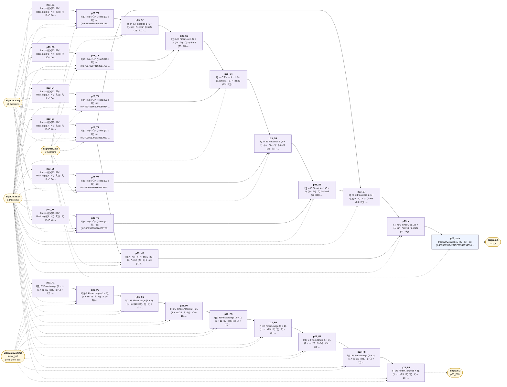
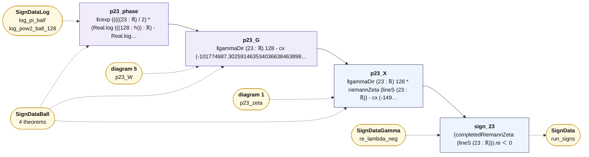

# `lean_stage3/Stage3/SignDataPt23.lean`

> **Read from the source text.** This file changed after the last `python3 utilities/lean_map.py --dump`, so the arrows on this page are names occurring in each proof and have not been confirmed by Lean.

SignDataPt23 — block S14 of `lean_stage3/design/stencil.md`, Turing's sign data: the sign of `Re Λ(1/2 + it)` at `t = 23.0`. 2026-11-25. Generated by `lean_stage3/checks/signdata/gen_signdata.py`; do not edit by hand.

154 theorems, 0 definitions, 802 lines. 

**Imports:** [`SignDataGamma`](../lean_stage3/SignDataGamma.md), [`SignDataLog`](../lean_stage3/SignDataLog.md)  
**Imported by:** [`SignData`](../lean_stage3/SignData.md)

## The picture

### Diagram 1 of 6: `p23_E2` to `p23_P9`



### Diagram 2 of 6: `p23_P10` to `p23_P39`

```mermaid
flowchart LR
  n0["<b>p23_P10</b><br/>‖∏ j ∈ Finset.range (9 + 1), (1 + zz (23 : ℝ) / ((j : ℂ) + 1)) -…"]:::shp
  n1["<b>p23_P11</b><br/>‖∏ j ∈ Finset.range (10 + 1), (1 + zz (23 : ℝ) / ((j : ℂ) + 1)) …"]:::shp
  n2["<b>p23_P12</b><br/>‖∏ j ∈ Finset.range (11 + 1), (1 + zz (23 : ℝ) / ((j : ℂ) + 1)) …"]:::shp
  n3["<b>p23_P13</b><br/>‖∏ j ∈ Finset.range (12 + 1), (1 + zz (23 : ℝ) / ((j : ℂ) + 1)) …"]:::shp
  n4["<b>p23_P14</b><br/>‖∏ j ∈ Finset.range (13 + 1), (1 + zz (23 : ℝ) / ((j : ℂ) + 1)) …"]:::shp
  n5["<b>p23_P15</b><br/>‖∏ j ∈ Finset.range (14 + 1), (1 + zz (23 : ℝ) / ((j : ℂ) + 1)) …"]:::shp
  n6["<b>p23_P16</b><br/>‖∏ j ∈ Finset.range (15 + 1), (1 + zz (23 : ℝ) / ((j : ℂ) + 1)) …"]:::shp
  n7["<b>p23_P17</b><br/>‖∏ j ∈ Finset.range (16 + 1), (1 + zz (23 : ℝ) / ((j : ℂ) + 1)) …"]:::shp
  n8["<b>p23_P18</b><br/>‖∏ j ∈ Finset.range (17 + 1), (1 + zz (23 : ℝ) / ((j : ℂ) + 1)) …"]:::shp
  n9["<b>p23_P19</b><br/>‖∏ j ∈ Finset.range (18 + 1), (1 + zz (23 : ℝ) / ((j : ℂ) + 1)) …"]:::shp
  n10["<b>p23_P20</b><br/>‖∏ j ∈ Finset.range (19 + 1), (1 + zz (23 : ℝ) / ((j : ℂ) + 1)) …"]:::shp
  n11["<b>p23_P21</b><br/>‖∏ j ∈ Finset.range (20 + 1), (1 + zz (23 : ℝ) / ((j : ℂ) + 1)) …"]:::shp
  n12["<b>p23_P22</b><br/>‖∏ j ∈ Finset.range (21 + 1), (1 + zz (23 : ℝ) / ((j : ℂ) + 1)) …"]:::shp
  n13["<b>p23_P23</b><br/>‖∏ j ∈ Finset.range (22 + 1), (1 + zz (23 : ℝ) / ((j : ℂ) + 1)) …"]:::shp
  n14["<b>p23_P24</b><br/>‖∏ j ∈ Finset.range (23 + 1), (1 + zz (23 : ℝ) / ((j : ℂ) + 1)) …"]:::shp
  n15["<b>p23_P25</b><br/>‖∏ j ∈ Finset.range (24 + 1), (1 + zz (23 : ℝ) / ((j : ℂ) + 1)) …"]:::shp
  n16["<b>p23_P26</b><br/>‖∏ j ∈ Finset.range (25 + 1), (1 + zz (23 : ℝ) / ((j : ℂ) + 1)) …"]:::shp
  n17["<b>p23_P27</b><br/>‖∏ j ∈ Finset.range (26 + 1), (1 + zz (23 : ℝ) / ((j : ℂ) + 1)) …"]:::shp
  n18["<b>p23_P28</b><br/>‖∏ j ∈ Finset.range (27 + 1), (1 + zz (23 : ℝ) / ((j : ℂ) + 1)) …"]:::shp
  n19["<b>p23_P29</b><br/>‖∏ j ∈ Finset.range (28 + 1), (1 + zz (23 : ℝ) / ((j : ℂ) + 1)) …"]:::shp
  n20["<b>p23_P30</b><br/>‖∏ j ∈ Finset.range (29 + 1), (1 + zz (23 : ℝ) / ((j : ℂ) + 1)) …"]:::shp
  n21["<b>p23_P31</b><br/>‖∏ j ∈ Finset.range (30 + 1), (1 + zz (23 : ℝ) / ((j : ℂ) + 1)) …"]:::shp
  n22["<b>p23_P32</b><br/>‖∏ j ∈ Finset.range (31 + 1), (1 + zz (23 : ℝ) / ((j : ℂ) + 1)) …"]:::shp
  n23["<b>p23_P33</b><br/>‖∏ j ∈ Finset.range (32 + 1), (1 + zz (23 : ℝ) / ((j : ℂ) + 1)) …"]:::shp
  n24["<b>p23_P34</b><br/>‖∏ j ∈ Finset.range (33 + 1), (1 + zz (23 : ℝ) / ((j : ℂ) + 1)) …"]:::shp
  n25["<b>p23_P35</b><br/>‖∏ j ∈ Finset.range (34 + 1), (1 + zz (23 : ℝ) / ((j : ℂ) + 1)) …"]:::shp
  n26["<b>p23_P36</b><br/>‖∏ j ∈ Finset.range (35 + 1), (1 + zz (23 : ℝ) / ((j : ℂ) + 1)) …"]:::shp
  n27["<b>p23_P37</b><br/>‖∏ j ∈ Finset.range (36 + 1), (1 + zz (23 : ℝ) / ((j : ℂ) + 1)) …"]:::shp
  n28["<b>p23_P38</b><br/>‖∏ j ∈ Finset.range (37 + 1), (1 + zz (23 : ℝ) / ((j : ℂ) + 1)) …"]:::shp
  n29["<b>p23_P39</b><br/>‖∏ j ∈ Finset.range (38 + 1), (1 + zz (23 : ℝ) / ((j : ℂ) + 1)) …"]:::shp
  x0(["<b>SignDataBall</b><br/>ball_mul"]):::ext
  x1(["<b>SignDataGamma</b><br/>factor_ball"]):::ext
  x2(["<b>diagram 1</b><br/>p23_P9"]):::ext
  x3(["<b>diagram 3</b><br/>p23_P40"]):::ext
  n0 --> n1
  n1 --> n2
  n10 --> n11
  n11 --> n12
  n12 --> n13
  n13 --> n14
  n14 --> n15
  n15 --> n16
  n16 --> n17
  n17 --> n18
  n18 --> n19
  n19 --> n20
  n2 --> n3
  n20 --> n21
  n21 --> n22
  n22 --> n23
  n23 --> n24
  n24 --> n25
  n25 --> n26
  n26 --> n27
  n27 --> n28
  n28 --> n29
  n3 --> n4
  n4 --> n5
  n5 --> n6
  n6 --> n7
  n7 --> n8
  n8 --> n9
  n9 --> n10
  n29 -.-> x3
  x0 -.-> n0
  x0 -.-> n1
  x0 -.-> n10
  x0 -.-> n11
  x0 -.-> n12
  x0 -.-> n13
  x0 -.-> n14
  x0 -.-> n15
  x0 -.-> n16
  x0 -.-> n17
  x0 -.-> n18
  x0 -.-> n19
  x0 -.-> n2
  x0 -.-> n20
  x0 -.-> n21
  x0 -.-> n22
  x0 -.-> n23
  x0 -.-> n24
  x0 -.-> n25
  x0 -.-> n26
  x0 -.-> n27
  x0 -.-> n28
  x0 -.-> n29
  x0 -.-> n3
  x0 -.-> n4
  x0 -.-> n5
  x0 -.-> n6
  x0 -.-> n7
  x0 -.-> n8
  x0 -.-> n9
  x1 -.-> n0
  x1 -.-> n1
  x1 -.-> n10
  x1 -.-> n11
  x1 -.-> n12
  x1 -.-> n13
  x1 -.-> n14
  x1 -.-> n15
  x1 -.-> n16
  x1 -.-> n17
  x1 -.-> n18
  x1 -.-> n19
  x1 -.-> n2
  x1 -.-> n20
  x1 -.-> n21
  x1 -.-> n22
  x1 -.-> n23
  x1 -.-> n24
  x1 -.-> n25
  x1 -.-> n26
  x1 -.-> n27
  x1 -.-> n28
  x1 -.-> n29
  x1 -.-> n3
  x1 -.-> n4
  x1 -.-> n5
  x1 -.-> n6
  x1 -.-> n7
  x1 -.-> n8
  x1 -.-> n9
  x2 -.-> n0
  classDef cnt fill:#dff5ec,stroke:#17694a,color:#111
  classDef shp fill:#f1ecfb,stroke:#5b3fa0,color:#111
  classDef rh fill:#ffe5e5,stroke:#c22,color:#111,stroke-width:2px
  classDef thm fill:#eef4ff,stroke:#335,color:#111
  classDef end_ fill:#e7f7e7,stroke:#2a7,color:#111,stroke-width:2px
  classDef lone fill:#fff,stroke:#999,color:#111,stroke-dasharray:4 3
  classDef bad fill:#ffe5e5,stroke:#c22,color:#111,stroke-width:2px
  classDef ext fill:#fff8e1,stroke:#b80,color:#111
```



### Diagram 3 of 6: `p23_P40` to `p23_P69`


### Diagram 4 of 6: `p23_P70` to `p23_P99`


### Diagram 5 of 6: `p23_P100` to `p23_W`

```mermaid
flowchart LR
  n0["<b>p23_P100</b><br/>‖∏ j ∈ Finset.range (99 + 1), (1 + zz (23 : ℝ) / ((j : ℂ) + 1)) …"]:::shp
  n1["<b>p23_P101</b><br/>‖∏ j ∈ Finset.range (100 + 1), (1 + zz (23 : ℝ) / ((j : ℂ) + 1))…"]:::shp
  n2["<b>p23_P102</b><br/>‖∏ j ∈ Finset.range (101 + 1), (1 + zz (23 : ℝ) / ((j : ℂ) + 1))…"]:::shp
  n3["<b>p23_P103</b><br/>‖∏ j ∈ Finset.range (102 + 1), (1 + zz (23 : ℝ) / ((j : ℂ) + 1))…"]:::shp
  n4["<b>p23_P104</b><br/>‖∏ j ∈ Finset.range (103 + 1), (1 + zz (23 : ℝ) / ((j : ℂ) + 1))…"]:::shp
  n5["<b>p23_P105</b><br/>‖∏ j ∈ Finset.range (104 + 1), (1 + zz (23 : ℝ) / ((j : ℂ) + 1))…"]:::shp
  n6["<b>p23_P106</b><br/>‖∏ j ∈ Finset.range (105 + 1), (1 + zz (23 : ℝ) / ((j : ℂ) + 1))…"]:::shp
  n7["<b>p23_P107</b><br/>‖∏ j ∈ Finset.range (106 + 1), (1 + zz (23 : ℝ) / ((j : ℂ) + 1))…"]:::shp
  n8["<b>p23_P108</b><br/>‖∏ j ∈ Finset.range (107 + 1), (1 + zz (23 : ℝ) / ((j : ℂ) + 1))…"]:::shp
  n9["<b>p23_P109</b><br/>‖∏ j ∈ Finset.range (108 + 1), (1 + zz (23 : ℝ) / ((j : ℂ) + 1))…"]:::shp
  n10["<b>p23_P110</b><br/>‖∏ j ∈ Finset.range (109 + 1), (1 + zz (23 : ℝ) / ((j : ℂ) + 1))…"]:::shp
  n11["<b>p23_P111</b><br/>‖∏ j ∈ Finset.range (110 + 1), (1 + zz (23 : ℝ) / ((j : ℂ) + 1))…"]:::shp
  n12["<b>p23_P112</b><br/>‖∏ j ∈ Finset.range (111 + 1), (1 + zz (23 : ℝ) / ((j : ℂ) + 1))…"]:::shp
  n13["<b>p23_P113</b><br/>‖∏ j ∈ Finset.range (112 + 1), (1 + zz (23 : ℝ) / ((j : ℂ) + 1))…"]:::shp
  n14["<b>p23_P114</b><br/>‖∏ j ∈ Finset.range (113 + 1), (1 + zz (23 : ℝ) / ((j : ℂ) + 1))…"]:::shp
  n15["<b>p23_P115</b><br/>‖∏ j ∈ Finset.range (114 + 1), (1 + zz (23 : ℝ) / ((j : ℂ) + 1))…"]:::shp
  n16["<b>p23_P116</b><br/>‖∏ j ∈ Finset.range (115 + 1), (1 + zz (23 : ℝ) / ((j : ℂ) + 1))…"]:::shp
  n17["<b>p23_P117</b><br/>‖∏ j ∈ Finset.range (116 + 1), (1 + zz (23 : ℝ) / ((j : ℂ) + 1))…"]:::shp
  n18["<b>p23_P118</b><br/>‖∏ j ∈ Finset.range (117 + 1), (1 + zz (23 : ℝ) / ((j : ℂ) + 1))…"]:::shp
  n19["<b>p23_P119</b><br/>‖∏ j ∈ Finset.range (118 + 1), (1 + zz (23 : ℝ) / ((j : ℂ) + 1))…"]:::shp
  n20["<b>p23_P120</b><br/>‖∏ j ∈ Finset.range (119 + 1), (1 + zz (23 : ℝ) / ((j : ℂ) + 1))…"]:::shp
  n21["<b>p23_P121</b><br/>‖∏ j ∈ Finset.range (120 + 1), (1 + zz (23 : ℝ) / ((j : ℂ) + 1))…"]:::shp
  n22["<b>p23_P122</b><br/>‖∏ j ∈ Finset.range (121 + 1), (1 + zz (23 : ℝ) / ((j : ℂ) + 1))…"]:::shp
  n23["<b>p23_P123</b><br/>‖∏ j ∈ Finset.range (122 + 1), (1 + zz (23 : ℝ) / ((j : ℂ) + 1))…"]:::shp
  n24["<b>p23_P124</b><br/>‖∏ j ∈ Finset.range (123 + 1), (1 + zz (23 : ℝ) / ((j : ℂ) + 1))…"]:::shp
  n25["<b>p23_P125</b><br/>‖∏ j ∈ Finset.range (124 + 1), (1 + zz (23 : ℝ) / ((j : ℂ) + 1))…"]:::shp
  n26["<b>p23_P126</b><br/>‖∏ j ∈ Finset.range (125 + 1), (1 + zz (23 : ℝ) / ((j : ℂ) + 1))…"]:::shp
  n27["<b>p23_P127</b><br/>‖∏ j ∈ Finset.range (126 + 1), (1 + zz (23 : ℝ) / ((j : ℂ) + 1))…"]:::shp
  n28["<b>p23_P128</b><br/>‖∏ j ∈ Finset.range (127 + 1), (1 + zz (23 : ℝ) / ((j : ℂ) + 1))…"]:::shp
  n29["<b>p23_W</b><br/>‖zz (23 : ℝ) * ∏ j ∈ Finset.range (127 + 1), (1 + zz (23 : ℝ) / …"]:::shp
  x0(["<b>SignDataBall</b><br/>ball_mul"]):::ext
  x1(["<b>SignDataGamma</b><br/>factor_ball<br/>zz_ball"]):::ext
  x2(["<b>diagram 4</b><br/>p23_P99"]):::ext
  x3(["<b>diagram 6</b><br/>p23_G"]):::ext
  n0 --> n1
  n1 --> n2
  n10 --> n11
  n11 --> n12
  n12 --> n13
  n13 --> n14
  n14 --> n15
  n15 --> n16
  n16 --> n17
  n17 --> n18
  n18 --> n19
  n19 --> n20
  n2 --> n3
  n20 --> n21
  n21 --> n22
  n22 --> n23
  n23 --> n24
  n24 --> n25
  n25 --> n26
  n26 --> n27
  n27 --> n28
  n28 --> n29
  n3 --> n4
  n4 --> n5
  n5 --> n6
  n6 --> n7
  n7 --> n8
  n8 --> n9
  n9 --> n10
  n29 -.-> x3
  x0 -.-> n0
  x0 -.-> n1
  x0 -.-> n10
  x0 -.-> n11
  x0 -.-> n12
  x0 -.-> n13
  x0 -.-> n14
  x0 -.-> n15
  x0 -.-> n16
  x0 -.-> n17
  x0 -.-> n18
  x0 -.-> n19
  x0 -.-> n2
  x0 -.-> n20
  x0 -.-> n21
  x0 -.-> n22
  x0 -.-> n23
  x0 -.-> n24
  x0 -.-> n25
  x0 -.-> n26
  x0 -.-> n27
  x0 -.-> n28
  x0 -.-> n29
  x0 -.-> n3
  x0 -.-> n4
  x0 -.-> n5
  x0 -.-> n6
  x0 -.-> n7
  x0 -.-> n8
  x0 -.-> n9
  x1 -.-> n0
  x1 -.-> n1
  x1 -.-> n10
  x1 -.-> n11
  x1 -.-> n12
  x1 -.-> n13
  x1 -.-> n14
  x1 -.-> n15
  x1 -.-> n16
  x1 -.-> n17
  x1 -.-> n18
  x1 -.-> n19
  x1 -.-> n2
  x1 -.-> n20
  x1 -.-> n21
  x1 -.-> n22
  x1 -.-> n23
  x1 -.-> n24
  x1 -.-> n25
  x1 -.-> n26
  x1 -.-> n27
  x1 -.-> n28
  x1 -.-> n29
  x1 -.-> n3
  x1 -.-> n4
  x1 -.-> n5
  x1 -.-> n6
  x1 -.-> n7
  x1 -.-> n8
  x1 -.-> n9
  x2 -.-> n0
  classDef cnt fill:#dff5ec,stroke:#17694a,color:#111
  classDef shp fill:#f1ecfb,stroke:#5b3fa0,color:#111
  classDef rh fill:#ffe5e5,stroke:#c22,color:#111,stroke-width:2px
  classDef thm fill:#eef4ff,stroke:#335,color:#111
  classDef end_ fill:#e7f7e7,stroke:#2a7,color:#111,stroke-width:2px
  classDef lone fill:#fff,stroke:#999,color:#111,stroke-dasharray:4 3
  classDef bad fill:#ffe5e5,stroke:#c22,color:#111,stroke-width:2px
  classDef ext fill:#fff8e1,stroke:#b80,color:#111
```



### Diagram 6 of 6: `p23_phase` to `sign_23`



An arrow A → B reads "A is used in the proof of B". Green: counting, integers only. Violet: shape, analysis with no ζ. Blue: reads ζ. A name ending in ■ is an end: nothing else uses it. Red: contains `sorry`. Yellow: theorems in another file, counted; a dotted arrow crosses files. Definitions are not drawn; they are listed below the diagram.

## Theorems

<a name="SignData-p23_E2"></a>
### `SignData.p23_E2`

line 31 · arrows read from text

**Shape.** Uses real or complex analysis; nothing in it or beneath it reads ζ.

**Proves**

```lean
‖cexp ((((-((23 : ℝ) * Real.log (((2 : ℕ)) : ℝ))) : ℝ) : ℂ) * Complex.I) - cx (-(0.972648788901772903320750690992)) (-(-0.232280721214470169499063823606))‖ ≤ (0.000000005750000000050000000001)
```

**Fed by** (3 theorems its proof uses)

  - [`SignData.exp_ball2`](../lean_stage3/SignDataBall.md#SignData-exp_ball2) (SignDataBall) — `` ‖cexp ((x : ℂ) * I) - cx (-e) (-f)‖ ≤ R ``
  - [`SignData.neg_mul_ball`](../lean_stage3/SignDataBall.md#SignData-neg_mul_ball) (SignDataBall) — `` |-(t * x) - -(t * a)| ≤ |t| * e ``
  - [`SignData.log_ball_2`](../lean_stage3/SignDataLog.md#SignData-log_ball_2) (SignDataLog) — `` |Real.log ((2 : ℕ) : ℝ) - (0.69314718055)| ≤ (0.00000000025) ``

**Definitions its proof touches:** [`SignData.cosP`](../lean_stage3/SignDataBall.md#SignData-cosP), [`SignData.cx`](../lean_stage3/SignDataBall.md#SignData-cx), [`SignData.sinP`](../lean_stage3/SignDataBall.md#SignData-sinP)

**Feeds** (1 that use it)

  - [`SignData.p23_T2`](#SignData-p23_T2) — `` ‖(((2 : ℕ)) : ℂ) ^ (-lineS (23 : ℝ)) - cx (-0.687766554345326386541265429274) (0.16424727310965380568360950344)‖ ≤ (0.000000004065863991858003604367) ``

<a name="SignData-p23_T2"></a>
### `SignData.p23_T2`

line 37 · arrows read from text

**Shape.** Uses real or complex analysis; nothing in it or beneath it reads ζ.

**Proves**

```lean
‖(((2 : ℕ)) : ℂ) ^ (-lineS (23 : ℝ)) - cx (-0.687766554345326386541265429274) (0.16424727310965380568360950344)‖ ≤ (0.000000004065863991858003604367)
```

**Fed by** (5 theorems its proof uses)

  - [`SignData.ball_mul`](../lean_stage3/SignDataBall.md#SignData-ball_mul) (SignDataBall) — `` ‖z * w - cx e f‖ ≤ R ``
  - [`SignData.ball_ofReal`](../lean_stage3/SignDataBall.md#SignData-ball_ofReal) (SignDataBall) — `` ‖(x : ℂ) - cx c 0‖ ≤ e ``
  - [`SignData.isqrt_ball_2`](../lean_stage3/SignDataLog.md#SignData-isqrt_ball_2) (SignDataLog) — `` |(Real.sqrt (((2 : ℕ)) : ℝ))⁻¹ - (0.707106781186547524400844362104)| ≤ (0.000000000000000000000000000001) ``
  - [`SignData.p23_E2`](#SignData-p23_E2) — `` ‖cexp ((((-((23 : ℝ) * Real.log (((2 : ℕ)) : ℝ))) : ℝ) : ℂ) * Complex.I) - cx (-(0.972648788901772903320750690992)) (-(-0.2322807212144701694990638236… ``
  - [`SignData.natCast_cpow_line`](../lean_stage3/SignDataZeta.md#SignData-natCast_cpow_line) (SignDataZeta) — `` (m : ℂ) ^ (-lineS t) = (((Real.sqrt m)⁻¹ : ℝ) : ℂ) * cexp (((-(t * Real.log m)) : ℝ) * I) ``

**Definitions its proof touches:** [`SignData.cx`](../lean_stage3/SignDataBall.md#SignData-cx), [`SignData.lineS`](../lean_stage3/SignDataZeta.md#SignData-lineS)

**Feeds** (1 that use it)

  - [`SignData.p23_S2`](#SignData-p23_S2) — `` ‖∑ m ∈ Finset.Icc 1 (1 + 1), ((m : ℕ) : ℂ) ^ (-lineS (23 : ℝ)) - cx (0.312233445654673613458734570726) (0.16424727310965380568360950344)‖ ≤ (0.0000000… ``

<a name="SignData-p23_E3"></a>
### `SignData.p23_E3`

line 41 · arrows read from text

**Shape.** Uses real or complex analysis; nothing in it or beneath it reads ζ.

**Proves**

```lean
‖cexp ((((-((23 : ℝ) * Real.log (((3 : ℕ)) : ℝ))) : ℝ) : ℂ) * Complex.I) - cx (0.990855322920647105540828705576) (-0.134928607195880246862654609362)‖ ≤ (0.000000005750167564365551337755)
```

**Fed by** (3 theorems its proof uses)

  - [`SignData.exp_ball0`](../lean_stage3/SignDataBall.md#SignData-exp_ball0) (SignDataBall) — `` ‖cexp ((x : ℂ) * I) - cx e f‖ ≤ R ``
  - [`SignData.neg_mul_ball`](../lean_stage3/SignDataBall.md#SignData-neg_mul_ball) (SignDataBall) — `` |-(t * x) - -(t * a)| ≤ |t| * e ``
  - [`SignData.log_ball_3`](../lean_stage3/SignDataLog.md#SignData-log_ball_3) (SignDataLog) — `` |Real.log (((3 : ℕ)) : ℝ) - (1.098612288658164142930964760306)| ≤ (0.000000000250007285403624428292) ``

**Definitions its proof touches:** [`SignData.cosP`](../lean_stage3/SignDataBall.md#SignData-cosP), [`SignData.cx`](../lean_stage3/SignDataBall.md#SignData-cx), [`SignData.sinP`](../lean_stage3/SignDataBall.md#SignData-sinP)

**Feeds** (1 that use it)

  - [`SignData.p23_T3`](#SignData-p23_T3) — `` ‖(((3 : ℕ)) : ℂ) ^ (-lineS (23 : ℝ)) - cx (0.572070587416209170164856041729) (-0.077901067685922736511613470042)‖ ≤ (0.000000003319860791171905799637) ``

<a name="SignData-p23_T3"></a>
### `SignData.p23_T3`

line 47 · arrows read from text

**Shape.** Uses real or complex analysis; nothing in it or beneath it reads ζ.

**Proves**

```lean
‖(((3 : ℕ)) : ℂ) ^ (-lineS (23 : ℝ)) - cx (0.572070587416209170164856041729) (-0.077901067685922736511613470042)‖ ≤ (0.000000003319860791171905799637)
```

**Fed by** (5 theorems its proof uses)

  - [`SignData.ball_mul`](../lean_stage3/SignDataBall.md#SignData-ball_mul) (SignDataBall) — `` ‖z * w - cx e f‖ ≤ R ``
  - [`SignData.ball_ofReal`](../lean_stage3/SignDataBall.md#SignData-ball_ofReal) (SignDataBall) — `` ‖(x : ℂ) - cx c 0‖ ≤ e ``
  - [`SignData.isqrt_ball_3`](../lean_stage3/SignDataLog.md#SignData-isqrt_ball_3) (SignDataLog) — `` |(Real.sqrt (((3 : ℕ)) : ℝ))⁻¹ - (0.577350269189625764509148780502)| ≤ (0.000000000000000000000000000001) ``
  - [`SignData.p23_E3`](#SignData-p23_E3) — `` ‖cexp ((((-((23 : ℝ) * Real.log (((3 : ℕ)) : ℝ))) : ℝ) : ℂ) * Complex.I) - cx (0.990855322920647105540828705576) (-0.134928607195880246862654609362)‖ … ``
  - [`SignData.natCast_cpow_line`](../lean_stage3/SignDataZeta.md#SignData-natCast_cpow_line) (SignDataZeta) — `` (m : ℂ) ^ (-lineS t) = (((Real.sqrt m)⁻¹ : ℝ) : ℂ) * cexp (((-(t * Real.log m)) : ℝ) * I) ``

**Definitions its proof touches:** [`SignData.cx`](../lean_stage3/SignDataBall.md#SignData-cx), [`SignData.lineS`](../lean_stage3/SignDataZeta.md#SignData-lineS)

**Feeds** (1 that use it)

  - [`SignData.p23_S3`](#SignData-p23_S3) — `` ‖∑ m ∈ Finset.Icc 1 (2 + 1), ((m : ℕ) : ℂ) ^ (-lineS (23 : ℝ)) - cx (0.884304033070882783623590612455) (0.086346205423731069171996033398)‖ ≤ (0.000000… ``

<a name="SignData-p23_E4"></a>
### `SignData.p23_E4`

line 51 · arrows read from text

**Shape.** Uses real or complex analysis; nothing in it or beneath it reads ζ.

**Proves**

```lean
‖cexp ((((-((23 : ℝ) * Real.log (((4 : ℕ)) : ℝ))) : ℝ) : ℂ) * Complex.I) - cx (0.892091333000817386822689575823) (-0.451855124553019475434463635465)‖ ≤ (0.000000005750276514273261390499)
```

**Fed by** (3 theorems its proof uses)

  - [`SignData.exp_ball0`](../lean_stage3/SignDataBall.md#SignData-exp_ball0) (SignDataBall) — `` ‖cexp ((x : ℂ) * I) - cx e f‖ ≤ R ``
  - [`SignData.neg_mul_ball`](../lean_stage3/SignDataBall.md#SignData-neg_mul_ball) (SignDataBall) — `` |-(t * x) - -(t * a)| ≤ |t| * e ``
  - [`SignData.log_ball_4`](../lean_stage3/SignDataLog.md#SignData-log_ball_4) (SignDataLog) — `` |Real.log (((4 : ℕ)) : ℝ) - (1.386294361109944875563750019823)| ≤ (0.000000000250012022355196162294) ``

**Definitions its proof touches:** [`SignData.cosP`](../lean_stage3/SignDataBall.md#SignData-cosP), [`SignData.cx`](../lean_stage3/SignDataBall.md#SignData-cx), [`SignData.sinP`](../lean_stage3/SignDataBall.md#SignData-sinP)

**Feeds** (1 that use it)

  - [`SignData.p23_T4`](#SignData-p23_T4) — `` ‖(((4 : ℕ)) : ℂ) ^ (-lineS (23 : ℝ)) - cx (0.446045666500408693411344787912) (-0.225927562276509737717231817732)‖ ≤ (0.000000002875138257136630695252) ``

<a name="SignData-p23_T4"></a>
### `SignData.p23_T4`

line 57 · arrows read from text

**Shape.** Uses real or complex analysis; nothing in it or beneath it reads ζ.

**Proves**

```lean
‖(((4 : ℕ)) : ℂ) ^ (-lineS (23 : ℝ)) - cx (0.446045666500408693411344787912) (-0.225927562276509737717231817732)‖ ≤ (0.000000002875138257136630695252)
```

**Fed by** (5 theorems its proof uses)

  - [`SignData.ball_mul`](../lean_stage3/SignDataBall.md#SignData-ball_mul) (SignDataBall) — `` ‖z * w - cx e f‖ ≤ R ``
  - [`SignData.ball_ofReal`](../lean_stage3/SignDataBall.md#SignData-ball_ofReal) (SignDataBall) — `` ‖(x : ℂ) - cx c 0‖ ≤ e ``
  - [`SignData.isqrt_ball_4`](../lean_stage3/SignDataLog.md#SignData-isqrt_ball_4) (SignDataLog) — `` |(Real.sqrt (((4 : ℕ)) : ℝ))⁻¹ - (0.5)| ≤ (0.000000000000000000000000000001) ``
  - [`SignData.p23_E4`](#SignData-p23_E4) — `` ‖cexp ((((-((23 : ℝ) * Real.log (((4 : ℕ)) : ℝ))) : ℝ) : ℂ) * Complex.I) - cx (0.892091333000817386822689575823) (-0.451855124553019475434463635465)‖ … ``
  - [`SignData.natCast_cpow_line`](../lean_stage3/SignDataZeta.md#SignData-natCast_cpow_line) (SignDataZeta) — `` (m : ℂ) ^ (-lineS t) = (((Real.sqrt m)⁻¹ : ℝ) : ℂ) * cexp (((-(t * Real.log m)) : ℝ) * I) ``

**Definitions its proof touches:** [`SignData.cx`](../lean_stage3/SignDataBall.md#SignData-cx), [`SignData.lineS`](../lean_stage3/SignDataZeta.md#SignData-lineS)

**Feeds** (1 that use it)

  - [`SignData.p23_S4`](#SignData-p23_S4) — `` ‖∑ m ∈ Finset.Icc 1 (3 + 1), ((m : ℕ) : ℂ) ^ (-lineS (23 : ℝ)) - cx (1.330349699571291477034935400367) (-0.139581356852778668545235784334)‖ ≤ (0.00000… ``

<a name="SignData-p23_E5"></a>
### `SignData.p23_E5`

line 61 · arrows read from text

**Shape.** Uses real or complex analysis; nothing in it or beneath it reads ζ.

**Proves**

```lean
‖cexp ((((-((23 : ℝ) * Real.log (((5 : ℕ)) : ℝ))) : ℝ) : ℂ) * Complex.I) - cx (0.776288453839965963953583023808) (0.630377852113123524540475398874)‖ ≤ (0.000000005750336807411429914096)
```

**Fed by** (3 theorems its proof uses)

  - [`SignData.exp_ball0`](../lean_stage3/SignDataBall.md#SignData-exp_ball0) (SignDataBall) — `` ‖cexp ((x : ℂ) * I) - cx e f‖ ≤ R ``
  - [`SignData.neg_mul_ball`](../lean_stage3/SignDataBall.md#SignData-neg_mul_ball) (SignDataBall) — `` |-(t * x) - -(t * a)| ≤ |t| * e ``
  - [`SignData.log_ball_5`](../lean_stage3/SignDataLog.md#SignData-log_ball_5) (SignDataLog) — `` |Real.log (((5 : ℕ)) : ℝ) - (1.609437912424154507888186373287)| ≤ (0.000000000250014643795196162295) ``

**Definitions its proof touches:** [`SignData.cosP`](../lean_stage3/SignDataBall.md#SignData-cosP), [`SignData.cx`](../lean_stage3/SignDataBall.md#SignData-cx), [`SignData.sinP`](../lean_stage3/SignDataBall.md#SignData-sinP)

**Feeds** (1 that use it)

  - [`SignData.p23_T5`](#SignData-p23_T5) — `` ‖(((5 : ℕ)) : ℂ) ^ (-lineS (23 : ℝ)) - cx (0.347166750586874309087433346075) (0.281913545767050730000203132431)‖ ≤ (0.000000002571628798978214756386) ``

<a name="SignData-p23_T5"></a>
### `SignData.p23_T5`

line 67 · arrows read from text

**Shape.** Uses real or complex analysis; nothing in it or beneath it reads ζ.

**Proves**

```lean
‖(((5 : ℕ)) : ℂ) ^ (-lineS (23 : ℝ)) - cx (0.347166750586874309087433346075) (0.281913545767050730000203132431)‖ ≤ (0.000000002571628798978214756386)
```

**Fed by** (5 theorems its proof uses)

  - [`SignData.ball_mul`](../lean_stage3/SignDataBall.md#SignData-ball_mul) (SignDataBall) — `` ‖z * w - cx e f‖ ≤ R ``
  - [`SignData.ball_ofReal`](../lean_stage3/SignDataBall.md#SignData-ball_ofReal) (SignDataBall) — `` ‖(x : ℂ) - cx c 0‖ ≤ e ``
  - [`SignData.isqrt_ball_5`](../lean_stage3/SignDataLog.md#SignData-isqrt_ball_5) (SignDataLog) — `` |(Real.sqrt (((5 : ℕ)) : ℝ))⁻¹ - (0.447213595499957939281834733746)| ≤ (0.000000000000000000000000000001) ``
  - [`SignData.p23_E5`](#SignData-p23_E5) — `` ‖cexp ((((-((23 : ℝ) * Real.log (((5 : ℕ)) : ℝ))) : ℝ) : ℂ) * Complex.I) - cx (0.776288453839965963953583023808) (0.630377852113123524540475398874)‖ ≤… ``
  - [`SignData.natCast_cpow_line`](../lean_stage3/SignDataZeta.md#SignData-natCast_cpow_line) (SignDataZeta) — `` (m : ℂ) ^ (-lineS t) = (((Real.sqrt m)⁻¹ : ℝ) : ℂ) * cexp (((-(t * Real.log m)) : ℝ) * I) ``

**Definitions its proof touches:** [`SignData.cx`](../lean_stage3/SignDataBall.md#SignData-cx), [`SignData.lineS`](../lean_stage3/SignDataZeta.md#SignData-lineS)

**Feeds** (1 that use it)

  - [`SignData.p23_S5`](#SignData-p23_S5) — `` ‖∑ m ∈ Finset.Icc 1 (4 + 1), ((m : ℕ) : ℂ) ^ (-lineS (23 : ℝ)) - cx (1.677516450158165786122368746442) (0.142332188914272061454967348097)‖ ≤ (0.000000… ``

<a name="SignData-p23_E6"></a>
### `SignData.p23_E6`

line 71 · arrows read from text

**Shape.** Uses real or complex analysis; nothing in it or beneath it reads ζ.

**Proves**

```lean
‖cexp ((((-((23 : ℝ) * Real.log (((6 : ℕ)) : ℝ))) : ℝ) : ℂ) * Complex.I) - cx (-(0.932412915541056797111659273843)) (-(-0.361394735617753685004218887114))‖ ≤ (0.000000005750382100862453483437)
```

**Fed by** (3 theorems its proof uses)

  - [`SignData.exp_ball2`](../lean_stage3/SignDataBall.md#SignData-exp_ball2) (SignDataBall) — `` ‖cexp ((x : ℂ) * I) - cx (-e) (-f)‖ ≤ R ``
  - [`SignData.neg_mul_ball`](../lean_stage3/SignDataBall.md#SignData-neg_mul_ball) (SignDataBall) — `` |-(t * x) - -(t * a)| ≤ |t| * e ``
  - [`SignData.log_ball_6`](../lean_stage3/SignDataLog.md#SignData-log_ball_6) (SignDataLog) — `` |Real.log (((6 : ℕ)) : ℝ) - (1.791759469218109031470825672761)| ≤ (0.000000000250016613075280171998) ``

**Definitions its proof touches:** [`SignData.cosP`](../lean_stage3/SignDataBall.md#SignData-cosP), [`SignData.cx`](../lean_stage3/SignDataBall.md#SignData-cx), [`SignData.sinP`](../lean_stage3/SignDataBall.md#SignData-sinP)

**Feeds** (1 that use it)

  - [`SignData.p23_T6`](#SignData-p23_T6) — `` ‖(((6 : ℕ)) : ℂ) ^ (-lineS (23 : ℝ)) - cx (-0.380655978776062729715402390405) (0.14753878299858768770669266713)‖ ≤ (0.000000002347583662191093746384) ``

<a name="SignData-p23_T6"></a>
### `SignData.p23_T6`

line 77 · arrows read from text

**Shape.** Uses real or complex analysis; nothing in it or beneath it reads ζ.

**Proves**

```lean
‖(((6 : ℕ)) : ℂ) ^ (-lineS (23 : ℝ)) - cx (-0.380655978776062729715402390405) (0.14753878299858768770669266713)‖ ≤ (0.000000002347583662191093746384)
```

**Fed by** (5 theorems its proof uses)

  - [`SignData.ball_mul`](../lean_stage3/SignDataBall.md#SignData-ball_mul) (SignDataBall) — `` ‖z * w - cx e f‖ ≤ R ``
  - [`SignData.ball_ofReal`](../lean_stage3/SignDataBall.md#SignData-ball_ofReal) (SignDataBall) — `` ‖(x : ℂ) - cx c 0‖ ≤ e ``
  - [`SignData.isqrt_ball_6`](../lean_stage3/SignDataLog.md#SignData-isqrt_ball_6) (SignDataLog) — `` |(Real.sqrt (((6 : ℕ)) : ℝ))⁻¹ - (0.40824829046386301636621401245)| ≤ (0.000000000000000000000000000001) ``
  - [`SignData.p23_E6`](#SignData-p23_E6) — `` ‖cexp ((((-((23 : ℝ) * Real.log (((6 : ℕ)) : ℝ))) : ℝ) : ℂ) * Complex.I) - cx (-(0.932412915541056797111659273843)) (-(-0.3613947356177536850042188871… ``
  - [`SignData.natCast_cpow_line`](../lean_stage3/SignDataZeta.md#SignData-natCast_cpow_line) (SignDataZeta) — `` (m : ℂ) ^ (-lineS t) = (((Real.sqrt m)⁻¹ : ℝ) : ℂ) * cexp (((-(t * Real.log m)) : ℝ) * I) ``

**Definitions its proof touches:** [`SignData.cx`](../lean_stage3/SignDataBall.md#SignData-cx), [`SignData.lineS`](../lean_stage3/SignDataZeta.md#SignData-lineS)

**Feeds** (1 that use it)

  - [`SignData.p23_S6`](#SignData-p23_S6) — `` ‖∑ m ∈ Finset.Icc 1 (5 + 1), ((m : ℕ) : ℂ) ^ (-lineS (23 : ℝ)) - cx (1.296860471382103056406966356037) (0.289870971912859749161660015227)‖ ≤ (0.000000… ``

<a name="SignData-p23_E7"></a>
### `SignData.p23_E7`

line 81 · arrows read from text

**Shape.** Uses real or complex analysis; nothing in it or beneath it reads ζ.

**Proves**

```lean
‖cexp ((((-((23 : ℝ) * Real.log (((7 : ℕ)) : ℝ))) : ℝ) : ℂ) * Complex.I) - cx (0.715374587797404649879137841832) (-0.698741153170251870919384296803)‖ ≤ (0.000000005750497448311771335147)
```

**Fed by** (3 theorems its proof uses)

  - [`SignData.exp_ball0`](../lean_stage3/SignDataBall.md#SignData-exp_ball0) (SignDataBall) — `` ‖cexp ((x : ℂ) * I) - cx e f‖ ≤ R ``
  - [`SignData.neg_mul_ball`](../lean_stage3/SignDataBall.md#SignData-neg_mul_ball) (SignDataBall) — `` |-(t * x) - -(t * a)| ≤ |t| * e ``
  - [`SignData.log_ball_7`](../lean_stage3/SignDataLog.md#SignData-log_ball_7) (SignDataLog) — `` |Real.log (((7 : ℕ)) : ℝ) - (1.945910149045367043442249594592)| ≤ (0.000000000250021628181194999771) ``

**Definitions its proof touches:** [`SignData.cosP`](../lean_stage3/SignDataBall.md#SignData-cosP), [`SignData.cx`](../lean_stage3/SignDataBall.md#SignData-cx), [`SignData.sinP`](../lean_stage3/SignDataBall.md#SignData-sinP)

**Feeds** (1 that use it)

  - [`SignData.p23_T7`](#SignData-p23_T7) — `` ‖(((7 : ℕ)) : ℂ) ^ (-lineS (23 : ℝ)) - cx (0.270386179081039203124415609482) (-0.264099331727853971053744326788)‖ ≤ (0.00000000217348373759206453894) ``

<a name="SignData-p23_T7"></a>
### `SignData.p23_T7`

line 87 · arrows read from text

**Shape.** Uses real or complex analysis; nothing in it or beneath it reads ζ.

**Proves**

```lean
‖(((7 : ℕ)) : ℂ) ^ (-lineS (23 : ℝ)) - cx (0.270386179081039203124415609482) (-0.264099331727853971053744326788)‖ ≤ (0.00000000217348373759206453894)
```

**Fed by** (5 theorems its proof uses)

  - [`SignData.ball_mul`](../lean_stage3/SignDataBall.md#SignData-ball_mul) (SignDataBall) — `` ‖z * w - cx e f‖ ≤ R ``
  - [`SignData.ball_ofReal`](../lean_stage3/SignDataBall.md#SignData-ball_ofReal) (SignDataBall) — `` ‖(x : ℂ) - cx c 0‖ ≤ e ``
  - [`SignData.isqrt_ball_7`](../lean_stage3/SignDataLog.md#SignData-isqrt_ball_7) (SignDataLog) — `` |(Real.sqrt (((7 : ℕ)) : ℝ))⁻¹ - (0.377964473009227227214516536234)| ≤ (0.000000000000000000000000000001) ``
  - [`SignData.p23_E7`](#SignData-p23_E7) — `` ‖cexp ((((-((23 : ℝ) * Real.log (((7 : ℕ)) : ℝ))) : ℝ) : ℂ) * Complex.I) - cx (0.715374587797404649879137841832) (-0.698741153170251870919384296803)‖ … ``
  - [`SignData.natCast_cpow_line`](../lean_stage3/SignDataZeta.md#SignData-natCast_cpow_line) (SignDataZeta) — `` (m : ℂ) ^ (-lineS t) = (((Real.sqrt m)⁻¹ : ℝ) : ℂ) * cexp (((-(t * Real.log m)) : ℝ) * I) ``

**Definitions its proof touches:** [`SignData.cx`](../lean_stage3/SignDataBall.md#SignData-cx), [`SignData.lineS`](../lean_stage3/SignDataZeta.md#SignData-lineS)

**Feeds** (2 that use it)

  - [`SignData.p23_NB`](#SignData-p23_NB) — `` ‖(((7 : ℕ)) : ℂ) ^ (-lineS (23 : ℝ)) * emB (23 : ℝ) 7 - cx (-0.127924691039384960057435801151) (0.134638546663625602357172089762)‖ ≤ (0.00000000110709… ``
  - [`SignData.p23_S7`](#SignData-p23_S7) — `` ‖∑ m ∈ Finset.Icc 1 (6 + 1), ((m : ℕ) : ℂ) ^ (-lineS (23 : ℝ)) - cx (1.567246650463142259531381965519) (0.025771640185005778107915688439)‖ ≤ (0.000000… ``

<a name="SignData-p23_S2"></a>
### `SignData.p23_S2`

line 91 · arrows read from text

**Shape.** Uses real or complex analysis; nothing in it or beneath it reads ζ.

**Proves**

```lean
‖∑ m ∈ Finset.Icc 1 (1 + 1), ((m : ℕ) : ℂ) ^ (-lineS (23 : ℝ)) - cx (0.312233445654673613458734570726) (0.16424727310965380568360950344)‖ ≤ (0.000000004065863991858003604367)
```

**Fed by** (3 theorems its proof uses)

  - [`SignData.ball_add`](../lean_stage3/SignDataBall.md#SignData-ball_add) (SignDataBall) — `` ‖z + w - cx e f‖ ≤ R ``
  - [`SignData.p23_T2`](#SignData-p23_T2) — `` ‖(((2 : ℕ)) : ℂ) ^ (-lineS (23 : ℝ)) - cx (-0.687766554345326386541265429274) (0.16424727310965380568360950344)‖ ≤ (0.000000004065863991858003604367) ``
  - [`SignData.sum_one_ball`](../lean_stage3/SignDataZeta.md#SignData-sum_one_ball) (SignDataZeta) — `` ‖∑ m ∈ Finset.Icc 1 1, ((m : ℕ) : ℂ) ^ (-lineS t) - cx 1 0‖ ≤ 0 ``

**Definitions its proof touches:** [`SignData.cx`](../lean_stage3/SignDataBall.md#SignData-cx), [`SignData.lineS`](../lean_stage3/SignDataZeta.md#SignData-lineS)

**Feeds** (1 that use it)

  - [`SignData.p23_S3`](#SignData-p23_S3) — `` ‖∑ m ∈ Finset.Icc 1 (2 + 1), ((m : ℕ) : ℂ) ^ (-lineS (23 : ℝ)) - cx (0.884304033070882783623590612455) (0.086346205423731069171996033398)‖ ≤ (0.000000… ``

<a name="SignData-p23_S3"></a>
### `SignData.p23_S3`

line 96 · arrows read from text

**Shape.** Uses real or complex analysis; nothing in it or beneath it reads ζ.

**Proves**

```lean
‖∑ m ∈ Finset.Icc 1 (2 + 1), ((m : ℕ) : ℂ) ^ (-lineS (23 : ℝ)) - cx (0.884304033070882783623590612455) (0.086346205423731069171996033398)‖ ≤ (0.000000007385724783029909404004)
```

**Fed by** (3 theorems its proof uses)

  - [`SignData.ball_add`](../lean_stage3/SignDataBall.md#SignData-ball_add) (SignDataBall) — `` ‖z + w - cx e f‖ ≤ R ``
  - [`SignData.p23_S2`](#SignData-p23_S2) — `` ‖∑ m ∈ Finset.Icc 1 (1 + 1), ((m : ℕ) : ℂ) ^ (-lineS (23 : ℝ)) - cx (0.312233445654673613458734570726) (0.16424727310965380568360950344)‖ ≤ (0.0000000… ``
  - [`SignData.p23_T3`](#SignData-p23_T3) — `` ‖(((3 : ℕ)) : ℂ) ^ (-lineS (23 : ℝ)) - cx (0.572070587416209170164856041729) (-0.077901067685922736511613470042)‖ ≤ (0.000000003319860791171905799637) ``

**Definitions its proof touches:** [`SignData.cx`](../lean_stage3/SignDataBall.md#SignData-cx), [`SignData.lineS`](../lean_stage3/SignDataZeta.md#SignData-lineS)

**Feeds** (1 that use it)

  - [`SignData.p23_S4`](#SignData-p23_S4) — `` ‖∑ m ∈ Finset.Icc 1 (3 + 1), ((m : ℕ) : ℂ) ^ (-lineS (23 : ℝ)) - cx (1.330349699571291477034935400367) (-0.139581356852778668545235784334)‖ ≤ (0.00000… ``

<a name="SignData-p23_S4"></a>
### `SignData.p23_S4`

line 101 · arrows read from text

**Shape.** Uses real or complex analysis; nothing in it or beneath it reads ζ.

**Proves**

```lean
‖∑ m ∈ Finset.Icc 1 (3 + 1), ((m : ℕ) : ℂ) ^ (-lineS (23 : ℝ)) - cx (1.330349699571291477034935400367) (-0.139581356852778668545235784334)‖ ≤ (0.000000010260863040166540099256)
```

**Fed by** (3 theorems its proof uses)

  - [`SignData.ball_add`](../lean_stage3/SignDataBall.md#SignData-ball_add) (SignDataBall) — `` ‖z + w - cx e f‖ ≤ R ``
  - [`SignData.p23_S3`](#SignData-p23_S3) — `` ‖∑ m ∈ Finset.Icc 1 (2 + 1), ((m : ℕ) : ℂ) ^ (-lineS (23 : ℝ)) - cx (0.884304033070882783623590612455) (0.086346205423731069171996033398)‖ ≤ (0.000000… ``
  - [`SignData.p23_T4`](#SignData-p23_T4) — `` ‖(((4 : ℕ)) : ℂ) ^ (-lineS (23 : ℝ)) - cx (0.446045666500408693411344787912) (-0.225927562276509737717231817732)‖ ≤ (0.000000002875138257136630695252) ``

**Definitions its proof touches:** [`SignData.cx`](../lean_stage3/SignDataBall.md#SignData-cx), [`SignData.lineS`](../lean_stage3/SignDataZeta.md#SignData-lineS)

**Feeds** (1 that use it)

  - [`SignData.p23_S5`](#SignData-p23_S5) — `` ‖∑ m ∈ Finset.Icc 1 (4 + 1), ((m : ℕ) : ℂ) ^ (-lineS (23 : ℝ)) - cx (1.677516450158165786122368746442) (0.142332188914272061454967348097)‖ ≤ (0.000000… ``

<a name="SignData-p23_S5"></a>
### `SignData.p23_S5`

line 106 · arrows read from text

**Shape.** Uses real or complex analysis; nothing in it or beneath it reads ζ.

**Proves**

```lean
‖∑ m ∈ Finset.Icc 1 (4 + 1), ((m : ℕ) : ℂ) ^ (-lineS (23 : ℝ)) - cx (1.677516450158165786122368746442) (0.142332188914272061454967348097)‖ ≤ (0.000000012832491839144754855642)
```

**Fed by** (3 theorems its proof uses)

  - [`SignData.ball_add`](../lean_stage3/SignDataBall.md#SignData-ball_add) (SignDataBall) — `` ‖z + w - cx e f‖ ≤ R ``
  - [`SignData.p23_S4`](#SignData-p23_S4) — `` ‖∑ m ∈ Finset.Icc 1 (3 + 1), ((m : ℕ) : ℂ) ^ (-lineS (23 : ℝ)) - cx (1.330349699571291477034935400367) (-0.139581356852778668545235784334)‖ ≤ (0.00000… ``
  - [`SignData.p23_T5`](#SignData-p23_T5) — `` ‖(((5 : ℕ)) : ℂ) ^ (-lineS (23 : ℝ)) - cx (0.347166750586874309087433346075) (0.281913545767050730000203132431)‖ ≤ (0.000000002571628798978214756386) ``

**Definitions its proof touches:** [`SignData.cx`](../lean_stage3/SignDataBall.md#SignData-cx), [`SignData.lineS`](../lean_stage3/SignDataZeta.md#SignData-lineS)

**Feeds** (1 that use it)

  - [`SignData.p23_S6`](#SignData-p23_S6) — `` ‖∑ m ∈ Finset.Icc 1 (5 + 1), ((m : ℕ) : ℂ) ^ (-lineS (23 : ℝ)) - cx (1.296860471382103056406966356037) (0.289870971912859749161660015227)‖ ≤ (0.000000… ``

<a name="SignData-p23_S6"></a>
### `SignData.p23_S6`

line 111 · arrows read from text

**Shape.** Uses real or complex analysis; nothing in it or beneath it reads ζ.

**Proves**

```lean
‖∑ m ∈ Finset.Icc 1 (5 + 1), ((m : ℕ) : ℂ) ^ (-lineS (23 : ℝ)) - cx (1.296860471382103056406966356037) (0.289870971912859749161660015227)‖ ≤ (0.000000015180075501335848602026)
```

**Fed by** (3 theorems its proof uses)

  - [`SignData.ball_add`](../lean_stage3/SignDataBall.md#SignData-ball_add) (SignDataBall) — `` ‖z + w - cx e f‖ ≤ R ``
  - [`SignData.p23_S5`](#SignData-p23_S5) — `` ‖∑ m ∈ Finset.Icc 1 (4 + 1), ((m : ℕ) : ℂ) ^ (-lineS (23 : ℝ)) - cx (1.677516450158165786122368746442) (0.142332188914272061454967348097)‖ ≤ (0.000000… ``
  - [`SignData.p23_T6`](#SignData-p23_T6) — `` ‖(((6 : ℕ)) : ℂ) ^ (-lineS (23 : ℝ)) - cx (-0.380655978776062729715402390405) (0.14753878299858768770669266713)‖ ≤ (0.000000002347583662191093746384) ``

**Definitions its proof touches:** [`SignData.cx`](../lean_stage3/SignDataBall.md#SignData-cx), [`SignData.lineS`](../lean_stage3/SignDataZeta.md#SignData-lineS)

**Feeds** (1 that use it)

  - [`SignData.p23_S7`](#SignData-p23_S7) — `` ‖∑ m ∈ Finset.Icc 1 (6 + 1), ((m : ℕ) : ℂ) ^ (-lineS (23 : ℝ)) - cx (1.567246650463142259531381965519) (0.025771640185005778107915688439)‖ ≤ (0.000000… ``

<a name="SignData-p23_S7"></a>
### `SignData.p23_S7`

line 116 · arrows read from text

**Shape.** Uses real or complex analysis; nothing in it or beneath it reads ζ.

**Proves**

```lean
‖∑ m ∈ Finset.Icc 1 (6 + 1), ((m : ℕ) : ℂ) ^ (-lineS (23 : ℝ)) - cx (1.567246650463142259531381965519) (0.025771640185005778107915688439)‖ ≤ (0.000000017353559238927913140966)
```

**Fed by** (3 theorems its proof uses)

  - [`SignData.ball_add`](../lean_stage3/SignDataBall.md#SignData-ball_add) (SignDataBall) — `` ‖z + w - cx e f‖ ≤ R ``
  - [`SignData.p23_S6`](#SignData-p23_S6) — `` ‖∑ m ∈ Finset.Icc 1 (5 + 1), ((m : ℕ) : ℂ) ^ (-lineS (23 : ℝ)) - cx (1.296860471382103056406966356037) (0.289870971912859749161660015227)‖ ≤ (0.000000… ``
  - [`SignData.p23_T7`](#SignData-p23_T7) — `` ‖(((7 : ℕ)) : ℂ) ^ (-lineS (23 : ℝ)) - cx (0.270386179081039203124415609482) (-0.264099331727853971053744326788)‖ ≤ (0.00000000217348373759206453894) ``

**Definitions its proof touches:** [`SignData.cx`](../lean_stage3/SignDataBall.md#SignData-cx), [`SignData.lineS`](../lean_stage3/SignDataZeta.md#SignData-lineS)

**Feeds** (1 that use it)

  - [`SignData.p23_Y`](#SignData-p23_Y) — `` ‖(∑ m ∈ Finset.Icc 1 (6 + 1), ((m : ℕ) : ℂ) ^ (-lineS (23 : ℝ)) + (((6 + 1 : ℕ)) : ℂ) ^ (-lineS (23 : ℝ)) * emB (23 : ℝ) (6 + 1)) - cx (1.439321959423… ``

<a name="SignData-p23_NB"></a>
### `SignData.p23_NB`

line 121 · arrows read from text

**Shape.** Uses real or complex analysis; nothing in it or beneath it reads ζ.

**Proves**

```lean
‖(((7 : ℕ)) : ℂ) ^ (-lineS (23 : ℝ)) * emB (23 : ℝ) 7 - cx (-0.127924691039384960057435801151) (0.134638546663625602357172089762)‖ ≤ (0.000000001107099082091607416493)
```

**Fed by** (3 theorems its proof uses)

  - [`SignData.ball_mul`](../lean_stage3/SignDataBall.md#SignData-ball_mul) (SignDataBall) — `` ‖z * w - cx e f‖ ≤ R ``
  - [`SignData.p23_T7`](#SignData-p23_T7) — `` ‖(((7 : ℕ)) : ℂ) ^ (-lineS (23 : ℝ)) - cx (0.270386179081039203124415609482) (-0.264099331727853971053744326788)‖ ≤ (0.00000000217348373759206453894) ``
  - [`SignData.emB_ball`](../lean_stage3/SignDataZeta.md#SignData-emB_ball) (SignDataZeta) — `` ‖emB t N - cx (Bre t N) (Bim t N)‖ ≤ 0 ``

**Definitions its proof touches:** [`SignData.cx`](../lean_stage3/SignDataBall.md#SignData-cx), [`SignData.Bim`](../lean_stage3/SignDataZeta.md#SignData-Bim), [`SignData.Bre`](../lean_stage3/SignDataZeta.md#SignData-Bre), [`SignData.emB`](../lean_stage3/SignDataZeta.md#SignData-emB), [`SignData.lineS`](../lean_stage3/SignDataZeta.md#SignData-lineS)

**Feeds** (1 that use it)

  - [`SignData.p23_Y`](#SignData-p23_Y) — `` ‖(∑ m ∈ Finset.Icc 1 (6 + 1), ((m : ℕ) : ℂ) ^ (-lineS (23 : ℝ)) + (((6 + 1 : ℕ)) : ℂ) ^ (-lineS (23 : ℝ)) * emB (23 : ℝ) (6 + 1)) - cx (1.439321959423… ``

<a name="SignData-p23_Y"></a>
### `SignData.p23_Y`

line 124 · arrows read from text

**Shape.** Uses real or complex analysis; nothing in it or beneath it reads ζ.

**Proves**

```lean
‖(∑ m ∈ Finset.Icc 1 (6 + 1), ((m : ℕ) : ℂ) ^ (-lineS (23 : ℝ)) + (((6 + 1 : ℕ)) : ℂ) ^ (-lineS (23 : ℝ)) * emB (23 : ℝ) (6 + 1)) - cx (1.439321959423757299473946164368) (0.160410186848631380465087778201)‖ ≤ (0.000000018460658321019520557459)
```

**Fed by** (3 theorems its proof uses)

  - [`SignData.ball_add`](../lean_stage3/SignDataBall.md#SignData-ball_add) (SignDataBall) — `` ‖z + w - cx e f‖ ≤ R ``
  - [`SignData.p23_NB`](#SignData-p23_NB) — `` ‖(((7 : ℕ)) : ℂ) ^ (-lineS (23 : ℝ)) * emB (23 : ℝ) 7 - cx (-0.127924691039384960057435801151) (0.134638546663625602357172089762)‖ ≤ (0.00000000110709… ``
  - [`SignData.p23_S7`](#SignData-p23_S7) — `` ‖∑ m ∈ Finset.Icc 1 (6 + 1), ((m : ℕ) : ℂ) ^ (-lineS (23 : ℝ)) - cx (1.567246650463142259531381965519) (0.025771640185005778107915688439)‖ ≤ (0.000000… ``

**Definitions its proof touches:** [`SignData.cx`](../lean_stage3/SignDataBall.md#SignData-cx), [`SignData.emB`](../lean_stage3/SignDataZeta.md#SignData-emB), [`SignData.lineS`](../lean_stage3/SignDataZeta.md#SignData-lineS)

**Feeds** (1 that use it)

  - [`SignData.p23_zeta`](#SignData-p23_zeta) — `` ‖riemannZeta (lineS (23 : ℝ)) - cx (1.439321959423757299473946164368) (0.160410186848631380465087778201)‖ ≤ (0.124799711374174359314624447664) ``

<a name="SignData-p23_zeta"></a>
### `SignData.p23_zeta`

line 128 · arrows read from text

**Reads ζ.** It, or something it rests on, uses the zeta function, its zeros or the Riemann hypothesis.

**Proves**

```lean
‖riemannZeta (lineS (23 : ℝ)) - cx (1.439321959423757299473946164368) (0.160410186848631380465087778201)‖ ≤ (0.124799711374174359314624447664)
```

**Fed by** (3 theorems its proof uses)

  - [`SignData.p23_Y`](#SignData-p23_Y) — `` ‖(∑ m ∈ Finset.Icc 1 (6 + 1), ((m : ℕ) : ℂ) ^ (-lineS (23 : ℝ)) + (((6 + 1 : ℕ)) : ℂ) ^ (-lineS (23 : ℝ)) * emB (23 : ℝ) (6 + 1)) - cx (1.439321959423… ``
  - [`SignData.rem_le`](../lean_stage3/SignDataZeta.md#SignData-rem_le) (SignDataZeta) — `` (∏ i ∈ Finset.range 4, ‖lineS t + i‖) / 24 * ((1 / 30) * ((N : ℝ) ^ (-(7 / 2) : ℝ) / (7 / 2))) ≤ Q ``
  - [`SignData.zeta_ball`](../lean_stage3/SignDataZeta.md#SignData-zeta_ball) (SignDataZeta) — `` ‖riemannZeta (lineS t) - cx a b‖ ≤ R ``

**Definitions its proof touches:** [`SignData.cx`](../lean_stage3/SignDataBall.md#SignData-cx), [`SignData.lineS`](../lean_stage3/SignDataZeta.md#SignData-lineS)

**Feeds** (1 that use it)

  - [`SignData.p23_X`](#SignData-p23_X) — `` ‖gammaDir (23 : ℝ) 128 * riemannZeta (lineS (23 : ℝ)) - cx (-149681496.067448563501014129839080783573) (12341853.365898590518151749262532382063)‖ ≤ (1… ``

<a name="SignData-p23_P1"></a>
### `SignData.p23_P1`

line 135 · arrows read from text

**Shape.** Uses real or complex analysis; nothing in it or beneath it reads ζ.

**Proves**

```lean
‖∏ j ∈ Finset.range (0 + 1), (1 + zz (23 : ℝ) / ((j : ℂ) + 1)) - cx (1.25) (11.5)‖ ≤ (0)
```

**Fed by** (3 theorems its proof uses)

  - [`SignData.ball_mul`](../lean_stage3/SignDataBall.md#SignData-ball_mul) (SignDataBall) — `` ‖z * w - cx e f‖ ≤ R ``
  - [`SignData.factor_ball`](../lean_stage3/SignDataGamma.md#SignData-factor_ball) (SignDataGamma) — `` ‖(1 + zz t / ((j : ℂ) + 1)) - cx (1 + 1 / (4 * ((j : ℝ) + 1))) (t / (2 * ((j : ℝ) + 1)))‖ ≤ 0 ``
  - [`SignData.prod_zero_ball`](../lean_stage3/SignDataGamma.md#SignData-prod_zero_ball) (SignDataGamma) — `` ‖∏ j ∈ Finset.range 0, (1 + zz t / ((j : ℂ) + 1)) - cx 1 0‖ ≤ 0 ``

**Definitions its proof touches:** [`SignData.cx`](../lean_stage3/SignDataBall.md#SignData-cx), [`SignData.zz`](../lean_stage3/SignDataGamma.md#SignData-zz)

**Feeds** (1 that use it)

  - [`SignData.p23_P2`](#SignData-p23_P2) — `` ‖∏ j ∈ Finset.range (1 + 1), (1 + zz (23 : ℝ) / ((j : ℂ) + 1)) - cx (-64.71875) (20.125)‖ ≤ (0) ``

<a name="SignData-p23_P2"></a>
### `SignData.p23_P2`

line 140 · arrows read from text

**Shape.** Uses real or complex analysis; nothing in it or beneath it reads ζ.

**Proves**

```lean
‖∏ j ∈ Finset.range (1 + 1), (1 + zz (23 : ℝ) / ((j : ℂ) + 1)) - cx (-64.71875) (20.125)‖ ≤ (0)
```

**Fed by** (3 theorems its proof uses)

  - [`SignData.ball_mul`](../lean_stage3/SignDataBall.md#SignData-ball_mul) (SignDataBall) — `` ‖z * w - cx e f‖ ≤ R ``
  - [`SignData.factor_ball`](../lean_stage3/SignDataGamma.md#SignData-factor_ball) (SignDataGamma) — `` ‖(1 + zz t / ((j : ℂ) + 1)) - cx (1 + 1 / (4 * ((j : ℝ) + 1))) (t / (2 * ((j : ℝ) + 1)))‖ ≤ 0 ``
  - [`SignData.p23_P1`](#SignData-p23_P1) — `` ‖∏ j ∈ Finset.range (0 + 1), (1 + zz (23 : ℝ) / ((j : ℂ) + 1)) - cx (1.25) (11.5)‖ ≤ (0) ``

**Definitions its proof touches:** [`SignData.cx`](../lean_stage3/SignDataBall.md#SignData-cx), [`SignData.zz`](../lean_stage3/SignDataGamma.md#SignData-zz)

**Feeds** (1 that use it)

  - [`SignData.p23_P3`](#SignData-p23_P3) — `` ‖∏ j ∈ Finset.range (2 + 1), (1 + zz (23 : ℝ) / ((j : ℂ) + 1)) - cx (-147.2578125) (-226.286458333333333333333333333333)‖ ≤ (0.00000000000000000000000… ``

<a name="SignData-p23_P3"></a>
### `SignData.p23_P3`

line 145 · arrows read from text

**Shape.** Uses real or complex analysis; nothing in it or beneath it reads ζ.

**Proves**

```lean
‖∏ j ∈ Finset.range (2 + 1), (1 + zz (23 : ℝ) / ((j : ℂ) + 1)) - cx (-147.2578125) (-226.286458333333333333333333333333)‖ ≤ (0.000000000000000000000000000001)
```

**Fed by** (3 theorems its proof uses)

  - [`SignData.ball_mul`](../lean_stage3/SignDataBall.md#SignData-ball_mul) (SignDataBall) — `` ‖z * w - cx e f‖ ≤ R ``
  - [`SignData.factor_ball`](../lean_stage3/SignDataGamma.md#SignData-factor_ball) (SignDataGamma) — `` ‖(1 + zz t / ((j : ℂ) + 1)) - cx (1 + 1 / (4 * ((j : ℝ) + 1))) (t / (2 * ((j : ℝ) + 1)))‖ ≤ 0 ``
  - [`SignData.p23_P2`](#SignData-p23_P2) — `` ‖∏ j ∈ Finset.range (1 + 1), (1 + zz (23 : ℝ) / ((j : ℂ) + 1)) - cx (-64.71875) (20.125)‖ ≤ (0) ``

**Definitions its proof touches:** [`SignData.cx`](../lean_stage3/SignDataBall.md#SignData-cx), [`SignData.zz`](../lean_stage3/SignDataGamma.md#SignData-zz)

**Feeds** (1 that use it)

  - [`SignData.p23_P4`](#SignData-p23_P4) — `` ‖∏ j ∈ Finset.range (3 + 1), (1 + zz (23 : ℝ) / ((j : ℂ) + 1)) - cx (494.112141927083333333333333333332) (-663.795572916666666666666666666666)‖ ≤ (0.0… ``

<a name="SignData-p23_P4"></a>
### `SignData.p23_P4`

line 150 · arrows read from text

**Shape.** Uses real or complex analysis; nothing in it or beneath it reads ζ.

**Proves**

```lean
‖∏ j ∈ Finset.range (3 + 1), (1 + zz (23 : ℝ) / ((j : ℂ) + 1)) - cx (494.112141927083333333333333333332) (-663.795572916666666666666666666666)‖ ≤ (0.000000000000000000000000000005)
```

**Fed by** (3 theorems its proof uses)

  - [`SignData.ball_mul`](../lean_stage3/SignDataBall.md#SignData-ball_mul) (SignDataBall) — `` ‖z * w - cx e f‖ ≤ R ``
  - [`SignData.factor_ball`](../lean_stage3/SignDataGamma.md#SignData-factor_ball) (SignDataGamma) — `` ‖(1 + zz t / ((j : ℂ) + 1)) - cx (1 + 1 / (4 * ((j : ℝ) + 1))) (t / (2 * ((j : ℝ) + 1)))‖ ≤ 0 ``
  - [`SignData.p23_P3`](#SignData-p23_P3) — `` ‖∏ j ∈ Finset.range (2 + 1), (1 + zz (23 : ℝ) / ((j : ℂ) + 1)) - cx (-147.2578125) (-226.286458333333333333333333333333)‖ ≤ (0.00000000000000000000000… ``

**Definitions its proof touches:** [`SignData.cx`](../lean_stage3/SignDataBall.md#SignData-cx), [`SignData.zz`](../lean_stage3/SignDataGamma.md#SignData-zz)

**Feeds** (1 that use it)

  - [`SignData.p23_P5`](#SignData-p23_P5) — `` ‖∏ j ∈ Finset.range (4 + 1), (1 + zz (23 : ℝ) / ((j : ℂ) + 1)) - cx (2045.54756673177083333333333333333) (439.472574869791666666666666666664)‖ ≤ (0.00… ``

<a name="SignData-p23_P5"></a>
### `SignData.p23_P5`

line 155 · arrows read from text

**Shape.** Uses real or complex analysis; nothing in it or beneath it reads ζ.

**Proves**

```lean
‖∏ j ∈ Finset.range (4 + 1), (1 + zz (23 : ℝ) / ((j : ℂ) + 1)) - cx (2045.54756673177083333333333333333) (439.472574869791666666666666666664)‖ ≤ (0.000000000000000000000000000018)
```

**Fed by** (3 theorems its proof uses)

  - [`SignData.ball_mul`](../lean_stage3/SignDataBall.md#SignData-ball_mul) (SignDataBall) — `` ‖z * w - cx e f‖ ≤ R ``
  - [`SignData.factor_ball`](../lean_stage3/SignDataGamma.md#SignData-factor_ball) (SignDataGamma) — `` ‖(1 + zz t / ((j : ℂ) + 1)) - cx (1 + 1 / (4 * ((j : ℝ) + 1))) (t / (2 * ((j : ℝ) + 1)))‖ ≤ 0 ``
  - [`SignData.p23_P4`](#SignData-p23_P4) — `` ‖∏ j ∈ Finset.range (3 + 1), (1 + zz (23 : ℝ) / ((j : ℂ) + 1)) - cx (494.112141927083333333333333333332) (-663.795572916666666666666666666666)‖ ≤ (0.0… ``

**Definitions its proof touches:** [`SignData.cx`](../lean_stage3/SignDataBall.md#SignData-cx), [`SignData.zz`](../lean_stage3/SignDataGamma.md#SignData-zz)

**Feeds** (1 that use it)

  - [`SignData.p23_P6`](#SignData-p23_P6) — `` ‖∏ j ∈ Finset.range (5 + 1), (1 + zz (23 : ℝ) / ((j : ℂ) + 1)) - cx (1288.456280178493923611111111111113) (4378.416768391927083333333333333324)‖ ≤ (0.… ``

<a name="SignData-p23_P6"></a>
### `SignData.p23_P6`

line 160 · arrows read from text

**Shape.** Uses real or complex analysis; nothing in it or beneath it reads ζ.

**Proves**

```lean
‖∏ j ∈ Finset.range (5 + 1), (1 + zz (23 : ℝ) / ((j : ℂ) + 1)) - cx (1288.456280178493923611111111111113) (4378.416768391927083333333333333324)‖ ≤ (0.000000000000000000000000000054)
```

**Fed by** (3 theorems its proof uses)

  - [`SignData.ball_mul`](../lean_stage3/SignDataBall.md#SignData-ball_mul) (SignDataBall) — `` ‖z * w - cx e f‖ ≤ R ``
  - [`SignData.factor_ball`](../lean_stage3/SignDataGamma.md#SignData-factor_ball) (SignDataGamma) — `` ‖(1 + zz t / ((j : ℂ) + 1)) - cx (1 + 1 / (4 * ((j : ℝ) + 1))) (t / (2 * ((j : ℝ) + 1)))‖ ≤ 0 ``
  - [`SignData.p23_P5`](#SignData-p23_P5) — `` ‖∏ j ∈ Finset.range (4 + 1), (1 + zz (23 : ℝ) / ((j : ℂ) + 1)) - cx (2045.54756673177083333333333333333) (439.472574869791666666666666666664)‖ ≤ (0.00… ``

**Definitions its proof touches:** [`SignData.cx`](../lean_stage3/SignDataBall.md#SignData-cx), [`SignData.zz`](../lean_stage3/SignDataGamma.md#SignData-zz)

**Feeds** (1 that use it)

  - [`SignData.p23_P7`](#SignData-p23_P7) — `` ‖∏ j ∈ Finset.range (6 + 1), (1 + zz (23 : ℝ) / ((j : ℂ) + 1)) - cx (-5858.640686459011501736111111111094) (6651.538398984878782242063492063486)‖ ≤ (0… ``

<a name="SignData-p23_P7"></a>
### `SignData.p23_P7`

line 165 · arrows read from text

**Shape.** Uses real or complex analysis; nothing in it or beneath it reads ζ.

**Proves**

```lean
‖∏ j ∈ Finset.range (6 + 1), (1 + zz (23 : ℝ) / ((j : ℂ) + 1)) - cx (-5858.640686459011501736111111111094) (6651.538398984878782242063492063486)‖ ≤ (0.000000000000000000000000000146)
```

**Fed by** (3 theorems its proof uses)

  - [`SignData.ball_mul`](../lean_stage3/SignDataBall.md#SignData-ball_mul) (SignDataBall) — `` ‖z * w - cx e f‖ ≤ R ``
  - [`SignData.factor_ball`](../lean_stage3/SignDataGamma.md#SignData-factor_ball) (SignDataGamma) — `` ‖(1 + zz t / ((j : ℂ) + 1)) - cx (1 + 1 / (4 * ((j : ℝ) + 1))) (t / (2 * ((j : ℝ) + 1)))‖ ≤ 0 ``
  - [`SignData.p23_P6`](#SignData-p23_P6) — `` ‖∏ j ∈ Finset.range (5 + 1), (1 + zz (23 : ℝ) / ((j : ℂ) + 1)) - cx (1288.456280178493923611111111111113) (4378.416768391927083333333333333324)‖ ≤ (0.… ``

**Definitions its proof touches:** [`SignData.cx`](../lean_stage3/SignDataBall.md#SignData-cx), [`SignData.zz`](../lean_stage3/SignDataGamma.md#SignData-zz)

**Feeds** (1 that use it)

  - [`SignData.p23_P8`](#SignData-p23_P8) — `` ‖∏ j ∈ Finset.range (7 + 1), (1 + zz (23 : ℝ) / ((j : ℂ) + 1)) - cx (-15603.309656451618860638330853174577) (-1562.397012831672789558531746031728)‖ ≤ … ``

<a name="SignData-p23_P8"></a>
### `SignData.p23_P8`

line 170 · arrows read from text

**Shape.** Uses real or complex analysis; nothing in it or beneath it reads ζ.

**Proves**

```lean
‖∏ j ∈ Finset.range (7 + 1), (1 + zz (23 : ℝ) / ((j : ℂ) + 1)) - cx (-15603.309656451618860638330853174577) (-1562.397012831672789558531746031728)‖ ≤ (0.000000000000000000000000000361)
```

**Fed by** (3 theorems its proof uses)

  - [`SignData.ball_mul`](../lean_stage3/SignDataBall.md#SignData-ball_mul) (SignDataBall) — `` ‖z * w - cx e f‖ ≤ R ``
  - [`SignData.factor_ball`](../lean_stage3/SignDataGamma.md#SignData-factor_ball) (SignDataGamma) — `` ‖(1 + zz t / ((j : ℂ) + 1)) - cx (1 + 1 / (4 * ((j : ℝ) + 1))) (t / (2 * ((j : ℝ) + 1)))‖ ≤ 0 ``
  - [`SignData.p23_P7`](#SignData-p23_P7) — `` ‖∏ j ∈ Finset.range (6 + 1), (1 + zz (23 : ℝ) / ((j : ℂ) + 1)) - cx (-5858.640686459011501736111111111094) (6651.538398984878782242063492063486)‖ ≤ (0… ``

**Definitions its proof touches:** [`SignData.cx`](../lean_stage3/SignDataBall.md#SignData-cx), [`SignData.zz`](../lean_stage3/SignDataGamma.md#SignData-zz)

**Feeds** (1 that use it)

  - [`SignData.p23_P9`](#SignData-p23_P9) — `` ‖∏ j ∈ Finset.range (8 + 1), (1 + zz (23 : ℝ) / ((j : ℂ) + 1)) - cx (-14040.338741623693042331271701388885) (-21543.359268654065577861913718033458)‖ ≤… ``

<a name="SignData-p23_P9"></a>
### `SignData.p23_P9`

line 175 · arrows read from text

**Shape.** Uses real or complex analysis; nothing in it or beneath it reads ζ.

**Proves**

```lean
‖∏ j ∈ Finset.range (8 + 1), (1 + zz (23 : ℝ) / ((j : ℂ) + 1)) - cx (-14040.338741623693042331271701388885) (-21543.359268654065577861913718033458)‖ ≤ (0.000000000000000000000000000833)
```

**Fed by** (3 theorems its proof uses)

  - [`SignData.ball_mul`](../lean_stage3/SignDataBall.md#SignData-ball_mul) (SignDataBall) — `` ‖z * w - cx e f‖ ≤ R ``
  - [`SignData.factor_ball`](../lean_stage3/SignDataGamma.md#SignData-factor_ball) (SignDataGamma) — `` ‖(1 + zz t / ((j : ℂ) + 1)) - cx (1 + 1 / (4 * ((j : ℝ) + 1))) (t / (2 * ((j : ℝ) + 1)))‖ ≤ 0 ``
  - [`SignData.p23_P8`](#SignData-p23_P8) — `` ‖∏ j ∈ Finset.range (7 + 1), (1 + zz (23 : ℝ) / ((j : ℂ) + 1)) - cx (-15603.309656451618860638330853174577) (-1562.397012831672789558531746031728)‖ ≤ … ``

**Definitions its proof touches:** [`SignData.cx`](../lean_stage3/SignDataBall.md#SignData-cx), [`SignData.zz`](../lean_stage3/SignDataGamma.md#SignData-zz)

**Feeds** (1 that use it)

  - [`SignData.p23_P10`](#SignData-p23_P10) — `` ‖∏ j ∈ Finset.range (9 + 1), (1 + zz (23 : ℝ) / ((j : ℂ) + 1)) - cx (10383.51594878789004615164728181487) (-38228.332803237664215989424017581512)‖ ≤ (… ``

<a name="SignData-p23_P10"></a>
### `SignData.p23_P10`

line 180 · arrows read from text

**Shape.** Uses real or complex analysis; nothing in it or beneath it reads ζ.

**Proves**

```lean
‖∏ j ∈ Finset.range (9 + 1), (1 + zz (23 : ℝ) / ((j : ℂ) + 1)) - cx (10383.51594878789004615164728181487) (-38228.332803237664215989424017581512)‖ ≤ (0.000000000000000000000000001813)
```

**Fed by** (3 theorems its proof uses)

  - [`SignData.ball_mul`](../lean_stage3/SignDataBall.md#SignData-ball_mul) (SignDataBall) — `` ‖z * w - cx e f‖ ≤ R ``
  - [`SignData.factor_ball`](../lean_stage3/SignDataGamma.md#SignData-factor_ball) (SignDataGamma) — `` ‖(1 + zz t / ((j : ℂ) + 1)) - cx (1 + 1 / (4 * ((j : ℝ) + 1))) (t / (2 * ((j : ℝ) + 1)))‖ ≤ 0 ``
  - [`SignData.p23_P9`](#SignData-p23_P9) — `` ‖∏ j ∈ Finset.range (8 + 1), (1 + zz (23 : ℝ) / ((j : ℂ) + 1)) - cx (-14040.338741623693042331271701388885) (-21543.359268654065577861913718033458)‖ ≤… ``

**Definitions its proof touches:** [`SignData.cx`](../lean_stage3/SignDataBall.md#SignData-cx), [`SignData.zz`](../lean_stage3/SignDataGamma.md#SignData-zz)

**Feeds** (1 that use it)

  - [`SignData.p23_P11`](#SignData-p23_P11) — `` ‖∏ j ∈ Finset.range (10 + 1), (1 + zz (23 : ℝ) / ((j : ℂ) + 1)) - cx (50585.48924191790013664403710205497) (-28241.664602305726081739734223356455)‖ ≤ … ``

<a name="SignData-p23_P11"></a>
### `SignData.p23_P11`

line 185 · arrows read from text

**Shape.** Uses real or complex analysis; nothing in it or beneath it reads ζ.

**Proves**

```lean
‖∏ j ∈ Finset.range (10 + 1), (1 + zz (23 : ℝ) / ((j : ℂ) + 1)) - cx (50585.48924191790013664403710205497) (-28241.664602305726081739734223356455)‖ ≤ (0.000000000000000000000000003751)
```

**Fed by** (3 theorems its proof uses)

  - [`SignData.ball_mul`](../lean_stage3/SignDataBall.md#SignData-ball_mul) (SignDataBall) — `` ‖z * w - cx e f‖ ≤ R ``
  - [`SignData.factor_ball`](../lean_stage3/SignDataGamma.md#SignData-factor_ball) (SignDataGamma) — `` ‖(1 + zz t / ((j : ℂ) + 1)) - cx (1 + 1 / (4 * ((j : ℝ) + 1))) (t / (2 * ((j : ℝ) + 1)))‖ ≤ 0 ``
  - [`SignData.p23_P10`](#SignData-p23_P10) — `` ‖∏ j ∈ Finset.range (9 + 1), (1 + zz (23 : ℝ) / ((j : ℂ) + 1)) - cx (10383.51594878789004615164728181487) (-38228.332803237664215989424017581512)‖ ≤ (… ``

**Definitions its proof touches:** [`SignData.cx`](../lean_stage3/SignDataBall.md#SignData-cx), [`SignData.zz`](../lean_stage3/SignDataGamma.md#SignData-zz)

**Feeds** (1 that use it)

  - [`SignData.p23_P12`](#SignData-p23_P12) — `` ‖∏ j ∈ Finset.range (11 + 1), (1 + zz (23 : ℝ) / ((j : ℂ) + 1)) - cx (78704.282178334177217824699839064385) (19647.727908650892255841223536459632)‖ ≤ … ``

<a name="SignData-p23_P12"></a>
### `SignData.p23_P12`

line 190 · arrows read from text

**Shape.** Uses real or complex analysis; nothing in it or beneath it reads ζ.

**Proves**

```lean
‖∏ j ∈ Finset.range (11 + 1), (1 + zz (23 : ℝ) / ((j : ℂ) + 1)) - cx (78704.282178334177217824699839064385) (19647.727908650892255841223536459632)‖ ≤ (0.000000000000000000000000007425)
```

**Fed by** (3 theorems its proof uses)

  - [`SignData.ball_mul`](../lean_stage3/SignDataBall.md#SignData-ball_mul) (SignDataBall) — `` ‖z * w - cx e f‖ ≤ R ``
  - [`SignData.factor_ball`](../lean_stage3/SignDataGamma.md#SignData-factor_ball) (SignDataGamma) — `` ‖(1 + zz t / ((j : ℂ) + 1)) - cx (1 + 1 / (4 * ((j : ℝ) + 1))) (t / (2 * ((j : ℝ) + 1)))‖ ≤ 0 ``
  - [`SignData.p23_P11`](#SignData-p23_P11) — `` ‖∏ j ∈ Finset.range (10 + 1), (1 + zz (23 : ℝ) / ((j : ℂ) + 1)) - cx (50585.48924191790013664403710205497) (-28241.664602305726081739734223356455)‖ ≤ … ``

**Definitions its proof touches:** [`SignData.cx`](../lean_stage3/SignDataBall.md#SignData-cx), [`SignData.zz`](../lean_stage3/SignDataGamma.md#SignData-zz)

**Feeds** (1 that use it)

  - [`SignData.p23_P13`](#SignData-p23_P13) — `` ‖∏ j ∈ Finset.range (12 + 1), (1 + zz (23 : ℝ) / ((j : ℂ) + 1)) - cx (62837.143685649429784154092476793641) (89648.587680035950799606173846717735)‖ ≤ … ``

<a name="SignData-p23_P13"></a>
### `SignData.p23_P13`

line 195 · arrows read from text

**Shape.** Uses real or complex analysis; nothing in it or beneath it reads ζ.

**Proves**

```lean
‖∏ j ∈ Finset.range (12 + 1), (1 + zz (23 : ℝ) / ((j : ℂ) + 1)) - cx (62837.143685649429784154092476793641) (89648.587680035950799606173846717735)‖ ≤ (0.000000000000000000000000014137)
```

**Fed by** (3 theorems its proof uses)

  - [`SignData.ball_mul`](../lean_stage3/SignDataBall.md#SignData-ball_mul) (SignDataBall) — `` ‖z * w - cx e f‖ ≤ R ``
  - [`SignData.factor_ball`](../lean_stage3/SignDataGamma.md#SignData-factor_ball) (SignDataGamma) — `` ‖(1 + zz t / ((j : ℂ) + 1)) - cx (1 + 1 / (4 * ((j : ℝ) + 1))) (t / (2 * ((j : ℝ) + 1)))‖ ≤ 0 ``
  - [`SignData.p23_P12`](#SignData-p23_P12) — `` ‖∏ j ∈ Finset.range (11 + 1), (1 + zz (23 : ℝ) / ((j : ℂ) + 1)) - cx (78704.282178334177217824699839064385) (19647.727908650892255841223536459632)‖ ≤ … ``

**Definitions its proof touches:** [`SignData.cx`](../lean_stage3/SignDataBall.md#SignData-cx), [`SignData.zz`](../lean_stage3/SignDataGamma.md#SignData-zz)

**Feeds** (1 that use it)

  - [`SignData.p23_P14`](#SignData-p23_P14) — `` ‖∏ j ∈ Finset.range (13 + 1), (1 + zz (23 : ℝ) / ((j : ℂ) + 1)) - cx (-9680.675771422075697948227245924612) (142865.680487534338672297145771346757)‖ ≤… ``

<a name="SignData-p23_P14"></a>
### `SignData.p23_P14`

line 200 · arrows read from text

**Shape.** Uses real or complex analysis; nothing in it or beneath it reads ζ.

**Proves**

```lean
‖∏ j ∈ Finset.range (13 + 1), (1 + zz (23 : ℝ) / ((j : ℂ) + 1)) - cx (-9680.675771422075697948227245924612) (142865.680487534338672297145771346757)‖ ≤ (0.000000000000000000000000026003)
```

**Fed by** (3 theorems its proof uses)

  - [`SignData.ball_mul`](../lean_stage3/SignDataBall.md#SignData-ball_mul) (SignDataBall) — `` ‖z * w - cx e f‖ ≤ R ``
  - [`SignData.factor_ball`](../lean_stage3/SignDataGamma.md#SignData-factor_ball) (SignDataGamma) — `` ‖(1 + zz t / ((j : ℂ) + 1)) - cx (1 + 1 / (4 * ((j : ℝ) + 1))) (t / (2 * ((j : ℝ) + 1)))‖ ≤ 0 ``
  - [`SignData.p23_P13`](#SignData-p23_P13) — `` ‖∏ j ∈ Finset.range (12 + 1), (1 + zz (23 : ℝ) / ((j : ℂ) + 1)) - cx (62837.143685649429784154092476793641) (89648.587680035950799606173846717735)‖ ≤ … ``

**Definitions its proof touches:** [`SignData.cx`](../lean_stage3/SignDataBall.md#SignData-cx), [`SignData.zz`](../lean_stage3/SignDataGamma.md#SignData-zz)

**Feeds** (1 that use it)

  - [`SignData.p23_P15`](#SignData-p23_P15) — `` ‖∏ j ∈ Finset.range (14 + 1), (1 + zz (23 : ℝ) / ((j : ℂ) + 1)) - cx (-119372.375408055436608341842791389203) (137824.923737569652948408457312327)‖ ≤ … ``

<a name="SignData-p23_P15"></a>
### `SignData.p23_P15`

line 205 · arrows read from text

**Shape.** Uses real or complex analysis; nothing in it or beneath it reads ζ.

**Proves**

```lean
‖∏ j ∈ Finset.range (14 + 1), (1 + zz (23 : ℝ) / ((j : ℂ) + 1)) - cx (-119372.375408055436608341842791389203) (137824.923737569652948408457312327)‖ ≤ (0.000000000000000000000000046373)
```

**Fed by** (3 theorems its proof uses)

  - [`SignData.ball_mul`](../lean_stage3/SignDataBall.md#SignData-ball_mul) (SignDataBall) — `` ‖z * w - cx e f‖ ≤ R ``
  - [`SignData.factor_ball`](../lean_stage3/SignDataGamma.md#SignData-factor_ball) (SignDataGamma) — `` ‖(1 + zz t / ((j : ℂ) + 1)) - cx (1 + 1 / (4 * ((j : ℝ) + 1))) (t / (2 * ((j : ℝ) + 1)))‖ ≤ 0 ``
  - [`SignData.p23_P14`](#SignData-p23_P14) — `` ‖∏ j ∈ Finset.range (13 + 1), (1 + zz (23 : ℝ) / ((j : ℂ) + 1)) - cx (-9680.675771422075697948227245924612) (142865.680487534338672297145771346757)‖ ≤… ``

**Definitions its proof touches:** [`SignData.cx`](../lean_stage3/SignDataBall.md#SignData-cx), [`SignData.zz`](../lean_stage3/SignDataGamma.md#SignData-zz)

**Feeds** (1 that use it)

  - [`SignData.p23_P16`](#SignData-p23_P16) — `` ‖∏ j ∈ Finset.range (15 + 1), (1 + zz (23 : ℝ) / ((j : ℂ) + 1)) - cx (-220299.232710184490862015762778239691) (54179.54334642933371348163995152112)‖ ≤… ``

<a name="SignData-p23_P16"></a>
### `SignData.p23_P16`

line 210 · arrows read from text

**Shape.** Uses real or complex analysis; nothing in it or beneath it reads ζ.

**Proves**

```lean
‖∏ j ∈ Finset.range (15 + 1), (1 + zz (23 : ℝ) / ((j : ℂ) + 1)) - cx (-220299.232710184490862015762778239691) (54179.54334642933371348163995152112)‖ ≤ (0.000000000000000000000000080429)
```

**Fed by** (3 theorems its proof uses)

  - [`SignData.ball_mul`](../lean_stage3/SignDataBall.md#SignData-ball_mul) (SignDataBall) — `` ‖z * w - cx e f‖ ≤ R ``
  - [`SignData.factor_ball`](../lean_stage3/SignDataGamma.md#SignData-factor_ball) (SignDataGamma) — `` ‖(1 + zz t / ((j : ℂ) + 1)) - cx (1 + 1 / (4 * ((j : ℝ) + 1))) (t / (2 * ((j : ℝ) + 1)))‖ ≤ 0 ``
  - [`SignData.p23_P15`](#SignData-p23_P15) — `` ‖∏ j ∈ Finset.range (14 + 1), (1 + zz (23 : ℝ) / ((j : ℂ) + 1)) - cx (-119372.375408055436608341842791389203) (137824.923737569652948408457312327)‖ ≤ … ``

**Definitions its proof touches:** [`SignData.cx`](../lean_stage3/SignDataBall.md#SignData-cx), [`SignData.zz`](../lean_stage3/SignDataGamma.md#SignData-zz)

**Feeds** (1 that use it)

  - [`SignData.p23_P17`](#SignData-p23_P17) — `` ‖∏ j ∈ Finset.range (16 + 1), (1 + zz (23 : ℝ) / ((j : ℂ) + 1)) - cx (-260189.794866742341474988868668654562) (-94049.650202424449315036646046236302)‖… ``

<a name="SignData-p23_P17"></a>
### `SignData.p23_P17`

line 215 · arrows read from text

**Shape.** Uses real or complex analysis; nothing in it or beneath it reads ζ.

**Proves**

```lean
‖∏ j ∈ Finset.range (16 + 1), (1 + zz (23 : ℝ) / ((j : ℂ) + 1)) - cx (-260189.794866742341474988868668654562) (-94049.650202424449315036646046236302)‖ ≤ (0.000000000000000000000000136021)
```

**Fed by** (3 theorems its proof uses)

  - [`SignData.ball_mul`](../lean_stage3/SignDataBall.md#SignData-ball_mul) (SignDataBall) — `` ‖z * w - cx e f‖ ≤ R ``
  - [`SignData.factor_ball`](../lean_stage3/SignDataGamma.md#SignData-factor_ball) (SignDataGamma) — `` ‖(1 + zz t / ((j : ℂ) + 1)) - cx (1 + 1 / (4 * ((j : ℝ) + 1))) (t / (2 * ((j : ℝ) + 1)))‖ ≤ 0 ``
  - [`SignData.p23_P16`](#SignData-p23_P16) — `` ‖∏ j ∈ Finset.range (15 + 1), (1 + zz (23 : ℝ) / ((j : ℂ) + 1)) - cx (-220299.232710184490862015762778239691) (54179.54334642933371348163995152112)‖ ≤… ``

**Definitions its proof touches:** [`SignData.cx`](../lean_stage3/SignDataBall.md#SignData-cx), [`SignData.zz`](../lean_stage3/SignDataGamma.md#SignData-zz)

**Feeds** (1 that use it)

  - [`SignData.p23_P18`](#SignData-p23_P18) — `` ‖∏ j ∈ Finset.range (17 + 1), (1 + zz (23 : ℝ) / ((j : ℂ) + 1)) - cx (-203716.265499453698044201412426179349) (-261588.264286765729275655043335185554)… ``

<a name="SignData-p23_P18"></a>
### `SignData.p23_P18`

line 220 · arrows read from text

**Shape.** Uses real or complex analysis; nothing in it or beneath it reads ζ.

**Proves**

```lean
‖∏ j ∈ Finset.range (17 + 1), (1 + zz (23 : ℝ) / ((j : ℂ) + 1)) - cx (-203716.265499453698044201412426179349) (-261588.264286765729275655043335185554)‖ ≤ (0.000000000000000000000000224813)
```

**Fed by** (3 theorems its proof uses)

  - [`SignData.ball_mul`](../lean_stage3/SignDataBall.md#SignData-ball_mul) (SignDataBall) — `` ‖z * w - cx e f‖ ≤ R ``
  - [`SignData.factor_ball`](../lean_stage3/SignDataGamma.md#SignData-factor_ball) (SignDataGamma) — `` ‖(1 + zz t / ((j : ℂ) + 1)) - cx (1 + 1 / (4 * ((j : ℝ) + 1))) (t / (2 * ((j : ℝ) + 1)))‖ ≤ 0 ``
  - [`SignData.p23_P17`](#SignData-p23_P17) — `` ‖∏ j ∈ Finset.range (16 + 1), (1 + zz (23 : ℝ) / ((j : ℂ) + 1)) - cx (-260189.794866742341474988868668654562) (-94049.650202424449315036646046236302)‖… ``

**Definitions its proof touches:** [`SignData.cx`](../lean_stage3/SignDataBall.md#SignData-cx), [`SignData.zz`](../lean_stage3/SignDataGamma.md#SignData-zz)

**Feeds** (1 that use it)

  - [`SignData.p23_P19`](#SignData-p23_P19) — `` ‖∏ j ∈ Finset.range (18 + 1), (1 + zz (23 : ℝ) / ((j : ℂ) + 1)) - cx (-48067.003766667252667412852149964137) (-388332.165303366200845509254058072865)‖… ``

<a name="SignData-p23_P19"></a>
### `SignData.p23_P19`

line 225 · arrows read from text

**Shape.** Uses real or complex analysis; nothing in it or beneath it reads ζ.

**Proves**

```lean
‖∏ j ∈ Finset.range (18 + 1), (1 + zz (23 : ℝ) / ((j : ℂ) + 1)) - cx (-48067.003766667252667412852149964137) (-388332.165303366200845509254058072865)‖ ≤ (0.000000000000000000000000363843)
```

**Fed by** (3 theorems its proof uses)

  - [`SignData.ball_mul`](../lean_stage3/SignDataBall.md#SignData-ball_mul) (SignDataBall) — `` ‖z * w - cx e f‖ ≤ R ``
  - [`SignData.factor_ball`](../lean_stage3/SignDataGamma.md#SignData-factor_ball) (SignDataGamma) — `` ‖(1 + zz t / ((j : ℂ) + 1)) - cx (1 + 1 / (4 * ((j : ℝ) + 1))) (t / (2 * ((j : ℝ) + 1)))‖ ≤ 0 ``
  - [`SignData.p23_P18`](#SignData-p23_P18) — `` ‖∏ j ∈ Finset.range (17 + 1), (1 + zz (23 : ℝ) / ((j : ℂ) + 1)) - cx (-203716.265499453698044201412426179349) (-261588.264286765729275655043335185554)… ``

**Definitions its proof touches:** [`SignData.cx`](../lean_stage3/SignDataBall.md#SignData-cx), [`SignData.zz`](../lean_stage3/SignDataGamma.md#SignData-zz)

**Feeds** (1 that use it)

  - [`SignData.p23_P20`](#SignData-p23_P20) — `` ‖∏ j ∈ Finset.range (19 + 1), (1 + zz (23 : ℝ) / ((j : ℂ) + 1)) - cx (174623.153735684972160412308281553209) (-420824.844535491948639840509720028155)‖… ``

<a name="SignData-p23_P20"></a>
### `SignData.p23_P20`

line 230 · arrows read from text

**Shape.** Uses real or complex analysis; nothing in it or beneath it reads ζ.

**Proves**

```lean
‖∏ j ∈ Finset.range (19 + 1), (1 + zz (23 : ℝ) / ((j : ℂ) + 1)) - cx (174623.153735684972160412308281553209) (-420824.844535491948639840509720028155)‖ ≤ (0.000000000000000000000000577602)
```

**Fed by** (3 theorems its proof uses)

  - [`SignData.ball_mul`](../lean_stage3/SignDataBall.md#SignData-ball_mul) (SignDataBall) — `` ‖z * w - cx e f‖ ≤ R ``
  - [`SignData.factor_ball`](../lean_stage3/SignDataGamma.md#SignData-factor_ball) (SignDataGamma) — `` ‖(1 + zz t / ((j : ℂ) + 1)) - cx (1 + 1 / (4 * ((j : ℝ) + 1))) (t / (2 * ((j : ℝ) + 1)))‖ ≤ 0 ``
  - [`SignData.p23_P19`](#SignData-p23_P19) — `` ‖∏ j ∈ Finset.range (18 + 1), (1 + zz (23 : ℝ) / ((j : ℂ) + 1)) - cx (-48067.003766667252667412852149964137) (-388332.165303366200845509254058072865)‖… ``

**Definitions its proof touches:** [`SignData.cx`](../lean_stage3/SignDataBall.md#SignData-cx), [`SignData.zz`](../lean_stage3/SignDataGamma.md#SignData-zz)

**Feeds** (1 that use it)

  - [`SignData.p23_P21`](#SignData-p23_P21) — `` ‖∏ j ∈ Finset.range (20 + 1), (1 + zz (23 : ℝ) / ((j : ℂ) + 1)) - cx (407153.701382926812750806067274444261) (-330207.698972325082321517585062511257)‖… ``

<a name="SignData-p23_P21"></a>
### `SignData.p23_P21`

line 235 · arrows read from text

**Shape.** Uses real or complex analysis; nothing in it or beneath it reads ζ.

**Proves**

```lean
‖∏ j ∈ Finset.range (20 + 1), (1 + zz (23 : ℝ) / ((j : ℂ) + 1)) - cx (407153.701382926812750806067274444261) (-330207.698972325082321517585062511257)‖ ≤ (0.000000000000000000000000900785)
```

**Fed by** (3 theorems its proof uses)

  - [`SignData.ball_mul`](../lean_stage3/SignDataBall.md#SignData-ball_mul) (SignDataBall) — `` ‖z * w - cx e f‖ ≤ R ``
  - [`SignData.factor_ball`](../lean_stage3/SignDataGamma.md#SignData-factor_ball) (SignDataGamma) — `` ‖(1 + zz t / ((j : ℂ) + 1)) - cx (1 + 1 / (4 * ((j : ℝ) + 1))) (t / (2 * ((j : ℝ) + 1)))‖ ≤ 0 ``
  - [`SignData.p23_P20`](#SignData-p23_P20) — `` ‖∏ j ∈ Finset.range (19 + 1), (1 + zz (23 : ℝ) / ((j : ℂ) + 1)) - cx (174623.153735684972160412308281553209) (-420824.844535491948639840509720028155)‖… ``

**Definitions its proof touches:** [`SignData.cx`](../lean_stage3/SignDataBall.md#SignData-cx), [`SignData.zz`](../lean_stage3/SignDataGamma.md#SignData-zz)

**Feeds** (1 that use it)

  - [`SignData.p23_P22`](#SignData-p23_P22) — `` ‖∏ j ∈ Finset.range (21 + 1), (1 + zz (23 : ℝ) / ((j : ℂ) + 1)) - cx (584389.017906902728654676692048875648) (-121129.715283207942500886204272034839)‖… ``

<a name="SignData-p23_P22"></a>
### `SignData.p23_P22`

line 240 · arrows read from text

**Shape.** Uses real or complex analysis; nothing in it or beneath it reads ζ.

**Proves**

```lean
‖∏ j ∈ Finset.range (21 + 1), (1 + zz (23 : ℝ) / ((j : ℂ) + 1)) - cx (584389.017906902728654676692048875648) (-121129.715283207942500886204272034839)‖ ≤ (0.000000000000000000000001381887)
```

**Fed by** (3 theorems its proof uses)

  - [`SignData.ball_mul`](../lean_stage3/SignDataBall.md#SignData-ball_mul) (SignDataBall) — `` ‖z * w - cx e f‖ ≤ R ``
  - [`SignData.factor_ball`](../lean_stage3/SignDataGamma.md#SignData-factor_ball) (SignDataGamma) — `` ‖(1 + zz t / ((j : ℂ) + 1)) - cx (1 + 1 / (4 * ((j : ℝ) + 1))) (t / (2 * ((j : ℝ) + 1)))‖ ≤ 0 ``
  - [`SignData.p23_P21`](#SignData-p23_P21) — `` ‖∏ j ∈ Finset.range (20 + 1), (1 + zz (23 : ℝ) / ((j : ℂ) + 1)) - cx (407153.701382926812750806067274444261) (-330207.698972325082321517585062511257)‖… ``

**Definitions its proof touches:** [`SignData.cx`](../lean_stage3/SignDataBall.md#SignData-cx), [`SignData.zz`](../lean_stage3/SignDataGamma.md#SignData-zz)

**Feeds** (1 that use it)

  - [`SignData.p23_P23`](#SignData-p23_P23) — `` ‖∏ j ∈ Finset.range (22 + 1), (1 + zz (23 : ℝ) / ((j : ℂ) + 1)) - cx (651305.930090973033912235845185424325) (169748.166330208552886225117792924345)‖ … ``

<a name="SignData-p23_P23"></a>
### `SignData.p23_P23`

line 245 · arrows read from text

**Shape.** Uses real or complex analysis; nothing in it or beneath it reads ζ.

**Proves**

```lean
‖∏ j ∈ Finset.range (22 + 1), (1 + zz (23 : ℝ) / ((j : ℂ) + 1)) - cx (651305.930090973033912235845185424325) (169748.166330208552886225117792924345)‖ ≤ (0.000000000000000000000002087852)
```

**Fed by** (3 theorems its proof uses)

  - [`SignData.ball_mul`](../lean_stage3/SignDataBall.md#SignData-ball_mul) (SignDataBall) — `` ‖z * w - cx e f‖ ≤ R ``
  - [`SignData.factor_ball`](../lean_stage3/SignDataGamma.md#SignData-factor_ball) (SignDataGamma) — `` ‖(1 + zz t / ((j : ℂ) + 1)) - cx (1 + 1 / (4 * ((j : ℝ) + 1))) (t / (2 * ((j : ℝ) + 1)))‖ ≤ 0 ``
  - [`SignData.p23_P22`](#SignData-p23_P22) — `` ‖∏ j ∈ Finset.range (21 + 1), (1 + zz (23 : ℝ) / ((j : ℂ) + 1)) - cx (584389.017906902728654676692048875648) (-121129.715283207942500886204272034839)‖… ``

**Definitions its proof touches:** [`SignData.cx`](../lean_stage3/SignDataBall.md#SignData-cx), [`SignData.zz`](../lean_stage3/SignDataGamma.md#SignData-zz)

**Feeds** (1 that use it)

  - [`SignData.p23_P24`](#SignData-p23_P24) — `` ‖∏ j ∈ Finset.range (23 + 1), (1 + zz (23 : ℝ) / ((j : ℂ) + 1)) - cx (576752.70382952907142417209963032958) (483600.467898072804061736305254616463)‖ ≤… ``

<a name="SignData-p23_P24"></a>
### `SignData.p23_P24`

line 250 · arrows read from text

**Shape.** Uses real or complex analysis; nothing in it or beneath it reads ζ.

**Proves**

```lean
‖∏ j ∈ Finset.range (23 + 1), (1 + zz (23 : ℝ) / ((j : ℂ) + 1)) - cx (576752.70382952907142417209963032958) (483600.467898072804061736305254616463)‖ ≤ (0.000000000000000000000003110031)
```

**Fed by** (3 theorems its proof uses)

  - [`SignData.ball_mul`](../lean_stage3/SignDataBall.md#SignData-ball_mul) (SignDataBall) — `` ‖z * w - cx e f‖ ≤ R ``
  - [`SignData.factor_ball`](../lean_stage3/SignDataGamma.md#SignData-factor_ball) (SignDataGamma) — `` ‖(1 + zz t / ((j : ℂ) + 1)) - cx (1 + 1 / (4 * ((j : ℝ) + 1))) (t / (2 * ((j : ℝ) + 1)))‖ ≤ 0 ``
  - [`SignData.p23_P23`](#SignData-p23_P23) — `` ‖∏ j ∈ Finset.range (22 + 1), (1 + zz (23 : ℝ) / ((j : ℂ) + 1)) - cx (651305.930090973033912235845185424325) (169748.166330208552886225117792924345)‖ … ``

**Definitions its proof touches:** [`SignData.cx`](../lean_stage3/SignDataBall.md#SignData-cx), [`SignData.zz`](../lean_stage3/SignDataGamma.md#SignData-zz)

**Feeds** (1 that use it)

  - [`SignData.p23_P25`](#SignData-p23_P25) — `` ‖∏ j ∈ Finset.range (24 + 1), (1 + zz (23 : ℝ) / ((j : ℂ) + 1)) - cx (360064.015634710872270015120209509303) (753742.716338636904957472834137114234)‖ … ``

<a name="SignData-p23_P25"></a>
### `SignData.p23_P25`

line 255 · arrows read from text

**Shape.** Uses real or complex analysis; nothing in it or beneath it reads ζ.

**Proves**

```lean
‖∏ j ∈ Finset.range (24 + 1), (1 + zz (23 : ℝ) / ((j : ℂ) + 1)) - cx (360064.015634710872270015120209509303) (753742.716338636904957472834137114234)‖ ≤ (0.000000000000000000000004571747)
```

**Fed by** (3 theorems its proof uses)

  - [`SignData.ball_mul`](../lean_stage3/SignDataBall.md#SignData-ball_mul) (SignDataBall) — `` ‖z * w - cx e f‖ ≤ R ``
  - [`SignData.factor_ball`](../lean_stage3/SignDataGamma.md#SignData-factor_ball) (SignDataGamma) — `` ‖(1 + zz t / ((j : ℂ) + 1)) - cx (1 + 1 / (4 * ((j : ℝ) + 1))) (t / (2 * ((j : ℝ) + 1)))‖ ≤ 0 ``
  - [`SignData.p23_P24`](#SignData-p23_P24) — `` ‖∏ j ∈ Finset.range (23 + 1), (1 + zz (23 : ℝ) / ((j : ℂ) + 1)) - cx (576752.70382952907142417209963032958) (483600.467898072804061736305254616463)‖ ≤… ``

**Definitions its proof touches:** [`SignData.cx`](../lean_stage3/SignDataBall.md#SignData-cx), [`SignData.zz`](../lean_stage3/SignDataGamma.md#SignData-zz)

**Feeds** (1 that use it)

  - [`SignData.p23_P26`](#SignData-p23_P26) — `` ‖∏ j ∈ Finset.range (25 + 1), (1 + zz (23 : ℝ) / ((j : ℂ) + 1)) - cx (30139.968173724461156806127420107904) (920249.326295707453316878299173407909)‖ ≤… ``

<a name="SignData-p23_P26"></a>
### `SignData.p23_P26`

line 260 · arrows read from text

**Shape.** Uses real or complex analysis; nothing in it or beneath it reads ζ.

**Proves**

```lean
‖∏ j ∈ Finset.range (25 + 1), (1 + zz (23 : ℝ) / ((j : ℂ) + 1)) - cx (30139.968173724461156806127420107904) (920249.326295707453316878299173407909)‖ ≤ (0.000000000000000000000006637826)
```

**Fed by** (3 theorems its proof uses)

  - [`SignData.ball_mul`](../lean_stage3/SignDataBall.md#SignData-ball_mul) (SignDataBall) — `` ‖z * w - cx e f‖ ≤ R ``
  - [`SignData.factor_ball`](../lean_stage3/SignDataGamma.md#SignData-factor_ball) (SignDataGamma) — `` ‖(1 + zz t / ((j : ℂ) + 1)) - cx (1 + 1 / (4 * ((j : ℝ) + 1))) (t / (2 * ((j : ℝ) + 1)))‖ ≤ 0 ``
  - [`SignData.p23_P25`](#SignData-p23_P25) — `` ‖∏ j ∈ Finset.range (24 + 1), (1 + zz (23 : ℝ) / ((j : ℂ) + 1)) - cx (360064.015634710872270015120209509303) (753742.716338636904957472834137114234)‖ … ``

**Definitions its proof touches:** [`SignData.cx`](../lean_stage3/SignDataBall.md#SignData-cx), [`SignData.zz`](../lean_stage3/SignDataGamma.md#SignData-zz)

**Feeds** (1 that use it)

  - [`SignData.p23_P27`](#SignData-p23_P27) — `` ‖∏ j ∈ Finset.range (26 + 1), (1 + zz (23 : ℝ) / ((j : ℂ) + 1)) - cx (-361539.004432097931356338276603564836) (941607.547242809607636600152511355793)‖… ``

<a name="SignData-p23_P27"></a>
### `SignData.p23_P27`

line 265 · arrows read from text

**Shape.** Uses real or complex analysis; nothing in it or beneath it reads ζ.

**Proves**

```lean
‖∏ j ∈ Finset.range (26 + 1), (1 + zz (23 : ℝ) / ((j : ℂ) + 1)) - cx (-361539.004432097931356338276603564836) (941607.547242809607636600152511355793)‖ ≤ (0.00000000000000000000000952651)
```

**Fed by** (3 theorems its proof uses)

  - [`SignData.ball_mul`](../lean_stage3/SignDataBall.md#SignData-ball_mul) (SignDataBall) — `` ‖z * w - cx e f‖ ≤ R ``
  - [`SignData.factor_ball`](../lean_stage3/SignDataGamma.md#SignData-factor_ball) (SignDataGamma) — `` ‖(1 + zz t / ((j : ℂ) + 1)) - cx (1 + 1 / (4 * ((j : ℝ) + 1))) (t / (2 * ((j : ℝ) + 1)))‖ ≤ 0 ``
  - [`SignData.p23_P26`](#SignData-p23_P26) — `` ‖∏ j ∈ Finset.range (25 + 1), (1 + zz (23 : ℝ) / ((j : ℂ) + 1)) - cx (30139.968173724461156806127420107904) (920249.326295707453316878299173407909)‖ ≤… ``

**Definitions its proof touches:** [`SignData.cx`](../lean_stage3/SignDataBall.md#SignData-cx), [`SignData.zz`](../lean_stage3/SignDataGamma.md#SignData-zz)

**Feeds** (1 that use it)

  - [`SignData.p23_P28`](#SignData-p23_P28) — `` ‖∏ j ∈ Finset.range (27 + 1), (1 + zz (23 : ℝ) / ((j : ℂ) + 1)) - cx (-751498.70244639560887990921671183208) (801525.523522865900183430861696600198)‖ … ``

<a name="SignData-p23_P28"></a>
### `SignData.p23_P28`

line 270 · arrows read from text

**Shape.** Uses real or complex analysis; nothing in it or beneath it reads ζ.

**Proves**

```lean
‖∏ j ∈ Finset.range (27 + 1), (1 + zz (23 : ℝ) / ((j : ℂ) + 1)) - cx (-751498.70244639560887990921671183208) (801525.523522865900183430861696600198)‖ ≤ (0.000000000000000000000013524243)
```

**Fed by** (3 theorems its proof uses)

  - [`SignData.ball_mul`](../lean_stage3/SignDataBall.md#SignData-ball_mul) (SignDataBall) — `` ‖z * w - cx e f‖ ≤ R ``
  - [`SignData.factor_ball`](../lean_stage3/SignDataGamma.md#SignData-factor_ball) (SignDataGamma) — `` ‖(1 + zz t / ((j : ℂ) + 1)) - cx (1 + 1 / (4 * ((j : ℝ) + 1))) (t / (2 * ((j : ℝ) + 1)))‖ ≤ 0 ``
  - [`SignData.p23_P27`](#SignData-p23_P27) — `` ‖∏ j ∈ Finset.range (26 + 1), (1 + zz (23 : ℝ) / ((j : ℂ) + 1)) - cx (-361539.004432097931356338276603564836) (941607.547242809607636600152511355793)‖… ``

**Definitions its proof touches:** [`SignData.cx`](../lean_stage3/SignDataBall.md#SignData-cx), [`SignData.zz`](../lean_stage3/SignDataGamma.md#SignData-zz)

**Feeds** (1 that use it)

  - [`SignData.p23_P29`](#SignData-p23_P29) — `` ‖∏ j ∈ Finset.range (28 + 1), (1 + zz (23 : ℝ) / ((j : ℂ) + 1)) - cx (-1075823.467830001014201613775804551401) (510427.120169319933732634369394465065)… ``

<a name="SignData-p23_P29"></a>
### `SignData.p23_P29`

line 275 · arrows read from text

**Shape.** Uses real or complex analysis; nothing in it or beneath it reads ζ.

**Proves**

```lean
‖∏ j ∈ Finset.range (28 + 1), (1 + zz (23 : ℝ) / ((j : ℂ) + 1)) - cx (-1075823.467830001014201613775804551401) (510427.120169319933732634369394465065)‖ ≤ (0.000000000000000000000019003895)
```

**Fed by** (3 theorems its proof uses)

  - [`SignData.ball_mul`](../lean_stage3/SignDataBall.md#SignData-ball_mul) (SignDataBall) — `` ‖z * w - cx e f‖ ≤ R ``
  - [`SignData.factor_ball`](../lean_stage3/SignDataGamma.md#SignData-factor_ball) (SignDataGamma) — `` ‖(1 + zz t / ((j : ℂ) + 1)) - cx (1 + 1 / (4 * ((j : ℝ) + 1))) (t / (2 * ((j : ℝ) + 1)))‖ ≤ 0 ``
  - [`SignData.p23_P28`](#SignData-p23_P28) — `` ‖∏ j ∈ Finset.range (27 + 1), (1 + zz (23 : ℝ) / ((j : ℂ) + 1)) - cx (-751498.70244639560887990921671183208) (801525.523522865900183430861696600198)‖ … ``

**Definitions its proof touches:** [`SignData.cx`](../lean_stage3/SignDataBall.md#SignData-cx), [`SignData.zz`](../lean_stage3/SignDataGamma.md#SignData-zz)

**Feeds** (1 that use it)

  - [`SignData.p23_P30`](#SignData-p23_P30) — `` ‖∏ j ∈ Finset.range (29 + 1), (1 + zz (23 : ℝ) / ((j : ℂ) + 1)) - cx (-1280452.392793490330584137065537467604) (102281.68350256387773645437508100757)‖… ``

<a name="SignData-p23_P30"></a>
### `SignData.p23_P30`

line 280 · arrows read from text

**Shape.** Uses real or complex analysis; nothing in it or beneath it reads ζ.

**Proves**

```lean
‖∏ j ∈ Finset.range (29 + 1), (1 + zz (23 : ℝ) / ((j : ℂ) + 1)) - cx (-1280452.392793490330584137065537467604) (102281.68350256387773645437508100757)‖ ≤ (0.000000000000000000000026447088)
```

**Fed by** (3 theorems its proof uses)

  - [`SignData.ball_mul`](../lean_stage3/SignDataBall.md#SignData-ball_mul) (SignDataBall) — `` ‖z * w - cx e f‖ ≤ R ``
  - [`SignData.factor_ball`](../lean_stage3/SignDataGamma.md#SignData-factor_ball) (SignDataGamma) — `` ‖(1 + zz t / ((j : ℂ) + 1)) - cx (1 + 1 / (4 * ((j : ℝ) + 1))) (t / (2 * ((j : ℝ) + 1)))‖ ≤ 0 ``
  - [`SignData.p23_P29`](#SignData-p23_P29) — `` ‖∏ j ∈ Finset.range (28 + 1), (1 + zz (23 : ℝ) / ((j : ℂ) + 1)) - cx (-1075823.467830001014201613775804551401) (510427.120169319933732634369394465065)… ``

**Definitions its proof touches:** [`SignData.cx`](../lean_stage3/SignDataBall.md#SignData-cx), [`SignData.zz`](../lean_stage3/SignDataGamma.md#SignData-zz)

**Feeds** (1 that use it)

  - [`SignData.p23_P31`](#SignData-p23_P31) — `` ‖∏ j ∈ Finset.range (30 + 1), (1 + zz (23 : ℝ) / ((j : ℂ) + 1)) - cx (-1328721.826937937336281403503596046764) (-371899.997021613471692044420399980351… ``

<a name="SignData-p23_P31"></a>
### `SignData.p23_P31`

line 285 · arrows read from text

**Shape.** Uses real or complex analysis; nothing in it or beneath it reads ζ.

**Proves**

```lean
‖∏ j ∈ Finset.range (30 + 1), (1 + zz (23 : ℝ) / ((j : ℂ) + 1)) - cx (-1328721.826937937336281403503596046764) (-371899.997021613471692044420399980351)‖ ≤ (0.000000000000000000000036471388)
```

**Fed by** (3 theorems its proof uses)

  - [`SignData.ball_mul`](../lean_stage3/SignDataBall.md#SignData-ball_mul) (SignDataBall) — `` ‖z * w - cx e f‖ ≤ R ``
  - [`SignData.factor_ball`](../lean_stage3/SignDataGamma.md#SignData-factor_ball) (SignDataGamma) — `` ‖(1 + zz t / ((j : ℂ) + 1)) - cx (1 + 1 / (4 * ((j : ℝ) + 1))) (t / (2 * ((j : ℝ) + 1)))‖ ≤ 0 ``
  - [`SignData.p23_P30`](#SignData-p23_P30) — `` ‖∏ j ∈ Finset.range (29 + 1), (1 + zz (23 : ℝ) / ((j : ℂ) + 1)) - cx (-1280452.392793490330584137065537467604) (102281.68350256387773645437508100757)‖… ``

**Definitions its proof touches:** [`SignData.cx`](../lean_stage3/SignDataBall.md#SignData-cx), [`SignData.zz`](../lean_stage3/SignDataGamma.md#SignData-zz)

**Feeds** (1 that use it)

  - [`SignData.p23_P32`](#SignData-p23_P32) — `` ‖∏ j ∈ Finset.range (31 + 1), (1 + zz (23 : ℝ) / ((j : ℂ) + 1)) - cx (-1205450.904781247630331773504886647941) (-852314.872304166057165767901539184503… ``

<a name="SignData-p23_P32"></a>
### `SignData.p23_P32`

line 290 · arrows read from text

**Shape.** Uses real or complex analysis; nothing in it or beneath it reads ζ.

**Proves**

```lean
‖∏ j ∈ Finset.range (31 + 1), (1 + zz (23 : ℝ) / ((j : ℂ) + 1)) - cx (-1205450.904781247630331773504886647941) (-852314.872304166057165767901539184503)‖ ≤ (0.000000000000000000000049863227)
```

**Fed by** (3 theorems its proof uses)

  - [`SignData.ball_mul`](../lean_stage3/SignDataBall.md#SignData-ball_mul) (SignDataBall) — `` ‖z * w - cx e f‖ ≤ R ``
  - [`SignData.factor_ball`](../lean_stage3/SignDataGamma.md#SignData-factor_ball) (SignDataGamma) — `` ‖(1 + zz t / ((j : ℂ) + 1)) - cx (1 + 1 / (4 * ((j : ℝ) + 1))) (t / (2 * ((j : ℝ) + 1)))‖ ≤ 0 ``
  - [`SignData.p23_P31`](#SignData-p23_P31) — `` ‖∏ j ∈ Finset.range (30 + 1), (1 + zz (23 : ℝ) / ((j : ℂ) + 1)) - cx (-1328721.826937937336281403503596046764) (-371899.997021613471692044420399980351… ``

**Definitions its proof touches:** [`SignData.cx`](../lean_stage3/SignDataBall.md#SignData-cx), [`SignData.zz`](../lean_stage3/SignDataGamma.md#SignData-zz)

**Feeds** (1 that use it)

  - [`SignData.p23_P33`](#SignData-p23_P33) — `` ‖∏ j ∈ Finset.range (32 + 1), (1 + zz (23 : ℝ) / ((j : ℂ) + 1)) - cx (-917564.289469047698518943580902437038) (-1278853.17906357179241142963734467685)… ``

<a name="SignData-p23_P33"></a>
### `SignData.p23_P33`

line 295 · arrows read from text

**Shape.** Uses real or complex analysis; nothing in it or beneath it reads ζ.

**Proves**

```lean
‖∏ j ∈ Finset.range (32 + 1), (1 + zz (23 : ℝ) / ((j : ℂ) + 1)) - cx (-917564.289469047698518943580902437038) (-1278853.17906357179241142963734467685)‖ ≤ (0.000000000000000000000067617558)
```

**Fed by** (3 theorems its proof uses)

  - [`SignData.ball_mul`](../lean_stage3/SignDataBall.md#SignData-ball_mul) (SignDataBall) — `` ‖z * w - cx e f‖ ≤ R ``
  - [`SignData.factor_ball`](../lean_stage3/SignDataGamma.md#SignData-factor_ball) (SignDataGamma) — `` ‖(1 + zz t / ((j : ℂ) + 1)) - cx (1 + 1 / (4 * ((j : ℝ) + 1))) (t / (2 * ((j : ℝ) + 1)))‖ ≤ 0 ``
  - [`SignData.p23_P32`](#SignData-p23_P32) — `` ‖∏ j ∈ Finset.range (31 + 1), (1 + zz (23 : ℝ) / ((j : ℂ) + 1)) - cx (-1205450.904781247630331773504886647941) (-852314.872304166057165767901539184503… ``

**Definitions its proof touches:** [`SignData.cx`](../lean_stage3/SignDataBall.md#SignData-cx), [`SignData.zz`](../lean_stage3/SignDataGamma.md#SignData-zz)

**Feeds** (1 that use it)

  - [`SignData.p23_P34`](#SignData-p23_P34) — `` ‖∏ j ∈ Finset.range (33 + 1), (1 + zz (23 : ℝ) / ((j : ℂ) + 1)) - cx (-491757.804561288472398305200483667199) (-1598609.138582981835972332831159800237… ``

<a name="SignData-p23_P34"></a>
### `SignData.p23_P34`

line 300 · arrows read from text

**Shape.** Uses real or complex analysis; nothing in it or beneath it reads ζ.

**Proves**

```lean
‖∏ j ∈ Finset.range (33 + 1), (1 + zz (23 : ℝ) / ((j : ℂ) + 1)) - cx (-491757.804561288472398305200483667199) (-1598609.138582981835972332831159800237)‖ ≤ (0.000000000000000000000090985392)
```

**Fed by** (3 theorems its proof uses)

  - [`SignData.ball_mul`](../lean_stage3/SignDataBall.md#SignData-ball_mul) (SignDataBall) — `` ‖z * w - cx e f‖ ≤ R ``
  - [`SignData.factor_ball`](../lean_stage3/SignDataGamma.md#SignData-factor_ball) (SignDataGamma) — `` ‖(1 + zz t / ((j : ℂ) + 1)) - cx (1 + 1 / (4 * ((j : ℝ) + 1))) (t / (2 * ((j : ℝ) + 1)))‖ ≤ 0 ``
  - [`SignData.p23_P33`](#SignData-p23_P33) — `` ‖∏ j ∈ Finset.range (32 + 1), (1 + zz (23 : ℝ) / ((j : ℂ) + 1)) - cx (-917564.289469047698518943580902437038) (-1278853.17906357179241142963734467685)… ``

**Definitions its proof touches:** [`SignData.cx`](../lean_stage3/SignDataBall.md#SignData-cx), [`SignData.zz`](../lean_stage3/SignDataGamma.md#SignData-zz)

**Feeds** (1 that use it)

  - [`SignData.p23_P35`](#SignData-p23_P35) — `` ‖∏ j ∈ Finset.range (34 + 1), (1 + zz (23 : ℝ) / ((j : ℂ) + 1)) - cx (29986.928083396356046901978322526685) (-1771605.33964299791858872120296986089)‖ … ``

<a name="SignData-p23_P35"></a>
### `SignData.p23_P35`

line 305 · arrows read from text

**Shape.** Uses real or complex analysis; nothing in it or beneath it reads ζ.

**Proves**

```lean
‖∏ j ∈ Finset.range (34 + 1), (1 + zz (23 : ℝ) / ((j : ℂ) + 1)) - cx (29986.928083396356046901978322526685) (-1771605.33964299791858872120296986089)‖ ≤ (0.000000000000000000000121530489)
```

**Fed by** (3 theorems its proof uses)

  - [`SignData.ball_mul`](../lean_stage3/SignDataBall.md#SignData-ball_mul) (SignDataBall) — `` ‖z * w - cx e f‖ ≤ R ``
  - [`SignData.factor_ball`](../lean_stage3/SignDataGamma.md#SignData-factor_ball) (SignDataGamma) — `` ‖(1 + zz t / ((j : ℂ) + 1)) - cx (1 + 1 / (4 * ((j : ℝ) + 1))) (t / (2 * ((j : ℝ) + 1)))‖ ≤ 0 ``
  - [`SignData.p23_P34`](#SignData-p23_P34) — `` ‖∏ j ∈ Finset.range (33 + 1), (1 + zz (23 : ℝ) / ((j : ℂ) + 1)) - cx (-491757.804561288472398305200483667199) (-1598609.138582981835972332831159800237… ``

**Definitions its proof touches:** [`SignData.cx`](../lean_stage3/SignDataBall.md#SignData-cx), [`SignData.zz`](../lean_stage3/SignDataGamma.md#SignData-zz)

**Feeds** (1 that use it)

  - [`SignData.p23_P36`](#SignData-p23_P36) — `` ‖∏ j ∈ Finset.range (35 + 1), (1 + zz (23 : ℝ) / ((j : ℂ) + 1)) - cx (596124.654136599832513069181898472016) (-1774328.996919433790397271412693011122)… ``

<a name="SignData-p23_P36"></a>
### `SignData.p23_P36`

line 310 · arrows read from text

**Shape.** Uses real or complex analysis; nothing in it or beneath it reads ζ.

**Proves**

```lean
‖∏ j ∈ Finset.range (35 + 1), (1 + zz (23 : ℝ) / ((j : ℂ) + 1)) - cx (596124.654136599832513069181898472016) (-1774328.996919433790397271412693011122)‖ ≤ (0.000000000000000000000161196691)
```

**Fed by** (3 theorems its proof uses)

  - [`SignData.ball_mul`](../lean_stage3/SignDataBall.md#SignData-ball_mul) (SignDataBall) — `` ‖z * w - cx e f‖ ≤ R ``
  - [`SignData.factor_ball`](../lean_stage3/SignDataGamma.md#SignData-factor_ball) (SignDataGamma) — `` ‖(1 + zz t / ((j : ℂ) + 1)) - cx (1 + 1 / (4 * ((j : ℝ) + 1))) (t / (2 * ((j : ℝ) + 1)))‖ ≤ 0 ``
  - [`SignData.p23_P35`](#SignData-p23_P35) — `` ‖∏ j ∈ Finset.range (34 + 1), (1 + zz (23 : ℝ) / ((j : ℂ) + 1)) - cx (29986.928083396356046901978322526685) (-1771605.33964299791858872120296986089)‖ … ``

**Definitions its proof touches:** [`SignData.cx`](../lean_stage3/SignDataBall.md#SignData-cx), [`SignData.zz`](../lean_stage3/SignDataGamma.md#SignData-zz)

**Feeds** (1 that use it)

  - [`SignData.p23_P37`](#SignData-p23_P37) — `` ‖∏ j ∈ Finset.range (36 + 1), (1 + zz (23 : ℝ) / ((j : ℂ) + 1)) - cx (1151633.157598968441910282385721289473) (-1601035.719261567854551299041377898273… ``

<a name="SignData-p23_P37"></a>
### `SignData.p23_P37`

line 315 · arrows read from text

**Shape.** Uses real or complex analysis; nothing in it or beneath it reads ζ.

**Proves**

```lean
‖∏ j ∈ Finset.range (36 + 1), (1 + zz (23 : ℝ) / ((j : ℂ) + 1)) - cx (1151633.157598968441910282385721289473) (-1601035.719261567854551299041377898273)‖ ≤ (0.000000000000000000000212387533)
```

**Fed by** (3 theorems its proof uses)

  - [`SignData.ball_mul`](../lean_stage3/SignDataBall.md#SignData-ball_mul) (SignDataBall) — `` ‖z * w - cx e f‖ ≤ R ``
  - [`SignData.factor_ball`](../lean_stage3/SignDataGamma.md#SignData-factor_ball) (SignDataGamma) — `` ‖(1 + zz t / ((j : ℂ) + 1)) - cx (1 + 1 / (4 * ((j : ℝ) + 1))) (t / (2 * ((j : ℝ) + 1)))‖ ≤ 0 ``
  - [`SignData.p23_P36`](#SignData-p23_P36) — `` ‖∏ j ∈ Finset.range (35 + 1), (1 + zz (23 : ℝ) / ((j : ℂ) + 1)) - cx (596124.654136599832513069181898472016) (-1774328.996919433790397271412693011122)… ``

**Definitions its proof touches:** [`SignData.cx`](../lean_stage3/SignDataBall.md#SignData-cx), [`SignData.zz`](../lean_stage3/SignDataGamma.md#SignData-zz)

**Feeds** (1 that use it)

  - [`SignData.p23_P38`](#SignData-p23_P38) — `` ‖∏ j ∈ Finset.range (37 + 1), (1 + zz (23 : ℝ) / ((j : ℂ) + 1)) - cx (1643733.659201804558694953690254872434) (-1263048.288141232456700498444655520526… ``

<a name="SignData-p23_P38"></a>
### `SignData.p23_P38`

line 320 · arrows read from text

**Shape.** Uses real or complex analysis; nothing in it or beneath it reads ζ.

**Proves**

```lean
‖∏ j ∈ Finset.range (37 + 1), (1 + zz (23 : ℝ) / ((j : ℂ) + 1)) - cx (1643733.659201804558694953690254872434) (-1263048.288141232456700498444655520526)‖ ≤ (0.000000000000000000000278059995)
```

**Fed by** (3 theorems its proof uses)

  - [`SignData.ball_mul`](../lean_stage3/SignDataBall.md#SignData-ball_mul) (SignDataBall) — `` ‖z * w - cx e f‖ ≤ R ``
  - [`SignData.factor_ball`](../lean_stage3/SignDataGamma.md#SignData-factor_ball) (SignDataGamma) — `` ‖(1 + zz t / ((j : ℂ) + 1)) - cx (1 + 1 / (4 * ((j : ℝ) + 1))) (t / (2 * ((j : ℝ) + 1)))‖ ≤ 0 ``
  - [`SignData.p23_P37`](#SignData-p23_P37) — `` ‖∏ j ∈ Finset.range (36 + 1), (1 + zz (23 : ℝ) / ((j : ℂ) + 1)) - cx (1151633.157598968441910282385721289473) (-1601035.719261567854551299041377898273… ``

**Definitions its proof touches:** [`SignData.cx`](../lean_stage3/SignDataBall.md#SignData-cx), [`SignData.zz`](../lean_stage3/SignDataGamma.md#SignData-zz)

**Feeds** (1 that use it)

  - [`SignData.p23_P39`](#SignData-p23_P39) — `` ‖∏ j ∈ Finset.range (38 + 1), (1 + zz (23 : ℝ) / ((j : ℂ) + 1)) - cx (2026707.729161410312329042678360057156) (-786454.057146733884628271705507644812)… ``

<a name="SignData-p23_P39"></a>
### `SignData.p23_P39`

line 325 · arrows read from text

**Shape.** Uses real or complex analysis; nothing in it or beneath it reads ζ.

**Proves**

```lean
‖∏ j ∈ Finset.range (38 + 1), (1 + zz (23 : ℝ) / ((j : ℂ) + 1)) - cx (2026707.729161410312329042678360057156) (-786454.057146733884628271705507644812)‖ ≤ (0.000000000000000000000361834482)
```

**Fed by** (3 theorems its proof uses)

  - [`SignData.ball_mul`](../lean_stage3/SignDataBall.md#SignData-ball_mul) (SignDataBall) — `` ‖z * w - cx e f‖ ≤ R ``
  - [`SignData.factor_ball`](../lean_stage3/SignDataGamma.md#SignData-factor_ball) (SignDataGamma) — `` ‖(1 + zz t / ((j : ℂ) + 1)) - cx (1 + 1 / (4 * ((j : ℝ) + 1))) (t / (2 * ((j : ℝ) + 1)))‖ ≤ 0 ``
  - [`SignData.p23_P38`](#SignData-p23_P38) — `` ‖∏ j ∈ Finset.range (37 + 1), (1 + zz (23 : ℝ) / ((j : ℂ) + 1)) - cx (1643733.659201804558694953690254872434) (-1263048.288141232456700498444655520526… ``

**Definitions its proof touches:** [`SignData.cx`](../lean_stage3/SignDataBall.md#SignData-cx), [`SignData.zz`](../lean_stage3/SignDataGamma.md#SignData-zz)

**Feeds** (1 that use it)

  - [`SignData.p23_P40`](#SignData-p23_P40) — `` ‖∏ j ∈ Finset.range (39 + 1), (1 + zz (23 : ℝ) / ((j : ℂ) + 1)) - cx (2265480.193898355118611727310433255397) (-208690.92286999550661259863363855116)‖… ``

<a name="SignData-p23_P40"></a>
### `SignData.p23_P40`

line 330 · arrows read from text

**Shape.** Uses real or complex analysis; nothing in it or beneath it reads ζ.

**Proves**

```lean
‖∏ j ∈ Finset.range (39 + 1), (1 + zz (23 : ℝ) / ((j : ℂ) + 1)) - cx (2265480.193898355118611727310433255397) (-208690.92286999550661259863363855116)‖ ≤ (0.000000000000000000000468123362)
```

**Fed by** (3 theorems its proof uses)

  - [`SignData.ball_mul`](../lean_stage3/SignDataBall.md#SignData-ball_mul) (SignDataBall) — `` ‖z * w - cx e f‖ ≤ R ``
  - [`SignData.factor_ball`](../lean_stage3/SignDataGamma.md#SignData-factor_ball) (SignDataGamma) — `` ‖(1 + zz t / ((j : ℂ) + 1)) - cx (1 + 1 / (4 * ((j : ℝ) + 1))) (t / (2 * ((j : ℝ) + 1)))‖ ≤ 0 ``
  - [`SignData.p23_P39`](#SignData-p23_P39) — `` ‖∏ j ∈ Finset.range (38 + 1), (1 + zz (23 : ℝ) / ((j : ℂ) + 1)) - cx (2026707.729161410312329042678360057156) (-786454.057146733884628271705507644812)… ``

**Definitions its proof touches:** [`SignData.cx`](../lean_stage3/SignDataBall.md#SignData-cx), [`SignData.zz`](../lean_stage3/SignDataGamma.md#SignData-zz)

**Feeds** (1 that use it)

  - [`SignData.p23_P41`](#SignData-p23_P41) — `` ‖∏ j ∈ Finset.range (40 + 1), (1 + zz (23 : ℝ) / ((j : ℂ) + 1)) - cx (2337829.356373465779726308191273539597) (425476.138083994371128418791033956139)‖… ``

<a name="SignData-p23_P41"></a>
### `SignData.p23_P41`

line 335 · arrows read from text

**Shape.** Uses real or complex analysis; nothing in it or beneath it reads ζ.

**Proves**

```lean
‖∏ j ∈ Finset.range (40 + 1), (1 + zz (23 : ℝ) / ((j : ℂ) + 1)) - cx (2337829.356373465779726308191273539597) (425476.138083994371128418791033956139)‖ ≤ (0.000000000000000000000602280668)
```

**Fed by** (3 theorems its proof uses)

  - [`SignData.ball_mul`](../lean_stage3/SignDataBall.md#SignData-ball_mul) (SignDataBall) — `` ‖z * w - cx e f‖ ≤ R ``
  - [`SignData.factor_ball`](../lean_stage3/SignDataGamma.md#SignData-factor_ball) (SignDataGamma) — `` ‖(1 + zz t / ((j : ℂ) + 1)) - cx (1 + 1 / (4 * ((j : ℝ) + 1))) (t / (2 * ((j : ℝ) + 1)))‖ ≤ 0 ``
  - [`SignData.p23_P40`](#SignData-p23_P40) — `` ‖∏ j ∈ Finset.range (39 + 1), (1 + zz (23 : ℝ) / ((j : ℂ) + 1)) - cx (2265480.193898355118611727310433255397) (-208690.92286999550661259863363855116)‖… ``

**Definitions its proof touches:** [`SignData.cx`](../lean_stage3/SignDataBall.md#SignData-cx), [`SignData.zz`](../lean_stage3/SignDataGamma.md#SignData-zz)

**Feeds** (1 that use it)

  - [`SignData.p23_P42`](#SignData-p23_P42) — `` ‖∏ j ∈ Finset.range (41 + 1), (1 + zz (23 : ℝ) / ((j : ℂ) + 1)) - cx (2235245.588543166522034754880581346485) (1068128.676960562348738767574305484577)… ``

<a name="SignData-p23_P42"></a>
### `SignData.p23_P42`

line 340 · arrows read from text

**Shape.** Uses real or complex analysis; nothing in it or beneath it reads ζ.

**Proves**

```lean
‖∏ j ∈ Finset.range (41 + 1), (1 + zz (23 : ℝ) / ((j : ℂ) + 1)) - cx (2235245.588543166522034754880581346485) (1068128.676960562348738767574305484577)‖ ≤ (0.000000000000000000000770775856)
```

**Fed by** (3 theorems its proof uses)

  - [`SignData.ball_mul`](../lean_stage3/SignDataBall.md#SignData-ball_mul) (SignDataBall) — `` ‖z * w - cx e f‖ ≤ R ``
  - [`SignData.factor_ball`](../lean_stage3/SignDataGamma.md#SignData-factor_ball) (SignDataGamma) — `` ‖(1 + zz t / ((j : ℂ) + 1)) - cx (1 + 1 / (4 * ((j : ℝ) + 1))) (t / (2 * ((j : ℝ) + 1)))‖ ≤ 0 ``
  - [`SignData.p23_P41`](#SignData-p23_P41) — `` ‖∏ j ∈ Finset.range (40 + 1), (1 + zz (23 : ℝ) / ((j : ℂ) + 1)) - cx (2337829.356373465779726308191273539597) (425476.138083994371128418791033956139)‖… ``

**Definitions its proof touches:** [`SignData.cx`](../lean_stage3/SignDataBall.md#SignData-cx), [`SignData.zz`](../lean_stage3/SignDataGamma.md#SignData-zz)

**Feeds** (1 that use it)

  - [`SignData.p23_P43`](#SignData-p23_P43) — `` ‖∏ j ∈ Finset.range (42 + 1), (1 + zz (23 : ℝ) / ((j : ℂ) + 1)) - cx (1962578.881847569420174588871642561927) (1672136.966204435734566311132916225408)… ``

<a name="SignData-p23_P43"></a>
### `SignData.p23_P43`

line 345 · arrows read from text

**Shape.** Uses real or complex analysis; nothing in it or beneath it reads ζ.

**Proves**

```lean
‖∏ j ∈ Finset.range (42 + 1), (1 + zz (23 : ℝ) / ((j : ℂ) + 1)) - cx (1962578.881847569420174588871642561927) (1672136.966204435734566311132916225408)‖ ≤ (0.000000000000000000000981394841)
```

**Fed by** (3 theorems its proof uses)

  - [`SignData.ball_mul`](../lean_stage3/SignDataBall.md#SignData-ball_mul) (SignDataBall) — `` ‖z * w - cx e f‖ ≤ R ``
  - [`SignData.factor_ball`](../lean_stage3/SignDataGamma.md#SignData-factor_ball) (SignDataGamma) — `` ‖(1 + zz t / ((j : ℂ) + 1)) - cx (1 + 1 / (4 * ((j : ℝ) + 1))) (t / (2 * ((j : ℝ) + 1)))‖ ≤ 0 ``
  - [`SignData.p23_P42`](#SignData-p23_P42) — `` ‖∏ j ∈ Finset.range (41 + 1), (1 + zz (23 : ℝ) / ((j : ℂ) + 1)) - cx (2235245.588543166522034754880581346485) (1068128.676960562348738767574305484577)… ``

**Definitions its proof touches:** [`SignData.cx`](../lean_stage3/SignDataBall.md#SignData-cx), [`SignData.zz`](../lean_stage3/SignDataGamma.md#SignData-zz)

**Feeds** (1 that use it)

  - [`SignData.p23_P44`](#SignData-p23_P44) — `` ‖∏ j ∈ Finset.range (43 + 1), (1 + zz (23 : ℝ) / ((j : ℂ) + 1)) - cx (1536694.100236453088527567716855608479) (2194584.497631666581512887264896191738)… ``

<a name="SignData-p23_P44"></a>
### `SignData.p23_P44`

line 350 · arrows read from text

**Shape.** Uses real or complex analysis; nothing in it or beneath it reads ζ.

**Proves**

```lean
‖∏ j ∈ Finset.range (43 + 1), (1 + zz (23 : ℝ) / ((j : ℂ) + 1)) - cx (1536694.100236453088527567716855608479) (2194584.497631666581512887264896191738)‖ ≤ (0.000000000000000000001243471873)
```

**Fed by** (3 theorems its proof uses)

  - [`SignData.ball_mul`](../lean_stage3/SignDataBall.md#SignData-ball_mul) (SignDataBall) — `` ‖z * w - cx e f‖ ≤ R ``
  - [`SignData.factor_ball`](../lean_stage3/SignDataGamma.md#SignData-factor_ball) (SignDataGamma) — `` ‖(1 + zz t / ((j : ℂ) + 1)) - cx (1 + 1 / (4 * ((j : ℝ) + 1))) (t / (2 * ((j : ℝ) + 1)))‖ ≤ 0 ``
  - [`SignData.p23_P43`](#SignData-p23_P43) — `` ‖∏ j ∈ Finset.range (42 + 1), (1 + zz (23 : ℝ) / ((j : ℂ) + 1)) - cx (1962578.881847569420174588871642561927) (1672136.966204435734566311132916225408)… ``

**Definitions its proof touches:** [`SignData.cx`](../lean_stage3/SignDataBall.md#SignData-cx), [`SignData.zz`](../lean_stage3/SignDataGamma.md#SignData-zz)

**Feeds** (1 that use it)

  - [`SignData.p23_P45`](#SignData-p23_P45) — `` ‖∏ j ∈ Finset.range (44 + 1), (1 + zz (23 : ℝ) / ((j : ℂ) + 1)) - cx (984393.029176340812632760792031335082) (2599487.348234491629589448388453159415)‖… ``

<a name="SignData-p23_P45"></a>
### `SignData.p23_P45`

line 355 · arrows read from text

**Shape.** Uses real or complex analysis; nothing in it or beneath it reads ζ.

**Proves**

```lean
‖∏ j ∈ Finset.range (44 + 1), (1 + zz (23 : ℝ) / ((j : ℂ) + 1)) - cx (984393.029176340812632760792031335082) (2599487.348234491629589448388453159415)‖ ≤ (0.000000000000000000001568156196)
```

**Fed by** (3 theorems its proof uses)

  - [`SignData.ball_mul`](../lean_stage3/SignDataBall.md#SignData-ball_mul) (SignDataBall) — `` ‖z * w - cx e f‖ ≤ R ``
  - [`SignData.factor_ball`](../lean_stage3/SignDataGamma.md#SignData-factor_ball) (SignDataGamma) — `` ‖(1 + zz t / ((j : ℂ) + 1)) - cx (1 + 1 / (4 * ((j : ℝ) + 1))) (t / (2 * ((j : ℝ) + 1)))‖ ≤ 0 ``
  - [`SignData.p23_P44`](#SignData-p23_P44) — `` ‖∏ j ∈ Finset.range (43 + 1), (1 + zz (23 : ℝ) / ((j : ℂ) + 1)) - cx (1536694.100236453088527567716855608479) (2194584.497631666581512887264896191738)… ``

**Definitions its proof touches:** [`SignData.cx`](../lean_stage3/SignDataBall.md#SignData-cx), [`SignData.zz`](../lean_stage3/SignDataGamma.md#SignData-zz)

**Feeds** (1 that use it)

  - [`SignData.p23_P46`](#SignData-p23_P46) — `` ‖∏ j ∈ Finset.range (45 + 1), (1 + zz (23 : ℝ) / ((j : ℂ) + 1)) - cx (339871.154232806713999707177483432919) (2859713.2541602860263867116755286734)‖ ≤… ``

<a name="SignData-p23_P46"></a>
### `SignData.p23_P46`

line 360 · arrows read from text

**Shape.** Uses real or complex analysis; nothing in it or beneath it reads ζ.

**Proves**

```lean
‖∏ j ∈ Finset.range (45 + 1), (1 + zz (23 : ℝ) / ((j : ℂ) + 1)) - cx (339871.154232806713999707177483432919) (2859713.2541602860263867116755286734)‖ ≤ (0.000000000000000000001968717834)
```

**Fed by** (3 theorems its proof uses)

  - [`SignData.ball_mul`](../lean_stage3/SignDataBall.md#SignData-ball_mul) (SignDataBall) — `` ‖z * w - cx e f‖ ≤ R ``
  - [`SignData.factor_ball`](../lean_stage3/SignDataGamma.md#SignData-factor_ball) (SignDataGamma) — `` ‖(1 + zz t / ((j : ℂ) + 1)) - cx (1 + 1 / (4 * ((j : ℝ) + 1))) (t / (2 * ((j : ℝ) + 1)))‖ ≤ 0 ``
  - [`SignData.p23_P45`](#SignData-p23_P45) — `` ‖∏ j ∈ Finset.range (44 + 1), (1 + zz (23 : ℝ) / ((j : ℂ) + 1)) - cx (984393.029176340812632760792031335082) (2599487.348234491629589448388453159415)‖… ``

**Definitions its proof touches:** [`SignData.cx`](../lean_stage3/SignDataBall.md#SignData-cx), [`SignData.zz`](../lean_stage3/SignDataGamma.md#SignData-zz)

**Feeds** (1 that use it)

  - [`SignData.p23_P47`](#SignData-p23_P47) — `` ‖∏ j ∈ Finset.range (46 + 1), (1 + zz (23 : ℝ) / ((j : ℂ) + 1)) - cx (-358038.09330517387376512808792526678) (2958084.458143633871441888493825304186)‖… ``

<a name="SignData-p23_P47"></a>
### `SignData.p23_P47`

line 365 · arrows read from text

**Shape.** Uses real or complex analysis; nothing in it or beneath it reads ζ.

**Proves**

```lean
‖∏ j ∈ Finset.range (46 + 1), (1 + zz (23 : ℝ) / ((j : ℂ) + 1)) - cx (-358038.09330517387376512808792526678) (2958084.458143633871441888493825304186)‖ ≤ (0.000000000000000000002460897294)
```

**Fed by** (3 theorems its proof uses)

  - [`SignData.ball_mul`](../lean_stage3/SignDataBall.md#SignData-ball_mul) (SignDataBall) — `` ‖z * w - cx e f‖ ≤ R ``
  - [`SignData.factor_ball`](../lean_stage3/SignDataGamma.md#SignData-factor_ball) (SignDataGamma) — `` ‖(1 + zz t / ((j : ℂ) + 1)) - cx (1 + 1 / (4 * ((j : ℝ) + 1))) (t / (2 * ((j : ℝ) + 1)))‖ ≤ 0 ``
  - [`SignData.p23_P46`](#SignData-p23_P46) — `` ‖∏ j ∈ Finset.range (45 + 1), (1 + zz (23 : ℝ) / ((j : ℂ) + 1)) - cx (339871.154232806713999707177483432919) (2859713.2541602860263867116755286734)‖ ≤… ``

**Definitions its proof touches:** [`SignData.cx`](../lean_stage3/SignDataBall.md#SignData-cx), [`SignData.zz`](../lean_stage3/SignDataGamma.md#SignData-zz)

**Feeds** (1 that use it)

  - [`SignData.p23_P48`](#SignData-p23_P48) — `` ‖∏ j ∈ Finset.range (47 + 1), (1 + zz (23 : ℝ) / ((j : ℂ) + 1)) - cx (-1068610.609804717269390607248362190006) (2887711.188175434057266086391998549146… ``

<a name="SignData-p23_P48"></a>
### `SignData.p23_P48`

line 370 · arrows read from text

**Shape.** Uses real or complex analysis; nothing in it or beneath it reads ζ.

**Proves**

```lean
‖∏ j ∈ Finset.range (47 + 1), (1 + zz (23 : ℝ) / ((j : ℂ) + 1)) - cx (-1068610.609804717269390607248362190006) (2887711.188175434057266086391998549146)‖ ≤ (0.000000000000000000003063304445)
```

**Fed by** (3 theorems its proof uses)

  - [`SignData.ball_mul`](../lean_stage3/SignDataBall.md#SignData-ball_mul) (SignDataBall) — `` ‖z * w - cx e f‖ ≤ R ``
  - [`SignData.factor_ball`](../lean_stage3/SignDataGamma.md#SignData-factor_ball) (SignDataGamma) — `` ‖(1 + zz t / ((j : ℂ) + 1)) - cx (1 + 1 / (4 * ((j : ℝ) + 1))) (t / (2 * ((j : ℝ) + 1)))‖ ≤ 0 ``
  - [`SignData.p23_P47`](#SignData-p23_P47) — `` ‖∏ j ∈ Finset.range (46 + 1), (1 + zz (23 : ℝ) / ((j : ℂ) + 1)) - cx (-358038.09330517387376512808792526678) (2958084.458143633871441888493825304186)‖… ``

**Definitions its proof touches:** [`SignData.cx`](../lean_stage3/SignDataBall.md#SignData-cx), [`SignData.zz`](../lean_stage3/SignDataGamma.md#SignData-zz)

**Feeds** (1 that use it)

  - [`SignData.p23_P49`](#SignData-p23_P49) — `` ‖∏ j ∈ Finset.range (48 + 1), (1 + zz (23 : ℝ) / ((j : ℂ) + 1)) - cx (-1751790.840753057493388722458975942306) (2651648.040916038341272709621423742048… ``

<a name="SignData-p23_P49"></a>
### `SignData.p23_P49`

line 375 · arrows read from text

**Shape.** Uses real or complex analysis; nothing in it or beneath it reads ζ.

**Proves**

```lean
‖∏ j ∈ Finset.range (48 + 1), (1 + zz (23 : ℝ) / ((j : ℂ) + 1)) - cx (-1751790.840753057493388722458975942306) (2651648.040916038341272709621423742048)‖ ≤ (0.000000000000000000003797872349)
```

**Fed by** (3 theorems its proof uses)

  - [`SignData.ball_mul`](../lean_stage3/SignDataBall.md#SignData-ball_mul) (SignDataBall) — `` ‖z * w - cx e f‖ ≤ R ``
  - [`SignData.factor_ball`](../lean_stage3/SignDataGamma.md#SignData-factor_ball) (SignDataGamma) — `` ‖(1 + zz t / ((j : ℂ) + 1)) - cx (1 + 1 / (4 * ((j : ℝ) + 1))) (t / (2 * ((j : ℝ) + 1)))‖ ≤ 0 ``
  - [`SignData.p23_P48`](#SignData-p23_P48) — `` ‖∏ j ∈ Finset.range (47 + 1), (1 + zz (23 : ℝ) / ((j : ℂ) + 1)) - cx (-1068610.609804717269390607248362190006) (2887711.188175434057266086391998549146… ``

**Definitions its proof touches:** [`SignData.cx`](../lean_stage3/SignDataBall.md#SignData-cx), [`SignData.zz`](../lean_stage3/SignDataGamma.md#SignData-zz)

**Feeds** (1 that use it)

  - [`SignData.p23_P50`](#SignData-p23_P50) — `` ‖∏ j ∈ Finset.range (49 + 1), (1 + zz (23 : ℝ) / ((j : ℂ) + 1)) - cx (-2370428.844367511599348389284198282689) (2261994.387747415309499667003966394028… ``

<a name="SignData-p23_P50"></a>
### `SignData.p23_P50`

line 380 · arrows read from text

**Shape.** Uses real or complex analysis; nothing in it or beneath it reads ζ.

**Proves**

```lean
‖∏ j ∈ Finset.range (49 + 1), (1 + zz (23 : ℝ) / ((j : ℂ) + 1)) - cx (-2370428.844367511599348389284198282689) (2261994.387747415309499667003966394028)‖ ≤ (0.000000000000000000004690372352)
```

**Fed by** (3 theorems its proof uses)

  - [`SignData.ball_mul`](../lean_stage3/SignDataBall.md#SignData-ball_mul) (SignDataBall) — `` ‖z * w - cx e f‖ ≤ R ``
  - [`SignData.factor_ball`](../lean_stage3/SignDataGamma.md#SignData-factor_ball) (SignDataGamma) — `` ‖(1 + zz t / ((j : ℂ) + 1)) - cx (1 + 1 / (4 * ((j : ℝ) + 1))) (t / (2 * ((j : ℝ) + 1)))‖ ≤ 0 ``
  - [`SignData.p23_P49`](#SignData-p23_P49) — `` ‖∏ j ∈ Finset.range (48 + 1), (1 + zz (23 : ℝ) / ((j : ℂ) + 1)) - cx (-1751790.840753057493388722458975942306) (2651648.040916038341272709621423742048… ``

**Definitions its proof touches:** [`SignData.cx`](../lean_stage3/SignDataBall.md#SignData-cx), [`SignData.zz`](../lean_stage3/SignDataGamma.md#SignData-zz)

**Feeds** (1 that use it)

  - [`SignData.p23_P51`](#SignData-p23_P51) — `` ‖∏ j ∈ Finset.range (50 + 1), (1 + zz (23 : ℝ) / ((j : ℂ) + 1)) - cx (-2892106.151626083245604923948250500375) (1738574.130624091200379440336960734177… ``

<a name="SignData-p23_P51"></a>
### `SignData.p23_P51`

line 385 · arrows read from text

**Shape.** Uses real or complex analysis; nothing in it or beneath it reads ζ.

**Proves**

```lean
‖∏ j ∈ Finset.range (50 + 1), (1 + zz (23 : ℝ) / ((j : ℂ) + 1)) - cx (-2892106.151626083245604923948250500375) (1738574.130624091200379440336960734177)‖ ≤ (0.000000000000000000005770997356)
```

**Fed by** (3 theorems its proof uses)

  - [`SignData.ball_mul`](../lean_stage3/SignDataBall.md#SignData-ball_mul) (SignDataBall) — `` ‖z * w - cx e f‖ ≤ R ``
  - [`SignData.factor_ball`](../lean_stage3/SignDataGamma.md#SignData-factor_ball) (SignDataGamma) — `` ‖(1 + zz t / ((j : ℂ) + 1)) - cx (1 + 1 / (4 * ((j : ℝ) + 1))) (t / (2 * ((j : ℝ) + 1)))‖ ≤ 0 ``
  - [`SignData.p23_P50`](#SignData-p23_P50) — `` ‖∏ j ∈ Finset.range (49 + 1), (1 + zz (23 : ℝ) / ((j : ℂ) + 1)) - cx (-2370428.844367511599348389284198282689) (2261994.387747415309499667003966394028… ``

**Definitions its proof touches:** [`SignData.cx`](../lean_stage3/SignDataBall.md#SignData-cx), [`SignData.zz`](../lean_stage3/SignDataGamma.md#SignData-zz)

**Feeds** (1 that use it)

  - [`SignData.p23_P52`](#SignData-p23_P52) — `` ‖∏ j ∈ Finset.range (51 + 1), (1 + zz (23 : ℝ) / ((j : ℂ) + 1)) - cx (-3290502.863935382661292708464829559377) (1107332.261180938613372483311563800124… ``

<a name="SignData-p23_P52"></a>
### `SignData.p23_P52`

line 390 · arrows read from text

**Shape.** Uses real or complex analysis; nothing in it or beneath it reads ζ.

**Proves**

```lean
‖∏ j ∈ Finset.range (51 + 1), (1 + zz (23 : ℝ) / ((j : ℂ) + 1)) - cx (-3290502.863935382661292708464829559377) (1107332.261180938613372483311563800124)‖ ≤ (0.000000000000000000007075020798)
```

**Fed by** (3 theorems its proof uses)

  - [`SignData.ball_mul`](../lean_stage3/SignDataBall.md#SignData-ball_mul) (SignDataBall) — `` ‖z * w - cx e f‖ ≤ R ``
  - [`SignData.factor_ball`](../lean_stage3/SignDataGamma.md#SignData-factor_ball) (SignDataGamma) — `` ‖(1 + zz t / ((j : ℂ) + 1)) - cx (1 + 1 / (4 * ((j : ℝ) + 1))) (t / (2 * ((j : ℝ) + 1)))‖ ≤ 0 ``
  - [`SignData.p23_P51`](#SignData-p23_P51) — `` ‖∏ j ∈ Finset.range (50 + 1), (1 + zz (23 : ℝ) / ((j : ℂ) + 1)) - cx (-2892106.151626083245604923948250500375) (1738574.130624091200379440336960734177… ``

**Definitions its proof touches:** [`SignData.cx`](../lean_stage3/SignDataBall.md#SignData-cx), [`SignData.zz`](../lean_stage3/SignDataGamma.md#SignData-zz)

**Feeds** (1 that use it)

  - [`SignData.p23_P53`](#SignData-p23_P53) — `` ‖∏ j ∈ Finset.range (52 + 1), (1 + zz (23 : ℝ) / ((j : ℂ) + 1)) - cx (-3546294.311474338127690948751606749778) (398578.49004958642560789790557042309)‖… ``

<a name="SignData-p23_P53"></a>
### `SignData.p23_P53`

line 395 · arrows read from text

**Shape.** Uses real or complex analysis; nothing in it or beneath it reads ζ.

**Proves**

```lean
‖∏ j ∈ Finset.range (52 + 1), (1 + zz (23 : ℝ) / ((j : ℂ) + 1)) - cx (-3546294.311474338127690948751606749778) (398578.49004958642560789790557042309)‖ ≤ (0.000000000000000000008643539561)
```

**Fed by** (3 theorems its proof uses)

  - [`SignData.ball_mul`](../lean_stage3/SignDataBall.md#SignData-ball_mul) (SignDataBall) — `` ‖z * w - cx e f‖ ≤ R ``
  - [`SignData.factor_ball`](../lean_stage3/SignDataGamma.md#SignData-factor_ball) (SignDataGamma) — `` ‖(1 + zz t / ((j : ℂ) + 1)) - cx (1 + 1 / (4 * ((j : ℝ) + 1))) (t / (2 * ((j : ℝ) + 1)))‖ ≤ 0 ``
  - [`SignData.p23_P52`](#SignData-p23_P52) — `` ‖∏ j ∈ Finset.range (51 + 1), (1 + zz (23 : ℝ) / ((j : ℂ) + 1)) - cx (-3290502.863935382661292708464829559377) (1107332.261180938613372483311563800124… ``

**Definitions its proof touches:** [`SignData.cx`](../lean_stage3/SignDataBall.md#SignData-cx), [`SignData.zz`](../lean_stage3/SignDataGamma.md#SignData-zz)

**Feeds** (1 that use it)

  - [`SignData.p23_P54`](#SignData-p23_P54) — `` ‖∏ j ∈ Finset.range (53 + 1), (1 + zz (23 : ℝ) / ((j : ℂ) + 1)) - cx (-3647594.796908390505957866586828260018) (-354805.583273422682948471282708929071… ``

<a name="SignData-p23_P54"></a>
### `SignData.p23_P54`

line 400 · arrows read from text

**Shape.** Uses real or complex analysis; nothing in it or beneath it reads ζ.

**Proves**

```lean
‖∏ j ∈ Finset.range (53 + 1), (1 + zz (23 : ℝ) / ((j : ℂ) + 1)) - cx (-3647594.796908390505957866586828260018) (-354805.583273422682948471282708929071)‖ ≤ (0.000000000000000000010524309744)
```

**Fed by** (3 theorems its proof uses)

  - [`SignData.ball_mul`](../lean_stage3/SignDataBall.md#SignData-ball_mul) (SignDataBall) — `` ‖z * w - cx e f‖ ≤ R ``
  - [`SignData.factor_ball`](../lean_stage3/SignDataGamma.md#SignData-factor_ball) (SignDataGamma) — `` ‖(1 + zz t / ((j : ℂ) + 1)) - cx (1 + 1 / (4 * ((j : ℝ) + 1))) (t / (2 * ((j : ℝ) + 1)))‖ ≤ 0 ``
  - [`SignData.p23_P53`](#SignData-p23_P53) — `` ‖∏ j ∈ Finset.range (52 + 1), (1 + zz (23 : ℝ) / ((j : ℂ) + 1)) - cx (-3546294.311474338127690948751606749778) (398578.49004958642560789790557042309)‖… ``

**Definitions its proof touches:** [`SignData.cx`](../lean_stage3/SignDataBall.md#SignData-cx), [`SignData.zz`](../lean_stage3/SignDataGamma.md#SignData-zz)

**Feeds** (1 that use it)

  - [`SignData.p23_P55`](#SignData-p23_P55) — `` ‖∏ j ∈ Finset.range (54 + 1), (1 + zz (23 : ℝ) / ((j : ℂ) + 1)) - cx (-3589988.151300803901822994712201976031) (-1119097.24800551080093488189305806038… ``

<a name="SignData-p23_P55"></a>
### `SignData.p23_P55`

line 405 · arrows read from text

**Shape.** Uses real or complex analysis; nothing in it or beneath it reads ζ.

**Proves**

```lean
‖∏ j ∈ Finset.range (54 + 1), (1 + zz (23 : ℝ) / ((j : ℂ) + 1)) - cx (-3589988.151300803901822994712201976031) (-1119097.248005510800934881893058060389)‖ ≤ (0.000000000000000000012772685009)
```

**Fed by** (3 theorems its proof uses)

  - [`SignData.ball_mul`](../lean_stage3/SignDataBall.md#SignData-ball_mul) (SignDataBall) — `` ‖z * w - cx e f‖ ≤ R ``
  - [`SignData.factor_ball`](../lean_stage3/SignDataGamma.md#SignData-factor_ball) (SignDataGamma) — `` ‖(1 + zz t / ((j : ℂ) + 1)) - cx (1 + 1 / (4 * ((j : ℝ) + 1))) (t / (2 * ((j : ℝ) + 1)))‖ ≤ 0 ``
  - [`SignData.p23_P54`](#SignData-p23_P54) — `` ‖∏ j ∈ Finset.range (53 + 1), (1 + zz (23 : ℝ) / ((j : ℂ) + 1)) - cx (-3647594.796908390505957866586828260018) (-354805.583273422682948471282708929071… ``

**Definitions its proof touches:** [`SignData.cx`](../lean_stage3/SignDataBall.md#SignData-cx), [`SignData.zz`](../lean_stage3/SignDataGamma.md#SignData-zz)

**Feeds** (1 that use it)

  - [`SignData.p23_P56`](#SignData-p23_P56) — `` ‖∏ j ∈ Finset.range (55 + 1), (1 + zz (23 : ℝ) / ((j : ℂ) + 1)) - cx (-3376200.270689407951192719835557026023) (-1861322.92750480763256342045847926109… ``

<a name="SignData-p23_P56"></a>
### `SignData.p23_P56`

line 410 · arrows read from text

**Shape.** Uses real or complex analysis; nothing in it or beneath it reads ζ.

**Proves**

```lean
‖∏ j ∈ Finset.range (55 + 1), (1 + zz (23 : ℝ) / ((j : ℂ) + 1)) - cx (-3376200.270689407951192719835557026023) (-1861322.927504807632563420458479261094)‖ ≤ (0.000000000000000000015452668026)
```

**Fed by** (3 theorems its proof uses)

  - [`SignData.ball_mul`](../lean_stage3/SignDataBall.md#SignData-ball_mul) (SignDataBall) — `` ‖z * w - cx e f‖ ≤ R ``
  - [`SignData.factor_ball`](../lean_stage3/SignDataGamma.md#SignData-factor_ball) (SignDataGamma) — `` ‖(1 + zz t / ((j : ℂ) + 1)) - cx (1 + 1 / (4 * ((j : ℝ) + 1))) (t / (2 * ((j : ℝ) + 1)))‖ ≤ 0 ``
  - [`SignData.p23_P55`](#SignData-p23_P55) — `` ‖∏ j ∈ Finset.range (54 + 1), (1 + zz (23 : ℝ) / ((j : ℂ) + 1)) - cx (-3589988.151300803901822994712201976031) (-1119097.24800551080093488189305806038… ``

**Definitions its proof touches:** [`SignData.cx`](../lean_stage3/SignDataBall.md#SignData-cx), [`SignData.zz`](../lean_stage3/SignDataGamma.md#SignData-zz)

**Feeds** (1 that use it)

  - [`SignData.p23_P57`](#SignData-p23_P57) — `` ‖∏ j ∈ Finset.range (56 + 1), (1 + zz (23 : ℝ) / ((j : ℂ) + 1)) - cx (-3015478.102292338902303576759879442759) (-2550649.83706277944566617718169900871… ``

<a name="SignData-p23_P57"></a>
### `SignData.p23_P57`

line 415 · arrows read from text

**Shape.** Uses real or complex analysis; nothing in it or beneath it reads ζ.

**Proves**

```lean
‖∏ j ∈ Finset.range (56 + 1), (1 + zz (23 : ℝ) / ((j : ℂ) + 1)) - cx (-3015478.102292338902303576759879442759) (-2550649.837062779445666177181699008717)‖ ≤ (0.000000000000000000018638086436)
```

**Fed by** (3 theorems its proof uses)

  - [`SignData.ball_mul`](../lean_stage3/SignDataBall.md#SignData-ball_mul) (SignDataBall) — `` ‖z * w - cx e f‖ ≤ R ``
  - [`SignData.factor_ball`](../lean_stage3/SignDataGamma.md#SignData-factor_ball) (SignDataGamma) — `` ‖(1 + zz t / ((j : ℂ) + 1)) - cx (1 + 1 / (4 * ((j : ℝ) + 1))) (t / (2 * ((j : ℝ) + 1)))‖ ≤ 0 ``
  - [`SignData.p23_P56`](#SignData-p23_P56) — `` ‖∏ j ∈ Finset.range (55 + 1), (1 + zz (23 : ℝ) / ((j : ℂ) + 1)) - cx (-3376200.270689407951192719835557026023) (-1861322.92750480763256342045847926109… ``

**Definitions its proof touches:** [`SignData.cx`](../lean_stage3/SignDataBall.md#SignData-cx), [`SignData.zz`](../lean_stage3/SignDataGamma.md#SignData-zz)

**Feeds** (1 that use it)

  - [`SignData.p23_P58`](#SignData-p23_P58) — `` ‖∏ j ∈ Finset.range (57 + 1), (1 + zz (23 : ℝ) / ((j : ℂ) + 1)) - cx (-2522743.557453565128172798425404119663) (-3159540.53767704827735424057883760085… ``

<a name="SignData-p23_P58"></a>
### `SignData.p23_P58`

line 420 · arrows read from text

**Shape.** Uses real or complex analysis; nothing in it or beneath it reads ζ.

**Proves**

```lean
‖∏ j ∈ Finset.range (57 + 1), (1 + zz (23 : ℝ) / ((j : ℂ) + 1)) - cx (-2522743.557453565128172798425404119663) (-3159540.537677048277354240578837600853)‖ ≤ (0.000000000000000000022413905672)
```

**Fed by** (3 theorems its proof uses)

  - [`SignData.ball_mul`](../lean_stage3/SignDataBall.md#SignData-ball_mul) (SignDataBall) — `` ‖z * w - cx e f‖ ≤ R ``
  - [`SignData.factor_ball`](../lean_stage3/SignDataGamma.md#SignData-factor_ball) (SignDataGamma) — `` ‖(1 + zz t / ((j : ℂ) + 1)) - cx (1 + 1 / (4 * ((j : ℝ) + 1))) (t / (2 * ((j : ℝ) + 1)))‖ ≤ 0 ``
  - [`SignData.p23_P57`](#SignData-p23_P57) — `` ‖∏ j ∈ Finset.range (56 + 1), (1 + zz (23 : ℝ) / ((j : ℂ) + 1)) - cx (-3015478.102292338902303576759879442759) (-2550649.83706277944566617718169900871… ``

**Definitions its proof touches:** [`SignData.cx`](../lean_stage3/SignDataBall.md#SignData-cx), [`SignData.zz`](../lean_stage3/SignDataGamma.md#SignData-zz)

**Feeds** (1 that use it)

  - [`SignData.p23_P59`](#SignData-p23_P59) — `` ‖∏ j ∈ Finset.range (58 + 1), (1 + zz (23 : ℝ) / ((j : ℂ) + 1)) - cx (-1917590.501624367434824822712687486105) (-3664649.62318781541368179552861483435… ``

<a name="SignData-p23_P59"></a>
### `SignData.p23_P59`

line 425 · arrows read from text

**Shape.** Uses real or complex analysis; nothing in it or beneath it reads ζ.

**Proves**

```lean
‖∏ j ∈ Finset.range (58 + 1), (1 + zz (23 : ℝ) / ((j : ℂ) + 1)) - cx (-1917590.501624367434824822712687486105) (-3664649.62318781541368179552861483435)‖ ≤ (0.000000000000000000026877691972)
```

**Fed by** (3 theorems its proof uses)

  - [`SignData.ball_mul`](../lean_stage3/SignDataBall.md#SignData-ball_mul) (SignDataBall) — `` ‖z * w - cx e f‖ ≤ R ``
  - [`SignData.factor_ball`](../lean_stage3/SignDataGamma.md#SignData-factor_ball) (SignDataGamma) — `` ‖(1 + zz t / ((j : ℂ) + 1)) - cx (1 + 1 / (4 * ((j : ℝ) + 1))) (t / (2 * ((j : ℝ) + 1)))‖ ≤ 0 ``
  - [`SignData.p23_P58`](#SignData-p23_P58) — `` ‖∏ j ∈ Finset.range (57 + 1), (1 + zz (23 : ℝ) / ((j : ℂ) + 1)) - cx (-2522743.557453565128172798425404119663) (-3159540.53767704827735424057883760085… ``

**Definitions its proof touches:** [`SignData.cx`](../lean_stage3/SignDataBall.md#SignData-cx), [`SignData.zz`](../lean_stage3/SignDataGamma.md#SignData-zz)

**Feeds** (1 that use it)

  - [`SignData.p23_P60`](#SignData-p23_P60) — `` ‖∏ j ∈ Finset.range (59 + 1), (1 + zz (23 : ℝ) / ((j : ℂ) + 1)) - cx (-1223189.284270137678180915331005840713) (-4047457.17609576840291356069658249766… ``

<a name="SignData-p23_P60"></a>
### `SignData.p23_P60`

line 430 · arrows read from text

**Shape.** Uses real or complex analysis; nothing in it or beneath it reads ζ.

**Proves**

```lean
‖∏ j ∈ Finset.range (59 + 1), (1 + zz (23 : ℝ) / ((j : ℂ) + 1)) - cx (-1223189.284270137678180915331005840713) (-4047457.176095768402913560696582497663)‖ ≤ (0.000000000000000000032141239984)
```

**Fed by** (3 theorems its proof uses)

  - [`SignData.ball_mul`](../lean_stage3/SignDataBall.md#SignData-ball_mul) (SignDataBall) — `` ‖z * w - cx e f‖ ≤ R ``
  - [`SignData.factor_ball`](../lean_stage3/SignDataGamma.md#SignData-factor_ball) (SignDataGamma) — `` ‖(1 + zz t / ((j : ℂ) + 1)) - cx (1 + 1 / (4 * ((j : ℝ) + 1))) (t / (2 * ((j : ℝ) + 1)))‖ ≤ 0 ``
  - [`SignData.p23_P59`](#SignData-p23_P59) — `` ‖∏ j ∈ Finset.range (58 + 1), (1 + zz (23 : ℝ) / ((j : ℂ) + 1)) - cx (-1917590.501624367434824822712687486105) (-3664649.62318781541368179552861483435… ``

**Definitions its proof touches:** [`SignData.cx`](../lean_stage3/SignDataBall.md#SignData-cx), [`SignData.zz`](../lean_stage3/SignDataGamma.md#SignData-zz)

**Feeds** (1 that use it)

  - [`SignData.p23_P61`](#SignData-p23_P61) — `` ‖∏ j ∈ Finset.range (60 + 1), (1 + zz (23 : ℝ) / ((j : ℂ) + 1)) - cx (-465157.149777780264837296983826377386) (-4294646.373852006524221903589708936886… ``

<a name="SignData-p23_P61"></a>
### `SignData.p23_P61`

line 435 · arrows read from text

**Shape.** Uses real or complex analysis; nothing in it or beneath it reads ζ.

**Proves**

```lean
‖∏ j ∈ Finset.range (60 + 1), (1 + zz (23 : ℝ) / ((j : ℂ) + 1)) - cx (-465157.149777780264837296983826377386) (-4294646.373852006524221903589708936886)‖ ≤ (0.000000000000000000038332380473)
```

**Fed by** (3 theorems its proof uses)

  - [`SignData.ball_mul`](../lean_stage3/SignDataBall.md#SignData-ball_mul) (SignDataBall) — `` ‖z * w - cx e f‖ ≤ R ``
  - [`SignData.factor_ball`](../lean_stage3/SignDataGamma.md#SignData-factor_ball) (SignDataGamma) — `` ‖(1 + zz t / ((j : ℂ) + 1)) - cx (1 + 1 / (4 * ((j : ℝ) + 1))) (t / (2 * ((j : ℝ) + 1)))‖ ≤ 0 ``
  - [`SignData.p23_P60`](#SignData-p23_P60) — `` ‖∏ j ∈ Finset.range (59 + 1), (1 + zz (23 : ℝ) / ((j : ℂ) + 1)) - cx (-1223189.284270137678180915331005840713) (-4047457.17609576840291356069658249766… ``

**Definitions its proof touches:** [`SignData.cx`](../lean_stage3/SignDataBall.md#SignData-cx), [`SignData.zz`](../lean_stage3/SignDataGamma.md#SignData-zz)

**Feeds** (1 that use it)

  - [`SignData.p23_P62`](#SignData-p23_P62) — `` ‖∏ j ∈ Finset.range (61 + 1), (1 + zz (23 : ℝ) / ((j : ℂ) + 1)) - cx (329554.85041340731520048635545904487) (-4398242.645076320631910361512473946147)‖… ``

<a name="SignData-p23_P62"></a>
### `SignData.p23_P62`

line 440 · arrows read from text

**Shape.** Uses real or complex analysis; nothing in it or beneath it reads ζ.

**Proves**

```lean
‖∏ j ∈ Finset.range (61 + 1), (1 + zz (23 : ℝ) / ((j : ℂ) + 1)) - cx (329554.85041340731520048635545904487) (-4398242.645076320631910361512473946147)‖ ≤ (0.000000000000000000045596984838)
```

**Fed by** (3 theorems its proof uses)

  - [`SignData.ball_mul`](../lean_stage3/SignDataBall.md#SignData-ball_mul) (SignDataBall) — `` ‖z * w - cx e f‖ ≤ R ``
  - [`SignData.factor_ball`](../lean_stage3/SignDataGamma.md#SignData-factor_ball) (SignDataGamma) — `` ‖(1 + zz t / ((j : ℂ) + 1)) - cx (1 + 1 / (4 * ((j : ℝ) + 1))) (t / (2 * ((j : ℝ) + 1)))‖ ≤ 0 ``
  - [`SignData.p23_P61`](#SignData-p23_P61) — `` ‖∏ j ∈ Finset.range (60 + 1), (1 + zz (23 : ℝ) / ((j : ℂ) + 1)) - cx (-465157.149777780264837296983826377386) (-4294646.373852006524221903589708936886… ``

**Definitions its proof touches:** [`SignData.cx`](../lean_stage3/SignDataBall.md#SignData-cx), [`SignData.zz`](../lean_stage3/SignDataGamma.md#SignData-zz)

**Feeds** (1 that use it)

  - [`SignData.p23_P63`](#SignData-p23_P63) — `` ‖∏ j ∈ Finset.range (62 + 1), (1 + zz (23 : ℝ) / ((j : ℂ) + 1)) - cx (1133716.423921042856403173323432301091) (-4355539.151132112632436901152003144092… ``

<a name="SignData-p23_P63"></a>
### `SignData.p23_P63`

line 445 · arrows read from text

**Shape.** Uses real or complex analysis; nothing in it or beneath it reads ζ.

**Proves**

```lean
‖∏ j ∈ Finset.range (62 + 1), (1 + zz (23 : ℝ) / ((j : ℂ) + 1)) - cx (1133716.423921042856403173323432301091) (-4355539.151132112632436901152003144092)‖ ≤ (0.000000000000000000054101184392)
```

**Fed by** (3 theorems its proof uses)

  - [`SignData.ball_mul`](../lean_stage3/SignDataBall.md#SignData-ball_mul) (SignDataBall) — `` ‖z * w - cx e f‖ ≤ R ``
  - [`SignData.factor_ball`](../lean_stage3/SignDataGamma.md#SignData-factor_ball) (SignDataGamma) — `` ‖(1 + zz t / ((j : ℂ) + 1)) - cx (1 + 1 / (4 * ((j : ℝ) + 1))) (t / (2 * ((j : ℝ) + 1)))‖ ≤ 0 ``
  - [`SignData.p23_P62`](#SignData-p23_P62) — `` ‖∏ j ∈ Finset.range (61 + 1), (1 + zz (23 : ℝ) / ((j : ℂ) + 1)) - cx (329554.85041340731520048635545904487) (-4398242.645076320631910361512473946147)‖… ``

**Definitions its proof touches:** [`SignData.cx`](../lean_stage3/SignDataBall.md#SignData-cx), [`SignData.zz`](../lean_stage3/SignDataGamma.md#SignData-zz)

**Feeds** (1 that use it)

  - [`SignData.p23_P64`](#SignData-p23_P64) — `` ‖∏ j ∈ Finset.range (63 + 1), (1 + zz (23 : ℝ) / ((j : ℂ) + 1)) - cx (1920780.944921035918702003894977523471) (-4168838.306017910059147412590573914771… ``

<a name="SignData-p23_P64"></a>
### `SignData.p23_P64`

line 450 · arrows read from text

**Shape.** Uses real or complex analysis; nothing in it or beneath it reads ζ.

**Proves**

```lean
‖∏ j ∈ Finset.range (63 + 1), (1 + zz (23 : ℝ) / ((j : ℂ) + 1)) - cx (1920780.944921035918702003894977523471) (-4168838.306017910059147412590573914771)‖ ≤ (0.000000000000000000064033823715)
```

**Fed by** (3 theorems its proof uses)

  - [`SignData.ball_mul`](../lean_stage3/SignDataBall.md#SignData-ball_mul) (SignDataBall) — `` ‖z * w - cx e f‖ ≤ R ``
  - [`SignData.factor_ball`](../lean_stage3/SignDataGamma.md#SignData-factor_ball) (SignDataGamma) — `` ‖(1 + zz t / ((j : ℂ) + 1)) - cx (1 + 1 / (4 * ((j : ℝ) + 1))) (t / (2 * ((j : ℝ) + 1)))‖ ≤ 0 ``
  - [`SignData.p23_P63`](#SignData-p23_P63) — `` ‖∏ j ∈ Finset.range (62 + 1), (1 + zz (23 : ℝ) / ((j : ℂ) + 1)) - cx (1133716.423921042856403173323432301091) (-4355539.151132112632436901152003144092… ``

**Definitions its proof touches:** [`SignData.cx`](../lean_stage3/SignDataBall.md#SignData-cx), [`SignData.zz`](../lean_stage3/SignDataGamma.md#SignData-zz)

**Feeds** (1 that use it)

  - [`SignData.p23_P65`](#SignData-p23_P65) — `` ‖∏ j ∈ Finset.range (64 + 1), (1 + zz (23 : ℝ) / ((j : ℂ) + 1)) - cx (2665732.264235439375007707675982821944) (-3845041.824631949512219932719118560291… ``

<a name="SignData-p23_P65"></a>
### `SignData.p23_P65`

line 455 · arrows read from text

**Shape.** Uses real or complex analysis; nothing in it or beneath it reads ζ.

**Proves**

```lean
‖∏ j ∈ Finset.range (64 + 1), (1 + zz (23 : ℝ) / ((j : ℂ) + 1)) - cx (2665732.264235439375007707675982821944) (-3845041.824631949512219932719118560291)‖ ≤ (0.000000000000000000075609168772)
```

**Fed by** (3 theorems its proof uses)

  - [`SignData.ball_mul`](../lean_stage3/SignDataBall.md#SignData-ball_mul) (SignDataBall) — `` ‖z * w - cx e f‖ ≤ R ``
  - [`SignData.factor_ball`](../lean_stage3/SignDataGamma.md#SignData-factor_ball) (SignDataGamma) — `` ‖(1 + zz t / ((j : ℂ) + 1)) - cx (1 + 1 / (4 * ((j : ℝ) + 1))) (t / (2 * ((j : ℝ) + 1)))‖ ≤ 0 ``
  - [`SignData.p23_P64`](#SignData-p23_P64) — `` ‖∏ j ∈ Finset.range (63 + 1), (1 + zz (23 : ℝ) / ((j : ℂ) + 1)) - cx (1920780.944921035918702003894977523471) (-4168838.306017910059147412590573914771… ``

**Definitions its proof touches:** [`SignData.cx`](../lean_stage3/SignDataBall.md#SignData-cx), [`SignData.zz`](../lean_stage3/SignDataGamma.md#SignData-zz)

**Feeds** (1 that use it)

  - [`SignData.p23_P66`](#SignData-p23_P66) — `` ‖∏ j ∈ Finset.range (65 + 1), (1 + zz (23 : ℝ) / ((j : ℂ) + 1)) - cx (3345799.143770686030072573633389778744) (-3395122.724896350035939119763148517681… ``

<a name="SignData-p23_P66"></a>
### `SignData.p23_P66`

line 460 · arrows read from text

**Shape.** Uses real or complex analysis; nothing in it or beneath it reads ζ.

**Proves**

```lean
‖∏ j ∈ Finset.range (65 + 1), (1 + zz (23 : ℝ) / ((j : ℂ) + 1)) - cx (3345799.143770686030072573633389778744) (-3395122.724896350035939119763148517681)‖ ≤ (0.000000000000000000089069892002)
```

**Fed by** (3 theorems its proof uses)

  - [`SignData.ball_mul`](../lean_stage3/SignDataBall.md#SignData-ball_mul) (SignDataBall) — `` ‖z * w - cx e f‖ ≤ R ``
  - [`SignData.factor_ball`](../lean_stage3/SignDataGamma.md#SignData-factor_ball) (SignDataGamma) — `` ‖(1 + zz t / ((j : ℂ) + 1)) - cx (1 + 1 / (4 * ((j : ℝ) + 1))) (t / (2 * ((j : ℝ) + 1)))‖ ≤ 0 ``
  - [`SignData.p23_P65`](#SignData-p23_P65) — `` ‖∏ j ∈ Finset.range (64 + 1), (1 + zz (23 : ℝ) / ((j : ℂ) + 1)) - cx (2665732.264235439375007707675982821944) (-3845041.824631949512219932719118560291… ``

**Definitions its proof touches:** [`SignData.cx`](../lean_stage3/SignDataBall.md#SignData-cx), [`SignData.zz`](../lean_stage3/SignDataGamma.md#SignData-zz)

**Feeds** (1 that use it)

  - [`SignData.p23_P67`](#SignData-p23_P67) — `` ‖∏ j ∈ Finset.range (66 + 1), (1 + zz (23 : ℝ) / ((j : ℂ) + 1)) - cx (3941028.414252039715457917225696575729) (-2833512.135759950008523450855041124754… ``

<a name="SignData-p23_P67"></a>
### `SignData.p23_P67`

line 465 · arrows read from text

**Shape.** Uses real or complex analysis; nothing in it or beneath it reads ζ.

**Proves**

```lean
‖∏ j ∈ Finset.range (66 + 1), (1 + zz (23 : ℝ) / ((j : ℂ) + 1)) - cx (3941028.414252039715457917225696575729) (-2833512.135759950008523450855041124754)‖ ≤ (0.000000000000000000104690358138)
```

**Fed by** (3 theorems its proof uses)

  - [`SignData.ball_mul`](../lean_stage3/SignDataBall.md#SignData-ball_mul) (SignDataBall) — `` ‖z * w - cx e f‖ ≤ R ``
  - [`SignData.factor_ball`](../lean_stage3/SignDataGamma.md#SignData-factor_ball) (SignDataGamma) — `` ‖(1 + zz t / ((j : ℂ) + 1)) - cx (1 + 1 / (4 * ((j : ℝ) + 1))) (t / (2 * ((j : ℝ) + 1)))‖ ≤ 0 ``
  - [`SignData.p23_P66`](#SignData-p23_P66) — `` ‖∏ j ∈ Finset.range (65 + 1), (1 + zz (23 : ℝ) / ((j : ℂ) + 1)) - cx (3345799.143770686030072573633389778744) (-3395122.724896350035939119763148517681… ``

**Definitions its proof touches:** [`SignData.cx`](../lean_stage3/SignDataBall.md#SignData-cx), [`SignData.zz`](../lean_stage3/SignDataGamma.md#SignData-zz)

**Feeds** (1 that use it)

  - [`SignData.p23_P68`](#SignData-p23_P68) — `` ‖∏ j ∈ Finset.range (67 + 1), (1 + zz (23 : ℝ) / ((j : ℂ) + 1)) - cx (4434714.394616781407029743168923003356) (-2177432.007378207814028815775897737406… ``

<a name="SignData-p23_P68"></a>
### `SignData.p23_P68`

line 470 · arrows read from text

**Shape.** Uses real or complex analysis; nothing in it or beneath it reads ζ.

**Proves**

```lean
‖∏ j ∈ Finset.range (67 + 1), (1 + zz (23 : ℝ) / ((j : ℂ) + 1)) - cx (4434714.394616781407029743168923003356) (-2177432.007378207814028815775897737406)‖ ≤ (0.0000000000000000001227802362)
```

**Fed by** (3 theorems its proof uses)

  - [`SignData.ball_mul`](../lean_stage3/SignDataBall.md#SignData-ball_mul) (SignDataBall) — `` ‖z * w - cx e f‖ ≤ R ``
  - [`SignData.factor_ball`](../lean_stage3/SignDataGamma.md#SignData-factor_ball) (SignDataGamma) — `` ‖(1 + zz t / ((j : ℂ) + 1)) - cx (1 + 1 / (4 * ((j : ℝ) + 1))) (t / (2 * ((j : ℝ) + 1)))‖ ≤ 0 ``
  - [`SignData.p23_P67`](#SignData-p23_P67) — `` ‖∏ j ∈ Finset.range (66 + 1), (1 + zz (23 : ℝ) / ((j : ℂ) + 1)) - cx (3941028.414252039715457917225696575729) (-2833512.135759950008523450855041124754… ``

**Definitions its proof touches:** [`SignData.cx`](../lean_stage3/SignDataBall.md#SignData-cx), [`SignData.zz`](../lean_stage3/SignDataGamma.md#SignData-zz)

**Feeds** (1 that use it)

  - [`SignData.p23_P69`](#SignData-p23_P69) — `` ‖∏ j ∈ Finset.range (68 + 1), (1 + zz (23 : ℝ) / ((j : ℂ) + 1)) - cx (4813687.534957413076784653563344086414) (-1446202.188012288477400774580265272127… ``

<a name="SignData-p23_P69"></a>
### `SignData.p23_P69`

line 475 · arrows read from text

**Shape.** Uses real or complex analysis; nothing in it or beneath it reads ζ.

**Proves**

```lean
‖∏ j ∈ Finset.range (68 + 1), (1 + zz (23 : ℝ) / ((j : ℂ) + 1)) - cx (4813687.534957413076784653563344086414) (-1446202.188012288477400774580265272127)‖ ≤ (0.000000000000000000143688464829)
```

**Fed by** (3 theorems its proof uses)

  - [`SignData.ball_mul`](../lean_stage3/SignDataBall.md#SignData-ball_mul) (SignDataBall) — `` ‖z * w - cx e f‖ ≤ R ``
  - [`SignData.factor_ball`](../lean_stage3/SignDataGamma.md#SignData-factor_ball) (SignDataGamma) — `` ‖(1 + zz t / ((j : ℂ) + 1)) - cx (1 + 1 / (4 * ((j : ℝ) + 1))) (t / (2 * ((j : ℝ) + 1)))‖ ≤ 0 ``
  - [`SignData.p23_P68`](#SignData-p23_P68) — `` ‖∏ j ∈ Finset.range (67 + 1), (1 + zz (23 : ℝ) / ((j : ℂ) + 1)) - cx (4434714.394616781407029743168923003356) (-2177432.007378207814028815775897737406… ``

**Definitions its proof touches:** [`SignData.cx`](../lean_stage3/SignDataBall.md#SignData-cx), [`SignData.zz`](../lean_stage3/SignDataGamma.md#SignData-zz)

**Feeds** (1 that use it)

  - [`SignData.p23_P70`](#SignData-p23_P70) — `` ‖∏ j ∈ Finset.range (69 + 1), (1 + zz (23 : ℝ) / ((j : ℂ) + 1)) - cx (5068469.635612851230489011721399610001) (-660547.100797900216491155689788262474)… ``

<a name="SignData-p23_P70"></a>
### `SignData.p23_P70`

line 480 · arrows read from text

**Shape.** Uses real or complex analysis; nothing in it or beneath it reads ζ.

**Proves**

```lean
‖∏ j ∈ Finset.range (69 + 1), (1 + zz (23 : ℝ) / ((j : ℂ) + 1)) - cx (5068469.635612851230489011721399610001) (-660547.100797900216491155689788262474)‖ ≤ (0.000000000000000000167807599998)
```

**Fed by** (3 theorems its proof uses)

  - [`SignData.ball_mul`](../lean_stage3/SignDataBall.md#SignData-ball_mul) (SignDataBall) — `` ‖z * w - cx e f‖ ≤ R ``
  - [`SignData.factor_ball`](../lean_stage3/SignDataGamma.md#SignData-factor_ball) (SignDataGamma) — `` ‖(1 + zz t / ((j : ℂ) + 1)) - cx (1 + 1 / (4 * ((j : ℝ) + 1))) (t / (2 * ((j : ℝ) + 1)))‖ ≤ 0 ``
  - [`SignData.p23_P69`](#SignData-p23_P69) — `` ‖∏ j ∈ Finset.range (68 + 1), (1 + zz (23 : ℝ) / ((j : ℂ) + 1)) - cx (4813687.534957413076784653563344086414) (-1446202.188012288477400774580265272127… ``

**Definitions its proof touches:** [`SignData.cx`](../lean_stage3/SignDataBall.md#SignData-cx), [`SignData.zz`](../lean_stage3/SignDataGamma.md#SignData-zz)

**Feeds** (1 that use it)

  - [`SignData.p23_P71`](#SignData-p23_P71) — `` ‖∏ j ∈ Finset.range (70 + 1), (1 + zz (23 : ℝ) / ((j : ℂ) + 1)) - cx (5193306.383050584544535075712426580719) (158076.336305597165149701294347631179)‖… ``

<a name="SignData-p23_P71"></a>
### `SignData.p23_P71`

line 485 · arrows read from text

**Shape.** Uses real or complex analysis; nothing in it or beneath it reads ζ.

**Proves**

```lean
‖∏ j ∈ Finset.range (70 + 1), (1 + zz (23 : ℝ) / ((j : ℂ) + 1)) - cx (5193306.383050584544535075712426580719) (158076.336305597165149701294347631179)‖ ≤ (0.000000000000000000195578576055)
```

**Fed by** (3 theorems its proof uses)

  - [`SignData.ball_mul`](../lean_stage3/SignDataBall.md#SignData-ball_mul) (SignDataBall) — `` ‖z * w - cx e f‖ ≤ R ``
  - [`SignData.factor_ball`](../lean_stage3/SignDataGamma.md#SignData-factor_ball) (SignDataGamma) — `` ‖(1 + zz t / ((j : ℂ) + 1)) - cx (1 + 1 / (4 * ((j : ℝ) + 1))) (t / (2 * ((j : ℝ) + 1)))‖ ≤ 0 ``
  - [`SignData.p23_P70`](#SignData-p23_P70) — `` ‖∏ j ∈ Finset.range (69 + 1), (1 + zz (23 : ℝ) / ((j : ℂ) + 1)) - cx (5068469.635612851230489011721399610001) (-660547.100797900216491155689788262474)… ``

**Definitions its proof touches:** [`SignData.cx`](../lean_stage3/SignDataBall.md#SignData-cx), [`SignData.zz`](../lean_stage3/SignDataGamma.md#SignData-zz)

**Feeds** (1 that use it)

  - [`SignData.p23_P72`](#SignData-p23_P72) — `` ‖∏ j ∈ Finset.range (71 + 1), (1 + zz (23 : ℝ) / ((j : ℂ) + 1)) - cx (5186090.393165143971436634101914204144) (988111.648655015520058601239021139319)‖… ``

<a name="SignData-p23_P72"></a>
### `SignData.p23_P72`

line 490 · arrows read from text

**Shape.** Uses real or complex analysis; nothing in it or beneath it reads ζ.

**Proves**

```lean
‖∏ j ∈ Finset.range (71 + 1), (1 + zz (23 : ℝ) / ((j : ℂ) + 1)) - cx (5186090.393165143971436634101914204144) (988111.648655015520058601239021139319)‖ ≤ (0.000000000000000000227495913121)
```

**Fed by** (3 theorems its proof uses)

  - [`SignData.ball_mul`](../lean_stage3/SignDataBall.md#SignData-ball_mul) (SignDataBall) — `` ‖z * w - cx e f‖ ≤ R ``
  - [`SignData.factor_ball`](../lean_stage3/SignDataGamma.md#SignData-factor_ball) (SignDataGamma) — `` ‖(1 + zz t / ((j : ℂ) + 1)) - cx (1 + 1 / (4 * ((j : ℝ) + 1))) (t / (2 * ((j : ℝ) + 1)))‖ ≤ 0 ``
  - [`SignData.p23_P71`](#SignData-p23_P71) — `` ‖∏ j ∈ Finset.range (70 + 1), (1 + zz (23 : ℝ) / ((j : ℂ) + 1)) - cx (5193306.383050584544535075712426580719) (158076.336305597165149701294347631179)‖… ``

**Definitions its proof touches:** [`SignData.cx`](../lean_stage3/SignDataBall.md#SignData-cx), [`SignData.zz`](../lean_stage3/SignDataGamma.md#SignData-zz)

**Feeds** (1 that use it)

  - [`SignData.p23_P73`](#SignData-p23_P73) — `` ‖∏ j ∈ Finset.range (72 + 1), (1 + zz (23 : ℝ) / ((j : ℂ) + 1)) - cx (5048189.552600193389411774434472223992) (1808482.435416151267339915519593312367)… ``

<a name="SignData-p23_P73"></a>
### `SignData.p23_P73`

line 495 · arrows read from text

**Shape.** Uses real or complex analysis; nothing in it or beneath it reads ζ.

**Proves**

```lean
‖∏ j ∈ Finset.range (72 + 1), (1 + zz (23 : ℝ) / ((j : ℂ) + 1)) - cx (5048189.552600193389411774434472223992) (1808482.435416151267339915519593312367)‖ ≤ (0.000000000000000000264113405988)
```

**Fed by** (3 theorems its proof uses)

  - [`SignData.ball_mul`](../lean_stage3/SignDataBall.md#SignData-ball_mul) (SignDataBall) — `` ‖z * w - cx e f‖ ≤ R ``
  - [`SignData.factor_ball`](../lean_stage3/SignDataGamma.md#SignData-factor_ball) (SignDataGamma) — `` ‖(1 + zz t / ((j : ℂ) + 1)) - cx (1 + 1 / (4 * ((j : ℝ) + 1))) (t / (2 * ((j : ℝ) + 1)))‖ ≤ 0 ``
  - [`SignData.p23_P72`](#SignData-p23_P72) — `` ‖∏ j ∈ Finset.range (71 + 1), (1 + zz (23 : ℝ) / ((j : ℂ) + 1)) - cx (5186090.393165143971436634101914204144) (988111.648655015520058601239021139319)‖… ``

**Definitions its proof touches:** [`SignData.cx`](../lean_stage3/SignDataBall.md#SignData-cx), [`SignData.zz`](../lean_stage3/SignDataGamma.md#SignData-zz)

**Feeds** (1 that use it)

  - [`SignData.p23_P74`](#SignData-p23_P74) — `` ‖∏ j ∈ Finset.range (73 + 1), (1 + zz (23 : ℝ) / ((j : ℂ) + 1)) - cx (4784196.300990251616073178693030264043) (2599108.117358803453759785585489648908)… ``

<a name="SignData-p23_P74"></a>
### `SignData.p23_P74`

line 500 · arrows read from text

**Shape.** Uses real or complex analysis; nothing in it or beneath it reads ζ.

**Proves**

```lean
‖∏ j ∈ Finset.range (73 + 1), (1 + zz (23 : ℝ) / ((j : ℂ) + 1)) - cx (4784196.300990251616073178693030264043) (2599108.117358803453759785585489648908)‖ ≤ (0.00000000000000000030605033194)
```

**Fed by** (3 theorems its proof uses)

  - [`SignData.ball_mul`](../lean_stage3/SignDataBall.md#SignData-ball_mul) (SignDataBall) — `` ‖z * w - cx e f‖ ≤ R ``
  - [`SignData.factor_ball`](../lean_stage3/SignDataGamma.md#SignData-factor_ball) (SignDataGamma) — `` ‖(1 + zz t / ((j : ℂ) + 1)) - cx (1 + 1 / (4 * ((j : ℝ) + 1))) (t / (2 * ((j : ℝ) + 1)))‖ ≤ 0 ``
  - [`SignData.p23_P73`](#SignData-p23_P73) — `` ‖∏ j ∈ Finset.range (72 + 1), (1 + zz (23 : ℝ) / ((j : ℂ) + 1)) - cx (5048189.552600193389411774434472223992) (1808482.435416151267339915519593312367)… ``

**Definitions its proof touches:** [`SignData.cx`](../lean_stage3/SignDataBall.md#SignData-cx), [`SignData.zz`](../lean_stage3/SignDataGamma.md#SignData-zz)

**Feeds** (1 that use it)

  - [`SignData.p23_P75`](#SignData-p23_P75) — `` ‖∏ j ∈ Finset.range (74 + 1), (1 + zz (23 : ℝ) / ((j : ℂ) + 1)) - cx (4401613.710665202591883588832231952091) (3341348.577235171379736872270372588224)… ``

<a name="SignData-p23_P75"></a>
### `SignData.p23_P75`

line 505 · arrows read from text

**Shape.** Uses real or complex analysis; nothing in it or beneath it reads ζ.

**Proves**

```lean
‖∏ j ∈ Finset.range (74 + 1), (1 + zz (23 : ℝ) / ((j : ℂ) + 1)) - cx (4401613.710665202591883588832231952091) (3341348.577235171379736872270372588224)‖ ≤ (0.000000000000000000353998217278)
```

**Fed by** (3 theorems its proof uses)

  - [`SignData.ball_mul`](../lean_stage3/SignDataBall.md#SignData-ball_mul) (SignDataBall) — `` ‖z * w - cx e f‖ ≤ R ``
  - [`SignData.factor_ball`](../lean_stage3/SignDataGamma.md#SignData-factor_ball) (SignDataGamma) — `` ‖(1 + zz t / ((j : ℂ) + 1)) - cx (1 + 1 / (4 * ((j : ℝ) + 1))) (t / (2 * ((j : ℝ) + 1)))‖ ≤ 0 ``
  - [`SignData.p23_P74`](#SignData-p23_P74) — `` ‖∏ j ∈ Finset.range (73 + 1), (1 + zz (23 : ℝ) / ((j : ℂ) + 1)) - cx (4784196.300990251616073178693030264043) (2599108.117358803453759785585489648908)… ``

**Definitions its proof touches:** [`SignData.cx`](../lean_stage3/SignDataBall.md#SignData-cx), [`SignData.zz`](../lean_stage3/SignDataGamma.md#SignData-zz)

**Feeds** (1 that use it)

  - [`SignData.p23_P76`](#SignData-p23_P76) — `` ‖∏ j ∈ Finset.range (75 + 1), (1 + zz (23 : ℝ) / ((j : ℂ) + 1)) - cx (3910493.905263384562686179175636862926) (4018373.509037258519889444502454964489)… ``

<a name="SignData-p23_P76"></a>
### `SignData.p23_P76`

line 510 · arrows read from text

**Shape.** Uses real or complex analysis; nothing in it or beneath it reads ζ.

**Proves**

```lean
‖∏ j ∈ Finset.range (75 + 1), (1 + zz (23 : ℝ) / ((j : ℂ) + 1)) - cx (3910493.905263384562686179175636862926) (4018373.509037258519889444502454964489)‖ ≤ (0.000000000000000000408728204819)
```

**Fed by** (3 theorems its proof uses)

  - [`SignData.ball_mul`](../lean_stage3/SignDataBall.md#SignData-ball_mul) (SignDataBall) — `` ‖z * w - cx e f‖ ≤ R ``
  - [`SignData.factor_ball`](../lean_stage3/SignDataGamma.md#SignData-factor_ball) (SignDataGamma) — `` ‖(1 + zz t / ((j : ℂ) + 1)) - cx (1 + 1 / (4 * ((j : ℝ) + 1))) (t / (2 * ((j : ℝ) + 1)))‖ ≤ 0 ``
  - [`SignData.p23_P75`](#SignData-p23_P75) — `` ‖∏ j ∈ Finset.range (74 + 1), (1 + zz (23 : ℝ) / ((j : ℂ) + 1)) - cx (4401613.710665202591883588832231952091) (3341348.577235171379736872270372588224)… ``

**Definitions its proof touches:** [`SignData.cx`](../lean_stage3/SignDataBall.md#SignData-cx), [`SignData.zz`](../lean_stage3/SignDataGamma.md#SignData-zz)

**Feeds** (1 that use it)

  - [`SignData.p23_P77`](#SignData-p23_P77) — `` ‖∏ j ∈ Finset.range (76 + 1), (1 + zz (23 : ℝ) / ((j : ℂ) + 1)) - cx (3323043.621138545253101022461554747655) (4615454.980307235625095462965382726369)… ``

<a name="SignData-p23_P77"></a>
### `SignData.p23_P77`

line 515 · arrows read from text

**Shape.** Uses real or complex analysis; nothing in it or beneath it reads ζ.

**Proves**

```lean
‖∏ j ∈ Finset.range (76 + 1), (1 + zz (23 : ℝ) / ((j : ℂ) + 1)) - cx (3323043.621138545253101022461554747655) (4615454.980307235625095462965382726369)‖ ≤ (0.000000000000000000471099067244)
```

**Fed by** (3 theorems its proof uses)

  - [`SignData.ball_mul`](../lean_stage3/SignDataBall.md#SignData-ball_mul) (SignDataBall) — `` ‖z * w - cx e f‖ ≤ R ``
  - [`SignData.factor_ball`](../lean_stage3/SignDataGamma.md#SignData-factor_ball) (SignDataGamma) — `` ‖(1 + zz t / ((j : ℂ) + 1)) - cx (1 + 1 / (4 * ((j : ℝ) + 1))) (t / (2 * ((j : ℝ) + 1)))‖ ≤ 0 ``
  - [`SignData.p23_P76`](#SignData-p23_P76) — `` ‖∏ j ∈ Finset.range (75 + 1), (1 + zz (23 : ℝ) / ((j : ℂ) + 1)) - cx (3910493.905263384562686179175636862926) (4018373.509037258519889444502454964489)… ``

**Definitions its proof touches:** [`SignData.cx`](../lean_stage3/SignDataBall.md#SignData-cx), [`SignData.zz`](../lean_stage3/SignDataGamma.md#SignData-zz)

**Feeds** (1 that use it)

  - [`SignData.p23_P78`](#SignData-p23_P78) — `` ‖∏ j ∈ Finset.range (77 + 1), (1 + zz (23 : ℝ) / ((j : ℂ) + 1)) - cx (2653210.654878948158545604916855867317) (5120184.023745313565056176094218947903)… ``

<a name="SignData-p23_P78"></a>
### `SignData.p23_P78`

line 520 · arrows read from text

**Shape.** Uses real or complex analysis; nothing in it or beneath it reads ζ.

**Proves**

```lean
‖∏ j ∈ Finset.range (77 + 1), (1 + zz (23 : ℝ) / ((j : ℂ) + 1)) - cx (2653210.654878948158545604916855867317) (5120184.023745313565056176094218947903)‖ ≤ (0.000000000000000000542065913913)
```

**Fed by** (3 theorems its proof uses)

  - [`SignData.ball_mul`](../lean_stage3/SignDataBall.md#SignData-ball_mul) (SignDataBall) — `` ‖z * w - cx e f‖ ≤ R ``
  - [`SignData.factor_ball`](../lean_stage3/SignDataGamma.md#SignData-factor_ball) (SignDataGamma) — `` ‖(1 + zz t / ((j : ℂ) + 1)) - cx (1 + 1 / (4 * ((j : ℝ) + 1))) (t / (2 * ((j : ℝ) + 1)))‖ ≤ 0 ``
  - [`SignData.p23_P77`](#SignData-p23_P77) — `` ‖∏ j ∈ Finset.range (76 + 1), (1 + zz (23 : ℝ) / ((j : ℂ) + 1)) - cx (3323043.621138545253101022461554747655) (4615454.980307235625095462965382726369)… ``

**Definitions its proof touches:** [`SignData.cx`](../lean_stage3/SignDataBall.md#SignData-cx), [`SignData.zz`](../lean_stage3/SignDataGamma.md#SignData-zz)

**Feeds** (1 that use it)

  - [`SignData.p23_P79`](#SignData-p23_P79) — `` ‖∏ j ∈ Finset.range (78 + 1), (1 + zz (23 : ℝ) / ((j : ℂ) + 1)) - cx (1916263.647165639690716369171864678278) (5522614.005226886124733878633046760702)… ``

<a name="SignData-p23_P79"></a>
### `SignData.p23_P79`

line 525 · arrows read from text

**Shape.** Uses real or complex analysis; nothing in it or beneath it reads ζ.

**Proves**

```lean
‖∏ j ∈ Finset.range (78 + 1), (1 + zz (23 : ℝ) / ((j : ℂ) + 1)) - cx (1916263.647165639690716369171864678278) (5522614.005226886124733878633046760702)‖ ≤ (0.000000000000000000622689641616)
```

**Fed by** (3 theorems its proof uses)

  - [`SignData.ball_mul`](../lean_stage3/SignDataBall.md#SignData-ball_mul) (SignDataBall) — `` ‖z * w - cx e f‖ ≤ R ``
  - [`SignData.factor_ball`](../lean_stage3/SignDataGamma.md#SignData-factor_ball) (SignDataGamma) — `` ‖(1 + zz t / ((j : ℂ) + 1)) - cx (1 + 1 / (4 * ((j : ℝ) + 1))) (t / (2 * ((j : ℝ) + 1)))‖ ≤ 0 ``
  - [`SignData.p23_P78`](#SignData-p23_P78) — `` ‖∏ j ∈ Finset.range (77 + 1), (1 + zz (23 : ℝ) / ((j : ℂ) + 1)) - cx (2653210.654878948158545604916855867317) (5120184.023745313565056176094218947903)… ``

**Definitions its proof touches:** [`SignData.cx`](../lean_stage3/SignDataBall.md#SignData-cx), [`SignData.zz`](../lean_stage3/SignDataGamma.md#SignData-zz)

**Feeds** (1 that use it)

  - [`SignData.p23_P80`](#SignData-p23_P80) — `` ‖∏ j ∈ Finset.range (79 + 1), (1 + zz (23 : ℝ) / ((j : ℂ) + 1)) - cx (1128376.207811667434319362772026283547) (5815335.073273280849414150072230579332)… ``

<a name="SignData-p23_P80"></a>
### `SignData.p23_P80`

line 530 · arrows read from text

**Shape.** Uses real or complex analysis; nothing in it or beneath it reads ζ.

**Proves**

```lean
‖∏ j ∈ Finset.range (79 + 1), (1 + zz (23 : ℝ) / ((j : ℂ) + 1)) - cx (1128376.207811667434319362772026283547) (5815335.073273280849414150072230579332)‖ ≤ (0.000000000000000000714147182729)
```

**Fed by** (3 theorems its proof uses)

  - [`SignData.ball_mul`](../lean_stage3/SignDataBall.md#SignData-ball_mul) (SignDataBall) — `` ‖z * w - cx e f‖ ≤ R ``
  - [`SignData.factor_ball`](../lean_stage3/SignDataGamma.md#SignData-factor_ball) (SignDataGamma) — `` ‖(1 + zz t / ((j : ℂ) + 1)) - cx (1 + 1 / (4 * ((j : ℝ) + 1))) (t / (2 * ((j : ℝ) + 1)))‖ ≤ 0 ``
  - [`SignData.p23_P79`](#SignData-p23_P79) — `` ‖∏ j ∈ Finset.range (78 + 1), (1 + zz (23 : ℝ) / ((j : ℂ) + 1)) - cx (1916263.647165639690716369171864678278) (5522614.005226886124733878633046760702)… ``

**Definitions its proof touches:** [`SignData.cx`](../lean_stage3/SignDataBall.md#SignData-cx), [`SignData.zz`](../lean_stage3/SignDataGamma.md#SignData-zz)

**Feeds** (1 that use it)

  - [`SignData.p23_P81`](#SignData-p23_P81) — `` ‖∏ j ∈ Finset.range (80 + 1), (1 + zz (23 : ℝ) / ((j : ℂ) + 1)) - cx (306224.858543891966298586412302270073) (5993485.198682570919871263768481936192)‖… ``

<a name="SignData-p23_P81"></a>
### `SignData.p23_P81`

line 535 · arrows read from text

**Shape.** Uses real or complex analysis; nothing in it or beneath it reads ζ.

**Proves**

```lean
‖∏ j ∈ Finset.range (80 + 1), (1 + zz (23 : ℝ) / ((j : ℂ) + 1)) - cx (306224.858543891966298586412302270073) (5993485.198682570919871263768481936192)‖ ≤ (0.000000000000000000817742607386)
```

**Fed by** (3 theorems its proof uses)

  - [`SignData.ball_mul`](../lean_stage3/SignDataBall.md#SignData-ball_mul) (SignDataBall) — `` ‖z * w - cx e f‖ ≤ R ``
  - [`SignData.factor_ball`](../lean_stage3/SignDataGamma.md#SignData-factor_ball) (SignDataGamma) — `` ‖(1 + zz t / ((j : ℂ) + 1)) - cx (1 + 1 / (4 * ((j : ℝ) + 1))) (t / (2 * ((j : ℝ) + 1)))‖ ≤ 0 ``
  - [`SignData.p23_P80`](#SignData-p23_P80) — `` ‖∏ j ∈ Finset.range (79 + 1), (1 + zz (23 : ℝ) / ((j : ℂ) + 1)) - cx (1128376.207811667434319362772026283547) (5815335.073273280849414150072230579332)… ``

**Definitions its proof touches:** [`SignData.cx`](../lean_stage3/SignDataBall.md#SignData-cx), [`SignData.zz`](../lean_stage3/SignDataGamma.md#SignData-zz)

**Feeds** (1 that use it)

  - [`SignData.p23_P82`](#SignData-p23_P82) — `` ‖∏ j ∈ Finset.range (81 + 1), (1 + zz (23 : ℝ) / ((j : ℂ) + 1)) - cx (-533391.282556273796956839035679031131) (6054704.188596295314290794984135553142)… ``

<a name="SignData-p23_P82"></a>
### `SignData.p23_P82`

line 540 · arrows read from text

**Shape.** Uses real or complex analysis; nothing in it or beneath it reads ζ.

**Proves**

```lean
‖∏ j ∈ Finset.range (81 + 1), (1 + zz (23 : ℝ) / ((j : ℂ) + 1)) - cx (-533391.282556273796956839035679031131) (6054704.188596295314290794984135553142)‖ ≤ (0.000000000000000000934919139543)
```

**Fed by** (3 theorems its proof uses)

  - [`SignData.ball_mul`](../lean_stage3/SignDataBall.md#SignData-ball_mul) (SignDataBall) — `` ‖z * w - cx e f‖ ≤ R ``
  - [`SignData.factor_ball`](../lean_stage3/SignDataGamma.md#SignData-factor_ball) (SignDataGamma) — `` ‖(1 + zz t / ((j : ℂ) + 1)) - cx (1 + 1 / (4 * ((j : ℝ) + 1))) (t / (2 * ((j : ℝ) + 1)))‖ ≤ 0 ``
  - [`SignData.p23_P81`](#SignData-p23_P81) — `` ‖∏ j ∈ Finset.range (80 + 1), (1 + zz (23 : ℝ) / ((j : ℂ) + 1)) - cx (306224.858543891966298586412302270073) (5993485.198682570919871263768481936192)‖… ``

**Definitions its proof touches:** [`SignData.cx`](../lean_stage3/SignDataBall.md#SignData-cx), [`SignData.zz`](../lean_stage3/SignDataGamma.md#SignData-zz)

**Feeds** (1 that use it)

  - [`SignData.p23_P83`](#SignData-p23_P83) — `` ‖∏ j ∈ Finset.range (82 + 1), (1 + zz (23 : ℝ) / ((j : ℂ) + 1)) - cx (-1373902.680020086623024108337805279552) (5999037.637966800436743434138782842663… ``

<a name="SignData-p23_P83"></a>
### `SignData.p23_P83`

line 545 · arrows read from text

**Shape.** Uses real or complex analysis; nothing in it or beneath it reads ζ.

**Proves**

```lean
‖∏ j ∈ Finset.range (82 + 1), (1 + zz (23 : ℝ) / ((j : ℂ) + 1)) - cx (-1373902.680020086623024108337805279552) (5999037.637966800436743434138782842663)‖ ≤ (0.000000000000000001067272150263)
```

**Fed by** (3 theorems its proof uses)

  - [`SignData.ball_mul`](../lean_stage3/SignDataBall.md#SignData-ball_mul) (SignDataBall) — `` ‖z * w - cx e f‖ ≤ R ``
  - [`SignData.factor_ball`](../lean_stage3/SignDataGamma.md#SignData-factor_ball) (SignDataGamma) — `` ‖(1 + zz t / ((j : ℂ) + 1)) - cx (1 + 1 / (4 * ((j : ℝ) + 1))) (t / (2 * ((j : ℝ) + 1)))‖ ≤ 0 ``
  - [`SignData.p23_P82`](#SignData-p23_P82) — `` ‖∏ j ∈ Finset.range (81 + 1), (1 + zz (23 : ℝ) / ((j : ℂ) + 1)) - cx (-533391.282556273796956839035679031131) (6054704.188596295314290794984135553142)… ``

**Definitions its proof touches:** [`SignData.cx`](../lean_stage3/SignDataBall.md#SignData-cx), [`SignData.zz`](../lean_stage3/SignDataGamma.md#SignData-zz)

**Feeds** (1 that use it)

  - [`SignData.p23_P84`](#SignData-p23_P84) — `` ‖∏ j ∈ Finset.range (83 + 1), (1 + zz (23 : ℝ) / ((j : ℂ) + 1)) - cx (-2199288.49557512503586107881019163682) (5828798.097362761197986393813186830708)… ``

<a name="SignData-p23_P84"></a>
### `SignData.p23_P84`

line 550 · arrows read from text

**Shape.** Uses real or complex analysis; nothing in it or beneath it reads ζ.

**Proves**

```lean
‖∏ j ∈ Finset.range (83 + 1), (1 + zz (23 : ℝ) / ((j : ℂ) + 1)) - cx (-2199288.49557512503586107881019163682) (5828798.097362761197986393813186830708)‖ ≤ (0.000000000000000001216563195092)
```

**Fed by** (3 theorems its proof uses)

  - [`SignData.ball_mul`](../lean_stage3/SignDataBall.md#SignData-ball_mul) (SignDataBall) — `` ‖z * w - cx e f‖ ≤ R ``
  - [`SignData.factor_ball`](../lean_stage3/SignDataGamma.md#SignData-factor_ball) (SignDataGamma) — `` ‖(1 + zz t / ((j : ℂ) + 1)) - cx (1 + 1 / (4 * ((j : ℝ) + 1))) (t / (2 * ((j : ℝ) + 1)))‖ ≤ 0 ``
  - [`SignData.p23_P83`](#SignData-p23_P83) — `` ‖∏ j ∈ Finset.range (82 + 1), (1 + zz (23 : ℝ) / ((j : ℂ) + 1)) - cx (-1373902.680020086623024108337805279552) (5999037.637966800436743434138782842663… ``

**Definitions its proof touches:** [`SignData.cx`](../lean_stage3/SignDataBall.md#SignData-cx), [`SignData.zz`](../lean_stage3/SignDataGamma.md#SignData-zz)

**Feeds** (1 that use it)

  - [`SignData.p23_P85`](#SignData-p23_P85) — `` ‖∏ j ∈ Finset.range (84 + 1), (1 + zz (23 : ℝ) / ((j : ℂ) + 1)) - cx (-2994359.086675896036282358793182183436) (5548390.824718370049599266661846746993… ``

<a name="SignData-p23_P85"></a>
### `SignData.p23_P85`

line 555 · arrows read from text

**Shape.** Uses real or complex analysis; nothing in it or beneath it reads ζ.

**Proves**

```lean
‖∏ j ∈ Finset.range (84 + 1), (1 + zz (23 : ℝ) / ((j : ℂ) + 1)) - cx (-2994359.086675896036282358793182183436) (5548390.824718370049599266661846746993)‖ ≤ (0.000000000000000001384735166179)
```

**Fed by** (3 theorems its proof uses)

  - [`SignData.ball_mul`](../lean_stage3/SignDataBall.md#SignData-ball_mul) (SignDataBall) — `` ‖z * w - cx e f‖ ≤ R ``
  - [`SignData.factor_ball`](../lean_stage3/SignDataGamma.md#SignData-factor_ball) (SignDataGamma) — `` ‖(1 + zz t / ((j : ℂ) + 1)) - cx (1 + 1 / (4 * ((j : ℝ) + 1))) (t / (2 * ((j : ℝ) + 1)))‖ ≤ 0 ``
  - [`SignData.p23_P84`](#SignData-p23_P84) — `` ‖∏ j ∈ Finset.range (83 + 1), (1 + zz (23 : ℝ) / ((j : ℂ) + 1)) - cx (-2199288.49557512503586107881019163682) (5828798.097362761197986393813186830708)… ``

**Definitions its proof touches:** [`SignData.cx`](../lean_stage3/SignDataBall.md#SignData-cx), [`SignData.zz`](../lean_stage3/SignDataGamma.md#SignData-zz)

**Feeds** (1 that use it)

  - [`SignData.p23_P86`](#SignData-p23_P86) — `` ‖∏ j ∈ Finset.range (85 + 1), (1 + zz (23 : ℝ) / ((j : ℂ) + 1)) - cx (-3744999.601279735915113314099106987346) (5164111.385292867585589414226310311845… ``

<a name="SignData-p23_P86"></a>
### `SignData.p23_P86`

line 560 · arrows read from text

**Shape.** Uses real or complex analysis; nothing in it or beneath it reads ζ.

**Proves**

```lean
‖∏ j ∈ Finset.range (85 + 1), (1 + zz (23 : ℝ) / ((j : ℂ) + 1)) - cx (-3744999.601279735915113314099106987346) (5164111.385292867585589414226310311845)‖ ≤ (0.000000000000000001573928633652)
```

**Fed by** (3 theorems its proof uses)

  - [`SignData.ball_mul`](../lean_stage3/SignDataBall.md#SignData-ball_mul) (SignDataBall) — `` ‖z * w - cx e f‖ ≤ R ``
  - [`SignData.factor_ball`](../lean_stage3/SignDataGamma.md#SignData-factor_ball) (SignDataGamma) — `` ‖(1 + zz t / ((j : ℂ) + 1)) - cx (1 + 1 / (4 * ((j : ℝ) + 1))) (t / (2 * ((j : ℝ) + 1)))‖ ≤ 0 ``
  - [`SignData.p23_P85`](#SignData-p23_P85) — `` ‖∏ j ∈ Finset.range (84 + 1), (1 + zz (23 : ℝ) / ((j : ℂ) + 1)) - cx (-2994359.086675896036282358793182183436) (5548390.824718370049599266661846746993… ``

**Definitions its proof touches:** [`SignData.cx`](../lean_stage3/SignDataBall.md#SignData-cx), [`SignData.zz`](../lean_stage3/SignDataGamma.md#SignData-zz)

**Feeds** (1 that use it)

  - [`SignData.p23_P87`](#SignData-p23_P87) — `` ‖∏ j ∈ Finset.range (86 + 1), (1 + zz (23 : ℝ) / ((j : ℂ) + 1)) - cx (-4438373.518879596963539251939651186577) (4683922.102897537170331876771331544299… ``

<a name="SignData-p23_P87"></a>
### `SignData.p23_P87`

line 565 · arrows read from text

**Shape.** Uses real or complex analysis; nothing in it or beneath it reads ζ.

**Proves**

```lean
‖∏ j ∈ Finset.range (86 + 1), (1 + zz (23 : ℝ) / ((j : ℂ) + 1)) - cx (-4438373.518879596963539251939651186577) (4683922.102897537170331876771331544299)‖ ≤ (0.000000000000000001786499454865)
```

**Fed by** (3 theorems its proof uses)

  - [`SignData.ball_mul`](../lean_stage3/SignDataBall.md#SignData-ball_mul) (SignDataBall) — `` ‖z * w - cx e f‖ ≤ R ``
  - [`SignData.factor_ball`](../lean_stage3/SignDataGamma.md#SignData-factor_ball) (SignDataGamma) — `` ‖(1 + zz t / ((j : ℂ) + 1)) - cx (1 + 1 / (4 * ((j : ℝ) + 1))) (t / (2 * ((j : ℝ) + 1)))‖ ≤ 0 ``
  - [`SignData.p23_P86`](#SignData-p23_P86) — `` ‖∏ j ∈ Finset.range (85 + 1), (1 + zz (23 : ℝ) / ((j : ℂ) + 1)) - cx (-3744999.601279735915113314099106987346) (5164111.385292867585589414226310311845… ``

**Definitions its proof touches:** [`SignData.cx`](../lean_stage3/SignDataBall.md#SignData-cx), [`SignData.zz`](../lean_stage3/SignDataGamma.md#SignData-zz)

**Feeds** (1 that use it)

  - [`SignData.p23_P88`](#SignData-p23_P88) — `` ‖∏ j ∈ Finset.range (87 + 1), (1 + zz (23 : ℝ) / ((j : ℂ) + 1)) - cx (-5063085.991186887607854040528915113351) (4117213.978563548752285076451863865213… ``

<a name="SignData-p23_P88"></a>
### `SignData.p23_P88`

line 570 · arrows read from text

**Shape.** Uses real or complex analysis; nothing in it or beneath it reads ζ.

**Proves**

```lean
‖∏ j ∈ Finset.range (87 + 1), (1 + zz (23 : ℝ) / ((j : ℂ) + 1)) - cx (-5063085.991186887607854040528915113351) (4117213.978563548752285076451863865213)‖ ≤ (0.000000000000000002025037734351)
```

**Fed by** (3 theorems its proof uses)

  - [`SignData.ball_mul`](../lean_stage3/SignDataBall.md#SignData-ball_mul) (SignDataBall) — `` ‖z * w - cx e f‖ ≤ R ``
  - [`SignData.factor_ball`](../lean_stage3/SignDataGamma.md#SignData-factor_ball) (SignDataGamma) — `` ‖(1 + zz t / ((j : ℂ) + 1)) - cx (1 + 1 / (4 * ((j : ℝ) + 1))) (t / (2 * ((j : ℝ) + 1)))‖ ≤ 0 ``
  - [`SignData.p23_P87`](#SignData-p23_P87) — `` ‖∏ j ∈ Finset.range (86 + 1), (1 + zz (23 : ℝ) / ((j : ℂ) + 1)) - cx (-4438373.518879596963539251939651186577) (4683922.102897537170331876771331544299… ``

**Definitions its proof touches:** [`SignData.cx`](../lean_stage3/SignDataBall.md#SignData-cx), [`SignData.zz`](../lean_stage3/SignDataGamma.md#SignData-zz)

**Feeds** (1 that use it)

  - [`SignData.p23_P89`](#SignData-p23_P89) — `` ‖∏ j ∈ Finset.range (88 + 1), (1 + zz (23 : ℝ) / ((j : ℂ) + 1)) - cx (-5609307.7018753992095758595101360485) (3474560.209979185602821591092655350188)‖… ``

<a name="SignData-p23_P89"></a>
### `SignData.p23_P89`

line 575 · arrows read from text

**Shape.** Uses real or complex analysis; nothing in it or beneath it reads ζ.

**Proves**

```lean
‖∏ j ∈ Finset.range (88 + 1), (1 + zz (23 : ℝ) / ((j : ℂ) + 1)) - cx (-5609307.7018753992095758595101360485) (3474560.209979185602821591092655350188)‖ ≤ (0.000000000000000002292388221752)
```

**Fed by** (3 theorems its proof uses)

  - [`SignData.ball_mul`](../lean_stage3/SignDataBall.md#SignData-ball_mul) (SignDataBall) — `` ‖z * w - cx e f‖ ≤ R ``
  - [`SignData.factor_ball`](../lean_stage3/SignDataGamma.md#SignData-factor_ball) (SignDataGamma) — `` ‖(1 + zz t / ((j : ℂ) + 1)) - cx (1 + 1 / (4 * ((j : ℝ) + 1))) (t / (2 * ((j : ℝ) + 1)))‖ ≤ 0 ``
  - [`SignData.p23_P88`](#SignData-p23_P88) — `` ‖∏ j ∈ Finset.range (87 + 1), (1 + zz (23 : ℝ) / ((j : ℂ) + 1)) - cx (-5063085.991186887607854040528915113351) (4117213.978563548752285076451863865213… ``

**Definitions its proof touches:** [`SignData.cx`](../lean_stage3/SignDataBall.md#SignData-cx), [`SignData.zz`](../lean_stage3/SignDataGamma.md#SignData-zz)

**Feeds** (1 that use it)

  - [`SignData.p23_P90`](#SignData-p23_P90) — `` ‖∏ j ∈ Finset.range (89 + 1), (1 + zz (23 : ℝ) / ((j : ℂ) + 1)) - cx (-6068860.694544615701074106870614610048) (2767466.893100604552716957908284231075… ``

<a name="SignData-p23_P90"></a>
### `SignData.p23_P90`

line 580 · arrows read from text

**Shape.** Uses real or complex analysis; nothing in it or beneath it reads ζ.

**Proves**

```lean
‖∏ j ∈ Finset.range (89 + 1), (1 + zz (23 : ℝ) / ((j : ℂ) + 1)) - cx (-6068860.694544615701074106870614610048) (2767466.893100604552716957908284231075)‖ ≤ (0.000000000000000002591672239593)
```

**Fed by** (3 theorems its proof uses)

  - [`SignData.ball_mul`](../lean_stage3/SignDataBall.md#SignData-ball_mul) (SignDataBall) — `` ‖z * w - cx e f‖ ≤ R ``
  - [`SignData.factor_ball`](../lean_stage3/SignDataGamma.md#SignData-factor_ball) (SignDataGamma) — `` ‖(1 + zz t / ((j : ℂ) + 1)) - cx (1 + 1 / (4 * ((j : ℝ) + 1))) (t / (2 * ((j : ℝ) + 1)))‖ ≤ 0 ``
  - [`SignData.p23_P89`](#SignData-p23_P89) — `` ‖∏ j ∈ Finset.range (88 + 1), (1 + zz (23 : ℝ) / ((j : ℂ) + 1)) - cx (-5609307.7018753992095758595101360485) (3474560.209979185602821591092655350188)‖… ``

**Definitions its proof touches:** [`SignData.cx`](../lean_stage3/SignDataBall.md#SignData-cx), [`SignData.zz`](../lean_stage3/SignDataGamma.md#SignData-zz)

**Feeds** (1 that use it)

  - [`SignData.p23_P91`](#SignData-p23_P91) — `` ‖∏ j ∈ Finset.range (90 + 1), (1 + zz (23 : ℝ) / ((j : ℂ) + 1)) - cx (-6435268.215910474011859969976800569497) (2008125.890199638295308463517789759011… ``

<a name="SignData-p23_P91"></a>
### `SignData.p23_P91`

line 585 · arrows read from text

**Shape.** Uses real or complex analysis; nothing in it or beneath it reads ζ.

**Proves**

```lean
‖∏ j ∈ Finset.range (90 + 1), (1 + zz (23 : ℝ) / ((j : ℂ) + 1)) - cx (-6435268.215910474011859969976800569497) (2008125.890199638295308463517789759011)‖ ≤ (0.000000000000000002926311237564)
```

**Fed by** (3 theorems its proof uses)

  - [`SignData.ball_mul`](../lean_stage3/SignDataBall.md#SignData-ball_mul) (SignDataBall) — `` ‖z * w - cx e f‖ ≤ R ``
  - [`SignData.factor_ball`](../lean_stage3/SignDataGamma.md#SignData-factor_ball) (SignDataGamma) — `` ‖(1 + zz t / ((j : ℂ) + 1)) - cx (1 + 1 / (4 * ((j : ℝ) + 1))) (t / (2 * ((j : ℝ) + 1)))‖ ≤ 0 ``
  - [`SignData.p23_P90`](#SignData-p23_P90) — `` ‖∏ j ∈ Finset.range (89 + 1), (1 + zz (23 : ℝ) / ((j : ℂ) + 1)) - cx (-6068860.694544615701074106870614610048) (2767466.893100604552716957908284231075… ``

**Definitions its proof touches:** [`SignData.cx`](../lean_stage3/SignDataBall.md#SignData-cx), [`SignData.zz`](../lean_stage3/SignDataGamma.md#SignData-zz)

**Feeds** (1 that use it)

  - [`SignData.p23_P92`](#SignData-p23_P92) — `` ‖∏ j ∈ Finset.range (91 + 1), (1 + zz (23 : ℝ) / ((j : ℂ) + 1)) - cx (-6703771.09407648986945793000885255179) (1209174.22704289327832408809546629043)‖… ``

<a name="SignData-p23_P92"></a>
### `SignData.p23_P92`

line 590 · arrows read from text

**Shape.** Uses real or complex analysis; nothing in it or beneath it reads ζ.

**Proves**

```lean
‖∏ j ∈ Finset.range (91 + 1), (1 + zz (23 : ℝ) / ((j : ℂ) + 1)) - cx (-6703771.09407648986945793000885255179) (1209174.22704289327832408809546629043)‖ ≤ (0.000000000000000003300052074971)
```

**Fed by** (3 theorems its proof uses)

  - [`SignData.ball_mul`](../lean_stage3/SignDataBall.md#SignData-ball_mul) (SignDataBall) — `` ‖z * w - cx e f‖ ≤ R ``
  - [`SignData.factor_ball`](../lean_stage3/SignDataGamma.md#SignData-factor_ball) (SignDataGamma) — `` ‖(1 + zz t / ((j : ℂ) + 1)) - cx (1 + 1 / (4 * ((j : ℝ) + 1))) (t / (2 * ((j : ℝ) + 1)))‖ ≤ 0 ``
  - [`SignData.p23_P91`](#SignData-p23_P91) — `` ‖∏ j ∈ Finset.range (90 + 1), (1 + zz (23 : ℝ) / ((j : ℂ) + 1)) - cx (-6435268.215910474011859969976800569497) (2008125.890199638295308463517789759011… ``

**Definitions its proof touches:** [`SignData.cx`](../lean_stage3/SignDataBall.md#SignData-cx), [`SignData.zz`](../lean_stage3/SignDataGamma.md#SignData-zz)

**Feeds** (1 that use it)

  - [`SignData.p23_P93`](#SignData-p23_P93) — `` ‖∏ j ∈ Finset.range (92 + 1), (1 + zz (23 : ℝ) / ((j : ℂ) + 1)) - cx (-6871313.528318558634706225660466266606) (383463.753654517900053279782800292871)… ``

<a name="SignData-p23_P93"></a>
### `SignData.p23_P93`

line 595 · arrows read from text

**Shape.** Uses real or complex analysis; nothing in it or beneath it reads ζ.

**Proves**

```lean
‖∏ j ∈ Finset.range (92 + 1), (1 + zz (23 : ℝ) / ((j : ℂ) + 1)) - cx (-6871313.528318558634706225660466266606) (383463.753654517900053279782800292871)‖ ≤ (0.000000000000000003716994138207)
```

**Fed by** (3 theorems its proof uses)

  - [`SignData.ball_mul`](../lean_stage3/SignDataBall.md#SignData-ball_mul) (SignDataBall) — `` ‖z * w - cx e f‖ ≤ R ``
  - [`SignData.factor_ball`](../lean_stage3/SignDataGamma.md#SignData-factor_ball) (SignDataGamma) — `` ‖(1 + zz t / ((j : ℂ) + 1)) - cx (1 + 1 / (4 * ((j : ℝ) + 1))) (t / (2 * ((j : ℝ) + 1)))‖ ≤ 0 ``
  - [`SignData.p23_P92`](#SignData-p23_P92) — `` ‖∏ j ∈ Finset.range (91 + 1), (1 + zz (23 : ℝ) / ((j : ℂ) + 1)) - cx (-6703771.09407648986945793000885255179) (1209174.22704289327832408809546629043)‖… ``

**Definitions its proof touches:** [`SignData.cx`](../lean_stage3/SignDataBall.md#SignData-cx), [`SignData.zz`](../lean_stage3/SignDataGamma.md#SignData-zz)

**Feeds** (1 that use it)

  - [`SignData.p23_P94`](#SignData-p23_P94) — `` ‖∏ j ∈ Finset.range (93 + 1), (1 + zz (23 : ℝ) / ((j : ℂ) + 1)) - cx (-6936501.417138841565656111553203712719) (-456155.816954522470415957186876962371… ``

<a name="SignData-p23_P94"></a>
### `SignData.p23_P94`

line 600 · arrows read from text

**Shape.** Uses real or complex analysis; nothing in it or beneath it reads ζ.

**Proves**

```lean
‖∏ j ∈ Finset.range (93 + 1), (1 + zz (23 : ℝ) / ((j : ℂ) + 1)) - cx (-6936501.417138841565656111553203712719) (-456155.816954522470415957186876962371)‖ ≤ (0.000000000000000004181618405484)
```

**Fed by** (3 theorems its proof uses)

  - [`SignData.ball_mul`](../lean_stage3/SignDataBall.md#SignData-ball_mul) (SignDataBall) — `` ‖z * w - cx e f‖ ≤ R ``
  - [`SignData.factor_ball`](../lean_stage3/SignDataGamma.md#SignData-factor_ball) (SignDataGamma) — `` ‖(1 + zz t / ((j : ℂ) + 1)) - cx (1 + 1 / (4 * ((j : ℝ) + 1))) (t / (2 * ((j : ℝ) + 1)))‖ ≤ 0 ``
  - [`SignData.p23_P93`](#SignData-p23_P93) — `` ‖∏ j ∈ Finset.range (92 + 1), (1 + zz (23 : ℝ) / ((j : ℂ) + 1)) - cx (-6871313.528318558634706225660466266606) (383463.753654517900053279782800292871)… ``

**Definitions its proof touches:** [`SignData.cx`](../lean_stage3/SignDataBall.md#SignData-cx), [`SignData.zz`](../lean_stage3/SignDataGamma.md#SignData-zz)

**Feeds** (1 that use it)

  - [`SignData.p23_P95`](#SignData-p23_P95) — `` ‖∏ j ∈ Finset.range (94 + 1), (1 + zz (23 : ℝ) / ((j : ℂ) + 1)) - cx (-6899536.506184185797041695976774405992) (-1297037.97749489414012805478854603539… ``

<a name="SignData-p23_P95"></a>
### `SignData.p23_P95`

line 605 · arrows read from text

**Shape.** Uses real or complex analysis; nothing in it or beneath it reads ζ.

**Proves**

```lean
‖∏ j ∈ Finset.range (94 + 1), (1 + zz (23 : ℝ) / ((j : ℂ) + 1)) - cx (-6899536.506184185797041695976774405992) (-1297037.977494894140128054788546035391)‖ ≤ (0.00000000000000000469881857669)
```

**Fed by** (3 theorems its proof uses)

  - [`SignData.ball_mul`](../lean_stage3/SignDataBall.md#SignData-ball_mul) (SignDataBall) — `` ‖z * w - cx e f‖ ≤ R ``
  - [`SignData.factor_ball`](../lean_stage3/SignDataGamma.md#SignData-factor_ball) (SignDataGamma) — `` ‖(1 + zz t / ((j : ℂ) + 1)) - cx (1 + 1 / (4 * ((j : ℝ) + 1))) (t / (2 * ((j : ℝ) + 1)))‖ ≤ 0 ``
  - [`SignData.p23_P94`](#SignData-p23_P94) — `` ‖∏ j ∈ Finset.range (93 + 1), (1 + zz (23 : ℝ) / ((j : ℂ) + 1)) - cx (-6936501.417138841565656111553203712719) (-456155.816954522470415957186876962371… ``

**Definitions its proof touches:** [`SignData.cx`](../lean_stage3/SignDataBall.md#SignData-cx), [`SignData.zz`](../lean_stage3/SignDataGamma.md#SignData-zz)

**Feeds** (1 that use it)

  - [`SignData.p23_P96`](#SignData-p23_P96) — `` ‖∏ j ∈ Finset.range (95 + 1), (1 + zz (23 : ℝ) / ((j : ℂ) + 1)) - cx (-6762129.708114964587018652163502678851) (-2126922.65786460101722192476177564140… ``

<a name="SignData-p23_P96"></a>
### `SignData.p23_P96`

line 610 · arrows read from text

**Shape.** Uses real or complex analysis; nothing in it or beneath it reads ζ.

**Proves**

```lean
‖∏ j ∈ Finset.range (95 + 1), (1 + zz (23 : ℝ) / ((j : ℂ) + 1)) - cx (-6762129.708114964587018652163502678851) (-2126922.657864601017221924761775641409)‖ ≤ (0.000000000000000005273934392067)
```

**Fed by** (3 theorems its proof uses)

  - [`SignData.ball_mul`](../lean_stage3/SignDataBall.md#SignData-ball_mul) (SignDataBall) — `` ‖z * w - cx e f‖ ≤ R ``
  - [`SignData.factor_ball`](../lean_stage3/SignDataGamma.md#SignData-factor_ball) (SignDataGamma) — `` ‖(1 + zz t / ((j : ℂ) + 1)) - cx (1 + 1 / (4 * ((j : ℝ) + 1))) (t / (2 * ((j : ℝ) + 1)))‖ ≤ 0 ``
  - [`SignData.p23_P95`](#SignData-p23_P95) — `` ‖∏ j ∈ Finset.range (94 + 1), (1 + zz (23 : ℝ) / ((j : ℂ) + 1)) - cx (-6899536.506184185797041695976774405992) (-1297037.97749489414012805478854603539… ``

**Definitions its proof touches:** [`SignData.cx`](../lean_stage3/SignDataBall.md#SignData-cx), [`SignData.zz`](../lean_stage3/SignDataGamma.md#SignData-zz)

**Feeds** (1 that use it)

  - [`SignData.p23_P97`](#SignData-p23_P97) — `` ‖∏ j ∈ Finset.range (96 + 1), (1 + zz (23 : ℝ) / ((j : ℂ) + 1)) - cx (-6527396.943801416437005276166393975691) (-2934100.20742942826469635755631919519… ``

<a name="SignData-p23_P97"></a>
### `SignData.p23_P97`

line 615 · arrows read from text

**Shape.** Uses real or complex analysis; nothing in it or beneath it reads ζ.

**Proves**

```lean
‖∏ j ∈ Finset.range (96 + 1), (1 + zz (23 : ℝ) / ((j : ℂ) + 1)) - cx (-6527396.943801416437005276166393975691) (-2934100.207429428264696357556319195194)‖ ≤ (0.000000000000000005912787269457)
```

**Fed by** (3 theorems its proof uses)

  - [`SignData.ball_mul`](../lean_stage3/SignDataBall.md#SignData-ball_mul) (SignDataBall) — `` ‖z * w - cx e f‖ ≤ R ``
  - [`SignData.factor_ball`](../lean_stage3/SignDataGamma.md#SignData-factor_ball) (SignDataGamma) — `` ‖(1 + zz t / ((j : ℂ) + 1)) - cx (1 + 1 / (4 * ((j : ℝ) + 1))) (t / (2 * ((j : ℝ) + 1)))‖ ≤ 0 ``
  - [`SignData.p23_P96`](#SignData-p23_P96) — `` ‖∏ j ∈ Finset.range (95 + 1), (1 + zz (23 : ℝ) / ((j : ℂ) + 1)) - cx (-6762129.708114964587018652163502678851) (-2126922.65786460101722192476177564140… ``

**Definitions its proof touches:** [`SignData.cx`](../lean_stage3/SignDataBall.md#SignData-cx), [`SignData.zz`](../lean_stage3/SignDataGamma.md#SignData-zz)

**Feeds** (1 that use it)

  - [`SignData.p23_P98`](#SignData-p23_P98) — `` ‖∏ j ∈ Finset.range (97 + 1), (1 + zz (23 : ℝ) / ((j : ℂ) + 1)) - cx (-6199740.789214803468283268076025891499) (-3707555.20646589404114263067165195559… ``

<a name="SignData-p23_P98"></a>
### `SignData.p23_P98`

line 620 · arrows read from text

**Shape.** Uses real or complex analysis; nothing in it or beneath it reads ζ.

**Proves**

```lean
‖∏ j ∈ Finset.range (97 + 1), (1 + zz (23 : ℝ) / ((j : ℂ) + 1)) - cx (-6199740.789214803468283268076025891499) (-3707555.206465894041142630671651955594)‖ ≤ (0.000000000000000006621718396153)
```

**Fed by** (3 theorems its proof uses)

  - [`SignData.ball_mul`](../lean_stage3/SignDataBall.md#SignData-ball_mul) (SignDataBall) — `` ‖z * w - cx e f‖ ≤ R ``
  - [`SignData.factor_ball`](../lean_stage3/SignDataGamma.md#SignData-factor_ball) (SignDataGamma) — `` ‖(1 + zz t / ((j : ℂ) + 1)) - cx (1 + 1 / (4 * ((j : ℝ) + 1))) (t / (2 * ((j : ℝ) + 1)))‖ ≤ 0 ``
  - [`SignData.p23_P97`](#SignData-p23_P97) — `` ‖∏ j ∈ Finset.range (96 + 1), (1 + zz (23 : ℝ) / ((j : ℂ) + 1)) - cx (-6527396.943801416437005276166393975691) (-2934100.20742942826469635755631919519… ``

**Definitions its proof touches:** [`SignData.cx`](../lean_stage3/SignDataBall.md#SignData-cx), [`SignData.zz`](../lean_stage3/SignDataGamma.md#SignData-zz)

**Feeds** (1 that use it)

  - [`SignData.p23_P99`](#SignData-p23_P99) — `` ‖∏ j ∈ Finset.range (98 + 1), (1 + zz (23 : ℝ) / ((j : ℂ) + 1)) - cx (-5784721.095507186492464384887086588302) (-4437089.62947182043907741087914903378… ``

<a name="SignData-p23_P99"></a>
### `SignData.p23_P99`

line 625 · arrows read from text

**Shape.** Uses real or complex analysis; nothing in it or beneath it reads ζ.

**Proves**

```lean
‖∏ j ∈ Finset.range (98 + 1), (1 + zz (23 : ℝ) / ((j : ℂ) + 1)) - cx (-5784721.095507186492464384887086588302) (-4437089.629471820439077410879149033787)‖ ≤ (0.00000000000000000740762941792)
```

**Fed by** (3 theorems its proof uses)

  - [`SignData.ball_mul`](../lean_stage3/SignDataBall.md#SignData-ball_mul) (SignDataBall) — `` ‖z * w - cx e f‖ ≤ R ``
  - [`SignData.factor_ball`](../lean_stage3/SignDataGamma.md#SignData-factor_ball) (SignDataGamma) — `` ‖(1 + zz t / ((j : ℂ) + 1)) - cx (1 + 1 / (4 * ((j : ℝ) + 1))) (t / (2 * ((j : ℝ) + 1)))‖ ≤ 0 ``
  - [`SignData.p23_P98`](#SignData-p23_P98) — `` ‖∏ j ∈ Finset.range (97 + 1), (1 + zz (23 : ℝ) / ((j : ℂ) + 1)) - cx (-6199740.789214803468283268076025891499) (-3707555.20646589404114263067165195559… ``

**Definitions its proof touches:** [`SignData.cx`](../lean_stage3/SignDataBall.md#SignData-cx), [`SignData.zz`](../lean_stage3/SignDataGamma.md#SignData-zz)

**Feeds** (1 that use it)

  - [`SignData.p23_P100`](#SignData-p23_P100) — `` ‖∏ j ∈ Finset.range (99 + 1), (1 + zz (23 : ℝ) / ((j : ℂ) + 1)) - cx (-5288917.590856695108201643598202165887) (-5113425.27952882643680850866836186402… ``

<a name="SignData-p23_P100"></a>
### `SignData.p23_P100`

line 630 · arrows read from text

**Shape.** Uses real or complex analysis; nothing in it or beneath it reads ζ.

**Proves**

```lean
‖∏ j ∈ Finset.range (99 + 1), (1 + zz (23 : ℝ) / ((j : ℂ) + 1)) - cx (-5288917.590856695108201643598202165887) (-5113425.279528826436808508668361864026)‖ ≤ (0.000000000000000008278025874527)
```

**Fed by** (3 theorems its proof uses)

  - [`SignData.ball_mul`](../lean_stage3/SignDataBall.md#SignData-ball_mul) (SignDataBall) — `` ‖z * w - cx e f‖ ≤ R ``
  - [`SignData.factor_ball`](../lean_stage3/SignDataGamma.md#SignData-factor_ball) (SignDataGamma) — `` ‖(1 + zz t / ((j : ℂ) + 1)) - cx (1 + 1 / (4 * ((j : ℝ) + 1))) (t / (2 * ((j : ℝ) + 1)))‖ ≤ 0 ``
  - [`SignData.p23_P99`](#SignData-p23_P99) — `` ‖∏ j ∈ Finset.range (98 + 1), (1 + zz (23 : ℝ) / ((j : ℂ) + 1)) - cx (-5784721.095507186492464384887086588302) (-4437089.62947182043907741087914903378… ``

**Definitions its proof touches:** [`SignData.cx`](../lean_stage3/SignDataBall.md#SignData-cx), [`SignData.zz`](../lean_stage3/SignDataGamma.md#SignData-zz)

**Feeds** (1 that use it)

  - [`SignData.p23_P101`](#SignData-p23_P101) — `` ‖∏ j ∈ Finset.range (100 + 1), (1 + zz (23 : ℝ) / ((j : ℂ) + 1)) - cx (-4719787.280788701739426916481503048116) (-5728285.7608628284205067366737719172… ``

<a name="SignData-p23_P101"></a>
### `SignData.p23_P101`

line 635 · arrows read from text

**Shape.** Uses real or complex analysis; nothing in it or beneath it reads ζ.

**Proves**

```lean
‖∏ j ∈ Finset.range (100 + 1), (1 + zz (23 : ℝ) / ((j : ℂ) + 1)) - cx (-4719787.280788701739426916481503048116) (-5728285.760862828420506736673771917231)‖ ≤ (0.000000000000000009241063538149)
```

**Fed by** (3 theorems its proof uses)

  - [`SignData.ball_mul`](../lean_stage3/SignDataBall.md#SignData-ball_mul) (SignDataBall) — `` ‖z * w - cx e f‖ ≤ R ``
  - [`SignData.factor_ball`](../lean_stage3/SignDataGamma.md#SignData-factor_ball) (SignDataGamma) — `` ‖(1 + zz t / ((j : ℂ) + 1)) - cx (1 + 1 / (4 * ((j : ℝ) + 1))) (t / (2 * ((j : ℝ) + 1)))‖ ≤ 0 ``
  - [`SignData.p23_P100`](#SignData-p23_P100) — `` ‖∏ j ∈ Finset.range (99 + 1), (1 + zz (23 : ℝ) / ((j : ℂ) + 1)) - cx (-5288917.590856695108201643598202165887) (-5113425.27952882643680850866836186402… ``

**Definitions its proof touches:** [`SignData.cx`](../lean_stage3/SignDataBall.md#SignData-cx), [`SignData.zz`](../lean_stage3/SignDataGamma.md#SignData-zz)

**Feeds** (1 that use it)

  - [`SignData.p23_P102`](#SignData-p23_P102) — `` ‖∏ j ∈ Finset.range (101 + 1), (1 + zz (23 : ℝ) / ((j : ℂ) + 1)) - cx (-4085519.247163943392358575867503035507) (-6274458.5566401399607865035728476822… ``

<a name="SignData-p23_P102"></a>
### `SignData.p23_P102`

line 640 · arrows read from text

**Shape.** Uses real or complex analysis; nothing in it or beneath it reads ζ.

**Proves**

```lean
‖∏ j ∈ Finset.range (101 + 1), (1 + zz (23 : ℝ) / ((j : ℂ) + 1)) - cx (-4085519.247163943392358575867503035507) (-6274458.556640139960786503572847682257)‖ ≤ (0.00000000000000001030559781828)
```

**Fed by** (3 theorems its proof uses)

  - [`SignData.ball_mul`](../lean_stage3/SignDataBall.md#SignData-ball_mul) (SignDataBall) — `` ‖z * w - cx e f‖ ≤ R ``
  - [`SignData.factor_ball`](../lean_stage3/SignDataGamma.md#SignData-factor_ball) (SignDataGamma) — `` ‖(1 + zz t / ((j : ℂ) + 1)) - cx (1 + 1 / (4 * ((j : ℝ) + 1))) (t / (2 * ((j : ℝ) + 1)))‖ ≤ 0 ``
  - [`SignData.p23_P101`](#SignData-p23_P101) — `` ‖∏ j ∈ Finset.range (100 + 1), (1 + zz (23 : ℝ) / ((j : ℂ) + 1)) - cx (-4719787.280788701739426916481503048116) (-5728285.7608628284205067366737719172… ``

**Definitions its proof touches:** [`SignData.cx`](../lean_stage3/SignDataBall.md#SignData-cx), [`SignData.zz`](../lean_stage3/SignDataGamma.md#SignData-zz)

**Feeds** (1 that use it)

  - [`SignData.p23_P103`](#SignData-p23_P103) — `` ‖∏ j ∈ Finset.range (102 + 1), (1 + zz (23 : ℝ) / ((j : ℂ) + 1)) - cx (-3394889.212313743162252215215844078351) (-6745838.0321891242714886419065321174… ``

<a name="SignData-p23_P103"></a>
### `SignData.p23_P103`

line 645 · arrows read from text

**Shape.** Uses real or complex analysis; nothing in it or beneath it reads ζ.

**Proves**

```lean
‖∏ j ∈ Finset.range (102 + 1), (1 + zz (23 : ℝ) / ((j : ℂ) + 1)) - cx (-3394889.212313743162252215215844078351) (-6745838.032189124271488641906532117489)‖ ≤ (0.000000000000000011481236404347)
```

**Fed by** (3 theorems its proof uses)

  - [`SignData.ball_mul`](../lean_stage3/SignDataBall.md#SignData-ball_mul) (SignDataBall) — `` ‖z * w - cx e f‖ ≤ R ``
  - [`SignData.factor_ball`](../lean_stage3/SignDataGamma.md#SignData-factor_ball) (SignDataGamma) — `` ‖(1 + zz t / ((j : ℂ) + 1)) - cx (1 + 1 / (4 * ((j : ℝ) + 1))) (t / (2 * ((j : ℝ) + 1)))‖ ≤ 0 ``
  - [`SignData.p23_P102`](#SignData-p23_P102) — `` ‖∏ j ∈ Finset.range (101 + 1), (1 + zz (23 : ℝ) / ((j : ℂ) + 1)) - cx (-4085519.247163943392358575867503035507) (-6274458.5566401399607865035728476822… ``

**Definitions its proof touches:** [`SignData.cx`](../lean_stage3/SignDataBall.md#SignData-cx), [`SignData.zz`](../lean_stage3/SignDataGamma.md#SignData-zz)

**Feeds** (1 that use it)

  - [`SignData.p23_P104`](#SignData-p23_P104) — `` ‖∏ j ∈ Finset.range (103 + 1), (1 + zz (23 : ℝ) / ((j : ℂ) + 1)) - cx (-2657115.990514738418679558214679094394) (-7137450.3922819639583518403244055783… ``

<a name="SignData-p23_P104"></a>
### `SignData.p23_P104`

line 650 · arrows read from text

**Shape.** Uses real or complex analysis; nothing in it or beneath it reads ζ.

**Proves**

```lean
‖∏ j ∈ Finset.range (103 + 1), (1 + zz (23 : ℝ) / ((j : ℂ) + 1)) - cx (-2657115.990514738418679558214679094394) (-7137450.392281963958351840324405578358)‖ ≤ (0.000000000000000012778395325031)
```

**Fed by** (3 theorems its proof uses)

  - [`SignData.ball_mul`](../lean_stage3/SignDataBall.md#SignData-ball_mul) (SignDataBall) — `` ‖z * w - cx e f‖ ≤ R ``
  - [`SignData.factor_ball`](../lean_stage3/SignDataGamma.md#SignData-factor_ball) (SignDataGamma) — `` ‖(1 + zz t / ((j : ℂ) + 1)) - cx (1 + 1 / (4 * ((j : ℝ) + 1))) (t / (2 * ((j : ℝ) + 1)))‖ ≤ 0 ``
  - [`SignData.p23_P103`](#SignData-p23_P103) — `` ‖∏ j ∈ Finset.range (102 + 1), (1 + zz (23 : ℝ) / ((j : ℂ) + 1)) - cx (-3394889.212313743162252215215844078351) (-6745838.0321891242714886419065321174… ``

**Definitions its proof touches:** [`SignData.cx`](../lean_stage3/SignDataBall.md#SignData-cx), [`SignData.zz`](../lean_stage3/SignDataGamma.md#SignData-zz)

**Feeds** (1 that use it)

  - [`SignData.p23_P105`](#SignData-p23_P105) — `` ‖∏ j ∈ Finset.range (104 + 1), (1 + zz (23 : ℝ) / ((j : ℂ) + 1)) - cx (-1881721.699908891743285498460612481275) (-7445461.7874152018898223439391666353… ``

<a name="SignData-p23_P105"></a>
### `SignData.p23_P105`

line 655 · arrows read from text

**Shape.** Uses real or complex analysis; nothing in it or beneath it reads ζ.

**Proves**

```lean
‖∏ j ∈ Finset.range (104 + 1), (1 + zz (23 : ℝ) / ((j : ℂ) + 1)) - cx (-1881721.699908891743285498460612481275) (-7445461.787415201889822343939166635312)‖ ≤ (0.000000000000000014208358611405)
```

**Fed by** (3 theorems its proof uses)

  - [`SignData.ball_mul`](../lean_stage3/SignDataBall.md#SignData-ball_mul) (SignDataBall) — `` ‖z * w - cx e f‖ ≤ R ``
  - [`SignData.factor_ball`](../lean_stage3/SignDataGamma.md#SignData-factor_ball) (SignDataGamma) — `` ‖(1 + zz t / ((j : ℂ) + 1)) - cx (1 + 1 / (4 * ((j : ℝ) + 1))) (t / (2 * ((j : ℝ) + 1)))‖ ≤ 0 ``
  - [`SignData.p23_P104`](#SignData-p23_P104) — `` ‖∏ j ∈ Finset.range (103 + 1), (1 + zz (23 : ℝ) / ((j : ℂ) + 1)) - cx (-2657115.990514738418679558214679094394) (-7137450.3922819639583518403244055783… ``

**Definitions its proof touches:** [`SignData.cx`](../lean_stage3/SignDataBall.md#SignData-cx), [`SignData.zz`](../lean_stage3/SignDataGamma.md#SignData-zz)

**Feeds** (1 that use it)

  - [`SignData.p23_P106`](#SignData-p23_P106) — `` ‖∏ j ∈ Finset.range (105 + 1), (1 + zz (23 : ℝ) / ((j : ℂ) + 1)) - cx (-1078397.359057027603689879774902451221) (-7667170.8911492212815227101493726277… ``

<a name="SignData-p23_P106"></a>
### `SignData.p23_P106`

line 660 · arrows read from text

**Shape.** Uses real or complex analysis; nothing in it or beneath it reads ζ.

**Proves**

```lean
‖∏ j ∈ Finset.range (105 + 1), (1 + zz (23 : ℝ) / ((j : ℂ) + 1)) - cx (-1078397.359057027603689879774902451221) (-7667170.891149221281522710149372627703)‖ ≤ (0.000000000000000015783341759369)
```

**Fed by** (3 theorems its proof uses)

  - [`SignData.ball_mul`](../lean_stage3/SignDataBall.md#SignData-ball_mul) (SignDataBall) — `` ‖z * w - cx e f‖ ≤ R ``
  - [`SignData.factor_ball`](../lean_stage3/SignDataGamma.md#SignData-factor_ball) (SignDataGamma) — `` ‖(1 + zz t / ((j : ℂ) + 1)) - cx (1 + 1 / (4 * ((j : ℝ) + 1))) (t / (2 * ((j : ℝ) + 1)))‖ ≤ 0 ``
  - [`SignData.p23_P105`](#SignData-p23_P105) — `` ‖∏ j ∈ Finset.range (104 + 1), (1 + zz (23 : ℝ) / ((j : ℂ) + 1)) - cx (-1881721.699908891743285498460612481275) (-7445461.7874152018898223439391666353… ``

**Definitions its proof touches:** [`SignData.cx`](../lean_stage3/SignDataBall.md#SignData-cx), [`SignData.zz`](../lean_stage3/SignDataGamma.md#SignData-zz)

**Feeds** (1 that use it)

  - [`SignData.p23_P107`](#SignData-p23_P107) — `` ‖∏ j ∈ Finset.range (106 + 1), (1 + zz (23 : ℝ) / ((j : ℂ) + 1)) - cx (-256875.247763085661291854571406567055) (-7800987.36172812897089480636384665897… ``

<a name="SignData-p23_P107"></a>
### `SignData.p23_P107`

line 665 · arrows read from text

**Shape.** Uses real or complex analysis; nothing in it or beneath it reads ζ.

**Proves**

```lean
‖∏ j ∈ Finset.range (106 + 1), (1 + zz (23 : ℝ) / ((j : ℂ) + 1)) - cx (-256875.247763085661291854571406567055) (-7800987.361728128970894806363846658974)‖ ≤ (0.000000000000000017516559195562)
```

**Fed by** (3 theorems its proof uses)

  - [`SignData.ball_mul`](../lean_stage3/SignDataBall.md#SignData-ball_mul) (SignDataBall) — `` ‖z * w - cx e f‖ ≤ R ``
  - [`SignData.factor_ball`](../lean_stage3/SignDataGamma.md#SignData-factor_ball) (SignDataGamma) — `` ‖(1 + zz t / ((j : ℂ) + 1)) - cx (1 + 1 / (4 * ((j : ℝ) + 1))) (t / (2 * ((j : ℝ) + 1)))‖ ≤ 0 ``
  - [`SignData.p23_P106`](#SignData-p23_P106) — `` ‖∏ j ∈ Finset.range (105 + 1), (1 + zz (23 : ℝ) / ((j : ℂ) + 1)) - cx (-1078397.359057027603689879774902451221) (-7667170.8911492212815227101493726277… ``

**Definitions its proof touches:** [`SignData.cx`](../lean_stage3/SignDataBall.md#SignData-cx), [`SignData.zz`](../lean_stage3/SignDataGamma.md#SignData-zz)

**Feeds** (1 that use it)

  - [`SignData.p23_P108`](#SignData-p23_P108) — `` ‖∏ j ∈ Finset.range (107 + 1), (1 + zz (23 : ℝ) / ((j : ℂ) + 1)) - cx (573190.824902957966022657553976626801) (-7846397.659780976353742769596829410695… ``

<a name="SignData-p23_P108"></a>
### `SignData.p23_P108`

line 670 · arrows read from text

**Shape.** Uses real or complex analysis; nothing in it or beneath it reads ζ.

**Proves**

```lean
‖∏ j ∈ Finset.range (107 + 1), (1 + zz (23 : ℝ) / ((j : ℂ) + 1)) - cx (573190.824902957966022657553976626801) (-7846397.659780976353742769596829410695)‖ ≤ (0.000000000000000019422295959895)
```

**Fed by** (3 theorems its proof uses)

  - [`SignData.ball_mul`](../lean_stage3/SignDataBall.md#SignData-ball_mul) (SignDataBall) — `` ‖z * w - cx e f‖ ≤ R ``
  - [`SignData.factor_ball`](../lean_stage3/SignDataGamma.md#SignData-factor_ball) (SignDataGamma) — `` ‖(1 + zz t / ((j : ℂ) + 1)) - cx (1 + 1 / (4 * ((j : ℝ) + 1))) (t / (2 * ((j : ℝ) + 1)))‖ ≤ 0 ``
  - [`SignData.p23_P107`](#SignData-p23_P107) — `` ‖∏ j ∈ Finset.range (106 + 1), (1 + zz (23 : ℝ) / ((j : ℂ) + 1)) - cx (-256875.247763085661291854571406567055) (-7800987.36172812897089480636384665897… ``

**Definitions its proof touches:** [`SignData.cx`](../lean_stage3/SignDataBall.md#SignData-cx), [`SignData.zz`](../lean_stage3/SignDataGamma.md#SignData-zz)

**Feeds** (1 that use it)

  - [`SignData.p23_P109`](#SignData-p23_P109) — `` ‖∏ j ∈ Finset.range (108 + 1), (1 + zz (23 : ℝ) / ((j : ℂ) + 1)) - cx (1402336.42851494849409190080858242845) (-7803919.723345758257221440519109008351… ``

<a name="SignData-p23_P109"></a>
### `SignData.p23_P109`

line 675 · arrows read from text

**Shape.** Uses real or complex analysis; nothing in it or beneath it reads ζ.

**Proves**

```lean
‖∏ j ∈ Finset.range (108 + 1), (1 + zz (23 : ℝ) / ((j : ℂ) + 1)) - cx (1402336.42851494849409190080858242845) (-7803919.723345758257221440519109008351)‖ ≤ (0.000000000000000021515983827133)
```

**Fed by** (3 theorems its proof uses)

  - [`SignData.ball_mul`](../lean_stage3/SignDataBall.md#SignData-ball_mul) (SignDataBall) — `` ‖z * w - cx e f‖ ≤ R ``
  - [`SignData.factor_ball`](../lean_stage3/SignDataGamma.md#SignData-factor_ball) (SignDataGamma) — `` ‖(1 + zz t / ((j : ℂ) + 1)) - cx (1 + 1 / (4 * ((j : ℝ) + 1))) (t / (2 * ((j : ℝ) + 1)))‖ ≤ 0 ``
  - [`SignData.p23_P108`](#SignData-p23_P108) — `` ‖∏ j ∈ Finset.range (107 + 1), (1 + zz (23 : ℝ) / ((j : ℂ) + 1)) - cx (573190.824902957966022657553976626801) (-7846397.659780976353742769596829410695… ``

**Definitions its proof touches:** [`SignData.cx`](../lean_stage3/SignDataBall.md#SignData-cx), [`SignData.zz`](../lean_stage3/SignDataGamma.md#SignData-zz)

**Feeds** (1 that use it)

  - [`SignData.p23_P110`](#SignData-p23_P110) — `` ‖∏ j ∈ Finset.range (109 + 1), (1 + zz (23 : ℝ) / ((j : ℂ) + 1)) - cx (2221387.89147499355846980572832696666) (-7675048.005190435819787335981209729487… ``

<a name="SignData-p23_P110"></a>
### `SignData.p23_P110`

line 680 · arrows read from text

**Shape.** Uses real or complex analysis; nothing in it or beneath it reads ζ.

**Proves**

```lean
‖∏ j ∈ Finset.range (109 + 1), (1 + zz (23 : ℝ) / ((j : ℂ) + 1)) - cx (2221387.89147499355846980572832696666) (-7675048.005190435819787335981209729487)‖ ≤ (0.000000000000000023814282099578)
```

**Fed by** (3 theorems its proof uses)

  - [`SignData.ball_mul`](../lean_stage3/SignDataBall.md#SignData-ball_mul) (SignDataBall) — `` ‖z * w - cx e f‖ ≤ R ``
  - [`SignData.factor_ball`](../lean_stage3/SignDataGamma.md#SignData-factor_ball) (SignDataGamma) — `` ‖(1 + zz t / ((j : ℂ) + 1)) - cx (1 + 1 / (4 * ((j : ℝ) + 1))) (t / (2 * ((j : ℝ) + 1)))‖ ≤ 0 ``
  - [`SignData.p23_P109`](#SignData-p23_P109) — `` ‖∏ j ∈ Finset.range (108 + 1), (1 + zz (23 : ℝ) / ((j : ℂ) + 1)) - cx (1402336.42851494849409190080858242845) (-7803919.723345758257221440519109008351… ``

**Definitions its proof touches:** [`SignData.cx`](../lean_stage3/SignDataBall.md#SignData-cx), [`SignData.zz`](../lean_stage3/SignDataGamma.md#SignData-zz)

**Feeds** (1 that use it)

  - [`SignData.p23_P111`](#SignData-p23_P111) — `` ‖∏ j ∈ Finset.range (110 + 1), (1 + zz (23 : ℝ) / ((j : ℂ) + 1)) - cx (3021553.648525072480246128387930512883) (-7462190.35878805008134178704534975035… ``

<a name="SignData-p23_P111"></a>
### `SignData.p23_P111`

line 685 · arrows read from text

**Shape.** Uses real or complex analysis; nothing in it or beneath it reads ζ.

**Proves**

```lean
‖∏ j ∈ Finset.range (110 + 1), (1 + zz (23 : ℝ) / ((j : ℂ) + 1)) - cx (3021553.648525072480246128387930512883) (-7462190.35878805008134178704534975035)‖ ≤ (0.000000000000000026335163312822)
```

**Fed by** (3 theorems its proof uses)

  - [`SignData.ball_mul`](../lean_stage3/SignDataBall.md#SignData-ball_mul) (SignDataBall) — `` ‖z * w - cx e f‖ ≤ R ``
  - [`SignData.factor_ball`](../lean_stage3/SignDataGamma.md#SignData-factor_ball) (SignDataGamma) — `` ‖(1 + zz t / ((j : ℂ) + 1)) - cx (1 + 1 / (4 * ((j : ℝ) + 1))) (t / (2 * ((j : ℝ) + 1)))‖ ≤ 0 ``
  - [`SignData.p23_P110`](#SignData-p23_P110) — `` ‖∏ j ∈ Finset.range (109 + 1), (1 + zz (23 : ℝ) / ((j : ℂ) + 1)) - cx (2221387.89147499355846980572832696666) (-7675048.005190435819787335981209729487… ``

**Definitions its proof touches:** [`SignData.cx`](../lean_stage3/SignDataBall.md#SignData-cx), [`SignData.zz`](../lean_stage3/SignDataGamma.md#SignData-zz)

**Feeds** (1 that use it)

  - [`SignData.p23_P112`](#SignData-p23_P112) — `` ‖∏ j ∈ Finset.range (111 + 1), (1 + zz (23 : ℝ) / ((j : ℂ) + 1)) - cx (3794505.233687517516455879130060019644) (-7168598.22157071685810522428017239802… ``

<a name="SignData-p23_P112"></a>
### `SignData.p23_P112`

line 690 · arrows read from text

**Shape.** Uses real or complex analysis; nothing in it or beneath it reads ζ.

**Proves**

```lean
‖∏ j ∈ Finset.range (111 + 1), (1 + zz (23 : ℝ) / ((j : ℂ) + 1)) - cx (3794505.233687517516455879130060019644) (-7168598.221570716858105224280172398024)‖ ≤ (0.000000000000000029098004106802)
```

**Fed by** (3 theorems its proof uses)

  - [`SignData.ball_mul`](../lean_stage3/SignDataBall.md#SignData-ball_mul) (SignDataBall) — `` ‖z * w - cx e f‖ ≤ R ``
  - [`SignData.factor_ball`](../lean_stage3/SignDataGamma.md#SignData-factor_ball) (SignDataGamma) — `` ‖(1 + zz t / ((j : ℂ) + 1)) - cx (1 + 1 / (4 * ((j : ℝ) + 1))) (t / (2 * ((j : ℝ) + 1)))‖ ≤ 0 ``
  - [`SignData.p23_P111`](#SignData-p23_P111) — `` ‖∏ j ∈ Finset.range (110 + 1), (1 + zz (23 : ℝ) / ((j : ℂ) + 1)) - cx (3021553.648525072480246128387930512883) (-7462190.35878805008134178704534975035… ``

**Definitions its proof touches:** [`SignData.cx`](../lean_stage3/SignDataBall.md#SignData-cx), [`SignData.zz`](../lean_stage3/SignDataGamma.md#SignData-zz)

**Feeds** (1 that use it)

  - [`SignData.p23_P113`](#SignData-p23_P113) — `` ‖∏ j ∈ Finset.range (112 + 1), (1 + zz (23 : ℝ) / ((j : ℂ) + 1)) - cx (4532447.763390925686786180448683892053) (-6798291.49031395781186879681180383938… ``

<a name="SignData-p23_P113"></a>
### `SignData.p23_P113`

line 695 · arrows read from text

**Shape.** Uses real or complex analysis; nothing in it or beneath it reads ζ.

**Proves**

```lean
‖∏ j ∈ Finset.range (112 + 1), (1 + zz (23 : ℝ) / ((j : ℂ) + 1)) - cx (4532447.763390925686786180448683892053) (-6798291.490313957811868796811803839383)‖ ≤ (0.000000000000000032123681524988)
```

**Fed by** (3 theorems its proof uses)

  - [`SignData.ball_mul`](../lean_stage3/SignDataBall.md#SignData-ball_mul) (SignDataBall) — `` ‖z * w - cx e f‖ ≤ R ``
  - [`SignData.factor_ball`](../lean_stage3/SignDataGamma.md#SignData-factor_ball) (SignDataGamma) — `` ‖(1 + zz t / ((j : ℂ) + 1)) - cx (1 + 1 / (4 * ((j : ℝ) + 1))) (t / (2 * ((j : ℝ) + 1)))‖ ≤ 0 ``
  - [`SignData.p23_P112`](#SignData-p23_P112) — `` ‖∏ j ∈ Finset.range (111 + 1), (1 + zz (23 : ℝ) / ((j : ℂ) + 1)) - cx (3794505.233687517516455879130060019644) (-7168598.22157071685810522428017239802… ``

**Definitions its proof touches:** [`SignData.cx`](../lean_stage3/SignDataBall.md#SignData-cx), [`SignData.zz`](../lean_stage3/SignDataGamma.md#SignData-zz)

**Feeds** (1 that use it)

  - [`SignData.p23_P114`](#SignData-p23_P114) — `` ‖∏ j ∈ Finset.range (113 + 1), (1 + zz (23 : ℝ) / ((j : ℂ) + 1)) - cx (5228179.904438805039928177891209463333) (-6355979.41657345644392955228586599904… ``

<a name="SignData-p23_P114"></a>
### `SignData.p23_P114`

line 700 · arrows read from text

**Shape.** Uses real or complex analysis; nothing in it or beneath it reads ζ.

**Proves**

```lean
‖∏ j ∈ Finset.range (113 + 1), (1 + zz (23 : ℝ) / ((j : ℂ) + 1)) - cx (5228179.904438805039928177891209463333) (-6355979.416573456443929552285865999043)‖ ≤ (0.000000000000000035434675015503)
```

**Fed by** (3 theorems its proof uses)

  - [`SignData.ball_mul`](../lean_stage3/SignDataBall.md#SignData-ball_mul) (SignDataBall) — `` ‖z * w - cx e f‖ ≤ R ``
  - [`SignData.factor_ball`](../lean_stage3/SignDataGamma.md#SignData-factor_ball) (SignDataGamma) — `` ‖(1 + zz t / ((j : ℂ) + 1)) - cx (1 + 1 / (4 * ((j : ℝ) + 1))) (t / (2 * ((j : ℝ) + 1)))‖ ≤ 0 ``
  - [`SignData.p23_P113`](#SignData-p23_P113) — `` ‖∏ j ∈ Finset.range (112 + 1), (1 + zz (23 : ℝ) / ((j : ℂ) + 1)) - cx (4532447.763390925686786180448683892053) (-6798291.49031395781186879681180383938… ``

**Definitions its proof touches:** [`SignData.cx`](../lean_stage3/SignDataBall.md#SignData-cx), [`SignData.zz`](../lean_stage3/SignDataGamma.md#SignData-zz)

**Feeds** (1 that use it)

  - [`SignData.p23_P115`](#SignData-p23_P115) — `` ‖∏ j ∈ Finset.range (114 + 1), (1 + zz (23 : ℝ) / ((j : ℂ) + 1)) - cx (5875143.454584061130060107419559562071) (-5846978.77268734432351049439301867444… ``

<a name="SignData-p23_P115"></a>
### `SignData.p23_P115`

line 705 · arrows read from text

**Shape.** Uses real or complex analysis; nothing in it or beneath it reads ζ.

**Proves**

```lean
‖∏ j ∈ Finset.range (114 + 1), (1 + zz (23 : ℝ) / ((j : ℂ) + 1)) - cx (5875143.454584061130060107419559562071) (-5846978.772687344323510494393018674447)‖ ≤ (0.000000000000000039055174419262)
```

**Fed by** (3 theorems its proof uses)

  - [`SignData.ball_mul`](../lean_stage3/SignDataBall.md#SignData-ball_mul) (SignDataBall) — `` ‖z * w - cx e f‖ ≤ R ``
  - [`SignData.factor_ball`](../lean_stage3/SignDataGamma.md#SignData-factor_ball) (SignDataGamma) — `` ‖(1 + zz t / ((j : ℂ) + 1)) - cx (1 + 1 / (4 * ((j : ℝ) + 1))) (t / (2 * ((j : ℝ) + 1)))‖ ≤ 0 ``
  - [`SignData.p23_P114`](#SignData-p23_P114) — `` ‖∏ j ∈ Finset.range (113 + 1), (1 + zz (23 : ℝ) / ((j : ℂ) + 1)) - cx (5228179.904438805039928177891209463333) (-6355979.41657345644392955228586599904… ``

**Definitions its proof touches:** [`SignData.cx`](../lean_stage3/SignDataBall.md#SignData-cx), [`SignData.zz`](../lean_stage3/SignDataGamma.md#SignData-zz)

**Feeds** (1 that use it)

  - [`SignData.p23_P116`](#SignData-p23_P116) — `` ‖∏ j ∈ Finset.range (115 + 1), (1 + zz (23 : ℝ) / ((j : ℂ) + 1)) - cx (6467462.780011220397326363560719946956) (-5277130.45342402650527934256778867190… ``

<a name="SignData-p23_P116"></a>
### `SignData.p23_P116`

line 710 · arrows read from text

**Shape.** Uses real or complex analysis; nothing in it or beneath it reads ζ.

**Proves**

```lean
‖∏ j ∈ Finset.range (115 + 1), (1 + zz (23 : ℝ) / ((j : ℂ) + 1)) - cx (6467462.780011220397326363560719946956) (-5277130.453424026505279342567788671902)‖ ≤ (0.000000000000000043011194241903)
```

**Fed by** (3 theorems its proof uses)

  - [`SignData.ball_mul`](../lean_stage3/SignDataBall.md#SignData-ball_mul) (SignDataBall) — `` ‖z * w - cx e f‖ ≤ R ``
  - [`SignData.factor_ball`](../lean_stage3/SignDataGamma.md#SignData-factor_ball) (SignDataGamma) — `` ‖(1 + zz t / ((j : ℂ) + 1)) - cx (1 + 1 / (4 * ((j : ℝ) + 1))) (t / (2 * ((j : ℝ) + 1)))‖ ≤ 0 ``
  - [`SignData.p23_P115`](#SignData-p23_P115) — `` ‖∏ j ∈ Finset.range (114 + 1), (1 + zz (23 : ℝ) / ((j : ℂ) + 1)) - cx (5875143.454584061130060107419559562071) (-5846978.77268734432351049439301867444… ``

**Definitions its proof touches:** [`SignData.cx`](../lean_stage3/SignDataBall.md#SignData-cx), [`SignData.zz`](../lean_stage3/SignDataGamma.md#SignData-zz)

**Feeds** (1 that use it)

  - [`SignData.p23_P117`](#SignData-p23_P117) — `` ‖∏ j ∈ Finset.range (116 + 1), (1 + zz (23 : ℝ) / ((j : ℂ) + 1)) - cx (6999974.454450358088865201427555414594) (-4652715.58712682113824572423183711444… ``

<a name="SignData-p23_P117"></a>
### `SignData.p23_P117`

line 715 · arrows read from text

**Shape.** Uses real or complex analysis; nothing in it or beneath it reads ζ.

**Proves**

```lean
‖∏ j ∈ Finset.range (116 + 1), (1 + zz (23 : ℝ) / ((j : ℂ) + 1)) - cx (6999974.454450358088865201427555414594) (-4652715.587126821138245724231837114449)‖ ≤ (0.000000000000000047330694518334)
```

**Fed by** (3 theorems its proof uses)

  - [`SignData.ball_mul`](../lean_stage3/SignDataBall.md#SignData-ball_mul) (SignDataBall) — `` ‖z * w - cx e f‖ ≤ R ``
  - [`SignData.factor_ball`](../lean_stage3/SignDataGamma.md#SignData-factor_ball) (SignDataGamma) — `` ‖(1 + zz t / ((j : ℂ) + 1)) - cx (1 + 1 / (4 * ((j : ℝ) + 1))) (t / (2 * ((j : ℝ) + 1)))‖ ≤ 0 ``
  - [`SignData.p23_P116`](#SignData-p23_P116) — `` ‖∏ j ∈ Finset.range (115 + 1), (1 + zz (23 : ℝ) / ((j : ℂ) + 1)) - cx (6467462.780011220397326363560719946956) (-5277130.45342402650527934256778867190… ``

**Definitions its proof touches:** [`SignData.cx`](../lean_stage3/SignDataBall.md#SignData-cx), [`SignData.zz`](../lean_stage3/SignDataGamma.md#SignData-zz)

**Feeds** (1 that use it)

  - [`SignData.p23_P118`](#SignData-p23_P118) — `` ‖∏ j ∈ Finset.range (117 + 1), (1 + zz (23 : ℝ) / ((j : ℂ) + 1)) - cx (7468247.529582315992357083876903005016) (-3980372.13518277526758989045760891115… ``

<a name="SignData-p23_P118"></a>
### `SignData.p23_P118`

line 720 · arrows read from text

**Shape.** Uses real or complex analysis; nothing in it or beneath it reads ζ.

**Proves**

```lean
‖∏ j ∈ Finset.range (117 + 1), (1 + zz (23 : ℝ) / ((j : ℂ) + 1)) - cx (7468247.529582315992357083876903005016) (-3980372.135182775267589890457608911151)‖ ≤ (0.000000000000000052043708591135)
```

**Fed by** (3 theorems its proof uses)

  - [`SignData.ball_mul`](../lean_stage3/SignDataBall.md#SignData-ball_mul) (SignDataBall) — `` ‖z * w - cx e f‖ ≤ R ``
  - [`SignData.factor_ball`](../lean_stage3/SignDataGamma.md#SignData-factor_ball) (SignDataGamma) — `` ‖(1 + zz t / ((j : ℂ) + 1)) - cx (1 + 1 / (4 * ((j : ℝ) + 1))) (t / (2 * ((j : ℝ) + 1)))‖ ≤ 0 ``
  - [`SignData.p23_P117`](#SignData-p23_P117) — `` ‖∏ j ∈ Finset.range (116 + 1), (1 + zz (23 : ℝ) / ((j : ℂ) + 1)) - cx (6999974.454450358088865201427555414594) (-4652715.58712682113824572423183711444… ``

**Definitions its proof touches:** [`SignData.cx`](../lean_stage3/SignDataBall.md#SignData-cx), [`SignData.zz`](../lean_stage3/SignDataGamma.md#SignData-zz)

**Feeds** (1 that use it)

  - [`SignData.p23_P119`](#SignData-p23_P119) — `` ‖∏ j ∈ Finset.range (118 + 1), (1 + zz (23 : ℝ) / ((j : ℂ) + 1)) - cx (7868594.936615908383746773046917527953) (-3267012.86159957409031922665954183274… ``

<a name="SignData-p23_P119"></a>
### `SignData.p23_P119`

line 725 · arrows read from text

**Shape.** Uses real or complex analysis; nothing in it or beneath it reads ζ.

**Proves**

```lean
‖∏ j ∈ Finset.range (118 + 1), (1 + zz (23 : ℝ) / ((j : ℂ) + 1)) - cx (7868594.936615908383746773046917527953) (-3267012.861599574090319226659541832749)‖ ≤ (0.000000000000000057182478136899)
```

**Fed by** (3 theorems its proof uses)

  - [`SignData.ball_mul`](../lean_stage3/SignDataBall.md#SignData-ball_mul) (SignDataBall) — `` ‖z * w - cx e f‖ ≤ R ``
  - [`SignData.factor_ball`](../lean_stage3/SignDataGamma.md#SignData-factor_ball) (SignDataGamma) — `` ‖(1 + zz t / ((j : ℂ) + 1)) - cx (1 + 1 / (4 * ((j : ℝ) + 1))) (t / (2 * ((j : ℝ) + 1)))‖ ≤ 0 ``
  - [`SignData.p23_P118`](#SignData-p23_P118) — `` ‖∏ j ∈ Finset.range (117 + 1), (1 + zz (23 : ℝ) / ((j : ℂ) + 1)) - cx (7468247.529582315992357083876903005016) (-3980372.13518277526758989045760891115… ``

**Definitions its proof touches:** [`SignData.cx`](../lean_stage3/SignDataBall.md#SignData-cx), [`SignData.zz`](../lean_stage3/SignDataGamma.md#SignData-zz)

**Feeds** (1 that use it)

  - [`SignData.p23_P120`](#SignData-p23_P120) — `` ‖∏ j ∈ Finset.range (119 + 1), (1 + zz (23 : ℝ) / ((j : ℂ) + 1)) - cx (8198076.575303817376535171378971365108) (-2519745.45696888198289832596475294847… ``

<a name="SignData-p23_P120"></a>
### `SignData.p23_P120`

line 730 · arrows read from text

**Shape.** Uses real or complex analysis; nothing in it or beneath it reads ζ.

**Proves**

```lean
‖∏ j ∈ Finset.range (119 + 1), (1 + zz (23 : ℝ) / ((j : ℂ) + 1)) - cx (8198076.575303817376535171378971365108) (-2519745.456968881982898325964752948472)‖ ≤ (0.000000000000000062781595787804)
```

**Fed by** (3 theorems its proof uses)

  - [`SignData.ball_mul`](../lean_stage3/SignDataBall.md#SignData-ball_mul) (SignDataBall) — `` ‖z * w - cx e f‖ ≤ R ``
  - [`SignData.factor_ball`](../lean_stage3/SignDataGamma.md#SignData-factor_ball) (SignDataGamma) — `` ‖(1 + zz t / ((j : ℂ) + 1)) - cx (1 + 1 / (4 * ((j : ℝ) + 1))) (t / (2 * ((j : ℝ) + 1)))‖ ≤ 0 ``
  - [`SignData.p23_P119`](#SignData-p23_P119) — `` ‖∏ j ∈ Finset.range (118 + 1), (1 + zz (23 : ℝ) / ((j : ℂ) + 1)) - cx (7868594.936615908383746773046917527953) (-3267012.86159957409031922665954183274… ``

**Definitions its proof touches:** [`SignData.cx`](../lean_stage3/SignDataBall.md#SignData-cx), [`SignData.zz`](../lean_stage3/SignDataGamma.md#SignData-zz)

**Feeds** (1 that use it)

  - [`SignData.p23_P121`](#SignData-p23_P121) — `` ‖∏ j ∈ Finset.range (120 + 1), (1 + zz (23 : ℝ) / ((j : ℂ) + 1)) - cx (8454494.690171322311638184118139974601) (-1745795.50447506645120882274684400250… ``

<a name="SignData-p23_P121"></a>
### `SignData.p23_P121`

line 735 · arrows read from text

**Shape.** Uses real or complex analysis; nothing in it or beneath it reads ζ.

**Proves**

```lean
‖∏ j ∈ Finset.range (120 + 1), (1 + zz (23 : ℝ) / ((j : ℂ) + 1)) - cx (8454494.690171322311638184118139974601) (-1745795.504475066451208822746844002508)‖ ≤ (0.000000000000000068878155709348)
```

**Fed by** (3 theorems its proof uses)

  - [`SignData.ball_mul`](../lean_stage3/SignDataBall.md#SignData-ball_mul) (SignDataBall) — `` ‖z * w - cx e f‖ ≤ R ``
  - [`SignData.factor_ball`](../lean_stage3/SignDataGamma.md#SignData-factor_ball) (SignDataGamma) — `` ‖(1 + zz t / ((j : ℂ) + 1)) - cx (1 + 1 / (4 * ((j : ℝ) + 1))) (t / (2 * ((j : ℝ) + 1)))‖ ≤ 0 ``
  - [`SignData.p23_P120`](#SignData-p23_P120) — `` ‖∏ j ∈ Finset.range (119 + 1), (1 + zz (23 : ℝ) / ((j : ℂ) + 1)) - cx (8198076.575303817376535171378971365108) (-2519745.45696888198289832596475294847… ``

**Definitions its proof touches:** [`SignData.cx`](../lean_stage3/SignDataBall.md#SignData-cx), [`SignData.zz`](../lean_stage3/SignDataGamma.md#SignData-zz)

**Feeds** (1 that use it)

  - [`SignData.p23_P122`](#SignData-p23_P122) — `` ‖∏ j ∈ Finset.range (121 + 1), (1 + zz (23 : ℝ) / ((j : ℂ) + 1)) - cx (8636382.165368093580218602213371458392) (-952432.881025464484233110356090734416… ``

<a name="SignData-p23_P122"></a>
### `SignData.p23_P122`

line 740 · arrows read from text

**Shape.** Uses real or complex analysis; nothing in it or beneath it reads ζ.

**Proves**

```lean
‖∏ j ∈ Finset.range (121 + 1), (1 + zz (23 : ℝ) / ((j : ℂ) + 1)) - cx (8636382.165368093580218602213371458392) (-952432.881025464484233110356090734416)‖ ≤ (0.000000000000000075511912509225)
```

**Fed by** (3 theorems its proof uses)

  - [`SignData.ball_mul`](../lean_stage3/SignDataBall.md#SignData-ball_mul) (SignDataBall) — `` ‖z * w - cx e f‖ ≤ R ``
  - [`SignData.factor_ball`](../lean_stage3/SignDataGamma.md#SignData-factor_ball) (SignDataGamma) — `` ‖(1 + zz t / ((j : ℂ) + 1)) - cx (1 + 1 / (4 * ((j : ℝ) + 1))) (t / (2 * ((j : ℝ) + 1)))‖ ≤ 0 ``
  - [`SignData.p23_P121`](#SignData-p23_P121) — `` ‖∏ j ∈ Finset.range (120 + 1), (1 + zz (23 : ℝ) / ((j : ℂ) + 1)) - cx (8454494.690171322311638184118139974601) (-1745795.50447506645120882274684400250… ``

**Definitions its proof touches:** [`SignData.cx`](../lean_stage3/SignDataBall.md#SignData-cx), [`SignData.zz`](../lean_stage3/SignDataGamma.md#SignData-zz)

**Feeds** (1 that use it)

  - [`SignData.p23_P123`](#SignData-p23_P123) — `` ‖∏ j ∈ Finset.range (122 + 1), (1 + zz (23 : ℝ) / ((j : ℂ) + 1)) - cx (8742984.390352929880736776356854273924) (-146902.094997198548855422162068384108… ``

<a name="SignData-p23_P123"></a>
### `SignData.p23_P123`

line 745 · arrows read from text

**Shape.** Uses real or complex analysis; nothing in it or beneath it reads ζ.

**Proves**

```lean
‖∏ j ∈ Finset.range (122 + 1), (1 + zz (23 : ℝ) / ((j : ℂ) + 1)) - cx (8742984.390352929880736776356854273924) (-146902.094997198548855422162068384108)‖ ≤ (0.000000000000000082725448866815)
```

**Fed by** (3 theorems its proof uses)

  - [`SignData.ball_mul`](../lean_stage3/SignDataBall.md#SignData-ball_mul) (SignDataBall) — `` ‖z * w - cx e f‖ ≤ R ``
  - [`SignData.factor_ball`](../lean_stage3/SignDataGamma.md#SignData-factor_ball) (SignDataGamma) — `` ‖(1 + zz t / ((j : ℂ) + 1)) - cx (1 + 1 / (4 * ((j : ℝ) + 1))) (t / (2 * ((j : ℝ) + 1)))‖ ≤ 0 ``
  - [`SignData.p23_P122`](#SignData-p23_P122) — `` ‖∏ j ∈ Finset.range (121 + 1), (1 + zz (23 : ℝ) / ((j : ℂ) + 1)) - cx (8636382.165368093580218602213371458392) (-952432.881025464484233110356090734416… ``

**Definitions its proof touches:** [`SignData.cx`](../lean_stage3/SignDataBall.md#SignData-cx), [`SignData.zz`](../lean_stage3/SignDataGamma.md#SignData-zz)

**Feeds** (1 that use it)

  - [`SignData.p23_P124`](#SignData-p23_P124) — `` ‖∏ j ∈ Finset.range (123 + 1), (1 + zz (23 : ℝ) / ((j : ℂ) + 1)) - cx (8774235.359627575169301466267765564131) (663643.025690780434945054229571188909)… ``

<a name="SignData-p23_P124"></a>
### `SignData.p23_P124`

line 750 · arrows read from text

**Shape.** Uses real or complex analysis; nothing in it or beneath it reads ζ.

**Proves**

```lean
‖∏ j ∈ Finset.range (123 + 1), (1 + zz (23 : ℝ) / ((j : ℂ) + 1)) - cx (8774235.359627575169301466267765564131) (663643.025690780434945054229571188909)‖ ≤ (0.000000000000000090564352287663)
```

**Fed by** (3 theorems its proof uses)

  - [`SignData.ball_mul`](../lean_stage3/SignDataBall.md#SignData-ball_mul) (SignDataBall) — `` ‖z * w - cx e f‖ ≤ R ``
  - [`SignData.factor_ball`](../lean_stage3/SignDataGamma.md#SignData-factor_ball) (SignDataGamma) — `` ‖(1 + zz t / ((j : ℂ) + 1)) - cx (1 + 1 / (4 * ((j : ℝ) + 1))) (t / (2 * ((j : ℝ) + 1)))‖ ≤ 0 ``
  - [`SignData.p23_P123`](#SignData-p23_P123) — `` ‖∏ j ∈ Finset.range (122 + 1), (1 + zz (23 : ℝ) / ((j : ℂ) + 1)) - cx (8742984.390352929880736776356854273924) (-146902.094997198548855422162068384108… ``

**Definitions its proof touches:** [`SignData.cx`](../lean_stage3/SignDataBall.md#SignData-cx), [`SignData.zz`](../lean_stage3/SignDataGamma.md#SignData-zz)

**Feeds** (1 that use it)

  - [`SignData.p23_P125`](#SignData-p23_P125) — `` ‖∏ j ∈ Finset.range (124 + 1), (1 + zz (23 : ℝ) / ((j : ℂ) + 1)) - cx (8730728.67198327851962512421118054588) (1472199.964827898911390679234664763187)… ``

<a name="SignData-p23_P125"></a>
### `SignData.p23_P125`

line 755 · arrows read from text

**Shape.** Uses real or complex analysis; nothing in it or beneath it reads ζ.

**Proves**

```lean
‖∏ j ∈ Finset.range (124 + 1), (1 + zz (23 : ℝ) / ((j : ℂ) + 1)) - cx (8730728.67198327851962512421118054588) (1472199.964827898911390679234664763187)‖ ≤ (0.000000000000000099077401402704)
```

**Fed by** (3 theorems its proof uses)

  - [`SignData.ball_mul`](../lean_stage3/SignDataBall.md#SignData-ball_mul) (SignDataBall) — `` ‖z * w - cx e f‖ ≤ R ``
  - [`SignData.factor_ball`](../lean_stage3/SignDataGamma.md#SignData-factor_ball) (SignDataGamma) — `` ‖(1 + zz t / ((j : ℂ) + 1)) - cx (1 + 1 / (4 * ((j : ℝ) + 1))) (t / (2 * ((j : ℝ) + 1)))‖ ≤ 0 ``
  - [`SignData.p23_P124`](#SignData-p23_P124) — `` ‖∏ j ∈ Finset.range (123 + 1), (1 + zz (23 : ℝ) / ((j : ℂ) + 1)) - cx (8774235.359627575169301466267765564131) (663643.025690780434945054229571188909)… ``

**Definitions its proof touches:** [`SignData.cx`](../lean_stage3/SignDataBall.md#SignData-cx), [`SignData.zz`](../lean_stage3/SignDataGamma.md#SignData-zz)

**Feeds** (1 that use it)

  - [`SignData.p23_P126`](#SignData-p23_P126) — `` ‖∏ j ∈ Finset.range (125 + 1), (1 + zz (23 : ℝ) / ((j : ℂ) + 1)) - cx (8613684.089225143457314913654467453498) (2271973.216566110639196525252420655793… ``

<a name="SignData-p23_P126"></a>
### `SignData.p23_P126`

line 760 · arrows read from text

**Shape.** Uses real or complex analysis; nothing in it or beneath it reads ζ.

**Proves**

```lean
‖∏ j ∈ Finset.range (125 + 1), (1 + zz (23 : ℝ) / ((j : ℂ) + 1)) - cx (8613684.089225143457314913654467453498) (2271973.216566110639196525252420655793)‖ ≤ (0.000000000000000108316762247799)
```

**Fed by** (3 theorems its proof uses)

  - [`SignData.ball_mul`](../lean_stage3/SignDataBall.md#SignData-ball_mul) (SignDataBall) — `` ‖z * w - cx e f‖ ≤ R ``
  - [`SignData.factor_ball`](../lean_stage3/SignDataGamma.md#SignData-factor_ball) (SignDataGamma) — `` ‖(1 + zz t / ((j : ℂ) + 1)) - cx (1 + 1 / (4 * ((j : ℝ) + 1))) (t / (2 * ((j : ℝ) + 1)))‖ ≤ 0 ``
  - [`SignData.p23_P125`](#SignData-p23_P125) — `` ‖∏ j ∈ Finset.range (124 + 1), (1 + zz (23 : ℝ) / ((j : ℂ) + 1)) - cx (8730728.67198327851962512421118054588) (1472199.964827898911390679234664763187)… ``

**Definitions its proof touches:** [`SignData.cx`](../lean_stage3/SignDataBall.md#SignData-cx), [`SignData.zz`](../lean_stage3/SignDataGamma.md#SignData-zz)

**Feeds** (1 that use it)

  - [`SignData.p23_P127`](#SignData-p23_P127) — `` ‖∏ j ∈ Finset.range (126 + 1), (1 + zz (23 : ℝ) / ((j : ℂ) + 1)) - cx (8424910.302073930965295769465575952094) (3056424.872709659280290388546432316259… ``

<a name="SignData-p23_P127"></a>
### `SignData.p23_P127`

line 765 · arrows read from text

**Shape.** Uses real or complex analysis; nothing in it or beneath it reads ζ.

**Proves**

```lean
‖∏ j ∈ Finset.range (126 + 1), (1 + zz (23 : ℝ) / ((j : ℂ) + 1)) - cx (8424910.302073930965295769465575952094) (3056424.872709659280290388546432316259)‖ ≤ (0.000000000000000118338194975451)
```

**Fed by** (3 theorems its proof uses)

  - [`SignData.ball_mul`](../lean_stage3/SignDataBall.md#SignData-ball_mul) (SignDataBall) — `` ‖z * w - cx e f‖ ≤ R ``
  - [`SignData.factor_ball`](../lean_stage3/SignDataGamma.md#SignData-factor_ball) (SignDataGamma) — `` ‖(1 + zz t / ((j : ℂ) + 1)) - cx (1 + 1 / (4 * ((j : ℝ) + 1))) (t / (2 * ((j : ℝ) + 1)))‖ ≤ 0 ``
  - [`SignData.p23_P126`](#SignData-p23_P126) — `` ‖∏ j ∈ Finset.range (125 + 1), (1 + zz (23 : ℝ) / ((j : ℂ) + 1)) - cx (8613684.089225143457314913654467453498) (2271973.216566110639196525252420655793… ``

**Definitions its proof touches:** [`SignData.cx`](../lean_stage3/SignDataBall.md#SignData-cx), [`SignData.zz`](../lean_stage3/SignDataGamma.md#SignData-zz)

**Feeds** (1 that use it)

  - [`SignData.p23_P128`](#SignData-p23_P128) — `` ‖∏ j ∈ Finset.range (127 + 1), (1 + zz (23 : ℝ) / ((j : ℂ) + 1)) - cx (8166764.532850160660748773169344876712) (3819319.987491125068735497499484906323… ``

<a name="SignData-p23_P128"></a>
### `SignData.p23_P128`

line 770 · arrows read from text

**Shape.** Uses real or complex analysis; nothing in it or beneath it reads ζ.

**Proves**

```lean
‖∏ j ∈ Finset.range (127 + 1), (1 + zz (23 : ℝ) / ((j : ℂ) + 1)) - cx (8166764.532850160660748773169344876712) (3819319.987491125068735497499484906323)‖ ≤ (0.000000000000000129201271467339)
```

**Fed by** (3 theorems its proof uses)

  - [`SignData.ball_mul`](../lean_stage3/SignDataBall.md#SignData-ball_mul) (SignDataBall) — `` ‖z * w - cx e f‖ ≤ R ``
  - [`SignData.factor_ball`](../lean_stage3/SignDataGamma.md#SignData-factor_ball) (SignDataGamma) — `` ‖(1 + zz t / ((j : ℂ) + 1)) - cx (1 + 1 / (4 * ((j : ℝ) + 1))) (t / (2 * ((j : ℝ) + 1)))‖ ≤ 0 ``
  - [`SignData.p23_P127`](#SignData-p23_P127) — `` ‖∏ j ∈ Finset.range (126 + 1), (1 + zz (23 : ℝ) / ((j : ℂ) + 1)) - cx (8424910.302073930965295769465575952094) (3056424.872709659280290388546432316259… ``

**Definitions its proof touches:** [`SignData.cx`](../lean_stage3/SignDataBall.md#SignData-cx), [`SignData.zz`](../lean_stage3/SignDataGamma.md#SignData-zz)

**Feeds** (1 that use it)

  - [`SignData.p23_W`](#SignData-p23_W) — `` ‖zz (23 : ℝ) * ∏ j ∈ Finset.range (127 + 1), (1 + zz (23 : ℝ) / ((j : ℂ) + 1)) - cx (-41880488.722935398125271027951740203536) (94872622.1246496288657… ``

<a name="SignData-p23_W"></a>
### `SignData.p23_W`

line 775 · arrows read from text

**Shape.** Uses real or complex analysis; nothing in it or beneath it reads ζ.

**Proves**

```lean
‖zz (23 : ℝ) * ∏ j ∈ Finset.range (127 + 1), (1 + zz (23 : ℝ) / ((j : ℂ) + 1)) - cx (-41880488.722935398125271027951740203536) (94872622.124649628865794765822337308769)‖ ≤ (0.000000000000001518114939741234)
```

**Fed by** (3 theorems its proof uses)

  - [`SignData.ball_mul`](../lean_stage3/SignDataBall.md#SignData-ball_mul) (SignDataBall) — `` ‖z * w - cx e f‖ ≤ R ``
  - [`SignData.zz_ball`](../lean_stage3/SignDataGamma.md#SignData-zz_ball) (SignDataGamma) — `` ‖zz t - cx (1 / 4) (t / 2)‖ ≤ 0 ``
  - [`SignData.p23_P128`](#SignData-p23_P128) — `` ‖∏ j ∈ Finset.range (127 + 1), (1 + zz (23 : ℝ) / ((j : ℂ) + 1)) - cx (8166764.532850160660748773169344876712) (3819319.987491125068735497499484906323… ``

**Definitions its proof touches:** [`SignData.cx`](../lean_stage3/SignDataBall.md#SignData-cx), [`SignData.zz`](../lean_stage3/SignDataGamma.md#SignData-zz)

**Feeds** (1 that use it)

  - [`SignData.p23_G`](#SignData-p23_G) — `` ‖gammaDir (23 : ℝ) 128 - cx (-101774687.302591463534036638463898341445) (19917399.15094853046072994760116585167)‖ ≤ (3.145337280129405252605357131032) ``

<a name="SignData-p23_phase"></a>
### `SignData.p23_phase`

line 779 · arrows read from text

**Shape.** Uses real or complex analysis; nothing in it or beneath it reads ζ.

**Proves**

```lean
‖cexp (((((23 : ℝ) / 2) * (Real.log (((128 : ℕ)) : ℝ) - Real.log Real.pi) : ℝ) : ℂ) * Complex.I) - cx (0.220623351312694027398965170429) (-(0.975359080982770975798724626981))‖ ≤ (0.000000023000115029448692749537)
```

**Fed by** (4 theorems its proof uses)

  - [`SignData.exp_ball3`](../lean_stage3/SignDataBall.md#SignData-exp_ball3) (SignDataBall) — `` ‖cexp ((x : ℂ) * I) - cx f (-e)‖ ≤ R ``
  - [`SignData.phase_ball`](../lean_stage3/SignDataBall.md#SignData-phase_ball) (SignDataBall) — `` |(t / 2) * (x - y) - (t / 2) * (a - b)| ≤ |t / 2| * (e₁ + e₂) ``
  - [`SignData.log_pi_ball'`](../lean_stage3/SignDataLog.md#SignData-log_pi_ball-) (SignDataLog) — `` |Real.log Real.pi - (1.144729885839454400081836469865)| ≤ (0.000000000250010002548919421399) ``
  - [`SignData.log_pow2_ball_128`](../lean_stage3/SignDataLog.md#SignData-log_pow2_ball_128) (SignDataLog) — `` |Real.log (((128 : ℕ)) : ℝ) - (4.85203026385)| ≤ (0.00000000175) ``

**Definitions its proof touches:** [`SignData.cosP`](../lean_stage3/SignDataBall.md#SignData-cosP), [`SignData.cx`](../lean_stage3/SignDataBall.md#SignData-cx), [`SignData.sinP`](../lean_stage3/SignDataBall.md#SignData-sinP)

**Feeds** (1 that use it)

  - [`SignData.p23_G`](#SignData-p23_G) — `` ‖gammaDir (23 : ℝ) 128 - cx (-101774687.302591463534036638463898341445) (19917399.15094853046072994760116585167)‖ ≤ (3.145337280129405252605357131032) ``

<a name="SignData-p23_G"></a>
### `SignData.p23_G`

line 785 · arrows read from text

**Shape.** Uses real or complex analysis; nothing in it or beneath it reads ζ.

**Proves**

```lean
‖gammaDir (23 : ℝ) 128 - cx (-101774687.302591463534036638463898341445) (19917399.15094853046072994760116585167)‖ ≤ (3.145337280129405252605357131032)
```

**Fed by** (4 theorems its proof uses)

  - [`SignData.ball_conj`](../lean_stage3/SignDataBall.md#SignData-ball_conj) (SignDataBall) — `` ‖(starRingEnd ℂ) z - cx a (-b)‖ ≤ r ``
  - [`SignData.ball_mul`](../lean_stage3/SignDataBall.md#SignData-ball_mul) (SignDataBall) — `` ‖z * w - cx e f‖ ≤ R ``
  - [`SignData.p23_W`](#SignData-p23_W) — `` ‖zz (23 : ℝ) * ∏ j ∈ Finset.range (127 + 1), (1 + zz (23 : ℝ) / ((j : ℂ) + 1)) - cx (-41880488.722935398125271027951740203536) (94872622.1246496288657… ``
  - [`SignData.p23_phase`](#SignData-p23_phase) — `` ‖cexp (((((23 : ℝ) / 2) * (Real.log (((128 : ℕ)) : ℝ) - Real.log Real.pi) : ℝ) : ℂ) * Complex.I) - cx (0.220623351312694027398965170429) (-(0.97535908… ``

**Definitions its proof touches:** [`SignData.cx`](../lean_stage3/SignDataBall.md#SignData-cx), [`SignData.gammaDir`](../lean_stage3/SignDataGamma.md#SignData-gammaDir)

**Feeds** (1 that use it)

  - [`SignData.p23_X`](#SignData-p23_X) — `` ‖gammaDir (23 : ℝ) 128 * riemannZeta (lineS (23 : ℝ)) - cx (-149681496.067448563501014129839080783573) (12341853.365898590518151749262532382063)‖ ≤ (1… ``

<a name="SignData-p23_X"></a>
### `SignData.p23_X`

line 788 · arrows read from text

**Reads ζ.** It, or something it rests on, uses the zeta function, its zeros or the Riemann hypothesis.

**Proves**

```lean
‖gammaDir (23 : ℝ) 128 * riemannZeta (lineS (23 : ℝ)) - cx (-149681496.067448563501014129839080783573) (12341853.365898590518151749262532382063)‖ ≤ (15187142.690157207286453093372131418333)
```

**Fed by** (3 theorems its proof uses)

  - [`SignData.ball_mul`](../lean_stage3/SignDataBall.md#SignData-ball_mul) (SignDataBall) — `` ‖z * w - cx e f‖ ≤ R ``
  - [`SignData.p23_G`](#SignData-p23_G) — `` ‖gammaDir (23 : ℝ) 128 - cx (-101774687.302591463534036638463898341445) (19917399.15094853046072994760116585167)‖ ≤ (3.145337280129405252605357131032) ``
  - [`SignData.p23_zeta`](#SignData-p23_zeta) — `` ‖riemannZeta (lineS (23 : ℝ)) - cx (1.439321959423757299473946164368) (0.160410186848631380465087778201)‖ ≤ (0.124799711374174359314624447664) ``

**Definitions its proof touches:** [`SignData.cx`](../lean_stage3/SignDataBall.md#SignData-cx), [`SignData.gammaDir`](../lean_stage3/SignDataGamma.md#SignData-gammaDir), [`SignData.lineS`](../lean_stage3/SignDataZeta.md#SignData-lineS)

**Feeds** (1 that use it)

  - [`SignData.sign_23`](#SignData-sign_23) — `` (completedRiemannZeta (lineS (23 : ℝ))).re < 0 ``

<a name="SignData-sign_23"></a>
### `SignData.sign_23`

line 792 · arrows read from text

**Reads ζ.** It, or something it rests on, uses the zeta function, its zeros or the Riemann hypothesis.

**Why.** The sign at `t = 23.0`: `Re Λ(1/2 + it) < 0`.

**Proves**

```lean
(completedRiemannZeta (lineS (23 : ℝ))).re < 0
```

**Fed by** (2 theorems its proof uses)

  - [`SignData.re_lambda_neg`](../lean_stage3/SignDataGamma.md#SignData-re_lambda_neg) (SignDataGamma) — `` (completedRiemannZeta (lineS t)).re < 0 ``
  - [`SignData.p23_X`](#SignData-p23_X) — `` ‖gammaDir (23 : ℝ) 128 * riemannZeta (lineS (23 : ℝ)) - cx (-149681496.067448563501014129839080783573) (12341853.365898590518151749262532382063)‖ ≤ (1… ``

**Definitions its proof touches:** [`SignData.lineS`](../lean_stage3/SignDataZeta.md#SignData-lineS)

**Feeds** (1 that use it)

  - [`SignData.run_signs`](../lean_stage3/SignData.md#SignData-run_signs) (SignData) — `` Turing.StmtSignData 9 ![14, 18, 23, 55 / 2, 63 / 2, 71 / 2, 39, 42, 91 / 2, 49] ``

