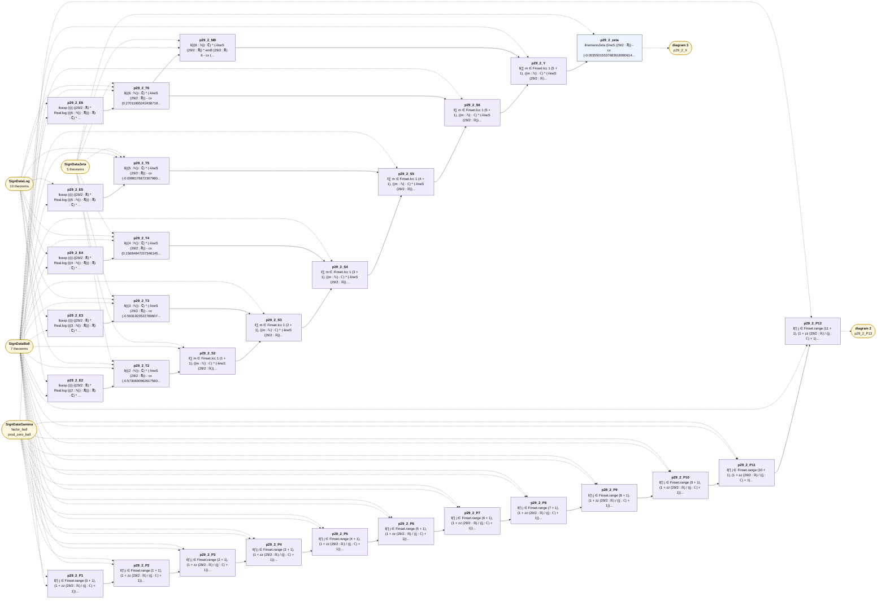

# `lean_stage3/Stage3/SignDataPt29_2.lean`

> **Read from the source text.** This file changed after the last `python3 utilities/lean_map.py --dump`, so the arrows on this page are names occurring in each proof and have not been confirmed by Lean.

SignDataPt29_2 — block S14 of `lean_stage3/design/stencil.md`, Turing's sign data: the sign of `Re Λ(1/2 + it)` at `t = 14.5`. 2026-11-25. Generated by `lean_stage3/checks/signdata/gen_signdata.py`; do not edit by hand.

87 theorems, 0 definitions, 467 lines. 

**Imports:** [`SignDataGamma`](../lean_stage3/SignDataGamma.md), [`SignDataLog`](../lean_stage3/SignDataLog.md)  
**Imported by:** [`SignData`](../lean_stage3/SignData.md)

## The picture

### Diagram 1 of 3: `p29_2_E2` to `p29_2_P12`



### Diagram 2 of 3: `p29_2_P13` to `p29_2_P42`

```mermaid
flowchart LR
  n0["<b>p29_2_P13</b><br/>‖∏ j ∈ Finset.range (12 + 1), (1 + zz (29/2 : ℝ) / ((j : ℂ) + 1)…"]:::shp
  n1["<b>p29_2_P14</b><br/>‖∏ j ∈ Finset.range (13 + 1), (1 + zz (29/2 : ℝ) / ((j : ℂ) + 1)…"]:::shp
  n2["<b>p29_2_P15</b><br/>‖∏ j ∈ Finset.range (14 + 1), (1 + zz (29/2 : ℝ) / ((j : ℂ) + 1)…"]:::shp
  n3["<b>p29_2_P16</b><br/>‖∏ j ∈ Finset.range (15 + 1), (1 + zz (29/2 : ℝ) / ((j : ℂ) + 1)…"]:::shp
  n4["<b>p29_2_P17</b><br/>‖∏ j ∈ Finset.range (16 + 1), (1 + zz (29/2 : ℝ) / ((j : ℂ) + 1)…"]:::shp
  n5["<b>p29_2_P18</b><br/>‖∏ j ∈ Finset.range (17 + 1), (1 + zz (29/2 : ℝ) / ((j : ℂ) + 1)…"]:::shp
  n6["<b>p29_2_P19</b><br/>‖∏ j ∈ Finset.range (18 + 1), (1 + zz (29/2 : ℝ) / ((j : ℂ) + 1)…"]:::shp
  n7["<b>p29_2_P20</b><br/>‖∏ j ∈ Finset.range (19 + 1), (1 + zz (29/2 : ℝ) / ((j : ℂ) + 1)…"]:::shp
  n8["<b>p29_2_P21</b><br/>‖∏ j ∈ Finset.range (20 + 1), (1 + zz (29/2 : ℝ) / ((j : ℂ) + 1)…"]:::shp
  n9["<b>p29_2_P22</b><br/>‖∏ j ∈ Finset.range (21 + 1), (1 + zz (29/2 : ℝ) / ((j : ℂ) + 1)…"]:::shp
  n10["<b>p29_2_P23</b><br/>‖∏ j ∈ Finset.range (22 + 1), (1 + zz (29/2 : ℝ) / ((j : ℂ) + 1)…"]:::shp
  n11["<b>p29_2_P24</b><br/>‖∏ j ∈ Finset.range (23 + 1), (1 + zz (29/2 : ℝ) / ((j : ℂ) + 1)…"]:::shp
  n12["<b>p29_2_P25</b><br/>‖∏ j ∈ Finset.range (24 + 1), (1 + zz (29/2 : ℝ) / ((j : ℂ) + 1)…"]:::shp
  n13["<b>p29_2_P26</b><br/>‖∏ j ∈ Finset.range (25 + 1), (1 + zz (29/2 : ℝ) / ((j : ℂ) + 1)…"]:::shp
  n14["<b>p29_2_P27</b><br/>‖∏ j ∈ Finset.range (26 + 1), (1 + zz (29/2 : ℝ) / ((j : ℂ) + 1)…"]:::shp
  n15["<b>p29_2_P28</b><br/>‖∏ j ∈ Finset.range (27 + 1), (1 + zz (29/2 : ℝ) / ((j : ℂ) + 1)…"]:::shp
  n16["<b>p29_2_P29</b><br/>‖∏ j ∈ Finset.range (28 + 1), (1 + zz (29/2 : ℝ) / ((j : ℂ) + 1)…"]:::shp
  n17["<b>p29_2_P30</b><br/>‖∏ j ∈ Finset.range (29 + 1), (1 + zz (29/2 : ℝ) / ((j : ℂ) + 1)…"]:::shp
  n18["<b>p29_2_P31</b><br/>‖∏ j ∈ Finset.range (30 + 1), (1 + zz (29/2 : ℝ) / ((j : ℂ) + 1)…"]:::shp
  n19["<b>p29_2_P32</b><br/>‖∏ j ∈ Finset.range (31 + 1), (1 + zz (29/2 : ℝ) / ((j : ℂ) + 1)…"]:::shp
  n20["<b>p29_2_P33</b><br/>‖∏ j ∈ Finset.range (32 + 1), (1 + zz (29/2 : ℝ) / ((j : ℂ) + 1)…"]:::shp
  n21["<b>p29_2_P34</b><br/>‖∏ j ∈ Finset.range (33 + 1), (1 + zz (29/2 : ℝ) / ((j : ℂ) + 1)…"]:::shp
  n22["<b>p29_2_P35</b><br/>‖∏ j ∈ Finset.range (34 + 1), (1 + zz (29/2 : ℝ) / ((j : ℂ) + 1)…"]:::shp
  n23["<b>p29_2_P36</b><br/>‖∏ j ∈ Finset.range (35 + 1), (1 + zz (29/2 : ℝ) / ((j : ℂ) + 1)…"]:::shp
  n24["<b>p29_2_P37</b><br/>‖∏ j ∈ Finset.range (36 + 1), (1 + zz (29/2 : ℝ) / ((j : ℂ) + 1)…"]:::shp
  n25["<b>p29_2_P38</b><br/>‖∏ j ∈ Finset.range (37 + 1), (1 + zz (29/2 : ℝ) / ((j : ℂ) + 1)…"]:::shp
  n26["<b>p29_2_P39</b><br/>‖∏ j ∈ Finset.range (38 + 1), (1 + zz (29/2 : ℝ) / ((j : ℂ) + 1)…"]:::shp
  n27["<b>p29_2_P40</b><br/>‖∏ j ∈ Finset.range (39 + 1), (1 + zz (29/2 : ℝ) / ((j : ℂ) + 1)…"]:::shp
  n28["<b>p29_2_P41</b><br/>‖∏ j ∈ Finset.range (40 + 1), (1 + zz (29/2 : ℝ) / ((j : ℂ) + 1)…"]:::shp
  n29["<b>p29_2_P42</b><br/>‖∏ j ∈ Finset.range (41 + 1), (1 + zz (29/2 : ℝ) / ((j : ℂ) + 1)…"]:::shp
  x0(["<b>SignDataBall</b><br/>ball_mul"]):::ext
  x1(["<b>SignDataGamma</b><br/>factor_ball"]):::ext
  x2(["<b>diagram 1</b><br/>p29_2_P12"]):::ext
  x3(["<b>diagram 3</b><br/>p29_2_P43"]):::ext
  n0 --> n1
  n1 --> n2
  n10 --> n11
  n11 --> n12
  n12 --> n13
  n13 --> n14
  n14 --> n15
  n15 --> n16
  n16 --> n17
  n17 --> n18
  n18 --> n19
  n19 --> n20
  n2 --> n3
  n20 --> n21
  n21 --> n22
  n22 --> n23
  n23 --> n24
  n24 --> n25
  n25 --> n26
  n26 --> n27
  n27 --> n28
  n28 --> n29
  n3 --> n4
  n4 --> n5
  n5 --> n6
  n6 --> n7
  n7 --> n8
  n8 --> n9
  n9 --> n10
  n29 -.-> x3
  x0 -.-> n0
  x0 -.-> n1
  x0 -.-> n10
  x0 -.-> n11
  x0 -.-> n12
  x0 -.-> n13
  x0 -.-> n14
  x0 -.-> n15
  x0 -.-> n16
  x0 -.-> n17
  x0 -.-> n18
  x0 -.-> n19
  x0 -.-> n2
  x0 -.-> n20
  x0 -.-> n21
  x0 -.-> n22
  x0 -.-> n23
  x0 -.-> n24
  x0 -.-> n25
  x0 -.-> n26
  x0 -.-> n27
  x0 -.-> n28
  x0 -.-> n29
  x0 -.-> n3
  x0 -.-> n4
  x0 -.-> n5
  x0 -.-> n6
  x0 -.-> n7
  x0 -.-> n8
  x0 -.-> n9
  x1 -.-> n0
  x1 -.-> n1
  x1 -.-> n10
  x1 -.-> n11
  x1 -.-> n12
  x1 -.-> n13
  x1 -.-> n14
  x1 -.-> n15
  x1 -.-> n16
  x1 -.-> n17
  x1 -.-> n18
  x1 -.-> n19
  x1 -.-> n2
  x1 -.-> n20
  x1 -.-> n21
  x1 -.-> n22
  x1 -.-> n23
  x1 -.-> n24
  x1 -.-> n25
  x1 -.-> n26
  x1 -.-> n27
  x1 -.-> n28
  x1 -.-> n29
  x1 -.-> n3
  x1 -.-> n4
  x1 -.-> n5
  x1 -.-> n6
  x1 -.-> n7
  x1 -.-> n8
  x1 -.-> n9
  x2 -.-> n0
  classDef cnt fill:#dff5ec,stroke:#17694a,color:#111
  classDef shp fill:#f1ecfb,stroke:#5b3fa0,color:#111
  classDef rh fill:#ffe5e5,stroke:#c22,color:#111,stroke-width:2px
  classDef thm fill:#eef4ff,stroke:#335,color:#111
  classDef end_ fill:#e7f7e7,stroke:#2a7,color:#111,stroke-width:2px
  classDef lone fill:#fff,stroke:#999,color:#111,stroke-dasharray:4 3
  classDef bad fill:#ffe5e5,stroke:#c22,color:#111,stroke-width:2px
  classDef ext fill:#fff8e1,stroke:#b80,color:#111
```



### Diagram 3 of 3: `p29_2_P43` to `sign_29_2`

```mermaid
flowchart LR
  n0["<b>p29_2_P43</b><br/>‖∏ j ∈ Finset.range (42 + 1), (1 + zz (29/2 : ℝ) / ((j : ℂ) + 1)…"]:::shp
  n1["<b>p29_2_P44</b><br/>‖∏ j ∈ Finset.range (43 + 1), (1 + zz (29/2 : ℝ) / ((j : ℂ) + 1)…"]:::shp
  n2["<b>p29_2_P45</b><br/>‖∏ j ∈ Finset.range (44 + 1), (1 + zz (29/2 : ℝ) / ((j : ℂ) + 1)…"]:::shp
  n3["<b>p29_2_P46</b><br/>‖∏ j ∈ Finset.range (45 + 1), (1 + zz (29/2 : ℝ) / ((j : ℂ) + 1)…"]:::shp
  n4["<b>p29_2_P47</b><br/>‖∏ j ∈ Finset.range (46 + 1), (1 + zz (29/2 : ℝ) / ((j : ℂ) + 1)…"]:::shp
  n5["<b>p29_2_P48</b><br/>‖∏ j ∈ Finset.range (47 + 1), (1 + zz (29/2 : ℝ) / ((j : ℂ) + 1)…"]:::shp
  n6["<b>p29_2_P49</b><br/>‖∏ j ∈ Finset.range (48 + 1), (1 + zz (29/2 : ℝ) / ((j : ℂ) + 1)…"]:::shp
  n7["<b>p29_2_P50</b><br/>‖∏ j ∈ Finset.range (49 + 1), (1 + zz (29/2 : ℝ) / ((j : ℂ) + 1)…"]:::shp
  n8["<b>p29_2_P51</b><br/>‖∏ j ∈ Finset.range (50 + 1), (1 + zz (29/2 : ℝ) / ((j : ℂ) + 1)…"]:::shp
  n9["<b>p29_2_P52</b><br/>‖∏ j ∈ Finset.range (51 + 1), (1 + zz (29/2 : ℝ) / ((j : ℂ) + 1)…"]:::shp
  n10["<b>p29_2_P53</b><br/>‖∏ j ∈ Finset.range (52 + 1), (1 + zz (29/2 : ℝ) / ((j : ℂ) + 1)…"]:::shp
  n11["<b>p29_2_P54</b><br/>‖∏ j ∈ Finset.range (53 + 1), (1 + zz (29/2 : ℝ) / ((j : ℂ) + 1)…"]:::shp
  n12["<b>p29_2_P55</b><br/>‖∏ j ∈ Finset.range (54 + 1), (1 + zz (29/2 : ℝ) / ((j : ℂ) + 1)…"]:::shp
  n13["<b>p29_2_P56</b><br/>‖∏ j ∈ Finset.range (55 + 1), (1 + zz (29/2 : ℝ) / ((j : ℂ) + 1)…"]:::shp
  n14["<b>p29_2_P57</b><br/>‖∏ j ∈ Finset.range (56 + 1), (1 + zz (29/2 : ℝ) / ((j : ℂ) + 1)…"]:::shp
  n15["<b>p29_2_P58</b><br/>‖∏ j ∈ Finset.range (57 + 1), (1 + zz (29/2 : ℝ) / ((j : ℂ) + 1)…"]:::shp
  n16["<b>p29_2_P59</b><br/>‖∏ j ∈ Finset.range (58 + 1), (1 + zz (29/2 : ℝ) / ((j : ℂ) + 1)…"]:::shp
  n17["<b>p29_2_P60</b><br/>‖∏ j ∈ Finset.range (59 + 1), (1 + zz (29/2 : ℝ) / ((j : ℂ) + 1)…"]:::shp
  n18["<b>p29_2_P61</b><br/>‖∏ j ∈ Finset.range (60 + 1), (1 + zz (29/2 : ℝ) / ((j : ℂ) + 1)…"]:::shp
  n19["<b>p29_2_P62</b><br/>‖∏ j ∈ Finset.range (61 + 1), (1 + zz (29/2 : ℝ) / ((j : ℂ) + 1)…"]:::shp
  n20["<b>p29_2_P63</b><br/>‖∏ j ∈ Finset.range (62 + 1), (1 + zz (29/2 : ℝ) / ((j : ℂ) + 1)…"]:::shp
  n21["<b>p29_2_P64</b><br/>‖∏ j ∈ Finset.range (63 + 1), (1 + zz (29/2 : ℝ) / ((j : ℂ) + 1)…"]:::shp
  n22["<b>p29_2_W</b><br/>‖zz (29/2 : ℝ) * ∏ j ∈ Finset.range (63 + 1), (1 + zz (29/2 : ℝ)…"]:::shp
  n23["<b>p29_2_phase</b><br/>‖cexp (((((29/2 : ℝ) / 2) * (Real.log (((64 : ℕ)) : ℝ) - Real.lo…"]:::shp
  n24["<b>p29_2_G</b><br/>‖gammaDir (29/2 : ℝ) 64 - cx (-11683.110714080391061839302290880…"]:::shp
  n25["<b>p29_2_X</b><br/>‖gammaDir (29/2 : ℝ) 64 * riemannZeta (lineS (29/2 : ℝ)) - cx (3…"]:::thm
  n26["<b>sign_29_2</b><br/>0 ＜ (completedRiemannZeta (lineS (29/2 : ℝ))).re"]:::thm
  x0(["<b>SignDataBall</b><br/>4 theorems"]):::ext
  x1(["<b>SignDataGamma</b><br/>factor_ball<br/>re_lambda_pos<br/>zz_ball"]):::ext
  x2(["<b>diagram 2</b><br/>p29_2_P42"]):::ext
  x3(["<b>SignDataLog</b><br/>log_pi_ball'<br/>log_pow2_ball_64"]):::ext
  x4(["<b>diagram 1</b><br/>p29_2_zeta"]):::ext
  x5(["<b>SignData</b><br/>first_zero_signs"]):::ext
  n0 --> n1
  n1 --> n2
  n10 --> n11
  n11 --> n12
  n12 --> n13
  n13 --> n14
  n14 --> n15
  n15 --> n16
  n16 --> n17
  n17 --> n18
  n18 --> n19
  n19 --> n20
  n2 --> n3
  n20 --> n21
  n21 --> n22
  n22 --> n24
  n23 --> n24
  n24 --> n25
  n25 --> n26
  n3 --> n4
  n4 --> n5
  n5 --> n6
  n6 --> n7
  n7 --> n8
  n8 --> n9
  n9 --> n10
  n26 -.-> x5
  x0 -.-> n0
  x0 -.-> n1
  x0 -.-> n10
  x0 -.-> n11
  x0 -.-> n12
  x0 -.-> n13
  x0 -.-> n14
  x0 -.-> n15
  x0 -.-> n16
  x0 -.-> n17
  x0 -.-> n18
  x0 -.-> n19
  x0 -.-> n2
  x0 -.-> n20
  x0 -.-> n21
  x0 -.-> n22
  x0 -.-> n23
  x0 -.-> n24
  x0 -.-> n25
  x0 -.-> n3
  x0 -.-> n4
  x0 -.-> n5
  x0 -.-> n6
  x0 -.-> n7
  x0 -.-> n8
  x0 -.-> n9
  x1 -.-> n0
  x1 -.-> n1
  x1 -.-> n10
  x1 -.-> n11
  x1 -.-> n12
  x1 -.-> n13
  x1 -.-> n14
  x1 -.-> n15
  x1 -.-> n16
  x1 -.-> n17
  x1 -.-> n18
  x1 -.-> n19
  x1 -.-> n2
  x1 -.-> n20
  x1 -.-> n21
  x1 -.-> n22
  x1 -.-> n26
  x1 -.-> n3
  x1 -.-> n4
  x1 -.-> n5
  x1 -.-> n6
  x1 -.-> n7
  x1 -.-> n8
  x1 -.-> n9
  x2 -.-> n0
  x3 -.-> n23
  x4 -.-> n25
  classDef cnt fill:#dff5ec,stroke:#17694a,color:#111
  classDef shp fill:#f1ecfb,stroke:#5b3fa0,color:#111
  classDef rh fill:#ffe5e5,stroke:#c22,color:#111,stroke-width:2px
  classDef thm fill:#eef4ff,stroke:#335,color:#111
  classDef end_ fill:#e7f7e7,stroke:#2a7,color:#111,stroke-width:2px
  classDef lone fill:#fff,stroke:#999,color:#111,stroke-dasharray:4 3
  classDef bad fill:#ffe5e5,stroke:#c22,color:#111,stroke-width:2px
  classDef ext fill:#fff8e1,stroke:#b80,color:#111
```



An arrow A → B reads "A is used in the proof of B". Green: counting, integers only. Violet: shape, analysis with no ζ. Blue: reads ζ. A name ending in ■ is an end: nothing else uses it. Red: contains `sorry`. Yellow: theorems in another file, counted; a dotted arrow crosses files. Definitions are not drawn; they are listed below the diagram.

## Theorems

<a name="SignData-p29_2_E2"></a>
### `SignData.p29_2_E2`

line 31 · arrows read from text

**Shape.** Uses real or complex analysis; nothing in it or beneath it reads ζ.

**Proves**

```lean
‖cexp ((((-((29/2 : ℝ) * Real.log (((2 : ℕ)) : ℝ))) : ℝ) : ℂ) * Complex.I) - cx (-(0.81046188710014143857302951428)) (-(-0.585791370334249284290930337087))‖ ≤ (0.000000003625000000030036690639)
```

**Fed by** (3 theorems its proof uses)

  - [`SignData.exp_ball2`](../lean_stage3/SignDataBall.md#SignData-exp_ball2) (SignDataBall) — `` ‖cexp ((x : ℂ) * I) - cx (-e) (-f)‖ ≤ R ``
  - [`SignData.neg_mul_ball`](../lean_stage3/SignDataBall.md#SignData-neg_mul_ball) (SignDataBall) — `` |-(t * x) - -(t * a)| ≤ |t| * e ``
  - [`SignData.log_ball_2`](../lean_stage3/SignDataLog.md#SignData-log_ball_2) (SignDataLog) — `` |Real.log ((2 : ℕ) : ℝ) - (0.69314718055)| ≤ (0.00000000025) ``

**Definitions its proof touches:** [`SignData.cosP`](../lean_stage3/SignDataBall.md#SignData-cosP), [`SignData.cx`](../lean_stage3/SignDataBall.md#SignData-cx), [`SignData.sinP`](../lean_stage3/SignDataBall.md#SignData-sinP)

**Feeds** (1 that use it)

  - [`SignData.p29_2_T2`](#SignData-p29_2_T2) — `` ‖(((2 : ℕ)) : ℂ) ^ (-lineS (29/2 : ℝ)) - cx (-0.57308309626175609593385213682) (0.414217050323907835417746042704)‖ ≤ (0.000000002563262081822473923591… ``

<a name="SignData-p29_2_T2"></a>
### `SignData.p29_2_T2`

line 37 · arrows read from text

**Shape.** Uses real or complex analysis; nothing in it or beneath it reads ζ.

**Proves**

```lean
‖(((2 : ℕ)) : ℂ) ^ (-lineS (29/2 : ℝ)) - cx (-0.57308309626175609593385213682) (0.414217050323907835417746042704)‖ ≤ (0.000000002563262081822473923591)
```

**Fed by** (5 theorems its proof uses)

  - [`SignData.ball_mul`](../lean_stage3/SignDataBall.md#SignData-ball_mul) (SignDataBall) — `` ‖z * w - cx e f‖ ≤ R ``
  - [`SignData.ball_ofReal`](../lean_stage3/SignDataBall.md#SignData-ball_ofReal) (SignDataBall) — `` ‖(x : ℂ) - cx c 0‖ ≤ e ``
  - [`SignData.isqrt_ball_2`](../lean_stage3/SignDataLog.md#SignData-isqrt_ball_2) (SignDataLog) — `` |(Real.sqrt (((2 : ℕ)) : ℝ))⁻¹ - (0.707106781186547524400844362104)| ≤ (0.000000000000000000000000000001) ``
  - [`SignData.p29_2_E2`](#SignData-p29_2_E2) — `` ‖cexp ((((-((29/2 : ℝ) * Real.log (((2 : ℕ)) : ℝ))) : ℝ) : ℂ) * Complex.I) - cx (-(0.81046188710014143857302951428)) (-(-0.585791370334249284290930337… ``
  - [`SignData.natCast_cpow_line`](../lean_stage3/SignDataZeta.md#SignData-natCast_cpow_line) (SignDataZeta) — `` (m : ℂ) ^ (-lineS t) = (((Real.sqrt m)⁻¹ : ℝ) : ℂ) * cexp (((-(t * Real.log m)) : ℝ) * I) ``

**Definitions its proof touches:** [`SignData.cx`](../lean_stage3/SignDataBall.md#SignData-cx), [`SignData.lineS`](../lean_stage3/SignDataZeta.md#SignData-lineS)

**Feeds** (1 that use it)

  - [`SignData.p29_2_S2`](#SignData-p29_2_S2) — `` ‖∑ m ∈ Finset.Icc 1 (1 + 1), ((m : ℕ) : ℂ) ^ (-lineS (29/2 : ℝ)) - cx (0.42691690373824390406614786318) (0.414217050323907835417746042704)‖ ≤ (0.00000… ``

<a name="SignData-p29_2_E3"></a>
### `SignData.p29_2_E3`

line 41 · arrows read from text

**Shape.** Uses real or complex analysis; nothing in it or beneath it reads ζ.

**Proves**

```lean
‖cexp ((((-((29/2 : ℝ) * Real.log (((3 : ℕ)) : ℝ))) : ℝ) : ℂ) * Complex.I) - cx (-(0.975477768577925555510968784402)) (-(-0.220097985020833649943610689271))‖ ≤ (0.000000003625105638403565185798)
```

**Fed by** (3 theorems its proof uses)

  - [`SignData.exp_ball2`](../lean_stage3/SignDataBall.md#SignData-exp_ball2) (SignDataBall) — `` ‖cexp ((x : ℂ) * I) - cx (-e) (-f)‖ ≤ R ``
  - [`SignData.neg_mul_ball`](../lean_stage3/SignDataBall.md#SignData-neg_mul_ball) (SignDataBall) — `` |-(t * x) - -(t * a)| ≤ |t| * e ``
  - [`SignData.log_ball_3`](../lean_stage3/SignDataLog.md#SignData-log_ball_3) (SignDataLog) — `` |Real.log (((3 : ℕ)) : ℝ) - (1.098612288658164142930964760306)| ≤ (0.000000000250007285403624428292) ``

**Definitions its proof touches:** [`SignData.cosP`](../lean_stage3/SignDataBall.md#SignData-cosP), [`SignData.cx`](../lean_stage3/SignDataBall.md#SignData-cx), [`SignData.sinP`](../lean_stage3/SignDataBall.md#SignData-sinP)

**Feeds** (1 that use it)

  - [`SignData.p29_2_T3`](#SignData-p29_2_T3) — `` ‖(((3 : ℕ)) : ℂ) ^ (-lineS (29/2 : ℝ)) - cx (-0.563192352276960784564499903402) (0.127073630899872527075694223734)‖ ≤ (0.00000000209295571617312851869… ``

<a name="SignData-p29_2_T3"></a>
### `SignData.p29_2_T3`

line 47 · arrows read from text

**Shape.** Uses real or complex analysis; nothing in it or beneath it reads ζ.

**Proves**

```lean
‖(((3 : ℕ)) : ℂ) ^ (-lineS (29/2 : ℝ)) - cx (-0.563192352276960784564499903402) (0.127073630899872527075694223734)‖ ≤ (0.000000002092955716173128518691)
```

**Fed by** (5 theorems its proof uses)

  - [`SignData.ball_mul`](../lean_stage3/SignDataBall.md#SignData-ball_mul) (SignDataBall) — `` ‖z * w - cx e f‖ ≤ R ``
  - [`SignData.ball_ofReal`](../lean_stage3/SignDataBall.md#SignData-ball_ofReal) (SignDataBall) — `` ‖(x : ℂ) - cx c 0‖ ≤ e ``
  - [`SignData.isqrt_ball_3`](../lean_stage3/SignDataLog.md#SignData-isqrt_ball_3) (SignDataLog) — `` |(Real.sqrt (((3 : ℕ)) : ℝ))⁻¹ - (0.577350269189625764509148780502)| ≤ (0.000000000000000000000000000001) ``
  - [`SignData.p29_2_E3`](#SignData-p29_2_E3) — `` ‖cexp ((((-((29/2 : ℝ) * Real.log (((3 : ℕ)) : ℝ))) : ℝ) : ℂ) * Complex.I) - cx (-(0.975477768577925555510968784402)) (-(-0.22009798502083364994361068… ``
  - [`SignData.natCast_cpow_line`](../lean_stage3/SignDataZeta.md#SignData-natCast_cpow_line) (SignDataZeta) — `` (m : ℂ) ^ (-lineS t) = (((Real.sqrt m)⁻¹ : ℝ) : ℂ) * cexp (((-(t * Real.log m)) : ℝ) * I) ``

**Definitions its proof touches:** [`SignData.cx`](../lean_stage3/SignDataBall.md#SignData-cx), [`SignData.lineS`](../lean_stage3/SignDataZeta.md#SignData-lineS)

**Feeds** (1 that use it)

  - [`SignData.p29_2_S3`](#SignData-p29_2_S3) — `` ‖∑ m ∈ Finset.Icc 1 (2 + 1), ((m : ℕ) : ℂ) ^ (-lineS (29/2 : ℝ)) - cx (-0.136275448538716880498352040222) (0.541290681223780362493440266438)‖ ≤ (0.000… ``

<a name="SignData-p29_2_E4"></a>
### `SignData.p29_2_E4`

line 51 · arrows read from text

**Shape.** Uses real or complex analysis; nothing in it or beneath it reads ζ.

**Proves**

```lean
‖cexp ((((-((29/2 : ℝ) * Real.log (((4 : ℕ)) : ℝ))) : ℝ) : ℂ) * Complex.I) - cx (0.313696940746922915039221349028) (-(0.949523158941382289503116104915))‖ ≤ (0.00000000362517432421971964075)
```

**Fed by** (3 theorems its proof uses)

  - [`SignData.exp_ball3`](../lean_stage3/SignDataBall.md#SignData-exp_ball3) (SignDataBall) — `` ‖cexp ((x : ℂ) * I) - cx f (-e)‖ ≤ R ``
  - [`SignData.neg_mul_ball`](../lean_stage3/SignDataBall.md#SignData-neg_mul_ball) (SignDataBall) — `` |-(t * x) - -(t * a)| ≤ |t| * e ``
  - [`SignData.log_ball_4`](../lean_stage3/SignDataLog.md#SignData-log_ball_4) (SignDataLog) — `` |Real.log (((4 : ℕ)) : ℝ) - (1.386294361109944875563750019823)| ≤ (0.000000000250012022355196162294) ``

**Definitions its proof touches:** [`SignData.cosP`](../lean_stage3/SignDataBall.md#SignData-cosP), [`SignData.cx`](../lean_stage3/SignDataBall.md#SignData-cx), [`SignData.sinP`](../lean_stage3/SignDataBall.md#SignData-sinP)

**Feeds** (1 that use it)

  - [`SignData.p29_2_T4`](#SignData-p29_2_T4) — `` ‖(((4 : ℕ)) : ℂ) ^ (-lineS (29/2 : ℝ)) - cx (0.156848470373461457519610674514) (-0.474761579470691144751558052458)‖ ≤ (0.00000000181258716210985982037… ``

<a name="SignData-p29_2_T4"></a>
### `SignData.p29_2_T4`

line 57 · arrows read from text

**Shape.** Uses real or complex analysis; nothing in it or beneath it reads ζ.

**Proves**

```lean
‖(((4 : ℕ)) : ℂ) ^ (-lineS (29/2 : ℝ)) - cx (0.156848470373461457519610674514) (-0.474761579470691144751558052458)‖ ≤ (0.000000001812587162109859820377)
```

**Fed by** (5 theorems its proof uses)

  - [`SignData.ball_mul`](../lean_stage3/SignDataBall.md#SignData-ball_mul) (SignDataBall) — `` ‖z * w - cx e f‖ ≤ R ``
  - [`SignData.ball_ofReal`](../lean_stage3/SignDataBall.md#SignData-ball_ofReal) (SignDataBall) — `` ‖(x : ℂ) - cx c 0‖ ≤ e ``
  - [`SignData.isqrt_ball_4`](../lean_stage3/SignDataLog.md#SignData-isqrt_ball_4) (SignDataLog) — `` |(Real.sqrt (((4 : ℕ)) : ℝ))⁻¹ - (0.5)| ≤ (0.000000000000000000000000000001) ``
  - [`SignData.p29_2_E4`](#SignData-p29_2_E4) — `` ‖cexp ((((-((29/2 : ℝ) * Real.log (((4 : ℕ)) : ℝ))) : ℝ) : ℂ) * Complex.I) - cx (0.313696940746922915039221349028) (-(0.949523158941382289503116104915… ``
  - [`SignData.natCast_cpow_line`](../lean_stage3/SignDataZeta.md#SignData-natCast_cpow_line) (SignDataZeta) — `` (m : ℂ) ^ (-lineS t) = (((Real.sqrt m)⁻¹ : ℝ) : ℂ) * cexp (((-(t * Real.log m)) : ℝ) * I) ``

**Definitions its proof touches:** [`SignData.cx`](../lean_stage3/SignDataBall.md#SignData-cx), [`SignData.lineS`](../lean_stage3/SignDataZeta.md#SignData-lineS)

**Feeds** (1 that use it)

  - [`SignData.p29_2_S4`](#SignData-p29_2_S4) — `` ‖∑ m ∈ Finset.Icc 1 (3 + 1), ((m : ℕ) : ℂ) ^ (-lineS (29/2 : ℝ)) - cx (0.020573021834744577021258634292) (0.06652910175308921774188221398)‖ ≤ (0.00000… ``

<a name="SignData-p29_2_E5"></a>
### `SignData.p29_2_E5`

line 61 · arrows read from text

**Shape.** Uses real or complex analysis; nothing in it or beneath it reads ζ.

**Proves**

```lean
‖cexp ((((-((29/2 : ℝ) * Real.log (((5 : ℕ)) : ℝ))) : ℝ) : ℂ) * Complex.I) - cx (-(0.223199134004877257024192073731)) (0.974772869226197146989234108056)‖ ≤ (0.000000003625212335106641940617)
```

**Fed by** (3 theorems its proof uses)

  - [`SignData.exp_ball1`](../lean_stage3/SignDataBall.md#SignData-exp_ball1) (SignDataBall) — `` ‖cexp ((x : ℂ) * I) - cx (-f) e‖ ≤ R ``
  - [`SignData.neg_mul_ball`](../lean_stage3/SignDataBall.md#SignData-neg_mul_ball) (SignDataBall) — `` |-(t * x) - -(t * a)| ≤ |t| * e ``
  - [`SignData.log_ball_5`](../lean_stage3/SignDataLog.md#SignData-log_ball_5) (SignDataLog) — `` |Real.log (((5 : ℕ)) : ℝ) - (1.609437912424154507888186373287)| ≤ (0.000000000250014643795196162295) ``

**Definitions its proof touches:** [`SignData.cosP`](../lean_stage3/SignDataBall.md#SignData-cosP), [`SignData.cx`](../lean_stage3/SignDataBall.md#SignData-cx), [`SignData.sinP`](../lean_stage3/SignDataBall.md#SignData-sinP)

**Feeds** (1 that use it)

  - [`SignData.p29_2_T5`](#SignData-p29_2_T5) — `` ‖(((5 : ℕ)) : ℂ) ^ (-lineS (29/2 : ℝ)) - cx (-0.099817687230798084734096457138) (0.435931679642457929249969714238)‖ ≤ (0.00000000162124424283383973916… ``

<a name="SignData-p29_2_T5"></a>
### `SignData.p29_2_T5`

line 67 · arrows read from text

**Shape.** Uses real or complex analysis; nothing in it or beneath it reads ζ.

**Proves**

```lean
‖(((5 : ℕ)) : ℂ) ^ (-lineS (29/2 : ℝ)) - cx (-0.099817687230798084734096457138) (0.435931679642457929249969714238)‖ ≤ (0.000000001621244242833839739162)
```

**Fed by** (5 theorems its proof uses)

  - [`SignData.ball_mul`](../lean_stage3/SignDataBall.md#SignData-ball_mul) (SignDataBall) — `` ‖z * w - cx e f‖ ≤ R ``
  - [`SignData.ball_ofReal`](../lean_stage3/SignDataBall.md#SignData-ball_ofReal) (SignDataBall) — `` ‖(x : ℂ) - cx c 0‖ ≤ e ``
  - [`SignData.isqrt_ball_5`](../lean_stage3/SignDataLog.md#SignData-isqrt_ball_5) (SignDataLog) — `` |(Real.sqrt (((5 : ℕ)) : ℝ))⁻¹ - (0.447213595499957939281834733746)| ≤ (0.000000000000000000000000000001) ``
  - [`SignData.p29_2_E5`](#SignData-p29_2_E5) — `` ‖cexp ((((-((29/2 : ℝ) * Real.log (((5 : ℕ)) : ℝ))) : ℝ) : ℂ) * Complex.I) - cx (-(0.223199134004877257024192073731)) (0.97477286922619714698923410805… ``
  - [`SignData.natCast_cpow_line`](../lean_stage3/SignDataZeta.md#SignData-natCast_cpow_line) (SignDataZeta) — `` (m : ℂ) ^ (-lineS t) = (((Real.sqrt m)⁻¹ : ℝ) : ℂ) * cexp (((-(t * Real.log m)) : ℝ) * I) ``

**Definitions its proof touches:** [`SignData.cx`](../lean_stage3/SignDataBall.md#SignData-cx), [`SignData.lineS`](../lean_stage3/SignDataZeta.md#SignData-lineS)

**Feeds** (1 that use it)

  - [`SignData.p29_2_S5`](#SignData-p29_2_S5) — `` ‖∑ m ∈ Finset.Icc 1 (4 + 1), ((m : ℕ) : ℂ) ^ (-lineS (29/2 : ℝ)) - cx (-0.079244665396053507712837822846) (0.502460781395547146991851928218)‖ ≤ (0.000… ``

<a name="SignData-p29_2_E6"></a>
### `SignData.p29_2_E6`

line 71 · arrows read from text

**Shape.** Uses real or complex analysis; nothing in it or beneath it reads ζ.

**Proves**

```lean
‖cexp ((((-((29/2 : ℝ) * Real.log (((6 : ℕ)) : ℝ))) : ℝ) : ℂ) * Complex.I) - cx (0.661656052784616480650583127838) (-(0.749807487168193599614138308551))‖ ≤ (0.00000000362524088968024809971)
```

**Fed by** (3 theorems its proof uses)

  - [`SignData.exp_ball3`](../lean_stage3/SignDataBall.md#SignData-exp_ball3) (SignDataBall) — `` ‖cexp ((x : ℂ) * I) - cx f (-e)‖ ≤ R ``
  - [`SignData.neg_mul_ball`](../lean_stage3/SignDataBall.md#SignData-neg_mul_ball) (SignDataBall) — `` |-(t * x) - -(t * a)| ≤ |t| * e ``
  - [`SignData.log_ball_6`](../lean_stage3/SignDataLog.md#SignData-log_ball_6) (SignDataLog) — `` |Real.log (((6 : ℕ)) : ℝ) - (1.791759469218109031470825672761)| ≤ (0.000000000250016613075280171998) ``

**Definitions its proof touches:** [`SignData.cosP`](../lean_stage3/SignDataBall.md#SignData-cosP), [`SignData.cx`](../lean_stage3/SignDataBall.md#SignData-cx), [`SignData.sinP`](../lean_stage3/SignDataBall.md#SignData-sinP)

**Feeds** (1 that use it)

  - [`SignData.p29_2_T6`](#SignData-p29_2_T6) — `` ‖(((6 : ℕ)) : ℂ) ^ (-lineS (29/2 : ℝ)) - cx (0.270119952424387188973053766513) (-0.306107624813419942123226215119)‖ ≤ (0.00000000147999839573165510762… ``

<a name="SignData-p29_2_T6"></a>
### `SignData.p29_2_T6`

line 77 · arrows read from text

**Shape.** Uses real or complex analysis; nothing in it or beneath it reads ζ.

**Proves**

```lean
‖(((6 : ℕ)) : ℂ) ^ (-lineS (29/2 : ℝ)) - cx (0.270119952424387188973053766513) (-0.306107624813419942123226215119)‖ ≤ (0.000000001479998395731655107626)
```

**Fed by** (5 theorems its proof uses)

  - [`SignData.ball_mul`](../lean_stage3/SignDataBall.md#SignData-ball_mul) (SignDataBall) — `` ‖z * w - cx e f‖ ≤ R ``
  - [`SignData.ball_ofReal`](../lean_stage3/SignDataBall.md#SignData-ball_ofReal) (SignDataBall) — `` ‖(x : ℂ) - cx c 0‖ ≤ e ``
  - [`SignData.isqrt_ball_6`](../lean_stage3/SignDataLog.md#SignData-isqrt_ball_6) (SignDataLog) — `` |(Real.sqrt (((6 : ℕ)) : ℝ))⁻¹ - (0.40824829046386301636621401245)| ≤ (0.000000000000000000000000000001) ``
  - [`SignData.p29_2_E6`](#SignData-p29_2_E6) — `` ‖cexp ((((-((29/2 : ℝ) * Real.log (((6 : ℕ)) : ℝ))) : ℝ) : ℂ) * Complex.I) - cx (0.661656052784616480650583127838) (-(0.749807487168193599614138308551… ``
  - [`SignData.natCast_cpow_line`](../lean_stage3/SignDataZeta.md#SignData-natCast_cpow_line) (SignDataZeta) — `` (m : ℂ) ^ (-lineS t) = (((Real.sqrt m)⁻¹ : ℝ) : ℂ) * cexp (((-(t * Real.log m)) : ℝ) * I) ``

**Definitions its proof touches:** [`SignData.cx`](../lean_stage3/SignDataBall.md#SignData-cx), [`SignData.lineS`](../lean_stage3/SignDataZeta.md#SignData-lineS)

**Feeds** (2 that use it)

  - [`SignData.p29_2_NB`](#SignData-p29_2_NB) — `` ‖(((6 : ℕ)) : ℂ) ^ (-lineS (29/2 : ℝ)) * emB (29/2 : ℝ) 6 - cx (-0.194425442405169862066358642674) (0.10134051341594544015681113025)‖ ≤ (0.00000000102… ``
  - [`SignData.p29_2_S6`](#SignData-p29_2_S6) — `` ‖∑ m ∈ Finset.Icc 1 (5 + 1), ((m : ℕ) : ℂ) ^ (-lineS (29/2 : ℝ)) - cx (0.190875287028333681260215943667) (0.196353156582127204868625713099)‖ ≤ (0.0000… ``

<a name="SignData-p29_2_S2"></a>
### `SignData.p29_2_S2`

line 81 · arrows read from text

**Shape.** Uses real or complex analysis; nothing in it or beneath it reads ζ.

**Proves**

```lean
‖∑ m ∈ Finset.Icc 1 (1 + 1), ((m : ℕ) : ℂ) ^ (-lineS (29/2 : ℝ)) - cx (0.42691690373824390406614786318) (0.414217050323907835417746042704)‖ ≤ (0.000000002563262081822473923591)
```

**Fed by** (3 theorems its proof uses)

  - [`SignData.ball_add`](../lean_stage3/SignDataBall.md#SignData-ball_add) (SignDataBall) — `` ‖z + w - cx e f‖ ≤ R ``
  - [`SignData.p29_2_T2`](#SignData-p29_2_T2) — `` ‖(((2 : ℕ)) : ℂ) ^ (-lineS (29/2 : ℝ)) - cx (-0.57308309626175609593385213682) (0.414217050323907835417746042704)‖ ≤ (0.000000002563262081822473923591… ``
  - [`SignData.sum_one_ball`](../lean_stage3/SignDataZeta.md#SignData-sum_one_ball) (SignDataZeta) — `` ‖∑ m ∈ Finset.Icc 1 1, ((m : ℕ) : ℂ) ^ (-lineS t) - cx 1 0‖ ≤ 0 ``

**Definitions its proof touches:** [`SignData.cx`](../lean_stage3/SignDataBall.md#SignData-cx), [`SignData.lineS`](../lean_stage3/SignDataZeta.md#SignData-lineS)

**Feeds** (1 that use it)

  - [`SignData.p29_2_S3`](#SignData-p29_2_S3) — `` ‖∑ m ∈ Finset.Icc 1 (2 + 1), ((m : ℕ) : ℂ) ^ (-lineS (29/2 : ℝ)) - cx (-0.136275448538716880498352040222) (0.541290681223780362493440266438)‖ ≤ (0.000… ``

<a name="SignData-p29_2_S3"></a>
### `SignData.p29_2_S3`

line 86 · arrows read from text

**Shape.** Uses real or complex analysis; nothing in it or beneath it reads ζ.

**Proves**

```lean
‖∑ m ∈ Finset.Icc 1 (2 + 1), ((m : ℕ) : ℂ) ^ (-lineS (29/2 : ℝ)) - cx (-0.136275448538716880498352040222) (0.541290681223780362493440266438)‖ ≤ (0.000000004656217797995602442282)
```

**Fed by** (3 theorems its proof uses)

  - [`SignData.ball_add`](../lean_stage3/SignDataBall.md#SignData-ball_add) (SignDataBall) — `` ‖z + w - cx e f‖ ≤ R ``
  - [`SignData.p29_2_S2`](#SignData-p29_2_S2) — `` ‖∑ m ∈ Finset.Icc 1 (1 + 1), ((m : ℕ) : ℂ) ^ (-lineS (29/2 : ℝ)) - cx (0.42691690373824390406614786318) (0.414217050323907835417746042704)‖ ≤ (0.00000… ``
  - [`SignData.p29_2_T3`](#SignData-p29_2_T3) — `` ‖(((3 : ℕ)) : ℂ) ^ (-lineS (29/2 : ℝ)) - cx (-0.563192352276960784564499903402) (0.127073630899872527075694223734)‖ ≤ (0.00000000209295571617312851869… ``

**Definitions its proof touches:** [`SignData.cx`](../lean_stage3/SignDataBall.md#SignData-cx), [`SignData.lineS`](../lean_stage3/SignDataZeta.md#SignData-lineS)

**Feeds** (1 that use it)

  - [`SignData.p29_2_S4`](#SignData-p29_2_S4) — `` ‖∑ m ∈ Finset.Icc 1 (3 + 1), ((m : ℕ) : ℂ) ^ (-lineS (29/2 : ℝ)) - cx (0.020573021834744577021258634292) (0.06652910175308921774188221398)‖ ≤ (0.00000… ``

<a name="SignData-p29_2_S4"></a>
### `SignData.p29_2_S4`

line 91 · arrows read from text

**Shape.** Uses real or complex analysis; nothing in it or beneath it reads ζ.

**Proves**

```lean
‖∑ m ∈ Finset.Icc 1 (3 + 1), ((m : ℕ) : ℂ) ^ (-lineS (29/2 : ℝ)) - cx (0.020573021834744577021258634292) (0.06652910175308921774188221398)‖ ≤ (0.000000006468804960105462262659)
```

**Fed by** (3 theorems its proof uses)

  - [`SignData.ball_add`](../lean_stage3/SignDataBall.md#SignData-ball_add) (SignDataBall) — `` ‖z + w - cx e f‖ ≤ R ``
  - [`SignData.p29_2_S3`](#SignData-p29_2_S3) — `` ‖∑ m ∈ Finset.Icc 1 (2 + 1), ((m : ℕ) : ℂ) ^ (-lineS (29/2 : ℝ)) - cx (-0.136275448538716880498352040222) (0.541290681223780362493440266438)‖ ≤ (0.000… ``
  - [`SignData.p29_2_T4`](#SignData-p29_2_T4) — `` ‖(((4 : ℕ)) : ℂ) ^ (-lineS (29/2 : ℝ)) - cx (0.156848470373461457519610674514) (-0.474761579470691144751558052458)‖ ≤ (0.00000000181258716210985982037… ``

**Definitions its proof touches:** [`SignData.cx`](../lean_stage3/SignDataBall.md#SignData-cx), [`SignData.lineS`](../lean_stage3/SignDataZeta.md#SignData-lineS)

**Feeds** (1 that use it)

  - [`SignData.p29_2_S5`](#SignData-p29_2_S5) — `` ‖∑ m ∈ Finset.Icc 1 (4 + 1), ((m : ℕ) : ℂ) ^ (-lineS (29/2 : ℝ)) - cx (-0.079244665396053507712837822846) (0.502460781395547146991851928218)‖ ≤ (0.000… ``

<a name="SignData-p29_2_S5"></a>
### `SignData.p29_2_S5`

line 96 · arrows read from text

**Shape.** Uses real or complex analysis; nothing in it or beneath it reads ζ.

**Proves**

```lean
‖∑ m ∈ Finset.Icc 1 (4 + 1), ((m : ℕ) : ℂ) ^ (-lineS (29/2 : ℝ)) - cx (-0.079244665396053507712837822846) (0.502460781395547146991851928218)‖ ≤ (0.000000008090049202939302001821)
```

**Fed by** (3 theorems its proof uses)

  - [`SignData.ball_add`](../lean_stage3/SignDataBall.md#SignData-ball_add) (SignDataBall) — `` ‖z + w - cx e f‖ ≤ R ``
  - [`SignData.p29_2_S4`](#SignData-p29_2_S4) — `` ‖∑ m ∈ Finset.Icc 1 (3 + 1), ((m : ℕ) : ℂ) ^ (-lineS (29/2 : ℝ)) - cx (0.020573021834744577021258634292) (0.06652910175308921774188221398)‖ ≤ (0.00000… ``
  - [`SignData.p29_2_T5`](#SignData-p29_2_T5) — `` ‖(((5 : ℕ)) : ℂ) ^ (-lineS (29/2 : ℝ)) - cx (-0.099817687230798084734096457138) (0.435931679642457929249969714238)‖ ≤ (0.00000000162124424283383973916… ``

**Definitions its proof touches:** [`SignData.cx`](../lean_stage3/SignDataBall.md#SignData-cx), [`SignData.lineS`](../lean_stage3/SignDataZeta.md#SignData-lineS)

**Feeds** (1 that use it)

  - [`SignData.p29_2_S6`](#SignData-p29_2_S6) — `` ‖∑ m ∈ Finset.Icc 1 (5 + 1), ((m : ℕ) : ℂ) ^ (-lineS (29/2 : ℝ)) - cx (0.190875287028333681260215943667) (0.196353156582127204868625713099)‖ ≤ (0.0000… ``

<a name="SignData-p29_2_S6"></a>
### `SignData.p29_2_S6`

line 101 · arrows read from text

**Shape.** Uses real or complex analysis; nothing in it or beneath it reads ζ.

**Proves**

```lean
‖∑ m ∈ Finset.Icc 1 (5 + 1), ((m : ℕ) : ℂ) ^ (-lineS (29/2 : ℝ)) - cx (0.190875287028333681260215943667) (0.196353156582127204868625713099)‖ ≤ (0.000000009570047598670957109447)
```

**Fed by** (3 theorems its proof uses)

  - [`SignData.ball_add`](../lean_stage3/SignDataBall.md#SignData-ball_add) (SignDataBall) — `` ‖z + w - cx e f‖ ≤ R ``
  - [`SignData.p29_2_S5`](#SignData-p29_2_S5) — `` ‖∑ m ∈ Finset.Icc 1 (4 + 1), ((m : ℕ) : ℂ) ^ (-lineS (29/2 : ℝ)) - cx (-0.079244665396053507712837822846) (0.502460781395547146991851928218)‖ ≤ (0.000… ``
  - [`SignData.p29_2_T6`](#SignData-p29_2_T6) — `` ‖(((6 : ℕ)) : ℂ) ^ (-lineS (29/2 : ℝ)) - cx (0.270119952424387188973053766513) (-0.306107624813419942123226215119)‖ ≤ (0.00000000147999839573165510762… ``

**Definitions its proof touches:** [`SignData.cx`](../lean_stage3/SignDataBall.md#SignData-cx), [`SignData.lineS`](../lean_stage3/SignDataZeta.md#SignData-lineS)

**Feeds** (1 that use it)

  - [`SignData.p29_2_Y`](#SignData-p29_2_Y) — `` ‖(∑ m ∈ Finset.Icc 1 (5 + 1), ((m : ℕ) : ℂ) ^ (-lineS (29/2 : ℝ)) + (((5 + 1 : ℕ)) : ℂ) ^ (-lineS (29/2 : ℝ)) * emB (29/2 : ℝ) (5 + 1)) - cx (-0.00355… ``

<a name="SignData-p29_2_NB"></a>
### `SignData.p29_2_NB`

line 106 · arrows read from text

**Shape.** Uses real or complex analysis; nothing in it or beneath it reads ζ.

**Proves**

```lean
‖(((6 : ℕ)) : ℂ) ^ (-lineS (29/2 : ℝ)) * emB (29/2 : ℝ) 6 - cx (-0.194425442405169862066358642674) (0.10134051341594544015681113025)‖ ≤ (0.000000001027240046650810319699)
```

**Fed by** (3 theorems its proof uses)

  - [`SignData.ball_mul`](../lean_stage3/SignDataBall.md#SignData-ball_mul) (SignDataBall) — `` ‖z * w - cx e f‖ ≤ R ``
  - [`SignData.p29_2_T6`](#SignData-p29_2_T6) — `` ‖(((6 : ℕ)) : ℂ) ^ (-lineS (29/2 : ℝ)) - cx (0.270119952424387188973053766513) (-0.306107624813419942123226215119)‖ ≤ (0.00000000147999839573165510762… ``
  - [`SignData.emB_ball`](../lean_stage3/SignDataZeta.md#SignData-emB_ball) (SignDataZeta) — `` ‖emB t N - cx (Bre t N) (Bim t N)‖ ≤ 0 ``

**Definitions its proof touches:** [`SignData.cx`](../lean_stage3/SignDataBall.md#SignData-cx), [`SignData.Bim`](../lean_stage3/SignDataZeta.md#SignData-Bim), [`SignData.Bre`](../lean_stage3/SignDataZeta.md#SignData-Bre), [`SignData.emB`](../lean_stage3/SignDataZeta.md#SignData-emB), [`SignData.lineS`](../lean_stage3/SignDataZeta.md#SignData-lineS)

**Feeds** (1 that use it)

  - [`SignData.p29_2_Y`](#SignData-p29_2_Y) — `` ‖(∑ m ∈ Finset.Icc 1 (5 + 1), ((m : ℕ) : ℂ) ^ (-lineS (29/2 : ℝ)) + (((5 + 1 : ℕ)) : ℂ) ^ (-lineS (29/2 : ℝ)) * emB (29/2 : ℝ) (5 + 1)) - cx (-0.00355… ``

<a name="SignData-p29_2_Y"></a>
### `SignData.p29_2_Y`

line 109 · arrows read from text

**Shape.** Uses real or complex analysis; nothing in it or beneath it reads ζ.

**Proves**

```lean
‖(∑ m ∈ Finset.Icc 1 (5 + 1), ((m : ℕ) : ℂ) ^ (-lineS (29/2 : ℝ)) + (((5 + 1 : ℕ)) : ℂ) ^ (-lineS (29/2 : ℝ)) * emB (29/2 : ℝ) (5 + 1)) - cx (-0.003550155376836180806142699007) (0.297693669998072645025436843349)‖ ≤ (0.000000010597287645321767429146)
```

**Fed by** (3 theorems its proof uses)

  - [`SignData.ball_add`](../lean_stage3/SignDataBall.md#SignData-ball_add) (SignDataBall) — `` ‖z + w - cx e f‖ ≤ R ``
  - [`SignData.p29_2_NB`](#SignData-p29_2_NB) — `` ‖(((6 : ℕ)) : ℂ) ^ (-lineS (29/2 : ℝ)) * emB (29/2 : ℝ) 6 - cx (-0.194425442405169862066358642674) (0.10134051341594544015681113025)‖ ≤ (0.00000000102… ``
  - [`SignData.p29_2_S6`](#SignData-p29_2_S6) — `` ‖∑ m ∈ Finset.Icc 1 (5 + 1), ((m : ℕ) : ℂ) ^ (-lineS (29/2 : ℝ)) - cx (0.190875287028333681260215943667) (0.196353156582127204868625713099)‖ ≤ (0.0000… ``

**Definitions its proof touches:** [`SignData.cx`](../lean_stage3/SignDataBall.md#SignData-cx), [`SignData.emB`](../lean_stage3/SignDataZeta.md#SignData-emB), [`SignData.lineS`](../lean_stage3/SignDataZeta.md#SignData-lineS)

**Feeds** (1 that use it)

  - [`SignData.p29_2_zeta`](#SignData-p29_2_zeta) — `` ‖riemannZeta (lineS (29/2 : ℝ)) - cx (-0.003550155376836180806142699007) (0.297693669998072645025436843349)‖ ≤ (0.034815263809516395576507388006) ``

<a name="SignData-p29_2_zeta"></a>
### `SignData.p29_2_zeta`

line 113 · arrows read from text

**Reads ζ.** It, or something it rests on, uses the zeta function, its zeros or the Riemann hypothesis.

**Proves**

```lean
‖riemannZeta (lineS (29/2 : ℝ)) - cx (-0.003550155376836180806142699007) (0.297693669998072645025436843349)‖ ≤ (0.034815263809516395576507388006)
```

**Fed by** (3 theorems its proof uses)

  - [`SignData.p29_2_Y`](#SignData-p29_2_Y) — `` ‖(∑ m ∈ Finset.Icc 1 (5 + 1), ((m : ℕ) : ℂ) ^ (-lineS (29/2 : ℝ)) + (((5 + 1 : ℕ)) : ℂ) ^ (-lineS (29/2 : ℝ)) * emB (29/2 : ℝ) (5 + 1)) - cx (-0.00355… ``
  - [`SignData.rem_le`](../lean_stage3/SignDataZeta.md#SignData-rem_le) (SignDataZeta) — `` (∏ i ∈ Finset.range 4, ‖lineS t + i‖) / 24 * ((1 / 30) * ((N : ℝ) ^ (-(7 / 2) : ℝ) / (7 / 2))) ≤ Q ``
  - [`SignData.zeta_ball`](../lean_stage3/SignDataZeta.md#SignData-zeta_ball) (SignDataZeta) — `` ‖riemannZeta (lineS t) - cx a b‖ ≤ R ``

**Definitions its proof touches:** [`SignData.cx`](../lean_stage3/SignDataBall.md#SignData-cx), [`SignData.lineS`](../lean_stage3/SignDataZeta.md#SignData-lineS)

**Feeds** (1 that use it)

  - [`SignData.p29_2_X`](#SignData-p29_2_X) — `` ‖gammaDir (29/2 : ℝ) 64 * riemannZeta (lineS (29/2 : ℝ)) - cx (32383.194016786132111395991348195722) (-3092.295923746869751318720946306097)‖ ≤ (4189.1… ``

<a name="SignData-p29_2_P1"></a>
### `SignData.p29_2_P1`

line 120 · arrows read from text

**Shape.** Uses real or complex analysis; nothing in it or beneath it reads ζ.

**Proves**

```lean
‖∏ j ∈ Finset.range (0 + 1), (1 + zz (29/2 : ℝ) / ((j : ℂ) + 1)) - cx (1.25) (7.25)‖ ≤ (0)
```

**Fed by** (3 theorems its proof uses)

  - [`SignData.ball_mul`](../lean_stage3/SignDataBall.md#SignData-ball_mul) (SignDataBall) — `` ‖z * w - cx e f‖ ≤ R ``
  - [`SignData.factor_ball`](../lean_stage3/SignDataGamma.md#SignData-factor_ball) (SignDataGamma) — `` ‖(1 + zz t / ((j : ℂ) + 1)) - cx (1 + 1 / (4 * ((j : ℝ) + 1))) (t / (2 * ((j : ℝ) + 1)))‖ ≤ 0 ``
  - [`SignData.prod_zero_ball`](../lean_stage3/SignDataGamma.md#SignData-prod_zero_ball) (SignDataGamma) — `` ‖∏ j ∈ Finset.range 0, (1 + zz t / ((j : ℂ) + 1)) - cx 1 0‖ ≤ 0 ``

**Definitions its proof touches:** [`SignData.cx`](../lean_stage3/SignDataBall.md#SignData-cx), [`SignData.zz`](../lean_stage3/SignDataGamma.md#SignData-zz)

**Feeds** (1 that use it)

  - [`SignData.p29_2_P2`](#SignData-p29_2_P2) — `` ‖∏ j ∈ Finset.range (1 + 1), (1 + zz (29/2 : ℝ) / ((j : ℂ) + 1)) - cx (-24.875) (12.6875)‖ ≤ (0) ``

<a name="SignData-p29_2_P2"></a>
### `SignData.p29_2_P2`

line 125 · arrows read from text

**Shape.** Uses real or complex analysis; nothing in it or beneath it reads ζ.

**Proves**

```lean
‖∏ j ∈ Finset.range (1 + 1), (1 + zz (29/2 : ℝ) / ((j : ℂ) + 1)) - cx (-24.875) (12.6875)‖ ≤ (0)
```

**Fed by** (3 theorems its proof uses)

  - [`SignData.ball_mul`](../lean_stage3/SignDataBall.md#SignData-ball_mul) (SignDataBall) — `` ‖z * w - cx e f‖ ≤ R ``
  - [`SignData.factor_ball`](../lean_stage3/SignDataGamma.md#SignData-factor_ball) (SignDataGamma) — `` ‖(1 + zz t / ((j : ℂ) + 1)) - cx (1 + 1 / (4 * ((j : ℝ) + 1))) (t / (2 * ((j : ℝ) + 1)))‖ ≤ 0 ``
  - [`SignData.p29_2_P1`](#SignData-p29_2_P1) — `` ‖∏ j ∈ Finset.range (0 + 1), (1 + zz (29/2 : ℝ) / ((j : ℂ) + 1)) - cx (1.25) (7.25)‖ ≤ (0) ``

**Definitions its proof touches:** [`SignData.cx`](../lean_stage3/SignDataBall.md#SignData-cx), [`SignData.zz`](../lean_stage3/SignDataGamma.md#SignData-zz)

**Feeds** (1 that use it)

  - [`SignData.p29_2_P3`](#SignData-p29_2_P3) — `` ‖∏ j ∈ Finset.range (2 + 1), (1 + zz (29/2 : ℝ) / ((j : ℂ) + 1)) - cx (-57.609375) (-46.369791666666666666666666666667)‖ ≤ (0.000000000000000000000000… ``

<a name="SignData-p29_2_P3"></a>
### `SignData.p29_2_P3`

line 130 · arrows read from text

**Shape.** Uses real or complex analysis; nothing in it or beneath it reads ζ.

**Proves**

```lean
‖∏ j ∈ Finset.range (2 + 1), (1 + zz (29/2 : ℝ) / ((j : ℂ) + 1)) - cx (-57.609375) (-46.369791666666666666666666666667)‖ ≤ (0.000000000000000000000000000001)
```

**Fed by** (3 theorems its proof uses)

  - [`SignData.ball_mul`](../lean_stage3/SignDataBall.md#SignData-ball_mul) (SignDataBall) — `` ‖z * w - cx e f‖ ≤ R ``
  - [`SignData.factor_ball`](../lean_stage3/SignDataGamma.md#SignData-factor_ball) (SignDataGamma) — `` ‖(1 + zz t / ((j : ℂ) + 1)) - cx (1 + 1 / (4 * ((j : ℝ) + 1))) (t / (2 * ((j : ℝ) + 1)))‖ ≤ 0 ``
  - [`SignData.p29_2_P2`](#SignData-p29_2_P2) — `` ‖∏ j ∈ Finset.range (1 + 1), (1 + zz (29/2 : ℝ) / ((j : ℂ) + 1)) - cx (-24.875) (12.6875)‖ ≤ (0) ``

**Definitions its proof touches:** [`SignData.cx`](../lean_stage3/SignDataBall.md#SignData-cx), [`SignData.zz`](../lean_stage3/SignDataGamma.md#SignData-zz)

**Feeds** (1 that use it)

  - [`SignData.p29_2_P4`](#SignData-p29_2_P4) — `` ‖∏ j ∈ Finset.range (3 + 1), (1 + zz (29/2 : ℝ) / ((j : ℂ) + 1)) - cx (22.835286458333333333333333333334) (-153.684895833333333333333333333334)‖ ≤ (0.… ``

<a name="SignData-p29_2_P4"></a>
### `SignData.p29_2_P4`

line 135 · arrows read from text

**Shape.** Uses real or complex analysis; nothing in it or beneath it reads ζ.

**Proves**

```lean
‖∏ j ∈ Finset.range (3 + 1), (1 + zz (29/2 : ℝ) / ((j : ℂ) + 1)) - cx (22.835286458333333333333333333334) (-153.684895833333333333333333333334)‖ ≤ (0.000000000000000000000000000004)
```

**Fed by** (3 theorems its proof uses)

  - [`SignData.ball_mul`](../lean_stage3/SignDataBall.md#SignData-ball_mul) (SignDataBall) — `` ‖z * w - cx e f‖ ≤ R ``
  - [`SignData.factor_ball`](../lean_stage3/SignDataGamma.md#SignData-factor_ball) (SignDataGamma) — `` ‖(1 + zz t / ((j : ℂ) + 1)) - cx (1 + 1 / (4 * ((j : ℝ) + 1))) (t / (2 * ((j : ℝ) + 1)))‖ ≤ 0 ``
  - [`SignData.p29_2_P3`](#SignData-p29_2_P3) — `` ‖∏ j ∈ Finset.range (2 + 1), (1 + zz (29/2 : ℝ) / ((j : ℂ) + 1)) - cx (-57.609375) (-46.369791666666666666666666666667)‖ ≤ (0.000000000000000000000000… ``

**Definitions its proof touches:** [`SignData.cx`](../lean_stage3/SignDataBall.md#SignData-cx), [`SignData.zz`](../lean_stage3/SignDataGamma.md#SignData-zz)

**Feeds** (1 that use it)

  - [`SignData.p29_2_P5`](#SignData-p29_2_P5) — `` ‖∏ j ∈ Finset.range (4 + 1), (1 + zz (29/2 : ℝ) / ((j : ℂ) + 1)) - cx (246.820149739583333333333333333335) (-128.257975260416666666666666666666)‖ ≤ (0… ``

<a name="SignData-p29_2_P5"></a>
### `SignData.p29_2_P5`

line 140 · arrows read from text

**Shape.** Uses real or complex analysis; nothing in it or beneath it reads ζ.

**Proves**

```lean
‖∏ j ∈ Finset.range (4 + 1), (1 + zz (29/2 : ℝ) / ((j : ℂ) + 1)) - cx (246.820149739583333333333333333335) (-128.257975260416666666666666666666)‖ ≤ (0.000000000000000000000000000011)
```

**Fed by** (3 theorems its proof uses)

  - [`SignData.ball_mul`](../lean_stage3/SignDataBall.md#SignData-ball_mul) (SignDataBall) — `` ‖z * w - cx e f‖ ≤ R ``
  - [`SignData.factor_ball`](../lean_stage3/SignDataGamma.md#SignData-factor_ball) (SignDataGamma) — `` ‖(1 + zz t / ((j : ℂ) + 1)) - cx (1 + 1 / (4 * ((j : ℝ) + 1))) (t / (2 * ((j : ℝ) + 1)))‖ ≤ 0 ``
  - [`SignData.p29_2_P4`](#SignData-p29_2_P4) — `` ‖∏ j ∈ Finset.range (3 + 1), (1 + zz (29/2 : ℝ) / ((j : ℂ) + 1)) - cx (22.835286458333333333333333333334) (-153.684895833333333333333333333334)‖ ≤ (0.… ``

**Definitions its proof touches:** [`SignData.cx`](../lean_stage3/SignDataBall.md#SignData-cx), [`SignData.zz`](../lean_stage3/SignDataGamma.md#SignData-zz)

**Feeds** (1 that use it)

  - [`SignData.p29_2_P6`](#SignData-p29_2_P6) — `` ‖∏ j ∈ Finset.range (5 + 1), (1 + zz (29/2 : ℝ) / ((j : ℂ) + 1)) - cx (412.082709418402777777777777777779) (164.638956705729166666666666666669)‖ ≤ (0.… ``

<a name="SignData-p29_2_P6"></a>
### `SignData.p29_2_P6`

line 145 · arrows read from text

**Shape.** Uses real or complex analysis; nothing in it or beneath it reads ζ.

**Proves**

```lean
‖∏ j ∈ Finset.range (5 + 1), (1 + zz (29/2 : ℝ) / ((j : ℂ) + 1)) - cx (412.082709418402777777777777777779) (164.638956705729166666666666666669)‖ ≤ (0.000000000000000000000000000026)
```

**Fed by** (3 theorems its proof uses)

  - [`SignData.ball_mul`](../lean_stage3/SignDataBall.md#SignData-ball_mul) (SignDataBall) — `` ‖z * w - cx e f‖ ≤ R ``
  - [`SignData.factor_ball`](../lean_stage3/SignDataGamma.md#SignData-factor_ball) (SignDataGamma) — `` ‖(1 + zz t / ((j : ℂ) + 1)) - cx (1 + 1 / (4 * ((j : ℝ) + 1))) (t / (2 * ((j : ℝ) + 1)))‖ ≤ 0 ``
  - [`SignData.p29_2_P5`](#SignData-p29_2_P5) — `` ‖∏ j ∈ Finset.range (4 + 1), (1 + zz (29/2 : ℝ) / ((j : ℂ) + 1)) - cx (246.820149739583333333333333333335) (-128.257975260416666666666666666666)‖ ≤ (0… ``

**Definitions its proof touches:** [`SignData.cx`](../lean_stage3/SignDataBall.md#SignData-cx), [`SignData.zz`](../lean_stage3/SignDataGamma.md#SignData-zz)

**Feeds** (1 that use it)

  - [`SignData.p29_2_P7`](#SignData-p29_2_P7) — `` ‖∏ j ∈ Finset.range (6 + 1), (1 + zz (29/2 : ℝ) / ((j : ℂ) + 1)) - cx (256.281029595269097222222222222221) (597.318868485708085317460317460321)‖ ≤ (0.… ``

<a name="SignData-p29_2_P7"></a>
### `SignData.p29_2_P7`

line 150 · arrows read from text

**Shape.** Uses real or complex analysis; nothing in it or beneath it reads ζ.

**Proves**

```lean
‖∏ j ∈ Finset.range (6 + 1), (1 + zz (29/2 : ℝ) / ((j : ℂ) + 1)) - cx (256.281029595269097222222222222221) (597.318868485708085317460317460321)‖ ≤ (0.000000000000000000000000000055)
```

**Fed by** (3 theorems its proof uses)

  - [`SignData.ball_mul`](../lean_stage3/SignDataBall.md#SignData-ball_mul) (SignDataBall) — `` ‖z * w - cx e f‖ ≤ R ``
  - [`SignData.factor_ball`](../lean_stage3/SignDataGamma.md#SignData-factor_ball) (SignDataGamma) — `` ‖(1 + zz t / ((j : ℂ) + 1)) - cx (1 + 1 / (4 * ((j : ℝ) + 1))) (t / (2 * ((j : ℝ) + 1)))‖ ≤ 0 ``
  - [`SignData.p29_2_P6`](#SignData-p29_2_P6) — `` ‖∏ j ∈ Finset.range (5 + 1), (1 + zz (29/2 : ℝ) / ((j : ℂ) + 1)) - cx (412.082709418402777777777777777779) (164.638956705729166666666666666669)‖ ≤ (0.… ``

**Definitions its proof touches:** [`SignData.cx`](../lean_stage3/SignDataBall.md#SignData-cx), [`SignData.zz`](../lean_stage3/SignDataGamma.md#SignData-zz)

**Feeds** (1 that use it)

  - [`SignData.p29_2_P8`](#SignData-p29_2_P8) — `` ‖∏ j ∈ Finset.range (7 + 1), (1 + zz (29/2 : ℝ) / ((j : ℂ) + 1)) - cx (-277.03041279505169580853174603175) (848.239766196599082341269841269844)‖ ≤ (0.… ``

<a name="SignData-p29_2_P8"></a>
### `SignData.p29_2_P8`

line 155 · arrows read from text

**Shape.** Uses real or complex analysis; nothing in it or beneath it reads ζ.

**Proves**

```lean
‖∏ j ∈ Finset.range (7 + 1), (1 + zz (29/2 : ℝ) / ((j : ℂ) + 1)) - cx (-277.03041279505169580853174603175) (848.239766196599082341269841269844)‖ ≤ (0.000000000000000000000000000108)
```

**Fed by** (3 theorems its proof uses)

  - [`SignData.ball_mul`](../lean_stage3/SignDataBall.md#SignData-ball_mul) (SignDataBall) — `` ‖z * w - cx e f‖ ≤ R ``
  - [`SignData.factor_ball`](../lean_stage3/SignDataGamma.md#SignData-factor_ball) (SignDataGamma) — `` ‖(1 + zz t / ((j : ℂ) + 1)) - cx (1 + 1 / (4 * ((j : ℝ) + 1))) (t / (2 * ((j : ℝ) + 1)))‖ ≤ 0 ``
  - [`SignData.p29_2_P7`](#SignData-p29_2_P7) — `` ‖∏ j ∈ Finset.range (6 + 1), (1 + zz (29/2 : ℝ) / ((j : ℂ) + 1)) - cx (256.281029595269097222222222222221) (597.318868485708085317460317460321)‖ ≤ (0.… ``

**Definitions its proof touches:** [`SignData.cx`](../lean_stage3/SignDataBall.md#SignData-cx), [`SignData.zz`](../lean_stage3/SignDataGamma.md#SignData-zz)

**Feeds** (1 that use it)

  - [`SignData.p29_2_P9`](#SignData-p29_2_P9) — `` ‖∏ j ∈ Finset.range (8 + 1), (1 + zz (29/2 : ℝ) / ((j : ℂ) + 1)) - cx (-968.029958142174614800347222222228) (648.638593839379635227210097001763)‖ ≤ (0… ``

<a name="SignData-p29_2_P9"></a>
### `SignData.p29_2_P9`

line 160 · arrows read from text

**Shape.** Uses real or complex analysis; nothing in it or beneath it reads ζ.

**Proves**

```lean
‖∏ j ∈ Finset.range (8 + 1), (1 + zz (29/2 : ℝ) / ((j : ℂ) + 1)) - cx (-968.029958142174614800347222222228) (648.638593839379635227210097001763)‖ ≤ (0.000000000000000000000000000199)
```

**Fed by** (3 theorems its proof uses)

  - [`SignData.ball_mul`](../lean_stage3/SignDataBall.md#SignData-ball_mul) (SignDataBall) — `` ‖z * w - cx e f‖ ≤ R ``
  - [`SignData.factor_ball`](../lean_stage3/SignDataGamma.md#SignData-factor_ball) (SignDataGamma) — `` ‖(1 + zz t / ((j : ℂ) + 1)) - cx (1 + 1 / (4 * ((j : ℝ) + 1))) (t / (2 * ((j : ℝ) + 1)))‖ ≤ 0 ``
  - [`SignData.p29_2_P8`](#SignData-p29_2_P8) — `` ‖∏ j ∈ Finset.range (7 + 1), (1 + zz (29/2 : ℝ) / ((j : ℂ) + 1)) - cx (-277.03041279505169580853174603175) (848.239766196599082341269841269844)‖ ≤ (0.… ``

**Definitions its proof touches:** [`SignData.cx`](../lean_stage3/SignDataBall.md#SignData-cx), [`SignData.zz`](../lean_stage3/SignDataGamma.md#SignData-zz)

**Feeds** (1 that use it)

  - [`SignData.p29_2_P10`](#SignData-p29_2_P10) — `` ‖∏ j ∈ Finset.range (9 + 1), (1 + zz (29/2 : ℝ) / ((j : ℂ) + 1)) - cx (-1462.493687629279215710083223104062) (-36.967160967712469622361386684308)‖ ≤ (… ``

<a name="SignData-p29_2_P10"></a>
### `SignData.p29_2_P10`

line 165 · arrows read from text

**Shape.** Uses real or complex analysis; nothing in it or beneath it reads ζ.

**Proves**

```lean
‖∏ j ∈ Finset.range (9 + 1), (1 + zz (29/2 : ℝ) / ((j : ℂ) + 1)) - cx (-1462.493687629279215710083223104062) (-36.967160967712469622361386684308)‖ ≤ (0.000000000000000000000000000349)
```

**Fed by** (3 theorems its proof uses)

  - [`SignData.ball_mul`](../lean_stage3/SignDataBall.md#SignData-ball_mul) (SignDataBall) — `` ‖z * w - cx e f‖ ≤ R ``
  - [`SignData.factor_ball`](../lean_stage3/SignDataGamma.md#SignData-factor_ball) (SignDataGamma) — `` ‖(1 + zz t / ((j : ℂ) + 1)) - cx (1 + 1 / (4 * ((j : ℝ) + 1))) (t / (2 * ((j : ℝ) + 1)))‖ ≤ 0 ``
  - [`SignData.p29_2_P9`](#SignData-p29_2_P9) — `` ‖∏ j ∈ Finset.range (8 + 1), (1 + zz (29/2 : ℝ) / ((j : ℂ) + 1)) - cx (-968.029958142174614800347222222228) (648.638593839379635227210097001763)‖ ≤ (0… ``

**Definitions its proof touches:** [`SignData.cx`](../lean_stage3/SignDataBall.md#SignData-cx), [`SignData.zz`](../lean_stage3/SignDataGamma.md#SignData-zz)

**Feeds** (1 that use it)

  - [`SignData.p29_2_P11`](#SignData-p29_2_P11) — `` ‖∏ j ∈ Finset.range (10 + 1), (1 + zz (29/2 : ℝ) / ((j : ℂ) + 1)) - cx (-1471.367460801225070179665109678133) (-1001.723617836276327013606269791174)‖ … ``

<a name="SignData-p29_2_P11"></a>
### `SignData.p29_2_P11`

line 170 · arrows read from text

**Shape.** Uses real or complex analysis; nothing in it or beneath it reads ζ.

**Proves**

```lean
‖∏ j ∈ Finset.range (10 + 1), (1 + zz (29/2 : ℝ) / ((j : ℂ) + 1)) - cx (-1471.367460801225070179665109678133) (-1001.723617836276327013606269791174)‖ ≤ (0.000000000000000000000000000588)
```

**Fed by** (3 theorems its proof uses)

  - [`SignData.ball_mul`](../lean_stage3/SignDataBall.md#SignData-ball_mul) (SignDataBall) — `` ‖z * w - cx e f‖ ≤ R ``
  - [`SignData.factor_ball`](../lean_stage3/SignDataGamma.md#SignData-factor_ball) (SignDataGamma) — `` ‖(1 + zz t / ((j : ℂ) + 1)) - cx (1 + 1 / (4 * ((j : ℝ) + 1))) (t / (2 * ((j : ℝ) + 1)))‖ ≤ 0 ``
  - [`SignData.p29_2_P10`](#SignData-p29_2_P10) — `` ‖∏ j ∈ Finset.range (9 + 1), (1 + zz (29/2 : ℝ) / ((j : ℂ) + 1)) - cx (-1462.493687629279215710083223104062) (-36.967160967712469622361386684308)‖ ≤ (… ``

**Definitions its proof touches:** [`SignData.cx`](../lean_stage3/SignDataBall.md#SignData-cx), [`SignData.zz`](../lean_stage3/SignDataGamma.md#SignData-zz)

**Feeds** (1 that use it)

  - [`SignData.p29_2_P12`](#SignData-p29_2_P12) — `` ‖∏ j ∈ Finset.range (11 + 1), (1 + zz (29/2 : ℝ) / ((j : ℂ) + 1)) - cx (-896.81293045850031157102101146426) (-1911.544034108605563726604070842362)‖ ≤ … ``

<a name="SignData-p29_2_P12"></a>
### `SignData.p29_2_P12`

line 175 · arrows read from text

**Shape.** Uses real or complex analysis; nothing in it or beneath it reads ζ.

**Proves**

```lean
‖∏ j ∈ Finset.range (11 + 1), (1 + zz (29/2 : ℝ) / ((j : ℂ) + 1)) - cx (-896.81293045850031157102101146426) (-1911.544034108605563726604070842362)‖ ≤ (0.000000000000000000000000000956)
```

**Fed by** (3 theorems its proof uses)

  - [`SignData.ball_mul`](../lean_stage3/SignDataBall.md#SignData-ball_mul) (SignDataBall) — `` ‖z * w - cx e f‖ ≤ R ``
  - [`SignData.factor_ball`](../lean_stage3/SignDataGamma.md#SignData-factor_ball) (SignDataGamma) — `` ‖(1 + zz t / ((j : ℂ) + 1)) - cx (1 + 1 / (4 * ((j : ℝ) + 1))) (t / (2 * ((j : ℝ) + 1)))‖ ≤ 0 ``
  - [`SignData.p29_2_P11`](#SignData-p29_2_P11) — `` ‖∏ j ∈ Finset.range (10 + 1), (1 + zz (29/2 : ℝ) / ((j : ℂ) + 1)) - cx (-1471.367460801225070179665109678133) (-1001.723617836276327013606269791174)‖ … ``

**Definitions its proof touches:** [`SignData.cx`](../lean_stage3/SignDataBall.md#SignData-cx), [`SignData.zz`](../lean_stage3/SignDataGamma.md#SignData-zz)

**Feeds** (1 that use it)

  - [`SignData.p29_2_P13`](#SignData-p29_2_P13) — `` ‖∏ j ∈ Finset.range (12 + 1), (1 + zz (29/2 : ℝ) / ((j : ℂ) + 1)) - cx (151.99407067017393913091162397736) (-2448.450169058703921405185097829014)‖ ≤ (… ``

<a name="SignData-p29_2_P13"></a>
### `SignData.p29_2_P13`

line 180 · arrows read from text

**Shape.** Uses real or complex analysis; nothing in it or beneath it reads ζ.

**Proves**

```lean
‖∏ j ∈ Finset.range (12 + 1), (1 + zz (29/2 : ℝ) / ((j : ℂ) + 1)) - cx (151.99407067017393913091162397736) (-2448.450169058703921405185097829014)‖ ≤ (0.000000000000000000000000001508)
```

**Fed by** (3 theorems its proof uses)

  - [`SignData.ball_mul`](../lean_stage3/SignDataBall.md#SignData-ball_mul) (SignDataBall) — `` ‖z * w - cx e f‖ ≤ R ``
  - [`SignData.factor_ball`](../lean_stage3/SignDataGamma.md#SignData-factor_ball) (SignDataGamma) — `` ‖(1 + zz t / ((j : ℂ) + 1)) - cx (1 + 1 / (4 * ((j : ℝ) + 1))) (t / (2 * ((j : ℝ) + 1)))‖ ≤ 0 ``
  - [`SignData.p29_2_P12`](#SignData-p29_2_P12) — `` ‖∏ j ∈ Finset.range (11 + 1), (1 + zz (29/2 : ℝ) / ((j : ℂ) + 1)) - cx (-896.81293045850031157102101146426) (-1911.544034108605563726604070842362)‖ ≤ … ``

**Definitions its proof touches:** [`SignData.cx`](../lean_stage3/SignDataBall.md#SignData-cx), [`SignData.zz`](../lean_stage3/SignDataGamma.md#SignData-zz)

**Feeds** (1 that use it)

  - [`SignData.p29_2_P14`](#SignData-p29_2_P14) — `` ‖∏ j ∈ Finset.range (13 + 1), (1 + zz (29/2 : ℝ) / ((j : ℂ) + 1)) - cx (1422.655659480398718771648757209838) (-2413.461278337697844380341312159114)‖ ≤… ``

<a name="SignData-p29_2_P14"></a>
### `SignData.p29_2_P14`

line 185 · arrows read from text

**Shape.** Uses real or complex analysis; nothing in it or beneath it reads ζ.

**Proves**

```lean
‖∏ j ∈ Finset.range (13 + 1), (1 + zz (29/2 : ℝ) / ((j : ℂ) + 1)) - cx (1422.655659480398718771648757209838) (-2413.461278337697844380341312159114)‖ ≤ (0.000000000000000000000000002317)
```

**Fed by** (3 theorems its proof uses)

  - [`SignData.ball_mul`](../lean_stage3/SignDataBall.md#SignData-ball_mul) (SignDataBall) — `` ‖z * w - cx e f‖ ≤ R ``
  - [`SignData.factor_ball`](../lean_stage3/SignDataGamma.md#SignData-factor_ball) (SignDataGamma) — `` ‖(1 + zz t / ((j : ℂ) + 1)) - cx (1 + 1 / (4 * ((j : ℝ) + 1))) (t / (2 * ((j : ℝ) + 1)))‖ ≤ 0 ``
  - [`SignData.p29_2_P13`](#SignData-p29_2_P13) — `` ‖∏ j ∈ Finset.range (12 + 1), (1 + zz (29/2 : ℝ) / ((j : ℂ) + 1)) - cx (151.99407067017393913091162397736) (-2448.450169058703921405185097829014)‖ ≤ (… ``

**Definitions its proof touches:** [`SignData.cx`](../lean_stage3/SignDataBall.md#SignData-cx), [`SignData.zz`](../lean_stage3/SignDataGamma.md#SignData-zz)

**Feeds** (1 that use it)

  - [`SignData.p29_2_P15`](#SignData-p29_2_P15) — `` ‖∏ j ∈ Finset.range (14 + 1), (1 + zz (29/2 : ℝ) / ((j : ℂ) + 1)) - cx (2612.872871668292655535007870706907) (-1766.068730894466761047050101377011)‖ ≤… ``

<a name="SignData-p29_2_P15"></a>
### `SignData.p29_2_P15`

line 190 · arrows read from text

**Shape.** Uses real or complex analysis; nothing in it or beneath it reads ζ.

**Proves**

```lean
‖∏ j ∈ Finset.range (14 + 1), (1 + zz (29/2 : ℝ) / ((j : ℂ) + 1)) - cx (2612.872871668292655535007870706907) (-1766.068730894466761047050101377011)‖ ≤ (0.000000000000000000000000003476)
```

**Fed by** (3 theorems its proof uses)

  - [`SignData.ball_mul`](../lean_stage3/SignDataBall.md#SignData-ball_mul) (SignDataBall) — `` ‖z * w - cx e f‖ ≤ R ``
  - [`SignData.factor_ball`](../lean_stage3/SignDataGamma.md#SignData-factor_ball) (SignDataGamma) — `` ‖(1 + zz t / ((j : ℂ) + 1)) - cx (1 + 1 / (4 * ((j : ℝ) + 1))) (t / (2 * ((j : ℝ) + 1)))‖ ≤ 0 ``
  - [`SignData.p29_2_P14`](#SignData-p29_2_P14) — `` ‖∏ j ∈ Finset.range (13 + 1), (1 + zz (29/2 : ℝ) / ((j : ℂ) + 1)) - cx (1422.655659480398718771648757209838) (-2413.461278337697844380341312159114)‖ ≤… ``

**Definitions its proof touches:** [`SignData.cx`](../lean_stage3/SignDataBall.md#SignData-cx), [`SignData.zz`](../lean_stage3/SignDataGamma.md#SignData-zz)

**Feeds** (1 that use it)

  - [`SignData.p29_2_P16`](#SignData-p29_2_P16) — `` ‖∏ j ∈ Finset.range (15 + 1), (1 + zz (29/2 : ℝ) / ((j : ℂ) + 1)) - cx (3453.948903974664979377186945873161) (-609.70553483999769464910981779696)‖ ≤ (… ``

<a name="SignData-p29_2_P16"></a>
### `SignData.p29_2_P16`

line 195 · arrows read from text

**Shape.** Uses real or complex analysis; nothing in it or beneath it reads ζ.

**Proves**

```lean
‖∏ j ∈ Finset.range (15 + 1), (1 + zz (29/2 : ℝ) / ((j : ℂ) + 1)) - cx (3453.948903974664979377186945873161) (-609.70553483999769464910981779696)‖ ≤ (0.000000000000000000000000005107)
```

**Fed by** (3 theorems its proof uses)

  - [`SignData.ball_mul`](../lean_stage3/SignDataBall.md#SignData-ball_mul) (SignDataBall) — `` ‖z * w - cx e f‖ ≤ R ``
  - [`SignData.factor_ball`](../lean_stage3/SignDataGamma.md#SignData-factor_ball) (SignDataGamma) — `` ‖(1 + zz t / ((j : ℂ) + 1)) - cx (1 + 1 / (4 * ((j : ℝ) + 1))) (t / (2 * ((j : ℝ) + 1)))‖ ≤ 0 ``
  - [`SignData.p29_2_P15`](#SignData-p29_2_P15) — `` ‖∏ j ∈ Finset.range (14 + 1), (1 + zz (29/2 : ℝ) / ((j : ℂ) + 1)) - cx (2612.872871668292655535007870706907) (-1766.068730894466761047050101377011)‖ ≤… ``

**Definitions its proof touches:** [`SignData.cx`](../lean_stage3/SignDataBall.md#SignData-cx), [`SignData.zz`](../lean_stage3/SignDataGamma.md#SignData-zz)

**Feeds** (1 that use it)

  - [`SignData.p29_2_P17`](#SignData-p29_2_P17) — `` ‖∏ j ∈ Finset.range (16 + 1), (1 + zz (29/2 : ℝ) / ((j : ℂ) + 1)) - cx (3764.763748303114951791912999725882) (854.335828107432992222791823563697)‖ ≤ (… ``

<a name="SignData-p29_2_P17"></a>
### `SignData.p29_2_P17`

line 200 · arrows read from text

**Shape.** Uses real or complex analysis; nothing in it or beneath it reads ζ.

**Proves**

```lean
‖∏ j ∈ Finset.range (16 + 1), (1 + zz (29/2 : ℝ) / ((j : ℂ) + 1)) - cx (3764.763748303114951791912999725882) (854.335828107432992222791823563697)‖ ≤ (0.000000000000000000000000007361)
```

**Fed by** (3 theorems its proof uses)

  - [`SignData.ball_mul`](../lean_stage3/SignDataBall.md#SignData-ball_mul) (SignDataBall) — `` ‖z * w - cx e f‖ ≤ R ``
  - [`SignData.factor_ball`](../lean_stage3/SignDataGamma.md#SignData-factor_ball) (SignDataGamma) — `` ‖(1 + zz t / ((j : ℂ) + 1)) - cx (1 + 1 / (4 * ((j : ℝ) + 1))) (t / (2 * ((j : ℝ) + 1)))‖ ≤ 0 ``
  - [`SignData.p29_2_P16`](#SignData-p29_2_P16) — `` ‖∏ j ∈ Finset.range (15 + 1), (1 + zz (29/2 : ℝ) / ((j : ℂ) + 1)) - cx (3453.948903974664979377186945873161) (-609.70553483999769464910981779696)‖ ≤ (… ``

**Definitions its proof touches:** [`SignData.cx`](../lean_stage3/SignDataBall.md#SignData-cx), [`SignData.zz`](../lean_stage3/SignDataGamma.md#SignData-zz)

**Feeds** (1 that use it)

  - [`SignData.p29_2_P18`](#SignData-p29_2_P18) — `` ‖∏ j ∈ Finset.range (17 + 1), (1 + zz (29/2 : ℝ) / ((j : ℂ) + 1)) - cx (3472.94464737516437092150952912003) (2382.564779897679750475406668225006)‖ ≤ (… ``

<a name="SignData-p29_2_P18"></a>
### `SignData.p29_2_P18`

line 205 · arrows read from text

**Shape.** Uses real or complex analysis; nothing in it or beneath it reads ζ.

**Proves**

```lean
‖∏ j ∈ Finset.range (17 + 1), (1 + zz (29/2 : ℝ) / ((j : ℂ) + 1)) - cx (3472.94464737516437092150952912003) (2382.564779897679750475406668225006)‖ ≤ (0.000000000000000000000000010429)
```

**Fed by** (3 theorems its proof uses)

  - [`SignData.ball_mul`](../lean_stage3/SignDataBall.md#SignData-ball_mul) (SignDataBall) — `` ‖z * w - cx e f‖ ≤ R ``
  - [`SignData.factor_ball`](../lean_stage3/SignDataGamma.md#SignData-factor_ball) (SignDataGamma) — `` ‖(1 + zz t / ((j : ℂ) + 1)) - cx (1 + 1 / (4 * ((j : ℝ) + 1))) (t / (2 * ((j : ℝ) + 1)))‖ ≤ 0 ``
  - [`SignData.p29_2_P17`](#SignData-p29_2_P17) — `` ‖∏ j ∈ Finset.range (16 + 1), (1 + zz (29/2 : ℝ) / ((j : ℂ) + 1)) - cx (3764.763748303114951791912999725882) (854.335828107432992222791823563697)‖ ≤ (… ``

**Definitions its proof touches:** [`SignData.cx`](../lean_stage3/SignDataBall.md#SignData-cx), [`SignData.zz`](../lean_stage3/SignDataGamma.md#SignData-zz)

**Feeds** (1 that use it)

  - [`SignData.p29_2_P19`](#SignData-p29_2_P19) — `` ‖∏ j ∈ Finset.range (18 + 1), (1 + zz (29/2 : ℝ) / ((j : ℂ) + 1)) - cx (2609.504726721775576278545267943647) (3739.116879289488257149080128918504)‖ ≤ … ``

<a name="SignData-p29_2_P19"></a>
### `SignData.p29_2_P19`

line 210 · arrows read from text

**Shape.** Uses real or complex analysis; nothing in it or beneath it reads ζ.

**Proves**

```lean
‖∏ j ∈ Finset.range (18 + 1), (1 + zz (29/2 : ℝ) / ((j : ℂ) + 1)) - cx (2609.504726721775576278545267943647) (3739.116879289488257149080128918504)‖ ≤ (0.000000000000000000000000014547)
```

**Fed by** (3 theorems its proof uses)

  - [`SignData.ball_mul`](../lean_stage3/SignDataBall.md#SignData-ball_mul) (SignDataBall) — `` ‖z * w - cx e f‖ ≤ R ``
  - [`SignData.factor_ball`](../lean_stage3/SignDataGamma.md#SignData-factor_ball) (SignDataGamma) — `` ‖(1 + zz t / ((j : ℂ) + 1)) - cx (1 + 1 / (4 * ((j : ℝ) + 1))) (t / (2 * ((j : ℝ) + 1)))‖ ≤ 0 ``
  - [`SignData.p29_2_P18`](#SignData-p29_2_P18) — `` ‖∏ j ∈ Finset.range (17 + 1), (1 + zz (29/2 : ℝ) / ((j : ℂ) + 1)) - cx (3472.94464737516437092150952912003) (2382.564779897679750475406668225006)‖ ≤ (… ``

**Definitions its proof touches:** [`SignData.cx`](../lean_stage3/SignDataBall.md#SignData-cx), [`SignData.zz`](../lean_stage3/SignDataGamma.md#SignData-zz)

**Feeds** (1 that use it)

  - [`SignData.p29_2_P20`](#SignData-p29_2_P20) — `` ‖∏ j ∈ Finset.range (19 + 1), (1 + zz (29/2 : ℝ) / ((j : ℂ) + 1)) - cx (1286.693667063358277765485537059985) (4731.801303717250506764416290159557)‖ ≤ … ``

<a name="SignData-p29_2_P20"></a>
### `SignData.p29_2_P20`

line 215 · arrows read from text

**Shape.** Uses real or complex analysis; nothing in it or beneath it reads ζ.

**Proves**

```lean
‖∏ j ∈ Finset.range (19 + 1), (1 + zz (29/2 : ℝ) / ((j : ℂ) + 1)) - cx (1286.693667063358277765485537059985) (4731.801303717250506764416290159557)‖ ≤ (0.000000000000000000000000020003)
```

**Fed by** (3 theorems its proof uses)

  - [`SignData.ball_mul`](../lean_stage3/SignDataBall.md#SignData-ball_mul) (SignDataBall) — `` ‖z * w - cx e f‖ ≤ R ``
  - [`SignData.factor_ball`](../lean_stage3/SignDataGamma.md#SignData-factor_ball) (SignDataGamma) — `` ‖(1 + zz t / ((j : ℂ) + 1)) - cx (1 + 1 / (4 * ((j : ℝ) + 1))) (t / (2 * ((j : ℝ) + 1)))‖ ≤ 0 ``
  - [`SignData.p29_2_P19`](#SignData-p29_2_P19) — `` ‖∏ j ∈ Finset.range (18 + 1), (1 + zz (29/2 : ℝ) / ((j : ℂ) + 1)) - cx (2609.504726721775576278545267943647) (3739.116879289488257149080128918504)‖ ≤ … ``

**Definitions its proof touches:** [`SignData.cx`](../lean_stage3/SignDataBall.md#SignData-cx), [`SignData.zz`](../lean_stage3/SignDataGamma.md#SignData-zz)

**Feeds** (1 that use it)

  - [`SignData.p29_2_P21`](#SignData-p29_2_P21) — `` ‖∏ j ∈ Finset.range (20 + 1), (1 + zz (29/2 : ℝ) / ((j : ℂ) + 1)) - cx (-331.586620326366798644069068625338) (5232.347942390520037263981729027404)‖ ≤ … ``

<a name="SignData-p29_2_P21"></a>
### `SignData.p29_2_P21`

line 220 · arrows read from text

**Shape.** Uses real or complex analysis; nothing in it or beneath it reads ζ.

**Proves**

```lean
‖∏ j ∈ Finset.range (20 + 1), (1 + zz (29/2 : ℝ) / ((j : ℂ) + 1)) - cx (-331.586620326366798644069068625338) (5232.347942390520037263981729027404)‖ ≤ (0.000000000000000000000000027148)
```

**Fed by** (3 theorems its proof uses)

  - [`SignData.ball_mul`](../lean_stage3/SignDataBall.md#SignData-ball_mul) (SignDataBall) — `` ‖z * w - cx e f‖ ≤ R ``
  - [`SignData.factor_ball`](../lean_stage3/SignDataGamma.md#SignData-factor_ball) (SignDataGamma) — `` ‖(1 + zz t / ((j : ℂ) + 1)) - cx (1 + 1 / (4 * ((j : ℝ) + 1))) (t / (2 * ((j : ℝ) + 1)))‖ ≤ 0 ``
  - [`SignData.p29_2_P20`](#SignData-p29_2_P20) — `` ‖∏ j ∈ Finset.range (19 + 1), (1 + zz (29/2 : ℝ) / ((j : ℂ) + 1)) - cx (1286.693667063358277765485537059985) (4731.801303717250506764416290159557)‖ ≤ … ``

**Definitions its proof touches:** [`SignData.cx`](../lean_stage3/SignDataBall.md#SignData-cx), [`SignData.zz`](../lean_stage3/SignDataGamma.md#SignData-zz)

**Feeds** (1 that use it)

  - [`SignData.p29_2_P22`](#SignData-p29_2_P22) — `` ‖∏ j ∈ Finset.range (21 + 1), (1 + zz (29/2 : ℝ) / ((j : ℂ) + 1)) - cx (-2059.651131117860524545200196016475) (5182.533578219223251770640578333002)‖ ≤… ``

<a name="SignData-p29_2_P22"></a>
### `SignData.p29_2_P22`

line 225 · arrows read from text

**Shape.** Uses real or complex analysis; nothing in it or beneath it reads ζ.

**Proves**

```lean
‖∏ j ∈ Finset.range (21 + 1), (1 + zz (29/2 : ℝ) / ((j : ℂ) + 1)) - cx (-2059.651131117860524545200196016475) (5182.533578219223251770640578333002)‖ ≤ (0.000000000000000000000000036404)
```

**Fed by** (3 theorems its proof uses)

  - [`SignData.ball_mul`](../lean_stage3/SignDataBall.md#SignData-ball_mul) (SignDataBall) — `` ‖z * w - cx e f‖ ≤ R ``
  - [`SignData.factor_ball`](../lean_stage3/SignDataGamma.md#SignData-factor_ball) (SignDataGamma) — `` ‖(1 + zz t / ((j : ℂ) + 1)) - cx (1 + 1 / (4 * ((j : ℝ) + 1))) (t / (2 * ((j : ℝ) + 1)))‖ ≤ 0 ``
  - [`SignData.p29_2_P21`](#SignData-p29_2_P21) — `` ‖∏ j ∈ Finset.range (20 + 1), (1 + zz (29/2 : ℝ) / ((j : ℂ) + 1)) - cx (-331.586620326366798644069068625338) (5232.347942390520037263981729027404)‖ ≤ … ``

**Definitions its proof touches:** [`SignData.cx`](../lean_stage3/SignDataBall.md#SignData-cx), [`SignData.zz`](../lean_stage3/SignDataGamma.md#SignData-zz)

**Feeds** (1 that use it)

  - [`SignData.p29_2_P23`](#SignData-p29_2_P23) — `` ‖∏ j ∈ Finset.range (22 + 1), (1 + zz (29/2 : ℝ) / ((j : ℂ) + 1)) - cx (-3715.663358286070685696219510882492) (4589.627608390976165248464870657515)‖ ≤… ``

<a name="SignData-p29_2_P23"></a>
### `SignData.p29_2_P23`

line 230 · arrows read from text

**Shape.** Uses real or complex analysis; nothing in it or beneath it reads ζ.

**Proves**

```lean
‖∏ j ∈ Finset.range (22 + 1), (1 + zz (29/2 : ℝ) / ((j : ℂ) + 1)) - cx (-3715.663358286070685696219510882492) (4589.627608390976165248464870657515)‖ ≤ (0.000000000000000000000000048276)
```

**Fed by** (3 theorems its proof uses)

  - [`SignData.ball_mul`](../lean_stage3/SignDataBall.md#SignData-ball_mul) (SignDataBall) — `` ‖z * w - cx e f‖ ≤ R ``
  - [`SignData.factor_ball`](../lean_stage3/SignDataGamma.md#SignData-factor_ball) (SignDataGamma) — `` ‖(1 + zz t / ((j : ℂ) + 1)) - cx (1 + 1 / (4 * ((j : ℝ) + 1))) (t / (2 * ((j : ℝ) + 1)))‖ ≤ 0 ``
  - [`SignData.p29_2_P22`](#SignData-p29_2_P22) — `` ‖∏ j ∈ Finset.range (21 + 1), (1 + zz (29/2 : ℝ) / ((j : ℂ) + 1)) - cx (-2059.651131117860524545200196016475) (5182.533578219223251770640578333002)‖ ≤… ``

**Definitions its proof touches:** [`SignData.cx`](../lean_stage3/SignDataBall.md#SignData-cx), [`SignData.zz`](../lean_stage3/SignDataGamma.md#SignData-zz)

**Feeds** (1 that use it)

  - [`SignData.p29_2_P24`](#SignData-p29_2_P24) — `` ‖∏ j ∈ Finset.range (23 + 1), (1 + zz (29/2 : ℝ) / ((j : ℂ) + 1)) - cx (-5140.818191636324638591028893798642) (3514.996256496131647332403402481111)‖ ≤… ``

<a name="SignData-p29_2_P24"></a>
### `SignData.p29_2_P24`

line 235 · arrows read from text

**Shape.** Uses real or complex analysis; nothing in it or beneath it reads ζ.

**Proves**

```lean
‖∏ j ∈ Finset.range (23 + 1), (1 + zz (29/2 : ℝ) / ((j : ℂ) + 1)) - cx (-5140.818191636324638591028893798642) (3514.996256496131647332403402481111)‖ ≤ (0.000000000000000000000000063363)
```

**Fed by** (3 theorems its proof uses)

  - [`SignData.ball_mul`](../lean_stage3/SignDataBall.md#SignData-ball_mul) (SignDataBall) — `` ‖z * w - cx e f‖ ≤ R ``
  - [`SignData.factor_ball`](../lean_stage3/SignDataGamma.md#SignData-factor_ball) (SignDataGamma) — `` ‖(1 + zz t / ((j : ℂ) + 1)) - cx (1 + 1 / (4 * ((j : ℝ) + 1))) (t / (2 * ((j : ℝ) + 1)))‖ ≤ 0 ``
  - [`SignData.p29_2_P23`](#SignData-p29_2_P23) — `` ‖∏ j ∈ Finset.range (22 + 1), (1 + zz (29/2 : ℝ) / ((j : ℂ) + 1)) - cx (-3715.663358286070685696219510882492) (4589.627608390976165248464870657515)‖ ≤… ``

**Definitions its proof touches:** [`SignData.cx`](../lean_stage3/SignDataBall.md#SignData-cx), [`SignData.zz`](../lean_stage3/SignDataGamma.md#SignData-zz)

**Feeds** (1 that use it)

  - [`SignData.p29_2_P25`](#SignData-p29_2_P25) — `` ‖∏ j ∈ Finset.range (24 + 1), (1 + zz (29/2 : ℝ) / ((j : ℂ) + 1)) - cx (-6211.575287936566062703336169456151) (2059.308943486558818614329057304316)‖ ≤… ``

<a name="SignData-p29_2_P25"></a>
### `SignData.p29_2_P25`

line 240 · arrows read from text

**Shape.** Uses real or complex analysis; nothing in it or beneath it reads ζ.

**Proves**

```lean
‖∏ j ∈ Finset.range (24 + 1), (1 + zz (29/2 : ℝ) / ((j : ℂ) + 1)) - cx (-6211.575287936566062703336169456151) (2059.308943486558818614329057304316)‖ ≤ (0.000000000000000000000000082373)
```

**Fed by** (3 theorems its proof uses)

  - [`SignData.ball_mul`](../lean_stage3/SignDataBall.md#SignData-ball_mul) (SignDataBall) — `` ‖z * w - cx e f‖ ≤ R ``
  - [`SignData.factor_ball`](../lean_stage3/SignDataGamma.md#SignData-factor_ball) (SignDataGamma) — `` ‖(1 + zz t / ((j : ℂ) + 1)) - cx (1 + 1 / (4 * ((j : ℝ) + 1))) (t / (2 * ((j : ℝ) + 1)))‖ ≤ 0 ``
  - [`SignData.p29_2_P24`](#SignData-p29_2_P24) — `` ‖∏ j ∈ Finset.range (23 + 1), (1 + zz (29/2 : ℝ) / ((j : ℂ) + 1)) - cx (-5140.818191636324638591028893798642) (3514.996256496131647332403402481111)‖ ≤… ``

**Definitions its proof touches:** [`SignData.cx`](../lean_stage3/SignDataBall.md#SignData-cx), [`SignData.zz`](../lean_stage3/SignDataGamma.md#SignData-zz)

**Feeds** (1 that use it)

  - [`SignData.p29_2_P26`](#SignData-p29_2_P26) — `` ‖∏ j ∈ Finset.range (25 + 1), (1 + zz (29/2 : ℝ) / ((j : ℂ) + 1)) - cx (-6845.53235186970809926601769668001) (347.036112653156347462575020218508)‖ ≤ (… ``

<a name="SignData-p29_2_P26"></a>
### `SignData.p29_2_P26`

line 245 · arrows read from text

**Shape.** Uses real or complex analysis; nothing in it or beneath it reads ζ.

**Proves**

```lean
‖∏ j ∈ Finset.range (25 + 1), (1 + zz (29/2 : ℝ) / ((j : ℂ) + 1)) - cx (-6845.53235186970809926601769668001) (347.036112653156347462575020218508)‖ ≤ (0.000000000000000000000000106135)
```

**Fed by** (3 theorems its proof uses)

  - [`SignData.ball_mul`](../lean_stage3/SignDataBall.md#SignData-ball_mul) (SignDataBall) — `` ‖z * w - cx e f‖ ≤ R ``
  - [`SignData.factor_ball`](../lean_stage3/SignDataGamma.md#SignData-factor_ball) (SignDataGamma) — `` ‖(1 + zz t / ((j : ℂ) + 1)) - cx (1 + 1 / (4 * ((j : ℝ) + 1))) (t / (2 * ((j : ℝ) + 1)))‖ ≤ 0 ``
  - [`SignData.p29_2_P25`](#SignData-p29_2_P25) — `` ‖∏ j ∈ Finset.range (24 + 1), (1 + zz (29/2 : ℝ) / ((j : ℂ) + 1)) - cx (-6211.575287936566062703336169456151) (2059.308943486558818614329057304316)‖ ≤… ``

**Definitions its proof touches:** [`SignData.cx`](../lean_stage3/SignDataBall.md#SignData-cx), [`SignData.zz`](../lean_stage3/SignDataGamma.md#SignData-zz)

**Feeds** (1 that use it)

  - [`SignData.p29_2_P27`](#SignData-p29_2_P27) — `` ‖∏ j ∈ Finset.range (26 + 1), (1 + zz (29/2 : ℝ) / ((j : ℂ) + 1)) - cx (-7002.102533525367749040838930782017) (-1487.902795602106416715683666665768)‖ … ``

<a name="SignData-p29_2_P27"></a>
### `SignData.p29_2_P27`

line 250 · arrows read from text

**Shape.** Uses real or complex analysis; nothing in it or beneath it reads ζ.

**Proves**

```lean
‖∏ j ∈ Finset.range (26 + 1), (1 + zz (29/2 : ℝ) / ((j : ℂ) + 1)) - cx (-7002.102533525367749040838930782017) (-1487.902795602106416715683666665768)‖ ≤ (0.000000000000000000000000135618)
```

**Fed by** (3 theorems its proof uses)

  - [`SignData.ball_mul`](../lean_stage3/SignDataBall.md#SignData-ball_mul) (SignDataBall) — `` ‖z * w - cx e f‖ ≤ R ``
  - [`SignData.factor_ball`](../lean_stage3/SignDataGamma.md#SignData-factor_ball) (SignDataGamma) — `` ‖(1 + zz t / ((j : ℂ) + 1)) - cx (1 + 1 / (4 * ((j : ℝ) + 1))) (t / (2 * ((j : ℝ) + 1)))‖ ≤ 0 ``
  - [`SignData.p29_2_P26`](#SignData-p29_2_P26) — `` ‖∏ j ∈ Finset.range (25 + 1), (1 + zz (29/2 : ℝ) / ((j : ℂ) + 1)) - cx (-6845.53235186970809926601769668001) (347.036112653156347462575020218508)‖ ≤ (… ``

**Definitions its proof touches:** [`SignData.cx`](../lean_stage3/SignDataBall.md#SignData-cx), [`SignData.zz`](../lean_stage3/SignDataGamma.md#SignData-zz)

**Feeds** (1 that use it)

  - [`SignData.p29_2_P28`](#SignData-p29_2_P28) — `` ‖∏ j ∈ Finset.range (27 + 1), (1 + zz (29/2 : ℝ) / ((j : ℂ) + 1)) - cx (-6679.360760856298835329106900402327) (-3314.232047993515087598719493981342)‖ … ``

<a name="SignData-p29_2_P28"></a>
### `SignData.p29_2_P28`

line 255 · arrows read from text

**Shape.** Uses real or complex analysis; nothing in it or beneath it reads ζ.

**Proves**

```lean
‖∏ j ∈ Finset.range (27 + 1), (1 + zz (29/2 : ℝ) / ((j : ℂ) + 1)) - cx (-6679.360760856298835329106900402327) (-3314.232047993515087598719493981342)‖ ≤ (0.000000000000000000000000171945)
```

**Fed by** (3 theorems its proof uses)

  - [`SignData.ball_mul`](../lean_stage3/SignDataBall.md#SignData-ball_mul) (SignDataBall) — `` ‖z * w - cx e f‖ ≤ R ``
  - [`SignData.factor_ball`](../lean_stage3/SignDataGamma.md#SignData-factor_ball) (SignDataGamma) — `` ‖(1 + zz t / ((j : ℂ) + 1)) - cx (1 + 1 / (4 * ((j : ℝ) + 1))) (t / (2 * ((j : ℝ) + 1)))‖ ≤ 0 ``
  - [`SignData.p29_2_P27`](#SignData-p29_2_P27) — `` ‖∏ j ∈ Finset.range (26 + 1), (1 + zz (29/2 : ℝ) / ((j : ℂ) + 1)) - cx (-7002.102533525367749040838930782017) (-1487.902795602106416715683666665768)‖ … ``

**Definitions its proof touches:** [`SignData.cx`](../lean_stage3/SignDataBall.md#SignData-cx), [`SignData.zz`](../lean_stage3/SignDataGamma.md#SignData-zz)

**Feeds** (1 that use it)

  - [`SignData.p29_2_P29`](#SignData-p29_2_P29) — `` ‖∏ j ∈ Finset.range (28 + 1), (1 + zz (29/2 : ℝ) / ((j : ℂ) + 1)) - cx (-5908.383445072198501665022776048391) (-5012.643204138568374772364490581763)‖ … ``

<a name="SignData-p29_2_P29"></a>
### `SignData.p29_2_P29`

line 260 · arrows read from text

**Shape.** Uses real or complex analysis; nothing in it or beneath it reads ζ.

**Proves**

```lean
‖∏ j ∈ Finset.range (28 + 1), (1 + zz (29/2 : ℝ) / ((j : ℂ) + 1)) - cx (-5908.383445072198501665022776048391) (-5012.643204138568374772364490581763)‖ ≤ (0.000000000000000000000000216414)
```

**Fed by** (3 theorems its proof uses)

  - [`SignData.ball_mul`](../lean_stage3/SignDataBall.md#SignData-ball_mul) (SignDataBall) — `` ‖z * w - cx e f‖ ≤ R ``
  - [`SignData.factor_ball`](../lean_stage3/SignDataGamma.md#SignData-factor_ball) (SignDataGamma) — `` ‖(1 + zz t / ((j : ℂ) + 1)) - cx (1 + 1 / (4 * ((j : ℝ) + 1))) (t / (2 * ((j : ℝ) + 1)))‖ ≤ 0 ``
  - [`SignData.p29_2_P28`](#SignData-p29_2_P28) — `` ‖∏ j ∈ Finset.range (27 + 1), (1 + zz (29/2 : ℝ) / ((j : ℂ) + 1)) - cx (-6679.360760856298835329106900402327) (-3314.232047993515087598719493981342)‖ … ``

**Definitions its proof touches:** [`SignData.cx`](../lean_stage3/SignDataBall.md#SignData-cx), [`SignData.zz`](../lean_stage3/SignDataGamma.md#SignData-zz)

**Feeds** (1 that use it)

  - [`SignData.p29_2_P30`](#SignData-p29_2_P30) — `` ‖∏ j ∈ Finset.range (29 + 1), (1 + zz (29/2 : ℝ) / ((j : ℂ) + 1)) - cx (-4746.231199447646131942243213958202) (-6482.274563398837749131181365548306)‖ … ``

<a name="SignData-p29_2_P30"></a>
### `SignData.p29_2_P30`

line 265 · arrows read from text

**Shape.** Uses real or complex analysis; nothing in it or beneath it reads ζ.

**Proves**

```lean
‖∏ j ∈ Finset.range (29 + 1), (1 + zz (29/2 : ℝ) / ((j : ℂ) + 1)) - cx (-4746.231199447646131942243213958202) (-6482.274563398837749131181365548306)‖ ≤ (0.000000000000000000000000270519)
```

**Fed by** (3 theorems its proof uses)

  - [`SignData.ball_mul`](../lean_stage3/SignDataBall.md#SignData-ball_mul) (SignDataBall) — `` ‖z * w - cx e f‖ ≤ R ``
  - [`SignData.factor_ball`](../lean_stage3/SignDataGamma.md#SignData-factor_ball) (SignDataGamma) — `` ‖(1 + zz t / ((j : ℂ) + 1)) - cx (1 + 1 / (4 * ((j : ℝ) + 1))) (t / (2 * ((j : ℝ) + 1)))‖ ≤ 0 ``
  - [`SignData.p29_2_P29`](#SignData-p29_2_P29) — `` ‖∏ j ∈ Finset.range (28 + 1), (1 + zz (29/2 : ℝ) / ((j : ℂ) + 1)) - cx (-5908.383445072198501665022776048391) (-5012.643204138568374772364490581763)‖ … ``

**Definitions its proof touches:** [`SignData.cx`](../lean_stage3/SignDataBall.md#SignData-cx), [`SignData.zz`](../lean_stage3/SignDataGamma.md#SignData-zz)

**Feeds** (1 that use it)

  - [`SignData.p29_2_P31`](#SignData-p29_2_P31) — `` ‖∏ j ∈ Finset.range (30 + 1), (1 + zz (29/2 : ℝ) / ((j : ℂ) + 1)) - cx (-3268.491432196689288451420501160277) (-7644.556654909971423126796160470372)‖ … ``

<a name="SignData-p29_2_P31"></a>
### `SignData.p29_2_P31`

line 270 · arrows read from text

**Shape.** Uses real or complex analysis; nothing in it or beneath it reads ζ.

**Proves**

```lean
‖∏ j ∈ Finset.range (30 + 1), (1 + zz (29/2 : ℝ) / ((j : ℂ) + 1)) - cx (-3268.491432196689288451420501160277) (-7644.556654909971423126796160470372)‖ ≤ (0.000000000000000000000000335968)
```

**Fed by** (3 theorems its proof uses)

  - [`SignData.ball_mul`](../lean_stage3/SignDataBall.md#SignData-ball_mul) (SignDataBall) — `` ‖z * w - cx e f‖ ≤ R ``
  - [`SignData.factor_ball`](../lean_stage3/SignDataGamma.md#SignData-factor_ball) (SignDataGamma) — `` ‖(1 + zz t / ((j : ℂ) + 1)) - cx (1 + 1 / (4 * ((j : ℝ) + 1))) (t / (2 * ((j : ℝ) + 1)))‖ ≤ 0 ``
  - [`SignData.p29_2_P30`](#SignData-p29_2_P30) — `` ‖∏ j ∈ Finset.range (29 + 1), (1 + zz (29/2 : ℝ) / ((j : ℂ) + 1)) - cx (-4746.231199447646131942243213958202) (-6482.274563398837749131181365548306)‖ … ``

**Definitions its proof touches:** [`SignData.cx`](../lean_stage3/SignDataBall.md#SignData-cx), [`SignData.zz`](../lean_stage3/SignDataGamma.md#SignData-zz)

**Feeds** (1 that use it)

  - [`SignData.p29_2_P32`](#SignData-p29_2_P32) — `` ‖∏ j ∈ Finset.range (31 + 1), (1 + zz (29/2 : ℝ) / ((j : ℂ) + 1)) - cx (-1562.056654382685522965282468719023) (-8444.797343883517991784749212768172)‖ … ``

<a name="SignData-p29_2_P32"></a>
### `SignData.p29_2_P32`

line 275 · arrows read from text

**Shape.** Uses real or complex analysis; nothing in it or beneath it reads ζ.

**Proves**

```lean
‖∏ j ∈ Finset.range (31 + 1), (1 + zz (29/2 : ℝ) / ((j : ℂ) + 1)) - cx (-1562.056654382685522965282468719023) (-8444.797343883517991784749212768172)‖ ≤ (0.000000000000000000000000414711)
```

**Fed by** (3 theorems its proof uses)

  - [`SignData.ball_mul`](../lean_stage3/SignDataBall.md#SignData-ball_mul) (SignDataBall) — `` ‖z * w - cx e f‖ ≤ R ``
  - [`SignData.factor_ball`](../lean_stage3/SignDataGamma.md#SignData-factor_ball) (SignDataGamma) — `` ‖(1 + zz t / ((j : ℂ) + 1)) - cx (1 + 1 / (4 * ((j : ℝ) + 1))) (t / (2 * ((j : ℝ) + 1)))‖ ≤ 0 ``
  - [`SignData.p29_2_P31`](#SignData-p29_2_P31) — `` ‖∏ j ∈ Finset.range (30 + 1), (1 + zz (29/2 : ℝ) / ((j : ℂ) + 1)) - cx (-3268.491432196689288451420501160277) (-7644.556654909971423126796160470372)‖ … ``

**Definitions its proof touches:** [`SignData.cx`](../lean_stage3/SignDataBall.md#SignData-cx), [`SignData.zz`](../lean_stage3/SignDataGamma.md#SignData-zz)

**Feeds** (1 that use it)

  - [`SignData.p29_2_P33`](#SignData-p29_2_P33) — `` ‖∏ j ∈ Finset.range (32 + 1), (1 + zz (29/2 : ℝ) / ((j : ℂ) + 1)) - cx (281.405969240339751571023930535204) (-8851.952194800043735404279067356201)‖ ≤ … ``

<a name="SignData-p29_2_P33"></a>
### `SignData.p29_2_P33`

line 280 · arrows read from text

**Shape.** Uses real or complex analysis; nothing in it or beneath it reads ζ.

**Proves**

```lean
‖∏ j ∈ Finset.range (32 + 1), (1 + zz (29/2 : ℝ) / ((j : ℂ) + 1)) - cx (281.405969240339751571023930535204) (-8851.952194800043735404279067356201)‖ ≤ (0.000000000000000000000000508964)
```

**Fed by** (3 theorems its proof uses)

  - [`SignData.ball_mul`](../lean_stage3/SignDataBall.md#SignData-ball_mul) (SignDataBall) — `` ‖z * w - cx e f‖ ≤ R ``
  - [`SignData.factor_ball`](../lean_stage3/SignDataGamma.md#SignData-factor_ball) (SignDataGamma) — `` ‖(1 + zz t / ((j : ℂ) + 1)) - cx (1 + 1 / (4 * ((j : ℝ) + 1))) (t / (2 * ((j : ℝ) + 1)))‖ ≤ 0 ``
  - [`SignData.p29_2_P32`](#SignData-p29_2_P32) — `` ‖∏ j ∈ Finset.range (31 + 1), (1 + zz (29/2 : ℝ) / ((j : ℂ) + 1)) - cx (-1562.056654382685522965282468719023) (-8444.797343883517991784749212768172)‖ … ``

**Definitions its proof touches:** [`SignData.cx`](../lean_stage3/SignDataBall.md#SignData-cx), [`SignData.zz`](../lean_stage3/SignDataGamma.md#SignData-zz)

**Feeds** (1 that use it)

  - [`SignData.p29_2_P34`](#SignData-p29_2_P34) — `` ‖∏ j ∈ Finset.range (33 + 1), (1 + zz (29/2 : ℝ) / ((j : ℂ) + 1)) - cx (2171.023760552410399205546848798917) (-8857.034393967912786432548075310872)‖ ≤… ``

<a name="SignData-p29_2_P34"></a>
### `SignData.p29_2_P34`

line 285 · arrows read from text

**Shape.** Uses real or complex analysis; nothing in it or beneath it reads ζ.

**Proves**

```lean
‖∏ j ∈ Finset.range (33 + 1), (1 + zz (29/2 : ℝ) / ((j : ℂ) + 1)) - cx (2171.023760552410399205546848798917) (-8857.034393967912786432548075310872)‖ ≤ (0.000000000000000000000000621237)
```

**Fed by** (3 theorems its proof uses)

  - [`SignData.ball_mul`](../lean_stage3/SignDataBall.md#SignData-ball_mul) (SignDataBall) — `` ‖z * w - cx e f‖ ≤ R ``
  - [`SignData.factor_ball`](../lean_stage3/SignDataGamma.md#SignData-factor_ball) (SignDataGamma) — `` ‖(1 + zz t / ((j : ℂ) + 1)) - cx (1 + 1 / (4 * ((j : ℝ) + 1))) (t / (2 * ((j : ℝ) + 1)))‖ ≤ 0 ``
  - [`SignData.p29_2_P33`](#SignData-p29_2_P33) — `` ‖∏ j ∈ Finset.range (32 + 1), (1 + zz (29/2 : ℝ) / ((j : ℂ) + 1)) - cx (281.405969240339751571023930535204) (-8851.952194800043735404279067356201)‖ ≤ … ``

**Definitions its proof touches:** [`SignData.cx`](../lean_stage3/SignDataBall.md#SignData-cx), [`SignData.zz`](../lean_stage3/SignDataGamma.md#SignData-zz)

**Feeds** (1 that use it)

  - [`SignData.p29_2_P35`](#SignData-p29_2_P35) — `` ‖∏ j ∈ Finset.range (34 + 1), (1 + zz (29/2 : ℝ) / ((j : ℂ) + 1)) - cx (4021.202483306852407818042856176161) (-8470.586860667541437928774428597603)‖ ≤… ``

<a name="SignData-p29_2_P35"></a>
### `SignData.p29_2_P35`

line 290 · arrows read from text

**Shape.** Uses real or complex analysis; nothing in it or beneath it reads ζ.

**Proves**

```lean
‖∏ j ∈ Finset.range (34 + 1), (1 + zz (29/2 : ℝ) / ((j : ℂ) + 1)) - cx (4021.202483306852407818042856176161) (-8470.586860667541437928774428597603)‖ ≤ (0.00000000000000000000000075436)
```

**Fed by** (3 theorems its proof uses)

  - [`SignData.ball_mul`](../lean_stage3/SignDataBall.md#SignData-ball_mul) (SignDataBall) — `` ‖z * w - cx e f‖ ≤ R ``
  - [`SignData.factor_ball`](../lean_stage3/SignDataGamma.md#SignData-factor_ball) (SignDataGamma) — `` ‖(1 + zz t / ((j : ℂ) + 1)) - cx (1 + 1 / (4 * ((j : ℝ) + 1))) (t / (2 * ((j : ℝ) + 1)))‖ ≤ 0 ``
  - [`SignData.p29_2_P34`](#SignData-p29_2_P34) — `` ‖∏ j ∈ Finset.range (33 + 1), (1 + zz (29/2 : ℝ) / ((j : ℂ) + 1)) - cx (2171.023760552410399205546848798917) (-8857.034393967912786432548075310872)‖ ≤… ``

**Definitions its proof touches:** [`SignData.cx`](../lean_stage3/SignDataBall.md#SignData-cx), [`SignData.zz`](../lean_stage3/SignDataGamma.md#SignData-zz)

**Feeds** (1 that use it)

  - [`SignData.p29_2_P36`](#SignData-p29_2_P36) — `` ‖∏ j ∈ Finset.range (35 + 1), (1 + zz (29/2 : ℝ) / ((j : ℂ) + 1)) - cx (5755.00957665869653356632411510329) (-7719.584880422880476895479509149609)‖ ≤ … ``

<a name="SignData-p29_2_P36"></a>
### `SignData.p29_2_P36`

line 295 · arrows read from text

**Shape.** Uses real or complex analysis; nothing in it or beneath it reads ζ.

**Proves**

```lean
‖∏ j ∈ Finset.range (35 + 1), (1 + zz (29/2 : ℝ) / ((j : ℂ) + 1)) - cx (5755.00957665869653356632411510329) (-7719.584880422880476895479509149609)‖ ≤ (0.00000000000000000000000091152)
```

**Fed by** (3 theorems its proof uses)

  - [`SignData.ball_mul`](../lean_stage3/SignDataBall.md#SignData-ball_mul) (SignDataBall) — `` ‖z * w - cx e f‖ ≤ R ``
  - [`SignData.factor_ball`](../lean_stage3/SignDataGamma.md#SignData-factor_ball) (SignDataGamma) — `` ‖(1 + zz t / ((j : ℂ) + 1)) - cx (1 + 1 / (4 * ((j : ℝ) + 1))) (t / (2 * ((j : ℝ) + 1)))‖ ≤ 0 ``
  - [`SignData.p29_2_P35`](#SignData-p29_2_P35) — `` ‖∏ j ∈ Finset.range (34 + 1), (1 + zz (29/2 : ℝ) / ((j : ℂ) + 1)) - cx (4021.202483306852407818042856176161) (-8470.586860667541437928774428597603)‖ ≤… ``

**Definitions its proof touches:** [`SignData.cx`](../lean_stage3/SignDataBall.md#SignData-cx), [`SignData.zz`](../lean_stage3/SignDataGamma.md#SignData-zz)

**Feeds** (1 that use it)

  - [`SignData.p29_2_P37`](#SignData-p29_2_P37) — `` ‖∏ j ∈ Finset.range (36 + 1), (1 + zz (29/2 : ℝ) / ((j : ℂ) + 1)) - cx (7306.516138205468360346967560241411) (-6644.073442296668862054074645441191)‖ ≤… ``

<a name="SignData-p29_2_P37"></a>
### `SignData.p29_2_P37`

line 300 · arrows read from text

**Shape.** Uses real or complex analysis; nothing in it or beneath it reads ζ.

**Proves**

```lean
‖∏ j ∈ Finset.range (36 + 1), (1 + zz (29/2 : ℝ) / ((j : ℂ) + 1)) - cx (7306.516138205468360346967560241411) (-6644.073442296668862054074645441191)‖ ≤ (0.000000000000000000000001096289)
```

**Fed by** (3 theorems its proof uses)

  - [`SignData.ball_mul`](../lean_stage3/SignDataBall.md#SignData-ball_mul) (SignDataBall) — `` ‖z * w - cx e f‖ ≤ R ``
  - [`SignData.factor_ball`](../lean_stage3/SignDataGamma.md#SignData-factor_ball) (SignDataGamma) — `` ‖(1 + zz t / ((j : ℂ) + 1)) - cx (1 + 1 / (4 * ((j : ℝ) + 1))) (t / (2 * ((j : ℝ) + 1)))‖ ≤ 0 ``
  - [`SignData.p29_2_P36`](#SignData-p29_2_P36) — `` ‖∏ j ∈ Finset.range (35 + 1), (1 + zz (29/2 : ℝ) / ((j : ℂ) + 1)) - cx (5755.00957665869653356632411510329) (-7719.584880422880476895479509149609)‖ ≤ … ``

**Definitions its proof touches:** [`SignData.cx`](../lean_stage3/SignDataBall.md#SignData-cx), [`SignData.zz`](../lean_stage3/SignDataGamma.md#SignData-zz)

**Feeds** (1 that use it)

  - [`SignData.p29_2_P38`](#SignData-p29_2_P38) — `` ‖∏ j ∈ Finset.range (37 + 1), (1 + zz (29/2 : ℝ) / ((j : ℂ) + 1)) - cx (8622.204598500263527188514483123226) (-5293.778083312051009501390536220403)‖ ≤… ``

<a name="SignData-p29_2_P38"></a>
### `SignData.p29_2_P38`

line 305 · arrows read from text

**Shape.** Uses real or complex analysis; nothing in it or beneath it reads ζ.

**Proves**

```lean
‖∏ j ∈ Finset.range (37 + 1), (1 + zz (29/2 : ℝ) / ((j : ℂ) + 1)) - cx (8622.204598500263527188514483123226) (-5293.778083312051009501390536220403)‖ ≤ (0.000000000000000000000001312663)
```

**Fed by** (3 theorems its proof uses)

  - [`SignData.ball_mul`](../lean_stage3/SignDataBall.md#SignData-ball_mul) (SignDataBall) — `` ‖z * w - cx e f‖ ≤ R ``
  - [`SignData.factor_ball`](../lean_stage3/SignDataGamma.md#SignData-factor_ball) (SignDataGamma) — `` ‖(1 + zz t / ((j : ℂ) + 1)) - cx (1 + 1 / (4 * ((j : ℝ) + 1))) (t / (2 * ((j : ℝ) + 1)))‖ ≤ 0 ``
  - [`SignData.p29_2_P37`](#SignData-p29_2_P37) — `` ‖∏ j ∈ Finset.range (36 + 1), (1 + zz (29/2 : ℝ) / ((j : ℂ) + 1)) - cx (7306.516138205468360346967560241411) (-6644.073442296668862054074645441191)‖ ≤… ``

**Definitions its proof touches:** [`SignData.cx`](../lean_stage3/SignDataBall.md#SignData-cx), [`SignData.zz`](../lean_stage3/SignDataGamma.md#SignData-zz)

**Feeds** (1 that use it)

  - [`SignData.p29_2_P39`](#SignData-p29_2_P39) — `` ‖∏ j ∈ Finset.range (38 + 1), (1 + zz (29/2 : ℝ) / ((j : ℂ) + 1)) - cx (9661.574912696095211821391662825245) (-3724.866831560797219251611501128396)‖ ≤… ``

<a name="SignData-p29_2_P39"></a>
### `SignData.p29_2_P39`

line 310 · arrows read from text

**Shape.** Uses real or complex analysis; nothing in it or beneath it reads ζ.

**Proves**

```lean
‖∏ j ∈ Finset.range (38 + 1), (1 + zz (29/2 : ℝ) / ((j : ℂ) + 1)) - cx (9661.574912696095211821391662825245) (-3724.866831560797219251611501128396)‖ ≤ (0.000000000000000000000001565099)
```

**Fed by** (3 theorems its proof uses)

  - [`SignData.ball_mul`](../lean_stage3/SignDataBall.md#SignData-ball_mul) (SignDataBall) — `` ‖z * w - cx e f‖ ≤ R ``
  - [`SignData.factor_ball`](../lean_stage3/SignDataGamma.md#SignData-factor_ball) (SignDataGamma) — `` ‖(1 + zz t / ((j : ℂ) + 1)) - cx (1 + 1 / (4 * ((j : ℝ) + 1))) (t / (2 * ((j : ℝ) + 1)))‖ ≤ 0 ``
  - [`SignData.p29_2_P38`](#SignData-p29_2_P38) — `` ‖∏ j ∈ Finset.range (37 + 1), (1 + zz (29/2 : ℝ) / ((j : ℂ) + 1)) - cx (8622.204598500263527188514483123226) (-5293.778083312051009501390536220403)‖ ≤… ``

**Definitions its proof touches:** [`SignData.cx`](../lean_stage3/SignDataBall.md#SignData-cx), [`SignData.zz`](../lean_stage3/SignDataGamma.md#SignData-zz)

**Feeds** (1 that use it)

  - [`SignData.p29_2_P40`](#SignData-p29_2_P40) — `` ‖∏ j ∈ Finset.range (39 + 1), (1 + zz (29/2 : ℝ) / ((j : ℂ) + 1)) - cx (10397.091869120840302884629945297425) (-1996.986796331884944729306834123373)‖ … ``

<a name="SignData-p29_2_P40"></a>
### `SignData.p29_2_P40`

line 315 · arrows read from text

**Shape.** Uses real or complex analysis; nothing in it or beneath it reads ζ.

**Proves**

```lean
‖∏ j ∈ Finset.range (39 + 1), (1 + zz (29/2 : ℝ) / ((j : ℂ) + 1)) - cx (10397.091869120840302884629945297425) (-1996.986796331884944729306834123373)‖ ≤ (0.000000000000000000000001858556)
```

**Fed by** (3 theorems its proof uses)

  - [`SignData.ball_mul`](../lean_stage3/SignDataBall.md#SignData-ball_mul) (SignDataBall) — `` ‖z * w - cx e f‖ ≤ R ``
  - [`SignData.factor_ball`](../lean_stage3/SignDataGamma.md#SignData-factor_ball) (SignDataGamma) — `` ‖(1 + zz t / ((j : ℂ) + 1)) - cx (1 + 1 / (4 * ((j : ℝ) + 1))) (t / (2 * ((j : ℝ) + 1)))‖ ≤ 0 ``
  - [`SignData.p29_2_P39`](#SignData-p29_2_P39) — `` ‖∏ j ∈ Finset.range (38 + 1), (1 + zz (29/2 : ℝ) / ((j : ℂ) + 1)) - cx (9661.574912696095211821391662825245) (-3724.866831560797219251611501128396)‖ ≤… ``

**Definitions its proof touches:** [`SignData.cx`](../lean_stage3/SignDataBall.md#SignData-cx), [`SignData.zz`](../lean_stage3/SignDataGamma.md#SignData-zz)

**Feeds** (1 that use it)

  - [`SignData.p29_2_P41`](#SignData-p29_2_P41) — `` ‖∏ j ∈ Finset.range (40 + 1), (1 + zz (29/2 : ℝ) / ((j : ℂ) + 1)) - cx (10813.61448474733727666532828758325) (-170.65339750156492132122780010202)‖ ≤ (… ``

<a name="SignData-p29_2_P41"></a>
### `SignData.p29_2_P41`

line 320 · arrows read from text

**Shape.** Uses real or complex analysis; nothing in it or beneath it reads ζ.

**Proves**

```lean
‖∏ j ∈ Finset.range (40 + 1), (1 + zz (29/2 : ℝ) / ((j : ℂ) + 1)) - cx (10813.61448474733727666532828758325) (-170.65339750156492132122780010202)‖ ≤ (0.000000000000000000000002198537)
```

**Fed by** (3 theorems its proof uses)

  - [`SignData.ball_mul`](../lean_stage3/SignDataBall.md#SignData-ball_mul) (SignDataBall) — `` ‖z * w - cx e f‖ ≤ R ``
  - [`SignData.factor_ball`](../lean_stage3/SignDataGamma.md#SignData-factor_ball) (SignDataGamma) — `` ‖(1 + zz t / ((j : ℂ) + 1)) - cx (1 + 1 / (4 * ((j : ℝ) + 1))) (t / (2 * ((j : ℝ) + 1)))‖ ≤ 0 ``
  - [`SignData.p29_2_P40`](#SignData-p29_2_P40) — `` ‖∏ j ∈ Finset.range (39 + 1), (1 + zz (29/2 : ℝ) / ((j : ℂ) + 1)) - cx (10397.091869120840302884629945297425) (-1996.986796331884944729306834123373)‖ … ``

**Definitions its proof touches:** [`SignData.cx`](../lean_stage3/SignDataBall.md#SignData-cx), [`SignData.zz`](../lean_stage3/SignDataGamma.md#SignData-zz)

**Feeds** (1 that use it)

  - [`SignData.p29_2_P42`](#SignData-p29_2_P42) — `` ‖∏ j ∈ Finset.range (41 + 1), (1 + zz (29/2 : ℝ) / ((j : ℂ) + 1)) - cx (10907.439264582412990921167183360285) (1694.966642142311365000041798349243)‖ ≤… ``

<a name="SignData-p29_2_P42"></a>
### `SignData.p29_2_P42`

line 325 · arrows read from text

**Shape.** Uses real or complex analysis; nothing in it or beneath it reads ζ.

**Proves**

```lean
‖∏ j ∈ Finset.range (41 + 1), (1 + zz (29/2 : ℝ) / ((j : ℂ) + 1)) - cx (10907.439264582412990921167183360285) (1694.966642142311365000041798349243)‖ ≤ (0.000000000000000000000002591134)
```

**Fed by** (3 theorems its proof uses)

  - [`SignData.ball_mul`](../lean_stage3/SignDataBall.md#SignData-ball_mul) (SignDataBall) — `` ‖z * w - cx e f‖ ≤ R ``
  - [`SignData.factor_ball`](../lean_stage3/SignDataGamma.md#SignData-factor_ball) (SignDataGamma) — `` ‖(1 + zz t / ((j : ℂ) + 1)) - cx (1 + 1 / (4 * ((j : ℝ) + 1))) (t / (2 * ((j : ℝ) + 1)))‖ ≤ 0 ``
  - [`SignData.p29_2_P41`](#SignData-p29_2_P41) — `` ‖∏ j ∈ Finset.range (40 + 1), (1 + zz (29/2 : ℝ) / ((j : ℂ) + 1)) - cx (10813.61448474733727666532828758325) (-170.65339750156492132122780010202)‖ ≤ (… ``

**Definitions its proof touches:** [`SignData.cx`](../lean_stage3/SignDataBall.md#SignData-cx), [`SignData.zz`](../lean_stage3/SignDataGamma.md#SignData-zz)

**Feeds** (1 that use it)

  - [`SignData.p29_2_P43`](#SignData-p29_2_P43) — `` ‖∏ j ∈ Finset.range (42 + 1), (1 + zz (29/2 : ℝ) / ((j : ℂ) + 1)) - cx (10685.075349712967545606748317262798) (3543.86609164831304001000627576667)‖ ≤ … ``

<a name="SignData-p29_2_P43"></a>
### `SignData.p29_2_P43`

line 330 · arrows read from text

**Shape.** Uses real or complex analysis; nothing in it or beneath it reads ζ.

**Proves**

```lean
‖∏ j ∈ Finset.range (42 + 1), (1 + zz (29/2 : ℝ) / ((j : ℂ) + 1)) - cx (10685.075349712967545606748317262798) (3543.86609164831304001000627576667)‖ ≤ (0.000000000000000000000003043077)
```

**Fed by** (3 theorems its proof uses)

  - [`SignData.ball_mul`](../lean_stage3/SignDataBall.md#SignData-ball_mul) (SignDataBall) — `` ‖z * w - cx e f‖ ≤ R ``
  - [`SignData.factor_ball`](../lean_stage3/SignDataGamma.md#SignData-factor_ball) (SignDataGamma) — `` ‖(1 + zz t / ((j : ℂ) + 1)) - cx (1 + 1 / (4 * ((j : ℝ) + 1))) (t / (2 * ((j : ℝ) + 1)))‖ ≤ 0 ``
  - [`SignData.p29_2_P42`](#SignData-p29_2_P42) — `` ‖∏ j ∈ Finset.range (41 + 1), (1 + zz (29/2 : ℝ) / ((j : ℂ) + 1)) - cx (10907.439264582412990921167183360285) (1694.966642142311365000041798349243)‖ ≤… ``

**Definitions its proof touches:** [`SignData.cx`](../lean_stage3/SignDataBall.md#SignData-cx), [`SignData.zz`](../lean_stage3/SignDataGamma.md#SignData-zz)

**Feeds** (1 that use it)

  - [`SignData.p29_2_P44`](#SignData-p29_2_P44) — `` ‖∏ j ∈ Finset.range (43 + 1), (1 + zz (29/2 : ℝ) / ((j : ℂ) + 1)) - cx (10161.853524098830553477865171353874) (5324.610700928565152865720522791601)‖ ≤… ``

<a name="SignData-p29_2_P44"></a>
### `SignData.p29_2_P44`

line 335 · arrows read from text

**Shape.** Uses real or complex analysis; nothing in it or beneath it reads ζ.

**Proves**

```lean
‖∏ j ∈ Finset.range (43 + 1), (1 + zz (29/2 : ℝ) / ((j : ℂ) + 1)) - cx (10161.853524098830553477865171353874) (5324.610700928565152865720522791601)‖ ≤ (0.000000000000000000000003561784)
```

**Fed by** (3 theorems its proof uses)

  - [`SignData.ball_mul`](../lean_stage3/SignDataBall.md#SignData-ball_mul) (SignDataBall) — `` ‖z * w - cx e f‖ ≤ R ``
  - [`SignData.factor_ball`](../lean_stage3/SignDataGamma.md#SignData-factor_ball) (SignDataGamma) — `` ‖(1 + zz t / ((j : ℂ) + 1)) - cx (1 + 1 / (4 * ((j : ℝ) + 1))) (t / (2 * ((j : ℝ) + 1)))‖ ≤ 0 ``
  - [`SignData.p29_2_P43`](#SignData-p29_2_P43) — `` ‖∏ j ∈ Finset.range (42 + 1), (1 + zz (29/2 : ℝ) / ((j : ℂ) + 1)) - cx (10685.075349712967545606748317262798) (3543.86609164831304001000627576667)‖ ≤ … ``

**Definitions its proof touches:** [`SignData.cx`](../lean_stage3/SignDataBall.md#SignData-cx), [`SignData.zz`](../lean_stage3/SignDataGamma.md#SignData-zz)

**Feeds** (1 that use it)

  - [`SignData.p29_2_P45`](#SignData-p29_2_P45) — `` ‖∏ j ∈ Finset.range (44 + 1), (1 + zz (29/2 : ℝ) / ((j : ℂ) + 1)) - cx (9360.454319638666337479931671411638) (6991.379383705202103997519469969678)‖ ≤ … ``

<a name="SignData-p29_2_P45"></a>
### `SignData.p29_2_P45`

line 340 · arrows read from text

**Shape.** Uses real or complex analysis; nothing in it or beneath it reads ζ.

**Proves**

```lean
‖∏ j ∈ Finset.range (44 + 1), (1 + zz (29/2 : ℝ) / ((j : ℂ) + 1)) - cx (9360.454319638666337479931671411638) (6991.379383705202103997519469969678)‖ ≤ (0.000000000000000000000004155416)
```

**Fed by** (3 theorems its proof uses)

  - [`SignData.ball_mul`](../lean_stage3/SignDataBall.md#SignData-ball_mul) (SignDataBall) — `` ‖z * w - cx e f‖ ≤ R ``
  - [`SignData.factor_ball`](../lean_stage3/SignDataGamma.md#SignData-factor_ball) (SignDataGamma) — `` ‖(1 + zz t / ((j : ℂ) + 1)) - cx (1 + 1 / (4 * ((j : ℝ) + 1))) (t / (2 * ((j : ℝ) + 1)))‖ ≤ 0 ``
  - [`SignData.p29_2_P44`](#SignData-p29_2_P44) — `` ‖∏ j ∈ Finset.range (43 + 1), (1 + zz (29/2 : ℝ) / ((j : ℂ) + 1)) - cx (10161.853524098830553477865171353874) (5324.610700928565152865720522791601)‖ ≤… ``

**Definitions its proof touches:** [`SignData.cx`](../lean_stage3/SignDataBall.md#SignData-cx), [`SignData.zz`](../lean_stage3/SignDataGamma.md#SignData-zz)

**Feeds** (1 that use it)

  - [`SignData.p29_2_P46`](#SignData-p29_2_P46) — `` ‖∏ j ∈ Finset.range (45 + 1), (1 + zz (29/2 : ℝ) / ((j : ℂ) + 1)) - cx (8309.424168509252235966626600989306) (8504.665006820563657752495219648521)‖ ≤ … ``

<a name="SignData-p29_2_P46"></a>
### `SignData.p29_2_P46`

line 345 · arrows read from text

**Shape.** Uses real or complex analysis; nothing in it or beneath it reads ζ.

**Proves**

```lean
‖∏ j ∈ Finset.range (45 + 1), (1 + zz (29/2 : ℝ) / ((j : ℂ) + 1)) - cx (8309.424168509252235966626600989306) (8504.665006820563657752495219648521)‖ ≤ (0.000000000000000000000004832931)
```

**Fed by** (3 theorems its proof uses)

  - [`SignData.ball_mul`](../lean_stage3/SignDataBall.md#SignData-ball_mul) (SignDataBall) — `` ‖z * w - cx e f‖ ≤ R ``
  - [`SignData.factor_ball`](../lean_stage3/SignDataGamma.md#SignData-factor_ball) (SignDataGamma) — `` ‖(1 + zz t / ((j : ℂ) + 1)) - cx (1 + 1 / (4 * ((j : ℝ) + 1))) (t / (2 * ((j : ℝ) + 1)))‖ ≤ 0 ``
  - [`SignData.p29_2_P45`](#SignData-p29_2_P45) — `` ‖∏ j ∈ Finset.range (44 + 1), (1 + zz (29/2 : ℝ) / ((j : ℂ) + 1)) - cx (9360.454319638666337479931671411638) (6991.379383705202103997519469969678)‖ ≤ … ``

**Definitions its proof touches:** [`SignData.cx`](../lean_stage3/SignDataBall.md#SignData-cx), [`SignData.zz`](../lean_stage3/SignDataGamma.md#SignData-zz)

**Feeds** (1 that use it)

  - [`SignData.p29_2_P47`](#SignData-p29_2_P47) — `` ‖∏ j ∈ Finset.range (46 + 1), (1 + zz (29/2 : ℝ) / ((j : ℂ) + 1)) - cx (7041.733418353469821930159926687084) (9831.675463701355564671562595437555)‖ ≤ … ``

<a name="SignData-p29_2_P47"></a>
### `SignData.p29_2_P47`

line 350 · arrows read from text

**Shape.** Uses real or complex analysis; nothing in it or beneath it reads ζ.

**Proves**

```lean
‖∏ j ∈ Finset.range (46 + 1), (1 + zz (29/2 : ℝ) / ((j : ℂ) + 1)) - cx (7041.733418353469821930159926687084) (9831.675463701355564671562595437555)‖ ≤ (0.000000000000000000000005604144)
```

**Fed by** (3 theorems its proof uses)

  - [`SignData.ball_mul`](../lean_stage3/SignDataBall.md#SignData-ball_mul) (SignDataBall) — `` ‖z * w - cx e f‖ ≤ R ``
  - [`SignData.factor_ball`](../lean_stage3/SignDataGamma.md#SignData-factor_ball) (SignDataGamma) — `` ‖(1 + zz t / ((j : ℂ) + 1)) - cx (1 + 1 / (4 * ((j : ℝ) + 1))) (t / (2 * ((j : ℝ) + 1)))‖ ≤ 0 ``
  - [`SignData.p29_2_P46`](#SignData-p29_2_P46) — `` ‖∏ j ∈ Finset.range (45 + 1), (1 + zz (29/2 : ℝ) / ((j : ℂ) + 1)) - cx (8309.424168509252235966626600989306) (8504.665006820563657752495219648521)‖ ≤ … ``

**Definitions its proof touches:** [`SignData.cx`](../lean_stage3/SignDataBall.md#SignData-cx), [`SignData.zz`](../lean_stage3/SignDataGamma.md#SignData-zz)

**Feeds** (1 that use it)

  - [`SignData.p29_2_P48`](#SignData-p29_2_P48) — `` ‖∏ j ∈ Finset.range (47 + 1), (1 + zz (29/2 : ℝ) / ((j : ℂ) + 1)) - cx (5593.416465077501897172112242619365) (10946.477258471938795924928222882154)‖ ≤… ``

<a name="SignData-p29_2_P48"></a>
### `SignData.p29_2_P48`

line 355 · arrows read from text

**Shape.** Uses real or complex analysis; nothing in it or beneath it reads ζ.

**Proves**

```lean
‖∏ j ∈ Finset.range (47 + 1), (1 + zz (29/2 : ℝ) / ((j : ℂ) + 1)) - cx (5593.416465077501897172112242619365) (10946.477258471938795924928222882154)‖ ≤ (0.000000000000000000000006479792)
```

**Fed by** (3 theorems its proof uses)

  - [`SignData.ball_mul`](../lean_stage3/SignDataBall.md#SignData-ball_mul) (SignDataBall) — `` ‖z * w - cx e f‖ ≤ R ``
  - [`SignData.factor_ball`](../lean_stage3/SignDataGamma.md#SignData-factor_ball) (SignDataGamma) — `` ‖(1 + zz t / ((j : ℂ) + 1)) - cx (1 + 1 / (4 * ((j : ℝ) + 1))) (t / (2 * ((j : ℝ) + 1)))‖ ≤ 0 ``
  - [`SignData.p29_2_P47`](#SignData-p29_2_P47) — `` ‖∏ j ∈ Finset.range (46 + 1), (1 + zz (29/2 : ℝ) / ((j : ℂ) + 1)) - cx (7041.733418353469821930159926687084) (9831.675463701355564671562595437555)‖ ≤ … ``

**Definitions its proof touches:** [`SignData.cx`](../lean_stage3/SignDataBall.md#SignData-cx), [`SignData.zz`](../lean_stage3/SignDataGamma.md#SignData-zz)

**Feeds** (1 that use it)

  - [`SignData.p29_2_P49`](#SignData-p29_2_P49) — `` ‖∏ j ∈ Finset.range (48 + 1), (1 + zz (29/2 : ℝ) / ((j : ℂ) + 1)) - cx (4002.322464921334942148383639451186) (11829.923966358262743955112831345642)‖ ≤… ``

<a name="SignData-p29_2_P49"></a>
### `SignData.p29_2_P49`

line 360 · arrows read from text

**Shape.** Uses real or complex analysis; nothing in it or beneath it reads ζ.

**Proves**

```lean
‖∏ j ∈ Finset.range (48 + 1), (1 + zz (29/2 : ℝ) / ((j : ℂ) + 1)) - cx (4002.322464921334942148383639451186) (11829.923966358262743955112831345642)‖ ≤ (0.000000000000000000000007471598)
```

**Fed by** (3 theorems its proof uses)

  - [`SignData.ball_mul`](../lean_stage3/SignDataBall.md#SignData-ball_mul) (SignDataBall) — `` ‖z * w - cx e f‖ ≤ R ``
  - [`SignData.factor_ball`](../lean_stage3/SignDataGamma.md#SignData-factor_ball) (SignDataGamma) — `` ‖(1 + zz t / ((j : ℂ) + 1)) - cx (1 + 1 / (4 * ((j : ℝ) + 1))) (t / (2 * ((j : ℝ) + 1)))‖ ≤ 0 ``
  - [`SignData.p29_2_P48`](#SignData-p29_2_P48) — `` ‖∏ j ∈ Finset.range (47 + 1), (1 + zz (29/2 : ℝ) / ((j : ℂ) + 1)) - cx (5593.416465077501897172112242619365) (10946.477258471938795924928222882154)‖ ≤… ``

**Definitions its proof touches:** [`SignData.cx`](../lean_stage3/SignDataBall.md#SignData-cx), [`SignData.zz`](../lean_stage3/SignDataGamma.md#SignData-zz)

**Feeds** (1 that use it)

  - [`SignData.p29_2_P50`](#SignData-p29_2_P50) — `` ‖∏ j ∈ Finset.range (49 + 1), (1 + zz (29/2 : ℝ) / ((j : ℂ) + 1)) - cx (2306.995102123993518985634197103324) (12469.410343603647624286404023222792)‖ ≤… ``

<a name="SignData-p29_2_P50"></a>
### `SignData.p29_2_P50`

line 365 · arrows read from text

**Shape.** Uses real or complex analysis; nothing in it or beneath it reads ζ.

**Proves**

```lean
‖∏ j ∈ Finset.range (49 + 1), (1 + zz (29/2 : ℝ) / ((j : ℂ) + 1)) - cx (2306.995102123993518985634197103324) (12469.410343603647624286404023222792)‖ ≤ (0.000000000000000000000008592339)
```

**Fed by** (3 theorems its proof uses)

  - [`SignData.ball_mul`](../lean_stage3/SignDataBall.md#SignData-ball_mul) (SignDataBall) — `` ‖z * w - cx e f‖ ≤ R ``
  - [`SignData.factor_ball`](../lean_stage3/SignDataGamma.md#SignData-factor_ball) (SignDataGamma) — `` ‖(1 + zz t / ((j : ℂ) + 1)) - cx (1 + 1 / (4 * ((j : ℝ) + 1))) (t / (2 * ((j : ℝ) + 1)))‖ ≤ 0 ``
  - [`SignData.p29_2_P49`](#SignData-p29_2_P49) — `` ‖∏ j ∈ Finset.range (48 + 1), (1 + zz (29/2 : ℝ) / ((j : ℂ) + 1)) - cx (4002.322464921334942148383639451186) (11829.923966358262743955112831345642)‖ ≤… ``

**Definitions its proof touches:** [`SignData.cx`](../lean_stage3/SignDataBall.md#SignData-cx), [`SignData.zz`](../lean_stage3/SignDataGamma.md#SignData-zz)

**Feeds** (1 that use it)

  - [`SignData.p29_2_P51`](#SignData-p29_2_P51) — `` ‖∏ j ∈ Finset.range (50 + 1), (1 + zz (29/2 : ℝ) / ((j : ℂ) + 1)) - cx (545.691646916239658273280851630983) (12858.490090197762622692628512140533)‖ ≤ … ``

<a name="SignData-p29_2_P51"></a>
### `SignData.p29_2_P51`

line 370 · arrows read from text

**Shape.** Uses real or complex analysis; nothing in it or beneath it reads ζ.

**Proves**

```lean
‖∏ j ∈ Finset.range (50 + 1), (1 + zz (29/2 : ℝ) / ((j : ℂ) + 1)) - cx (545.691646916239658273280851630983) (12858.490090197762622692628512140533)‖ ≤ (0.000000000000000000000009855919)
```

**Fed by** (3 theorems its proof uses)

  - [`SignData.ball_mul`](../lean_stage3/SignDataBall.md#SignData-ball_mul) (SignDataBall) — `` ‖z * w - cx e f‖ ≤ R ``
  - [`SignData.factor_ball`](../lean_stage3/SignDataGamma.md#SignData-factor_ball) (SignDataGamma) — `` ‖(1 + zz t / ((j : ℂ) + 1)) - cx (1 + 1 / (4 * ((j : ℝ) + 1))) (t / (2 * ((j : ℝ) + 1)))‖ ≤ 0 ``
  - [`SignData.p29_2_P50`](#SignData-p29_2_P50) — `` ‖∏ j ∈ Finset.range (49 + 1), (1 + zz (29/2 : ℝ) / ((j : ℂ) + 1)) - cx (2306.995102123993518985634197103324) (12469.410343603647624286404023222792)‖ ≤… ``

**Definitions its proof touches:** [`SignData.cx`](../lean_stage3/SignDataBall.md#SignData-cx), [`SignData.zz`](../lean_stage3/SignDataGamma.md#SignData-zz)

**Feeds** (1 that use it)

  - [`SignData.p29_2_P52`](#SignData-p29_2_P52) — `` ‖∏ j ∈ Finset.range (51 + 1), (1 + zz (29/2 : ℝ) / ((j : ℂ) + 1)) - cx (-1244.455088510774170571973696448077) (12996.391762557227587657137037185913)‖ … ``

<a name="SignData-p29_2_P52"></a>
### `SignData.p29_2_P52`

line 375 · arrows read from text

**Shape.** Uses real or complex analysis; nothing in it or beneath it reads ζ.

**Proves**

```lean
‖∏ j ∈ Finset.range (51 + 1), (1 + zz (29/2 : ℝ) / ((j : ℂ) + 1)) - cx (-1244.455088510774170571973696448077) (12996.391762557227587657137037185913)‖ ≤ (0.000000000000000000000011277446)
```

**Fed by** (3 theorems its proof uses)

  - [`SignData.ball_mul`](../lean_stage3/SignDataBall.md#SignData-ball_mul) (SignDataBall) — `` ‖z * w - cx e f‖ ≤ R ``
  - [`SignData.factor_ball`](../lean_stage3/SignDataGamma.md#SignData-factor_ball) (SignDataGamma) — `` ‖(1 + zz t / ((j : ℂ) + 1)) - cx (1 + 1 / (4 * ((j : ℝ) + 1))) (t / (2 * ((j : ℝ) + 1)))‖ ≤ 0 ``
  - [`SignData.p29_2_P51`](#SignData-p29_2_P51) — `` ‖∏ j ∈ Finset.range (50 + 1), (1 + zz (29/2 : ℝ) / ((j : ℂ) + 1)) - cx (545.691646916239658273280851630983) (12858.490090197762622692628512140533)‖ ≤ … ``

**Definitions its proof touches:** [`SignData.cx`](../lean_stage3/SignDataBall.md#SignData-cx), [`SignData.zz`](../lean_stage3/SignDataGamma.md#SignData-zz)

**Feeds** (1 that use it)

  - [`SignData.p29_2_P53`](#SignData-p29_2_P53) — `` ‖∏ j ∈ Finset.range (52 + 1), (1 + zz (29/2 : ℝ) / ((j : ℂ) + 1)) - cx (-3028.133466825257067801355525574679) (12887.463433291872760492372413790591)‖ … ``

<a name="SignData-p29_2_P53"></a>
### `SignData.p29_2_P53`

line 380 · arrows read from text

**Shape.** Uses real or complex analysis; nothing in it or beneath it reads ζ.

**Proves**

```lean
‖∏ j ∈ Finset.range (52 + 1), (1 + zz (29/2 : ℝ) / ((j : ℂ) + 1)) - cx (-3028.133466825257067801355525574679) (12887.463433291872760492372413790591)‖ ≤ (0.000000000000000000000012873312)
```

**Fed by** (3 theorems its proof uses)

  - [`SignData.ball_mul`](../lean_stage3/SignDataBall.md#SignData-ball_mul) (SignDataBall) — `` ‖z * w - cx e f‖ ≤ R ``
  - [`SignData.factor_ball`](../lean_stage3/SignDataGamma.md#SignData-factor_ball) (SignDataGamma) — `` ‖(1 + zz t / ((j : ℂ) + 1)) - cx (1 + 1 / (4 * ((j : ℝ) + 1))) (t / (2 * ((j : ℝ) + 1)))‖ ≤ 0 ``
  - [`SignData.p29_2_P52`](#SignData-p29_2_P52) — `` ‖∏ j ∈ Finset.range (51 + 1), (1 + zz (29/2 : ℝ) / ((j : ℂ) + 1)) - cx (-1244.455088510774170571973696448077) (12996.391762557227587657137037185913)‖ … ``

**Definitions its proof touches:** [`SignData.cx`](../lean_stage3/SignDataBall.md#SignData-cx), [`SignData.zz`](../lean_stage3/SignDataGamma.md#SignData-zz)

**Feeds** (1 that use it)

  - [`SignData.p29_2_P54`](#SignData-p29_2_P54) — `` ‖∏ j ∈ Finset.range (53 + 1), (1 + zz (29/2 : ℝ) / ((j : ℂ) + 1)) - cx (-4772.413897530301360033208097452002) (12540.572659659277472502803257180058)‖ … ``

<a name="SignData-p29_2_P54"></a>
### `SignData.p29_2_P54`

line 385 · arrows read from text

**Shape.** Uses real or complex analysis; nothing in it or beneath it reads ζ.

**Proves**

```lean
‖∏ j ∈ Finset.range (53 + 1), (1 + zz (29/2 : ℝ) / ((j : ℂ) + 1)) - cx (-4772.413897530301360033208097452002) (12540.572659659277472502803257180058)‖ ≤ (0.000000000000000000000014661273)
```

**Fed by** (3 theorems its proof uses)

  - [`SignData.ball_mul`](../lean_stage3/SignDataBall.md#SignData-ball_mul) (SignDataBall) — `` ‖z * w - cx e f‖ ≤ R ``
  - [`SignData.factor_ball`](../lean_stage3/SignDataGamma.md#SignData-factor_ball) (SignDataGamma) — `` ‖(1 + zz t / ((j : ℂ) + 1)) - cx (1 + 1 / (4 * ((j : ℝ) + 1))) (t / (2 * ((j : ℝ) + 1)))‖ ≤ 0 ``
  - [`SignData.p29_2_P53`](#SignData-p29_2_P53) — `` ‖∏ j ∈ Finset.range (52 + 1), (1 + zz (29/2 : ℝ) / ((j : ℂ) + 1)) - cx (-3028.133466825257067801355525574679) (12887.463433291872760492372413790591)‖ … ``

**Definitions its proof touches:** [`SignData.cx`](../lean_stage3/SignDataBall.md#SignData-cx), [`SignData.zz`](../lean_stage3/SignDataGamma.md#SignData-zz)

**Feeds** (1 that use it)

  - [`SignData.p29_2_P55`](#SignData-p29_2_P55) — `` ‖∏ j ∈ Finset.range (54 + 1), (1 + zz (29/2 : ℝ) / ((j : ℂ) + 1)) - cx (-6447.182174928707487590546745432337) (11968.484339801461736282529477321294)‖ … ``

<a name="SignData-p29_2_P55"></a>
### `SignData.p29_2_P55`

line 390 · arrows read from text

**Shape.** Uses real or complex analysis; nothing in it or beneath it reads ζ.

**Proves**

```lean
‖∏ j ∈ Finset.range (54 + 1), (1 + zz (29/2 : ℝ) / ((j : ℂ) + 1)) - cx (-6447.182174928707487590546745432337) (11968.484339801461736282529477321294)‖ ≤ (0.000000000000000000000016660538)
```

**Fed by** (3 theorems its proof uses)

  - [`SignData.ball_mul`](../lean_stage3/SignDataBall.md#SignData-ball_mul) (SignDataBall) — `` ‖z * w - cx e f‖ ≤ R ``
  - [`SignData.factor_ball`](../lean_stage3/SignDataGamma.md#SignData-factor_ball) (SignDataGamma) — `` ‖(1 + zz t / ((j : ℂ) + 1)) - cx (1 + 1 / (4 * ((j : ℝ) + 1))) (t / (2 * ((j : ℝ) + 1)))‖ ≤ 0 ``
  - [`SignData.p29_2_P54`](#SignData-p29_2_P54) — `` ‖∏ j ∈ Finset.range (53 + 1), (1 + zz (29/2 : ℝ) / ((j : ℂ) + 1)) - cx (-4772.413897530301360033208097452002) (12540.572659659277472502803257180058)‖ … ``

**Definitions its proof touches:** [`SignData.cx`](../lean_stage3/SignDataBall.md#SignData-cx), [`SignData.zz`](../lean_stage3/SignDataGamma.md#SignData-zz)

**Feeds** (1 that use it)

  - [`SignData.p29_2_P56`](#SignData-p29_2_P56) — `` ‖∏ j ∈ Finset.range (55 + 1), (1 + zz (29/2 : ℝ) / ((j : ℂ) + 1)) - cx (-8025.45551434464988866101059180622) (11187.235238314269524658228914195328)‖ ≤… ``

<a name="SignData-p29_2_P56"></a>
### `SignData.p29_2_P56`

line 395 · arrows read from text

**Shape.** Uses real or complex analysis; nothing in it or beneath it reads ζ.

**Proves**

```lean
‖∏ j ∈ Finset.range (55 + 1), (1 + zz (29/2 : ℝ) / ((j : ℂ) + 1)) - cx (-8025.45551434464988866101059180622) (11187.235238314269524658228914195328)‖ ≤ (0.000000000000000000000018891861)
```

**Fed by** (3 theorems its proof uses)

  - [`SignData.ball_mul`](../lean_stage3/SignDataBall.md#SignData-ball_mul) (SignDataBall) — `` ‖z * w - cx e f‖ ≤ R ``
  - [`SignData.factor_ball`](../lean_stage3/SignDataGamma.md#SignData-factor_ball) (SignDataGamma) — `` ‖(1 + zz t / ((j : ℂ) + 1)) - cx (1 + 1 / (4 * ((j : ℝ) + 1))) (t / (2 * ((j : ℝ) + 1)))‖ ≤ 0 ``
  - [`SignData.p29_2_P55`](#SignData-p29_2_P55) — `` ‖∏ j ∈ Finset.range (54 + 1), (1 + zz (29/2 : ℝ) / ((j : ℂ) + 1)) - cx (-6447.182174928707487590546745432337) (11968.484339801461736282529477321294)‖ … ``

**Definitions its proof touches:** [`SignData.cx`](../lean_stage3/SignDataBall.md#SignData-cx), [`SignData.zz`](../lean_stage3/SignDataGamma.md#SignData-zz)

**Feeds** (1 that use it)

  - [`SignData.p29_2_P57`](#SignData-p29_2_P57) — `` ‖∏ j ∈ Finset.range (56 + 1), (1 + zz (29/2 : ℝ) / ((j : ℂ) + 1)) - cx (-9483.5926960352571961335967720846) (10215.520437096372256033180325387499)‖ ≤ … ``

<a name="SignData-p29_2_P57"></a>
### `SignData.p29_2_P57`

line 400 · arrows read from text

**Shape.** Uses real or complex analysis; nothing in it or beneath it reads ζ.

**Proves**

```lean
‖∏ j ∈ Finset.range (56 + 1), (1 + zz (29/2 : ℝ) / ((j : ℂ) + 1)) - cx (-9483.5926960352571961335967720846) (10215.520437096372256033180325387499)‖ ≤ (0.000000000000000000000021377633)
```

**Fed by** (3 theorems its proof uses)

  - [`SignData.ball_mul`](../lean_stage3/SignDataBall.md#SignData-ball_mul) (SignDataBall) — `` ‖z * w - cx e f‖ ≤ R ``
  - [`SignData.factor_ball`](../lean_stage3/SignDataGamma.md#SignData-factor_ball) (SignDataGamma) — `` ‖(1 + zz t / ((j : ℂ) + 1)) - cx (1 + 1 / (4 * ((j : ℝ) + 1))) (t / (2 * ((j : ℝ) + 1)))‖ ≤ 0 ``
  - [`SignData.p29_2_P56`](#SignData-p29_2_P56) — `` ‖∏ j ∈ Finset.range (55 + 1), (1 + zz (29/2 : ℝ) / ((j : ℂ) + 1)) - cx (-8025.45551434464988866101059180622) (11187.235238314269524658228914195328)‖ ≤… ``

**Definitions its proof touches:** [`SignData.cx`](../lean_stage3/SignDataBall.md#SignData-cx), [`SignData.zz`](../lean_stage3/SignDataGamma.md#SignData-zz)

**Feeds** (1 that use it)

  - [`SignData.p29_2_P58`](#SignData-p29_2_P58) — `` ‖∏ j ∈ Finset.range (57 + 1), (1 + zz (29/2 : ℝ) / ((j : ℂ) + 1)) - cx (-10801.410305396593629845216712637712) (9074.10376576910464210283064407256)‖ ≤… ``

<a name="SignData-p29_2_P58"></a>
### `SignData.p29_2_P58`

line 405 · arrows read from text

**Shape.** Uses real or complex analysis; nothing in it or beneath it reads ζ.

**Proves**

```lean
‖∏ j ∈ Finset.range (57 + 1), (1 + zz (29/2 : ℝ) / ((j : ℂ) + 1)) - cx (-10801.410305396593629845216712637712) (9074.10376576910464210283064407256)‖ ≤ (0.000000000000000000000024141983)
```

**Fed by** (3 theorems its proof uses)

  - [`SignData.ball_mul`](../lean_stage3/SignDataBall.md#SignData-ball_mul) (SignDataBall) — `` ‖z * w - cx e f‖ ≤ R ``
  - [`SignData.factor_ball`](../lean_stage3/SignDataGamma.md#SignData-factor_ball) (SignDataGamma) — `` ‖(1 + zz t / ((j : ℂ) + 1)) - cx (1 + 1 / (4 * ((j : ℝ) + 1))) (t / (2 * ((j : ℝ) + 1)))‖ ≤ 0 ``
  - [`SignData.p29_2_P57`](#SignData-p29_2_P57) — `` ‖∏ j ∈ Finset.range (56 + 1), (1 + zz (29/2 : ℝ) / ((j : ℂ) + 1)) - cx (-9483.5926960352571961335967720846) (10215.520437096372256033180325387499)‖ ≤ … ``

**Definitions its proof touches:** [`SignData.cx`](../lean_stage3/SignDataBall.md#SignData-cx), [`SignData.zz`](../lean_stage3/SignDataGamma.md#SignData-zz)

**Feeds** (1 that use it)

  - [`SignData.p29_2_P59`](#SignData-p29_2_P59) — `` ‖∏ j ∈ Finset.range (58 + 1), (1 + zz (29/2 : ℝ) / ((j : ℂ) + 1)) - cx (-11962.217167738545444467366311751025) (7785.261413689731292003642279570776)‖ … ``

<a name="SignData-p29_2_P59"></a>
### `SignData.p29_2_P59`

line 410 · arrows read from text

**Shape.** Uses real or complex analysis; nothing in it or beneath it reads ζ.

**Proves**

```lean
‖∏ j ∈ Finset.range (58 + 1), (1 + zz (29/2 : ℝ) / ((j : ℂ) + 1)) - cx (-11962.217167738545444467366311751025) (7785.261413689731292003642279570776)‖ ≤ (0.00000000000000000000002721088)
```

**Fed by** (3 theorems its proof uses)

  - [`SignData.ball_mul`](../lean_stage3/SignDataBall.md#SignData-ball_mul) (SignDataBall) — `` ‖z * w - cx e f‖ ≤ R ``
  - [`SignData.factor_ball`](../lean_stage3/SignDataGamma.md#SignData-factor_ball) (SignDataGamma) — `` ‖(1 + zz t / ((j : ℂ) + 1)) - cx (1 + 1 / (4 * ((j : ℝ) + 1))) (t / (2 * ((j : ℝ) + 1)))‖ ≤ 0 ``
  - [`SignData.p29_2_P58`](#SignData-p29_2_P58) — `` ‖∏ j ∈ Finset.range (57 + 1), (1 + zz (29/2 : ℝ) / ((j : ℂ) + 1)) - cx (-10801.410305396593629845216712637712) (9074.10376576910464210283064407256)‖ ≤… ``

**Definitions its proof touches:** [`SignData.cx`](../lean_stage3/SignDataBall.md#SignData-cx), [`SignData.zz`](../lean_stage3/SignDataGamma.md#SignData-zz)

**Feeds** (1 that use it)

  - [`SignData.p29_2_P60`](#SignData-p29_2_P60) — `` ‖∏ j ∈ Finset.range (59 + 1), (1 + zz (29/2 : ℝ) / ((j : ℂ) + 1)) - cx (-12952.778826758298581603087113498123) (6372.265428478364264513850693065739)‖ … ``

<a name="SignData-p29_2_P60"></a>
### `SignData.p29_2_P60`

line 415 · arrows read from text

**Shape.** Uses real or complex analysis; nothing in it or beneath it reads ζ.

**Proves**

```lean
‖∏ j ∈ Finset.range (59 + 1), (1 + zz (29/2 : ℝ) / ((j : ℂ) + 1)) - cx (-12952.778826758298581603087113498123) (6372.265428478364264513850693065739)‖ ≤ (0.000000000000000000000030612241)
```

**Fed by** (3 theorems its proof uses)

  - [`SignData.ball_mul`](../lean_stage3/SignDataBall.md#SignData-ball_mul) (SignDataBall) — `` ‖z * w - cx e f‖ ≤ R ``
  - [`SignData.factor_ball`](../lean_stage3/SignDataGamma.md#SignData-factor_ball) (SignDataGamma) — `` ‖(1 + zz t / ((j : ℂ) + 1)) - cx (1 + 1 / (4 * ((j : ℝ) + 1))) (t / (2 * ((j : ℝ) + 1)))‖ ≤ 0 ``
  - [`SignData.p29_2_P59`](#SignData-p29_2_P59) — `` ‖∏ j ∈ Finset.range (58 + 1), (1 + zz (29/2 : ℝ) / ((j : ℂ) + 1)) - cx (-11962.217167738545444467366311751025) (7785.261413689731292003642279570776)‖ … ``

**Definitions its proof touches:** [`SignData.cx`](../lean_stage3/SignDataBall.md#SignData-cx), [`SignData.zz`](../lean_stage3/SignDataGamma.md#SignData-zz)

**Feeds** (1 that use it)

  - [`SignData.p29_2_P61`](#SignData-p29_2_P61) — `` ‖∏ j ∈ Finset.range (60 + 1), (1 + zz (29/2 : ℝ) / ((j : ℂ) + 1)) - cx (-13763.22340156416277116253283977847) (4858.911655742658139095917596351068)‖ ≤… ``

<a name="SignData-p29_2_P61"></a>
### `SignData.p29_2_P61`

line 420 · arrows read from text

**Shape.** Uses real or complex analysis; nothing in it or beneath it reads ζ.

**Proves**

```lean
‖∏ j ∈ Finset.range (60 + 1), (1 + zz (29/2 : ℝ) / ((j : ℂ) + 1)) - cx (-13763.22340156416277116253283977847) (4858.911655742658139095917596351068)‖ ≤ (0.000000000000000000000034376043)
```

**Fed by** (3 theorems its proof uses)

  - [`SignData.ball_mul`](../lean_stage3/SignDataBall.md#SignData-ball_mul) (SignDataBall) — `` ‖z * w - cx e f‖ ≤ R ``
  - [`SignData.factor_ball`](../lean_stage3/SignDataGamma.md#SignData-factor_ball) (SignDataGamma) — `` ‖(1 + zz t / ((j : ℂ) + 1)) - cx (1 + 1 / (4 * ((j : ℝ) + 1))) (t / (2 * ((j : ℝ) + 1)))‖ ≤ 0 ``
  - [`SignData.p29_2_P60`](#SignData-p29_2_P60) — `` ‖∏ j ∈ Finset.range (59 + 1), (1 + zz (29/2 : ℝ) / ((j : ℂ) + 1)) - cx (-12952.778826758298581603087113498123) (6372.265428478364264513850693065739)‖ … ``

**Definitions its proof touches:** [`SignData.cx`](../lean_stage3/SignDataBall.md#SignData-cx), [`SignData.zz`](../lean_stage3/SignDataGamma.md#SignData-zz)

**Feeds** (1 that use it)

  - [`SignData.p29_2_P62`](#SignData-p29_2_P62) — `` ‖∏ j ∈ Finset.range (61 + 1), (1 + zz (29/2 : ℝ) / ((j : ℂ) + 1)) - cx (-14386.899455669409742150210836286371) (3269.094853365165952706330762652582)‖ … ``

<a name="SignData-p29_2_P62"></a>
### `SignData.p29_2_P62`

line 425 · arrows read from text

**Shape.** Uses real or complex analysis; nothing in it or beneath it reads ζ.

**Proves**

```lean
‖∏ j ∈ Finset.range (61 + 1), (1 + zz (29/2 : ℝ) / ((j : ℂ) + 1)) - cx (-14386.899455669409742150210836286371) (3269.094853365165952706330762652582)‖ ≤ (0.000000000000000000000038534436)
```

**Fed by** (3 theorems its proof uses)

  - [`SignData.ball_mul`](../lean_stage3/SignDataBall.md#SignData-ball_mul) (SignDataBall) — `` ‖z * w - cx e f‖ ≤ R ``
  - [`SignData.factor_ball`](../lean_stage3/SignDataGamma.md#SignData-factor_ball) (SignDataGamma) — `` ‖(1 + zz t / ((j : ℂ) + 1)) - cx (1 + 1 / (4 * ((j : ℝ) + 1))) (t / (2 * ((j : ℝ) + 1)))‖ ≤ 0 ``
  - [`SignData.p29_2_P61`](#SignData-p29_2_P61) — `` ‖∏ j ∈ Finset.range (60 + 1), (1 + zz (29/2 : ℝ) / ((j : ℂ) + 1)) - cx (-13763.22340156416277116253283977847) (4858.911655742658139095917596351068)‖ ≤… ``

**Definitions its proof touches:** [`SignData.cx`](../lean_stage3/SignDataBall.md#SignData-cx), [`SignData.zz`](../lean_stage3/SignDataGamma.md#SignData-zz)

**Feeds** (1 that use it)

  - [`SignData.p29_2_P63`](#SignData-p29_2_P63) — `` ‖∏ j ∈ Finset.range (62 + 1), (1 + zz (29/2 : ℝ) / ((j : ℂ) + 1)) - cx (-14820.195686634724116636852911497527) (1626.432197170532156795022098011105)‖ … ``

<a name="SignData-p29_2_P63"></a>
### `SignData.p29_2_P63`

line 430 · arrows read from text

**Shape.** Uses real or complex analysis; nothing in it or beneath it reads ζ.

**Proves**

```lean
‖∏ j ∈ Finset.range (62 + 1), (1 + zz (29/2 : ℝ) / ((j : ℂ) + 1)) - cx (-14820.195686634724116636852911497527) (1626.432197170532156795022098011105)‖ ≤ (0.00000000000000000000004312187)
```

**Fed by** (3 theorems its proof uses)

  - [`SignData.ball_mul`](../lean_stage3/SignDataBall.md#SignData-ball_mul) (SignDataBall) — `` ‖z * w - cx e f‖ ≤ R ``
  - [`SignData.factor_ball`](../lean_stage3/SignDataGamma.md#SignData-factor_ball) (SignDataGamma) — `` ‖(1 + zz t / ((j : ℂ) + 1)) - cx (1 + 1 / (4 * ((j : ℝ) + 1))) (t / (2 * ((j : ℝ) + 1)))‖ ≤ 0 ``
  - [`SignData.p29_2_P62`](#SignData-p29_2_P62) — `` ‖∏ j ∈ Finset.range (61 + 1), (1 + zz (29/2 : ℝ) / ((j : ℂ) + 1)) - cx (-14386.899455669409742150210836286371) (3269.094853365165952706330762652582)‖ … ``

**Definitions its proof touches:** [`SignData.cx`](../lean_stage3/SignDataBall.md#SignData-cx), [`SignData.zz`](../lean_stage3/SignDataGamma.md#SignData-zz)

**Feeds** (1 that use it)

  - [`SignData.p29_2_P64`](#SignData-p29_2_P64) — `` ‖∏ j ∈ Finset.range (63 + 1), (1 + zz (29/2 : ℝ) / ((j : ℂ) + 1)) - cx (-15062.331348371365353604401715223385) (-46.064844685860293305265840799118)‖ ≤… ``

<a name="SignData-p29_2_P64"></a>
### `SignData.p29_2_P64`

line 435 · arrows read from text

**Shape.** Uses real or complex analysis; nothing in it or beneath it reads ζ.

**Proves**

```lean
‖∏ j ∈ Finset.range (63 + 1), (1 + zz (29/2 : ℝ) / ((j : ℂ) + 1)) - cx (-15062.331348371365353604401715223385) (-46.064844685860293305265840799118)‖ ≤ (0.000000000000000000000048175215)
```

**Fed by** (3 theorems its proof uses)

  - [`SignData.ball_mul`](../lean_stage3/SignDataBall.md#SignData-ball_mul) (SignDataBall) — `` ‖z * w - cx e f‖ ≤ R ``
  - [`SignData.factor_ball`](../lean_stage3/SignDataGamma.md#SignData-factor_ball) (SignDataGamma) — `` ‖(1 + zz t / ((j : ℂ) + 1)) - cx (1 + 1 / (4 * ((j : ℝ) + 1))) (t / (2 * ((j : ℝ) + 1)))‖ ≤ 0 ``
  - [`SignData.p29_2_P63`](#SignData-p29_2_P63) — `` ‖∏ j ∈ Finset.range (62 + 1), (1 + zz (29/2 : ℝ) / ((j : ℂ) + 1)) - cx (-14820.195686634724116636852911497527) (1626.432197170532156795022098011105)‖ … ``

**Definitions its proof touches:** [`SignData.cx`](../lean_stage3/SignDataBall.md#SignData-cx), [`SignData.zz`](../lean_stage3/SignDataGamma.md#SignData-zz)

**Feeds** (1 that use it)

  - [`SignData.p29_2_W`](#SignData-p29_2_W) — `` ‖zz (29/2 : ℝ) * ∏ j ∈ Finset.range (63 + 1), (1 + zz (29/2 : ℝ) / ((j : ℂ) + 1)) - cx (-3431.612713120354211937923083012241) (-109213.418486863863886… ``

<a name="SignData-p29_2_W"></a>
### `SignData.p29_2_W`

line 440 · arrows read from text

**Shape.** Uses real or complex analysis; nothing in it or beneath it reads ζ.

**Proves**

```lean
‖zz (29/2 : ℝ) * ∏ j ∈ Finset.range (63 + 1), (1 + zz (29/2 : ℝ) / ((j : ℂ) + 1)) - cx (-3431.612713120354211937923083012241) (-109213.418486863863886958228895569321)‖ ≤ (0.000000000000000000000361314113)
```

**Fed by** (3 theorems its proof uses)

  - [`SignData.ball_mul`](../lean_stage3/SignDataBall.md#SignData-ball_mul) (SignDataBall) — `` ‖z * w - cx e f‖ ≤ R ``
  - [`SignData.zz_ball`](../lean_stage3/SignDataGamma.md#SignData-zz_ball) (SignDataGamma) — `` ‖zz t - cx (1 / 4) (t / 2)‖ ≤ 0 ``
  - [`SignData.p29_2_P64`](#SignData-p29_2_P64) — `` ‖∏ j ∈ Finset.range (63 + 1), (1 + zz (29/2 : ℝ) / ((j : ℂ) + 1)) - cx (-15062.331348371365353604401715223385) (-46.064844685860293305265840799118)‖ ≤… ``

**Definitions its proof touches:** [`SignData.cx`](../lean_stage3/SignDataBall.md#SignData-cx), [`SignData.zz`](../lean_stage3/SignDataGamma.md#SignData-zz)

**Feeds** (1 that use it)

  - [`SignData.p29_2_G`](#SignData-p29_2_G) — `` ‖gammaDir (29/2 : ℝ) 64 - cx (-11683.110714080391061839302290880337) (-108640.929982406938165931528414869708)‖ ≤ (0.001429192002204462801188998913) ``

<a name="SignData-p29_2_phase"></a>
### `SignData.p29_2_phase`

line 444 · arrows read from text

**Shape.** Uses real or complex analysis; nothing in it or beneath it reads ζ.

**Proves**

```lean
‖cexp (((((29/2 : ℝ) / 2) * (Real.log (((64 : ℕ)) : ℝ) - Real.log Real.pi) : ℝ) : ℂ) * Complex.I) - cx (-(0.990418964609810764758707055595)) (-(-0.138095164800330398430423604726))‖ ≤ (0.000000012687572518552980211665)
```

**Fed by** (4 theorems its proof uses)

  - [`SignData.exp_ball2`](../lean_stage3/SignDataBall.md#SignData-exp_ball2) (SignDataBall) — `` ‖cexp ((x : ℂ) * I) - cx (-e) (-f)‖ ≤ R ``
  - [`SignData.phase_ball`](../lean_stage3/SignDataBall.md#SignData-phase_ball) (SignDataBall) — `` |(t / 2) * (x - y) - (t / 2) * (a - b)| ≤ |t / 2| * (e₁ + e₂) ``
  - [`SignData.log_pi_ball'`](../lean_stage3/SignDataLog.md#SignData-log_pi_ball-) (SignDataLog) — `` |Real.log Real.pi - (1.144729885839454400081836469865)| ≤ (0.000000000250010002548919421399) ``
  - [`SignData.log_pow2_ball_64`](../lean_stage3/SignDataLog.md#SignData-log_pow2_ball_64) (SignDataLog) — `` |Real.log (((64 : ℕ)) : ℝ) - (4.1588830833)| ≤ (0.0000000015) ``

**Definitions its proof touches:** [`SignData.cosP`](../lean_stage3/SignDataBall.md#SignData-cosP), [`SignData.cx`](../lean_stage3/SignDataBall.md#SignData-cx), [`SignData.sinP`](../lean_stage3/SignDataBall.md#SignData-sinP)

**Feeds** (1 that use it)

  - [`SignData.p29_2_G`](#SignData-p29_2_G) — `` ‖gammaDir (29/2 : ℝ) 64 - cx (-11683.110714080391061839302290880337) (-108640.929982406938165931528414869708)‖ ≤ (0.001429192002204462801188998913) ``

<a name="SignData-p29_2_G"></a>
### `SignData.p29_2_G`

line 450 · arrows read from text

**Shape.** Uses real or complex analysis; nothing in it or beneath it reads ζ.

**Proves**

```lean
‖gammaDir (29/2 : ℝ) 64 - cx (-11683.110714080391061839302290880337) (-108640.929982406938165931528414869708)‖ ≤ (0.001429192002204462801188998913)
```

**Fed by** (4 theorems its proof uses)

  - [`SignData.ball_conj`](../lean_stage3/SignDataBall.md#SignData-ball_conj) (SignDataBall) — `` ‖(starRingEnd ℂ) z - cx a (-b)‖ ≤ r ``
  - [`SignData.ball_mul`](../lean_stage3/SignDataBall.md#SignData-ball_mul) (SignDataBall) — `` ‖z * w - cx e f‖ ≤ R ``
  - [`SignData.p29_2_W`](#SignData-p29_2_W) — `` ‖zz (29/2 : ℝ) * ∏ j ∈ Finset.range (63 + 1), (1 + zz (29/2 : ℝ) / ((j : ℂ) + 1)) - cx (-3431.612713120354211937923083012241) (-109213.418486863863886… ``
  - [`SignData.p29_2_phase`](#SignData-p29_2_phase) — `` ‖cexp (((((29/2 : ℝ) / 2) * (Real.log (((64 : ℕ)) : ℝ) - Real.log Real.pi) : ℝ) : ℂ) * Complex.I) - cx (-(0.990418964609810764758707055595)) (-(-0.138… ``

**Definitions its proof touches:** [`SignData.cx`](../lean_stage3/SignDataBall.md#SignData-cx), [`SignData.gammaDir`](../lean_stage3/SignDataGamma.md#SignData-gammaDir)

**Feeds** (1 that use it)

  - [`SignData.p29_2_X`](#SignData-p29_2_X) — `` ‖gammaDir (29/2 : ℝ) 64 * riemannZeta (lineS (29/2 : ℝ)) - cx (32383.194016786132111395991348195722) (-3092.295923746869751318720946306097)‖ ≤ (4189.1… ``

<a name="SignData-p29_2_X"></a>
### `SignData.p29_2_X`

line 453 · arrows read from text

**Reads ζ.** It, or something it rests on, uses the zeta function, its zeros or the Riemann hypothesis.

**Proves**

```lean
‖gammaDir (29/2 : ℝ) 64 * riemannZeta (lineS (29/2 : ℝ)) - cx (32383.194016786132111395991348195722) (-3092.295923746869751318720946306097)‖ ≤ (4189.113699768155799550650853840104)
```

**Fed by** (3 theorems its proof uses)

  - [`SignData.ball_mul`](../lean_stage3/SignDataBall.md#SignData-ball_mul) (SignDataBall) — `` ‖z * w - cx e f‖ ≤ R ``
  - [`SignData.p29_2_G`](#SignData-p29_2_G) — `` ‖gammaDir (29/2 : ℝ) 64 - cx (-11683.110714080391061839302290880337) (-108640.929982406938165931528414869708)‖ ≤ (0.001429192002204462801188998913) ``
  - [`SignData.p29_2_zeta`](#SignData-p29_2_zeta) — `` ‖riemannZeta (lineS (29/2 : ℝ)) - cx (-0.003550155376836180806142699007) (0.297693669998072645025436843349)‖ ≤ (0.034815263809516395576507388006) ``

**Definitions its proof touches:** [`SignData.cx`](../lean_stage3/SignDataBall.md#SignData-cx), [`SignData.gammaDir`](../lean_stage3/SignDataGamma.md#SignData-gammaDir), [`SignData.lineS`](../lean_stage3/SignDataZeta.md#SignData-lineS)

**Feeds** (1 that use it)

  - [`SignData.sign_29_2`](#SignData-sign_29_2) — `` 0 < (completedRiemannZeta (lineS (29/2 : ℝ))).re ``

<a name="SignData-sign_29_2"></a>
### `SignData.sign_29_2`

line 457 · arrows read from text

**Reads ζ.** It, or something it rests on, uses the zeta function, its zeros or the Riemann hypothesis.

**Why.** The sign at `t = 14.5`: `Re Λ(1/2 + it) > 0`.

**Proves**

```lean
0 < (completedRiemannZeta (lineS (29/2 : ℝ))).re
```

**Fed by** (2 theorems its proof uses)

  - [`SignData.re_lambda_pos`](../lean_stage3/SignDataGamma.md#SignData-re_lambda_pos) (SignDataGamma) — `` 0 < (completedRiemannZeta (lineS t)).re ``
  - [`SignData.p29_2_X`](#SignData-p29_2_X) — `` ‖gammaDir (29/2 : ℝ) 64 * riemannZeta (lineS (29/2 : ℝ)) - cx (32383.194016786132111395991348195722) (-3092.295923746869751318720946306097)‖ ≤ (4189.1… ``

**Definitions its proof touches:** [`SignData.lineS`](../lean_stage3/SignDataZeta.md#SignData-lineS)

**Feeds** (1 that use it)

  - [`SignData.first_zero_signs`](../lean_stage3/SignData.md#SignData-first_zero_signs) (SignData) — `` Turing.StmtSignData 1 ![14, 29 / 2] ``

