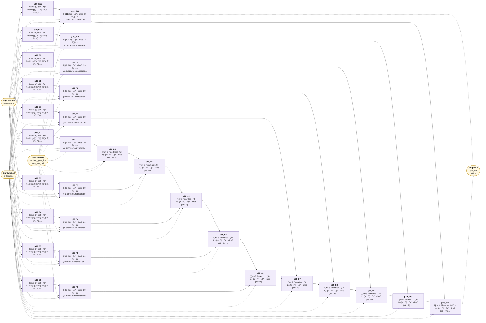
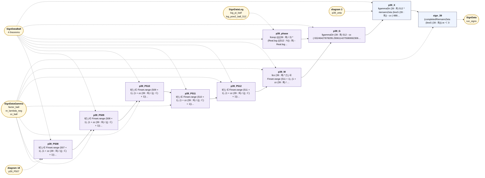

# `lean_stage3/Stage3/SignDataPt39.lean`

> **Read from the source text.** This file changed after the last `python3 utilities/lean_map.py --dump`, so the arrows on this page are names occurring in each proof and have not been confirmed by Lean.

SignDataPt39 — block S14 of `lean_stage3/design/stencil.md`, Turing's sign data: the sign of `Re Λ(1/2 + it)` at `t = 39.0`. 2026-11-25. Generated by `lean_stage3/checks/signdata/gen_signdata.py`; do not edit by hand.

550 theorems, 0 definitions, 2782 lines. 

**Imports:** [`SignDataGamma`](../lean_stage3/SignDataGamma.md), [`SignDataLog`](../lean_stage3/SignDataLog.md)  
**Imported by:** [`SignData`](../lean_stage3/SignData.md)

## The picture

### Diagram 1 of 19: `p39_E2` to `p39_S11`



### Diagram 2 of 19: `p39_NB` to `p39_P27`

```mermaid
flowchart LR
  n0["<b>p39_NB</b><br/>‖(((11 : ℕ)) : ℂ) ^ (-lineS (39 : ℝ)) * emB (39 : ℝ) 11 - cx (-0…"]:::shp
  n1["<b>p39_Y</b><br/>‖(∑ m ∈ Finset.Icc 1 (10 + 1), ((m : ℕ) : ℂ) ^ (-lineS (39 : ℝ))…"]:::shp
  n2["<b>p39_zeta</b><br/>‖riemannZeta (lineS (39 : ℝ)) - cx (1.78898357390079325256690338…"]:::thm
  n3["<b>p39_P1</b><br/>‖∏ j ∈ Finset.range (0 + 1), (1 + zz (39 : ℝ) / ((j : ℂ) + 1)) -…"]:::shp
  n4["<b>p39_P2</b><br/>‖∏ j ∈ Finset.range (1 + 1), (1 + zz (39 : ℝ) / ((j : ℂ) + 1)) -…"]:::shp
  n5["<b>p39_P3</b><br/>‖∏ j ∈ Finset.range (2 + 1), (1 + zz (39 : ℝ) / ((j : ℂ) + 1)) -…"]:::shp
  n6["<b>p39_P4</b><br/>‖∏ j ∈ Finset.range (3 + 1), (1 + zz (39 : ℝ) / ((j : ℂ) + 1)) -…"]:::shp
  n7["<b>p39_P5</b><br/>‖∏ j ∈ Finset.range (4 + 1), (1 + zz (39 : ℝ) / ((j : ℂ) + 1)) -…"]:::shp
  n8["<b>p39_P6</b><br/>‖∏ j ∈ Finset.range (5 + 1), (1 + zz (39 : ℝ) / ((j : ℂ) + 1)) -…"]:::shp
  n9["<b>p39_P7</b><br/>‖∏ j ∈ Finset.range (6 + 1), (1 + zz (39 : ℝ) / ((j : ℂ) + 1)) -…"]:::shp
  n10["<b>p39_P8</b><br/>‖∏ j ∈ Finset.range (7 + 1), (1 + zz (39 : ℝ) / ((j : ℂ) + 1)) -…"]:::shp
  n11["<b>p39_P9</b><br/>‖∏ j ∈ Finset.range (8 + 1), (1 + zz (39 : ℝ) / ((j : ℂ) + 1)) -…"]:::shp
  n12["<b>p39_P10</b><br/>‖∏ j ∈ Finset.range (9 + 1), (1 + zz (39 : ℝ) / ((j : ℂ) + 1)) -…"]:::shp
  n13["<b>p39_P11</b><br/>‖∏ j ∈ Finset.range (10 + 1), (1 + zz (39 : ℝ) / ((j : ℂ) + 1)) …"]:::shp
  n14["<b>p39_P12</b><br/>‖∏ j ∈ Finset.range (11 + 1), (1 + zz (39 : ℝ) / ((j : ℂ) + 1)) …"]:::shp
  n15["<b>p39_P13</b><br/>‖∏ j ∈ Finset.range (12 + 1), (1 + zz (39 : ℝ) / ((j : ℂ) + 1)) …"]:::shp
  n16["<b>p39_P14</b><br/>‖∏ j ∈ Finset.range (13 + 1), (1 + zz (39 : ℝ) / ((j : ℂ) + 1)) …"]:::shp
  n17["<b>p39_P15</b><br/>‖∏ j ∈ Finset.range (14 + 1), (1 + zz (39 : ℝ) / ((j : ℂ) + 1)) …"]:::shp
  n18["<b>p39_P16</b><br/>‖∏ j ∈ Finset.range (15 + 1), (1 + zz (39 : ℝ) / ((j : ℂ) + 1)) …"]:::shp
  n19["<b>p39_P17</b><br/>‖∏ j ∈ Finset.range (16 + 1), (1 + zz (39 : ℝ) / ((j : ℂ) + 1)) …"]:::shp
  n20["<b>p39_P18</b><br/>‖∏ j ∈ Finset.range (17 + 1), (1 + zz (39 : ℝ) / ((j : ℂ) + 1)) …"]:::shp
  n21["<b>p39_P19</b><br/>‖∏ j ∈ Finset.range (18 + 1), (1 + zz (39 : ℝ) / ((j : ℂ) + 1)) …"]:::shp
  n22["<b>p39_P20</b><br/>‖∏ j ∈ Finset.range (19 + 1), (1 + zz (39 : ℝ) / ((j : ℂ) + 1)) …"]:::shp
  n23["<b>p39_P21</b><br/>‖∏ j ∈ Finset.range (20 + 1), (1 + zz (39 : ℝ) / ((j : ℂ) + 1)) …"]:::shp
  n24["<b>p39_P22</b><br/>‖∏ j ∈ Finset.range (21 + 1), (1 + zz (39 : ℝ) / ((j : ℂ) + 1)) …"]:::shp
  n25["<b>p39_P23</b><br/>‖∏ j ∈ Finset.range (22 + 1), (1 + zz (39 : ℝ) / ((j : ℂ) + 1)) …"]:::shp
  n26["<b>p39_P24</b><br/>‖∏ j ∈ Finset.range (23 + 1), (1 + zz (39 : ℝ) / ((j : ℂ) + 1)) …"]:::shp
  n27["<b>p39_P25</b><br/>‖∏ j ∈ Finset.range (24 + 1), (1 + zz (39 : ℝ) / ((j : ℂ) + 1)) …"]:::shp
  n28["<b>p39_P26</b><br/>‖∏ j ∈ Finset.range (25 + 1), (1 + zz (39 : ℝ) / ((j : ℂ) + 1)) …"]:::shp
  n29["<b>p39_P27</b><br/>‖∏ j ∈ Finset.range (26 + 1), (1 + zz (39 : ℝ) / ((j : ℂ) + 1)) …"]:::shp
  x0(["<b>SignDataBall</b><br/>ball_add<br/>ball_mul"]):::ext
  x1(["<b>diagram 1</b><br/>p39_S11<br/>p39_T11"]):::ext
  x2(["<b>SignDataZeta</b><br/>emB_ball<br/>rem_le<br/>zeta_ball"]):::ext
  x3(["<b>diagram 19</b><br/>p39_X"]):::ext
  x4(["<b>SignDataGamma</b><br/>factor_ball<br/>prod_zero_ball"]):::ext
  x5(["<b>diagram 3</b><br/>p39_P28"]):::ext
  n0 --> n1
  n1 --> n2
  n10 --> n11
  n11 --> n12
  n12 --> n13
  n13 --> n14
  n14 --> n15
  n15 --> n16
  n16 --> n17
  n17 --> n18
  n18 --> n19
  n19 --> n20
  n20 --> n21
  n21 --> n22
  n22 --> n23
  n23 --> n24
  n24 --> n25
  n25 --> n26
  n26 --> n27
  n27 --> n28
  n28 --> n29
  n3 --> n4
  n4 --> n5
  n5 --> n6
  n6 --> n7
  n7 --> n8
  n8 --> n9
  n9 --> n10
  n2 -.-> x3
  n29 -.-> x5
  x0 -.-> n0
  x0 -.-> n1
  x0 -.-> n10
  x0 -.-> n11
  x0 -.-> n12
  x0 -.-> n13
  x0 -.-> n14
  x0 -.-> n15
  x0 -.-> n16
  x0 -.-> n17
  x0 -.-> n18
  x0 -.-> n19
  x0 -.-> n20
  x0 -.-> n21
  x0 -.-> n22
  x0 -.-> n23
  x0 -.-> n24
  x0 -.-> n25
  x0 -.-> n26
  x0 -.-> n27
  x0 -.-> n28
  x0 -.-> n29
  x0 -.-> n3
  x0 -.-> n4
  x0 -.-> n5
  x0 -.-> n6
  x0 -.-> n7
  x0 -.-> n8
  x0 -.-> n9
  x1 -.-> n0
  x1 -.-> n1
  x2 -.-> n0
  x2 -.-> n2
  x4 -.-> n10
  x4 -.-> n11
  x4 -.-> n12
  x4 -.-> n13
  x4 -.-> n14
  x4 -.-> n15
  x4 -.-> n16
  x4 -.-> n17
  x4 -.-> n18
  x4 -.-> n19
  x4 -.-> n20
  x4 -.-> n21
  x4 -.-> n22
  x4 -.-> n23
  x4 -.-> n24
  x4 -.-> n25
  x4 -.-> n26
  x4 -.-> n27
  x4 -.-> n28
  x4 -.-> n29
  x4 -.-> n3
  x4 -.-> n4
  x4 -.-> n5
  x4 -.-> n6
  x4 -.-> n7
  x4 -.-> n8
  x4 -.-> n9
  classDef cnt fill:#dff5ec,stroke:#17694a,color:#111
  classDef shp fill:#f1ecfb,stroke:#5b3fa0,color:#111
  classDef rh fill:#ffe5e5,stroke:#c22,color:#111,stroke-width:2px
  classDef thm fill:#eef4ff,stroke:#335,color:#111
  classDef end_ fill:#e7f7e7,stroke:#2a7,color:#111,stroke-width:2px
  classDef lone fill:#fff,stroke:#999,color:#111,stroke-dasharray:4 3
  classDef bad fill:#ffe5e5,stroke:#c22,color:#111,stroke-width:2px
  classDef ext fill:#fff8e1,stroke:#b80,color:#111
```



### Diagram 3 of 19: `p39_P28` to `p39_P57`

```mermaid
flowchart LR
  n0["<b>p39_P28</b><br/>‖∏ j ∈ Finset.range (27 + 1), (1 + zz (39 : ℝ) / ((j : ℂ) + 1)) …"]:::shp
  n1["<b>p39_P29</b><br/>‖∏ j ∈ Finset.range (28 + 1), (1 + zz (39 : ℝ) / ((j : ℂ) + 1)) …"]:::shp
  n2["<b>p39_P30</b><br/>‖∏ j ∈ Finset.range (29 + 1), (1 + zz (39 : ℝ) / ((j : ℂ) + 1)) …"]:::shp
  n3["<b>p39_P31</b><br/>‖∏ j ∈ Finset.range (30 + 1), (1 + zz (39 : ℝ) / ((j : ℂ) + 1)) …"]:::shp
  n4["<b>p39_P32</b><br/>‖∏ j ∈ Finset.range (31 + 1), (1 + zz (39 : ℝ) / ((j : ℂ) + 1)) …"]:::shp
  n5["<b>p39_P33</b><br/>‖∏ j ∈ Finset.range (32 + 1), (1 + zz (39 : ℝ) / ((j : ℂ) + 1)) …"]:::shp
  n6["<b>p39_P34</b><br/>‖∏ j ∈ Finset.range (33 + 1), (1 + zz (39 : ℝ) / ((j : ℂ) + 1)) …"]:::shp
  n7["<b>p39_P35</b><br/>‖∏ j ∈ Finset.range (34 + 1), (1 + zz (39 : ℝ) / ((j : ℂ) + 1)) …"]:::shp
  n8["<b>p39_P36</b><br/>‖∏ j ∈ Finset.range (35 + 1), (1 + zz (39 : ℝ) / ((j : ℂ) + 1)) …"]:::shp
  n9["<b>p39_P37</b><br/>‖∏ j ∈ Finset.range (36 + 1), (1 + zz (39 : ℝ) / ((j : ℂ) + 1)) …"]:::shp
  n10["<b>p39_P38</b><br/>‖∏ j ∈ Finset.range (37 + 1), (1 + zz (39 : ℝ) / ((j : ℂ) + 1)) …"]:::shp
  n11["<b>p39_P39</b><br/>‖∏ j ∈ Finset.range (38 + 1), (1 + zz (39 : ℝ) / ((j : ℂ) + 1)) …"]:::shp
  n12["<b>p39_P40</b><br/>‖∏ j ∈ Finset.range (39 + 1), (1 + zz (39 : ℝ) / ((j : ℂ) + 1)) …"]:::shp
  n13["<b>p39_P41</b><br/>‖∏ j ∈ Finset.range (40 + 1), (1 + zz (39 : ℝ) / ((j : ℂ) + 1)) …"]:::shp
  n14["<b>p39_P42</b><br/>‖∏ j ∈ Finset.range (41 + 1), (1 + zz (39 : ℝ) / ((j : ℂ) + 1)) …"]:::shp
  n15["<b>p39_P43</b><br/>‖∏ j ∈ Finset.range (42 + 1), (1 + zz (39 : ℝ) / ((j : ℂ) + 1)) …"]:::shp
  n16["<b>p39_P44</b><br/>‖∏ j ∈ Finset.range (43 + 1), (1 + zz (39 : ℝ) / ((j : ℂ) + 1)) …"]:::shp
  n17["<b>p39_P45</b><br/>‖∏ j ∈ Finset.range (44 + 1), (1 + zz (39 : ℝ) / ((j : ℂ) + 1)) …"]:::shp
  n18["<b>p39_P46</b><br/>‖∏ j ∈ Finset.range (45 + 1), (1 + zz (39 : ℝ) / ((j : ℂ) + 1)) …"]:::shp
  n19["<b>p39_P47</b><br/>‖∏ j ∈ Finset.range (46 + 1), (1 + zz (39 : ℝ) / ((j : ℂ) + 1)) …"]:::shp
  n20["<b>p39_P48</b><br/>‖∏ j ∈ Finset.range (47 + 1), (1 + zz (39 : ℝ) / ((j : ℂ) + 1)) …"]:::shp
  n21["<b>p39_P49</b><br/>‖∏ j ∈ Finset.range (48 + 1), (1 + zz (39 : ℝ) / ((j : ℂ) + 1)) …"]:::shp
  n22["<b>p39_P50</b><br/>‖∏ j ∈ Finset.range (49 + 1), (1 + zz (39 : ℝ) / ((j : ℂ) + 1)) …"]:::shp
  n23["<b>p39_P51</b><br/>‖∏ j ∈ Finset.range (50 + 1), (1 + zz (39 : ℝ) / ((j : ℂ) + 1)) …"]:::shp
  n24["<b>p39_P52</b><br/>‖∏ j ∈ Finset.range (51 + 1), (1 + zz (39 : ℝ) / ((j : ℂ) + 1)) …"]:::shp
  n25["<b>p39_P53</b><br/>‖∏ j ∈ Finset.range (52 + 1), (1 + zz (39 : ℝ) / ((j : ℂ) + 1)) …"]:::shp
  n26["<b>p39_P54</b><br/>‖∏ j ∈ Finset.range (53 + 1), (1 + zz (39 : ℝ) / ((j : ℂ) + 1)) …"]:::shp
  n27["<b>p39_P55</b><br/>‖∏ j ∈ Finset.range (54 + 1), (1 + zz (39 : ℝ) / ((j : ℂ) + 1)) …"]:::shp
  n28["<b>p39_P56</b><br/>‖∏ j ∈ Finset.range (55 + 1), (1 + zz (39 : ℝ) / ((j : ℂ) + 1)) …"]:::shp
  n29["<b>p39_P57</b><br/>‖∏ j ∈ Finset.range (56 + 1), (1 + zz (39 : ℝ) / ((j : ℂ) + 1)) …"]:::shp
  x0(["<b>SignDataBall</b><br/>ball_mul"]):::ext
  x1(["<b>SignDataGamma</b><br/>factor_ball"]):::ext
  x2(["<b>diagram 2</b><br/>p39_P27"]):::ext
  x3(["<b>diagram 4</b><br/>p39_P58"]):::ext
  n0 --> n1
  n1 --> n2
  n10 --> n11
  n11 --> n12
  n12 --> n13
  n13 --> n14
  n14 --> n15
  n15 --> n16
  n16 --> n17
  n17 --> n18
  n18 --> n19
  n19 --> n20
  n2 --> n3
  n20 --> n21
  n21 --> n22
  n22 --> n23
  n23 --> n24
  n24 --> n25
  n25 --> n26
  n26 --> n27
  n27 --> n28
  n28 --> n29
  n3 --> n4
  n4 --> n5
  n5 --> n6
  n6 --> n7
  n7 --> n8
  n8 --> n9
  n9 --> n10
  n29 -.-> x3
  x0 -.-> n0
  x0 -.-> n1
  x0 -.-> n10
  x0 -.-> n11
  x0 -.-> n12
  x0 -.-> n13
  x0 -.-> n14
  x0 -.-> n15
  x0 -.-> n16
  x0 -.-> n17
  x0 -.-> n18
  x0 -.-> n19
  x0 -.-> n2
  x0 -.-> n20
  x0 -.-> n21
  x0 -.-> n22
  x0 -.-> n23
  x0 -.-> n24
  x0 -.-> n25
  x0 -.-> n26
  x0 -.-> n27
  x0 -.-> n28
  x0 -.-> n29
  x0 -.-> n3
  x0 -.-> n4
  x0 -.-> n5
  x0 -.-> n6
  x0 -.-> n7
  x0 -.-> n8
  x0 -.-> n9
  x1 -.-> n0
  x1 -.-> n1
  x1 -.-> n10
  x1 -.-> n11
  x1 -.-> n12
  x1 -.-> n13
  x1 -.-> n14
  x1 -.-> n15
  x1 -.-> n16
  x1 -.-> n17
  x1 -.-> n18
  x1 -.-> n19
  x1 -.-> n2
  x1 -.-> n20
  x1 -.-> n21
  x1 -.-> n22
  x1 -.-> n23
  x1 -.-> n24
  x1 -.-> n25
  x1 -.-> n26
  x1 -.-> n27
  x1 -.-> n28
  x1 -.-> n29
  x1 -.-> n3
  x1 -.-> n4
  x1 -.-> n5
  x1 -.-> n6
  x1 -.-> n7
  x1 -.-> n8
  x1 -.-> n9
  x2 -.-> n0
  classDef cnt fill:#dff5ec,stroke:#17694a,color:#111
  classDef shp fill:#f1ecfb,stroke:#5b3fa0,color:#111
  classDef rh fill:#ffe5e5,stroke:#c22,color:#111,stroke-width:2px
  classDef thm fill:#eef4ff,stroke:#335,color:#111
  classDef end_ fill:#e7f7e7,stroke:#2a7,color:#111,stroke-width:2px
  classDef lone fill:#fff,stroke:#999,color:#111,stroke-dasharray:4 3
  classDef bad fill:#ffe5e5,stroke:#c22,color:#111,stroke-width:2px
  classDef ext fill:#fff8e1,stroke:#b80,color:#111
```



### Diagram 4 of 19: `p39_P58` to `p39_P87`

```mermaid
flowchart LR
  n0["<b>p39_P58</b><br/>‖∏ j ∈ Finset.range (57 + 1), (1 + zz (39 : ℝ) / ((j : ℂ) + 1)) …"]:::shp
  n1["<b>p39_P59</b><br/>‖∏ j ∈ Finset.range (58 + 1), (1 + zz (39 : ℝ) / ((j : ℂ) + 1)) …"]:::shp
  n2["<b>p39_P60</b><br/>‖∏ j ∈ Finset.range (59 + 1), (1 + zz (39 : ℝ) / ((j : ℂ) + 1)) …"]:::shp
  n3["<b>p39_P61</b><br/>‖∏ j ∈ Finset.range (60 + 1), (1 + zz (39 : ℝ) / ((j : ℂ) + 1)) …"]:::shp
  n4["<b>p39_P62</b><br/>‖∏ j ∈ Finset.range (61 + 1), (1 + zz (39 : ℝ) / ((j : ℂ) + 1)) …"]:::shp
  n5["<b>p39_P63</b><br/>‖∏ j ∈ Finset.range (62 + 1), (1 + zz (39 : ℝ) / ((j : ℂ) + 1)) …"]:::shp
  n6["<b>p39_P64</b><br/>‖∏ j ∈ Finset.range (63 + 1), (1 + zz (39 : ℝ) / ((j : ℂ) + 1)) …"]:::shp
  n7["<b>p39_P65</b><br/>‖∏ j ∈ Finset.range (64 + 1), (1 + zz (39 : ℝ) / ((j : ℂ) + 1)) …"]:::shp
  n8["<b>p39_P66</b><br/>‖∏ j ∈ Finset.range (65 + 1), (1 + zz (39 : ℝ) / ((j : ℂ) + 1)) …"]:::shp
  n9["<b>p39_P67</b><br/>‖∏ j ∈ Finset.range (66 + 1), (1 + zz (39 : ℝ) / ((j : ℂ) + 1)) …"]:::shp
  n10["<b>p39_P68</b><br/>‖∏ j ∈ Finset.range (67 + 1), (1 + zz (39 : ℝ) / ((j : ℂ) + 1)) …"]:::shp
  n11["<b>p39_P69</b><br/>‖∏ j ∈ Finset.range (68 + 1), (1 + zz (39 : ℝ) / ((j : ℂ) + 1)) …"]:::shp
  n12["<b>p39_P70</b><br/>‖∏ j ∈ Finset.range (69 + 1), (1 + zz (39 : ℝ) / ((j : ℂ) + 1)) …"]:::shp
  n13["<b>p39_P71</b><br/>‖∏ j ∈ Finset.range (70 + 1), (1 + zz (39 : ℝ) / ((j : ℂ) + 1)) …"]:::shp
  n14["<b>p39_P72</b><br/>‖∏ j ∈ Finset.range (71 + 1), (1 + zz (39 : ℝ) / ((j : ℂ) + 1)) …"]:::shp
  n15["<b>p39_P73</b><br/>‖∏ j ∈ Finset.range (72 + 1), (1 + zz (39 : ℝ) / ((j : ℂ) + 1)) …"]:::shp
  n16["<b>p39_P74</b><br/>‖∏ j ∈ Finset.range (73 + 1), (1 + zz (39 : ℝ) / ((j : ℂ) + 1)) …"]:::shp
  n17["<b>p39_P75</b><br/>‖∏ j ∈ Finset.range (74 + 1), (1 + zz (39 : ℝ) / ((j : ℂ) + 1)) …"]:::shp
  n18["<b>p39_P76</b><br/>‖∏ j ∈ Finset.range (75 + 1), (1 + zz (39 : ℝ) / ((j : ℂ) + 1)) …"]:::shp
  n19["<b>p39_P77</b><br/>‖∏ j ∈ Finset.range (76 + 1), (1 + zz (39 : ℝ) / ((j : ℂ) + 1)) …"]:::shp
  n20["<b>p39_P78</b><br/>‖∏ j ∈ Finset.range (77 + 1), (1 + zz (39 : ℝ) / ((j : ℂ) + 1)) …"]:::shp
  n21["<b>p39_P79</b><br/>‖∏ j ∈ Finset.range (78 + 1), (1 + zz (39 : ℝ) / ((j : ℂ) + 1)) …"]:::shp
  n22["<b>p39_P80</b><br/>‖∏ j ∈ Finset.range (79 + 1), (1 + zz (39 : ℝ) / ((j : ℂ) + 1)) …"]:::shp
  n23["<b>p39_P81</b><br/>‖∏ j ∈ Finset.range (80 + 1), (1 + zz (39 : ℝ) / ((j : ℂ) + 1)) …"]:::shp
  n24["<b>p39_P82</b><br/>‖∏ j ∈ Finset.range (81 + 1), (1 + zz (39 : ℝ) / ((j : ℂ) + 1)) …"]:::shp
  n25["<b>p39_P83</b><br/>‖∏ j ∈ Finset.range (82 + 1), (1 + zz (39 : ℝ) / ((j : ℂ) + 1)) …"]:::shp
  n26["<b>p39_P84</b><br/>‖∏ j ∈ Finset.range (83 + 1), (1 + zz (39 : ℝ) / ((j : ℂ) + 1)) …"]:::shp
  n27["<b>p39_P85</b><br/>‖∏ j ∈ Finset.range (84 + 1), (1 + zz (39 : ℝ) / ((j : ℂ) + 1)) …"]:::shp
  n28["<b>p39_P86</b><br/>‖∏ j ∈ Finset.range (85 + 1), (1 + zz (39 : ℝ) / ((j : ℂ) + 1)) …"]:::shp
  n29["<b>p39_P87</b><br/>‖∏ j ∈ Finset.range (86 + 1), (1 + zz (39 : ℝ) / ((j : ℂ) + 1)) …"]:::shp
  x0(["<b>SignDataBall</b><br/>ball_mul"]):::ext
  x1(["<b>SignDataGamma</b><br/>factor_ball"]):::ext
  x2(["<b>diagram 3</b><br/>p39_P57"]):::ext
  x3(["<b>diagram 5</b><br/>p39_P88"]):::ext
  n0 --> n1
  n1 --> n2
  n10 --> n11
  n11 --> n12
  n12 --> n13
  n13 --> n14
  n14 --> n15
  n15 --> n16
  n16 --> n17
  n17 --> n18
  n18 --> n19
  n19 --> n20
  n2 --> n3
  n20 --> n21
  n21 --> n22
  n22 --> n23
  n23 --> n24
  n24 --> n25
  n25 --> n26
  n26 --> n27
  n27 --> n28
  n28 --> n29
  n3 --> n4
  n4 --> n5
  n5 --> n6
  n6 --> n7
  n7 --> n8
  n8 --> n9
  n9 --> n10
  n29 -.-> x3
  x0 -.-> n0
  x0 -.-> n1
  x0 -.-> n10
  x0 -.-> n11
  x0 -.-> n12
  x0 -.-> n13
  x0 -.-> n14
  x0 -.-> n15
  x0 -.-> n16
  x0 -.-> n17
  x0 -.-> n18
  x0 -.-> n19
  x0 -.-> n2
  x0 -.-> n20
  x0 -.-> n21
  x0 -.-> n22
  x0 -.-> n23
  x0 -.-> n24
  x0 -.-> n25
  x0 -.-> n26
  x0 -.-> n27
  x0 -.-> n28
  x0 -.-> n29
  x0 -.-> n3
  x0 -.-> n4
  x0 -.-> n5
  x0 -.-> n6
  x0 -.-> n7
  x0 -.-> n8
  x0 -.-> n9
  x1 -.-> n0
  x1 -.-> n1
  x1 -.-> n10
  x1 -.-> n11
  x1 -.-> n12
  x1 -.-> n13
  x1 -.-> n14
  x1 -.-> n15
  x1 -.-> n16
  x1 -.-> n17
  x1 -.-> n18
  x1 -.-> n19
  x1 -.-> n2
  x1 -.-> n20
  x1 -.-> n21
  x1 -.-> n22
  x1 -.-> n23
  x1 -.-> n24
  x1 -.-> n25
  x1 -.-> n26
  x1 -.-> n27
  x1 -.-> n28
  x1 -.-> n29
  x1 -.-> n3
  x1 -.-> n4
  x1 -.-> n5
  x1 -.-> n6
  x1 -.-> n7
  x1 -.-> n8
  x1 -.-> n9
  x2 -.-> n0
  classDef cnt fill:#dff5ec,stroke:#17694a,color:#111
  classDef shp fill:#f1ecfb,stroke:#5b3fa0,color:#111
  classDef rh fill:#ffe5e5,stroke:#c22,color:#111,stroke-width:2px
  classDef thm fill:#eef4ff,stroke:#335,color:#111
  classDef end_ fill:#e7f7e7,stroke:#2a7,color:#111,stroke-width:2px
  classDef lone fill:#fff,stroke:#999,color:#111,stroke-dasharray:4 3
  classDef bad fill:#ffe5e5,stroke:#c22,color:#111,stroke-width:2px
  classDef ext fill:#fff8e1,stroke:#b80,color:#111
```



### Diagram 5 of 19: `p39_P88` to `p39_P117`


### Diagram 6 of 19: `p39_P118` to `p39_P147`


### Diagram 7 of 19: `p39_P148` to `p39_P177`


### Diagram 8 of 19: `p39_P178` to `p39_P207`


### Diagram 9 of 19: `p39_P208` to `p39_P237`


### Diagram 10 of 19: `p39_P238` to `p39_P267`


### Diagram 11 of 19: `p39_P268` to `p39_P297`


### Diagram 12 of 19: `p39_P298` to `p39_P327`


### Diagram 13 of 19: `p39_P328` to `p39_P357`


### Diagram 14 of 19: `p39_P358` to `p39_P387`


### Diagram 15 of 19: `p39_P388` to `p39_P417`


### Diagram 16 of 19: `p39_P418` to `p39_P447`


### Diagram 17 of 19: `p39_P448` to `p39_P477`

```mermaid
flowchart LR
  n0["<b>p39_P448</b><br/>‖∏ j ∈ Finset.range (447 + 1), (1 + zz (39 : ℝ) / ((j : ℂ) + 1))…"]:::shp
  n1["<b>p39_P449</b><br/>‖∏ j ∈ Finset.range (448 + 1), (1 + zz (39 : ℝ) / ((j : ℂ) + 1))…"]:::shp
  n2["<b>p39_P450</b><br/>‖∏ j ∈ Finset.range (449 + 1), (1 + zz (39 : ℝ) / ((j : ℂ) + 1))…"]:::shp
  n3["<b>p39_P451</b><br/>‖∏ j ∈ Finset.range (450 + 1), (1 + zz (39 : ℝ) / ((j : ℂ) + 1))…"]:::shp
  n4["<b>p39_P452</b><br/>‖∏ j ∈ Finset.range (451 + 1), (1 + zz (39 : ℝ) / ((j : ℂ) + 1))…"]:::shp
  n5["<b>p39_P453</b><br/>‖∏ j ∈ Finset.range (452 + 1), (1 + zz (39 : ℝ) / ((j : ℂ) + 1))…"]:::shp
  n6["<b>p39_P454</b><br/>‖∏ j ∈ Finset.range (453 + 1), (1 + zz (39 : ℝ) / ((j : ℂ) + 1))…"]:::shp
  n7["<b>p39_P455</b><br/>‖∏ j ∈ Finset.range (454 + 1), (1 + zz (39 : ℝ) / ((j : ℂ) + 1))…"]:::shp
  n8["<b>p39_P456</b><br/>‖∏ j ∈ Finset.range (455 + 1), (1 + zz (39 : ℝ) / ((j : ℂ) + 1))…"]:::shp
  n9["<b>p39_P457</b><br/>‖∏ j ∈ Finset.range (456 + 1), (1 + zz (39 : ℝ) / ((j : ℂ) + 1))…"]:::shp
  n10["<b>p39_P458</b><br/>‖∏ j ∈ Finset.range (457 + 1), (1 + zz (39 : ℝ) / ((j : ℂ) + 1))…"]:::shp
  n11["<b>p39_P459</b><br/>‖∏ j ∈ Finset.range (458 + 1), (1 + zz (39 : ℝ) / ((j : ℂ) + 1))…"]:::shp
  n12["<b>p39_P460</b><br/>‖∏ j ∈ Finset.range (459 + 1), (1 + zz (39 : ℝ) / ((j : ℂ) + 1))…"]:::shp
  n13["<b>p39_P461</b><br/>‖∏ j ∈ Finset.range (460 + 1), (1 + zz (39 : ℝ) / ((j : ℂ) + 1))…"]:::shp
  n14["<b>p39_P462</b><br/>‖∏ j ∈ Finset.range (461 + 1), (1 + zz (39 : ℝ) / ((j : ℂ) + 1))…"]:::shp
  n15["<b>p39_P463</b><br/>‖∏ j ∈ Finset.range (462 + 1), (1 + zz (39 : ℝ) / ((j : ℂ) + 1))…"]:::shp
  n16["<b>p39_P464</b><br/>‖∏ j ∈ Finset.range (463 + 1), (1 + zz (39 : ℝ) / ((j : ℂ) + 1))…"]:::shp
  n17["<b>p39_P465</b><br/>‖∏ j ∈ Finset.range (464 + 1), (1 + zz (39 : ℝ) / ((j : ℂ) + 1))…"]:::shp
  n18["<b>p39_P466</b><br/>‖∏ j ∈ Finset.range (465 + 1), (1 + zz (39 : ℝ) / ((j : ℂ) + 1))…"]:::shp
  n19["<b>p39_P467</b><br/>‖∏ j ∈ Finset.range (466 + 1), (1 + zz (39 : ℝ) / ((j : ℂ) + 1))…"]:::shp
  n20["<b>p39_P468</b><br/>‖∏ j ∈ Finset.range (467 + 1), (1 + zz (39 : ℝ) / ((j : ℂ) + 1))…"]:::shp
  n21["<b>p39_P469</b><br/>‖∏ j ∈ Finset.range (468 + 1), (1 + zz (39 : ℝ) / ((j : ℂ) + 1))…"]:::shp
  n22["<b>p39_P470</b><br/>‖∏ j ∈ Finset.range (469 + 1), (1 + zz (39 : ℝ) / ((j : ℂ) + 1))…"]:::shp
  n23["<b>p39_P471</b><br/>‖∏ j ∈ Finset.range (470 + 1), (1 + zz (39 : ℝ) / ((j : ℂ) + 1))…"]:::shp
  n24["<b>p39_P472</b><br/>‖∏ j ∈ Finset.range (471 + 1), (1 + zz (39 : ℝ) / ((j : ℂ) + 1))…"]:::shp
  n25["<b>p39_P473</b><br/>‖∏ j ∈ Finset.range (472 + 1), (1 + zz (39 : ℝ) / ((j : ℂ) + 1))…"]:::shp
  n26["<b>p39_P474</b><br/>‖∏ j ∈ Finset.range (473 + 1), (1 + zz (39 : ℝ) / ((j : ℂ) + 1))…"]:::shp
  n27["<b>p39_P475</b><br/>‖∏ j ∈ Finset.range (474 + 1), (1 + zz (39 : ℝ) / ((j : ℂ) + 1))…"]:::shp
  n28["<b>p39_P476</b><br/>‖∏ j ∈ Finset.range (475 + 1), (1 + zz (39 : ℝ) / ((j : ℂ) + 1))…"]:::shp
  n29["<b>p39_P477</b><br/>‖∏ j ∈ Finset.range (476 + 1), (1 + zz (39 : ℝ) / ((j : ℂ) + 1))…"]:::shp
  x0(["<b>SignDataBall</b><br/>ball_mul"]):::ext
  x1(["<b>SignDataGamma</b><br/>factor_ball"]):::ext
  x2(["<b>diagram 16</b><br/>p39_P447"]):::ext
  x3(["<b>diagram 18</b><br/>p39_P478"]):::ext
  n0 --> n1
  n1 --> n2
  n10 --> n11
  n11 --> n12
  n12 --> n13
  n13 --> n14
  n14 --> n15
  n15 --> n16
  n16 --> n17
  n17 --> n18
  n18 --> n19
  n19 --> n20
  n2 --> n3
  n20 --> n21
  n21 --> n22
  n22 --> n23
  n23 --> n24
  n24 --> n25
  n25 --> n26
  n26 --> n27
  n27 --> n28
  n28 --> n29
  n3 --> n4
  n4 --> n5
  n5 --> n6
  n6 --> n7
  n7 --> n8
  n8 --> n9
  n9 --> n10
  n29 -.-> x3
  x0 -.-> n0
  x0 -.-> n1
  x0 -.-> n10
  x0 -.-> n11
  x0 -.-> n12
  x0 -.-> n13
  x0 -.-> n14
  x0 -.-> n15
  x0 -.-> n16
  x0 -.-> n17
  x0 -.-> n18
  x0 -.-> n19
  x0 -.-> n2
  x0 -.-> n20
  x0 -.-> n21
  x0 -.-> n22
  x0 -.-> n23
  x0 -.-> n24
  x0 -.-> n25
  x0 -.-> n26
  x0 -.-> n27
  x0 -.-> n28
  x0 -.-> n29
  x0 -.-> n3
  x0 -.-> n4
  x0 -.-> n5
  x0 -.-> n6
  x0 -.-> n7
  x0 -.-> n8
  x0 -.-> n9
  x1 -.-> n0
  x1 -.-> n1
  x1 -.-> n10
  x1 -.-> n11
  x1 -.-> n12
  x1 -.-> n13
  x1 -.-> n14
  x1 -.-> n15
  x1 -.-> n16
  x1 -.-> n17
  x1 -.-> n18
  x1 -.-> n19
  x1 -.-> n2
  x1 -.-> n20
  x1 -.-> n21
  x1 -.-> n22
  x1 -.-> n23
  x1 -.-> n24
  x1 -.-> n25
  x1 -.-> n26
  x1 -.-> n27
  x1 -.-> n28
  x1 -.-> n29
  x1 -.-> n3
  x1 -.-> n4
  x1 -.-> n5
  x1 -.-> n6
  x1 -.-> n7
  x1 -.-> n8
  x1 -.-> n9
  x2 -.-> n0
  classDef cnt fill:#dff5ec,stroke:#17694a,color:#111
  classDef shp fill:#f1ecfb,stroke:#5b3fa0,color:#111
  classDef rh fill:#ffe5e5,stroke:#c22,color:#111,stroke-width:2px
  classDef thm fill:#eef4ff,stroke:#335,color:#111
  classDef end_ fill:#e7f7e7,stroke:#2a7,color:#111,stroke-width:2px
  classDef lone fill:#fff,stroke:#999,color:#111,stroke-dasharray:4 3
  classDef bad fill:#ffe5e5,stroke:#c22,color:#111,stroke-width:2px
  classDef ext fill:#fff8e1,stroke:#b80,color:#111
```



### Diagram 18 of 19: `p39_P478` to `p39_P507`


### Diagram 19 of 19: `p39_P508` to `sign_39`



An arrow A → B reads "A is used in the proof of B". Green: counting, integers only. Violet: shape, analysis with no ζ. Blue: reads ζ. A name ending in ■ is an end: nothing else uses it. Red: contains `sorry`. Yellow: theorems in another file, counted; a dotted arrow crosses files. Definitions are not drawn; they are listed below the diagram.

## Theorems

<a name="SignData-p39_E2"></a>
### `SignData.p39_E2`

line 31 · arrows read from text

**Shape.** Uses real or complex analysis; nothing in it or beneath it reads ζ.

**Proves**

```lean
‖cexp ((((-((39 : ℝ) * Real.log (((2 : ℕ)) : ℝ))) : ℝ) : ℂ) * Complex.I) - cx (-0.323288443351135726138064255196) (-(0.946300471518216832441192256385))‖ ≤ (0.000000009750000000085000000097)
```

**Fed by** (3 theorems its proof uses)

  - [`SignData.exp_ball3`](../lean_stage3/SignDataBall.md#SignData-exp_ball3) (SignDataBall) — `` ‖cexp ((x : ℂ) * I) - cx f (-e)‖ ≤ R ``
  - [`SignData.neg_mul_ball`](../lean_stage3/SignDataBall.md#SignData-neg_mul_ball) (SignDataBall) — `` |-(t * x) - -(t * a)| ≤ |t| * e ``
  - [`SignData.log_ball_2`](../lean_stage3/SignDataLog.md#SignData-log_ball_2) (SignDataLog) — `` |Real.log ((2 : ℕ) : ℝ) - (0.69314718055)| ≤ (0.00000000025) ``

**Definitions its proof touches:** [`SignData.cosP`](../lean_stage3/SignDataBall.md#SignData-cosP), [`SignData.cx`](../lean_stage3/SignDataBall.md#SignData-cx), [`SignData.sinP`](../lean_stage3/SignDataBall.md#SignData-sinP)

**Feeds** (1 that use it)

  - [`SignData.p39_T2`](#SignData-p39_T2) — `` ‖(((2 : ℕ)) : ℂ) ^ (-lineS (39 : ℝ)) - cx (-0.228599450572831094778141159212) (-0.669135480450558497548582908066)‖ ≤ (0.00000000689429111662894243938) ``

<a name="SignData-p39_T2"></a>
### `SignData.p39_T2`

line 37 · arrows read from text

**Shape.** Uses real or complex analysis; nothing in it or beneath it reads ζ.

**Proves**

```lean
‖(((2 : ℕ)) : ℂ) ^ (-lineS (39 : ℝ)) - cx (-0.228599450572831094778141159212) (-0.669135480450558497548582908066)‖ ≤ (0.00000000689429111662894243938)
```

**Fed by** (5 theorems its proof uses)

  - [`SignData.ball_mul`](../lean_stage3/SignDataBall.md#SignData-ball_mul) (SignDataBall) — `` ‖z * w - cx e f‖ ≤ R ``
  - [`SignData.ball_ofReal`](../lean_stage3/SignDataBall.md#SignData-ball_ofReal) (SignDataBall) — `` ‖(x : ℂ) - cx c 0‖ ≤ e ``
  - [`SignData.isqrt_ball_2`](../lean_stage3/SignDataLog.md#SignData-isqrt_ball_2) (SignDataLog) — `` |(Real.sqrt (((2 : ℕ)) : ℝ))⁻¹ - (0.707106781186547524400844362104)| ≤ (0.000000000000000000000000000001) ``
  - [`SignData.p39_E2`](#SignData-p39_E2) — `` ‖cexp ((((-((39 : ℝ) * Real.log (((2 : ℕ)) : ℝ))) : ℝ) : ℂ) * Complex.I) - cx (-0.323288443351135726138064255196) (-(0.946300471518216832441192256385)… ``
  - [`SignData.natCast_cpow_line`](../lean_stage3/SignDataZeta.md#SignData-natCast_cpow_line) (SignDataZeta) — `` (m : ℂ) ^ (-lineS t) = (((Real.sqrt m)⁻¹ : ℝ) : ℂ) * cexp (((-(t * Real.log m)) : ℝ) * I) ``

**Definitions its proof touches:** [`SignData.cx`](../lean_stage3/SignDataBall.md#SignData-cx), [`SignData.lineS`](../lean_stage3/SignDataZeta.md#SignData-lineS)

**Feeds** (1 that use it)

  - [`SignData.p39_S2`](#SignData-p39_S2) — `` ‖∑ m ∈ Finset.Icc 1 (1 + 1), ((m : ℕ) : ℂ) ^ (-lineS (39 : ℝ)) - cx (0.771400549427168905221858840788) (-0.669135480450558497548582908066)‖ ≤ (0.00000… ``

<a name="SignData-p39_E3"></a>
### `SignData.p39_E3`

line 41 · arrows read from text

**Shape.** Uses real or complex analysis; nothing in it or beneath it reads ζ.

**Proves**

```lean
‖cexp ((((-((39 : ℝ) * Real.log (((3 : ℕ)) : ℝ))) : ℝ) : ℂ) * Complex.I) - cx (-(-0.420846640600527012296684481949)) (0.907131801391204038374204218909)‖ ≤ (0.00000000975028413087872707614)
```

**Fed by** (3 theorems its proof uses)

  - [`SignData.exp_ball1`](../lean_stage3/SignDataBall.md#SignData-exp_ball1) (SignDataBall) — `` ‖cexp ((x : ℂ) * I) - cx (-f) e‖ ≤ R ``
  - [`SignData.neg_mul_ball`](../lean_stage3/SignDataBall.md#SignData-neg_mul_ball) (SignDataBall) — `` |-(t * x) - -(t * a)| ≤ |t| * e ``
  - [`SignData.log_ball_3`](../lean_stage3/SignDataLog.md#SignData-log_ball_3) (SignDataLog) — `` |Real.log (((3 : ℕ)) : ℝ) - (1.098612288658164142930964760306)| ≤ (0.000000000250007285403624428292) ``

**Definitions its proof touches:** [`SignData.cosP`](../lean_stage3/SignDataBall.md#SignData-cosP), [`SignData.cx`](../lean_stage3/SignDataBall.md#SignData-cx), [`SignData.sinP`](../lean_stage3/SignDataBall.md#SignData-sinP)

**Feeds** (1 that use it)

  - [`SignData.p39_T3`](#SignData-p39_T3) — `` ‖(((3 : ℕ)) : ℂ) ^ (-lineS (39 : ℝ)) - cx (0.242975921238263958056239000811) (0.523732789723681787138601507538)‖ ≤ (0.000000005629329167638169366289) ``

<a name="SignData-p39_T3"></a>
### `SignData.p39_T3`

line 47 · arrows read from text

**Shape.** Uses real or complex analysis; nothing in it or beneath it reads ζ.

**Proves**

```lean
‖(((3 : ℕ)) : ℂ) ^ (-lineS (39 : ℝ)) - cx (0.242975921238263958056239000811) (0.523732789723681787138601507538)‖ ≤ (0.000000005629329167638169366289)
```

**Fed by** (5 theorems its proof uses)

  - [`SignData.ball_mul`](../lean_stage3/SignDataBall.md#SignData-ball_mul) (SignDataBall) — `` ‖z * w - cx e f‖ ≤ R ``
  - [`SignData.ball_ofReal`](../lean_stage3/SignDataBall.md#SignData-ball_ofReal) (SignDataBall) — `` ‖(x : ℂ) - cx c 0‖ ≤ e ``
  - [`SignData.isqrt_ball_3`](../lean_stage3/SignDataLog.md#SignData-isqrt_ball_3) (SignDataLog) — `` |(Real.sqrt (((3 : ℕ)) : ℝ))⁻¹ - (0.577350269189625764509148780502)| ≤ (0.000000000000000000000000000001) ``
  - [`SignData.p39_E3`](#SignData-p39_E3) — `` ‖cexp ((((-((39 : ℝ) * Real.log (((3 : ℕ)) : ℝ))) : ℝ) : ℂ) * Complex.I) - cx (-(-0.420846640600527012296684481949)) (0.907131801391204038374204218909… ``
  - [`SignData.natCast_cpow_line`](../lean_stage3/SignDataZeta.md#SignData-natCast_cpow_line) (SignDataZeta) — `` (m : ℂ) ^ (-lineS t) = (((Real.sqrt m)⁻¹ : ℝ) : ℂ) * cexp (((-(t * Real.log m)) : ℝ) * I) ``

**Definitions its proof touches:** [`SignData.cx`](../lean_stage3/SignDataBall.md#SignData-cx), [`SignData.lineS`](../lean_stage3/SignDataZeta.md#SignData-lineS)

**Feeds** (1 that use it)

  - [`SignData.p39_S3`](#SignData-p39_S3) — `` ‖∑ m ∈ Finset.Icc 1 (2 + 1), ((m : ℕ) : ℂ) ^ (-lineS (39 : ℝ)) - cx (1.014376470665432863278097841599) (-0.145402690726876710409981400528)‖ ≤ (0.00000… ``

<a name="SignData-p39_E4"></a>
### `SignData.p39_E4`

line 51 · arrows read from text

**Shape.** Uses real or complex analysis; nothing in it or beneath it reads ζ.

**Proves**

```lean
‖cexp ((((-((39 : ℝ) * Real.log (((4 : ℕ)) : ℝ))) : ℝ) : ℂ) * Complex.I) - cx (-(0.790969164553890568469074716312)) (-(-0.611856013065917644998094181141))‖ ≤ (0.000000009750468872026500697249)
```

**Fed by** (3 theorems its proof uses)

  - [`SignData.exp_ball2`](../lean_stage3/SignDataBall.md#SignData-exp_ball2) (SignDataBall) — `` ‖cexp ((x : ℂ) * I) - cx (-e) (-f)‖ ≤ R ``
  - [`SignData.neg_mul_ball`](../lean_stage3/SignDataBall.md#SignData-neg_mul_ball) (SignDataBall) — `` |-(t * x) - -(t * a)| ≤ |t| * e ``
  - [`SignData.log_ball_4`](../lean_stage3/SignDataLog.md#SignData-log_ball_4) (SignDataLog) — `` |Real.log (((4 : ℕ)) : ℝ) - (1.386294361109944875563750019823)| ≤ (0.000000000250012022355196162294) ``

**Definitions its proof touches:** [`SignData.cosP`](../lean_stage3/SignDataBall.md#SignData-cosP), [`SignData.cx`](../lean_stage3/SignDataBall.md#SignData-cx), [`SignData.sinP`](../lean_stage3/SignDataBall.md#SignData-sinP)

**Feeds** (1 that use it)

  - [`SignData.p39_T4`](#SignData-p39_T4) — `` ‖(((4 : ℕ)) : ℂ) ^ (-lineS (39 : ℝ)) - cx (-0.395484582276945284234537358156) (0.30592800653295882249904709057)‖ ≤ (0.000000004875234436013250348627) ``

<a name="SignData-p39_T4"></a>
### `SignData.p39_T4`

line 57 · arrows read from text

**Shape.** Uses real or complex analysis; nothing in it or beneath it reads ζ.

**Proves**

```lean
‖(((4 : ℕ)) : ℂ) ^ (-lineS (39 : ℝ)) - cx (-0.395484582276945284234537358156) (0.30592800653295882249904709057)‖ ≤ (0.000000004875234436013250348627)
```

**Fed by** (5 theorems its proof uses)

  - [`SignData.ball_mul`](../lean_stage3/SignDataBall.md#SignData-ball_mul) (SignDataBall) — `` ‖z * w - cx e f‖ ≤ R ``
  - [`SignData.ball_ofReal`](../lean_stage3/SignDataBall.md#SignData-ball_ofReal) (SignDataBall) — `` ‖(x : ℂ) - cx c 0‖ ≤ e ``
  - [`SignData.isqrt_ball_4`](../lean_stage3/SignDataLog.md#SignData-isqrt_ball_4) (SignDataLog) — `` |(Real.sqrt (((4 : ℕ)) : ℝ))⁻¹ - (0.5)| ≤ (0.000000000000000000000000000001) ``
  - [`SignData.p39_E4`](#SignData-p39_E4) — `` ‖cexp ((((-((39 : ℝ) * Real.log (((4 : ℕ)) : ℝ))) : ℝ) : ℂ) * Complex.I) - cx (-(0.790969164553890568469074716312)) (-(-0.6118560130659176449980941811… ``
  - [`SignData.natCast_cpow_line`](../lean_stage3/SignDataZeta.md#SignData-natCast_cpow_line) (SignDataZeta) — `` (m : ℂ) ^ (-lineS t) = (((Real.sqrt m)⁻¹ : ℝ) : ℂ) * cexp (((-(t * Real.log m)) : ℝ) * I) ``

**Definitions its proof touches:** [`SignData.cx`](../lean_stage3/SignDataBall.md#SignData-cx), [`SignData.lineS`](../lean_stage3/SignDataZeta.md#SignData-lineS)

**Feeds** (1 that use it)

  - [`SignData.p39_S4`](#SignData-p39_S4) — `` ‖∑ m ∈ Finset.Icc 1 (3 + 1), ((m : ℕ) : ℂ) ^ (-lineS (39 : ℝ)) - cx (0.618891888388487579043560483443) (0.160525315806082112089065690042)‖ ≤ (0.000000… ``

<a name="SignData-p39_E5"></a>
### `SignData.p39_E5`

line 61 · arrows read from text

**Shape.** Uses real or complex analysis; nothing in it or beneath it reads ζ.

**Proves**

```lean
‖cexp ((((-((39 : ℝ) * Real.log (((5 : ℕ)) : ℝ))) : ℝ) : ℂ) * Complex.I) - cx (0.99796709654413695922274435856) (0.063731265602255394566687166799)‖ ≤ (0.000000009750571108213381771313)
```

**Fed by** (3 theorems its proof uses)

  - [`SignData.exp_ball0`](../lean_stage3/SignDataBall.md#SignData-exp_ball0) (SignDataBall) — `` ‖cexp ((x : ℂ) * I) - cx e f‖ ≤ R ``
  - [`SignData.neg_mul_ball`](../lean_stage3/SignDataBall.md#SignData-neg_mul_ball) (SignDataBall) — `` |-(t * x) - -(t * a)| ≤ |t| * e ``
  - [`SignData.log_ball_5`](../lean_stage3/SignDataLog.md#SignData-log_ball_5) (SignDataLog) — `` |Real.log (((5 : ℕ)) : ℝ) - (1.609437912424154507888186373287)| ≤ (0.000000000250014643795196162295) ``

**Definitions its proof touches:** [`SignData.cosP`](../lean_stage3/SignDataBall.md#SignData-cosP), [`SignData.cx`](../lean_stage3/SignDataBall.md#SignData-cx), [`SignData.sinP`](../lean_stage3/SignDataBall.md#SignData-sinP)

**Feeds** (1 that use it)

  - [`SignData.p39_T5`](#SignData-p39_T5) — `` ‖(((5 : ℕ)) : ℂ) ^ (-lineS (39 : ℝ)) - cx (0.446304453436157138765654437966) (0.028501488435747427330638520196)‖ ≤ (0.000000004360587963482115927141) ``

<a name="SignData-p39_T5"></a>
### `SignData.p39_T5`

line 67 · arrows read from text

**Shape.** Uses real or complex analysis; nothing in it or beneath it reads ζ.

**Proves**

```lean
‖(((5 : ℕ)) : ℂ) ^ (-lineS (39 : ℝ)) - cx (0.446304453436157138765654437966) (0.028501488435747427330638520196)‖ ≤ (0.000000004360587963482115927141)
```

**Fed by** (5 theorems its proof uses)

  - [`SignData.ball_mul`](../lean_stage3/SignDataBall.md#SignData-ball_mul) (SignDataBall) — `` ‖z * w - cx e f‖ ≤ R ``
  - [`SignData.ball_ofReal`](../lean_stage3/SignDataBall.md#SignData-ball_ofReal) (SignDataBall) — `` ‖(x : ℂ) - cx c 0‖ ≤ e ``
  - [`SignData.isqrt_ball_5`](../lean_stage3/SignDataLog.md#SignData-isqrt_ball_5) (SignDataLog) — `` |(Real.sqrt (((5 : ℕ)) : ℝ))⁻¹ - (0.447213595499957939281834733746)| ≤ (0.000000000000000000000000000001) ``
  - [`SignData.p39_E5`](#SignData-p39_E5) — `` ‖cexp ((((-((39 : ℝ) * Real.log (((5 : ℕ)) : ℝ))) : ℝ) : ℂ) * Complex.I) - cx (0.99796709654413695922274435856) (0.063731265602255394566687166799)‖ ≤ … ``
  - [`SignData.natCast_cpow_line`](../lean_stage3/SignDataZeta.md#SignData-natCast_cpow_line) (SignDataZeta) — `` (m : ℂ) ^ (-lineS t) = (((Real.sqrt m)⁻¹ : ℝ) : ℂ) * cexp (((-(t * Real.log m)) : ℝ) * I) ``

**Definitions its proof touches:** [`SignData.cx`](../lean_stage3/SignDataBall.md#SignData-cx), [`SignData.lineS`](../lean_stage3/SignDataZeta.md#SignData-lineS)

**Feeds** (1 that use it)

  - [`SignData.p39_S5`](#SignData-p39_S5) — `` ‖∑ m ∈ Finset.Icc 1 (4 + 1), ((m : ℕ) : ℂ) ^ (-lineS (39 : ℝ)) - cx (1.065196341824644717809214921409) (0.189026804241829539419704210238)‖ ≤ (0.000000… ``

<a name="SignData-p39_E6"></a>
### `SignData.p39_E6`

line 71 · arrows read from text

**Shape.** Uses real or complex analysis; nothing in it or beneath it reads ζ.

**Proves**

```lean
‖cexp ((((-((39 : ℝ) * Real.log (((6 : ℕ)) : ℝ))) : ℝ) : ℂ) * Complex.I) - cx (0.722364395788162937471023052711) (-0.691512602703379721564288096357)‖ ≤ (0.000000009750647910160087539355)
```

**Fed by** (3 theorems its proof uses)

  - [`SignData.exp_ball0`](../lean_stage3/SignDataBall.md#SignData-exp_ball0) (SignDataBall) — `` ‖cexp ((x : ℂ) * I) - cx e f‖ ≤ R ``
  - [`SignData.neg_mul_ball`](../lean_stage3/SignDataBall.md#SignData-neg_mul_ball) (SignDataBall) — `` |-(t * x) - -(t * a)| ≤ |t| * e ``
  - [`SignData.log_ball_6`](../lean_stage3/SignDataLog.md#SignData-log_ball_6) (SignDataLog) — `` |Real.log (((6 : ℕ)) : ℝ) - (1.791759469218109031470825672761)| ≤ (0.000000000250016613075280171998) ``

**Definitions its proof touches:** [`SignData.cosP`](../lean_stage3/SignDataBall.md#SignData-cosP), [`SignData.cx`](../lean_stage3/SignDataBall.md#SignData-cx), [`SignData.sinP`](../lean_stage3/SignDataBall.md#SignData-sinP)

**Feeds** (1 that use it)

  - [`SignData.p39_T6`](#SignData-p39_T6) — `` ‖(((6 : ℕ)) : ℂ) ^ (-lineS (39 : ℝ)) - cx (0.294904029672478849009777006927) (-0.282308837887871270294537816339)‖ ≤ (0.000000003980685340237894315326) ``

<a name="SignData-p39_T6"></a>
### `SignData.p39_T6`

line 77 · arrows read from text

**Shape.** Uses real or complex analysis; nothing in it or beneath it reads ζ.

**Proves**

```lean
‖(((6 : ℕ)) : ℂ) ^ (-lineS (39 : ℝ)) - cx (0.294904029672478849009777006927) (-0.282308837887871270294537816339)‖ ≤ (0.000000003980685340237894315326)
```

**Fed by** (5 theorems its proof uses)

  - [`SignData.ball_mul`](../lean_stage3/SignDataBall.md#SignData-ball_mul) (SignDataBall) — `` ‖z * w - cx e f‖ ≤ R ``
  - [`SignData.ball_ofReal`](../lean_stage3/SignDataBall.md#SignData-ball_ofReal) (SignDataBall) — `` ‖(x : ℂ) - cx c 0‖ ≤ e ``
  - [`SignData.isqrt_ball_6`](../lean_stage3/SignDataLog.md#SignData-isqrt_ball_6) (SignDataLog) — `` |(Real.sqrt (((6 : ℕ)) : ℝ))⁻¹ - (0.40824829046386301636621401245)| ≤ (0.000000000000000000000000000001) ``
  - [`SignData.p39_E6`](#SignData-p39_E6) — `` ‖cexp ((((-((39 : ℝ) * Real.log (((6 : ℕ)) : ℝ))) : ℝ) : ℂ) * Complex.I) - cx (0.722364395788162937471023052711) (-0.691512602703379721564288096357)‖ … ``
  - [`SignData.natCast_cpow_line`](../lean_stage3/SignDataZeta.md#SignData-natCast_cpow_line) (SignDataZeta) — `` (m : ℂ) ^ (-lineS t) = (((Real.sqrt m)⁻¹ : ℝ) : ℂ) * cexp (((-(t * Real.log m)) : ℝ) * I) ``

**Definitions its proof touches:** [`SignData.cx`](../lean_stage3/SignDataBall.md#SignData-cx), [`SignData.lineS`](../lean_stage3/SignDataZeta.md#SignData-lineS)

**Feeds** (1 that use it)

  - [`SignData.p39_S6`](#SignData-p39_S6) — `` ‖∑ m ∈ Finset.Icc 1 (5 + 1), ((m : ℕ) : ℂ) ^ (-lineS (39 : ℝ)) - cx (1.360100371497123566818991928336) (-0.093282033646041730874833606101)‖ ≤ (0.00000… ``

<a name="SignData-p39_E7"></a>
### `SignData.p39_E7`

line 81 · arrows read from text

**Shape.** Uses real or complex analysis; nothing in it or beneath it reads ζ.

**Proves**

```lean
‖cexp ((((-((39 : ℝ) * Real.log (((7 : ℕ)) : ℝ))) : ℝ) : ℂ) * Complex.I) - cx (0.881261260377417281929630834492) (-0.472629443600381228956714258371)‖ ≤ (0.0000000097508434993088711034)
```

**Fed by** (3 theorems its proof uses)

  - [`SignData.exp_ball0`](../lean_stage3/SignDataBall.md#SignData-exp_ball0) (SignDataBall) — `` ‖cexp ((x : ℂ) * I) - cx e f‖ ≤ R ``
  - [`SignData.neg_mul_ball`](../lean_stage3/SignDataBall.md#SignData-neg_mul_ball) (SignDataBall) — `` |-(t * x) - -(t * a)| ≤ |t| * e ``
  - [`SignData.log_ball_7`](../lean_stage3/SignDataLog.md#SignData-log_ball_7) (SignDataLog) — `` |Real.log (((7 : ℕ)) : ℝ) - (1.945910149045367043442249594592)| ≤ (0.000000000250021628181194999771) ``

**Definitions its proof touches:** [`SignData.cosP`](../lean_stage3/SignDataBall.md#SignData-cosP), [`SignData.cx`](../lean_stage3/SignDataBall.md#SignData-cx), [`SignData.sinP`](../lean_stage3/SignDataBall.md#SignData-sinP)

**Feeds** (1 that use it)

  - [`SignData.p39_T7`](#SignData-p39_T7) — `` ‖(((7 : ℕ)) : ℂ) ^ (-lineS (39 : ℝ)) - cx (0.333085447861997901950478989471) (-0.178637138579062373066088090526)‖ ≤ (0.000000003685472424611726579325) ``

<a name="SignData-p39_T7"></a>
### `SignData.p39_T7`

line 87 · arrows read from text

**Shape.** Uses real or complex analysis; nothing in it or beneath it reads ζ.

**Proves**

```lean
‖(((7 : ℕ)) : ℂ) ^ (-lineS (39 : ℝ)) - cx (0.333085447861997901950478989471) (-0.178637138579062373066088090526)‖ ≤ (0.000000003685472424611726579325)
```

**Fed by** (5 theorems its proof uses)

  - [`SignData.ball_mul`](../lean_stage3/SignDataBall.md#SignData-ball_mul) (SignDataBall) — `` ‖z * w - cx e f‖ ≤ R ``
  - [`SignData.ball_ofReal`](../lean_stage3/SignDataBall.md#SignData-ball_ofReal) (SignDataBall) — `` ‖(x : ℂ) - cx c 0‖ ≤ e ``
  - [`SignData.isqrt_ball_7`](../lean_stage3/SignDataLog.md#SignData-isqrt_ball_7) (SignDataLog) — `` |(Real.sqrt (((7 : ℕ)) : ℝ))⁻¹ - (0.377964473009227227214516536234)| ≤ (0.000000000000000000000000000001) ``
  - [`SignData.p39_E7`](#SignData-p39_E7) — `` ‖cexp ((((-((39 : ℝ) * Real.log (((7 : ℕ)) : ℝ))) : ℝ) : ℂ) * Complex.I) - cx (0.881261260377417281929630834492) (-0.472629443600381228956714258371)‖ … ``
  - [`SignData.natCast_cpow_line`](../lean_stage3/SignDataZeta.md#SignData-natCast_cpow_line) (SignDataZeta) — `` (m : ℂ) ^ (-lineS t) = (((Real.sqrt m)⁻¹ : ℝ) : ℂ) * cexp (((-(t * Real.log m)) : ℝ) * I) ``

**Definitions its proof touches:** [`SignData.cx`](../lean_stage3/SignDataBall.md#SignData-cx), [`SignData.lineS`](../lean_stage3/SignDataZeta.md#SignData-lineS)

**Feeds** (1 that use it)

  - [`SignData.p39_S7`](#SignData-p39_S7) — `` ‖∑ m ∈ Finset.Icc 1 (6 + 1), ((m : ℕ) : ℂ) ^ (-lineS (39 : ℝ)) - cx (1.693185819359121468769470917807) (-0.271919172225104103940921696627)‖ ≤ (0.00000… ``

<a name="SignData-p39_E8"></a>
### `SignData.p39_E8`

line 91 · arrows read from text

**Shape.** Uses real or complex analysis; nothing in it or beneath it reads ζ.

**Proves**

```lean
‖cexp ((((-((39 : ℝ) * Real.log (((8 : ℕ)) : ℝ))) : ℝ) : ℂ) * Complex.I) - cx (0.834710823826487110872881667866) (0.55068851503087223662614508045)‖ ≤ (0.000000009751001848855082674964)
```

**Fed by** (3 theorems its proof uses)

  - [`SignData.exp_ball0`](../lean_stage3/SignDataBall.md#SignData-exp_ball0) (SignDataBall) — `` ‖cexp ((x : ℂ) * I) - cx e f‖ ≤ R ``
  - [`SignData.neg_mul_ball`](../lean_stage3/SignDataBall.md#SignData-neg_mul_ball) (SignDataBall) — `` |-(t * x) - -(t * a)| ≤ |t| * e ``
  - [`SignData.log_ball_8`](../lean_stage3/SignDataLog.md#SignData-log_ball_8) (SignDataLog) — `` |Real.log (((8 : ℕ)) : ℝ) - (2.079441541669889414922705144822)| ≤ (0.000000000250025688425399343201) ``

**Definitions its proof touches:** [`SignData.cosP`](../lean_stage3/SignDataBall.md#SignData-cosP), [`SignData.cx`](../lean_stage3/SignDataBall.md#SignData-cx), [`SignData.sinP`](../lean_stage3/SignDataBall.md#SignData-sinP)

**Feeds** (1 that use it)

  - [`SignData.p39_T8`](#SignData-p39_T8) — `` ‖(((8 : ℕ)) : ℂ) ^ (-lineS (39 : ℝ)) - cx (0.295114841928759320641366980114) (0.194697791649939881028985067052)‖ ≤ (0.000000003447499765343995650559) ``

<a name="SignData-p39_T8"></a>
### `SignData.p39_T8`

line 97 · arrows read from text

**Shape.** Uses real or complex analysis; nothing in it or beneath it reads ζ.

**Proves**

```lean
‖(((8 : ℕ)) : ℂ) ^ (-lineS (39 : ℝ)) - cx (0.295114841928759320641366980114) (0.194697791649939881028985067052)‖ ≤ (0.000000003447499765343995650559)
```

**Fed by** (5 theorems its proof uses)

  - [`SignData.ball_mul`](../lean_stage3/SignDataBall.md#SignData-ball_mul) (SignDataBall) — `` ‖z * w - cx e f‖ ≤ R ``
  - [`SignData.ball_ofReal`](../lean_stage3/SignDataBall.md#SignData-ball_ofReal) (SignDataBall) — `` ‖(x : ℂ) - cx c 0‖ ≤ e ``
  - [`SignData.isqrt_ball_8`](../lean_stage3/SignDataLog.md#SignData-isqrt_ball_8) (SignDataLog) — `` |(Real.sqrt (((8 : ℕ)) : ℝ))⁻¹ - (0.353553390593273762200422181052)| ≤ (0.000000000000000000000000000001) ``
  - [`SignData.p39_E8`](#SignData-p39_E8) — `` ‖cexp ((((-((39 : ℝ) * Real.log (((8 : ℕ)) : ℝ))) : ℝ) : ℂ) * Complex.I) - cx (0.834710823826487110872881667866) (0.55068851503087223662614508045)‖ ≤ … ``
  - [`SignData.natCast_cpow_line`](../lean_stage3/SignDataZeta.md#SignData-natCast_cpow_line) (SignDataZeta) — `` (m : ℂ) ^ (-lineS t) = (((Real.sqrt m)⁻¹ : ℝ) : ℂ) * cexp (((-(t * Real.log m)) : ℝ) * I) ``

**Definitions its proof touches:** [`SignData.cx`](../lean_stage3/SignDataBall.md#SignData-cx), [`SignData.lineS`](../lean_stage3/SignDataZeta.md#SignData-lineS)

**Feeds** (1 that use it)

  - [`SignData.p39_S8`](#SignData-p39_S8) — `` ‖∑ m ∈ Finset.Icc 1 (7 + 1), ((m : ℕ) : ℂ) ^ (-lineS (39 : ℝ)) - cx (1.988300661287880789410837897921) (-0.077221380575164222911936629575)‖ ≤ (0.00000… ``

<a name="SignData-p39_E9"></a>
### `SignData.p39_E9`

line 101 · arrows read from text

**Shape.** Uses real or complex analysis; nothing in it or beneath it reads ζ.

**Proves**

```lean
‖cexp ((((-((39 : ℝ) * Real.log (((9 : ℕ)) : ℝ))) : ℝ) : ℂ) * Complex.I) - cx (-(0.645776209894387196075598915748)) (0.763526742645233332288131130992)‖ ≤ (0.000000009751214946922879188392)
```

**Fed by** (3 theorems its proof uses)

  - [`SignData.exp_ball1`](../lean_stage3/SignDataBall.md#SignData-exp_ball1) (SignDataBall) — `` ‖cexp ((x : ℂ) * I) - cx (-f) e‖ ≤ R ``
  - [`SignData.neg_mul_ball`](../lean_stage3/SignDataBall.md#SignData-neg_mul_ball) (SignDataBall) — `` |-(t * x) - -(t * a)| ≤ |t| * e ``
  - [`SignData.log_ball_9`](../lean_stage3/SignDataLog.md#SignData-log_ball_9) (SignDataLog) — `` |Real.log (((9 : ℕ)) : ℝ) - (2.19722457732627250799617757113)| ≤ (0.000000000250031152478117664421) ``

**Definitions its proof touches:** [`SignData.cosP`](../lean_stage3/SignDataBall.md#SignData-cosP), [`SignData.cx`](../lean_stage3/SignDataBall.md#SignData-cx), [`SignData.sinP`](../lean_stage3/SignDataBall.md#SignData-sinP)

**Feeds** (1 that use it)

  - [`SignData.p39_T9`](#SignData-p39_T9) — `` ‖(((9 : ℕ)) : ℂ) ^ (-lineS (39 : ℝ)) - cx (-0.21525873663146239869186630525) (0.254508914215077777429377043665)‖ ≤ (0.000000003250404982307626396133) ``

<a name="SignData-p39_T9"></a>
### `SignData.p39_T9`

line 107 · arrows read from text

**Shape.** Uses real or complex analysis; nothing in it or beneath it reads ζ.

**Proves**

```lean
‖(((9 : ℕ)) : ℂ) ^ (-lineS (39 : ℝ)) - cx (-0.21525873663146239869186630525) (0.254508914215077777429377043665)‖ ≤ (0.000000003250404982307626396133)
```

**Fed by** (5 theorems its proof uses)

  - [`SignData.ball_mul`](../lean_stage3/SignDataBall.md#SignData-ball_mul) (SignDataBall) — `` ‖z * w - cx e f‖ ≤ R ``
  - [`SignData.ball_ofReal`](../lean_stage3/SignDataBall.md#SignData-ball_ofReal) (SignDataBall) — `` ‖(x : ℂ) - cx c 0‖ ≤ e ``
  - [`SignData.isqrt_ball_9`](../lean_stage3/SignDataLog.md#SignData-isqrt_ball_9) (SignDataLog) — `` |(Real.sqrt (((9 : ℕ)) : ℝ))⁻¹ - (0.333333333333333333333333333334)| ≤ (0.000000000000000000000000000001) ``
  - [`SignData.p39_E9`](#SignData-p39_E9) — `` ‖cexp ((((-((39 : ℝ) * Real.log (((9 : ℕ)) : ℝ))) : ℝ) : ℂ) * Complex.I) - cx (-(0.645776209894387196075598915748)) (0.763526742645233332288131130992)… ``
  - [`SignData.natCast_cpow_line`](../lean_stage3/SignDataZeta.md#SignData-natCast_cpow_line) (SignDataZeta) — `` (m : ℂ) ^ (-lineS t) = (((Real.sqrt m)⁻¹ : ℝ) : ℂ) * cexp (((-(t * Real.log m)) : ℝ) * I) ``

**Definitions its proof touches:** [`SignData.cx`](../lean_stage3/SignDataBall.md#SignData-cx), [`SignData.lineS`](../lean_stage3/SignDataZeta.md#SignData-lineS)

**Feeds** (1 that use it)

  - [`SignData.p39_S9`](#SignData-p39_S9) — `` ‖∑ m ∈ Finset.Icc 1 (8 + 1), ((m : ℕ) : ℂ) ^ (-lineS (39 : ℝ)) - cx (1.773041924656418390718971592671) (0.17728753363991355451744041409)‖ ≤ (0.0000000… ``

<a name="SignData-p39_E10"></a>
### `SignData.p39_E10`

line 111 · arrows read from text

**Shape.** Uses real or complex analysis; nothing in it or beneath it reads ζ.

**Proves**

```lean
‖cexp ((((-((39 : ℝ) * Real.log (((10 : ℕ)) : ℝ))) : ℝ) : ℂ) * Complex.I) - cx (-0.26232230284178300430598266158) (-(0.964980315566998436140053063548))‖ ≤ (0.000000009751258280266118183827)
```

**Fed by** (3 theorems its proof uses)

  - [`SignData.exp_ball3`](../lean_stage3/SignDataBall.md#SignData-exp_ball3) (SignDataBall) — `` ‖cexp ((x : ℂ) * I) - cx f (-e)‖ ≤ R ``
  - [`SignData.neg_mul_ball`](../lean_stage3/SignDataBall.md#SignData-neg_mul_ball) (SignDataBall) — `` |-(t * x) - -(t * a)| ≤ |t| * e ``
  - [`SignData.log_ball_10`](../lean_stage3/SignDataLog.md#SignData-log_ball_10) (SignDataLog) — `` |Real.log (((10 : ℕ)) : ℝ) - (2.302585092984098735657405232358)| ≤ (0.000000000250032263589228775533) ``

**Definitions its proof touches:** [`SignData.cosP`](../lean_stage3/SignDataBall.md#SignData-cosP), [`SignData.cx`](../lean_stage3/SignDataBall.md#SignData-cx), [`SignData.sinP`](../lean_stage3/SignDataBall.md#SignData-sinP)

**Feeds** (1 that use it)

  - [`SignData.p39_T10`](#SignData-p39_T10) — `` ‖(((10 : ℕ)) : ℂ) ^ (-lineS (39 : ℝ)) - cx (-0.082953595804049456320540365105) (-0.305153569441975212878787912416)‖ ≤ (0.00000000308361862182174747430… ``

<a name="SignData-p39_T10"></a>
### `SignData.p39_T10`

line 117 · arrows read from text

**Shape.** Uses real or complex analysis; nothing in it or beneath it reads ζ.

**Proves**

```lean
‖(((10 : ℕ)) : ℂ) ^ (-lineS (39 : ℝ)) - cx (-0.082953595804049456320540365105) (-0.305153569441975212878787912416)‖ ≤ (0.000000003083618621821747474304)
```

**Fed by** (5 theorems its proof uses)

  - [`SignData.ball_mul`](../lean_stage3/SignDataBall.md#SignData-ball_mul) (SignDataBall) — `` ‖z * w - cx e f‖ ≤ R ``
  - [`SignData.ball_ofReal`](../lean_stage3/SignDataBall.md#SignData-ball_ofReal) (SignDataBall) — `` ‖(x : ℂ) - cx c 0‖ ≤ e ``
  - [`SignData.isqrt_ball_10`](../lean_stage3/SignDataLog.md#SignData-isqrt_ball_10) (SignDataLog) — `` |(Real.sqrt (((10 : ℕ)) : ℝ))⁻¹ - (0.316227766016837933199889354444)| ≤ (0.000000000000000000000000000001) ``
  - [`SignData.p39_E10`](#SignData-p39_E10) — `` ‖cexp ((((-((39 : ℝ) * Real.log (((10 : ℕ)) : ℝ))) : ℝ) : ℂ) * Complex.I) - cx (-0.26232230284178300430598266158) (-(0.964980315566998436140053063548)… ``
  - [`SignData.natCast_cpow_line`](../lean_stage3/SignDataZeta.md#SignData-natCast_cpow_line) (SignDataZeta) — `` (m : ℂ) ^ (-lineS t) = (((Real.sqrt m)⁻¹ : ℝ) : ℂ) * cexp (((-(t * Real.log m)) : ℝ) * I) ``

**Definitions its proof touches:** [`SignData.cx`](../lean_stage3/SignDataBall.md#SignData-cx), [`SignData.lineS`](../lean_stage3/SignDataZeta.md#SignData-lineS)

**Feeds** (1 that use it)

  - [`SignData.p39_S10`](#SignData-p39_S10) — `` ‖∑ m ∈ Finset.Icc 1 (9 + 1), ((m : ℕ) : ℂ) ^ (-lineS (39 : ℝ)) - cx (1.690088328852368934398431227566) (-0.127866035802061658361347498326)‖ ≤ (0.00000… ``

<a name="SignData-p39_E11"></a>
### `SignData.p39_E11`

line 121 · arrows read from text

**Shape.** Uses real or complex analysis; nothing in it or beneath it reads ζ.

**Proves**

```lean
‖cexp ((((-((39 : ℝ) * Real.log (((11 : ℕ)) : ℝ))) : ℝ) : ℂ) * Complex.I) - cx (0.745265110429877196894911811327) (0.666768261974085676375982609564)‖ ≤ (0.000000009751371249393731377899)
```

**Fed by** (3 theorems its proof uses)

  - [`SignData.exp_ball0`](../lean_stage3/SignDataBall.md#SignData-exp_ball0) (SignDataBall) — `` ‖cexp ((x : ℂ) * I) - cx e f‖ ≤ R ``
  - [`SignData.neg_mul_ball`](../lean_stage3/SignDataBall.md#SignData-neg_mul_ball) (SignDataBall) — `` |-(t * x) - -(t * a)| ≤ |t| * e ``
  - [`SignData.log_ball_11`](../lean_stage3/SignDataLog.md#SignData-log_ball_11) (SignDataLog) — `` |Real.log (((11 : ℕ)) : ℝ) - (2.397895272788423390160638914682)| ≤ (0.000000000250035160233026142414) ``

**Definitions its proof touches:** [`SignData.cosP`](../lean_stage3/SignDataBall.md#SignData-cosP), [`SignData.cx`](../lean_stage3/SignDataBall.md#SignData-cx), [`SignData.sinP`](../lean_stage3/SignDataBall.md#SignData-sinP)

**Feeds** (1 that use it)

  - [`SignData.p39_T11`](#SignData-p39_T11) — `` ‖(((11 : ℕ)) : ℂ) ^ (-lineS (39 : ℝ)) - cx (0.224705885512607761424979779806) (0.201038195189585111959337934169)‖ ≤ (0.000000002940149056881650711751) ``

<a name="SignData-p39_T11"></a>
### `SignData.p39_T11`

line 127 · arrows read from text

**Shape.** Uses real or complex analysis; nothing in it or beneath it reads ζ.

**Proves**

```lean
‖(((11 : ℕ)) : ℂ) ^ (-lineS (39 : ℝ)) - cx (0.224705885512607761424979779806) (0.201038195189585111959337934169)‖ ≤ (0.000000002940149056881650711751)
```

**Fed by** (5 theorems its proof uses)

  - [`SignData.ball_mul`](../lean_stage3/SignDataBall.md#SignData-ball_mul) (SignDataBall) — `` ‖z * w - cx e f‖ ≤ R ``
  - [`SignData.ball_ofReal`](../lean_stage3/SignDataBall.md#SignData-ball_ofReal) (SignDataBall) — `` ‖(x : ℂ) - cx c 0‖ ≤ e ``
  - [`SignData.isqrt_ball_11`](../lean_stage3/SignDataLog.md#SignData-isqrt_ball_11) (SignDataLog) — `` |(Real.sqrt (((11 : ℕ)) : ℝ))⁻¹ - (0.30151134457776362264681206697)| ≤ (0.000000000000000000000000000001) ``
  - [`SignData.p39_E11`](#SignData-p39_E11) — `` ‖cexp ((((-((39 : ℝ) * Real.log (((11 : ℕ)) : ℝ))) : ℝ) : ℂ) * Complex.I) - cx (0.745265110429877196894911811327) (0.666768261974085676375982609564)‖ … ``
  - [`SignData.natCast_cpow_line`](../lean_stage3/SignDataZeta.md#SignData-natCast_cpow_line) (SignDataZeta) — `` (m : ℂ) ^ (-lineS t) = (((Real.sqrt m)⁻¹ : ℝ) : ℂ) * cexp (((-(t * Real.log m)) : ℝ) * I) ``

**Definitions its proof touches:** [`SignData.cx`](../lean_stage3/SignDataBall.md#SignData-cx), [`SignData.lineS`](../lean_stage3/SignDataZeta.md#SignData-lineS)

**Feeds** (2 that use it)

  - [`SignData.p39_NB`](#SignData-p39_NB) — `` ‖(((11 : ℕ)) : ℂ) ^ (-lineS (39 : ℝ)) * emB (39 : ℝ) 11 - cx (-0.125810640464183443256507618937) (-0.082170289712010137231916972753)‖ ≤ (0.00000000166… ``
  - [`SignData.p39_S11`](#SignData-p39_S11) — `` ‖∑ m ∈ Finset.Icc 1 (10 + 1), ((m : ℕ) : ℂ) ^ (-lineS (39 : ℝ)) - cx (1.914794214364976695823411007372) (0.073172159387523453597990435843)‖ ≤ (0.00000… ``

<a name="SignData-p39_S2"></a>
### `SignData.p39_S2`

line 131 · arrows read from text

**Shape.** Uses real or complex analysis; nothing in it or beneath it reads ζ.

**Proves**

```lean
‖∑ m ∈ Finset.Icc 1 (1 + 1), ((m : ℕ) : ℂ) ^ (-lineS (39 : ℝ)) - cx (0.771400549427168905221858840788) (-0.669135480450558497548582908066)‖ ≤ (0.00000000689429111662894243938)
```

**Fed by** (3 theorems its proof uses)

  - [`SignData.ball_add`](../lean_stage3/SignDataBall.md#SignData-ball_add) (SignDataBall) — `` ‖z + w - cx e f‖ ≤ R ``
  - [`SignData.p39_T2`](#SignData-p39_T2) — `` ‖(((2 : ℕ)) : ℂ) ^ (-lineS (39 : ℝ)) - cx (-0.228599450572831094778141159212) (-0.669135480450558497548582908066)‖ ≤ (0.00000000689429111662894243938) ``
  - [`SignData.sum_one_ball`](../lean_stage3/SignDataZeta.md#SignData-sum_one_ball) (SignDataZeta) — `` ‖∑ m ∈ Finset.Icc 1 1, ((m : ℕ) : ℂ) ^ (-lineS t) - cx 1 0‖ ≤ 0 ``

**Definitions its proof touches:** [`SignData.cx`](../lean_stage3/SignDataBall.md#SignData-cx), [`SignData.lineS`](../lean_stage3/SignDataZeta.md#SignData-lineS)

**Feeds** (1 that use it)

  - [`SignData.p39_S3`](#SignData-p39_S3) — `` ‖∑ m ∈ Finset.Icc 1 (2 + 1), ((m : ℕ) : ℂ) ^ (-lineS (39 : ℝ)) - cx (1.014376470665432863278097841599) (-0.145402690726876710409981400528)‖ ≤ (0.00000… ``

<a name="SignData-p39_S3"></a>
### `SignData.p39_S3`

line 136 · arrows read from text

**Shape.** Uses real or complex analysis; nothing in it or beneath it reads ζ.

**Proves**

```lean
‖∑ m ∈ Finset.Icc 1 (2 + 1), ((m : ℕ) : ℂ) ^ (-lineS (39 : ℝ)) - cx (1.014376470665432863278097841599) (-0.145402690726876710409981400528)‖ ≤ (0.000000012523620284267111805669)
```

**Fed by** (3 theorems its proof uses)

  - [`SignData.ball_add`](../lean_stage3/SignDataBall.md#SignData-ball_add) (SignDataBall) — `` ‖z + w - cx e f‖ ≤ R ``
  - [`SignData.p39_S2`](#SignData-p39_S2) — `` ‖∑ m ∈ Finset.Icc 1 (1 + 1), ((m : ℕ) : ℂ) ^ (-lineS (39 : ℝ)) - cx (0.771400549427168905221858840788) (-0.669135480450558497548582908066)‖ ≤ (0.00000… ``
  - [`SignData.p39_T3`](#SignData-p39_T3) — `` ‖(((3 : ℕ)) : ℂ) ^ (-lineS (39 : ℝ)) - cx (0.242975921238263958056239000811) (0.523732789723681787138601507538)‖ ≤ (0.000000005629329167638169366289) ``

**Definitions its proof touches:** [`SignData.cx`](../lean_stage3/SignDataBall.md#SignData-cx), [`SignData.lineS`](../lean_stage3/SignDataZeta.md#SignData-lineS)

**Feeds** (1 that use it)

  - [`SignData.p39_S4`](#SignData-p39_S4) — `` ‖∑ m ∈ Finset.Icc 1 (3 + 1), ((m : ℕ) : ℂ) ^ (-lineS (39 : ℝ)) - cx (0.618891888388487579043560483443) (0.160525315806082112089065690042)‖ ≤ (0.000000… ``

<a name="SignData-p39_S4"></a>
### `SignData.p39_S4`

line 141 · arrows read from text

**Shape.** Uses real or complex analysis; nothing in it or beneath it reads ζ.

**Proves**

```lean
‖∑ m ∈ Finset.Icc 1 (3 + 1), ((m : ℕ) : ℂ) ^ (-lineS (39 : ℝ)) - cx (0.618891888388487579043560483443) (0.160525315806082112089065690042)‖ ≤ (0.000000017398854720280362154296)
```

**Fed by** (3 theorems its proof uses)

  - [`SignData.ball_add`](../lean_stage3/SignDataBall.md#SignData-ball_add) (SignDataBall) — `` ‖z + w - cx e f‖ ≤ R ``
  - [`SignData.p39_S3`](#SignData-p39_S3) — `` ‖∑ m ∈ Finset.Icc 1 (2 + 1), ((m : ℕ) : ℂ) ^ (-lineS (39 : ℝ)) - cx (1.014376470665432863278097841599) (-0.145402690726876710409981400528)‖ ≤ (0.00000… ``
  - [`SignData.p39_T4`](#SignData-p39_T4) — `` ‖(((4 : ℕ)) : ℂ) ^ (-lineS (39 : ℝ)) - cx (-0.395484582276945284234537358156) (0.30592800653295882249904709057)‖ ≤ (0.000000004875234436013250348627) ``

**Definitions its proof touches:** [`SignData.cx`](../lean_stage3/SignDataBall.md#SignData-cx), [`SignData.lineS`](../lean_stage3/SignDataZeta.md#SignData-lineS)

**Feeds** (1 that use it)

  - [`SignData.p39_S5`](#SignData-p39_S5) — `` ‖∑ m ∈ Finset.Icc 1 (4 + 1), ((m : ℕ) : ℂ) ^ (-lineS (39 : ℝ)) - cx (1.065196341824644717809214921409) (0.189026804241829539419704210238)‖ ≤ (0.000000… ``

<a name="SignData-p39_S5"></a>
### `SignData.p39_S5`

line 146 · arrows read from text

**Shape.** Uses real or complex analysis; nothing in it or beneath it reads ζ.

**Proves**

```lean
‖∑ m ∈ Finset.Icc 1 (4 + 1), ((m : ℕ) : ℂ) ^ (-lineS (39 : ℝ)) - cx (1.065196341824644717809214921409) (0.189026804241829539419704210238)‖ ≤ (0.000000021759442683762478081437)
```

**Fed by** (3 theorems its proof uses)

  - [`SignData.ball_add`](../lean_stage3/SignDataBall.md#SignData-ball_add) (SignDataBall) — `` ‖z + w - cx e f‖ ≤ R ``
  - [`SignData.p39_S4`](#SignData-p39_S4) — `` ‖∑ m ∈ Finset.Icc 1 (3 + 1), ((m : ℕ) : ℂ) ^ (-lineS (39 : ℝ)) - cx (0.618891888388487579043560483443) (0.160525315806082112089065690042)‖ ≤ (0.000000… ``
  - [`SignData.p39_T5`](#SignData-p39_T5) — `` ‖(((5 : ℕ)) : ℂ) ^ (-lineS (39 : ℝ)) - cx (0.446304453436157138765654437966) (0.028501488435747427330638520196)‖ ≤ (0.000000004360587963482115927141) ``

**Definitions its proof touches:** [`SignData.cx`](../lean_stage3/SignDataBall.md#SignData-cx), [`SignData.lineS`](../lean_stage3/SignDataZeta.md#SignData-lineS)

**Feeds** (1 that use it)

  - [`SignData.p39_S6`](#SignData-p39_S6) — `` ‖∑ m ∈ Finset.Icc 1 (5 + 1), ((m : ℕ) : ℂ) ^ (-lineS (39 : ℝ)) - cx (1.360100371497123566818991928336) (-0.093282033646041730874833606101)‖ ≤ (0.00000… ``

<a name="SignData-p39_S6"></a>
### `SignData.p39_S6`

line 151 · arrows read from text

**Shape.** Uses real or complex analysis; nothing in it or beneath it reads ζ.

**Proves**

```lean
‖∑ m ∈ Finset.Icc 1 (5 + 1), ((m : ℕ) : ℂ) ^ (-lineS (39 : ℝ)) - cx (1.360100371497123566818991928336) (-0.093282033646041730874833606101)‖ ≤ (0.000000025740128024000372396763)
```

**Fed by** (3 theorems its proof uses)

  - [`SignData.ball_add`](../lean_stage3/SignDataBall.md#SignData-ball_add) (SignDataBall) — `` ‖z + w - cx e f‖ ≤ R ``
  - [`SignData.p39_S5`](#SignData-p39_S5) — `` ‖∑ m ∈ Finset.Icc 1 (4 + 1), ((m : ℕ) : ℂ) ^ (-lineS (39 : ℝ)) - cx (1.065196341824644717809214921409) (0.189026804241829539419704210238)‖ ≤ (0.000000… ``
  - [`SignData.p39_T6`](#SignData-p39_T6) — `` ‖(((6 : ℕ)) : ℂ) ^ (-lineS (39 : ℝ)) - cx (0.294904029672478849009777006927) (-0.282308837887871270294537816339)‖ ≤ (0.000000003980685340237894315326) ``

**Definitions its proof touches:** [`SignData.cx`](../lean_stage3/SignDataBall.md#SignData-cx), [`SignData.lineS`](../lean_stage3/SignDataZeta.md#SignData-lineS)

**Feeds** (1 that use it)

  - [`SignData.p39_S7`](#SignData-p39_S7) — `` ‖∑ m ∈ Finset.Icc 1 (6 + 1), ((m : ℕ) : ℂ) ^ (-lineS (39 : ℝ)) - cx (1.693185819359121468769470917807) (-0.271919172225104103940921696627)‖ ≤ (0.00000… ``

<a name="SignData-p39_S7"></a>
### `SignData.p39_S7`

line 156 · arrows read from text

**Shape.** Uses real or complex analysis; nothing in it or beneath it reads ζ.

**Proves**

```lean
‖∑ m ∈ Finset.Icc 1 (6 + 1), ((m : ℕ) : ℂ) ^ (-lineS (39 : ℝ)) - cx (1.693185819359121468769470917807) (-0.271919172225104103940921696627)‖ ≤ (0.000000029425600448612098976088)
```

**Fed by** (3 theorems its proof uses)

  - [`SignData.ball_add`](../lean_stage3/SignDataBall.md#SignData-ball_add) (SignDataBall) — `` ‖z + w - cx e f‖ ≤ R ``
  - [`SignData.p39_S6`](#SignData-p39_S6) — `` ‖∑ m ∈ Finset.Icc 1 (5 + 1), ((m : ℕ) : ℂ) ^ (-lineS (39 : ℝ)) - cx (1.360100371497123566818991928336) (-0.093282033646041730874833606101)‖ ≤ (0.00000… ``
  - [`SignData.p39_T7`](#SignData-p39_T7) — `` ‖(((7 : ℕ)) : ℂ) ^ (-lineS (39 : ℝ)) - cx (0.333085447861997901950478989471) (-0.178637138579062373066088090526)‖ ≤ (0.000000003685472424611726579325) ``

**Definitions its proof touches:** [`SignData.cx`](../lean_stage3/SignDataBall.md#SignData-cx), [`SignData.lineS`](../lean_stage3/SignDataZeta.md#SignData-lineS)

**Feeds** (1 that use it)

  - [`SignData.p39_S8`](#SignData-p39_S8) — `` ‖∑ m ∈ Finset.Icc 1 (7 + 1), ((m : ℕ) : ℂ) ^ (-lineS (39 : ℝ)) - cx (1.988300661287880789410837897921) (-0.077221380575164222911936629575)‖ ≤ (0.00000… ``

<a name="SignData-p39_S8"></a>
### `SignData.p39_S8`

line 161 · arrows read from text

**Shape.** Uses real or complex analysis; nothing in it or beneath it reads ζ.

**Proves**

```lean
‖∑ m ∈ Finset.Icc 1 (7 + 1), ((m : ℕ) : ℂ) ^ (-lineS (39 : ℝ)) - cx (1.988300661287880789410837897921) (-0.077221380575164222911936629575)‖ ≤ (0.000000032873100213956094626647)
```

**Fed by** (3 theorems its proof uses)

  - [`SignData.ball_add`](../lean_stage3/SignDataBall.md#SignData-ball_add) (SignDataBall) — `` ‖z + w - cx e f‖ ≤ R ``
  - [`SignData.p39_S7`](#SignData-p39_S7) — `` ‖∑ m ∈ Finset.Icc 1 (6 + 1), ((m : ℕ) : ℂ) ^ (-lineS (39 : ℝ)) - cx (1.693185819359121468769470917807) (-0.271919172225104103940921696627)‖ ≤ (0.00000… ``
  - [`SignData.p39_T8`](#SignData-p39_T8) — `` ‖(((8 : ℕ)) : ℂ) ^ (-lineS (39 : ℝ)) - cx (0.295114841928759320641366980114) (0.194697791649939881028985067052)‖ ≤ (0.000000003447499765343995650559) ``

**Definitions its proof touches:** [`SignData.cx`](../lean_stage3/SignDataBall.md#SignData-cx), [`SignData.lineS`](../lean_stage3/SignDataZeta.md#SignData-lineS)

**Feeds** (1 that use it)

  - [`SignData.p39_S9`](#SignData-p39_S9) — `` ‖∑ m ∈ Finset.Icc 1 (8 + 1), ((m : ℕ) : ℂ) ^ (-lineS (39 : ℝ)) - cx (1.773041924656418390718971592671) (0.17728753363991355451744041409)‖ ≤ (0.0000000… ``

<a name="SignData-p39_S9"></a>
### `SignData.p39_S9`

line 166 · arrows read from text

**Shape.** Uses real or complex analysis; nothing in it or beneath it reads ζ.

**Proves**

```lean
‖∑ m ∈ Finset.Icc 1 (8 + 1), ((m : ℕ) : ℂ) ^ (-lineS (39 : ℝ)) - cx (1.773041924656418390718971592671) (0.17728753363991355451744041409)‖ ≤ (0.00000003612350519626372102278)
```

**Fed by** (3 theorems its proof uses)

  - [`SignData.ball_add`](../lean_stage3/SignDataBall.md#SignData-ball_add) (SignDataBall) — `` ‖z + w - cx e f‖ ≤ R ``
  - [`SignData.p39_S8`](#SignData-p39_S8) — `` ‖∑ m ∈ Finset.Icc 1 (7 + 1), ((m : ℕ) : ℂ) ^ (-lineS (39 : ℝ)) - cx (1.988300661287880789410837897921) (-0.077221380575164222911936629575)‖ ≤ (0.00000… ``
  - [`SignData.p39_T9`](#SignData-p39_T9) — `` ‖(((9 : ℕ)) : ℂ) ^ (-lineS (39 : ℝ)) - cx (-0.21525873663146239869186630525) (0.254508914215077777429377043665)‖ ≤ (0.000000003250404982307626396133) ``

**Definitions its proof touches:** [`SignData.cx`](../lean_stage3/SignDataBall.md#SignData-cx), [`SignData.lineS`](../lean_stage3/SignDataZeta.md#SignData-lineS)

**Feeds** (1 that use it)

  - [`SignData.p39_S10`](#SignData-p39_S10) — `` ‖∑ m ∈ Finset.Icc 1 (9 + 1), ((m : ℕ) : ℂ) ^ (-lineS (39 : ℝ)) - cx (1.690088328852368934398431227566) (-0.127866035802061658361347498326)‖ ≤ (0.00000… ``

<a name="SignData-p39_S10"></a>
### `SignData.p39_S10`

line 171 · arrows read from text

**Shape.** Uses real or complex analysis; nothing in it or beneath it reads ζ.

**Proves**

```lean
‖∑ m ∈ Finset.Icc 1 (9 + 1), ((m : ℕ) : ℂ) ^ (-lineS (39 : ℝ)) - cx (1.690088328852368934398431227566) (-0.127866035802061658361347498326)‖ ≤ (0.000000039207123818085468497084)
```

**Fed by** (3 theorems its proof uses)

  - [`SignData.ball_add`](../lean_stage3/SignDataBall.md#SignData-ball_add) (SignDataBall) — `` ‖z + w - cx e f‖ ≤ R ``
  - [`SignData.p39_S9`](#SignData-p39_S9) — `` ‖∑ m ∈ Finset.Icc 1 (8 + 1), ((m : ℕ) : ℂ) ^ (-lineS (39 : ℝ)) - cx (1.773041924656418390718971592671) (0.17728753363991355451744041409)‖ ≤ (0.0000000… ``
  - [`SignData.p39_T10`](#SignData-p39_T10) — `` ‖(((10 : ℕ)) : ℂ) ^ (-lineS (39 : ℝ)) - cx (-0.082953595804049456320540365105) (-0.305153569441975212878787912416)‖ ≤ (0.00000000308361862182174747430… ``

**Definitions its proof touches:** [`SignData.cx`](../lean_stage3/SignDataBall.md#SignData-cx), [`SignData.lineS`](../lean_stage3/SignDataZeta.md#SignData-lineS)

**Feeds** (1 that use it)

  - [`SignData.p39_S11`](#SignData-p39_S11) — `` ‖∑ m ∈ Finset.Icc 1 (10 + 1), ((m : ℕ) : ℂ) ^ (-lineS (39 : ℝ)) - cx (1.914794214364976695823411007372) (0.073172159387523453597990435843)‖ ≤ (0.00000… ``

<a name="SignData-p39_S11"></a>
### `SignData.p39_S11`

line 176 · arrows read from text

**Shape.** Uses real or complex analysis; nothing in it or beneath it reads ζ.

**Proves**

```lean
‖∑ m ∈ Finset.Icc 1 (10 + 1), ((m : ℕ) : ℂ) ^ (-lineS (39 : ℝ)) - cx (1.914794214364976695823411007372) (0.073172159387523453597990435843)‖ ≤ (0.000000042147272874967119208835)
```

**Fed by** (3 theorems its proof uses)

  - [`SignData.ball_add`](../lean_stage3/SignDataBall.md#SignData-ball_add) (SignDataBall) — `` ‖z + w - cx e f‖ ≤ R ``
  - [`SignData.p39_S10`](#SignData-p39_S10) — `` ‖∑ m ∈ Finset.Icc 1 (9 + 1), ((m : ℕ) : ℂ) ^ (-lineS (39 : ℝ)) - cx (1.690088328852368934398431227566) (-0.127866035802061658361347498326)‖ ≤ (0.00000… ``
  - [`SignData.p39_T11`](#SignData-p39_T11) — `` ‖(((11 : ℕ)) : ℂ) ^ (-lineS (39 : ℝ)) - cx (0.224705885512607761424979779806) (0.201038195189585111959337934169)‖ ≤ (0.000000002940149056881650711751) ``

**Definitions its proof touches:** [`SignData.cx`](../lean_stage3/SignDataBall.md#SignData-cx), [`SignData.lineS`](../lean_stage3/SignDataZeta.md#SignData-lineS)

**Feeds** (1 that use it)

  - [`SignData.p39_Y`](#SignData-p39_Y) — `` ‖(∑ m ∈ Finset.Icc 1 (10 + 1), ((m : ℕ) : ℂ) ^ (-lineS (39 : ℝ)) + (((10 + 1 : ℕ)) : ℂ) ^ (-lineS (39 : ℝ)) * emB (39 : ℝ) (10 + 1)) - cx (1.788983573… ``

<a name="SignData-p39_NB"></a>
### `SignData.p39_NB`

line 181 · arrows read from text

**Shape.** Uses real or complex analysis; nothing in it or beneath it reads ζ.

**Proves**

```lean
‖(((11 : ℕ)) : ℂ) ^ (-lineS (39 : ℝ)) * emB (39 : ℝ) 11 - cx (-0.125810640464183443256507618937) (-0.082170289712010137231916972753)‖ ≤ (0.000000001669422219191549224743)
```

**Fed by** (3 theorems its proof uses)

  - [`SignData.ball_mul`](../lean_stage3/SignDataBall.md#SignData-ball_mul) (SignDataBall) — `` ‖z * w - cx e f‖ ≤ R ``
  - [`SignData.p39_T11`](#SignData-p39_T11) — `` ‖(((11 : ℕ)) : ℂ) ^ (-lineS (39 : ℝ)) - cx (0.224705885512607761424979779806) (0.201038195189585111959337934169)‖ ≤ (0.000000002940149056881650711751) ``
  - [`SignData.emB_ball`](../lean_stage3/SignDataZeta.md#SignData-emB_ball) (SignDataZeta) — `` ‖emB t N - cx (Bre t N) (Bim t N)‖ ≤ 0 ``

**Definitions its proof touches:** [`SignData.cx`](../lean_stage3/SignDataBall.md#SignData-cx), [`SignData.Bim`](../lean_stage3/SignDataZeta.md#SignData-Bim), [`SignData.Bre`](../lean_stage3/SignDataZeta.md#SignData-Bre), [`SignData.emB`](../lean_stage3/SignDataZeta.md#SignData-emB), [`SignData.lineS`](../lean_stage3/SignDataZeta.md#SignData-lineS)

**Feeds** (1 that use it)

  - [`SignData.p39_Y`](#SignData-p39_Y) — `` ‖(∑ m ∈ Finset.Icc 1 (10 + 1), ((m : ℕ) : ℂ) ^ (-lineS (39 : ℝ)) + (((10 + 1 : ℕ)) : ℂ) ^ (-lineS (39 : ℝ)) * emB (39 : ℝ) (10 + 1)) - cx (1.788983573… ``

<a name="SignData-p39_Y"></a>
### `SignData.p39_Y`

line 184 · arrows read from text

**Shape.** Uses real or complex analysis; nothing in it or beneath it reads ζ.

**Proves**

```lean
‖(∑ m ∈ Finset.Icc 1 (10 + 1), ((m : ℕ) : ℂ) ^ (-lineS (39 : ℝ)) + (((10 + 1 : ℕ)) : ℂ) ^ (-lineS (39 : ℝ)) * emB (39 : ℝ) (10 + 1)) - cx (1.788983573900793252566903388435) (-0.00899813032448668363392653691)‖ ≤ (0.000000043816695094158668433578)
```

**Fed by** (3 theorems its proof uses)

  - [`SignData.ball_add`](../lean_stage3/SignDataBall.md#SignData-ball_add) (SignDataBall) — `` ‖z + w - cx e f‖ ≤ R ``
  - [`SignData.p39_NB`](#SignData-p39_NB) — `` ‖(((11 : ℕ)) : ℂ) ^ (-lineS (39 : ℝ)) * emB (39 : ℝ) 11 - cx (-0.125810640464183443256507618937) (-0.082170289712010137231916972753)‖ ≤ (0.00000000166… ``
  - [`SignData.p39_S11`](#SignData-p39_S11) — `` ‖∑ m ∈ Finset.Icc 1 (10 + 1), ((m : ℕ) : ℂ) ^ (-lineS (39 : ℝ)) - cx (1.914794214364976695823411007372) (0.073172159387523453597990435843)‖ ≤ (0.00000… ``

**Definitions its proof touches:** [`SignData.cx`](../lean_stage3/SignDataBall.md#SignData-cx), [`SignData.emB`](../lean_stage3/SignDataZeta.md#SignData-emB), [`SignData.lineS`](../lean_stage3/SignDataZeta.md#SignData-lineS)

**Feeds** (1 that use it)

  - [`SignData.p39_zeta`](#SignData-p39_zeta) — `` ‖riemannZeta (lineS (39 : ℝ)) - cx (1.788983573900793252566903388435) (-0.00899813032448668363392653691)‖ ≤ (0.209398031488025886253028166211) ``

<a name="SignData-p39_zeta"></a>
### `SignData.p39_zeta`

line 188 · arrows read from text

**Reads ζ.** It, or something it rests on, uses the zeta function, its zeros or the Riemann hypothesis.

**Proves**

```lean
‖riemannZeta (lineS (39 : ℝ)) - cx (1.788983573900793252566903388435) (-0.00899813032448668363392653691)‖ ≤ (0.209398031488025886253028166211)
```

**Fed by** (3 theorems its proof uses)

  - [`SignData.p39_Y`](#SignData-p39_Y) — `` ‖(∑ m ∈ Finset.Icc 1 (10 + 1), ((m : ℕ) : ℂ) ^ (-lineS (39 : ℝ)) + (((10 + 1 : ℕ)) : ℂ) ^ (-lineS (39 : ℝ)) * emB (39 : ℝ) (10 + 1)) - cx (1.788983573… ``
  - [`SignData.rem_le`](../lean_stage3/SignDataZeta.md#SignData-rem_le) (SignDataZeta) — `` (∏ i ∈ Finset.range 4, ‖lineS t + i‖) / 24 * ((1 / 30) * ((N : ℝ) ^ (-(7 / 2) : ℝ) / (7 / 2))) ≤ Q ``
  - [`SignData.zeta_ball`](../lean_stage3/SignDataZeta.md#SignData-zeta_ball) (SignDataZeta) — `` ‖riemannZeta (lineS t) - cx a b‖ ≤ R ``

**Definitions its proof touches:** [`SignData.cx`](../lean_stage3/SignDataBall.md#SignData-cx), [`SignData.lineS`](../lean_stage3/SignDataZeta.md#SignData-lineS)

**Feeds** (1 that use it)

  - [`SignData.p39_X`](#SignData-p39_X) — `` ‖gammaDir (39 : ℝ) 512 * riemannZeta (lineS (39 : ℝ)) - cx (-98818778179583.022388847764628817890919233551) (3712747344659.804032191760315126755564988… ``

<a name="SignData-p39_P1"></a>
### `SignData.p39_P1`

line 195 · arrows read from text

**Shape.** Uses real or complex analysis; nothing in it or beneath it reads ζ.

**Proves**

```lean
‖∏ j ∈ Finset.range (0 + 1), (1 + zz (39 : ℝ) / ((j : ℂ) + 1)) - cx (1.25) (19.5)‖ ≤ (0)
```

**Fed by** (3 theorems its proof uses)

  - [`SignData.ball_mul`](../lean_stage3/SignDataBall.md#SignData-ball_mul) (SignDataBall) — `` ‖z * w - cx e f‖ ≤ R ``
  - [`SignData.factor_ball`](../lean_stage3/SignDataGamma.md#SignData-factor_ball) (SignDataGamma) — `` ‖(1 + zz t / ((j : ℂ) + 1)) - cx (1 + 1 / (4 * ((j : ℝ) + 1))) (t / (2 * ((j : ℝ) + 1)))‖ ≤ 0 ``
  - [`SignData.prod_zero_ball`](../lean_stage3/SignDataGamma.md#SignData-prod_zero_ball) (SignDataGamma) — `` ‖∏ j ∈ Finset.range 0, (1 + zz t / ((j : ℂ) + 1)) - cx 1 0‖ ≤ 0 ``

**Definitions its proof touches:** [`SignData.cx`](../lean_stage3/SignDataBall.md#SignData-cx), [`SignData.zz`](../lean_stage3/SignDataGamma.md#SignData-zz)

**Feeds** (1 that use it)

  - [`SignData.p39_P2`](#SignData-p39_P2) — `` ‖∏ j ∈ Finset.range (1 + 1), (1 + zz (39 : ℝ) / ((j : ℂ) + 1)) - cx (-188.71875) (34.125)‖ ≤ (0) ``

<a name="SignData-p39_P2"></a>
### `SignData.p39_P2`

line 200 · arrows read from text

**Shape.** Uses real or complex analysis; nothing in it or beneath it reads ζ.

**Proves**

```lean
‖∏ j ∈ Finset.range (1 + 1), (1 + zz (39 : ℝ) / ((j : ℂ) + 1)) - cx (-188.71875) (34.125)‖ ≤ (0)
```

**Fed by** (3 theorems its proof uses)

  - [`SignData.ball_mul`](../lean_stage3/SignDataBall.md#SignData-ball_mul) (SignDataBall) — `` ‖z * w - cx e f‖ ≤ R ``
  - [`SignData.factor_ball`](../lean_stage3/SignDataGamma.md#SignData-factor_ball) (SignDataGamma) — `` ‖(1 + zz t / ((j : ℂ) + 1)) - cx (1 + 1 / (4 * ((j : ℝ) + 1))) (t / (2 * ((j : ℝ) + 1)))‖ ≤ 0 ``
  - [`SignData.p39_P1`](#SignData-p39_P1) — `` ‖∏ j ∈ Finset.range (0 + 1), (1 + zz (39 : ℝ) / ((j : ℂ) + 1)) - cx (1.25) (19.5)‖ ≤ (0) ``

**Definitions its proof touches:** [`SignData.cx`](../lean_stage3/SignDataBall.md#SignData-cx), [`SignData.zz`](../lean_stage3/SignDataGamma.md#SignData-zz)

**Feeds** (1 that use it)

  - [`SignData.p39_P3`](#SignData-p39_P3) — `` ‖∏ j ∈ Finset.range (2 + 1), (1 + zz (39 : ℝ) / ((j : ℂ) + 1)) - cx (-426.2578125) (-1189.703125)‖ ≤ (0) ``

<a name="SignData-p39_P3"></a>
### `SignData.p39_P3`

line 205 · arrows read from text

**Shape.** Uses real or complex analysis; nothing in it or beneath it reads ζ.

**Proves**

```lean
‖∏ j ∈ Finset.range (2 + 1), (1 + zz (39 : ℝ) / ((j : ℂ) + 1)) - cx (-426.2578125) (-1189.703125)‖ ≤ (0)
```

**Fed by** (3 theorems its proof uses)

  - [`SignData.ball_mul`](../lean_stage3/SignDataBall.md#SignData-ball_mul) (SignDataBall) — `` ‖z * w - cx e f‖ ≤ R ``
  - [`SignData.factor_ball`](../lean_stage3/SignDataGamma.md#SignData-factor_ball) (SignDataGamma) — `` ‖(1 + zz t / ((j : ℂ) + 1)) - cx (1 + 1 / (4 * ((j : ℝ) + 1))) (t / (2 * ((j : ℝ) + 1)))‖ ≤ 0 ``
  - [`SignData.p39_P2`](#SignData-p39_P2) — `` ‖∏ j ∈ Finset.range (1 + 1), (1 + zz (39 : ℝ) / ((j : ℂ) + 1)) - cx (-188.71875) (34.125)‖ ≤ (0) ``

**Definitions its proof touches:** [`SignData.cx`](../lean_stage3/SignDataBall.md#SignData-cx), [`SignData.zz`](../lean_stage3/SignDataGamma.md#SignData-zz)

**Feeds** (1 that use it)

  - [`SignData.p39_P4`](#SignData-p39_P4) — `` ‖∏ j ∈ Finset.range (3 + 1), (1 + zz (39 : ℝ) / ((j : ℂ) + 1)) - cx (5346.90380859375) (-3342.06640625)‖ ≤ (0) ``

<a name="SignData-p39_P4"></a>
### `SignData.p39_P4`

line 210 · arrows read from text

**Shape.** Uses real or complex analysis; nothing in it or beneath it reads ζ.

**Proves**

```lean
‖∏ j ∈ Finset.range (3 + 1), (1 + zz (39 : ℝ) / ((j : ℂ) + 1)) - cx (5346.90380859375) (-3342.06640625)‖ ≤ (0)
```

**Fed by** (3 theorems its proof uses)

  - [`SignData.ball_mul`](../lean_stage3/SignDataBall.md#SignData-ball_mul) (SignDataBall) — `` ‖z * w - cx e f‖ ≤ R ``
  - [`SignData.factor_ball`](../lean_stage3/SignDataGamma.md#SignData-factor_ball) (SignDataGamma) — `` ‖(1 + zz t / ((j : ℂ) + 1)) - cx (1 + 1 / (4 * ((j : ℝ) + 1))) (t / (2 * ((j : ℝ) + 1)))‖ ≤ 0 ``
  - [`SignData.p39_P3`](#SignData-p39_P3) — `` ‖∏ j ∈ Finset.range (2 + 1), (1 + zz (39 : ℝ) / ((j : ℂ) + 1)) - cx (-426.2578125) (-1189.703125)‖ ≤ (0) ``

**Definitions its proof touches:** [`SignData.cx`](../lean_stage3/SignDataBall.md#SignData-cx), [`SignData.zz`](../lean_stage3/SignDataGamma.md#SignData-zz)

**Feeds** (1 that use it)

  - [`SignData.p39_P5`](#SignData-p39_P5) — `` ‖∏ j ∈ Finset.range (4 + 1), (1 + zz (39 : ℝ) / ((j : ℂ) + 1)) - cx (18648.3079833984375) (17343.755126953125)‖ ≤ (0) ``

<a name="SignData-p39_P5"></a>
### `SignData.p39_P5`

line 215 · arrows read from text

**Shape.** Uses real or complex analysis; nothing in it or beneath it reads ζ.

**Proves**

```lean
‖∏ j ∈ Finset.range (4 + 1), (1 + zz (39 : ℝ) / ((j : ℂ) + 1)) - cx (18648.3079833984375) (17343.755126953125)‖ ≤ (0)
```

**Fed by** (3 theorems its proof uses)

  - [`SignData.ball_mul`](../lean_stage3/SignDataBall.md#SignData-ball_mul) (SignDataBall) — `` ‖z * w - cx e f‖ ≤ R ``
  - [`SignData.factor_ball`](../lean_stage3/SignDataGamma.md#SignData-factor_ball) (SignDataGamma) — `` ‖(1 + zz t / ((j : ℂ) + 1)) - cx (1 + 1 / (4 * ((j : ℝ) + 1))) (t / (2 * ((j : ℝ) + 1)))‖ ≤ 0 ``
  - [`SignData.p39_P4`](#SignData-p39_P4) — `` ‖∏ j ∈ Finset.range (3 + 1), (1 + zz (39 : ℝ) / ((j : ℂ) + 1)) - cx (5346.90380859375) (-3342.06640625)‖ ≤ (0) ``

**Definitions its proof touches:** [`SignData.cx`](../lean_stage3/SignDataBall.md#SignData-cx), [`SignData.zz`](../lean_stage3/SignDataGamma.md#SignData-zz)

**Feeds** (1 that use it)

  - [`SignData.p39_P6`](#SignData-p39_P6) — `` ‖∏ j ∈ Finset.range (5 + 1), (1 + zz (39 : ℝ) / ((j : ℂ) + 1)) - cx (-36941.8833465576171875) (78673.41253662109375)‖ ≤ (0) ``

<a name="SignData-p39_P6"></a>
### `SignData.p39_P6`

line 220 · arrows read from text

**Shape.** Uses real or complex analysis; nothing in it or beneath it reads ζ.

**Proves**

```lean
‖∏ j ∈ Finset.range (5 + 1), (1 + zz (39 : ℝ) / ((j : ℂ) + 1)) - cx (-36941.8833465576171875) (78673.41253662109375)‖ ≤ (0)
```

**Fed by** (3 theorems its proof uses)

  - [`SignData.ball_mul`](../lean_stage3/SignDataBall.md#SignData-ball_mul) (SignDataBall) — `` ‖z * w - cx e f‖ ≤ R ``
  - [`SignData.factor_ball`](../lean_stage3/SignDataGamma.md#SignData-factor_ball) (SignDataGamma) — `` ‖(1 + zz t / ((j : ℂ) + 1)) - cx (1 + 1 / (4 * ((j : ℝ) + 1))) (t / (2 * ((j : ℝ) + 1)))‖ ≤ 0 ``
  - [`SignData.p39_P5`](#SignData-p39_P5) — `` ‖∏ j ∈ Finset.range (4 + 1), (1 + zz (39 : ℝ) / ((j : ℂ) + 1)) - cx (18648.3079833984375) (17343.755126953125)‖ ≤ (0) ``

**Definitions its proof touches:** [`SignData.cx`](../lean_stage3/SignDataBall.md#SignData-cx), [`SignData.zz`](../lean_stage3/SignDataGamma.md#SignData-zz)

**Feeds** (1 that use it)

  - [`SignData.p39_P7`](#SignData-p39_P7) — `` ‖∏ j ∈ Finset.range (6 + 1), (1 + zz (39 : ℝ) / ((j : ℂ) + 1)) - cx (-257422.885532379150390625) (-21426.354909624372209821428571428571)‖ ≤ (0.0000000… ``

<a name="SignData-p39_P7"></a>
### `SignData.p39_P7`

line 225 · arrows read from text

**Shape.** Uses real or complex analysis; nothing in it or beneath it reads ζ.

**Proves**

```lean
‖∏ j ∈ Finset.range (6 + 1), (1 + zz (39 : ℝ) / ((j : ℂ) + 1)) - cx (-257422.885532379150390625) (-21426.354909624372209821428571428571)‖ ≤ (0.000000000000000000000000000001)
```

**Fed by** (3 theorems its proof uses)

  - [`SignData.ball_mul`](../lean_stage3/SignDataBall.md#SignData-ball_mul) (SignDataBall) — `` ‖z * w - cx e f‖ ≤ R ``
  - [`SignData.factor_ball`](../lean_stage3/SignDataGamma.md#SignData-factor_ball) (SignDataGamma) — `` ‖(1 + zz t / ((j : ℂ) + 1)) - cx (1 + 1 / (4 * ((j : ℝ) + 1))) (t / (2 * ((j : ℝ) + 1)))‖ ≤ 0 ``
  - [`SignData.p39_P6`](#SignData-p39_P6) — `` ‖∏ j ∈ Finset.range (5 + 1), (1 + zz (39 : ℝ) / ((j : ℂ) + 1)) - cx (-36941.8833465576171875) (78673.41253662109375)‖ ≤ (0) ``

**Definitions its proof touches:** [`SignData.cx`](../lean_stage3/SignDataBall.md#SignData-cx), [`SignData.zz`](../lean_stage3/SignDataGamma.md#SignData-zz)

**Feeds** (1 that use it)

  - [`SignData.p39_P8`](#SignData-p39_P8) — `` ‖∏ j ∈ Finset.range (7 + 1), (1 + zz (39 : ℝ) / ((j : ℂ) + 1)) - cx (-213240.610613056591578892299107142858) (-649564.211985724312918526785714285714)‖… ``

<a name="SignData-p39_P8"></a>
### `SignData.p39_P8`

line 230 · arrows read from text

**Shape.** Uses real or complex analysis; nothing in it or beneath it reads ζ.

**Proves**

```lean
‖∏ j ∈ Finset.range (7 + 1), (1 + zz (39 : ℝ) / ((j : ℂ) + 1)) - cx (-213240.610613056591578892299107142858) (-649564.211985724312918526785714285714)‖ ≤ (0.000000000000000000000000000004)
```

**Fed by** (3 theorems its proof uses)

  - [`SignData.ball_mul`](../lean_stage3/SignDataBall.md#SignData-ball_mul) (SignDataBall) — `` ‖z * w - cx e f‖ ≤ R ``
  - [`SignData.factor_ball`](../lean_stage3/SignDataGamma.md#SignData-factor_ball) (SignDataGamma) — `` ‖(1 + zz t / ((j : ℂ) + 1)) - cx (1 + 1 / (4 * ((j : ℝ) + 1))) (t / (2 * ((j : ℝ) + 1)))‖ ≤ 0 ``
  - [`SignData.p39_P7`](#SignData-p39_P7) — `` ‖∏ j ∈ Finset.range (6 + 1), (1 + zz (39 : ℝ) / ((j : ℂ) + 1)) - cx (-257422.885532379150390625) (-21426.354909624372209821428571428571)‖ ≤ (0.0000000… ``

**Definitions its proof touches:** [`SignData.cx`](../lean_stage3/SignDataBall.md#SignData-cx), [`SignData.zz`](../lean_stage3/SignDataGamma.md#SignData-zz)

**Feeds** (1 that use it)

  - [`SignData.p39_P9`](#SignData-p39_P9) — `` ‖∏ j ∈ Finset.range (8 + 1), (1 + zz (39 : ℝ) / ((j : ℂ) + 1)) - cx (1188225.165061205625534057617187499998) (-1129628.985313617047809419177827380954)… ``

<a name="SignData-p39_P9"></a>
### `SignData.p39_P9`

line 235 · arrows read from text

**Shape.** Uses real or complex analysis; nothing in it or beneath it reads ζ.

**Proves**

```lean
‖∏ j ∈ Finset.range (8 + 1), (1 + zz (39 : ℝ) / ((j : ℂ) + 1)) - cx (1188225.165061205625534057617187499998) (-1129628.985313617047809419177827380954)‖ ≤ (0.000000000000000000000000000014)
```

**Fed by** (3 theorems its proof uses)

  - [`SignData.ball_mul`](../lean_stage3/SignDataBall.md#SignData-ball_mul) (SignDataBall) — `` ‖z * w - cx e f‖ ≤ R ``
  - [`SignData.factor_ball`](../lean_stage3/SignDataGamma.md#SignData-factor_ball) (SignDataGamma) — `` ‖(1 + zz t / ((j : ℂ) + 1)) - cx (1 + 1 / (4 * ((j : ℝ) + 1))) (t / (2 * ((j : ℝ) + 1)))‖ ≤ 0 ``
  - [`SignData.p39_P8`](#SignData-p39_P8) — `` ‖∏ j ∈ Finset.range (7 + 1), (1 + zz (39 : ℝ) / ((j : ℂ) + 1)) - cx (-213240.610613056591578892299107142858) (-649564.211985724312918526785714285714)‖… ``

**Definitions its proof touches:** [`SignData.cx`](../lean_stage3/SignDataBall.md#SignData-cx), [`SignData.zz`](../lean_stage3/SignDataGamma.md#SignData-zz)

**Feeds** (1 that use it)

  - [`SignData.p39_P10`](#SignData-p39_P10) — `` ‖∏ j ∈ Finset.range (9 + 1), (1 + zz (39 : ℝ) / ((j : ℂ) + 1)) - cx (3420707.315549289009400776454380580358) (1159169.361922893495786757696242559518)‖… ``

<a name="SignData-p39_P10"></a>
### `SignData.p39_P10`

line 240 · arrows read from text

**Shape.** Uses real or complex analysis; nothing in it or beneath it reads ζ.

**Proves**

```lean
‖∏ j ∈ Finset.range (9 + 1), (1 + zz (39 : ℝ) / ((j : ℂ) + 1)) - cx (3420707.315549289009400776454380580358) (1159169.361922893495786757696242559518)‖ ≤ (0.000000000000000000000000000043)
```

**Fed by** (3 theorems its proof uses)

  - [`SignData.ball_mul`](../lean_stage3/SignDataBall.md#SignData-ball_mul) (SignDataBall) — `` ‖z * w - cx e f‖ ≤ R ``
  - [`SignData.factor_ball`](../lean_stage3/SignDataGamma.md#SignData-factor_ball) (SignDataGamma) — `` ‖(1 + zz t / ((j : ℂ) + 1)) - cx (1 + 1 / (4 * ((j : ℝ) + 1))) (t / (2 * ((j : ℝ) + 1)))‖ ≤ 0 ``
  - [`SignData.p39_P9`](#SignData-p39_P9) — `` ‖∏ j ∈ Finset.range (8 + 1), (1 + zz (39 : ℝ) / ((j : ℂ) + 1)) - cx (1188225.165061205625534057617187499998) (-1129628.985313617047809419177827380954)… ``

**Definitions its proof touches:** [`SignData.cx`](../lean_stage3/SignDataBall.md#SignData-cx), [`SignData.zz`](../lean_stage3/SignDataGamma.md#SignData-zz)

**Feeds** (1 that use it)

  - [`SignData.p39_P11`](#SignData-p39_P11) — `` ‖∏ j ∈ Finset.range (10 + 1), (1 + zz (39 : ℝ) / ((j : ℂ) + 1)) - cx (1443559.522039370744356087275913783493) (7249495.270440335228265105903922737414)… ``

<a name="SignData-p39_P11"></a>
### `SignData.p39_P11`

line 245 · arrows read from text

**Shape.** Uses real or complex analysis; nothing in it or beneath it reads ζ.

**Proves**

```lean
‖∏ j ∈ Finset.range (10 + 1), (1 + zz (39 : ℝ) / ((j : ℂ) + 1)) - cx (1443559.522039370744356087275913783493) (7249495.270440335228265105903922737414)‖ ≤ (0.000000000000000000000000000121)
```

**Fed by** (3 theorems its proof uses)

  - [`SignData.ball_mul`](../lean_stage3/SignDataBall.md#SignData-ball_mul) (SignDataBall) — `` ‖z * w - cx e f‖ ≤ R ``
  - [`SignData.factor_ball`](../lean_stage3/SignDataGamma.md#SignData-factor_ball) (SignDataGamma) — `` ‖(1 + zz t / ((j : ℂ) + 1)) - cx (1 + 1 / (4 * ((j : ℝ) + 1))) (t / (2 * ((j : ℝ) + 1)))‖ ≤ 0 ``
  - [`SignData.p39_P10`](#SignData-p39_P10) — `` ‖∏ j ∈ Finset.range (9 + 1), (1 + zz (39 : ℝ) / ((j : ℂ) + 1)) - cx (3420707.315549289009400776454380580358) (1159169.361922893495786757696242559518)‖… ``

**Definitions its proof touches:** [`SignData.cx`](../lean_stage3/SignDataBall.md#SignData-cx), [`SignData.zz`](../lean_stage3/SignDataGamma.md#SignData-zz)

**Feeds** (1 that use it)

  - [`SignData.p39_P12`](#SignData-p39_P12) — `` ‖∏ j ∈ Finset.range (11 + 1), (1 + zz (39 : ℝ) / ((j : ℂ) + 1)) - cx (-10306796.135717020444400624666379127649) (9746310.64522181967176593743361435928… ``

<a name="SignData-p39_P12"></a>
### `SignData.p39_P12`

line 250 · arrows read from text

**Shape.** Uses real or complex analysis; nothing in it or beneath it reads ζ.

**Proves**

```lean
‖∏ j ∈ Finset.range (11 + 1), (1 + zz (39 : ℝ) / ((j : ℂ) + 1)) - cx (-10306796.135717020444400624666379127649) (9746310.645221819671765937433614359286)‖ ≤ (0.000000000000000000000000000321)
```

**Fed by** (3 theorems its proof uses)

  - [`SignData.ball_mul`](../lean_stage3/SignDataBall.md#SignData-ball_mul) (SignDataBall) — `` ‖z * w - cx e f‖ ≤ R ``
  - [`SignData.factor_ball`](../lean_stage3/SignDataGamma.md#SignData-factor_ball) (SignDataGamma) — `` ‖(1 + zz t / ((j : ℂ) + 1)) - cx (1 + 1 / (4 * ((j : ℝ) + 1))) (t / (2 * ((j : ℝ) + 1)))‖ ≤ 0 ``
  - [`SignData.p39_P11`](#SignData-p39_P11) — `` ‖∏ j ∈ Finset.range (10 + 1), (1 + zz (39 : ℝ) / ((j : ℂ) + 1)) - cx (1443559.522039370744356087275913783493) (7249495.270440335228265105903922737414)… ``

**Definitions its proof touches:** [`SignData.cx`](../lean_stage3/SignDataBall.md#SignData-cx), [`SignData.zz`](../lean_stage3/SignDataGamma.md#SignData-zz)

**Feeds** (1 that use it)

  - [`SignData.p39_P13`](#SignData-p39_P13) — `` ‖∏ j ∈ Finset.range (12 + 1), (1 + zz (39 : ℝ) / ((j : ℂ) + 1)) - cx (-25124469.721544308037518773598846419033) (-5526454.5074840606165318084614617483… ``

<a name="SignData-p39_P13"></a>
### `SignData.p39_P13`

line 255 · arrows read from text

**Shape.** Uses real or complex analysis; nothing in it or beneath it reads ζ.

**Proves**

```lean
‖∏ j ∈ Finset.range (12 + 1), (1 + zz (39 : ℝ) / ((j : ℂ) + 1)) - cx (-25124469.721544308037518773598846419033) (-5526454.507484060616531808461461748355)‖ ≤ (0.000000000000000000000000000809)
```

**Fed by** (3 theorems its proof uses)

  - [`SignData.ball_mul`](../lean_stage3/SignDataBall.md#SignData-ball_mul) (SignDataBall) — `` ‖z * w - cx e f‖ ≤ R ``
  - [`SignData.factor_ball`](../lean_stage3/SignDataGamma.md#SignData-factor_ball) (SignDataGamma) — `` ‖(1 + zz t / ((j : ℂ) + 1)) - cx (1 + 1 / (4 * ((j : ℝ) + 1))) (t / (2 * ((j : ℝ) + 1)))‖ ≤ 0 ``
  - [`SignData.p39_P12`](#SignData-p39_P12) — `` ‖∏ j ∈ Finset.range (11 + 1), (1 + zz (39 : ℝ) / ((j : ℂ) + 1)) - cx (-10306796.135717020444400624666379127649) (9746310.64522181967176593743361435928… ``

**Definitions its proof touches:** [`SignData.cx`](../lean_stage3/SignDataBall.md#SignData-cx), [`SignData.zz`](../lean_stage3/SignDataGamma.md#SignData-zz)

**Feeds** (1 that use it)

  - [`SignData.p39_P14`](#SignData-p39_P14) — `` ‖∏ j ∈ Finset.range (13 + 1), (1 + zz (39 : ℝ) / ((j : ℂ) + 1)) - cx (-17875559.331147657679448018484646955593) (-40619938.307268705036942453982381077… ``

<a name="SignData-p39_P14"></a>
### `SignData.p39_P14`

line 260 · arrows read from text

**Shape.** Uses real or complex analysis; nothing in it or beneath it reads ζ.

**Proves**

```lean
‖∏ j ∈ Finset.range (13 + 1), (1 + zz (39 : ℝ) / ((j : ℂ) + 1)) - cx (-17875559.331147657679448018484646955593) (-40619938.307268705036942453982381077514)‖ ≤ (0.000000000000000000000000001952)
```

**Fed by** (3 theorems its proof uses)

  - [`SignData.ball_mul`](../lean_stage3/SignDataBall.md#SignData-ball_mul) (SignDataBall) — `` ‖z * w - cx e f‖ ≤ R ``
  - [`SignData.factor_ball`](../lean_stage3/SignDataGamma.md#SignData-factor_ball) (SignDataGamma) — `` ‖(1 + zz t / ((j : ℂ) + 1)) - cx (1 + 1 / (4 * ((j : ℝ) + 1))) (t / (2 * ((j : ℝ) + 1)))‖ ≤ 0 ``
  - [`SignData.p39_P13`](#SignData-p39_P13) — `` ‖∏ j ∈ Finset.range (12 + 1), (1 + zz (39 : ℝ) / ((j : ℂ) + 1)) - cx (-25124469.721544308037518773598846419033) (-5526454.5074840606165318084614617483… ``

**Definitions its proof touches:** [`SignData.cx`](../lean_stage3/SignDataBall.md#SignData-cx), [`SignData.zz`](../lean_stage3/SignDataGamma.md#SignData-zz)

**Feeds** (1 that use it)

  - [`SignData.p39_P15`](#SignData-p39_P15) — `` ‖∏ j ∈ Finset.range (14 + 1), (1 + zz (39 : ℝ) / ((j : ℂ) + 1)) - cx (34632434.479449197907253038051037662582) (-64535164.4095484717708405855787951377… ``

<a name="SignData-p39_P15"></a>
### `SignData.p39_P15`

line 265 · arrows read from text

**Shape.** Uses real or complex analysis; nothing in it or beneath it reads ζ.

**Proves**

```lean
‖∏ j ∈ Finset.range (14 + 1), (1 + zz (39 : ℝ) / ((j : ℂ) + 1)) - cx (34632434.479449197907253038051037662582) (-64535164.409548471770840585578795137743)‖ ≤ (0.000000000000000000000000004523)
```

**Fed by** (3 theorems its proof uses)

  - [`SignData.ball_mul`](../lean_stage3/SignDataBall.md#SignData-ball_mul) (SignDataBall) — `` ‖z * w - cx e f‖ ≤ R ``
  - [`SignData.factor_ball`](../lean_stage3/SignDataGamma.md#SignData-factor_ball) (SignDataGamma) — `` ‖(1 + zz t / ((j : ℂ) + 1)) - cx (1 + 1 / (4 * ((j : ℝ) + 1))) (t / (2 * ((j : ℝ) + 1)))‖ ≤ 0 ``
  - [`SignData.p39_P14`](#SignData-p39_P14) — `` ‖∏ j ∈ Finset.range (13 + 1), (1 + zz (39 : ℝ) / ((j : ℂ) + 1)) - cx (-17875559.331147657679448018484646955593) (-40619938.307268705036942453982381077… ``

**Definitions its proof touches:** [`SignData.cx`](../lean_stage3/SignDataBall.md#SignData-cx), [`SignData.zz`](../lean_stage3/SignDataGamma.md#SignData-zz)

**Feeds** (1 that use it)

  - [`SignData.p39_P16`](#SignData-p39_P16) — `` ‖∏ j ∈ Finset.range (15 + 1), (1 + zz (39 : ℝ) / ((j : ℂ) + 1)) - cx (113825797.892327791595265830444741700184) (-23335246.831618956692795329603761660… ``

<a name="SignData-p39_P16"></a>
### `SignData.p39_P16`

line 270 · arrows read from text

**Shape.** Uses real or complex analysis; nothing in it or beneath it reads ζ.

**Proves**

```lean
‖∏ j ∈ Finset.range (15 + 1), (1 + zz (39 : ℝ) / ((j : ℂ) + 1)) - cx (113825797.892327791595265830444741700184) (-23335246.831618956692795329603761660498)‖ ≤ (0.000000000000000000000000010107)
```

**Fed by** (3 theorems its proof uses)

  - [`SignData.ball_mul`](../lean_stage3/SignDataBall.md#SignData-ball_mul) (SignDataBall) — `` ‖z * w - cx e f‖ ≤ R ``
  - [`SignData.factor_ball`](../lean_stage3/SignDataGamma.md#SignData-factor_ball) (SignDataGamma) — `` ‖(1 + zz t / ((j : ℂ) + 1)) - cx (1 + 1 / (4 * ((j : ℝ) + 1))) (t / (2 * ((j : ℝ) + 1)))‖ ≤ 0 ``
  - [`SignData.p39_P15`](#SignData-p39_P15) — `` ‖∏ j ∈ Finset.range (14 + 1), (1 + zz (39 : ℝ) / ((j : ℂ) + 1)) - cx (34632434.479449197907253038051037662582) (-64535164.4095484717708405855787951377… ``

**Definitions its proof touches:** [`SignData.cx`](../lean_stage3/SignDataBall.md#SignData-cx), [`SignData.zz`](../lean_stage3/SignDataGamma.md#SignData-zz)

**Feeds** (1 that use it)

  - [`SignData.p39_P17`](#SignData-p39_P17) — `` ‖∏ j ∈ Finset.range (16 + 1), (1 + zz (39 : ℝ) / ((j : ℂ) + 1)) - cx (142266607.462307297678108500143832159287) (106886473.59146852547982142694162203)… ``

<a name="SignData-p39_P17"></a>
### `SignData.p39_P17`

line 275 · arrows read from text

**Shape.** Uses real or complex analysis; nothing in it or beneath it reads ζ.

**Proves**

```lean
‖∏ j ∈ Finset.range (16 + 1), (1 + zz (39 : ℝ) / ((j : ℂ) + 1)) - cx (142266607.462307297678108500143832159287) (106886473.59146852547982142694162203)‖ ≤ (0.00000000000000000000000002185)
```

**Fed by** (3 theorems its proof uses)

  - [`SignData.ball_mul`](../lean_stage3/SignDataBall.md#SignData-ball_mul) (SignDataBall) — `` ‖z * w - cx e f‖ ≤ R ``
  - [`SignData.factor_ball`](../lean_stage3/SignDataGamma.md#SignData-factor_ball) (SignDataGamma) — `` ‖(1 + zz t / ((j : ℂ) + 1)) - cx (1 + 1 / (4 * ((j : ℝ) + 1))) (t / (2 * ((j : ℝ) + 1)))‖ ≤ 0 ``
  - [`SignData.p39_P16`](#SignData-p39_P16) — `` ‖∏ j ∈ Finset.range (15 + 1), (1 + zz (39 : ℝ) / ((j : ℂ) + 1)) - cx (113825797.892327791595265830444741700184) (-23335246.831618956692795329603761660… ``

**Definitions its proof touches:** [`SignData.cx`](../lean_stage3/SignDataBall.md#SignData-cx), [`SignData.zz`](../lean_stage3/SignDataGamma.md#SignData-zz)

**Feeds** (1 that use it)

  - [`SignData.p39_P18`](#SignData-p39_P18) — `` ‖∏ j ∈ Finset.range (17 + 1), (1 + zz (39 : ℝ) / ((j : ℂ) + 1)) - cx (28448852.841859551987164572347961517888) (262493166.0310718274849920441382960640… ``

<a name="SignData-p39_P18"></a>
### `SignData.p39_P18`

line 280 · arrows read from text

**Shape.** Uses real or complex analysis; nothing in it or beneath it reads ζ.

**Proves**

```lean
‖∏ j ∈ Finset.range (17 + 1), (1 + zz (39 : ℝ) / ((j : ℂ) + 1)) - cx (28448852.841859551987164572347961517888) (262493166.031071827484992044138296064089)‖ ≤ (0.000000000000000000000000045825)
```

**Fed by** (3 theorems its proof uses)

  - [`SignData.ball_mul`](../lean_stage3/SignDataBall.md#SignData-ball_mul) (SignDataBall) — `` ‖z * w - cx e f‖ ≤ R ``
  - [`SignData.factor_ball`](../lean_stage3/SignDataGamma.md#SignData-factor_ball) (SignDataGamma) — `` ‖(1 + zz t / ((j : ℂ) + 1)) - cx (1 + 1 / (4 * ((j : ℝ) + 1))) (t / (2 * ((j : ℝ) + 1)))‖ ≤ 0 ``
  - [`SignData.p39_P17`](#SignData-p39_P17) — `` ‖∏ j ∈ Finset.range (16 + 1), (1 + zz (39 : ℝ) / ((j : ℂ) + 1)) - cx (142266607.462307297678108500143832159287) (106886473.59146852547982142694162203)… ``

**Definitions its proof touches:** [`SignData.cx`](../lean_stage3/SignDataBall.md#SignData-cx), [`SignData.zz`](../lean_stage3/SignDataGamma.md#SignData-zz)

**Feeds** (1 that use it)

  - [`SignData.p39_P19`](#SignData-p39_P19) — `` ‖∏ j ∈ Finset.range (18 + 1), (1 + zz (39 : ℝ) / ((j : ℂ) + 1)) - cx (-240577701.073689697905496149631500738442) (295144530.34286283909662136897091835… ``

<a name="SignData-p39_P19"></a>
### `SignData.p39_P19`

line 285 · arrows read from text

**Shape.** Uses real or complex analysis; nothing in it or beneath it reads ζ.

**Proves**

```lean
‖∏ j ∈ Finset.range (18 + 1), (1 + zz (39 : ℝ) / ((j : ℂ) + 1)) - cx (-240577701.073689697905496149631500738442) (295144530.342862839096621368970918359607)‖ ≤ (0.00000000000000000000000009346)
```

**Fed by** (3 theorems its proof uses)

  - [`SignData.ball_mul`](../lean_stage3/SignDataBall.md#SignData-ball_mul) (SignDataBall) — `` ‖z * w - cx e f‖ ≤ R ``
  - [`SignData.factor_ball`](../lean_stage3/SignDataGamma.md#SignData-factor_ball) (SignDataGamma) — `` ‖(1 + zz t / ((j : ℂ) + 1)) - cx (1 + 1 / (4 * ((j : ℝ) + 1))) (t / (2 * ((j : ℝ) + 1)))‖ ≤ 0 ``
  - [`SignData.p39_P18`](#SignData-p39_P18) — `` ‖∏ j ∈ Finset.range (17 + 1), (1 + zz (39 : ℝ) / ((j : ℂ) + 1)) - cx (28448852.841859551987164572347961517888) (262493166.0310718274849920441382960640… ``

**Definitions its proof touches:** [`SignData.cx`](../lean_stage3/SignDataBall.md#SignData-cx), [`SignData.zz`](../lean_stage3/SignDataGamma.md#SignData-zz)

**Feeds** (1 that use it)

  - [`SignData.p39_P20`](#SignData-p39_P20) — `` ‖∏ j ∈ Finset.range (19 + 1), (1 + zz (39 : ℝ) / ((j : ℂ) + 1)) - cx (-531350839.421402087248520686248539898289) (64270578.425301169127470390192341619… ``

<a name="SignData-p39_P20"></a>
### `SignData.p39_P20`

line 290 · arrows read from text

**Shape.** Uses real or complex analysis; nothing in it or beneath it reads ζ.

**Proves**

```lean
‖∏ j ∈ Finset.range (19 + 1), (1 + zz (39 : ℝ) / ((j : ℂ) + 1)) - cx (-531350839.421402087248520686248539898289) (64270578.425301169127470390192341619121)‖ ≤ (0.000000000000000000000000185753)
```

**Fed by** (3 theorems its proof uses)

  - [`SignData.ball_mul`](../lean_stage3/SignDataBall.md#SignData-ball_mul) (SignDataBall) — `` ‖z * w - cx e f‖ ≤ R ``
  - [`SignData.factor_ball`](../lean_stage3/SignDataGamma.md#SignData-factor_ball) (SignDataGamma) — `` ‖(1 + zz t / ((j : ℂ) + 1)) - cx (1 + 1 / (4 * ((j : ℝ) + 1))) (t / (2 * ((j : ℝ) + 1)))‖ ≤ 0 ``
  - [`SignData.p39_P19`](#SignData-p39_P19) — `` ‖∏ j ∈ Finset.range (18 + 1), (1 + zz (39 : ℝ) / ((j : ℂ) + 1)) - cx (-240577701.073689697905496149631500738442) (295144530.34286283909662136897091835… ``

**Definitions its proof touches:** [`SignData.cx`](../lean_stage3/SignDataBall.md#SignData-cx), [`SignData.zz`](../lean_stage3/SignDataGamma.md#SignData-zz)

**Feeds** (1 that use it)

  - [`SignData.p39_P21`](#SignData-p39_P21) — `` ‖∏ j ∈ Finset.range (20 + 1), (1 + zz (39 : ℝ) / ((j : ℂ) + 1)) - cx (-597356267.476103197715082723406292114833) (-428361503.6752233741613051233456794… ``

<a name="SignData-p39_P21"></a>
### `SignData.p39_P21`

line 295 · arrows read from text

**Shape.** Uses real or complex analysis; nothing in it or beneath it reads ζ.

**Proves**

```lean
‖∏ j ∈ Finset.range (20 + 1), (1 + zz (39 : ℝ) / ((j : ℂ) + 1)) - cx (-597356267.476103197715082723406292114833) (-428361503.675223374161305123345679457634)‖ ≤ (0.00000000000000000000000036045)
```

**Fed by** (3 theorems its proof uses)

  - [`SignData.ball_mul`](../lean_stage3/SignDataBall.md#SignData-ball_mul) (SignDataBall) — `` ‖z * w - cx e f‖ ≤ R ``
  - [`SignData.factor_ball`](../lean_stage3/SignDataGamma.md#SignData-factor_ball) (SignDataGamma) — `` ‖(1 + zz t / ((j : ℂ) + 1)) - cx (1 + 1 / (4 * ((j : ℝ) + 1))) (t / (2 * ((j : ℝ) + 1)))‖ ≤ 0 ``
  - [`SignData.p39_P20`](#SignData-p39_P20) — `` ‖∏ j ∈ Finset.range (19 + 1), (1 + zz (39 : ℝ) / ((j : ℂ) + 1)) - cx (-531350839.421402087248520686248539898289) (64270578.425301169127470390192341619… ``

**Definitions its proof touches:** [`SignData.cx`](../lean_stage3/SignDataBall.md#SignData-cx), [`SignData.zz`](../lean_stage3/SignDataGamma.md#SignData-zz)

**Feeds** (1 that use it)

  - [`SignData.p39_P22`](#SignData-p39_P22) — `` ‖∏ j ∈ Finset.range (21 + 1), (1 + zz (39 : ℝ) / ((j : ℂ) + 1)) - cx (-224460346.803474561500688213206784096871) (-962704121.4798969286605978227665483… ``

<a name="SignData-p39_P22"></a>
### `SignData.p39_P22`

line 300 · arrows read from text

**Shape.** Uses real or complex analysis; nothing in it or beneath it reads ζ.

**Proves**

```lean
‖∏ j ∈ Finset.range (21 + 1), (1 + zz (39 : ℝ) / ((j : ℂ) + 1)) - cx (-224460346.803474561500688213206784096871) (-962704121.479896928660597822766548371436)‖ ≤ (0.000000000000000000000000684037)
```

**Fed by** (3 theorems its proof uses)

  - [`SignData.ball_mul`](../lean_stage3/SignDataBall.md#SignData-ball_mul) (SignDataBall) — `` ‖z * w - cx e f‖ ≤ R ``
  - [`SignData.factor_ball`](../lean_stage3/SignDataGamma.md#SignData-factor_ball) (SignDataGamma) — `` ‖(1 + zz t / ((j : ℂ) + 1)) - cx (1 + 1 / (4 * ((j : ℝ) + 1))) (t / (2 * ((j : ℝ) + 1)))‖ ≤ 0 ``
  - [`SignData.p39_P21`](#SignData-p39_P21) — `` ‖∏ j ∈ Finset.range (20 + 1), (1 + zz (39 : ℝ) / ((j : ℂ) + 1)) - cx (-597356267.476103197715082723406292114833) (-428361503.6752233741613051233456794… ``

**Definitions its proof touches:** [`SignData.cx`](../lean_stage3/SignDataBall.md#SignData-cx), [`SignData.zz`](../lean_stage3/SignDataGamma.md#SignData-zz)

**Feeds** (1 that use it)

  - [`SignData.p39_P23`](#SignData-p39_P23) — `` ‖∏ j ∈ Finset.range (22 + 1), (1 + zz (39 : ℝ) / ((j : ℂ) + 1)) - cx (589305535.029443763216985068995215782207) (-1163471634.2206677191574921537762843… ``

<a name="SignData-p39_P23"></a>
### `SignData.p39_P23`

line 305 · arrows read from text

**Shape.** Uses real or complex analysis; nothing in it or beneath it reads ζ.

**Proves**

```lean
‖∏ j ∈ Finset.range (22 + 1), (1 + zz (39 : ℝ) / ((j : ℂ) + 1)) - cx (589305535.029443763216985068995215782207) (-1163471634.220667719157492153776284327168)‖ ≤ (0.000000000000000000000001271418)
```

**Fed by** (3 theorems its proof uses)

  - [`SignData.ball_mul`](../lean_stage3/SignDataBall.md#SignData-ball_mul) (SignDataBall) — `` ‖z * w - cx e f‖ ≤ R ``
  - [`SignData.factor_ball`](../lean_stage3/SignDataGamma.md#SignData-factor_ball) (SignDataGamma) — `` ‖(1 + zz t / ((j : ℂ) + 1)) - cx (1 + 1 / (4 * ((j : ℝ) + 1))) (t / (2 * ((j : ℝ) + 1)))‖ ≤ 0 ``
  - [`SignData.p39_P22`](#SignData-p39_P22) — `` ‖∏ j ∈ Finset.range (21 + 1), (1 + zz (39 : ℝ) / ((j : ℂ) + 1)) - cx (-224460346.803474561500688213206784096871) (-962704121.4798969286605978227665483… ``

**Definitions its proof touches:** [`SignData.cx`](../lean_stage3/SignDataBall.md#SignData-cx), [`SignData.zz`](../lean_stage3/SignDataGamma.md#SignData-zz)

**Feeds** (1 that use it)

  - [`SignData.p39_P24`](#SignData-p39_P24) — `` ‖∏ j ∈ Finset.range (23 + 1), (1 + zz (39 : ℝ) / ((j : ℂ) + 1)) - cx (1540764837.156959657565957705073813629096) (-696780383.1990432836182489951528411… ``

<a name="SignData-p39_P24"></a>
### `SignData.p39_P24`

line 310 · arrows read from text

**Shape.** Uses real or complex analysis; nothing in it or beneath it reads ζ.

**Proves**

```lean
‖∏ j ∈ Finset.range (23 + 1), (1 + zz (39 : ℝ) / ((j : ℂ) + 1)) - cx (1540764837.156959657565957705073813629096) (-696780383.199043283618248995152841132533)‖ ≤ (0.00000000000000000000000231769)
```

**Fed by** (3 theorems its proof uses)

  - [`SignData.ball_mul`](../lean_stage3/SignDataBall.md#SignData-ball_mul) (SignDataBall) — `` ‖z * w - cx e f‖ ≤ R ``
  - [`SignData.factor_ball`](../lean_stage3/SignDataGamma.md#SignData-factor_ball) (SignDataGamma) — `` ‖(1 + zz t / ((j : ℂ) + 1)) - cx (1 + 1 / (4 * ((j : ℝ) + 1))) (t / (2 * ((j : ℝ) + 1)))‖ ≤ 0 ``
  - [`SignData.p39_P23`](#SignData-p39_P23) — `` ‖∏ j ∈ Finset.range (22 + 1), (1 + zz (39 : ℝ) / ((j : ℂ) + 1)) - cx (589305535.029443763216985068995215782207) (-1163471634.2206677191574921537762843… ``

**Definitions its proof touches:** [`SignData.cx`](../lean_stage3/SignDataBall.md#SignData-cx), [`SignData.zz`](../lean_stage3/SignDataGamma.md#SignData-zz)

**Feeds** (1 that use it)

  - [`SignData.p39_P25`](#SignData-p39_P25) — `` ‖∏ j ∈ Finset.range (24 + 1), (1 + zz (39 : ℝ) / ((j : ℂ) + 1)) - cx (2099661184.423783015363851498343767848763) (498048385.95139481644701552485320508… ``

<a name="SignData-p39_P25"></a>
### `SignData.p39_P25`

line 315 · arrows read from text

**Shape.** Uses real or complex analysis; nothing in it or beneath it reads ζ.

**Proves**

```lean
‖∏ j ∈ Finset.range (24 + 1), (1 + zz (39 : ℝ) / ((j : ℂ) + 1)) - cx (2099661184.423783015363851498343767848763) (498048385.951394816447015524853205086837)‖ ≤ (0.000000000000000000000004148666)
```

**Fed by** (3 theorems its proof uses)

  - [`SignData.ball_mul`](../lean_stage3/SignDataBall.md#SignData-ball_mul) (SignDataBall) — `` ‖z * w - cx e f‖ ≤ R ``
  - [`SignData.factor_ball`](../lean_stage3/SignDataGamma.md#SignData-factor_ball) (SignDataGamma) — `` ‖(1 + zz t / ((j : ℂ) + 1)) - cx (1 + 1 / (4 * ((j : ℝ) + 1))) (t / (2 * ((j : ℝ) + 1)))‖ ≤ 0 ``
  - [`SignData.p39_P24`](#SignData-p39_P24) — `` ‖∏ j ∈ Finset.range (23 + 1), (1 + zz (39 : ℝ) / ((j : ℂ) + 1)) - cx (1540764837.156959657565957705073813629096) (-696780383.1990432836182489951528411… ``

**Definitions its proof touches:** [`SignData.cx`](../lean_stage3/SignDataBall.md#SignData-cx), [`SignData.zz`](../lean_stage3/SignDataGamma.md#SignData-zz)

**Feeds** (1 that use it)

  - [`SignData.p39_P26`](#SignData-p39_P26) — `` ‖∏ j ∈ Finset.range (25 + 1), (1 + zz (39 : ℝ) / ((j : ℂ) + 1)) - cx (1746313944.810465585868626888341784878335) (2077583201.0572262588972792978884656… ``

<a name="SignData-p39_P26"></a>
### `SignData.p39_P26`

line 320 · arrows read from text

**Shape.** Uses real or complex analysis; nothing in it or beneath it reads ζ.

**Proves**

```lean
‖∏ j ∈ Finset.range (25 + 1), (1 + zz (39 : ℝ) / ((j : ℂ) + 1)) - cx (1746313944.810465585868626888341784878335) (2077583201.057226258897279297888465637706)‖ ≤ (0.000000000000000000000007300057)
```

**Fed by** (3 theorems its proof uses)

  - [`SignData.ball_mul`](../lean_stage3/SignDataBall.md#SignData-ball_mul) (SignDataBall) — `` ‖z * w - cx e f‖ ≤ R ``
  - [`SignData.factor_ball`](../lean_stage3/SignDataGamma.md#SignData-factor_ball) (SignDataGamma) — `` ‖(1 + zz t / ((j : ℂ) + 1)) - cx (1 + 1 / (4 * ((j : ℝ) + 1))) (t / (2 * ((j : ℝ) + 1)))‖ ≤ 0 ``
  - [`SignData.p39_P25`](#SignData-p39_P25) — `` ‖∏ j ∈ Finset.range (24 + 1), (1 + zz (39 : ℝ) / ((j : ℂ) + 1)) - cx (2099661184.423783015363851498343767848763) (498048385.95139481644701552485320508… ``

**Definitions its proof touches:** [`SignData.cx`](../lean_stage3/SignDataBall.md#SignData-cx), [`SignData.zz`](../lean_stage3/SignDataGamma.md#SignData-zz)

**Feeds** (1 that use it)

  - [`SignData.p39_P27`](#SignData-p39_P27) — `` ‖∏ j ∈ Finset.range (26 + 1), (1 + zz (39 : ℝ) / ((j : ℂ) + 1)) - cx (262006762.054417598756412459203279925902) (3358046820.46716646219959574778242569… ``

<a name="SignData-p39_P27"></a>
### `SignData.p39_P27`

line 325 · arrows read from text

**Shape.** Uses real or complex analysis; nothing in it or beneath it reads ζ.

**Proves**

```lean
‖∏ j ∈ Finset.range (26 + 1), (1 + zz (39 : ℝ) / ((j : ℂ) + 1)) - cx (262006762.054417598756412459203279925902) (3358046820.46716646219959574778242569463)‖ ≤ (0.000000000000000000000012639915)
```

**Fed by** (3 theorems its proof uses)

  - [`SignData.ball_mul`](../lean_stage3/SignDataBall.md#SignData-ball_mul) (SignDataBall) — `` ‖z * w - cx e f‖ ≤ R ``
  - [`SignData.factor_ball`](../lean_stage3/SignDataGamma.md#SignData-factor_ball) (SignDataGamma) — `` ‖(1 + zz t / ((j : ℂ) + 1)) - cx (1 + 1 / (4 * ((j : ℝ) + 1))) (t / (2 * ((j : ℝ) + 1)))‖ ≤ 0 ``
  - [`SignData.p39_P26`](#SignData-p39_P26) — `` ‖∏ j ∈ Finset.range (25 + 1), (1 + zz (39 : ℝ) / ((j : ℂ) + 1)) - cx (1746313944.810465585868626888341784878335) (2077583201.0572262588972792978884656… ``

**Definitions its proof touches:** [`SignData.cx`](../lean_stage3/SignDataBall.md#SignData-cx), [`SignData.zz`](../lean_stage3/SignDataGamma.md#SignData-zz)

**Feeds** (1 that use it)

  - [`SignData.p39_P28`](#SignData-p39_P28) — `` ‖∏ j ∈ Finset.range (27 + 1), (1 + zz (39 : ℝ) / ((j : ℂ) + 1)) - cx (-2074293641.824016030286552325330880112091) (3570498376.366378419031736529618481… ``

<a name="SignData-p39_P28"></a>
### `SignData.p39_P28`

line 330 · arrows read from text

**Shape.** Uses real or complex analysis; nothing in it or beneath it reads ζ.

**Proves**

```lean
‖∏ j ∈ Finset.range (27 + 1), (1 + zz (39 : ℝ) / ((j : ℂ) + 1)) - cx (-2074293641.824016030286552325330880112091) (3570498376.366378419031736529618481586728)‖ ≤ (0.00000000000000000000002155557)
```

**Fed by** (3 theorems its proof uses)

  - [`SignData.ball_mul`](../lean_stage3/SignDataBall.md#SignData-ball_mul) (SignDataBall) — `` ‖z * w - cx e f‖ ≤ R ``
  - [`SignData.factor_ball`](../lean_stage3/SignDataGamma.md#SignData-factor_ball) (SignDataGamma) — `` ‖(1 + zz t / ((j : ℂ) + 1)) - cx (1 + 1 / (4 * ((j : ℝ) + 1))) (t / (2 * ((j : ℝ) + 1)))‖ ≤ 0 ``
  - [`SignData.p39_P27`](#SignData-p39_P27) — `` ‖∏ j ∈ Finset.range (26 + 1), (1 + zz (39 : ℝ) / ((j : ℂ) + 1)) - cx (262006762.054417598756412459203279925902) (3358046820.46716646219959574778242569… ``

**Definitions its proof touches:** [`SignData.cx`](../lean_stage3/SignDataBall.md#SignData-cx), [`SignData.zz`](../lean_stage3/SignDataGamma.md#SignData-zz)

**Feeds** (1 that use it)

  - [`SignData.p39_P29`](#SignData-p39_P29) — `` ‖∏ j ∈ Finset.range (28 + 1), (1 + zz (39 : ℝ) / ((j : ℂ) + 1)) - cx (-4493027840.086098208862086822189263248961) (2206494879.074077798830707694737531… ``

<a name="SignData-p39_P29"></a>
### `SignData.p39_P29`

line 335 · arrows read from text

**Shape.** Uses real or complex analysis; nothing in it or beneath it reads ζ.

**Proves**

```lean
‖∏ j ∈ Finset.range (28 + 1), (1 + zz (39 : ℝ) / ((j : ℂ) + 1)) - cx (-4493027840.086098208862086822189263248961) (2206494879.074077798830707694737531869863)‖ ≤ (0.000000000000000000000036235658)
```

**Fed by** (3 theorems its proof uses)

  - [`SignData.ball_mul`](../lean_stage3/SignDataBall.md#SignData-ball_mul) (SignDataBall) — `` ‖z * w - cx e f‖ ≤ R ``
  - [`SignData.factor_ball`](../lean_stage3/SignDataGamma.md#SignData-factor_ball) (SignDataGamma) — `` ‖(1 + zz t / ((j : ℂ) + 1)) - cx (1 + 1 / (4 * ((j : ℝ) + 1))) (t / (2 * ((j : ℝ) + 1)))‖ ≤ 0 ``
  - [`SignData.p39_P28`](#SignData-p39_P28) — `` ‖∏ j ∈ Finset.range (27 + 1), (1 + zz (39 : ℝ) / ((j : ℂ) + 1)) - cx (-2074293641.824016030286552325330880112091) (3570498376.366378419031736529618481… ``

**Definitions its proof touches:** [`SignData.cx`](../lean_stage3/SignDataBall.md#SignData-cx), [`SignData.zz`](../lean_stage3/SignDataGamma.md#SignData-zz)

**Feeds** (1 that use it)

  - [`SignData.p39_P30`](#SignData-p39_P30) — `` ‖∏ j ∈ Finset.range (29 + 1), (1 + zz (39 : ℝ) / ((j : ℂ) + 1)) - cx (-5964691410.151632929842564213953569491447) (-695585759.656268721939392842229343… ``

<a name="SignData-p39_P30"></a>
### `SignData.p39_P30`

line 340 · arrows read from text

**Shape.** Uses real or complex analysis; nothing in it or beneath it reads ζ.

**Proves**

```lean
‖∏ j ∈ Finset.range (29 + 1), (1 + zz (39 : ℝ) / ((j : ℂ) + 1)) - cx (-5964691410.151632929842564213953569491447) (-695585759.656268721939392842229343143046)‖ ≤ (0.000000000000000000000060090801)
```

**Fed by** (3 theorems its proof uses)

  - [`SignData.ball_mul`](../lean_stage3/SignDataBall.md#SignData-ball_mul) (SignDataBall) — `` ‖z * w - cx e f‖ ≤ R ``
  - [`SignData.factor_ball`](../lean_stage3/SignDataGamma.md#SignData-factor_ball) (SignDataGamma) — `` ‖(1 + zz t / ((j : ℂ) + 1)) - cx (1 + 1 / (4 * ((j : ℝ) + 1))) (t / (2 * ((j : ℝ) + 1)))‖ ≤ 0 ``
  - [`SignData.p39_P29`](#SignData-p39_P29) — `` ‖∏ j ∈ Finset.range (28 + 1), (1 + zz (39 : ℝ) / ((j : ℂ) + 1)) - cx (-4493027840.086098208862086822189263248961) (2206494879.074077798830707694737531… ``

**Definitions its proof touches:** [`SignData.cx`](../lean_stage3/SignDataBall.md#SignData-cx), [`SignData.zz`](../lean_stage3/SignDataGamma.md#SignData-zz)

**Feeds** (1 that use it)

  - [`SignData.p39_P31`](#SignData-p39_P31) — `` ‖∏ j ∈ Finset.range (30 + 1), (1 + zz (39 : ℝ) / ((j : ℂ) + 1)) - cx (-5575247879.159396418701999072986350171559) (-4453178628.61984644169471059650843… ``

<a name="SignData-p39_P31"></a>
### `SignData.p39_P31`

line 345 · arrows read from text

**Shape.** Uses real or complex analysis; nothing in it or beneath it reads ζ.

**Proves**

```lean
‖∏ j ∈ Finset.range (30 + 1), (1 + zz (39 : ℝ) / ((j : ℂ) + 1)) - cx (-5575247879.159396418701999072986350171559) (-4453178628.619846441694710596508438009787)‖ ≤ (0.000000000000000000000098374457)
```

**Fed by** (3 theorems its proof uses)

  - [`SignData.ball_mul`](../lean_stage3/SignDataBall.md#SignData-ball_mul) (SignDataBall) — `` ‖z * w - cx e f‖ ≤ R ``
  - [`SignData.factor_ball`](../lean_stage3/SignDataGamma.md#SignData-factor_ball) (SignDataGamma) — `` ‖(1 + zz t / ((j : ℂ) + 1)) - cx (1 + 1 / (4 * ((j : ℝ) + 1))) (t / (2 * ((j : ℝ) + 1)))‖ ≤ 0 ``
  - [`SignData.p39_P30`](#SignData-p39_P30) — `` ‖∏ j ∈ Finset.range (29 + 1), (1 + zz (39 : ℝ) / ((j : ℂ) + 1)) - cx (-5964691410.151632929842564213953569491447) (-695585759.656268721939392842229343… ``

**Definitions its proof touches:** [`SignData.cx`](../lean_stage3/SignDataBall.md#SignData-cx), [`SignData.zz`](../lean_stage3/SignDataGamma.md#SignData-zz)

**Feeds** (1 that use it)

  - [`SignData.p39_P32`](#SignData-p39_P32) — `` ‖∏ j ∈ Finset.range (31 + 1), (1 + zz (39 : ℝ) / ((j : ℂ) + 1)) - cx (-2905148776.40011027781539417099672662006) (-7885385763.018696184666981208144717… ``

<a name="SignData-p39_P32"></a>
### `SignData.p39_P32`

line 350 · arrows read from text

**Shape.** Uses real or complex analysis; nothing in it or beneath it reads ζ.

**Proves**

```lean
‖∏ j ∈ Finset.range (31 + 1), (1 + zz (39 : ℝ) / ((j : ℂ) + 1)) - cx (-2905148776.40011027781539417099672662006) (-7885385763.018696184666981208144717317532)‖ ≤ (0.000000000000000000000159089943)
```

**Fed by** (3 theorems its proof uses)

  - [`SignData.ball_mul`](../lean_stage3/SignDataBall.md#SignData-ball_mul) (SignDataBall) — `` ‖z * w - cx e f‖ ≤ R ``
  - [`SignData.factor_ball`](../lean_stage3/SignDataGamma.md#SignData-factor_ball) (SignDataGamma) — `` ‖(1 + zz t / ((j : ℂ) + 1)) - cx (1 + 1 / (4 * ((j : ℝ) + 1))) (t / (2 * ((j : ℝ) + 1)))‖ ≤ 0 ``
  - [`SignData.p39_P31`](#SignData-p39_P31) — `` ‖∏ j ∈ Finset.range (30 + 1), (1 + zz (39 : ℝ) / ((j : ℂ) + 1)) - cx (-5575247879.159396418701999072986350171559) (-4453178628.61984644169471059650843… ``

**Definitions its proof touches:** [`SignData.cx`](../lean_stage3/SignDataBall.md#SignData-cx), [`SignData.zz`](../lean_stage3/SignDataGamma.md#SignData-zz)

**Feeds** (1 that use it)

  - [`SignData.p39_P33`](#SignData-p39_P33) — `` ‖∏ j ∈ Finset.range (32 + 1), (1 + zz (39 : ℝ) / ((j : ℂ) + 1)) - cx (1732388653.441239662534675071914570532572) (-9661802356.368902986593251863795394… ``

<a name="SignData-p39_P33"></a>
### `SignData.p39_P33`

line 355 · arrows read from text

**Shape.** Uses real or complex analysis; nothing in it or beneath it reads ζ.

**Proves**

```lean
‖∏ j ∈ Finset.range (32 + 1), (1 + zz (39 : ℝ) / ((j : ℂ) + 1)) - cx (1732388653.441239662534675071914570532572) (-9661802356.368902986593251863795394542397)‖ ≤ (0.000000000000000000000254302864)
```

**Fed by** (3 theorems its proof uses)

  - [`SignData.ball_mul`](../lean_stage3/SignDataBall.md#SignData-ball_mul) (SignDataBall) — `` ‖z * w - cx e f‖ ≤ R ``
  - [`SignData.factor_ball`](../lean_stage3/SignDataGamma.md#SignData-factor_ball) (SignDataGamma) — `` ‖(1 + zz t / ((j : ℂ) + 1)) - cx (1 + 1 / (4 * ((j : ℝ) + 1))) (t / (2 * ((j : ℝ) + 1)))‖ ≤ 0 ``
  - [`SignData.p39_P32`](#SignData-p39_P32) — `` ‖∏ j ∈ Finset.range (31 + 1), (1 + zz (39 : ℝ) / ((j : ℂ) + 1)) - cx (-2905148776.40011027781539417099672662006) (-7885385763.018696184666981208144717… ``

**Definitions its proof touches:** [`SignData.cx`](../lean_stage3/SignDataBall.md#SignData-cx), [`SignData.zz`](../lean_stage3/SignDataGamma.md#SignData-zz)

**Feeds** (1 that use it)

  - [`SignData.p39_P34`](#SignData-p39_P34) — `` ‖∏ j ∈ Finset.range (33 + 1), (1 + zz (39 : ℝ) / ((j : ℂ) + 1)) - cx (7286454627.339884314128853898737771597569) (-8739269175.397963349158609189195827… ``

<a name="SignData-p39_P34"></a>
### `SignData.p39_P34`

line 360 · arrows read from text

**Shape.** Uses real or complex analysis; nothing in it or beneath it reads ζ.

**Proves**

```lean
‖∏ j ∈ Finset.range (33 + 1), (1 + zz (39 : ℝ) / ((j : ℂ) + 1)) - cx (7286454627.339884314128853898737771597569) (-8739269175.397963349158609189195827579175)‖ ≤ (0.000000000000000000000402022911)
```

**Fed by** (3 theorems its proof uses)

  - [`SignData.ball_mul`](../lean_stage3/SignDataBall.md#SignData-ball_mul) (SignDataBall) — `` ‖z * w - cx e f‖ ≤ R ``
  - [`SignData.factor_ball`](../lean_stage3/SignDataGamma.md#SignData-factor_ball) (SignDataGamma) — `` ‖(1 + zz t / ((j : ℂ) + 1)) - cx (1 + 1 / (4 * ((j : ℝ) + 1))) (t / (2 * ((j : ℝ) + 1)))‖ ≤ 0 ``
  - [`SignData.p39_P33`](#SignData-p39_P33) — `` ‖∏ j ∈ Finset.range (32 + 1), (1 + zz (39 : ℝ) / ((j : ℂ) + 1)) - cx (1732388653.441239662534675071914570532572) (-9661802356.368902986593251863795394… ``

**Definitions its proof touches:** [`SignData.cx`](../lean_stage3/SignDataBall.md#SignData-cx), [`SignData.zz`](../lean_stage3/SignDataGamma.md#SignData-zz)

**Feeds** (1 that use it)

  - [`SignData.p39_P35`](#SignData-p39_P35) — `` ‖∏ j ∈ Finset.range (34 + 1), (1 + zz (39 : ℝ) / ((j : ℂ) + 1)) - cx (12207522129.542605925189570831995002474521) (-4742096377.13287039806652351125046… ``

<a name="SignData-p39_P35"></a>
### `SignData.p39_P35`

line 365 · arrows read from text

**Shape.** Uses real or complex analysis; nothing in it or beneath it reads ζ.

**Proves**

```lean
‖∏ j ∈ Finset.range (34 + 1), (1 + zz (39 : ℝ) / ((j : ℂ) + 1)) - cx (12207522129.542605925189570831995002474521) (-4742096377.132870398066523511250467886095)‖ ≤ (0.000000000000000000000628878697)
```

**Fed by** (3 theorems its proof uses)

  - [`SignData.ball_mul`](../lean_stage3/SignDataBall.md#SignData-ball_mul) (SignDataBall) — `` ‖z * w - cx e f‖ ≤ R ``
  - [`SignData.factor_ball`](../lean_stage3/SignDataGamma.md#SignData-factor_ball) (SignDataGamma) — `` ‖(1 + zz t / ((j : ℂ) + 1)) - cx (1 + 1 / (4 * ((j : ℝ) + 1))) (t / (2 * ((j : ℝ) + 1)))‖ ≤ 0 ``
  - [`SignData.p39_P34`](#SignData-p39_P34) — `` ‖∏ j ∈ Finset.range (33 + 1), (1 + zz (39 : ℝ) / ((j : ℂ) + 1)) - cx (7286454627.339884314128853898737771597569) (-8739269175.397963349158609189195827… ``

**Definitions its proof touches:** [`SignData.cx`](../lean_stage3/SignDataBall.md#SignData-cx), [`SignData.zz`](../lean_stage3/SignDataGamma.md#SignData-zz)

**Feeds** (1 that use it)

  - [`SignData.p39_P36`](#SignData-p39_P36) — `` ‖∏ j ∈ Finset.range (35 + 1), (1 + zz (39 : ℝ) / ((j : ℂ) + 1)) - cx (14860932126.389178820844976420255637874451) (1837380218.194840655869032053918696… ``

<a name="SignData-p39_P36"></a>
### `SignData.p39_P36`

line 370 · arrows read from text

**Shape.** Uses real or complex analysis; nothing in it or beneath it reads ζ.

**Proves**

```lean
‖∏ j ∈ Finset.range (35 + 1), (1 + zz (39 : ℝ) / ((j : ℂ) + 1)) - cx (14860932126.389178820844976420255637874451) (1837380218.194840655869032053918696871728)‖ ≤ (0.000000000000000000000973888539)
```

**Fed by** (3 theorems its proof uses)

  - [`SignData.ball_mul`](../lean_stage3/SignDataBall.md#SignData-ball_mul) (SignDataBall) — `` ‖z * w - cx e f‖ ≤ R ``
  - [`SignData.factor_ball`](../lean_stage3/SignDataGamma.md#SignData-factor_ball) (SignDataGamma) — `` ‖(1 + zz t / ((j : ℂ) + 1)) - cx (1 + 1 / (4 * ((j : ℝ) + 1))) (t / (2 * ((j : ℝ) + 1)))‖ ≤ 0 ``
  - [`SignData.p39_P35`](#SignData-p39_P35) — `` ‖∏ j ∈ Finset.range (34 + 1), (1 + zz (39 : ℝ) / ((j : ℂ) + 1)) - cx (12207522129.542605925189570831995002474521) (-4742096377.13287039806652351125046… ``

**Definitions its proof touches:** [`SignData.cx`](../lean_stage3/SignDataBall.md#SignData-cx), [`SignData.zz`](../lean_stage3/SignDataGamma.md#SignData-zz)

**Feeds** (1 that use it)

  - [`SignData.p39_P37`](#SignData-p39_P37) — `` ‖∏ j ∈ Finset.range (36 + 1), (1 + zz (39 : ℝ) / ((j : ℂ) + 1)) - cx (13992994796.032365359108898556840754643908) (9681907826.820183822637796870363686… ``

<a name="SignData-p39_P37"></a>
### `SignData.p39_P37`

line 375 · arrows read from text

**Shape.** Uses real or complex analysis; nothing in it or beneath it reads ζ.

**Proves**

```lean
‖∏ j ∈ Finset.range (36 + 1), (1 + zz (39 : ℝ) / ((j : ℂ) + 1)) - cx (13992994796.032365359108898556840754643908) (9681907826.820183822637796870363686406045)‖ ≤ (0.000000000000000000001493734449)
```

**Fed by** (3 theorems its proof uses)

  - [`SignData.ball_mul`](../lean_stage3/SignDataBall.md#SignData-ball_mul) (SignDataBall) — `` ‖z * w - cx e f‖ ≤ R ``
  - [`SignData.factor_ball`](../lean_stage3/SignDataGamma.md#SignData-factor_ball) (SignDataGamma) — `` ‖(1 + zz t / ((j : ℂ) + 1)) - cx (1 + 1 / (4 * ((j : ℝ) + 1))) (t / (2 * ((j : ℝ) + 1)))‖ ≤ 0 ``
  - [`SignData.p39_P36`](#SignData-p39_P36) — `` ‖∏ j ∈ Finset.range (35 + 1), (1 + zz (39 : ℝ) / ((j : ℂ) + 1)) - cx (14860932126.389178820844976420255637874451) (1837380218.194840655869032053918696… ``

**Definitions its proof touches:** [`SignData.cx`](../lean_stage3/SignDataBall.md#SignData-cx), [`SignData.zz`](../lean_stage3/SignDataGamma.md#SignData-zz)

**Feeds** (1 that use it)

  - [`SignData.p39_P38`](#SignData-p39_P38) — `` ‖∏ j ∈ Finset.range (37 + 1), (1 + zz (39 : ℝ) / ((j : ℂ) + 1)) - cx (9116706534.874852380117850811238604742411) (16926220339.434293571539980319731729… ``

<a name="SignData-p39_P38"></a>
### `SignData.p39_P38`

line 380 · arrows read from text

**Shape.** Uses real or complex analysis; nothing in it or beneath it reads ζ.

**Proves**

```lean
‖∏ j ∈ Finset.range (37 + 1), (1 + zz (39 : ℝ) / ((j : ℂ) + 1)) - cx (9116706534.874852380117850811238604742411) (16926220339.434293571539980319731729489143)‖ ≤ (0.000000000000000000002270083276)
```

**Fed by** (3 theorems its proof uses)

  - [`SignData.ball_mul`](../lean_stage3/SignDataBall.md#SignData-ball_mul) (SignDataBall) — `` ‖z * w - cx e f‖ ≤ R ``
  - [`SignData.factor_ball`](../lean_stage3/SignDataGamma.md#SignData-factor_ball) (SignDataGamma) — `` ‖(1 + zz t / ((j : ℂ) + 1)) - cx (1 + 1 / (4 * ((j : ℝ) + 1))) (t / (2 * ((j : ℝ) + 1)))‖ ≤ 0 ``
  - [`SignData.p39_P37`](#SignData-p39_P37) — `` ‖∏ j ∈ Finset.range (36 + 1), (1 + zz (39 : ℝ) / ((j : ℂ) + 1)) - cx (13992994796.032365359108898556840754643908) (9681907826.820183822637796870363686… ``

**Definitions its proof touches:** [`SignData.cx`](../lean_stage3/SignDataBall.md#SignData-cx), [`SignData.zz`](../lean_stage3/SignDataGamma.md#SignData-zz)

**Feeds** (1 that use it)

  - [`SignData.p39_P39`](#SignData-p39_P39) — `` ‖∏ j ∈ Finset.range (38 + 1), (1 + zz (39 : ℝ) / ((j : ℂ) + 1)) - cx (712036791.663313622425539182214013105163) (21593075019.3039908742369825222723891… ``

<a name="SignData-p39_P39"></a>
### `SignData.p39_P39`

line 385 · arrows read from text

**Shape.** Uses real or complex analysis; nothing in it or beneath it reads ζ.

**Proves**

```lean
‖∏ j ∈ Finset.range (38 + 1), (1 + zz (39 : ℝ) / ((j : ℂ) + 1)) - cx (712036791.663313622425539182214013105163) (21593075019.303990874236982522272389100664)‖ ≤ (0.000000000000000000003419676731)
```

**Fed by** (3 theorems its proof uses)

  - [`SignData.ball_mul`](../lean_stage3/SignDataBall.md#SignData-ball_mul) (SignDataBall) — `` ‖z * w - cx e f‖ ≤ R ``
  - [`SignData.factor_ball`](../lean_stage3/SignDataGamma.md#SignData-factor_ball) (SignDataGamma) — `` ‖(1 + zz t / ((j : ℂ) + 1)) - cx (1 + 1 / (4 * ((j : ℝ) + 1))) (t / (2 * ((j : ℝ) + 1)))‖ ≤ 0 ``
  - [`SignData.p39_P38`](#SignData-p39_P38) — `` ‖∏ j ∈ Finset.range (37 + 1), (1 + zz (39 : ℝ) / ((j : ℂ) + 1)) - cx (9116706534.874852380117850811238604742411) (16926220339.434293571539980319731729… ``

**Definitions its proof touches:** [`SignData.cx`](../lean_stage3/SignDataBall.md#SignData-cx), [`SignData.zz`](../lean_stage3/SignDataGamma.md#SignData-zz)

**Feeds** (1 that use it)

  - [`SignData.p39_P40`](#SignData-p39_P40) — `` ‖∏ j ∈ Finset.range (39 + 1), (1 + zz (39 : ℝ) / ((j : ℂ) + 1)) - cx (-9810137050.299486218624830177504938999503) (22075149674.11050620813341401436592… ``

<a name="SignData-p39_P40"></a>
### `SignData.p39_P40`

line 390 · arrows read from text

**Shape.** Uses real or complex analysis; nothing in it or beneath it reads ζ.

**Proves**

```lean
‖∏ j ∈ Finset.range (39 + 1), (1 + zz (39 : ℝ) / ((j : ℂ) + 1)) - cx (-9810137050.299486218624830177504938999503) (22075149674.11050620813341401436592292131)‖ ≤ (0.000000000000000000005108142118)
```

**Fed by** (3 theorems its proof uses)

  - [`SignData.ball_mul`](../lean_stage3/SignDataBall.md#SignData-ball_mul) (SignDataBall) — `` ‖z * w - cx e f‖ ≤ R ``
  - [`SignData.factor_ball`](../lean_stage3/SignDataGamma.md#SignData-factor_ball) (SignDataGamma) — `` ‖(1 + zz t / ((j : ℂ) + 1)) - cx (1 + 1 / (4 * ((j : ℝ) + 1))) (t / (2 * ((j : ℝ) + 1)))‖ ≤ 0 ``
  - [`SignData.p39_P39`](#SignData-p39_P39) — `` ‖∏ j ∈ Finset.range (38 + 1), (1 + zz (39 : ℝ) / ((j : ℂ) + 1)) - cx (712036791.663313622425539182214013105163) (21593075019.3039908742369825222723891… ``

**Definitions its proof touches:** [`SignData.cx`](../lean_stage3/SignDataBall.md#SignData-cx), [`SignData.zz`](../lean_stage3/SignDataGamma.md#SignData-zz)

**Feeds** (1 that use it)

  - [`SignData.p39_P41`](#SignData-p39_P41) — `` ‖∏ j ∈ Finset.range (40 + 1), (1 + zz (39 : ℝ) / ((j : ℂ) + 1)) - cx (-20369111511.463626282362824831761322699879) (17543957355.5175219468858326739328… ``

<a name="SignData-p39_P41"></a>
### `SignData.p39_P41`

line 395 · arrows read from text

**Shape.** Uses real or complex analysis; nothing in it or beneath it reads ζ.

**Proves**

```lean
‖∏ j ∈ Finset.range (40 + 1), (1 + zz (39 : ℝ) / ((j : ℂ) + 1)) - cx (-20369111511.463626282362824831761322699879) (17543957355.517521946885832673932878293018)‖ ≤ (0.000000000000000000007568771554)
```

**Fed by** (3 theorems its proof uses)

  - [`SignData.ball_mul`](../lean_stage3/SignDataBall.md#SignData-ball_mul) (SignDataBall) — `` ‖z * w - cx e f‖ ≤ R ``
  - [`SignData.factor_ball`](../lean_stage3/SignDataGamma.md#SignData-factor_ball) (SignDataGamma) — `` ‖(1 + zz t / ((j : ℂ) + 1)) - cx (1 + 1 / (4 * ((j : ℝ) + 1))) (t / (2 * ((j : ℝ) + 1)))‖ ≤ 0 ``
  - [`SignData.p39_P40`](#SignData-p39_P40) — `` ‖∏ j ∈ Finset.range (39 + 1), (1 + zz (39 : ℝ) / ((j : ℂ) + 1)) - cx (-9810137050.299486218624830177504938999503) (22075149674.11050620813341401436592… ``

**Definitions its proof touches:** [`SignData.cx`](../lean_stage3/SignDataBall.md#SignData-cx), [`SignData.zz`](../lean_stage3/SignDataGamma.md#SignData-zz)

**Feeds** (1 that use it)

  - [`SignData.p39_P42`](#SignData-p39_P42) — `` ‖∏ j ∈ Finset.range (41 + 1), (1 + zz (39 : ℝ) / ((j : ℂ) + 1)) - cx (-28635764995.045949723669121101990643113899) (8191298185.64463308928217491081710… ``

<a name="SignData-p39_P42"></a>
### `SignData.p39_P42`

line 400 · arrows read from text

**Shape.** Uses real or complex analysis; nothing in it or beneath it reads ζ.

**Proves**

```lean
‖∏ j ∈ Finset.range (41 + 1), (1 + zz (39 : ℝ) / ((j : ℂ) + 1)) - cx (-28635764995.045949723669121101990643113899) (8191298185.644633089282174910817102743628)‖ ≤ (0.000000000000000000011127896274)
```

**Fed by** (3 theorems its proof uses)

  - [`SignData.ball_mul`](../lean_stage3/SignDataBall.md#SignData-ball_mul) (SignDataBall) — `` ‖z * w - cx e f‖ ≤ R ``
  - [`SignData.factor_ball`](../lean_stage3/SignDataGamma.md#SignData-factor_ball) (SignDataGamma) — `` ‖(1 + zz t / ((j : ℂ) + 1)) - cx (1 + 1 / (4 * ((j : ℝ) + 1))) (t / (2 * ((j : ℝ) + 1)))‖ ≤ 0 ``
  - [`SignData.p39_P41`](#SignData-p39_P41) — `` ‖∏ j ∈ Finset.range (40 + 1), (1 + zz (39 : ℝ) / ((j : ℂ) + 1)) - cx (-20369111511.463626282362824831761322699879) (17543957355.5175219468858326739328… ``

**Definitions its proof touches:** [`SignData.cx`](../lean_stage3/SignDataBall.md#SignData-cx), [`SignData.zz`](../lean_stage3/SignDataGamma.md#SignData-zz)

**Feeds** (1 that use it)

  - [`SignData.p39_P43`](#SignData-p39_P43) — `` ‖∏ j ∈ Finset.range (42 + 1), (1 + zz (39 : ℝ) / ((j : ℂ) + 1)) - cx (-32516910480.367620250923067405163460887834) (-4747064438.9364101976765999208366… ``

<a name="SignData-p39_P43"></a>
### `SignData.p39_P43`

line 405 · arrows read from text

**Shape.** Uses real or complex analysis; nothing in it or beneath it reads ζ.

**Proves**

```lean
‖∏ j ∈ Finset.range (42 + 1), (1 + zz (39 : ℝ) / ((j : ℂ) + 1)) - cx (-32516910480.367620250923067405163460887834) (-4747064438.936410197676599920836694117654)‖ ≤ (0.000000000000000000016238964912)
```

**Fed by** (3 theorems its proof uses)

  - [`SignData.ball_mul`](../lean_stage3/SignDataBall.md#SignData-ball_mul) (SignDataBall) — `` ‖z * w - cx e f‖ ≤ R ``
  - [`SignData.factor_ball`](../lean_stage3/SignDataGamma.md#SignData-factor_ball) (SignDataGamma) — `` ‖(1 + zz t / ((j : ℂ) + 1)) - cx (1 + 1 / (4 * ((j : ℝ) + 1))) (t / (2 * ((j : ℝ) + 1)))‖ ≤ 0 ``
  - [`SignData.p39_P42`](#SignData-p39_P42) — `` ‖∏ j ∈ Finset.range (41 + 1), (1 + zz (39 : ℝ) / ((j : ℂ) + 1)) - cx (-28635764995.045949723669121101990643113899) (8191298185.64463308928217491081710… ``

**Definitions its proof touches:** [`SignData.cx`](../lean_stage3/SignDataBall.md#SignData-cx), [`SignData.zz`](../lean_stage3/SignDataGamma.md#SignData-zz)

**Feeds** (1 that use it)

  - [`SignData.p39_P44`](#SignData-p39_P44) — `` ‖∏ j ∈ Finset.range (43 + 1), (1 + zz (39 : ℝ) / ((j : ℂ) + 1)) - cx (-30597853004.477436301105728050503809295282) (-19184939904.320562412277030929493… ``

<a name="SignData-p39_P44"></a>
### `SignData.p39_P44`

line 410 · arrows read from text

**Shape.** Uses real or complex analysis; nothing in it or beneath it reads ζ.

**Proves**

```lean
‖∏ j ∈ Finset.range (43 + 1), (1 + zz (39 : ℝ) / ((j : ℂ) + 1)) - cx (-30597853004.477436301105728050503809295282) (-19184939904.320562412277030929493436409522)‖ ≤ (0.000000000000000000023528045754)
```

**Fed by** (3 theorems its proof uses)

  - [`SignData.ball_mul`](../lean_stage3/SignDataBall.md#SignData-ball_mul) (SignDataBall) — `` ‖z * w - cx e f‖ ≤ R ``
  - [`SignData.factor_ball`](../lean_stage3/SignDataGamma.md#SignData-factor_ball) (SignDataGamma) — `` ‖(1 + zz t / ((j : ℂ) + 1)) - cx (1 + 1 / (4 * ((j : ℝ) + 1))) (t / (2 * ((j : ℝ) + 1)))‖ ≤ 0 ``
  - [`SignData.p39_P43`](#SignData-p39_P43) — `` ‖∏ j ∈ Finset.range (42 + 1), (1 + zz (39 : ℝ) / ((j : ℂ) + 1)) - cx (-32516910480.367620250923067405163460887834) (-4747064438.9364101976765999208366… ``

**Definitions its proof touches:** [`SignData.cx`](../lean_stage3/SignDataBall.md#SignData-cx), [`SignData.zz`](../lean_stage3/SignDataGamma.md#SignData-zz)

**Feeds** (1 that use it)

  - [`SignData.p39_P45`](#SignData-p39_P45) — `` ‖∏ j ∈ Finset.range (44 + 1), (1 + zz (39 : ℝ) / ((j : ℂ) + 1)) - cx (-22454367118.185622790791824248003896902796) (-32550592539.062565711713274367653… ``

<a name="SignData-p39_P45"></a>
### `SignData.p39_P45`

line 415 · arrows read from text

**Shape.** Uses real or complex analysis; nothing in it or beneath it reads ζ.

**Proves**

```lean
‖∏ j ∈ Finset.range (44 + 1), (1 + zz (39 : ℝ) / ((j : ℂ) + 1)) - cx (-22454367118.185622790791824248003896902796) (-32550592539.062565711713274367653383973086)‖ ≤ (0.000000000000000000033854243613)
```

**Fed by** (3 theorems its proof uses)

  - [`SignData.ball_mul`](../lean_stage3/SignDataBall.md#SignData-ball_mul) (SignDataBall) — `` ‖z * w - cx e f‖ ≤ R ``
  - [`SignData.factor_ball`](../lean_stage3/SignDataGamma.md#SignData-factor_ball) (SignDataGamma) — `` ‖(1 + zz t / ((j : ℂ) + 1)) - cx (1 + 1 / (4 * ((j : ℝ) + 1))) (t / (2 * ((j : ℝ) + 1)))‖ ≤ 0 ``
  - [`SignData.p39_P44`](#SignData-p39_P44) — `` ‖∏ j ∈ Finset.range (43 + 1), (1 + zz (39 : ℝ) / ((j : ℂ) + 1)) - cx (-30597853004.477436301105728050503809295282) (-19184939904.320562412277030929493… ``

**Definitions its proof touches:** [`SignData.cx`](../lean_stage3/SignDataBall.md#SignData-cx), [`SignData.zz`](../lean_stage3/SignDataGamma.md#SignData-zz)

**Feeds** (1 that use it)

  - [`SignData.p39_P46`](#SignData-p39_P46) — `` ‖∏ j ∈ Finset.range (45 + 1), (1 + zz (39 : ℝ) / ((j : ℂ) + 1)) - cx (-8777780971.834022232515500463063896614764) (-42246197037.7448545345039024421748… ``

<a name="SignData-p39_P46"></a>
### `SignData.p39_P46`

line 420 · arrows read from text

**Shape.** Uses real or complex analysis; nothing in it or beneath it reads ζ.

**Proves**

```lean
‖∏ j ∈ Finset.range (45 + 1), (1 + zz (39 : ℝ) / ((j : ℂ) + 1)) - cx (-8777780971.834022232515500463063896614764) (-42246197037.74485453450390244217489126869)‖ ≤ (0.000000000000000000048389489513)
```

**Fed by** (3 theorems its proof uses)

  - [`SignData.ball_mul`](../lean_stage3/SignDataBall.md#SignData-ball_mul) (SignDataBall) — `` ‖z * w - cx e f‖ ≤ R ``
  - [`SignData.factor_ball`](../lean_stage3/SignDataGamma.md#SignData-factor_ball) (SignDataGamma) — `` ‖(1 + zz t / ((j : ℂ) + 1)) - cx (1 + 1 / (4 * ((j : ℝ) + 1))) (t / (2 * ((j : ℝ) + 1)))‖ ≤ 0 ``
  - [`SignData.p39_P45`](#SignData-p39_P45) — `` ‖∏ j ∈ Finset.range (44 + 1), (1 + zz (39 : ℝ) / ((j : ℂ) + 1)) - cx (-22454367118.185622790791824248003896902796) (-32550592539.062565711713274367653… ``

**Definitions its proof touches:** [`SignData.cx`](../lean_stage3/SignDataBall.md#SignData-cx), [`SignData.zz`](../lean_stage3/SignDataGamma.md#SignData-zz)

**Feeds** (1 that use it)

  - [`SignData.p39_P47`](#SignData-p39_P47) — `` ‖∏ j ∈ Finset.range (46 + 1), (1 + zz (39 : ℝ) / ((j : ℂ) + 1)) - cx (8703206198.231215168861036186013643929614) (-46112756148.60016617636939679622360… ``

<a name="SignData-p39_P47"></a>
### `SignData.p39_P47`

line 425 · arrows read from text

**Shape.** Uses real or complex analysis; nothing in it or beneath it reads ζ.

**Proves**

```lean
‖∏ j ∈ Finset.range (46 + 1), (1 + zz (39 : ℝ) / ((j : ℂ) + 1)) - cx (8703206198.231215168861036186013643929614) (-46112756148.600166176369396796223608434755)‖ ≤ (0.000000000000000000068723370745)
```

**Fed by** (3 theorems its proof uses)

  - [`SignData.ball_mul`](../lean_stage3/SignDataBall.md#SignData-ball_mul) (SignDataBall) — `` ‖z * w - cx e f‖ ≤ R ``
  - [`SignData.factor_ball`](../lean_stage3/SignDataGamma.md#SignData-factor_ball) (SignDataGamma) — `` ‖(1 + zz t / ((j : ℂ) + 1)) - cx (1 + 1 / (4 * ((j : ℝ) + 1))) (t / (2 * ((j : ℝ) + 1)))‖ ≤ 0 ``
  - [`SignData.p39_P46`](#SignData-p39_P46) — `` ‖∏ j ∈ Finset.range (45 + 1), (1 + zz (39 : ℝ) / ((j : ℂ) + 1)) - cx (-8777780971.834022232515500463063896614764) (-42246197037.7448545345039024421748… ``

**Definitions its proof touches:** [`SignData.cx`](../lean_stage3/SignDataBall.md#SignData-cx), [`SignData.zz`](../lean_stage3/SignDataGamma.md#SignData-zz)

**Feeds** (1 that use it)

  - [`SignData.p39_P48`](#SignData-p39_P48) — `` ‖∏ j ∈ Finset.range (47 + 1), (1 + zz (39 : ℝ) / ((j : ℂ) + 1)) - cx (27481842582.5491535903489215312816392517) (-42817249235.509360879521524787302563… ``

<a name="SignData-p39_P48"></a>
### `SignData.p39_P48`

line 430 · arrows read from text

**Shape.** Uses real or complex analysis; nothing in it or beneath it reads ζ.

**Proves**

```lean
‖∏ j ∈ Finset.range (47 + 1), (1 + zz (39 : ℝ) / ((j : ℂ) + 1)) - cx (27481842582.5491535903489215312816392517) (-42817249235.509360879521524787302563548947)‖ ≤ (0.000000000000000000097000174333)
```

**Fed by** (3 theorems its proof uses)

  - [`SignData.ball_mul`](../lean_stage3/SignDataBall.md#SignData-ball_mul) (SignDataBall) — `` ‖z * w - cx e f‖ ≤ R ``
  - [`SignData.factor_ball`](../lean_stage3/SignDataGamma.md#SignData-factor_ball) (SignDataGamma) — `` ‖(1 + zz t / ((j : ℂ) + 1)) - cx (1 + 1 / (4 * ((j : ℝ) + 1))) (t / (2 * ((j : ℝ) + 1)))‖ ≤ 0 ``
  - [`SignData.p39_P47`](#SignData-p39_P47) — `` ‖∏ j ∈ Finset.range (46 + 1), (1 + zz (39 : ℝ) / ((j : ℂ) + 1)) - cx (8703206198.231215168861036186013643929614) (-46112756148.60016617636939679622360… ``

**Definitions its proof touches:** [`SignData.cx`](../lean_stage3/SignDataBall.md#SignData-cx), [`SignData.zz`](../lean_stage3/SignDataGamma.md#SignData-zz)

**Feeds** (1 that use it)

  - [`SignData.p39_P49`](#SignData-p39_P49) — `` ‖∏ j ∈ Finset.range (48 + 1), (1 + zz (39 : ℝ) / ((j : ℂ) + 1)) - cx (44661573618.019966356639879974857565762259) (-32099052948.7577046592781862431563… ``

<a name="SignData-p39_P49"></a>
### `SignData.p39_P49`

line 435 · arrows read from text

**Shape.** Uses real or complex analysis; nothing in it or beneath it reads ζ.

**Proves**

```lean
‖∏ j ∈ Finset.range (48 + 1), (1 + zz (39 : ℝ) / ((j : ℂ) + 1)) - cx (44661573618.019966356639879974857565762259) (-32099052948.757704659278186243156312028112)‖ ≤ (0.000000000000000000136097183376)
```

**Fed by** (3 theorems its proof uses)

  - [`SignData.ball_mul`](../lean_stage3/SignDataBall.md#SignData-ball_mul) (SignDataBall) — `` ‖z * w - cx e f‖ ≤ R ``
  - [`SignData.factor_ball`](../lean_stage3/SignDataGamma.md#SignData-factor_ball) (SignDataGamma) — `` ‖(1 + zz t / ((j : ℂ) + 1)) - cx (1 + 1 / (4 * ((j : ℝ) + 1))) (t / (2 * ((j : ℝ) + 1)))‖ ≤ 0 ``
  - [`SignData.p39_P48`](#SignData-p39_P48) — `` ‖∏ j ∈ Finset.range (47 + 1), (1 + zz (39 : ℝ) / ((j : ℂ) + 1)) - cx (27481842582.5491535903489215312816392517) (-42817249235.509360879521524787302563… ``

**Definitions its proof touches:** [`SignData.cx`](../lean_stage3/SignDataBall.md#SignData-cx), [`SignData.zz`](../lean_stage3/SignDataGamma.md#SignData-zz)

**Feeds** (1 that use it)

  - [`SignData.p39_P50`](#SignData-p39_P50) — `` ‖∏ j ∈ Finset.range (49 + 1), (1 + zz (39 : ℝ) / ((j : ℂ) + 1)) - cx (57403512136.125571005541572009562815282034) (-14841534502.4737063034850239841776… ``

<a name="SignData-p39_P50"></a>
### `SignData.p39_P50`

line 440 · arrows read from text

**Shape.** Uses real or complex analysis; nothing in it or beneath it reads ζ.

**Proves**

```lean
‖∏ j ∈ Finset.range (49 + 1), (1 + zz (39 : ℝ) / ((j : ℂ) + 1)) - cx (57403512136.125571005541572009562815282034) (-14841534502.473706303485023984177642940972)‖ ≤ (0.00000000000000000018985557081)
```

**Fed by** (3 theorems its proof uses)

  - [`SignData.ball_mul`](../lean_stage3/SignDataBall.md#SignData-ball_mul) (SignDataBall) — `` ‖z * w - cx e f‖ ≤ R ``
  - [`SignData.factor_ball`](../lean_stage3/SignDataGamma.md#SignData-factor_ball) (SignDataGamma) — `` ‖(1 + zz t / ((j : ℂ) + 1)) - cx (1 + 1 / (4 * ((j : ℝ) + 1))) (t / (2 * ((j : ℝ) + 1)))‖ ≤ 0 ``
  - [`SignData.p39_P49`](#SignData-p39_P49) — `` ‖∏ j ∈ Finset.range (48 + 1), (1 + zz (39 : ℝ) / ((j : ℂ) + 1)) - cx (44661573618.019966356639879974857565762259) (-32099052948.7577046592781862431563… ``

**Definitions its proof touches:** [`SignData.cx`](../lean_stage3/SignDataBall.md#SignData-cx), [`SignData.zz`](../lean_stage3/SignDataGamma.md#SignData-zz)

**Feeds** (1 that use it)

  - [`SignData.p39_P51`](#SignData-p39_P51) — `` ‖∏ j ∈ Finset.range (50 + 1), (1 + zz (39 : ℝ) / ((j : ℂ) + 1)) - cx (63359606270.091623273567912415324672952023) (7034114576.522964442244179901909229… ``

<a name="SignData-p39_P51"></a>
### `SignData.p39_P51`

line 445 · arrows read from text

**Shape.** Uses real or complex analysis; nothing in it or beneath it reads ζ.

**Proves**

```lean
‖∏ j ∈ Finset.range (50 + 1), (1 + zz (39 : ℝ) / ((j : ℂ) + 1)) - cx (63359606270.091623273567912415324672952023) (7034114576.52296444224417990190922935833)‖ ≤ (0.000000000000000000263378071272)
```

**Fed by** (3 theorems its proof uses)

  - [`SignData.ball_mul`](../lean_stage3/SignDataBall.md#SignData-ball_mul) (SignDataBall) — `` ‖z * w - cx e f‖ ≤ R ``
  - [`SignData.factor_ball`](../lean_stage3/SignDataGamma.md#SignData-factor_ball) (SignDataGamma) — `` ‖(1 + zz t / ((j : ℂ) + 1)) - cx (1 + 1 / (4 * ((j : ℝ) + 1))) (t / (2 * ((j : ℝ) + 1)))‖ ≤ 0 ``
  - [`SignData.p39_P50`](#SignData-p39_P50) — `` ‖∏ j ∈ Finset.range (49 + 1), (1 + zz (39 : ℝ) / ((j : ℂ) + 1)) - cx (57403512136.125571005541572009562815282034) (-14841534502.4737063034850239841776… ``

**Definitions its proof touches:** [`SignData.cx`](../lean_stage3/SignDataBall.md#SignData-cx), [`SignData.zz`](../lean_stage3/SignDataGamma.md#SignData-zz)

**Feeds** (1 that use it)

  - [`SignData.p39_P52`](#SignData-p39_P52) — `` ‖∏ j ∈ Finset.range (51 + 1), (1 + zz (39 : ℝ) / ((j : ℂ) + 1)) - cx (61026426795.578644411926190684874695947226) (30827784786.34829896041985946103054… ``

<a name="SignData-p39_P52"></a>
### `SignData.p39_P52`

line 450 · arrows read from text

**Shape.** Uses real or complex analysis; nothing in it or beneath it reads ζ.

**Proves**

```lean
‖∏ j ∈ Finset.range (51 + 1), (1 + zz (39 : ℝ) / ((j : ℂ) + 1)) - cx (61026426795.578644411926190684874695947226) (30827784786.348298960419859461030545318023)‖ ≤ (0.000000000000000000363411088727)
```

**Fed by** (3 theorems its proof uses)

  - [`SignData.ball_mul`](../lean_stage3/SignDataBall.md#SignData-ball_mul) (SignDataBall) — `` ‖z * w - cx e f‖ ≤ R ``
  - [`SignData.factor_ball`](../lean_stage3/SignDataGamma.md#SignData-factor_ball) (SignDataGamma) — `` ‖(1 + zz t / ((j : ℂ) + 1)) - cx (1 + 1 / (4 * ((j : ℝ) + 1))) (t / (2 * ((j : ℝ) + 1)))‖ ≤ 0 ``
  - [`SignData.p39_P51`](#SignData-p39_P51) — `` ‖∏ j ∈ Finset.range (50 + 1), (1 + zz (39 : ℝ) / ((j : ℂ) + 1)) - cx (63359606270.091623273567912415324672952023) (7034114576.522964442244179901909229… ``

**Definitions its proof touches:** [`SignData.cx`](../lean_stage3/SignDataBall.md#SignData-cx), [`SignData.zz`](../lean_stage3/SignDataGamma.md#SignData-zz)

**Feeds** (1 that use it)

  - [`SignData.p39_P53`](#SignData-p39_P53) — `` ‖∏ j ∈ Finset.range (52 + 1), (1 + zz (39 : ℝ) / ((j : ℂ) + 1)) - cx (49971989123.222094060507214990178904254497) (53426318158.24208463537581574820628… ``

<a name="SignData-p39_P53"></a>
### `SignData.p39_P53`

line 455 · arrows read from text

**Shape.** Uses real or complex analysis; nothing in it or beneath it reads ζ.

**Proves**

```lean
‖∏ j ∈ Finset.range (52 + 1), (1 + zz (39 : ℝ) / ((j : ℂ) + 1)) - cx (49971989123.222094060507214990178904254497) (53426318158.242084635375815748206285078408)‖ ≤ (0.000000000000000000498833145376)
```

**Fed by** (3 theorems its proof uses)

  - [`SignData.ball_mul`](../lean_stage3/SignDataBall.md#SignData-ball_mul) (SignDataBall) — `` ‖z * w - cx e f‖ ≤ R ``
  - [`SignData.factor_ball`](../lean_stage3/SignDataGamma.md#SignData-factor_ball) (SignDataGamma) — `` ‖(1 + zz t / ((j : ℂ) + 1)) - cx (1 + 1 / (4 * ((j : ℝ) + 1))) (t / (2 * ((j : ℝ) + 1)))‖ ≤ 0 ``
  - [`SignData.p39_P52`](#SignData-p39_P52) — `` ‖∏ j ∈ Finset.range (51 + 1), (1 + zz (39 : ℝ) / ((j : ℂ) + 1)) - cx (61026426795.578644411926190684874695947226) (30827784786.34829896041985946103054… ``

**Definitions its proof touches:** [`SignData.cx`](../lean_stage3/SignDataBall.md#SignData-cx), [`SignData.zz`](../lean_stage3/SignDataGamma.md#SignData-zz)

**Feeds** (1 that use it)

  - [`SignData.p39_P54`](#SignData-p39_P54) — `` ‖∏ j ∈ Finset.range (53 + 1), (1 + zz (39 : ℝ) / ((j : ℂ) + 1)) - cx (30910503812.01996208134607418754042586625) (71719102740.508591215722753641642214… ``

<a name="SignData-p39_P54"></a>
### `SignData.p39_P54`

line 460 · arrows read from text

**Shape.** Uses real or complex analysis; nothing in it or beneath it reads ζ.

**Proves**

```lean
‖∏ j ∈ Finset.range (53 + 1), (1 + zz (39 : ℝ) / ((j : ℂ) + 1)) - cx (30910503812.01996208134607418754042586625) (71719102740.508591215722753641642214786413)‖ ≤ (0.000000000000000000681276749473)
```

**Fed by** (3 theorems its proof uses)

  - [`SignData.ball_mul`](../lean_stage3/SignDataBall.md#SignData-ball_mul) (SignDataBall) — `` ‖z * w - cx e f‖ ≤ R ``
  - [`SignData.factor_ball`](../lean_stage3/SignDataGamma.md#SignData-factor_ball) (SignDataGamma) — `` ‖(1 + zz t / ((j : ℂ) + 1)) - cx (1 + 1 / (4 * ((j : ℝ) + 1))) (t / (2 * ((j : ℝ) + 1)))‖ ≤ 0 ``
  - [`SignData.p39_P53`](#SignData-p39_P53) — `` ‖∏ j ∈ Finset.range (52 + 1), (1 + zz (39 : ℝ) / ((j : ℂ) + 1)) - cx (49971989123.222094060507214990178904254497) (53426318158.24208463537581574820628… ``

**Definitions its proof touches:** [`SignData.cx`](../lean_stage3/SignDataBall.md#SignData-cx), [`SignData.zz`](../lean_stage3/SignDataGamma.md#SignData-zz)

**Feeds** (1 that use it)

  - [`SignData.p39_P55`](#SignData-p39_P55) — `` ‖∏ j ∈ Finset.range (54 + 1), (1 + zz (39 : ℝ) / ((j : ℂ) + 1)) - cx (5623324221.348825023414125506356097105005) (83004277286.317980459180556097414012… ``

<a name="SignData-p39_P55"></a>
### `SignData.p39_P55`

line 465 · arrows read from text

**Shape.** Uses real or complex analysis; nothing in it or beneath it reads ζ.

**Proves**

```lean
‖∏ j ∈ Finset.range (54 + 1), (1 + zz (39 : ℝ) / ((j : ℂ) + 1)) - cx (5623324221.348825023414125506356097105005) (83004277286.317980459180556097414012206204)‖ ≤ (0.000000000000000000925917036785)
```

**Fed by** (3 theorems its proof uses)

  - [`SignData.ball_mul`](../lean_stage3/SignDataBall.md#SignData-ball_mul) (SignDataBall) — `` ‖z * w - cx e f‖ ≤ R ``
  - [`SignData.factor_ball`](../lean_stage3/SignDataGamma.md#SignData-factor_ball) (SignDataGamma) — `` ‖(1 + zz t / ((j : ℂ) + 1)) - cx (1 + 1 / (4 * ((j : ℝ) + 1))) (t / (2 * ((j : ℝ) + 1)))‖ ≤ 0 ``
  - [`SignData.p39_P54`](#SignData-p39_P54) — `` ‖∏ j ∈ Finset.range (53 + 1), (1 + zz (39 : ℝ) / ((j : ℂ) + 1)) - cx (30910503812.01996208134607418754042586625) (71719102740.508591215722753641642214… ``

**Definitions its proof touches:** [`SignData.cx`](../lean_stage3/SignDataBall.md#SignData-cx), [`SignData.zz`](../lean_stage3/SignDataGamma.md#SignData-zz)

**Feeds** (1 that use it)

  - [`SignData.p39_P56`](#SignData-p39_P56) — `` ‖∏ j ∈ Finset.range (55 + 1), (1 + zz (39 : ℝ) / ((j : ℂ) + 1)) - cx (-23254846779.148735917624576502982906711865) (85332953922.7087230140264594259550… ``

<a name="SignData-p39_P56"></a>
### `SignData.p39_P56`

line 470 · arrows read from text

**Shape.** Uses real or complex analysis; nothing in it or beneath it reads ζ.

**Proves**

```lean
‖∏ j ∈ Finset.range (55 + 1), (1 + zz (39 : ℝ) / ((j : ℂ) + 1)) - cx (-23254846779.148735917624576502982906711865) (85332953922.708723014026459425955037145475)‖ ≤ (0.000000000000000001252468134581)
```

**Fed by** (3 theorems its proof uses)

  - [`SignData.ball_mul`](../lean_stage3/SignDataBall.md#SignData-ball_mul) (SignDataBall) — `` ‖z * w - cx e f‖ ≤ R ``
  - [`SignData.factor_ball`](../lean_stage3/SignDataGamma.md#SignData-factor_ball) (SignDataGamma) — `` ‖(1 + zz t / ((j : ℂ) + 1)) - cx (1 + 1 / (4 * ((j : ℝ) + 1))) (t / (2 * ((j : ℝ) + 1)))‖ ≤ 0 ``
  - [`SignData.p39_P55`](#SignData-p39_P55) — `` ‖∏ j ∈ Finset.range (54 + 1), (1 + zz (39 : ℝ) / ((j : ℂ) + 1)) - cx (5623324221.348825023414125506356097105005) (83004277286.317980459180556097414012… ``

**Definitions its proof touches:** [`SignData.cx`](../lean_stage3/SignDataBall.md#SignData-cx), [`SignData.zz`](../lean_stage3/SignDataGamma.md#SignData-zz)

**Feeds** (1 that use it)

  - [`SignData.p39_P57`](#SignData-p39_P57) — `` ‖∏ j ∈ Finset.range (56 + 1), (1 + zz (39 : ℝ) / ((j : ℂ) + 1)) - cx (-52549694378.931319825570578308805169010369) (77751615787.3977902133216764969782… ``

<a name="SignData-p39_P57"></a>
### `SignData.p39_P57`

line 475 · arrows read from text

**Shape.** Uses real or complex analysis; nothing in it or beneath it reads ζ.

**Proves**

```lean
‖∏ j ∈ Finset.range (56 + 1), (1 + zz (39 : ℝ) / ((j : ℂ) + 1)) - cx (-52549694378.931319825570578308805169010369) (77751615787.397790213321676496978231503457)‖ ≤ (0.000000000000000001686437356652)
```

**Fed by** (3 theorems its proof uses)

  - [`SignData.ball_mul`](../lean_stage3/SignDataBall.md#SignData-ball_mul) (SignDataBall) — `` ‖z * w - cx e f‖ ≤ R ``
  - [`SignData.factor_ball`](../lean_stage3/SignDataGamma.md#SignData-factor_ball) (SignDataGamma) — `` ‖(1 + zz t / ((j : ℂ) + 1)) - cx (1 + 1 / (4 * ((j : ℝ) + 1))) (t / (2 * ((j : ℝ) + 1)))‖ ≤ 0 ``
  - [`SignData.p39_P56`](#SignData-p39_P56) — `` ‖∏ j ∈ Finset.range (55 + 1), (1 + zz (39 : ℝ) / ((j : ℂ) + 1)) - cx (-23254846779.148735917624576502982906711865) (85332953922.7087230140264594259550… ``

**Definitions its proof touches:** [`SignData.cx`](../lean_stage3/SignDataBall.md#SignData-cx), [`SignData.zz`](../lean_stage3/SignDataGamma.md#SignData-zz)

**Feeds** (1 that use it)

  - [`SignData.p39_P58`](#SignData-p39_P58) — `` ‖∏ j ∈ Finset.range (57 + 1), (1 + zz (39 : ℝ) / ((j : ℂ) + 1)) - cx (-78916831128.051832568952739278947872571921) (60419182400.4613886780579548090910… ``

<a name="SignData-p39_P58"></a>
### `SignData.p39_P58`

line 480 · arrows read from text

**Shape.** Uses real or complex analysis; nothing in it or beneath it reads ζ.

**Proves**

```lean
‖∏ j ∈ Finset.range (57 + 1), (1 + zz (39 : ℝ) / ((j : ℂ) + 1)) - cx (-78916831128.051832568952739278947872571921) (60419182400.46138867805795480909105498921)‖ ≤ (0.000000000000000002260698353099)
```

**Fed by** (3 theorems its proof uses)

  - [`SignData.ball_mul`](../lean_stage3/SignDataBall.md#SignData-ball_mul) (SignDataBall) — `` ‖z * w - cx e f‖ ≤ R ``
  - [`SignData.factor_ball`](../lean_stage3/SignDataGamma.md#SignData-factor_ball) (SignDataGamma) — `` ‖(1 + zz t / ((j : ℂ) + 1)) - cx (1 + 1 / (4 * ((j : ℝ) + 1))) (t / (2 * ((j : ℝ) + 1)))‖ ≤ 0 ``
  - [`SignData.p39_P57`](#SignData-p39_P57) — `` ‖∏ j ∈ Finset.range (56 + 1), (1 + zz (39 : ℝ) / ((j : ℂ) + 1)) - cx (-52549694378.931319825570578308805169010369) (77751615787.3977902133216764969782… ``

**Definitions its proof touches:** [`SignData.cx`](../lean_stage3/SignDataBall.md#SignData-cx), [`SignData.zz`](../lean_stage3/SignDataGamma.md#SignData-zz)

**Feeds** (1 that use it)

  - [`SignData.p39_P59`](#SignData-p39_P59) — `` ‖∏ j ∈ Finset.range (58 + 1), (1 + zz (39 : ℝ) / ((j : ℂ) + 1)) - cx (-99220276290.611324727670846119575203765693) (34592514410.6835007471246679067654… ``

<a name="SignData-p39_P59"></a>
### `SignData.p39_P59`

line 485 · arrows read from text

**Shape.** Uses real or complex analysis; nothing in it or beneath it reads ζ.

**Proves**

```lean
‖∏ j ∈ Finset.range (58 + 1), (1 + zz (39 : ℝ) / ((j : ℂ) + 1)) - cx (-99220276290.611324727670846119575203765693) (34592514410.68350074712466790676544903319)‖ ≤ (0.00000000000000000301745754757)
```

**Fed by** (3 theorems its proof uses)

  - [`SignData.ball_mul`](../lean_stage3/SignDataBall.md#SignData-ball_mul) (SignDataBall) — `` ‖z * w - cx e f‖ ≤ R ``
  - [`SignData.factor_ball`](../lean_stage3/SignDataGamma.md#SignData-factor_ball) (SignDataGamma) — `` ‖(1 + zz t / ((j : ℂ) + 1)) - cx (1 + 1 / (4 * ((j : ℝ) + 1))) (t / (2 * ((j : ℝ) + 1)))‖ ≤ 0 ``
  - [`SignData.p39_P58`](#SignData-p39_P58) — `` ‖∏ j ∈ Finset.range (57 + 1), (1 + zz (39 : ℝ) / ((j : ℂ) + 1)) - cx (-78916831128.051832568952739278947872571921) (60419182400.4613886780579548090910… ``

**Definitions its proof touches:** [`SignData.cx`](../lean_stage3/SignDataBall.md#SignData-cx), [`SignData.zz`](../lean_stage3/SignDataGamma.md#SignData-zz)

**Feeds** (1 that use it)

  - [`SignData.p39_P60`](#SignData-p39_P60) — `` ‖∏ j ∈ Finset.range (59 + 1), (1 + zz (39 : ℝ) / ((j : ℂ) + 1)) - cx (-110876261291.961009656851658381438871383837) (2490060092.9460014637446623675150… ``

<a name="SignData-p39_P60"></a>
### `SignData.p39_P60`

line 490 · arrows read from text

**Shape.** Uses real or complex analysis; nothing in it or beneath it reads ζ.

**Proves**

```lean
‖∏ j ∈ Finset.range (59 + 1), (1 + zz (39 : ℝ) / ((j : ℂ) + 1)) - cx (-110876261291.961009656851658381438871383837) (2490060092.946001463744662367515030513645)‖ ≤ (0.000000000000000004010703990313)
```

**Fed by** (3 theorems its proof uses)

  - [`SignData.ball_mul`](../lean_stage3/SignDataBall.md#SignData-ball_mul) (SignDataBall) — `` ‖z * w - cx e f‖ ≤ R ``
  - [`SignData.factor_ball`](../lean_stage3/SignDataGamma.md#SignData-factor_ball) (SignDataGamma) — `` ‖(1 + zz t / ((j : ℂ) + 1)) - cx (1 + 1 / (4 * ((j : ℝ) + 1))) (t / (2 * ((j : ℝ) + 1)))‖ ≤ 0 ``
  - [`SignData.p39_P59`](#SignData-p39_P59) — `` ‖∏ j ∈ Finset.range (58 + 1), (1 + zz (39 : ℝ) / ((j : ℂ) + 1)) - cx (-99220276290.611324727670846119575203765693) (34592514410.6835007471246679067654… ``

**Definitions its proof touches:** [`SignData.cx`](../lean_stage3/SignDataBall.md#SignData-cx), [`SignData.zz`](../lean_stage3/SignDataGamma.md#SignData-zz)

**Feeds** (1 that use it)

  - [`SignData.p39_P61`](#SignData-p39_P61) — `` ‖∏ j ∈ Finset.range (60 + 1), (1 + zz (39 : ℝ) / ((j : ℂ) + 1)) - cx (-112126675015.492768361068606426715966676657) (-32943785483.61142784679093062996… ``

<a name="SignData-p39_P61"></a>
### `SignData.p39_P61`

line 495 · arrows read from text

**Shape.** Uses real or complex analysis; nothing in it or beneath it reads ζ.

**Proves**

```lean
‖∏ j ∈ Finset.range (60 + 1), (1 + zz (39 : ℝ) / ((j : ℂ) + 1)) - cx (-112126675015.492768361068606426715966676657) (-32943785483.611427846790930629963317590558)‖ ≤ (0.000000000000000005309251593735)
```

**Fed by** (3 theorems its proof uses)

  - [`SignData.ball_mul`](../lean_stage3/SignDataBall.md#SignData-ball_mul) (SignDataBall) — `` ‖z * w - cx e f‖ ≤ R ``
  - [`SignData.factor_ball`](../lean_stage3/SignDataGamma.md#SignData-factor_ball) (SignDataGamma) — `` ‖(1 + zz t / ((j : ℂ) + 1)) - cx (1 + 1 / (4 * ((j : ℝ) + 1))) (t / (2 * ((j : ℝ) + 1)))‖ ≤ 0 ``
  - [`SignData.p39_P60`](#SignData-p39_P60) — `` ‖∏ j ∈ Finset.range (59 + 1), (1 + zz (39 : ℝ) / ((j : ℂ) + 1)) - cx (-110876261291.961009656851658381438871383837) (2490060092.9460014637446623675150… ``

**Definitions its proof touches:** [`SignData.cx`](../lean_stage3/SignDataBall.md#SignData-cx), [`SignData.zz`](../lean_stage3/SignDataGamma.md#SignData-zz)

**Feeds** (1 that use it)

  - [`SignData.p39_P62`](#SignData-p39_P62) — `` ‖∏ j ∈ Finset.range (61 + 1), (1 + zz (39 : ℝ) / ((j : ℂ) + 1)) - cx (-102217446819.096806249420929077077165042033) (-68342271115.43419945973505253284… ``

<a name="SignData-p39_P62"></a>
### `SignData.p39_P62`

line 500 · arrows read from text

**Shape.** Uses real or complex analysis; nothing in it or beneath it reads ζ.

**Proves**

```lean
‖∏ j ∈ Finset.range (61 + 1), (1 + zz (39 : ℝ) / ((j : ℂ) + 1)) - cx (-102217446819.096806249420929077077165042033) (-68342271115.434199459735052532841578551727)‖ ≤ (0.000000000000000007000505125612)
```

**Fed by** (3 theorems its proof uses)

  - [`SignData.ball_mul`](../lean_stage3/SignDataBall.md#SignData-ball_mul) (SignDataBall) — `` ‖z * w - cx e f‖ ≤ R ``
  - [`SignData.factor_ball`](../lean_stage3/SignDataGamma.md#SignData-factor_ball) (SignDataGamma) — `` ‖(1 + zz t / ((j : ℂ) + 1)) - cx (1 + 1 / (4 * ((j : ℝ) + 1))) (t / (2 * ((j : ℝ) + 1)))‖ ≤ 0 ``
  - [`SignData.p39_P61`](#SignData-p39_P61) — `` ‖∏ j ∈ Finset.range (60 + 1), (1 + zz (39 : ℝ) / ((j : ℂ) + 1)) - cx (-112126675015.492768361068606426715966676657) (-32943785483.61142784679093062996… ``

**Definitions its proof touches:** [`SignData.cx`](../lean_stage3/SignDataBall.md#SignData-cx), [`SignData.zz`](../lean_stage3/SignDataGamma.md#SignData-zz)

**Feeds** (1 that use it)

  - [`SignData.p39_P63`](#SignData-p39_P63) — `` ‖∏ j ∈ Finset.range (62 + 1), (1 + zz (39 : ℝ) / ((j : ℂ) + 1)) - cx (-81469511500.903271520810162535471744557935) (-100252204143.23175932844365380484… ``

<a name="SignData-p39_P63"></a>
### `SignData.p39_P63`

line 505 · arrows read from text

**Shape.** Uses real or complex analysis; nothing in it or beneath it reads ζ.

**Proves**

```lean
‖∏ j ∈ Finset.range (62 + 1), (1 + zz (39 : ℝ) / ((j : ℂ) + 1)) - cx (-81469511500.903271520810162535471744557935) (-100252204143.231759328443653804844993043117)‖ ≤ (0.000000000000000009195107922928)
```

**Fed by** (3 theorems its proof uses)

  - [`SignData.ball_mul`](../lean_stage3/SignDataBall.md#SignData-ball_mul) (SignDataBall) — `` ‖z * w - cx e f‖ ≤ R ``
  - [`SignData.factor_ball`](../lean_stage3/SignDataGamma.md#SignData-factor_ball) (SignDataGamma) — `` ‖(1 + zz t / ((j : ℂ) + 1)) - cx (1 + 1 / (4 * ((j : ℝ) + 1))) (t / (2 * ((j : ℝ) + 1)))‖ ≤ 0 ``
  - [`SignData.p39_P62`](#SignData-p39_P62) — `` ‖∏ j ∈ Finset.range (61 + 1), (1 + zz (39 : ℝ) / ((j : ℂ) + 1)) - cx (-102217446819.096806249420929077077165042033) (-68342271115.43419945973505253284… ``

**Definitions its proof touches:** [`SignData.cx`](../lean_stage3/SignDataBall.md#SignData-cx), [`SignData.zz`](../lean_stage3/SignDataGamma.md#SignData-zz)

**Feeds** (1 that use it)

  - [`SignData.p39_P64`](#SignData-p39_P64) — `` ‖∏ j ∈ Finset.range (63 + 1), (1 + zz (39 : ℝ) / ((j : ℂ) + 1)) - cx (-51242158330.31274825480315146421222224229) (-125466556101.097723929817233225046… ``

<a name="SignData-p39_P64"></a>
### `SignData.p39_P64`

line 510 · arrows read from text

**Shape.** Uses real or complex analysis; nothing in it or beneath it reads ζ.

**Proves**

```lean
‖∏ j ∈ Finset.range (63 + 1), (1 + zz (39 : ℝ) / ((j : ℂ) + 1)) - cx (-51242158330.31274825480315146421222224229) (-125466556101.097723929817233225046715967187)‖ ≤ (0.00000000000000001203266075852)
```

**Fed by** (3 theorems its proof uses)

  - [`SignData.ball_mul`](../lean_stage3/SignDataBall.md#SignData-ball_mul) (SignDataBall) — `` ‖z * w - cx e f‖ ≤ R ``
  - [`SignData.factor_ball`](../lean_stage3/SignDataGamma.md#SignData-factor_ball) (SignDataGamma) — `` ‖(1 + zz t / ((j : ℂ) + 1)) - cx (1 + 1 / (4 * ((j : ℝ) + 1))) (t / (2 * ((j : ℝ) + 1)))‖ ≤ 0 ``
  - [`SignData.p39_P63`](#SignData-p39_P63) — `` ‖∏ j ∈ Finset.range (62 + 1), (1 + zz (39 : ℝ) / ((j : ℂ) + 1)) - cx (-81469511500.903271520810162535471744557935) (-100252204143.23175932844365380484… ``

**Definitions its proof touches:** [`SignData.cx`](../lean_stage3/SignDataBall.md#SignData-cx), [`SignData.zz`](../lean_stage3/SignDataGamma.md#SignData-zz)

**Feeds** (1 that use it)

  - [`SignData.p39_P65`](#SignData-p39_P65) — `` ‖∏ j ∈ Finset.range (64 + 1), (1 + zz (39 : ℝ) / ((j : ℂ) + 1)) - cx (-13799276724.330787799914916694637485229989) (-141321767277.50346272906516802286… ``

<a name="SignData-p39_P65"></a>
### `SignData.p39_P65`

line 515 · arrows read from text

**Shape.** Uses real or complex analysis; nothing in it or beneath it reads ζ.

**Proves**

```lean
‖∏ j ∈ Finset.range (64 + 1), (1 + zz (39 : ℝ) / ((j : ℂ) + 1)) - cx (-13799276724.330787799914916694637485229989) (-141321767277.503462729065168022868254624363)‖ ≤ (0.000000000000000015688738450533)
```

**Fed by** (3 theorems its proof uses)

  - [`SignData.ball_mul`](../lean_stage3/SignDataBall.md#SignData-ball_mul) (SignDataBall) — `` ‖z * w - cx e f‖ ≤ R ``
  - [`SignData.factor_ball`](../lean_stage3/SignDataGamma.md#SignData-factor_ball) (SignDataGamma) — `` ‖(1 + zz t / ((j : ℂ) + 1)) - cx (1 + 1 / (4 * ((j : ℝ) + 1))) (t / (2 * ((j : ℝ) + 1)))‖ ≤ 0 ``
  - [`SignData.p39_P64`](#SignData-p39_P64) — `` ‖∏ j ∈ Finset.range (63 + 1), (1 + zz (39 : ℝ) / ((j : ℂ) + 1)) - cx (-51242158330.31274825480315146421222224229) (-125466556101.097723929817233225046… ``

**Definitions its proof touches:** [`SignData.cx`](../lean_stage3/SignDataBall.md#SignData-cx), [`SignData.zz`](../lean_stage3/SignDataGamma.md#SignData-zz)

**Feeds** (1 that use it)

  - [`SignData.p39_P66`](#SignData-p39_P66) — `` ‖∏ j ∈ Finset.range (65 + 1), (1 + zz (39 : ℝ) / ((j : ℂ) + 1)) - cx (27902611801.884891385945568870093902555883) (-145934136034.228102543922852379703… ``

<a name="SignData-p39_P66"></a>
### `SignData.p39_P66`

line 520 · arrows read from text

**Shape.** Uses real or complex analysis; nothing in it or beneath it reads ζ.

**Proves**

```lean
‖∏ j ∈ Finset.range (65 + 1), (1 + zz (39 : ℝ) / ((j : ℂ) + 1)) - cx (27902611801.884891385945568870093902555883) (-145934136034.228102543922852379703830770437)‖ ≤ (0.000000000000000020383474577777)
```

**Fed by** (3 theorems its proof uses)

  - [`SignData.ball_mul`](../lean_stage3/SignDataBall.md#SignData-ball_mul) (SignDataBall) — `` ‖z * w - cx e f‖ ≤ R ``
  - [`SignData.factor_ball`](../lean_stage3/SignDataGamma.md#SignData-factor_ball) (SignDataGamma) — `` ‖(1 + zz t / ((j : ℂ) + 1)) - cx (1 + 1 / (4 * ((j : ℝ) + 1))) (t / (2 * ((j : ℝ) + 1)))‖ ≤ 0 ``
  - [`SignData.p39_P65`](#SignData-p39_P65) — `` ‖∏ j ∈ Finset.range (64 + 1), (1 + zz (39 : ℝ) / ((j : ℂ) + 1)) - cx (-13799276724.330787799914916694637485229989) (-141321767277.50346272906516802286… ``

**Definitions its proof touches:** [`SignData.cx`](../lean_stage3/SignDataBall.md#SignData-cx), [`SignData.zz`](../lean_stage3/SignDataGamma.md#SignData-zz)

**Feeds** (1 that use it)

  - [`SignData.p39_P67`](#SignData-p39_P67) — `` ‖∏ j ∈ Finset.range (66 + 1), (1 + zz (39 : ℝ) / ((j : ℂ) + 1)) - cx (70480093975.286670825542315342060293237413) (-138357756987.538574836610048202511… ``

<a name="SignData-p39_P67"></a>
### `SignData.p39_P67`

line 525 · arrows read from text

**Shape.** Uses real or complex analysis; nothing in it or beneath it reads ζ.

**Proves**

```lean
‖∏ j ∈ Finset.range (66 + 1), (1 + zz (39 : ℝ) / ((j : ℂ) + 1)) - cx (70480093975.286670825542315342060293237413) (-138357756987.53857483661004820251121670854)‖ ≤ (0.000000000000000026392036113764)
```

**Fed by** (3 theorems its proof uses)

  - [`SignData.ball_mul`](../lean_stage3/SignDataBall.md#SignData-ball_mul) (SignDataBall) — `` ‖z * w - cx e f‖ ≤ R ``
  - [`SignData.factor_ball`](../lean_stage3/SignDataGamma.md#SignData-factor_ball) (SignDataGamma) — `` ‖(1 + zz t / ((j : ℂ) + 1)) - cx (1 + 1 / (4 * ((j : ℝ) + 1))) (t / (2 * ((j : ℝ) + 1)))‖ ≤ 0 ``
  - [`SignData.p39_P66`](#SignData-p39_P66) — `` ‖∏ j ∈ Finset.range (65 + 1), (1 + zz (39 : ℝ) / ((j : ℂ) + 1)) - cx (27902611801.884891385945568870093902555883) (-145934136034.228102543922852379703… ``

**Definitions its proof touches:** [`SignData.cx`](../lean_stage3/SignDataBall.md#SignData-cx), [`SignData.zz`](../lean_stage3/SignDataGamma.md#SignData-zz)

**Feeds** (1 that use it)

  - [`SignData.p39_P68`](#SignData-p39_P68) — `` ‖∏ j ∈ Finset.range (67 + 1), (1 + zz (39 : ℝ) / ((j : ℂ) + 1)) - cx (110415333456.916433722899396500655643224558) (-118655221792.37378899265530353898… ``

<a name="SignData-p39_P68"></a>
### `SignData.p39_P68`

line 530 · arrows read from text

**Shape.** Uses real or complex analysis; nothing in it or beneath it reads ζ.

**Proves**

```lean
‖∏ j ∈ Finset.range (67 + 1), (1 + zz (39 : ℝ) / ((j : ℂ) + 1)) - cx (110415333456.916433722899396500655643224558) (-118655221792.373788992655303538988453268063)‖ ≤ (0.000000000000000034057370132101)
```

**Fed by** (3 theorems its proof uses)

  - [`SignData.ball_mul`](../lean_stage3/SignDataBall.md#SignData-ball_mul) (SignDataBall) — `` ‖z * w - cx e f‖ ≤ R ``
  - [`SignData.factor_ball`](../lean_stage3/SignDataGamma.md#SignData-factor_ball) (SignDataGamma) — `` ‖(1 + zz t / ((j : ℂ) + 1)) - cx (1 + 1 / (4 * ((j : ℝ) + 1))) (t / (2 * ((j : ℝ) + 1)))‖ ≤ 0 ``
  - [`SignData.p39_P67`](#SignData-p39_P67) — `` ‖∏ j ∈ Finset.range (66 + 1), (1 + zz (39 : ℝ) / ((j : ℂ) + 1)) - cx (70480093975.286670825542315342060293237413) (-138357756987.538574836610048202511… ``

**Definitions its proof touches:** [`SignData.cx`](../lean_stage3/SignDataBall.md#SignData-cx), [`SignData.zz`](../lean_stage3/SignDataGamma.md#SignData-zz)

**Feeds** (1 that use it)

  - [`SignData.p39_P69`](#SignData-p39_P69) — `` ‖∏ j ∈ Finset.range (68 + 1), (1 + zz (39 : ℝ) / ((j : ℂ) + 1)) - cx (144348386475.981911893732777198270697565621) (-87880798648.000209132533935337857… ``

<a name="SignData-p39_P69"></a>
### `SignData.p39_P69`

line 535 · arrows read from text

**Shape.** Uses real or complex analysis; nothing in it or beneath it reads ζ.

**Proves**

```lean
‖∏ j ∈ Finset.range (68 + 1), (1 + zz (39 : ℝ) / ((j : ℂ) + 1)) - cx (144348386475.981911893732777198270697565621) (-87880798648.000209132533935337857468781659)‖ ≤ (0.000000000000000043805675351073)
```

**Fed by** (3 theorems its proof uses)

  - [`SignData.ball_mul`](../lean_stage3/SignDataBall.md#SignData-ball_mul) (SignDataBall) — `` ‖z * w - cx e f‖ ≤ R ``
  - [`SignData.factor_ball`](../lean_stage3/SignDataGamma.md#SignData-factor_ball) (SignDataGamma) — `` ‖(1 + zz t / ((j : ℂ) + 1)) - cx (1 + 1 / (4 * ((j : ℝ) + 1))) (t / (2 * ((j : ℝ) + 1)))‖ ≤ 0 ``
  - [`SignData.p39_P68`](#SignData-p39_P68) — `` ‖∏ j ∈ Finset.range (67 + 1), (1 + zz (39 : ℝ) / ((j : ℂ) + 1)) - cx (110415333456.916433722899396500655643224558) (-118655221792.37378899265530353898… ``

**Definitions its proof touches:** [`SignData.cx`](../lean_stage3/SignDataBall.md#SignData-cx), [`SignData.zz`](../lean_stage3/SignDataGamma.md#SignData-zz)

**Feeds** (1 that use it)

  - [`SignData.p39_P70`](#SignData-p39_P70) — `` ‖∏ j ∈ Finset.range (69 + 1), (1 + zz (39 : ℝ) / ((j : ℂ) + 1)) - cx (169344996051.05333412313056196095338778896) (-47983322410.5766772804674257445458… ``

<a name="SignData-p39_P70"></a>
### `SignData.p39_P70`

line 540 · arrows read from text

**Shape.** Uses real or complex analysis; nothing in it or beneath it reads ζ.

**Proves**

```lean
‖∏ j ∈ Finset.range (69 + 1), (1 + zz (39 : ℝ) / ((j : ℂ) + 1)) - cx (169344996051.05333412313056196095338778896) (-47983322410.576677280467425744545836848313)‖ ≤ (0.000000000000000056165133753698)
```

**Fed by** (3 theorems its proof uses)

  - [`SignData.ball_mul`](../lean_stage3/SignDataBall.md#SignData-ball_mul) (SignDataBall) — `` ‖z * w - cx e f‖ ≤ R ``
  - [`SignData.factor_ball`](../lean_stage3/SignDataGamma.md#SignData-factor_ball) (SignDataGamma) — `` ‖(1 + zz t / ((j : ℂ) + 1)) - cx (1 + 1 / (4 * ((j : ℝ) + 1))) (t / (2 * ((j : ℝ) + 1)))‖ ≤ 0 ``
  - [`SignData.p39_P69`](#SignData-p39_P69) — `` ‖∏ j ∈ Finset.range (68 + 1), (1 + zz (39 : ℝ) / ((j : ℂ) + 1)) - cx (144348386475.981911893732777198270697565621) (-87880798648.000209132533935337857… ``

**Definitions its proof touches:** [`SignData.cx`](../lean_stage3/SignDataBall.md#SignData-cx), [`SignData.zz`](../lean_stage3/SignDataGamma.md#SignData-zz)

**Feeds** (1 that use it)

  - [`SignData.p39_P71`](#SignData-p39_P71) — `` ‖∏ j ∈ Finset.range (70 + 1), (1 + zz (39 : ℝ) / ((j : ℂ) + 1)) - cx (183119799375.264722017495314672346094345148) (-1642032376.8739188849613820571873… ``

<a name="SignData-p39_P71"></a>
### `SignData.p39_P71`

line 545 · arrows read from text

**Shape.** Uses real or complex analysis; nothing in it or beneath it reads ζ.

**Proves**

```lean
‖∏ j ∈ Finset.range (70 + 1), (1 + zz (39 : ℝ) / ((j : ℂ) + 1)) - cx (183119799375.264722017495314672346094345148) (-1642032376.873918884961382057187321317712)‖ ≤ (0.00000000000000007178853363589)
```

**Fed by** (3 theorems its proof uses)

  - [`SignData.ball_mul`](../lean_stage3/SignDataBall.md#SignData-ball_mul) (SignDataBall) — `` ‖z * w - cx e f‖ ≤ R ``
  - [`SignData.factor_ball`](../lean_stage3/SignDataGamma.md#SignData-factor_ball) (SignDataGamma) — `` ‖(1 + zz t / ((j : ℂ) + 1)) - cx (1 + 1 / (4 * ((j : ℝ) + 1))) (t / (2 * ((j : ℝ) + 1)))‖ ≤ 0 ``
  - [`SignData.p39_P70`](#SignData-p39_P70) — `` ‖∏ j ∈ Finset.range (69 + 1), (1 + zz (39 : ℝ) / ((j : ℂ) + 1)) - cx (169344996051.05333412313056196095338778896) (-47983322410.5766772804674257445458… ``

**Definitions its proof touches:** [`SignData.cx`](../lean_stage3/SignDataBall.md#SignData-cx), [`SignData.zz`](../lean_stage3/SignDataGamma.md#SignData-zz)

**Feeds** (1 that use it)

  - [`SignData.p39_P72`](#SignData-p39_P72) — `` ‖∏ j ∈ Finset.range (71 + 1), (1 + zz (39 : ℝ) / ((j : ℂ) + 1)) - cx (184200349114.054410889177547711002195585171) (47947211785.9516866653152608677634… ``

<a name="SignData-p39_P72"></a>
### `SignData.p39_P72`

line 550 · arrows read from text

**Shape.** Uses real or complex analysis; nothing in it or beneath it reads ζ.

**Proves**

```lean
‖∏ j ∈ Finset.range (71 + 1), (1 + zz (39 : ℝ) / ((j : ℂ) + 1)) - cx (184200349114.054410889177547711002195585171) (47947211785.951686665315260867763401035079)‖ ≤ (0.000000000000000091480527237402)
```

**Fed by** (3 theorems its proof uses)

  - [`SignData.ball_mul`](../lean_stage3/SignDataBall.md#SignData-ball_mul) (SignDataBall) — `` ‖z * w - cx e f‖ ≤ R ``
  - [`SignData.factor_ball`](../lean_stage3/SignDataGamma.md#SignData-factor_ball) (SignDataGamma) — `` ‖(1 + zz t / ((j : ℂ) + 1)) - cx (1 + 1 / (4 * ((j : ℝ) + 1))) (t / (2 * ((j : ℝ) + 1)))‖ ≤ 0 ``
  - [`SignData.p39_P71`](#SignData-p39_P71) — `` ‖∏ j ∈ Finset.range (70 + 1), (1 + zz (39 : ℝ) / ((j : ℂ) + 1)) - cx (183119799375.264722017495314672346094345148) (-1642032376.8739188849613820571873… ``

**Definitions its proof touches:** [`SignData.cx`](../lean_stage3/SignDataBall.md#SignData-cx), [`SignData.zz`](../lean_stage3/SignDataGamma.md#SignData-zz)

**Feeds** (1 that use it)

  - [`SignData.p39_P73`](#SignData-p39_P73) — `` ‖∏ j ∈ Finset.range (72 + 1), (1 + zz (39 : ℝ) / ((j : ℂ) + 1)) - cx (172023355380.526406954227503875472938444243) (97315617411.5756446653877402592905… ``

<a name="SignData-p39_P73"></a>
### `SignData.p39_P73`

line 555 · arrows read from text

**Shape.** Uses real or complex analysis; nothing in it or beneath it reads ζ.

**Proves**

```lean
‖∏ j ∈ Finset.range (72 + 1), (1 + zz (39 : ℝ) / ((j : ℂ) + 1)) - cx (172023355380.526406954227503875472938444243) (97315617411.575644665387740259290574516854)‖ ≤ (0.000000000000000116230395907796)
```

**Fed by** (3 theorems its proof uses)

  - [`SignData.ball_mul`](../lean_stage3/SignDataBall.md#SignData-ball_mul) (SignDataBall) — `` ‖z * w - cx e f‖ ≤ R ``
  - [`SignData.factor_ball`](../lean_stage3/SignDataGamma.md#SignData-factor_ball) (SignDataGamma) — `` ‖(1 + zz t / ((j : ℂ) + 1)) - cx (1 + 1 / (4 * ((j : ℝ) + 1))) (t / (2 * ((j : ℝ) + 1)))‖ ≤ 0 ``
  - [`SignData.p39_P72`](#SignData-p39_P72) — `` ‖∏ j ∈ Finset.range (71 + 1), (1 + zz (39 : ℝ) / ((j : ℂ) + 1)) - cx (184200349114.054410889177547711002195585171) (47947211785.9516866653152608677634… ``

**Definitions its proof touches:** [`SignData.cx`](../lean_stage3/SignDataBall.md#SignData-cx), [`SignData.zz`](../lean_stage3/SignDataGamma.md#SignData-zz)

**Feeds** (1 that use it)

  - [`SignData.p39_P74`](#SignData-p39_P74) — `` ‖∏ j ∈ Finset.range (73 + 1), (1 + zz (39 : ℝ) / ((j : ℂ) + 1)) - cx (146960535101.058927640220692266185128059546) (142974865172.023737189357784321946… ``

<a name="SignData-p39_P74"></a>
### `SignData.p39_P74`

line 560 · arrows read from text

**Shape.** Uses real or complex analysis; nothing in it or beneath it reads ζ.

**Proves**

```lean
‖∏ j ∈ Finset.range (73 + 1), (1 + zz (39 : ℝ) / ((j : ℂ) + 1)) - cx (146960535101.058927640220692266185128059546) (142974865172.023737189357784321946587264043)‖ ≤ (0.000000000000000147251346166972)
```

**Fed by** (3 theorems its proof uses)

  - [`SignData.ball_mul`](../lean_stage3/SignDataBall.md#SignData-ball_mul) (SignDataBall) — `` ‖z * w - cx e f‖ ≤ R ``
  - [`SignData.factor_ball`](../lean_stage3/SignDataGamma.md#SignData-factor_ball) (SignDataGamma) — `` ‖(1 + zz t / ((j : ℂ) + 1)) - cx (1 + 1 / (4 * ((j : ℝ) + 1))) (t / (2 * ((j : ℝ) + 1)))‖ ≤ 0 ``
  - [`SignData.p39_P73`](#SignData-p39_P73) — `` ‖∏ j ∈ Finset.range (72 + 1), (1 + zz (39 : ℝ) / ((j : ℂ) + 1)) - cx (172023355380.526406954227503875472938444243) (97315617411.5756446653877402592905… ``

**Definitions its proof touches:** [`SignData.cx`](../lean_stage3/SignDataBall.md#SignData-cx), [`SignData.zz`](../lean_stage3/SignDataGamma.md#SignData-zz)

**Feeds** (1 that use it)

  - [`SignData.p39_P75`](#SignData-p39_P75) — `` ‖∏ j ∈ Finset.range (74 + 1), (1 + zz (39 : ℝ) / ((j : ℂ) + 1)) - cx (110276938606.669619063121737316699632464427) (181661187182.205804166446356925561… ``

<a name="SignData-p39_P75"></a>
### `SignData.p39_P75`

line 565 · arrows read from text

**Shape.** Uses real or complex analysis; nothing in it or beneath it reads ζ.

**Proves**

```lean
‖∏ j ∈ Finset.range (74 + 1), (1 + zz (39 : ℝ) / ((j : ℂ) + 1)) - cx (110276938606.669619063121737316699632464427) (181661187182.205804166446356925561209183738)‖ ≤ (0.000000000000000186027533990943)
```

**Fed by** (3 theorems its proof uses)

  - [`SignData.ball_mul`](../lean_stage3/SignDataBall.md#SignData-ball_mul) (SignDataBall) — `` ‖z * w - cx e f‖ ≤ R ``
  - [`SignData.factor_ball`](../lean_stage3/SignDataGamma.md#SignData-factor_ball) (SignDataGamma) — `` ‖(1 + zz t / ((j : ℂ) + 1)) - cx (1 + 1 / (4 * ((j : ℝ) + 1))) (t / (2 * ((j : ℝ) + 1)))‖ ≤ 0 ``
  - [`SignData.p39_P74`](#SignData-p39_P74) — `` ‖∏ j ∈ Finset.range (73 + 1), (1 + zz (39 : ℝ) / ((j : ℂ) + 1)) - cx (146960535101.058927640220692266185128059546) (142974865172.023737189357784321946… ``

**Definitions its proof touches:** [`SignData.cx`](../lean_stage3/SignDataBall.md#SignData-cx), [`SignData.zz`](../lean_stage3/SignDataGamma.md#SignData-zz)

**Feeds** (1 that use it)

  - [`SignData.p39_P76`](#SignData-p39_P76) — `` ‖∏ j ∈ Finset.range (75 + 1), (1 + zz (39 : ℝ) / ((j : ℂ) + 1)) - cx (64029255509.283490425228006715130307846443) (210553497703.5953965713474814901274… ``

<a name="SignData-p39_P76"></a>
### `SignData.p39_P76`

line 570 · arrows read from text

**Shape.** Uses real or complex analysis; nothing in it or beneath it reads ζ.

**Proves**

```lean
‖∏ j ∈ Finset.range (75 + 1), (1 + zz (39 : ℝ) / ((j : ℂ) + 1)) - cx (64029255509.283490425228006715130307846443) (210553497703.595396571347481490127434648899)‖ ≤ (0.000000000000000234370215521485)
```

**Fed by** (3 theorems its proof uses)

  - [`SignData.ball_mul`](../lean_stage3/SignDataBall.md#SignData-ball_mul) (SignDataBall) — `` ‖z * w - cx e f‖ ≤ R ``
  - [`SignData.factor_ball`](../lean_stage3/SignDataGamma.md#SignData-factor_ball) (SignDataGamma) — `` ‖(1 + zz t / ((j : ℂ) + 1)) - cx (1 + 1 / (4 * ((j : ℝ) + 1))) (t / (2 * ((j : ℝ) + 1)))‖ ≤ 0 ``
  - [`SignData.p39_P75`](#SignData-p39_P75) — `` ‖∏ j ∈ Finset.range (74 + 1), (1 + zz (39 : ℝ) / ((j : ℂ) + 1)) - cx (110276938606.669619063121737316699632464427) (181661187182.205804166446356925561… ``

**Definitions its proof touches:** [`SignData.cx`](../lean_stage3/SignDataBall.md#SignData-cx), [`SignData.zz`](../lean_stage3/SignDataGamma.md#SignData-zz)

**Feeds** (1 that use it)

  - [`SignData.p39_P77`](#SignData-p39_P77) — `` ‖∏ j ∈ Finset.range (76 + 1), (1 + zz (39 : ℝ) / ((j : ℂ) + 1)) - cx (10915153024.312200028669969216705601369925) (227452314026.4126292003706373513946… ``

<a name="SignData-p39_P77"></a>
### `SignData.p39_P77`

line 575 · arrows read from text

**Shape.** Uses real or complex analysis; nothing in it or beneath it reads ζ.

**Proves**

```lean
‖∏ j ∈ Finset.range (76 + 1), (1 + zz (39 : ℝ) / ((j : ℂ) + 1)) - cx (10915153024.312200028669969216705601369925) (227452314026.41262920037063735139461467056)‖ ≤ (0.000000000000000294484653918231)
```

**Fed by** (3 theorems its proof uses)

  - [`SignData.ball_mul`](../lean_stage3/SignDataBall.md#SignData-ball_mul) (SignDataBall) — `` ‖z * w - cx e f‖ ≤ R ``
  - [`SignData.factor_ball`](../lean_stage3/SignDataGamma.md#SignData-factor_ball) (SignDataGamma) — `` ‖(1 + zz t / ((j : ℂ) + 1)) - cx (1 + 1 / (4 * ((j : ℝ) + 1))) (t / (2 * ((j : ℝ) + 1)))‖ ≤ 0 ``
  - [`SignData.p39_P76`](#SignData-p39_P76) — `` ‖∏ j ∈ Finset.range (75 + 1), (1 + zz (39 : ℝ) / ((j : ℂ) + 1)) - cx (64029255509.283490425228006715130307846443) (210553497703.5953965713474814901274… ``

**Definitions its proof touches:** [`SignData.cx`](../lean_stage3/SignDataBall.md#SignData-cx), [`SignData.zz`](../lean_stage3/SignDataGamma.md#SignData-zz)

**Feeds** (1 that use it)

  - [`SignData.p39_P78`](#SignData-p39_P78) — `` ‖∏ j ∈ Finset.range (77 + 1), (1 + zz (39 : ℝ) / ((j : ℂ) + 1)) - cx (-45912941017.469443809792337655704893318965) (230910116109.498411993436753493235… ``

<a name="SignData-p39_P78"></a>
### `SignData.p39_P78`

line 580 · arrows read from text

**Shape.** Uses real or complex analysis; nothing in it or beneath it reads ζ.

**Proves**

```lean
‖∏ j ∈ Finset.range (77 + 1), (1 + zz (39 : ℝ) / ((j : ℂ) + 1)) - cx (-45912941017.469443809792337655704893318965) (230910116109.498411993436753493235741342114)‖ ≤ (0.000000000000000369049678468041)
```

**Fed by** (3 theorems its proof uses)

  - [`SignData.ball_mul`](../lean_stage3/SignDataBall.md#SignData-ball_mul) (SignDataBall) — `` ‖z * w - cx e f‖ ≤ R ``
  - [`SignData.factor_ball`](../lean_stage3/SignDataGamma.md#SignData-factor_ball) (SignDataGamma) — `` ‖(1 + zz t / ((j : ℂ) + 1)) - cx (1 + 1 / (4 * ((j : ℝ) + 1))) (t / (2 * ((j : ℝ) + 1)))‖ ≤ 0 ``
  - [`SignData.p39_P77`](#SignData-p39_P77) — `` ‖∏ j ∈ Finset.range (76 + 1), (1 + zz (39 : ℝ) / ((j : ℂ) + 1)) - cx (10915153024.312200028669969216705601369925) (227452314026.4126292003706373513946… ``

**Definitions its proof touches:** [`SignData.cx`](../lean_stage3/SignDataBall.md#SignData-cx), [`SignData.zz`](../lean_stage3/SignDataGamma.md#SignData-zz)

**Feeds** (1 that use it)

  - [`SignData.p39_P79`](#SignData-p39_P79) — `` ‖∏ j ∈ Finset.range (78 + 1), (1 + zz (39 : ℝ) / ((j : ℂ) + 1)) - cx (-103055035946.451550073393157624464680401256) (220307903187.81132906568243202598… ``

<a name="SignData-p39_P79"></a>
### `SignData.p39_P79`

line 585 · arrows read from text

**Shape.** Uses real or complex analysis; nothing in it or beneath it reads ζ.

**Proves**

```lean
‖∏ j ∈ Finset.range (78 + 1), (1 + zz (39 : ℝ) / ((j : ℂ) + 1)) - cx (-103055035946.451550073393157624464680401256) (220307903187.811329065682432025983380780288)‖ ≤ (0.000000000000000461312098085053)
```

**Fed by** (3 theorems its proof uses)

  - [`SignData.ball_mul`](../lean_stage3/SignDataBall.md#SignData-ball_mul) (SignDataBall) — `` ‖z * w - cx e f‖ ≤ R ``
  - [`SignData.factor_ball`](../lean_stage3/SignDataGamma.md#SignData-factor_ball) (SignDataGamma) — `` ‖(1 + zz t / ((j : ℂ) + 1)) - cx (1 + 1 / (4 * ((j : ℝ) + 1))) (t / (2 * ((j : ℝ) + 1)))‖ ≤ 0 ``
  - [`SignData.p39_P78`](#SignData-p39_P78) — `` ‖∏ j ∈ Finset.range (77 + 1), (1 + zz (39 : ℝ) / ((j : ℂ) + 1)) - cx (-45912941017.469443809792337655704893318965) (230910116109.498411993436753493235… ``

**Definitions its proof touches:** [`SignData.cx`](../lean_stage3/SignDataBall.md#SignData-cx), [`SignData.zz`](../lean_stage3/SignDataGamma.md#SignData-zz)

**Feeds** (1 that use it)

  - [`SignData.p39_P80`](#SignData-p39_P80) — `` ‖∏ j ∈ Finset.range (79 + 1), (1 + zz (39 : ℝ) / ((j : ℂ) + 1)) - cx (-157077134335.813222627132604048374581592705) (195876700373.32567413862310745510… ``

<a name="SignData-p39_P80"></a>
### `SignData.p39_P80`

line 590 · arrows read from text

**Shape.** Uses real or complex analysis; nothing in it or beneath it reads ζ.

**Proves**

```lean
‖∏ j ∈ Finset.range (79 + 1), (1 + zz (39 : ℝ) / ((j : ℂ) + 1)) - cx (-157077134335.813222627132604048374581592705) (195876700373.32567413862310745510131299742)‖ ≤ (0.000000000000000575198522299801)
```

**Fed by** (3 theorems its proof uses)

  - [`SignData.ball_mul`](../lean_stage3/SignDataBall.md#SignData-ball_mul) (SignDataBall) — `` ‖z * w - cx e f‖ ≤ R ``
  - [`SignData.factor_ball`](../lean_stage3/SignDataGamma.md#SignData-factor_ball) (SignDataGamma) — `` ‖(1 + zz t / ((j : ℂ) + 1)) - cx (1 + 1 / (4 * ((j : ℝ) + 1))) (t / (2 * ((j : ℝ) + 1)))‖ ≤ 0 ``
  - [`SignData.p39_P79`](#SignData-p39_P79) — `` ‖∏ j ∈ Finset.range (78 + 1), (1 + zz (39 : ℝ) / ((j : ℂ) + 1)) - cx (-103055035946.451550073393157624464680401256) (220307903187.81132906568243202598… ``

**Definitions its proof touches:** [`SignData.cx`](../lean_stage3/SignDataBall.md#SignData-cx), [`SignData.zz`](../lean_stage3/SignDataGamma.md#SignData-zz)

**Feeds** (1 that use it)

  - [`SignData.p39_P81`](#SignData-p39_P81) — `` ‖∏ j ∈ Finset.range (80 + 1), (1 + zz (39 : ℝ) / ((j : ℂ) + 1)) - cx (-204717442247.712036841452773756850745158728) (158666392417.09078003128446545411… ``

<a name="SignData-p39_P81"></a>
### `SignData.p39_P81`

line 595 · arrows read from text

**Shape.** Uses real or complex analysis; nothing in it or beneath it reads ζ.

**Proves**

```lean
‖∏ j ∈ Finset.range (80 + 1), (1 + zz (39 : ℝ) / ((j : ℂ) + 1)) - cx (-204717442247.712036841452773756850745158728) (158666392417.090780031284465454119473333119)‖ ≤ (0.000000000000000715447544712407)
```

**Fed by** (3 theorems its proof uses)

  - [`SignData.ball_mul`](../lean_stage3/SignDataBall.md#SignData-ball_mul) (SignDataBall) — `` ‖z * w - cx e f‖ ≤ R ``
  - [`SignData.factor_ball`](../lean_stage3/SignDataGamma.md#SignData-factor_ball) (SignDataGamma) — `` ‖(1 + zz t / ((j : ℂ) + 1)) - cx (1 + 1 / (4 * ((j : ℝ) + 1))) (t / (2 * ((j : ℝ) + 1)))‖ ≤ 0 ``
  - [`SignData.p39_P80`](#SignData-p39_P80) — `` ‖∏ j ∈ Finset.range (79 + 1), (1 + zz (39 : ℝ) / ((j : ℂ) + 1)) - cx (-157077134335.813222627132604048374581592705) (195876700373.32567413862310745510… ``

**Definitions its proof touches:** [`SignData.cx`](../lean_stage3/SignDataBall.md#SignData-cx), [`SignData.zz`](../lean_stage3/SignDataGamma.md#SignData-zz)

**Feeds** (1 that use it)

  - [`SignData.p39_P82`](#SignData-p39_P82) — `` ‖∏ j ∈ Finset.range (81 + 1), (1 + zz (39 : ℝ) / ((j : ℂ) + 1)) - cx (-243073222890.336405375848020949467116089039) (110467325030.18697486786363652856… ``

<a name="SignData-p39_P82"></a>
### `SignData.p39_P82`

line 600 · arrows read from text

**Shape.** Uses real or complex analysis; nothing in it or beneath it reads ζ.

**Proves**

```lean
‖∏ j ∈ Finset.range (81 + 1), (1 + zz (39 : ℝ) / ((j : ℂ) + 1)) - cx (-243073222890.336405375848020949467116089039) (110467325030.186974867863636528569965256754)‖ ≤ (0.000000000000000887765703347408)
```

**Fed by** (3 theorems its proof uses)

  - [`SignData.ball_mul`](../lean_stage3/SignDataBall.md#SignData-ball_mul) (SignDataBall) — `` ‖z * w - cx e f‖ ≤ R ``
  - [`SignData.factor_ball`](../lean_stage3/SignDataGamma.md#SignData-factor_ball) (SignDataGamma) — `` ‖(1 + zz t / ((j : ℂ) + 1)) - cx (1 + 1 / (4 * ((j : ℝ) + 1))) (t / (2 * ((j : ℝ) + 1)))‖ ≤ 0 ``
  - [`SignData.p39_P81`](#SignData-p39_P81) — `` ‖∏ j ∈ Finset.range (80 + 1), (1 + zz (39 : ℝ) / ((j : ℂ) + 1)) - cx (-204717442247.712036841452773756850745158728) (158666392417.09078003128446545411… ``

**Definitions its proof touches:** [`SignData.cx`](../lean_stage3/SignDataBall.md#SignData-cx), [`SignData.zz`](../lean_stage3/SignDataGamma.md#SignData-zz)

**Feeds** (1 that use it)

  - [`SignData.p39_P83`](#SignData-p39_P83) — `` ‖∏ j ∈ Finset.range (82 + 1), (1 + zz (39 : ℝ) / ((j : ℂ) + 1)) - cx (-269758537876.013876595936007907834358276135) (53692493522.909707866513389548058… ``

<a name="SignData-p39_P83"></a>
### `SignData.p39_P83`

line 605 · arrows read from text

**Shape.** Uses real or complex analysis; nothing in it or beneath it reads ζ.

**Proves**

```lean
‖∏ j ∈ Finset.range (82 + 1), (1 + zz (39 : ℝ) / ((j : ℂ) + 1)) - cx (-269758537876.013876595936007907834358276135) (53692493522.909707866513389548058323420343)‖ ≤ (0.000000000000001099011156854774)
```

**Fed by** (3 theorems its proof uses)

  - [`SignData.ball_mul`](../lean_stage3/SignDataBall.md#SignData-ball_mul) (SignDataBall) — `` ‖z * w - cx e f‖ ≤ R ``
  - [`SignData.factor_ball`](../lean_stage3/SignDataGamma.md#SignData-factor_ball) (SignDataGamma) — `` ‖(1 + zz t / ((j : ℂ) + 1)) - cx (1 + 1 / (4 * ((j : ℝ) + 1))) (t / (2 * ((j : ℝ) + 1)))‖ ≤ 0 ``
  - [`SignData.p39_P82`](#SignData-p39_P82) — `` ‖∏ j ∈ Finset.range (81 + 1), (1 + zz (39 : ℝ) / ((j : ℂ) + 1)) - cx (-243073222890.336405375848020949467116089039) (110467325030.18697486786363652856… ``

**Definitions its proof touches:** [`SignData.cx`](../lean_stage3/SignDataBall.md#SignData-cx), [`SignData.zz`](../lean_stage3/SignDataGamma.md#SignData-zz)

**Feeds** (1 that use it)

  - [`SignData.p39_P84`](#SignData-p39_P84) — `` ‖∏ j ∈ Finset.range (83 + 1), (1 + zz (39 : ℝ) / ((j : ℂ) + 1)) - cx (-283025719520.844147697674044790740261803108) (-8770225110.441996498416655771176… ``

<a name="SignData-p39_P84"></a>
### `SignData.p39_P84`

line 610 · arrows read from text

**Shape.** Uses real or complex analysis; nothing in it or beneath it reads ζ.

**Proves**

```lean
‖∏ j ∈ Finset.range (83 + 1), (1 + zz (39 : ℝ) / ((j : ℂ) + 1)) - cx (-283025719520.844147697674044790740261803108) (-8770225110.441996498416655771176859978818)‖ ≤ (0.000000000000001357409613377177)
```

**Fed by** (3 theorems its proof uses)

  - [`SignData.ball_mul`](../lean_stage3/SignDataBall.md#SignData-ball_mul) (SignDataBall) — `` ‖z * w - cx e f‖ ≤ R ``
  - [`SignData.factor_ball`](../lean_stage3/SignDataGamma.md#SignData-factor_ball) (SignDataGamma) — `` ‖(1 + zz t / ((j : ℂ) + 1)) - cx (1 + 1 / (4 * ((j : ℝ) + 1))) (t / (2 * ((j : ℝ) + 1)))‖ ≤ 0 ``
  - [`SignData.p39_P83`](#SignData-p39_P83) — `` ‖∏ j ∈ Finset.range (82 + 1), (1 + zz (39 : ℝ) / ((j : ℂ) + 1)) - cx (-269758537876.013876595936007907834358276135) (53692493522.909707866513389548058… ``

**Definitions its proof touches:** [`SignData.cx`](../lean_stage3/SignDataBall.md#SignData-cx), [`SignData.zz`](../lean_stage3/SignDataGamma.md#SignData-zz)

**Feeds** (1 that use it)

  - [`SignData.p39_P85`](#SignData-p39_P85) — `` ‖∏ j ∈ Finset.range (84 + 1), (1 + zz (39 : ℝ) / ((j : ℂ) + 1)) - cx (-281846155288.215819523618676833795982930918) (-73725449662.60754213640780915190… ``

<a name="SignData-p39_P85"></a>
### `SignData.p39_P85`

line 615 · arrows read from text

**Shape.** Uses real or complex analysis; nothing in it or beneath it reads ζ.

**Proves**

```lean
‖∏ j ∈ Finset.range (84 + 1), (1 + zz (39 : ℝ) / ((j : ℂ) + 1)) - cx (-281846155288.215819523618676833795982930918) (-73725449662.607542136407809151908969627704)‖ ≤ (0.000000000000001672807729426581)
```

**Fed by** (3 theorems its proof uses)

  - [`SignData.ball_mul`](../lean_stage3/SignDataBall.md#SignData-ball_mul) (SignDataBall) — `` ‖z * w - cx e f‖ ≤ R ``
  - [`SignData.factor_ball`](../lean_stage3/SignDataGamma.md#SignData-factor_ball) (SignDataGamma) — `` ‖(1 + zz t / ((j : ℂ) + 1)) - cx (1 + 1 / (4 * ((j : ℝ) + 1))) (t / (2 * ((j : ℝ) + 1)))‖ ≤ 0 ``
  - [`SignData.p39_P84`](#SignData-p39_P84) — `` ‖∏ j ∈ Finset.range (83 + 1), (1 + zz (39 : ℝ) / ((j : ℂ) + 1)) - cx (-283025719520.844147697674044790740261803108) (-8770225110.441996498416655771176… ``

**Definitions its proof touches:** [`SignData.cx`](../lean_stage3/SignDataBall.md#SignData-cx), [`SignData.zz`](../lean_stage3/SignDataGamma.md#SignData-zz)

**Feeds** (1 that use it)

  - [`SignData.p39_P86`](#SignData-p39_P86) — `` ‖∏ j ∈ Finset.range (85 + 1), (1 + zz (39 : ℝ) / ((j : ℂ) + 1)) - cx (-265948658432.415899561071611609914867675017) (-137846744901.3966161625085783443… ``

<a name="SignData-p39_P86"></a>
### `SignData.p39_P86`

line 620 · arrows read from text

**Shape.** Uses real or complex analysis; nothing in it or beneath it reads ζ.

**Proves**

```lean
‖∏ j ∈ Finset.range (85 + 1), (1 + zz (39 : ℝ) / ((j : ℂ) + 1)) - cx (-265948658432.415899561071611609914867675017) (-137846744901.396616162508578344315933692353)‖ ≤ (0.000000000000002056969969614663)
```

**Fed by** (3 theorems its proof uses)

  - [`SignData.ball_mul`](../lean_stage3/SignDataBall.md#SignData-ball_mul) (SignDataBall) — `` ‖z * w - cx e f‖ ≤ R ``
  - [`SignData.factor_ball`](../lean_stage3/SignDataGamma.md#SignData-factor_ball) (SignDataGamma) — `` ‖(1 + zz t / ((j : ℂ) + 1)) - cx (1 + 1 / (4 * ((j : ℝ) + 1))) (t / (2 * ((j : ℝ) + 1)))‖ ≤ 0 ``
  - [`SignData.p39_P85`](#SignData-p39_P85) — `` ‖∏ j ∈ Finset.range (84 + 1), (1 + zz (39 : ℝ) / ((j : ℂ) + 1)) - cx (-281846155288.215819523618676833795982930918) (-73725449662.60754213640780915190… ``

**Definitions its proof touches:** [`SignData.cx`](../lean_stage3/SignDataBall.md#SignData-cx), [`SignData.zz`](../lean_stage3/SignDataGamma.md#SignData-zz)

**Feeds** (1 that use it)

  - [`SignData.p39_P87`](#SignData-p39_P87) — `` ‖∏ j ∈ Finset.range (86 + 1), (1 + zz (39 : ℝ) / ((j : ℂ) + 1)) - cx (-235816194513.23049679924805557759668388097) (-197852038299.75821611057206766591… ``

<a name="SignData-p39_P87"></a>
### `SignData.p39_P87`

line 625 · arrows read from text

**Shape.** Uses real or complex analysis; nothing in it or beneath it reads ζ.

**Proves**

```lean
‖∏ j ∈ Finset.range (86 + 1), (1 + zz (39 : ℝ) / ((j : ℂ) + 1)) - cx (-235816194513.23049679924805557759668388097) (-197852038299.758216110572067665918449819777)‖ ≤ (0.000000000000002523925796050177)
```

**Fed by** (3 theorems its proof uses)

  - [`SignData.ball_mul`](../lean_stage3/SignDataBall.md#SignData-ball_mul) (SignDataBall) — `` ‖z * w - cx e f‖ ≤ R ``
  - [`SignData.factor_ball`](../lean_stage3/SignDataGamma.md#SignData-factor_ball) (SignDataGamma) — `` ‖(1 + zz t / ((j : ℂ) + 1)) - cx (1 + 1 / (4 * ((j : ℝ) + 1))) (t / (2 * ((j : ℝ) + 1)))‖ ≤ 0 ``
  - [`SignData.p39_P86`](#SignData-p39_P86) — `` ‖∏ j ∈ Finset.range (85 + 1), (1 + zz (39 : ℝ) / ((j : ℂ) + 1)) - cx (-265948658432.415899561071611609914867675017) (-137846744901.3966161625085783443… ``

**Definitions its proof touches:** [`SignData.cx`](../lean_stage3/SignDataBall.md#SignData-cx), [`SignData.zz`](../lean_stage3/SignDataGamma.md#SignData-zz)

**Feeds** (1 that use it)

  - [`SignData.p39_P88`](#SignData-p39_P88) — `` ‖∏ j ∈ Finset.range (87 + 1), (1 + zz (39 : ℝ) / ((j : ℂ) + 1)) - cx (-192643913851.673933277016881650426108875113) (-250668842874.5642870379922960827… ``

<a name="SignData-p39_P88"></a>
### `SignData.p39_P88`

line 630 · arrows read from text

**Shape.** Uses real or complex analysis; nothing in it or beneath it reads ζ.

**Proves**

```lean
‖∏ j ∈ Finset.range (87 + 1), (1 + zz (39 : ℝ) / ((j : ℂ) + 1)) - cx (-192643913851.673933277016881650426108875113) (-250668842874.564287037992296082732256048571)‖ ≤ (0.000000000000003090375051413712)
```

**Fed by** (3 theorems its proof uses)

  - [`SignData.ball_mul`](../lean_stage3/SignDataBall.md#SignData-ball_mul) (SignDataBall) — `` ‖z * w - cx e f‖ ≤ R ``
  - [`SignData.factor_ball`](../lean_stage3/SignDataGamma.md#SignData-factor_ball) (SignDataGamma) — `` ‖(1 + zz t / ((j : ℂ) + 1)) - cx (1 + 1 / (4 * ((j : ℝ) + 1))) (t / (2 * ((j : ℝ) + 1)))‖ ≤ 0 ``
  - [`SignData.p39_P87`](#SignData-p39_P87) — `` ‖∏ j ∈ Finset.range (86 + 1), (1 + zz (39 : ℝ) / ((j : ℂ) + 1)) - cx (-235816194513.23049679924805557759668388097) (-197852038299.75821611057206766591… ``

**Definitions its proof touches:** [`SignData.cx`](../lean_stage3/SignDataBall.md#SignData-cx), [`SignData.zz`](../lean_stage3/SignDataGamma.md#SignData-zz)

**Feeds** (1 that use it)

  - [`SignData.p39_P89`](#SignData-p39_P89) — `` ‖∏ j ∈ Finset.range (88 + 1), (1 + zz (39 : ℝ) / ((j : ℂ) + 1)) - cx (-138263223316.942639862167493412216305889401) (-293581466816.4326327757600181749… ``

<a name="SignData-p39_P89"></a>
### `SignData.p39_P89`

line 635 · arrows read from text

**Shape.** Uses real or complex analysis; nothing in it or beneath it reads ζ.

**Proves**

```lean
‖∏ j ∈ Finset.range (88 + 1), (1 + zz (39 : ℝ) / ((j : ℂ) + 1)) - cx (-138263223316.942639862167493412216305889401) (-293581466816.432632775760018174911943543816)‖ ≤ (0.000000000000003776160526306082)
```

**Fed by** (3 theorems its proof uses)

  - [`SignData.ball_mul`](../lean_stage3/SignDataBall.md#SignData-ball_mul) (SignDataBall) — `` ‖z * w - cx e f‖ ≤ R ``
  - [`SignData.factor_ball`](../lean_stage3/SignDataGamma.md#SignData-factor_ball) (SignDataGamma) — `` ‖(1 + zz t / ((j : ℂ) + 1)) - cx (1 + 1 / (4 * ((j : ℝ) + 1))) (t / (2 * ((j : ℝ) + 1)))‖ ≤ 0 ``
  - [`SignData.p39_P88`](#SignData-p39_P88) — `` ‖∏ j ∈ Finset.range (87 + 1), (1 + zz (39 : ℝ) / ((j : ℂ) + 1)) - cx (-192643913851.673933277016881650426108875113) (-250668842874.5642870379922960827… ``

**Definitions its proof touches:** [`SignData.cx`](../lean_stage3/SignDataBall.md#SignData-cx), [`SignData.zz`](../lean_stage3/SignDataGamma.md#SignData-zz)

**Feeds** (1 that use it)

  - [`SignData.p39_P90`](#SignData-p39_P90) — `` ‖∏ j ∈ Finset.range (89 + 1), (1 + zz (39 : ℝ) / ((j : ℂ) + 1)) - cx (-75037970015.929298982592176956019318971267) (-324354002609.59362872582897513137… ``

<a name="SignData-p39_P90"></a>
### `SignData.p39_P90`

line 640 · arrows read from text

**Shape.** Uses real or complex analysis; nothing in it or beneath it reads ζ.

**Proves**

```lean
‖∏ j ∈ Finset.range (89 + 1), (1 + zz (39 : ℝ) / ((j : ℂ) + 1)) - cx (-75037970015.929298982592176956019318971267) (-324354002609.59362872582897513137800966303)‖ ≤ (0.000000000000004604817975134362)
```

**Fed by** (3 theorems its proof uses)

  - [`SignData.ball_mul`](../lean_stage3/SignDataBall.md#SignData-ball_mul) (SignDataBall) — `` ‖z * w - cx e f‖ ≤ R ``
  - [`SignData.factor_ball`](../lean_stage3/SignDataGamma.md#SignData-factor_ball) (SignDataGamma) — `` ‖(1 + zz t / ((j : ℂ) + 1)) - cx (1 + 1 / (4 * ((j : ℝ) + 1))) (t / (2 * ((j : ℝ) + 1)))‖ ≤ 0 ``
  - [`SignData.p39_P89`](#SignData-p39_P89) — `` ‖∏ j ∈ Finset.range (88 + 1), (1 + zz (39 : ℝ) / ((j : ℂ) + 1)) - cx (-138263223316.942639862167493412216305889401) (-293581466816.4326327757600181749… ``

**Definitions its proof touches:** [`SignData.cx`](../lean_stage3/SignDataBall.md#SignData-cx), [`SignData.zz`](../lean_stage3/SignDataGamma.md#SignData-zz)

**Feeds** (1 that use it)

  - [`SignData.p39_P91`](#SignData-p39_P91) — `` ‖∏ j ∈ Finset.range (90 + 1), (1 + zz (39 : ℝ) / ((j : ℂ) + 1)) - cx (-5739689154.576623868218364089833974370319) (-341324650037.758680784532323421765… ``

<a name="SignData-p39_P91"></a>
### `SignData.p39_P91`

line 645 · arrows read from text

**Shape.** Uses real or complex analysis; nothing in it or beneath it reads ζ.

**Proves**

```lean
‖∏ j ∈ Finset.range (90 + 1), (1 + zz (39 : ℝ) / ((j : ℂ) + 1)) - cx (-5739689154.576623868218364089833974370319) (-341324650037.758680784532323421765056062541)‖ ≤ (0.000000000000005604215282924513)
```

**Fed by** (3 theorems its proof uses)

  - [`SignData.ball_mul`](../lean_stage3/SignDataBall.md#SignData-ball_mul) (SignDataBall) — `` ‖z * w - cx e f‖ ≤ R ``
  - [`SignData.factor_ball`](../lean_stage3/SignDataGamma.md#SignData-factor_ball) (SignDataGamma) — `` ‖(1 + zz t / ((j : ℂ) + 1)) - cx (1 + 1 / (4 * ((j : ℝ) + 1))) (t / (2 * ((j : ℝ) + 1)))‖ ≤ 0 ``
  - [`SignData.p39_P90`](#SignData-p39_P90) — `` ‖∏ j ∈ Finset.range (89 + 1), (1 + zz (39 : ℝ) / ((j : ℂ) + 1)) - cx (-75037970015.929298982592176956019318971267) (-324354002609.59362872582897513137… ``

**Definitions its proof touches:** [`SignData.cx`](../lean_stage3/SignDataBall.md#SignData-cx), [`SignData.zz`](../lean_stage3/SignDataGamma.md#SignData-zz)

**Feeds** (1 that use it)

  - [`SignData.p39_P92`](#SignData-p39_P92) — `` ‖∏ j ∈ Finset.range (91 + 1), (1 + zz (39 : ℝ) / ((j : ℂ) + 1)) - cx (66590699469.854355689730828472143852799539) (-343468727222.798722476123531906625… ``

<a name="SignData-p39_P92"></a>
### `SignData.p39_P92`

line 650 · arrows read from text

**Shape.** Uses real or complex analysis; nothing in it or beneath it reads ζ.

**Proves**

```lean
‖∏ j ∈ Finset.range (91 + 1), (1 + zz (39 : ℝ) / ((j : ℂ) + 1)) - cx (66590699469.854355689730828472143852799539) (-343468727222.798722476123531906625966543376)‖ ≤ (0.000000000000006807294107247983)
```

**Fed by** (3 theorems its proof uses)

  - [`SignData.ball_mul`](../lean_stage3/SignDataBall.md#SignData-ball_mul) (SignDataBall) — `` ‖z * w - cx e f‖ ≤ R ``
  - [`SignData.factor_ball`](../lean_stage3/SignDataGamma.md#SignData-factor_ball) (SignDataGamma) — `` ‖(1 + zz t / ((j : ℂ) + 1)) - cx (1 + 1 / (4 * ((j : ℝ) + 1))) (t / (2 * ((j : ℝ) + 1)))‖ ≤ 0 ``
  - [`SignData.p39_P91`](#SignData-p39_P91) — `` ‖∏ j ∈ Finset.range (90 + 1), (1 + zz (39 : ℝ) / ((j : ℂ) + 1)) - cx (-5739689154.576623868218364089833974370319) (-341324650037.758680784532323421765… ``

**Definitions its proof touches:** [`SignData.cx`](../lean_stage3/SignDataBall.md#SignData-cx), [`SignData.zz`](../lean_stage3/SignDataGamma.md#SignData-zz)

**Feeds** (1 that use it)

  - [`SignData.p39_P93`](#SignData-p39_P93) — `` ‖∏ j ∈ Finset.range (92 + 1), (1 + zz (39 : ℝ) / ((j : ℂ) + 1)) - cx (138787343079.661223186578587389318501302719) (-330429464235.09484876288998059232… ``

<a name="SignData-p39_P93"></a>
### `SignData.p39_P93`

line 655 · arrows read from text

**Shape.** Uses real or complex analysis; nothing in it or beneath it reads ζ.

**Proves**

```lean
‖∏ j ∈ Finset.range (92 + 1), (1 + zz (39 : ℝ) / ((j : ℂ) + 1)) - cx (138787343079.661223186578587389318501302719) (-330429464235.094848762889980592323293016976)‖ ≤ (0.000000000000008252929146152798)
```

**Fed by** (3 theorems its proof uses)

  - [`SignData.ball_mul`](../lean_stage3/SignDataBall.md#SignData-ball_mul) (SignDataBall) — `` ‖z * w - cx e f‖ ≤ R ``
  - [`SignData.factor_ball`](../lean_stage3/SignDataGamma.md#SignData-factor_ball) (SignDataGamma) — `` ‖(1 + zz t / ((j : ℂ) + 1)) - cx (1 + 1 / (4 * ((j : ℝ) + 1))) (t / (2 * ((j : ℝ) + 1)))‖ ≤ 0 ``
  - [`SignData.p39_P92`](#SignData-p39_P92) — `` ‖∏ j ∈ Finset.range (91 + 1), (1 + zz (39 : ℝ) / ((j : ℂ) + 1)) - cx (66590699469.854355689730828472143852799539) (-343468727222.798722476123531906625… ``

**Definitions its proof touches:** [`SignData.cx`](../lean_stage3/SignDataBall.md#SignData-cx), [`SignData.zz`](../lean_stage3/SignDataGamma.md#SignData-zz)

**Feeds** (1 that use it)

  - [`SignData.p39_P94`](#SignData-p39_P94) — `` ‖∏ j ∈ Finset.range (93 + 1), (1 + zz (39 : ℝ) / ((j : ℂ) + 1)) - cx (207702996147.259785491610494499931627251195) (-302517274618.13080472089466188015… ``

<a name="SignData-p39_P94"></a>
### `SignData.p39_P94`

line 660 · arrows read from text

**Shape.** Uses real or complex analysis; nothing in it or beneath it reads ζ.

**Proves**

```lean
‖∏ j ∈ Finset.range (93 + 1), (1 + zz (39 : ℝ) / ((j : ℂ) + 1)) - cx (207702996147.259785491610494499931627251195) (-302517274618.130804720894661880157016930287)‖ ≤ (0.000000000000009986922238030647)
```

**Fed by** (3 theorems its proof uses)

  - [`SignData.ball_mul`](../lean_stage3/SignDataBall.md#SignData-ball_mul) (SignDataBall) — `` ‖z * w - cx e f‖ ≤ R ``
  - [`SignData.factor_ball`](../lean_stage3/SignDataGamma.md#SignData-factor_ball) (SignDataGamma) — `` ‖(1 + zz t / ((j : ℂ) + 1)) - cx (1 + 1 / (4 * ((j : ℝ) + 1))) (t / (2 * ((j : ℝ) + 1)))‖ ≤ 0 ``
  - [`SignData.p39_P93`](#SignData-p39_P93) — `` ‖∏ j ∈ Finset.range (92 + 1), (1 + zz (39 : ℝ) / ((j : ℂ) + 1)) - cx (138787343079.661223186578587389318501302719) (-330429464235.09484876288998059232… ``

**Definitions its proof touches:** [`SignData.cx`](../lean_stage3/SignDataBall.md#SignData-cx), [`SignData.zz`](../lean_stage3/SignDataGamma.md#SignData-zz)

**Feeds** (1 that use it)

  - [`SignData.p39_P95`](#SignData-p39_P95) — `` ‖∏ j ∈ Finset.range (94 + 1), (1 + zz (39 : ℝ) / ((j : ℂ) + 1)) - cx (270345234085.05310800140363692401630869281) (-260679599815.846245606092756856171… ``

<a name="SignData-p39_P95"></a>
### `SignData.p39_P95`

line 665 · arrows read from text

**Shape.** Uses real or complex analysis; nothing in it or beneath it reads ζ.

**Proves**

```lean
‖∏ j ∈ Finset.range (94 + 1), (1 + zz (39 : ℝ) / ((j : ℂ) + 1)) - cx (270345234085.05310800140363692401630869281) (-260679599815.846245606092756856171464539069)‖ ≤ (0.000000000000012063150808568598)
```

**Fed by** (3 theorems its proof uses)

  - [`SignData.ball_mul`](../lean_stage3/SignDataBall.md#SignData-ball_mul) (SignDataBall) — `` ‖z * w - cx e f‖ ≤ R ``
  - [`SignData.factor_ball`](../lean_stage3/SignDataGamma.md#SignData-factor_ball) (SignDataGamma) — `` ‖(1 + zz t / ((j : ℂ) + 1)) - cx (1 + 1 / (4 * ((j : ℝ) + 1))) (t / (2 * ((j : ℝ) + 1)))‖ ≤ 0 ``
  - [`SignData.p39_P94`](#SignData-p39_P94) — `` ‖∏ j ∈ Finset.range (93 + 1), (1 + zz (39 : ℝ) / ((j : ℂ) + 1)) - cx (207702996147.259785491610494499931627251195) (-302517274618.13080472089466188015… ``

**Definitions its proof touches:** [`SignData.cx`](../lean_stage3/SignDataBall.md#SignData-cx), [`SignData.zz`](../lean_stage3/SignDataGamma.md#SignData-zz)

**Feeds** (1 that use it)

  - [`SignData.p39_P96`](#SignData-p39_P96) — `` ‖∏ j ∈ Finset.range (95 + 1), (1 + zz (39 : ℝ) / ((j : ℂ) + 1)) - cx (323999801844.743369108894883464915763231196) (-206444577266.84026597457350966029… ``

<a name="SignData-p39_P96"></a>
### `SignData.p39_P96`

line 670 · arrows read from text

**Shape.** Uses real or complex analysis; nothing in it or beneath it reads ζ.

**Proves**

```lean
‖∏ j ∈ Finset.range (95 + 1), (1 + zz (39 : ℝ) / ((j : ℂ) + 1)) - cx (323999801844.743369108894883464915763231196) (-206444577266.840265974573509660293598358079)‖ ≤ (0.000000000000014544892771789743)
```

**Fed by** (3 theorems its proof uses)

  - [`SignData.ball_mul`](../lean_stage3/SignDataBall.md#SignData-ball_mul) (SignDataBall) — `` ‖z * w - cx e f‖ ≤ R ``
  - [`SignData.factor_ball`](../lean_stage3/SignDataGamma.md#SignData-factor_ball) (SignDataGamma) — `` ‖(1 + zz t / ((j : ℂ) + 1)) - cx (1 + 1 / (4 * ((j : ℝ) + 1))) (t / (2 * ((j : ℝ) + 1)))‖ ≤ 0 ``
  - [`SignData.p39_P95`](#SignData-p39_P95) — `` ‖∏ j ∈ Finset.range (94 + 1), (1 + zz (39 : ℝ) / ((j : ℂ) + 1)) - cx (270345234085.05310800140363692401630869281) (-260679599815.846245606092756856171… ``

**Definitions its proof touches:** [`SignData.cx`](../lean_stage3/SignDataBall.md#SignData-cx), [`SignData.zz`](../lean_stage3/SignDataGamma.md#SignData-zz)

**Feeds** (1 that use it)

  - [`SignData.p39_P97`](#SignData-p39_P97) — `` ‖∏ j ∈ Finset.range (96 + 1), (1 + zz (39 : ℝ) / ((j : ℂ) + 1)) - cx (366336597794.893585900455782013801888064086) (-141842670136.36824915880230501956… ``

<a name="SignData-p39_P97"></a>
### `SignData.p39_P97`

line 675 · arrows read from text

**Shape.** Uses real or complex analysis; nothing in it or beneath it reads ζ.

**Proves**

```lean
‖∏ j ∈ Finset.range (96 + 1), (1 + zz (39 : ℝ) / ((j : ℂ) + 1)) - cx (366336597794.893585900455782013801888064086) (-141842670136.368249158802305019563866570256)‖ ≤ (0.000000000000017506352898004666)
```

**Fed by** (3 theorems its proof uses)

  - [`SignData.ball_mul`](../lean_stage3/SignDataBall.md#SignData-ball_mul) (SignDataBall) — `` ‖z * w - cx e f‖ ≤ R ``
  - [`SignData.factor_ball`](../lean_stage3/SignDataGamma.md#SignData-factor_ball) (SignDataGamma) — `` ‖(1 + zz t / ((j : ℂ) + 1)) - cx (1 + 1 / (4 * ((j : ℝ) + 1))) (t / (2 * ((j : ℝ) + 1)))‖ ≤ 0 ``
  - [`SignData.p39_P96`](#SignData-p39_P96) — `` ‖∏ j ∈ Finset.range (95 + 1), (1 + zz (39 : ℝ) / ((j : ℂ) + 1)) - cx (323999801844.743369108894883464915763231196) (-206444577266.84026597457350966029… ``

**Definitions its proof touches:** [`SignData.cx`](../lean_stage3/SignDataBall.md#SignData-cx), [`SignData.zz`](../lean_stage3/SignDataGamma.md#SignData-zz)

**Feeds** (1 that use it)

  - [`SignData.p39_P98`](#SignData-p39_P98) — `` ‖∏ j ∈ Finset.range (97 + 1), (1 + zz (39 : ℝ) / ((j : ℂ) + 1)) - cx (395494926540.892608911392097252423784698127) (-69311006978.548526069320803254112… ``

<a name="SignData-p39_P98"></a>
### `SignData.p39_P98`

line 680 · arrows read from text

**Shape.** Uses real or complex analysis; nothing in it or beneath it reads ζ.

**Proves**

```lean
‖∏ j ∈ Finset.range (97 + 1), (1 + zz (39 : ℝ) / ((j : ℂ) + 1)) - cx (395494926540.892608911392097252423784698127) (-69311006978.548526069320803254112378298755)‖ ≤ (0.000000000000021034418915714791)
```

**Fed by** (3 theorems its proof uses)

  - [`SignData.ball_mul`](../lean_stage3/SignDataBall.md#SignData-ball_mul) (SignDataBall) — `` ‖z * w - cx e f‖ ≤ R ``
  - [`SignData.factor_ball`](../lean_stage3/SignDataGamma.md#SignData-factor_ball) (SignDataGamma) — `` ‖(1 + zz t / ((j : ℂ) + 1)) - cx (1 + 1 / (4 * ((j : ℝ) + 1))) (t / (2 * ((j : ℝ) + 1)))‖ ≤ 0 ``
  - [`SignData.p39_P97`](#SignData-p39_P97) — `` ‖∏ j ∈ Finset.range (96 + 1), (1 + zz (39 : ℝ) / ((j : ℂ) + 1)) - cx (366336597794.893585900455782013801888064086) (-141842670136.36824915880230501956… ``

**Definitions its proof touches:** [`SignData.cx`](../lean_stage3/SignDataBall.md#SignData-cx), [`SignData.zz`](../lean_stage3/SignDataGamma.md#SignData-zz)

**Feeds** (1 that use it)

  - [`SignData.p39_P99`](#SignData-p39_P99) — `` ‖∏ j ∈ Finset.range (98 + 1), (1 + zz (39 : ℝ) / ((j : ℂ) + 1)) - cx (410145819144.093815078862841573315676849645) (8414481059.86327940800056740860212… ``

<a name="SignData-p39_P99"></a>
### `SignData.p39_P99`

line 685 · arrows read from text

**Shape.** Uses real or complex analysis; nothing in it or beneath it reads ζ.

**Proves**

```lean
‖∏ j ∈ Finset.range (98 + 1), (1 + zz (39 : ℝ) / ((j : ℂ) + 1)) - cx (410145819144.093815078862841573315676849645) (8414481059.863279408000567408602123792546)‖ ≤ (0.000000000000025230679254960924)
```

**Fed by** (3 theorems its proof uses)

  - [`SignData.ball_mul`](../lean_stage3/SignDataBall.md#SignData-ball_mul) (SignDataBall) — `` ‖z * w - cx e f‖ ≤ R ``
  - [`SignData.factor_ball`](../lean_stage3/SignDataGamma.md#SignData-factor_ball) (SignDataGamma) — `` ‖(1 + zz t / ((j : ℂ) + 1)) - cx (1 + 1 / (4 * ((j : ℝ) + 1))) (t / (2 * ((j : ℝ) + 1)))‖ ≤ 0 ``
  - [`SignData.p39_P98`](#SignData-p39_P98) — `` ‖∏ j ∈ Finset.range (97 + 1), (1 + zz (39 : ℝ) / ((j : ℂ) + 1)) - cx (395494926540.892608911392097252423784698127) (-69311006978.548526069320803254112… ``

**Definitions its proof touches:** [`SignData.cx`](../lean_stage3/SignDataBall.md#SignData-cx), [`SignData.zz`](../lean_stage3/SignDataGamma.md#SignData-zz)

**Feeds** (1 that use it)

  - [`SignData.p39_P100`](#SignData-p39_P100) — `` ‖∏ j ∈ Finset.range (99 + 1), (1 + zz (39 : ℝ) / ((j : ℂ) + 1)) - cx (409530359885.280710131999888032571551902223) (88413951995.6112315468988229339201… ``

<a name="SignData-p39_P100"></a>
### `SignData.p39_P100`

line 690 · arrows read from text

**Shape.** Uses real or complex analysis; nothing in it or beneath it reads ζ.

**Proves**

```lean
‖∏ j ∈ Finset.range (99 + 1), (1 + zz (39 : ℝ) / ((j : ℂ) + 1)) - cx (409530359885.280710131999888032571551902223) (88413951995.611231546898822933920186087708)‖ ≤ (0.000000000000030213738407815707)
```

**Fed by** (3 theorems its proof uses)

  - [`SignData.ball_mul`](../lean_stage3/SignDataBall.md#SignData-ball_mul) (SignDataBall) — `` ‖z * w - cx e f‖ ≤ R ``
  - [`SignData.factor_ball`](../lean_stage3/SignDataGamma.md#SignData-factor_ball) (SignDataGamma) — `` ‖(1 + zz t / ((j : ℂ) + 1)) - cx (1 + 1 / (4 * ((j : ℝ) + 1))) (t / (2 * ((j : ℝ) + 1)))‖ ≤ 0 ``
  - [`SignData.p39_P99`](#SignData-p39_P99) — `` ‖∏ j ∈ Finset.range (98 + 1), (1 + zz (39 : ℝ) / ((j : ℂ) + 1)) - cx (410145819144.093815078862841573315676849645) (8414481059.86327940800056740860212… ``

**Definitions its proof touches:** [`SignData.cx`](../lean_stage3/SignDataBall.md#SignData-cx), [`SignData.zz`](../lean_stage3/SignDataGamma.md#SignData-zz)

**Feeds** (1 that use it)

  - [`SignData.p39_P101`](#SignData-p39_P101) — `` ‖∏ j ∈ Finset.range (100 + 1), (1 + zz (39 : ℝ) / ((j : ℂ) + 1)) - cx (393474028460.101513719806550654321049518711) (167700541161.57040635344063008608… ``

<a name="SignData-p39_P101"></a>
### `SignData.p39_P101`

line 695 · arrows read from text

**Shape.** Uses real or complex analysis; nothing in it or beneath it reads ζ.

**Proves**

```lean
‖∏ j ∈ Finset.range (100 + 1), (1 + zz (39 : ℝ) / ((j : ℂ) + 1)) - cx (393474028460.101513719806550654321049518711) (167700541161.570406353440630086084793103701)‖ ≤ (0.000000000000036121870423205413)
```

**Fed by** (3 theorems its proof uses)

  - [`SignData.ball_mul`](../lean_stage3/SignDataBall.md#SignData-ball_mul) (SignDataBall) — `` ‖z * w - cx e f‖ ≤ R ``
  - [`SignData.factor_ball`](../lean_stage3/SignDataGamma.md#SignData-factor_ball) (SignDataGamma) — `` ‖(1 + zz t / ((j : ℂ) + 1)) - cx (1 + 1 / (4 * ((j : ℝ) + 1))) (t / (2 * ((j : ℝ) + 1)))‖ ≤ 0 ``
  - [`SignData.p39_P100`](#SignData-p39_P100) — `` ‖∏ j ∈ Finset.range (99 + 1), (1 + zz (39 : ℝ) / ((j : ℂ) + 1)) - cx (409530359885.280710131999888032571551902223) (88413951995.6112315468988229339201… ``

**Definitions its proof touches:** [`SignData.cx`](../lean_stage3/SignDataBall.md#SignData-cx), [`SignData.zz`](../lean_stage3/SignDataGamma.md#SignData-zz)

**Feeds** (1 that use it)

  - [`SignData.p39_P102`](#SignData-p39_P102) — `` ‖∏ j ∈ Finset.range (101 + 1), (1 + zz (39 : ℝ) / ((j : ℂ) + 1)) - cx (362378028013.674086803511054095349743605549) (243334547928.84856438407384474570… ``

<a name="SignData-p39_P102"></a>
### `SignData.p39_P102`

line 700 · arrows read from text

**Shape.** Uses real or complex analysis; nothing in it or beneath it reads ζ.

**Proves**

```lean
‖∏ j ∈ Finset.range (101 + 1), (1 + zz (39 : ℝ) / ((j : ℂ) + 1)) - cx (362378028013.674086803511054095349743605549) (243334547928.848564384073844745700299612434)‖ ≤ (0.000000000000043116056117894697)
```

**Fed by** (3 theorems its proof uses)

  - [`SignData.ball_mul`](../lean_stage3/SignDataBall.md#SignData-ball_mul) (SignDataBall) — `` ‖z * w - cx e f‖ ≤ R ``
  - [`SignData.factor_ball`](../lean_stage3/SignDataGamma.md#SignData-factor_ball) (SignDataGamma) — `` ‖(1 + zz t / ((j : ℂ) + 1)) - cx (1 + 1 / (4 * ((j : ℝ) + 1))) (t / (2 * ((j : ℝ) + 1)))‖ ≤ 0 ``
  - [`SignData.p39_P101`](#SignData-p39_P101) — `` ‖∏ j ∈ Finset.range (100 + 1), (1 + zz (39 : ℝ) / ((j : ℂ) + 1)) - cx (393474028460.101513719806550654321049518711) (167700541161.57040635344063008608… ``

**Definitions its proof touches:** [`SignData.cx`](../lean_stage3/SignDataBall.md#SignData-cx), [`SignData.zz`](../lean_stage3/SignDataGamma.md#SignData-zz)

**Feeds** (1 that use it)

  - [`SignData.p39_P103`](#SignData-p39_P103) — `` ‖∏ j ∈ Finset.range (102 + 1), (1 + zz (39 : ℝ) / ((j : ℂ) + 1)) - cx (317189395221.35245103857355692042432218282) (312530714756.507368595379514804396… ``

<a name="SignData-p39_P103"></a>
### `SignData.p39_P103`

line 705 · arrows read from text

**Shape.** Uses real or complex analysis; nothing in it or beneath it reads ζ.

**Proves**

```lean
‖∏ j ∈ Finset.range (102 + 1), (1 + zz (39 : ℝ) / ((j : ℂ) + 1)) - cx (317189395221.35245103857355692042432218282) (312530714756.507368595379514804396853740699)‖ ≤ (0.000000000000051383455227879361)
```

**Fed by** (3 theorems its proof uses)

  - [`SignData.ball_mul`](../lean_stage3/SignDataBall.md#SignData-ball_mul) (SignDataBall) — `` ‖z * w - cx e f‖ ≤ R ``
  - [`SignData.factor_ball`](../lean_stage3/SignDataGamma.md#SignData-factor_ball) (SignDataGamma) — `` ‖(1 + zz t / ((j : ℂ) + 1)) - cx (1 + 1 / (4 * ((j : ℝ) + 1))) (t / (2 * ((j : ℝ) + 1)))‖ ≤ 0 ``
  - [`SignData.p39_P102`](#SignData-p39_P102) — `` ‖∏ j ∈ Finset.range (101 + 1), (1 + zz (39 : ℝ) / ((j : ℂ) + 1)) - cx (362378028013.674086803511054095349743605549) (243334547928.84856438407384474570… ``

**Definitions its proof touches:** [`SignData.cx`](../lean_stage3/SignDataBall.md#SignData-cx), [`SignData.zz`](../lean_stage3/SignDataGamma.md#SignData-zz)

**Feeds** (1 that use it)

  - [`SignData.p39_P104`](#SignData-p39_P104) — `` ‖∏ j ∈ Finset.range (103 + 1), (1 + zz (39 : ℝ) / ((j : ℂ) + 1)) - cx (259352360712.250955126551853560274009034763) (372755002117.13717280115864209910… ``

<a name="SignData-p39_P104"></a>
### `SignData.p39_P104`

line 710 · arrows read from text

**Shape.** Uses real or complex analysis; nothing in it or beneath it reads ζ.

**Proves**

```lean
‖∏ j ∈ Finset.range (103 + 1), (1 + zz (39 : ℝ) / ((j : ℂ) + 1)) - cx (259352360712.250955126551853560274009034763) (372755002117.137172801158642099102368125316)‖ ≤ (0.000000000000061141371004327606)
```

**Fed by** (3 theorems its proof uses)

  - [`SignData.ball_mul`](../lean_stage3/SignDataBall.md#SignData-ball_mul) (SignDataBall) — `` ‖z * w - cx e f‖ ≤ R ``
  - [`SignData.factor_ball`](../lean_stage3/SignDataGamma.md#SignData-factor_ball) (SignDataGamma) — `` ‖(1 + zz t / ((j : ℂ) + 1)) - cx (1 + 1 / (4 * ((j : ℝ) + 1))) (t / (2 * ((j : ℝ) + 1)))‖ ≤ 0 ``
  - [`SignData.p39_P103`](#SignData-p39_P103) — `` ‖∏ j ∈ Finset.range (102 + 1), (1 + zz (39 : ℝ) / ((j : ℂ) + 1)) - cx (317189395221.35245103857355692042432218282) (312530714756.507368595379514804396… ``

**Definitions its proof touches:** [`SignData.cx`](../lean_stage3/SignDataBall.md#SignData-cx), [`SignData.zz`](../lean_stage3/SignDataGamma.md#SignData-zz)

**Feeds** (1 that use it)

  - [`SignData.p39_P105`](#SignData-p39_P105) — `` ‖∏ j ∈ Finset.range (104 + 1), (1 + zz (39 : ℝ) / ((j : ℂ) + 1)) - cx (190743937368.383220547114181583679459737763) (421807952444.92934345037817357481… ``

<a name="SignData-p39_P105"></a>
### `SignData.p39_P105`

line 715 · arrows read from text

**Shape.** Uses real or complex analysis; nothing in it or beneath it reads ζ.

**Proves**

```lean
‖∏ j ∈ Finset.range (104 + 1), (1 + zz (39 : ℝ) / ((j : ℂ) + 1)) - cx (190743937368.383220547114181583679459737763) (421807952444.929343450378173574817784965404)‖ ≤ (0.000000000000072641771740855895)
```

**Fed by** (3 theorems its proof uses)

  - [`SignData.ball_mul`](../lean_stage3/SignDataBall.md#SignData-ball_mul) (SignDataBall) — `` ‖z * w - cx e f‖ ≤ R ``
  - [`SignData.factor_ball`](../lean_stage3/SignDataGamma.md#SignData-factor_ball) (SignDataGamma) — `` ‖(1 + zz t / ((j : ℂ) + 1)) - cx (1 + 1 / (4 * ((j : ℝ) + 1))) (t / (2 * ((j : ℝ) + 1)))‖ ≤ 0 ``
  - [`SignData.p39_P104`](#SignData-p39_P104) — `` ‖∏ j ∈ Finset.range (103 + 1), (1 + zz (39 : ℝ) / ((j : ℂ) + 1)) - cx (259352360712.250955126551853560274009034763) (372755002117.13717280115864209910… ``

**Definitions its proof touches:** [`SignData.cx`](../lean_stage3/SignDataBall.md#SignData-cx), [`SignData.zz`](../lean_stage3/SignDataGamma.md#SignData-zz)

**Feeds** (1 that use it)

  - [`SignData.p39_P106`](#SignData-p39_P106) — `` ‖∏ j ∈ Finset.range (105 + 1), (1 + zz (39 : ℝ) / ((j : ℂ) + 1)) - cx (113597059176.552782885363277439216941418037) (457892469112.80392021010761776609… ``

<a name="SignData-p39_P106"></a>
### `SignData.p39_P106`

line 720 · arrows read from text

**Shape.** Uses real or complex analysis; nothing in it or beneath it reads ζ.

**Proves**

```lean
‖∏ j ∈ Finset.range (105 + 1), (1 + zz (39 : ℝ) / ((j : ℂ) + 1)) - cx (113597059176.552782885363277439216941418037) (457892469112.803920210107617766095652051515)‖ ≤ (0.000000000000086176441475590839)
```

**Fed by** (3 theorems its proof uses)

  - [`SignData.ball_mul`](../lean_stage3/SignDataBall.md#SignData-ball_mul) (SignDataBall) — `` ‖z * w - cx e f‖ ≤ R ``
  - [`SignData.factor_ball`](../lean_stage3/SignDataGamma.md#SignData-factor_ball) (SignDataGamma) — `` ‖(1 + zz t / ((j : ℂ) + 1)) - cx (1 + 1 / (4 * ((j : ℝ) + 1))) (t / (2 * ((j : ℝ) + 1)))‖ ≤ 0 ``
  - [`SignData.p39_P105`](#SignData-p39_P105) — `` ‖∏ j ∈ Finset.range (104 + 1), (1 + zz (39 : ℝ) / ((j : ℂ) + 1)) - cx (190743937368.383220547114181583679459737763) (421807952444.92934345037817357481… ``

**Definitions its proof touches:** [`SignData.cx`](../lean_stage3/SignDataBall.md#SignData-cx), [`SignData.zz`](../lean_stage3/SignDataGamma.md#SignData-zz)

**Feeds** (1 that use it)

  - [`SignData.p39_P107`](#SignData-p39_P107) — `` ‖∏ j ∈ Finset.range (106 + 1), (1 + zz (39 : ℝ) / ((j : ℂ) + 1)) - cx (30414779897.061771218300121111375250019439) (479664579124.214950549519868368957… ``

<a name="SignData-p39_P107"></a>
### `SignData.p39_P107`

line 725 · arrows read from text

**Shape.** Uses real or complex analysis; nothing in it or beneath it reads ζ.

**Proves**

```lean
‖∏ j ∈ Finset.range (106 + 1), (1 + zz (39 : ℝ) / ((j : ℂ) + 1)) - cx (30414779897.061771218300121111375250019439) (479664579124.214950549519868368957841496979)‖ ≤ (0.000000000000102082840719917187)
```

**Fed by** (3 theorems its proof uses)

  - [`SignData.ball_mul`](../lean_stage3/SignDataBall.md#SignData-ball_mul) (SignDataBall) — `` ‖z * w - cx e f‖ ≤ R ``
  - [`SignData.factor_ball`](../lean_stage3/SignDataGamma.md#SignData-factor_ball) (SignDataGamma) — `` ‖(1 + zz t / ((j : ℂ) + 1)) - cx (1 + 1 / (4 * ((j : ℝ) + 1))) (t / (2 * ((j : ℝ) + 1)))‖ ≤ 0 ``
  - [`SignData.p39_P106`](#SignData-p39_P106) — `` ‖∏ j ∈ Finset.range (105 + 1), (1 + zz (39 : ℝ) / ((j : ℂ) + 1)) - cx (113597059176.552782885363277439216941418037) (457892469112.80392021010761776609… ``

**Definitions its proof touches:** [`SignData.cx`](../lean_stage3/SignDataBall.md#SignData-cx), [`SignData.zz`](../lean_stage3/SignDataGamma.md#SignData-zz)

**Feeds** (1 that use it)

  - [`SignData.p39_P108`](#SignData-p39_P108) — `` ‖∏ j ∈ Finset.range (107 + 1), (1 + zz (39 : ℝ) / ((j : ℂ) + 1)) - cx (-56120920083.937544456802308545262102727656) (486266471279.52752718279979733899… ``

<a name="SignData-p39_P108"></a>
### `SignData.p39_P108`

line 730 · arrows read from text

**Shape.** Uses real or complex analysis; nothing in it or beneath it reads ζ.

**Proves**

```lean
‖∏ j ∈ Finset.range (107 + 1), (1 + zz (39 : ℝ) / ((j : ℂ) + 1)) - cx (-56120920083.937544456802308545262102727656) (486266471279.527527182799797338995404790991)‖ ≤ (0.00000000000012075076761082797)
```

**Fed by** (3 theorems its proof uses)

  - [`SignData.ball_mul`](../lean_stage3/SignDataBall.md#SignData-ball_mul) (SignDataBall) — `` ‖z * w - cx e f‖ ≤ R ``
  - [`SignData.factor_ball`](../lean_stage3/SignDataGamma.md#SignData-factor_ball) (SignDataGamma) — `` ‖(1 + zz t / ((j : ℂ) + 1)) - cx (1 + 1 / (4 * ((j : ℝ) + 1))) (t / (2 * ((j : ℝ) + 1)))‖ ≤ 0 ``
  - [`SignData.p39_P107`](#SignData-p39_P107) — `` ‖∏ j ∈ Finset.range (106 + 1), (1 + zz (39 : ℝ) / ((j : ℂ) + 1)) - cx (30414779897.061771218300121111375250019439) (479664579124.214950549519868368957… ``

**Definitions its proof touches:** [`SignData.cx`](../lean_stage3/SignDataBall.md#SignData-cx), [`SignData.zz`](../lean_stage3/SignDataGamma.md#SignData-zz)

**Feeds** (1 that use it)

  - [`SignData.p39_P109`](#SignData-p39_P109) — `` ‖∏ j ∈ Finset.range (108 + 1), (1 + zz (39 : ℝ) / ((j : ℂ) + 1)) - cx (-143242263386.430857907983928960369679967163) (477341780235.3357819065434205747… ``

<a name="SignData-p39_P109"></a>
### `SignData.p39_P109`

line 735 · arrows read from text

**Shape.** Uses real or complex analysis; nothing in it or beneath it reads ζ.

**Proves**

```lean
‖∏ j ∈ Finset.range (108 + 1), (1 + zz (39 : ℝ) / ((j : ℂ) + 1)) - cx (-143242263386.430857907983928960369679967163) (477341780235.335781906543420574794834589234)‖ ≤ (0.000000000000142629920457744048)
```

**Fed by** (3 theorems its proof uses)

  - [`SignData.ball_mul`](../lean_stage3/SignDataBall.md#SignData-ball_mul) (SignDataBall) — `` ‖z * w - cx e f‖ ≤ R ``
  - [`SignData.factor_ball`](../lean_stage3/SignDataGamma.md#SignData-factor_ball) (SignDataGamma) — `` ‖(1 + zz t / ((j : ℂ) + 1)) - cx (1 + 1 / (4 * ((j : ℝ) + 1))) (t / (2 * ((j : ℝ) + 1)))‖ ≤ 0 ``
  - [`SignData.p39_P108`](#SignData-p39_P108) — `` ‖∏ j ∈ Finset.range (107 + 1), (1 + zz (39 : ℝ) / ((j : ℂ) + 1)) - cx (-56120920083.937544456802308545262102727656) (486266471279.52752718279979733899… ``

**Definitions its proof touches:** [`SignData.cx`](../lean_stage3/SignDataBall.md#SignData-cx), [`SignData.zz`](../lean_stage3/SignDataGamma.md#SignData-zz)

**Feeds** (1 that use it)

  - [`SignData.p39_P110`](#SignData-p39_P110) — `` ‖∏ j ∈ Finset.range (109 + 1), (1 + zz (39 : ℝ) / ((j : ℂ) + 1)) - cx (-228187493208.573180286662044264447786280634) (453033701226.4578929635520500331… ``

<a name="SignData-p39_P110"></a>
### `SignData.p39_P110`

line 740 · arrows read from text

**Shape.** Uses real or complex analysis; nothing in it or beneath it reads ζ.

**Proves**

```lean
‖∏ j ∈ Finset.range (109 + 1), (1 + zz (39 : ℝ) / ((j : ℂ) + 1)) - cx (-228187493208.573180286662044264447786280634) (453033701226.45789296355205003312656140094)‖ ≤ (0.000000000000168238474358111731)
```

**Fed by** (3 theorems its proof uses)

  - [`SignData.ball_mul`](../lean_stage3/SignDataBall.md#SignData-ball_mul) (SignDataBall) — `` ‖z * w - cx e f‖ ≤ R ``
  - [`SignData.factor_ball`](../lean_stage3/SignDataGamma.md#SignData-factor_ball) (SignDataGamma) — `` ‖(1 + zz t / ((j : ℂ) + 1)) - cx (1 + 1 / (4 * ((j : ℝ) + 1))) (t / (2 * ((j : ℝ) + 1)))‖ ≤ 0 ``
  - [`SignData.p39_P109`](#SignData-p39_P109) — `` ‖∏ j ∈ Finset.range (108 + 1), (1 + zz (39 : ℝ) / ((j : ℂ) + 1)) - cx (-143242263386.430857907983928960369679967163) (477341780235.3357819065434205747… ``

**Definitions its proof touches:** [`SignData.cx`](../lean_stage3/SignDataBall.md#SignData-cx), [`SignData.zz`](../lean_stage3/SignDataGamma.md#SignData-zz)

**Feeds** (1 that use it)

  - [`SignData.p39_P111`](#SignData-p39_P111) — `` ‖∏ j ∈ Finset.range (110 + 1), (1 + zz (39 : ℝ) / ((j : ℂ) + 1)) - cx (-308288430570.898155132256012613205262802152) (413967055350.2366087982455468741… ``

<a name="SignData-p39_P111"></a>
### `SignData.p39_P111`

line 745 · arrows read from text

**Shape.** Uses real or complex analysis; nothing in it or beneath it reads ζ.

**Proves**

```lean
‖∏ j ∈ Finset.range (110 + 1), (1 + zz (39 : ℝ) / ((j : ℂ) + 1)) - cx (-308288430570.898155132256012613205262802152) (413967055350.236608798245546874131514625065)‖ ≤ (0.000000000000198172797498406386)
```

**Fed by** (3 theorems its proof uses)

  - [`SignData.ball_mul`](../lean_stage3/SignDataBall.md#SignData-ball_mul) (SignDataBall) — `` ‖z * w - cx e f‖ ≤ R ``
  - [`SignData.factor_ball`](../lean_stage3/SignDataGamma.md#SignData-factor_ball) (SignDataGamma) — `` ‖(1 + zz t / ((j : ℂ) + 1)) - cx (1 + 1 / (4 * ((j : ℝ) + 1))) (t / (2 * ((j : ℝ) + 1)))‖ ≤ 0 ``
  - [`SignData.p39_P110`](#SignData-p39_P110) — `` ‖∏ j ∈ Finset.range (109 + 1), (1 + zz (39 : ℝ) / ((j : ℂ) + 1)) - cx (-228187493208.573180286662044264447786280634) (453033701226.4578929635520500331… ``

**Definitions its proof touches:** [`SignData.cx`](../lean_stage3/SignDataBall.md#SignData-cx), [`SignData.zz`](../lean_stage3/SignDataGamma.md#SignData-zz)

**Feeds** (1 that use it)

  - [`SignData.p39_P112`](#SignData-p39_P112) — `` ‖∏ j ∈ Finset.range (111 + 1), (1 + zz (39 : ℝ) / ((j : ℂ) + 1)) - cx (-381051195633.151176653227906963195136470807) (361215871133.3173688618220570594… ``

<a name="SignData-p39_P112"></a>
### `SignData.p39_P112`

line 750 · arrows read from text

**Shape.** Uses real or complex analysis; nothing in it or beneath it reads ζ.

**Proves**

```lean
‖∏ j ∈ Finset.range (111 + 1), (1 + zz (39 : ℝ) / ((j : ℂ) + 1)) - cx (-381051195633.151176653227906963195136470807) (361215871133.317368861822057059497856178764)‖ ≤ (0.000000000000233118447057277156)
```

**Fed by** (3 theorems its proof uses)

  - [`SignData.ball_mul`](../lean_stage3/SignDataBall.md#SignData-ball_mul) (SignDataBall) — `` ‖z * w - cx e f‖ ≤ R ``
  - [`SignData.factor_ball`](../lean_stage3/SignDataGamma.md#SignData-factor_ball) (SignDataGamma) — `` ‖(1 + zz t / ((j : ℂ) + 1)) - cx (1 + 1 / (4 * ((j : ℝ) + 1))) (t / (2 * ((j : ℝ) + 1)))‖ ≤ 0 ``
  - [`SignData.p39_P111`](#SignData-p39_P111) — `` ‖∏ j ∈ Finset.range (110 + 1), (1 + zz (39 : ℝ) / ((j : ℂ) + 1)) - cx (-308288430570.898155132256012613205262802152) (413967055350.2366087982455468741… ``

**Definitions its proof touches:** [`SignData.cx`](../lean_stage3/SignDataBall.md#SignData-cx), [`SignData.zz`](../lean_stage3/SignDataGamma.md#SignData-zz)

**Feeds** (1 that use it)

  - [`SignData.p39_P113`](#SignData-p39_P113) — `` ‖∏ j ∈ Finset.range (112 + 1), (1 + zz (39 : ℝ) / ((j : ℂ) + 1)) - cx (-444227941527.02707476799637678090316283898) (296258399035.41366441472038740005… ``

<a name="SignData-p39_P113"></a>
### `SignData.p39_P113`

line 755 · arrows read from text

**Shape.** Uses real or complex analysis; nothing in it or beneath it reads ζ.

**Proves**

```lean
‖∏ j ∈ Finset.range (112 + 1), (1 + zz (39 : ℝ) / ((j : ℂ) + 1)) - cx (-444227941527.02707476799637678090316283898) (296258399035.413664414720387400051566823578)‖ ≤ (0.00000000000027386260041463312)
```

**Fed by** (3 theorems its proof uses)

  - [`SignData.ball_mul`](../lean_stage3/SignDataBall.md#SignData-ball_mul) (SignDataBall) — `` ‖z * w - cx e f‖ ≤ R ``
  - [`SignData.factor_ball`](../lean_stage3/SignDataGamma.md#SignData-factor_ball) (SignDataGamma) — `` ‖(1 + zz t / ((j : ℂ) + 1)) - cx (1 + 1 / (4 * ((j : ℝ) + 1))) (t / (2 * ((j : ℝ) + 1)))‖ ≤ 0 ``
  - [`SignData.p39_P112`](#SignData-p39_P112) — `` ‖∏ j ∈ Finset.range (111 + 1), (1 + zz (39 : ℝ) / ((j : ℂ) + 1)) - cx (-381051195633.151176653227906963195136470807) (361215871133.3173688618220570594… ``

**Definitions its proof touches:** [`SignData.cx`](../lean_stage3/SignDataBall.md#SignData-cx), [`SignData.zz`](../lean_stage3/SignDataGamma.md#SignData-zz)

**Feeds** (1 that use it)

  - [`SignData.p39_P114`](#SignData-p39_P114) — `` ‖∏ j ∈ Finset.range (113 + 1), (1 + zz (39 : ℝ) / ((j : ℂ) + 1)) - cx (-495877904391.69657673974240001332624480187) (220921730087.88581755619188520375… ``

<a name="SignData-p39_P114"></a>
### `SignData.p39_P114`

line 760 · arrows read from text

**Shape.** Uses real or complex analysis; nothing in it or beneath it reads ζ.

**Proves**

```lean
‖∏ j ∈ Finset.range (113 + 1), (1 + zz (39 : ℝ) / ((j : ℂ) + 1)) - cx (-495877904391.69657673974240001332624480187) (220921730087.885817556191885203756840651173)‖ ≤ (0.000000000000321308094784712105)
```

**Fed by** (3 theorems its proof uses)

  - [`SignData.ball_mul`](../lean_stage3/SignDataBall.md#SignData-ball_mul) (SignDataBall) — `` ‖z * w - cx e f‖ ≤ R ``
  - [`SignData.factor_ball`](../lean_stage3/SignDataGamma.md#SignData-factor_ball) (SignDataGamma) — `` ‖(1 + zz t / ((j : ℂ) + 1)) - cx (1 + 1 / (4 * ((j : ℝ) + 1))) (t / (2 * ((j : ℝ) + 1)))‖ ≤ 0 ``
  - [`SignData.p39_P113`](#SignData-p39_P113) — `` ‖∏ j ∈ Finset.range (112 + 1), (1 + zz (39 : ℝ) / ((j : ℂ) + 1)) - cx (-444227941527.02707476799637678090316283898) (296258399035.41366441472038740005… ``

**Definitions its proof touches:** [`SignData.cx`](../lean_stage3/SignDataBall.md#SignData-cx), [`SignData.zz`](../lean_stage3/SignDataGamma.md#SignData-zz)

**Feeds** (1 that use it)

  - [`SignData.p39_P115`](#SignData-p39_P115) — `` ‖∏ j ∈ Finset.range (114 + 1), (1 + zz (39 : ℝ) / ((j : ℂ) + 1)) - cx (-534416541024.841773144356985765296592227073) (137318350060.7891932776185910388… ``

<a name="SignData-p39_P115"></a>
### `SignData.p39_P115`

line 765 · arrows read from text

**Shape.** Uses real or complex analysis; nothing in it or beneath it reads ζ.

**Proves**

```lean
‖∏ j ∈ Finset.range (114 + 1), (1 + zz (39 : ℝ) / ((j : ℂ) + 1)) - cx (-534416541024.841773144356985765296592227073) (137318350060.789193277618591038896644447054)‖ ≤ (0.000000000000376489267584695272)
```

**Fed by** (3 theorems its proof uses)

  - [`SignData.ball_mul`](../lean_stage3/SignDataBall.md#SignData-ball_mul) (SignDataBall) — `` ‖z * w - cx e f‖ ≤ R ``
  - [`SignData.factor_ball`](../lean_stage3/SignDataGamma.md#SignData-factor_ball) (SignDataGamma) — `` ‖(1 + zz t / ((j : ℂ) + 1)) - cx (1 + 1 / (4 * ((j : ℝ) + 1))) (t / (2 * ((j : ℝ) + 1)))‖ ≤ 0 ``
  - [`SignData.p39_P114`](#SignData-p39_P114) — `` ‖∏ j ∈ Finset.range (113 + 1), (1 + zz (39 : ℝ) / ((j : ℂ) + 1)) - cx (-495877904391.69657673974240001332624480187) (220921730087.88581755619188520375… ``

**Definitions its proof touches:** [`SignData.cx`](../lean_stage3/SignDataBall.md#SignData-cx), [`SignData.zz`](../lean_stage3/SignDataGamma.md#SignData-zz)

**Feeds** (1 that use it)

  - [`SignData.p39_P116`](#SignData-p39_P116) — `` ‖∏ j ∈ Finset.range (115 + 1), (1 + zz (39 : ℝ) / ((j : ℂ) + 1)) - cx (-558651988968.303839628836742417881150113059) (47777031418.81318226041551711938… ``

<a name="SignData-p39_P116"></a>
### `SignData.p39_P116`

line 770 · arrows read from text

**Shape.** Uses real or complex analysis; nothing in it or beneath it reads ζ.

**Proves**

```lean
‖∏ j ∈ Finset.range (115 + 1), (1 + zz (39 : ℝ) / ((j : ℂ) + 1)) - cx (-558651988968.303839628836742417881150113059) (47777031418.813182260415517119383201452949)‖ ≤ (0.000000000000440589810988123994)
```

**Fed by** (3 theorems its proof uses)

  - [`SignData.ball_mul`](../lean_stage3/SignDataBall.md#SignData-ball_mul) (SignDataBall) — `` ‖z * w - cx e f‖ ≤ R ``
  - [`SignData.factor_ball`](../lean_stage3/SignDataGamma.md#SignData-factor_ball) (SignDataGamma) — `` ‖(1 + zz t / ((j : ℂ) + 1)) - cx (1 + 1 / (4 * ((j : ℝ) + 1))) (t / (2 * ((j : ℝ) + 1)))‖ ≤ 0 ``
  - [`SignData.p39_P115`](#SignData-p39_P115) — `` ‖∏ j ∈ Finset.range (114 + 1), (1 + zz (39 : ℝ) / ((j : ℂ) + 1)) - cx (-534416541024.841773144356985765296592227073) (137318350060.7891932776185910388… ``

**Definitions its proof touches:** [`SignData.cx`](../lean_stage3/SignDataBall.md#SignData-cx), [`SignData.zz`](../lean_stage3/SignDataGamma.md#SignData-zz)

**Feeds** (1 that use it)

  - [`SignData.p39_P117`](#SignData-p39_P117) — `` ‖∏ j ∈ Finset.range (116 + 1), (1 + zz (39 : ℝ) / ((j : ℂ) + 1)) - cx (-567808528369.234891030420603695081515205886) (-45229545735.2656346387059580760… ``

<a name="SignData-p39_P117"></a>
### `SignData.p39_P117`

line 775 · arrows read from text

**Shape.** Uses real or complex analysis; nothing in it or beneath it reads ζ.

**Proves**

```lean
‖∏ j ∈ Finset.range (116 + 1), (1 + zz (39 : ℝ) / ((j : ℂ) + 1)) - cx (-567808528369.234891030420603695081515205886) (-45229545735.265634638705958076076940656807)‖ ≤ (0.000000000000514962877372871421)
```

**Fed by** (3 theorems its proof uses)

  - [`SignData.ball_mul`](../lean_stage3/SignDataBall.md#SignData-ball_mul) (SignDataBall) — `` ‖z * w - cx e f‖ ≤ R ``
  - [`SignData.factor_ball`](../lean_stage3/SignDataGamma.md#SignData-factor_ball) (SignDataGamma) — `` ‖(1 + zz t / ((j : ℂ) + 1)) - cx (1 + 1 / (4 * ((j : ℝ) + 1))) (t / (2 * ((j : ℝ) + 1)))‖ ≤ 0 ``
  - [`SignData.p39_P116`](#SignData-p39_P116) — `` ‖∏ j ∈ Finset.range (115 + 1), (1 + zz (39 : ℝ) / ((j : ℂ) + 1)) - cx (-558651988968.303839628836742417881150113059) (47777031418.81318226041551711938… ``

**Definitions its proof touches:** [`SignData.cx`](../lean_stage3/SignDataBall.md#SignData-cx), [`SignData.zz`](../lean_stage3/SignDataGamma.md#SignData-zz)

**Feeds** (1 that use it)

  - [`SignData.p39_P118`](#SignData-p39_P118) — `` ‖∏ j ∈ Finset.range (117 + 1), (1 + zz (39 : ℝ) / ((j : ℂ) + 1)) - cx (-561537138456.138525329597205122541430765155) (-139158136325.383403992543909445… ``

<a name="SignData-p39_P118"></a>
### `SignData.p39_P118`

line 780 · arrows read from text

**Shape.** Uses real or complex analysis; nothing in it or beneath it reads ζ.

**Proves**

```lean
‖∏ j ∈ Finset.range (117 + 1), (1 + zz (39 : ℝ) / ((j : ℂ) + 1)) - cx (-561537138456.138525329597205122541430765155) (-139158136325.383403992543909445340574399849)‖ ≤ (0.000000000000601153697950110494)
```

**Fed by** (3 theorems its proof uses)

  - [`SignData.ball_mul`](../lean_stage3/SignDataBall.md#SignData-ball_mul) (SignDataBall) — `` ‖z * w - cx e f‖ ≤ R ``
  - [`SignData.factor_ball`](../lean_stage3/SignDataGamma.md#SignData-factor_ball) (SignDataGamma) — `` ‖(1 + zz t / ((j : ℂ) + 1)) - cx (1 + 1 / (4 * ((j : ℝ) + 1))) (t / (2 * ((j : ℝ) + 1)))‖ ≤ 0 ``
  - [`SignData.p39_P117`](#SignData-p39_P117) — `` ‖∏ j ∈ Finset.range (116 + 1), (1 + zz (39 : ℝ) / ((j : ℂ) + 1)) - cx (-567808528369.234891030420603695081515205886) (-45229545735.2656346387059580760… ``

**Definitions its proof touches:** [`SignData.cx`](../lean_stage3/SignDataBall.md#SignData-cx), [`SignData.zz`](../lean_stage3/SignDataGamma.md#SignData-zz)

**Feeds** (1 that use it)

  - [`SignData.p39_P119`](#SignData-p39_P119) — `` ‖∏ j ∈ Finset.range (118 + 1), (1 + zz (39 : ℝ) / ((j : ℂ) + 1)) - cx (-539913614307.139014854620676274612810234854) (-231467075266.358589664184930262… ``

<a name="SignData-p39_P119"></a>
### `SignData.p39_P119`

line 785 · arrows read from text

**Shape.** Uses real or complex analysis; nothing in it or beneath it reads ζ.

**Proves**

```lean
‖∏ j ∈ Finset.range (118 + 1), (1 + zz (39 : ℝ) / ((j : ℂ) + 1)) - cx (-539913614307.139014854620676274612810234854) (-231467075266.358589664184930262574969723551)‖ ≤ (0.000000000000700925004962838918)
```

**Fed by** (3 theorems its proof uses)

  - [`SignData.ball_mul`](../lean_stage3/SignDataBall.md#SignData-ball_mul) (SignDataBall) — `` ‖z * w - cx e f‖ ≤ R ``
  - [`SignData.factor_ball`](../lean_stage3/SignDataGamma.md#SignData-factor_ball) (SignDataGamma) — `` ‖(1 + zz t / ((j : ℂ) + 1)) - cx (1 + 1 / (4 * ((j : ℝ) + 1))) (t / (2 * ((j : ℝ) + 1)))‖ ≤ 0 ``
  - [`SignData.p39_P118`](#SignData-p39_P118) — `` ‖∏ j ∈ Finset.range (117 + 1), (1 + zz (39 : ℝ) / ((j : ℂ) + 1)) - cx (-561537138456.138525329597205122541430765155) (-139158136325.383403992543909445… ``

**Definitions its proof touches:** [`SignData.cx`](../lean_stage3/SignDataBall.md#SignData-cx), [`SignData.zz`](../lean_stage3/SignDataGamma.md#SignData-zz)

**Feeds** (1 that use it)

  - [`SignData.p39_P120`](#SignData-p39_P120) — `` ‖∏ j ∈ Finset.range (119 + 1), (1 + zz (39 : ℝ) / ((j : ℂ) + 1)) - cx (-503425034606.162283648471084849183154342766) (-319685260664.740259973194508761… ``

<a name="SignData-p39_P120"></a>
### `SignData.p39_P120`

line 790 · arrows read from text

**Shape.** Uses real or complex analysis; nothing in it or beneath it reads ζ.

**Proves**

```lean
‖∏ j ∈ Finset.range (119 + 1), (1 + zz (39 : ℝ) / ((j : ℂ) + 1)) - cx (-503425034606.162283648471084849183154342766) (-319685260664.740259973194508761913249240306)‖ ≤ (0.000000000000816285578696306158)
```

**Fed by** (3 theorems its proof uses)

  - [`SignData.ball_mul`](../lean_stage3/SignDataBall.md#SignData-ball_mul) (SignDataBall) — `` ‖z * w - cx e f‖ ≤ R ``
  - [`SignData.factor_ball`](../lean_stage3/SignDataGamma.md#SignData-factor_ball) (SignDataGamma) — `` ‖(1 + zz t / ((j : ℂ) + 1)) - cx (1 + 1 / (4 * ((j : ℝ) + 1))) (t / (2 * ((j : ℝ) + 1)))‖ ≤ 0 ``
  - [`SignData.p39_P119`](#SignData-p39_P119) — `` ‖∏ j ∈ Finset.range (118 + 1), (1 + zz (39 : ℝ) / ((j : ℂ) + 1)) - cx (-539913614307.139014854620676274612810234854) (-231467075266.358589664184930262… ``

**Definitions its proof touches:** [`SignData.cx`](../lean_stage3/SignDataBall.md#SignData-cx), [`SignData.zz`](../lean_stage3/SignDataGamma.md#SignData-zz)

**Feeds** (1 that use it)

  - [`SignData.p39_P121`](#SignData-p39_P121) — `` ‖∏ j ∈ Finset.range (120 + 1), (1 + zz (39 : ℝ) / ((j : ℂ) + 1)) - cx (-452945643496.154891098345670389307017387392) (-401476248185.288603742934052412… ``

<a name="SignData-p39_P121"></a>
### `SignData.p39_P121`

line 795 · arrows read from text

**Shape.** Uses real or complex analysis; nothing in it or beneath it reads ζ.

**Proves**

```lean
‖∏ j ∈ Finset.range (120 + 1), (1 + zz (39 : ℝ) / ((j : ℂ) + 1)) - cx (-452945643496.154891098345670389307017387392) (-401476248185.288603742934052412735975041909)‖ ≤ (0.000000000000949522274392604065)
```

**Fed by** (3 theorems its proof uses)

  - [`SignData.ball_mul`](../lean_stage3/SignDataBall.md#SignData-ball_mul) (SignDataBall) — `` ‖z * w - cx e f‖ ≤ R ``
  - [`SignData.factor_ball`](../lean_stage3/SignDataGamma.md#SignData-factor_ball) (SignDataGamma) — `` ‖(1 + zz t / ((j : ℂ) + 1)) - cx (1 + 1 / (4 * ((j : ℝ) + 1))) (t / (2 * ((j : ℝ) + 1)))‖ ≤ 0 ``
  - [`SignData.p39_P120`](#SignData-p39_P120) — `` ‖∏ j ∈ Finset.range (119 + 1), (1 + zz (39 : ℝ) / ((j : ℂ) + 1)) - cx (-503425034606.162283648471084849183154342766) (-319685260664.740259973194508761… ``

**Definitions its proof touches:** [`SignData.cx`](../lean_stage3/SignDataBall.md#SignData-cx), [`SignData.zz`](../lean_stage3/SignDataGamma.md#SignData-zz)

**Feeds** (1 that use it)

  - [`SignData.p39_P122`](#SignData-p39_P122) — `` ‖∏ j ∈ Finset.range (121 + 1), (1 + zz (39 : ℝ) / ((j : ℂ) + 1)) - cx (-389703426867.145964457258558877413371822061) (-474695994990.381575278618266229… ``

<a name="SignData-p39_P122"></a>
### `SignData.p39_P122`

line 800 · arrows read from text

**Shape.** Uses real or complex analysis; nothing in it or beneath it reads ζ.

**Proves**

```lean
‖∏ j ∈ Finset.range (121 + 1), (1 + zz (39 : ℝ) / ((j : ℂ) + 1)) - cx (-389703426867.145964457258558877413371822061) (-474695994990.381575278618266229905408097767)‖ ≤ (0.000000000001103235921271734642)
```

**Fed by** (3 theorems its proof uses)

  - [`SignData.ball_mul`](../lean_stage3/SignDataBall.md#SignData-ball_mul) (SignDataBall) — `` ‖z * w - cx e f‖ ≤ R ``
  - [`SignData.factor_ball`](../lean_stage3/SignDataGamma.md#SignData-factor_ball) (SignDataGamma) — `` ‖(1 + zz t / ((j : ℂ) + 1)) - cx (1 + 1 / (4 * ((j : ℝ) + 1))) (t / (2 * ((j : ℝ) + 1)))‖ ≤ 0 ``
  - [`SignData.p39_P121`](#SignData-p39_P121) — `` ‖∏ j ∈ Finset.range (120 + 1), (1 + zz (39 : ℝ) / ((j : ℂ) + 1)) - cx (-452945643496.154891098345670389307017387392) (-401476248185.288603742934052412… ``

**Definitions its proof touches:** [`SignData.cx`](../lean_stage3/SignDataBall.md#SignData-cx), [`SignData.zz`](../lean_stage3/SignDataGamma.md#SignData-zz)

**Feeds** (1 that use it)

  - [`SignData.p39_P123`](#SignData-p39_P123) — `` ‖∏ j ∈ Finset.range (122 + 1), (1 + zz (39 : ℝ) / ((j : ℂ) + 1)) - cx (-315238824870.433328466862286098845874952541) (-537443074849.381101300863765942… ``

<a name="SignData-p39_P123"></a>
### `SignData.p39_P123`

line 805 · arrows read from text

**Shape.** Uses real or complex analysis; nothing in it or beneath it reads ζ.

**Proves**

```lean
‖∏ j ∈ Finset.range (122 + 1), (1 + zz (39 : ℝ) / ((j : ℂ) + 1)) - cx (-315238824870.433328466862286098845874952541) (-537443074849.381101300863765942645547142927)‖ ≤ (0.000000000001280381526516586344)
```

**Fed by** (3 theorems its proof uses)

  - [`SignData.ball_mul`](../lean_stage3/SignDataBall.md#SignData-ball_mul) (SignDataBall) — `` ‖z * w - cx e f‖ ≤ R ``
  - [`SignData.factor_ball`](../lean_stage3/SignDataGamma.md#SignData-factor_ball) (SignDataGamma) — `` ‖(1 + zz t / ((j : ℂ) + 1)) - cx (1 + 1 / (4 * ((j : ℝ) + 1))) (t / (2 * ((j : ℝ) + 1)))‖ ≤ 0 ``
  - [`SignData.p39_P122`](#SignData-p39_P122) — `` ‖∏ j ∈ Finset.range (121 + 1), (1 + zz (39 : ℝ) / ((j : ℂ) + 1)) - cx (-389703426867.145964457258558877413371822061) (-474695994990.381575278618266229… ``

**Definitions its proof touches:** [`SignData.cx`](../lean_stage3/SignDataBall.md#SignData-cx), [`SignData.zz`](../lean_stage3/SignDataGamma.md#SignData-zz)

**Feeds** (1 that use it)

  - [`SignData.p39_P124`](#SignData-p39_P124) — `` ‖∏ j ∈ Finset.range (123 + 1), (1 + zz (39 : ℝ) / ((j : ℂ) + 1)) - cx (-231357129278.938786989038674289516224141662) (-588100476895.234288239807560462… ``

<a name="SignData-p39_P124"></a>
### `SignData.p39_P124`

line 810 · arrows read from text

**Shape.** Uses real or complex analysis; nothing in it or beneath it reads ζ.

**Proves**

```lean
‖∏ j ∈ Finset.range (123 + 1), (1 + zz (39 : ℝ) / ((j : ℂ) + 1)) - cx (-231357129278.938786989038674289516224141662) (-588100476895.234288239807560462106482210349)‖ ≤ (0.000000000001484313261586768444)
```

**Fed by** (3 theorems its proof uses)

  - [`SignData.ball_mul`](../lean_stage3/SignDataBall.md#SignData-ball_mul) (SignDataBall) — `` ‖z * w - cx e f‖ ≤ R ``
  - [`SignData.factor_ball`](../lean_stage3/SignDataGamma.md#SignData-factor_ball) (SignDataGamma) — `` ‖(1 + zz t / ((j : ℂ) + 1)) - cx (1 + 1 / (4 * ((j : ℝ) + 1))) (t / (2 * ((j : ℝ) + 1)))‖ ≤ 0 ``
  - [`SignData.p39_P123`](#SignData-p39_P123) — `` ‖∏ j ∈ Finset.range (122 + 1), (1 + zz (39 : ℝ) / ((j : ℂ) + 1)) - cx (-315238824870.433328466862286098845874952541) (-537443074849.381101300863765942… ``

**Definitions its proof touches:** [`SignData.cx`](../lean_stage3/SignDataBall.md#SignData-cx), [`SignData.zz`](../lean_stage3/SignDataGamma.md#SignData-zz)

**Feeds** (1 that use it)

  - [`SignData.p39_P125`](#SignData-p39_P125) — `` ‖∏ j ∈ Finset.range (124 + 1), (1 + zz (39 : ℝ) / ((j : ℂ) + 1)) - cx (-140076169141.840115597606772206006645365131) (-625368390016.539207586577208772… ``

<a name="SignData-p39_P125"></a>
### `SignData.p39_P125`

line 815 · arrows read from text

**Shape.** Uses real or complex analysis; nothing in it or beneath it reads ζ.

**Proves**

```lean
‖∏ j ∈ Finset.range (124 + 1), (1 + zz (39 : ℝ) / ((j : ℂ) + 1)) - cx (-140076169141.840115597606772206006645365131) (-625368390016.539207586577208772195226140869)‖ ≤ (0.000000000001718834756917477859)
```

**Fed by** (3 theorems its proof uses)

  - [`SignData.ball_mul`](../lean_stage3/SignDataBall.md#SignData-ball_mul) (SignDataBall) — `` ‖z * w - cx e f‖ ≤ R ``
  - [`SignData.factor_ball`](../lean_stage3/SignDataGamma.md#SignData-factor_ball) (SignDataGamma) — `` ‖(1 + zz t / ((j : ℂ) + 1)) - cx (1 + 1 / (4 * ((j : ℝ) + 1))) (t / (2 * ((j : ℝ) + 1)))‖ ≤ 0 ``
  - [`SignData.p39_P124`](#SignData-p39_P124) — `` ‖∏ j ∈ Finset.range (123 + 1), (1 + zz (39 : ℝ) / ((j : ℂ) + 1)) - cx (-231357129278.938786989038674289516224141662) (-588100476895.234288239807560462… ``

**Definitions its proof touches:** [`SignData.cx`](../lean_stage3/SignDataBall.md#SignData-cx), [`SignData.zz`](../lean_stage3/SignDataGamma.md#SignData-zz)

**Feeds** (1 that use it)

  - [`SignData.p39_P126`](#SignData-p39_P126) — `` ‖∏ j ∈ Finset.range (125 + 1), (1 + zz (39 : ℝ) / ((j : ℂ) + 1)) - cx (-43570894832.02222258936190015833755609207) (-648287655062.33299374570400528179… ``

<a name="SignData-p39_P126"></a>
### `SignData.p39_P126`

line 820 · arrows read from text

**Shape.** Uses real or complex analysis; nothing in it or beneath it reads ζ.

**Proves**

```lean
‖∏ j ∈ Finset.range (125 + 1), (1 + zz (39 : ℝ) / ((j : ℂ) + 1)) - cx (-43570894832.02222258936190015833755609207) (-648287655062.332993745704005281799816546863)‖ ≤ (0.000000000001988255284291447604)
```

**Fed by** (3 theorems its proof uses)

  - [`SignData.ball_mul`](../lean_stage3/SignDataBall.md#SignData-ball_mul) (SignDataBall) — `` ‖z * w - cx e f‖ ≤ R ``
  - [`SignData.factor_ball`](../lean_stage3/SignDataGamma.md#SignData-factor_ball) (SignDataGamma) — `` ‖(1 + zz t / ((j : ℂ) + 1)) - cx (1 + 1 / (4 * ((j : ℝ) + 1))) (t / (2 * ((j : ℝ) + 1)))‖ ≤ 0 ``
  - [`SignData.p39_P125`](#SignData-p39_P125) — `` ‖∏ j ∈ Finset.range (124 + 1), (1 + zz (39 : ℝ) / ((j : ℂ) + 1)) - cx (-140076169141.840115597606772206006645365131) (-625368390016.539207586577208772… ``

**Definitions its proof touches:** [`SignData.cx`](../lean_stage3/SignDataBall.md#SignData-cx), [`SignData.zz`](../lean_stage3/SignDataGamma.md#SignData-zz)

**Feeds** (1 that use it)

  - [`SignData.p39_P127`](#SignData-p39_P127) — `` ‖∏ j ∈ Finset.range (126 + 1), (1 + zz (39 : ℝ) / ((j : ℂ) + 1)) - cx (55883566191.658783886180522109028680393291) (-656253831148.86855743805820256060… ``

<a name="SignData-p39_P127"></a>
### `SignData.p39_P127`

line 825 · arrows read from text

**Shape.** Uses real or complex analysis; nothing in it or beneath it reads ζ.

**Proves**

```lean
‖∏ j ∈ Finset.range (126 + 1), (1 + zz (39 : ℝ) / ((j : ℂ) + 1)) - cx (55883566191.658783886180522109028680393291) (-656253831148.868557438058202560603220467588)‖ ≤ (0.000000000002297452464328897134)
```

**Fed by** (3 theorems its proof uses)

  - [`SignData.ball_mul`](../lean_stage3/SignDataBall.md#SignData-ball_mul) (SignDataBall) — `` ‖z * w - cx e f‖ ≤ R ``
  - [`SignData.factor_ball`](../lean_stage3/SignDataGamma.md#SignData-factor_ball) (SignDataGamma) — `` ‖(1 + zz t / ((j : ℂ) + 1)) - cx (1 + 1 / (4 * ((j : ℝ) + 1))) (t / (2 * ((j : ℝ) + 1)))‖ ≤ 0 ``
  - [`SignData.p39_P126`](#SignData-p39_P126) — `` ‖∏ j ∈ Finset.range (125 + 1), (1 + zz (39 : ℝ) / ((j : ℂ) + 1)) - cx (-43570894832.02222258936190015833755609207) (-648287655062.33299374570400528179… ``

**Definitions its proof touches:** [`SignData.cx`](../lean_stage3/SignDataBall.md#SignData-cx), [`SignData.zz`](../lean_stage3/SignDataGamma.md#SignData-zz)

**Feeds** (1 that use it)

  - [`SignData.p39_P128`](#SignData-p39_P128) — `` ‖∏ j ∈ Finset.range (127 + 1), (1 + zz (39 : ℝ) / ((j : ℂ) + 1)) - cx (155968883370.962311745662397737614773902793) (-649022064875.8206734816440960724… ``

<a name="SignData-p39_P128"></a>
### `SignData.p39_P128`

line 830 · arrows read from text

**Shape.** Uses real or complex analysis; nothing in it or beneath it reads ζ.

**Proves**

```lean
‖∏ j ∈ Finset.range (127 + 1), (1 + zz (39 : ℝ) / ((j : ℂ) + 1)) - cx (155968883370.962311745662397737614773902793) (-649022064875.820673481644096072432060603898)‖ ≤ (0.000000000002651942200035894935)
```

**Fed by** (3 theorems its proof uses)

  - [`SignData.ball_mul`](../lean_stage3/SignDataBall.md#SignData-ball_mul) (SignDataBall) — `` ‖z * w - cx e f‖ ≤ R ``
  - [`SignData.factor_ball`](../lean_stage3/SignDataGamma.md#SignData-factor_ball) (SignDataGamma) — `` ‖(1 + zz t / ((j : ℂ) + 1)) - cx (1 + 1 / (4 * ((j : ℝ) + 1))) (t / (2 * ((j : ℝ) + 1)))‖ ≤ 0 ``
  - [`SignData.p39_P127`](#SignData-p39_P127) — `` ‖∏ j ∈ Finset.range (126 + 1), (1 + zz (39 : ℝ) / ((j : ℂ) + 1)) - cx (55883566191.658783886180522109028680393291) (-656253831148.86855743805820256060… ``

**Definitions its proof touches:** [`SignData.cx`](../lean_stage3/SignDataBall.md#SignData-cx), [`SignData.zz`](../lean_stage3/SignDataGamma.md#SignData-zz)

**Feeds** (1 that use it)

  - [`SignData.p39_P129`](#SignData-p39_P129) — `` ‖∏ j ∈ Finset.range (128 + 1), (1 + zz (39 : ℝ) / ((j : ℂ) + 1)) - cx (254379135199.80916221720096729456693572645) (-626703167902.83765091831071830603… ``

<a name="SignData-p39_P129"></a>
### `SignData.p39_P129`

line 835 · arrows read from text

**Shape.** Uses real or complex analysis; nothing in it or beneath it reads ζ.

**Proves**

```lean
‖∏ j ∈ Finset.range (128 + 1), (1 + zz (39 : ℝ) / ((j : ℂ) + 1)) - cx (254379135199.80916221720096729456693572645) (-626703167902.837650918310718306033765441468)‖ ≤ (0.000000000003057956606630537765)
```

**Fed by** (3 theorems its proof uses)

  - [`SignData.ball_mul`](../lean_stage3/SignDataBall.md#SignData-ball_mul) (SignDataBall) — `` ‖z * w - cx e f‖ ≤ R ``
  - [`SignData.factor_ball`](../lean_stage3/SignDataGamma.md#SignData-factor_ball) (SignDataGamma) — `` ‖(1 + zz t / ((j : ℂ) + 1)) - cx (1 + 1 / (4 * ((j : ℝ) + 1))) (t / (2 * ((j : ℝ) + 1)))‖ ≤ 0 ``
  - [`SignData.p39_P128`](#SignData-p39_P128) — `` ‖∏ j ∈ Finset.range (127 + 1), (1 + zz (39 : ℝ) / ((j : ℂ) + 1)) - cx (155968883370.962311745662397737614773902793) (-649022064875.8206734816440960724… ``

**Definitions its proof touches:** [`SignData.cx`](../lean_stage3/SignDataBall.md#SignData-cx), [`SignData.zz`](../lean_stage3/SignDataGamma.md#SignData-zz)

**Feeds** (1 that use it)

  - [`SignData.p39_P130`](#SignData-p39_P130) — `` ‖∏ j ∈ Finset.range (129 + 1), (1 + zz (39 : ℝ) / ((j : ℂ) + 1)) - cx (348873801029.84982747459603843911539849599) (-589751496022.67942591441963228551… ``

<a name="SignData-p39_P130"></a>
### `SignData.p39_P130`

line 840 · arrows read from text

**Shape.** Uses real or complex analysis; nothing in it or beneath it reads ζ.

**Proves**

```lean
‖∏ j ∈ Finset.range (129 + 1), (1 + zz (39 : ℝ) / ((j : ℂ) + 1)) - cx (348873801029.84982747459603843911539849599) (-589751496022.679425914419632285514174631426)‖ ≤ (0.000000000003522530783407100234)
```

**Fed by** (3 theorems its proof uses)

  - [`SignData.ball_mul`](../lean_stage3/SignDataBall.md#SignData-ball_mul) (SignDataBall) — `` ‖z * w - cx e f‖ ≤ R ``
  - [`SignData.factor_ball`](../lean_stage3/SignDataGamma.md#SignData-factor_ball) (SignDataGamma) — `` ‖(1 + zz t / ((j : ℂ) + 1)) - cx (1 + 1 / (4 * ((j : ℝ) + 1))) (t / (2 * ((j : ℝ) + 1)))‖ ≤ 0 ``
  - [`SignData.p39_P129`](#SignData-p39_P129) — `` ‖∏ j ∈ Finset.range (128 + 1), (1 + zz (39 : ℝ) / ((j : ℂ) + 1)) - cx (254379135199.80916221720096729456693572645) (-626703167902.83765091831071830603… ``

**Definitions its proof touches:** [`SignData.cx`](../lean_stage3/SignDataBall.md#SignData-cx), [`SignData.zz`](../lean_stage3/SignDataGamma.md#SignData-zz)

**Feeds** (1 that use it)

  - [`SignData.p39_P131`](#SignData-p39_P131) — `` ‖∏ j ∈ Finset.range (130 + 1), (1 + zz (39 : ℝ) / ((j : ℂ) + 1)) - cx (437327027157.328539399785594463369637083294) (-538945379640.4168169123126258619… ``

<a name="SignData-p39_P131"></a>
### `SignData.p39_P131`

line 845 · arrows read from text

**Shape.** Uses real or complex analysis; nothing in it or beneath it reads ζ.

**Proves**

```lean
‖∏ j ∈ Finset.range (130 + 1), (1 + zz (39 : ℝ) / ((j : ℂ) + 1)) - cx (437327027157.328539399785594463369637083294) (-538945379640.416816912312625861915917173304)‖ ≤ (0.00000000000405359935571465924)
```

**Fed by** (3 theorems its proof uses)

  - [`SignData.ball_mul`](../lean_stage3/SignDataBall.md#SignData-ball_mul) (SignDataBall) — `` ‖z * w - cx e f‖ ≤ R ``
  - [`SignData.factor_ball`](../lean_stage3/SignDataGamma.md#SignData-factor_ball) (SignDataGamma) — `` ‖(1 + zz t / ((j : ℂ) + 1)) - cx (1 + 1 / (4 * ((j : ℝ) + 1))) (t / (2 * ((j : ℝ) + 1)))‖ ≤ 0 ``
  - [`SignData.p39_P130`](#SignData-p39_P130) — `` ‖∏ j ∈ Finset.range (129 + 1), (1 + zz (39 : ℝ) / ((j : ℂ) + 1)) - cx (348873801029.84982747459603843911539849599) (-589751496022.67942591441963228551… ``

**Definitions its proof touches:** [`SignData.cx`](../lean_stage3/SignDataBall.md#SignData-cx), [`SignData.zz`](../lean_stage3/SignDataGamma.md#SignData-zz)

**Feeds** (1 that use it)

  - [`SignData.p39_P132`](#SignData-p39_P132) — `` ‖∏ j ∈ Finset.range (131 + 1), (1 + zz (39 : ℝ) / ((j : ℂ) + 1)) - cx (517772229125.339600495543492970363597645038) (-475360980514.2213448360418611985… ``

<a name="SignData-p39_P132"></a>
### `SignData.p39_P132`

line 850 · arrows read from text

**Shape.** Uses real or complex analysis; nothing in it or beneath it reads ζ.

**Proves**

```lean
‖∏ j ∈ Finset.range (131 + 1), (1 + zz (39 : ℝ) / ((j : ℂ) + 1)) - cx (517772229125.339600495543492970363597645038) (-475360980514.221344836041861198505091841252)‖ ≤ (0.000000000004660103804770451059)
```

**Fed by** (3 theorems its proof uses)

  - [`SignData.ball_mul`](../lean_stage3/SignDataBall.md#SignData-ball_mul) (SignDataBall) — `` ‖z * w - cx e f‖ ≤ R ``
  - [`SignData.factor_ball`](../lean_stage3/SignDataGamma.md#SignData-factor_ball) (SignDataGamma) — `` ‖(1 + zz t / ((j : ℂ) + 1)) - cx (1 + 1 / (4 * ((j : ℝ) + 1))) (t / (2 * ((j : ℝ) + 1)))‖ ≤ 0 ``
  - [`SignData.p39_P131`](#SignData-p39_P131) — `` ‖∏ j ∈ Finset.range (130 + 1), (1 + zz (39 : ℝ) / ((j : ℂ) + 1)) - cx (437327027157.328539399785594463369637083294) (-538945379640.4168169123126258619… ``

**Definitions its proof touches:** [`SignData.cx`](../lean_stage3/SignDataBall.md#SignData-cx), [`SignData.zz`](../lean_stage3/SignDataGamma.md#SignData-zz)

**Feeds** (1 that use it)

  - [`SignData.p39_P133`](#SignData-p39_P133) — `` ‖∏ j ∈ Finset.range (132 + 1), (1 + zz (39 : ℝ) / ((j : ℂ) + 1)) - cx (588441268052.47231571679689271933683215869) (-400340542748.69076684014646535171… ``

<a name="SignData-p39_P133"></a>
### `SignData.p39_P133`

line 855 · arrows read from text

**Shape.** Uses real or complex analysis; nothing in it or beneath it reads ζ.

**Proves**

```lean
‖∏ j ∈ Finset.range (132 + 1), (1 + zz (39 : ℝ) / ((j : ℂ) + 1)) - cx (588441268052.47231571679689271933683215869) (-400340542748.69076684014646535171964912608)‖ ≤ (0.000000000005352111700591627063)
```

**Fed by** (3 theorems its proof uses)

  - [`SignData.ball_mul`](../lean_stage3/SignDataBall.md#SignData-ball_mul) (SignDataBall) — `` ‖z * w - cx e f‖ ≤ R ``
  - [`SignData.factor_ball`](../lean_stage3/SignDataGamma.md#SignData-factor_ball) (SignDataGamma) — `` ‖(1 + zz t / ((j : ℂ) + 1)) - cx (1 + 1 / (4 * ((j : ℝ) + 1))) (t / (2 * ((j : ℝ) + 1)))‖ ≤ 0 ``
  - [`SignData.p39_P132`](#SignData-p39_P132) — `` ‖∏ j ∈ Finset.range (131 + 1), (1 + zz (39 : ℝ) / ((j : ℂ) + 1)) - cx (517772229125.339600495543492970363597645038) (-475360980514.2213448360418611985… ``

**Definitions its proof touches:** [`SignData.cx`](../lean_stage3/SignDataBall.md#SignData-cx), [`SignData.zz`](../lean_stage3/SignDataGamma.md#SignData-zz)

**Feeds** (1 that use it)

  - [`SignData.p39_P134`](#SignData-p39_P134) — `` ‖∏ j ∈ Finset.range (133 + 1), (1 + zz (39 : ℝ) / ((j : ℂ) + 1)) - cx (647797618057.043868196737603894996290113901) (-315456068186.4815320284486833241… ``

<a name="SignData-p39_P134"></a>
### `SignData.p39_P134`

line 860 · arrows read from text

**Shape.** Uses real or complex analysis; nothing in it or beneath it reads ζ.

**Proves**

```lean
‖∏ j ∈ Finset.range (133 + 1), (1 + zz (39 : ℝ) / ((j : ℂ) + 1)) - cx (647797618057.043868196737603894996290113901) (-315456068186.481532028448683324188766179715)‖ ≤ (0.000000000006140949059447482545)
```

**Fed by** (3 theorems its proof uses)

  - [`SignData.ball_mul`](../lean_stage3/SignDataBall.md#SignData-ball_mul) (SignDataBall) — `` ‖z * w - cx e f‖ ≤ R ``
  - [`SignData.factor_ball`](../lean_stage3/SignDataGamma.md#SignData-factor_ball) (SignDataGamma) — `` ‖(1 + zz t / ((j : ℂ) + 1)) - cx (1 + 1 / (4 * ((j : ℝ) + 1))) (t / (2 * ((j : ℝ) + 1)))‖ ≤ 0 ``
  - [`SignData.p39_P133`](#SignData-p39_P133) — `` ‖∏ j ∈ Finset.range (132 + 1), (1 + zz (39 : ℝ) / ((j : ℂ) + 1)) - cx (588441268052.47231571679689271933683215869) (-400340542748.69076684014646535171… ``

**Definitions its proof touches:** [`SignData.cx`](../lean_stage3/SignDataBall.md#SignData-cx), [`SignData.zz`](../lean_stage3/SignDataGamma.md#SignData-zz)

**Feeds** (1 that use it)

  - [`SignData.p39_P135`](#SignData-p39_P135) — `` ‖∏ j ∈ Finset.range (134 + 1), (1 + zz (39 : ℝ) / ((j : ℂ) + 1)) - cx (694563119791.493133690100075937925401321552) (-222469479037.8464576074911195825… ``

<a name="SignData-p39_P135"></a>
### `SignData.p39_P135`

line 865 · arrows read from text

**Shape.** Uses real or complex analysis; nothing in it or beneath it reads ζ.

**Proves**

```lean
‖∏ j ∈ Finset.range (134 + 1), (1 + zz (39 : ℝ) / ((j : ℂ) + 1)) - cx (694563119791.493133690100075937925401321552) (-222469479037.84645760749111958254891087841)‖ ≤ (0.000000000007039347162588873511)
```

**Fed by** (3 theorems its proof uses)

  - [`SignData.ball_mul`](../lean_stage3/SignDataBall.md#SignData-ball_mul) (SignDataBall) — `` ‖z * w - cx e f‖ ≤ R ``
  - [`SignData.factor_ball`](../lean_stage3/SignDataGamma.md#SignData-factor_ball) (SignDataGamma) — `` ‖(1 + zz t / ((j : ℂ) + 1)) - cx (1 + 1 / (4 * ((j : ℝ) + 1))) (t / (2 * ((j : ℝ) + 1)))‖ ≤ 0 ``
  - [`SignData.p39_P134`](#SignData-p39_P134) — `` ‖∏ j ∈ Finset.range (133 + 1), (1 + zz (39 : ℝ) / ((j : ℂ) + 1)) - cx (647797618057.043868196737603894996290113901) (-315456068186.4815320284486833241… ``

**Definitions its proof touches:** [`SignData.cx`](../lean_stage3/SignDataBall.md#SignData-cx), [`SignData.zz`](../lean_stage3/SignDataGamma.md#SignData-zz)

**Feeds** (1 that use it)

  - [`SignData.p39_P136`](#SignData-p39_P136) — `` ‖∏ j ∈ Finset.range (135 + 1), (1 + zz (39 : ℝ) / ((j : ℂ) + 1)) - cx (727738087594.330480798692736605897350677871) (-123290335904.2092922210567173700… ``

<a name="SignData-p39_P136"></a>
### `SignData.p39_P136`

line 870 · arrows read from text

**Shape.** Uses real or complex analysis; nothing in it or beneath it reads ζ.

**Proves**

```lean
‖∏ j ∈ Finset.range (135 + 1), (1 + zz (39 : ℝ) / ((j : ℂ) + 1)) - cx (727738087594.330480798692736605897350677871) (-123290335904.209292221056717370093704275096)‖ ≤ (0.000000000008061605298332478305)
```

**Fed by** (3 theorems its proof uses)

  - [`SignData.ball_mul`](../lean_stage3/SignDataBall.md#SignData-ball_mul) (SignDataBall) — `` ‖z * w - cx e f‖ ≤ R ``
  - [`SignData.factor_ball`](../lean_stage3/SignDataGamma.md#SignData-factor_ball) (SignDataGamma) — `` ‖(1 + zz t / ((j : ℂ) + 1)) - cx (1 + 1 / (4 * ((j : ℝ) + 1))) (t / (2 * ((j : ℝ) + 1)))‖ ≤ 0 ``
  - [`SignData.p39_P135`](#SignData-p39_P135) — `` ‖∏ j ∈ Finset.range (134 + 1), (1 + zz (39 : ℝ) / ((j : ℂ) + 1)) - cx (694563119791.493133690100075937925401321552) (-222469479037.8464576074911195825… ``

**Definitions its proof touches:** [`SignData.cx`](../lean_stage3/SignDataBall.md#SignData-cx), [`SignData.zz`](../lean_stage3/SignDataGamma.md#SignData-zz)

**Feeds** (1 that use it)

  - [`SignData.p39_P137`](#SignData-p39_P137) — `` ‖∏ j ∈ Finset.range (136 + 1), (1 + zz (39 : ℝ) / ((j : ℂ) + 1)) - cx (746614701258.787880933804263415155026378848) (-19932159815.79037212967537295788… ``

<a name="SignData-p39_P137"></a>
### `SignData.p39_P137`

line 875 · arrows read from text

**Shape.** Uses real or complex analysis; nothing in it or beneath it reads ζ.

**Proves**

```lean
‖∏ j ∈ Finset.range (136 + 1), (1 + zz (39 : ℝ) / ((j : ℂ) + 1)) - cx (746614701258.787880933804263415155026378848) (-19932159815.790372129675372957885858201011)‖ ≤ (0.00000000000922377102564683193)
```

**Fed by** (3 theorems its proof uses)

  - [`SignData.ball_mul`](../lean_stage3/SignDataBall.md#SignData-ball_mul) (SignDataBall) — `` ‖z * w - cx e f‖ ≤ R ``
  - [`SignData.factor_ball`](../lean_stage3/SignDataGamma.md#SignData-factor_ball) (SignDataGamma) — `` ‖(1 + zz t / ((j : ℂ) + 1)) - cx (1 + 1 / (4 * ((j : ℝ) + 1))) (t / (2 * ((j : ℝ) + 1)))‖ ≤ 0 ``
  - [`SignData.p39_P136`](#SignData-p39_P136) — `` ‖∏ j ∈ Finset.range (135 + 1), (1 + zz (39 : ℝ) / ((j : ℂ) + 1)) - cx (727738087594.330480798692736605897350677871) (-123290335904.2092922210567173700… ``

**Definitions its proof touches:** [`SignData.cx`](../lean_stage3/SignDataBall.md#SignData-cx), [`SignData.zz`](../lean_stage3/SignDataGamma.md#SignData-zz)

**Feeds** (1 that use it)

  - [`SignData.p39_P138`](#SignData-p39_P138) — `` ‖∏ j ∈ Finset.range (137 + 1), (1 + zz (39 : ℝ) / ((j : ℂ) + 1)) - cx (750783764966.922730403094994129159106027503) (85531634637.777860371605527718607… ``

<a name="SignData-p39_P138"></a>
### `SignData.p39_P138`

line 880 · arrows read from text

**Shape.** Uses real or complex analysis; nothing in it or beneath it reads ζ.

**Proves**

```lean
‖∏ j ∈ Finset.range (137 + 1), (1 + zz (39 : ℝ) / ((j : ℂ) + 1)) - cx (750783764966.922730403094994129159106027503) (85531634637.777860371605527718607268971723)‖ ≤ (0.000000000010543839705041940124)
```

**Fed by** (3 theorems its proof uses)

  - [`SignData.ball_mul`](../lean_stage3/SignDataBall.md#SignData-ball_mul) (SignDataBall) — `` ‖z * w - cx e f‖ ≤ R ``
  - [`SignData.factor_ball`](../lean_stage3/SignDataGamma.md#SignData-factor_ball) (SignDataGamma) — `` ‖(1 + zz t / ((j : ℂ) + 1)) - cx (1 + 1 / (4 * ((j : ℝ) + 1))) (t / (2 * ((j : ℝ) + 1)))‖ ≤ 0 ``
  - [`SignData.p39_P137`](#SignData-p39_P137) — `` ‖∏ j ∈ Finset.range (136 + 1), (1 + zz (39 : ℝ) / ((j : ℂ) + 1)) - cx (746614701258.787880933804263415155026378848) (-19932159815.79037212967537295788… ``

**Definitions its proof touches:** [`SignData.cx`](../lean_stage3/SignDataBall.md#SignData-cx), [`SignData.zz`](../lean_stage3/SignDataGamma.md#SignData-zz)

**Feeds** (1 that use it)

  - [`SignData.p39_P139`](#SignData-p39_P139) — `` ‖∏ j ∈ Finset.range (138 + 1), (1 + zz (39 : ℝ) / ((j : ℂ) + 1)) - cx (740135053210.124618211400504618507653017131) (191011248490.39971438565771309593… ``

<a name="SignData-p39_P139"></a>
### `SignData.p39_P139`

line 885 · arrows read from text

**Shape.** Uses real or complex analysis; nothing in it or beneath it reads ζ.

**Proves**

```lean
‖∏ j ∈ Finset.range (138 + 1), (1 + zz (39 : ℝ) / ((j : ℂ) + 1)) - cx (740135053210.124618211400504618507653017131) (191011248490.399714385657713095932840085243)‖ ≤ (0.000000000012041975202700776941)
```

**Fed by** (3 theorems its proof uses)

  - [`SignData.ball_mul`](../lean_stage3/SignDataBall.md#SignData-ball_mul) (SignDataBall) — `` ‖z * w - cx e f‖ ≤ R ``
  - [`SignData.factor_ball`](../lean_stage3/SignDataGamma.md#SignData-factor_ball) (SignDataGamma) — `` ‖(1 + zz t / ((j : ℂ) + 1)) - cx (1 + 1 / (4 * ((j : ℝ) + 1))) (t / (2 * ((j : ℝ) + 1)))‖ ≤ 0 ``
  - [`SignData.p39_P138`](#SignData-p39_P138) — `` ‖∏ j ∈ Finset.range (137 + 1), (1 + zz (39 : ℝ) / ((j : ℂ) + 1)) - cx (750783764966.922730403094994129159106027503) (85531634637.777860371605527718607… ``

**Definitions its proof touches:** [`SignData.cx`](../lean_stage3/SignDataBall.md#SignData-cx), [`SignData.zz`](../lean_stage3/SignDataGamma.md#SignData-zz)

**Feeds** (1 that use it)

  - [`SignData.p39_P140`](#SignData-p39_P140) — `` ‖∏ j ∈ Finset.range (139 + 1), (1 + zz (39 : ℝ) / ((j : ℂ) + 1)) - cx (714851584765.408451954489966909821485385646) (294442579559.82849998364860072689… ``

<a name="SignData-p39_P140"></a>
### `SignData.p39_P140`

line 890 · arrows read from text

**Shape.** Uses real or complex analysis; nothing in it or beneath it reads ζ.

**Proves**

```lean
‖∏ j ∈ Finset.range (139 + 1), (1 + zz (39 : ℝ) / ((j : ℂ) + 1)) - cx (714851584765.408451954489966909821485385646) (294442579559.828499983648600726896286112781)‖ ≤ (0.000000000013740753847367493689)
```

**Fed by** (3 theorems its proof uses)

  - [`SignData.ball_mul`](../lean_stage3/SignDataBall.md#SignData-ball_mul) (SignDataBall) — `` ‖z * w - cx e f‖ ≤ R ``
  - [`SignData.factor_ball`](../lean_stage3/SignDataGamma.md#SignData-factor_ball) (SignDataGamma) — `` ‖(1 + zz t / ((j : ℂ) + 1)) - cx (1 + 1 / (4 * ((j : ℝ) + 1))) (t / (2 * ((j : ℝ) + 1)))‖ ≤ 0 ``
  - [`SignData.p39_P139`](#SignData-p39_P139) — `` ‖∏ j ∈ Finset.range (138 + 1), (1 + zz (39 : ℝ) / ((j : ℂ) + 1)) - cx (740135053210.124618211400504618507653017131) (191011248490.39971438565771309593… ``

**Definitions its proof touches:** [`SignData.cx`](../lean_stage3/SignDataBall.md#SignData-cx), [`SignData.zz`](../lean_stage3/SignDataGamma.md#SignData-zz)

**Feeds** (1 that use it)

  - [`SignData.p39_P141`](#SignData-p39_P141) — `` ‖∏ j ∈ Finset.range (140 + 1), (1 + zz (39 : ℝ) / ((j : ℂ) + 1)) - cx (675398269834.732539637521702920835512280307) (393827094083.34213075037531352777… ``

<a name="SignData-p39_P141"></a>
### `SignData.p39_P141`

line 895 · arrows read from text

**Shape.** Uses real or complex analysis; nothing in it or beneath it reads ζ.

**Proves**

```lean
‖∏ j ∈ Finset.range (140 + 1), (1 + zz (39 : ℝ) / ((j : ℂ) + 1)) - cx (675398269834.732539637521702920835512280307) (393827094083.342130750375313527770350201776)‖ ≤ (0.000000000015665433907548401494)
```

**Fed by** (3 theorems its proof uses)

  - [`SignData.ball_mul`](../lean_stage3/SignDataBall.md#SignData-ball_mul) (SignDataBall) — `` ‖z * w - cx e f‖ ≤ R ``
  - [`SignData.factor_ball`](../lean_stage3/SignDataGamma.md#SignData-factor_ball) (SignDataGamma) — `` ‖(1 + zz t / ((j : ℂ) + 1)) - cx (1 + 1 / (4 * ((j : ℝ) + 1))) (t / (2 * ((j : ℝ) + 1)))‖ ≤ 0 ``
  - [`SignData.p39_P140`](#SignData-p39_P140) — `` ‖∏ j ∈ Finset.range (139 + 1), (1 + zz (39 : ℝ) / ((j : ℂ) + 1)) - cx (714851584765.408451954489966909821485385646) (294442579559.82849998364860072689… ``

**Definitions its proof touches:** [`SignData.cx`](../lean_stage3/SignDataBall.md#SignData-cx), [`SignData.zz`](../lean_stage3/SignDataGamma.md#SignData-zz)

**Feeds** (1 that use it)

  - [`SignData.p39_P142`](#SignData-p39_P142) — `` ‖∏ j ∈ Finset.range (141 + 1), (1 + zz (39 : ℝ) / ((j : ℂ) + 1)) - cx (622505461615.250226857782701596460068964359) (487268805599.52607480403212363578… ``

<a name="SignData-p39_P142"></a>
### `SignData.p39_P142`

line 900 · arrows read from text

**Shape.** Uses real or complex analysis; nothing in it or beneath it reads ζ.

**Proves**

```lean
‖∏ j ∈ Finset.range (141 + 1), (1 + zz (39 : ℝ) / ((j : ℂ) + 1)) - cx (622505461615.250226857782701596460068964359) (487268805599.526074804032123635786090180765)‖ ≤ (0.000000000017844253060182774238)
```

**Fed by** (3 theorems its proof uses)

  - [`SignData.ball_mul`](../lean_stage3/SignDataBall.md#SignData-ball_mul) (SignDataBall) — `` ‖z * w - cx e f‖ ≤ R ``
  - [`SignData.factor_ball`](../lean_stage3/SignDataGamma.md#SignData-factor_ball) (SignDataGamma) — `` ‖(1 + zz t / ((j : ℂ) + 1)) - cx (1 + 1 / (4 * ((j : ℝ) + 1))) (t / (2 * ((j : ℝ) + 1)))‖ ≤ 0 ``
  - [`SignData.p39_P141`](#SignData-p39_P141) — `` ‖∏ j ∈ Finset.range (140 + 1), (1 + zz (39 : ℝ) / ((j : ℂ) + 1)) - cx (675398269834.732539637521702920835512280307) (393827094083.34213075037531352777… ``

**Definitions its proof touches:** [`SignData.cx`](../lean_stage3/SignDataBall.md#SignData-cx), [`SignData.zz`](../lean_stage3/SignDataGamma.md#SignData-zz)

**Feeds** (1 that use it)

  - [`SignData.p39_P143`](#SignData-p39_P143) — `` ‖∏ j ∈ Finset.range (142 + 1), (1 + zz (39 : ℝ) / ((j : ℂ) + 1)) - cx (557148011658.698157613277941208357175668668) (573007782542.86356391191863211158… ``

<a name="SignData-p39_P143"></a>
### `SignData.p39_P143`

line 905 · arrows read from text

**Shape.** Uses real or complex analysis; nothing in it or beneath it reads ζ.

**Proves**

```lean
‖∏ j ∈ Finset.range (142 + 1), (1 + zz (39 : ℝ) / ((j : ℂ) + 1)) - cx (557148011658.698157613277941208357175668668) (573007782542.863563911918632111589711630766)‖ ≤ (0.000000000020308756542270954597)
```

**Fed by** (3 theorems its proof uses)

  - [`SignData.ball_mul`](../lean_stage3/SignDataBall.md#SignData-ball_mul) (SignDataBall) — `` ‖z * w - cx e f‖ ≤ R ``
  - [`SignData.factor_ball`](../lean_stage3/SignDataGamma.md#SignData-factor_ball) (SignDataGamma) — `` ‖(1 + zz t / ((j : ℂ) + 1)) - cx (1 + 1 / (4 * ((j : ℝ) + 1))) (t / (2 * ((j : ℝ) + 1)))‖ ≤ 0 ``
  - [`SignData.p39_P142`](#SignData-p39_P142) — `` ‖∏ j ∈ Finset.range (141 + 1), (1 + zz (39 : ℝ) / ((j : ℂ) + 1)) - cx (622505461615.250226857782701596460068964359) (487268805599.52607480403212363578… ``

**Definitions its proof touches:** [`SignData.cx`](../lean_stage3/SignDataBall.md#SignData-cx), [`SignData.zz`](../lean_stage3/SignDataGamma.md#SignData-zz)

**Feeds** (1 that use it)

  - [`SignData.p39_P144`](#SignData-p39_P144) — `` ‖∏ j ∈ Finset.range (143 + 1), (1 + zz (39 : ℝ) / ((j : ℂ) + 1)) - cx (480520478626.259512079395345091177244537538) (649449714299.67141088717487871985… ``

<a name="SignData-p39_P144"></a>
### `SignData.p39_P144`

line 910 · arrows read from text

**Shape.** Uses real or complex analysis; nothing in it or beneath it reads ζ.

**Proves**

```lean
‖∏ j ∈ Finset.range (143 + 1), (1 + zz (39 : ℝ) / ((j : ℂ) + 1)) - cx (480520478626.259512079395345091177244537538) (649449714299.671410887174878719859589085257)‖ ≤ (0.00000000002309415891525603344)
```

**Fed by** (3 theorems its proof uses)

  - [`SignData.ball_mul`](../lean_stage3/SignDataBall.md#SignData-ball_mul) (SignDataBall) — `` ‖z * w - cx e f‖ ≤ R ``
  - [`SignData.factor_ball`](../lean_stage3/SignDataGamma.md#SignData-factor_ball) (SignDataGamma) — `` ‖(1 + zz t / ((j : ℂ) + 1)) - cx (1 + 1 / (4 * ((j : ℝ) + 1))) (t / (2 * ((j : ℝ) + 1)))‖ ≤ 0 ``
  - [`SignData.p39_P143`](#SignData-p39_P143) — `` ‖∏ j ∈ Finset.range (142 + 1), (1 + zz (39 : ℝ) / ((j : ℂ) + 1)) - cx (557148011658.698157613277941208357175668668) (573007782542.86356391191863211158… ``

**Definitions its proof touches:** [`SignData.cx`](../lean_stage3/SignDataBall.md#SignData-cx), [`SignData.zz`](../lean_stage3/SignDataGamma.md#SignData-zz)

**Feeds** (1 that use it)

  - [`SignData.p39_P145`](#SignData-p39_P145) — `` ‖∏ j ∈ Finset.range (144 + 1), (1 + zz (39 : ℝ) / ((j : ℂ) + 1)) - cx (394009173045.659321498153543030732639875275) (715191174725.78850287524386457474… ``

<a name="SignData-p39_P145"></a>
### `SignData.p39_P145`

line 915 · arrows read from text

**Shape.** Uses real or complex analysis; nothing in it or beneath it reads ζ.

**Proves**

```lean
‖∏ j ∈ Finset.range (144 + 1), (1 + zz (39 : ℝ) / ((j : ℂ) + 1)) - cx (394009173045.659321498153543030732639875275) (715191174725.788502875243864574741804021487)‖ ≤ (0.00000000002623974262957538972)
```

**Fed by** (3 theorems its proof uses)

  - [`SignData.ball_mul`](../lean_stage3/SignDataBall.md#SignData-ball_mul) (SignDataBall) — `` ‖z * w - cx e f‖ ≤ R ``
  - [`SignData.factor_ball`](../lean_stage3/SignDataGamma.md#SignData-factor_ball) (SignDataGamma) — `` ‖(1 + zz t / ((j : ℂ) + 1)) - cx (1 + 1 / (4 * ((j : ℝ) + 1))) (t / (2 * ((j : ℝ) + 1)))‖ ≤ 0 ``
  - [`SignData.p39_P144`](#SignData-p39_P144) — `` ‖∏ j ∈ Finset.range (143 + 1), (1 + zz (39 : ℝ) / ((j : ℂ) + 1)) - cx (480520478626.259512079395345091177244537538) (649449714299.67141088717487871985… ``

**Definitions its proof touches:** [`SignData.cx`](../lean_stage3/SignDataBall.md#SignData-cx), [`SignData.zz`](../lean_stage3/SignDataGamma.md#SignData-zz)

**Feeds** (1 that use it)

  - [`SignData.p39_P146`](#SignData-p39_P146) — `` ‖∏ j ∈ Finset.range (145 + 1), (1 + zz (39 : ℝ) / ((j : ℂ) + 1)) - cx (299161737334.073972349573289787925913721507) (769040329986.55428297752335125448… ``

<a name="SignData-p39_P146"></a>
### `SignData.p39_P146`

line 920 · arrows read from text

**Shape.** Uses real or complex analysis; nothing in it or beneath it reads ζ.

**Proves**

```lean
‖∏ j ∈ Finset.range (145 + 1), (1 + zz (39 : ℝ) / ((j : ℂ) + 1)) - cx (299161737334.073972349573289787925913721507) (769040329986.554282977523351254488187093906)‖ ≤ (0.000000000029789296855151512646)
```

**Fed by** (3 theorems its proof uses)

  - [`SignData.ball_mul`](../lean_stage3/SignDataBall.md#SignData-ball_mul) (SignDataBall) — `` ‖z * w - cx e f‖ ≤ R ``
  - [`SignData.factor_ball`](../lean_stage3/SignDataGamma.md#SignData-factor_ball) (SignDataGamma) — `` ‖(1 + zz t / ((j : ℂ) + 1)) - cx (1 + 1 / (4 * ((j : ℝ) + 1))) (t / (2 * ((j : ℝ) + 1)))‖ ≤ 0 ``
  - [`SignData.p39_P145`](#SignData-p39_P145) — `` ‖∏ j ∈ Finset.range (144 + 1), (1 + zz (39 : ℝ) / ((j : ℂ) + 1)) - cx (394009173045.659321498153543030732639875275) (715191174725.78850287524386457474… ``

**Definitions its proof touches:** [`SignData.cx`](../lean_stage3/SignDataBall.md#SignData-cx), [`SignData.zz`](../lean_stage3/SignDataGamma.md#SignData-zz)

**Feeds** (1 that use it)

  - [`SignData.p39_P147`](#SignData-p39_P147) — `` ‖∏ j ∈ Finset.range (146 + 1), (1 + zz (39 : ℝ) / ((j : ℂ) + 1)) - cx (197654961821.119618438183412053126334334427) (810032941962.82014033508158246998… ``

<a name="SignData-p39_P147"></a>
### `SignData.p39_P147`

line 925 · arrows read from text

**Shape.** Uses real or complex analysis; nothing in it or beneath it reads ζ.

**Proves**

```lean
‖∏ j ∈ Finset.range (146 + 1), (1 + zz (39 : ℝ) / ((j : ℂ) + 1)) - cx (197654961821.119618438183412053126334334427) (810032941962.820140335081582469985992293517)‖ ≤ (0.000000000033791600344193977781)
```

**Fed by** (3 theorems its proof uses)

  - [`SignData.ball_mul`](../lean_stage3/SignDataBall.md#SignData-ball_mul) (SignDataBall) — `` ‖z * w - cx e f‖ ≤ R ``
  - [`SignData.factor_ball`](../lean_stage3/SignDataGamma.md#SignData-factor_ball) (SignDataGamma) — `` ‖(1 + zz t / ((j : ℂ) + 1)) - cx (1 + 1 / (4 * ((j : ℝ) + 1))) (t / (2 * ((j : ℝ) + 1)))‖ ≤ 0 ``
  - [`SignData.p39_P146`](#SignData-p39_P146) — `` ‖∏ j ∈ Finset.range (145 + 1), (1 + zz (39 : ℝ) / ((j : ℂ) + 1)) - cx (299161737334.073972349573289787925913721507) (769040329986.55428297752335125448… ``

**Definitions its proof touches:** [`SignData.cx`](../lean_stage3/SignDataBall.md#SignData-cx), [`SignData.zz`](../lean_stage3/SignDataGamma.md#SignData-zz)

**Feeds** (1 that use it)

  - [`SignData.p39_P148`](#SignData-p39_P148) — `` ‖∏ j ∈ Finset.range (147 + 1), (1 + zz (39 : ℝ) / ((j : ℂ) + 1)) - cx (91261525146.662099303558107964265217671319) (837443617577.702151109597440109536… ``

<a name="SignData-p39_P148"></a>
### `SignData.p39_P148`

line 930 · arrows read from text

**Shape.** Uses real or complex analysis; nothing in it or beneath it reads ζ.

**Proves**

```lean
‖∏ j ∈ Finset.range (147 + 1), (1 + zz (39 : ℝ) / ((j : ℂ) + 1)) - cx (91261525146.662099303558107964265217671319) (837443617577.702151109597440109536397817806)‖ ≤ (0.000000000038300952417152295763)
```

**Fed by** (3 theorems its proof uses)

  - [`SignData.ball_mul`](../lean_stage3/SignDataBall.md#SignData-ball_mul) (SignDataBall) — `` ‖z * w - cx e f‖ ≤ R ``
  - [`SignData.factor_ball`](../lean_stage3/SignDataGamma.md#SignData-factor_ball) (SignDataGamma) — `` ‖(1 + zz t / ((j : ℂ) + 1)) - cx (1 + 1 / (4 * ((j : ℝ) + 1))) (t / (2 * ((j : ℝ) + 1)))‖ ≤ 0 ``
  - [`SignData.p39_P147`](#SignData-p39_P147) — `` ‖∏ j ∈ Finset.range (146 + 1), (1 + zz (39 : ℝ) / ((j : ℂ) + 1)) - cx (197654961821.119618438183412053126334334427) (810032941962.82014033508158246998… ``

**Definitions its proof touches:** [`SignData.cx`](../lean_stage3/SignDataBall.md#SignData-cx), [`SignData.zz`](../lean_stage3/SignDataGamma.md#SignData-zz)

**Feeds** (1 that use it)

  - [`SignData.p39_P149`](#SignData-p39_P149) — `` ‖∏ j ∈ Finset.range (148 + 1), (1 + zz (39 : ℝ) / ((j : ℂ) + 1)) - cx (-18183677279.368279366316123949458899463106) (850792346737.12722811762953719229… ``

<a name="SignData-p39_P149"></a>
### `SignData.p39_P149`

line 935 · arrows read from text

**Shape.** Uses real or complex analysis; nothing in it or beneath it reads ζ.

**Proves**

```lean
‖∏ j ∈ Finset.range (148 + 1), (1 + zz (39 : ℝ) / ((j : ℂ) + 1)) - cx (-18183677279.368279366316123949458899463106) (850792346737.127228117629537192291806167102)‖ ≤ (0.000000000043377756512714428928)
```

**Fed by** (3 theorems its proof uses)

  - [`SignData.ball_mul`](../lean_stage3/SignDataBall.md#SignData-ball_mul) (SignDataBall) — `` ‖z * w - cx e f‖ ≤ R ``
  - [`SignData.factor_ball`](../lean_stage3/SignDataGamma.md#SignData-factor_ball) (SignDataGamma) — `` ‖(1 + zz t / ((j : ℂ) + 1)) - cx (1 + 1 / (4 * ((j : ℝ) + 1))) (t / (2 * ((j : ℝ) + 1)))‖ ≤ 0 ``
  - [`SignData.p39_P148`](#SignData-p39_P148) — `` ‖∏ j ∈ Finset.range (147 + 1), (1 + zz (39 : ℝ) / ((j : ℂ) + 1)) - cx (91261525146.662099303558107964265217671319) (837443617577.702151109597440109536… ``

**Definitions its proof touches:** [`SignData.cx`](../lean_stage3/SignDataBall.md#SignData-cx), [`SignData.zz`](../lean_stage3/SignDataGamma.md#SignData-zz)

**Feeds** (1 that use it)

  - [`SignData.p39_P150`](#SignData-p39_P150) — `` ‖∏ j ∈ Finset.range (149 + 1), (1 + zz (39 : ℝ) / ((j : ℂ) + 1)) - cx (-128816988483.993766153885157324372599097268) (849846455935.3712305135378236408… ``

<a name="SignData-p39_P150"></a>
### `SignData.p39_P150`

line 940 · arrows read from text

**Shape.** Uses real or complex analysis; nothing in it or beneath it reads ζ.

**Proves**

```lean
‖∏ j ∈ Finset.range (149 + 1), (1 + zz (39 : ℝ) / ((j : ℂ) + 1)) - cx (-128816988483.993766153885157324372599097268) (849846455935.371230513537823640849302247177)‖ ≤ (0.000000000049089161120221828738)
```

**Fed by** (3 theorems its proof uses)

  - [`SignData.ball_mul`](../lean_stage3/SignDataBall.md#SignData-ball_mul) (SignDataBall) — `` ‖z * w - cx e f‖ ≤ R ``
  - [`SignData.factor_ball`](../lean_stage3/SignDataGamma.md#SignData-factor_ball) (SignDataGamma) — `` ‖(1 + zz t / ((j : ℂ) + 1)) - cx (1 + 1 / (4 * ((j : ℝ) + 1))) (t / (2 * ((j : ℝ) + 1)))‖ ≤ 0 ``
  - [`SignData.p39_P149`](#SignData-p39_P149) — `` ‖∏ j ∈ Finset.range (148 + 1), (1 + zz (39 : ℝ) / ((j : ℂ) + 1)) - cx (-18183677279.368279366316123949458899463106) (850792346737.12722811762953719229… ``

**Definitions its proof touches:** [`SignData.cx`](../lean_stage3/SignDataBall.md#SignData-cx), [`SignData.zz`](../lean_stage3/SignDataGamma.md#SignData-zz)

**Feeds** (1 that use it)

  - [`SignData.p39_P151`](#SignData-p39_P151) — `` ‖∏ j ∈ Finset.range (150 + 1), (1 + zz (39 : ℝ) / ((j : ℂ) + 1)) - cx (-238778645026.11785513767627553846302653829) (834618180031.70212036537639243611… ``

<a name="SignData-p39_P151"></a>
### `SignData.p39_P151`

line 945 · arrows read from text

**Shape.** Uses real or complex analysis; nothing in it or beneath it reads ζ.

**Proves**

```lean
‖∏ j ∈ Finset.range (150 + 1), (1 + zz (39 : ℝ) / ((j : ℂ) + 1)) - cx (-238778645026.11785513767627553846302653829) (834618180031.702120365376392436113849552906)‖ ≤ (0.000000000055509763319721041438)
```

**Fed by** (3 theorems its proof uses)

  - [`SignData.ball_mul`](../lean_stage3/SignDataBall.md#SignData-ball_mul) (SignDataBall) — `` ‖z * w - cx e f‖ ≤ R ``
  - [`SignData.factor_ball`](../lean_stage3/SignDataGamma.md#SignData-factor_ball) (SignDataGamma) — `` ‖(1 + zz t / ((j : ℂ) + 1)) - cx (1 + 1 / (4 * ((j : ℝ) + 1))) (t / (2 * ((j : ℝ) + 1)))‖ ≤ 0 ``
  - [`SignData.p39_P150`](#SignData-p39_P150) — `` ‖∏ j ∈ Finset.range (149 + 1), (1 + zz (39 : ℝ) / ((j : ℂ) + 1)) - cx (-128816988483.993766153885157324372599097268) (849846455935.3712305135378236408… ``

**Definitions its proof touches:** [`SignData.cx`](../lean_stage3/SignDataBall.md#SignData-cx), [`SignData.zz`](../lean_stage3/SignDataGamma.md#SignData-zz)

**Feeds** (1 that use it)

  - [`SignData.p39_P152`](#SignData-p39_P152) — `` ‖∏ j ∈ Finset.range (151 + 1), (1 + zz (39 : ℝ) / ((j : ℂ) + 1)) - cx (-346244100104.24101836734245133707378853116) (805358120604.06151085818334457498… ``

<a name="SignData-p39_P152"></a>
### `SignData.p39_P152`

line 950 · arrows read from text

**Shape.** Uses real or complex analysis; nothing in it or beneath it reads ζ.

**Proves**

```lean
‖∏ j ∈ Finset.range (151 + 1), (1 + zz (39 : ℝ) / ((j : ℂ) + 1)) - cx (-346244100104.24101836734245133707378853116) (805358120604.061510858183344574988845900877)‖ ≤ (0.000000000062722380593171637283)
```

**Fed by** (3 theorems its proof uses)

  - [`SignData.ball_mul`](../lean_stage3/SignDataBall.md#SignData-ball_mul) (SignDataBall) — `` ‖z * w - cx e f‖ ≤ R ``
  - [`SignData.factor_ball`](../lean_stage3/SignDataGamma.md#SignData-factor_ball) (SignDataGamma) — `` ‖(1 + zz t / ((j : ℂ) + 1)) - cx (1 + 1 / (4 * ((j : ℝ) + 1))) (t / (2 * ((j : ℝ) + 1)))‖ ≤ 0 ``
  - [`SignData.p39_P151`](#SignData-p39_P151) — `` ‖∏ j ∈ Finset.range (150 + 1), (1 + zz (39 : ℝ) / ((j : ℂ) + 1)) - cx (-238778645026.11785513767627553846302653829) (834618180031.70212036537639243611… ``

**Definitions its proof touches:** [`SignData.cx`](../lean_stage3/SignDataBall.md#SignData-cx), [`SignData.zz`](../lean_stage3/SignDataGamma.md#SignData-zz)

**Feeds** (1 that use it)

  - [`SignData.p39_P153`](#SignData-p39_P153) — `` ‖∏ j ∈ Finset.range (152 + 1), (1 + zz (39 : ℝ) / ((j : ℂ) + 1)) - cx (-449453540475.517225663593502526920526715473) (762544915232.2857952996955539545… ``

<a name="SignData-p39_P153"></a>
### `SignData.p39_P153`

line 955 · arrows read from text

**Shape.** Uses real or complex analysis; nothing in it or beneath it reads ζ.

**Proves**

```lean
‖∏ j ∈ Finset.range (152 + 1), (1 + zz (39 : ℝ) / ((j : ℂ) + 1)) - cx (-449453540475.517225663593502526920526715473) (762544915232.28579529969555395453661279707)‖ ≤ (0.000000000070818897042290198306)
```

**Fed by** (3 theorems its proof uses)

  - [`SignData.ball_mul`](../lean_stage3/SignDataBall.md#SignData-ball_mul) (SignDataBall) — `` ‖z * w - cx e f‖ ≤ R ``
  - [`SignData.factor_ball`](../lean_stage3/SignDataGamma.md#SignData-factor_ball) (SignDataGamma) — `` ‖(1 + zz t / ((j : ℂ) + 1)) - cx (1 + 1 / (4 * ((j : ℝ) + 1))) (t / (2 * ((j : ℝ) + 1)))‖ ≤ 0 ``
  - [`SignData.p39_P152`](#SignData-p39_P152) — `` ‖∏ j ∈ Finset.range (151 + 1), (1 + zz (39 : ℝ) / ((j : ℂ) + 1)) - cx (-346244100104.24101836734245133707378853116) (805358120604.06151085818334457498… ``

**Definitions its proof touches:** [`SignData.cx`](../lean_stage3/SignDataBall.md#SignData-cx), [`SignData.zz`](../lean_stage3/SignDataGamma.md#SignData-zz)

**Feeds** (1 that use it)

  - [`SignData.p39_P154`](#SignData-p39_P154) — `` ‖∏ j ∈ Finset.range (153 + 1), (1 + zz (39 : ℝ) / ((j : ℂ) + 1)) - cx (-546739184840.117565369827019914876332437692) (706871487891.6071300294673110273… ``

<a name="SignData-p39_P154"></a>
### `SignData.p39_P154`

line 960 · arrows read from text

**Shape.** Uses real or complex analysis; nothing in it or beneath it reads ζ.

**Proves**

```lean
‖∏ j ∈ Finset.range (153 + 1), (1 + zz (39 : ℝ) / ((j : ℂ) + 1)) - cx (-546739184840.117565369827019914876332437692) (706871487891.607130029467311027352741902574)‖ ≤ (0.0000000000799011906564800127)
```

**Fed by** (3 theorems its proof uses)

  - [`SignData.ball_mul`](../lean_stage3/SignDataBall.md#SignData-ball_mul) (SignDataBall) — `` ‖z * w - cx e f‖ ≤ R ``
  - [`SignData.factor_ball`](../lean_stage3/SignDataGamma.md#SignData-factor_ball) (SignDataGamma) — `` ‖(1 + zz t / ((j : ℂ) + 1)) - cx (1 + 1 / (4 * ((j : ℝ) + 1))) (t / (2 * ((j : ℝ) + 1)))‖ ≤ 0 ``
  - [`SignData.p39_P153`](#SignData-p39_P153) — `` ‖∏ j ∈ Finset.range (152 + 1), (1 + zz (39 : ℝ) / ((j : ℂ) + 1)) - cx (-449453540475.517225663593502526920526715473) (762544915232.2857952996955539545… ``

**Definitions its proof touches:** [`SignData.cx`](../lean_stage3/SignDataBall.md#SignData-cx), [`SignData.zz`](../lean_stage3/SignDataGamma.md#SignData-zz)

**Feeds** (1 that use it)

  - [`SignData.p39_P155`](#SignData-p39_P155) — `` ‖∏ j ∈ Finset.range (154 + 1), (1 + zz (39 : ℝ) / ((j : ℂ) + 1)) - cx (-636550015872.997361672517789721405994051948) (639228286392.1917058862140203139… ``

<a name="SignData-p39_P155"></a>
### `SignData.p39_P155`

line 965 · arrows read from text

**Shape.** Uses real or complex analysis; nothing in it or beneath it reads ζ.

**Proves**

```lean
‖∏ j ∈ Finset.range (154 + 1), (1 + zz (39 : ℝ) / ((j : ℂ) + 1)) - cx (-636550015872.997361672517789721405994051948) (639228286392.191705886214020313912417405417)‖ ≤ (0.000000000090082148820773433674)
```

**Fed by** (3 theorems its proof uses)

  - [`SignData.ball_mul`](../lean_stage3/SignDataBall.md#SignData-ball_mul) (SignDataBall) — `` ‖z * w - cx e f‖ ≤ R ``
  - [`SignData.factor_ball`](../lean_stage3/SignDataGamma.md#SignData-factor_ball) (SignDataGamma) — `` ‖(1 + zz t / ((j : ℂ) + 1)) - cx (1 + 1 / (4 * ((j : ℝ) + 1))) (t / (2 * ((j : ℝ) + 1)))‖ ≤ 0 ``
  - [`SignData.p39_P154`](#SignData-p39_P154) — `` ‖∏ j ∈ Finset.range (153 + 1), (1 + zz (39 : ℝ) / ((j : ℂ) + 1)) - cx (-546739184840.117565369827019914876332437692) (706871487891.6071300294673110273… ``

**Definitions its proof touches:** [`SignData.cx`](../lean_stage3/SignDataBall.md#SignData-cx), [`SignData.zz`](../lean_stage3/SignDataGamma.md#SignData-zz)

**Feeds** (1 that use it)

  - [`SignData.p39_P156`](#SignData-p39_P156) — `` ‖∏ j ∈ Finset.range (155 + 1), (1 + zz (39 : ℝ) / ((j : ℂ) + 1)) - cx (-717473663876.94600016738511564160883788476) (560683938713.18272751350540881077… ``

<a name="SignData-p39_P156"></a>
### `SignData.p39_P156`

line 970 · arrows read from text

**Shape.** Uses real or complex analysis; nothing in it or beneath it reads ζ.

**Proves**

```lean
‖∏ j ∈ Finset.range (155 + 1), (1 + zz (39 : ℝ) / ((j : ℂ) + 1)) - cx (-717473663876.94600016738511564160883788476) (560683938713.182727513505408810778194458868)‖ ≤ (0.000000000101486779841352121592)
```

**Fed by** (3 theorems its proof uses)

  - [`SignData.ball_mul`](../lean_stage3/SignDataBall.md#SignData-ball_mul) (SignDataBall) — `` ‖z * w - cx e f‖ ≤ R ``
  - [`SignData.factor_ball`](../lean_stage3/SignDataGamma.md#SignData-factor_ball) (SignDataGamma) — `` ‖(1 + zz t / ((j : ℂ) + 1)) - cx (1 + 1 / (4 * ((j : ℝ) + 1))) (t / (2 * ((j : ℝ) + 1)))‖ ≤ 0 ``
  - [`SignData.p39_P155`](#SignData-p39_P155) — `` ‖∏ j ∈ Finset.range (154 + 1), (1 + zz (39 : ℝ) / ((j : ℂ) + 1)) - cx (-636550015872.997361672517789721405994051948) (639228286392.1917058862140203139… ``

**Definitions its proof touches:** [`SignData.cx`](../lean_stage3/SignDataBall.md#SignData-cx), [`SignData.zz`](../lean_stage3/SignDataGamma.md#SignData-zz)

**Feeds** (1 that use it)

  - [`SignData.p39_P157`](#SignData-p39_P157) — `` ‖∏ j ∈ Finset.range (156 + 1), (1 + zz (39 : ℝ) / ((j : ℂ) + 1)) - cx (-788255225793.355552311048821060211239167684) (472463776541.7040566766542406400… ``

<a name="SignData-p39_P157"></a>
### `SignData.p39_P157`

line 975 · arrows read from text

**Shape.** Uses real or complex analysis; nothing in it or beneath it reads ζ.

**Proves**

```lean
‖∏ j ∈ Finset.range (156 + 1), (1 + zz (39 : ℝ) / ((j : ℂ) + 1)) - cx (-788255225793.355552311048821060211239167684) (472463776541.704056676654240640022284967543)‖ ≤ (0.000000000114253428897827945806)
```

**Fed by** (3 theorems its proof uses)

  - [`SignData.ball_mul`](../lean_stage3/SignDataBall.md#SignData-ball_mul) (SignDataBall) — `` ‖z * w - cx e f‖ ≤ R ``
  - [`SignData.factor_ball`](../lean_stage3/SignDataGamma.md#SignData-factor_ball) (SignDataGamma) — `` ‖(1 + zz t / ((j : ℂ) + 1)) - cx (1 + 1 / (4 * ((j : ℝ) + 1))) (t / (2 * ((j : ℝ) + 1)))‖ ≤ 0 ``
  - [`SignData.p39_P156`](#SignData-p39_P156) — `` ‖∏ j ∈ Finset.range (155 + 1), (1 + zz (39 : ℝ) / ((j : ℂ) + 1)) - cx (-717473663876.94600016738511564160883788476) (560683938713.18272751350540881077… ``

**Definitions its proof touches:** [`SignData.cx`](../lean_stage3/SignDataBall.md#SignData-cx), [`SignData.zz`](../lean_stage3/SignDataGamma.md#SignData-zz)

**Feeds** (1 that use it)

  - [`SignData.p39_P158`](#SignData-p39_P158) — `` ‖∏ j ∈ Finset.range (157 + 1), (1 + zz (39 : ℝ) / ((j : ℂ) + 1)) - cx (-847812867875.707248471001478640878880728817) (375926681865.5331246773106428519… ``

<a name="SignData-p39_P158"></a>
### `SignData.p39_P158`

line 980 · arrows read from text

**Shape.** Uses real or complex analysis; nothing in it or beneath it reads ζ.

**Proves**

```lean
‖∏ j ∈ Finset.range (157 + 1), (1 + zz (39 : ℝ) / ((j : ℂ) + 1)) - cx (-847812867875.707248471001478640878880728817) (375926681865.533124677310642851958274888252)‖ ≤ (0.000000000128535107510056439032)
```

**Fed by** (3 theorems its proof uses)

  - [`SignData.ball_mul`](../lean_stage3/SignDataBall.md#SignData-ball_mul) (SignDataBall) — `` ‖z * w - cx e f‖ ≤ R ``
  - [`SignData.factor_ball`](../lean_stage3/SignDataGamma.md#SignData-factor_ball) (SignDataGamma) — `` ‖(1 + zz t / ((j : ℂ) + 1)) - cx (1 + 1 / (4 * ((j : ℝ) + 1))) (t / (2 * ((j : ℝ) + 1)))‖ ≤ 0 ``
  - [`SignData.p39_P157`](#SignData-p39_P157) — `` ‖∏ j ∈ Finset.range (156 + 1), (1 + zz (39 : ℝ) / ((j : ℂ) + 1)) - cx (-788255225793.355552311048821060211239167684) (472463776541.7040566766542406400… ``

**Definitions its proof touches:** [`SignData.cx`](../lean_stage3/SignDataBall.md#SignData-cx), [`SignData.zz`](../lean_stage3/SignDataGamma.md#SignData-zz)

**Feeds** (1 that use it)

  - [`SignData.p39_P159`](#SignData-p39_P159) — `` ‖∏ j ∈ Finset.range (158 + 1), (1 + zz (39 : ℝ) / ((j : ℂ) + 1)) - cx (-895250122676.630661951034861692912881235126) (272540711720.1877909413659813879… ``

<a name="SignData-p39_P159"></a>
### `SignData.p39_P159`

line 985 · arrows read from text

**Shape.** Uses real or complex analysis; nothing in it or beneath it reads ζ.

**Proves**

```lean
‖∏ j ∈ Finset.range (158 + 1), (1 + zz (39 : ℝ) / ((j : ℂ) + 1)) - cx (-895250122676.630661951034861692912881235126) (272540711720.187790941365981387907025797121)‖ ≤ (0.000000000144500946335991122497)
```

**Fed by** (3 theorems its proof uses)

  - [`SignData.ball_mul`](../lean_stage3/SignDataBall.md#SignData-ball_mul) (SignDataBall) — `` ‖z * w - cx e f‖ ≤ R ``
  - [`SignData.factor_ball`](../lean_stage3/SignDataGamma.md#SignData-factor_ball) (SignDataGamma) — `` ‖(1 + zz t / ((j : ℂ) + 1)) - cx (1 + 1 / (4 * ((j : ℝ) + 1))) (t / (2 * ((j : ℝ) + 1)))‖ ≤ 0 ``
  - [`SignData.p39_P158`](#SignData-p39_P158) — `` ‖∏ j ∈ Finset.range (157 + 1), (1 + zz (39 : ℝ) / ((j : ℂ) + 1)) - cx (-847812867875.707248471001478640878880728817) (375926681865.5331246773106428519… ``

**Definitions its proof touches:** [`SignData.cx`](../lean_stage3/SignDataBall.md#SignData-cx), [`SignData.zz`](../lean_stage3/SignDataGamma.md#SignData-zz)

**Feeds** (1 that use it)

  - [`SignData.p39_P160`](#SignData-p39_P160) — `` ‖∏ j ∈ Finset.range (159 + 1), (1 + zz (39 : ℝ) / ((j : ℂ) + 1)) - cx (-929864850234.21078438131233264595922638108) (163857947881.03622243942949196500… ``

<a name="SignData-p39_P160"></a>
### `SignData.p39_P160`

line 990 · arrows read from text

**Shape.** Uses real or complex analysis; nothing in it or beneath it reads ζ.

**Proves**

```lean
‖∏ j ∈ Finset.range (159 + 1), (1 + zz (39 : ℝ) / ((j : ℂ) + 1)) - cx (-929864850234.21078438131233264595922638108) (163857947881.036222439429491965001873124398)‖ ≤ (0.000000000162337781899340026681)
```

**Fed by** (3 theorems its proof uses)

  - [`SignData.ball_mul`](../lean_stage3/SignDataBall.md#SignData-ball_mul) (SignDataBall) — `` ‖z * w - cx e f‖ ≤ R ``
  - [`SignData.factor_ball`](../lean_stage3/SignDataGamma.md#SignData-factor_ball) (SignDataGamma) — `` ‖(1 + zz t / ((j : ℂ) + 1)) - cx (1 + 1 / (4 * ((j : ℝ) + 1))) (t / (2 * ((j : ℝ) + 1)))‖ ≤ 0 ``
  - [`SignData.p39_P159`](#SignData-p39_P159) — `` ‖∏ j ∈ Finset.range (158 + 1), (1 + zz (39 : ℝ) / ((j : ℂ) + 1)) - cx (-895250122676.630661951034861692912881235126) (272540711720.1877909413659813879… ``

**Definitions its proof touches:** [`SignData.cx`](../lean_stage3/SignDataBall.md#SignData-cx), [`SignData.zz`](../lean_stage3/SignDataGamma.md#SignData-zz)

**Feeds** (1 that use it)

  - [`SignData.p39_P161`](#SignData-p39_P161) — `` ‖∏ j ∈ Finset.range (160 + 1), (1 + zz (39 : ℝ) / ((j : ℂ) + 1)) - cx (-951154888720.165809435127259207940756396739) (51489003206.52161846535661548298… ``

<a name="SignData-p39_P161"></a>
### `SignData.p39_P161`

line 995 · arrows read from text

**Shape.** Uses real or complex analysis; nothing in it or beneath it reads ζ.

**Proves**

```lean
‖∏ j ∈ Finset.range (160 + 1), (1 + zz (39 : ℝ) / ((j : ℂ) + 1)) - cx (-951154888720.165809435127259207940756396739) (51489003206.521618465356615482983522527193)‖ ≤ (0.00000000018225188868512863244)
```

**Fed by** (3 theorems its proof uses)

  - [`SignData.ball_mul`](../lean_stage3/SignDataBall.md#SignData-ball_mul) (SignDataBall) — `` ‖z * w - cx e f‖ ≤ R ``
  - [`SignData.factor_ball`](../lean_stage3/SignDataGamma.md#SignData-factor_ball) (SignDataGamma) — `` ‖(1 + zz t / ((j : ℂ) + 1)) - cx (1 + 1 / (4 * ((j : ℝ) + 1))) (t / (2 * ((j : ℝ) + 1)))‖ ≤ 0 ``
  - [`SignData.p39_P160`](#SignData-p39_P160) — `` ‖∏ j ∈ Finset.range (159 + 1), (1 + zz (39 : ℝ) / ((j : ℂ) + 1)) - cx (-929864850234.21078438131233264595922638108) (163857947881.03622243942949196500… ``

**Definitions its proof touches:** [`SignData.cx`](../lean_stage3/SignDataBall.md#SignData-cx), [`SignData.zz`](../lean_stage3/SignDataGamma.md#SignData-zz)

**Feeds** (1 that use it)

  - [`SignData.p39_P162`](#SignData-p39_P162) — `` ‖∏ j ∈ Finset.range (161 + 1), (1 + zz (39 : ℝ) / ((j : ℂ) + 1)) - cx (-958820470724.531321857554640792633126016365) (-62922404690.0314857282769795829… ``

<a name="SignData-p39_P162"></a>
### `SignData.p39_P162`

line 1000 · arrows read from text

**Shape.** Uses real or complex analysis; nothing in it or beneath it reads ζ.

**Proves**

```lean
‖∏ j ∈ Finset.range (161 + 1), (1 + zz (39 : ℝ) / ((j : ℂ) + 1)) - cx (-958820470724.531321857554640792633126016365) (-62922404690.031485728276979582967705059873)‖ ≤ (0.000000000204470868941494623124)
```

**Fed by** (3 theorems its proof uses)

  - [`SignData.ball_mul`](../lean_stage3/SignDataBall.md#SignData-ball_mul) (SignDataBall) — `` ‖z * w - cx e f‖ ≤ R ``
  - [`SignData.factor_ball`](../lean_stage3/SignDataGamma.md#SignData-factor_ball) (SignDataGamma) — `` ‖(1 + zz t / ((j : ℂ) + 1)) - cx (1 + 1 / (4 * ((j : ℝ) + 1))) (t / (2 * ((j : ℝ) + 1)))‖ ≤ 0 ``
  - [`SignData.p39_P161`](#SignData-p39_P161) — `` ‖∏ j ∈ Finset.range (160 + 1), (1 + zz (39 : ℝ) / ((j : ℂ) + 1)) - cx (-951154888720.165809435127259207940756396739) (51489003206.52161846535661548298… ``

**Definitions its proof touches:** [`SignData.cx`](../lean_stage3/SignDataBall.md#SignData-cx), [`SignData.zz`](../lean_stage3/SignDataGamma.md#SignData-zz)

**Feeds** (1 that use it)

  - [`SignData.p39_P163`](#SignData-p39_P163) — `` ‖∏ j ∈ Finset.range (162 + 1), (1 + zz (39 : ℝ) / ((j : ℂ) + 1)) - cx (-952763527327.141867003339840536990721309841) (-177724427882.061354732291609891… ``

<a name="SignData-p39_P163"></a>
### `SignData.p39_P163`

line 1005 · arrows read from text

**Shape.** Uses real or complex analysis; nothing in it or beneath it reads ζ.

**Proves**

```lean
‖∏ j ∈ Finset.range (162 + 1), (1 + zz (39 : ℝ) / ((j : ℂ) + 1)) - cx (-952763527327.141867003339840536990721309841) (-177724427882.061354732291609891876219683088)‖ ≤ (0.000000000229245713491154247706)
```

**Fed by** (3 theorems its proof uses)

  - [`SignData.ball_mul`](../lean_stage3/SignDataBall.md#SignData-ball_mul) (SignDataBall) — `` ‖z * w - cx e f‖ ≤ R ``
  - [`SignData.factor_ball`](../lean_stage3/SignDataGamma.md#SignData-factor_ball) (SignDataGamma) — `` ‖(1 + zz t / ((j : ℂ) + 1)) - cx (1 + 1 / (4 * ((j : ℝ) + 1))) (t / (2 * ((j : ℝ) + 1)))‖ ≤ 0 ``
  - [`SignData.p39_P162`](#SignData-p39_P162) — `` ‖∏ j ∈ Finset.range (161 + 1), (1 + zz (39 : ℝ) / ((j : ℂ) + 1)) - cx (-958820470724.531321857554640792633126016365) (-62922404690.0314857282769795829… ``

**Definitions its proof touches:** [`SignData.cx`](../lean_stage3/SignDataBall.md#SignData-cx), [`SignData.zz`](../lean_stage3/SignDataGamma.md#SignData-zz)

**Feeds** (1 that use it)

  - [`SignData.p39_P164`](#SignData-p39_P164) — `` ‖∏ j ∈ Finset.range (163 + 1), (1 + zz (39 : ℝ) / ((j : ℂ) + 1)) - cx (-933084042803.553995353773673264080120069032) (-291281256478.706365374048925702… ``

<a name="SignData-p39_P164"></a>
### `SignData.p39_P164`

line 1010 · arrows read from text

**Shape.** Uses real or complex analysis; nothing in it or beneath it reads ζ.

**Proves**

```lean
‖∏ j ∈ Finset.range (163 + 1), (1 + zz (39 : ℝ) / ((j : ℂ) + 1)) - cx (-933084042803.553995353773673264080120069032) (-291281256478.706365374048925702512122856641)‖ ≤ (0.00000000025685304789024142083)
```

**Fed by** (3 theorems its proof uses)

  - [`SignData.ball_mul`](../lean_stage3/SignDataBall.md#SignData-ball_mul) (SignDataBall) — `` ‖z * w - cx e f‖ ≤ R ``
  - [`SignData.factor_ball`](../lean_stage3/SignDataGamma.md#SignData-factor_ball) (SignDataGamma) — `` ‖(1 + zz t / ((j : ℂ) + 1)) - cx (1 + 1 / (4 * ((j : ℝ) + 1))) (t / (2 * ((j : ℝ) + 1)))‖ ≤ 0 ``
  - [`SignData.p39_P163`](#SignData-p39_P163) — `` ‖∏ j ∈ Finset.range (162 + 1), (1 + zz (39 : ℝ) / ((j : ℂ) + 1)) - cx (-952763527327.141867003339840536990721309841) (-177724427882.061354732291609891… ``

**Definitions its proof touches:** [`SignData.cx`](../lean_stage3/SignDataBall.md#SignData-cx), [`SignData.zz`](../lean_stage3/SignDataGamma.md#SignData-zz)

**Feeds** (1 that use it)

  - [`SignData.p39_P165`](#SignData-p39_P165) — `` ‖∏ j ∈ Finset.range (164 + 1), (1 + zz (39 : ℝ) / ((j : ℂ) + 1)) - cx (-900073658011.833476408588760337516687549715) (-401996160410.760786590667706672… ``

<a name="SignData-p39_P165"></a>
### `SignData.p39_P165`

line 1015 · arrows read from text

**Shape.** Uses real or complex analysis; nothing in it or beneath it reads ζ.

**Proves**

```lean
‖∏ j ∈ Finset.range (164 + 1), (1 + zz (39 : ℝ) / ((j : ℂ) + 1)) - cx (-900073658011.833476408588760337516687549715) (-401996160410.760786590667706672664791778218)‖ ≤ (0.000000000287597579380133954537)
```

**Fed by** (3 theorems its proof uses)

  - [`SignData.ball_mul`](../lean_stage3/SignDataBall.md#SignData-ball_mul) (SignDataBall) — `` ‖z * w - cx e f‖ ≤ R ``
  - [`SignData.factor_ball`](../lean_stage3/SignDataGamma.md#SignData-factor_ball) (SignDataGamma) — `` ‖(1 + zz t / ((j : ℂ) + 1)) - cx (1 + 1 / (4 * ((j : ℝ) + 1))) (t / (2 * ((j : ℝ) + 1)))‖ ≤ 0 ``
  - [`SignData.p39_P164`](#SignData-p39_P164) — `` ‖∏ j ∈ Finset.range (163 + 1), (1 + zz (39 : ℝ) / ((j : ℂ) + 1)) - cx (-933084042803.553995353773673264080120069032) (-291281256478.706365374048925702… ``

**Definitions its proof touches:** [`SignData.cx`](../lean_stage3/SignDataBall.md#SignData-cx), [`SignData.zz`](../lean_stage3/SignDataGamma.md#SignData-zz)

**Feeds** (1 that use it)

  - [`SignData.p39_P166`](#SignData-p39_P166) — `` ‖∏ j ∈ Finset.range (165 + 1), (1 + zz (39 : ℝ) / ((j : ℂ) + 1)) - cx (-854206750099.141446472348560999970999189547) (-508333120479.034539522084259403… ``

<a name="SignData-p39_P166"></a>
### `SignData.p39_P166`

line 1020 · arrows read from text

**Shape.** Uses real or complex analysis; nothing in it or beneath it reads ζ.

**Proves**

```lean
‖∏ j ∈ Finset.range (165 + 1), (1 + zz (39 : ℝ) / ((j : ℂ) + 1)) - cx (-854206750099.141446472348560999970999189547) (-508333120479.034539522084259403084921929808)‖ ≤ (0.000000000321814761264216156961)
```

**Fed by** (3 theorems its proof uses)

  - [`SignData.ball_mul`](../lean_stage3/SignDataBall.md#SignData-ball_mul) (SignDataBall) — `` ‖z * w - cx e f‖ ≤ R ``
  - [`SignData.factor_ball`](../lean_stage3/SignDataGamma.md#SignData-factor_ball) (SignDataGamma) — `` ‖(1 + zz t / ((j : ℂ) + 1)) - cx (1 + 1 / (4 * ((j : ℝ) + 1))) (t / (2 * ((j : ℝ) + 1)))‖ ≤ 0 ``
  - [`SignData.p39_P165`](#SignData-p39_P165) — `` ‖∏ j ∈ Finset.range (164 + 1), (1 + zz (39 : ℝ) / ((j : ℂ) + 1)) - cx (-900073658011.833476408588760337516687549715) (-401996160410.760786590667706672… ``

**Definitions its proof touches:** [`SignData.cx`](../lean_stage3/SignDataBall.md#SignData-cx), [`SignData.zz`](../lean_stage3/SignDataGamma.md#SignData-zz)

**Feeds** (1 that use it)

  - [`SignData.p39_P167`](#SignData-p39_P167) — `` ‖∏ j ∈ Finset.range (166 + 1), (1 + zz (39 : ℝ) / ((j : ℂ) + 1)) - cx (-796129240148.145110190536848915479003813296) (-608836802557.196317013649037872… ``

<a name="SignData-p39_P167"></a>
### `SignData.p39_P167`

line 1025 · arrows read from text

**Shape.** Uses real or complex analysis; nothing in it or beneath it reads ζ.

**Proves**

```lean
‖∏ j ∈ Finset.range (166 + 1), (1 + zz (39 : ℝ) / ((j : ℂ) + 1)) - cx (-796129240148.145110190536848915479003813296) (-608836802557.196317013649037872247830400937)‖ ≤ (0.000000000359873692611331540794)
```

**Fed by** (3 theorems its proof uses)

  - [`SignData.ball_mul`](../lean_stage3/SignDataBall.md#SignData-ball_mul) (SignDataBall) — `` ‖z * w - cx e f‖ ≤ R ``
  - [`SignData.factor_ball`](../lean_stage3/SignDataGamma.md#SignData-factor_ball) (SignDataGamma) — `` ‖(1 + zz t / ((j : ℂ) + 1)) - cx (1 + 1 / (4 * ((j : ℝ) + 1))) (t / (2 * ((j : ℝ) + 1)))‖ ≤ 0 ``
  - [`SignData.p39_P166`](#SignData-p39_P166) — `` ‖∏ j ∈ Finset.range (165 + 1), (1 + zz (39 : ℝ) / ((j : ℂ) + 1)) - cx (-854206750099.141446472348560999970999189547) (-508333120479.034539522084259403… ``

**Definitions its proof touches:** [`SignData.cx`](../lean_stage3/SignDataBall.md#SignData-cx), [`SignData.zz`](../lean_stage3/SignDataGamma.md#SignData-zz)

**Feeds** (1 that use it)

  - [`SignData.p39_P168`](#SignData-p39_P168) — `` ‖∏ j ∈ Finset.range (167 + 1), (1 + zz (39 : ℝ) / ((j : ℂ) + 1)) - cx (-726645398839.643372665426598759050652968862) (-702150667935.339940394416185570… ``

<a name="SignData-p39_P168"></a>
### `SignData.p39_P168`

line 1030 · arrows read from text

**Shape.** Uses real or complex analysis; nothing in it or beneath it reads ζ.

**Proves**

```lean
‖∏ j ∈ Finset.range (167 + 1), (1 + zz (39 : ℝ) / ((j : ℂ) + 1)) - cx (-726645398839.643372665426598759050652968862) (-702150667935.339940394416185570580583567363)‖ ≤ (0.000000000402180272546294623716)
```

**Fed by** (3 theorems its proof uses)

  - [`SignData.ball_mul`](../lean_stage3/SignDataBall.md#SignData-ball_mul) (SignDataBall) — `` ‖z * w - cx e f‖ ≤ R ``
  - [`SignData.factor_ball`](../lean_stage3/SignDataGamma.md#SignData-factor_ball) (SignDataGamma) — `` ‖(1 + zz t / ((j : ℂ) + 1)) - cx (1 + 1 / (4 * ((j : ℝ) + 1))) (t / (2 * ((j : ℝ) + 1)))‖ ≤ 0 ``
  - [`SignData.p39_P167`](#SignData-p39_P167) — `` ‖∏ j ∈ Finset.range (166 + 1), (1 + zz (39 : ℝ) / ((j : ℂ) + 1)) - cx (-796129240148.145110190536848915479003813296) (-608836802557.196317013649037872… ``

**Definitions its proof touches:** [`SignData.cx`](../lean_stage3/SignDataBall.md#SignData-cx), [`SignData.zz`](../lean_stage3/SignDataGamma.md#SignData-zz)

**Feeds** (1 that use it)

  - [`SignData.p39_P169`](#SignData-p39_P169) — `` ‖∏ j ∈ Finset.range (168 + 1), (1 + zz (39 : ℝ) / ((j : ℂ) + 1)) - cx (-646702933306.926106425635125570076932753943) (-787033052221.475329459945314104… ``

<a name="SignData-p39_P169"></a>
### `SignData.p39_P169`

line 1035 · arrows read from text

**Shape.** Uses real or complex analysis; nothing in it or beneath it reads ζ.

**Proves**

```lean
‖∏ j ∈ Finset.range (168 + 1), (1 + zz (39 : ℝ) / ((j : ℂ) + 1)) - cx (-646702933306.926106425635125570076932753943) (-787033052221.475329459945314104273677524669)‖ ≤ (0.000000000449180629840905977672)
```

**Fed by** (3 theorems its proof uses)

  - [`SignData.ball_mul`](../lean_stage3/SignDataBall.md#SignData-ball_mul) (SignDataBall) — `` ‖z * w - cx e f‖ ≤ R ``
  - [`SignData.factor_ball`](../lean_stage3/SignDataGamma.md#SignData-factor_ball) (SignDataGamma) — `` ‖(1 + zz t / ((j : ℂ) + 1)) - cx (1 + 1 / (4 * ((j : ℝ) + 1))) (t / (2 * ((j : ℝ) + 1)))‖ ≤ 0 ``
  - [`SignData.p39_P168`](#SignData-p39_P168) — `` ‖∏ j ∈ Finset.range (167 + 1), (1 + zz (39 : ℝ) / ((j : ℂ) + 1)) - cx (-726645398839.643372665426598759050652968862) (-702150667935.339940394416185570… ``

**Definitions its proof touches:** [`SignData.cx`](../lean_stage3/SignDataBall.md#SignData-cx), [`SignData.zz`](../lean_stage3/SignDataGamma.md#SignData-zz)

**Feeds** (1 that use it)

  - [`SignData.p39_P170`](#SignData-p39_P170) — `` ‖∏ j ∈ Finset.range (169 + 1), (1 + zz (39 : ℝ) / ((j : ℂ) + 1)) - cx (-557376646336.384709967620273548660359350751) (-862371084354.066081857973968675… ``

<a name="SignData-p39_P170"></a>
### `SignData.p39_P170`

line 1040 · arrows read from text

**Shape.** Uses real or complex analysis; nothing in it or beneath it reads ζ.

**Proves**

```lean
‖∏ j ∈ Finset.range (169 + 1), (1 + zz (39 : ℝ) / ((j : ℂ) + 1)) - cx (-557376646336.384709967620273548660359350751) (-862371084354.066081857973968675700551689863)‖ ≤ (0.000000000501364850072422995668)
```

**Fed by** (3 theorems its proof uses)

  - [`SignData.ball_mul`](../lean_stage3/SignDataBall.md#SignData-ball_mul) (SignDataBall) — `` ‖z * w - cx e f‖ ≤ R ``
  - [`SignData.factor_ball`](../lean_stage3/SignDataGamma.md#SignData-factor_ball) (SignDataGamma) — `` ‖(1 + zz t / ((j : ℂ) + 1)) - cx (1 + 1 / (4 * ((j : ℝ) + 1))) (t / (2 * ((j : ℝ) + 1)))‖ ≤ 0 ``
  - [`SignData.p39_P169`](#SignData-p39_P169) — `` ‖∏ j ∈ Finset.range (168 + 1), (1 + zz (39 : ℝ) / ((j : ℂ) + 1)) - cx (-646702933306.926106425635125570076932753943) (-787033052221.475329459945314104… ``

**Definitions its proof touches:** [`SignData.cx`](../lean_stage3/SignDataBall.md#SignData-cx), [`SignData.zz`](../lean_stage3/SignDataGamma.md#SignData-zz)

**Feeds** (1 that use it)

  - [`SignData.p39_P171`](#SignData-p39_P171) — `` ‖∏ j ∈ Finset.range (170 + 1), (1 + zz (39 : ℝ) / ((j : ℂ) + 1)) - cx (-459850962223.401128571488183953403074741893) (-927192355550.838119079220102163… ``

<a name="SignData-p39_P171"></a>
### `SignData.p39_P171`

line 1045 · arrows read from text

**Shape.** Uses real or complex analysis; nothing in it or beneath it reads ζ.

**Proves**

```lean
‖∏ j ∈ Finset.range (170 + 1), (1 + zz (39 : ℝ) / ((j : ℂ) + 1)) - cx (-459850962223.401128571488183953403074741893) (-927192355550.838119079220102163231558387302)‖ ≤ (0.000000000559271024276694072654)
```

**Fed by** (3 theorems its proof uses)

  - [`SignData.ball_mul`](../lean_stage3/SignDataBall.md#SignData-ball_mul) (SignDataBall) — `` ‖z * w - cx e f‖ ≤ R ``
  - [`SignData.factor_ball`](../lean_stage3/SignDataGamma.md#SignData-factor_ball) (SignDataGamma) — `` ‖(1 + zz t / ((j : ℂ) + 1)) - cx (1 + 1 / (4 * ((j : ℝ) + 1))) (t / (2 * ((j : ℝ) + 1)))‖ ≤ 0 ``
  - [`SignData.p39_P170`](#SignData-p39_P170) — `` ‖∏ j ∈ Finset.range (169 + 1), (1 + zz (39 : ℝ) / ((j : ℂ) + 1)) - cx (-557376646336.384709967620273548660359350751) (-862371084354.066081857973968675… ``

**Definitions its proof touches:** [`SignData.cx`](../lean_stage3/SignDataBall.md#SignData-cx), [`SignData.zz`](../lean_stage3/SignDataGamma.md#SignData-zz)

**Feeds** (1 that use it)

  - [`SignData.p39_P172`](#SignData-p39_P172) — `` ‖∏ j ∈ Finset.range (171 + 1), (1 + zz (39 : ℝ) / ((j : ℂ) + 1)) - cx (-355401612265.927331827872370312736419975225) (-980674284924.349930340346989445… ``

<a name="SignData-p39_P172"></a>
### `SignData.p39_P172`

line 1050 · arrows read from text

**Shape.** Uses real or complex analysis; nothing in it or beneath it reads ζ.

**Proves**

```lean
‖∏ j ∈ Finset.range (171 + 1), (1 + zz (39 : ℝ) / ((j : ℂ) + 1)) - cx (-355401612265.927331827872370312736419975225) (-980674284924.349930340346989445976720288835)‖ ≤ (0.000000000623489644796837723439)
```

**Fed by** (3 theorems its proof uses)

  - [`SignData.ball_mul`](../lean_stage3/SignDataBall.md#SignData-ball_mul) (SignDataBall) — `` ‖z * w - cx e f‖ ≤ R ``
  - [`SignData.factor_ball`](../lean_stage3/SignDataGamma.md#SignData-factor_ball) (SignDataGamma) — `` ‖(1 + zz t / ((j : ℂ) + 1)) - cx (1 + 1 / (4 * ((j : ℝ) + 1))) (t / (2 * ((j : ℝ) + 1)))‖ ≤ 0 ``
  - [`SignData.p39_P171`](#SignData-p39_P171) — `` ‖∏ j ∈ Finset.range (170 + 1), (1 + zz (39 : ℝ) / ((j : ℂ) + 1)) - cx (-459850962223.401128571488183953403074741893) (-927192355550.838119079220102163… ``

**Definitions its proof touches:** [`SignData.cx`](../lean_stage3/SignDataBall.md#SignData-cx), [`SignData.zz`](../lean_stage3/SignDataGamma.md#SignData-zz)

**Feeds** (1 that use it)

  - [`SignData.p39_P173`](#SignData-p39_P173) — `` ‖∏ j ∈ Finset.range (172 + 1), (1 + zz (39 : ℝ) / ((j : ℂ) + 1)) - cx (-245376767451.1392288875267159681216110698) (-1022151163597.2786612838648967781… ``

<a name="SignData-p39_P173"></a>
### `SignData.p39_P173`

line 1055 · arrows read from text

**Shape.** Uses real or complex analysis; nothing in it or beneath it reads ζ.

**Proves**

```lean
‖∏ j ∈ Finset.range (172 + 1), (1 + zz (39 : ℝ) / ((j : ℂ) + 1)) - cx (-245376767451.1392288875267159681216110698) (-1022151163597.278661283864896778114606818252)‖ ≤ (0.000000000694668375922488272792)
```

**Fed by** (3 theorems its proof uses)

  - [`SignData.ball_mul`](../lean_stage3/SignDataBall.md#SignData-ball_mul) (SignDataBall) — `` ‖z * w - cx e f‖ ≤ R ``
  - [`SignData.factor_ball`](../lean_stage3/SignDataGamma.md#SignData-factor_ball) (SignDataGamma) — `` ‖(1 + zz t / ((j : ℂ) + 1)) - cx (1 + 1 / (4 * ((j : ℝ) + 1))) (t / (2 * ((j : ℝ) + 1)))‖ ≤ 0 ``
  - [`SignData.p39_P172`](#SignData-p39_P172) — `` ‖∏ j ∈ Finset.range (171 + 1), (1 + zz (39 : ℝ) / ((j : ℂ) + 1)) - cx (-355401612265.927331827872370312736419975225) (-980674284924.349930340346989445… ``

**Definitions its proof touches:** [`SignData.cx`](../lean_stage3/SignDataBall.md#SignData-cx), [`SignData.zz`](../lean_stage3/SignDataGamma.md#SignData-zz)

**Feeds** (1 that use it)

  - [`SignData.p39_P174`](#SignData-p39_P174) — `` ‖∏ j ∈ Finset.range (173 + 1), (1 + zz (39 : ℝ) / ((j : ℂ) + 1)) - cx (-131177896771.34526861273657913949399940205) (-1051118892081.166791333449593246… ``

<a name="SignData-p39_P174"></a>
### `SignData.p39_P174`

line 1060 · arrows read from text

**Shape.** Uses real or complex analysis; nothing in it or beneath it reads ζ.

**Proves**

```lean
‖∏ j ∈ Finset.range (173 + 1), (1 + zz (39 : ℝ) / ((j : ℂ) + 1)) - cx (-131177896771.34526861273657913949399940205) (-1051118892081.166791333449593246924377321503)‖ ≤ (0.000000000773517228936678752032)
```

**Fed by** (3 theorems its proof uses)

  - [`SignData.ball_mul`](../lean_stage3/SignDataBall.md#SignData-ball_mul) (SignDataBall) — `` ‖z * w - cx e f‖ ≤ R ``
  - [`SignData.factor_ball`](../lean_stage3/SignDataGamma.md#SignData-factor_ball) (SignDataGamma) — `` ‖(1 + zz t / ((j : ℂ) + 1)) - cx (1 + 1 / (4 * ((j : ℝ) + 1))) (t / (2 * ((j : ℝ) + 1)))‖ ≤ 0 ``
  - [`SignData.p39_P173`](#SignData-p39_P173) — `` ‖∏ j ∈ Finset.range (172 + 1), (1 + zz (39 : ℝ) / ((j : ℂ) + 1)) - cx (-245376767451.1392288875267159681216110698) (-1022151163597.2786612838648967781… ``

**Definitions its proof touches:** [`SignData.cx`](../lean_stage3/SignDataBall.md#SignData-cx), [`SignData.zz`](../lean_stage3/SignDataGamma.md#SignData-zz)

**Feeds** (1 that use it)

  - [`SignData.p39_P175`](#SignData-p39_P175) — `` ‖∏ j ∈ Finset.range (174 + 1), (1 + zz (39 : ℝ) / ((j : ℂ) + 1)) - cx (-14240617220.545747962170391005035988785371) (-1067237456138.661216680773740055… ``

<a name="SignData-p39_P175"></a>
### `SignData.p39_P175`

line 1065 · arrows read from text

**Shape.** Uses real or complex analysis; nothing in it or beneath it reads ζ.

**Proves**

```lean
‖∏ j ∈ Finset.range (174 + 1), (1 + zz (39 : ℝ) / ((j : ℂ) + 1)) - cx (-14240617220.545747962170391005035988785371) (-1067237456138.661216680773740055677886365334)‖ ≤ (0.00000000086081417334524678262)
```

**Fed by** (3 theorems its proof uses)

  - [`SignData.ball_mul`](../lean_stage3/SignDataBall.md#SignData-ball_mul) (SignDataBall) — `` ‖z * w - cx e f‖ ≤ R ``
  - [`SignData.factor_ball`](../lean_stage3/SignDataGamma.md#SignData-factor_ball) (SignDataGamma) — `` ‖(1 + zz t / ((j : ℂ) + 1)) - cx (1 + 1 / (4 * ((j : ℝ) + 1))) (t / (2 * ((j : ℝ) + 1)))‖ ≤ 0 ``
  - [`SignData.p39_P174`](#SignData-p39_P174) — `` ‖∏ j ∈ Finset.range (173 + 1), (1 + zz (39 : ℝ) / ((j : ℂ) + 1)) - cx (-131177896771.34526861273657913949399940205) (-1051118892081.166791333449593246… ``

**Definitions its proof touches:** [`SignData.cx`](../lean_stage3/SignDataBall.md#SignData-cx), [`SignData.zz`](../lean_stage3/SignDataGamma.md#SignData-zz)

**Feeds** (1 that use it)

  - [`SignData.p39_P176`](#SignData-p39_P176) — `` ‖∏ j ∈ Finset.range (175 + 1), (1 + zz (39 : ℝ) / ((j : ℂ) + 1)) - cx (103984213690.810827539446343843455260003991) (-1070331214092.270917757094854030… ``

<a name="SignData-p39_P176"></a>
### `SignData.p39_P176`

line 1070 · arrows read from text

**Shape.** Uses real or complex analysis; nothing in it or beneath it reads ζ.

**Proves**

```lean
‖∏ j ∈ Finset.range (175 + 1), (1 + zz (39 : ℝ) / ((j : ℂ) + 1)) - cx (103984213690.810827539446343843455260003991) (-1070331214092.270917757094854030746757120482)‖ ≤ (0.000000000957411218365523055102)
```

**Fed by** (3 theorems its proof uses)

  - [`SignData.ball_mul`](../lean_stage3/SignDataBall.md#SignData-ball_mul) (SignDataBall) — `` ‖z * w - cx e f‖ ≤ R ``
  - [`SignData.factor_ball`](../lean_stage3/SignDataGamma.md#SignData-factor_ball) (SignDataGamma) — `` ‖(1 + zz t / ((j : ℂ) + 1)) - cx (1 + 1 / (4 * ((j : ℝ) + 1))) (t / (2 * ((j : ℝ) + 1)))‖ ≤ 0 ``
  - [`SignData.p39_P175`](#SignData-p39_P175) — `` ‖∏ j ∈ Finset.range (174 + 1), (1 + zz (39 : ℝ) / ((j : ℂ) + 1)) - cx (-14240617220.545747962170391005035988785371) (-1067237456138.661216680773740055… ``

**Definitions its proof touches:** [`SignData.cx`](../lean_stage3/SignDataBall.md#SignData-cx), [`SignData.zz`](../lean_stage3/SignDataGamma.md#SignData-zz)

**Feeds** (1 that use it)

  - [`SignData.p39_P177`](#SignData-p39_P177) — `` ‖∏ j ∈ Finset.range (176 + 1), (1 + zz (39 : ℝ) / ((j : ℂ) + 1)) - cx (222048929669.466113432939062711028285873202) (-1060387093394.826039748168695887… ``

<a name="SignData-p39_P177"></a>
### `SignData.p39_P177`

line 1075 · arrows read from text

**Shape.** Uses real or complex analysis; nothing in it or beneath it reads ζ.

**Proves**

```lean
‖∏ j ∈ Finset.range (176 + 1), (1 + zz (39 : ℝ) / ((j : ℂ) + 1)) - cx (222048929669.466113432939062711028285873202) (-1060387093394.826039748168695887019689997331)‖ ≤ (0.000000001064241001205743847974)
```

**Fed by** (3 theorems its proof uses)

  - [`SignData.ball_mul`](../lean_stage3/SignDataBall.md#SignData-ball_mul) (SignDataBall) — `` ‖z * w - cx e f‖ ≤ R ``
  - [`SignData.factor_ball`](../lean_stage3/SignDataGamma.md#SignData-factor_ball) (SignDataGamma) — `` ‖(1 + zz t / ((j : ℂ) + 1)) - cx (1 + 1 / (4 * ((j : ℝ) + 1))) (t / (2 * ((j : ℝ) + 1)))‖ ≤ 0 ``
  - [`SignData.p39_P176`](#SignData-p39_P176) — `` ‖∏ j ∈ Finset.range (175 + 1), (1 + zz (39 : ℝ) / ((j : ℂ) + 1)) - cx (103984213690.810827539446343843455260003991) (-1070331214092.270917757094854030… ``

**Definitions its proof touches:** [`SignData.cx`](../lean_stage3/SignDataBall.md#SignData-cx), [`SignData.zz`](../lean_stage3/SignDataGamma.md#SignData-zz)

**Feeds** (1 that use it)

  - [`SignData.p39_P178`](#SignData-p39_P178) — `` ‖∏ j ∈ Finset.range (177 + 1), (1 + zz (39 : ℝ) / ((j : ℂ) + 1)) - cx (338526797948.210351092756615157515033212619) (-1037550816118.388496478476170331… ``

<a name="SignData-p39_P178"></a>
### `SignData.p39_P178`

line 1080 · arrows read from text

**Shape.** Uses real or complex analysis; nothing in it or beneath it reads ζ.

**Proves**

```lean
‖∏ j ∈ Finset.range (177 + 1), (1 + zz (39 : ℝ) / ((j : ℂ) + 1)) - cx (338526797948.210351092756615157515033212619) (-1037550816118.38849647847617033143937172751)‖ ≤ (0.000000001182323921283347449084)
```

**Fed by** (3 theorems its proof uses)

  - [`SignData.ball_mul`](../lean_stage3/SignDataBall.md#SignData-ball_mul) (SignDataBall) — `` ‖z * w - cx e f‖ ≤ R ``
  - [`SignData.factor_ball`](../lean_stage3/SignDataGamma.md#SignData-factor_ball) (SignDataGamma) — `` ‖(1 + zz t / ((j : ℂ) + 1)) - cx (1 + 1 / (4 * ((j : ℝ) + 1))) (t / (2 * ((j : ℝ) + 1)))‖ ≤ 0 ``
  - [`SignData.p39_P177`](#SignData-p39_P177) — `` ‖∏ j ∈ Finset.range (176 + 1), (1 + zz (39 : ℝ) / ((j : ℂ) + 1)) - cx (222048929669.466113432939062711028285873202) (-1060387093394.826039748168695887… ``

**Definitions its proof touches:** [`SignData.cx`](../lean_stage3/SignDataBall.md#SignData-cx), [`SignData.zz`](../lean_stage3/SignDataGamma.md#SignData-zz)

**Feeds** (1 that use it)

  - [`SignData.p39_P179`](#SignData-p39_P179) — `` ‖∏ j ∈ Finset.range (178 + 1), (1 + zz (39 : ℝ) / ((j : ℂ) + 1)) - cx (452028879589.526710138027422281830376827086) (-1002121291783.413609762335751599… ``

<a name="SignData-p39_P179"></a>
### `SignData.p39_P179`

line 1085 · arrows read from text

**Shape.** Uses real or complex analysis; nothing in it or beneath it reads ζ.

**Proves**

```lean
‖∏ j ∈ Finset.range (178 + 1), (1 + zz (39 : ℝ) / ((j : ℂ) + 1)) - cx (452028879589.526710138027422281830376827086) (-1002121291783.413609762335751599659018069889)‖ ≤ (0.000000001312775862318800589417)
```

**Fed by** (3 theorems its proof uses)

  - [`SignData.ball_mul`](../lean_stage3/SignDataBall.md#SignData-ball_mul) (SignDataBall) — `` ‖z * w - cx e f‖ ≤ R ``
  - [`SignData.factor_ball`](../lean_stage3/SignDataGamma.md#SignData-factor_ball) (SignDataGamma) — `` ‖(1 + zz t / ((j : ℂ) + 1)) - cx (1 + 1 / (4 * ((j : ℝ) + 1))) (t / (2 * ((j : ℝ) + 1)))‖ ≤ 0 ``
  - [`SignData.p39_P178`](#SignData-p39_P178) — `` ‖∏ j ∈ Finset.range (177 + 1), (1 + zz (39 : ℝ) / ((j : ℂ) + 1)) - cx (338526797948.210351092756615157515033212619) (-1037550816118.388496478476170331… ``

**Definitions its proof touches:** [`SignData.cx`](../lean_stage3/SignDataBall.md#SignData-cx), [`SignData.zz`](../lean_stage3/SignDataGamma.md#SignData-zz)

**Feeds** (1 that use it)

  - [`SignData.p39_P180`](#SignData-p39_P180) — `` ‖∏ j ∈ Finset.range (179 + 1), (1 + zz (39 : ℝ) / ((j : ℂ) + 1)) - cx (561219837421.048638293027722347184868196917) (-954543331622.0251795109415805074… ``

<a name="SignData-p39_P180"></a>
### `SignData.p39_P180`

line 1090 · arrows read from text

**Shape.** Uses real or complex analysis; nothing in it or beneath it reads ζ.

**Proves**

```lean
‖∏ j ∈ Finset.range (179 + 1), (1 + zz (39 : ℝ) / ((j : ℂ) + 1)) - cx (561219837421.048638293027722347184868196917) (-954543331622.025179510941580507460253660941)‖ ≤ (0.000000001456816547212113431868)
```

**Fed by** (3 theorems its proof uses)

  - [`SignData.ball_mul`](../lean_stage3/SignDataBall.md#SignData-ball_mul) (SignDataBall) — `` ‖z * w - cx e f‖ ≤ R ``
  - [`SignData.factor_ball`](../lean_stage3/SignDataGamma.md#SignData-factor_ball) (SignDataGamma) — `` ‖(1 + zz t / ((j : ℂ) + 1)) - cx (1 + 1 / (4 * ((j : ℝ) + 1))) (t / (2 * ((j : ℝ) + 1)))‖ ≤ 0 ``
  - [`SignData.p39_P179`](#SignData-p39_P179) — `` ‖∏ j ∈ Finset.range (178 + 1), (1 + zz (39 : ℝ) / ((j : ℂ) + 1)) - cx (452028879589.526710138027422281830376827086) (-1002121291783.413609762335751599… ``

**Definitions its proof touches:** [`SignData.cx`](../lean_stage3/SignDataBall.md#SignData-cx), [`SignData.zz`](../lean_stage3/SignDataGamma.md#SignData-zz)

**Feeds** (1 that use it)

  - [`SignData.p39_P181`](#SignData-p39_P181) — `` ‖∏ j ∈ Finset.range (180 + 1), (1 + zz (39 : ℝ) / ((j : ℂ) + 1)) - cx (664832544194.445064591572571797363161917567) (-895398850976.6940074013487341503… ``

<a name="SignData-p39_P181"></a>
### `SignData.p39_P181`

line 1095 · arrows read from text

**Shape.** Uses real or complex analysis; nothing in it or beneath it reads ζ.

**Proves**

```lean
‖∏ j ∈ Finset.range (180 + 1), (1 + zz (39 : ℝ) / ((j : ℂ) + 1)) - cx (664832544194.445064591572571797363161917567) (-895398850976.694007401348734150315282023236)‖ ≤ (0.000000001615778573772551223468)
```

**Fed by** (3 theorems its proof uses)

  - [`SignData.ball_mul`](../lean_stage3/SignDataBall.md#SignData-ball_mul) (SignDataBall) — `` ‖z * w - cx e f‖ ≤ R ``
  - [`SignData.factor_ball`](../lean_stage3/SignDataGamma.md#SignData-factor_ball) (SignDataGamma) — `` ‖(1 + zz t / ((j : ℂ) + 1)) - cx (1 + 1 / (4 * ((j : ℝ) + 1))) (t / (2 * ((j : ℝ) + 1)))‖ ≤ 0 ``
  - [`SignData.p39_P180`](#SignData-p39_P180) — `` ‖∏ j ∈ Finset.range (179 + 1), (1 + zz (39 : ℝ) / ((j : ℂ) + 1)) - cx (561219837421.048638293027722347184868196917) (-954543331622.0251795109415805074… ``

**Definitions its proof touches:** [`SignData.cx`](../lean_stage3/SignDataBall.md#SignData-cx), [`SignData.zz`](../lean_stage3/SignDataGamma.md#SignData-zz)

**Feeds** (1 that use it)

  - [`SignData.p39_P182`](#SignData-p39_P182) — `` ‖∏ j ∈ Finset.range (181 + 1), (1 + zz (39 : ℝ) / ((j : ℂ) + 1)) - cx (761681366887.270033879892316076926287136976) (-825396736146.7626598316491299387… ``

<a name="SignData-p39_P182"></a>
### `SignData.p39_P182`

line 1100 · arrows read from text

**Shape.** Uses real or complex analysis; nothing in it or beneath it reads ζ.

**Proves**

```lean
‖∏ j ∈ Finset.range (181 + 1), (1 + zz (39 : ℝ) / ((j : ℂ) + 1)) - cx (761681366887.270033879892316076926287136976) (-825396736146.762659831649129938716365337045)‖ ≤ (0.000000001791117182739627523818)
```

**Fed by** (3 theorems its proof uses)

  - [`SignData.ball_mul`](../lean_stage3/SignDataBall.md#SignData-ball_mul) (SignDataBall) — `` ‖z * w - cx e f‖ ≤ R ``
  - [`SignData.factor_ball`](../lean_stage3/SignDataGamma.md#SignData-factor_ball) (SignDataGamma) — `` ‖(1 + zz t / ((j : ℂ) + 1)) - cx (1 + 1 / (4 * ((j : ℝ) + 1))) (t / (2 * ((j : ℝ) + 1)))‖ ≤ 0 ``
  - [`SignData.p39_P181`](#SignData-p39_P181) — `` ‖∏ j ∈ Finset.range (180 + 1), (1 + zz (39 : ℝ) / ((j : ℂ) + 1)) - cx (664832544194.445064591572571797363161917567) (-895398850976.6940074013487341503… ``

**Definitions its proof touches:** [`SignData.cx`](../lean_stage3/SignDataBall.md#SignData-cx), [`SignData.zz`](../lean_stage3/SignDataGamma.md#SignData-zz)

**Feeds** (1 that use it)

  - [`SignData.p39_P183`](#SignData-p39_P183) — `` ‖∏ j ∈ Finset.range (182 + 1), (1 + zz (39 : ℝ) / ((j : ℂ) + 1)) - cx (850674026431.443199864521447840992957606138) (-745361558713.6201735163486497145… ``

<a name="SignData-p39_P183"></a>
### `SignData.p39_P183`

line 1105 · arrows read from text

**Shape.** Uses real or complex analysis; nothing in it or beneath it reads ζ.

**Proves**

```lean
‖∏ j ∈ Finset.range (182 + 1), (1 + zz (39 : ℝ) / ((j : ℂ) + 1)) - cx (850674026431.443199864521447840992957606138) (-745361558713.620173516348649714588586605697)‖ ≤ (0.000000001984420813117264920515)
```

**Fed by** (3 theorems its proof uses)

  - [`SignData.ball_mul`](../lean_stage3/SignDataBall.md#SignData-ball_mul) (SignDataBall) — `` ‖z * w - cx e f‖ ≤ R ``
  - [`SignData.factor_ball`](../lean_stage3/SignDataGamma.md#SignData-factor_ball) (SignDataGamma) — `` ‖(1 + zz t / ((j : ℂ) + 1)) - cx (1 + 1 / (4 * ((j : ℝ) + 1))) (t / (2 * ((j : ℝ) + 1)))‖ ≤ 0 ``
  - [`SignData.p39_P182`](#SignData-p39_P182) — `` ‖∏ j ∈ Finset.range (181 + 1), (1 + zz (39 : ℝ) / ((j : ℂ) + 1)) - cx (761681366887.270033879892316076926287136976) (-825396736146.7626598316491299387… ``

**Definitions its proof touches:** [`SignData.cx`](../lean_stage3/SignDataBall.md#SignData-cx), [`SignData.zz`](../lean_stage3/SignDataGamma.md#SignData-zz)

**Feeds** (1 that use it)

  - [`SignData.p39_P184`](#SignData-p39_P184) — `` ‖∏ j ∈ Finset.range (183 + 1), (1 + zz (39 : ℝ) / ((j : ℂ) + 1)) - cx (930821955244.070668253298236055094727596424) (-656221324334.6270357229840786794… ``

<a name="SignData-p39_P184"></a>
### `SignData.p39_P184`

line 1110 · arrows read from text

**Shape.** Uses real or complex analysis; nothing in it or beneath it reads ζ.

**Proves**

```lean
‖∏ j ∈ Finset.range (183 + 1), (1 + zz (39 : ℝ) / ((j : ℂ) + 1)) - cx (930821955244.070668253298236055094727596424) (-656221324334.627035722984078679421654395543)‖ ≤ (0.000000002197422503655666997582)
```

**Fed by** (3 theorems its proof uses)

  - [`SignData.ball_mul`](../lean_stage3/SignDataBall.md#SignData-ball_mul) (SignDataBall) — `` ‖z * w - cx e f‖ ≤ R ``
  - [`SignData.factor_ball`](../lean_stage3/SignDataGamma.md#SignData-factor_ball) (SignDataGamma) — `` ‖(1 + zz t / ((j : ℂ) + 1)) - cx (1 + 1 / (4 * ((j : ℝ) + 1))) (t / (2 * ((j : ℝ) + 1)))‖ ≤ 0 ``
  - [`SignData.p39_P183`](#SignData-p39_P183) — `` ‖∏ j ∈ Finset.range (182 + 1), (1 + zz (39 : ℝ) / ((j : ℂ) + 1)) - cx (850674026431.443199864521447840992957606138) (-745361558713.6201735163486497145… ``

**Definitions its proof touches:** [`SignData.cx`](../lean_stage3/SignDataBall.md#SignData-cx), [`SignData.zz`](../lean_stage3/SignDataGamma.md#SignData-zz)

**Feeds** (1 that use it)

  - [`SignData.p39_P185`](#SignData-p39_P185) — `` ‖∏ j ∈ Finset.range (184 + 1), (1 + zz (39 : ℝ) / ((j : ℂ) + 1)) - cx (1001249097478.320640489306420343000111070003) (-558994444355.298812631045864715… ``

<a name="SignData-p39_P185"></a>
### `SignData.p39_P185`

line 1115 · arrows read from text

**Shape.** Uses real or complex analysis; nothing in it or beneath it reads ζ.

**Proves**

```lean
‖∏ j ∈ Finset.range (184 + 1), (1 + zz (39 : ℝ) / ((j : ℂ) + 1)) - cx (1001249097478.320640489306420343000111070003) (-558994444355.298812631045864715073050208887)‖ ≤ (0.000000002432012203370258474352)
```

**Fed by** (3 theorems its proof uses)

  - [`SignData.ball_mul`](../lean_stage3/SignDataBall.md#SignData-ball_mul) (SignDataBall) — `` ‖z * w - cx e f‖ ≤ R ``
  - [`SignData.factor_ball`](../lean_stage3/SignDataGamma.md#SignData-factor_ball) (SignDataGamma) — `` ‖(1 + zz t / ((j : ℂ) + 1)) - cx (1 + 1 / (4 * ((j : ℝ) + 1))) (t / (2 * ((j : ℝ) + 1)))‖ ≤ 0 ``
  - [`SignData.p39_P184`](#SignData-p39_P184) — `` ‖∏ j ∈ Finset.range (183 + 1), (1 + zz (39 : ℝ) / ((j : ℂ) + 1)) - cx (930821955244.070668253298236055094727596424) (-656221324334.6270357229840786794… ``

**Definitions its proof touches:** [`SignData.cx`](../lean_stage3/SignDataBall.md#SignData-cx), [`SignData.zz`](../lean_stage3/SignDataGamma.md#SignData-zz)

**Feeds** (1 that use it)

  - [`SignData.p39_P186`](#SignData-p39_P186) — `` ‖∏ j ∈ Finset.range (185 + 1), (1 + zz (39 : ℝ) / ((j : ℂ) + 1)) - cx (1061199118657.341645900208145972191909493878) (-454776117528.748125607477511325… ``

<a name="SignData-p39_P186"></a>
### `SignData.p39_P186`

line 1120 · arrows read from text

**Shape.** Uses real or complex analysis; nothing in it or beneath it reads ζ.

**Proves**

```lean
‖∏ j ∈ Finset.range (185 + 1), (1 + zz (39 : ℝ) / ((j : ℂ) + 1)) - cx (1061199118657.341645900208145972191909493878) (-454776117528.748125607477511325235771158818)‖ ≤ (0.000000002690250058298014414506)
```

**Fed by** (3 theorems its proof uses)

  - [`SignData.ball_mul`](../lean_stage3/SignDataBall.md#SignData-ball_mul) (SignDataBall) — `` ‖z * w - cx e f‖ ≤ R ``
  - [`SignData.factor_ball`](../lean_stage3/SignDataGamma.md#SignData-factor_ball) (SignDataGamma) — `` ‖(1 + zz t / ((j : ℂ) + 1)) - cx (1 + 1 / (4 * ((j : ℝ) + 1))) (t / (2 * ((j : ℝ) + 1)))‖ ≤ 0 ``
  - [`SignData.p39_P185`](#SignData-p39_P185) — `` ‖∏ j ∈ Finset.range (184 + 1), (1 + zz (39 : ℝ) / ((j : ℂ) + 1)) - cx (1001249097478.320640489306420343000111070003) (-558994444355.298812631045864715… ``

**Definitions its proof touches:** [`SignData.cx`](../lean_stage3/SignDataBall.md#SignData-cx), [`SignData.zz`](../lean_stage3/SignDataGamma.md#SignData-zz)

**Feeds** (1 that use it)

  - [`SignData.p39_P187`](#SignData-p39_P187) — `` ‖∏ j ∈ Finset.range (186 + 1), (1 + zz (39 : ℝ) / ((j : ℂ) + 1)) - cx (1110041012087.688832321710089861684666258426) (-344724305847.272323128054038230… ``

<a name="SignData-p39_P187"></a>
### `SignData.p39_P187`

line 1125 · arrows read from text

**Shape.** Uses real or complex analysis; nothing in it or beneath it reads ζ.

**Proves**

```lean
‖∏ j ∈ Finset.range (186 + 1), (1 + zz (39 : ℝ) / ((j : ℂ) + 1)) - cx (1110041012087.688832321710089861684666258426) (-344724305847.272323128054038230976769595498)‖ ≤ (0.000000002974380746273339466307)
```

**Fed by** (3 theorems its proof uses)

  - [`SignData.ball_mul`](../lean_stage3/SignDataBall.md#SignData-ball_mul) (SignDataBall) — `` ‖z * w - cx e f‖ ≤ R ``
  - [`SignData.factor_ball`](../lean_stage3/SignDataGamma.md#SignData-factor_ball) (SignDataGamma) — `` ‖(1 + zz t / ((j : ℂ) + 1)) - cx (1 + 1 / (4 * ((j : ℝ) + 1))) (t / (2 * ((j : ℝ) + 1)))‖ ≤ 0 ``
  - [`SignData.p39_P186`](#SignData-p39_P186) — `` ‖∏ j ∈ Finset.range (185 + 1), (1 + zz (39 : ℝ) / ((j : ℂ) + 1)) - cx (1061199118657.341645900208145972191909493878) (-454776117528.748125607477511325… ``

**Definitions its proof touches:** [`SignData.cx`](../lean_stage3/SignDataBall.md#SignData-cx), [`SignData.zz`](../lean_stage3/SignDataGamma.md#SignData-zz)

**Feeds** (1 that use it)

  - [`SignData.p39_P188`](#SignData-p39_P188) — `` ‖∏ j ∈ Finset.range (187 + 1), (1 + zz (39 : ℝ) / ((j : ℂ) + 1)) - cx (1147273108986.857622263611585967905241650324) (-230045483191.697247864802265663… ``

<a name="SignData-p39_P188"></a>
### `SignData.p39_P188`

line 1130 · arrows read from text

**Shape.** Uses real or complex analysis; nothing in it or beneath it reads ζ.

**Proves**

```lean
‖∏ j ∈ Finset.range (187 + 1), (1 + zz (39 : ℝ) / ((j : ℂ) + 1)) - cx (1147273108986.857622263611585967905241650324) (-230045483191.697247864802265663183648320815)‖ ≤ (0.000000003286848936373863160242)
```

**Fed by** (3 theorems its proof uses)

  - [`SignData.ball_mul`](../lean_stage3/SignDataBall.md#SignData-ball_mul) (SignDataBall) — `` ‖z * w - cx e f‖ ≤ R ``
  - [`SignData.factor_ball`](../lean_stage3/SignDataGamma.md#SignData-factor_ball) (SignDataGamma) — `` ‖(1 + zz t / ((j : ℂ) + 1)) - cx (1 + 1 / (4 * ((j : ℝ) + 1))) (t / (2 * ((j : ℝ) + 1)))‖ ≤ 0 ``
  - [`SignData.p39_P187`](#SignData-p39_P187) — `` ‖∏ j ∈ Finset.range (186 + 1), (1 + zz (39 : ℝ) / ((j : ℂ) + 1)) - cx (1110041012087.688832321710089861684666258426) (-344724305847.272323128054038230… ``

**Definitions its proof touches:** [`SignData.cx`](../lean_stage3/SignDataBall.md#SignData-cx), [`SignData.zz`](../lean_stage3/SignDataGamma.md#SignData-zz)

**Feeds** (1 that use it)

  - [`SignData.p39_P189`](#SignData-p39_P189) — `` ‖∏ j ∈ Finset.range (188 + 1), (1 + zz (39 : ℝ) / ((j : ℂ) + 1)) - cx (1172525517449.740218765884321824646286373438) (-111980328406.269738223668798150… ``

<a name="SignData-p39_P189"></a>
### `SignData.p39_P189`

line 1135 · arrows read from text

**Shape.** Uses real or complex analysis; nothing in it or beneath it reads ζ.

**Proves**

```lean
‖∏ j ∈ Finset.range (188 + 1), (1 + zz (39 : ℝ) / ((j : ℂ) + 1)) - cx (1172525517449.740218765884321824646286373438) (-111980328406.269738223668798150176472129804)‖ ≤ (0.000000003630315954857375315877)
```

**Fed by** (3 theorems its proof uses)

  - [`SignData.ball_mul`](../lean_stage3/SignDataBall.md#SignData-ball_mul) (SignDataBall) — `` ‖z * w - cx e f‖ ≤ R ``
  - [`SignData.factor_ball`](../lean_stage3/SignDataGamma.md#SignData-factor_ball) (SignDataGamma) — `` ‖(1 + zz t / ((j : ℂ) + 1)) - cx (1 + 1 / (4 * ((j : ℝ) + 1))) (t / (2 * ((j : ℝ) + 1)))‖ ≤ 0 ``
  - [`SignData.p39_P188`](#SignData-p39_P188) — `` ‖∏ j ∈ Finset.range (187 + 1), (1 + zz (39 : ℝ) / ((j : ℂ) + 1)) - cx (1147273108986.857622263611585967905241650324) (-230045483191.697247864802265663… ``

**Definitions its proof touches:** [`SignData.cx`](../lean_stage3/SignDataBall.md#SignData-cx), [`SignData.zz`](../lean_stage3/SignDataGamma.md#SignData-zz)

**Feeds** (1 that use it)

  - [`SignData.p39_P190`](#SignData-p39_P190) — `` ‖∏ j ∈ Finset.range (189 + 1), (1 + zz (39 : ℝ) / ((j : ℂ) + 1)) - cx (1185561032098.607034292479125216144195731988) (8210474268.300613520430291723734… ``

<a name="SignData-p39_P190"></a>
### `SignData.p39_P190`

line 1140 · arrows read from text

**Shape.** Uses real or complex analysis; nothing in it or beneath it reads ζ.

**Proves**

```lean
‖∏ j ∈ Finset.range (189 + 1), (1 + zz (39 : ℝ) / ((j : ℂ) + 1)) - cx (1185561032098.607034292479125216144195731988) (8210474268.300613520430291723734361903089)‖ ≤ (0.000000004007677744901760381607)
```

**Fed by** (3 theorems its proof uses)

  - [`SignData.ball_mul`](../lean_stage3/SignDataBall.md#SignData-ball_mul) (SignDataBall) — `` ‖z * w - cx e f‖ ≤ R ``
  - [`SignData.factor_ball`](../lean_stage3/SignDataGamma.md#SignData-factor_ball) (SignDataGamma) — `` ‖(1 + zz t / ((j : ℂ) + 1)) - cx (1 + 1 / (4 * ((j : ℝ) + 1))) (t / (2 * ((j : ℝ) + 1)))‖ ≤ 0 ``
  - [`SignData.p39_P189`](#SignData-p39_P189) — `` ‖∏ j ∈ Finset.range (188 + 1), (1 + zz (39 : ℝ) / ((j : ℂ) + 1)) - cx (1172525517449.740218765884321824646286373438) (-111980328406.269738223668798150… ``

**Definitions its proof touches:** [`SignData.cx`](../lean_stage3/SignDataBall.md#SignData-cx), [`SignData.zz`](../lean_stage3/SignDataGamma.md#SignData-zz)

**Feeds** (1 that use it)

  - [`SignData.p39_P191`](#SignData-p39_P191) — `` ‖∏ j ∈ Finset.range (190 + 1), (1 + zz (39 : ℝ) / ((j : ℂ) + 1)) - cx (1186274571416.893891857530062874213389406453) (129260174501.2320916465216556747… ``

<a name="SignData-p39_P191"></a>
### `SignData.p39_P191`

line 1145 · arrows read from text

**Shape.** Uses real or complex analysis; nothing in it or beneath it reads ζ.

**Proves**

```lean
‖∏ j ∈ Finset.range (190 + 1), (1 + zz (39 : ℝ) / ((j : ℂ) + 1)) - cx (1186274571416.893891857530062874213389406453) (129260174501.232091646521655674759206967223)‖ ≤ (0.000000004422084213288198955099)
```

**Fed by** (3 theorems its proof uses)

  - [`SignData.ball_mul`](../lean_stage3/SignDataBall.md#SignData-ball_mul) (SignDataBall) — `` ‖z * w - cx e f‖ ≤ R ``
  - [`SignData.factor_ball`](../lean_stage3/SignDataGamma.md#SignData-factor_ball) (SignDataGamma) — `` ‖(1 + zz t / ((j : ℂ) + 1)) - cx (1 + 1 / (4 * ((j : ℝ) + 1))) (t / (2 * ((j : ℝ) + 1)))‖ ≤ 0 ``
  - [`SignData.p39_P190`](#SignData-p39_P190) — `` ‖∏ j ∈ Finset.range (189 + 1), (1 + zz (39 : ℝ) / ((j : ℂ) + 1)) - cx (1185561032098.607034292479125216144195731988) (8210474268.300613520430291723734… ``

**Definitions its proof touches:** [`SignData.cx`](../lean_stage3/SignDataBall.md#SignData-cx), [`SignData.zz`](../lean_stage3/SignDataGamma.md#SignData-zz)

**Feeds** (1 that use it)

  - [`SignData.p39_P192`](#SignData-p39_P192) — `` ‖∏ j ∈ Finset.range (191 + 1), (1 + zz (39 : ℝ) / ((j : ℂ) + 1)) - cx (1174691213292.311588138036366155779789466301) (249909493179.6421901576334610912… ``

<a name="SignData-p39_P192"></a>
### `SignData.p39_P192`

line 1150 · arrows read from text

**Shape.** Uses real or complex analysis; nothing in it or beneath it reads ζ.

**Proves**

```lean
‖∏ j ∈ Finset.range (191 + 1), (1 + zz (39 : ℝ) / ((j : ℂ) + 1)) - cx (1174691213292.311588138036366155779789466301) (249909493179.642190157633461091248013712888)‖ ≤ (0.000000004876960063353000670533)
```

**Fed by** (3 theorems its proof uses)

  - [`SignData.ball_mul`](../lean_stage3/SignDataBall.md#SignData-ball_mul) (SignDataBall) — `` ‖z * w - cx e f‖ ≤ R ``
  - [`SignData.factor_ball`](../lean_stage3/SignDataGamma.md#SignData-factor_ball) (SignDataGamma) — `` ‖(1 + zz t / ((j : ℂ) + 1)) - cx (1 + 1 / (4 * ((j : ℝ) + 1))) (t / (2 * ((j : ℝ) + 1)))‖ ≤ 0 ``
  - [`SignData.p39_P191`](#SignData-p39_P191) — `` ‖∏ j ∈ Finset.range (190 + 1), (1 + zz (39 : ℝ) / ((j : ℂ) + 1)) - cx (1186274571416.893891857530062874213389406453) (129260174501.2320916465216556747… ``

**Definitions its proof touches:** [`SignData.cx`](../lean_stage3/SignDataBall.md#SignData-cx), [`SignData.zz`](../lean_stage3/SignDataGamma.md#SignData-zz)

**Feeds** (1 that use it)

  - [`SignData.p39_P193`](#SignData-p39_P193) — `` ‖∏ j ∈ Finset.range (192 + 1), (1 + zz (39 : ℝ) / ((j : ℂ) + 1)) - cx (1150962911148.892184972029405535363254129333) (368919628063.0359026769656761446… ``

<a name="SignData-p39_P193"></a>
### `SignData.p39_P193`

line 1155 · arrows read from text

**Shape.** Uses real or complex analysis; nothing in it or beneath it reads ζ.

**Proves**

```lean
‖∏ j ∈ Finset.range (192 + 1), (1 + zz (39 : ℝ) / ((j : ℂ) + 1)) - cx (1150962911148.892184972029405535363254129333) (368919628063.035902676965676144670386241495)‖ ≤ (0.000000005376027220095082345369)
```

**Fed by** (3 theorems its proof uses)

  - [`SignData.ball_mul`](../lean_stage3/SignDataBall.md#SignData-ball_mul) (SignDataBall) — `` ‖z * w - cx e f‖ ≤ R ``
  - [`SignData.factor_ball`](../lean_stage3/SignDataGamma.md#SignData-factor_ball) (SignDataGamma) — `` ‖(1 + zz t / ((j : ℂ) + 1)) - cx (1 + 1 / (4 * ((j : ℝ) + 1))) (t / (2 * ((j : ℝ) + 1)))‖ ≤ 0 ``
  - [`SignData.p39_P192`](#SignData-p39_P192) — `` ‖∏ j ∈ Finset.range (191 + 1), (1 + zz (39 : ℝ) / ((j : ℂ) + 1)) - cx (1174691213292.311588138036366155779789466301) (249909493179.6421901576334610912… ``

**Definitions its proof touches:** [`SignData.cx`](../lean_stage3/SignDataBall.md#SignData-cx), [`SignData.zz`](../lean_stage3/SignDataGamma.md#SignData-zz)

**Feeds** (1 that use it)

  - [`SignData.p39_P194`](#SignData-p39_P194) — `` ‖∏ j ∈ Finset.range (193 + 1), (1 + zz (39 : ℝ) / ((j : ℂ) + 1)) - cx (1115363983213.624262003174646084655874138731) (485084610920.8666067111090515414… ``

<a name="SignData-p39_P194"></a>
### `SignData.p39_P194`

line 1160 · arrows read from text

**Shape.** Uses real or complex analysis; nothing in it or beneath it reads ζ.

**Proves**

```lean
‖∏ j ∈ Finset.range (193 + 1), (1 + zz (39 : ℝ) / ((j : ℂ) + 1)) - cx (1115363983213.624262003174646084655874138731) (485084610920.866606711109051541452608159445)‖ ≤ (0.000000005923328960285174491355)
```

**Fed by** (3 theorems its proof uses)

  - [`SignData.ball_mul`](../lean_stage3/SignDataBall.md#SignData-ball_mul) (SignDataBall) — `` ‖z * w - cx e f‖ ≤ R ``
  - [`SignData.factor_ball`](../lean_stage3/SignDataGamma.md#SignData-factor_ball) (SignDataGamma) — `` ‖(1 + zz t / ((j : ℂ) + 1)) - cx (1 + 1 / (4 * ((j : ℝ) + 1))) (t / (2 * ((j : ℝ) + 1)))‖ ≤ 0 ``
  - [`SignData.p39_P193`](#SignData-p39_P193) — `` ‖∏ j ∈ Finset.range (192 + 1), (1 + zz (39 : ℝ) / ((j : ℂ) + 1)) - cx (1150962911148.892184972029405535363254129333) (368919628063.0359026769656761446… ``

**Definitions its proof touches:** [`SignData.cx`](../lean_stage3/SignDataBall.md#SignData-cx), [`SignData.zz`](../lean_stage3/SignDataGamma.md#SignData-zz)

**Feeds** (1 that use it)

  - [`SignData.p39_P195`](#SignData-p39_P195) — `` ‖∏ j ∈ Finset.range (194 + 1), (1 + zz (39 : ℝ) / ((j : ℂ) + 1)) - cx (1068285475946.170452950016528938311454187067) (597242912589.5634772790048610877… ``

<a name="SignData-p39_P195"></a>
### `SignData.p39_P195`

line 1165 · arrows read from text

**Shape.** Uses real or complex analysis; nothing in it or beneath it reads ζ.

**Proves**

```lean
‖∏ j ∈ Finset.range (194 + 1), (1 + zz (39 : ℝ) / ((j : ℂ) + 1)) - cx (1068285475946.170452950016528938311454187067) (597242912589.563477279004861087791852763266)‖ ≤ (0.000000006523255867801237035993)
```

**Fed by** (3 theorems its proof uses)

  - [`SignData.ball_mul`](../lean_stage3/SignDataBall.md#SignData-ball_mul) (SignDataBall) — `` ‖z * w - cx e f‖ ≤ R ``
  - [`SignData.factor_ball`](../lean_stage3/SignDataGamma.md#SignData-factor_ball) (SignDataGamma) — `` ‖(1 + zz t / ((j : ℂ) + 1)) - cx (1 + 1 / (4 * ((j : ℝ) + 1))) (t / (2 * ((j : ℝ) + 1)))‖ ≤ 0 ``
  - [`SignData.p39_P194`](#SignData-p39_P194) — `` ‖∏ j ∈ Finset.range (193 + 1), (1 + zz (39 : ℝ) / ((j : ℂ) + 1)) - cx (1115363983213.624262003174646084655874138731) (485084610920.8666067111090515414… ``

**Definitions its proof touches:** [`SignData.cx`](../lean_stage3/SignDataBall.md#SignData-cx), [`SignData.zz`](../lean_stage3/SignDataGamma.md#SignData-zz)

**Feeds** (1 that use it)

  - [`SignData.p39_P196`](#SignData-p39_P196) — `` ‖∏ j ∈ Finset.range (195 + 1), (1 + zz (39 : ℝ) / ((j : ℂ) + 1)) - cx (1010228509484.385018288266066392508580384328) (704288206003.3273277986225831774… ``

<a name="SignData-p39_P196"></a>
### `SignData.p39_P196`

line 1170 · arrows read from text

**Shape.** Uses real or complex analysis; nothing in it or beneath it reads ζ.

**Proves**

```lean
‖∏ j ∈ Finset.range (195 + 1), (1 + zz (39 : ℝ) / ((j : ℂ) + 1)) - cx (1010228509484.385018288266066392508580384328) (704288206003.327327798622583177429716639994)‖ ≤ (0.000000007180573742235290257733)
```

**Fed by** (3 theorems its proof uses)

  - [`SignData.ball_mul`](../lean_stage3/SignDataBall.md#SignData-ball_mul) (SignDataBall) — `` ‖z * w - cx e f‖ ≤ R ``
  - [`SignData.factor_ball`](../lean_stage3/SignDataGamma.md#SignData-factor_ball) (SignDataGamma) — `` ‖(1 + zz t / ((j : ℂ) + 1)) - cx (1 + 1 / (4 * ((j : ℝ) + 1))) (t / (2 * ((j : ℝ) + 1)))‖ ≤ 0 ``
  - [`SignData.p39_P195`](#SignData-p39_P195) — `` ‖∏ j ∈ Finset.range (194 + 1), (1 + zz (39 : ℝ) / ((j : ℂ) + 1)) - cx (1068285475946.170452950016528938311454187067) (597242912589.5634772790048610877… ``

**Definitions its proof touches:** [`SignData.cx`](../lean_stage3/SignDataBall.md#SignData-cx), [`SignData.zz`](../lean_stage3/SignDataGamma.md#SignData-zz)

**Feeds** (1 that use it)

  - [`SignData.p39_P197`](#SignData-p39_P197) — `` ‖∏ j ∈ Finset.range (196 + 1), (1 + zz (39 : ℝ) / ((j : ℂ) + 1)) - cx (941796718166.142446524301224487118974651415) (805179211010.66915362893143566701… ``

<a name="SignData-p39_P197"></a>
### `SignData.p39_P197`

line 1175 · arrows read from text

**Shape.** Uses real or complex analysis; nothing in it or beneath it reads ζ.

**Proves**

```lean
‖∏ j ∈ Finset.range (196 + 1), (1 + zz (39 : ℝ) / ((j : ℂ) + 1)) - cx (941796718166.142446524301224487118974651415) (805179211010.66915362893143566701486763824)‖ ≤ (0.000000007900453597104056666822)
```

**Fed by** (3 theorems its proof uses)

  - [`SignData.ball_mul`](../lean_stage3/SignDataBall.md#SignData-ball_mul) (SignDataBall) — `` ‖z * w - cx e f‖ ≤ R ``
  - [`SignData.factor_ball`](../lean_stage3/SignDataGamma.md#SignData-factor_ball) (SignDataGamma) — `` ‖(1 + zz t / ((j : ℂ) + 1)) - cx (1 + 1 / (4 * ((j : ℝ) + 1))) (t / (2 * ((j : ℝ) + 1)))‖ ≤ 0 ``
  - [`SignData.p39_P196`](#SignData-p39_P196) — `` ‖∏ j ∈ Finset.range (195 + 1), (1 + zz (39 : ℝ) / ((j : ℂ) + 1)) - cx (1010228509484.385018288266066392508580384328) (704288206003.3273277986225831774… ``

**Definitions its proof touches:** [`SignData.cx`](../lean_stage3/SignDataBall.md#SignData-cx), [`SignData.zz`](../lean_stage3/SignDataGamma.md#SignData-zz)

**Feeds** (1 that use it)

  - [`SignData.p39_P198`](#SignData-p39_P198) — `` ‖∏ j ∈ Finset.range (197 + 1), (1 + zz (39 : ℝ) / ((j : ℂ) + 1)) - cx (863687902837.018644079184619995275488917663) (898948558520.73200714221985352769… ``

<a name="SignData-p39_P198"></a>
### `SignData.p39_P198`

line 1180 · arrows read from text

**Shape.** Uses real or complex analysis; nothing in it or beneath it reads ζ.

**Proves**

```lean
‖∏ j ∈ Finset.range (197 + 1), (1 + zz (39 : ℝ) / ((j : ℂ) + 1)) - cx (863687902837.018644079184619995275488917663) (898948558520.732007142219853527699583409008)‖ ≤ (0.000000008688503892774789591923)
```

**Fed by** (3 theorems its proof uses)

  - [`SignData.ball_mul`](../lean_stage3/SignDataBall.md#SignData-ball_mul) (SignDataBall) — `` ‖z * w - cx e f‖ ≤ R ``
  - [`SignData.factor_ball`](../lean_stage3/SignDataGamma.md#SignData-factor_ball) (SignDataGamma) — `` ‖(1 + zz t / ((j : ℂ) + 1)) - cx (1 + 1 / (4 * ((j : ℝ) + 1))) (t / (2 * ((j : ℝ) + 1)))‖ ≤ 0 ``
  - [`SignData.p39_P197`](#SignData-p39_P197) — `` ‖∏ j ∈ Finset.range (196 + 1), (1 + zz (39 : ℝ) / ((j : ℂ) + 1)) - cx (941796718166.142446524301224487118974651415) (805179211010.66915362893143566701… ``

**Definitions its proof touches:** [`SignData.cx`](../lean_stage3/SignDataBall.md#SignData-cx), [`SignData.zz`](../lean_stage3/SignDataGamma.md#SignData-zz)

**Feeds** (1 that use it)

  - [`SignData.p39_P199`](#SignData-p39_P199) — `` ‖∏ j ∈ Finset.range (198 + 1), (1 + zz (39 : ℝ) / ((j : ℂ) + 1)) - cx (776685013814.681862781428383870695976333511) (984710625078.27997981221812012714… ``

<a name="SignData-p39_P199"></a>
### `SignData.p39_P199`

line 1185 · arrows read from text

**Shape.** Uses real or complex analysis; nothing in it or beneath it reads ζ.

**Proves**

```lean
‖∏ j ∈ Finset.range (198 + 1), (1 + zz (39 : ℝ) / ((j : ℂ) + 1)) - cx (776685013814.681862781428383870695976333511) (984710625078.279979812218120127145799136378)‖ ≤ (0.000000009550805158515001121775)
```

**Fed by** (3 theorems its proof uses)

  - [`SignData.ball_mul`](../lean_stage3/SignDataBall.md#SignData-ball_mul) (SignDataBall) — `` ‖z * w - cx e f‖ ≤ R ``
  - [`SignData.factor_ball`](../lean_stage3/SignDataGamma.md#SignData-factor_ball) (SignDataGamma) — `` ‖(1 + zz t / ((j : ℂ) + 1)) - cx (1 + 1 / (4 * ((j : ℝ) + 1))) (t / (2 * ((j : ℝ) + 1)))‖ ≤ 0 ``
  - [`SignData.p39_P198`](#SignData-p39_P198) — `` ‖∏ j ∈ Finset.range (197 + 1), (1 + zz (39 : ℝ) / ((j : ℂ) + 1)) - cx (863687902837.018644079184619995275488917663) (898948558520.73200714221985352769… ``

**Definitions its proof touches:** [`SignData.cx`](../lean_stage3/SignDataBall.md#SignData-cx), [`SignData.zz`](../lean_stage3/SignDataGamma.md#SignData-zz)

**Feeds** (1 that use it)

  - [`SignData.p39_P200`](#SignData-p39_P200) — `` ‖∏ j ∈ Finset.range (199 + 1), (1 + zz (39 : ℝ) / ((j : ℂ) + 1)) - cx (681646584136.817917078213902638137630888131) (1061668302206.5593114081726602046… ``

<a name="SignData-p39_P200"></a>
### `SignData.p39_P200`

line 1190 · arrows read from text

**Shape.** Uses real or complex analysis; nothing in it or beneath it reads ζ.

**Proves**

```lean
‖∏ j ∈ Finset.range (199 + 1), (1 + zz (39 : ℝ) / ((j : ℂ) + 1)) - cx (681646584136.817917078213902638137630888131) (1061668302206.559311408172660204697589077816)‖ ≤ (0.000000010493947167918357482551)
```

**Fed by** (3 theorems its proof uses)

  - [`SignData.ball_mul`](../lean_stage3/SignDataBall.md#SignData-ball_mul) (SignDataBall) — `` ‖z * w - cx e f‖ ≤ R ``
  - [`SignData.factor_ball`](../lean_stage3/SignDataGamma.md#SignData-factor_ball) (SignDataGamma) — `` ‖(1 + zz t / ((j : ℂ) + 1)) - cx (1 + 1 / (4 * ((j : ℝ) + 1))) (t / (2 * ((j : ℝ) + 1)))‖ ≤ 0 ``
  - [`SignData.p39_P199`](#SignData-p39_P199) — `` ‖∏ j ∈ Finset.range (198 + 1), (1 + zz (39 : ℝ) / ((j : ℂ) + 1)) - cx (776685013814.681862781428383870695976333511) (984710625078.27997981221812012714… ``

**Definitions its proof touches:** [`SignData.cx`](../lean_stage3/SignDataBall.md#SignData-cx), [`SignData.zz`](../lean_stage3/SignDataGamma.md#SignData-zz)

**Feeds** (1 that use it)

  - [`SignData.p39_P201`](#SignData-p39_P201) — `` ‖∏ j ∈ Finset.range (200 + 1), (1 + zz (39 : ℝ) / ((j : ℂ) + 1)) - cx (579496732161.72487183846358722355022502099) (1129118677660.38811345233790531163… ``

<a name="SignData-p39_P201"></a>
### `SignData.p39_P201`

line 1195 · arrows read from text

**Shape.** Uses real or complex analysis; nothing in it or beneath it reads ζ.

**Proves**

```lean
‖∏ j ∈ Finset.range (200 + 1), (1 + zz (39 : ℝ) / ((j : ℂ) + 1)) - cx (579496732161.72487183846358722355022502099) (1129118677660.388113452337905311637182110592)‖ ≤ (0.000000011525068842377997085937)
```

**Fed by** (3 theorems its proof uses)

  - [`SignData.ball_mul`](../lean_stage3/SignDataBall.md#SignData-ball_mul) (SignDataBall) — `` ‖z * w - cx e f‖ ≤ R ``
  - [`SignData.factor_ball`](../lean_stage3/SignDataGamma.md#SignData-factor_ball) (SignDataGamma) — `` ‖(1 + zz t / ((j : ℂ) + 1)) - cx (1 + 1 / (4 * ((j : ℝ) + 1))) (t / (2 * ((j : ℝ) + 1)))‖ ≤ 0 ``
  - [`SignData.p39_P200`](#SignData-p39_P200) — `` ‖∏ j ∈ Finset.range (199 + 1), (1 + zz (39 : ℝ) / ((j : ℂ) + 1)) - cx (681646584136.817917078213902638137630888131) (1061668302206.5593114081726602046… ``

**Definitions its proof touches:** [`SignData.cx`](../lean_stage3/SignDataBall.md#SignData-cx), [`SignData.zz`](../lean_stage3/SignDataGamma.md#SignData-zz)

**Feeds** (1 that use it)

  - [`SignData.p39_P202`](#SignData-p39_P202) — `` ‖∏ j ∈ Finset.range (201 + 1), (1 + zz (39 : ℝ) / ((j : ℂ) + 1)) - cx (471214850818.471718401033026546465880986825) (1186457617989.9362918147791153472… ``

<a name="SignData-p39_P202"></a>
### `SignData.p39_P202`

line 1200 · arrows read from text

**Shape.** Uses real or complex analysis; nothing in it or beneath it reads ζ.

**Proves**

```lean
‖∏ j ∈ Finset.range (201 + 1), (1 + zz (39 : ℝ) / ((j : ℂ) + 1)) - cx (471214850818.471718401033026546465880986825) (1186457617989.936291814779115347217076583052)‖ ≤ (0.000000012651901068303568583201)
```

**Fed by** (3 theorems its proof uses)

  - [`SignData.ball_mul`](../lean_stage3/SignDataBall.md#SignData-ball_mul) (SignDataBall) — `` ‖z * w - cx e f‖ ≤ R ``
  - [`SignData.factor_ball`](../lean_stage3/SignDataGamma.md#SignData-factor_ball) (SignDataGamma) — `` ‖(1 + zz t / ((j : ℂ) + 1)) - cx (1 + 1 / (4 * ((j : ℝ) + 1))) (t / (2 * ((j : ℝ) + 1)))‖ ≤ 0 ``
  - [`SignData.p39_P201`](#SignData-p39_P201) — `` ‖∏ j ∈ Finset.range (200 + 1), (1 + zz (39 : ℝ) / ((j : ℂ) + 1)) - cx (579496732161.72487183846358722355022502099) (1129118677660.38811345233790531163… ``

**Definitions its proof touches:** [`SignData.cx`](../lean_stage3/SignDataBall.md#SignData-cx), [`SignData.zz`](../lean_stage3/SignDataGamma.md#SignData-zz)

**Feeds** (1 that use it)

  - [`SignData.p39_P203`](#SignData-p39_P203) — `` ‖∏ j ∈ Finset.range (202 + 1), (1 + zz (39 : ℝ) / ((j : ℂ) + 1)) - cx (357825097921.431621057250098011322449838437) (1233183253435.5406395082463015368… ``

<a name="SignData-p39_P203"></a>
### `SignData.p39_P203`

line 1205 · arrows read from text

**Shape.** Uses real or complex analysis; nothing in it or beneath it reads ζ.

**Proves**

```lean
‖∏ j ∈ Finset.range (202 + 1), (1 + zz (39 : ℝ) / ((j : ℂ) + 1)) - cx (357825097921.431621057250098011322449838437) (1233183253435.540639508246301536837219185953)‖ ≤ (0.000000013882812625441477349302)
```

**Fed by** (3 theorems its proof uses)

  - [`SignData.ball_mul`](../lean_stage3/SignDataBall.md#SignData-ball_mul) (SignDataBall) — `` ‖z * w - cx e f‖ ≤ R ``
  - [`SignData.factor_ball`](../lean_stage3/SignDataGamma.md#SignData-factor_ball) (SignDataGamma) — `` ‖(1 + zz t / ((j : ℂ) + 1)) - cx (1 + 1 / (4 * ((j : ℝ) + 1))) (t / (2 * ((j : ℝ) + 1)))‖ ≤ 0 ``
  - [`SignData.p39_P202`](#SignData-p39_P202) — `` ‖∏ j ∈ Finset.range (201 + 1), (1 + zz (39 : ℝ) / ((j : ℂ) + 1)) - cx (471214850818.471718401033026546465880986825) (1186457617989.9362918147791153472… ``

**Definitions its proof touches:** [`SignData.cx`](../lean_stage3/SignDataBall.md#SignData-cx), [`SignData.zz`](../lean_stage3/SignDataGamma.md#SignData-zz)

**Feeds** (1 that use it)

  - [`SignData.p39_P204`](#SignData-p39_P204) — `` ‖∏ j ∈ Finset.range (203 + 1), (1 + zz (39 : ℝ) / ((j : ℂ) + 1)) - cx (240385798080.683167306532008033550414732229) (1268898377076.8484913243906078437… ``

<a name="SignData-p39_P204"></a>
### `SignData.p39_P204`

line 1210 · arrows read from text

**Shape.** Uses real or complex analysis; nothing in it or beneath it reads ζ.

**Proves**

```lean
‖∏ j ∈ Finset.range (203 + 1), (1 + zz (39 : ℝ) / ((j : ℂ) + 1)) - cx (240385798080.683167306532008033550414732229) (1268898377076.848491324390607843724459757747)‖ ≤ (0.000000015226859435992796847581)
```

**Fed by** (3 theorems its proof uses)

  - [`SignData.ball_mul`](../lean_stage3/SignDataBall.md#SignData-ball_mul) (SignDataBall) — `` ‖z * w - cx e f‖ ≤ R ``
  - [`SignData.factor_ball`](../lean_stage3/SignDataGamma.md#SignData-factor_ball) (SignDataGamma) — `` ‖(1 + zz t / ((j : ℂ) + 1)) - cx (1 + 1 / (4 * ((j : ℝ) + 1))) (t / (2 * ((j : ℝ) + 1)))‖ ≤ 0 ``
  - [`SignData.p39_P203`](#SignData-p39_P203) — `` ‖∏ j ∈ Finset.range (202 + 1), (1 + zz (39 : ℝ) / ((j : ℂ) + 1)) - cx (357825097921.431621057250098011322449838437) (1233183253435.5406395082463015368… ``

**Definitions its proof touches:** [`SignData.cx`](../lean_stage3/SignDataBall.md#SignData-cx), [`SignData.zz`](../lean_stage3/SignDataGamma.md#SignData-zz)

**Feeds** (1 that use it)

  - [`SignData.p39_P205`](#SignData-p39_P205) — `` ‖∏ j ∈ Finset.range (204 + 1), (1 + zz (39 : ℝ) / ((j : ℂ) + 1)) - cx (119978861966.154509799219891687480954431775) (1293311780280.9584127161392508125… ``

<a name="SignData-p39_P205"></a>
### `SignData.p39_P205`

line 1215 · arrows read from text

**Shape.** Uses real or complex analysis; nothing in it or beneath it reads ζ.

**Proves**

```lean
‖∏ j ∈ Finset.range (204 + 1), (1 + zz (39 : ℝ) / ((j : ℂ) + 1)) - cx (119978861966.154509799219891687480954431775) (1293311780280.958412716139250812578919280761)‖ ≤ (0.000000016693837357265273617044)
```

**Fed by** (3 theorems its proof uses)

  - [`SignData.ball_mul`](../lean_stage3/SignDataBall.md#SignData-ball_mul) (SignDataBall) — `` ‖z * w - cx e f‖ ≤ R ``
  - [`SignData.factor_ball`](../lean_stage3/SignDataGamma.md#SignData-factor_ball) (SignDataGamma) — `` ‖(1 + zz t / ((j : ℂ) + 1)) - cx (1 + 1 / (4 * ((j : ℝ) + 1))) (t / (2 * ((j : ℝ) + 1)))‖ ≤ 0 ``
  - [`SignData.p39_P204`](#SignData-p39_P204) — `` ‖∏ j ∈ Finset.range (203 + 1), (1 + zz (39 : ℝ) / ((j : ℂ) + 1)) - cx (240385798080.683167306532008033550414732229) (1268898377076.8484913243906078437… ``

**Definitions its proof touches:** [`SignData.cx`](../lean_stage3/SignDataBall.md#SignData-cx), [`SignData.zz`](../lean_stage3/SignDataGamma.md#SignData-zz)

**Feeds** (1 that use it)

  - [`SignData.p39_P206`](#SignData-p39_P206) — `` ‖∏ j ∈ Finset.range (205 + 1), (1 + zz (39 : ℝ) / ((j : ℂ) + 1)) - cx (-2300676868.734569912017537525739524633113) (1306238555782.94992992130343867961… ``

<a name="SignData-p39_P206"></a>
### `SignData.p39_P206`

line 1220 · arrows read from text

**Shape.** Uses real or complex analysis; nothing in it or beneath it reads ζ.

**Proves**

```lean
‖∏ j ∈ Finset.range (205 + 1), (1 + zz (39 : ℝ) / ((j : ℂ) + 1)) - cx (-2300676868.734569912017537525739524633113) (1306238555782.949929921303438679613013170275)‖ ≤ (0.000000018294338754381725820621)
```

**Fed by** (3 theorems its proof uses)

  - [`SignData.ball_mul`](../lean_stage3/SignDataBall.md#SignData-ball_mul) (SignDataBall) — `` ‖z * w - cx e f‖ ≤ R ``
  - [`SignData.factor_ball`](../lean_stage3/SignDataGamma.md#SignData-factor_ball) (SignDataGamma) — `` ‖(1 + zz t / ((j : ℂ) + 1)) - cx (1 + 1 / (4 * ((j : ℝ) + 1))) (t / (2 * ((j : ℝ) + 1)))‖ ≤ 0 ``
  - [`SignData.p39_P205`](#SignData-p39_P205) — `` ‖∏ j ∈ Finset.range (204 + 1), (1 + zz (39 : ℝ) / ((j : ℂ) + 1)) - cx (119978861966.154509799219891687480954431775) (1293311780280.9584127161392508125… ``

**Definitions its proof touches:** [`SignData.cx`](../lean_stage3/SignDataBall.md#SignData-cx), [`SignData.zz`](../lean_stage3/SignDataGamma.md#SignData-zz)

**Feeds** (1 that use it)

  - [`SignData.p39_P207`](#SignData-p39_P207) — `` ‖∏ j ∈ Finset.range (206 + 1), (1 + zz (39 : ℝ) / ((j : ℂ) + 1)) - cx (-125354913617.452962549425370562618213705474) (1307599408150.125839917419302824… ``

<a name="SignData-p39_P207"></a>
### `SignData.p39_P207`

line 1225 · arrows read from text

**Shape.** Uses real or complex analysis; nothing in it or beneath it reads ζ.

**Proves**

```lean
‖∏ j ∈ Finset.range (206 + 1), (1 + zz (39 : ℝ) / ((j : ℂ) + 1)) - cx (-125354913617.452962549425370562618213705474) (1307599408150.12583991741930282414432970625)‖ ≤ (0.000000020039813104135537825247)
```

**Fed by** (3 theorems its proof uses)

  - [`SignData.ball_mul`](../lean_stage3/SignDataBall.md#SignData-ball_mul) (SignDataBall) — `` ‖z * w - cx e f‖ ≤ R ``
  - [`SignData.factor_ball`](../lean_stage3/SignDataGamma.md#SignData-factor_ball) (SignDataGamma) — `` ‖(1 + zz t / ((j : ℂ) + 1)) - cx (1 + 1 / (4 * ((j : ℝ) + 1))) (t / (2 * ((j : ℝ) + 1)))‖ ≤ 0 ``
  - [`SignData.p39_P206`](#SignData-p39_P206) — `` ‖∏ j ∈ Finset.range (205 + 1), (1 + zz (39 : ℝ) / ((j : ℂ) + 1)) - cx (-2300676868.734569912017537525739524633113) (1306238555782.94992992130343867961… ``

**Definitions its proof touches:** [`SignData.cx`](../lean_stage3/SignDataBall.md#SignData-cx), [`SignData.zz`](../lean_stage3/SignDataGamma.md#SignData-zz)

**Feeds** (1 that use it)

  - [`SignData.p39_P208`](#SignData-p39_P208) — `` ‖∏ j ∈ Finset.range (207 + 1), (1 + zz (39 : ℝ) / ((j : ℂ) + 1)) - cx (-248093025095.009775621670720311231045353062) (1297419018902.516218236003726380… ``

<a name="SignData-p39_P208"></a>
### `SignData.p39_P208`

line 1230 · arrows read from text

**Shape.** Uses real or complex analysis; nothing in it or beneath it reads ζ.

**Proves**

```lean
‖∏ j ∈ Finset.range (207 + 1), (1 + zz (39 : ℝ) / ((j : ℂ) + 1)) - cx (-248093025095.009775621670720311231045353062) (1297419018902.516218236003726380562507183028)‖ ≤ (0.000000021942631896475330479328)
```

**Fed by** (3 theorems its proof uses)

  - [`SignData.ball_mul`](../lean_stage3/SignDataBall.md#SignData-ball_mul) (SignDataBall) — `` ‖z * w - cx e f‖ ≤ R ``
  - [`SignData.factor_ball`](../lean_stage3/SignDataGamma.md#SignData-factor_ball) (SignDataGamma) — `` ‖(1 + zz t / ((j : ℂ) + 1)) - cx (1 + 1 / (4 * ((j : ℝ) + 1))) (t / (2 * ((j : ℝ) + 1)))‖ ≤ 0 ``
  - [`SignData.p39_P207`](#SignData-p39_P207) — `` ‖∏ j ∈ Finset.range (206 + 1), (1 + zz (39 : ℝ) / ((j : ℂ) + 1)) - cx (-125354913617.452962549425370562618213705474) (1307599408150.125839917419302824… ``

**Definitions its proof touches:** [`SignData.cx`](../lean_stage3/SignDataBall.md#SignData-cx), [`SignData.zz`](../lean_stage3/SignDataGamma.md#SignData-zz)

**Feeds** (1 that use it)

  - [`SignData.p39_P209`](#SignData-p39_P209) — `` ‖∏ j ∈ Finset.range (208 + 1), (1 + zz (39 : ℝ) / ((j : ℂ) + 1)) - cx (-369440843874.30555887290273152892854129281) (1275823520172.2431963696708167419… ``

<a name="SignData-p39_P209"></a>
### `SignData.p39_P209`

line 1235 · arrows read from text

**Shape.** Uses real or complex analysis; nothing in it or beneath it reads ζ.

**Proves**

```lean
‖∏ j ∈ Finset.range (208 + 1), (1 + zz (39 : ℝ) / ((j : ℂ) + 1)) - cx (-369440843874.30555887290273152892854129281) (1275823520172.243196369670816741931575328535)‖ ≤ (0.000000024016158116357568646634)
```

**Fed by** (3 theorems its proof uses)

  - [`SignData.ball_mul`](../lean_stage3/SignDataBall.md#SignData-ball_mul) (SignDataBall) — `` ‖z * w - cx e f‖ ≤ R ``
  - [`SignData.factor_ball`](../lean_stage3/SignDataGamma.md#SignData-factor_ball) (SignDataGamma) — `` ‖(1 + zz t / ((j : ℂ) + 1)) - cx (1 + 1 / (4 * ((j : ℝ) + 1))) (t / (2 * ((j : ℝ) + 1)))‖ ≤ 0 ``
  - [`SignData.p39_P208`](#SignData-p39_P208) — `` ‖∏ j ∈ Finset.range (207 + 1), (1 + zz (39 : ℝ) / ((j : ℂ) + 1)) - cx (-248093025095.009775621670720311231045353062) (1297419018902.516218236003726380… ``

**Definitions its proof touches:** [`SignData.cx`](../lean_stage3/SignDataBall.md#SignData-cx), [`SignData.zz`](../lean_stage3/SignDataGamma.md#SignData-zz)

**Feeds** (1 that use it)

  - [`SignData.p39_P210`](#SignData-p39_P210) — `` ‖∏ j ∈ Finset.range (209 + 1), (1 + zz (39 : ℝ) / ((j : ℂ) + 1)) - cx (-488349981275.864219439220858240118531074856) (1243037136479.357969708103266453… ``

<a name="SignData-p39_P210"></a>
### `SignData.p39_P210`

line 1240 · arrows read from text

**Shape.** Uses real or complex analysis; nothing in it or beneath it reads ζ.

**Proves**

```lean
‖∏ j ∈ Finset.range (209 + 1), (1 + zz (39 : ℝ) / ((j : ℂ) + 1)) - cx (-488349981275.864219439220858240118531074856) (1243037136479.357969708103266453223843607689)‖ ≤ (0.000000026274820605872149507449)
```

**Fed by** (3 theorems its proof uses)

  - [`SignData.ball_mul`](../lean_stage3/SignDataBall.md#SignData-ball_mul) (SignDataBall) — `` ‖z * w - cx e f‖ ≤ R ``
  - [`SignData.factor_ball`](../lean_stage3/SignDataGamma.md#SignData-factor_ball) (SignDataGamma) — `` ‖(1 + zz t / ((j : ℂ) + 1)) - cx (1 + 1 / (4 * ((j : ℝ) + 1))) (t / (2 * ((j : ℝ) + 1)))‖ ≤ 0 ``
  - [`SignData.p39_P209`](#SignData-p39_P209) — `` ‖∏ j ∈ Finset.range (208 + 1), (1 + zz (39 : ℝ) / ((j : ℂ) + 1)) - cx (-369440843874.30555887290273152892854129281) (1275823520172.2431963696708167419… ``

**Definitions its proof touches:** [`SignData.cx`](../lean_stage3/SignDataBall.md#SignData-cx), [`SignData.zz`](../lean_stage3/SignDataGamma.md#SignData-zz)

**Feeds** (1 that use it)

  - [`SignData.p39_P211`](#SignData-p39_P211) — `` ‖∏ j ∈ Finset.range (210 + 1), (1 + zz (39 : ℝ) / ((j : ℂ) + 1)) - cx (-603806434624.994297468452227483710448530395) (1199378058987.606724273800987215… ``

<a name="SignData-p39_P211"></a>
### `SignData.p39_P211`

line 1245 · arrows read from text

**Shape.** Uses real or complex analysis; nothing in it or beneath it reads ζ.

**Proves**

```lean
‖∏ j ∈ Finset.range (210 + 1), (1 + zz (39 : ℝ) / ((j : ℂ) + 1)) - cx (-603806434624.994297468452227483710448530395) (1199378058987.606724273800987215929979176136)‖ ≤ (0.000000028734193624668239331015)
```

**Fed by** (3 theorems its proof uses)

  - [`SignData.ball_mul`](../lean_stage3/SignDataBall.md#SignData-ball_mul) (SignDataBall) — `` ‖z * w - cx e f‖ ≤ R ``
  - [`SignData.factor_ball`](../lean_stage3/SignDataGamma.md#SignData-factor_ball) (SignDataGamma) — `` ‖(1 + zz t / ((j : ℂ) + 1)) - cx (1 + 1 / (4 * ((j : ℝ) + 1))) (t / (2 * ((j : ℝ) + 1)))‖ ≤ 0 ``
  - [`SignData.p39_P210`](#SignData-p39_P210) — `` ‖∏ j ∈ Finset.range (209 + 1), (1 + zz (39 : ℝ) / ((j : ℂ) + 1)) - cx (-488349981275.864219439220858240118531074856) (1243037136479.357969708103266453… ``

**Definitions its proof touches:** [`SignData.cx`](../lean_stage3/SignDataBall.md#SignData-cx), [`SignData.zz`](../lean_stage3/SignDataGamma.md#SignData-zz)

**Feeds** (1 that use it)

  - [`SignData.p39_P212`](#SignData-p39_P212) — `` ‖∏ j ∈ Finset.range (211 + 1), (1 + zz (39 : ℝ) / ((j : ℂ) + 1)) - cx (-714838622167.044201702915587425132911766561) (1145253620494.962917106035099531… ``

<a name="SignData-p39_P212"></a>
### `SignData.p39_P212`

line 1250 · arrows read from text

**Shape.** Uses real or complex analysis; nothing in it or beneath it reads ζ.

**Proves**

```lean
‖∏ j ∈ Finset.range (211 + 1), (1 + zz (39 : ℝ) / ((j : ℂ) + 1)) - cx (-714838622167.044201702915587425132911766561) (1145253620494.962917106035099531362190253737)‖ ≤ (0.000000031411081945834266344165)
```

**Fed by** (3 theorems its proof uses)

  - [`SignData.ball_mul`](../lean_stage3/SignDataBall.md#SignData-ball_mul) (SignDataBall) — `` ‖z * w - cx e f‖ ≤ R ``
  - [`SignData.factor_ball`](../lean_stage3/SignDataGamma.md#SignData-factor_ball) (SignDataGamma) — `` ‖(1 + zz t / ((j : ℂ) + 1)) - cx (1 + 1 / (4 * ((j : ℝ) + 1))) (t / (2 * ((j : ℝ) + 1)))‖ ≤ 0 ``
  - [`SignData.p39_P211`](#SignData-p39_P211) — `` ‖∏ j ∈ Finset.range (210 + 1), (1 + zz (39 : ℝ) / ((j : ℂ) + 1)) - cx (-603806434624.994297468452227483710448530395) (1199378058987.606724273800987215… ``

**Definitions its proof touches:** [`SignData.cx`](../lean_stage3/SignDataBall.md#SignData-cx), [`SignData.zz`](../lean_stage3/SignDataGamma.md#SignData-zz)

**Feeds** (1 that use it)

  - [`SignData.p39_P213`](#SignData-p39_P213) — `` ‖∏ j ∈ Finset.range (212 + 1), (1 + zz (39 : ℝ) / ((j : ℂ) + 1)) - cx (-820524797074.056116885983255677329371568859) (1081154842433.302723660352727794… ``

<a name="SignData-p39_P213"></a>
### `SignData.p39_P213`

line 1255 · arrows read from text

**Shape.** Uses real or complex analysis; nothing in it or beneath it reads ζ.

**Proves**

```lean
‖∏ j ∈ Finset.range (212 + 1), (1 + zz (39 : ℝ) / ((j : ℂ) + 1)) - cx (-820524797074.056116885983255677329371568859) (1081154842433.302723660352727794708428601697)‖ ≤ (0.000000034323611844567725312697)
```

**Fed by** (3 theorems its proof uses)

  - [`SignData.ball_mul`](../lean_stage3/SignDataBall.md#SignData-ball_mul) (SignDataBall) — `` ‖z * w - cx e f‖ ≤ R ``
  - [`SignData.factor_ball`](../lean_stage3/SignDataGamma.md#SignData-factor_ball) (SignDataGamma) — `` ‖(1 + zz t / ((j : ℂ) + 1)) - cx (1 + 1 / (4 * ((j : ℝ) + 1))) (t / (2 * ((j : ℝ) + 1)))‖ ≤ 0 ``
  - [`SignData.p39_P212`](#SignData-p39_P212) — `` ‖∏ j ∈ Finset.range (211 + 1), (1 + zz (39 : ℝ) / ((j : ℂ) + 1)) - cx (-714838622167.044201702915587425132911766561) (1145253620494.962917106035099531… ``

**Definitions its proof touches:** [`SignData.cx`](../lean_stage3/SignDataBall.md#SignData-cx), [`SignData.zz`](../lean_stage3/SignDataGamma.md#SignData-zz)

**Feeds** (1 that use it)

  - [`SignData.p39_P214`](#SignData-p39_P214) — `` ‖∏ j ∈ Finset.range (213 + 1), (1 + zz (39 : ℝ) / ((j : ℂ) + 1)) - cx (-919999800002.64451473924668561151697297365) (1007650427328.9299732007191516089… ``

<a name="SignData-p39_P214"></a>
### `SignData.p39_P214`

line 1260 · arrows read from text

**Shape.** Uses real or complex analysis; nothing in it or beneath it reads ζ.

**Proves**

```lean
‖∏ j ∈ Finset.range (213 + 1), (1 + zz (39 : ℝ) / ((j : ℂ) + 1)) - cx (-919999800002.64451473924668561151697297365) (1007650427328.92997320071915160891756113234)‖ ≤ (0.000000037491328358260307438519)
```

**Fed by** (3 theorems its proof uses)

  - [`SignData.ball_mul`](../lean_stage3/SignDataBall.md#SignData-ball_mul) (SignDataBall) — `` ‖z * w - cx e f‖ ≤ R ``
  - [`SignData.factor_ball`](../lean_stage3/SignDataGamma.md#SignData-factor_ball) (SignDataGamma) — `` ‖(1 + zz t / ((j : ℂ) + 1)) - cx (1 + 1 / (4 * ((j : ℝ) + 1))) (t / (2 * ((j : ℝ) + 1)))‖ ≤ 0 ``
  - [`SignData.p39_P213`](#SignData-p39_P213) — `` ‖∏ j ∈ Finset.range (212 + 1), (1 + zz (39 : ℝ) / ((j : ℂ) + 1)) - cx (-820524797074.056116885983255677329371568859) (1081154842433.302723660352727794… ``

**Definitions its proof touches:** [`SignData.cx`](../lean_stage3/SignDataBall.md#SignData-cx), [`SignData.zz`](../lean_stage3/SignDataGamma.md#SignData-zz)

**Feeds** (1 that use it)

  - [`SignData.p39_P215`](#SignData-p39_P215) — `` ‖∏ j ∈ Finset.range (214 + 1), (1 + zz (39 : ℝ) / ((j : ℂ) + 1)) - cx (-1012461117597.597052442031965275594980812366) (925380271546.514459042044125648… ``

<a name="SignData-p39_P215"></a>
### `SignData.p39_P215`

line 1265 · arrows read from text

**Shape.** Uses real or complex analysis; nothing in it or beneath it reads ζ.

**Proves**

```lean
‖∏ j ∈ Finset.range (214 + 1), (1 + zz (39 : ℝ) / ((j : ℂ) + 1)) - cx (-1012461117597.597052442031965275594980812366) (925380271546.514459042044125648348484003488)‖ ≤ (0.00000004093529921907724265671)
```

**Fed by** (3 theorems its proof uses)

  - [`SignData.ball_mul`](../lean_stage3/SignDataBall.md#SignData-ball_mul) (SignDataBall) — `` ‖z * w - cx e f‖ ≤ R ``
  - [`SignData.factor_ball`](../lean_stage3/SignDataGamma.md#SignData-factor_ball) (SignDataGamma) — `` ‖(1 + zz t / ((j : ℂ) + 1)) - cx (1 + 1 / (4 * ((j : ℝ) + 1))) (t / (2 * ((j : ℝ) + 1)))‖ ≤ 0 ``
  - [`SignData.p39_P214`](#SignData-p39_P214) — `` ‖∏ j ∈ Finset.range (213 + 1), (1 + zz (39 : ℝ) / ((j : ℂ) + 1)) - cx (-919999800002.64451473924668561151697297365) (1007650427328.9299732007191516089… ``

**Definitions its proof touches:** [`SignData.cx`](../lean_stage3/SignDataBall.md#SignData-cx), [`SignData.zz`](../lean_stage3/SignDataGamma.md#SignData-zz)

**Feeds** (1 that use it)

  - [`SignData.p39_P216`](#SignData-p39_P216) — `` ‖∏ j ∈ Finset.range (215 + 1), (1 + zz (39 : ℝ) / ((j : ℂ) + 1)) - cx (-1097174222109.432382138468856208288009438621) (835048573744.354672431585272447… ``

<a name="SignData-p39_P216"></a>
### `SignData.p39_P216`

line 1270 · arrows read from text

**Shape.** Uses real or complex analysis; nothing in it or beneath it reads ζ.

**Proves**

```lean
‖∏ j ∈ Finset.range (215 + 1), (1 + zz (39 : ℝ) / ((j : ℂ) + 1)) - cx (-1097174222109.432382138468856208288009438621) (835048573744.354672431585272447135451573672)‖ ≤ (0.000000044678225883784536834813)
```

**Fed by** (3 theorems its proof uses)

  - [`SignData.ball_mul`](../lean_stage3/SignDataBall.md#SignData-ball_mul) (SignDataBall) — `` ‖z * w - cx e f‖ ≤ R ``
  - [`SignData.factor_ball`](../lean_stage3/SignDataGamma.md#SignData-factor_ball) (SignDataGamma) — `` ‖(1 + zz t / ((j : ℂ) + 1)) - cx (1 + 1 / (4 * ((j : ℝ) + 1))) (t / (2 * ((j : ℝ) + 1)))‖ ≤ 0 ``
  - [`SignData.p39_P215`](#SignData-p39_P215) — `` ‖∏ j ∈ Finset.range (214 + 1), (1 + zz (39 : ℝ) / ((j : ℂ) + 1)) - cx (-1012461117597.597052442031965275594980812366) (925380271546.514459042044125648… ``

**Definitions its proof touches:** [`SignData.cx`](../lean_stage3/SignDataBall.md#SignData-cx), [`SignData.zz`](../lean_stage3/SignDataGamma.md#SignData-zz)

**Feeds** (1 that use it)

  - [`SignData.p39_P217`](#SignData-p39_P217) — `` ‖∏ j ∈ Finset.range (216 + 1), (1 + zz (39 : ℝ) / ((j : ℂ) + 1)) - cx (-1173477174844.650235631328441585113877217636) (737416614354.042032875860634760… ``

<a name="SignData-p39_P217"></a>
### `SignData.p39_P217`

line 1275 · arrows read from text

**Shape.** Uses real or complex analysis; nothing in it or beneath it reads ζ.

**Proves**

```lean
‖∏ j ∈ Finset.range (216 + 1), (1 + zz (39 : ℝ) / ((j : ℂ) + 1)) - cx (-1173477174844.650235631328441585113877217636) (737416614354.042032875860634760730694333305)‖ ≤ (0.000000048744562110534511961485)
```

**Fed by** (3 theorems its proof uses)

  - [`SignData.ball_mul`](../lean_stage3/SignDataBall.md#SignData-ball_mul) (SignDataBall) — `` ‖z * w - cx e f‖ ≤ R ``
  - [`SignData.factor_ball`](../lean_stage3/SignDataGamma.md#SignData-factor_ball) (SignDataGamma) — `` ‖(1 + zz t / ((j : ℂ) + 1)) - cx (1 + 1 / (4 * ((j : ℝ) + 1))) (t / (2 * ((j : ℝ) + 1)))‖ ≤ 0 ``
  - [`SignData.p39_P216`](#SignData-p39_P216) — `` ‖∏ j ∈ Finset.range (215 + 1), (1 + zz (39 : ℝ) / ((j : ℂ) + 1)) - cx (-1097174222109.432382138468856208288009438621) (835048573744.354672431585272447… ``

**Definitions its proof touches:** [`SignData.cx`](../lean_stage3/SignDataBall.md#SignData-cx), [`SignData.zz`](../lean_stage3/SignDataGamma.md#SignData-zz)

**Feeds** (1 that use it)

  - [`SignData.p39_P218`](#SignData-p39_P218) — `` ‖∏ j ∈ Finset.range (217 + 1), (1 + zz (39 : ℝ) / ((j : ℂ) + 1)) - cx (-1240784483439.214374163379425476079597441507) (633295280611.463275597915958374… ``

<a name="SignData-p39_P218"></a>
### `SignData.p39_P218`

line 1280 · arrows read from text

**Shape.** Uses real or complex analysis; nothing in it or beneath it reads ζ.

**Proves**

```lean
‖∏ j ∈ Finset.range (217 + 1), (1 + zz (39 : ℝ) / ((j : ℂ) + 1)) - cx (-1240784483439.214374163379425476079597441507) (633295280611.463275597915958374402538681192)‖ ≤ (0.000000053160640558621927609373)
```

**Fed by** (3 theorems its proof uses)

  - [`SignData.ball_mul`](../lean_stage3/SignDataBall.md#SignData-ball_mul) (SignDataBall) — `` ‖z * w - cx e f‖ ≤ R ``
  - [`SignData.factor_ball`](../lean_stage3/SignDataGamma.md#SignData-factor_ball) (SignDataGamma) — `` ‖(1 + zz t / ((j : ℂ) + 1)) - cx (1 + 1 / (4 * ((j : ℝ) + 1))) (t / (2 * ((j : ℝ) + 1)))‖ ≤ 0 ``
  - [`SignData.p39_P217`](#SignData-p39_P217) — `` ‖∏ j ∈ Finset.range (216 + 1), (1 + zz (39 : ℝ) / ((j : ℂ) + 1)) - cx (-1173477174844.650235631328441585113877217636) (737416614354.042032875860634760… ``

**Definitions its proof touches:** [`SignData.cx`](../lean_stage3/SignDataBall.md#SignData-cx), [`SignData.zz`](../lean_stage3/SignDataGamma.md#SignData-zz)

**Feeds** (1 that use it)

  - [`SignData.p39_P219`](#SignData-p39_P219) — `` ‖∏ j ∈ Finset.range (218 + 1), (1 + zz (39 : ℝ) / ((j : ℂ) + 1)) - cx (-1298590209890.279842052421462209731969147642) (523537410260.267775701630936423… ``

<a name="SignData-p39_P219"></a>
### `SignData.p39_P219`

line 1285 · arrows read from text

**Shape.** Uses real or complex analysis; nothing in it or beneath it reads ζ.

**Proves**

```lean
‖∏ j ∈ Finset.range (218 + 1), (1 + zz (39 : ℝ) / ((j : ℂ) + 1)) - cx (-1298590209890.279842052421462209731969147642) (523537410260.267775701630936423763490665488)‖ ≤ (0.000000057954807914936005555882)
```

**Fed by** (3 theorems its proof uses)

  - [`SignData.ball_mul`](../lean_stage3/SignDataBall.md#SignData-ball_mul) (SignDataBall) — `` ‖z * w - cx e f‖ ≤ R ``
  - [`SignData.factor_ball`](../lean_stage3/SignDataGamma.md#SignData-factor_ball) (SignDataGamma) — `` ‖(1 + zz t / ((j : ℂ) + 1)) - cx (1 + 1 / (4 * ((j : ℝ) + 1))) (t / (2 * ((j : ℝ) + 1)))‖ ≤ 0 ``
  - [`SignData.p39_P218`](#SignData-p39_P218) — `` ‖∏ j ∈ Finset.range (217 + 1), (1 + zz (39 : ℝ) / ((j : ℂ) + 1)) - cx (-1240784483439.214374163379425476079597441507) (633295280611.463275597915958374… ``

**Definitions its proof touches:** [`SignData.cx`](../lean_stage3/SignDataBall.md#SignData-cx), [`SignData.zz`](../lean_stage3/SignDataGamma.md#SignData-zz)

**Feeds** (1 that use it)

  - [`SignData.p39_P220`](#SignData-p39_P220) — `` ‖∏ j ∈ Finset.range (219 + 1), (1 + zz (39 : ℝ) / ((j : ℂ) + 1)) - cx (-1346470332856.406167446489228690712973967023) (409030025077.106912173918160155… ``

<a name="SignData-p39_P220"></a>
### `SignData.p39_P220`

line 1290 · arrows read from text

**Shape.** Uses real or complex analysis; nothing in it or beneath it reads ζ.

**Proves**

```lean
‖∏ j ∈ Finset.range (219 + 1), (1 + zz (39 : ℝ) / ((j : ℂ) + 1)) - cx (-1346470332856.406167446489228690712973967023) (409030025077.106912173918160155655161003158)‖ ≤ (0.000000063157569080026851509195)
```

**Fed by** (3 theorems its proof uses)

  - [`SignData.ball_mul`](../lean_stage3/SignDataBall.md#SignData-ball_mul) (SignDataBall) — `` ‖z * w - cx e f‖ ≤ R ``
  - [`SignData.factor_ball`](../lean_stage3/SignDataGamma.md#SignData-factor_ball) (SignDataGamma) — `` ‖(1 + zz t / ((j : ℂ) + 1)) - cx (1 + 1 / (4 * ((j : ℝ) + 1))) (t / (2 * ((j : ℝ) + 1)))‖ ≤ 0 ``
  - [`SignData.p39_P219`](#SignData-p39_P219) — `` ‖∏ j ∈ Finset.range (218 + 1), (1 + zz (39 : ℝ) / ((j : ℂ) + 1)) - cx (-1298590209890.279842052421462209731969147642) (523537410260.267775701630936423… ``

**Definitions its proof touches:** [`SignData.cx`](../lean_stage3/SignDataBall.md#SignData-cx), [`SignData.zz`](../lean_stage3/SignDataGamma.md#SignData-zz)

**Feeds** (1 that use it)

  - [`SignData.p39_P221`](#SignData-p39_P221) — `` ‖∏ j ∈ Finset.range (220 + 1), (1 + zz (39 : ℝ) / ((j : ℂ) + 1)) - cx (-1384084373907.164929117317402583056656695771) (290686522885.113050014809289479… ``

<a name="SignData-p39_P221"></a>
### `SignData.p39_P221`

line 1295 · arrows read from text

**Shape.** Uses real or complex analysis; nothing in it or beneath it reads ζ.

**Proves**

```lean
‖∏ j ∈ Finset.range (220 + 1), (1 + zz (39 : ℝ) / ((j : ℂ) + 1)) - cx (-1384084373907.164929117317402583056656695771) (290686522885.11305001480928947950136370856)‖ ≤ (0.000000068801740977450065614655)
```

**Fed by** (3 theorems its proof uses)

  - [`SignData.ball_mul`](../lean_stage3/SignDataBall.md#SignData-ball_mul) (SignDataBall) — `` ‖z * w - cx e f‖ ≤ R ``
  - [`SignData.factor_ball`](../lean_stage3/SignDataGamma.md#SignData-factor_ball) (SignDataGamma) — `` ‖(1 + zz t / ((j : ℂ) + 1)) - cx (1 + 1 / (4 * ((j : ℝ) + 1))) (t / (2 * ((j : ℝ) + 1)))‖ ≤ 0 ``
  - [`SignData.p39_P220`](#SignData-p39_P220) — `` ‖∏ j ∈ Finset.range (219 + 1), (1 + zz (39 : ℝ) / ((j : ℂ) + 1)) - cx (-1346470332856.406167446489228690712973967023) (409030025077.106912173918160155… ``

**Definitions its proof touches:** [`SignData.cx`](../lean_stage3/SignDataBall.md#SignData-cx), [`SignData.zz`](../lean_stage3/SignDataGamma.md#SignData-zz)

**Feeds** (1 that use it)

  - [`SignData.p39_P222`](#SignData-p39_P222) — `` ‖∏ j ∈ Finset.range (221 + 1), (1 + zz (39 : ℝ) / ((j : ℂ) + 1)) - cx (-1411176303140.212207079335918328534317761045) (169438893783.903870486503041605… ``

<a name="SignData-p39_P222"></a>
### `SignData.p39_P222`

line 1300 · arrows read from text

**Shape.** Uses real or complex analysis; nothing in it or beneath it reads ζ.

**Proves**

```lean
‖∏ j ∈ Finset.range (221 + 1), (1 + zz (39 : ℝ) / ((j : ℂ) + 1)) - cx (-1411176303140.212207079335918328534317761045) (169438893783.903870486503041605628708462432)‖ ≤ (0.00000007492261658242591604659)
```

**Fed by** (3 theorems its proof uses)

  - [`SignData.ball_mul`](../lean_stage3/SignDataBall.md#SignData-ball_mul) (SignDataBall) — `` ‖z * w - cx e f‖ ≤ R ``
  - [`SignData.factor_ball`](../lean_stage3/SignDataGamma.md#SignData-factor_ball) (SignDataGamma) — `` ‖(1 + zz t / ((j : ℂ) + 1)) - cx (1 + 1 / (4 * ((j : ℝ) + 1))) (t / (2 * ((j : ℝ) + 1)))‖ ≤ 0 ``
  - [`SignData.p39_P221`](#SignData-p39_P221) — `` ‖∏ j ∈ Finset.range (220 + 1), (1 + zz (39 : ℝ) / ((j : ℂ) + 1)) - cx (-1384084373907.164929117317402583056656695771) (290686522885.113050014809289479… ``

**Definitions its proof touches:** [`SignData.cx`](../lean_stage3/SignDataBall.md#SignData-cx), [`SignData.zz`](../lean_stage3/SignDataGamma.md#SignData-zz)

**Feeds** (1 that use it)

  - [`SignData.p39_P223`](#SignData-p39_P223) — `` ‖∏ j ∈ Finset.range (222 + 1), (1 + zz (39 : ℝ) / ((j : ℂ) + 1)) - cx (-1427574744864.746639932504722323565229843815) (46230022986.6475383321289400495… ``

<a name="SignData-p39_P223"></a>
### `SignData.p39_P223`

line 1305 · arrows read from text

**Shape.** Uses real or complex analysis; nothing in it or beneath it reads ζ.

**Proves**

```lean
‖∏ j ∈ Finset.range (222 + 1), (1 + zz (39 : ℝ) / ((j : ℂ) + 1)) - cx (-1427574744864.746639932504722323565229843815) (46230022986.647538332128940049552421380707)‖ ≤ (0.000000081558139799927762871345)
```

**Fed by** (3 theorems its proof uses)

  - [`SignData.ball_mul`](../lean_stage3/SignDataBall.md#SignData-ball_mul) (SignDataBall) — `` ‖z * w - cx e f‖ ≤ R ``
  - [`SignData.factor_ball`](../lean_stage3/SignDataGamma.md#SignData-factor_ball) (SignDataGamma) — `` ‖(1 + zz t / ((j : ℂ) + 1)) - cx (1 + 1 / (4 * ((j : ℝ) + 1))) (t / (2 * ((j : ℝ) + 1)))‖ ≤ 0 ``
  - [`SignData.p39_P222`](#SignData-p39_P222) — `` ‖∏ j ∈ Finset.range (221 + 1), (1 + zz (39 : ℝ) / ((j : ℂ) + 1)) - cx (-1411176303140.212207079335918328534317761045) (169438893783.903870486503041605… ``

**Definitions its proof touches:** [`SignData.cx`](../lean_stage3/SignDataBall.md#SignData-cx), [`SignData.zz`](../lean_stage3/SignDataGamma.md#SignData-zz)

**Feeds** (1 that use it)

  - [`SignData.p39_P224`](#SignData-p39_P224) — `` ‖∏ j ∈ Finset.range (223 + 1), (1 + zz (39 : ℝ) / ((j : ℂ) + 1)) - cx (-1433192508857.85295090330668889297220986339) (-77993861027.2627187843925324964… ``

<a name="SignData-p39_P224"></a>
### `SignData.p39_P224`

line 1310 · arrows read from text

**Shape.** Uses real or complex analysis; nothing in it or beneath it reads ζ.

**Proves**

```lean
‖∏ j ∈ Finset.range (223 + 1), (1 + zz (39 : ℝ) / ((j : ℂ) + 1)) - cx (-1433192508857.85295090330668889297220986339) (-77993861027.262718784392532496416926282727)‖ ≤ (0.00000008874909185818032232094)
```

**Fed by** (3 theorems its proof uses)

  - [`SignData.ball_mul`](../lean_stage3/SignDataBall.md#SignData-ball_mul) (SignDataBall) — `` ‖z * w - cx e f‖ ≤ R ``
  - [`SignData.factor_ball`](../lean_stage3/SignDataGamma.md#SignData-factor_ball) (SignDataGamma) — `` ‖(1 + zz t / ((j : ℂ) + 1)) - cx (1 + 1 / (4 * ((j : ℝ) + 1))) (t / (2 * ((j : ℝ) + 1)))‖ ≤ 0 ``
  - [`SignData.p39_P223`](#SignData-p39_P223) — `` ‖∏ j ∈ Finset.range (222 + 1), (1 + zz (39 : ℝ) / ((j : ℂ) + 1)) - cx (-1427574744864.746639932504722323565229843815) (46230022986.6475383321289400495… ``

**Definitions its proof touches:** [`SignData.cx`](../lean_stage3/SignDataBall.md#SignData-cx), [`SignData.zz`](../lean_stage3/SignDataGamma.md#SignData-zz)

**Feeds** (1 that use it)

  - [`SignData.p39_P225`](#SignData-p39_P225) — `` ‖∏ j ∈ Finset.range (224 + 1), (1 + zz (39 : ℝ) / ((j : ℂ) + 1)) - cx (-1428025477023.110018554107454619830489818735) (-202290538307.19582199466177056… ``

<a name="SignData-p39_P225"></a>
### `SignData.p39_P225`

line 1315 · arrows read from text

**Shape.** Uses real or complex analysis; nothing in it or beneath it reads ζ.

**Proves**

```lean
‖∏ j ∈ Finset.range (224 + 1), (1 + zz (39 : ℝ) / ((j : ℂ) + 1)) - cx (-1428025477023.110018554107454619830489818735) (-202290538307.195821994661770569914981055646)‖ ≤ (0.000000096539289921287261724668)
```

**Fed by** (3 theorems its proof uses)

  - [`SignData.ball_mul`](../lean_stage3/SignDataBall.md#SignData-ball_mul) (SignDataBall) — `` ‖z * w - cx e f‖ ≤ R ``
  - [`SignData.factor_ball`](../lean_stage3/SignDataGamma.md#SignData-factor_ball) (SignDataGamma) — `` ‖(1 + zz t / ((j : ℂ) + 1)) - cx (1 + 1 / (4 * ((j : ℝ) + 1))) (t / (2 * ((j : ℝ) + 1)))‖ ≤ 0 ``
  - [`SignData.p39_P224`](#SignData-p39_P224) — `` ‖∏ j ∈ Finset.range (223 + 1), (1 + zz (39 : ℝ) / ((j : ℂ) + 1)) - cx (-1433192508857.85295090330668889297220986339) (-77993861027.2627187843925324964… ``

**Definitions its proof touches:** [`SignData.cx`](../lean_stage3/SignDataBall.md#SignData-cx), [`SignData.zz`](../lean_stage3/SignDataGamma.md#SignData-zz)

**Feeds** (1 that use it)

  - [`SignData.p39_P226`](#SignData-p39_P226) — `` ‖∏ j ∈ Finset.range (225 + 1), (1 + zz (39 : ℝ) / ((j : ℂ) + 1)) - cx (-1412150879112.780191013145606555855337127892) (-325728898645.81283224821823432… ``

<a name="SignData-p39_P226"></a>
### `SignData.p39_P226`

line 1320 · arrows read from text

**Shape.** Uses real or complex analysis; nothing in it or beneath it reads ζ.

**Proves**

```lean
‖∏ j ∈ Finset.range (225 + 1), (1 + zz (39 : ℝ) / ((j : ℂ) + 1)) - cx (-1412150879112.780191013145606555855337127892) (-325728898645.812832248218234320929022191616)‖ ≤ (0.000000104975798664408604286891)
```

**Fed by** (3 theorems its proof uses)

  - [`SignData.ball_mul`](../lean_stage3/SignDataBall.md#SignData-ball_mul) (SignDataBall) — `` ‖z * w - cx e f‖ ≤ R ``
  - [`SignData.factor_ball`](../lean_stage3/SignDataGamma.md#SignData-factor_ball) (SignDataGamma) — `` ‖(1 + zz t / ((j : ℂ) + 1)) - cx (1 + 1 / (4 * ((j : ℝ) + 1))) (t / (2 * ((j : ℝ) + 1)))‖ ≤ 0 ``
  - [`SignData.p39_P225`](#SignData-p39_P225) — `` ‖∏ j ∈ Finset.range (224 + 1), (1 + zz (39 : ℝ) / ((j : ℂ) + 1)) - cx (-1428025477023.110018554107454619830489818735) (-202290538307.19582199466177056… ``

**Definitions its proof touches:** [`SignData.cx`](../lean_stage3/SignDataBall.md#SignData-cx), [`SignData.zz`](../lean_stage3/SignDataGamma.md#SignData-zz)

**Feeds** (1 that use it)

  - [`SignData.p39_P227`](#SignData-p39_P227) — `` ‖∏ j ∈ Finset.range (226 + 1), (1 + zz (39 : ℝ) / ((j : ℂ) + 1)) - cx (-1385724994514.475542638313143262378896165537) (-447395746079.11973503596446289… ``

<a name="SignData-p39_P227"></a>
### `SignData.p39_P227`

line 1325 · arrows read from text

**Shape.** Uses real or complex analysis; nothing in it or beneath it reads ζ.

**Proves**

```lean
‖∏ j ∈ Finset.range (226 + 1), (1 + zz (39 : ℝ) / ((j : ℂ) + 1)) - cx (-1385724994514.475542638313143262378896165537) (-447395746079.119735035964462895463873863606)‖ ≤ (0.000000114109155596664418977051)
```

**Fed by** (3 theorems its proof uses)

  - [`SignData.ball_mul`](../lean_stage3/SignDataBall.md#SignData-ball_mul) (SignDataBall) — `` ‖z * w - cx e f‖ ≤ R ``
  - [`SignData.factor_ball`](../lean_stage3/SignDataGamma.md#SignData-factor_ball) (SignDataGamma) — `` ‖(1 + zz t / ((j : ℂ) + 1)) - cx (1 + 1 / (4 * ((j : ℝ) + 1))) (t / (2 * ((j : ℝ) + 1)))‖ ≤ 0 ``
  - [`SignData.p39_P226`](#SignData-p39_P226) — `` ‖∏ j ∈ Finset.range (225 + 1), (1 + zz (39 : ℝ) / ((j : ℂ) + 1)) - cx (-1412150879112.780191013145606555855337127892) (-325728898645.81283224821823432… ``

**Definitions its proof touches:** [`SignData.cx`](../lean_stage3/SignDataBall.md#SignData-cx), [`SignData.zz`](../lean_stage3/SignDataGamma.md#SignData-zz)

**Feeds** (1 that use it)

  - [`SignData.p39_P228`](#SignData-p39_P228) — `` ‖∏ j ∈ Finset.range (227 + 1), (1 + zz (39 : ℝ) / ((j : ℂ) + 1)) - cx (-1348980319953.448279710498543522703673287033) (-566402265068.38312545353506556… ``

<a name="SignData-p39_P228"></a>
### `SignData.p39_P228`

line 1330 · arrows read from text

**Shape.** Uses real or complex analysis; nothing in it or beneath it reads ζ.

**Proves**

```lean
‖∏ j ∈ Finset.range (227 + 1), (1 + zz (39 : ℝ) / ((j : ℂ) + 1)) - cx (-1348980319953.448279710498543522703673287033) (-566402265068.383125453535065568008849493842)‖ ≤ (0.000000123993610960849165796336)
```

**Fed by** (3 theorems its proof uses)

  - [`SignData.ball_mul`](../lean_stage3/SignDataBall.md#SignData-ball_mul) (SignDataBall) — `` ‖z * w - cx e f‖ ≤ R ``
  - [`SignData.factor_ball`](../lean_stage3/SignDataGamma.md#SignData-factor_ball) (SignDataGamma) — `` ‖(1 + zz t / ((j : ℂ) + 1)) - cx (1 + 1 / (4 * ((j : ℝ) + 1))) (t / (2 * ((j : ℝ) + 1)))‖ ≤ 0 ``
  - [`SignData.p39_P227`](#SignData-p39_P227) — `` ‖∏ j ∈ Finset.range (226 + 1), (1 + zz (39 : ℝ) / ((j : ℂ) + 1)) - cx (-1385724994514.475542638313143262378896165537) (-447395746079.11973503596446289… ``

**Definitions its proof touches:** [`SignData.cx`](../lean_stage3/SignDataBall.md#SignData-cx), [`SignData.zz`](../lean_stage3/SignDataGamma.md#SignData-zz)

**Feeds** (1 that use it)

  - [`SignData.p39_P229`](#SignData-p39_P229) — `` ‖∏ j ∈ Finset.range (228 + 1), (1 + zz (39 : ℝ) / ((j : ℂ) + 1)) - cx (-1302222245329.670511691213350759841242514945) (-681890111379.99595181038268724… ``

<a name="SignData-p39_P229"></a>
### `SignData.p39_P229`

line 1335 · arrows read from text

**Shape.** Uses real or complex analysis; nothing in it or beneath it reads ζ.

**Proves**

```lean
‖∏ j ∈ Finset.range (228 + 1), (1 + zz (39 : ℝ) / ((j : ℂ) + 1)) - cx (-1302222245329.670511691213350759841242514945) (-681890111379.995951810382687249601530024281)‖ ≤ (0.000000134687383085201877693619)
```

**Fed by** (3 theorems its proof uses)

  - [`SignData.ball_mul`](../lean_stage3/SignDataBall.md#SignData-ball_mul) (SignDataBall) — `` ‖z * w - cx e f‖ ≤ R ``
  - [`SignData.factor_ball`](../lean_stage3/SignDataGamma.md#SignData-factor_ball) (SignDataGamma) — `` ‖(1 + zz t / ((j : ℂ) + 1)) - cx (1 + 1 / (4 * ((j : ℝ) + 1))) (t / (2 * ((j : ℝ) + 1)))‖ ≤ 0 ``
  - [`SignData.p39_P228`](#SignData-p39_P228) — `` ‖∏ j ∈ Finset.range (227 + 1), (1 + zz (39 : ℝ) / ((j : ℂ) + 1)) - cx (-1348980319953.448279710498543522703673287033) (-566402265068.38312545353506556… ``

**Definitions its proof touches:** [`SignData.cx`](../lean_stage3/SignDataBall.md#SignData-cx), [`SignData.zz`](../lean_stage3/SignDataGamma.md#SignData-zz)

**Feeds** (1 that use it)

  - [`SignData.p39_P230`](#SignData-p39_P230) — `` ‖∏ j ∈ Finset.range (229 + 1), (1 + zz (39 : ℝ) / ((j : ℂ) + 1)) - cx (-1245825281805.420496767823528743853114146055) (-793037095344.22888209704032208… ``

<a name="SignData-p39_P230"></a>
### `SignData.p39_P230`

line 1340 · arrows read from text

**Shape.** Uses real or complex analysis; nothing in it or beneath it reads ζ.

**Proves**

```lean
‖∏ j ∈ Finset.range (229 + 1), (1 + zz (39 : ℝ) / ((j : ℂ) + 1)) - cx (-1245825281805.420496767823528743853114146055) (-793037095344.228882097040322082772419639705)‖ ≤ (0.000000146252930110996386756441)
```

**Fed by** (3 theorems its proof uses)

  - [`SignData.ball_mul`](../lean_stage3/SignDataBall.md#SignData-ball_mul) (SignDataBall) — `` ‖z * w - cx e f‖ ≤ R ``
  - [`SignData.factor_ball`](../lean_stage3/SignDataGamma.md#SignData-factor_ball) (SignDataGamma) — `` ‖(1 + zz t / ((j : ℂ) + 1)) - cx (1 + 1 / (4 * ((j : ℝ) + 1))) (t / (2 * ((j : ℝ) + 1)))‖ ≤ 0 ``
  - [`SignData.p39_P229`](#SignData-p39_P229) — `` ‖∏ j ∈ Finset.range (228 + 1), (1 + zz (39 : ℝ) / ((j : ℂ) + 1)) - cx (-1302222245329.670511691213350759841242514945) (-681890111379.99595181038268724… ``

**Definitions its proof touches:** [`SignData.cx`](../lean_stage3/SignDataBall.md#SignData-cx), [`SignData.zz`](../lean_stage3/SignDataGamma.md#SignData-zz)

**Feeds** (1 that use it)

  - [`SignData.p39_P231`](#SignData-p39_P231) — `` ‖∏ j ∈ Finset.range (230 + 1), (1 + zz (39 : ℝ) / ((j : ℂ) + 1)) - cx (-1180228887698.229552712843743469272599408229) (-899062429842.24514576585771987… ``

<a name="SignData-p39_P231"></a>
### `SignData.p39_P231`

line 1345 · arrows read from text

**Shape.** Uses real or complex analysis; nothing in it or beneath it reads ζ.

**Proves**

```lean
‖∏ j ∈ Finset.range (230 + 1), (1 + zz (39 : ℝ) / ((j : ℂ) + 1)) - cx (-1180228887698.229552712843743469272599408229) (-899062429842.245145765857719879421029296666)‖ ≤ (0.000000158757239070702787788648)
```

**Fed by** (3 theorems its proof uses)

  - [`SignData.ball_mul`](../lean_stage3/SignDataBall.md#SignData-ball_mul) (SignDataBall) — `` ‖z * w - cx e f‖ ≤ R ``
  - [`SignData.factor_ball`](../lean_stage3/SignDataGamma.md#SignData-factor_ball) (SignDataGamma) — `` ‖(1 + zz t / ((j : ℂ) + 1)) - cx (1 + 1 / (4 * ((j : ℝ) + 1))) (t / (2 * ((j : ℝ) + 1)))‖ ≤ 0 ``
  - [`SignData.p39_P230`](#SignData-p39_P230) — `` ‖∏ j ∈ Finset.range (229 + 1), (1 + zz (39 : ℝ) / ((j : ℂ) + 1)) - cx (-1245825281805.420496767823528743853114146055) (-793037095344.22888209704032208… ``

**Definitions its proof touches:** [`SignData.cx`](../lean_stage3/SignDataBall.md#SignData-cx), [`SignData.zz`](../lean_stage3/SignDataGamma.md#SignData-zz)

**Feeds** (1 that use it)

  - [`SignData.p39_P232`](#SignData-p39_P232) — `` ‖∏ j ∈ Finset.range (231 + 1), (1 + zz (39 : ℝ) / ((j : ℂ) + 1)) - cx (-1105932938732.715660668636783978835565264122) (-999231520004.21082492250391568… ``

<a name="SignData-p39_P232"></a>
### `SignData.p39_P232`

line 1350 · arrows read from text

**Shape.** Uses real or complex analysis; nothing in it or beneath it reads ζ.

**Proves**

```lean
‖∏ j ∈ Finset.range (231 + 1), (1 + zz (39 : ℝ) / ((j : ℂ) + 1)) - cx (-1105932938732.715660668636783978835565264122) (-999231520004.210824922503915688130817856083)‖ ≤ (0.000000172272133345040632869795)
```

**Fed by** (3 theorems its proof uses)

  - [`SignData.ball_mul`](../lean_stage3/SignDataBall.md#SignData-ball_mul) (SignDataBall) — `` ‖z * w - cx e f‖ ≤ R ``
  - [`SignData.factor_ball`](../lean_stage3/SignDataGamma.md#SignData-factor_ball) (SignDataGamma) — `` ‖(1 + zz t / ((j : ℂ) + 1)) - cx (1 + 1 / (4 * ((j : ℝ) + 1))) (t / (2 * ((j : ℝ) + 1)))‖ ≤ 0 ``
  - [`SignData.p39_P231`](#SignData-p39_P231) — `` ‖∏ j ∈ Finset.range (230 + 1), (1 + zz (39 : ℝ) / ((j : ℂ) + 1)) - cx (-1180228887698.229552712843743469272599408229) (-899062429842.24514576585771987… ``

**Definitions its proof touches:** [`SignData.cx`](../lean_stage3/SignDataBall.md#SignData-cx), [`SignData.zz`](../lean_stage3/SignDataGamma.md#SignData-zz)

**Feeds** (1 that use it)

  - [`SignData.p39_P233`](#SignData-p39_P233) — `` ‖∏ j ∈ Finset.range (232 + 1), (1 + zz (39 : ℝ) / ((j : ℂ) + 1)) - cx (-1023492889782.505651351805594451265427680956) (-1092860276164.2494862498388653… ``

<a name="SignData-p39_P233"></a>
### `SignData.p39_P233`

line 1355 · arrows read from text

**Shape.** Uses real or complex analysis; nothing in it or beneath it reads ζ.

**Proves**

```lean
‖∏ j ∈ Finset.range (232 + 1), (1 + zz (39 : ℝ) / ((j : ℂ) + 1)) - cx (-1023492889782.505651351805594451265427680956) (-1092860276164.24948624983886532980174586945)‖ ≤ (0.000000186874599583515107115197)
```

**Fed by** (3 theorems its proof uses)

  - [`SignData.ball_mul`](../lean_stage3/SignDataBall.md#SignData-ball_mul) (SignDataBall) — `` ‖z * w - cx e f‖ ≤ R ``
  - [`SignData.factor_ball`](../lean_stage3/SignDataGamma.md#SignData-factor_ball) (SignDataGamma) — `` ‖(1 + zz t / ((j : ℂ) + 1)) - cx (1 + 1 / (4 * ((j : ℝ) + 1))) (t / (2 * ((j : ℝ) + 1)))‖ ≤ 0 ``
  - [`SignData.p39_P232`](#SignData-p39_P232) — `` ‖∏ j ∈ Finset.range (231 + 1), (1 + zz (39 : ℝ) / ((j : ℂ) + 1)) - cx (-1105932938732.715660668636783978835565264122) (-999231520004.21082492250391568… ``

**Definitions its proof touches:** [`SignData.cx`](../lean_stage3/SignDataBall.md#SignData-cx), [`SignData.zz`](../lean_stage3/SignDataGamma.md#SignData-zz)

**Feeds** (1 that use it)

  - [`SignData.p39_P234`](#SignData-p39_P234) — `` ‖∏ j ∈ Finset.range (233 + 1), (1 + zz (39 : ℝ) / ((j : ℂ) + 1)) - cx (-933514675411.74822156960941293281107858893) (-1179318936077.924369040106680749… ``

<a name="SignData-p39_P234"></a>
### `SignData.p39_P234`

line 1360 · arrows read from text

**Shape.** Uses real or complex analysis; nothing in it or beneath it reads ζ.

**Proves**

```lean
‖∏ j ∈ Finset.range (233 + 1), (1 + zz (39 : ℝ) / ((j : ℂ) + 1)) - cx (-933514675411.74822156960941293281107858893) (-1179318936077.924369040106680749169806879048)‖ ≤ (0.000000202647135232123753976417)
```

**Fed by** (3 theorems its proof uses)

  - [`SignData.ball_mul`](../lean_stage3/SignDataBall.md#SignData-ball_mul) (SignDataBall) — `` ‖z * w - cx e f‖ ≤ R ``
  - [`SignData.factor_ball`](../lean_stage3/SignDataGamma.md#SignData-factor_ball) (SignDataGamma) — `` ‖(1 + zz t / ((j : ℂ) + 1)) - cx (1 + 1 / (4 * ((j : ℝ) + 1))) (t / (2 * ((j : ℝ) + 1)))‖ ≤ 0 ``
  - [`SignData.p39_P233`](#SignData-p39_P233) — `` ‖∏ j ∈ Finset.range (232 + 1), (1 + zz (39 : ℝ) / ((j : ℂ) + 1)) - cx (-1023492889782.505651351805594451265427680956) (-1092860276164.2494862498388653… ``

**Definitions its proof touches:** [`SignData.cx`](../lean_stage3/SignDataBall.md#SignData-cx), [`SignData.zz`](../lean_stage3/SignDataGamma.md#SignData-zz)

**Feeds** (1 that use it)

  - [`SignData.p39_P235`](#SignData-p39_P235) — `` ‖∏ j ∈ Finset.range (234 + 1), (1 + zz (39 : ℝ) / ((j : ℂ) + 1)) - cx (-836649396328.060612459440570714191468101721) (-1258035386735.57786441401055403… ``

<a name="SignData-p39_P235"></a>
### `SignData.p39_P235`

line 1365 · arrows read from text

**Shape.** Uses real or complex analysis; nothing in it or beneath it reads ζ.

**Proves**

```lean
‖∏ j ∈ Finset.range (234 + 1), (1 + zz (39 : ℝ) / ((j : ℂ) + 1)) - cx (-836649396328.060612459440570714191468101721) (-1258035386735.577864414010554035880906811831)‖ ≤ (0.000000219678117873972452448904)
```

**Fed by** (3 theorems its proof uses)

  - [`SignData.ball_mul`](../lean_stage3/SignDataBall.md#SignData-ball_mul) (SignDataBall) — `` ‖z * w - cx e f‖ ≤ R ``
  - [`SignData.factor_ball`](../lean_stage3/SignDataGamma.md#SignData-factor_ball) (SignDataGamma) — `` ‖(1 + zz t / ((j : ℂ) + 1)) - cx (1 + 1 / (4 * ((j : ℝ) + 1))) (t / (2 * ((j : ℝ) + 1)))‖ ≤ 0 ``
  - [`SignData.p39_P234`](#SignData-p39_P234) — `` ‖∏ j ∈ Finset.range (233 + 1), (1 + zz (39 : ℝ) / ((j : ℂ) + 1)) - cx (-933514675411.74822156960941293281107858893) (-1179318936077.924369040106680749… ``

**Definitions its proof touches:** [`SignData.cx`](../lean_stage3/SignDataBall.md#SignData-cx), [`SignData.zz`](../lean_stage3/SignDataGamma.md#SignData-zz)

**Feeds** (1 that use it)

  - [`SignData.p39_P236`](#SignData-p39_P236) — `` ‖∏ j ∈ Finset.range (235 + 1), (1 + zz (39 : ℝ) / ((j : ℂ) + 1)) - cx (-733587838310.002336175718767065796850238139) (-1328497980274.05700174054696830… ``

<a name="SignData-p39_P236"></a>
### `SignData.p39_P236`

line 1370 · arrows read from text

**Shape.** Uses real or complex analysis; nothing in it or beneath it reads ζ.

**Proves**

```lean
‖∏ j ∈ Finset.range (235 + 1), (1 + zz (39 : ℝ) / ((j : ℂ) + 1)) - cx (-733587838310.002336175718767065796850238139) (-1328497980274.057001740546968304676262128299)‖ ≤ (0.000000238062197653679892855116)
```

**Fed by** (3 theorems its proof uses)

  - [`SignData.ball_mul`](../lean_stage3/SignDataBall.md#SignData-ball_mul) (SignDataBall) — `` ‖z * w - cx e f‖ ≤ R ``
  - [`SignData.factor_ball`](../lean_stage3/SignDataGamma.md#SignData-factor_ball) (SignDataGamma) — `` ‖(1 + zz t / ((j : ℂ) + 1)) - cx (1 + 1 / (4 * ((j : ℝ) + 1))) (t / (2 * ((j : ℝ) + 1)))‖ ≤ 0 ``
  - [`SignData.p39_P235`](#SignData-p39_P235) — `` ‖∏ j ∈ Finset.range (234 + 1), (1 + zz (39 : ℝ) / ((j : ℂ) + 1)) - cx (-836649396328.060612459440570714191468101721) (-1258035386735.57786441401055403… ``

**Definitions its proof touches:** [`SignData.cx`](../lean_stage3/SignDataBall.md#SignData-cx), [`SignData.zz`](../lean_stage3/SignDataGamma.md#SignData-zz)

**Feeds** (1 that use it)

  - [`SignData.p39_P237`](#SignData-p39_P237) — `` ‖∏ j ∈ Finset.range (236 + 1), (1 + zz (39 : ℝ) / ((j : ℂ) + 1)) - cx (-625054869298.328872252103846432148167120239) (-1390257842477.06780260916153665… ``

<a name="SignData-p39_P237"></a>
### `SignData.p39_P237`

line 1375 · arrows read from text

**Shape.** Uses real or complex analysis; nothing in it or beneath it reads ζ.

**Proves**

```lean
‖∏ j ∈ Finset.range (236 + 1), (1 + zz (39 : ℝ) / ((j : ℂ) + 1)) - cx (-625054869298.328872252103846432148167120239) (-1390257842477.067802609161536658512581306256)‖ ≤ (0.000000257900714124819883926376)
```

**Fed by** (3 theorems its proof uses)

  - [`SignData.ball_mul`](../lean_stage3/SignDataBall.md#SignData-ball_mul) (SignDataBall) — `` ‖z * w - cx e f‖ ≤ R ``
  - [`SignData.factor_ball`](../lean_stage3/SignDataGamma.md#SignData-factor_ball) (SignDataGamma) — `` ‖(1 + zz t / ((j : ℂ) + 1)) - cx (1 + 1 / (4 * ((j : ℝ) + 1))) (t / (2 * ((j : ℝ) + 1)))‖ ≤ 0 ``
  - [`SignData.p39_P236`](#SignData-p39_P236) — `` ‖∏ j ∈ Finset.range (235 + 1), (1 + zz (39 : ℝ) / ((j : ℂ) + 1)) - cx (-733587838310.002336175718767065796850238139) (-1328497980274.05700174054696830… ``

**Definitions its proof touches:** [`SignData.cx`](../lean_stage3/SignDataBall.md#SignData-cx), [`SignData.zz`](../lean_stage3/SignDataGamma.md#SignData-zz)

**Feeds** (1 that use it)

  - [`SignData.p39_P238`](#SignData-p39_P238) — `` ‖∏ j ∈ Finset.range (237 + 1), (1 + zz (39 : ℝ) / ((j : ℂ) + 1)) - cx (-511803759168.168200265483577511001283533298) (-1442930676140.66729823759983661… ``

<a name="SignData-p39_P238"></a>
### `SignData.p39_P238`

line 1380 · arrows read from text

**Shape.** Uses real or complex analysis; nothing in it or beneath it reads ζ.

**Proves**

```lean
‖∏ j ∈ Finset.range (237 + 1), (1 + zz (39 : ℝ) / ((j : ℂ) + 1)) - cx (-511803759168.168200265483577511001283533298) (-1442930676140.667298237599836614779461155715)‖ ≤ (0.000000279302138931396323874049)
```

**Fed by** (3 theorems its proof uses)

  - [`SignData.ball_mul`](../lean_stage3/SignDataBall.md#SignData-ball_mul) (SignDataBall) — `` ‖z * w - cx e f‖ ≤ R ``
  - [`SignData.factor_ball`](../lean_stage3/SignDataGamma.md#SignData-factor_ball) (SignDataGamma) — `` ‖(1 + zz t / ((j : ℂ) + 1)) - cx (1 + 1 / (4 * ((j : ℝ) + 1))) (t / (2 * ((j : ℝ) + 1)))‖ ≤ 0 ``
  - [`SignData.p39_P237`](#SignData-p39_P237) — `` ‖∏ j ∈ Finset.range (236 + 1), (1 + zz (39 : ℝ) / ((j : ℂ) + 1)) - cx (-625054869298.328872252103846432148167120239) (-1390257842477.06780260916153665… ``

**Definitions its proof touches:** [`SignData.cx`](../lean_stage3/SignDataBall.md#SignData-cx), [`SignData.zz`](../lean_stage3/SignDataGamma.md#SignData-zz)

**Feeds** (1 that use it)

  - [`SignData.p39_P239`](#SignData-p39_P239) — `` ‖∏ j ∈ Finset.range (238 + 1), (1 + zz (39 : ℝ) / ((j : ℂ) + 1)) - cx (-394610465256.239454384450833077484759802532) (-1486198065148.25912555867234590… ``

<a name="SignData-p39_P239"></a>
### `SignData.p39_P239`

line 1385 · arrows read from text

**Shape.** Uses real or complex analysis; nothing in it or beneath it reads ζ.

**Proves**

```lean
‖∏ j ∈ Finset.range (238 + 1), (1 + zz (39 : ℝ) / ((j : ℂ) + 1)) - cx (-394610465256.239454384450833077484759802532) (-1486198065148.25912555867234590606908414395)‖ ≤ (0.000000302382545809618405031006)
```

**Fed by** (3 theorems its proof uses)

  - [`SignData.ball_mul`](../lean_stage3/SignDataBall.md#SignData-ball_mul) (SignDataBall) — `` ‖z * w - cx e f‖ ≤ R ``
  - [`SignData.factor_ball`](../lean_stage3/SignDataGamma.md#SignData-factor_ball) (SignDataGamma) — `` ‖(1 + zz t / ((j : ℂ) + 1)) - cx (1 + 1 / (4 * ((j : ℝ) + 1))) (t / (2 * ((j : ℝ) + 1)))‖ ≤ 0 ``
  - [`SignData.p39_P238`](#SignData-p39_P238) — `` ‖∏ j ∈ Finset.range (237 + 1), (1 + zz (39 : ℝ) / ((j : ℂ) + 1)) - cx (-511803759168.168200265483577511001283533298) (-1442930676140.66729823759983661… ``

**Definitions its proof touches:** [`SignData.cx`](../lean_stage3/SignDataBall.md#SignData-cx), [`SignData.zz`](../lean_stage3/SignDataGamma.md#SignData-zz)

**Feeds** (1 that use it)

  - [`SignData.p39_P240`](#SignData-p39_P240) — `` ‖∏ j ∈ Finset.range (239 + 1), (1 + zz (39 : ℝ) / ((j : ℂ) + 1)) - cx (-274267925030.91864986445917459040569334063) (-1519808288434.858017816532593120… ``

<a name="SignData-p39_P240"></a>
### `SignData.p39_P240`

line 1390 · arrows read from text

**Shape.** Uses real or complex analysis; nothing in it or beneath it reads ζ.

**Proves**

```lean
‖∏ j ∈ Finset.range (239 + 1), (1 + zz (39 : ℝ) / ((j : ℂ) + 1)) - cx (-274267925030.91864986445917459040569334063) (-1519808288434.858017816532593120600209507222)‖ ≤ (0.00000032726610947520158627835)
```

**Fed by** (3 theorems its proof uses)

  - [`SignData.ball_mul`](../lean_stage3/SignDataBall.md#SignData-ball_mul) (SignDataBall) — `` ‖z * w - cx e f‖ ≤ R ``
  - [`SignData.factor_ball`](../lean_stage3/SignDataGamma.md#SignData-factor_ball) (SignDataGamma) — `` ‖(1 + zz t / ((j : ℂ) + 1)) - cx (1 + 1 / (4 * ((j : ℝ) + 1))) (t / (2 * ((j : ℝ) + 1)))‖ ≤ 0 ``
  - [`SignData.p39_P239`](#SignData-p39_P239) — `` ‖∏ j ∈ Finset.range (238 + 1), (1 + zz (39 : ℝ) / ((j : ℂ) + 1)) - cx (-394610465256.239454384450833077484759802532) (-1486198065148.25912555867234590… ``

**Definitions its proof touches:** [`SignData.cx`](../lean_stage3/SignDataBall.md#SignData-cx), [`SignData.zz`](../lean_stage3/SignDataGamma.md#SignData-zz)

**Feeds** (1 that use it)

  - [`SignData.p39_P241`](#SignData-p39_P241) — `` ‖∏ j ∈ Finset.range (240 + 1), (1 + zz (39 : ℝ) / ((j : ℂ) + 1)) - cx (-151580395390.993331669619876780430163622557) (-1543576656112.08469074935868047… ``

<a name="SignData-p39_P241"></a>
### `SignData.p39_P241`

line 1395 · arrows read from text

**Shape.** Uses real or complex analysis; nothing in it or beneath it reads ζ.

**Proves**

```lean
‖∏ j ∈ Finset.range (240 + 1), (1 + zz (39 : ℝ) / ((j : ℂ) + 1)) - cx (-151580395390.993331669619876780430163622557) (-1543576656112.084690749358680476588014787384)‖ ≤ (0.00000035408563504422744241527)
```

**Fed by** (3 theorems its proof uses)

  - [`SignData.ball_mul`](../lean_stage3/SignDataBall.md#SignData-ball_mul) (SignDataBall) — `` ‖z * w - cx e f‖ ≤ R ``
  - [`SignData.factor_ball`](../lean_stage3/SignDataGamma.md#SignData-factor_ball) (SignDataGamma) — `` ‖(1 + zz t / ((j : ℂ) + 1)) - cx (1 + 1 / (4 * ((j : ℝ) + 1))) (t / (2 * ((j : ℝ) + 1)))‖ ≤ 0 ``
  - [`SignData.p39_P240`](#SignData-p39_P240) — `` ‖∏ j ∈ Finset.range (239 + 1), (1 + zz (39 : ℝ) / ((j : ℂ) + 1)) - cx (-274267925030.91864986445917459040569334063) (-1519808288434.858017816532593120… ``

**Definitions its proof touches:** [`SignData.cx`](../lean_stage3/SignDataBall.md#SignData-cx), [`SignData.zz`](../lean_stage3/SignDataGamma.md#SignData-zz)

**Feeds** (1 that use it)

  - [`SignData.p39_P242`](#SignData-p39_P242) — `` ‖∏ j ∈ Finset.range (241 + 1), (1 + zz (39 : ℝ) / ((j : ℂ) + 1)) - cx (-27357875988.770591435342648267627028302523) (-1557385382864.780521907395570011… ``

<a name="SignData-p39_P242"></a>
### `SignData.p39_P242`

line 1400 · arrows read from text

**Shape.** Uses real or complex analysis; nothing in it or beneath it reads ζ.

**Proves**

```lean
‖∏ j ∈ Finset.range (241 + 1), (1 + zz (39 : ℝ) / ((j : ℂ) + 1)) - cx (-27357875988.770591435342648267627028302523) (-1557385382864.78052190739557001104063955737)‖ ≤ (0.000000382983119722423690298336)
```

**Fed by** (3 theorems its proof uses)

  - [`SignData.ball_mul`](../lean_stage3/SignDataBall.md#SignData-ball_mul) (SignDataBall) — `` ‖z * w - cx e f‖ ≤ R ``
  - [`SignData.factor_ball`](../lean_stage3/SignDataGamma.md#SignData-factor_ball) (SignDataGamma) — `` ‖(1 + zz t / ((j : ℂ) + 1)) - cx (1 + 1 / (4 * ((j : ℝ) + 1))) (t / (2 * ((j : ℝ) + 1)))‖ ≤ 0 ``
  - [`SignData.p39_P241`](#SignData-p39_P241) — `` ‖∏ j ∈ Finset.range (240 + 1), (1 + zz (39 : ℝ) / ((j : ℂ) + 1)) - cx (-151580395390.993331669619876780430163622557) (-1543576656112.08469074935868047… ``

**Definitions its proof touches:** [`SignData.cx`](../lean_stage3/SignDataBall.md#SignData-cx), [`SignData.zz`](../lean_stage3/SignDataGamma.md#SignData-zz)

**Feeds** (1 that use it)

  - [`SignData.p39_P243`](#SignData-p39_P243) — `` ‖∏ j ∈ Finset.range (242 + 1), (1 + zz (39 : ℝ) / ((j : ℂ) + 1)) - cx (97589348278.167793459041623144506246241893) (-1561183016311.2711460368854075983… ``

<a name="SignData-p39_P243"></a>
### `SignData.p39_P243`

line 1405 · arrows read from text

**Shape.** Uses real or complex analysis; nothing in it or beneath it reads ζ.

**Proves**

```lean
‖∏ j ∈ Finset.range (242 + 1), (1 + zz (39 : ℝ) / ((j : ℂ) + 1)) - cx (97589348278.167793459041623144506246241893) (-1561183016311.27114603688540759837186265115)‖ ≤ (0.000000414110348588752364715588)
```

**Fed by** (3 theorems its proof uses)

  - [`SignData.ball_mul`](../lean_stage3/SignDataBall.md#SignData-ball_mul) (SignDataBall) — `` ‖z * w - cx e f‖ ≤ R ``
  - [`SignData.factor_ball`](../lean_stage3/SignDataGamma.md#SignData-factor_ball) (SignDataGamma) — `` ‖(1 + zz t / ((j : ℂ) + 1)) - cx (1 + 1 / (4 * ((j : ℝ) + 1))) (t / (2 * ((j : ℝ) + 1)))‖ ≤ 0 ``
  - [`SignData.p39_P242`](#SignData-p39_P242) — `` ‖∏ j ∈ Finset.range (241 + 1), (1 + zz (39 : ℝ) / ((j : ℂ) + 1)) - cx (-27357875988.770591435342648267627028302523) (-1557385382864.780521907395570011… ``

**Definitions its proof touches:** [`SignData.cx`](../lean_stage3/SignDataBall.md#SignData-cx), [`SignData.zz`](../lean_stage3/SignDataGamma.md#SignData-zz)

**Feeds** (1 that use it)

  - [`SignData.p39_P244`](#SignData-p39_P244) — `` ‖∏ j ∈ Finset.range (243 + 1), (1 + zz (39 : ℝ) / ((j : ℂ) + 1)) - cx (222456012848.410946311845007791860253960163) (-1554983440338.539776422368644076… ``

<a name="SignData-p39_P244"></a>
### `SignData.p39_P244`

line 1410 · arrows read from text

**Shape.** Uses real or complex analysis; nothing in it or beneath it reads ζ.

**Proves**

```lean
‖∏ j ∈ Finset.range (243 + 1), (1 + zz (39 : ℝ) / ((j : ℂ) + 1)) - cx (222456012848.410946311845007791860253960163) (-1554983440338.539776422368644076165801847649)‖ ≤ (0.000000447629526394604246695642)
```

**Fed by** (3 theorems its proof uses)

  - [`SignData.ball_mul`](../lean_stage3/SignDataBall.md#SignData-ball_mul) (SignDataBall) — `` ‖z * w - cx e f‖ ≤ R ``
  - [`SignData.factor_ball`](../lean_stage3/SignDataGamma.md#SignData-factor_ball) (SignDataGamma) — `` ‖(1 + zz t / ((j : ℂ) + 1)) - cx (1 + 1 / (4 * ((j : ℝ) + 1))) (t / (2 * ((j : ℝ) + 1)))‖ ≤ 0 ``
  - [`SignData.p39_P243`](#SignData-p39_P243) — `` ‖∏ j ∈ Finset.range (242 + 1), (1 + zz (39 : ℝ) / ((j : ℂ) + 1)) - cx (97589348278.167793459041623144506246241893) (-1561183016311.2711460368854075983… ``

**Definitions its proof touches:** [`SignData.cx`](../lean_stage3/SignDataBall.md#SignData-cx), [`SignData.zz`](../lean_stage3/SignDataGamma.md#SignData-zz)

**Feeds** (1 that use it)

  - [`SignData.p39_P245`](#SignData-p39_P245) — `` ‖∏ j ∈ Finset.range (244 + 1), (1 + zz (39 : ℝ) / ((j : ℂ) + 1)) - cx (346446996888.466572339657864165056981305139) (-1538864475479.521904957162989011… ``

<a name="SignData-p39_P245"></a>
### `SignData.p39_P245`

line 1415 · arrows read from text

**Shape.** Uses real or complex analysis; nothing in it or beneath it reads ζ.

**Proves**

```lean
‖∏ j ∈ Finset.range (244 + 1), (1 + zz (39 : ℝ) / ((j : ℂ) + 1)) - cx (346446996888.466572339657864165056981305139) (-1538864475479.521904957162989011177093677195)‖ ≤ (0.000000483713947399883568623149)
```

**Fed by** (3 theorems its proof uses)

  - [`SignData.ball_mul`](../lean_stage3/SignDataBall.md#SignData-ball_mul) (SignDataBall) — `` ‖z * w - cx e f‖ ≤ R ``
  - [`SignData.factor_ball`](../lean_stage3/SignDataGamma.md#SignData-factor_ball) (SignDataGamma) — `` ‖(1 + zz t / ((j : ℂ) + 1)) - cx (1 + 1 / (4 * ((j : ℝ) + 1))) (t / (2 * ((j : ℝ) + 1)))‖ ≤ 0 ``
  - [`SignData.p39_P244`](#SignData-p39_P244) — `` ‖∏ j ∈ Finset.range (243 + 1), (1 + zz (39 : ℝ) / ((j : ℂ) + 1)) - cx (222456012848.410946311845007791860253960163) (-1554983440338.539776422368644076… ``

**Definitions its proof touches:** [`SignData.cx`](../lean_stage3/SignDataBall.md#SignData-cx), [`SignData.zz`](../lean_stage3/SignDataGamma.md#SignData-zz)

**Feeds** (1 that use it)

  - [`SignData.p39_P246`](#SignData-p39_P246) — `` ‖∏ j ∈ Finset.range (245 + 1), (1 + zz (39 : ℝ) / ((j : ℂ) + 1)) - cx (468782236811.526709696363525757574125906893) (-1512966100193.118581036902673547… ``

<a name="SignData-p39_P246"></a>
### `SignData.p39_P246`

line 1420 · arrows read from text

**Shape.** Uses real or complex analysis; nothing in it or beneath it reads ζ.

**Proves**

```lean
‖∏ j ∈ Finset.range (245 + 1), (1 + zz (39 : ℝ) / ((j : ℂ) + 1)) - cx (468782236811.526709696363525757574125906893) (-1512966100193.118581036902673547901415376256)‖ ≤ (0.000000522548705372028692526838)
```

**Fed by** (3 theorems its proof uses)

  - [`SignData.ball_mul`](../lean_stage3/SignDataBall.md#SignData-ball_mul) (SignDataBall) — `` ‖z * w - cx e f‖ ≤ R ``
  - [`SignData.factor_ball`](../lean_stage3/SignDataGamma.md#SignData-factor_ball) (SignDataGamma) — `` ‖(1 + zz t / ((j : ℂ) + 1)) - cx (1 + 1 / (4 * ((j : ℝ) + 1))) (t / (2 * ((j : ℝ) + 1)))‖ ≤ 0 ``
  - [`SignData.p39_P245`](#SignData-p39_P245) — `` ‖∏ j ∈ Finset.range (244 + 1), (1 + zz (39 : ℝ) / ((j : ℂ) + 1)) - cx (346446996888.466572339657864165056981305139) (-1538864475479.521904957162989011… ``

**Definitions its proof touches:** [`SignData.cx`](../lean_stage3/SignDataBall.md#SignData-cx), [`SignData.zz`](../lean_stage3/SignDataGamma.md#SignData-zz)

**Feeds** (1 that use it)

  - [`SignData.p39_P247`](#SignData-p39_P247) — `` ‖∏ j ∈ Finset.range (246 + 1), (1 + zz (39 : ℝ) / ((j : ℂ) + 1)) - cx (588701404880.225875719212485334997085952698) (-1477488318440.987037742085414098… ``

<a name="SignData-p39_P247"></a>
### `SignData.p39_P247`

line 1425 · arrows read from text

**Shape.** Uses real or complex analysis; nothing in it or beneath it reads ζ.

**Proves**

```lean
‖∏ j ∈ Finset.range (246 + 1), (1 + zz (39 : ℝ) / ((j : ℂ) + 1)) - cx (588701404880.225875719212485334997085952698) (-1477488318440.987037742085414098971374480141)‖ ≤ (0.000000564331445983759731706617)
```

**Fed by** (3 theorems its proof uses)

  - [`SignData.ball_mul`](../lean_stage3/SignDataBall.md#SignData-ball_mul) (SignDataBall) — `` ‖z * w - cx e f‖ ≤ R ``
  - [`SignData.factor_ball`](../lean_stage3/SignDataGamma.md#SignData-factor_ball) (SignDataGamma) — `` ‖(1 + zz t / ((j : ℂ) + 1)) - cx (1 + 1 / (4 * ((j : ℝ) + 1))) (t / (2 * ((j : ℝ) + 1)))‖ ≤ 0 ``
  - [`SignData.p39_P246`](#SignData-p39_P246) — `` ‖∏ j ∈ Finset.range (245 + 1), (1 + zz (39 : ℝ) / ((j : ℂ) + 1)) - cx (468782236811.526709696363525757574125906893) (-1512966100193.118581036902673547… ``

**Definitions its proof touches:** [`SignData.cx`](../lean_stage3/SignDataBall.md#SignData-cx), [`SignData.zz`](../lean_stage3/SignDataGamma.md#SignData-zz)

**Feeds** (1 that use it)

  - [`SignData.p39_P248`](#SignData-p39_P248) — `` ‖∏ j ∈ Finset.range (247 + 1), (1 + zz (39 : ℝ) / ((j : ℂ) + 1)) - cx (705468330528.690810013165988142511969315) (-1432688700233.107369124790566879182… ``

<a name="SignData-p39_P248"></a>
### `SignData.p39_P248`

line 1430 · arrows read from text

**Shape.** Uses real or complex analysis; nothing in it or beneath it reads ζ.

**Proves**

```lean
‖∏ j ∈ Finset.range (247 + 1), (1 + zz (39 : ℝ) / ((j : ℂ) + 1)) - cx (705468330528.690810013165988142511969315) (-1432688700233.10736912479056687918226023636)‖ ≤ (0.00000060927316396028898453406)
```

**Fed by** (3 theorems its proof uses)

  - [`SignData.ball_mul`](../lean_stage3/SignDataBall.md#SignData-ball_mul) (SignDataBall) — `` ‖z * w - cx e f‖ ≤ R ``
  - [`SignData.factor_ball`](../lean_stage3/SignDataGamma.md#SignData-factor_ball) (SignDataGamma) — `` ‖(1 + zz t / ((j : ℂ) + 1)) - cx (1 + 1 / (4 * ((j : ℝ) + 1))) (t / (2 * ((j : ℝ) + 1)))‖ ≤ 0 ``
  - [`SignData.p39_P247`](#SignData-p39_P247) — `` ‖∏ j ∈ Finset.range (246 + 1), (1 + zz (39 : ℝ) / ((j : ℂ) + 1)) - cx (588701404880.225875719212485334997085952698) (-1477488318440.987037742085414098… ``

**Definitions its proof touches:** [`SignData.cx`](../lean_stage3/SignDataBall.md#SignData-cx), [`SignData.zz`](../lean_stage3/SignDataGamma.md#SignData-zz)

**Feeds** (1 that use it)

  - [`SignData.p39_P249`](#SignData-p39_P249) — `` ‖∏ j ∈ Finset.range (248 + 1), (1 + zz (39 : ℝ) / ((j : ℂ) + 1)) - cx (818375144734.224008408494130918333985648083) (-1378879622842.540325136936996087… ``

<a name="SignData-p39_P249"></a>
### `SignData.p39_P249`

line 1435 · arrows read from text

**Shape.** Uses real or complex analysis; nothing in it or beneath it reads ζ.

**Proves**

```lean
‖∏ j ∈ Finset.range (248 + 1), (1 + zz (39 : ℝ) / ((j : ℂ) + 1)) - cx (818375144734.224008408494130918333985648083) (-1378879622842.540325136936996087779899446868)‖ ≤ (0.000000657599047447099054592486)
```

**Fed by** (3 theorems its proof uses)

  - [`SignData.ball_mul`](../lean_stage3/SignDataBall.md#SignData-ball_mul) (SignDataBall) — `` ‖z * w - cx e f‖ ≤ R ``
  - [`SignData.factor_ball`](../lean_stage3/SignDataGamma.md#SignData-factor_ball) (SignDataGamma) — `` ‖(1 + zz t / ((j : ℂ) + 1)) - cx (1 + 1 / (4 * ((j : ℝ) + 1))) (t / (2 * ((j : ℝ) + 1)))‖ ≤ 0 ``
  - [`SignData.p39_P248`](#SignData-p39_P248) — `` ‖∏ j ∈ Finset.range (247 + 1), (1 + zz (39 : ℝ) / ((j : ℂ) + 1)) - cx (705468330528.690810013165988142511969315) (-1432688700233.107369124790566879182… ``

**Definitions its proof touches:** [`SignData.cx`](../lean_stage3/SignDataBall.md#SignData-cx), [`SignData.zz`](../lean_stage3/SignDataGamma.md#SignData-zz)

**Feeds** (1 that use it)

  - [`SignData.p39_P250`](#SignData-p39_P250) — `` ‖∏ j ∈ Finset.range (249 + 1), (1 + zz (39 : ℝ) / ((j : ℂ) + 1)) - cx (926746130460.676377777583710744099151790587) (-1316425241176.113392806211390872… ``

<a name="SignData-p39_P250"></a>
### `SignData.p39_P250`

line 1440 · arrows read from text

**Shape.** Uses real or complex analysis; nothing in it or beneath it reads ζ.

**Proves**

```lean
‖∏ j ∈ Finset.range (249 + 1), (1 + zz (39 : ℝ) / ((j : ℂ) + 1)) - cx (926746130460.676377777583710744099151790587) (-1316425241176.113392806211390872237628465764)‖ ≤ (0.000000709549372195419879905294)
```

**Fed by** (3 theorems its proof uses)

  - [`SignData.ball_mul`](../lean_stage3/SignDataBall.md#SignData-ball_mul) (SignDataBall) — `` ‖z * w - cx e f‖ ≤ R ``
  - [`SignData.factor_ball`](../lean_stage3/SignDataGamma.md#SignData-factor_ball) (SignDataGamma) — `` ‖(1 + zz t / ((j : ℂ) + 1)) - cx (1 + 1 / (4 * ((j : ℝ) + 1))) (t / (2 * ((j : ℝ) + 1)))‖ ≤ 0 ``
  - [`SignData.p39_P249`](#SignData-p39_P249) — `` ‖∏ j ∈ Finset.range (248 + 1), (1 + zz (39 : ℝ) / ((j : ℂ) + 1)) - cx (818375144734.224008408494130918333985648083) (-1378879622842.540325136936996087… ``

**Definitions its proof touches:** [`SignData.cx`](../lean_stage3/SignDataBall.md#SignData-cx), [`SignData.zz`](../lean_stage3/SignDataGamma.md#SignData-zz)

**Feeds** (1 that use it)

  - [`SignData.p39_P251`](#SignData-p39_P251) — `` ‖∏ j ∈ Finset.range (250 + 1), (1 + zz (39 : ℝ) / ((j : ℂ) + 1)) - cx (1029941264865.255581977446332456030062320587) (-1245738216340.69840866891525735… ``

<a name="SignData-p39_P251"></a>
### `SignData.p39_P251`

line 1445 · arrows read from text

**Shape.** Uses real or complex analysis; nothing in it or beneath it reads ζ.

**Proves**

```lean
‖∏ j ∈ Finset.range (250 + 1), (1 + zz (39 : ℝ) / ((j : ℂ) + 1)) - cx (1029941264865.255581977446332456030062320587) (-1245738216340.698408668915257359122592398832)‖ ≤ (0.000000765380448294461882407803)
```

**Fed by** (3 theorems its proof uses)

  - [`SignData.ball_mul`](../lean_stage3/SignDataBall.md#SignData-ball_mul) (SignDataBall) — `` ‖z * w - cx e f‖ ≤ R ``
  - [`SignData.factor_ball`](../lean_stage3/SignDataGamma.md#SignData-factor_ball) (SignDataGamma) — `` ‖(1 + zz t / ((j : ℂ) + 1)) - cx (1 + 1 / (4 * ((j : ℝ) + 1))) (t / (2 * ((j : ℝ) + 1)))‖ ≤ 0 ``
  - [`SignData.p39_P250`](#SignData-p39_P250) — `` ‖∏ j ∈ Finset.range (249 + 1), (1 + zz (39 : ℝ) / ((j : ℂ) + 1)) - cx (926746130460.676377777583710744099151790587) (-1316425241176.113392806211390872… ``

**Definitions its proof touches:** [`SignData.cx`](../lean_stage3/SignDataBall.md#SignData-cx), [`SignData.zz`](../lean_stage3/SignDataGamma.md#SignData-zz)

**Feeds** (1 that use it)

  - [`SignData.p39_P252`](#SignData-p39_P252) — `` ‖∏ j ∈ Finset.range (251 + 1), (1 + zz (39 : ℝ) / ((j : ℂ) + 1)) - cx (1127359441590.890236201804305081493943540259) (-1167276231774.08210213560980232… ``

<a name="SignData-p39_P252"></a>
### `SignData.p39_P252`

line 1450 · arrows read from text

**Shape.** Uses real or complex analysis; nothing in it or beneath it reads ζ.

**Proves**

```lean
‖∏ j ∈ Finset.range (251 + 1), (1 + zz (39 : ℝ) / ((j : ℂ) + 1)) - cx (1127359441590.890236201804305081493943540259) (-1167276231774.082102135609802325182887767277)‖ ≤ (0.000000825365622317539748191749)
```

**Fed by** (3 theorems its proof uses)

  - [`SignData.ball_mul`](../lean_stage3/SignDataBall.md#SignData-ball_mul) (SignDataBall) — `` ‖z * w - cx e f‖ ≤ R ``
  - [`SignData.factor_ball`](../lean_stage3/SignDataGamma.md#SignData-factor_ball) (SignDataGamma) — `` ‖(1 + zz t / ((j : ℂ) + 1)) - cx (1 + 1 / (4 * ((j : ℝ) + 1))) (t / (2 * ((j : ℝ) + 1)))‖ ≤ 0 ``
  - [`SignData.p39_P251`](#SignData-p39_P251) — `` ‖∏ j ∈ Finset.range (250 + 1), (1 + zz (39 : ℝ) / ((j : ℂ) + 1)) - cx (1029941264865.255581977446332456030062320587) (-1245738216340.69840866891525735… ``

**Definitions its proof touches:** [`SignData.cx`](../lean_stage3/SignDataBall.md#SignData-cx), [`SignData.zz`](../lean_stage3/SignDataGamma.md#SignData-zz)

**Feeds** (1 that use it)

  - [`SignData.p39_P253`](#SignData-p39_P253) — `` ‖∏ j ∈ Finset.range (252 + 1), (1 + zz (39 : ℝ) / ((j : ℂ) + 1)) - cx (1218441364041.4527798804400450878632708025) (-1081538326425.9443982605059228844… ``

<a name="SignData-p39_P253"></a>
### `SignData.p39_P253`

line 1455 · arrows read from text

**Shape.** Uses real or complex analysis; nothing in it or beneath it reads ζ.

**Proves**

```lean
‖∏ j ∈ Finset.range (252 + 1), (1 + zz (39 : ℝ) / ((j : ℂ) + 1)) - cx (1218441364041.4527798804400450878632708025) (-1081538326425.944398260505922884440452284695)‖ ≤ (0.000000889796337893711329325295)
```

**Fed by** (3 theorems its proof uses)

  - [`SignData.ball_mul`](../lean_stage3/SignDataBall.md#SignData-ball_mul) (SignDataBall) — `` ‖z * w - cx e f‖ ≤ R ``
  - [`SignData.factor_ball`](../lean_stage3/SignDataGamma.md#SignData-factor_ball) (SignDataGamma) — `` ‖(1 + zz t / ((j : ℂ) + 1)) - cx (1 + 1 / (4 * ((j : ℝ) + 1))) (t / (2 * ((j : ℝ) + 1)))‖ ≤ 0 ``
  - [`SignData.p39_P252`](#SignData-p39_P252) — `` ‖∏ j ∈ Finset.range (251 + 1), (1 + zz (39 : ℝ) / ((j : ℂ) + 1)) - cx (1127359441590.890236201804305081493943540259) (-1167276231774.08210213560980232… ``

**Definitions its proof touches:** [`SignData.cx`](../lean_stage3/SignDataBall.md#SignData-cx), [`SignData.zz`](../lean_stage3/SignDataGamma.md#SignData-zz)

**Feeds** (1 that use it)

  - [`SignData.p39_P254`](#SignData-p39_P254) — `` ‖∏ j ∈ Finset.range (253 + 1), (1 + zz (39 : ℝ) / ((j : ℂ) + 1)) - cx (1302672103042.697972640479318739511123705068) (-989061074389.716669488445078795… ``

<a name="SignData-p39_P254"></a>
### `SignData.p39_P254`

line 1460 · arrows read from text

**Shape.** Uses real or complex analysis; nothing in it or beneath it reads ζ.

**Proves**

```lean
‖∏ j ∈ Finset.range (253 + 1), (1 + zz (39 : ℝ) / ((j : ℂ) + 1)) - cx (1302672103042.697972640479318739511123705068) (-989061074389.716669488445078795888390601319)‖ ≤ (0.000000958983257867730222058267)
```

**Fed by** (3 theorems its proof uses)

  - [`SignData.ball_mul`](../lean_stage3/SignDataBall.md#SignData-ball_mul) (SignDataBall) — `` ‖z * w - cx e f‖ ≤ R ``
  - [`SignData.factor_ball`](../lean_stage3/SignDataGamma.md#SignData-factor_ball) (SignDataGamma) — `` ‖(1 + zz t / ((j : ℂ) + 1)) - cx (1 + 1 / (4 * ((j : ℝ) + 1))) (t / (2 * ((j : ℝ) + 1)))‖ ≤ 0 ``
  - [`SignData.p39_P253`](#SignData-p39_P253) — `` ‖∏ j ∈ Finset.range (252 + 1), (1 + zz (39 : ℝ) / ((j : ℂ) + 1)) - cx (1218441364041.4527798804400450878632708025) (-1081538326425.9443982605059228844… ``

**Definitions its proof touches:** [`SignData.cx`](../lean_stage3/SignDataBall.md#SignData-cx), [`SignData.zz`](../lean_stage3/SignDataGamma.md#SignData-zz)

**Feeds** (1 that use it)

  - [`SignData.p39_P255`](#SignData-p39_P255) — `` ‖∏ j ∈ Finset.range (254 + 1), (1 + zz (39 : ℝ) / ((j : ℂ) + 1)) - cx (1379583314714.698559103949118214823678205664) (-890414640112.323801648769645675… ``

<a name="SignData-p39_P255"></a>
### `SignData.p39_P255`

line 1465 · arrows read from text

**Shape.** Uses real or complex analysis; nothing in it or beneath it reads ζ.

**Proves**

```lean
‖∏ j ∈ Finset.range (254 + 1), (1 + zz (39 : ℝ) / ((j : ℂ) + 1)) - cx (1379583314714.698559103949118214823678205664) (-890414640112.323801648769645675411940347992)‖ ≤ (0.000001033257451369250503962781)
```

**Fed by** (3 theorems its proof uses)

  - [`SignData.ball_mul`](../lean_stage3/SignDataBall.md#SignData-ball_mul) (SignDataBall) — `` ‖z * w - cx e f‖ ≤ R ``
  - [`SignData.factor_ball`](../lean_stage3/SignDataGamma.md#SignData-factor_ball) (SignDataGamma) — `` ‖(1 + zz t / ((j : ℂ) + 1)) - cx (1 + 1 / (4 * ((j : ℝ) + 1))) (t / (2 * ((j : ℝ) + 1)))‖ ≤ 0 ``
  - [`SignData.p39_P254`](#SignData-p39_P254) — `` ‖∏ j ∈ Finset.range (253 + 1), (1 + zz (39 : ℝ) / ((j : ℂ) + 1)) - cx (1302672103042.697972640479318739511123705068) (-989061074389.716669488445078795… ``

**Definitions its proof touches:** [`SignData.cx`](../lean_stage3/SignDataBall.md#SignData-cx), [`SignData.zz`](../lean_stage3/SignDataGamma.md#SignData-zz)

**Feeds** (1 that use it)

  - [`SignData.p39_P256`](#SignData-p39_P256) — `` ‖∏ j ∈ Finset.range (255 + 1), (1 + zz (39 : ℝ) / ((j : ℂ) + 1)) - cx (1448755116710.280546494288943879762110847606) (-786198737858.774813554571148043… ``

<a name="SignData-p39_P256"></a>
### `SignData.p39_P256`

line 1470 · arrows read from text

**Shape.** Uses real or complex analysis; nothing in it or beneath it reads ζ.

**Proves**

```lean
‖∏ j ∈ Finset.range (255 + 1), (1 + zz (39 : ℝ) / ((j : ℂ) + 1)) - cx (1448755116710.280546494288943879762110847606) (-786198737858.774813554571148043497062457666)‖ ≤ (0.000001112971649277620415889598)
```

**Fed by** (3 theorems its proof uses)

  - [`SignData.ball_mul`](../lean_stage3/SignDataBall.md#SignData-ball_mul) (SignDataBall) — `` ‖z * w - cx e f‖ ≤ R ``
  - [`SignData.factor_ball`](../lean_stage3/SignDataGamma.md#SignData-factor_ball) (SignDataGamma) — `` ‖(1 + zz t / ((j : ℂ) + 1)) - cx (1 + 1 / (4 * ((j : ℝ) + 1))) (t / (2 * ((j : ℝ) + 1)))‖ ≤ 0 ``
  - [`SignData.p39_P255`](#SignData-p39_P255) — `` ‖∏ j ∈ Finset.range (254 + 1), (1 + zz (39 : ℝ) / ((j : ℂ) + 1)) - cx (1379583314714.698559103949118214823678205664) (-890414640112.323801648769645675… ``

**Definitions its proof touches:** [`SignData.cx`](../lean_stage3/SignDataBall.md#SignData-cx), [`SignData.zz`](../lean_stage3/SignDataGamma.md#SignData-zz)

**Feeds** (1 that use it)

  - [`SignData.p39_P257`](#SignData-p39_P257) — `` ‖∏ j ∈ Finset.range (256 + 1), (1 + zz (39 : ℝ) / ((j : ℂ) + 1)) - cx (1509817623198.310425875369526069715936706113) (-677038523495.406031635310480266… ``

<a name="SignData-p39_P257"></a>
### `SignData.p39_P257`

line 1475 · arrows read from text

**Shape.** Uses real or complex analysis; nothing in it or beneath it reads ζ.

**Proves**

```lean
‖∏ j ∈ Finset.range (256 + 1), (1 + zz (39 : ℝ) / ((j : ℂ) + 1)) - cx (1509817623198.310425875369526069715936706113) (-677038523495.406031635310480266670265197301)‖ ≤ (0.000001198501571741562062635979)
```

**Fed by** (3 theorems its proof uses)

  - [`SignData.ball_mul`](../lean_stage3/SignDataBall.md#SignData-ball_mul) (SignDataBall) — `` ‖z * w - cx e f‖ ≤ R ``
  - [`SignData.factor_ball`](../lean_stage3/SignDataGamma.md#SignData-factor_ball) (SignDataGamma) — `` ‖(1 + zz t / ((j : ℂ) + 1)) - cx (1 + 1 / (4 * ((j : ℝ) + 1))) (t / (2 * ((j : ℝ) + 1)))‖ ≤ 0 ``
  - [`SignData.p39_P256`](#SignData-p39_P256) — `` ‖∏ j ∈ Finset.range (255 + 1), (1 + zz (39 : ℝ) / ((j : ℂ) + 1)) - cx (1448755116710.280546494288943879762110847606) (-786198737858.774813554571148043… ``

**Definitions its proof touches:** [`SignData.cx`](../lean_stage3/SignDataBall.md#SignData-cx), [`SignData.zz`](../lean_stage3/SignDataGamma.md#SignData-zz)

**Feeds** (1 that use it)

  - [`SignData.p39_P258`](#SignData-p39_P258) — `` ‖∏ j ∈ Finset.range (257 + 1), (1 + zz (39 : ℝ) / ((j : ℂ) + 1)) - cx (1562452141081.876298834119125863194615603492) (-563580445892.719202966082270428… ``

<a name="SignData-p39_P258"></a>
### `SignData.p39_P258`

line 1480 · arrows read from text

**Shape.** Uses real or complex analysis; nothing in it or beneath it reads ζ.

**Proves**

```lean
‖∏ j ∈ Finset.range (257 + 1), (1 + zz (39 : ℝ) / ((j : ℂ) + 1)) - cx (1562452141081.876298834119125863194615603492) (-563580445892.719202966082270428326105509433)‖ ≤ (0.000001290247331593871561616835)
```

**Fed by** (3 theorems its proof uses)

  - [`SignData.ball_mul`](../lean_stage3/SignDataBall.md#SignData-ball_mul) (SignDataBall) — `` ‖z * w - cx e f‖ ≤ R ``
  - [`SignData.factor_ball`](../lean_stage3/SignDataGamma.md#SignData-factor_ball) (SignDataGamma) — `` ‖(1 + zz t / ((j : ℂ) + 1)) - cx (1 + 1 / (4 * ((j : ℝ) + 1))) (t / (2 * ((j : ℝ) + 1)))‖ ≤ 0 ``
  - [`SignData.p39_P257`](#SignData-p39_P257) — `` ‖∏ j ∈ Finset.range (256 + 1), (1 + zz (39 : ℝ) / ((j : ℂ) + 1)) - cx (1509817623198.310425875369526069715936706113) (-677038523495.406031635310480266… ``

**Definitions its proof touches:** [`SignData.cx`](../lean_stage3/SignDataBall.md#SignData-cx), [`SignData.zz`](../lean_stage3/SignDataGamma.md#SignData-zz)

**Feeds** (1 that use it)

  - [`SignData.p39_P259`](#SignData-p39_P259) — `` ‖∏ j ∈ Finset.range (258 + 1), (1 + zz (39 : ℝ) / ((j : ℂ) + 1)) - cx (1606392031931.986312473297249626971286303626) (-446488084349.771681628152531483… ``

<a name="SignData-p39_P259"></a>
### `SignData.p39_P259`

line 1485 · arrows read from text

**Shape.** Uses real or complex analysis; nothing in it or beneath it reads ζ.

**Proves**

```lean
‖∏ j ∈ Finset.range (258 + 1), (1 + zz (39 : ℝ) / ((j : ℂ) + 1)) - cx (1606392031931.986312473297249626971286303626) (-446488084349.771681628152531483441111386303)‖ ≤ (0.000001388634917690315435523911)
```

**Fed by** (3 theorems its proof uses)

  - [`SignData.ball_mul`](../lean_stage3/SignDataBall.md#SignData-ball_mul) (SignDataBall) — `` ‖z * w - cx e f‖ ≤ R ``
  - [`SignData.factor_ball`](../lean_stage3/SignDataGamma.md#SignData-factor_ball) (SignDataGamma) — `` ‖(1 + zz t / ((j : ℂ) + 1)) - cx (1 + 1 / (4 * ((j : ℝ) + 1))) (t / (2 * ((j : ℝ) + 1)))‖ ≤ 0 ``
  - [`SignData.p39_P258`](#SignData-p39_P258) — `` ‖∏ j ∈ Finset.range (257 + 1), (1 + zz (39 : ℝ) / ((j : ℂ) + 1)) - cx (1562452141081.876298834119125863194615603492) (-563580445892.719202966082270428… ``

**Definitions its proof touches:** [`SignData.cx`](../lean_stage3/SignDataBall.md#SignData-cx), [`SignData.zz`](../lean_stage3/SignDataGamma.md#SignData-zz)

**Feeds** (1 that use it)

  - [`SignData.p39_P260`](#SignData-p39_P260) — `` ‖∏ j ∈ Finset.range (259 + 1), (1 + zz (39 : ℝ) / ((j : ℂ) + 1)) - cx (1641423245981.230713895863782997486072817506) (-326437997420.593642501913076733… ``

<a name="SignData-p39_P260"></a>
### `SignData.p39_P260`

line 1490 · arrows read from text

**Shape.** Uses real or complex analysis; nothing in it or beneath it reads ζ.

**Proves**

```lean
‖∏ j ∈ Finset.range (259 + 1), (1 + zz (39 : ℝ) / ((j : ℂ) + 1)) - cx (1641423245981.230713895863782997486072817506) (-326437997420.593642501913076733998496751402)‖ ≤ (0.000001494117762399483627260825)
```

**Fed by** (3 theorems its proof uses)

  - [`SignData.ball_mul`](../lean_stage3/SignDataBall.md#SignData-ball_mul) (SignDataBall) — `` ‖z * w - cx e f‖ ≤ R ``
  - [`SignData.factor_ball`](../lean_stage3/SignDataGamma.md#SignData-factor_ball) (SignDataGamma) — `` ‖(1 + zz t / ((j : ℂ) + 1)) - cx (1 + 1 / (4 * ((j : ℝ) + 1))) (t / (2 * ((j : ℝ) + 1)))‖ ≤ 0 ``
  - [`SignData.p39_P259`](#SignData-p39_P259) — `` ‖∏ j ∈ Finset.range (258 + 1), (1 + zz (39 : ℝ) / ((j : ℂ) + 1)) - cx (1606392031931.986312473297249626971286303626) (-446488084349.771681628152531483… ``

**Definitions its proof touches:** [`SignData.cx`](../lean_stage3/SignDataBall.md#SignData-cx), [`SignData.zz`](../lean_stage3/SignDataGamma.md#SignData-zz)

**Feeds** (1 that use it)

  - [`SignData.p39_P261`](#SignData-p39_P261) — `` ‖∏ j ∈ Finset.range (260 + 1), (1 + zz (39 : ℝ) / ((j : ℂ) + 1)) - cx (1667384536254.01570894284183258393182839167) (-204115607392.7053263703273851659… ``

<a name="SignData-p39_P261"></a>
### `SignData.p39_P261`

line 1495 · arrows read from text

**Shape.** Uses real or complex analysis; nothing in it or beneath it reads ζ.

**Proves**

```lean
‖∏ j ∈ Finset.range (260 + 1), (1 + zz (39 : ℝ) / ((j : ℂ) + 1)) - cx (1667384536254.01570894284183258393182839167) (-204115607392.705326370327385165923865350048)‖ ≤ (0.000001607178397676839189093781)
```

**Fed by** (3 theorems its proof uses)

  - [`SignData.ball_mul`](../lean_stage3/SignDataBall.md#SignData-ball_mul) (SignDataBall) — `` ‖z * w - cx e f‖ ≤ R ``
  - [`SignData.factor_ball`](../lean_stage3/SignDataGamma.md#SignData-factor_ball) (SignDataGamma) — `` ‖(1 + zz t / ((j : ℂ) + 1)) - cx (1 + 1 / (4 * ((j : ℝ) + 1))) (t / (2 * ((j : ℝ) + 1)))‖ ≤ 0 ``
  - [`SignData.p39_P260`](#SignData-p39_P260) — `` ‖∏ j ∈ Finset.range (259 + 1), (1 + zz (39 : ℝ) / ((j : ℂ) + 1)) - cx (1641423245981.230713895863782997486072817506) (-326437997420.593642501913076733… ``

**Definitions its proof touches:** [`SignData.cx`](../lean_stage3/SignDataBall.md#SignData-cx), [`SignData.zz`](../lean_stage3/SignDataGamma.md#SignData-zz)

**Feeds** (1 that use it)

  - [`SignData.p39_P262`](#SignData-p39_P262) — `` ‖∏ j ∈ Finset.range (261 + 1), (1 + zz (39 : ℝ) / ((j : ℂ) + 1)) - cx (1684167362506.768601276647536663632203702448) (-80211143441.9223874665379428411… ``

<a name="SignData-p39_P262"></a>
### `SignData.p39_P262`

line 1500 · arrows read from text

**Shape.** Uses real or complex analysis; nothing in it or beneath it reads ζ.

**Proves**

```lean
‖∏ j ∈ Finset.range (261 + 1), (1 + zz (39 : ℝ) / ((j : ℂ) + 1)) - cx (1684167362506.768601276647536663632203702448) (-80211143441.922387466537942841133065016842)‖ ≤ (0.000001728330204371944433309821)
```

**Fed by** (3 theorems its proof uses)

  - [`SignData.ball_mul`](../lean_stage3/SignDataBall.md#SignData-ball_mul) (SignDataBall) — `` ‖z * w - cx e f‖ ≤ R ``
  - [`SignData.factor_ball`](../lean_stage3/SignDataGamma.md#SignData-factor_ball) (SignDataGamma) — `` ‖(1 + zz t / ((j : ℂ) + 1)) - cx (1 + 1 / (4 * ((j : ℝ) + 1))) (t / (2 * ((j : ℝ) + 1)))‖ ≤ 0 ``
  - [`SignData.p39_P261`](#SignData-p39_P261) — `` ‖∏ j ∈ Finset.range (260 + 1), (1 + zz (39 : ℝ) / ((j : ℂ) + 1)) - cx (1667384536254.01570894284183258393182839167) (-204115607392.7053263703273851659… ``

**Definitions its proof touches:** [`SignData.cx`](../lean_stage3/SignDataBall.md#SignData-cx), [`SignData.zz`](../lean_stage3/SignDataGamma.md#SignData-zz)

**Feeds** (1 that use it)

  - [`SignData.p39_P263`](#SignData-p39_P263) — `` ‖∏ j ∈ Finset.range (262 + 1), (1 + zz (39 : ℝ) / ((j : ℂ) + 1)) - cx (1691715496110.358634378992220198111301872615) (44584334820.51680313432894871487… ``

<a name="SignData-p39_P263"></a>
### `SignData.p39_P263`

line 1505 · arrows read from text

**Shape.** Uses real or complex analysis; nothing in it or beneath it reads ζ.

**Proves**

```lean
‖∏ j ∈ Finset.range (262 + 1), (1 + zz (39 : ℝ) / ((j : ℂ) + 1)) - cx (1691715496110.358634378992220198111301872615) (44584334820.516803134328948714876610671156)‖ ≤ (0.000001858119259643221629347347)
```

**Fed by** (3 theorems its proof uses)

  - [`SignData.ball_mul`](../lean_stage3/SignDataBall.md#SignData-ball_mul) (SignDataBall) — `` ‖z * w - cx e f‖ ≤ R ``
  - [`SignData.factor_ball`](../lean_stage3/SignDataGamma.md#SignData-factor_ball) (SignDataGamma) — `` ‖(1 + zz t / ((j : ℂ) + 1)) - cx (1 + 1 / (4 * ((j : ℝ) + 1))) (t / (2 * ((j : ℝ) + 1)))‖ ≤ 0 ``
  - [`SignData.p39_P262`](#SignData-p39_P262) — `` ‖∏ j ∈ Finset.range (261 + 1), (1 + zz (39 : ℝ) / ((j : ℂ) + 1)) - cx (1684167362506.768601276647536663632203702448) (-80211143441.9223874665379428411… ``

**Definitions its proof touches:** [`SignData.cx`](../lean_stage3/SignDataBall.md#SignData-cx), [`SignData.zz`](../lean_stage3/SignDataGamma.md#SignData-zz)

**Feeds** (1 that use it)

  - [`SignData.p39_P264`](#SignData-p39_P264) — `` ‖∏ j ∈ Finset.range (263 + 1), (1 + zz (39 : ℝ) / ((j : ℂ) + 1)) - cx (1690024338326.37193739973212002807127883239) (169582813069.97560075241201890821… ``

<a name="SignData-p39_P264"></a>
### `SignData.p39_P264`

line 1510 · arrows read from text

**Shape.** Uses real or complex analysis; nothing in it or beneath it reads ζ.

**Proves**

```lean
‖∏ j ∈ Finset.range (263 + 1), (1 + zz (39 : ℝ) / ((j : ℂ) + 1)) - cx (1690024338326.37193739973212002807127883239) (169582813069.975600752412018908217101349882)‖ ≤ (0.000001997126287590015671694356)
```

**Fed by** (3 theorems its proof uses)

  - [`SignData.ball_mul`](../lean_stage3/SignDataBall.md#SignData-ball_mul) (SignDataBall) — `` ‖z * w - cx e f‖ ≤ R ``
  - [`SignData.factor_ball`](../lean_stage3/SignDataGamma.md#SignData-factor_ball) (SignDataGamma) — `` ‖(1 + zz t / ((j : ℂ) + 1)) - cx (1 + 1 / (4 * ((j : ℝ) + 1))) (t / (2 * ((j : ℝ) + 1)))‖ ≤ 0 ``
  - [`SignData.p39_P263`](#SignData-p39_P263) — `` ‖∏ j ∈ Finset.range (262 + 1), (1 + zz (39 : ℝ) / ((j : ℂ) + 1)) - cx (1691715496110.358634378992220198111301872615) (44584334820.51680313432894871487… ``

**Definitions its proof touches:** [`SignData.cx`](../lean_stage3/SignDataBall.md#SignData-cx), [`SignData.zz`](../lean_stage3/SignDataGamma.md#SignData-zz)

**Feeds** (1 that use it)

  - [`SignData.p39_P265`](#SignData-p39_P265) — `` ‖∏ j ∈ Finset.range (264 + 1), (1 + zz (39 : ℝ) / ((j : ℂ) + 1)) - cx (1679139965608.323140304177020636738389562146) (294103078355.3784184108379787017… ``

<a name="SignData-p39_P265"></a>
### `SignData.p39_P265`

line 1515 · arrows read from text

**Shape.** Uses real or complex analysis; nothing in it or beneath it reads ζ.

**Proves**

```lean
‖∏ j ∈ Finset.range (264 + 1), (1 + zz (39 : ℝ) / ((j : ℂ) + 1)) - cx (1679139965608.323140304177020636738389562146) (294103078355.378418410837978701705570076558)‖ ≤ (0.00000214596871845757344345271)
```

**Fed by** (3 theorems its proof uses)

  - [`SignData.ball_mul`](../lean_stage3/SignDataBall.md#SignData-ball_mul) (SignDataBall) — `` ‖z * w - cx e f‖ ≤ R ``
  - [`SignData.factor_ball`](../lean_stage3/SignDataGamma.md#SignData-factor_ball) (SignDataGamma) — `` ‖(1 + zz t / ((j : ℂ) + 1)) - cx (1 + 1 / (4 * ((j : ℝ) + 1))) (t / (2 * ((j : ℝ) + 1)))‖ ≤ 0 ``
  - [`SignData.p39_P264`](#SignData-p39_P264) — `` ‖∏ j ∈ Finset.range (263 + 1), (1 + zz (39 : ℝ) / ((j : ℂ) + 1)) - cx (1690024338326.37193739973212002807127883239) (169582813069.97560075241201890821… ``

**Definitions its proof touches:** [`SignData.cx`](../lean_stage3/SignDataBall.md#SignData-cx), [`SignData.zz`](../lean_stage3/SignDataGamma.md#SignData-zz)

**Feeds** (1 that use it)

  - [`SignData.p39_P266`](#SignData-p39_P266) — `` ‖∏ j ∈ Finset.range (265 + 1), (1 + zz (39 : ℝ) / ((j : ℂ) + 1)) - cx (1659157916598.82013889840522992424187069334) (417474338125.87144788653031478099… ``

<a name="SignData-p39_P266"></a>
### `SignData.p39_P266`

line 1520 · arrows read from text

**Shape.** Uses real or complex analysis; nothing in it or beneath it reads ζ.

**Proves**

```lean
‖∏ j ∈ Finset.range (265 + 1), (1 + zz (39 : ℝ) / ((j : ℂ) + 1)) - cx (1659157916598.82013889840522992424187069334) (417474338125.871447886530314780998145223103)‖ ≤ (0.000002305302862027261697242903)
```

**Fed by** (3 theorems its proof uses)

  - [`SignData.ball_mul`](../lean_stage3/SignDataBall.md#SignData-ball_mul) (SignDataBall) — `` ‖z * w - cx e f‖ ≤ R ``
  - [`SignData.factor_ball`](../lean_stage3/SignDataGamma.md#SignData-factor_ball) (SignDataGamma) — `` ‖(1 + zz t / ((j : ℂ) + 1)) - cx (1 + 1 / (4 * ((j : ℝ) + 1))) (t / (2 * ((j : ℝ) + 1)))‖ ≤ 0 ``
  - [`SignData.p39_P265`](#SignData-p39_P265) — `` ‖∏ j ∈ Finset.range (264 + 1), (1 + zz (39 : ℝ) / ((j : ℂ) + 1)) - cx (1679139965608.323140304177020636738389562146) (294103078355.3784184108379787017… ``

**Definitions its proof touches:** [`SignData.cx`](../lean_stage3/SignDataBall.md#SignData-cx), [`SignData.zz`](../lean_stage3/SignDataGamma.md#SignData-zz)

**Feeds** (1 that use it)

  - [`SignData.p39_P267`](#SignData-p39_P267) — `` ‖∏ j ∈ Finset.range (266 + 1), (1 + zz (39 : ℝ) / ((j : ℂ) + 1)) - cx (1630221736395.431419051728301719191670827508) (539039686283.9555698733862494709… ``

<a name="SignData-p39_P267"></a>
### `SignData.p39_P267`

line 1525 · arrows read from text

**Shape.** Uses real or complex analysis; nothing in it or beneath it reads ζ.

**Proves**

```lean
‖∏ j ∈ Finset.range (266 + 1), (1 + zz (39 : ℝ) / ((j : ℂ) + 1)) - cx (1630221736395.431419051728301719191670827508) (539039686283.955569873386249470953074117582)‖ ≤ (0.000002475826201072349407057688)
```

**Fed by** (3 theorems its proof uses)

  - [`SignData.ball_mul`](../lean_stage3/SignDataBall.md#SignData-ball_mul) (SignDataBall) — `` ‖z * w - cx e f‖ ≤ R ``
  - [`SignData.factor_ball`](../lean_stage3/SignDataGamma.md#SignData-factor_ball) (SignDataGamma) — `` ‖(1 + zz t / ((j : ℂ) + 1)) - cx (1 + 1 / (4 * ((j : ℝ) + 1))) (t / (2 * ((j : ℝ) + 1)))‖ ≤ 0 ``
  - [`SignData.p39_P266`](#SignData-p39_P266) — `` ‖∏ j ∈ Finset.range (265 + 1), (1 + zz (39 : ℝ) / ((j : ℂ) + 1)) - cx (1659157916598.82013889840522992424187069334) (417474338125.87144788653031478099… ``

**Definitions its proof touches:** [`SignData.cx`](../lean_stage3/SignDataBall.md#SignData-cx), [`SignData.zz`](../lean_stage3/SignDataGamma.md#SignData-zz)

**Feeds** (1 that use it)

  - [`SignData.p39_P268`](#SignData-p39_P268) — `` ‖∏ j ∈ Finset.range (267 + 1), (1 + zz (39 : ℝ) / ((j : ℂ) + 1)) - cx (1592521294423.646808015280168177199928187262) (658159401885.7537100374797138212… ``

<a name="SignData-p39_P268"></a>
### `SignData.p39_P268`

line 1530 · arrows read from text

**Shape.** Uses real or complex analysis; nothing in it or beneath it reads ζ.

**Proves**

```lean
‖∏ j ∈ Finset.range (267 + 1), (1 + zz (39 : ℝ) / ((j : ℂ) + 1)) - cx (1592521294423.646808015280168177199928187262) (658159401885.753710037479713821296267586484)‖ ≤ (0.000002658279811039434857764366)
```

**Fed by** (3 theorems its proof uses)

  - [`SignData.ball_mul`](../lean_stage3/SignDataBall.md#SignData-ball_mul) (SignDataBall) — `` ‖z * w - cx e f‖ ≤ R ``
  - [`SignData.factor_ball`](../lean_stage3/SignDataGamma.md#SignData-factor_ball) (SignDataGamma) — `` ‖(1 + zz t / ((j : ℂ) + 1)) - cx (1 + 1 / (4 * ((j : ℝ) + 1))) (t / (2 * ((j : ℝ) + 1)))‖ ≤ 0 ``
  - [`SignData.p39_P267`](#SignData-p39_P267) — `` ‖∏ j ∈ Finset.range (266 + 1), (1 + zz (39 : ℝ) / ((j : ℂ) + 1)) - cx (1630221736395.431419051728301719191670827508) (539039686283.9555698733862494709… ``

**Definitions its proof touches:** [`SignData.cx`](../lean_stage3/SignDataBall.md#SignData-cx), [`SignData.zz`](../lean_stage3/SignDataGamma.md#SignData-zz)

**Feeds** (1 that use it)

  - [`SignData.p39_P269`](#SignData-p39_P269) — `` ‖∏ j ∈ Finset.range (268 + 1), (1 + zz (39 : ℝ) / ((j : ℂ) + 1)) - cx (1546290892887.712660640830226253515997942319) (774214067654.2762051445701718432… ``

<a name="SignData-p39_P269"></a>
### `SignData.p39_P269`

line 1535 · arrows read from text

**Shape.** Uses real or complex analysis; nothing in it or beneath it reads ζ.

**Proves**

```lean
‖∏ j ∈ Finset.range (268 + 1), (1 + zz (39 : ℝ) / ((j : ℂ) + 1)) - cx (1546290892887.712660640830226253515997942319) (774214067654.276205144570171843269214302277)‖ ≤ (0.000002853450912407571803641119)
```

**Fed by** (3 theorems its proof uses)

  - [`SignData.ball_mul`](../lean_stage3/SignDataBall.md#SignData-ball_mul) (SignDataBall) — `` ‖z * w - cx e f‖ ≤ R ``
  - [`SignData.factor_ball`](../lean_stage3/SignDataGamma.md#SignData-factor_ball) (SignDataGamma) — `` ‖(1 + zz t / ((j : ℂ) + 1)) - cx (1 + 1 / (4 * ((j : ℝ) + 1))) (t / (2 * ((j : ℝ) + 1)))‖ ≤ 0 ``
  - [`SignData.p39_P268`](#SignData-p39_P268) — `` ‖∏ j ∈ Finset.range (267 + 1), (1 + zz (39 : ℝ) / ((j : ℂ) + 1)) - cx (1592521294423.646808015280168177199928187262) (658159401885.7537100374797138212… ``

**Definitions its proof touches:** [`SignData.cx`](../lean_stage3/SignDataBall.md#SignData-cx), [`SignData.zz`](../lean_stage3/SignDataGamma.md#SignData-zz)

**Feeds** (1 that use it)

  - [`SignData.p39_P270`](#SignData-p39_P270) — `` ‖∏ j ∈ Finset.range (269 + 1), (1 + zz (39 : ℝ) / ((j : ℂ) + 1)) - cx (1491807183272.762816806908334422477588018583) (886607497018.0686715659862161206… ``

<a name="SignData-p39_P270"></a>
### `SignData.p39_P270`

line 1540 · arrows read from text

**Shape.** Uses real or complex analysis; nothing in it or beneath it reads ζ.

**Proves**

```lean
‖∏ j ∈ Finset.range (269 + 1), (1 + zz (39 : ℝ) / ((j : ℂ) + 1)) - cx (1491807183272.762816806908334422477588018583) (886607497018.068671565986216120692841203947)‖ ≤ (0.000003062175562481829370759313)
```

**Fed by** (3 theorems its proof uses)

  - [`SignData.ball_mul`](../lean_stage3/SignDataBall.md#SignData-ball_mul) (SignDataBall) — `` ‖z * w - cx e f‖ ≤ R ``
  - [`SignData.factor_ball`](../lean_stage3/SignDataGamma.md#SignData-factor_ball) (SignDataGamma) — `` ‖(1 + zz t / ((j : ℂ) + 1)) - cx (1 + 1 / (4 * ((j : ℝ) + 1))) (t / (2 * ((j : ℝ) + 1)))‖ ≤ 0 ``
  - [`SignData.p39_P269`](#SignData-p39_P269) — `` ‖∏ j ∈ Finset.range (268 + 1), (1 + zz (39 : ℝ) / ((j : ℂ) + 1)) - cx (1546290892887.712660640830226253515997942319) (774214067654.2762051445701718432… ``

**Definitions its proof touches:** [`SignData.cx`](../lean_stage3/SignDataBall.md#SignData-cx), [`SignData.zz`](../lean_stage3/SignDataGamma.md#SignData-zz)

**Feeds** (1 that use it)

  - [`SignData.p39_P271`](#SignData-p39_P271) — `` ‖∏ j ∈ Finset.range (270 + 1), (1 + zz (39 : ℝ) / ((j : ℂ) + 1)) - cx (1429386908748.651568130395404050714152570346) (994769459926.0885685978172459187… ``

<a name="SignData-p39_P271"></a>
### `SignData.p39_P271`

line 1545 · arrows read from text

**Shape.** Uses real or complex analysis; nothing in it or beneath it reads ζ.

**Proves**

```lean
‖∏ j ∈ Finset.range (270 + 1), (1 + zz (39 : ℝ) / ((j : ℂ) + 1)) - cx (1429386908748.651568130395404050714152570346) (994769459926.088568597817245918731535582779)‖ ≤ (0.000003285341493695911031543434)
```

**Fed by** (3 theorems its proof uses)

  - [`SignData.ball_mul`](../lean_stage3/SignDataBall.md#SignData-ball_mul) (SignDataBall) — `` ‖z * w - cx e f‖ ≤ R ``
  - [`SignData.factor_ball`](../lean_stage3/SignDataGamma.md#SignData-factor_ball) (SignDataGamma) — `` ‖(1 + zz t / ((j : ℂ) + 1)) - cx (1 + 1 / (4 * ((j : ℝ) + 1))) (t / (2 * ((j : ℝ) + 1)))‖ ≤ 0 ``
  - [`SignData.p39_P270`](#SignData-p39_P270) — `` ‖∏ j ∈ Finset.range (269 + 1), (1 + zz (39 : ℝ) / ((j : ℂ) + 1)) - cx (1491807183272.762816806908334422477588018583) (886607497018.0686715659862161206… ``

**Definitions its proof touches:** [`SignData.cx`](../lean_stage3/SignDataBall.md#SignData-cx), [`SignData.zz`](../lean_stage3/SignDataGamma.md#SignData-zz)

**Feeds** (1 that use it)

  - [`SignData.p39_P272`](#SignData-p39_P272) — `` ‖∏ j ∈ Finset.range (271 + 1), (1 + zz (39 : ℝ) / ((j : ℂ) + 1)) - cx (1359384490581.844346822951148740410526078722) (1098158199211.309994041538439633… ``

<a name="SignData-p39_P272"></a>
### `SignData.p39_P272`

line 1550 · arrows read from text

**Shape.** Uses real or complex analysis; nothing in it or beneath it reads ζ.

**Proves**

```lean
‖∏ j ∈ Finset.range (271 + 1), (1 + zz (39 : ℝ) / ((j : ℂ) + 1)) - cx (1359384490581.844346822951148740410526078722) (1098158199211.30999404153843963368965638799)‖ ≤ (0.000003523891105830081042105872)
```

**Fed by** (3 theorems its proof uses)

  - [`SignData.ball_mul`](../lean_stage3/SignDataBall.md#SignData-ball_mul) (SignDataBall) — `` ‖z * w - cx e f‖ ≤ R ``
  - [`SignData.factor_ball`](../lean_stage3/SignDataGamma.md#SignData-factor_ball) (SignDataGamma) — `` ‖(1 + zz t / ((j : ℂ) + 1)) - cx (1 + 1 / (4 * ((j : ℝ) + 1))) (t / (2 * ((j : ℝ) + 1)))‖ ≤ 0 ``
  - [`SignData.p39_P271`](#SignData-p39_P271) — `` ‖∏ j ∈ Finset.range (270 + 1), (1 + zz (39 : ℝ) / ((j : ℂ) + 1)) - cx (1429386908748.651568130395404050714152570346) (994769459926.0885685978172459187… ``

**Definitions its proof touches:** [`SignData.cx`](../lean_stage3/SignDataBall.md#SignData-cx), [`SignData.zz`](../lean_stage3/SignDataGamma.md#SignData-zz)

**Feeds** (1 that use it)

  - [`SignData.p39_P273`](#SignData-p39_P273) — `` ‖∏ j ∈ Finset.range (272 + 1), (1 + zz (39 : ℝ) / ((j : ℂ) + 1)) - cx (1282189476801.715834745646160514506329492472) (1196262730772.294581080212183261… ``

<a name="SignData-p39_P273"></a>
### `SignData.p39_P273`

line 1555 · arrows read from text

**Shape.** Uses real or complex analysis; nothing in it or beneath it reads ζ.

**Proves**

```lean
‖∏ j ∈ Finset.range (272 + 1), (1 + zz (39 : ℝ) / ((j : ℂ) + 1)) - cx (1282189476801.715834745646160514506329492472) (1196262730772.294581080212183261332248595434)‖ ≤ (0.000003778824619896542948998148)
```

**Fed by** (3 theorems its proof uses)

  - [`SignData.ball_mul`](../lean_stage3/SignDataBall.md#SignData-ball_mul) (SignDataBall) — `` ‖z * w - cx e f‖ ≤ R ``
  - [`SignData.factor_ball`](../lean_stage3/SignDataGamma.md#SignData-factor_ball) (SignDataGamma) — `` ‖(1 + zz t / ((j : ℂ) + 1)) - cx (1 + 1 / (4 * ((j : ℝ) + 1))) (t / (2 * ((j : ℝ) + 1)))‖ ≤ 0 ``
  - [`SignData.p39_P272`](#SignData-p39_P272) — `` ‖∏ j ∈ Finset.range (271 + 1), (1 + zz (39 : ℝ) / ((j : ℂ) + 1)) - cx (1359384490581.844346822951148740410526078722) (1098158199211.309994041538439633… ``

**Definitions its proof touches:** [`SignData.cx`](../lean_stage3/SignDataBall.md#SignData-cx), [`SignData.zz`](../lean_stage3/SignDataGamma.md#SignData-zz)

**Feeds** (1 that use it)

  - [`SignData.p39_P274`](#SignData-p39_P274) — `` ‖∏ j ∈ Finset.range (273 + 1), (1 + zz (39 : ℝ) / ((j : ℂ) + 1)) - cx (1198223871397.119793240617963312070737283575) (1288604922306.333020579519311640… ``

<a name="SignData-p39_P274"></a>
### `SignData.p39_P274`

line 1560 · arrows read from text

**Shape.** Uses real or complex analysis; nothing in it or beneath it reads ζ.

**Proves**

```lean
‖∏ j ∈ Finset.range (273 + 1), (1 + zz (39 : ℝ) / ((j : ℂ) + 1)) - cx (1198223871397.119793240617963312070737283575) (1288604922306.333020579519311640340301468617)‖ ≤ (0.000004051203401805144128716081)
```

**Fed by** (3 theorems its proof uses)

  - [`SignData.ball_mul`](../lean_stage3/SignDataBall.md#SignData-ball_mul) (SignDataBall) — `` ‖z * w - cx e f‖ ≤ R ``
  - [`SignData.factor_ball`](../lean_stage3/SignDataGamma.md#SignData-factor_ball) (SignDataGamma) — `` ‖(1 + zz t / ((j : ℂ) + 1)) - cx (1 + 1 / (4 * ((j : ℝ) + 1))) (t / (2 * ((j : ℝ) + 1)))‖ ≤ 0 ``
  - [`SignData.p39_P273`](#SignData-p39_P273) — `` ‖∏ j ∈ Finset.range (272 + 1), (1 + zz (39 : ℝ) / ((j : ℂ) + 1)) - cx (1282189476801.715834745646160514506329492472) (1196262730772.294581080212183261… ``

**Definitions its proof touches:** [`SignData.cx`](../lean_stage3/SignDataBall.md#SignData-cx), [`SignData.zz`](../lean_stage3/SignDataGamma.md#SignData-zz)

**Feeds** (1 that use it)

  - [`SignData.p39_P275`](#SignData-p39_P275) — `` ‖∏ j ∈ Finset.range (274 + 1), (1 + zz (39 : ℝ) / ((j : ℂ) + 1)) - cx (1107939362243.940833411561701180584852940604) (1374741346752.952726846199057503… ``

<a name="SignData-p39_P275"></a>
### `SignData.p39_P275`

line 1565 · arrows read from text

**Shape.** Uses real or complex analysis; nothing in it or beneath it reads ζ.

**Proves**

```lean
‖∏ j ∈ Finset.range (274 + 1), (1 + zz (39 : ℝ) / ((j : ℂ) + 1)) - cx (1107939362243.940833411561701180584852940604) (1374741346752.952726846199057503960172204606)‖ ≤ (0.000004342153464298422661596601)
```

**Fed by** (3 theorems its proof uses)

  - [`SignData.ball_mul`](../lean_stage3/SignDataBall.md#SignData-ball_mul) (SignDataBall) — `` ‖z * w - cx e f‖ ≤ R ``
  - [`SignData.factor_ball`](../lean_stage3/SignDataGamma.md#SignData-factor_ball) (SignDataGamma) — `` ‖(1 + zz t / ((j : ℂ) + 1)) - cx (1 + 1 / (4 * ((j : ℝ) + 1))) (t / (2 * ((j : ℝ) + 1)))‖ ≤ 0 ``
  - [`SignData.p39_P274`](#SignData-p39_P274) — `` ‖∏ j ∈ Finset.range (273 + 1), (1 + zz (39 : ℝ) / ((j : ℂ) + 1)) - cx (1198223871397.119793240617963312070737283575) (1288604922306.333020579519311640… ``

**Definitions its proof touches:** [`SignData.cx`](../lean_stage3/SignDataBall.md#SignData-cx), [`SignData.zz`](../lean_stage3/SignDataGamma.md#SignData-zz)

**Feeds** (1 that use it)

  - [`SignData.p39_P276`](#SignData-p39_P276) — `` ‖∏ j ∈ Finset.range (275 + 1), (1 + zz (39 : ℝ) / ((j : ℂ) + 1)) - cx (1011814465790.601728465373327281917906763957) (1454264907986.449409575318633364… ``

<a name="SignData-p39_P276"></a>
### `SignData.p39_P276`

line 1570 · arrows read from text

**Shape.** Uses real or complex analysis; nothing in it or beneath it reads ζ.

**Proves**

```lean
‖∏ j ∈ Finset.range (275 + 1), (1 + zz (39 : ℝ) / ((j : ℂ) + 1)) - cx (1011814465790.601728465373327281917906763957) (1454264907986.449409575318633364095660158928)‖ ≤ (0.000004652869156037168486113025)
```

**Fed by** (3 theorems its proof uses)

  - [`SignData.ball_mul`](../lean_stage3/SignDataBall.md#SignData-ball_mul) (SignDataBall) — `` ‖z * w - cx e f‖ ≤ R ``
  - [`SignData.factor_ball`](../lean_stage3/SignDataGamma.md#SignData-factor_ball) (SignDataGamma) — `` ‖(1 + zz t / ((j : ℂ) + 1)) - cx (1 + 1 / (4 * ((j : ℝ) + 1))) (t / (2 * ((j : ℝ) + 1)))‖ ≤ 0 ``
  - [`SignData.p39_P275`](#SignData-p39_P275) — `` ‖∏ j ∈ Finset.range (274 + 1), (1 + zz (39 : ℝ) / ((j : ℂ) + 1)) - cx (1107939362243.940833411561701180584852940604) (1374741346752.952726846199057503… ``

**Definitions its proof touches:** [`SignData.cx`](../lean_stage3/SignDataBall.md#SignData-cx), [`SignData.zz`](../lean_stage3/SignDataGamma.md#SignData-zz)

**Feeds** (1 that use it)

  - [`SignData.p39_P277`](#SignData-p39_P277) — `` ‖∏ j ∈ Finset.range (276 + 1), (1 + zz (39 : ℝ) / ((j : ℂ) + 1)) - cx (910351606262.48579686031061963289485298631) (1526806237625.12574913296704325701… ``

<a name="SignData-p39_P277"></a>
### `SignData.p39_P277`

line 1575 · arrows read from text

**Shape.** Uses real or complex analysis; nothing in it or beneath it reads ζ.

**Proves**

```lean
‖∏ j ∈ Finset.range (276 + 1), (1 + zz (39 : ℝ) / ((j : ℂ) + 1)) - cx (910351606262.48579686031061963289485298631) (1526806237625.125749132967043257014155093718)‖ ≤ (0.000004984617047126461185032637)
```

**Fed by** (3 theorems its proof uses)

  - [`SignData.ball_mul`](../lean_stage3/SignDataBall.md#SignData-ball_mul) (SignDataBall) — `` ‖z * w - cx e f‖ ≤ R ``
  - [`SignData.factor_ball`](../lean_stage3/SignDataGamma.md#SignData-factor_ball) (SignDataGamma) — `` ‖(1 + zz t / ((j : ℂ) + 1)) - cx (1 + 1 / (4 * ((j : ℝ) + 1))) (t / (2 * ((j : ℝ) + 1)))‖ ≤ 0 ``
  - [`SignData.p39_P276`](#SignData-p39_P276) — `` ‖∏ j ∈ Finset.range (275 + 1), (1 + zz (39 : ℝ) / ((j : ℂ) + 1)) - cx (1011814465790.601728465373327281917906763957) (1454264907986.449409575318633364… ``

**Definitions its proof touches:** [`SignData.cx`](../lean_stage3/SignDataBall.md#SignData-cx), [`SignData.zz`](../lean_stage3/SignDataGamma.md#SignData-zz)

**Feeds** (1 that use it)

  - [`SignData.p39_P278`](#SignData-p39_P278) — `` ‖∏ j ∈ Finset.range (277 + 1), (1 + zz (39 : ℝ) / ((j : ℂ) + 1)) - cx (804074146794.412664993843786220651859061558) (1592034863098.2363767446911398169… ``

<a name="SignData-p39_P278"></a>
### `SignData.p39_P278`

line 1580 · arrows read from text

**Shape.** Uses real or complex analysis; nothing in it or beneath it reads ζ.

**Proves**

```lean
‖∏ j ∈ Finset.range (277 + 1), (1 + zz (39 : ℝ) / ((j : ℂ) + 1)) - cx (804074146794.412664993843786220651859061558) (1592034863098.236376744691139816926756431871)‖ ≤ (0.000005338740020798215172098806)
```

**Fed by** (3 theorems its proof uses)

  - [`SignData.ball_mul`](../lean_stage3/SignDataBall.md#SignData-ball_mul) (SignDataBall) — `` ‖z * w - cx e f‖ ≤ R ``
  - [`SignData.factor_ball`](../lean_stage3/SignDataGamma.md#SignData-factor_ball) (SignDataGamma) — `` ‖(1 + zz t / ((j : ℂ) + 1)) - cx (1 + 1 / (4 * ((j : ℝ) + 1))) (t / (2 * ((j : ℝ) + 1)))‖ ≤ 0 ``
  - [`SignData.p39_P277`](#SignData-p39_P277) — `` ‖∏ j ∈ Finset.range (276 + 1), (1 + zz (39 : ℝ) / ((j : ℂ) + 1)) - cx (910351606262.48579686031061963289485298631) (1526806237625.12574913296704325701… ``

**Definitions its proof touches:** [`SignData.cx`](../lean_stage3/SignDataBall.md#SignData-cx), [`SignData.zz`](../lean_stage3/SignDataGamma.md#SignData-zz)

**Feeds** (1 that use it)

  - [`SignData.p39_P279`](#SignData-p39_P279) — `` ‖∏ j ∈ Finset.range (278 + 1), (1 + zz (39 : ℝ) / ((j : ℂ) + 1)) - cx (693523389469.262105207918996687050035457056) (1649660148324.9948214098027047497… ``

<a name="SignData-p39_P279"></a>
### `SignData.p39_P279`

line 1585 · arrows read from text

**Shape.** Uses real or complex analysis; nothing in it or beneath it reads ζ.

**Proves**

```lean
‖∏ j ∈ Finset.range (278 + 1), (1 + zz (39 : ℝ) / ((j : ℂ) + 1)) - cx (693523389469.262105207918996687050035457056) (1649660148324.994821409802704749747340449105)‖ ≤ (0.000005716661581410275206682862)
```

**Fed by** (3 theorems its proof uses)

  - [`SignData.ball_mul`](../lean_stage3/SignDataBall.md#SignData-ball_mul) (SignDataBall) — `` ‖z * w - cx e f‖ ≤ R ``
  - [`SignData.factor_ball`](../lean_stage3/SignDataGamma.md#SignData-factor_ball) (SignDataGamma) — `` ‖(1 + zz t / ((j : ℂ) + 1)) - cx (1 + 1 / (4 * ((j : ℝ) + 1))) (t / (2 * ((j : ℝ) + 1)))‖ ≤ 0 ``
  - [`SignData.p39_P278`](#SignData-p39_P278) — `` ‖∏ j ∈ Finset.range (277 + 1), (1 + zz (39 : ℝ) / ((j : ℂ) + 1)) - cx (804074146794.412664993843786220651859061558) (1592034863098.2363767446911398169… ``

**Definitions its proof touches:** [`SignData.cx`](../lean_stage3/SignDataBall.md#SignData-cx), [`SignData.zz`](../lean_stage3/SignDataGamma.md#SignData-zz)

**Feeds** (1 that use it)

  - [`SignData.p39_P280`](#SignData-p39_P280) — `` ‖∏ j ∈ Finset.range (279 + 1), (1 + zz (39 : ℝ) / ((j : ℂ) + 1)) - cx (579255560737.226092739386235996163211778866) (1699432009509.7514633987558158625… ``

<a name="SignData-p39_P280"></a>
### `SignData.p39_P280`

line 1590 · arrows read from text

**Shape.** Uses real or complex analysis; nothing in it or beneath it reads ζ.

**Proves**

```lean
‖∏ j ∈ Finset.range (279 + 1), (1 + zz (39 : ℝ) / ((j : ℂ) + 1)) - cx (579255560737.226092739386235996163211778866) (1699432009509.751463398755815862550599472408)‖ ≤ (0.000006119890389384749975725672)
```

**Fed by** (3 theorems its proof uses)

  - [`SignData.ball_mul`](../lean_stage3/SignDataBall.md#SignData-ball_mul) (SignDataBall) — `` ‖z * w - cx e f‖ ≤ R ``
  - [`SignData.factor_ball`](../lean_stage3/SignDataGamma.md#SignData-factor_ball) (SignDataGamma) — `` ‖(1 + zz t / ((j : ℂ) + 1)) - cx (1 + 1 / (4 * ((j : ℝ) + 1))) (t / (2 * ((j : ℝ) + 1)))‖ ≤ 0 ``
  - [`SignData.p39_P279`](#SignData-p39_P279) — `` ‖∏ j ∈ Finset.range (278 + 1), (1 + zz (39 : ℝ) / ((j : ℂ) + 1)) - cx (693523389469.262105207918996687050035457056) (1649660148324.9948214098027047497… ``

**Definitions its proof touches:** [`SignData.cx`](../lean_stage3/SignDataBall.md#SignData-cx), [`SignData.zz`](../lean_stage3/SignDataGamma.md#SignData-zz)

**Feeds** (1 that use it)

  - [`SignData.p39_P281`](#SignData-p39_P281) — `` ‖∏ j ∈ Finset.range (280 + 1), (1 + zz (39 : ℝ) / ((j : ℂ) + 1)) - cx (461838798120.657242158991603076872479085744) (1741141409640.5462914210608712215… ``

<a name="SignData-p39_P281"></a>
### `SignData.p39_P281`

line 1595 · arrows read from text

**Shape.** Uses real or complex analysis; nothing in it or beneath it reads ζ.

**Proves**

```lean
‖∏ j ∈ Finset.range (280 + 1), (1 + zz (39 : ℝ) / ((j : ℂ) + 1)) - cx (461838798120.657242158991603076872479085744) (1741141409640.546291421060871221592664524209)‖ ≤ (0.000006550025034190261762275787)
```

**Fed by** (3 theorems its proof uses)

  - [`SignData.ball_mul`](../lean_stage3/SignDataBall.md#SignData-ball_mul) (SignDataBall) — `` ‖z * w - cx e f‖ ≤ R ``
  - [`SignData.factor_ball`](../lean_stage3/SignDataGamma.md#SignData-factor_ball) (SignDataGamma) — `` ‖(1 + zz t / ((j : ℂ) + 1)) - cx (1 + 1 / (4 * ((j : ℝ) + 1))) (t / (2 * ((j : ℝ) + 1)))‖ ≤ 0 ``
  - [`SignData.p39_P280`](#SignData-p39_P280) — `` ‖∏ j ∈ Finset.range (279 + 1), (1 + zz (39 : ℝ) / ((j : ℂ) + 1)) - cx (579255560737.226092739386235996163211778866) (1699432009509.7514633987558158625… ``

**Definitions its proof touches:** [`SignData.cx`](../lean_stage3/SignDataBall.md#SignData-cx), [`SignData.zz`](../lean_stage3/SignDataGamma.md#SignData-zz)

**Feeds** (1 that use it)

  - [`SignData.p39_P282`](#SignData-p39_P282) — `` ‖∏ j ∈ Finset.range (281 + 1), (1 + zz (39 : ℝ) / ((j : ℂ) + 1)) - cx (341850153480.726432328598202055412057672798) (1774620636292.1879679989176140506… ``

<a name="SignData-p39_P282"></a>
### `SignData.p39_P282`

line 1600 · arrows read from text

**Shape.** Uses real or complex analysis; nothing in it or beneath it reads ζ.

**Proves**

```lean
‖∏ j ∈ Finset.range (281 + 1), (1 + zz (39 : ℝ) / ((j : ℂ) + 1)) - cx (341850153480.726432328598202055412057672798) (1774620636292.187967998917614050686322355071)‖ ≤ (0.000007008759056974863428250777)
```

**Fed by** (3 theorems its proof uses)

  - [`SignData.ball_mul`](../lean_stage3/SignDataBall.md#SignData-ball_mul) (SignDataBall) — `` ‖z * w - cx e f‖ ≤ R ``
  - [`SignData.factor_ball`](../lean_stage3/SignDataGamma.md#SignData-factor_ball) (SignDataGamma) — `` ‖(1 + zz t / ((j : ℂ) + 1)) - cx (1 + 1 / (4 * ((j : ℝ) + 1))) (t / (2 * ((j : ℝ) + 1)))‖ ≤ 0 ``
  - [`SignData.p39_P281`](#SignData-p39_P281) — `` ‖∏ j ∈ Finset.range (280 + 1), (1 + zz (39 : ℝ) / ((j : ℂ) + 1)) - cx (461838798120.657242158991603076872479085744) (1741141409640.5462914210608712215… ``

**Definitions its proof touches:** [`SignData.cx`](../lean_stage3/SignDataBall.md#SignData-cx), [`SignData.zz`](../lean_stage3/SignDataGamma.md#SignData-zz)

**Feeds** (1 that use it)

  - [`SignData.p39_P283`](#SignData-p39_P283) — `` ‖∏ j ∈ Finset.range (282 + 1), (1 + zz (39 : ℝ) / ((j : ℂ) + 1)) - cx (219872627440.699987919069071583770607950163) (1799743368277.8671638378130004238… ``

<a name="SignData-p39_P283"></a>
### `SignData.p39_P283`

line 1605 · arrows read from text

**Shape.** Uses real or complex analysis; nothing in it or beneath it reads ζ.

**Proves**

```lean
‖∏ j ∈ Finset.range (282 + 1), (1 + zz (39 : ℝ) / ((j : ℂ) + 1)) - cx (219872627440.699987919069071583770607950163) (1799743368277.867163837813000423807194104924)‖ ≤ (0.000007497886234979292943119869)
```

**Fed by** (3 theorems its proof uses)

  - [`SignData.ball_mul`](../lean_stage3/SignDataBall.md#SignData-ball_mul) (SignDataBall) — `` ‖z * w - cx e f‖ ≤ R ``
  - [`SignData.factor_ball`](../lean_stage3/SignDataGamma.md#SignData-factor_ball) (SignDataGamma) — `` ‖(1 + zz t / ((j : ℂ) + 1)) - cx (1 + 1 / (4 * ((j : ℝ) + 1))) (t / (2 * ((j : ℝ) + 1)))‖ ≤ 0 ``
  - [`SignData.p39_P282`](#SignData-p39_P282) — `` ‖∏ j ∈ Finset.range (281 + 1), (1 + zz (39 : ℝ) / ((j : ℂ) + 1)) - cx (341850153480.726432328598202055412057672798) (1774620636292.1879679989176140506… ``

**Definitions its proof touches:** [`SignData.cx`](../lean_stage3/SignDataBall.md#SignData-cx), [`SignData.zz`](../lean_stage3/SignDataGamma.md#SignData-zz)

**Feeds** (1 that use it)

  - [`SignData.p39_P284`](#SignData-p39_P284) — `` ‖∏ j ∈ Finset.range (283 + 1), (1 + zz (39 : ℝ) / ((j : ℂ) + 1)) - cx (96492248833.100569968866303131769559946436) (1816424537563.65278551169081783926… ``

<a name="SignData-p39_P284"></a>
### `SignData.p39_P284`

line 1610 · arrows read from text

**Shape.** Uses real or complex analysis; nothing in it or beneath it reads ζ.

**Proves**

```lean
‖∏ j ∈ Finset.range (283 + 1), (1 + zz (39 : ℝ) / ((j : ℂ) + 1)) - cx (96492248833.100569968866303131769559946436) (1816424537563.652785511690817839263104856876)‖ ≤ (0.000008019306140404789547438945)
```

**Fed by** (3 theorems its proof uses)

  - [`SignData.ball_mul`](../lean_stage3/SignDataBall.md#SignData-ball_mul) (SignDataBall) — `` ‖z * w - cx e f‖ ≤ R ``
  - [`SignData.factor_ball`](../lean_stage3/SignDataGamma.md#SignData-factor_ball) (SignDataGamma) — `` ‖(1 + zz t / ((j : ℂ) + 1)) - cx (1 + 1 / (4 * ((j : ℝ) + 1))) (t / (2 * ((j : ℝ) + 1)))‖ ≤ 0 ``
  - [`SignData.p39_P283`](#SignData-p39_P283) — `` ‖∏ j ∈ Finset.range (282 + 1), (1 + zz (39 : ℝ) / ((j : ℂ) + 1)) - cx (219872627440.699987919069071583770607950163) (1799743368277.8671638378130004238… ``

**Definitions its proof touches:** [`SignData.cx`](../lean_stage3/SignDataBall.md#SignData-cx), [`SignData.zz`](../lean_stage3/SignDataGamma.md#SignData-zz)

**Feeds** (1 that use it)

  - [`SignData.p39_P285`](#SignData-p39_P285) — `` ‖∏ j ∈ Finset.range (284 + 1), (1 + zz (39 : ℝ) / ((j : ℂ) + 1)) - cx (-27704787729.295760469680203436941626561362) (1824619993657.1137480056235042095… ``

<a name="SignData-p39_P285"></a>
### `SignData.p39_P285`

line 1615 · arrows read from text

**Shape.** Uses real or complex analysis; nothing in it or beneath it reads ζ.

**Proves**

```lean
‖∏ j ∈ Finset.range (284 + 1), (1 + zz (39 : ℝ) / ((j : ℂ) + 1)) - cx (-27704787729.295760469680203436941626561362) (1824619993657.1137480056235042095414283487)‖ ≤ (0.000008575029986976700402042171)
```

**Fed by** (3 theorems its proof uses)

  - [`SignData.ball_mul`](../lean_stage3/SignDataBall.md#SignData-ball_mul) (SignDataBall) — `` ‖z * w - cx e f‖ ≤ R ``
  - [`SignData.factor_ball`](../lean_stage3/SignDataGamma.md#SignData-factor_ball) (SignDataGamma) — `` ‖(1 + zz t / ((j : ℂ) + 1)) - cx (1 + 1 / (4 * ((j : ℝ) + 1))) (t / (2 * ((j : ℝ) + 1)))‖ ≤ 0 ``
  - [`SignData.p39_P284`](#SignData-p39_P284) — `` ‖∏ j ∈ Finset.range (283 + 1), (1 + zz (39 : ℝ) / ((j : ℂ) + 1)) - cx (96492248833.100569968866303131769559946436) (1816424537563.65278551169081783926… ``

**Definitions its proof touches:** [`SignData.cx`](../lean_stage3/SignDataBall.md#SignData-cx), [`SignData.zz`](../lean_stage3/SignDataGamma.md#SignData-zz)

**Feeds** (1 that use it)

  - [`SignData.p39_P286`](#SignData-p39_P286) — `` ‖∏ j ∈ Finset.range (285 + 1), (1 + zz (39 : ℝ) / ((j : ℂ) + 1)) - cx (-152134913859.526676645299358622065029566397) (1824325978404.292108522555818576… ``

<a name="SignData-p39_P286"></a>
### `SignData.p39_P286`

line 1620 · arrows read from text

**Shape.** Uses real or complex analysis; nothing in it or beneath it reads ζ.

**Proves**

```lean
‖∏ j ∈ Finset.range (285 + 1), (1 + zz (39 : ℝ) / ((j : ℂ) + 1)) - cx (-152134913859.526676645299358622065029566397) (1824325978404.292108522555818576786266247793)‖ ≤ (0.000009167186778035406111623755)
```

**Fed by** (3 theorems its proof uses)

  - [`SignData.ball_mul`](../lean_stage3/SignDataBall.md#SignData-ball_mul) (SignDataBall) — `` ‖z * w - cx e f‖ ≤ R ``
  - [`SignData.factor_ball`](../lean_stage3/SignDataGamma.md#SignData-factor_ball) (SignDataGamma) — `` ‖(1 + zz t / ((j : ℂ) + 1)) - cx (1 + 1 / (4 * ((j : ℝ) + 1))) (t / (2 * ((j : ℝ) + 1)))‖ ≤ 0 ``
  - [`SignData.p39_P285`](#SignData-p39_P285) — `` ‖∏ j ∈ Finset.range (284 + 1), (1 + zz (39 : ℝ) / ((j : ℂ) + 1)) - cx (-27704787729.295760469680203436941626561362) (1824619993657.1137480056235042095… ``

**Definitions its proof touches:** [`SignData.cx`](../lean_stage3/SignDataBall.md#SignData-cx), [`SignData.zz`](../lean_stage3/SignDataGamma.md#SignData-zz)

**Feeds** (1 that use it)

  - [`SignData.p39_P287`](#SignData-p39_P287) — `` ‖∏ j ∈ Finset.range (286 + 1), (1 + zz (39 : ℝ) / ((j : ℂ) + 1)) - cx (-276219897508.824857082062993820332794197838) (1815578419778.300132329340841090… ``

<a name="SignData-p39_P287"></a>
### `SignData.p39_P287`

line 1625 · arrows read from text

**Shape.** Uses real or complex analysis; nothing in it or beneath it reads ζ.

**Proves**

```lean
‖∏ j ∈ Finset.range (286 + 1), (1 + zz (39 : ℝ) / ((j : ℂ) + 1)) - cx (-276219897508.824857082062993820332794197838) (1815578419778.30013232934084109077207980186)‖ ≤ (0.000009798029770600560364949781)
```

**Fed by** (3 theorems its proof uses)

  - [`SignData.ball_mul`](../lean_stage3/SignDataBall.md#SignData-ball_mul) (SignDataBall) — `` ‖z * w - cx e f‖ ≤ R ``
  - [`SignData.factor_ball`](../lean_stage3/SignDataGamma.md#SignData-factor_ball) (SignDataGamma) — `` ‖(1 + zz t / ((j : ℂ) + 1)) - cx (1 + 1 / (4 * ((j : ℝ) + 1))) (t / (2 * ((j : ℝ) + 1)))‖ ≤ 0 ``
  - [`SignData.p39_P286`](#SignData-p39_P286) — `` ‖∏ j ∈ Finset.range (285 + 1), (1 + zz (39 : ℝ) / ((j : ℂ) + 1)) - cx (-152134913859.526676645299358622065029566397) (1824325978404.292108522555818576… ``

**Definitions its proof touches:** [`SignData.cx`](../lean_stage3/SignDataBall.md#SignData-cx), [`SignData.zz`](../lean_stage3/SignDataGamma.md#SignData-zz)

**Feeds** (1 that use it)

  - [`SignData.p39_P288`](#SignData-p39_P288) — `` ‖∏ j ∈ Finset.range (287 + 1), (1 + zz (39 : ℝ) / ((j : ℂ) + 1)) - cx (-399389460564.568116785856959617989525984941) (1798452053818.308779273723156475… ``

<a name="SignData-p39_P288"></a>
### `SignData.p39_P288`

line 1630 · arrows read from text

**Shape.** Uses real or complex analysis; nothing in it or beneath it reads ζ.

**Proves**

```lean
‖∏ j ∈ Finset.range (287 + 1), (1 + zz (39 : ℝ) / ((j : ℂ) + 1)) - cx (-399389460564.568116785856959617989525984941) (1798452053818.308779273723156475411675402876)‖ ≤ (0.000010469943270494175181643387)
```

**Fed by** (3 theorems its proof uses)

  - [`SignData.ball_mul`](../lean_stage3/SignDataBall.md#SignData-ball_mul) (SignDataBall) — `` ‖z * w - cx e f‖ ≤ R ``
  - [`SignData.factor_ball`](../lean_stage3/SignDataGamma.md#SignData-factor_ball) (SignDataGamma) — `` ‖(1 + zz t / ((j : ℂ) + 1)) - cx (1 + 1 / (4 * ((j : ℝ) + 1))) (t / (2 * ((j : ℝ) + 1)))‖ ≤ 0 ``
  - [`SignData.p39_P287`](#SignData-p39_P287) — `` ‖∏ j ∈ Finset.range (286 + 1), (1 + zz (39 : ℝ) / ((j : ℂ) + 1)) - cx (-276219897508.824857082062993820332794197838) (1815578419778.300132329340841090… ``

**Definitions its proof touches:** [`SignData.cx`](../lean_stage3/SignDataBall.md#SignData-cx), [`SignData.zz`](../lean_stage3/SignDataGamma.md#SignData-zz)

**Feeds** (1 that use it)

  - [`SignData.p39_P289`](#SignData-p39_P289) — `` ‖∏ j ∈ Finset.range (288 + 1), (1 + zz (39 : ℝ) / ((j : ℂ) + 1)) - cx (-521083794179.094633135455803186069197444638) (1773059384380.403931237370976809… ``

<a name="SignData-p39_P289"></a>
### `SignData.p39_P289`

line 1635 · arrows read from text

**Shape.** Uses real or complex analysis; nothing in it or beneath it reads ζ.

**Proves**

```lean
‖∏ j ∈ Finset.range (288 + 1), (1 + zz (39 : ℝ) / ((j : ℂ) + 1)) - cx (-521083794179.094633135455803186069197444638) (1773059384380.403931237370976809557201915486)‖ ≤ (0.000011185449774273621409454658)
```

**Fed by** (3 theorems its proof uses)

  - [`SignData.ball_mul`](../lean_stage3/SignDataBall.md#SignData-ball_mul) (SignDataBall) — `` ‖z * w - cx e f‖ ≤ R ``
  - [`SignData.factor_ball`](../lean_stage3/SignDataGamma.md#SignData-factor_ball) (SignDataGamma) — `` ‖(1 + zz t / ((j : ℂ) + 1)) - cx (1 + 1 / (4 * ((j : ℝ) + 1))) (t / (2 * ((j : ℝ) + 1)))‖ ≤ 0 ``
  - [`SignData.p39_P288`](#SignData-p39_P288) — `` ‖∏ j ∈ Finset.range (287 + 1), (1 + zz (39 : ℝ) / ((j : ℂ) + 1)) - cx (-399389460564.568116785856959617989525984941) (1798452053818.308779273723156475… ``

**Definitions its proof touches:** [`SignData.cx`](../lean_stage3/SignDataBall.md#SignData-cx), [`SignData.zz`](../lean_stage3/SignDataGamma.md#SignData-zz)

**Feeds** (1 that use it)

  - [`SignData.p39_P290`](#SignData-p39_P290) — `` ‖∏ j ∈ Finset.range (289 + 1), (1 + zz (39 : ℝ) / ((j : ℂ) + 1)) - cx (-640755962951.379634229982003181182586191925) (1739549490792.827226536225992609… ``

<a name="SignData-p39_P290"></a>
### `SignData.p39_P290`

line 1640 · arrows read from text

**Shape.** Uses real or complex analysis; nothing in it or beneath it reads ζ.

**Proves**

```lean
‖∏ j ∈ Finset.range (289 + 1), (1 + zz (39 : ℝ) / ((j : ℂ) + 1)) - cx (-640755962951.379634229982003181182586191925) (1739549490792.827226536225992609812512088963)‖ ≤ (0.00001194721747441811803992614)
```

**Fed by** (3 theorems its proof uses)

  - [`SignData.ball_mul`](../lean_stage3/SignDataBall.md#SignData-ball_mul) (SignDataBall) — `` ‖z * w - cx e f‖ ≤ R ``
  - [`SignData.factor_ball`](../lean_stage3/SignDataGamma.md#SignData-factor_ball) (SignDataGamma) — `` ‖(1 + zz t / ((j : ℂ) + 1)) - cx (1 + 1 / (4 * ((j : ℝ) + 1))) (t / (2 * ((j : ℝ) + 1)))‖ ≤ 0 ``
  - [`SignData.p39_P289`](#SignData-p39_P289) — `` ‖∏ j ∈ Finset.range (288 + 1), (1 + zz (39 : ℝ) / ((j : ℂ) + 1)) - cx (-521083794179.094633135455803186069197444638) (1773059384380.403931237370976809… ``

**Definitions its proof touches:** [`SignData.cx`](../lean_stage3/SignDataBall.md#SignData-cx), [`SignData.zz`](../lean_stage3/SignDataGamma.md#SignData-zz)

**Feeds** (1 that use it)

  - [`SignData.p39_P291`](#SignData-p39_P291) — `` ‖∏ j ∈ Finset.range (290 + 1), (1 + zz (39 : ℝ) / ((j : ℂ) + 1)) - cx (-757874189965.805667996352801657768976680869) (1698106693868.931363784162100637… ``

<a name="SignData-p39_P291"></a>
### `SignData.p39_P291`

line 1645 · arrows read from text

**Shape.** Uses real or complex analysis; nothing in it or beneath it reads ζ.

**Proves**

```lean
‖∏ j ∈ Finset.range (290 + 1), (1 + zz (39 : ℝ) / ((j : ℂ) + 1)) - cx (-757874189965.805667996352801657768976680869) (1698106693868.931363784162100637714205206763)‖ ≤ (0.000012758068144932749762567176)
```

**Fed by** (3 theorems its proof uses)

  - [`SignData.ball_mul`](../lean_stage3/SignDataBall.md#SignData-ball_mul) (SignDataBall) — `` ‖z * w - cx e f‖ ≤ R ``
  - [`SignData.factor_ball`](../lean_stage3/SignDataGamma.md#SignData-factor_ball) (SignDataGamma) — `` ‖(1 + zz t / ((j : ℂ) + 1)) - cx (1 + 1 / (4 * ((j : ℝ) + 1))) (t / (2 * ((j : ℝ) + 1)))‖ ≤ 0 ``
  - [`SignData.p39_P290`](#SignData-p39_P290) — `` ‖∏ j ∈ Finset.range (289 + 1), (1 + zz (39 : ℝ) / ((j : ℂ) + 1)) - cx (-640755962951.379634229982003181182586191925) (1739549490792.827226536225992609… ``

**Definitions its proof touches:** [`SignData.cx`](../lean_stage3/SignDataBall.md#SignData-cx), [`SignData.zz`](../lean_stage3/SignDataGamma.md#SignData-zz)

**Feeds** (1 that use it)

  - [`SignData.p39_P292`](#SignData-p39_P292) — `` ‖∏ j ∈ Finset.range (291 + 1), (1 + zz (39 : ℝ) / ((j : ℂ) + 1)) - cx (-871924015575.174205704538586462049350809986) (1648949091023.499933356138679037… ``

<a name="SignData-p39_P292"></a>
### `SignData.p39_P292`

line 1650 · arrows read from text

**Shape.** Uses real or complex analysis; nothing in it or beneath it reads ζ.

**Proves**

```lean
‖∏ j ∈ Finset.range (291 + 1), (1 + zz (39 : ℝ) / ((j : ℂ) + 1)) - cx (-871924015575.174205704538586462049350809986) (1648949091023.4999333561386790378269911863)‖ ≤ (0.000013620985425283509378357251)
```

**Fed by** (3 theorems its proof uses)

  - [`SignData.ball_mul`](../lean_stage3/SignDataBall.md#SignData-ball_mul) (SignDataBall) — `` ‖z * w - cx e f‖ ≤ R ``
  - [`SignData.factor_ball`](../lean_stage3/SignDataGamma.md#SignData-factor_ball) (SignDataGamma) — `` ‖(1 + zz t / ((j : ℂ) + 1)) - cx (1 + 1 / (4 * ((j : ℝ) + 1))) (t / (2 * ((j : ℝ) + 1)))‖ ≤ 0 ``
  - [`SignData.p39_P291`](#SignData-p39_P291) — `` ‖∏ j ∈ Finset.range (290 + 1), (1 + zz (39 : ℝ) / ((j : ℂ) + 1)) - cx (-757874189965.805667996352801657768976680869) (1698106693868.931363784162100637… ``

**Definitions its proof touches:** [`SignData.cx`](../lean_stage3/SignDataBall.md#SignData-cx), [`SignData.zz`](../lean_stage3/SignDataGamma.md#SignData-zz)

**Feeds** (1 that use it)

  - [`SignData.p39_P293`](#SignData-p39_P293) — `` ‖∏ j ∈ Finset.range (292 + 1), (1 + zz (39 : ℝ) / ((j : ℂ) + 1)) - cx (-982410323694.123155369626773792606138065397) (1592326971463.909414489587594511… ``

<a name="SignData-p39_P293"></a>
### `SignData.p39_P293`

line 1655 · arrows read from text

**Shape.** Uses real or complex analysis; nothing in it or beneath it reads ζ.

**Proves**

```lean
‖∏ j ∈ Finset.range (292 + 1), (1 + zz (39 : ℝ) / ((j : ℂ) + 1)) - cx (-982410323694.123155369626773792606138065397) (1592326971463.909414489587594511374753667535)‖ ≤ (0.000014539123521356373918365974)
```

**Fed by** (3 theorems its proof uses)

  - [`SignData.ball_mul`](../lean_stage3/SignDataBall.md#SignData-ball_mul) (SignDataBall) — `` ‖z * w - cx e f‖ ≤ R ``
  - [`SignData.factor_ball`](../lean_stage3/SignDataGamma.md#SignData-factor_ball) (SignDataGamma) — `` ‖(1 + zz t / ((j : ℂ) + 1)) - cx (1 + 1 / (4 * ((j : ℝ) + 1))) (t / (2 * ((j : ℝ) + 1)))‖ ≤ 0 ``
  - [`SignData.p39_P292`](#SignData-p39_P292) — `` ‖∏ j ∈ Finset.range (291 + 1), (1 + zz (39 : ℝ) / ((j : ℂ) + 1)) - cx (-871924015575.174205704538586462049350809986) (1648949091023.499933356138679037… ``

**Definitions its proof touches:** [`SignData.cx`](../lean_stage3/SignDataBall.md#SignData-cx), [`SignData.zz`](../lean_stage3/SignDataGamma.md#SignData-zz)

**Feeds** (1 that use it)

  - [`SignData.p39_P294`](#SignData-p39_P294) — `` ‖∏ j ∈ Finset.range (293 + 1), (1 + zz (39 : ℝ) / ((j : ℂ) + 1)) - cx (-1088859230239.938680442379715243014162660748) (1528521122589.18348191786880134… ``

<a name="SignData-p39_P294"></a>
### `SignData.p39_P294`

line 1660 · arrows read from text

**Shape.** Uses real or complex analysis; nothing in it or beneath it reads ζ.

**Proves**

```lean
‖∏ j ∈ Finset.range (293 + 1), (1 + zz (39 : ℝ) / ((j : ℂ) + 1)) - cx (-1088859230239.938680442379715243014162660748) (1528521122589.183481917868801346993882906112)‖ ≤ (0.000015515816342944089513222192)
```

**Fed by** (3 theorems its proof uses)

  - [`SignData.ball_mul`](../lean_stage3/SignDataBall.md#SignData-ball_mul) (SignDataBall) — `` ‖z * w - cx e f‖ ≤ R ``
  - [`SignData.factor_ball`](../lean_stage3/SignDataGamma.md#SignData-factor_ball) (SignDataGamma) — `` ‖(1 + zz t / ((j : ℂ) + 1)) - cx (1 + 1 / (4 * ((j : ℝ) + 1))) (t / (2 * ((j : ℝ) + 1)))‖ ≤ 0 ``
  - [`SignData.p39_P293`](#SignData-p39_P293) — `` ‖∏ j ∈ Finset.range (292 + 1), (1 + zz (39 : ℝ) / ((j : ℂ) + 1)) - cx (-982410323694.123155369626773792606138065397) (1592326971463.909414489587594511… ``

**Definitions its proof touches:** [`SignData.cx`](../lean_stage3/SignDataBall.md#SignData-cx), [`SignData.zz`](../lean_stage3/SignDataGamma.md#SignData-zz)

**Feeds** (1 that use it)

  - [`SignData.p39_P295`](#SignData-p39_P295) — `` ‖∏ j ∈ Finset.range (294 + 1), (1 + zz (39 : ℝ) / ((j : ℂ) + 1)) - cx (-1190819829216.37618067122390695514004149917) (1457841038829.754639890252064916… ``

<a name="SignData-p39_P295"></a>
### `SignData.p39_P295`

line 1665 · arrows read from text

**Shape.** Uses real or complex analysis; nothing in it or beneath it reads ζ.

**Proves**

```lean
‖∏ j ∈ Finset.range (294 + 1), (1 + zz (39 : ℝ) / ((j : ℂ) + 1)) - cx (-1190819829216.37618067122390695514004149917) (1457841038829.754639890252064916817517817441)‖ ≤ (0.00001655458709810729550605656)
```

**Fed by** (3 theorems its proof uses)

  - [`SignData.ball_mul`](../lean_stage3/SignDataBall.md#SignData-ball_mul) (SignDataBall) — `` ‖z * w - cx e f‖ ≤ R ``
  - [`SignData.factor_ball`](../lean_stage3/SignDataGamma.md#SignData-factor_ball) (SignDataGamma) — `` ‖(1 + zz t / ((j : ℂ) + 1)) - cx (1 + 1 / (4 * ((j : ℝ) + 1))) (t / (2 * ((j : ℝ) + 1)))‖ ≤ 0 ``
  - [`SignData.p39_P294`](#SignData-p39_P294) — `` ‖∏ j ∈ Finset.range (293 + 1), (1 + zz (39 : ℝ) / ((j : ℂ) + 1)) - cx (-1088859230239.938680442379715243014162660748) (1528521122589.18348191786880134… ``

**Definitions its proof touches:** [`SignData.cx`](../lean_stage3/SignDataBall.md#SignData-cx), [`SignData.zz`](../lean_stage3/SignDataGamma.md#SignData-zz)

**Feeds** (1 that use it)

  - [`SignData.p39_P296`](#SignData-p39_P296) — `` ‖∏ j ∈ Finset.range (295 + 1), (1 + zz (39 : ℝ) / ((j : ℂ) + 1)) - cx (-1287865792778.823172303074316558574928687734) (1380623044201.33606940675104069… ``

<a name="SignData-p39_P296"></a>
### `SignData.p39_P296`

line 1670 · arrows read from text

**Shape.** Uses real or complex analysis; nothing in it or beneath it reads ζ.

**Proves**

```lean
‖∏ j ∈ Finset.range (295 + 1), (1 + zz (39 : ℝ) / ((j : ℂ) + 1)) - cx (-1287865792778.823172303074316558574928687734) (1380623044201.336069406751040695884996095213)‖ ≤ (0.000017659158365633035662288375)
```

**Fed by** (3 theorems its proof uses)

  - [`SignData.ball_mul`](../lean_stage3/SignDataBall.md#SignData-ball_mul) (SignDataBall) — `` ‖z * w - cx e f‖ ≤ R ``
  - [`SignData.factor_ball`](../lean_stage3/SignDataGamma.md#SignData-factor_ball) (SignDataGamma) — `` ‖(1 + zz t / ((j : ℂ) + 1)) - cx (1 + 1 / (4 * ((j : ℝ) + 1))) (t / (2 * ((j : ℝ) + 1)))‖ ≤ 0 ``
  - [`SignData.p39_P295`](#SignData-p39_P295) — `` ‖∏ j ∈ Finset.range (294 + 1), (1 + zz (39 : ℝ) / ((j : ℂ) + 1)) - cx (-1190819829216.37618067122390695514004149917) (1457841038829.754639890252064916… ``

**Definitions its proof touches:** [`SignData.cx`](../lean_stage3/SignDataBall.md#SignData-cx), [`SignData.zz`](../lean_stage3/SignDataGamma.md#SignData-zz)

**Feeds** (1 that use it)

  - [`SignData.p39_P297`](#SignData-p39_P297) — `` ‖∏ j ∈ Finset.range (296 + 1), (1 + zz (39 : ℝ) / ((j : ℂ) + 1)) - cx (-1379596822442.529432055624531618202542007696) (1297228339830.50536960015756792… ``

<a name="SignData-p39_P297"></a>
### `SignData.p39_P297`

line 1675 · arrows read from text

**Shape.** Uses real or complex analysis; nothing in it or beneath it reads ζ.

**Proves**

```lean
‖∏ j ∈ Finset.range (296 + 1), (1 + zz (39 : ℝ) / ((j : ℂ) + 1)) - cx (-1379596822442.529432055624531618202542007696) (1297228339830.505369600157567925789912390206)‖ ≤ (0.00001883346266772479476777725)
```

**Fed by** (3 theorems its proof uses)

  - [`SignData.ball_mul`](../lean_stage3/SignDataBall.md#SignData-ball_mul) (SignDataBall) — `` ‖z * w - cx e f‖ ≤ R ``
  - [`SignData.factor_ball`](../lean_stage3/SignDataGamma.md#SignData-factor_ball) (SignDataGamma) — `` ‖(1 + zz t / ((j : ℂ) + 1)) - cx (1 + 1 / (4 * ((j : ℝ) + 1))) (t / (2 * ((j : ℝ) + 1)))‖ ≤ 0 ``
  - [`SignData.p39_P296`](#SignData-p39_P296) — `` ‖∏ j ∈ Finset.range (295 + 1), (1 + zz (39 : ℝ) / ((j : ℂ) + 1)) - cx (-1287865792778.823172303074316558574928687734) (1380623044201.33606940675104069… ``

**Definitions its proof touches:** [`SignData.cx`](../lean_stage3/SignDataBall.md#SignData-cx), [`SignData.zz`](../lean_stage3/SignDataGamma.md#SignData-zz)

**Feeds** (1 that use it)

  - [`SignData.p39_P298`](#SignData-p39_P298) — `` ‖∏ j ∈ Finset.range (297 + 1), (1 + zz (39 : ℝ) / ((j : ℂ) + 1)) - cx (-1465639949396.574690663735198421751045118807) (1208040987640.33188777906817539… ``

<a name="SignData-p39_P298"></a>
### `SignData.p39_P298`

line 1680 · arrows read from text

**Shape.** Uses real or complex analysis; nothing in it or beneath it reads ζ.

**Proves**

```lean
‖∏ j ∈ Finset.range (297 + 1), (1 + zz (39 : ℝ) / ((j : ℂ) + 1)) - cx (-1465639949396.574690663735198421751045118807) (1208040987640.331887779068175393664066447077)‖ ≤ (0.000020081653566005213212957119)
```

**Fed by** (3 theorems its proof uses)

  - [`SignData.ball_mul`](../lean_stage3/SignDataBall.md#SignData-ball_mul) (SignDataBall) — `` ‖z * w - cx e f‖ ≤ R ``
  - [`SignData.factor_ball`](../lean_stage3/SignDataGamma.md#SignData-factor_ball) (SignDataGamma) — `` ‖(1 + zz t / ((j : ℂ) + 1)) - cx (1 + 1 / (4 * ((j : ℝ) + 1))) (t / (2 * ((j : ℝ) + 1)))‖ ≤ 0 ``
  - [`SignData.p39_P297`](#SignData-p39_P297) — `` ‖∏ j ∈ Finset.range (296 + 1), (1 + zz (39 : ℝ) / ((j : ℂ) + 1)) - cx (-1379596822442.529432055624531618202542007696) (1297228339830.50536960015756792… ``

**Definitions its proof touches:** [`SignData.cx`](../lean_stage3/SignDataBall.md#SignData-cx), [`SignData.zz`](../lean_stage3/SignDataGamma.md#SignData-zz)

**Feeds** (1 that use it)

  - [`SignData.p39_P299`](#SignData-p39_P299) — `` ‖∏ j ∈ Finset.range (298 + 1), (1 + zz (39 : ℝ) / ((j : ℂ) + 1)) - cx (-1545650682661.911197300383235946105182433181) (1113465841264.66926739111476627… ``

<a name="SignData-p39_P299"></a>
### `SignData.p39_P299`

line 1685 · arrows read from text

**Shape.** Uses real or complex analysis; nothing in it or beneath it reads ζ.

**Proves**

```lean
‖∏ j ∈ Finset.range (298 + 1), (1 + zz (39 : ℝ) / ((j : ℂ) + 1)) - cx (-1545650682661.911197300383235946105182433181) (1113465841264.669267391114766278695071921308)‖ ≤ (0.000021408117304896861911806294)
```

**Fed by** (3 theorems its proof uses)

  - [`SignData.ball_mul`](../lean_stage3/SignDataBall.md#SignData-ball_mul) (SignDataBall) — `` ‖z * w - cx e f‖ ≤ R ``
  - [`SignData.factor_ball`](../lean_stage3/SignDataGamma.md#SignData-factor_ball) (SignDataGamma) — `` ‖(1 + zz t / ((j : ℂ) + 1)) - cx (1 + 1 / (4 * ((j : ℝ) + 1))) (t / (2 * ((j : ℝ) + 1)))‖ ≤ 0 ``
  - [`SignData.p39_P298`](#SignData-p39_P298) — `` ‖∏ j ∈ Finset.range (297 + 1), (1 + zz (39 : ℝ) / ((j : ℂ) + 1)) - cx (-1465639949396.574690663735198421751045118807) (1208040987640.33188777906817539… ``

**Definitions its proof touches:** [`SignData.cx`](../lean_stage3/SignDataBall.md#SignData-cx), [`SignData.zz`](../lean_stage3/SignDataGamma.md#SignData-zz)

**Feeds** (1 that use it)

  - [`SignData.p39_P300`](#SignData-p39_P300) — `` ‖∏ j ∈ Finset.range (299 + 1), (1 + zz (39 : ℝ) / ((j : ℂ) + 1)) - cx (-1619314004579.666292345222681784175449760094) (1013926435092.69893062274911824… ``

<a name="SignData-p39_P300"></a>
### `SignData.p39_P300`

line 1690 · arrows read from text

**Shape.** Uses real or complex analysis; nothing in it or beneath it reads ζ.

**Proves**

```lean
‖∏ j ∈ Finset.range (299 + 1), (1 + zz (39 : ℝ) / ((j : ℂ) + 1)) - cx (-1619314004579.666292345222681784175449760094) (1013926435092.698930622749118247430480956419)‖ ≤ (0.000022817485027469238654333543)
```

**Fed by** (3 theorems its proof uses)

  - [`SignData.ball_mul`](../lean_stage3/SignDataBall.md#SignData-ball_mul) (SignDataBall) — `` ‖z * w - cx e f‖ ≤ R ``
  - [`SignData.factor_ball`](../lean_stage3/SignDataGamma.md#SignData-factor_ball) (SignDataGamma) — `` ‖(1 + zz t / ((j : ℂ) + 1)) - cx (1 + 1 / (4 * ((j : ℝ) + 1))) (t / (2 * ((j : ℝ) + 1)))‖ ≤ 0 ``
  - [`SignData.p39_P299`](#SignData-p39_P299) — `` ‖∏ j ∈ Finset.range (298 + 1), (1 + zz (39 : ℝ) / ((j : ℂ) + 1)) - cx (-1545650682661.911197300383235946105182433181) (1113465841264.66926739111476627… ``

**Definitions its proof touches:** [`SignData.cx`](../lean_stage3/SignDataBall.md#SignData-cx), [`SignData.zz`](../lean_stage3/SignDataGamma.md#SignData-zz)

**Feeds** (1 that use it)

  - [`SignData.p39_P301`](#SignData-p39_P301) — `` ‖∏ j ∈ Finset.range (300 + 1), (1 + zz (39 : ℝ) / ((j : ℂ) + 1)) - cx (-1686345213833.661460850969902635573915677337) (909862842134.126445678974516867… ``

<a name="SignData-p39_P301"></a>
### `SignData.p39_P301`

line 1695 · arrows read from text

**Shape.** Uses real or complex analysis; nothing in it or beneath it reads ζ.

**Proves**

```lean
‖∏ j ∈ Finset.range (300 + 1), (1 + zz (39 : ℝ) / ((j : ℂ) + 1)) - cx (-1686345213833.661460850969902635573915677337) (909862842134.12644567897451686793026949435)‖ ≤ (0.000024314645589902851489626193)
```

**Fed by** (3 theorems its proof uses)

  - [`SignData.ball_mul`](../lean_stage3/SignDataBall.md#SignData-ball_mul) (SignDataBall) — `` ‖z * w - cx e f‖ ≤ R ``
  - [`SignData.factor_ball`](../lean_stage3/SignDataGamma.md#SignData-factor_ball) (SignDataGamma) — `` ‖(1 + zz t / ((j : ℂ) + 1)) - cx (1 + 1 / (4 * ((j : ℝ) + 1))) (t / (2 * ((j : ℝ) + 1)))‖ ≤ 0 ``
  - [`SignData.p39_P300`](#SignData-p39_P300) — `` ‖∏ j ∈ Finset.range (299 + 1), (1 + zz (39 : ℝ) / ((j : ℂ) + 1)) - cx (-1619314004579.666292345222681784175449760094) (1013926435092.69893062274911824… ``

**Definitions its proof touches:** [`SignData.cx`](../lean_stage3/SignDataBall.md#SignData-cx), [`SignData.zz`](../lean_stage3/SignDataGamma.md#SignData-zz)

**Feeds** (1 that use it)

  - [`SignData.p39_P302`](#SignData-p39_P302) — `` ‖∏ j ∈ Finset.range (301 + 1), (1 + zz (39 : ℝ) / ((j : ℂ) + 1)) - cx (-1746490616896.820007393859788577903497578195) (801729511143.322250728066670933… ``

<a name="SignData-p39_P302"></a>
### `SignData.p39_P302`

line 1700 · arrows read from text

**Shape.** Uses real or complex analysis; nothing in it or beneath it reads ζ.

**Proves**

```lean
‖∏ j ∈ Finset.range (301 + 1), (1 + zz (39 : ℝ) / ((j : ℂ) + 1)) - cx (-1746490616896.820007393859788577903497578195) (801729511143.32225072806667093357030661907)‖ ≤ (0.000025904759001825306181414662)
```

**Fed by** (3 theorems its proof uses)

  - [`SignData.ball_mul`](../lean_stage3/SignDataBall.md#SignData-ball_mul) (SignDataBall) — `` ‖z * w - cx e f‖ ≤ R ``
  - [`SignData.factor_ball`](../lean_stage3/SignDataGamma.md#SignData-factor_ball) (SignDataGamma) — `` ‖(1 + zz t / ((j : ℂ) + 1)) - cx (1 + 1 / (4 * ((j : ℝ) + 1))) (t / (2 * ((j : ℝ) + 1)))‖ ≤ 0 ``
  - [`SignData.p39_P301`](#SignData-p39_P301) — `` ‖∏ j ∈ Finset.range (300 + 1), (1 + zz (39 : ℝ) / ((j : ℂ) + 1)) - cx (-1686345213833.661460850969902635573915677337) (909862842134.126445678974516867… ``

**Definitions its proof touches:** [`SignData.cx`](../lean_stage3/SignDataBall.md#SignData-cx), [`SignData.zz`](../lean_stage3/SignDataGamma.md#SignData-zz)

**Feeds** (1 that use it)

  - [`SignData.p39_P303`](#SignData-p39_P303) — `` ‖∏ j ∈ Finset.range (302 + 1), (1 + zz (39 : ℝ) / ((j : ℂ) + 1)) - cx (-1799528069443.087297463317758975095236368513) (689993093150.905882472296871562… ``

<a name="SignData-p39_P303"></a>
### `SignData.p39_P303`

line 1705 · arrows read from text

**Shape.** Uses real or complex analysis; nothing in it or beneath it reads ζ.

**Proves**

```lean
‖∏ j ∈ Finset.range (302 + 1), (1 + zz (39 : ℝ) / ((j : ℂ) + 1)) - cx (-1799528069443.087297463317758975095236368513) (689993093150.905882472296871562165271549367)‖ ≤ (0.00002759327052092118009918014)
```

**Fed by** (3 theorems its proof uses)

  - [`SignData.ball_mul`](../lean_stage3/SignDataBall.md#SignData-ball_mul) (SignDataBall) — `` ‖z * w - cx e f‖ ≤ R ``
  - [`SignData.factor_ball`](../lean_stage3/SignDataGamma.md#SignData-factor_ball) (SignDataGamma) — `` ‖(1 + zz t / ((j : ℂ) + 1)) - cx (1 + 1 / (4 * ((j : ℝ) + 1))) (t / (2 * ((j : ℝ) + 1)))‖ ≤ 0 ``
  - [`SignData.p39_P302`](#SignData-p39_P302) — `` ‖∏ j ∈ Finset.range (301 + 1), (1 + zz (39 : ℝ) / ((j : ℂ) + 1)) - cx (-1746490616896.820007393859788577903497578195) (801729511143.322250728066670933… ``

**Definitions its proof touches:** [`SignData.cx`](../lean_stage3/SignDataBall.md#SignData-cx), [`SignData.zz`](../lean_stage3/SignDataGamma.md#SignData-zz)

**Feeds** (1 that use it)

  - [`SignData.p39_P304`](#SignData-p39_P304) — `` ‖∏ j ∈ Finset.range (303 + 1), (1 + zz (39 : ℝ) / ((j : ℂ) + 1)) - cx (-1845267369883.230180794158609090904435724779) (575130267227.049054084413246292… ``

<a name="SignData-p39_P304"></a>
### `SignData.p39_P304`

line 1710 · arrows read from text

**Shape.** Uses real or complex analysis; nothing in it or beneath it reads ζ.

**Proves**

```lean
‖∏ j ∈ Finset.range (303 + 1), (1 + zz (39 : ℝ) / ((j : ℂ) + 1)) - cx (-1845267369883.230180794158609090904435724779) (575130267227.049054084413246292021140656937)‖ ≤ (0.000029385925431408658082597272)
```

**Fed by** (3 theorems its proof uses)

  - [`SignData.ball_mul`](../lean_stage3/SignDataBall.md#SignData-ball_mul) (SignDataBall) — `` ‖z * w - cx e f‖ ≤ R ``
  - [`SignData.factor_ball`](../lean_stage3/SignDataGamma.md#SignData-factor_ball) (SignDataGamma) — `` ‖(1 + zz t / ((j : ℂ) + 1)) - cx (1 + 1 / (4 * ((j : ℝ) + 1))) (t / (2 * ((j : ℝ) + 1)))‖ ≤ 0 ``
  - [`SignData.p39_P303`](#SignData-p39_P303) — `` ‖∏ j ∈ Finset.range (302 + 1), (1 + zz (39 : ℝ) / ((j : ℂ) + 1)) - cx (-1799528069443.087297463317758975095236368513) (689993093150.905882472296871562… ``

**Definitions its proof touches:** [`SignData.cx`](../lean_stage3/SignDataBall.md#SignData-cx), [`SignData.zz`](../lean_stage3/SignDataGamma.md#SignData-zz)

**Feeds** (1 that use it)

  - [`SignData.p39_P305`](#SignData-p39_P305) — `` ‖∏ j ∈ Finset.range (304 + 1), (1 + zz (39 : ℝ) / ((j : ℂ) + 1)) - cx (-1883550507763.224489318239258123583577861636) (457625574945.356508963216559191… ``

<a name="SignData-p39_P305"></a>
### `SignData.p39_P305`

line 1715 · arrows read from text

**Shape.** Uses real or complex analysis; nothing in it or beneath it reads ζ.

**Proves**

```lean
‖∏ j ∈ Finset.range (304 + 1), (1 + zz (39 : ℝ) / ((j : ℂ) + 1)) - cx (-1883550507763.224489318239258123583577861636) (457625574945.356508963216559191366612094744)‖ ≤ (0.00003128878453721298922073267)
```

**Fed by** (3 theorems its proof uses)

  - [`SignData.ball_mul`](../lean_stage3/SignDataBall.md#SignData-ball_mul) (SignDataBall) — `` ‖z * w - cx e f‖ ≤ R ``
  - [`SignData.factor_ball`](../lean_stage3/SignDataGamma.md#SignData-factor_ball) (SignDataGamma) — `` ‖(1 + zz t / ((j : ℂ) + 1)) - cx (1 + 1 / (4 * ((j : ℝ) + 1))) (t / (2 * ((j : ℝ) + 1)))‖ ≤ 0 ``
  - [`SignData.p39_P304`](#SignData-p39_P304) — `` ‖∏ j ∈ Finset.range (303 + 1), (1 + zz (39 : ℝ) / ((j : ℂ) + 1)) - cx (-1845267369883.230180794158609090904435724779) (575130267227.049054084413246292… ``

**Definitions its proof touches:** [`SignData.cx`](../lean_stage3/SignDataBall.md#SignData-cx), [`SignData.zz`](../lean_stage3/SignDataGamma.md#SignData-zz)

**Feeds** (1 that use it)

  - [`SignData.p39_P306`](#SignData-p39_P306) — `` ‖∏ j ∈ Finset.range (305 + 1), (1 + zz (39 : ℝ) / ((j : ℂ) + 1)) - cx (-1914251770306.934482936253253936533070771155) (337969272632.786121987841195159… ``

<a name="SignData-p39_P306"></a>
### `SignData.p39_P306`

line 1720 · arrows read from text

**Shape.** Uses real or complex analysis; nothing in it or beneath it reads ζ.

**Proves**

```lean
‖∏ j ∈ Finset.range (305 + 1), (1 + zz (39 : ℝ) / ((j : ℂ) + 1)) - cx (-1914251770306.934482936253253936533070771155) (337969272632.786121987841195159954722829129)‖ ≤ (0.000033308240401951409276645972)
```

**Fed by** (3 theorems its proof uses)

  - [`SignData.ball_mul`](../lean_stage3/SignDataBall.md#SignData-ball_mul) (SignDataBall) — `` ‖z * w - cx e f‖ ≤ R ``
  - [`SignData.factor_ball`](../lean_stage3/SignDataGamma.md#SignData-factor_ball) (SignDataGamma) — `` ‖(1 + zz t / ((j : ℂ) + 1)) - cx (1 + 1 / (4 * ((j : ℝ) + 1))) (t / (2 * ((j : ℝ) + 1)))‖ ≤ 0 ``
  - [`SignData.p39_P305`](#SignData-p39_P305) — `` ‖∏ j ∈ Finset.range (304 + 1), (1 + zz (39 : ℝ) / ((j : ℂ) + 1)) - cx (-1883550507763.224489318239258123583577861636) (457625574945.356508963216559191… ``

**Definitions its proof touches:** [`SignData.cx`](../lean_stage3/SignDataBall.md#SignData-cx), [`SignData.zz`](../lean_stage3/SignDataGamma.md#SignData-zz)

**Feeds** (1 that use it)

  - [`SignData.p39_P307`](#SignData-p39_P307) — `` ‖∏ j ∈ Finset.range (306 + 1), (1 + zz (39 : ℝ) / ((j : ℂ) + 1)) - cx (-1937277710889.722961761976272239800987262558) (216655210082.860956232922699547… ``

<a name="SignData-p39_P307"></a>
### `SignData.p39_P307`

line 1725 · arrows read from text

**Shape.** Uses real or complex analysis; nothing in it or beneath it reads ζ.

**Proves**

```lean
‖∏ j ∈ Finset.range (306 + 1), (1 + zz (39 : ℝ) / ((j : ℂ) + 1)) - cx (-1937277710889.722961761976272239800987262558) (216655210082.860956232922699547666754753135)‖ ≤ (0.000035451034369177925020013263)
```

**Fed by** (3 theorems its proof uses)

  - [`SignData.ball_mul`](../lean_stage3/SignDataBall.md#SignData-ball_mul) (SignDataBall) — `` ‖z * w - cx e f‖ ≤ R ``
  - [`SignData.factor_ball`](../lean_stage3/SignDataGamma.md#SignData-factor_ball) (SignDataGamma) — `` ‖(1 + zz t / ((j : ℂ) + 1)) - cx (1 + 1 / (4 * ((j : ℝ) + 1))) (t / (2 * ((j : ℝ) + 1)))‖ ≤ 0 ``
  - [`SignData.p39_P306`](#SignData-p39_P306) — `` ‖∏ j ∈ Finset.range (305 + 1), (1 + zz (39 : ℝ) / ((j : ℂ) + 1)) - cx (-1914251770306.934482936253253936533070771155) (337969272632.786121987841195159… ``

**Definitions its proof touches:** [`SignData.cx`](../lean_stage3/SignDataBall.md#SignData-cx), [`SignData.zz`](../lean_stage3/SignDataGamma.md#SignData-zz)

**Feeds** (1 that use it)

  - [`SignData.p39_P308`](#SignData-p39_P308) — `` ‖∏ j ∈ Finset.range (307 + 1), (1 + zz (39 : ℝ) / ((j : ℂ) + 1)) - cx (-1952566983696.015881849581748568500506627823) (94178743979.5204285858437819054… ``

<a name="SignData-p39_P308"></a>
### `SignData.p39_P308`

line 1730 · arrows read from text

**Shape.** Uses real or complex analysis; nothing in it or beneath it reads ζ.

**Proves**

```lean
‖∏ j ∈ Finset.range (307 + 1), (1 + zz (39 : ℝ) / ((j : ℂ) + 1)) - cx (-1952566983696.015881849581748568500506627823) (94178743979.520428585843781905494019159201)‖ ≤ (0.000037724274397720990017238141)
```

**Fed by** (3 theorems its proof uses)

  - [`SignData.ball_mul`](../lean_stage3/SignDataBall.md#SignData-ball_mul) (SignDataBall) — `` ‖z * w - cx e f‖ ≤ R ``
  - [`SignData.factor_ball`](../lean_stage3/SignDataGamma.md#SignData-factor_ball) (SignDataGamma) — `` ‖(1 + zz t / ((j : ℂ) + 1)) - cx (1 + 1 / (4 * ((j : ℝ) + 1))) (t / (2 * ((j : ℝ) + 1)))‖ ≤ 0 ``
  - [`SignData.p39_P307`](#SignData-p39_P307) — `` ‖∏ j ∈ Finset.range (306 + 1), (1 + zz (39 : ℝ) / ((j : ℂ) + 1)) - cx (-1937277710889.722961761976272239800987262558) (216655210082.860956232922699547… ``

**Definitions its proof touches:** [`SignData.cx`](../lean_stage3/SignDataBall.md#SignData-cx), [`SignData.zz`](../lean_stage3/SignDataGamma.md#SignData-zz)

**Feeds** (1 that use it)

  - [`SignData.p39_P309`](#SignData-p39_P309) — `` ‖∏ j ∈ Finset.range (308 + 1), (1 + zz (39 : ℝ) / ((j : ℂ) + 1)) - cx (-1960090049241.403106211673493501507815690158) (-28965306169.597466523930920850… ``

<a name="SignData-p39_P309"></a>
### `SignData.p39_P309`

line 1735 · arrows read from text

**Shape.** Uses real or complex analysis; nothing in it or beneath it reads ζ.

**Proves**

```lean
‖∏ j ∈ Finset.range (308 + 1), (1 + zz (39 : ℝ) / ((j : ℂ) + 1)) - cx (-1960090049241.403106211673493501507815690158) (-28965306169.597466523930920850523412473332)‖ ≤ (0.000040135453748384386628372295)
```

**Fed by** (3 theorems its proof uses)

  - [`SignData.ball_mul`](../lean_stage3/SignDataBall.md#SignData-ball_mul) (SignDataBall) — `` ‖z * w - cx e f‖ ≤ R ``
  - [`SignData.factor_ball`](../lean_stage3/SignDataGamma.md#SignData-factor_ball) (SignDataGamma) — `` ‖(1 + zz t / ((j : ℂ) + 1)) - cx (1 + 1 / (4 * ((j : ℝ) + 1))) (t / (2 * ((j : ℝ) + 1)))‖ ≤ 0 ``
  - [`SignData.p39_P308`](#SignData-p39_P308) — `` ‖∏ j ∈ Finset.range (307 + 1), (1 + zz (39 : ℝ) / ((j : ℂ) + 1)) - cx (-1952566983696.015881849581748568500506627823) (94178743979.5204285858437819054… ``

**Definitions its proof touches:** [`SignData.cx`](../lean_stage3/SignDataBall.md#SignData-cx), [`SignData.zz`](../lean_stage3/SignDataGamma.md#SignData-zz)

**Feeds** (1 that use it)

  - [`SignData.p39_P310`](#SignData-p39_P310) — `` ‖∏ j ∈ Finset.range (309 + 1), (1 + zz (39 : ℝ) / ((j : ℂ) + 1)) - cx (-1959848755828.51020356437112387825030088594) (-152284652255.887014710249036506… ``

<a name="SignData-p39_P310"></a>
### `SignData.p39_P310`

line 1740 · arrows read from text

**Shape.** Uses real or complex analysis; nothing in it or beneath it reads ζ.

**Proves**

```lean
‖∏ j ∈ Finset.range (309 + 1), (1 + zz (39 : ℝ) / ((j : ℂ) + 1)) - cx (-1959848755828.51020356437112387825030088594) (-152284652255.887014710249036506949326212288)‖ ≤ (0.000042692470559773391905502467)
```

**Fed by** (3 theorems its proof uses)

  - [`SignData.ball_mul`](../lean_stage3/SignDataBall.md#SignData-ball_mul) (SignDataBall) — `` ‖z * w - cx e f‖ ≤ R ``
  - [`SignData.factor_ball`](../lean_stage3/SignDataGamma.md#SignData-factor_ball) (SignDataGamma) — `` ‖(1 + zz t / ((j : ℂ) + 1)) - cx (1 + 1 / (4 * ((j : ℝ) + 1))) (t / (2 * ((j : ℝ) + 1)))‖ ≤ 0 ``
  - [`SignData.p39_P309`](#SignData-p39_P309) — `` ‖∏ j ∈ Finset.range (308 + 1), (1 + zz (39 : ℝ) / ((j : ℂ) + 1)) - cx (-1960090049241.403106211673493501507815690158) (-28965306169.597466523930920850… ``

**Definitions its proof touches:** [`SignData.cx`](../lean_stage3/SignDataBall.md#SignData-cx), [`SignData.zz`](../lean_stage3/SignDataGamma.md#SignData-zz)

**Feeds** (1 that use it)

  - [`SignData.p39_P311`](#SignData-p39_P311) — `` ‖∏ j ∈ Finset.range (310 + 1), (1 + zz (39 : ℝ) / ((j : ℂ) + 1)) - cx (-1951875802355.736347500195035675948213149869) (-275291475090.99929999379501456… ``

<a name="SignData-p39_P311"></a>
### `SignData.p39_P311`

line 1745 · arrows read from text

**Shape.** Uses real or complex analysis; nothing in it or beneath it reads ζ.

**Proves**

```lean
‖∏ j ∈ Finset.range (310 + 1), (1 + zz (39 : ℝ) / ((j : ℂ) + 1)) - cx (-1951875802355.736347500195035675948213149869) (-275291475090.999299993795014560816265758362)‖ ≤ (0.000045403648352556428851269908)
```

**Fed by** (3 theorems its proof uses)

  - [`SignData.ball_mul`](../lean_stage3/SignDataBall.md#SignData-ball_mul) (SignDataBall) — `` ‖z * w - cx e f‖ ≤ R ``
  - [`SignData.factor_ball`](../lean_stage3/SignDataGamma.md#SignData-factor_ball) (SignDataGamma) — `` ‖(1 + zz t / ((j : ℂ) + 1)) - cx (1 + 1 / (4 * ((j : ℝ) + 1))) (t / (2 * ((j : ℝ) + 1)))‖ ≤ 0 ``
  - [`SignData.p39_P310`](#SignData-p39_P310) — `` ‖∏ j ∈ Finset.range (309 + 1), (1 + zz (39 : ℝ) / ((j : ℂ) + 1)) - cx (-1959848755828.51020356437112387825030088594) (-152284652255.887014710249036506… ``

**Definitions its proof touches:** [`SignData.cx`](../lean_stage3/SignDataBall.md#SignData-cx), [`SignData.zz`](../lean_stage3/SignDataGamma.md#SignData-zz)

**Feeds** (1 that use it)

  - [`SignData.p39_P312`](#SignData-p39_P312) — `` ‖∏ j ∈ Finset.range (311 + 1), (1 + zz (39 : ℝ) / ((j : ℂ) + 1)) - cx (-1936234088209.308295375182362518842667864611) (-397504298856.09419935678300157… ``

<a name="SignData-p39_P312"></a>
### `SignData.p39_P312`

line 1750 · arrows read from text

**Shape.** Uses real or complex analysis; nothing in it or beneath it reads ζ.

**Proves**

```lean
‖∏ j ∈ Finset.range (311 + 1), (1 + zz (39 : ℝ) / ((j : ℂ) + 1)) - cx (-1936234088209.308295375182362518842667864611) (-397504298856.094199356783001577871375447022)‖ ≤ (0.000048277757503078830998105104)
```

**Fed by** (3 theorems its proof uses)

  - [`SignData.ball_mul`](../lean_stage3/SignDataBall.md#SignData-ball_mul) (SignDataBall) — `` ‖z * w - cx e f‖ ≤ R ``
  - [`SignData.factor_ball`](../lean_stage3/SignDataGamma.md#SignData-factor_ball) (SignDataGamma) — `` ‖(1 + zz t / ((j : ℂ) + 1)) - cx (1 + 1 / (4 * ((j : ℝ) + 1))) (t / (2 * ((j : ℝ) + 1)))‖ ≤ 0 ``
  - [`SignData.p39_P311`](#SignData-p39_P311) — `` ‖∏ j ∈ Finset.range (310 + 1), (1 + zz (39 : ℝ) / ((j : ℂ) + 1)) - cx (-1951875802355.736347500195035675948213149869) (-275291475090.99929999379501456… ``

**Definitions its proof touches:** [`SignData.cx`](../lean_stage3/SignDataBall.md#SignData-cx), [`SignData.zz`](../lean_stage3/SignDataGamma.md#SignData-zz)

**Feeds** (1 that use it)

  - [`SignData.p39_P313`](#SignData-p39_P313) — `` ‖∏ j ∈ Finset.range (312 + 1), (1 + zz (39 : ℝ) / ((j : ℂ) + 1)) - cx (-1913015956242.402513223062640665364133825471) (-518449796603.04479140041000419… ``

<a name="SignData-p39_P313"></a>
### `SignData.p39_P313`

line 1755 · arrows read from text

**Shape.** Uses real or complex analysis; nothing in it or beneath it reads ζ.

**Proves**

```lean
‖∏ j ∈ Finset.range (312 + 1), (1 + zz (39 : ℝ) / ((j : ℂ) + 1)) - cx (-1913015956242.402513223062640665364133825471) (-518449796603.044791400410004196120256811947)‖ ≤ (0.000051324037728912079918912057)
```

**Fed by** (3 theorems its proof uses)

  - [`SignData.ball_mul`](../lean_stage3/SignDataBall.md#SignData-ball_mul) (SignDataBall) — `` ‖z * w - cx e f‖ ≤ R ``
  - [`SignData.factor_ball`](../lean_stage3/SignDataGamma.md#SignData-factor_ball) (SignDataGamma) — `` ‖(1 + zz t / ((j : ℂ) + 1)) - cx (1 + 1 / (4 * ((j : ℝ) + 1))) (t / (2 * ((j : ℝ) + 1)))‖ ≤ 0 ``
  - [`SignData.p39_P312`](#SignData-p39_P312) — `` ‖∏ j ∈ Finset.range (311 + 1), (1 + zz (39 : ℝ) / ((j : ℂ) + 1)) - cx (-1936234088209.308295375182362518842667864611) (-397504298856.09419935678300157… ``

**Definitions its proof touches:** [`SignData.cx`](../lean_stage3/SignDataBall.md#SignData-cx), [`SignData.zz`](../lean_stage3/SignDataGamma.md#SignData-zz)

**Feeds** (1 that use it)

  - [`SignData.p39_P314`](#SignData-p39_P314) — `` ‖∏ j ∈ Finset.range (313 + 1), (1 + zz (39 : ℝ) / ((j : ℂ) + 1)) - cx (-1882342335080.941453337705222125052019257393) (-637664521430.68049269244766022… ``

<a name="SignData-p39_P314"></a>
### `SignData.p39_P314`

line 1760 · arrows read from text

**Shape.** Uses real or complex analysis; nothing in it or beneath it reads ζ.

**Proves**

```lean
‖∏ j ∈ Finset.range (313 + 1), (1 + zz (39 : ℝ) / ((j : ℂ) + 1)) - cx (-1882342335080.941453337705222125052019257393) (-637664521430.680492692447660228042647492838)‖ ≤ (0.000054552221630650976665404138)
```

**Fed by** (3 theorems its proof uses)

  - [`SignData.ball_mul`](../lean_stage3/SignDataBall.md#SignData-ball_mul) (SignDataBall) — `` ‖z * w - cx e f‖ ≤ R ``
  - [`SignData.factor_ball`](../lean_stage3/SignDataGamma.md#SignData-factor_ball) (SignDataGamma) — `` ‖(1 + zz t / ((j : ℂ) + 1)) - cx (1 + 1 / (4 * ((j : ℝ) + 1))) (t / (2 * ((j : ℝ) + 1)))‖ ≤ 0 ``
  - [`SignData.p39_P313`](#SignData-p39_P313) — `` ‖∏ j ∈ Finset.range (312 + 1), (1 + zz (39 : ℝ) / ((j : ℂ) + 1)) - cx (-1913015956242.402513223062640665364133825471) (-518449796603.04479140041000419… ``

**Definitions its proof touches:** [`SignData.cx`](../lean_stage3/SignDataBall.md#SignData-cx), [`SignData.zz`](../lean_stage3/SignDataGamma.md#SignData-zz)

**Feeds** (1 that use it)

  - [`SignData.p39_P315`](#SignData-p39_P315) — `` ‖∏ j ∈ Finset.range (314 + 1), (1 + zz (39 : ℝ) / ((j : ℂ) + 1)) - cx (-1844361787194.82070970542489492214545220566) (-754696558460.636138607553576883… ``

<a name="SignData-p39_P315"></a>
### `SignData.p39_P315`

line 1765 · arrows read from text

**Shape.** Uses real or complex analysis; nothing in it or beneath it reads ζ.

**Proves**

```lean
‖∏ j ∈ Finset.range (314 + 1), (1 + zz (39 : ℝ) / ((j : ℂ) + 1)) - cx (-1844361787194.82070970542489492214545220566) (-754696558460.636138607553576883583996817893)‖ ≤ (0.000057972559336064807742044557)
```

**Fed by** (3 theorems its proof uses)

  - [`SignData.ball_mul`](../lean_stage3/SignDataBall.md#SignData-ball_mul) (SignDataBall) — `` ‖z * w - cx e f‖ ≤ R ``
  - [`SignData.factor_ball`](../lean_stage3/SignDataGamma.md#SignData-factor_ball) (SignDataGamma) — `` ‖(1 + zz t / ((j : ℂ) + 1)) - cx (1 + 1 / (4 * ((j : ℝ) + 1))) (t / (2 * ((j : ℝ) + 1)))‖ ≤ 0 ``
  - [`SignData.p39_P314`](#SignData-p39_P314) — `` ‖∏ j ∈ Finset.range (313 + 1), (1 + zz (39 : ℝ) / ((j : ℂ) + 1)) - cx (-1882342335080.941453337705222125052019257393) (-637664521430.68049269244766022… ``

**Definitions its proof touches:** [`SignData.cx`](../lean_stage3/SignDataBall.md#SignData-cx), [`SignData.zz`](../lean_stage3/SignDataGamma.md#SignData-zz)

**Feeds** (1 that use it)

  - [`SignData.p39_P316`](#SignData-p39_P316) — `` ‖∏ j ∈ Finset.range (315 + 1), (1 + zz (39 : ℝ) / ((j : ℂ) + 1)) - cx (-1799249469336.644445384472557816134845955984) (-869107093238.84551479080570930… ``

<a name="SignData-p39_P316"></a>
### `SignData.p39_P316`

line 1770 · arrows read from text

**Shape.** Uses real or complex analysis; nothing in it or beneath it reads ζ.

**Proves**

```lean
‖∏ j ∈ Finset.range (315 + 1), (1 + zz (39 : ℝ) / ((j : ℂ) + 1)) - cx (-1799249469336.644445384472557816134845955984) (-869107093238.84551479080570930511163073313)‖ ≤ (0.000061595844294568858225922343)
```

**Fed by** (3 theorems its proof uses)

  - [`SignData.ball_mul`](../lean_stage3/SignDataBall.md#SignData-ball_mul) (SignDataBall) — `` ‖z * w - cx e f‖ ≤ R ``
  - [`SignData.factor_ball`](../lean_stage3/SignDataGamma.md#SignData-factor_ball) (SignDataGamma) — `` ‖(1 + zz t / ((j : ℂ) + 1)) - cx (1 + 1 / (4 * ((j : ℝ) + 1))) (t / (2 * ((j : ℝ) + 1)))‖ ≤ 0 ``
  - [`SignData.p39_P315`](#SignData-p39_P315) — `` ‖∏ j ∈ Finset.range (314 + 1), (1 + zz (39 : ℝ) / ((j : ℂ) + 1)) - cx (-1844361787194.82070970542489492214545220566) (-754696558460.636138607553576883… ``

**Definitions its proof touches:** [`SignData.cx`](../lean_stage3/SignDataBall.md#SignData-cx), [`SignData.zz`](../lean_stage3/SignDataGamma.md#SignData-zz)

**Feeds** (1 that use it)

  - [`SignData.p39_P317`](#SignData-p39_P317) — `` ‖∏ j ∈ Finset.range (316 + 1), (1 + zz (39 : ℝ) / ((j : ℂ) + 1)) - cx (-1747206012078.526696403164692857158053880883) (-980471892687.97572950277705411… ``

<a name="SignData-p39_P317"></a>
### `SignData.p39_P317`

line 1775 · arrows read from text

**Shape.** Uses real or complex analysis; nothing in it or beneath it reads ζ.

**Proves**

```lean
‖∏ j ∈ Finset.range (316 + 1), (1 + zz (39 : ℝ) / ((j : ℂ) + 1)) - cx (-1747206012078.526696403164692857158053880883) (-980471892687.975729502777054115019855981789)‖ ≤ (0.000065433440271911870686370187)
```

**Fed by** (3 theorems its proof uses)

  - [`SignData.ball_mul`](../lean_stage3/SignDataBall.md#SignData-ball_mul) (SignDataBall) — `` ‖z * w - cx e f‖ ≤ R ``
  - [`SignData.factor_ball`](../lean_stage3/SignDataGamma.md#SignData-factor_ball) (SignDataGamma) — `` ‖(1 + zz t / ((j : ℂ) + 1)) - cx (1 + 1 / (4 * ((j : ℝ) + 1))) (t / (2 * ((j : ℝ) + 1)))‖ ≤ 0 ``
  - [`SignData.p39_P316`](#SignData-p39_P316) — `` ‖∏ j ∈ Finset.range (315 + 1), (1 + zz (39 : ℝ) / ((j : ℂ) + 1)) - cx (-1799249469336.644445384472557816134845955984) (-869107093238.84551479080570930… ``

**Definitions its proof touches:** [`SignData.cx`](../lean_stage3/SignDataBall.md#SignData-cx), [`SignData.zz`](../lean_stage3/SignDataGamma.md#SignData-zz)

**Feeds** (1 that use it)

  - [`SignData.p39_P318`](#SignData-p39_P318) — `` ‖∏ j ∈ Finset.range (317 + 1), (1 + zz (39 : ℝ) / ((j : ℂ) + 1)) - cx (-1688456325272.250296871078650775307117785994) (-1088382695231.0677562708192106… ``

<a name="SignData-p39_P318"></a>
### `SignData.p39_P318`

line 1780 · arrows read from text

**Shape.** Uses real or complex analysis; nothing in it or beneath it reads ζ.

**Proves**

```lean
‖∏ j ∈ Finset.range (317 + 1), (1 + zz (39 : ℝ) / ((j : ℂ) + 1)) - cx (-1688456325272.250296871078650775307117785994) (-1088382695231.067756270819210637797645336106)‖ ≤ (0.00006949730959697557963623123)
```

**Fed by** (3 theorems its proof uses)

  - [`SignData.ball_mul`](../lean_stage3/SignDataBall.md#SignData-ball_mul) (SignDataBall) — `` ‖z * w - cx e f‖ ≤ R ``
  - [`SignData.factor_ball`](../lean_stage3/SignDataGamma.md#SignData-factor_ball) (SignDataGamma) — `` ‖(1 + zz t / ((j : ℂ) + 1)) - cx (1 + 1 / (4 * ((j : ℝ) + 1))) (t / (2 * ((j : ℝ) + 1)))‖ ≤ 0 ``
  - [`SignData.p39_P317`](#SignData-p39_P317) — `` ‖∏ j ∈ Finset.range (316 + 1), (1 + zz (39 : ℝ) / ((j : ℂ) + 1)) - cx (-1747206012078.526696403164692857158053880883) (-980471892687.97572950277705411… ``

**Definitions its proof touches:** [`SignData.cx`](../lean_stage3/SignDataBall.md#SignData-cx), [`SignData.zz`](../lean_stage3/SignDataGamma.md#SignData-zz)

**Feeds** (1 that use it)

  - [`SignData.p39_P319`](#SignData-p39_P319) — `` ‖∏ j ∈ Finset.range (318 + 1), (1 + zz (39 : ℝ) / ((j : ℂ) + 1)) - cx (-1623248336320.251053381852302986143395827977) (-1192448507195.3832663901099269… ``

<a name="SignData-p39_P319"></a>
### `SignData.p39_P319`

line 1785 · arrows read from text

**Shape.** Uses real or complex analysis; nothing in it or beneath it reads ζ.

**Proves**

```lean
‖∏ j ∈ Finset.range (318 + 1), (1 + zz (39 : ℝ) / ((j : ℂ) + 1)) - cx (-1623248336320.251053381852302986143395827977) (-1192448507195.383266390109926916098392070153)‖ ≤ (0.000073800042714656669598035516)
```

**Fed by** (3 theorems its proof uses)

  - [`SignData.ball_mul`](../lean_stage3/SignDataBall.md#SignData-ball_mul) (SignDataBall) — `` ‖z * w - cx e f‖ ≤ R ``
  - [`SignData.factor_ball`](../lean_stage3/SignDataGamma.md#SignData-factor_ball) (SignDataGamma) — `` ‖(1 + zz t / ((j : ℂ) + 1)) - cx (1 + 1 / (4 * ((j : ℝ) + 1))) (t / (2 * ((j : ℝ) + 1)))‖ ≤ 0 ``
  - [`SignData.p39_P318`](#SignData-p39_P318) — `` ‖∏ j ∈ Finset.range (317 + 1), (1 + zz (39 : ℝ) / ((j : ℂ) + 1)) - cx (-1688456325272.250296871078650775307117785994) (-1088382695231.0677562708192106… ``

**Definitions its proof touches:** [`SignData.cx`](../lean_stage3/SignDataBall.md#SignData-cx), [`SignData.zz`](../lean_stage3/SignDataGamma.md#SignData-zz)

**Feeds** (1 that use it)

  - [`SignData.p39_P320`](#SignData-p39_P320) — `` ‖∏ j ∈ Finset.range (319 + 1), (1 + zz (39 : ℝ) / ((j : ℂ) + 1)) - cx (-1551851668175.782581721659551426401574589193) (-1292296803086.1449581324338250… ``

<a name="SignData-p39_P320"></a>
### `SignData.p39_P320`

line 1790 · arrows read from text

**Shape.** Uses real or complex analysis; nothing in it or beneath it reads ζ.

**Proves**

```lean
‖∏ j ∈ Finset.range (319 + 1), (1 + zz (39 : ℝ) / ((j : ℂ) + 1)) - cx (-1551851668175.782581721659551426401574589193) (-1292296803086.144958132433825009719707122225)‖ ≤ (0.000078354889100951885924789271)
```

**Fed by** (3 theorems its proof uses)

  - [`SignData.ball_mul`](../lean_stage3/SignDataBall.md#SignData-ball_mul) (SignDataBall) — `` ‖z * w - cx e f‖ ≤ R ``
  - [`SignData.factor_ball`](../lean_stage3/SignDataGamma.md#SignData-factor_ball) (SignDataGamma) — `` ‖(1 + zz t / ((j : ℂ) + 1)) - cx (1 + 1 / (4 * ((j : ℝ) + 1))) (t / (2 * ((j : ℝ) + 1)))‖ ≤ 0 ``
  - [`SignData.p39_P319`](#SignData-p39_P319) — `` ‖∏ j ∈ Finset.range (318 + 1), (1 + zz (39 : ℝ) / ((j : ℂ) + 1)) - cx (-1623248336320.251053381852302986143395827977) (-1192448507195.3832663901099269… ``

**Definitions its proof touches:** [`SignData.cx`](../lean_stage3/SignDataBall.md#SignData-cx), [`SignData.zz`](../lean_stage3/SignDataGamma.md#SignData-zz)

**Feeds** (1 that use it)

  - [`SignData.p39_P321`](#SignData-p39_P321) — `` ‖∏ j ∈ Finset.range (320 + 1), (1 + zz (39 : ℝ) / ((j : ℂ) + 1)) - cx (-1474556263991.558653253896172299196173046401) (-1387574627790.8156639988060047… ``

<a name="SignData-p39_P321"></a>
### `SignData.p39_P321`

line 1795 · arrows read from text

**Shape.** Uses real or complex analysis; nothing in it or beneath it reads ζ.

**Proves**

```lean
‖∏ j ∈ Finset.range (320 + 1), (1 + zz (39 : ℝ) / ((j : ℂ) + 1)) - cx (-1474556263991.558653253896172299196173046401) (-1387574627790.815663998806004788745441176025)‖ ≤ (0.000083175789598596121896797335)
```

**Fed by** (3 theorems its proof uses)

  - [`SignData.ball_mul`](../lean_stage3/SignDataBall.md#SignData-ball_mul) (SignDataBall) — `` ‖z * w - cx e f‖ ≤ R ``
  - [`SignData.factor_ball`](../lean_stage3/SignDataGamma.md#SignData-factor_ball) (SignDataGamma) — `` ‖(1 + zz t / ((j : ℂ) + 1)) - cx (1 + 1 / (4 * ((j : ℝ) + 1))) (t / (2 * ((j : ℝ) + 1)))‖ ≤ 0 ``
  - [`SignData.p39_P320`](#SignData-p39_P320) — `` ‖∏ j ∈ Finset.range (319 + 1), (1 + zz (39 : ℝ) / ((j : ℂ) + 1)) - cx (-1551851668175.782581721659551426401574589193) (-1292296803086.1449581324338250… ``

**Definitions its proof touches:** [`SignData.cx`](../lean_stage3/SignDataBall.md#SignData-cx), [`SignData.zz`](../lean_stage3/SignDataGamma.md#SignData-zz)

**Feeds** (1 that use it)

  - [`SignData.p39_P322`](#SignData-p39_P322) — `` ‖∏ j ∈ Finset.range (321 + 1), (1 + zz (39 : ℝ) / ((j : ℂ) + 1)) - cx (-1391670965308.567921003389206304457859196491) (-1477949599234.2414331120068646… ``

<a name="SignData-p39_P322"></a>
### `SignData.p39_P322`

line 1800 · arrows read from text

**Shape.** Uses real or complex analysis; nothing in it or beneath it reads ζ.

**Proves**

```lean
‖∏ j ∈ Finset.range (321 + 1), (1 + zz (39 : ℝ) / ((j : ℂ) + 1)) - cx (-1391670965308.567921003389206304457859196491) (-1477949599234.241433112006864605613490041549)‖ ≤ (0.00008827741023391374117462885)
```

**Fed by** (3 theorems its proof uses)

  - [`SignData.ball_mul`](../lean_stage3/SignDataBall.md#SignData-ball_mul) (SignDataBall) — `` ‖z * w - cx e f‖ ≤ R ``
  - [`SignData.factor_ball`](../lean_stage3/SignDataGamma.md#SignData-factor_ball) (SignDataGamma) — `` ‖(1 + zz t / ((j : ℂ) + 1)) - cx (1 + 1 / (4 * ((j : ℝ) + 1))) (t / (2 * ((j : ℝ) + 1)))‖ ≤ 0 ``
  - [`SignData.p39_P321`](#SignData-p39_P321) — `` ‖∏ j ∈ Finset.range (320 + 1), (1 + zz (39 : ℝ) / ((j : ℂ) + 1)) - cx (-1474556263991.558653253896172299196173046401) (-1387574627790.8156639988060047… ``

**Definitions its proof touches:** [`SignData.cx`](../lean_stage3/SignDataBall.md#SignData-cx), [`SignData.zz`](../lean_stage3/SignDataGamma.md#SignData-zz)

**Feeds** (1 that use it)

  - [`SignData.p39_P323`](#SignData-p39_P323) — `` ‖∏ j ∈ Finset.range (322 + 1), (1 + zz (39 : ℝ) / ((j : ℂ) + 1)) - cx (-1303522050622.064620800809371758843776871379) (-1563110810451.9678566966634938… ``

<a name="SignData-p39_P323"></a>
### `SignData.p39_P323`

line 1805 · arrows read from text

**Shape.** Uses real or complex analysis; nothing in it or beneath it reads ζ.

**Proves**

```lean
‖∏ j ∈ Finset.range (322 + 1), (1 + zz (39 : ℝ) / ((j : ℂ) + 1)) - cx (-1303522050622.064620800809371758843776871379) (-1563110810451.967856696663493828797179288738)‖ ≤ (0.000093675177577937878599393309)
```

**Fed by** (3 theorems its proof uses)

  - [`SignData.ball_mul`](../lean_stage3/SignDataBall.md#SignData-ball_mul) (SignDataBall) — `` ‖z * w - cx e f‖ ≤ R ``
  - [`SignData.factor_ball`](../lean_stage3/SignDataGamma.md#SignData-factor_ball) (SignDataGamma) — `` ‖(1 + zz t / ((j : ℂ) + 1)) - cx (1 + 1 / (4 * ((j : ℝ) + 1))) (t / (2 * ((j : ℝ) + 1)))‖ ≤ 0 ``
  - [`SignData.p39_P322`](#SignData-p39_P322) — `` ‖∏ j ∈ Finset.range (321 + 1), (1 + zz (39 : ℝ) / ((j : ℂ) + 1)) - cx (-1391670965308.567921003389206304457859196491) (-1477949599234.2414331120068646… ``

**Definitions its proof touches:** [`SignData.cx`](../lean_stage3/SignDataBall.md#SignData-cx), [`SignData.zz`](../lean_stage3/SignDataGamma.md#SignData-zz)

**Feeds** (1 that use it)

  - [`SignData.p39_P324`](#SignData-p39_P324) — `` ‖∏ j ∈ Finset.range (323 + 1), (1 + zz (39 : ℝ) / ((j : ℂ) + 1)) - cx (-1210451741081.453950892214508219578856958069) (-1642769630482.0396223441633352… ``

<a name="SignData-p39_P324"></a>
### `SignData.p39_P324`

line 1810 · arrows read from text

**Shape.** Uses real or complex analysis; nothing in it or beneath it reads ζ.

**Proves**

```lean
‖∏ j ∈ Finset.range (323 + 1), (1 + zz (39 : ℝ) / ((j : ℂ) + 1)) - cx (-1210451741081.453950892214508219578856958069) (-1642769630482.039622344163335257052280967177)‖ ≤ (0.000099385315717333783236239044)
```

**Fed by** (3 theorems its proof uses)

  - [`SignData.ball_mul`](../lean_stage3/SignDataBall.md#SignData-ball_mul) (SignDataBall) — `` ‖z * w - cx e f‖ ≤ R ``
  - [`SignData.factor_ball`](../lean_stage3/SignDataGamma.md#SignData-factor_ball) (SignDataGamma) — `` ‖(1 + zz t / ((j : ℂ) + 1)) - cx (1 + 1 / (4 * ((j : ℝ) + 1))) (t / (2 * ((j : ℝ) + 1)))‖ ≤ 0 ``
  - [`SignData.p39_P323`](#SignData-p39_P323) — `` ‖∏ j ∈ Finset.range (322 + 1), (1 + zz (39 : ℝ) / ((j : ℂ) + 1)) - cx (-1303522050622.064620800809371758843776871379) (-1563110810451.9678566966634938… ``

**Definitions its proof touches:** [`SignData.cx`](../lean_stage3/SignDataBall.md#SignData-cx), [`SignData.zz`](../lean_stage3/SignDataGamma.md#SignData-zz)

**Feeds** (1 that use it)

  - [`SignData.p39_P325`](#SignData-p39_P325) — `` ‖∏ j ∈ Finset.range (324 + 1), (1 + zz (39 : ℝ) / ((j : ℂ) + 1)) - cx (-1112816679976.440384283020257725863088451545) (-1716660403893.4515052610378698… ``

<a name="SignData-p39_P325"></a>
### `SignData.p39_P325`

line 1815 · arrows read from text

**Shape.** Uses real or complex analysis; nothing in it or beneath it reads ζ.

**Proves**

```lean
‖∏ j ∈ Finset.range (324 + 1), (1 + zz (39 : ℝ) / ((j : ℂ) + 1)) - cx (-1112816679976.440384283020257725863088451545) (-1716660403893.451505261037869854270898754636)‖ ≤ (0.000105424884903233297755979725)
```

**Fed by** (3 theorems its proof uses)

  - [`SignData.ball_mul`](../lean_stage3/SignDataBall.md#SignData-ball_mul) (SignDataBall) — `` ‖z * w - cx e f‖ ≤ R ``
  - [`SignData.factor_ball`](../lean_stage3/SignDataGamma.md#SignData-factor_ball) (SignDataGamma) — `` ‖(1 + zz t / ((j : ℂ) + 1)) - cx (1 + 1 / (4 * ((j : ℝ) + 1))) (t / (2 * ((j : ℝ) + 1)))‖ ≤ 0 ``
  - [`SignData.p39_P324`](#SignData-p39_P324) — `` ‖∏ j ∈ Finset.range (323 + 1), (1 + zz (39 : ℝ) / ((j : ℂ) + 1)) - cx (-1210451741081.453950892214508219578856958069) (-1642769630482.0396223441633352… ``

**Definitions its proof touches:** [`SignData.cx`](../lean_stage3/SignDataBall.md#SignData-cx), [`SignData.zz`](../lean_stage3/SignDataGamma.md#SignData-zz)

**Feeds** (1 that use it)

  - [`SignData.p39_P326`](#SignData-p39_P326) — `` ‖∏ j ∈ Finset.range (325 + 1), (1 + zz (39 : ℝ) / ((j : ℂ) + 1)) - cx (-1010986392534.942855888788713561056902090801) (-1784541049171.1016597697315952… ``

<a name="SignData-p39_P326"></a>
### `SignData.p39_P326`

line 1820 · arrows read from text

**Shape.** Uses real or complex analysis; nothing in it or beneath it reads ζ.

**Proves**

```lean
‖∏ j ∈ Finset.range (325 + 1), (1 + zz (39 : ℝ) / ((j : ℂ) + 1)) - cx (-1010986392534.942855888788713561056902090801) (-1784541049171.101659769731595293282855654924)‖ ≤ (0.000111811821948751265948251504)
```

**Fed by** (3 theorems its proof uses)

  - [`SignData.ball_mul`](../lean_stage3/SignDataBall.md#SignData-ball_mul) (SignDataBall) — `` ‖z * w - cx e f‖ ≤ R ``
  - [`SignData.factor_ball`](../lean_stage3/SignDataGamma.md#SignData-factor_ball) (SignDataGamma) — `` ‖(1 + zz t / ((j : ℂ) + 1)) - cx (1 + 1 / (4 * ((j : ℝ) + 1))) (t / (2 * ((j : ℝ) + 1)))‖ ≤ 0 ``
  - [`SignData.p39_P325`](#SignData-p39_P325) — `` ‖∏ j ∈ Finset.range (324 + 1), (1 + zz (39 : ℝ) / ((j : ℂ) + 1)) - cx (-1112816679976.440384283020257725863088451545) (-1716660403893.4515052610378698… ``

**Definitions its proof touches:** [`SignData.cx`](../lean_stage3/SignDataBall.md#SignData-cx), [`SignData.zz`](../lean_stage3/SignDataGamma.md#SignData-zz)

**Feeds** (1 that use it)

  - [`SignData.p39_P327`](#SignData-p39_P327) — `` ‖∏ j ∈ Finset.range (326 + 1), (1 + zz (39 : ℝ) / ((j : ℂ) + 1)) - cx (-905341732410.46962453852091866861423707628) (-1846193556561.695424616134692581… ``

<a name="SignData-p39_P327"></a>
### `SignData.p39_P327`

line 1825 · arrows read from text

**Shape.** Uses real or complex analysis; nothing in it or beneath it reads ζ.

**Proves**

```lean
‖∏ j ∈ Finset.range (326 + 1), (1 + zz (39 : ℝ) / ((j : ℂ) + 1)) - cx (-905341732410.46962453852091866861423707628) (-1846193556561.695424616134692581551755669249)‖ ≤ (0.00011856498244871407176622694)
```

**Fed by** (3 theorems its proof uses)

  - [`SignData.ball_mul`](../lean_stage3/SignDataBall.md#SignData-ball_mul) (SignDataBall) — `` ‖z * w - cx e f‖ ≤ R ``
  - [`SignData.factor_ball`](../lean_stage3/SignDataGamma.md#SignData-factor_ball) (SignDataGamma) — `` ‖(1 + zz t / ((j : ℂ) + 1)) - cx (1 + 1 / (4 * ((j : ℝ) + 1))) (t / (2 * ((j : ℝ) + 1)))‖ ≤ 0 ``
  - [`SignData.p39_P326`](#SignData-p39_P326) — `` ‖∏ j ∈ Finset.range (325 + 1), (1 + zz (39 : ℝ) / ((j : ℂ) + 1)) - cx (-1010986392534.942855888788713561056902090801) (-1784541049171.1016597697315952… ``

**Definitions its proof touches:** [`SignData.cx`](../lean_stage3/SignDataBall.md#SignData-cx), [`SignData.zz`](../lean_stage3/SignDataGamma.md#SignData-zz)

**Feeds** (1 that use it)

  - [`SignData.p39_P328`](#SignData-p39_P328) — `` ‖∏ j ∈ Finset.range (327 + 1), (1 + zz (39 : ℝ) / ((j : ℂ) + 1)) - cx (-796273321069.462175227911173925708427087618) (-1901424386351.77036831935174010… ``

<a name="SignData-p39_P328"></a>
### `SignData.p39_P328`

line 1830 · arrows read from text

**Shape.** Uses real or complex analysis; nothing in it or beneath it reads ζ.

**Proves**

```lean
‖∏ j ∈ Finset.range (327 + 1), (1 + zz (39 : ℝ) / ((j : ℂ) + 1)) - cx (-796273321069.462175227911173925708427087618) (-1901424386351.770368319351740103452260431154)‖ ≤ (0.000125704184897988775782638472)
```

**Fed by** (3 theorems its proof uses)

  - [`SignData.ball_mul`](../lean_stage3/SignDataBall.md#SignData-ball_mul) (SignDataBall) — `` ‖z * w - cx e f‖ ≤ R ``
  - [`SignData.factor_ball`](../lean_stage3/SignDataGamma.md#SignData-factor_ball) (SignDataGamma) — `` ‖(1 + zz t / ((j : ℂ) + 1)) - cx (1 + 1 / (4 * ((j : ℝ) + 1))) (t / (2 * ((j : ℝ) + 1)))‖ ≤ 0 ``
  - [`SignData.p39_P327`](#SignData-p39_P327) — `` ‖∏ j ∈ Finset.range (326 + 1), (1 + zz (39 : ℝ) / ((j : ℂ) + 1)) - cx (-905341732410.46962453852091866861423707628) (-1846193556561.695424616134692581… ``

**Definitions its proof touches:** [`SignData.cx`](../lean_stage3/SignDataBall.md#SignData-cx), [`SignData.zz`](../lean_stage3/SignDataGamma.md#SignData-zz)

**Feeds** (1 that use it)

  - [`SignData.p39_P329`](#SignData-p39_P329) — `` ‖∏ j ∈ Finset.range (328 + 1), (1 + zz (39 : ℝ) / ((j : ℂ) + 1)) - cx (-684179986104.136471159764118793380487964106) (-1950064768897.18816469936421981… ``

<a name="SignData-p39_P329"></a>
### `SignData.p39_P329`

line 1835 · arrows read from text

**Shape.** Uses real or complex analysis; nothing in it or beneath it reads ζ.

**Proves**

```lean
‖∏ j ∈ Finset.range (328 + 1), (1 + zz (39 : ℝ) / ((j : ℂ) + 1)) - cx (-684179986104.136471159764118793380487964106) (-1950064768897.188164699364219819492313298377)‖ ≤ (0.000133250256787761658219438199)
```

**Fed by** (3 theorems its proof uses)

  - [`SignData.ball_mul`](../lean_stage3/SignDataBall.md#SignData-ball_mul) (SignDataBall) — `` ‖z * w - cx e f‖ ≤ R ``
  - [`SignData.factor_ball`](../lean_stage3/SignDataGamma.md#SignData-factor_ball) (SignDataGamma) — `` ‖(1 + zz t / ((j : ℂ) + 1)) - cx (1 + 1 / (4 * ((j : ℝ) + 1))) (t / (2 * ((j : ℝ) + 1)))‖ ≤ 0 ``
  - [`SignData.p39_P328`](#SignData-p39_P328) — `` ‖∏ j ∈ Finset.range (327 + 1), (1 + zz (39 : ℝ) / ((j : ℂ) + 1)) - cx (-796273321069.462175227911173925708427087618) (-1901424386351.77036831935174010… ``

**Definitions its proof touches:** [`SignData.cx`](../lean_stage3/SignDataBall.md#SignData-cx), [`SignData.zz`](../lean_stage3/SignDataGamma.md#SignData-zz)

**Feeds** (1 that use it)

  - [`SignData.p39_P330`](#SignData-p39_P330) — `` ‖∏ j ∈ Finset.range (329 + 1), (1 + zz (39 : ℝ) / ((j : ℂ) + 1)) - cx (-569467204295.139092087498478621314563760084) (-1991970908052.50621993812252700… ``

<a name="SignData-p39_P330"></a>
### `SignData.p39_P330`

line 1840 · arrows read from text

**Shape.** Uses real or complex analysis; nothing in it or beneath it reads ζ.

**Proves**

```lean
‖∏ j ∈ Finset.range (329 + 1), (1 + zz (39 : ℝ) / ((j : ℂ) + 1)) - cx (-569467204295.139092087498478621314563760084) (-1991970908052.506219938122527005631078733603)‖ ≤ (0.000141225082762180727158328819)
```

**Fed by** (3 theorems its proof uses)

  - [`SignData.ball_mul`](../lean_stage3/SignDataBall.md#SignData-ball_mul) (SignDataBall) — `` ‖z * w - cx e f‖ ≤ R ``
  - [`SignData.factor_ball`](../lean_stage3/SignDataGamma.md#SignData-factor_ball) (SignDataGamma) — `` ‖(1 + zz t / ((j : ℂ) + 1)) - cx (1 + 1 / (4 * ((j : ℝ) + 1))) (t / (2 * ((j : ℝ) + 1)))‖ ≤ 0 ``
  - [`SignData.p39_P329`](#SignData-p39_P329) — `` ‖∏ j ∈ Finset.range (328 + 1), (1 + zz (39 : ℝ) / ((j : ℂ) + 1)) - cx (-684179986104.136471159764118793380487964106) (-1950064768897.18816469936421981… ``

**Definitions its proof touches:** [`SignData.cx`](../lean_stage3/SignDataBall.md#SignData-cx), [`SignData.zz`](../lean_stage3/SignDataGamma.md#SignData-zz)

**Feeds** (1 that use it)

  - [`SignData.p39_P331`](#SignData-p39_P331) — `` ‖∏ j ∈ Finset.range (330 + 1), (1 + zz (39 : ℝ) / ((j : ℂ) + 1)) - cx (-452545555032.450008958279401107856928127561) (-2027024089958.15074818794352689… ``

<a name="SignData-p39_P331"></a>
### `SignData.p39_P331`

line 1845 · arrows read from text

**Shape.** Uses real or complex analysis; nothing in it or beneath it reads ζ.

**Proves**

```lean
‖∏ j ∈ Finset.range (330 + 1), (1 + zz (39 : ℝ) / ((j : ℂ) + 1)) - cx (-452545555032.450008958279401107856928127561) (-2027024089958.15074818794352689948921094812)‖ ≤ (0.000149651654920951329458561431)
```

**Fed by** (3 theorems its proof uses)

  - [`SignData.ball_mul`](../lean_stage3/SignDataBall.md#SignData-ball_mul) (SignDataBall) — `` ‖z * w - cx e f‖ ≤ R ``
  - [`SignData.factor_ball`](../lean_stage3/SignDataGamma.md#SignData-factor_ball) (SignDataGamma) — `` ‖(1 + zz t / ((j : ℂ) + 1)) - cx (1 + 1 / (4 * ((j : ℝ) + 1))) (t / (2 * ((j : ℝ) + 1)))‖ ≤ 0 ``
  - [`SignData.p39_P330`](#SignData-p39_P330) — `` ‖∏ j ∈ Finset.range (329 + 1), (1 + zz (39 : ℝ) / ((j : ℂ) + 1)) - cx (-569467204295.139092087498478621314563760084) (-1991970908052.50621993812252700… ``

**Definitions its proof touches:** [`SignData.cx`](../lean_stage3/SignDataBall.md#SignData-cx), [`SignData.zz`](../lean_stage3/SignDataGamma.md#SignData-zz)

**Feeds** (1 that use it)

  - [`SignData.p39_P332`](#SignData-p39_P332) — `` ‖∏ j ∈ Finset.range (331 + 1), (1 + zz (39 : ℝ) / ((j : ℂ) + 1)) - cx (-333829189473.938481586516362179353689026789) (-2055130699432.91675078352616004… ``

<a name="SignData-p39_P332"></a>
### `SignData.p39_P332`

line 1850 · arrows read from text

**Shape.** Uses real or complex analysis; nothing in it or beneath it reads ζ.

**Proves**

```lean
‖∏ j ∈ Finset.range (331 + 1), (1 + zz (39 : ℝ) / ((j : ℂ) + 1)) - cx (-333829189473.938481586516362179353689026789) (-2055130699432.916750783526160042043676012049)‖ ≤ (0.000158554125356760934147737903)
```

**Fed by** (3 theorems its proof uses)

  - [`SignData.ball_mul`](../lean_stage3/SignDataBall.md#SignData-ball_mul) (SignDataBall) — `` ‖z * w - cx e f‖ ≤ R ``
  - [`SignData.factor_ball`](../lean_stage3/SignDataGamma.md#SignData-factor_ball) (SignDataGamma) — `` ‖(1 + zz t / ((j : ℂ) + 1)) - cx (1 + 1 / (4 * ((j : ℝ) + 1))) (t / (2 * ((j : ℝ) + 1)))‖ ≤ 0 ``
  - [`SignData.p39_P331`](#SignData-p39_P331) — `` ‖∏ j ∈ Finset.range (330 + 1), (1 + zz (39 : ℝ) / ((j : ℂ) + 1)) - cx (-452545555032.450008958279401107856928127561) (-2027024089958.15074818794352689… ``

**Definitions its proof touches:** [`SignData.cx`](../lean_stage3/SignDataBall.md#SignData-cx), [`SignData.zz`](../lean_stage3/SignDataGamma.md#SignData-zz)

**Feeds** (1 that use it)

  - [`SignData.p39_P333`](#SignData-p39_P333) — `` ‖∏ j ∈ Finset.range (332 + 1), (1 + zz (39 : ℝ) / ((j : ℂ) + 1)) - cx (-213734320580.32469173702047319954884440223) (-2076222146488.772695464105591280… ``

<a name="SignData-p39_P333"></a>
### `SignData.p39_P333`

line 1855 · arrows read from text

**Shape.** Uses real or complex analysis; nothing in it or beneath it reads ζ.

**Proves**

```lean
‖∏ j ∈ Finset.range (332 + 1), (1 + zz (39 : ℝ) / ((j : ℂ) + 1)) - cx (-213734320580.32469173702047319954884440223) (-2076222146488.772695464105591280806162063176)‖ ≤ (0.000167957861019812070632476113)
```

**Fed by** (3 theorems its proof uses)

  - [`SignData.ball_mul`](../lean_stage3/SignDataBall.md#SignData-ball_mul) (SignDataBall) — `` ‖z * w - cx e f‖ ≤ R ``
  - [`SignData.factor_ball`](../lean_stage3/SignDataGamma.md#SignData-factor_ball) (SignDataGamma) — `` ‖(1 + zz t / ((j : ℂ) + 1)) - cx (1 + 1 / (4 * ((j : ℝ) + 1))) (t / (2 * ((j : ℝ) + 1)))‖ ≤ 0 ``
  - [`SignData.p39_P332`](#SignData-p39_P332) — `` ‖∏ j ∈ Finset.range (331 + 1), (1 + zz (39 : ℝ) / ((j : ℂ) + 1)) - cx (-333829189473.938481586516362179353689026789) (-2055130699432.91675078352616004… ``

**Definitions its proof touches:** [`SignData.cx`](../lean_stage3/SignDataBall.md#SignData-cx), [`SignData.zz`](../lean_stage3/SignDataGamma.md#SignData-zz)

**Feeds** (1 that use it)

  - [`SignData.p39_P334`](#SignData-p39_P334) — `` ‖∏ j ∈ Finset.range (333 + 1), (1 + zz (39 : ℝ) / ((j : ℂ) + 1)) - cx (-92677738914.498385184278545320279883476687) (-2090254705734.097619604039500338… ``

<a name="SignData-p39_P334"></a>
### `SignData.p39_P334`

line 1860 · arrows read from text

**Shape.** Uses real or complex analysis; nothing in it or beneath it reads ζ.

**Proves**

```lean
‖∏ j ∈ Finset.range (333 + 1), (1 + zz (39 : ℝ) / ((j : ℂ) + 1)) - cx (-92677738914.498385184278545320279883476687) (-2090254705734.09761960403950033832533573491)‖ ≤ (0.000177889501005265029898917441)
```

**Fed by** (3 theorems its proof uses)

  - [`SignData.ball_mul`](../lean_stage3/SignDataBall.md#SignData-ball_mul) (SignDataBall) — `` ‖z * w - cx e f‖ ≤ R ``
  - [`SignData.factor_ball`](../lean_stage3/SignDataGamma.md#SignData-factor_ball) (SignDataGamma) — `` ‖(1 + zz t / ((j : ℂ) + 1)) - cx (1 + 1 / (4 * ((j : ℝ) + 1))) (t / (2 * ((j : ℝ) + 1)))‖ ≤ 0 ``
  - [`SignData.p39_P333`](#SignData-p39_P333) — `` ‖∏ j ∈ Finset.range (332 + 1), (1 + zz (39 : ℝ) / ((j : ℂ) + 1)) - cx (-213734320580.32469173702047319954884440223) (-2076222146488.772695464105591280… ``

**Definitions its proof touches:** [`SignData.cx`](../lean_stage3/SignDataBall.md#SignData-cx), [`SignData.zz`](../lean_stage3/SignDataGamma.md#SignData-zz)

**Feeds** (1 that use it)

  - [`SignData.p39_P335`](#SignData-p39_P335) — `` ‖∏ j ∈ Finset.range (334 + 1), (1 + zz (39 : ℝ) / ((j : ℂ) + 1)) - cx (28924641166.356178952983247576040337645586) (-2097209271660.2655089055154451408… ``

<a name="SignData-p39_P335"></a>
### `SignData.p39_P335`

line 1865 · arrows read from text

**Shape.** Uses real or complex analysis; nothing in it or beneath it reads ζ.

**Proves**

```lean
‖∏ j ∈ Finset.range (334 + 1), (1 + zz (39 : ℝ) / ((j : ℂ) + 1)) - cx (28924641166.356178952983247576040337645586) (-2097209271660.265508905515445140803064277385)‖ ≤ (0.000188377016363038117482510336)
```

**Fed by** (3 theorems its proof uses)

  - [`SignData.ball_mul`](../lean_stage3/SignDataBall.md#SignData-ball_mul) (SignDataBall) — `` ‖z * w - cx e f‖ ≤ R ``
  - [`SignData.factor_ball`](../lean_stage3/SignDataGamma.md#SignData-factor_ball) (SignDataGamma) — `` ‖(1 + zz t / ((j : ℂ) + 1)) - cx (1 + 1 / (4 * ((j : ℝ) + 1))) (t / (2 * ((j : ℝ) + 1)))‖ ≤ 0 ``
  - [`SignData.p39_P334`](#SignData-p39_P334) — `` ‖∏ j ∈ Finset.range (333 + 1), (1 + zz (39 : ℝ) / ((j : ℂ) + 1)) - cx (-92677738914.498385184278545320279883476687) (-2090254705734.097619604039500338… ``

**Definitions its proof touches:** [`SignData.cx`](../lean_stage3/SignDataBall.md#SignData-cx), [`SignData.zz`](../lean_stage3/SignDataGamma.md#SignData-zz)

**Feeds** (1 that use it)

  - [`SignData.p39_P336`](#SignData-p39_P336) — `` ‖∏ j ∈ Finset.range (335 + 1), (1 + zz (39 : ℝ) / ((j : ℂ) + 1)) - cx (150659200564.173936299399310052646497877194) (-2097091033014.941463928263080657… ``

<a name="SignData-p39_P336"></a>
### `SignData.p39_P336`

line 1870 · arrows read from text

**Shape.** Uses real or complex analysis; nothing in it or beneath it reads ζ.

**Proves**

```lean
‖∏ j ∈ Finset.range (335 + 1), (1 + zz (39 : ℝ) / ((j : ℂ) + 1)) - cx (150659200564.173936299399310052646497877194) (-2097091033014.94146392826308065732810648566)‖ ≤ (0.000199449772533186935400009084)
```

**Fed by** (3 theorems its proof uses)

  - [`SignData.ball_mul`](../lean_stage3/SignDataBall.md#SignData-ball_mul) (SignDataBall) — `` ‖z * w - cx e f‖ ≤ R ``
  - [`SignData.factor_ball`](../lean_stage3/SignDataGamma.md#SignData-factor_ball) (SignDataGamma) — `` ‖(1 + zz t / ((j : ℂ) + 1)) - cx (1 + 1 / (4 * ((j : ℝ) + 1))) (t / (2 * ((j : ℝ) + 1)))‖ ≤ 0 ``
  - [`SignData.p39_P335`](#SignData-p39_P335) — `` ‖∏ j ∈ Finset.range (334 + 1), (1 + zz (39 : ℝ) / ((j : ℂ) + 1)) - cx (28924641166.356178952983247576040337645586) (-2097209271660.2655089055154451408… ``

**Definitions its proof touches:** [`SignData.cx`](../lean_stage3/SignDataBall.md#SignData-cx), [`SignData.zz`](../lean_stage3/SignDataGamma.md#SignData-zz)

**Feeds** (1 that use it)

  - [`SignData.p39_P337`](#SignData-p39_P337) — `` ‖∏ j ∈ Finset.range (336 + 1), (1 + zz (39 : ℝ) / ((j : ℂ) + 1)) - cx (272115995650.026761316241980380038366425976) (-2089929069653.672453863407826129… ``

<a name="SignData-p39_P337"></a>
### `SignData.p39_P337`

line 1875 · arrows read from text

**Shape.** Uses real or complex analysis; nothing in it or beneath it reads ζ.

**Proves**

```lean
‖∏ j ∈ Finset.range (336 + 1), (1 + zz (39 : ℝ) / ((j : ℂ) + 1)) - cx (272115995650.026761316241980380038366425976) (-2089929069653.672453863407826129546875975322)‖ ≤ (0.000211138594513989433839623861)
```

**Fed by** (3 theorems its proof uses)

  - [`SignData.ball_mul`](../lean_stage3/SignDataBall.md#SignData-ball_mul) (SignDataBall) — `` ‖z * w - cx e f‖ ≤ R ``
  - [`SignData.factor_ball`](../lean_stage3/SignDataGamma.md#SignData-factor_ball) (SignDataGamma) — `` ‖(1 + zz t / ((j : ℂ) + 1)) - cx (1 + 1 / (4 * ((j : ℝ) + 1))) (t / (2 * ((j : ℝ) + 1)))‖ ≤ 0 ``
  - [`SignData.p39_P336`](#SignData-p39_P336) — `` ‖∏ j ∈ Finset.range (335 + 1), (1 + zz (39 : ℝ) / ((j : ℂ) + 1)) - cx (150659200564.173936299399310052646497877194) (-2097091033014.941463928263080657… ``

**Definitions its proof touches:** [`SignData.cx`](../lean_stage3/SignDataBall.md#SignData-cx), [`SignData.zz`](../lean_stage3/SignDataGamma.md#SignData-zz)

**Feeds** (1 that use it)

  - [`SignData.p39_P338`](#SignData-p39_P338) — `` ‖∏ j ∈ Finset.range (337 + 1), (1 + zz (39 : ℝ) / ((j : ℂ) + 1)) - cx (392890095819.136582442471309091935329955932) (-2075775875429.524217969322421807… ``

<a name="SignData-p39_P338"></a>
### `SignData.p39_P338`

line 1880 · arrows read from text

**Shape.** Uses real or complex analysis; nothing in it or beneath it reads ζ.

**Proves**

```lean
‖∏ j ∈ Finset.range (337 + 1), (1 + zz (39 : ℝ) / ((j : ℂ) + 1)) - cx (392890095819.136582442471309091935329955932) (-2075775875429.524217969322421807421546311675)‖ ≤ (0.000223475834873904496911613718)
```

**Fed by** (3 theorems its proof uses)

  - [`SignData.ball_mul`](../lean_stage3/SignDataBall.md#SignData-ball_mul) (SignDataBall) — `` ‖z * w - cx e f‖ ≤ R ``
  - [`SignData.factor_ball`](../lean_stage3/SignDataGamma.md#SignData-factor_ball) (SignDataGamma) — `` ‖(1 + zz t / ((j : ℂ) + 1)) - cx (1 + 1 / (4 * ((j : ℝ) + 1))) (t / (2 * ((j : ℝ) + 1)))‖ ≤ 0 ``
  - [`SignData.p39_P337`](#SignData-p39_P337) — `` ‖∏ j ∈ Finset.range (336 + 1), (1 + zz (39 : ℝ) / ((j : ℂ) + 1)) - cx (272115995650.026761316241980380038366425976) (-2089929069653.672453863407826129… ``

**Definitions its proof touches:** [`SignData.cx`](../lean_stage3/SignDataBall.md#SignData-cx), [`SignData.zz`](../lean_stage3/SignDataGamma.md#SignData-zz)

**Feeds** (1 that use it)

  - [`SignData.p39_P339`](#SignData-p39_P339) — `` ‖∏ j ∈ Finset.range (338 + 1), (1 + zz (39 : ℝ) / ((j : ℂ) + 1)) - cx (512582874859.934536413009377093462480355834) (-2054706810828.887692001370032657… ``

<a name="SignData-p39_P339"></a>
### `SignData.p39_P339`

line 1885 · arrows read from text

**Shape.** Uses real or complex analysis; nothing in it or beneath it reads ζ.

**Proves**

```lean
‖∏ j ∈ Finset.range (338 + 1), (1 + zz (39 : ℝ) / ((j : ℂ) + 1)) - cx (512582874859.934536413009377093462480355834) (-2054706810828.887692001370032657448438501755)‖ ≤ (0.000236495444722752915242010094)
```

**Fed by** (3 theorems its proof uses)

  - [`SignData.ball_mul`](../lean_stage3/SignDataBall.md#SignData-ball_mul) (SignDataBall) — `` ‖z * w - cx e f‖ ≤ R ``
  - [`SignData.factor_ball`](../lean_stage3/SignDataGamma.md#SignData-factor_ball) (SignDataGamma) — `` ‖(1 + zz t / ((j : ℂ) + 1)) - cx (1 + 1 / (4 * ((j : ℝ) + 1))) (t / (2 * ((j : ℝ) + 1)))‖ ≤ 0 ``
  - [`SignData.p39_P338`](#SignData-p39_P338) — `` ‖∏ j ∈ Finset.range (337 + 1), (1 + zz (39 : ℝ) / ((j : ℂ) + 1)) - cx (392890095819.136582442471309091935329955932) (-2075775875429.524217969322421807… ``

**Definitions its proof touches:** [`SignData.cx`](../lean_stage3/SignDataBall.md#SignData-cx), [`SignData.zz`](../lean_stage3/SignDataGamma.md#SignData-zz)

**Feeds** (1 that use it)

  - [`SignData.p39_P340`](#SignData-p39_P340) — `` ‖∏ j ∈ Finset.range (339 + 1), (1 + zz (39 : ℝ) / ((j : ℂ) + 1)) - cx (630803252888.988341201626929979031922034873) (-2026819489190.471511010036678701… ``

<a name="SignData-p39_P340"></a>
### `SignData.p39_P340`

line 1890 · arrows read from text

**Shape.** Uses real or complex analysis; nothing in it or beneath it reads ζ.

**Proves**

```lean
‖∏ j ∈ Finset.range (339 + 1), (1 + zz (39 : ℝ) / ((j : ℂ) + 1)) - cx (630803252888.988341201626929979031922034873) (-2026819489190.471511010036678701100920097892)‖ ≤ (0.000250233047761795180171509211)
```

**Fed by** (3 theorems its proof uses)

  - [`SignData.ball_mul`](../lean_stage3/SignDataBall.md#SignData-ball_mul) (SignDataBall) — `` ‖z * w - cx e f‖ ≤ R ``
  - [`SignData.factor_ball`](../lean_stage3/SignDataGamma.md#SignData-factor_ball) (SignDataGamma) — `` ‖(1 + zz t / ((j : ℂ) + 1)) - cx (1 + 1 / (4 * ((j : ℝ) + 1))) (t / (2 * ((j : ℝ) + 1)))‖ ≤ 0 ``
  - [`SignData.p39_P339`](#SignData-p39_P339) — `` ‖∏ j ∈ Finset.range (338 + 1), (1 + zz (39 : ℝ) / ((j : ℂ) + 1)) - cx (512582874859.934536413009377093462480355834) (-2054706810828.887692001370032657… ``

**Definitions its proof touches:** [`SignData.cx`](../lean_stage3/SignDataBall.md#SignData-cx), [`SignData.zz`](../lean_stage3/SignDataGamma.md#SignData-zz)

**Feeds** (1 that use it)

  - [`SignData.p39_P341`](#SignData-p39_P341) — `` ‖∏ j ∈ Finset.range (340 + 1), (1 + zz (39 : ℝ) / ((j : ℂ) + 1)) - cx (747168885887.335677125369223137877159344016) (-1992233100454.290705216255986721… ``

<a name="SignData-p39_P341"></a>
### `SignData.p39_P341`

line 1895 · arrows read from text

**Shape.** Uses real or complex analysis; nothing in it or beneath it reads ζ.

**Proves**

```lean
‖∏ j ∈ Finset.range (340 + 1), (1 + zz (39 : ℝ) / ((j : ℂ) + 1)) - cx (747168885887.335677125369223137877159344016) (-1992233100454.290705216255986721875561594503)‖ ≤ (0.000264726017536855164946838558)
```

**Fed by** (3 theorems its proof uses)

  - [`SignData.ball_mul`](../lean_stage3/SignDataBall.md#SignData-ball_mul) (SignDataBall) — `` ‖z * w - cx e f‖ ≤ R ``
  - [`SignData.factor_ball`](../lean_stage3/SignDataGamma.md#SignData-factor_ball) (SignDataGamma) — `` ‖(1 + zz t / ((j : ℂ) + 1)) - cx (1 + 1 / (4 * ((j : ℝ) + 1))) (t / (2 * ((j : ℝ) + 1)))‖ ≤ 0 ``
  - [`SignData.p39_P340`](#SignData-p39_P340) — `` ‖∏ j ∈ Finset.range (339 + 1), (1 + zz (39 : ℝ) / ((j : ℂ) + 1)) - cx (630803252888.988341201626929979031922034873) (-2026819489190.471511010036678701… ``

**Definitions its proof touches:** [`SignData.cx`](../lean_stage3/SignDataBall.md#SignData-cx), [`SignData.zz`](../lean_stage3/SignDataGamma.md#SignData-zz)

**Feeds** (1 that use it)

  - [`SignData.p39_P342`](#SignData-p39_P342) — `` ‖∏ j ∈ Finset.range (341 + 1), (1 + zz (39 : ℝ) / ((j : ℂ) + 1)) - cx (861307300157.307907157528094619926991919831) (-1951087676478.590491685143016387… ``

<a name="SignData-p39_P342"></a>
### `SignData.p39_P342`

line 1900 · arrows read from text

**Shape.** Uses real or complex analysis; nothing in it or beneath it reads ζ.

**Proves**

```lean
‖∏ j ∈ Finset.range (341 + 1), (1 + zz (39 : ℝ) / ((j : ℂ) + 1)) - cx (861307300157.307907157528094619926991919831) (-1951087676478.590491685143016387056451311434)‖ ≤ (0.00028001355802326712257169254)
```

**Fed by** (3 theorems its proof uses)

  - [`SignData.ball_mul`](../lean_stage3/SignDataBall.md#SignData-ball_mul) (SignDataBall) — `` ‖z * w - cx e f‖ ≤ R ``
  - [`SignData.factor_ball`](../lean_stage3/SignDataGamma.md#SignData-factor_ball) (SignDataGamma) — `` ‖(1 + zz t / ((j : ℂ) + 1)) - cx (1 + 1 / (4 * ((j : ℝ) + 1))) (t / (2 * ((j : ℝ) + 1)))‖ ≤ 0 ``
  - [`SignData.p39_P341`](#SignData-p39_P341) — `` ‖∏ j ∈ Finset.range (340 + 1), (1 + zz (39 : ℝ) / ((j : ℂ) + 1)) - cx (747168885887.335677125369223137877159344016) (-1992233100454.290705216255986721… ``

**Definitions its proof touches:** [`SignData.cx`](../lean_stage3/SignDataBall.md#SignData-cx), [`SignData.zz`](../lean_stage3/SignDataGamma.md#SignData-zz)

**Feeds** (1 that use it)

  - [`SignData.p39_P343`](#SignData-p39_P343) — `` ‖∏ j ∈ Finset.range (342 + 1), (1 + zz (39 : ℝ) / ((j : ℂ) + 1)) - cx (972856969301.249136208984860926640060574504) (-1903543302035.593825310068637113… ``

<a name="SignData-p39_P343"></a>
### `SignData.p39_P343`

line 1905 · arrows read from text

**Shape.** Uses real or complex analysis; nothing in it or beneath it reads ζ.

**Proves**

```lean
‖∏ j ∈ Finset.range (342 + 1), (1 + zz (39 : ℝ) / ((j : ℂ) + 1)) - cx (972856969301.249136208984860926640060574504) (-1903543302035.593825310068637113027844228026)‖ ≤ (0.000296136787676210346101695246)
```

**Fed by** (3 theorems its proof uses)

  - [`SignData.ball_mul`](../lean_stage3/SignDataBall.md#SignData-ball_mul) (SignDataBall) — `` ‖z * w - cx e f‖ ≤ R ``
  - [`SignData.factor_ball`](../lean_stage3/SignDataGamma.md#SignData-factor_ball) (SignDataGamma) — `` ‖(1 + zz t / ((j : ℂ) + 1)) - cx (1 + 1 / (4 * ((j : ℝ) + 1))) (t / (2 * ((j : ℝ) + 1)))‖ ≤ 0 ``
  - [`SignData.p39_P342`](#SignData-p39_P342) — `` ‖∏ j ∈ Finset.range (341 + 1), (1 + zz (39 : ℝ) / ((j : ℂ) + 1)) - cx (861307300157.307907157528094619926991919831) (-1951087676478.590491685143016387… ``

**Definitions its proof touches:** [`SignData.cx`](../lean_stage3/SignDataBall.md#SignData-cx), [`SignData.zz`](../lean_stage3/SignDataGamma.md#SignData-zz)

**Feeds** (1 that use it)

  - [`SignData.p39_P344`](#SignData-p39_P344) — `` ‖∏ j ∈ Finset.range (343 + 1), (1 + zz (39 : ℝ) / ((j : ℂ) + 1)) - cx (1081468331603.631089341538886039825243648894) (-1849779275652.26400060149977772… ``

<a name="SignData-p39_P344"></a>
### `SignData.p39_P344`

line 1910 · arrows read from text

**Shape.** Uses real or complex analysis; nothing in it or beneath it reads ζ.

**Proves**

```lean
‖∏ j ∈ Finset.range (343 + 1), (1 + zz (39 : ℝ) / ((j : ℂ) + 1)) - cx (1081468331603.631089341538886039825243648894) (-1849779275652.264000601499777727006843588067)‖ ≤ (0.000313138827084946259867708273)
```

**Fed by** (3 theorems its proof uses)

  - [`SignData.ball_mul`](../lean_stage3/SignDataBall.md#SignData-ball_mul) (SignDataBall) — `` ‖z * w - cx e f‖ ≤ R ``
  - [`SignData.factor_ball`](../lean_stage3/SignDataGamma.md#SignData-factor_ball) (SignDataGamma) — `` ‖(1 + zz t / ((j : ℂ) + 1)) - cx (1 + 1 / (4 * ((j : ℝ) + 1))) (t / (2 * ((j : ℝ) + 1)))‖ ≤ 0 ``
  - [`SignData.p39_P343`](#SignData-p39_P343) — `` ‖∏ j ∈ Finset.range (342 + 1), (1 + zz (39 : ℝ) / ((j : ℂ) + 1)) - cx (972856969301.249136208984860926640060574504) (-1903543302035.593825310068637113… ``

**Definitions its proof touches:** [`SignData.cx`](../lean_stage3/SignDataBall.md#SignData-cx), [`SignData.zz`](../lean_stage3/SignDataGamma.md#SignData-zz)

**Feeds** (1 that use it)

  - [`SignData.p39_P345`](#SignData-p39_P345) — `` ‖∏ j ∈ Finset.range (344 + 1), (1 + zz (39 : ℝ) / ((j : ℂ) + 1)) - cx (1186804745974.993569875059553828771880636951) (-1789993224500.50243468263127531… ``

<a name="SignData-p39_P345"></a>
### `SignData.p39_P345`

line 1915 · arrows read from text

**Shape.** Uses real or complex analysis; nothing in it or beneath it reads ζ.

**Proves**

```lean
‖∏ j ∈ Finset.range (344 + 1), (1 + zz (39 : ℝ) / ((j : ℂ) + 1)) - cx (1186804745974.993569875059553828771880636951) (-1789993224500.502434682631275311514552167034)‖ ≤ (0.000331064890374591734164482878)
```

**Fed by** (3 theorems its proof uses)

  - [`SignData.ball_mul`](../lean_stage3/SignDataBall.md#SignData-ball_mul) (SignDataBall) — `` ‖z * w - cx e f‖ ≤ R ``
  - [`SignData.factor_ball`](../lean_stage3/SignDataGamma.md#SignData-factor_ball) (SignDataGamma) — `` ‖(1 + zz t / ((j : ℂ) + 1)) - cx (1 + 1 / (4 * ((j : ℝ) + 1))) (t / (2 * ((j : ℝ) + 1)))‖ ≤ 0 ``
  - [`SignData.p39_P344`](#SignData-p39_P344) — `` ‖∏ j ∈ Finset.range (343 + 1), (1 + zz (39 : ℝ) / ((j : ℂ) + 1)) - cx (1081468331603.631089341538886039825243648894) (-1849779275652.26400060149977772… ``

**Definitions its proof touches:** [`SignData.cx`](../lean_stage3/SignDataBall.md#SignData-cx), [`SignData.zz`](../lean_stage3/SignDataGamma.md#SignData-zz)

**Feeds** (1 that use it)

  - [`SignData.p39_P346`](#SignData-p39_P346) — `` ‖∏ j ∈ Finset.range (345 + 1), (1 + zz (39 : ℝ) / ((j : ℂ) + 1)) - cx (1288543384889.021159091186937519615021496536) (-1724400177562.96703293727577392… ``

<a name="SignData-p39_P346"></a>
### `SignData.p39_P346`

line 1920 · arrows read from text

**Shape.** Uses real or complex analysis; nothing in it or beneath it reads ζ.

**Proves**

```lean
‖∏ j ∈ Finset.range (345 + 1), (1 + zz (39 : ℝ) / ((j : ℂ) + 1)) - cx (1288543384889.021159091186937519615021496536) (-1724400177562.967032937275773921823300622587)‖ ≤ (0.000349962380504355279683987321)
```

**Fed by** (3 theorems its proof uses)

  - [`SignData.ball_mul`](../lean_stage3/SignDataBall.md#SignData-ball_mul) (SignDataBall) — `` ‖z * w - cx e f‖ ≤ R ``
  - [`SignData.factor_ball`](../lean_stage3/SignDataGamma.md#SignData-factor_ball) (SignDataGamma) — `` ‖(1 + zz t / ((j : ℂ) + 1)) - cx (1 + 1 / (4 * ((j : ℝ) + 1))) (t / (2 * ((j : ℝ) + 1)))‖ ≤ 0 ``
  - [`SignData.p39_P345`](#SignData-p39_P345) — `` ‖∏ j ∈ Finset.range (344 + 1), (1 + zz (39 : ℝ) / ((j : ℂ) + 1)) - cx (1186804745974.993569875059553828771880636951) (-1789993224500.50243468263127531… ``

**Definitions its proof touches:** [`SignData.cx`](../lean_stage3/SignDataBall.md#SignData-cx), [`SignData.zz`](../lean_stage3/SignDataGamma.md#SignData-zz)

**Feeds** (1 that use it)

  - [`SignData.p39_P347`](#SignData-p39_P347) — `` ‖∏ j ∈ Finset.range (346 + 1), (1 + zz (39 : ℝ) / ((j : ℂ) + 1)) - cx (1386376063012.076238146085134424097609731448) (-1653231601306.64089217634255680… ``

<a name="SignData-p39_P347"></a>
### `SignData.p39_P347`

line 1925 · arrows read from text

**Shape.** Uses real or complex analysis; nothing in it or beneath it reads ζ.

**Proves**

```lean
‖∏ j ∈ Finset.range (346 + 1), (1 + zz (39 : ℝ) / ((j : ℂ) + 1)) - cx (1386376063012.076238146085134424097609731448) (-1653231601306.640892176342556808993222541818)‖ ≤ (0.000369880988616634866928248848)
```

**Fed by** (3 theorems its proof uses)

  - [`SignData.ball_mul`](../lean_stage3/SignDataBall.md#SignData-ball_mul) (SignDataBall) — `` ‖z * w - cx e f‖ ≤ R ``
  - [`SignData.factor_ball`](../lean_stage3/SignDataGamma.md#SignData-factor_ball) (SignDataGamma) — `` ‖(1 + zz t / ((j : ℂ) + 1)) - cx (1 + 1 / (4 * ((j : ℝ) + 1))) (t / (2 * ((j : ℝ) + 1)))‖ ≤ 0 ``
  - [`SignData.p39_P346`](#SignData-p39_P346) — `` ‖∏ j ∈ Finset.range (345 + 1), (1 + zz (39 : ℝ) / ((j : ℂ) + 1)) - cx (1288543384889.021159091186937519615021496536) (-1724400177562.96703293727577392… ``

**Definitions its proof touches:** [`SignData.cx`](../lean_stage3/SignDataBall.md#SignData-cx), [`SignData.zz`](../lean_stage3/SignDataGamma.md#SignData-zz)

**Feeds** (1 that use it)

  - [`SignData.p39_P348`](#SignData-p39_P348) — `` ‖∏ j ∈ Finset.range (347 + 1), (1 + zz (39 : ℝ) / ((j : ℂ) + 1)) - cx (1480010000486.882319919002379083239541461328) (-1576734402087.07529901311102094… ``

<a name="SignData-p39_P348"></a>
### `SignData.p39_P348`

line 1930 · arrows read from text

**Shape.** Uses real or complex analysis; nothing in it or beneath it reads ζ.

**Proves**

```lean
‖∏ j ∈ Finset.range (347 + 1), (1 + zz (39 : ℝ) / ((j : ℂ) + 1)) - cx (1480010000486.882319919002379083239541461328) (-1576734402087.075299013111020940982719426508)‖ ≤ (0.000390872797597032966416274466)
```

**Fed by** (3 theorems its proof uses)

  - [`SignData.ball_mul`](../lean_stage3/SignDataBall.md#SignData-ball_mul) (SignDataBall) — `` ‖z * w - cx e f‖ ≤ R ``
  - [`SignData.factor_ball`](../lean_stage3/SignDataGamma.md#SignData-factor_ball) (SignDataGamma) — `` ‖(1 + zz t / ((j : ℂ) + 1)) - cx (1 + 1 / (4 * ((j : ℝ) + 1))) (t / (2 * ((j : ℝ) + 1)))‖ ≤ 0 ``
  - [`SignData.p39_P347`](#SignData-p39_P347) — `` ‖∏ j ∈ Finset.range (346 + 1), (1 + zz (39 : ℝ) / ((j : ℂ) + 1)) - cx (1386376063012.076238146085134424097609731448) (-1653231601306.64089217634255680… ``

**Definitions its proof touches:** [`SignData.cx`](../lean_stage3/SignDataBall.md#SignData-cx), [`SignData.zz`](../lean_stage3/SignDataGamma.md#SignData-zz)

**Feeds** (1 that use it)

  - [`SignData.p39_P349`](#SignData-p39_P349) — `` ‖∏ j ∈ Finset.range (348 + 1), (1 + zz (39 : ℝ) / ((j : ℂ) + 1)) - cx (1569168520088.084866941166893418826856401678) (-1495169899482.56975054988102484… ``

<a name="SignData-p39_P349"></a>
### `SignData.p39_P349`

line 1935 · arrows read from text

**Shape.** Uses real or complex analysis; nothing in it or beneath it reads ζ.

**Proves**

```lean
‖∏ j ∈ Finset.range (348 + 1), (1 + zz (39 : ℝ) / ((j : ℂ) + 1)) - cx (1569168520088.084866941166893418826856401678) (-1495169899482.569750549881024846747976221238)‖ ≤ (0.000412992390011191708785103753)
```

**Fed by** (3 theorems its proof uses)

  - [`SignData.ball_mul`](../lean_stage3/SignDataBall.md#SignData-ball_mul) (SignDataBall) — `` ‖z * w - cx e f‖ ≤ R ``
  - [`SignData.factor_ball`](../lean_stage3/SignDataGamma.md#SignData-factor_ball) (SignDataGamma) — `` ‖(1 + zz t / ((j : ℂ) + 1)) - cx (1 + 1 / (4 * ((j : ℝ) + 1))) (t / (2 * ((j : ℝ) + 1)))‖ ≤ 0 ``
  - [`SignData.p39_P348`](#SignData-p39_P348) — `` ‖∏ j ∈ Finset.range (347 + 1), (1 + zz (39 : ℝ) / ((j : ℂ) + 1)) - cx (1480010000486.882319919002379083239541461328) (-1576734402087.07529901311102094… ``

**Definitions its proof touches:** [`SignData.cx`](../lean_stage3/SignDataBall.md#SignData-cx), [`SignData.zz`](../lean_stage3/SignDataGamma.md#SignData-zz)

**Feeds** (1 that use it)

  - [`SignData.p39_P350`](#SignData-p39_P350) — `` ‖∏ j ∈ Finset.range (349 + 1), (1 + zz (39 : ℝ) / ((j : ℂ) + 1)) - cx (1653591677716.462385091046812584159119974291) (-1408812774720.14971492783735580… ``

<a name="SignData-p39_P350"></a>
### `SignData.p39_P350`

line 1940 · arrows read from text

**Shape.** Uses real or complex analysis; nothing in it or beneath it reads ζ.

**Proves**

```lean
‖∏ j ∈ Finset.range (349 + 1), (1 + zz (39 : ℝ) / ((j : ℂ) + 1)) - cx (1653591677716.462385091046812584159119974291) (-1408812774720.149714927837355802589585633303)‖ ≤ (0.000436296960590394669495120323)
```

**Fed by** (3 theorems its proof uses)

  - [`SignData.ball_mul`](../lean_stage3/SignDataBall.md#SignData-ball_mul) (SignDataBall) — `` ‖z * w - cx e f‖ ≤ R ``
  - [`SignData.factor_ball`](../lean_stage3/SignDataGamma.md#SignData-factor_ball) (SignDataGamma) — `` ‖(1 + zz t / ((j : ℂ) + 1)) - cx (1 + 1 / (4 * ((j : ℝ) + 1))) (t / (2 * ((j : ℝ) + 1)))‖ ≤ 0 ``
  - [`SignData.p39_P349`](#SignData-p39_P349) — `` ‖∏ j ∈ Finset.range (348 + 1), (1 + zz (39 : ℝ) / ((j : ℂ) + 1)) - cx (1569168520088.084866941166893418826856401678) (-1495169899482.56975054988102484… ``

**Definitions its proof touches:** [`SignData.cx`](../lean_stage3/SignDataBall.md#SignData-cx), [`SignData.zz`](../lean_stage3/SignDataGamma.md#SignData-zz)

**Feeds** (1 that use it)

  - [`SignData.p39_P351`](#SignData-p39_P351) — `` ‖∏ j ∈ Finset.range (350 + 1), (1 + zz (39 : ℝ) / ((j : ℂ) + 1)) - cx (1733036825940.029436479552767402667771540795) (-1317949998304.79080016845429737… ``

<a name="SignData-p39_P351"></a>
### `SignData.p39_P351`

line 1945 · arrows read from text

**Shape.** Uses real or complex analysis; nothing in it or beneath it reads ζ.

**Proves**

```lean
‖∏ j ∈ Finset.range (350 + 1), (1 + zz (39 : ℝ) / ((j : ℂ) + 1)) - cx (1733036825940.029436479552767402667771540795) (-1317949998304.790800168454297379682305168658)‖ ≤ (0.000460846433444127702892637778)
```

**Fed by** (3 theorems its proof uses)

  - [`SignData.ball_mul`](../lean_stage3/SignDataBall.md#SignData-ball_mul) (SignDataBall) — `` ‖z * w - cx e f‖ ≤ R ``
  - [`SignData.factor_ball`](../lean_stage3/SignDataGamma.md#SignData-factor_ball) (SignDataGamma) — `` ‖(1 + zz t / ((j : ℂ) + 1)) - cx (1 + 1 / (4 * ((j : ℝ) + 1))) (t / (2 * ((j : ℝ) + 1)))‖ ≤ 0 ``
  - [`SignData.p39_P350`](#SignData-p39_P350) — `` ‖∏ j ∈ Finset.range (349 + 1), (1 + zz (39 : ℝ) / ((j : ℂ) + 1)) - cx (1653591677716.462385091046812584159119974291) (-1408812774720.14971492783735580… ``

**Definitions its proof touches:** [`SignData.cx`](../lean_stage3/SignDataBall.md#SignData-cx), [`SignData.zz`](../lean_stage3/SignDataGamma.md#SignData-zz)

**Feeds** (1 that use it)

  - [`SignData.p39_P352`](#SignData-p39_P352) — `` ‖∏ j ∈ Finset.range (351 + 1), (1 + zz (39 : ℝ) / ((j : ℂ) + 1)) - cx (1807279110523.632925009111707717311157602369) (-1222879740900.65904928405325933… ``

<a name="SignData-p39_P352"></a>
### `SignData.p39_P352`

line 1950 · arrows read from text

**Shape.** Uses real or complex analysis; nothing in it or beneath it reads ζ.

**Proves**

```lean
‖∏ j ∈ Finset.range (351 + 1), (1 + zz (39 : ℝ) / ((j : ℂ) + 1)) - cx (1807279110523.632925009111707717311157602369) (-1222879740900.659049284053259339889404689245)‖ ≤ (0.000486703584184245663495278677)
```

**Fed by** (3 theorems its proof uses)

  - [`SignData.ball_mul`](../lean_stage3/SignDataBall.md#SignData-ball_mul) (SignDataBall) — `` ‖z * w - cx e f‖ ≤ R ``
  - [`SignData.factor_ball`](../lean_stage3/SignDataGamma.md#SignData-factor_ball) (SignDataGamma) — `` ‖(1 + zz t / ((j : ℂ) + 1)) - cx (1 + 1 / (4 * ((j : ℝ) + 1))) (t / (2 * ((j : ℝ) + 1)))‖ ≤ 0 ``
  - [`SignData.p39_P351`](#SignData-p39_P351) — `` ‖∏ j ∈ Finset.range (350 + 1), (1 + zz (39 : ℝ) / ((j : ℂ) + 1)) - cx (1733036825940.029436479552767402667771540795) (-1317949998304.79080016845429737… ``

**Definitions its proof touches:** [`SignData.cx`](../lean_stage3/SignDataBall.md#SignData-cx), [`SignData.zz`](../lean_stage3/SignDataGamma.md#SignData-zz)

**Feeds** (1 that use it)

  - [`SignData.p39_P353`](#SignData-p39_P353) — `` ‖∏ j ∈ Finset.range (352 + 1), (1 + zz (39 : ℝ) / ((j : ℂ) + 1)) - cx (1876111900113.416946800305238833620424403618) (-1123910271438.94324963715052566… ``

<a name="SignData-p39_P353"></a>
### `SignData.p39_P353`

line 1955 · arrows read from text

**Shape.** Uses real or complex analysis; nothing in it or beneath it reads ζ.

**Proves**

```lean
‖∏ j ∈ Finset.range (352 + 1), (1 + zz (39 : ℝ) / ((j : ℂ) + 1)) - cx (1876111900113.416946800305238833620424403618) (-1123910271438.943249637150525669485452218781)‖ ≤ (0.000513934167152061107840977697)
```

**Fed by** (3 theorems its proof uses)

  - [`SignData.ball_mul`](../lean_stage3/SignDataBall.md#SignData-ball_mul) (SignDataBall) — `` ‖z * w - cx e f‖ ≤ R ``
  - [`SignData.factor_ball`](../lean_stage3/SignDataGamma.md#SignData-factor_ball) (SignDataGamma) — `` ‖(1 + zz t / ((j : ℂ) + 1)) - cx (1 + 1 / (4 * ((j : ℝ) + 1))) (t / (2 * ((j : ℝ) + 1)))‖ ≤ 0 ``
  - [`SignData.p39_P352`](#SignData-p39_P352) — `` ‖∏ j ∈ Finset.range (351 + 1), (1 + zz (39 : ℝ) / ((j : ℂ) + 1)) - cx (1807279110523.632925009111707717311157602369) (-1222879740900.65904928405325933… ``

**Definitions its proof touches:** [`SignData.cx`](../lean_stage3/SignDataBall.md#SignData-cx), [`SignData.zz`](../lean_stage3/SignDataGamma.md#SignData-zz)

**Feeds** (1 that use it)

  - [`SignData.p39_P354`](#SignData-p39_P354) — `` ‖∏ j ∈ Finset.range (353 + 1), (1 + zz (39 : ℝ) / ((j : ℂ) + 1)) - cx (1939347149458.297589751221938156398309783186) (-1021358846341.90399921286616260… ``

<a name="SignData-p39_P354"></a>
### `SignData.p39_P354`

line 1960 · arrows read from text

**Shape.** Uses real or complex analysis; nothing in it or beneath it reads ζ.

**Proves**

```lean
‖∏ j ∈ Finset.range (353 + 1), (1 + zz (39 : ℝ) / ((j : ℂ) + 1)) - cx (1939347149458.297589751221938156398309783186) (-1021358846341.903999212866162602145828171279)‖ ≤ (0.000542607047946561692247359928)
```

**Fed by** (3 theorems its proof uses)

  - [`SignData.ball_mul`](../lean_stage3/SignDataBall.md#SignData-ball_mul) (SignDataBall) — `` ‖z * w - cx e f‖ ≤ R ``
  - [`SignData.factor_ball`](../lean_stage3/SignDataGamma.md#SignData-factor_ball) (SignDataGamma) — `` ‖(1 + zz t / ((j : ℂ) + 1)) - cx (1 + 1 / (4 * ((j : ℝ) + 1))) (t / (2 * ((j : ℝ) + 1)))‖ ≤ 0 ``
  - [`SignData.p39_P353`](#SignData-p39_P353) — `` ‖∏ j ∈ Finset.range (352 + 1), (1 + zz (39 : ℝ) / ((j : ℂ) + 1)) - cx (1876111900113.416946800305238833620424403618) (-1123910271438.94324963715052566… ``

**Definitions its proof touches:** [`SignData.cx`](../lean_stage3/SignDataBall.md#SignData-cx), [`SignData.zz`](../lean_stage3/SignDataGamma.md#SignData-zz)

**Feeds** (1 that use it)

  - [`SignData.p39_P355`](#SignData-p39_P355) — `` ‖∏ j ∈ Finset.range (354 + 1), (1 + zz (39 : ℝ) / ((j : ℂ) + 1)) - cx (1996815696756.978441531753475213527727323428) (-915550593657.815754141470074564… ``

<a name="SignData-p39_P355"></a>
### `SignData.p39_P355`

line 1965 · arrows read from text

**Shape.** Uses real or complex analysis; nothing in it or beneath it reads ζ.

**Proves**

```lean
‖∏ j ∈ Finset.range (354 + 1), (1 + zz (39 : ℝ) / ((j : ℂ) + 1)) - cx (1996815696756.978441531753475213527727323428) (-915550593657.815754141470074564401516667816)‖ ≤ (0.000572794341459081673717459531)
```

**Fed by** (3 theorems its proof uses)

  - [`SignData.ball_mul`](../lean_stage3/SignDataBall.md#SignData-ball_mul) (SignDataBall) — `` ‖z * w - cx e f‖ ≤ R ``
  - [`SignData.factor_ball`](../lean_stage3/SignDataGamma.md#SignData-factor_ball) (SignDataGamma) — `` ‖(1 + zz t / ((j : ℂ) + 1)) - cx (1 + 1 / (4 * ((j : ℝ) + 1))) (t / (2 * ((j : ℝ) + 1)))‖ ≤ 0 ``
  - [`SignData.p39_P354`](#SignData-p39_P354) — `` ‖∏ j ∈ Finset.range (353 + 1), (1 + zz (39 : ℝ) / ((j : ℂ) + 1)) - cx (1939347149458.297589751221938156398309783186) (-1021358846341.90399921286616260… ``

**Definitions its proof touches:** [`SignData.cx`](../lean_stage3/SignDataBall.md#SignData-cx), [`SignData.zz`](../lean_stage3/SignDataGamma.md#SignData-zz)

**Feeds** (1 that use it)

  - [`SignData.p39_P356`](#SignData-p39_P356) — `` ‖∏ j ∈ Finset.range (355 + 1), (1 + zz (39 : ℝ) / ((j : ℂ) + 1)) - cx (2048367495915.733081464735511232654725938184) (-806817395797.291524727611014878… ``

<a name="SignData-p39_P356"></a>
### `SignData.p39_P356`

line 1970 · arrows read from text

**Shape.** Uses real or complex analysis; nothing in it or beneath it reads ζ.

**Proves**

```lean
‖∏ j ∈ Finset.range (355 + 1), (1 + zz (39 : ℝ) / ((j : ℂ) + 1)) - cx (2048367495915.733081464735511232654725938184) (-806817395797.291524727611014878944521432872)‖ ≤ (0.000604571555627106569941953425)
```

**Fed by** (3 theorems its proof uses)

  - [`SignData.ball_mul`](../lean_stage3/SignDataBall.md#SignData-ball_mul) (SignDataBall) — `` ‖z * w - cx e f‖ ≤ R ``
  - [`SignData.factor_ball`](../lean_stage3/SignDataGamma.md#SignData-factor_ball) (SignDataGamma) — `` ‖(1 + zz t / ((j : ℂ) + 1)) - cx (1 + 1 / (4 * ((j : ℝ) + 1))) (t / (2 * ((j : ℝ) + 1)))‖ ≤ 0 ``
  - [`SignData.p39_P355`](#SignData-p39_P355) — `` ‖∏ j ∈ Finset.range (354 + 1), (1 + zz (39 : ℝ) / ((j : ℂ) + 1)) - cx (1996815696756.978441531753475213527727323428) (-915550593657.815754141470074564… ``

**Definitions its proof touches:** [`SignData.cx`](../lean_stage3/SignDataBall.md#SignData-cx), [`SignData.zz`](../lean_stage3/SignDataGamma.md#SignData-zz)

**Feeds** (1 that use it)

  - [`SignData.p39_P357`](#SignData-p39_P357) — `` ‖∏ j ∈ Finset.range (356 + 1), (1 + zz (39 : ℝ) / ((j : ℂ) + 1)) - cx (2093871784688.915484833235787613460277337135) (-695496774448.811210421223228561… ``

<a name="SignData-p39_P357"></a>
### `SignData.p39_P357`

line 1975 · arrows read from text

**Shape.** Uses real or complex analysis; nothing in it or beneath it reads ζ.

**Proves**

```lean
‖∏ j ∈ Finset.range (356 + 1), (1 + zz (39 : ℝ) / ((j : ℂ) + 1)) - cx (2093871784688.915484833235787613460277337135) (-695496774448.811210421223228561529868700557)‖ ≤ (0.000638017741127485714917733762)
```

**Fed by** (3 theorems its proof uses)

  - [`SignData.ball_mul`](../lean_stage3/SignDataBall.md#SignData-ball_mul) (SignDataBall) — `` ‖z * w - cx e f‖ ≤ R ``
  - [`SignData.factor_ball`](../lean_stage3/SignDataGamma.md#SignData-factor_ball) (SignDataGamma) — `` ‖(1 + zz t / ((j : ℂ) + 1)) - cx (1 + 1 / (4 * ((j : ℝ) + 1))) (t / (2 * ((j : ℝ) + 1)))‖ ≤ 0 ``
  - [`SignData.p39_P356`](#SignData-p39_P356) — `` ‖∏ j ∈ Finset.range (355 + 1), (1 + zz (39 : ℝ) / ((j : ℂ) + 1)) - cx (2048367495915.733081464735511232654725938184) (-806817395797.291524727611014878… ``

**Definitions its proof touches:** [`SignData.cx`](../lean_stage3/SignDataBall.md#SignData-cx), [`SignData.zz`](../lean_stage3/SignDataGamma.md#SignData-zz)

**Feeds** (1 that use it)

  - [`SignData.p39_P358`](#SignData-p39_P358) — `` ‖∏ j ∈ Finset.range (357 + 1), (1 + zz (39 : ℝ) / ((j : ℂ) + 1)) - cx (2133217189850.714500124917804104670326244943) (-581930781130.873642958533865289… ``

<a name="SignData-p39_P358"></a>
### `SignData.p39_P358`

line 1980 · arrows read from text

**Shape.** Uses real or complex analysis; nothing in it or beneath it reads ζ.

**Proves**

```lean
‖∏ j ∈ Finset.range (357 + 1), (1 + zz (39 : ℝ) / ((j : ℂ) + 1)) - cx (2133217189850.714500124917804104670326244943) (-581930781130.873642958533865289680447077934)‖ ≤ (0.000673215647237172426844061254)
```

**Fed by** (3 theorems its proof uses)

  - [`SignData.ball_mul`](../lean_stage3/SignDataBall.md#SignData-ball_mul) (SignDataBall) — `` ‖z * w - cx e f‖ ≤ R ``
  - [`SignData.factor_ball`](../lean_stage3/SignDataGamma.md#SignData-factor_ball) (SignDataGamma) — `` ‖(1 + zz t / ((j : ℂ) + 1)) - cx (1 + 1 / (4 * ((j : ℝ) + 1))) (t / (2 * ((j : ℝ) + 1)))‖ ≤ 0 ``
  - [`SignData.p39_P357`](#SignData-p39_P357) — `` ‖∏ j ∈ Finset.range (356 + 1), (1 + zz (39 : ℝ) / ((j : ℂ) + 1)) - cx (2093871784688.915484833235787613460277337135) (-695496774448.811210421223228561… ``

**Definitions its proof touches:** [`SignData.cx`](../lean_stage3/SignDataBall.md#SignData-cx), [`SignData.zz`](../lean_stage3/SignDataGamma.md#SignData-zz)

**Feeds** (1 that use it)

  - [`SignData.p39_P359`](#SignData-p39_P359) — `` ‖∏ j ∈ Finset.range (358 + 1), (1 + zz (39 : ℝ) / ((j : ℂ) + 1)) - cx (2166311770712.872479686819307793179898110071) (-466464896710.800622508126445474… ``

<a name="SignData-p39_P359"></a>
### `SignData.p39_P359`

line 1985 · arrows read from text

**Shape.** Uses real or complex analysis; nothing in it or beneath it reads ζ.

**Proves**

```lean
‖∏ j ∈ Finset.range (358 + 1), (1 + zz (39 : ℝ) / ((j : ℂ) + 1)) - cx (2166311770712.872479686819307793179898110071) (-466464896710.800622508126445474308159473458)‖ ≤ (0.000710251884097713249769326463)
```

**Fed by** (3 theorems its proof uses)

  - [`SignData.ball_mul`](../lean_stage3/SignDataBall.md#SignData-ball_mul) (SignDataBall) — `` ‖z * w - cx e f‖ ≤ R ``
  - [`SignData.factor_ball`](../lean_stage3/SignDataGamma.md#SignData-factor_ball) (SignDataGamma) — `` ‖(1 + zz t / ((j : ℂ) + 1)) - cx (1 + 1 / (4 * ((j : ℝ) + 1))) (t / (2 * ((j : ℝ) + 1)))‖ ≤ 0 ``
  - [`SignData.p39_P358`](#SignData-p39_P358) — `` ‖∏ j ∈ Finset.range (357 + 1), (1 + zz (39 : ℝ) / ((j : ℂ) + 1)) - cx (2133217189850.714500124917804104670326244943) (-581930781130.873642958533865289… ``

**Definitions its proof touches:** [`SignData.cx`](../lean_stage3/SignDataBall.md#SignData-cx), [`SignData.zz`](../lean_stage3/SignDataGamma.md#SignData-zz)

**Feeds** (1 that use it)

  - [`SignData.p39_P360`](#SignData-p39_P360) — `` ‖∏ j ∈ Finset.range (359 + 1), (1 + zz (39 : ℝ) / ((j : ℂ) + 1)) - cx (2193083002458.813674850236448109005742788571) (-349446943086.569196957387709667… ``

<a name="SignData-p39_P360"></a>
### `SignData.p39_P360`

line 1990 · arrows read from text

**Shape.** Uses real or complex analysis; nothing in it or beneath it reads ζ.

**Proves**

```lean
‖∏ j ∈ Finset.range (359 + 1), (1 + zz (39 : ℝ) / ((j : ℂ) + 1)) - cx (2193083002458.813674850236448109005742788571) (-349446943086.569196957387709667090295658797)‖ ≤ (0.000749217091628073907221949235)
```

**Fed by** (3 theorems its proof uses)

  - [`SignData.ball_mul`](../lean_stage3/SignDataBall.md#SignData-ball_mul) (SignDataBall) — `` ‖z * w - cx e f‖ ≤ R ``
  - [`SignData.factor_ball`](../lean_stage3/SignDataGamma.md#SignData-factor_ball) (SignDataGamma) — `` ‖(1 + zz t / ((j : ℂ) + 1)) - cx (1 + 1 / (4 * ((j : ℝ) + 1))) (t / (2 * ((j : ℝ) + 1)))‖ ≤ 0 ``
  - [`SignData.p39_P359`](#SignData-p39_P359) — `` ‖∏ j ∈ Finset.range (358 + 1), (1 + zz (39 : ℝ) / ((j : ℂ) + 1)) - cx (2166311770712.872479686819307793179898110071) (-466464896710.800622508126445474… ``

**Definitions its proof touches:** [`SignData.cx`](../lean_stage3/SignDataBall.md#SignData-cx), [`SignData.zz`](../lean_stage3/SignDataGamma.md#SignData-zz)

**Feeds** (1 that use it)

  - [`SignData.p39_P361`](#SignData-p39_P361) — `` ‖∏ j ∈ Finset.range (360 + 1), (1 + zz (39 : ℝ) / ((j : ℂ) + 1)) - cx (2213477700909.790967812512402265613809827473) (-231226010088.853894020157061991… ``

<a name="SignData-p39_P361"></a>
### `SignData.p39_P361`

line 1995 · arrows read from text

**Shape.** Uses real or complex analysis; nothing in it or beneath it reads ζ.

**Proves**

```lean
‖∏ j ∈ Finset.range (360 + 1), (1 + zz (39 : ℝ) / ((j : ℂ) + 1)) - cx (2213477700909.790967812512402265613809827473) (-231226010088.853894020157061991996557679677)‖ ≤ (0.000790206115339028089126751168)
```

**Fed by** (3 theorems its proof uses)

  - [`SignData.ball_mul`](../lean_stage3/SignDataBall.md#SignData-ball_mul) (SignDataBall) — `` ‖z * w - cx e f‖ ≤ R ``
  - [`SignData.factor_ball`](../lean_stage3/SignDataGamma.md#SignData-factor_ball) (SignDataGamma) — `` ‖(1 + zz t / ((j : ℂ) + 1)) - cx (1 + 1 / (4 * ((j : ℝ) + 1))) (t / (2 * ((j : ℝ) + 1)))‖ ≤ 0 ``
  - [`SignData.p39_P360`](#SignData-p39_P360) — `` ‖∏ j ∈ Finset.range (359 + 1), (1 + zz (39 : ℝ) / ((j : ℂ) + 1)) - cx (2193083002458.813674850236448109005742788571) (-349446943086.569196957387709667… ``

**Definitions its proof touches:** [`SignData.cx`](../lean_stage3/SignDataBall.md#SignData-cx), [`SignData.zz`](../lean_stage3/SignDataGamma.md#SignData-zz)

**Feeds** (1 that use it)

  - [`SignData.p39_P362`](#SignData-p39_P362) — `` ‖∏ j ∈ Finset.range (361 + 1), (1 + zz (39 : ℝ) / ((j : ℂ) + 1)) - cx (2227461890473.216654760982542623100926753469) (-112151400516.426517227784264813… ``

<a name="SignData-p39_P362"></a>
### `SignData.p39_P362`

line 2000 · arrows read from text

**Shape.** Uses real or complex analysis; nothing in it or beneath it reads ζ.

**Proves**

```lean
‖∏ j ∈ Finset.range (361 + 1), (1 + zz (39 : ℝ) / ((j : ℂ) + 1)) - cx (2227461890473.216654760982542623100926753469) (-112151400516.426517227784264813318463336539)‖ ≤ (0.000833318189311254069127450991)
```

**Fed by** (3 theorems its proof uses)

  - [`SignData.ball_mul`](../lean_stage3/SignDataBall.md#SignData-ball_mul) (SignDataBall) — `` ‖z * w - cx e f‖ ≤ R ``
  - [`SignData.factor_ball`](../lean_stage3/SignDataGamma.md#SignData-factor_ball) (SignDataGamma) — `` ‖(1 + zz t / ((j : ℂ) + 1)) - cx (1 + 1 / (4 * ((j : ℝ) + 1))) (t / (2 * ((j : ℝ) + 1)))‖ ≤ 0 ``
  - [`SignData.p39_P361`](#SignData-p39_P361) — `` ‖∏ j ∈ Finset.range (360 + 1), (1 + zz (39 : ℝ) / ((j : ℂ) + 1)) - cx (2213477700909.790967812512402265613809827473) (-231226010088.853894020157061991… ``

**Definitions its proof touches:** [`SignData.cx`](../lean_stage3/SignDataBall.md#SignData-cx), [`SignData.zz`](../lean_stage3/SignDataGamma.md#SignData-zz)

**Feeds** (1 that use it)

  - [`SignData.p39_P363`](#SignData-p39_P363) — `` ‖∏ j ∈ Finset.range (362 + 1), (1 + zz (39 : ℝ) / ((j : ℂ) + 1)) - cx (2235020617147.289991536828379536366726386392) (7428403930.126149820513844043285… ``

<a name="SignData-p39_P363"></a>
### `SignData.p39_P363`

line 2005 · arrows read from text

**Shape.** Uses real or complex analysis; nothing in it or beneath it reads ζ.

**Proves**

```lean
‖∏ j ∈ Finset.range (362 + 1), (1 + zz (39 : ℝ) / ((j : ℂ) + 1)) - cx (2235020617147.289991536828379536366726386392) (7428403930.126149820513844043285223869683)‖ ≤ (0.000878657126608491721648848119)
```

**Fed by** (3 theorems its proof uses)

  - [`SignData.ball_mul`](../lean_stage3/SignDataBall.md#SignData-ball_mul) (SignDataBall) — `` ‖z * w - cx e f‖ ≤ R ``
  - [`SignData.factor_ball`](../lean_stage3/SignDataGamma.md#SignData-factor_ball) (SignDataGamma) — `` ‖(1 + zz t / ((j : ℂ) + 1)) - cx (1 + 1 / (4 * ((j : ℝ) + 1))) (t / (2 * ((j : ℝ) + 1)))‖ ≤ 0 ``
  - [`SignData.p39_P362`](#SignData-p39_P362) — `` ‖∏ j ∈ Finset.range (361 + 1), (1 + zz (39 : ℝ) / ((j : ℂ) + 1)) - cx (2227461890473.216654760982542623100926753469) (-112151400516.426517227784264813… ``

**Definitions its proof touches:** [`SignData.cx`](../lean_stage3/SignDataBall.md#SignData-cx), [`SignData.zz`](../lean_stage3/SignDataGamma.md#SignData-zz)

**Feeds** (1 that use it)

  - [`SignData.p39_P364`](#SignData-p39_P364) — `` ‖∏ j ∈ Finset.range (363 + 1), (1 + zz (39 : ℝ) / ((j : ℂ) + 1)) - cx (2236157708569.403624988433289250762412694463) (127166753203.0785849095887942135… ``

<a name="SignData-p39_P364"></a>
### `SignData.p39_P364`

line 2010 · arrows read from text

**Shape.** Uses real or complex analysis; nothing in it or beneath it reads ζ.

**Proves**

```lean
‖∏ j ∈ Finset.range (363 + 1), (1 + zz (39 : ℝ) / ((j : ℂ) + 1)) - cx (2236157708569.403624988433289250762412694463) (127166753203.078584909588794213532400986447)‖ ≤ (0.000926331517406617302699850181)
```

**Fed by** (3 theorems its proof uses)

  - [`SignData.ball_mul`](../lean_stage3/SignDataBall.md#SignData-ball_mul) (SignDataBall) — `` ‖z * w - cx e f‖ ≤ R ``
  - [`SignData.factor_ball`](../lean_stage3/SignDataGamma.md#SignData-factor_ball) (SignDataGamma) — `` ‖(1 + zz t / ((j : ℂ) + 1)) - cx (1 + 1 / (4 * ((j : ℝ) + 1))) (t / (2 * ((j : ℝ) + 1)))‖ ≤ 0 ``
  - [`SignData.p39_P363`](#SignData-p39_P363) — `` ‖∏ j ∈ Finset.range (362 + 1), (1 + zz (39 : ℝ) / ((j : ℂ) + 1)) - cx (2235020617147.289991536828379536366726386392) (7428403930.126149820513844043285… ``

**Definitions its proof touches:** [`SignData.cx`](../lean_stage3/SignDataBall.md#SignData-cx), [`SignData.zz`](../lean_stage3/SignDataGamma.md#SignData-zz)

**Feeds** (1 that use it)

  - [`SignData.p39_P365`](#SignData-p39_P365) — `` ‖∏ j ∈ Finset.range (364 + 1), (1 + zz (39 : ℝ) / ((j : ℂ) + 1)) - cx (2230895483198.670251017228157292265998403882) (246719813491.8570515767171403476… ``

<a name="SignData-p39_P365"></a>
### `SignData.p39_P365`

line 2015 · arrows read from text

**Shape.** Uses real or complex analysis; nothing in it or beneath it reads ζ.

**Proves**

```lean
‖∏ j ∈ Finset.range (364 + 1), (1 + zz (39 : ℝ) / ((j : ℂ) + 1)) - cx (2230895483198.670251017228157292265998403882) (246719813491.857051576717140347623497281758)‖ ≤ (0.000976454935129304129352787281)
```

**Fed by** (3 theorems its proof uses)

  - [`SignData.ball_mul`](../lean_stage3/SignDataBall.md#SignData-ball_mul) (SignDataBall) — `` ‖z * w - cx e f‖ ≤ R ``
  - [`SignData.factor_ball`](../lean_stage3/SignDataGamma.md#SignData-factor_ball) (SignDataGamma) — `` ‖(1 + zz t / ((j : ℂ) + 1)) - cx (1 + 1 / (4 * ((j : ℝ) + 1))) (t / (2 * ((j : ℝ) + 1)))‖ ≤ 0 ``
  - [`SignData.p39_P364`](#SignData-p39_P364) — `` ‖∏ j ∈ Finset.range (363 + 1), (1 + zz (39 : ℝ) / ((j : ℂ) + 1)) - cx (2236157708569.403624988433289250762412694463) (127166753203.0785849095887942135… ``

**Definitions its proof touches:** [`SignData.cx`](../lean_stage3/SignDataBall.md#SignData-cx), [`SignData.zz`](../lean_stage3/SignDataGamma.md#SignData-zz)

**Feeds** (1 that use it)

  - [`SignData.p39_P366`](#SignData-p39_P366) — `` ‖∏ j ∈ Finset.range (365 + 1), (1 + zz (39 : ℝ) / ((j : ℂ) + 1)) - cx (2219274410815.360018932551443638015747864556) (365747523534.8817350677830648074… ``

<a name="SignData-p39_P366"></a>
### `SignData.p39_P366`

line 2020 · arrows read from text

**Shape.** Uses real or complex analysis; nothing in it or beneath it reads ζ.

**Proves**

```lean
‖∏ j ∈ Finset.range (365 + 1), (1 + zz (39 : ℝ) / ((j : ℂ) + 1)) - cx (2219274410815.360018932551443638015747864556) (365747523534.881735067783064807421565159343)‖ ≤ (0.001029146150891063027043272388)
```

**Fed by** (3 theorems its proof uses)

  - [`SignData.ball_mul`](../lean_stage3/SignDataBall.md#SignData-ball_mul) (SignDataBall) — `` ‖z * w - cx e f‖ ≤ R ``
  - [`SignData.factor_ball`](../lean_stage3/SignDataGamma.md#SignData-factor_ball) (SignDataGamma) — `` ‖(1 + zz t / ((j : ℂ) + 1)) - cx (1 + 1 / (4 * ((j : ℝ) + 1))) (t / (2 * ((j : ℝ) + 1)))‖ ≤ 0 ``
  - [`SignData.p39_P365`](#SignData-p39_P365) — `` ‖∏ j ∈ Finset.range (364 + 1), (1 + zz (39 : ℝ) / ((j : ℂ) + 1)) - cx (2230895483198.670251017228157292265998403882) (246719813491.8570515767171403476… ``

**Definitions its proof touches:** [`SignData.cx`](../lean_stage3/SignDataBall.md#SignData-cx), [`SignData.zz`](../lean_stage3/SignDataGamma.md#SignData-zz)

**Feeds** (1 that use it)

  - [`SignData.p39_P367`](#SignData-p39_P367) — `` ‖∏ j ∈ Finset.range (366 + 1), (1 + zz (39 : ℝ) / ((j : ℂ) + 1)) - cx (2201352726602.209191060375334910944313031747) (483914520515.2175410703762498677… ``

<a name="SignData-p39_P367"></a>
### `SignData.p39_P367`

line 2025 · arrows read from text

**Shape.** Uses real or complex analysis; nothing in it or beneath it reads ζ.

**Proves**

```lean
‖∏ j ∈ Finset.range (366 + 1), (1 + zz (39 : ℝ) / ((j : ℂ) + 1)) - cx (2201352726602.209191060375334910944313031747) (483914520515.217541070376249867757157733318)‖ ≤ (0.001084529356558906337081704623)
```

**Fed by** (3 theorems its proof uses)

  - [`SignData.ball_mul`](../lean_stage3/SignDataBall.md#SignData-ball_mul) (SignDataBall) — `` ‖z * w - cx e f‖ ≤ R ``
  - [`SignData.factor_ball`](../lean_stage3/SignDataGamma.md#SignData-factor_ball) (SignDataGamma) — `` ‖(1 + zz t / ((j : ℂ) + 1)) - cx (1 + 1 / (4 * ((j : ℝ) + 1))) (t / (2 * ((j : ℝ) + 1)))‖ ≤ 0 ``
  - [`SignData.p39_P366`](#SignData-p39_P366) — `` ‖∏ j ∈ Finset.range (365 + 1), (1 + zz (39 : ℝ) / ((j : ℂ) + 1)) - cx (2219274410815.360018932551443638015747864556) (365747523534.8817350677830648074… ``

**Definitions its proof touches:** [`SignData.cx`](../lean_stage3/SignDataBall.md#SignData-cx), [`SignData.zz`](../lean_stage3/SignDataGamma.md#SignData-zz)

**Feeds** (1 that use it)

  - [`SignData.p39_P368`](#SignData-p39_P368) — `` ‖∏ j ∈ Finset.range (367 + 1), (1 + zz (39 : ℝ) / ((j : ℂ) + 1)) - cx (2177206001144.61084933997521795797276820147) (600891033555.63026827403090501240… ``

<a name="SignData-p39_P368"></a>
### `SignData.p39_P368`

line 2030 · arrows read from text

**Shape.** Uses real or complex analysis; nothing in it or beneath it reads ζ.

**Proves**

```lean
‖∏ j ∈ Finset.range (367 + 1), (1 + zz (39 : ℝ) / ((j : ℂ) + 1)) - cx (2177206001144.61084933997521795797276820147) (600891033555.630268274030905012404857172319)‖ ≤ (0.001142734396754662859248453717)
```

**Fed by** (3 theorems its proof uses)

  - [`SignData.ball_mul`](../lean_stage3/SignDataBall.md#SignData-ball_mul) (SignDataBall) — `` ‖z * w - cx e f‖ ≤ R ``
  - [`SignData.factor_ball`](../lean_stage3/SignDataGamma.md#SignData-factor_ball) (SignDataGamma) — `` ‖(1 + zz t / ((j : ℂ) + 1)) - cx (1 + 1 / (4 * ((j : ℝ) + 1))) (t / (2 * ((j : ℝ) + 1)))‖ ≤ 0 ``
  - [`SignData.p39_P367`](#SignData-p39_P367) — `` ‖∏ j ∈ Finset.range (366 + 1), (1 + zz (39 : ℝ) / ((j : ℂ) + 1)) - cx (2201352726602.209191060375334910944313031747) (483914520515.2175410703762498677… ``

**Definitions its proof touches:** [`SignData.cx`](../lean_stage3/SignDataBall.md#SignData-cx), [`SignData.zz`](../lean_stage3/SignDataGamma.md#SignData-zz)

**Feeds** (1 that use it)

  - [`SignData.p39_P369`](#SignData-p39_P369) — `` ‖∏ j ∈ Finset.range (368 + 1), (1 + zz (39 : ℝ) / ((j : ℂ) + 1)) - cx (2146926668748.815083705805546296042140768381) (716353742988.4454962664374754092… ``

<a name="SignData-p39_P369"></a>
### `SignData.p39_P369`

line 2035 · arrows read from text

**Shape.** Uses real or complex analysis; nothing in it or beneath it reads ζ.

**Proves**

```lean
‖∏ j ∈ Finset.range (368 + 1), (1 + zz (39 : ℝ) / ((j : ℂ) + 1)) - cx (2146926668748.815083705805546296042140768381) (716353742988.445496266437475409243800788096)‖ ≤ (0.001203897010131098066484651444)
```

**Fed by** (3 theorems its proof uses)

  - [`SignData.ball_mul`](../lean_stage3/SignDataBall.md#SignData-ball_mul) (SignDataBall) — `` ‖z * w - cx e f‖ ≤ R ``
  - [`SignData.factor_ball`](../lean_stage3/SignDataGamma.md#SignData-factor_ball) (SignDataGamma) — `` ‖(1 + zz t / ((j : ℂ) + 1)) - cx (1 + 1 / (4 * ((j : ℝ) + 1))) (t / (2 * ((j : ℝ) + 1)))‖ ≤ 0 ``
  - [`SignData.p39_P368`](#SignData-p39_P368) — `` ‖∏ j ∈ Finset.range (367 + 1), (1 + zz (39 : ℝ) / ((j : ℂ) + 1)) - cx (2177206001144.61084933997521795797276820147) (600891033555.63026827403090501240… ``

**Definitions its proof touches:** [`SignData.cx`](../lean_stage3/SignDataBall.md#SignData-cx), [`SignData.zz`](../lean_stage3/SignDataGamma.md#SignData-zz)

**Feeds** (1 that use it)

  - [`SignData.p39_P370`](#SignData-p39_P370) — `` ‖∏ j ∈ Finset.range (369 + 1), (1 + zz (39 : ℝ) / ((j : ℂ) + 1)) - cx (2110623516529.659723148321547961160401362501) (829986603735.3347003375991443866… ``

<a name="SignData-p39_P370"></a>
### `SignData.p39_P370`

line 2040 · arrows read from text

**Shape.** Uses real or complex analysis; nothing in it or beneath it reads ζ.

**Proves**

```lean
‖∏ j ∈ Finset.range (369 + 1), (1 + zz (39 : ℝ) / ((j : ℂ) + 1)) - cx (2110623516529.659723148321547961160401362501) (829986603735.334700337599144386609024288584)‖ ≤ (0.001268159080266474247060521353)
```

**Fed by** (3 theorems its proof uses)

  - [`SignData.ball_mul`](../lean_stage3/SignDataBall.md#SignData-ball_mul) (SignDataBall) — `` ‖z * w - cx e f‖ ≤ R ``
  - [`SignData.factor_ball`](../lean_stage3/SignDataGamma.md#SignData-factor_ball) (SignDataGamma) — `` ‖(1 + zz t / ((j : ℂ) + 1)) - cx (1 + 1 / (4 * ((j : ℝ) + 1))) (t / (2 * ((j : ℝ) + 1)))‖ ≤ 0 ``
  - [`SignData.p39_P369`](#SignData-p39_P369) — `` ‖∏ j ∈ Finset.range (368 + 1), (1 + zz (39 : ℝ) / ((j : ℂ) + 1)) - cx (2146926668748.815083705805546296042140768381) (716353742988.4454962664374754092… ``

**Definitions its proof touches:** [`SignData.cx`](../lean_stage3/SignDataBall.md#SignData-cx), [`SignData.zz`](../lean_stage3/SignDataGamma.md#SignData-zz)

**Feeds** (1 that use it)

  - [`SignData.p39_P371`](#SignData-p39_P371) — `` ‖∏ j ∈ Finset.range (370 + 1), (1 + zz (39 : ℝ) / ((j : ℂ) + 1)) - cx (2068421136762.256457041054424164533485261998) (941481631291.2974989264850472743… ``

<a name="SignData-p39_P371"></a>
### `SignData.p39_P371`

line 2045 · arrows read from text

**Shape.** Uses real or complex analysis; nothing in it or beneath it reads ζ.

**Proves**

```lean
‖∏ j ∈ Finset.range (370 + 1), (1 + zz (39 : ℝ) / ((j : ℂ) + 1)) - cx (2068421136762.256457041054424164533485261998) (941481631291.297498926485047274315978689233)‖ ≤ (0.001335668896534029142961991157)
```

**Fed by** (3 theorems its proof uses)

  - [`SignData.ball_mul`](../lean_stage3/SignDataBall.md#SignData-ball_mul) (SignDataBall) — `` ‖z * w - cx e f‖ ≤ R ``
  - [`SignData.factor_ball`](../lean_stage3/SignDataGamma.md#SignData-factor_ball) (SignDataGamma) — `` ‖(1 + zz t / ((j : ℂ) + 1)) - cx (1 + 1 / (4 * ((j : ℝ) + 1))) (t / (2 * ((j : ℝ) + 1)))‖ ≤ 0 ``
  - [`SignData.p39_P370`](#SignData-p39_P370) — `` ‖∏ j ∈ Finset.range (369 + 1), (1 + zz (39 : ℝ) / ((j : ℂ) + 1)) - cx (2110623516529.659723148321547961160401362501) (829986603735.3347003375991443866… ``

**Definitions its proof touches:** [`SignData.cx`](../lean_stage3/SignDataBall.md#SignData-cx), [`SignData.zz`](../lean_stage3/SignDataGamma.md#SignData-zz)

**Feeds** (1 that use it)

  - [`SignData.p39_P372`](#SignData-p39_P372) — `` ‖∏ j ∈ Finset.range (371 + 1), (1 + zz (39 : ℝ) / ((j : ℂ) + 1)) - cx (2020459345025.724905657166803691931258882631) (1050539648965.186814214205968062… ``

<a name="SignData-p39_P372"></a>
### `SignData.p39_P372`

line 2050 · arrows read from text

**Shape.** Uses real or complex analysis; nothing in it or beneath it reads ζ.

**Proves**

```lean
‖∏ j ∈ Finset.range (371 + 1), (1 + zz (39 : ℝ) / ((j : ℂ) + 1)) - cx (2020459345025.724905657166803691931258882631) (1050539648965.186814214205968062022919434613)‖ ≤ (0.001406581425315069668697204398)
```

**Fed by** (3 theorems its proof uses)

  - [`SignData.ball_mul`](../lean_stage3/SignDataBall.md#SignData-ball_mul) (SignDataBall) — `` ‖z * w - cx e f‖ ≤ R ``
  - [`SignData.factor_ball`](../lean_stage3/SignDataGamma.md#SignData-factor_ball) (SignDataGamma) — `` ‖(1 + zz t / ((j : ℂ) + 1)) - cx (1 + 1 / (4 * ((j : ℝ) + 1))) (t / (2 * ((j : ℝ) + 1)))‖ ≤ 0 ``
  - [`SignData.p39_P371`](#SignData-p39_P371) — `` ‖∏ j ∈ Finset.range (370 + 1), (1 + zz (39 : ℝ) / ((j : ℂ) + 1)) - cx (2068421136762.256457041054424164533485261998) (941481631291.2974989264850472743… ``

**Definitions its proof touches:** [`SignData.cx`](../lean_stage3/SignDataBall.md#SignData-cx), [`SignData.zz`](../lean_stage3/SignDataGamma.md#SignData-zz)

**Feeds** (1 that use it)

  - [`SignData.p39_P373`](#SignData-p39_P373) — `` ‖∏ j ∈ Finset.range (372 + 1), (1 + zz (39 : ℝ) / ((j : ℂ) + 1)) - cx (1966892566691.771255118928935927088191552191) (1156870995185.677249506078097188… ``

<a name="SignData-p39_P373"></a>
### `SignData.p39_P373`

line 2055 · arrows read from text

**Shape.** Uses real or complex analysis; nothing in it or beneath it reads ζ.

**Proves**

```lean
‖∏ j ∈ Finset.range (372 + 1), (1 + zz (39 : ℝ) / ((j : ℂ) + 1)) - cx (1966892566691.771255118928935927088191552191) (1156870995185.677249506078097188050172190833)‖ ≤ (0.001481058591936980194050474605)
```

**Fed by** (3 theorems its proof uses)

  - [`SignData.ball_mul`](../lean_stage3/SignDataBall.md#SignData-ball_mul) (SignDataBall) — `` ‖z * w - cx e f‖ ≤ R ``
  - [`SignData.factor_ball`](../lean_stage3/SignDataGamma.md#SignData-factor_ball) (SignDataGamma) — `` ‖(1 + zz t / ((j : ℂ) + 1)) - cx (1 + 1 / (4 * ((j : ℝ) + 1))) (t / (2 * ((j : ℝ) + 1)))‖ ≤ 0 ``
  - [`SignData.p39_P372`](#SignData-p39_P372) — `` ‖∏ j ∈ Finset.range (371 + 1), (1 + zz (39 : ℝ) / ((j : ℂ) + 1)) - cx (2020459345025.724905657166803691931258882631) (1050539648965.186814214205968062… ``

**Definitions its proof touches:** [`SignData.cx`](../lean_stage3/SignDataBall.md#SignData-cx), [`SignData.zz`](../lean_stage3/SignDataGamma.md#SignData-zz)

**Feeds** (1 that use it)

  - [`SignData.p39_P374`](#SignData-p39_P374) — `` ‖∏ j ∈ Finset.range (373 + 1), (1 + zz (39 : ℝ) / ((j : ℂ) + 1)) - cx (1907889194326.937662735001688169908495536594) (1260196189836.174465514622572521… ``

<a name="SignData-p39_P374"></a>
### `SignData.p39_P374`

line 2060 · arrows read from text

**Shape.** Uses real or complex analysis; nothing in it or beneath it reads ζ.

**Proves**

```lean
‖∏ j ∈ Finset.range (373 + 1), (1 + zz (39 : ℝ) / ((j : ℂ) + 1)) - cx (1907889194326.937662735001688169908495536594) (1260196189836.174465514622572521941167587398)‖ ≤ (0.001559269573730443720340573198)
```

**Fed by** (3 theorems its proof uses)

  - [`SignData.ball_mul`](../lean_stage3/SignDataBall.md#SignData-ball_mul) (SignDataBall) — `` ‖z * w - cx e f‖ ≤ R ``
  - [`SignData.factor_ball`](../lean_stage3/SignDataGamma.md#SignData-factor_ball) (SignDataGamma) — `` ‖(1 + zz t / ((j : ℂ) + 1)) - cx (1 + 1 / (4 * ((j : ℝ) + 1))) (t / (2 * ((j : ℝ) + 1)))‖ ≤ 0 ``
  - [`SignData.p39_P373`](#SignData-p39_P373) — `` ‖∏ j ∈ Finset.range (372 + 1), (1 + zz (39 : ℝ) / ((j : ℂ) + 1)) - cx (1966892566691.771255118928935927088191552191) (1156870995185.677249506078097188… ``

**Definitions its proof touches:** [`SignData.cx`](../lean_stage3/SignDataBall.md#SignData-cx), [`SignData.zz`](../lean_stage3/SignDataGamma.md#SignData-zz)

**Feeds** (1 that use it)

  - [`SignData.p39_P375`](#SignData-p39_P375) — `` ‖∏ j ∈ Finset.range (374 + 1), (1 + zz (39 : ℝ) / ((j : ℂ) + 1)) - cx (1843630918585.007882303397982190880827152407) (1360246558734.399340287185742021… ``

<a name="SignData-p39_P375"></a>
### `SignData.p39_P375`

line 2065 · arrows read from text

**Shape.** Uses real or complex analysis; nothing in it or beneath it reads ζ.

**Proves**

```lean
‖∏ j ∈ Finset.range (374 + 1), (1 + zz (39 : ℝ) / ((j : ℂ) + 1)) - cx (1843630918585.007882303397982190880827152407) (1360246558734.399340287185742021791036800359)‖ ≤ (0.00164139110461358042294517672)
```

**Fed by** (3 theorems its proof uses)

  - [`SignData.ball_mul`](../lean_stage3/SignDataBall.md#SignData-ball_mul) (SignDataBall) — `` ‖z * w - cx e f‖ ≤ R ``
  - [`SignData.factor_ball`](../lean_stage3/SignDataGamma.md#SignData-factor_ball) (SignDataGamma) — `` ‖(1 + zz t / ((j : ℂ) + 1)) - cx (1 + 1 / (4 * ((j : ℝ) + 1))) (t / (2 * ((j : ℝ) + 1)))‖ ≤ 0 ``
  - [`SignData.p39_P374`](#SignData-p39_P374) — `` ‖∏ j ∈ Finset.range (373 + 1), (1 + zz (39 : ℝ) / ((j : ℂ) + 1)) - cx (1907889194326.937662735001688169908495536594) (1260196189836.174465514622572521… ``

**Definitions its proof touches:** [`SignData.cx`](../lean_stage3/SignDataBall.md#SignData-cx), [`SignData.zz`](../lean_stage3/SignDataGamma.md#SignData-zz)

**Feeds** (1 that use it)

  - [`SignData.p39_P376`](#SignData-p39_P376) — `` ‖∏ j ∈ Finset.range (375 + 1), (1 + zz (39 : ℝ) / ((j : ℂ) + 1)) - cx (1774312035165.66071431131215114333506914491) (1456764815521.8760784254518512989… ``

<a name="SignData-p39_P376"></a>
### `SignData.p39_P376`

line 2070 · arrows read from text

**Shape.** Uses real or complex analysis; nothing in it or beneath it reads ζ.

**Proves**

```lean
‖∏ j ∈ Finset.range (375 + 1), (1 + zz (39 : ℝ) / ((j : ℂ) + 1)) - cx (1774312035165.66071431131215114333506914491) (1456764815521.876078425451851298992164163848)‖ ≤ (0.001727607791624533118033387466)
```

**Fed by** (3 theorems its proof uses)

  - [`SignData.ball_mul`](../lean_stage3/SignDataBall.md#SignData-ball_mul) (SignDataBall) — `` ‖z * w - cx e f‖ ≤ R ``
  - [`SignData.factor_ball`](../lean_stage3/SignDataGamma.md#SignData-factor_ball) (SignDataGamma) — `` ‖(1 + zz t / ((j : ℂ) + 1)) - cx (1 + 1 / (4 * ((j : ℝ) + 1))) (t / (2 * ((j : ℝ) + 1)))‖ ≤ 0 ``
  - [`SignData.p39_P375`](#SignData-p39_P375) — `` ‖∏ j ∈ Finset.range (374 + 1), (1 + zz (39 : ℝ) / ((j : ℂ) + 1)) - cx (1843630918585.007882303397982190880827152407) (1360246558734.399340287185742021… ``

**Definitions its proof touches:** [`SignData.cx`](../lean_stage3/SignDataBall.md#SignData-cx), [`SignData.zz`](../lean_stage3/SignDataGamma.md#SignData-zz)

**Feeds** (1 that use it)

  - [`SignData.p39_P377`](#SignData-p39_P377) — `` ‖∏ j ∈ Finset.range (376 + 1), (1 + zz (39 : ℝ) / ((j : ℂ) + 1)) - cx (1700138730407.344617890308217290431850487327) (1549505600374.955263965709012864… ``

<a name="SignData-p39_P377"></a>
### `SignData.p39_P377`

line 2075 · arrows read from text

**Shape.** Uses real or complex analysis; nothing in it or beneath it reads ζ.

**Proves**

```lean
‖∏ j ∈ Finset.range (376 + 1), (1 + zz (39 : ℝ) / ((j : ℂ) + 1)) - cx (1700138730407.344617890308217290431850487327) (1549505600374.955263965709012864296625408853)‖ ≤ (0.001818112443838285184561661744)
```

**Fed by** (3 theorems its proof uses)

  - [`SignData.ball_mul`](../lean_stage3/SignDataBall.md#SignData-ball_mul) (SignDataBall) — `` ‖z * w - cx e f‖ ≤ R ``
  - [`SignData.factor_ball`](../lean_stage3/SignDataGamma.md#SignData-factor_ball) (SignDataGamma) — `` ‖(1 + zz t / ((j : ℂ) + 1)) - cx (1 + 1 / (4 * ((j : ℝ) + 1))) (t / (2 * ((j : ℝ) + 1)))‖ ≤ 0 ``
  - [`SignData.p39_P376`](#SignData-p39_P376) — `` ‖∏ j ∈ Finset.range (375 + 1), (1 + zz (39 : ℝ) / ((j : ℂ) + 1)) - cx (1774312035165.66071431131215114333506914491) (1456764815521.8760784254518512989… ``

**Definitions its proof touches:** [`SignData.cx`](../lean_stage3/SignDataBall.md#SignData-cx), [`SignData.zz`](../lean_stage3/SignDataGamma.md#SignData-zz)

**Feeds** (1 that use it)

  - [`SignData.p39_P378`](#SignData-p39_P378) — `` ‖∏ j ∈ Finset.range (377 + 1), (1 + zz (39 : ℝ) / ((j : ℂ) + 1)) - cx (1621328348066.842523993856501162042495373965) (1638235975091.984255671667842203… ``

<a name="SignData-p39_P378"></a>
### `SignData.p39_P378`

line 2080 · arrows read from text

**Shape.** Uses real or complex analysis; nothing in it or beneath it reads ζ.

**Proves**

```lean
‖∏ j ∈ Finset.range (377 + 1), (1 + zz (39 : ℝ) / ((j : ℂ) + 1)) - cx (1621328348066.842523993856501162042495373965) (1638235975091.984255671667842203924919696829)‖ ≤ (0.00191310641411819558772328296)
```

**Fed by** (3 theorems its proof uses)

  - [`SignData.ball_mul`](../lean_stage3/SignDataBall.md#SignData-ball_mul) (SignDataBall) — `` ‖z * w - cx e f‖ ≤ R ``
  - [`SignData.factor_ball`](../lean_stage3/SignDataGamma.md#SignData-factor_ball) (SignDataGamma) — `` ‖(1 + zz t / ((j : ℂ) + 1)) - cx (1 + 1 / (4 * ((j : ℝ) + 1))) (t / (2 * ((j : ℝ) + 1)))‖ ≤ 0 ``
  - [`SignData.p39_P377`](#SignData-p39_P377) — `` ‖∏ j ∈ Finset.range (376 + 1), (1 + zz (39 : ℝ) / ((j : ℂ) + 1)) - cx (1700138730407.344617890308217290431850487327) (1549505600374.955263965709012864… ``

**Definitions its proof touches:** [`SignData.cx`](../lean_stage3/SignDataBall.md#SignData-cx), [`SignData.zz`](../lean_stage3/SignDataGamma.md#SignData-zz)

**Feeds** (1 that use it)

  - [`SignData.p39_P379`](#SignData-p39_P379) — `` ‖∏ j ∈ Finset.range (378 + 1), (1 + zz (39 : ℝ) / ((j : ℂ) + 1)) - cx (1538108639815.452069232381411986089921996011) (1722735874250.497251138153643610… ``

<a name="SignData-p39_P379"></a>
### `SignData.p39_P379`

line 2085 · arrows read from text

**Shape.** Uses real or complex analysis; nothing in it or beneath it reads ζ.

**Proves**

```lean
‖∏ j ∈ Finset.range (378 + 1), (1 + zz (39 : ℝ) / ((j : ℂ) + 1)) - cx (1538108639815.452069232381411986089921996011) (1722735874250.49725113815364361081360014463)‖ ≤ (0.002012799954167890476529443485)
```

**Fed by** (3 theorems its proof uses)

  - [`SignData.ball_mul`](../lean_stage3/SignDataBall.md#SignData-ball_mul) (SignDataBall) — `` ‖z * w - cx e f‖ ≤ R ``
  - [`SignData.factor_ball`](../lean_stage3/SignDataGamma.md#SignData-factor_ball) (SignDataGamma) — `` ‖(1 + zz t / ((j : ℂ) + 1)) - cx (1 + 1 / (4 * ((j : ℝ) + 1))) (t / (2 * ((j : ℝ) + 1)))‖ ≤ 0 ``
  - [`SignData.p39_P378`](#SignData-p39_P378) — `` ‖∏ j ∈ Finset.range (377 + 1), (1 + zz (39 : ℝ) / ((j : ℂ) + 1)) - cx (1621328348066.842523993856501162042495373965) (1638235975091.984255671667842203… ``

**Definitions its proof touches:** [`SignData.cx`](../lean_stage3/SignDataBall.md#SignData-cx), [`SignData.zz`](../lean_stage3/SignDataGamma.md#SignData-zz)

**Feeds** (1 that use it)

  - [`SignData.p39_P380`](#SignData-p39_P380) — `` ‖∏ j ∈ Finset.range (379 + 1), (1 + zz (39 : ℝ) / ((j : ℂ) + 1)) - cx (1450717001952.476191916892199624473230621481) (1802798512263.560250250827264517… ``

<a name="SignData-p39_P380"></a>
### `SignData.p39_P380`

line 2090 · arrows read from text

**Shape.** Uses real or complex analysis; nothing in it or beneath it reads ζ.

**Proves**

```lean
‖∏ j ∈ Finset.range (379 + 1), (1 + zz (39 : ℝ) / ((j : ℂ) + 1)) - cx (1450717001952.476191916892199624473230621481) (1802798512263.560250250827264517738486668205)‖ ≤ (0.002117412583364774257875381667)
```

**Fed by** (3 theorems its proof uses)

  - [`SignData.ball_mul`](../lean_stage3/SignDataBall.md#SignData-ball_mul) (SignDataBall) — `` ‖z * w - cx e f‖ ≤ R ``
  - [`SignData.factor_ball`](../lean_stage3/SignDataGamma.md#SignData-factor_ball) (SignDataGamma) — `` ‖(1 + zz t / ((j : ℂ) + 1)) - cx (1 + 1 / (4 * ((j : ℝ) + 1))) (t / (2 * ((j : ℝ) + 1)))‖ ≤ 0 ``
  - [`SignData.p39_P379`](#SignData-p39_P379) — `` ‖∏ j ∈ Finset.range (378 + 1), (1 + zz (39 : ℝ) / ((j : ℂ) + 1)) - cx (1538108639815.452069232381411986089921996011) (1722735874250.497251138153643610… ``

**Definitions its proof touches:** [`SignData.cx`](../lean_stage3/SignDataBall.md#SignData-cx), [`SignData.zz`](../lean_stage3/SignDataGamma.md#SignData-zz)

**Feeds** (1 that use it)

  - [`SignData.p39_P381`](#SignData-p39_P381) — `` ‖∏ j ∈ Finset.range (380 + 1), (1 + zz (39 : ℝ) / ((j : ℂ) + 1)) - cx (1359399700801.160428578540733461245455864592) (1878230746295.421604069572946168… ``

<a name="SignData-p39_P381"></a>
### `SignData.p39_P381`

line 2095 · arrows read from text

**Shape.** Uses real or complex analysis; nothing in it or beneath it reads ζ.

**Proves**

```lean
‖∏ j ∈ Finset.range (380 + 1), (1 + zz (39 : ℝ) / ((j : ℂ) + 1)) - cx (1359399700801.160428578540733461245455864592) (1878230746295.421604069572946168149674644021)‖ ≤ (0.002227173471872528304051336492)
```

**Fed by** (3 theorems its proof uses)

  - [`SignData.ball_mul`](../lean_stage3/SignDataBall.md#SignData-ball_mul) (SignDataBall) — `` ‖z * w - cx e f‖ ≤ R ``
  - [`SignData.factor_ball`](../lean_stage3/SignDataGamma.md#SignData-factor_ball) (SignDataGamma) — `` ‖(1 + zz t / ((j : ℂ) + 1)) - cx (1 + 1 / (4 * ((j : ℝ) + 1))) (t / (2 * ((j : ℝ) + 1)))‖ ≤ 0 ``
  - [`SignData.p39_P380`](#SignData-p39_P380) — `` ‖∏ j ∈ Finset.range (379 + 1), (1 + zz (39 : ℝ) / ((j : ℂ) + 1)) - cx (1450717001952.476191916892199624473230621481) (1802798512263.560250250827264517… ``

**Definitions its proof touches:** [`SignData.cx`](../lean_stage3/SignDataBall.md#SignData-cx), [`SignData.zz`](../lean_stage3/SignDataGamma.md#SignData-zz)

**Feeds** (1 that use it)

  - [`SignData.p39_P382`](#SignData-p39_P382) — `` ‖∏ j ∈ Finset.range (381 + 1), (1 + zz (39 : ℝ) / ((j : ℂ) + 1)) - cx (1264411089210.688095666990897683984703792361) (1948853395123.161090347842416165… ``

<a name="SignData-p39_P382"></a>
### `SignData.p39_P382`

line 2100 · arrows read from text

**Shape.** Uses real or complex analysis; nothing in it or beneath it reads ζ.

**Proves**

```lean
‖∏ j ∈ Finset.range (381 + 1), (1 + zz (39 : ℝ) / ((j : ℂ) + 1)) - cx (1264411089210.688095666990897683984703792361) (1948853395123.161090347842416165626962099572)‖ ≤ (0.00234232183854656608940477601)
```

**Fed by** (3 theorems its proof uses)

  - [`SignData.ball_mul`](../lean_stage3/SignDataBall.md#SignData-ball_mul) (SignDataBall) — `` ‖z * w - cx e f‖ ≤ R ``
  - [`SignData.factor_ball`](../lean_stage3/SignDataGamma.md#SignData-factor_ball) (SignDataGamma) — `` ‖(1 + zz t / ((j : ℂ) + 1)) - cx (1 + 1 / (4 * ((j : ℝ) + 1))) (t / (2 * ((j : ℝ) + 1)))‖ ≤ 0 ``
  - [`SignData.p39_P381`](#SignData-p39_P381) — `` ‖∏ j ∈ Finset.range (380 + 1), (1 + zz (39 : ℝ) / ((j : ℂ) + 1)) - cx (1359399700801.160428578540733461245455864592) (1878230746295.421604069572946168… ``

**Definitions its proof touches:** [`SignData.cx`](../lean_stage3/SignDataBall.md#SignData-cx), [`SignData.zz`](../lean_stage3/SignDataGamma.md#SignData-zz)

**Feeds** (1 that use it)

  - [`SignData.p39_P383`](#SignData-p39_P383) — `` ‖∏ j ∈ Finset.range (382 + 1), (1 + zz (39 : ℝ) / ((j : ℂ) + 1)) - cx (1166012816540.716896612510011546102903309349) (2014501514152.897926217537672324… ``

<a name="SignData-p39_P383"></a>
### `SignData.p39_P383`

line 2105 · arrows read from text

**Shape.** Uses real or complex analysis; nothing in it or beneath it reads ζ.

**Proves**

```lean
‖∏ j ∈ Finset.range (382 + 1), (1 + zz (39 : ℝ) / ((j : ℂ) + 1)) - cx (1166012816540.716896612510011546102903309349) (2014501514152.897926217537672324580247907603)‖ ≤ (0.002463107364163523479132567985)
```

**Fed by** (3 theorems its proof uses)

  - [`SignData.ball_mul`](../lean_stage3/SignDataBall.md#SignData-ball_mul) (SignDataBall) — `` ‖z * w - cx e f‖ ≤ R ``
  - [`SignData.factor_ball`](../lean_stage3/SignDataGamma.md#SignData-factor_ball) (SignDataGamma) — `` ‖(1 + zz t / ((j : ℂ) + 1)) - cx (1 + 1 / (4 * ((j : ℝ) + 1))) (t / (2 * ((j : ℝ) + 1)))‖ ≤ 0 ``
  - [`SignData.p39_P382`](#SignData-p39_P382) — `` ‖∏ j ∈ Finset.range (381 + 1), (1 + zz (39 : ℝ) / ((j : ℂ) + 1)) - cx (1264411089210.688095666990897683984703792361) (1948853395123.161090347842416165… ``

**Definitions its proof touches:** [`SignData.cx`](../lean_stage3/SignDataBall.md#SignData-cx), [`SignData.zz`](../lean_stage3/SignDataGamma.md#SignData-zz)

**Feeds** (1 that use it)

  - [`SignData.p39_P384`](#SignData-p39_P384) — `` ‖∏ j ∈ Finset.range (383 + 1), (1 + zz (39 : ℝ) / ((j : ℂ) + 1)) - cx (1064473034452.575411359674446162137306672966) (2075024626916.132832377689572437… ``

<a name="SignData-p39_P384"></a>
### `SignData.p39_P384`

line 2110 · arrows read from text

**Shape.** Uses real or complex analysis; nothing in it or beneath it reads ζ.

**Proves**

```lean
‖∏ j ∈ Finset.range (383 + 1), (1 + zz (39 : ℝ) / ((j : ℂ) + 1)) - cx (1064473034452.575411359674446162137306672966) (2075024626916.132832377689572437158767898512)‖ ≤ (0.002589790620523496366405662303)
```

**Fed by** (3 theorems its proof uses)

  - [`SignData.ball_mul`](../lean_stage3/SignDataBall.md#SignData-ball_mul) (SignDataBall) — `` ‖z * w - cx e f‖ ≤ R ``
  - [`SignData.factor_ball`](../lean_stage3/SignDataGamma.md#SignData-factor_ball) (SignDataGamma) — `` ‖(1 + zz t / ((j : ℂ) + 1)) - cx (1 + 1 / (4 * ((j : ℝ) + 1))) (t / (2 * ((j : ℝ) + 1)))‖ ≤ 0 ``
  - [`SignData.p39_P383`](#SignData-p39_P383) — `` ‖∏ j ∈ Finset.range (382 + 1), (1 + zz (39 : ℝ) / ((j : ℂ) + 1)) - cx (1166012816540.716896612510011546102903309349) (2014501514152.897926217537672324… ``

**Definitions its proof touches:** [`SignData.cx`](../lean_stage3/SignDataBall.md#SignData-cx), [`SignData.zz`](../lean_stage3/SignDataGamma.md#SignData-zz)

**Feeds** (1 that use it)

  - [`SignData.p39_P385`](#SignData-p39_P385) — `` ‖∏ j ∈ Finset.range (384 + 1), (1 + zz (39 : ℝ) / ((j : ℂ) + 1)) - cx (960065600774.000225960908139536204679017504) (2130286913483.8062186883598947573… ``

<a name="SignData-p39_P385"></a>
### `SignData.p39_P385`

line 2115 · arrows read from text

**Shape.** Uses real or complex analysis; nothing in it or beneath it reads ζ.

**Proves**

```lean
‖∏ j ∈ Finset.range (384 + 1), (1 + zz (39 : ℝ) / ((j : ℂ) + 1)) - cx (960065600774.000225960908139536204679017504) (2130286913483.806218688359894757343098215648)‖ ≤ (0.002722643515991909491695303422)
```

**Fed by** (3 theorems its proof uses)

  - [`SignData.ball_mul`](../lean_stage3/SignDataBall.md#SignData-ball_mul) (SignDataBall) — `` ‖z * w - cx e f‖ ≤ R ``
  - [`SignData.factor_ball`](../lean_stage3/SignDataGamma.md#SignData-factor_ball) (SignDataGamma) — `` ‖(1 + zz t / ((j : ℂ) + 1)) - cx (1 + 1 / (4 * ((j : ℝ) + 1))) (t / (2 * ((j : ℝ) + 1)))‖ ≤ 0 ``
  - [`SignData.p39_P384`](#SignData-p39_P384) — `` ‖∏ j ∈ Finset.range (383 + 1), (1 + zz (39 : ℝ) / ((j : ℂ) + 1)) - cx (1064473034452.575411359674446162137306672966) (2075024626916.132832377689572437… ``

**Definitions its proof touches:** [`SignData.cx`](../lean_stage3/SignDataBall.md#SignData-cx), [`SignData.zz`](../lean_stage3/SignDataGamma.md#SignData-zz)

**Feeds** (1 that use it)

  - [`SignData.p39_P386`](#SignData-p39_P386) — `` ‖∏ j ∈ Finset.range (385 + 1), (1 + zz (39 : ℝ) / ((j : ℂ) + 1)) - cx (853069283642.547580344501945461375302733953) (2180167356342.5211305041883887849… ``

<a name="SignData-p39_P386"></a>
### `SignData.p39_P386`

line 2120 · arrows read from text

**Shape.** Uses real or complex analysis; nothing in it or beneath it reads ζ.

**Proves**

```lean
‖∏ j ∈ Finset.range (385 + 1), (1 + zz (39 : ℝ) / ((j : ℂ) + 1)) - cx (853069283642.547580344501945461375302733953) (2180167356342.521130504188388784921665613045)‖ ≤ (0.002861949758066625068019091616)
```

**Fed by** (3 theorems its proof uses)

  - [`SignData.ball_mul`](../lean_stage3/SignDataBall.md#SignData-ball_mul) (SignDataBall) — `` ‖z * w - cx e f‖ ≤ R ``
  - [`SignData.factor_ball`](../lean_stage3/SignDataGamma.md#SignData-factor_ball) (SignDataGamma) — `` ‖(1 + zz t / ((j : ℂ) + 1)) - cx (1 + 1 / (4 * ((j : ℝ) + 1))) (t / (2 * ((j : ℝ) + 1)))‖ ≤ 0 ``
  - [`SignData.p39_P385`](#SignData-p39_P385) — `` ‖∏ j ∈ Finset.range (384 + 1), (1 + zz (39 : ℝ) / ((j : ℂ) + 1)) - cx (960065600774.000225960908139536204679017504) (2130286913483.8062186883598947573… ``

**Definitions its proof touches:** [`SignData.cx`](../lean_stage3/SignDataBall.md#SignData-cx), [`SignData.zz`](../lean_stage3/SignDataGamma.md#SignData-zz)

**Feeds** (1 that use it)

  - [`SignData.p39_P387`](#SignData-p39_P387) — `` ‖∏ j ∈ Finset.range (386 + 1), (1 + zz (39 : ℝ) / ((j : ℂ) + 1)) - cx (743766968066.918316391671071831037760992943) (2224559844378.9947948435781433939… ``

<a name="SignData-p39_P387"></a>
### `SignData.p39_P387`

line 2125 · arrows read from text

**Shape.** Uses real or complex analysis; nothing in it or beneath it reads ζ.

**Proves**

```lean
‖∏ j ∈ Finset.range (386 + 1), (1 + zz (39 : ℝ) / ((j : ℂ) + 1)) - cx (743766968066.918316391671071831037760992943) (2224559844378.994794843578143393947631555462)‖ ≤ (0.003008005333575193143195776525)
```

**Fed by** (3 theorems its proof uses)

  - [`SignData.ball_mul`](../lean_stage3/SignDataBall.md#SignData-ball_mul) (SignDataBall) — `` ‖z * w - cx e f‖ ≤ R ``
  - [`SignData.factor_ball`](../lean_stage3/SignDataGamma.md#SignData-factor_ball) (SignDataGamma) — `` ‖(1 + zz t / ((j : ℂ) + 1)) - cx (1 + 1 / (4 * ((j : ℝ) + 1))) (t / (2 * ((j : ℝ) + 1)))‖ ≤ 0 ``
  - [`SignData.p39_P386`](#SignData-p39_P386) — `` ‖∏ j ∈ Finset.range (385 + 1), (1 + zz (39 : ℝ) / ((j : ℂ) + 1)) - cx (853069283642.547580344501945461375302733953) (2180167356342.5211305041883887849… ``

**Definitions its proof touches:** [`SignData.cx`](../lean_stage3/SignDataBall.md#SignData-cx), [`SignData.zz`](../lean_stage3/SignDataGamma.md#SignData-zz)

**Feeds** (1 that use it)

  - [`SignData.p39_P388`](#SignData-p39_P388) — `` ‖∏ j ∈ Finset.range (387 + 1), (1 + zz (39 : ℝ) / ((j : ℂ) + 1)) - cx (632444866975.749066596949793407779463634481) (2263373235715.0763821331360826634… ``

<a name="SignData-p39_P388"></a>
### `SignData.p39_P388`

line 2130 · arrows read from text

**Shape.** Uses real or complex analysis; nothing in it or beneath it reads ζ.

**Proves**

```lean
‖∏ j ∈ Finset.range (387 + 1), (1 + zz (39 : ℝ) / ((j : ℂ) + 1)) - cx (632444866975.749066596949793407779463634481) (2263373235715.07638213313608266341599044013)‖ ≤ (0.003161119007127023206541437831)
```

**Fed by** (3 theorems its proof uses)

  - [`SignData.ball_mul`](../lean_stage3/SignDataBall.md#SignData-ball_mul) (SignDataBall) — `` ‖z * w - cx e f‖ ≤ R ``
  - [`SignData.factor_ball`](../lean_stage3/SignDataGamma.md#SignData-factor_ball) (SignDataGamma) — `` ‖(1 + zz t / ((j : ℂ) + 1)) - cx (1 + 1 / (4 * ((j : ℝ) + 1))) (t / (2 * ((j : ℝ) + 1)))‖ ≤ 0 ``
  - [`SignData.p39_P387`](#SignData-p39_P387) — `` ‖∏ j ∈ Finset.range (386 + 1), (1 + zz (39 : ℝ) / ((j : ℂ) + 1)) - cx (743766968066.918316391671071831037760992943) (2224559844378.9947948435781433939… ``

**Definitions its proof touches:** [`SignData.cx`](../lean_stage3/SignDataBall.md#SignData-cx), [`SignData.zz`](../lean_stage3/SignDataGamma.md#SignData-zz)

**Feeds** (1 that use it)

  - [`SignData.p39_P389`](#SignData-p39_P389) — `` ‖∏ j ∈ Finset.range (388 + 1), (1 + zz (39 : ℝ) / ((j : ℂ) + 1)) - cx (519391738750.299060980119674735325306956656) (2296531380226.5310759484929078359… ``

<a name="SignData-p39_P389"></a>
### `SignData.p39_P389`

line 2135 · arrows read from text

**Shape.** Uses real or complex analysis; nothing in it or beneath it reads ζ.

**Proves**

```lean
‖∏ j ∈ Finset.range (388 + 1), (1 + zz (39 : ℝ) / ((j : ℂ) + 1)) - cx (519391738750.299060980119674735325306956656) (2296531380226.531075948492907835954688482501)‖ ≤ (0.003321612838465734539007230627)
```

**Fed by** (3 theorems its proof uses)

  - [`SignData.ball_mul`](../lean_stage3/SignDataBall.md#SignData-ball_mul) (SignDataBall) — `` ‖z * w - cx e f‖ ≤ R ``
  - [`SignData.factor_ball`](../lean_stage3/SignDataGamma.md#SignData-factor_ball) (SignDataGamma) — `` ‖(1 + zz t / ((j : ℂ) + 1)) - cx (1 + 1 / (4 * ((j : ℝ) + 1))) (t / (2 * ((j : ℝ) + 1)))‖ ≤ 0 ``
  - [`SignData.p39_P388`](#SignData-p39_P388) — `` ‖∏ j ∈ Finset.range (387 + 1), (1 + zz (39 : ℝ) / ((j : ℂ) + 1)) - cx (632444866975.749066596949793407779463634481) (2263373235715.0763821331360826634… ``

**Definitions its proof touches:** [`SignData.cx`](../lean_stage3/SignDataBall.md#SignData-cx), [`SignData.zz`](../lean_stage3/SignDataGamma.md#SignData-zz)

**Feeds** (1 that use it)

  - [`SignData.p39_P390`](#SignData-p39_P390) — `` ‖∏ j ∈ Finset.range (389 + 1), (1 + zz (39 : ℝ) / ((j : ℂ) + 1)) - cx (404898113161.248339914092541955537396447247) (2323973102664.1912412256710024110… ``

<a name="SignData-p39_P390"></a>
### `SignData.p39_P390`

line 2140 · arrows read from text

**Shape.** Uses real or complex analysis; nothing in it or beneath it reads ζ.

**Proves**

```lean
‖∏ j ∈ Finset.range (389 + 1), (1 + zz (39 : ℝ) / ((j : ℂ) + 1)) - cx (404898113161.248339914092541955537396447247) (2323973102664.1912412256710024110773350409)‖ ≤ (0.003489822719388037762456955769)
```

**Fed by** (3 theorems its proof uses)

  - [`SignData.ball_mul`](../lean_stage3/SignDataBall.md#SignData-ball_mul) (SignDataBall) — `` ‖z * w - cx e f‖ ≤ R ``
  - [`SignData.factor_ball`](../lean_stage3/SignDataGamma.md#SignData-factor_ball) (SignDataGamma) — `` ‖(1 + zz t / ((j : ℂ) + 1)) - cx (1 + 1 / (4 * ((j : ℝ) + 1))) (t / (2 * ((j : ℝ) + 1)))‖ ≤ 0 ``
  - [`SignData.p39_P389`](#SignData-p39_P389) — `` ‖∏ j ∈ Finset.range (388 + 1), (1 + zz (39 : ℝ) / ((j : ℂ) + 1)) - cx (519391738750.299060980119674735325306956656) (2296531380226.5310759484929078359… ``

**Definitions its proof touches:** [`SignData.cx`](../lean_stage3/SignDataBall.md#SignData-cx), [`SignData.zz`](../lean_stage3/SignDataGamma.md#SignData-zz)

**Feeds** (1 that use it)

  - [`SignData.p39_P391`](#SignData-p39_P391) — `` ‖∏ j ∈ Finset.range (390 + 1), (1 + zz (39 : ℝ) / ((j : ℂ) + 1)) - cx (289255527550.861083855468343972092067331682) (2345652147375.9825211198685019474… ``

<a name="SignData-p39_P391"></a>
### `SignData.p39_P391`

line 2145 · arrows read from text

**Shape.** Uses real or complex analysis; nothing in it or beneath it reads ζ.

**Proves**

```lean
‖∏ j ∈ Finset.range (390 + 1), (1 + zz (39 : ℝ) / ((j : ℂ) + 1)) - cx (289255527550.861083855468343972092067331682) (2345652147375.982521119868501947485899144433)‖ ≤ (0.003666098930917228928207658779)
```

**Fed by** (3 theorems its proof uses)

  - [`SignData.ball_mul`](../lean_stage3/SignDataBall.md#SignData-ball_mul) (SignDataBall) — `` ‖z * w - cx e f‖ ≤ R ``
  - [`SignData.factor_ball`](../lean_stage3/SignDataGamma.md#SignData-factor_ball) (SignDataGamma) — `` ‖(1 + zz t / ((j : ℂ) + 1)) - cx (1 + 1 / (4 * ((j : ℝ) + 1))) (t / (2 * ((j : ℝ) + 1)))‖ ≤ 0 ``
  - [`SignData.p39_P390`](#SignData-p39_P390) — `` ‖∏ j ∈ Finset.range (389 + 1), (1 + zz (39 : ℝ) / ((j : ℂ) + 1)) - cx (404898113161.248339914092541955537396447247) (2323973102664.1912412256710024110… ``

**Definitions its proof touches:** [`SignData.cx`](../lean_stage3/SignDataBall.md#SignData-cx), [`SignData.zz`](../lean_stage3/SignDataGamma.md#SignData-zz)

**Feeds** (1 that use it)

  - [`SignData.p39_P392`](#SignData-p39_P392) — `` ‖∏ j ∈ Finset.range (391 + 1), (1 + zz (39 : ℝ) / ((j : ℂ) + 1)) - cx (172755775020.391839235892913609890659126367) (2361537085702.7319771542093178478… ``

<a name="SignData-p39_P392"></a>
### `SignData.p39_P392`

line 2150 · arrows read from text

**Shape.** Uses real or complex analysis; nothing in it or beneath it reads ζ.

**Proves**

```lean
‖∏ j ∈ Finset.range (391 + 1), (1 + zz (39 : ℝ) / ((j : ℂ) + 1)) - cx (172755775020.391839235892913609890659126367) (2361537085702.73197715420931784784984503156)‖ ≤ (0.003850806721441757681605876282)
```

**Fed by** (3 theorems its proof uses)

  - [`SignData.ball_mul`](../lean_stage3/SignDataBall.md#SignData-ball_mul) (SignDataBall) — `` ‖z * w - cx e f‖ ≤ R ``
  - [`SignData.factor_ball`](../lean_stage3/SignDataGamma.md#SignData-factor_ball) (SignDataGamma) — `` ‖(1 + zz t / ((j : ℂ) + 1)) - cx (1 + 1 / (4 * ((j : ℝ) + 1))) (t / (2 * ((j : ℝ) + 1)))‖ ≤ 0 ``
  - [`SignData.p39_P391`](#SignData-p39_P391) — `` ‖∏ j ∈ Finset.range (390 + 1), (1 + zz (39 : ℝ) / ((j : ℂ) + 1)) - cx (289255527550.861083855468343972092067331682) (2345652147375.9825211198685019474… ``

**Definitions its proof touches:** [`SignData.cx`](../lean_stage3/SignDataBall.md#SignData-cx), [`SignData.zz`](../lean_stage3/SignDataGamma.md#SignData-zz)

**Feeds** (1 that use it)

  - [`SignData.p39_P393`](#SignData-p39_P393) — `` ‖∏ j ∈ Finset.range (392 + 1), (1 + zz (39 : ℝ) / ((j : ℂ) + 1)) - cx (55690166299.149662150147090531950202858342) (2371611187189.55977323407818335638… ``

<a name="SignData-p39_P393"></a>
### `SignData.p39_P393`

line 2155 · arrows read from text

**Shape.** Uses real or complex analysis; nothing in it or beneath it reads ζ.

**Proves**

```lean
‖∏ j ∈ Finset.range (392 + 1), (1 + zz (39 : ℝ) / ((j : ℂ) + 1)) - cx (55690166299.149662150147090531950202858342) (2371611187189.559773234078183356386308935433)‖ ≤ (0.004044326906552380364078436223)
```

**Fed by** (3 theorems its proof uses)

  - [`SignData.ball_mul`](../lean_stage3/SignDataBall.md#SignData-ball_mul) (SignDataBall) — `` ‖z * w - cx e f‖ ≤ R ``
  - [`SignData.factor_ball`](../lean_stage3/SignDataGamma.md#SignData-factor_ball) (SignDataGamma) — `` ‖(1 + zz t / ((j : ℂ) + 1)) - cx (1 + 1 / (4 * ((j : ℝ) + 1))) (t / (2 * ((j : ℝ) + 1)))‖ ≤ 0 ``
  - [`SignData.p39_P392`](#SignData-p39_P392) — `` ‖∏ j ∈ Finset.range (391 + 1), (1 + zz (39 : ℝ) / ((j : ℂ) + 1)) - cx (172755775020.391839235892913609890659126367) (2361537085702.7319771542093178478… ``

**Definitions its proof touches:** [`SignData.cx`](../lean_stage3/SignDataBall.md#SignData-cx), [`SignData.zz`](../lean_stage3/SignDataGamma.md#SignData-zz)

**Feeds** (1 that use it)

  - [`SignData.p39_P394`](#SignData-p39_P394) — `` ‖∏ j ∈ Finset.range (393 + 1), (1 + zz (39 : ℝ) / ((j : ℂ) + 1)) - cx (-61651193113.595586993322421657939506465329) (2375872255818.0643629681806904914… ``

<a name="SignData-p39_P394"></a>
### `SignData.p39_P394`

line 2160 · arrows read from text

**Shape.** Uses real or complex analysis; nothing in it or beneath it reads ζ.

**Proves**

```lean
‖∏ j ∈ Finset.range (393 + 1), (1 + zz (39 : ℝ) / ((j : ℂ) + 1)) - cx (-61651193113.595586993322421657939506465329) (2375872255818.064362968180690491442465110488)‖ ≤ (0.004247056491335145623445312151)
```

**Fed by** (3 theorems its proof uses)

  - [`SignData.ball_mul`](../lean_stage3/SignDataBall.md#SignData-ball_mul) (SignDataBall) — `` ‖z * w - cx e f‖ ≤ R ``
  - [`SignData.factor_ball`](../lean_stage3/SignDataGamma.md#SignData-factor_ball) (SignDataGamma) — `` ‖(1 + zz t / ((j : ℂ) + 1)) - cx (1 + 1 / (4 * ((j : ℝ) + 1))) (t / (2 * ((j : ℝ) + 1)))‖ ≤ 0 ``
  - [`SignData.p39_P393`](#SignData-p39_P393) — `` ‖∏ j ∈ Finset.range (392 + 1), (1 + zz (39 : ℝ) / ((j : ℂ) + 1)) - cx (55690166299.149662150147090531950202858342) (2371611187189.55977323407818335638… ``

**Definitions its proof touches:** [`SignData.cx`](../lean_stage3/SignDataBall.md#SignData-cx), [`SignData.zz`](../lean_stage3/SignDataGamma.md#SignData-zz)

**Feeds** (1 that use it)

  - [`SignData.p39_P395`](#SignData-p39_P395) — `` ‖∏ j ∈ Finset.range (394 + 1), (1 + zz (39 : ℝ) / ((j : ℂ) + 1)) - cx (-178980109029.369394524025849683249918987534) (2374332432522.467912700768685302… ``

<a name="SignData-p39_P395"></a>
### `SignData.p39_P395`

line 2165 · arrows read from text

**Shape.** Uses real or complex analysis; nothing in it or beneath it reads ζ.

**Proves**

```lean
‖∏ j ∈ Finset.range (394 + 1), (1 + zz (39 : ℝ) / ((j : ℂ) + 1)) - cx (-178980109029.369394524025849683249918987534) (2374332432522.467912700768685302310921414801)‖ ≤ (0.00445940931590190290461757776)
```

**Fed by** (3 theorems its proof uses)

  - [`SignData.ball_mul`](../lean_stage3/SignDataBall.md#SignData-ball_mul) (SignDataBall) — `` ‖z * w - cx e f‖ ≤ R ``
  - [`SignData.factor_ball`](../lean_stage3/SignDataGamma.md#SignData-factor_ball) (SignDataGamma) — `` ‖(1 + zz t / ((j : ℂ) + 1)) - cx (1 + 1 / (4 * ((j : ℝ) + 1))) (t / (2 * ((j : ℝ) + 1)))‖ ≤ 0 ``
  - [`SignData.p39_P394`](#SignData-p39_P394) — `` ‖∏ j ∈ Finset.range (393 + 1), (1 + zz (39 : ℝ) / ((j : ℂ) + 1)) - cx (-61651193113.595586993322421657939506465329) (2375872255818.0643629681806904914… ``

**Definitions its proof touches:** [`SignData.cx`](../lean_stage3/SignDataBall.md#SignData-cx), [`SignData.zz`](../lean_stage3/SignDataGamma.md#SignData-zz)

**Feeds** (1 that use it)

  - [`SignData.p39_P396`](#SignData-p39_P396) — `` ‖∏ j ∈ Finset.range (395 + 1), (1 + zz (39 : ℝ) / ((j : ℂ) + 1)) - cx (-296010986457.261987065177354293896069107068) (2367017965305.442442460760321924… ``

<a name="SignData-p39_P396"></a>
### `SignData.p39_P396`

line 2170 · arrows read from text

**Shape.** Uses real or complex analysis; nothing in it or beneath it reads ζ.

**Proves**

```lean
‖∏ j ∈ Finset.range (395 + 1), (1 + zz (39 : ℝ) / ((j : ℂ) + 1)) - cx (-296010986457.261987065177354293896069107068) (2367017965305.442442460760321924791235329187)‖ ≤ (0.004681816724965192254027166551)
```

**Fed by** (3 theorems its proof uses)

  - [`SignData.ball_mul`](../lean_stage3/SignDataBall.md#SignData-ball_mul) (SignDataBall) — `` ‖z * w - cx e f‖ ≤ R ``
  - [`SignData.factor_ball`](../lean_stage3/SignDataGamma.md#SignData-factor_ball) (SignDataGamma) — `` ‖(1 + zz t / ((j : ℂ) + 1)) - cx (1 + 1 / (4 * ((j : ℝ) + 1))) (t / (2 * ((j : ℝ) + 1)))‖ ≤ 0 ``
  - [`SignData.p39_P395`](#SignData-p39_P395) — `` ‖∏ j ∈ Finset.range (394 + 1), (1 + zz (39 : ℝ) / ((j : ℂ) + 1)) - cx (-178980109029.369394524025849683249918987534) (2374332432522.467912700768685302… ``

**Definitions its proof touches:** [`SignData.cx`](../lean_stage3/SignDataBall.md#SignData-cx), [`SignData.zz`](../lean_stage3/SignDataGamma.md#SignData-zz)

**Feeds** (1 that use it)

  - [`SignData.p39_P397`](#SignData-p39_P397) — `` ‖∏ j ∈ Finset.range (396 + 1), (1 + zz (39 : ℝ) / ((j : ℂ) + 1)) - cx (-412461497968.774438261024005719858041666755) (2353968948316.550129772710527647… ``

<a name="SignData-p39_P397"></a>
### `SignData.p39_P397`

line 2175 · arrows read from text

**Shape.** Uses real or complex analysis; nothing in it or beneath it reads ζ.

**Proves**

```lean
‖∏ j ∈ Finset.range (396 + 1), (1 + zz (39 : ℝ) / ((j : ℂ) + 1)) - cx (-412461497968.774438261024005719858041666755) (2353968948316.550129772710527647083992158518)‖ ≤ (0.004914728262290286830896276223)
```

**Fed by** (3 theorems its proof uses)

  - [`SignData.ball_mul`](../lean_stage3/SignDataBall.md#SignData-ball_mul) (SignDataBall) — `` ‖z * w - cx e f‖ ≤ R ``
  - [`SignData.factor_ball`](../lean_stage3/SignDataGamma.md#SignData-factor_ball) (SignDataGamma) — `` ‖(1 + zz t / ((j : ℂ) + 1)) - cx (1 + 1 / (4 * ((j : ℝ) + 1))) (t / (2 * ((j : ℝ) + 1)))‖ ≤ 0 ``
  - [`SignData.p39_P396`](#SignData-p39_P396) — `` ‖∏ j ∈ Finset.range (395 + 1), (1 + zz (39 : ℝ) / ((j : ℂ) + 1)) - cx (-296010986457.261987065177354293896069107068) (2367017965305.442442460760321924… ``

**Definitions its proof touches:** [`SignData.cx`](../lean_stage3/SignDataBall.md#SignData-cx), [`SignData.zz`](../lean_stage3/SignDataGamma.md#SignData-zz)

**Feeds** (1 that use it)

  - [`SignData.p39_P398`](#SignData-p39_P398) — `` ‖∏ j ∈ Finset.range (397 + 1), (1 + zz (39 : ℝ) / ((j : ℂ) + 1)) - cx (-528053231302.103385849298154691084429499689) (2335239031298.178360894201003828… ``

<a name="SignData-p39_P398"></a>
### `SignData.p39_P398`

line 2180 · arrows read from text

**Shape.** Uses real or complex analysis; nothing in it or beneath it reads ζ.

**Proves**

```lean
‖∏ j ∈ Finset.range (397 + 1), (1 + zz (39 : ℝ) / ((j : ℂ) + 1)) - cx (-528053231302.103385849298154691084429499689) (2335239031298.178360894201003828929568001578)‖ ≤ (0.005158612390883837496499797468)
```

**Fed by** (3 theorems its proof uses)

  - [`SignData.ball_mul`](../lean_stage3/SignDataBall.md#SignData-ball_mul) (SignDataBall) — `` ‖z * w - cx e f‖ ≤ R ``
  - [`SignData.factor_ball`](../lean_stage3/SignDataGamma.md#SignData-factor_ball) (SignDataGamma) — `` ‖(1 + zz t / ((j : ℂ) + 1)) - cx (1 + 1 / (4 * ((j : ℝ) + 1))) (t / (2 * ((j : ℝ) + 1)))‖ ≤ 0 ``
  - [`SignData.p39_P397`](#SignData-p39_P397) — `` ‖∏ j ∈ Finset.range (396 + 1), (1 + zz (39 : ℝ) / ((j : ℂ) + 1)) - cx (-412461497968.774438261024005719858041666755) (2353968948316.550129772710527647… ``

**Definitions its proof touches:** [`SignData.cx`](../lean_stage3/SignDataBall.md#SignData-cx), [`SignData.zz`](../lean_stage3/SignDataGamma.md#SignData-zz)

**Feeds** (1 that use it)

  - [`SignData.p39_P399`](#SignData-p39_P399) — `` ‖∏ j ∈ Finset.range (398 + 1), (1 + zz (39 : ℝ) / ((j : ℂ) + 1)) - cx (-642512315056.84023768864463116561299512226) (2310895100840.6182821126527237148… ``

<a name="SignData-p39_P399"></a>
### `SignData.p39_P399`

line 2185 · arrows read from text

**Shape.** Uses real or complex analysis; nothing in it or beneath it reads ζ.

**Proves**

```lean
‖∏ j ∈ Finset.range (398 + 1), (1 + zz (39 : ℝ) / ((j : ℂ) + 1)) - cx (-642512315056.84023768864463116561299512226) (2310895100840.618282112652723714847076815504)‖ ≤ (0.005413957239806032460298972907)
```

**Fed by** (3 theorems its proof uses)

  - [`SignData.ball_mul`](../lean_stage3/SignDataBall.md#SignData-ball_mul) (SignDataBall) — `` ‖z * w - cx e f‖ ≤ R ``
  - [`SignData.factor_ball`](../lean_stage3/SignDataGamma.md#SignData-factor_ball) (SignDataGamma) — `` ‖(1 + zz t / ((j : ℂ) + 1)) - cx (1 + 1 / (4 * ((j : ℝ) + 1))) (t / (2 * ((j : ℝ) + 1)))‖ ≤ 0 ``
  - [`SignData.p39_P398`](#SignData-p39_P398) — `` ‖∏ j ∈ Finset.range (397 + 1), (1 + zz (39 : ℝ) / ((j : ℂ) + 1)) - cx (-528053231302.103385849298154691084429499689) (2335239031298.178360894201003828… ``

**Definitions its proof touches:** [`SignData.cx`](../lean_stage3/SignDataBall.md#SignData-cx), [`SignData.zz`](../lean_stage3/SignDataGamma.md#SignData-zz)

**Feeds** (1 that use it)

  - [`SignData.p39_P400`](#SignData-p39_P400) — `` ‖∏ j ∈ Finset.range (399 + 1), (1 + zz (39 : ℝ) / ((j : ℂ) + 1)) - cx (-755570021419.730904090191854341190298238967) (2281016934919.622706951651705897… ``

<a name="SignData-p39_P400"></a>
### `SignData.p39_P400`

line 2190 · arrows read from text

**Shape.** Uses real or complex analysis; nothing in it or beneath it reads ζ.

**Proves**

```lean
‖∏ j ∈ Finset.range (399 + 1), (1 + zz (39 : ℝ) / ((j : ℂ) + 1)) - cx (-755570021419.730904090191854341190298238967) (2281016934919.622706951651705897845222726304)‖ ≤ (0.005681271378521455313026234696)
```

**Fed by** (3 theorems its proof uses)

  - [`SignData.ball_mul`](../lean_stage3/SignDataBall.md#SignData-ball_mul) (SignDataBall) — `` ‖z * w - cx e f‖ ≤ R ``
  - [`SignData.factor_ball`](../lean_stage3/SignDataGamma.md#SignData-factor_ball) (SignDataGamma) — `` ‖(1 + zz t / ((j : ℂ) + 1)) - cx (1 + 1 / (4 * ((j : ℝ) + 1))) (t / (2 * ((j : ℝ) + 1)))‖ ≤ 0 ``
  - [`SignData.p39_P399`](#SignData-p39_P399) — `` ‖∏ j ∈ Finset.range (398 + 1), (1 + zz (39 : ℝ) / ((j : ℂ) + 1)) - cx (-642512315056.84023768864463116561299512226) (2310895100840.6182821126527237148… ``

**Definitions its proof touches:** [`SignData.cx`](../lean_stage3/SignDataBall.md#SignData-cx), [`SignData.zz`](../lean_stage3/SignDataGamma.md#SignData-zz)

**Feeds** (1 that use it)

  - [`SignData.p39_P401`](#SignData-p39_P401) — `` ‖∏ j ∈ Finset.range (400 + 1), (1 + zz (39 : ℝ) / ((j : ℂ) + 1)) - cx (-866963344951.620119829792243938679773096131) (2245696832216.493412804467595590… ``

<a name="SignData-p39_P401"></a>
### `SignData.p39_P401`

line 2195 · arrows read from text

**Shape.** Uses real or complex analysis; nothing in it or beneath it reads ζ.

**Proves**

```lean
‖∏ j ∈ Finset.range (400 + 1), (1 + zz (39 : ℝ) / ((j : ℂ) + 1)) - cx (-866963344951.620119829792243938679773096131) (2245696832216.493412804467595590666296267505)‖ ≤ (0.005961084619732923498642863463)
```

**Fed by** (3 theorems its proof uses)

  - [`SignData.ball_mul`](../lean_stage3/SignDataBall.md#SignData-ball_mul) (SignDataBall) — `` ‖z * w - cx e f‖ ≤ R ``
  - [`SignData.factor_ball`](../lean_stage3/SignDataGamma.md#SignData-factor_ball) (SignDataGamma) — `` ‖(1 + zz t / ((j : ℂ) + 1)) - cx (1 + 1 / (4 * ((j : ℝ) + 1))) (t / (2 * ((j : ℝ) + 1)))‖ ≤ 0 ``
  - [`SignData.p39_P400`](#SignData-p39_P400) — `` ‖∏ j ∈ Finset.range (399 + 1), (1 + zz (39 : ℝ) / ((j : ℂ) + 1)) - cx (-755570021419.730904090191854341190298238967) (2281016934919.622706951651705897… ``

**Definitions its proof touches:** [`SignData.cx`](../lean_stage3/SignDataBall.md#SignData-cx), [`SignData.zz`](../lean_stage3/SignDataGamma.md#SignData-zz)

**Feeds** (1 that use it)

  - [`SignData.p39_P402`](#SignData-p39_P402) — `` ‖∏ j ∈ Finset.range (401 + 1), (1 + zz (39 : ℝ) / ((j : ℂ) + 1)) - cx (-976435556554.753270525425493130228685336157) (2205039217742.606674039592391964… ``

<a name="SignData-p39_P402"></a>
### `SignData.p39_P402`

line 2200 · arrows read from text

**Shape.** Uses real or complex analysis; nothing in it or beneath it reads ζ.

**Proves**

```lean
‖∏ j ∈ Finset.range (401 + 1), (1 + zz (39 : ℝ) / ((j : ℂ) + 1)) - cx (-976435556554.753270525425493130228685336157) (2205039217742.606674039592391964032990294103)‖ ≤ (0.006253948851672538521275193199)
```

**Fed by** (3 theorems its proof uses)

  - [`SignData.ball_mul`](../lean_stage3/SignDataBall.md#SignData-ball_mul) (SignDataBall) — `` ‖z * w - cx e f‖ ≤ R ``
  - [`SignData.factor_ball`](../lean_stage3/SignDataGamma.md#SignData-factor_ball) (SignDataGamma) — `` ‖(1 + zz t / ((j : ℂ) + 1)) - cx (1 + 1 / (4 * ((j : ℝ) + 1))) (t / (2 * ((j : ℝ) + 1)))‖ ≤ 0 ``
  - [`SignData.p39_P401`](#SignData-p39_P401) — `` ‖∏ j ∈ Finset.range (400 + 1), (1 + zz (39 : ℝ) / ((j : ℂ) + 1)) - cx (-866963344951.620119829792243938679773096131) (2245696832216.493412804467595590… ``

**Definitions its proof touches:** [`SignData.cx`](../lean_stage3/SignDataBall.md#SignData-cx), [`SignData.zz`](../lean_stage3/SignDataGamma.md#SignData-zz)

**Feeds** (1 that use it)

  - [`SignData.p39_P403`](#SignData-p39_P403) — `` ‖∏ j ∈ Finset.range (402 + 1), (1 + zz (39 : ℝ) / ((j : ℂ) + 1)) - cx (-1083736731828.002695987964967116782532686204) (2159160226307.41551496580604204… ``

<a name="SignData-p39_P403"></a>
### `SignData.p39_P403`

line 2205 · arrows read from text

**Shape.** Uses real or complex analysis; nothing in it or beneath it reads ζ.

**Proves**

```lean
‖∏ j ∈ Finset.range (402 + 1), (1 + zz (39 : ℝ) / ((j : ℂ) + 1)) - cx (-1083736731828.002695987964967116782532686204) (2159160226307.415514965806042043317230699856)‖ ≤ (0.00656043890085500163739227773)
```

**Fed by** (3 theorems its proof uses)

  - [`SignData.ball_mul`](../lean_stage3/SignDataBall.md#SignData-ball_mul) (SignDataBall) — `` ‖z * w - cx e f‖ ≤ R ``
  - [`SignData.factor_ball`](../lean_stage3/SignDataGamma.md#SignData-factor_ball) (SignDataGamma) — `` ‖(1 + zz t / ((j : ℂ) + 1)) - cx (1 + 1 / (4 * ((j : ℝ) + 1))) (t / (2 * ((j : ℝ) + 1)))‖ ≤ 0 ``
  - [`SignData.p39_P402`](#SignData-p39_P402) — `` ‖∏ j ∈ Finset.range (401 + 1), (1 + zz (39 : ℝ) / ((j : ℂ) + 1)) - cx (-976435556554.753270525425493130228685336157) (2205039217742.606674039592391964… ``

**Definitions its proof touches:** [`SignData.cx`](../lean_stage3/SignDataBall.md#SignData-cx), [`SignData.zz`](../lean_stage3/SignDataGamma.md#SignData-zz)

**Feeds** (1 that use it)

  - [`SignData.p39_P404`](#SignData-p39_P404) — `` ‖∏ j ∈ Finset.range (403 + 1), (1 + zz (39 : ℝ) / ((j : ℂ) + 1)) - cx (-1188624253105.110624740019940041594120883775) (2108187265381.50165681475687038… ``

<a name="SignData-p39_P404"></a>
### `SignData.p39_P404`

line 2210 · arrows read from text

**Shape.** Uses real or complex analysis; nothing in it or beneath it reads ζ.

**Proves**

```lean
‖∏ j ∈ Finset.range (403 + 1), (1 + zz (39 : ℝ) / ((j : ℂ) + 1)) - cx (-1188624253105.110624740019940041594120883775) (2108187265381.501656814756870389192403769891)‖ ≤ (0.006881153426329967682784598239)
```

**Fed by** (3 theorems its proof uses)

  - [`SignData.ball_mul`](../lean_stage3/SignDataBall.md#SignData-ball_mul) (SignDataBall) — `` ‖z * w - cx e f‖ ≤ R ``
  - [`SignData.factor_ball`](../lean_stage3/SignDataGamma.md#SignData-factor_ball) (SignDataGamma) — `` ‖(1 + zz t / ((j : ℂ) + 1)) - cx (1 + 1 / (4 * ((j : ℝ) + 1))) (t / (2 * ((j : ℝ) + 1)))‖ ≤ 0 ``
  - [`SignData.p39_P403`](#SignData-p39_P403) — `` ‖∏ j ∈ Finset.range (402 + 1), (1 + zz (39 : ℝ) / ((j : ℂ) + 1)) - cx (-1083736731828.002695987964967116782532686204) (2159160226307.41551496580604204… ``

**Definitions its proof touches:** [`SignData.cx`](../lean_stage3/SignDataBall.md#SignData-cx), [`SignData.zz`](../lean_stage3/SignDataGamma.md#SignData-zz)

**Feeds** (1 that use it)

  - [`SignData.p39_P405`](#SignData-p39_P405) — `` ‖∏ j ∈ Finset.range (404 + 1), (1 + zz (39 : ℝ) / ((j : ℂ) + 1)) - cx (-1290863284557.4947234167428140109759737325) (2052258558914.3305907203699577639… ``

<a name="SignData-p39_P405"></a>
### `SignData.p39_P405`

line 2215 · arrows read from text

**Shape.** Uses real or complex analysis; nothing in it or beneath it reads ζ.

**Proves**

```lean
‖∏ j ∈ Finset.range (404 + 1), (1 + zz (39 : ℝ) / ((j : ℂ) + 1)) - cx (-1290863284557.4947234167428140109759737325) (2052258558914.33059072036995776397317597658)‖ ≤ (0.007216715846502848822871007661)
```

**Fed by** (3 theorems its proof uses)

  - [`SignData.ball_mul`](../lean_stage3/SignDataBall.md#SignData-ball_mul) (SignDataBall) — `` ‖z * w - cx e f‖ ≤ R ``
  - [`SignData.factor_ball`](../lean_stage3/SignDataGamma.md#SignData-factor_ball) (SignDataGamma) — `` ‖(1 + zz t / ((j : ℂ) + 1)) - cx (1 + 1 / (4 * ((j : ℝ) + 1))) (t / (2 * ((j : ℝ) + 1)))‖ ≤ 0 ``
  - [`SignData.p39_P404`](#SignData-p39_P404) — `` ‖∏ j ∈ Finset.range (403 + 1), (1 + zz (39 : ℝ) / ((j : ℂ) + 1)) - cx (-1188624253105.110624740019940041594120883775) (2108187265381.50165681475687038… ``

**Definitions its proof touches:** [`SignData.cx`](../lean_stage3/SignDataBall.md#SignData-cx), [`SignData.zz`](../lean_stage3/SignDataGamma.md#SignData-zz)

**Feeds** (1 that use it)

  - [`SignData.p39_P406`](#SignData-p39_P406) — `` ‖∏ j ∈ Finset.range (405 + 1), (1 + zz (39 : ℝ) / ((j : ℂ) + 1)) - cx (-1390227219828.353886470687148690533168128994) (1991522673670.13708220079756273… ``

<a name="SignData-p39_P406"></a>
### `SignData.p39_P406`

line 2220 · arrows read from text

**Shape.** Uses real or complex analysis; nothing in it or beneath it reads ζ.

**Proves**

```lean
‖∏ j ∈ Finset.range (405 + 1), (1 + zz (39 : ℝ) / ((j : ℂ) + 1)) - cx (-1390227219828.353886470687148690533168128994) (1991522673670.13708220079756273004943658301)‖ ≤ (0.007567775299627063759451555449)
```

**Fed by** (3 theorems its proof uses)

  - [`SignData.ball_mul`](../lean_stage3/SignDataBall.md#SignData-ball_mul) (SignDataBall) — `` ‖z * w - cx e f‖ ≤ R ``
  - [`SignData.factor_ball`](../lean_stage3/SignDataGamma.md#SignData-factor_ball) (SignDataGamma) — `` ‖(1 + zz t / ((j : ℂ) + 1)) - cx (1 + 1 / (4 * ((j : ℝ) + 1))) (t / (2 * ((j : ℝ) + 1)))‖ ≤ 0 ``
  - [`SignData.p39_P405`](#SignData-p39_P405) — `` ‖∏ j ∈ Finset.range (404 + 1), (1 + zz (39 : ℝ) / ((j : ℂ) + 1)) - cx (-1290863284557.4947234167428140109759737325) (2052258558914.3305907203699577639… ``

**Definitions its proof touches:** [`SignData.cx`](../lean_stage3/SignDataBall.md#SignData-cx), [`SignData.zz`](../lean_stage3/SignDataGamma.md#SignData-zz)

**Feeds** (1 that use it)

  - [`SignData.p39_P407`](#SignData-p39_P407) — `` ‖∏ j ∈ Finset.range (406 + 1), (1 + zz (39 : ℝ) / ((j : ℂ) + 1)) - cx (-1486498101748.562145867574677585885987061183) (1926138029644.98876152357839808… ``

<a name="SignData-p39_P407"></a>
### `SignData.p39_P407`

line 2225 · arrows read from text

**Shape.** Uses real or complex analysis; nothing in it or beneath it reads ζ.

**Proves**

```lean
‖∏ j ∈ Finset.range (406 + 1), (1 + zz (39 : ℝ) / ((j : ℂ) + 1)) - cx (-1486498101748.562145867574677585885987061183) (1926138029644.988761523578398089305248820431)‖ ≤ (0.007935007639105281226894229209)
```

**Fed by** (3 theorems its proof uses)

  - [`SignData.ball_mul`](../lean_stage3/SignDataBall.md#SignData-ball_mul) (SignDataBall) — `` ‖z * w - cx e f‖ ≤ R ``
  - [`SignData.factor_ball`](../lean_stage3/SignDataGamma.md#SignData-factor_ball) (SignDataGamma) — `` ‖(1 + zz t / ((j : ℂ) + 1)) - cx (1 + 1 / (4 * ((j : ℝ) + 1))) (t / (2 * ((j : ℝ) + 1)))‖ ≤ 0 ``
  - [`SignData.p39_P406`](#SignData-p39_P406) — `` ‖∏ j ∈ Finset.range (405 + 1), (1 + zz (39 : ℝ) / ((j : ℂ) + 1)) - cx (-1390227219828.353886470687148690533168128994) (1991522673670.13708220079756273… ``

**Definitions its proof touches:** [`SignData.cx`](../lean_stage3/SignDataBall.md#SignData-cx), [`SignData.zz`](../lean_stage3/SignDataGamma.md#SignData-zz)

**Feeds** (1 that use it)

  - [`SignData.p39_P408`](#SignData-p39_P408) — `` ‖∏ j ∈ Finset.range (407 + 1), (1 + zz (39 : ℝ) / ((j : ℂ) + 1)) - cx (-1579467013766.9798453434978943313220749258) (1856272396123.7002452146646441348… ``

<a name="SignData-p39_P408"></a>
### `SignData.p39_P408`

line 2230 · arrows read from text

**Shape.** Uses real or complex analysis; nothing in it or beneath it reads ζ.

**Proves**

```lean
‖∏ j ∈ Finset.range (407 + 1), (1 + zz (39 : ℝ) / ((j : ℂ) + 1)) - cx (-1579467013766.9798453434978943313220749258) (1856272396123.700245214664644134887478145215)‖ ≤ (0.008319116464772755011774525845)
```

**Fed by** (3 theorems its proof uses)

  - [`SignData.ball_mul`](../lean_stage3/SignDataBall.md#SignData-ball_mul) (SignDataBall) — `` ‖z * w - cx e f‖ ≤ R ``
  - [`SignData.factor_ball`](../lean_stage3/SignDataGamma.md#SignData-factor_ball) (SignDataGamma) — `` ‖(1 + zz t / ((j : ℂ) + 1)) - cx (1 + 1 / (4 * ((j : ℝ) + 1))) (t / (2 * ((j : ℝ) + 1)))‖ ≤ 0 ``
  - [`SignData.p39_P407`](#SignData-p39_P407) — `` ‖∏ j ∈ Finset.range (406 + 1), (1 + zz (39 : ℝ) / ((j : ℂ) + 1)) - cx (-1486498101748.562145867574677585885987061183) (1926138029644.98876152357839808… ``

**Definitions its proof touches:** [`SignData.cx`](../lean_stage3/SignDataBall.md#SignData-cx), [`SignData.zz`](../lean_stage3/SignDataGamma.md#SignData-zz)

**Feeds** (1 that use it)

  - [`SignData.p39_P409`](#SignData-p39_P409) — `` ‖∏ j ∈ Finset.range (408 + 1), (1 + zz (39 : ℝ) / ((j : ℂ) + 1)) - cx (-1668934442808.187424177292112018884755469964) (1782102374927.06165860612052976… ``

<a name="SignData-p39_P409"></a>
### `SignData.p39_P409`

line 2235 · arrows read from text

**Shape.** Uses real or complex analysis; nothing in it or beneath it reads ζ.

**Proves**

```lean
‖∏ j ∈ Finset.range (408 + 1), (1 + zz (39 : ℝ) / ((j : ℂ) + 1)) - cx (-1668934442808.187424177292112018884755469964) (1782102374927.061658606120529762205183300431)‖ ≤ (0.008720834191372417387037476666)
```

**Fed by** (3 theorems its proof uses)

  - [`SignData.ball_mul`](../lean_stage3/SignDataBall.md#SignData-ball_mul) (SignDataBall) — `` ‖z * w - cx e f‖ ≤ R ``
  - [`SignData.factor_ball`](../lean_stage3/SignDataGamma.md#SignData-factor_ball) (SignDataGamma) — `` ‖(1 + zz t / ((j : ℂ) + 1)) - cx (1 + 1 / (4 * ((j : ℝ) + 1))) (t / (2 * ((j : ℝ) + 1)))‖ ≤ 0 ``
  - [`SignData.p39_P408`](#SignData-p39_P408) — `` ‖∏ j ∈ Finset.range (407 + 1), (1 + zz (39 : ℝ) / ((j : ℂ) + 1)) - cx (-1579467013766.9798453434978943313220749258) (1856272396123.7002452146646441348… ``

**Definitions its proof touches:** [`SignData.cx`](../lean_stage3/SignDataBall.md#SignData-cx), [`SignData.zz`](../lean_stage3/SignDataGamma.md#SignData-zz)

**Feeds** (1 that use it)

  - [`SignData.p39_P410`](#SignData-p39_P410) — `` ‖∏ j ∈ Finset.range (409 + 1), (1 + zz (39 : ℝ) / ((j : ℂ) + 1)) - cx (-1754710613349.113641735496193380757248794905) (1703812872387.96924554074085646… ``

<a name="SignData-p39_P410"></a>
### `SignData.p39_P410`

line 2240 · arrows read from text

**Shape.** Uses real or complex analysis; nothing in it or beneath it reads ζ.

**Proves**

```lean
‖∏ j ∈ Finset.range (409 + 1), (1 + zz (39 : ℝ) / ((j : ℂ) + 1)) - cx (-1754710613349.113641735496193380757248794905) (1703812872387.969245540740856464820545652043)‖ ≤ (0.009140923155469015541656964872)
```

**Fed by** (3 theorems its proof uses)

  - [`SignData.ball_mul`](../lean_stage3/SignDataBall.md#SignData-ball_mul) (SignDataBall) — `` ‖z * w - cx e f‖ ≤ R ``
  - [`SignData.factor_ball`](../lean_stage3/SignDataGamma.md#SignData-factor_ball) (SignDataGamma) — `` ‖(1 + zz t / ((j : ℂ) + 1)) - cx (1 + 1 / (4 * ((j : ℝ) + 1))) (t / (2 * ((j : ℝ) + 1)))‖ ≤ 0 ``
  - [`SignData.p39_P409`](#SignData-p39_P409) — `` ‖∏ j ∈ Finset.range (408 + 1), (1 + zz (39 : ℝ) / ((j : ℂ) + 1)) - cx (-1668934442808.187424177292112018884755469964) (1782102374927.06165860612052976… ``

**Definitions its proof touches:** [`SignData.cx`](../lean_stage3/SignDataBall.md#SignData-cx), [`SignData.zz`](../lean_stage3/SignDataGamma.md#SignData-zz)

**Feeds** (1 that use it)

  - [`SignData.p39_P411`](#SignData-p39_P411) — `` ‖∏ j ∈ Finset.range (410 + 1), (1 + zz (39 : ℝ) / ((j : ℂ) + 1)) - cx (-1836615792582.453492583375319291728513885936) (1621596561579.67064772454379914… ``

<a name="SignData-p39_P411"></a>
### `SignData.p39_P411`

line 2245 · arrows read from text

**Shape.** Uses real or complex analysis; nothing in it or beneath it reads ζ.

**Proves**

```lean
‖∏ j ∈ Finset.range (410 + 1), (1 + zz (39 : ℝ) / ((j : ℂ) + 1)) - cx (-1836615792582.453492583375319291728513885936) (1621596561579.670647724543799148984630286866)‖ ≤ (0.009580176762088268721578437029)
```

**Fed by** (3 theorems its proof uses)

  - [`SignData.ball_mul`](../lean_stage3/SignDataBall.md#SignData-ball_mul) (SignDataBall) — `` ‖z * w - cx e f‖ ≤ R ``
  - [`SignData.factor_ball`](../lean_stage3/SignDataGamma.md#SignData-factor_ball) (SignDataGamma) — `` ‖(1 + zz t / ((j : ℂ) + 1)) - cx (1 + 1 / (4 * ((j : ℝ) + 1))) (t / (2 * ((j : ℝ) + 1)))‖ ≤ 0 ``
  - [`SignData.p39_P410`](#SignData-p39_P410) — `` ‖∏ j ∈ Finset.range (409 + 1), (1 + zz (39 : ℝ) / ((j : ℂ) + 1)) - cx (-1754710613349.113641735496193380757248794905) (1703812872387.96924554074085646… ``

**Definitions its proof touches:** [`SignData.cx`](../lean_stage3/SignDataBall.md#SignData-cx), [`SignData.zz`](../lean_stage3/SignDataGamma.md#SignData-zz)

**Feeds** (1 that use it)

  - [`SignData.p39_P412`](#SignData-p39_P412) — `` ‖∏ j ∈ Finset.range (411 + 1), (1 + zz (39 : ℝ) / ((j : ℂ) + 1)) - cx (-1914480566609.029198903216212285000679951629) (1535653336300.63442092006641376… ``

<a name="SignData-p39_P412"></a>
### `SignData.p39_P412`

line 2250 · arrows read from text

**Shape.** Uses real or complex analysis; nothing in it or beneath it reads ζ.

**Proves**

```lean
‖∏ j ∈ Finset.range (411 + 1), (1 + zz (39 : ℝ) / ((j : ℂ) + 1)) - cx (-1914480566609.029198903216212285000679951629) (1535653336300.634420920066413769369436444138)‖ ≤ (0.010039420672406820438207500456)
```

**Fed by** (3 theorems its proof uses)

  - [`SignData.ball_mul`](../lean_stage3/SignDataBall.md#SignData-ball_mul) (SignDataBall) — `` ‖z * w - cx e f‖ ≤ R ``
  - [`SignData.factor_ball`](../lean_stage3/SignDataGamma.md#SignData-factor_ball) (SignDataGamma) — `` ‖(1 + zz t / ((j : ℂ) + 1)) - cx (1 + 1 / (4 * ((j : ℝ) + 1))) (t / (2 * ((j : ℝ) + 1)))‖ ≤ 0 ``
  - [`SignData.p39_P411`](#SignData-p39_P411) — `` ‖∏ j ∈ Finset.range (410 + 1), (1 + zz (39 : ℝ) / ((j : ℂ) + 1)) - cx (-1836615792582.453492583375319291728513885936) (1621596561579.67064772454379914… ``

**Definitions its proof touches:** [`SignData.cx`](../lean_stage3/SignDataBall.md#SignData-cx), [`SignData.zz`](../lean_stage3/SignDataGamma.md#SignData-zz)

**Feeds** (1 that use it)

  - [`SignData.p39_P413`](#SignData-p39_P413) — `` ‖∏ j ∈ Finset.range (412 + 1), (1 + zz (39 : ℝ) / ((j : ℂ) + 1)) - cx (-1988146087673.229267929044539455881924941093) (1446189758298.69516965279595484… ``

<a name="SignData-p39_P413"></a>
### `SignData.p39_P413`

line 2255 · arrows read from text

**Shape.** Uses real or complex analysis; nothing in it or beneath it reads ζ.

**Proves**

```lean
‖∏ j ∈ Finset.range (412 + 1), (1 + zz (39 : ℝ) / ((j : ℂ) + 1)) - cx (-1988146087673.229267929044539455881924941093) (1446189758298.695169652795954844151104967272)‖ ≤ (0.010519514033859688970058827658)
```

**Fed by** (3 theorems its proof uses)

  - [`SignData.ball_mul`](../lean_stage3/SignDataBall.md#SignData-ball_mul) (SignDataBall) — `` ‖z * w - cx e f‖ ≤ R ``
  - [`SignData.factor_ball`](../lean_stage3/SignDataGamma.md#SignData-factor_ball) (SignDataGamma) — `` ‖(1 + zz t / ((j : ℂ) + 1)) - cx (1 + 1 / (4 * ((j : ℝ) + 1))) (t / (2 * ((j : ℝ) + 1)))‖ ≤ 0 ``
  - [`SignData.p39_P412`](#SignData-p39_P412) — `` ‖∏ j ∈ Finset.range (411 + 1), (1 + zz (39 : ℝ) / ((j : ℂ) + 1)) - cx (-1914480566609.029198903216212285000679951629) (1535653336300.63442092006641376… ``

**Definitions its proof touches:** [`SignData.cx`](../lean_stage3/SignDataBall.md#SignData-cx), [`SignData.zz`](../lean_stage3/SignDataGamma.md#SignData-zz)

**Feeds** (1 that use it)

  - [`SignData.p39_P414`](#SignData-p39_P414) — `` ‖∏ j ∈ Finset.range (413 + 1), (1 + zz (39 : ℝ) / ((j : ℂ) + 1)) - cx (-2057464292525.265169197672032823816507134564) (1353418499192.28623986486559365… ``

<a name="SignData-p39_P414"></a>
### `SignData.p39_P414`

line 2260 · arrows read from text

**Shape.** Uses real or complex analysis; nothing in it or beneath it reads ζ.

**Proves**

```lean
‖∏ j ∈ Finset.range (413 + 1), (1 + zz (39 : ℝ) / ((j : ℂ) + 1)) - cx (-2057464292525.265169197672032823816507134564) (1353418499192.286239864865593658936950957346)‖ ≤ (0.011021350754074009881070088157)
```

**Fed by** (3 theorems its proof uses)

  - [`SignData.ball_mul`](../lean_stage3/SignDataBall.md#SignData-ball_mul) (SignDataBall) — `` ‖z * w - cx e f‖ ≤ R ``
  - [`SignData.factor_ball`](../lean_stage3/SignDataGamma.md#SignData-factor_ball) (SignDataGamma) — `` ‖(1 + zz t / ((j : ℂ) + 1)) - cx (1 + 1 / (4 * ((j : ℝ) + 1))) (t / (2 * ((j : ℝ) + 1)))‖ ≤ 0 ``
  - [`SignData.p39_P413`](#SignData-p39_P413) — `` ‖∏ j ∈ Finset.range (412 + 1), (1 + zz (39 : ℝ) / ((j : ℂ) + 1)) - cx (-1988146087673.229267929044539455881924941093) (1446189758298.69516965279595484… ``

**Definitions its proof touches:** [`SignData.cx`](../lean_stage3/SignDataBall.md#SignData-cx), [`SignData.zz`](../lean_stage3/SignDataGamma.md#SignData-zz)

**Feeds** (1 that use it)

  - [`SignData.p39_P415`](#SignData-p39_P415) — `` ‖∏ j ∈ Finset.range (414 + 1), (1 + zz (39 : ℝ) / ((j : ℂ) + 1)) - cx (-2122298092061.122754666742628208286928027219) (1257557778518.92575976995381476… ``

<a name="SignData-p39_P415"></a>
### `SignData.p39_P415`

line 2265 · arrows read from text

**Shape.** Uses real or complex analysis; nothing in it or beneath it reads ζ.

**Proves**

```lean
‖∏ j ∈ Finset.range (414 + 1), (1 + zz (39 : ℝ) / ((j : ℂ) + 1)) - cx (-2122298092061.122754666742628208286928027219) (1257557778518.925759769953814763395534929913)‖ ≤ (0.011545860820081146495892098377)
```

**Fed by** (3 theorems its proof uses)

  - [`SignData.ball_mul`](../lean_stage3/SignDataBall.md#SignData-ball_mul) (SignDataBall) — `` ‖z * w - cx e f‖ ≤ R ``
  - [`SignData.factor_ball`](../lean_stage3/SignDataGamma.md#SignData-factor_ball) (SignDataGamma) — `` ‖(1 + zz t / ((j : ℂ) + 1)) - cx (1 + 1 / (4 * ((j : ℝ) + 1))) (t / (2 * ((j : ℝ) + 1)))‖ ≤ 0 ``
  - [`SignData.p39_P414`](#SignData-p39_P414) — `` ‖∏ j ∈ Finset.range (413 + 1), (1 + zz (39 : ℝ) / ((j : ℂ) + 1)) - cx (-2057464292525.265169197672032823816507134564) (1353418499192.28623986486559365… ``

**Definitions its proof touches:** [`SignData.cx`](../lean_stage3/SignDataBall.md#SignData-cx), [`SignData.zz`](../lean_stage3/SignDataGamma.md#SignData-zz)

**Feeds** (1 that use it)

  - [`SignData.p39_P416`](#SignData-p39_P416) — `` ‖∏ j ∈ Finset.range (415 + 1), (1 + zz (39 : ℝ) / ((j : ℂ) + 1)) - cx (-2182521532455.676439772946438412465496928998) (1158830799310.84363891404277438… ``

<a name="SignData-p39_P416"></a>
### `SignData.p39_P416`

line 2270 · arrows read from text

**Shape.** Uses real or complex analysis; nothing in it or beneath it reads ζ.

**Proves**

```lean
‖∏ j ∈ Finset.range (415 + 1), (1 + zz (39 : ℝ) / ((j : ℂ) + 1)) - cx (-2182521532455.676439772946438412465496928998) (1158830799310.843638914042774387504318072225)‖ ≤ (0.012094011664303749003810052568)
```

**Fed by** (3 theorems its proof uses)

  - [`SignData.ball_mul`](../lean_stage3/SignDataBall.md#SignData-ball_mul) (SignDataBall) — `` ‖z * w - cx e f‖ ≤ R ``
  - [`SignData.factor_ball`](../lean_stage3/SignDataGamma.md#SignData-factor_ball) (SignDataGamma) — `` ‖(1 + zz t / ((j : ℂ) + 1)) - cx (1 + 1 / (4 * ((j : ℝ) + 1))) (t / (2 * ((j : ℝ) + 1)))‖ ≤ 0 ``
  - [`SignData.p39_P415`](#SignData-p39_P415) — `` ‖∏ j ∈ Finset.range (414 + 1), (1 + zz (39 : ℝ) / ((j : ℂ) + 1)) - cx (-2122298092061.122754666742628208286928027219) (1257557778518.92575976995381476… ``

**Definitions its proof touches:** [`SignData.cx`](../lean_stage3/SignDataBall.md#SignData-cx), [`SignData.zz`](../lean_stage3/SignDataGamma.md#SignData-zz)

**Feeds** (1 that use it)

  - [`SignData.p39_P417`](#SignData-p39_P417) — `` ‖∏ j ∈ Finset.range (416 + 1), (1 + zz (39 : ℝ) / ((j : ℂ) + 1)) - cx (-2238019928066.408742096128862177835882004875) (1057465182564.90124163384146777… ``

<a name="SignData-p39_P417"></a>
### `SignData.p39_P417`

line 2275 · arrows read from text

**Shape.** Uses real or complex analysis; nothing in it or beneath it reads ζ.

**Proves**

```lean
‖∏ j ∈ Finset.range (416 + 1), (1 + zz (39 : ℝ) / ((j : ℂ) + 1)) - cx (-2238019928066.408742096128862177835882004875) (1057465182564.901241633841467779719663130744)‖ ≤ (0.012666809578860101624494101821)
```

**Fed by** (3 theorems its proof uses)

  - [`SignData.ball_mul`](../lean_stage3/SignDataBall.md#SignData-ball_mul) (SignDataBall) — `` ‖z * w - cx e f‖ ≤ R ``
  - [`SignData.factor_ball`](../lean_stage3/SignDataGamma.md#SignData-factor_ball) (SignDataGamma) — `` ‖(1 + zz t / ((j : ℂ) + 1)) - cx (1 + 1 / (4 * ((j : ℝ) + 1))) (t / (2 * ((j : ℝ) + 1)))‖ ≤ 0 ``
  - [`SignData.p39_P416`](#SignData-p39_P416) — `` ‖∏ j ∈ Finset.range (415 + 1), (1 + zz (39 : ℝ) / ((j : ℂ) + 1)) - cx (-2182521532455.676439772946438412465496928998) (1158830799310.84363891404277438… ``

**Definitions its proof touches:** [`SignData.cx`](../lean_stage3/SignDataBall.md#SignData-cx), [`SignData.zz`](../lean_stage3/SignDataGamma.md#SignData-zz)

**Feeds** (1 that use it)

  - [`SignData.p39_P418`](#SignData-p39_P418) — `` ‖∏ j ∈ Finset.range (417 + 1), (1 + zz (39 : ℝ) / ((j : ℂ) + 1)) - cx (-2288689966444.476149745372739778910026506193) (953692401938.935344120764787288… ``

<a name="SignData-p39_P418"></a>
### `SignData.p39_P418`

line 2280 · arrows read from text

**Shape.** Uses real or complex analysis; nothing in it or beneath it reads ζ.

**Proves**

```lean
‖∏ j ∈ Finset.range (417 + 1), (1 + zz (39 : ℝ) / ((j : ℂ) + 1)) - cx (-2288689966444.476149745372739778910026506193) (953692401938.935344120764787288038156472102)‖ ≤ (0.013265301179775142311297351848)
```

**Fed by** (3 theorems its proof uses)

  - [`SignData.ball_mul`](../lean_stage3/SignDataBall.md#SignData-ball_mul) (SignDataBall) — `` ‖z * w - cx e f‖ ≤ R ``
  - [`SignData.factor_ball`](../lean_stage3/SignDataGamma.md#SignData-factor_ball) (SignDataGamma) — `` ‖(1 + zz t / ((j : ℂ) + 1)) - cx (1 + 1 / (4 * ((j : ℝ) + 1))) (t / (2 * ((j : ℝ) + 1)))‖ ≤ 0 ``
  - [`SignData.p39_P417`](#SignData-p39_P417) — `` ‖∏ j ∈ Finset.range (416 + 1), (1 + zz (39 : ℝ) / ((j : ℂ) + 1)) - cx (-2238019928066.408742096128862177835882004875) (1057465182564.90124163384146777… ``

**Definitions its proof touches:** [`SignData.cx`](../lean_stage3/SignDataBall.md#SignData-cx), [`SignData.zz`](../lean_stage3/SignDataGamma.md#SignData-zz)

**Feeds** (1 that use it)

  - [`SignData.p39_P419`](#SignData-p39_P419) — `` ‖∏ j ∈ Finset.range (418 + 1), (1 + zz (39 : ℝ) / ((j : ℂ) + 1)) - cx (-2334439785846.434045324826812659724994424648) (847747219969.525914326004459772… ``

<a name="SignData-p39_P419"></a>
### `SignData.p39_P419`

line 2285 · arrows read from text

**Shape.** Uses real or complex analysis; nothing in it or beneath it reads ζ.

**Proves**

```lean
‖∏ j ∈ Finset.range (418 + 1), (1 + zz (39 : ℝ) / ((j : ℂ) + 1)) - cx (-2334439785846.434045324826812659724994424648) (847747219969.525914326004459772843082539518)‖ ≤ (0.013890574922735903792557787885)
```

**Fed by** (3 theorems its proof uses)

  - [`SignData.ball_mul`](../lean_stage3/SignDataBall.md#SignData-ball_mul) (SignDataBall) — `` ‖z * w - cx e f‖ ≤ R ``
  - [`SignData.factor_ball`](../lean_stage3/SignDataGamma.md#SignData-factor_ball) (SignDataGamma) — `` ‖(1 + zz t / ((j : ℂ) + 1)) - cx (1 + 1 / (4 * ((j : ℝ) + 1))) (t / (2 * ((j : ℝ) + 1)))‖ ≤ 0 ``
  - [`SignData.p39_P418`](#SignData-p39_P418) — `` ‖∏ j ∈ Finset.range (417 + 1), (1 + zz (39 : ℝ) / ((j : ℂ) + 1)) - cx (-2288689966444.476149745372739778910026506193) (953692401938.935344120764787288… ``

**Definitions its proof touches:** [`SignData.cx`](../lean_stage3/SignDataBall.md#SignData-cx), [`SignData.zz`](../lean_stage3/SignDataGamma.md#SignData-zz)

**Feeds** (1 that use it)

  - [`SignData.p39_P420`](#SignData-p39_P420) — `` ‖∏ j ∈ Finset.range (419 + 1), (1 + zz (39 : ℝ) / ((j : ℂ) + 1)) - cx (-2375189025693.737292564560845204333021467807) (739867127067.113813361117265173… ``

<a name="SignData-p39_P420"></a>
### `SignData.p39_P420`

line 2290 · arrows read from text

**Shape.** Uses real or complex analysis; nothing in it or beneath it reads ζ.

**Proves**

```lean
‖∏ j ∈ Finset.range (419 + 1), (1 + zz (39 : ℝ) / ((j : ℂ) + 1)) - cx (-2375189025693.737292564560845204333021467807) (739867127067.113813361117265173030162014171)‖ ≤ (0.014543762672078842125660207673)
```

**Fed by** (3 theorems its proof uses)

  - [`SignData.ball_mul`](../lean_stage3/SignDataBall.md#SignData-ball_mul) (SignDataBall) — `` ‖z * w - cx e f‖ ≤ R ``
  - [`SignData.factor_ball`](../lean_stage3/SignDataGamma.md#SignData-factor_ball) (SignDataGamma) — `` ‖(1 + zz t / ((j : ℂ) + 1)) - cx (1 + 1 / (4 * ((j : ℝ) + 1))) (t / (2 * ((j : ℝ) + 1)))‖ ≤ 0 ``
  - [`SignData.p39_P419`](#SignData-p39_P419) — `` ‖∏ j ∈ Finset.range (418 + 1), (1 + zz (39 : ℝ) / ((j : ℂ) + 1)) - cx (-2334439785846.434045324826812659724994424648) (847747219969.525914326004459772… ``

**Definitions its proof touches:** [`SignData.cx`](../lean_stage3/SignDataBall.md#SignData-cx), [`SignData.zz`](../lean_stage3/SignDataGamma.md#SignData-zz)

**Feeds** (1 that use it)

  - [`SignData.p39_P421`](#SignData-p39_P421) — `` ‖∏ j ∈ Finset.range (420 + 1), (1 + zz (39 : ℝ) / ((j : ℂ) + 1)) - cx (-2410868850478.136707490173498131114901312565) (630291784503.548258131500502310… ``

<a name="SignData-p39_P421"></a>
### `SignData.p39_P421`

line 2295 · arrows read from text

**Shape.** Uses real or complex analysis; nothing in it or beneath it reads ζ.

**Proves**

```lean
‖∏ j ∈ Finset.range (420 + 1), (1 + zz (39 : ℝ) / ((j : ℂ) + 1)) - cx (-2410868850478.136707490173498131114901312565) (630291784503.548258131500502310343139738355)‖ ≤ (0.015226041324747623911840229293)
```

**Fed by** (3 theorems its proof uses)

  - [`SignData.ball_mul`](../lean_stage3/SignDataBall.md#SignData-ball_mul) (SignDataBall) — `` ‖z * w - cx e f‖ ≤ R ``
  - [`SignData.factor_ball`](../lean_stage3/SignDataGamma.md#SignData-factor_ball) (SignDataGamma) — `` ‖(1 + zz t / ((j : ℂ) + 1)) - cx (1 + 1 / (4 * ((j : ℝ) + 1))) (t / (2 * ((j : ℝ) + 1)))‖ ≤ 0 ``
  - [`SignData.p39_P420`](#SignData-p39_P420) — `` ‖∏ j ∈ Finset.range (419 + 1), (1 + zz (39 : ℝ) / ((j : ℂ) + 1)) - cx (-2375189025693.737292564560845204333021467807) (739867127067.113813361117265173… ``

**Definitions its proof touches:** [`SignData.cx`](../lean_stage3/SignDataBall.md#SignData-cx), [`SignData.zz`](../lean_stage3/SignDataGamma.md#SignData-zz)

**Feeds** (1 that use it)

  - [`SignData.p39_P422`](#SignData-p39_P422) — `` ‖∏ j ∈ Finset.range (421 + 1), (1 + zz (39 : ℝ) / ((j : ℂ) + 1)) - cx (-2441421947659.271127420118529338661038635376) (519262472564.690962559165175087… ``

<a name="SignData-p39_P422"></a>
### `SignData.p39_P422`

line 2300 · arrows read from text

**Shape.** Uses real or complex analysis; nothing in it or beneath it reads ζ.

**Proves**

```lean
‖∏ j ∈ Finset.range (421 + 1), (1 + zz (39 : ℝ) / ((j : ℂ) + 1)) - cx (-2441421947659.271127420118529338661038635376) (519262472564.690962559165175087643720803141)‖ ≤ (0.015938634491012471239467822964)
```

**Fed by** (3 theorems its proof uses)

  - [`SignData.ball_mul`](../lean_stage3/SignDataBall.md#SignData-ball_mul) (SignDataBall) — `` ‖z * w - cx e f‖ ≤ R ``
  - [`SignData.factor_ball`](../lean_stage3/SignDataGamma.md#SignData-factor_ball) (SignDataGamma) — `` ‖(1 + zz t / ((j : ℂ) + 1)) - cx (1 + 1 / (4 * ((j : ℝ) + 1))) (t / (2 * ((j : ℝ) + 1)))‖ ≤ 0 ``
  - [`SignData.p39_P421`](#SignData-p39_P421) — `` ‖∏ j ∈ Finset.range (420 + 1), (1 + zz (39 : ℝ) / ((j : ℂ) + 1)) - cx (-2410868850478.136707490173498131114901312565) (630291784503.548258131500502310… ``

**Definitions its proof touches:** [`SignData.cx`](../lean_stage3/SignDataBall.md#SignData-cx), [`SignData.zz`](../lean_stage3/SignDataGamma.md#SignData-zz)

**Feeds** (1 that use it)

  - [`SignData.p39_P423`](#SignData-p39_P423) — `` ‖∏ j ∈ Finset.range (422 + 1), (1 + zz (39 : ℝ) / ((j : ℂ) + 1)) - cx (-2466802500146.094511703236142923870773423367) (407021544996.807713755258508353… ``

<a name="SignData-p39_P423"></a>
### `SignData.p39_P423`

line 2305 · arrows read from text

**Shape.** Uses real or complex analysis; nothing in it or beneath it reads ζ.

**Proves**

```lean
‖∏ j ∈ Finset.range (422 + 1), (1 + zz (39 : ℝ) / ((j : ℂ) + 1)) - cx (-2466802500146.094511703236142923870773423367) (407021544996.807713755258508353998379613569)‖ ≤ (0.01668281423379615045218529224)
```

**Fed by** (3 theorems its proof uses)

  - [`SignData.ball_mul`](../lean_stage3/SignDataBall.md#SignData-ball_mul) (SignDataBall) — `` ‖z * w - cx e f‖ ≤ R ``
  - [`SignData.factor_ball`](../lean_stage3/SignDataGamma.md#SignData-factor_ball) (SignDataGamma) — `` ‖(1 + zz t / ((j : ℂ) + 1)) - cx (1 + 1 / (4 * ((j : ℝ) + 1))) (t / (2 * ((j : ℝ) + 1)))‖ ≤ 0 ``
  - [`SignData.p39_P422`](#SignData-p39_P422) — `` ‖∏ j ∈ Finset.range (421 + 1), (1 + zz (39 : ℝ) / ((j : ℂ) + 1)) - cx (-2441421947659.271127420118529338661038635376) (519262472564.690962559165175087… ``

**Definitions its proof touches:** [`SignData.cx`](../lean_stage3/SignDataBall.md#SignData-cx), [`SignData.zz`](../lean_stage3/SignDataGamma.md#SignData-zz)

**Feeds** (1 that use it)

  - [`SignData.p39_P424`](#SignData-p39_P424) — `` ‖∏ j ∈ Finset.range (423 + 1), (1 + zz (39 : ℝ) / ((j : ℂ) + 1)) - cx (-2486976133996.269686340390270161214962328604) (293811890830.299126373715371184… ``

<a name="SignData-p39_P424"></a>
### `SignData.p39_P424`

line 2310 · arrows read from text

**Shape.** Uses real or complex analysis; nothing in it or beneath it reads ζ.

**Proves**

```lean
‖∏ j ∈ Finset.range (423 + 1), (1 + zz (39 : ℝ) / ((j : ℂ) + 1)) - cx (-2486976133996.269686340390270161214962328604) (293811890830.299126373715371184359274691748)‖ ≤ (0.017459902868507173969710432622)
```

**Fed by** (3 theorems its proof uses)

  - [`SignData.ball_mul`](../lean_stage3/SignDataBall.md#SignData-ball_mul) (SignDataBall) — `` ‖z * w - cx e f‖ ≤ R ``
  - [`SignData.factor_ball`](../lean_stage3/SignDataGamma.md#SignData-factor_ball) (SignDataGamma) — `` ‖(1 + zz t / ((j : ℂ) + 1)) - cx (1 + 1 / (4 * ((j : ℝ) + 1))) (t / (2 * ((j : ℝ) + 1)))‖ ≤ 0 ``
  - [`SignData.p39_P423`](#SignData-p39_P423) — `` ‖∏ j ∈ Finset.range (422 + 1), (1 + zz (39 : ℝ) / ((j : ℂ) + 1)) - cx (-2466802500146.094511703236142923870773423367) (407021544996.807713755258508353… ``

**Definitions its proof touches:** [`SignData.cx`](../lean_stage3/SignDataBall.md#SignData-cx), [`SignData.zz`](../lean_stage3/SignDataGamma.md#SignData-zz)

**Feeds** (1 that use it)

  - [`SignData.p39_P425`](#SignData-p39_P425) — `` ‖∏ j ∈ Finset.range (424 + 1), (1 + zz (39 : ℝ) / ((j : ℂ) + 1)) - cx (-2501919842007.304746071855087350945102557007) (179876404618.017516721846709007… ``

<a name="SignData-p39_P425"></a>
### `SignData.p39_P425`

line 2315 · arrows read from text

**Shape.** Uses real or complex analysis; nothing in it or beneath it reads ζ.

**Proves**

```lean
‖∏ j ∈ Finset.range (424 + 1), (1 + zz (39 : ℝ) / ((j : ℂ) + 1)) - cx (-2501919842007.304746071855087350945102557007) (179876404618.01751672184670900707079952296)‖ ≤ (0.018271274825337801465949917433)
```

**Fed by** (3 theorems its proof uses)

  - [`SignData.ball_mul`](../lean_stage3/SignDataBall.md#SignData-ball_mul) (SignDataBall) — `` ‖z * w - cx e f‖ ≤ R ``
  - [`SignData.factor_ball`](../lean_stage3/SignDataGamma.md#SignData-factor_ball) (SignDataGamma) — `` ‖(1 + zz t / ((j : ℂ) + 1)) - cx (1 + 1 / (4 * ((j : ℝ) + 1))) (t / (2 * ((j : ℝ) + 1)))‖ ≤ 0 ``
  - [`SignData.p39_P424`](#SignData-p39_P424) — `` ‖∏ j ∈ Finset.range (423 + 1), (1 + zz (39 : ℝ) / ((j : ℂ) + 1)) - cx (-2486976133996.269686340390270161214962328604) (293811890830.299126373715371184… ``

**Definitions its proof touches:** [`SignData.cx`](../lean_stage3/SignDataBall.md#SignData-cx), [`SignData.zz`](../lean_stage3/SignDataGamma.md#SignData-zz)

**Feeds** (1 that use it)

  - [`SignData.p39_P426`](#SignData-p39_P426) — `` ‖∏ j ∈ Finset.range (425 + 1), (1 + zz (39 : ℝ) / ((j : ℂ) + 1)) - cx (-2511621883910.011712650714182650183639801929) (65457466078.1397275922206232650… ``

<a name="SignData-p39_P426"></a>
### `SignData.p39_P426`

line 2320 · arrows read from text

**Shape.** Uses real or complex analysis; nothing in it or beneath it reads ζ.

**Proves**

```lean
‖∏ j ∈ Finset.range (425 + 1), (1 + zz (39 : ℝ) / ((j : ℂ) + 1)) - cx (-2511621883910.011712650714182650183639801929) (65457466078.139727592220623265071593419718)‖ ≤ (0.019118358576043016440016844358)
```

**Fed by** (3 theorems its proof uses)

  - [`SignData.ball_mul`](../lean_stage3/SignDataBall.md#SignData-ball_mul) (SignDataBall) — `` ‖z * w - cx e f‖ ≤ R ``
  - [`SignData.factor_ball`](../lean_stage3/SignDataGamma.md#SignData-factor_ball) (SignDataGamma) — `` ‖(1 + zz t / ((j : ℂ) + 1)) - cx (1 + 1 / (4 * ((j : ℝ) + 1))) (t / (2 * ((j : ℝ) + 1)))‖ ≤ 0 ``
  - [`SignData.p39_P425`](#SignData-p39_P425) — `` ‖∏ j ∈ Finset.range (424 + 1), (1 + zz (39 : ℝ) / ((j : ℂ) + 1)) - cx (-2501919842007.304746071855087350945102557007) (179876404618.017516721846709007… ``

**Definitions its proof touches:** [`SignData.cx`](../lean_stage3/SignDataBall.md#SignData-cx), [`SignData.zz`](../lean_stage3/SignDataGamma.md#SignData-zz)

**Feeds** (1 that use it)

  - [`SignData.p39_P427`](#SignData-p39_P427) — `` ‖∏ j ∈ Finset.range (426 + 1), (1 + zz (39 : ℝ) / ((j : ℂ) + 1)) - cx (-2516081663908.843627442777369299671794325664) (-49203569916.534027594643244195… ``

<a name="SignData-p39_P427"></a>
### `SignData.p39_P427`

line 2325 · arrows read from text

**Shape.** Uses real or complex analysis; nothing in it or beneath it reads ζ.

**Proves**

```lean
‖∏ j ∈ Finset.range (426 + 1), (1 + zz (39 : ℝ) / ((j : ℂ) + 1)) - cx (-2516081663908.843627442777369299671794325664) (-49203569916.534027594643244195964268589141)‖ ≤ (0.0200026386272768561933899888)
```

**Fed by** (3 theorems its proof uses)

  - [`SignData.ball_mul`](../lean_stage3/SignDataBall.md#SignData-ball_mul) (SignDataBall) — `` ‖z * w - cx e f‖ ≤ R ``
  - [`SignData.factor_ball`](../lean_stage3/SignDataGamma.md#SignData-factor_ball) (SignDataGamma) — `` ‖(1 + zz t / ((j : ℂ) + 1)) - cx (1 + 1 / (4 * ((j : ℝ) + 1))) (t / (2 * ((j : ℝ) + 1)))‖ ≤ 0 ``
  - [`SignData.p39_P426`](#SignData-p39_P426) — `` ‖∏ j ∈ Finset.range (425 + 1), (1 + zz (39 : ℝ) / ((j : ℂ) + 1)) - cx (-2511621883910.011712650714182650183639801929) (65457466078.1397275922206232650… ``

**Definitions its proof touches:** [`SignData.cx`](../lean_stage3/SignDataBall.md#SignData-cx), [`SignData.zz`](../lean_stage3/SignDataGamma.md#SignData-zz)

**Feeds** (1 that use it)

  - [`SignData.p39_P428`](#SignData-p39_P428) — `` ‖∏ j ∈ Finset.range (427 + 1), (1 + zz (39 : ℝ) / ((j : ℂ) + 1)) - cx (-2515309586344.836144659518376497110146454386) (-163866872109.76202816014048604… ``

<a name="SignData-p39_P428"></a>
### `SignData.p39_P428`

line 2330 · arrows read from text

**Shape.** Uses real or complex analysis; nothing in it or beneath it reads ζ.

**Proves**

```lean
‖∏ j ∈ Finset.range (427 + 1), (1 + zz (39 : ℝ) / ((j : ℂ) + 1)) - cx (-2515309586344.836144659518376497110146454386) (-163866872109.76202816014048604734882713236)‖ ≤ (0.020925657582624327945304596929)
```

**Fed by** (3 theorems its proof uses)

  - [`SignData.ball_mul`](../lean_stage3/SignDataBall.md#SignData-ball_mul) (SignDataBall) — `` ‖z * w - cx e f‖ ≤ R ``
  - [`SignData.factor_ball`](../lean_stage3/SignDataGamma.md#SignData-factor_ball) (SignDataGamma) — `` ‖(1 + zz t / ((j : ℂ) + 1)) - cx (1 + 1 / (4 * ((j : ℝ) + 1))) (t / (2 * ((j : ℝ) + 1)))‖ ≤ 0 ``
  - [`SignData.p39_P427`](#SignData-p39_P427) — `` ‖∏ j ∈ Finset.range (426 + 1), (1 + zz (39 : ℝ) / ((j : ℂ) + 1)) - cx (-2516081663908.843627442777369299671794325664) (-49203569916.534027594643244195… ``

**Definitions its proof touches:** [`SignData.cx`](../lean_stage3/SignDataBall.md#SignData-cx), [`SignData.zz`](../lean_stage3/SignDataGamma.md#SignData-zz)

**Feeds** (1 that use it)

  - [`SignData.p39_P429`](#SignData-p39_P429) — `` ‖∏ j ∈ Finset.range (428 + 1), (1 + zz (39 : ℝ) / ((j : ℂ) + 1)) - cx (-2509326890285.26936024702919261879074180994) (-278294619549.742786500235226054… ``

<a name="SignData-p39_P429"></a>
### `SignData.p39_P429`

line 2335 · arrows read from text

**Shape.** Uses real or complex analysis; nothing in it or beneath it reads ζ.

**Proves**

```lean
‖∏ j ∈ Finset.range (428 + 1), (1 + zz (39 : ℝ) / ((j : ℂ) + 1)) - cx (-2509326890285.26936024702919261879074180994) (-278294619549.742786500235226054820820285375)‖ ≤ (0.02188901827553069269336931905)
```

**Fed by** (3 theorems its proof uses)

  - [`SignData.ball_mul`](../lean_stage3/SignDataBall.md#SignData-ball_mul) (SignDataBall) — `` ‖z * w - cx e f‖ ≤ R ``
  - [`SignData.factor_ball`](../lean_stage3/SignDataGamma.md#SignData-factor_ball) (SignDataGamma) — `` ‖(1 + zz t / ((j : ℂ) + 1)) - cx (1 + 1 / (4 * ((j : ℝ) + 1))) (t / (2 * ((j : ℝ) + 1)))‖ ≤ 0 ``
  - [`SignData.p39_P428`](#SignData-p39_P428) — `` ‖∏ j ∈ Finset.range (427 + 1), (1 + zz (39 : ℝ) / ((j : ℂ) + 1)) - cx (-2515309586344.836144659518376497110146454386) (-163866872109.76202816014048604… ``

**Definitions its proof touches:** [`SignData.cx`](../lean_stage3/SignDataBall.md#SignData-cx), [`SignData.zz`](../lean_stage3/SignDataGamma.md#SignData-zz)

**Feeds** (1 that use it)

  - [`SignData.p39_P430`](#SignData-p39_P430) — `` ‖∏ j ∈ Finset.range (429 + 1), (1 + zz (39 : ℝ) / ((j : ℂ) + 1)) - cx (-2498165463869.807343975650519107362117832935) (-392251475399.62694515475180294… ``

<a name="SignData-p39_P430"></a>
### `SignData.p39_P430`

line 2340 · arrows read from text

**Shape.** Uses real or complex analysis; nothing in it or beneath it reads ζ.

**Proves**

```lean
‖∏ j ∈ Finset.range (429 + 1), (1 + zz (39 : ℝ) / ((j : ℂ) + 1)) - cx (-2498165463869.807343975650519107362117832935) (-392251475399.626945154751802944542040449015)‖ ≤ (0.022894385975395183811262444752)
```

**Fed by** (3 theorems its proof uses)

  - [`SignData.ball_mul`](../lean_stage3/SignDataBall.md#SignData-ball_mul) (SignDataBall) — `` ‖z * w - cx e f‖ ≤ R ``
  - [`SignData.factor_ball`](../lean_stage3/SignDataGamma.md#SignData-factor_ball) (SignDataGamma) — `` ‖(1 + zz t / ((j : ℂ) + 1)) - cx (1 + 1 / (4 * ((j : ℝ) + 1))) (t / (2 * ((j : ℝ) + 1)))‖ ≤ 0 ``
  - [`SignData.p39_P429`](#SignData-p39_P429) — `` ‖∏ j ∈ Finset.range (428 + 1), (1 + zz (39 : ℝ) / ((j : ℂ) + 1)) - cx (-2509326890285.26936024702919261879074180994) (-278294619549.742786500235226054… ``

**Definitions its proof touches:** [`SignData.cx`](../lean_stage3/SignDataBall.md#SignData-cx), [`SignData.zz`](../lean_stage3/SignDataGamma.md#SignData-zz)

**Feeds** (1 that use it)

  - [`SignData.p39_P431`](#SignData-p39_P431) — `` ‖∏ j ∈ Finset.range (430 + 1), (1 + zz (39 : ℝ) / ((j : ℂ) + 1)) - cx (-2481867639265.804388999957369391256017463335) (-505505047126.56696822624570798… ``

<a name="SignData-p39_P431"></a>
### `SignData.p39_P431`

line 2345 · arrows read from text

**Shape.** Uses real or complex analysis; nothing in it or beneath it reads ζ.

**Proves**

```lean
‖∏ j ∈ Finset.range (430 + 1), (1 + zz (39 : ℝ) / ((j : ℂ) + 1)) - cx (-2481867639265.804388999957369391256017463335) (-505505047126.566968226245707987070339307146)‖ ≤ (0.023943490669163292582196164669)
```

**Fed by** (3 theorems its proof uses)

  - [`SignData.ball_mul`](../lean_stage3/SignDataBall.md#SignData-ball_mul) (SignDataBall) — `` ‖z * w - cx e f‖ ≤ R ``
  - [`SignData.factor_ball`](../lean_stage3/SignDataGamma.md#SignData-factor_ball) (SignDataGamma) — `` ‖(1 + zz t / ((j : ℂ) + 1)) - cx (1 + 1 / (4 * ((j : ℝ) + 1))) (t / (2 * ((j : ℝ) + 1)))‖ ≤ 0 ``
  - [`SignData.p39_P430`](#SignData-p39_P430) — `` ‖∏ j ∈ Finset.range (429 + 1), (1 + zz (39 : ℝ) / ((j : ℂ) + 1)) - cx (-2498165463869.807343975650519107362117832935) (-392251475399.62694515475180294… ``

**Definitions its proof touches:** [`SignData.cx`](../lean_stage3/SignDataBall.md#SignData-cx), [`SignData.zz`](../lean_stage3/SignDataGamma.md#SignData-zz)

**Feeds** (1 that use it)

  - [`SignData.p39_P432`](#SignData-p39_P432) — `` ‖∏ j ∈ Finset.range (431 + 1), (1 + zz (39 : ℝ) / ((j : ℂ) + 1)) - cx (-2460485969105.731229779675420401904032250086) (-617826332375.32814259558767588… ``

<a name="SignData-p39_P432"></a>
### `SignData.p39_P432`

line 2350 · arrows read from text

**Shape.** Uses real or complex analysis; nothing in it or beneath it reads ζ.

**Proves**

```lean
‖∏ j ∈ Finset.range (431 + 1), (1 + zz (39 : ℝ) / ((j : ℂ) + 1)) - cx (-2460485969105.731229779675420401904032250086) (-617826332375.328142595587675880881126171409)‖ ≤ (0.025038129420820642185201660624)
```

**Fed by** (3 theorems its proof uses)

  - [`SignData.ball_mul`](../lean_stage3/SignDataBall.md#SignData-ball_mul) (SignDataBall) — `` ‖z * w - cx e f‖ ≤ R ``
  - [`SignData.factor_ball`](../lean_stage3/SignDataGamma.md#SignData-factor_ball) (SignDataGamma) — `` ‖(1 + zz t / ((j : ℂ) + 1)) - cx (1 + 1 / (4 * ((j : ℝ) + 1))) (t / (2 * ((j : ℝ) + 1)))‖ ≤ 0 ``
  - [`SignData.p39_P431`](#SignData-p39_P431) — `` ‖∏ j ∈ Finset.range (430 + 1), (1 + zz (39 : ℝ) / ((j : ℂ) + 1)) - cx (-2481867639265.804388999957369391256017463335) (-505505047126.56696822624570798… ``

**Definitions its proof touches:** [`SignData.cx`](../lean_stage3/SignDataBall.md#SignData-cx), [`SignData.zz`](../lean_stage3/SignDataGamma.md#SignData-zz)

**Feeds** (1 that use it)

  - [`SignData.p39_P433`](#SignData-p39_P433) — `` ‖∏ j ∈ Finset.range (432 + 1), (1 + zz (39 : ℝ) / ((j : ℂ) + 1)) - cx (-2434082985297.319068178823132123435889173227) (-728990149882.61588166337651564… ``

<a name="SignData-p39_P433"></a>
### `SignData.p39_P433`

line 2355 · arrows read from text

**Shape.** Uses real or complex analysis; nothing in it or beneath it reads ζ.

**Proves**

```lean
‖∏ j ∈ Finset.range (432 + 1), (1 + zz (39 : ℝ) / ((j : ℂ) + 1)) - cx (-2434082985297.319068178823132123435889173227) (-728990149882.615881663376515642560915802863)‖ ≤ (0.026180168811262230368013976554)
```

**Fed by** (3 theorems its proof uses)

  - [`SignData.ball_mul`](../lean_stage3/SignDataBall.md#SignData-ball_mul) (SignDataBall) — `` ‖z * w - cx e f‖ ≤ R ``
  - [`SignData.factor_ball`](../lean_stage3/SignDataGamma.md#SignData-factor_ball) (SignDataGamma) — `` ‖(1 + zz t / ((j : ℂ) + 1)) - cx (1 + 1 / (4 * ((j : ℝ) + 1))) (t / (2 * ((j : ℝ) + 1)))‖ ≤ 0 ``
  - [`SignData.p39_P432`](#SignData-p39_P432) — `` ‖∏ j ∈ Finset.range (431 + 1), (1 + zz (39 : ℝ) / ((j : ℂ) + 1)) - cx (-2460485969105.731229779675420401904032250086) (-617826332375.32814259558767588… ``

**Definitions its proof touches:** [`SignData.cx`](../lean_stage3/SignDataBall.md#SignData-cx), [`SignData.zz`](../lean_stage3/SignDataGamma.md#SignData-zz)

**Feeds** (1 that use it)

  - [`SignData.p39_P434`](#SignData-p39_P434) — `` ‖∏ j ∈ Finset.range (433 + 1), (1 + zz (39 : ℝ) / ((j : ℂ) + 1)) - cx (-2402730941112.096303373774431035880407869396) (-838775554838.30338350647074422… ``

<a name="SignData-p39_P434"></a>
### `SignData.p39_P434`

line 2360 · arrows read from text

**Shape.** Uses real or complex analysis; nothing in it or beneath it reads ζ.

**Proves**

```lean
‖∏ j ∈ Finset.range (433 + 1), (1 + zz (39 : ℝ) / ((j : ℂ) + 1)) - cx (-2402730941112.096303373774431035880407869396) (-838775554838.303383506470744226242114115832)‖ ≤ (0.02737154746108349545964594899)
```

**Fed by** (3 theorems its proof uses)

  - [`SignData.ball_mul`](../lean_stage3/SignDataBall.md#SignData-ball_mul) (SignDataBall) — `` ‖z * w - cx e f‖ ≤ R ``
  - [`SignData.factor_ball`](../lean_stage3/SignDataGamma.md#SignData-factor_ball) (SignDataGamma) — `` ‖(1 + zz t / ((j : ℂ) + 1)) - cx (1 + 1 / (4 * ((j : ℝ) + 1))) (t / (2 * ((j : ℝ) + 1)))‖ ≤ 0 ``
  - [`SignData.p39_P433`](#SignData-p39_P433) — `` ‖∏ j ∈ Finset.range (432 + 1), (1 + zz (39 : ℝ) / ((j : ℂ) + 1)) - cx (-2434082985297.319068178823132123435889173227) (-728990149882.61588166337651564… ``

**Definitions its proof touches:** [`SignData.cx`](../lean_stage3/SignDataBall.md#SignData-cx), [`SignData.zz`](../lean_stage3/SignDataGamma.md#SignData-zz)

**Feeds** (1 that use it)

  - [`SignData.p39_P435`](#SignData-p39_P435) — `` ‖∏ j ∈ Finset.range (434 + 1), (1 + zz (39 : ℝ) / ((j : ℂ) + 1)) - cx (-2366511537470.558620839216417461966037471025) (-946966238149.55730019995400650… ``

<a name="SignData-p39_P435"></a>
### `SignData.p39_P435`

line 2365 · arrows read from text

**Shape.** Uses real or complex analysis; nothing in it or beneath it reads ζ.

**Proves**

```lean
‖∏ j ∈ Finset.range (434 + 1), (1 + zz (39 : ℝ) / ((j : ℂ) + 1)) - cx (-2366511537470.558620839216417461966037471025) (-946966238149.557300199954006504992064649124)‖ ≤ (0.028614278638914297839710334031)
```

**Fed by** (3 theorems its proof uses)

  - [`SignData.ball_mul`](../lean_stage3/SignDataBall.md#SignData-ball_mul) (SignDataBall) — `` ‖z * w - cx e f‖ ≤ R ``
  - [`SignData.factor_ball`](../lean_stage3/SignDataGamma.md#SignData-factor_ball) (SignDataGamma) — `` ‖(1 + zz t / ((j : ℂ) + 1)) - cx (1 + 1 / (4 * ((j : ℝ) + 1))) (t / (2 * ((j : ℝ) + 1)))‖ ≤ 0 ``
  - [`SignData.p39_P434`](#SignData-p39_P434) — `` ‖∏ j ∈ Finset.range (433 + 1), (1 + zz (39 : ℝ) / ((j : ℂ) + 1)) - cx (-2402730941112.096303373774431035880407869396) (-838775554838.30338350647074422… ``

**Definitions its proof touches:** [`SignData.cx`](../lean_stage3/SignDataBall.md#SignData-cx), [`SignData.zz`](../lean_stage3/SignDataGamma.md#SignData-zz)

**Feeds** (1 that use it)

  - [`SignData.p39_P436`](#SignData-p39_P436) — `` ‖∏ j ∈ Finset.range (435 + 1), (1 + zz (39 : ℝ) / ((j : ℂ) + 1)) - cx (-2325515634352.327594007360227043429675656139) (-1053350909113.3492323820978336… ``

<a name="SignData-p39_P436"></a>
### `SignData.p39_P436`

line 2370 · arrows read from text

**Shape.** Uses real or complex analysis; nothing in it or beneath it reads ζ.

**Proves**

```lean
‖∏ j ∈ Finset.range (435 + 1), (1 + zz (39 : ℝ) / ((j : ℂ) + 1)) - cx (-2325515634352.327594007360227043429675656139) (-1053350909113.349232382097833665851206270333)‖ ≤ (0.029910452957993557890935744805)
```

**Fed by** (3 theorems its proof uses)

  - [`SignData.ball_mul`](../lean_stage3/SignDataBall.md#SignData-ball_mul) (SignDataBall) — `` ‖z * w - cx e f‖ ≤ R ``
  - [`SignData.factor_ball`](../lean_stage3/SignDataGamma.md#SignData-factor_ball) (SignDataGamma) — `` ‖(1 + zz t / ((j : ℂ) + 1)) - cx (1 + 1 / (4 * ((j : ℝ) + 1))) (t / (2 * ((j : ℝ) + 1)))‖ ≤ 0 ``
  - [`SignData.p39_P435`](#SignData-p39_P435) — `` ‖∏ j ∈ Finset.range (434 + 1), (1 + zz (39 : ℝ) / ((j : ℂ) + 1)) - cx (-2366511537470.558620839216417461966037471025) (-946966238149.55730019995400650… ``

**Definitions its proof touches:** [`SignData.cx`](../lean_stage3/SignDataBall.md#SignData-cx), [`SignData.zz`](../lean_stage3/SignDataGamma.md#SignData-zz)

**Feeds** (1 that use it)

  - [`SignData.p39_P437`](#SignData-p39_P437) — `` ‖∏ j ∈ Finset.range (436 + 1), (1 + zz (39 : ℝ) / ((j : ℂ) + 1)) - cx (-2279842948267.3797035429458844811339294242) (-1157723661051.904668059990394045… ``

<a name="SignData-p39_P437"></a>
### `SignData.p39_P437`

line 2375 · arrows read from text

**Shape.** Uses real or complex analysis; nothing in it or beneath it reads ζ.

**Proves**

```lean
‖∏ j ∈ Finset.range (436 + 1), (1 + zz (39 : ℝ) / ((j : ℂ) + 1)) - cx (-2279842948267.3797035429458844811339294242) (-1157723661051.90466805999039404517235381464)‖ ≤ (0.031262241163761001296761788193)
```

**Fed by** (3 theorems its proof uses)

  - [`SignData.ball_mul`](../lean_stage3/SignDataBall.md#SignData-ball_mul) (SignDataBall) — `` ‖z * w - cx e f‖ ≤ R ``
  - [`SignData.factor_ball`](../lean_stage3/SignDataGamma.md#SignData-factor_ball) (SignDataGamma) — `` ‖(1 + zz t / ((j : ℂ) + 1)) - cx (1 + 1 / (4 * ((j : ℝ) + 1))) (t / (2 * ((j : ℝ) + 1)))‖ ≤ 0 ``
  - [`SignData.p39_P436`](#SignData-p39_P436) — `` ‖∏ j ∈ Finset.range (435 + 1), (1 + zz (39 : ℝ) / ((j : ℂ) + 1)) - cx (-2325515634352.327594007360227043429675656139) (-1053350909113.3492323820978336… ``

**Definitions its proof touches:** [`SignData.cx`](../lean_stage3/SignDataBall.md#SignData-cx), [`SignData.zz`](../lean_stage3/SignDataGamma.md#SignData-zz)

**Feeds** (1 that use it)

  - [`SignData.p39_P438`](#SignData-p39_P438) — `` ‖∏ j ∈ Finset.range (437 + 1), (1 + zz (39 : ℝ) / ((j : ℂ) + 1)) - cx (-2229601736729.833365412160322351543570024589) (-1259884319514.1806506766626368… ``

<a name="SignData-p39_P438"></a>
### `SignData.p39_P438`

line 2380 · arrows read from text

**Shape.** Uses real or complex analysis; nothing in it or beneath it reads ζ.

**Proves**

```lean
‖∏ j ∈ Finset.range (437 + 1), (1 + zz (39 : ℝ) / ((j : ℂ) + 1)) - cx (-2229601736729.833365412160322351543570024589) (-1259884319514.18065067666263684401574356858)‖ ≤ (0.03267189701532328388948106974)
```

**Fed by** (3 theorems its proof uses)

  - [`SignData.ball_mul`](../lean_stage3/SignDataBall.md#SignData-ball_mul) (SignDataBall) — `` ‖z * w - cx e f‖ ≤ R ``
  - [`SignData.factor_ball`](../lean_stage3/SignDataGamma.md#SignData-factor_ball) (SignDataGamma) — `` ‖(1 + zz t / ((j : ℂ) + 1)) - cx (1 + 1 / (4 * ((j : ℝ) + 1))) (t / (2 * ((j : ℝ) + 1)))‖ ≤ 0 ``
  - [`SignData.p39_P437`](#SignData-p39_P437) — `` ‖∏ j ∈ Finset.range (436 + 1), (1 + zz (39 : ℝ) / ((j : ℂ) + 1)) - cx (-2279842948267.3797035429458844811339294242) (-1157723661051.904668059990394045… ``

**Definitions its proof touches:** [`SignData.cx`](../lean_stage3/SignDataBall.md#SignData-cx), [`SignData.zz`](../lean_stage3/SignDataGamma.md#SignData-zz)

**Feeds** (1 that use it)

  - [`SignData.p39_P439`](#SignData-p39_P439) — `` ‖∏ j ∈ Finset.range (438 + 1), (1 + zz (39 : ℝ) / ((j : ℂ) + 1)) - cx (-2174908470678.93572453097152659329659711552) (-1359638772694.38633584341956610… ``

<a name="SignData-p39_P439"></a>
### `SignData.p39_P439`

line 2385 · arrows read from text

**Shape.** Uses real or complex analysis; nothing in it or beneath it reads ζ.

**Proves**

```lean
‖∏ j ∈ Finset.range (438 + 1), (1 + zz (39 : ℝ) / ((j : ℂ) + 1)) - cx (-2174908470678.93572453097152659329659711552) (-1359638772694.386335843419566103847414528424)‖ ≤ (0.034141760263734752811616038141)
```

**Fed by** (3 theorems its proof uses)

  - [`SignData.ball_mul`](../lean_stage3/SignDataBall.md#SignData-ball_mul) (SignDataBall) — `` ‖z * w - cx e f‖ ≤ R ``
  - [`SignData.factor_ball`](../lean_stage3/SignDataGamma.md#SignData-factor_ball) (SignDataGamma) — `` ‖(1 + zz t / ((j : ℂ) + 1)) - cx (1 + 1 / (4 * ((j : ℝ) + 1))) (t / (2 * ((j : ℝ) + 1)))‖ ≤ 0 ``
  - [`SignData.p39_P438`](#SignData-p39_P438) — `` ‖∏ j ∈ Finset.range (437 + 1), (1 + zz (39 : ℝ) / ((j : ℂ) + 1)) - cx (-2229601736729.833365412160322351543570024589) (-1259884319514.1806506766626368… ``

**Definitions its proof touches:** [`SignData.cx`](../lean_stage3/SignDataBall.md#SignData-cx), [`SignData.zz`](../lean_stage3/SignDataGamma.md#SignData-zz)

**Feeds** (1 that use it)

  - [`SignData.p39_P440`](#SignData-p39_P440) — `` ‖∏ j ∈ Finset.range (439 + 1), (1 + zz (39 : ℝ) / ((j : ℂ) + 1)) - cx (-2115887495792.865725399576211462895005220008) (-1456799283765.7791613259532016… ``

<a name="SignData-p39_P440"></a>
### `SignData.p39_P440`

line 2390 · arrows read from text

**Shape.** Uses real or complex analysis; nothing in it or beneath it reads ζ.

**Proves**

```lean
‖∏ j ∈ Finset.range (439 + 1), (1 + zz (39 : ℝ) / ((j : ℂ) + 1)) - cx (-2115887495792.865725399576211462895005220008) (-1456799283765.779161325953201694972972477026)‖ ≤ (0.035674259730118301375319258036)
```

**Fed by** (3 theorems its proof uses)

  - [`SignData.ball_mul`](../lean_stage3/SignDataBall.md#SignData-ball_mul) (SignDataBall) — `` ‖z * w - cx e f‖ ≤ R ``
  - [`SignData.factor_ball`](../lean_stage3/SignDataGamma.md#SignData-factor_ball) (SignDataGamma) — `` ‖(1 + zz t / ((j : ℂ) + 1)) - cx (1 + 1 / (4 * ((j : ℝ) + 1))) (t / (2 * ((j : ℝ) + 1)))‖ ≤ 0 ``
  - [`SignData.p39_P439`](#SignData-p39_P439) — `` ‖∏ j ∈ Finset.range (438 + 1), (1 + zz (39 : ℝ) / ((j : ℂ) + 1)) - cx (-2174908470678.93572453097152659329659711552) (-1359638772694.38633584341956610… ``

**Definitions its proof touches:** [`SignData.cx`](../lean_stage3/SignDataBall.md#SignData-cx), [`SignData.zz`](../lean_stage3/SignDataGamma.md#SignData-zz)

**Feeds** (1 that use it)

  - [`SignData.p39_P441`](#SignData-p39_P441) — `` ‖∏ j ∈ Finset.range (440 + 1), (1 + zz (39 : ℝ) / ((j : ℂ) + 1)) - cx (-2052670683639.839699969856952097393306326591) (-1551184784874.4012167355296743… ``

<a name="SignData-p39_P441"></a>
### `SignData.p39_P441`

line 2395 · arrows read from text

**Shape.** Uses real or complex analysis; nothing in it or beneath it reads ζ.

**Proves**

```lean
‖∏ j ∈ Finset.range (440 + 1), (1 + zz (39 : ℝ) / ((j : ℂ) + 1)) - cx (-2052670683639.839699969856952097393306326591) (-1551184784874.401216735529674311640083236458)‖ ≤ (0.037271916486739245711288771294)
```

**Fed by** (3 theorems its proof uses)

  - [`SignData.ball_mul`](../lean_stage3/SignDataBall.md#SignData-ball_mul) (SignDataBall) — `` ‖z * w - cx e f‖ ≤ R ``
  - [`SignData.factor_ball`](../lean_stage3/SignDataGamma.md#SignData-factor_ball) (SignDataGamma) — `` ‖(1 + zz t / ((j : ℂ) + 1)) - cx (1 + 1 / (4 * ((j : ℝ) + 1))) (t / (2 * ((j : ℝ) + 1)))‖ ≤ 0 ``
  - [`SignData.p39_P440`](#SignData-p39_P440) — `` ‖∏ j ∈ Finset.range (439 + 1), (1 + zz (39 : ℝ) / ((j : ℂ) + 1)) - cx (-2115887495792.865725399576211462895005220008) (-1456799283765.7791613259532016… ``

**Definitions its proof touches:** [`SignData.cx`](../lean_stage3/SignDataBall.md#SignData-cx), [`SignData.zz`](../lean_stage3/SignDataGamma.md#SignData-zz)

**Feeds** (1 that use it)

  - [`SignData.p39_P442`](#SignData-p39_P442) — `` ‖∏ j ∈ Finset.range (441 + 1), (1 + zz (39 : ℝ) / ((j : ℂ) + 1)) - cx (-1985397073607.846795441914951167409973076525) (-1642621152582.9882630106339570… ``

<a name="SignData-p39_P442"></a>
### `SignData.p39_P442`

line 2400 · arrows read from text

**Shape.** Uses real or complex analysis; nothing in it or beneath it reads ζ.

**Proves**

```lean
‖∏ j ∈ Finset.range (441 + 1), (1 + zz (39 : ℝ) / ((j : ℂ) + 1)) - cx (-1985397073607.846795441914951167409973076525) (-1642621152582.98826301063395708195021783867)‖ ≤ (0.038937347144234947301329389469)
```

**Fed by** (3 theorems its proof uses)

  - [`SignData.ball_mul`](../lean_stage3/SignDataBall.md#SignData-ball_mul) (SignDataBall) — `` ‖z * w - cx e f‖ ≤ R ``
  - [`SignData.factor_ball`](../lean_stage3/SignDataGamma.md#SignData-factor_ball) (SignDataGamma) — `` ‖(1 + zz t / ((j : ℂ) + 1)) - cx (1 + 1 / (4 * ((j : ℝ) + 1))) (t / (2 * ((j : ℝ) + 1)))‖ ≤ 0 ``
  - [`SignData.p39_P441`](#SignData-p39_P441) — `` ‖∏ j ∈ Finset.range (440 + 1), (1 + zz (39 : ℝ) / ((j : ℂ) + 1)) - cx (-2052670683639.839699969856952097393306326591) (-1551184784874.4012167355296743… ``

**Definitions its proof touches:** [`SignData.cx`](../lean_stage3/SignDataBall.md#SignData-cx), [`SignData.zz`](../lean_stage3/SignDataGamma.md#SignData-zz)

**Feeds** (1 that use it)

  - [`SignData.p39_P443`](#SignData-p39_P443) — `` ‖∏ j ∈ Finset.range (442 + 1), (1 + zz (39 : ℝ) / ((j : ℂ) + 1)) - cx (-1914212506549.232101469348622893581131644053) (-1730941464599.9154855317851987… ``

<a name="SignData-p39_P443"></a>
### `SignData.p39_P443`

line 2405 · arrows read from text

**Shape.** Uses real or complex analysis; nothing in it or beneath it reads ζ.

**Proves**

```lean
‖∏ j ∈ Finset.range (442 + 1), (1 + zz (39 : ℝ) / ((j : ℂ) + 1)) - cx (-1914212506549.232101469348622893581131644053) (-1730941464599.915485531785198700539342058652)‖ ≤ (0.040673267248295083213747573312)
```

**Fed by** (3 theorems its proof uses)

  - [`SignData.ball_mul`](../lean_stage3/SignDataBall.md#SignData-ball_mul) (SignDataBall) — `` ‖z * w - cx e f‖ ≤ R ``
  - [`SignData.factor_ball`](../lean_stage3/SignDataGamma.md#SignData-factor_ball) (SignDataGamma) — `` ‖(1 + zz t / ((j : ℂ) + 1)) - cx (1 + 1 / (4 * ((j : ℝ) + 1))) (t / (2 * ((j : ℝ) + 1)))‖ ≤ 0 ``
  - [`SignData.p39_P442`](#SignData-p39_P442) — `` ‖∏ j ∈ Finset.range (441 + 1), (1 + zz (39 : ℝ) / ((j : ℂ) + 1)) - cx (-1985397073607.846795441914951167409973076525) (-1642621152582.9882630106339570… ``

**Definitions its proof touches:** [`SignData.cx`](../lean_stage3/SignDataBall.md#SignData-cx), [`SignData.zz`](../lean_stage3/SignDataGamma.md#SignData-zz)

**Feeds** (1 that use it)

  - [`SignData.p39_P444`](#SignData-p39_P444) — `` ‖∏ j ∈ Finset.range (443 + 1), (1 + zz (39 : ℝ) / ((j : ℂ) + 1)) - cx (-1839269251069.364885382631338616695721988123) (-1815986237671.6722532120447582… ``

<a name="SignData-p39_P444"></a>
### `SignData.p39_P444`

line 2410 · arrows read from text

**Shape.** Uses real or complex analysis; nothing in it or beneath it reads ζ.

**Proves**

```lean
‖∏ j ∈ Finset.range (443 + 1), (1 + zz (39 : ℝ) / ((j : ℂ) + 1)) - cx (-1839269251069.364885382631338616695721988123) (-1815986237671.672253212044758263827555803187)‖ ≤ (0.042482494789182082973818552081)
```

**Fed by** (3 theorems its proof uses)

  - [`SignData.ball_mul`](../lean_stage3/SignDataBall.md#SignData-ball_mul) (SignDataBall) — `` ‖z * w - cx e f‖ ≤ R ``
  - [`SignData.factor_ball`](../lean_stage3/SignDataGamma.md#SignData-factor_ball) (SignDataGamma) — `` ‖(1 + zz t / ((j : ℂ) + 1)) - cx (1 + 1 / (4 * ((j : ℝ) + 1))) (t / (2 * ((j : ℝ) + 1)))‖ ≤ 0 ``
  - [`SignData.p39_P443`](#SignData-p39_P443) — `` ‖∏ j ∈ Finset.range (442 + 1), (1 + zz (39 : ℝ) / ((j : ℂ) + 1)) - cx (-1914212506549.232101469348622893581131644053) (-1730941464599.9154855317851987… ``

**Definitions its proof touches:** [`SignData.cx`](../lean_stage3/SignDataBall.md#SignData-cx), [`SignData.zz`](../lean_stage3/SignDataGamma.md#SignData-zz)

**Feeds** (1 that use it)

  - [`SignData.p39_P445`](#SignData-p39_P445) — `` ‖∏ j ∈ Finset.range (444 + 1), (1 + zz (39 : ℝ) / ((j : ℂ) + 1)) - cx (-1760725623379.858665795464563444807040173145) (-1897603646559.9206427137623364… ``

<a name="SignData-p39_P445"></a>
### `SignData.p39_P445`

line 2415 · arrows read from text

**Shape.** Uses real or complex analysis; nothing in it or beneath it reads ζ.

**Proves**

```lean
‖∏ j ∈ Finset.range (444 + 1), (1 + zz (39 : ℝ) / ((j : ℂ) + 1)) - cx (-1760725623379.858665795464563444807040173145) (-1897603646559.920642713762336449426484944129)‖ ≤ (0.044367953827578366431645330517)
```

**Fed by** (3 theorems its proof uses)

  - [`SignData.ball_mul`](../lean_stage3/SignDataBall.md#SignData-ball_mul) (SignDataBall) — `` ‖z * w - cx e f‖ ≤ R ``
  - [`SignData.factor_ball`](../lean_stage3/SignDataGamma.md#SignData-factor_ball) (SignDataGamma) — `` ‖(1 + zz t / ((j : ℂ) + 1)) - cx (1 + 1 / (4 * ((j : ℝ) + 1))) (t / (2 * ((j : ℝ) + 1)))‖ ≤ 0 ``
  - [`SignData.p39_P444`](#SignData-p39_P444) — `` ‖∏ j ∈ Finset.range (443 + 1), (1 + zz (39 : ℝ) / ((j : ℂ) + 1)) - cx (-1839269251069.364885382631338616695721988123) (-1815986237671.6722532120447582… ``

**Definitions its proof touches:** [`SignData.cx`](../lean_stage3/SignDataBall.md#SignData-cx), [`SignData.zz`](../lean_stage3/SignDataGamma.md#SignData-zz)

**Feeds** (1 that use it)

  - [`SignData.p39_P446`](#SignData-p39_P446) — `` ‖∏ j ∈ Finset.range (445 + 1), (1 + zz (39 : ℝ) / ((j : ℂ) + 1)) - cx (-1678745601626.330666094860304655787724710438) (-1975649724065.6319076099282547… ``

<a name="SignData-p39_P446"></a>
### `SignData.p39_P446`

line 2420 · arrows read from text

**Shape.** Uses real or complex analysis; nothing in it or beneath it reads ζ.

**Proves**

```lean
‖∏ j ∈ Finset.range (445 + 1), (1 + zz (39 : ℝ) / ((j : ℂ) + 1)) - cx (-1678745601626.330666094860304655787724710438) (-1975649724065.631907609928254770695753788551)‖ ≤ (0.046332678240346690954122898405)
```

**Fed by** (3 theorems its proof uses)

  - [`SignData.ball_mul`](../lean_stage3/SignDataBall.md#SignData-ball_mul) (SignDataBall) — `` ‖z * w - cx e f‖ ≤ R ``
  - [`SignData.factor_ball`](../lean_stage3/SignDataGamma.md#SignData-factor_ball) (SignDataGamma) — `` ‖(1 + zz t / ((j : ℂ) + 1)) - cx (1 + 1 / (4 * ((j : ℝ) + 1))) (t / (2 * ((j : ℝ) + 1)))‖ ≤ 0 ``
  - [`SignData.p39_P445`](#SignData-p39_P445) — `` ‖∏ j ∈ Finset.range (444 + 1), (1 + zz (39 : ℝ) / ((j : ℂ) + 1)) - cx (-1760725623379.858665795464563444807040173145) (-1897603646559.9206427137623364… ``

**Definitions its proof touches:** [`SignData.cx`](../lean_stage3/SignDataBall.md#SignData-cx), [`SignData.zz`](../lean_stage3/SignDataGamma.md#SignData-zz)

**Feeds** (1 that use it)

  - [`SignData.p39_P447`](#SignData-p39_P447) — `` ‖∏ j ∈ Finset.range (446 + 1), (1 + zz (39 : ℝ) / ((j : ℂ) + 1)) - cx (-1593498435588.58292664996123107219797019657) (-2049988542103.05887845053733308… ``

<a name="SignData-p39_P447"></a>
### `SignData.p39_P447`

line 2425 · arrows read from text

**Shape.** Uses real or complex analysis; nothing in it or beneath it reads ζ.

**Proves**

```lean
‖∏ j ∈ Finset.range (446 + 1), (1 + zz (39 : ℝ) / ((j : ℂ) + 1)) - cx (-1593498435588.58292664996123107219797019657) (-2049988542103.058878450537333080495607413385)‖ ≤ (0.048379815589892210297174189779)
```

**Fed by** (3 theorems its proof uses)

  - [`SignData.ball_mul`](../lean_stage3/SignDataBall.md#SignData-ball_mul) (SignDataBall) — `` ‖z * w - cx e f‖ ≤ R ``
  - [`SignData.factor_ball`](../lean_stage3/SignDataGamma.md#SignData-factor_ball) (SignDataGamma) — `` ‖(1 + zz t / ((j : ℂ) + 1)) - cx (1 + 1 / (4 * ((j : ℝ) + 1))) (t / (2 * ((j : ℝ) + 1)))‖ ≤ 0 ``
  - [`SignData.p39_P446`](#SignData-p39_P446) — `` ‖∏ j ∈ Finset.range (445 + 1), (1 + zz (39 : ℝ) / ((j : ℂ) + 1)) - cx (-1678745601626.330666094860304655787724710438) (-1975649724065.6319076099282547… ``

**Definitions its proof touches:** [`SignData.cx`](../lean_stage3/SignDataBall.md#SignData-cx), [`SignData.zz`](../lean_stage3/SignDataGamma.md#SignData-zz)

**Feeds** (1 that use it)

  - [`SignData.p39_P448`](#SignData-p39_P448) — `` ‖∏ j ∈ Finset.range (447 + 1), (1 + zz (39 : ℝ) / ((j : ℂ) + 1)) - cx (-1505158252637.438948082722419270185437044758) (-2120492373865.3426547659098293… ``

<a name="SignData-p39_P448"></a>
### `SignData.p39_P448`

line 2430 · arrows read from text

**Shape.** Uses real or complex analysis; nothing in it or beneath it reads ζ.

**Proves**

```lean
‖∏ j ∈ Finset.range (447 + 1), (1 + zz (39 : ℝ) / ((j : ℂ) + 1)) - cx (-1505158252637.438948082722419270185437044758) (-2120492373865.342654765909829373303608129203)‖ ≤ (0.050512631120919824478801846584)
```

**Fed by** (3 theorems its proof uses)

  - [`SignData.ball_mul`](../lean_stage3/SignDataBall.md#SignData-ball_mul) (SignDataBall) — `` ‖z * w - cx e f‖ ≤ R ``
  - [`SignData.factor_ball`](../lean_stage3/SignDataGamma.md#SignData-factor_ball) (SignDataGamma) — `` ‖(1 + zz t / ((j : ℂ) + 1)) - cx (1 + 1 / (4 * ((j : ℝ) + 1))) (t / (2 * ((j : ℝ) + 1)))‖ ≤ 0 ``
  - [`SignData.p39_P447`](#SignData-p39_P447) — `` ‖∏ j ∈ Finset.range (446 + 1), (1 + zz (39 : ℝ) / ((j : ℂ) + 1)) - cx (-1593498435588.58292664996123107219797019657) (-2049988542103.05887845053733308… ``

**Definitions its proof touches:** [`SignData.cx`](../lean_stage3/SignDataBall.md#SignData-cx), [`SignData.zz`](../lean_stage3/SignDataGamma.md#SignData-zz)

**Feeds** (1 that use it)

  - [`SignData.p39_P449`](#SignData-p39_P449) — `` ‖∏ j ∈ Finset.range (448 + 1), (1 + zz (39 : ℝ) / ((j : ℂ) + 1)) - cx (-1413903660817.361393448168831145548746623247) (-2187041837161.3257174636928241… ``

<a name="SignData-p39_P449"></a>
### `SignData.p39_P449`

line 2435 · arrows read from text

**Shape.** Uses real or complex analysis; nothing in it or beneath it reads ζ.

**Proves**

```lean
‖∏ j ∈ Finset.range (448 + 1), (1 + zz (39 : ℝ) / ((j : ℂ) + 1)) - cx (-1413903660817.361393448168831145548746623247) (-2187041837161.325717463692824101837999943023)‖ ≤ (0.052734511888488124107880546964)
```

**Fed by** (3 theorems its proof uses)

  - [`SignData.ball_mul`](../lean_stage3/SignDataBall.md#SignData-ball_mul) (SignDataBall) — `` ‖z * w - cx e f‖ ≤ R ``
  - [`SignData.factor_ball`](../lean_stage3/SignDataGamma.md#SignData-factor_ball) (SignDataGamma) — `` ‖(1 + zz t / ((j : ℂ) + 1)) - cx (1 + 1 / (4 * ((j : ℝ) + 1))) (t / (2 * ((j : ℝ) + 1)))‖ ≤ 0 ``
  - [`SignData.p39_P448`](#SignData-p39_P448) — `` ‖∏ j ∈ Finset.range (447 + 1), (1 + zz (39 : ℝ) / ((j : ℂ) + 1)) - cx (-1505158252637.438948082722419270185437044758) (-2120492373865.3426547659098293… ``

**Definitions its proof touches:** [`SignData.cx`](../lean_stage3/SignDataBall.md#SignData-cx), [`SignData.zz`](../lean_stage3/SignDataGamma.md#SignData-zz)

**Feeds** (1 that use it)

  - [`SignData.p39_P450`](#SignData-p39_P450) — `` ‖∏ j ∈ Finset.range (449 + 1), (1 + zz (39 : ℝ) / ((j : ℂ) + 1)) - cx (-1319917349907.491368687768902562883293707173) (-2249526019039.6121143561488583… ``

<a name="SignData-p39_P450"></a>
### `SignData.p39_P450`

line 2440 · arrows read from text

**Shape.** Uses real or complex analysis; nothing in it or beneath it reads ζ.

**Proves**

```lean
‖∏ j ∈ Finset.range (449 + 1), (1 + zz (39 : ℝ) / ((j : ℂ) + 1)) - cx (-1319917349907.491368687768902562883293707173) (-2249526019039.612114356148858353757244518888)‖ ≤ (0.055048971021371769554837526526)
```

**Fed by** (3 theorems its proof uses)

  - [`SignData.ball_mul`](../lean_stage3/SignDataBall.md#SignData-ball_mul) (SignDataBall) — `` ‖z * w - cx e f‖ ≤ R ``
  - [`SignData.factor_ball`](../lean_stage3/SignDataGamma.md#SignData-factor_ball) (SignDataGamma) — `` ‖(1 + zz t / ((j : ℂ) + 1)) - cx (1 + 1 / (4 * ((j : ℝ) + 1))) (t / (2 * ((j : ℝ) + 1)))‖ ≤ 0 ``
  - [`SignData.p39_P449`](#SignData-p39_P449) — `` ‖∏ j ∈ Finset.range (448 + 1), (1 + zz (39 : ℝ) / ((j : ℂ) + 1)) - cx (-1413903660817.361393448168831145548746623247) (-2187041837161.3257174636928241… ``

**Definitions its proof touches:** [`SignData.cx`](../lean_stage3/SignDataBall.md#SignData-cx), [`SignData.zz`](../lean_stage3/SignDataGamma.md#SignData-zz)

**Feeds** (1 that use it)

  - [`SignData.p39_P451`](#SignData-p39_P451) — `` ‖∏ j ∈ Finset.range (450 + 1), (1 + zz (39 : ℝ) / ((j : ℂ) + 1)) - cx (-1223385691295.971272484281185240804478973932) (-2307842581851.0444529769926073… ``

<a name="SignData-p39_P451"></a>
### `SignData.p39_P451`

line 2445 · arrows read from text

**Shape.** Uses real or complex analysis; nothing in it or beneath it reads ζ.

**Proves**

```lean
‖∏ j ∈ Finset.range (450 + 1), (1 + zz (39 : ℝ) / ((j : ℂ) + 1)) - cx (-1223385691295.971272484281185240804478973932) (-2307842581851.044452976992607388268693606293)‖ ≤ (0.057459652124857562124034957012)
```

**Fed by** (3 theorems its proof uses)

  - [`SignData.ball_mul`](../lean_stage3/SignDataBall.md#SignData-ball_mul) (SignDataBall) — `` ‖z * w - cx e f‖ ≤ R ``
  - [`SignData.factor_ball`](../lean_stage3/SignDataGamma.md#SignData-factor_ball) (SignDataGamma) — `` ‖(1 + zz t / ((j : ℂ) + 1)) - cx (1 + 1 / (4 * ((j : ℝ) + 1))) (t / (2 * ((j : ℝ) + 1)))‖ ≤ 0 ``
  - [`SignData.p39_P450`](#SignData-p39_P450) — `` ‖∏ j ∈ Finset.range (449 + 1), (1 + zz (39 : ℝ) / ((j : ℂ) + 1)) - cx (-1319917349907.491368687768902562883293707173) (-2249526019039.6121143561488583… ``

**Definitions its proof touches:** [`SignData.cx`](../lean_stage3/SignDataBall.md#SignData-cx), [`SignData.zz`](../lean_stage3/SignDataGamma.md#SignData-zz)

**Feeds** (1 that use it)

  - [`SignData.p39_P452`](#SignData-p39_P452) — `` ‖∏ j ∈ Finset.range (451 + 1), (1 + zz (39 : ℝ) / ((j : ℂ) + 1)) - cx (-1124498337483.423984840630111020094217014686) (-2361897850934.5271983900185615… ``

<a name="SignData-p39_P452"></a>
### `SignData.p39_P452`

line 2450 · arrows read from text

**Shape.** Uses real or complex analysis; nothing in it or beneath it reads ζ.

**Proves**

```lean
‖∏ j ∈ Finset.range (451 + 1), (1 + zz (39 : ℝ) / ((j : ℂ) + 1)) - cx (-1124498337483.423984840630111020094217014686) (-2361897850934.527198390018561512257088547429)‖ ≤ (0.05997033382721582949560506852)
```

**Fed by** (3 theorems its proof uses)

  - [`SignData.ball_mul`](../lean_stage3/SignDataBall.md#SignData-ball_mul) (SignDataBall) — `` ‖z * w - cx e f‖ ≤ R ``
  - [`SignData.factor_ball`](../lean_stage3/SignDataGamma.md#SignData-factor_ball) (SignDataGamma) — `` ‖(1 + zz t / ((j : ℂ) + 1)) - cx (1 + 1 / (4 * ((j : ℝ) + 1))) (t / (2 * ((j : ℝ) + 1)))‖ ≤ 0 ``
  - [`SignData.p39_P451`](#SignData-p39_P451) — `` ‖∏ j ∈ Finset.range (450 + 1), (1 + zz (39 : ℝ) / ((j : ℂ) + 1)) - cx (-1223385691295.971272484281185240804478973932) (-2307842581851.0444529769926073… ``

**Definitions its proof touches:** [`SignData.cx`](../lean_stage3/SignDataBall.md#SignData-cx), [`SignData.zz`](../lean_stage3/SignDataGamma.md#SignData-zz)

**Feeds** (1 that use it)

  - [`SignData.p39_P453`](#SignData-p39_P453) — `` ‖∏ j ∈ Finset.range (452 + 1), (1 + zz (39 : ℝ) / ((j : ℂ) + 1)) - cx (-1023447822011.343577837550189559312782859231) (-2411606884143.4905527034618105… ``

<a name="SignData-p39_P453"></a>
### `SignData.p39_P453`

line 2455 · arrows read from text

**Shape.** Uses real or complex analysis; nothing in it or beneath it reads ζ.

**Proves**

```lean
‖∏ j ∈ Finset.range (452 + 1), (1 + zz (39 : ℝ) / ((j : ℂ) + 1)) - cx (-1023447822011.343577837550189559312782859231) (-2411606884143.490552703461810530512941756973)‖ ≤ (0.062584934474208131112687187954)
```

**Fed by** (3 theorems its proof uses)

  - [`SignData.ball_mul`](../lean_stage3/SignDataBall.md#SignData-ball_mul) (SignDataBall) — `` ‖z * w - cx e f‖ ≤ R ``
  - [`SignData.factor_ball`](../lean_stage3/SignDataGamma.md#SignData-factor_ball) (SignDataGamma) — `` ‖(1 + zz t / ((j : ℂ) + 1)) - cx (1 + 1 / (4 * ((j : ℝ) + 1))) (t / (2 * ((j : ℝ) + 1)))‖ ≤ 0 ``
  - [`SignData.p39_P452`](#SignData-p39_P452) — `` ‖∏ j ∈ Finset.range (451 + 1), (1 + zz (39 : ℝ) / ((j : ℂ) + 1)) - cx (-1124498337483.423984840630111020094217014686) (-2361897850934.5271983900185615… ``

**Definitions its proof touches:** [`SignData.cx`](../lean_stage3/SignDataBall.md#SignData-cx), [`SignData.zz`](../lean_stage3/SignDataGamma.md#SignData-zz)

**Feeds** (1 that use it)

  - [`SignData.p39_P454`](#SignData-p39_P454) — `` ‖∏ j ∈ Finset.range (453 + 1), (1 + zz (39 : ℝ) / ((j : ℂ) + 1)) - cx (-920429160589.988445936100590973508434470363) (-2456893523461.23740822330342759… ``

<a name="SignData-p39_P454"></a>
### `SignData.p39_P454`

line 2460 · arrows read from text

**Shape.** Uses real or complex analysis; nothing in it or beneath it reads ζ.

**Proves**

```lean
‖∏ j ∈ Finset.range (453 + 1), (1 + zz (39 : ℝ) / ((j : ℂ) + 1)) - cx (-920429160589.988445936100590973508434470363) (-2456893523461.237408223303427598881284270617)‖ ≤ (0.065307516976114762367038668048)
```

**Fed by** (3 theorems its proof uses)

  - [`SignData.ball_mul`](../lean_stage3/SignDataBall.md#SignData-ball_mul) (SignDataBall) — `` ‖z * w - cx e f‖ ≤ R ``
  - [`SignData.factor_ball`](../lean_stage3/SignDataGamma.md#SignData-factor_ball) (SignDataGamma) — `` ‖(1 + zz t / ((j : ℂ) + 1)) - cx (1 + 1 / (4 * ((j : ℝ) + 1))) (t / (2 * ((j : ℝ) + 1)))‖ ≤ 0 ``
  - [`SignData.p39_P453`](#SignData-p39_P453) — `` ‖∏ j ∈ Finset.range (452 + 1), (1 + zz (39 : ℝ) / ((j : ℂ) + 1)) - cx (-1023447822011.343577837550189559312782859231) (-2411606884143.4905527034618105… ``

**Definitions its proof touches:** [`SignData.cx`](../lean_stage3/SignDataBall.md#SignData-cx), [`SignData.zz`](../lean_stage3/SignDataGamma.md#SignData-zz)

**Feeds** (1 that use it)

  - [`SignData.p39_P455`](#SignData-p39_P455) — `` ‖∏ j ∈ Finset.range (454 + 1), (1 + zz (39 : ℝ) / ((j : ℂ) + 1)) - cx (-815639454178.237605608912916928596768679903) (-2497690428982.92990063607219107… ``

<a name="SignData-p39_P455"></a>
### `SignData.p39_P455`

line 2465 · arrows read from text

**Shape.** Uses real or complex analysis; nothing in it or beneath it reads ζ.

**Proves**

```lean
‖∏ j ∈ Finset.range (454 + 1), (1 + zz (39 : ℝ) / ((j : ℂ) + 1)) - cx (-815639454178.237605608912916928596768679903) (-2497690428982.929900636072191073349712387627)‖ ≤ (0.068142293811891172381871665179)
```

**Fed by** (3 theorems its proof uses)

  - [`SignData.ball_mul`](../lean_stage3/SignDataBall.md#SignData-ball_mul) (SignDataBall) — `` ‖z * w - cx e f‖ ≤ R ``
  - [`SignData.factor_ball`](../lean_stage3/SignDataGamma.md#SignData-factor_ball) (SignDataGamma) — `` ‖(1 + zz t / ((j : ℂ) + 1)) - cx (1 + 1 / (4 * ((j : ℝ) + 1))) (t / (2 * ((j : ℝ) + 1)))‖ ≤ 0 ``
  - [`SignData.p39_P454`](#SignData-p39_P454) — `` ‖∏ j ∈ Finset.range (453 + 1), (1 + zz (39 : ℝ) / ((j : ℂ) + 1)) - cx (-920429160589.988445936100590973508434470363) (-2456893523461.23740822330342759… ``

**Definitions its proof touches:** [`SignData.cx`](../lean_stage3/SignDataBall.md#SignData-cx), [`SignData.zz`](../lean_stage3/SignDataGamma.md#SignData-zz)

**Feeds** (1 that use it)

  - [`SignData.p39_P456`](#SignData-p39_P456) — `` ‖∏ j ∈ Finset.range (455 + 1), (1 + zz (39 : ℝ) / ((j : ℂ) + 1)) - cx (-709277494744.854768633033137330574465611068) (-2533939095570.03815893548626986… ``

<a name="SignData-p39_P456"></a>
### `SignData.p39_P456`

line 2470 · arrows read from text

**Shape.** Uses real or complex analysis; nothing in it or beneath it reads ζ.

**Proves**

```lean
‖∏ j ∈ Finset.range (455 + 1), (1 + zz (39 : ℝ) / ((j : ℂ) + 1)) - cx (-709277494744.854768633033137330574465611068) (-2533939095570.0381589354862698625514106713)‖ ≤ (0.071093632195191283466393519099)
```

**Fed by** (3 theorems its proof uses)

  - [`SignData.ball_mul`](../lean_stage3/SignDataBall.md#SignData-ball_mul) (SignDataBall) — `` ‖z * w - cx e f‖ ≤ R ``
  - [`SignData.factor_ball`](../lean_stage3/SignDataGamma.md#SignData-factor_ball) (SignDataGamma) — `` ‖(1 + zz t / ((j : ℂ) + 1)) - cx (1 + 1 / (4 * ((j : ℝ) + 1))) (t / (2 * ((j : ℝ) + 1)))‖ ≤ 0 ``
  - [`SignData.p39_P455`](#SignData-p39_P455) — `` ‖∏ j ∈ Finset.range (454 + 1), (1 + zz (39 : ℝ) / ((j : ℂ) + 1)) - cx (-815639454178.237605608912916928596768679903) (-2497690428982.92990063607219107… ``

**Definitions its proof touches:** [`SignData.cx`](../lean_stage3/SignDataBall.md#SignData-cx), [`SignData.zz`](../lean_stage3/SignDataGamma.md#SignData-zz)

**Feeds** (1 that use it)

  - [`SignData.p39_P457`](#SignData-p39_P457) — `` ‖∏ j ∈ Finset.range (456 + 1), (1 + zz (39 : ℝ) / ((j : ℂ) + 1)) - cx (-601543374416.78139793919566691922411792685) (-2565589852509.681873438939262740… ``

<a name="SignData-p39_P457"></a>
### `SignData.p39_P457`

line 2475 · arrows read from text

**Shape.** Uses real or complex analysis; nothing in it or beneath it reads ζ.

**Proves**

```lean
‖∏ j ∈ Finset.range (456 + 1), (1 + zz (39 : ℝ) / ((j : ℂ) + 1)) - cx (-601543374416.78139793919566691922411792685) (-2565589852509.681873438939262740914298925312)‖ ≤ (0.074166059407127887073529781687)
```

**Fed by** (3 theorems its proof uses)

  - [`SignData.ball_mul`](../lean_stage3/SignDataBall.md#SignData-ball_mul) (SignDataBall) — `` ‖z * w - cx e f‖ ≤ R ``
  - [`SignData.factor_ball`](../lean_stage3/SignDataGamma.md#SignData-factor_ball) (SignDataGamma) — `` ‖(1 + zz t / ((j : ℂ) + 1)) - cx (1 + 1 / (4 * ((j : ℝ) + 1))) (t / (2 * ((j : ℝ) + 1)))‖ ≤ 0 ``
  - [`SignData.p39_P456`](#SignData-p39_P456) — `` ‖∏ j ∈ Finset.range (455 + 1), (1 + zz (39 : ℝ) / ((j : ℂ) + 1)) - cx (-709277494744.854768633033137330574465611068) (-2533939095570.03815893548626986… ``

**Definitions its proof touches:** [`SignData.cx`](../lean_stage3/SignDataBall.md#SignData-cx), [`SignData.zz`](../lean_stage3/SignDataGamma.md#SignData-zz)

**Feeds** (1 that use it)

  - [`SignData.p39_P458`](#SignData-p39_P458) — `` ‖∏ j ∈ Finset.range (457 + 1), (1 + zz (39 : ℝ) / ((j : ℂ) + 1)) - cx (-492638098695.526810204316809480975159849204) (-2592601846536.43876804193937261… ``

<a name="SignData-p39_P458"></a>
### `SignData.p39_P458`

line 2480 · arrows read from text

**Shape.** Uses real or complex analysis; nothing in it or beneath it reads ζ.

**Proves**

```lean
‖∏ j ∈ Finset.range (457 + 1), (1 + zz (39 : ℝ) / ((j : ℂ) + 1)) - cx (-492638098695.526810204316809480975159849204) (-2592601846536.438768041939372611242025725104)‖ ≤ (0.077364268300775869103447277732)
```

**Fed by** (3 theorems its proof uses)

  - [`SignData.ball_mul`](../lean_stage3/SignDataBall.md#SignData-ball_mul) (SignDataBall) — `` ‖z * w - cx e f‖ ≤ R ``
  - [`SignData.factor_ball`](../lean_stage3/SignDataGamma.md#SignData-factor_ball) (SignDataGamma) — `` ‖(1 + zz t / ((j : ℂ) + 1)) - cx (1 + 1 / (4 * ((j : ℝ) + 1))) (t / (2 * ((j : ℝ) + 1)))‖ ≤ 0 ``
  - [`SignData.p39_P457`](#SignData-p39_P457) — `` ‖∏ j ∈ Finset.range (456 + 1), (1 + zz (39 : ℝ) / ((j : ℂ) + 1)) - cx (-601543374416.78139793919566691922411792685) (-2565589852509.681873438939262740… ``

**Definitions its proof touches:** [`SignData.cx`](../lean_stage3/SignDataBall.md#SignData-cx), [`SignData.zz`](../lean_stage3/SignDataGamma.md#SignData-zz)

**Feeds** (1 that use it)

  - [`SignData.p39_P459`](#SignData-p39_P459) — `` ‖∏ j ∈ Finset.range (458 + 1), (1 + zz (39 : ℝ) / ((j : ℂ) + 1)) - cx (-382763204397.516626600249840932938175727903) (-2614943008597.86988458005410600… ``

<a name="SignData-p39_P459"></a>
### `SignData.p39_P459`

line 2485 · arrows read from text

**Shape.** Uses real or complex analysis; nothing in it or beneath it reads ζ.

**Proves**

```lean
‖∏ j ∈ Finset.range (458 + 1), (1 + zz (39 : ℝ) / ((j : ℂ) + 1)) - cx (-382763204397.516626600249840932938175727903) (-2614943008597.86988458005410600564687566735)‖ ≤ (0.080693122982563066085567285871)
```

**Fed by** (3 theorems its proof uses)

  - [`SignData.ball_mul`](../lean_stage3/SignDataBall.md#SignData-ball_mul) (SignDataBall) — `` ‖z * w - cx e f‖ ≤ R ``
  - [`SignData.factor_ball`](../lean_stage3/SignDataGamma.md#SignData-factor_ball) (SignDataGamma) — `` ‖(1 + zz t / ((j : ℂ) + 1)) - cx (1 + 1 / (4 * ((j : ℝ) + 1))) (t / (2 * ((j : ℝ) + 1)))‖ ≤ 0 ``
  - [`SignData.p39_P458`](#SignData-p39_P458) — `` ‖∏ j ∈ Finset.range (457 + 1), (1 + zz (39 : ℝ) / ((j : ℂ) + 1)) - cx (-492638098695.526810204316809480975159849204) (-2592601846536.43876804193937261… ``

**Definitions its proof touches:** [`SignData.cx`](../lean_stage3/SignDataBall.md#SignData-cx), [`SignData.zz`](../lean_stage3/SignDataGamma.md#SignData-zz)

**Feeds** (1 that use it)

  - [`SignData.p39_P460`](#SignData-p39_P460) — `` ‖∏ j ∈ Finset.range (459 + 1), (1 + zz (39 : ℝ) / ((j : ℂ) + 1)) - cx (-272120382948.475140529247683091901481094031) (-2632590004767.21997521016255258… ``

<a name="SignData-p39_P460"></a>
### `SignData.p39_P460`

line 2490 · arrows read from text

**Shape.** Uses real or complex analysis; nothing in it or beneath it reads ζ.

**Proves**

```lean
‖∏ j ∈ Finset.range (459 + 1), (1 + zz (39 : ℝ) / ((j : ℂ) + 1)) - cx (-272120382948.475140529247683091901481094031) (-2632590004767.219975210162552581067975983896)‖ ≤ (0.084157664675836154249023707385)
```

**Fed by** (3 theorems its proof uses)

  - [`SignData.ball_mul`](../lean_stage3/SignDataBall.md#SignData-ball_mul) (SignDataBall) — `` ‖z * w - cx e f‖ ≤ R ``
  - [`SignData.factor_ball`](../lean_stage3/SignDataGamma.md#SignData-factor_ball) (SignDataGamma) — `` ‖(1 + zz t / ((j : ℂ) + 1)) - cx (1 + 1 / (4 * ((j : ℝ) + 1))) (t / (2 * ((j : ℝ) + 1)))‖ ≤ 0 ``
  - [`SignData.p39_P459`](#SignData-p39_P459) — `` ‖∏ j ∈ Finset.range (458 + 1), (1 + zz (39 : ℝ) / ((j : ℂ) + 1)) - cx (-382763204397.516626600249840932938175727903) (-2614943008597.86988458005410600… ``

**Definitions its proof touches:** [`SignData.cx`](../lean_stage3/SignDataBall.md#SignData-cx), [`SignData.zz`](../lean_stage3/SignDataGamma.md#SignData-zz)

**Feeds** (1 that use it)

  - [`SignData.p39_P461`](#SignData-p39_P461) — `` ‖∏ j ∈ Finset.range (460 + 1), (1 + zz (39 : ℝ) / ((j : ℂ) + 1)) - cx (-160911109635.625529398085301628652348422854) (-2645528171727.49561563125337787… ``

<a name="SignData-p39_P461"></a>
### `SignData.p39_P461`

line 2495 · arrows read from text

**Shape.** Uses real or complex analysis; nothing in it or beneath it reads ζ.

**Proves**

```lean
‖∏ j ∈ Finset.range (460 + 1), (1 + zz (39 : ℝ) / ((j : ℂ) + 1)) - cx (-160911109635.625529398085301628652348422854) (-2645528171727.495615631253377870519919314329)‖ ≤ (0.0877631177720352085796489096)
```

**Fed by** (3 theorems its proof uses)

  - [`SignData.ball_mul`](../lean_stage3/SignDataBall.md#SignData-ball_mul) (SignDataBall) — `` ‖z * w - cx e f‖ ≤ R ``
  - [`SignData.factor_ball`](../lean_stage3/SignDataGamma.md#SignData-factor_ball) (SignDataGamma) — `` ‖(1 + zz t / ((j : ℂ) + 1)) - cx (1 + 1 / (4 * ((j : ℝ) + 1))) (t / (2 * ((j : ℝ) + 1)))‖ ≤ 0 ``
  - [`SignData.p39_P460`](#SignData-p39_P460) — `` ‖∏ j ∈ Finset.range (459 + 1), (1 + zz (39 : ℝ) / ((j : ℂ) + 1)) - cx (-272120382948.475140529247683091901481094031) (-2632590004767.21997521016255258… ``

**Definitions its proof touches:** [`SignData.cx`](../lean_stage3/SignDataBall.md#SignData-cx), [`SignData.zz`](../lean_stage3/SignDataGamma.md#SignData-zz)

**Feeds** (1 that use it)

  - [`SignData.p39_P462`](#SignData-p39_P462) — `` ‖∏ j ∈ Finset.range (461 + 1), (1 + zz (39 : ℝ) / ((j : ℂ) + 1)) - cx (-49336279394.765663332154739847119934268041) (-2653751437270.410273049371292862… ``

<a name="SignData-p39_P462"></a>
### `SignData.p39_P462`

line 2500 · arrows read from text

**Shape.** Uses real or complex analysis; nothing in it or beneath it reads ζ.

**Proves**

```lean
‖∏ j ∈ Finset.range (461 + 1), (1 + zz (39 : ℝ) / ((j : ℂ) + 1)) - cx (-49336279394.765663332154739847119934268041) (-2653751437270.410273049371292862351847396741)‖ ≤ (0.091514896075060523232133900866)
```

**Fed by** (3 theorems its proof uses)

  - [`SignData.ball_mul`](../lean_stage3/SignDataBall.md#SignData-ball_mul) (SignDataBall) — `` ‖z * w - cx e f‖ ≤ R ``
  - [`SignData.factor_ball`](../lean_stage3/SignDataGamma.md#SignData-factor_ball) (SignDataGamma) — `` ‖(1 + zz t / ((j : ℂ) + 1)) - cx (1 + 1 / (4 * ((j : ℝ) + 1))) (t / (2 * ((j : ℝ) + 1)))‖ ≤ 0 ``
  - [`SignData.p39_P461`](#SignData-p39_P461) — `` ‖∏ j ∈ Finset.range (460 + 1), (1 + zz (39 : ℝ) / ((j : ℂ) + 1)) - cx (-160911109635.625529398085301628652348422854) (-2645528171727.49561563125337787… ``

**Definitions its proof touches:** [`SignData.cx`](../lean_stage3/SignDataBall.md#SignData-cx), [`SignData.zz`](../lean_stage3/SignDataGamma.md#SignData-zz)

**Feeds** (1 that use it)

  - [`SignData.p39_P463`](#SignData-p39_P463) — `` ‖∏ j ∈ Finset.range (462 + 1), (1 + zz (39 : ℝ) / ((j : ℂ) + 1)) - cx (62404150317.813837550414809884746331478545) (-2657262226271.5237352593915093855… ``

<a name="SignData-p39_P463"></a>
### `SignData.p39_P463`

line 2505 · arrows read from text

**Shape.** Uses real or complex analysis; nothing in it or beneath it reads ζ.

**Proves**

```lean
‖∏ j ∈ Finset.range (462 + 1), (1 + zz (39 : ℝ) / ((j : ℂ) + 1)) - cx (62404150317.813837550414809884746331478545) (-2657262226271.523735259391509385536354265156)‖ ≤ (0.095418609244569044471517582384)
```

**Fed by** (3 theorems its proof uses)

  - [`SignData.ball_mul`](../lean_stage3/SignDataBall.md#SignData-ball_mul) (SignDataBall) — `` ‖z * w - cx e f‖ ≤ R ``
  - [`SignData.factor_ball`](../lean_stage3/SignDataGamma.md#SignData-factor_ball) (SignDataGamma) — `` ‖(1 + zz t / ((j : ℂ) + 1)) - cx (1 + 1 / (4 * ((j : ℝ) + 1))) (t / (2 * ((j : ℝ) + 1)))‖ ≤ 0 ``
  - [`SignData.p39_P462`](#SignData-p39_P462) — `` ‖∏ j ∈ Finset.range (461 + 1), (1 + zz (39 : ℝ) / ((j : ℂ) + 1)) - cx (-49336279394.765663332154739847119934268041) (-2653751437270.410273049371292862… ``

**Definitions its proof touches:** [`SignData.cx`](../lean_stage3/SignDataBall.md#SignData-cx), [`SignData.zz`](../lean_stage3/SignDataGamma.md#SignData-zz)

**Feeds** (1 that use it)

  - [`SignData.p39_P464`](#SignData-p39_P464) — `` ‖∏ j ∈ Finset.range (463 + 1), (1 + zz (39 : ℝ) / ((j : ℂ) + 1)) - cx (174111509045.990920086935797245714317450614) (-2656071352619.305009185214266033… ``

<a name="SignData-p39_P464"></a>
### `SignData.p39_P464`

line 2510 · arrows read from text

**Shape.** Uses real or complex analysis; nothing in it or beneath it reads ζ.

**Proves**

```lean
‖∏ j ∈ Finset.range (463 + 1), (1 + zz (39 : ℝ) / ((j : ℂ) + 1)) - cx (174111509045.990920086935797245714317450614) (-2656071352619.305009185214266033367885783981)‖ ≤ (0.099480069444095420825639289825)
```

**Fed by** (3 theorems its proof uses)

  - [`SignData.ball_mul`](../lean_stage3/SignDataBall.md#SignData-ball_mul) (SignDataBall) — `` ‖z * w - cx e f‖ ≤ R ``
  - [`SignData.factor_ball`](../lean_stage3/SignDataGamma.md#SignData-factor_ball) (SignDataGamma) — `` ‖(1 + zz t / ((j : ℂ) + 1)) - cx (1 + 1 / (4 * ((j : ℝ) + 1))) (t / (2 * ((j : ℝ) + 1)))‖ ≤ 0 ``
  - [`SignData.p39_P463`](#SignData-p39_P463) — `` ‖∏ j ∈ Finset.range (462 + 1), (1 + zz (39 : ℝ) / ((j : ℂ) + 1)) - cx (62404150317.813837550414809884746331478545) (-2657262226271.5237352593915093855… ``

**Definitions its proof touches:** [`SignData.cx`](../lean_stage3/SignDataBall.md#SignData-cx), [`SignData.zz`](../lean_stage3/SignDataGamma.md#SignData-zz)

**Feeds** (1 that use it)

  - [`SignData.p39_P465`](#SignData-p39_P465) — `` ‖∏ j ∈ Finset.range (464 + 1), (1 + zz (39 : ℝ) / ((j : ℂ) + 1)) - cx (285588754752.094028493674317970363999928357) (-2650197897590.827596949947718765… ``

<a name="SignData-p39_P465"></a>
### `SignData.p39_P465`

line 2515 · arrows read from text

**Shape.** Uses real or complex analysis; nothing in it or beneath it reads ζ.

**Proves**

```lean
‖∏ j ∈ Finset.range (464 + 1), (1 + zz (39 : ℝ) / ((j : ℂ) + 1)) - cx (285588754752.094028493674317970363999928357) (-2650197897590.827596949947718765017160582172)‖ ≤ (0.103705298200054312355330420953)
```

**Fed by** (3 theorems its proof uses)

  - [`SignData.ball_mul`](../lean_stage3/SignDataBall.md#SignData-ball_mul) (SignDataBall) — `` ‖z * w - cx e f‖ ≤ R ``
  - [`SignData.factor_ball`](../lean_stage3/SignDataGamma.md#SignData-factor_ball) (SignDataGamma) — `` ‖(1 + zz t / ((j : ℂ) + 1)) - cx (1 + 1 / (4 * ((j : ℝ) + 1))) (t / (2 * ((j : ℝ) + 1)))‖ ≤ 0 ``
  - [`SignData.p39_P464`](#SignData-p39_P464) — `` ‖∏ j ∈ Finset.range (463 + 1), (1 + zz (39 : ℝ) / ((j : ℂ) + 1)) - cx (174111509045.990920086935797245714317450614) (-2656071352619.305009185214266033… ``

**Definitions its proof touches:** [`SignData.cx`](../lean_stage3/SignDataBall.md#SignData-cx), [`SignData.zz`](../lean_stage3/SignDataGamma.md#SignData-zz)

**Feeds** (1 that use it)

  - [`SignData.p39_P466`](#SignData-p39_P466) — `` ‖∏ j ∈ Finset.range (465 + 1), (1 + zz (39 : ℝ) / ((j : ℂ) + 1)) - cx (396640806665.633001986479895428326286690877) (-2639669075180.380973223790718184… ``

<a name="SignData-p39_P466"></a>
### `SignData.p39_P466`

line 2520 · arrows read from text

**Shape.** Uses real or complex analysis; nothing in it or beneath it reads ζ.

**Proves**

```lean
‖∏ j ∈ Finset.range (465 + 1), (1 + zz (39 : ℝ) / ((j : ℂ) + 1)) - cx (396640806665.633001986479895428326286690877) (-2639669075180.38097322379071818404968481295)‖ ≤ (0.108100533477846313790990884074)
```

**Fed by** (3 theorems its proof uses)

  - [`SignData.ball_mul`](../lean_stage3/SignDataBall.md#SignData-ball_mul) (SignDataBall) — `` ‖z * w - cx e f‖ ≤ R ``
  - [`SignData.factor_ball`](../lean_stage3/SignDataGamma.md#SignData-factor_ball) (SignDataGamma) — `` ‖(1 + zz t / ((j : ℂ) + 1)) - cx (1 + 1 / (4 * ((j : ℝ) + 1))) (t / (2 * ((j : ℝ) + 1)))‖ ≤ 0 ``
  - [`SignData.p39_P465`](#SignData-p39_P465) — `` ‖∏ j ∈ Finset.range (464 + 1), (1 + zz (39 : ℝ) / ((j : ℂ) + 1)) - cx (285588754752.094028493674317970363999928357) (-2650197897590.827596949947718765… ``

**Definitions its proof touches:** [`SignData.cx`](../lean_stage3/SignDataBall.md#SignData-cx), [`SignData.zz`](../lean_stage3/SignDataGamma.md#SignData-zz)

**Feeds** (1 that use it)

  - [`SignData.p39_P467`](#SignData-p39_P467) — `` ‖∏ j ∈ Finset.range (466 + 1), (1 + zz (39 : ℝ) / ((j : ℂ) + 1)) - cx (507074869123.200105259200535639131533854743) (-2624520084899.471447965909753984… ``

<a name="SignData-p39_P467"></a>
### `SignData.p39_P467`

line 2525 · arrows read from text

**Shape.** Uses real or complex analysis; nothing in it or beneath it reads ζ.

**Proves**

```lean
‖∏ j ∈ Finset.range (466 + 1), (1 + zz (39 : ℝ) / ((j : ℂ) + 1)) - cx (507074869123.200105259200535639131533854743) (-2624520084899.471447965909753984250219782396)‖ ≤ (0.112672236981459728560524224462)
```

**Fed by** (3 theorems its proof uses)

  - [`SignData.ball_mul`](../lean_stage3/SignDataBall.md#SignData-ball_mul) (SignDataBall) — `` ‖z * w - cx e f‖ ≤ R ``
  - [`SignData.factor_ball`](../lean_stage3/SignDataGamma.md#SignData-factor_ball) (SignDataGamma) — `` ‖(1 + zz t / ((j : ℂ) + 1)) - cx (1 + 1 / (4 * ((j : ℝ) + 1))) (t / (2 * ((j : ℝ) + 1)))‖ ≤ 0 ``
  - [`SignData.p39_P466`](#SignData-p39_P466) — `` ‖∏ j ∈ Finset.range (465 + 1), (1 + zz (39 : ℝ) / ((j : ℂ) + 1)) - cx (396640806665.633001986479895428326286690877) (-2639669075180.380973223790718184… ``

**Definitions its proof touches:** [`SignData.cx`](../lean_stage3/SignDataBall.md#SignData-cx), [`SignData.zz`](../lean_stage3/SignDataGamma.md#SignData-zz)

**Feeds** (1 that use it)

  - [`SignData.p39_P468`](#SignData-p39_P468) — `` ‖∏ j ∈ Finset.range (467 + 1), (1 + zz (39 : ℝ) / ((j : ℂ) + 1)) - cx (616700745988.201159237085237213068846182137) (-2604793952577.510904823681264654… ``

<a name="SignData-p39_P468"></a>
### `SignData.p39_P468`

line 2530 · arrows read from text

**Shape.** Uses real or complex analysis; nothing in it or beneath it reads ζ.

**Proves**

```lean
‖∏ j ∈ Finset.range (467 + 1), (1 + zz (39 : ℝ) / ((j : ℂ) + 1)) - cx (616700745988.201159237085237213068846182137) (-2604793952577.510904823681264654192522442178)‖ ≤ (0.117427101683134578216657458294)
```

**Fed by** (3 theorems its proof uses)

  - [`SignData.ball_mul`](../lean_stage3/SignDataBall.md#SignData-ball_mul) (SignDataBall) — `` ‖z * w - cx e f‖ ≤ R ``
  - [`SignData.factor_ball`](../lean_stage3/SignDataGamma.md#SignData-factor_ball) (SignDataGamma) — `` ‖(1 + zz t / ((j : ℂ) + 1)) - cx (1 + 1 / (4 * ((j : ℝ) + 1))) (t / (2 * ((j : ℝ) + 1)))‖ ≤ 0 ``
  - [`SignData.p39_P467`](#SignData-p39_P467) — `` ‖∏ j ∈ Finset.range (466 + 1), (1 + zz (39 : ℝ) / ((j : ℂ) + 1)) - cx (507074869123.200105259200535639131533854743) (-2624520084899.471447965909753984… ``

**Definitions its proof touches:** [`SignData.cx`](../lean_stage3/SignDataBall.md#SignData-cx), [`SignData.zz`](../lean_stage3/SignDataGamma.md#SignData-zz)

**Feeds** (1 that use it)

  - [`SignData.p39_P469`](#SignData-p39_P469) — `` ‖∏ j ∈ Finset.range (468 + 1), (1 + zz (39 : ℝ) / ((j : ℂ) + 1)) - cx (725331145267.003958669646124142834350231536) (-2580541359701.976693994433414314… ``

<a name="SignData-p39_P469"></a>
### `SignData.p39_P469`

line 2535 · arrows read from text

**Shape.** Uses real or complex analysis; nothing in it or beneath it reads ζ.

**Proves**

```lean
‖∏ j ∈ Finset.range (468 + 1), (1 + zz (39 : ℝ) / ((j : ℂ) + 1)) - cx (725331145267.003958669646124142834350231536) (-2580541359701.976693994433414314125796706696)‖ ≤ (0.122372059589833742224714995185)
```

**Fed by** (3 theorems its proof uses)

  - [`SignData.ball_mul`](../lean_stage3/SignDataBall.md#SignData-ball_mul) (SignDataBall) — `` ‖z * w - cx e f‖ ≤ R ``
  - [`SignData.factor_ball`](../lean_stage3/SignDataGamma.md#SignData-factor_ball) (SignDataGamma) — `` ‖(1 + zz t / ((j : ℂ) + 1)) - cx (1 + 1 / (4 * ((j : ℝ) + 1))) (t / (2 * ((j : ℝ) + 1)))‖ ≤ 0 ``
  - [`SignData.p39_P468`](#SignData-p39_P468) — `` ‖∏ j ∈ Finset.range (467 + 1), (1 + zz (39 : ℝ) / ((j : ℂ) + 1)) - cx (616700745988.201159237085237213068846182137) (-2604793952577.510904823681264654… ``

**Definitions its proof touches:** [`SignData.cx`](../lean_stage3/SignDataBall.md#SignData-cx), [`SignData.zz`](../lean_stage3/SignDataGamma.md#SignData-zz)

**Feeds** (1 that use it)

  - [`SignData.p39_P470`](#SignData-p39_P470) — `` ‖∏ j ∈ Finset.range (469 + 1), (1 + zz (39 : ℝ) / ((j : ℂ) + 1)) - cx (832781973565.951398079345832887858098366299) (-2551820461844.995666291115348213… ``

<a name="SignData-p39_P470"></a>
### `SignData.p39_P470`

line 2540 · arrows read from text

**Shape.** Uses real or complex analysis; nothing in it or beneath it reads ζ.

**Proves**

```lean
‖∏ j ∈ Finset.range (469 + 1), (1 + zz (39 : ℝ) / ((j : ℂ) + 1)) - cx (832781973565.951398079345832887858098366299) (-2551820461844.995666291115348213685927812359)‖ ≤ (0.127514289753449096286285465728)
```

**Fed by** (3 theorems its proof uses)

  - [`SignData.ball_mul`](../lean_stage3/SignDataBall.md#SignData-ball_mul) (SignDataBall) — `` ‖z * w - cx e f‖ ≤ R ``
  - [`SignData.factor_ball`](../lean_stage3/SignDataGamma.md#SignData-factor_ball) (SignDataGamma) — `` ‖(1 + zz t / ((j : ℂ) + 1)) - cx (1 + 1 / (4 * ((j : ℝ) + 1))) (t / (2 * ((j : ℝ) + 1)))‖ ≤ 0 ``
  - [`SignData.p39_P469`](#SignData-p39_P469) — `` ‖∏ j ∈ Finset.range (468 + 1), (1 + zz (39 : ℝ) / ((j : ℂ) + 1)) - cx (725331145267.003958669646124142834350231536) (-2580541359701.976693994433414314… ``

**Definitions its proof touches:** [`SignData.cx`](../lean_stage3/SignDataBall.md#SignData-cx), [`SignData.zz`](../lean_stage3/SignDataGamma.md#SignData-zz)

**Feeds** (1 that use it)

  - [`SignData.p39_P471`](#SignData-p39_P471) — `` ‖∏ j ∈ Finset.range (470 + 1), (1 + zz (39 : ℝ) / ((j : ℂ) + 1)) - cx (938872620061.426776725198456557473470164457) (-2518696696730.187166618133469436… ``

<a name="SignData-p39_P471"></a>
### `SignData.p39_P471`

line 2545 · arrows read from text

**Shape.** Uses real or complex analysis; nothing in it or beneath it reads ζ.

**Proves**

```lean
‖∏ j ∈ Finset.range (470 + 1), (1 + zz (39 : ℝ) / ((j : ℂ) + 1)) - cx (938872620061.426776725198456557473470164457) (-2518696696730.187166618133469436064247480746)‖ ≤ (0.132861226531858055206994888124)
```

**Fed by** (3 theorems its proof uses)

  - [`SignData.ball_mul`](../lean_stage3/SignDataBall.md#SignData-ball_mul) (SignDataBall) — `` ‖z * w - cx e f‖ ≤ R ``
  - [`SignData.factor_ball`](../lean_stage3/SignDataGamma.md#SignData-factor_ball) (SignDataGamma) — `` ‖(1 + zz t / ((j : ℂ) + 1)) - cx (1 + 1 / (4 * ((j : ℝ) + 1))) (t / (2 * ((j : ℝ) + 1)))‖ ≤ 0 ``
  - [`SignData.p39_P470`](#SignData-p39_P470) — `` ‖∏ j ∈ Finset.range (469 + 1), (1 + zz (39 : ℝ) / ((j : ℂ) + 1)) - cx (832781973565.951398079345832887858098366299) (-2551820461844.995666291115348213… ``

**Definitions its proof touches:** [`SignData.cx`](../lean_stage3/SignDataBall.md#SignData-cx), [`SignData.zz`](../lean_stage3/SignDataGamma.md#SignData-zz)

**Feeds** (1 that use it)

  - [`SignData.p39_P472`](#SignData-p39_P472) — `` ‖∏ j ∈ Finset.range (471 + 1), (1 + zz (39 : ℝ) / ((j : ℂ) + 1)) - cx (1043426229682.727637833746978312012921845422) (-2481242582499.22260018913593440… ``

<a name="SignData-p39_P472"></a>
### `SignData.p39_P472`

line 2550 · arrows read from text

**Shape.** Uses real or complex analysis; nothing in it or beneath it reads ζ.

**Proves**

```lean
‖∏ j ∈ Finset.range (471 + 1), (1 + zz (39 : ℝ) / ((j : ℂ) + 1)) - cx (1043426229682.727637833746978312012921845422) (-2481242582499.222600189135934403200441111389)‖ ≤ (0.138420568108138132728897746262)
```

**Fed by** (3 theorems its proof uses)

  - [`SignData.ball_mul`](../lean_stage3/SignDataBall.md#SignData-ball_mul) (SignDataBall) — `` ‖z * w - cx e f‖ ≤ R ``
  - [`SignData.factor_ball`](../lean_stage3/SignDataGamma.md#SignData-factor_ball) (SignDataGamma) — `` ‖(1 + zz t / ((j : ℂ) + 1)) - cx (1 + 1 / (4 * ((j : ℝ) + 1))) (t / (2 * ((j : ℝ) + 1)))‖ ≤ 0 ``
  - [`SignData.p39_P471`](#SignData-p39_P471) — `` ‖∏ j ∈ Finset.range (470 + 1), (1 + zz (39 : ℝ) / ((j : ℂ) + 1)) - cx (938872620061.426776725198456557473470164457) (-2518696696730.187166618133469436… ``

**Definitions its proof touches:** [`SignData.cx`](../lean_stage3/SignDataBall.md#SignData-cx), [`SignData.zz`](../lean_stage3/SignDataGamma.md#SignData-zz)

**Feeds** (1 that use it)

  - [`SignData.p39_P473`](#SignData-p39_P473) — `` ‖∏ j ∈ Finset.range (472 + 1), (1 + zz (39 : ℝ) / ((j : ℂ) + 1)) - cx (1146269965234.853478453507205511675526141687) (-2439537506741.95329091279178621… ``

<a name="SignData-p39_P473"></a>
### `SignData.p39_P473`

line 2555 · arrows read from text

**Shape.** Uses real or complex analysis; nothing in it or beneath it reads ζ.

**Proves**

```lean
‖∏ j ∈ Finset.range (472 + 1), (1 + zz (39 : ℝ) / ((j : ℂ) + 1)) - cx (1146269965234.853478453507205511675526141687) (-2439537506741.95329091279178621401766761095)‖ ≤ (0.144200285275444111843899290637)
```

**Fed by** (3 theorems its proof uses)

  - [`SignData.ball_mul`](../lean_stage3/SignDataBall.md#SignData-ball_mul) (SignDataBall) — `` ‖z * w - cx e f‖ ≤ R ``
  - [`SignData.factor_ball`](../lean_stage3/SignDataGamma.md#SignData-factor_ball) (SignDataGamma) — `` ‖(1 + zz t / ((j : ℂ) + 1)) - cx (1 + 1 / (4 * ((j : ℝ) + 1))) (t / (2 * ((j : ℝ) + 1)))‖ ≤ 0 ``
  - [`SignData.p39_P472`](#SignData-p39_P472) — `` ‖∏ j ∈ Finset.range (471 + 1), (1 + zz (39 : ℝ) / ((j : ℂ) + 1)) - cx (1043426229682.727637833746978312012921845422) (-2481242582499.22260018913593440… ``

**Definitions its proof touches:** [`SignData.cx`](../lean_stage3/SignDataBall.md#SignData-cx), [`SignData.zz`](../lean_stage3/SignDataGamma.md#SignData-zz)

**Feeds** (1 that use it)

  - [`SignData.p39_P474`](#SignData-p39_P474) — `` ‖∏ j ∈ Finset.range (473 + 1), (1 + zz (39 : ℝ) / ((j : ℂ) + 1)) - cx (1247235258215.395255969146059166846967913731) (-2393667506857.15549659398336308… ``

<a name="SignData-p39_P474"></a>
### `SignData.p39_P474`

line 2560 · arrows read from text

**Shape.** Uses real or complex analysis; nothing in it or beneath it reads ζ.

**Proves**

```lean
‖∏ j ∈ Finset.range (473 + 1), (1 + zz (39 : ℝ) / ((j : ℂ) + 1)) - cx (1247235258215.395255969146059166846967913731) (-2393667506857.155496593983363089705076170317)‖ ≤ (0.150208630495254283170728427748)
```

**Fed by** (3 theorems its proof uses)

  - [`SignData.ball_mul`](../lean_stage3/SignDataBall.md#SignData-ball_mul) (SignDataBall) — `` ‖z * w - cx e f‖ ≤ R ``
  - [`SignData.factor_ball`](../lean_stage3/SignDataGamma.md#SignData-factor_ball) (SignDataGamma) — `` ‖(1 + zz t / ((j : ℂ) + 1)) - cx (1 + 1 / (4 * ((j : ℝ) + 1))) (t / (2 * ((j : ℝ) + 1)))‖ ≤ 0 ``
  - [`SignData.p39_P473`](#SignData-p39_P473) — `` ‖∏ j ∈ Finset.range (472 + 1), (1 + zz (39 : ℝ) / ((j : ℂ) + 1)) - cx (1146269965234.853478453507205511675526141687) (-2439537506741.95329091279178621… ``

**Definitions its proof touches:** [`SignData.cx`](../lean_stage3/SignDataBall.md#SignData-cx), [`SignData.zz`](../lean_stage3/SignDataGamma.md#SignData-zz)

**Feeds** (1 that use it)

  - [`SignData.p39_P475`](#SignData-p39_P475) — `` ‖∏ j ∈ Finset.range (474 + 1), (1 + zz (39 : ℝ) / ((j : ℂ) + 1)) - cx (1346158048106.486584385093347787985832602783) (-2343725042312.97461529450998979… ``

<a name="SignData-p39_P475"></a>
### `SignData.p39_P475`

line 2565 · arrows read from text

**Shape.** Uses real or complex analysis; nothing in it or beneath it reads ζ.

**Proves**

```lean
‖∏ j ∈ Finset.range (474 + 1), (1 + zz (39 : ℝ) / ((j : ℂ) + 1)) - cx (1346158048106.486584385093347787985832602783) (-2343725042312.974615294509989799218571738159)‖ ≤ (0.156454147236899066523616609745)
```

**Fed by** (3 theorems its proof uses)

  - [`SignData.ball_mul`](../lean_stage3/SignDataBall.md#SignData-ball_mul) (SignDataBall) — `` ‖z * w - cx e f‖ ≤ R ``
  - [`SignData.factor_ball`](../lean_stage3/SignDataGamma.md#SignData-factor_ball) (SignDataGamma) — `` ‖(1 + zz t / ((j : ℂ) + 1)) - cx (1 + 1 / (4 * ((j : ℝ) + 1))) (t / (2 * ((j : ℝ) + 1)))‖ ≤ 0 ``
  - [`SignData.p39_P474`](#SignData-p39_P474) — `` ‖∏ j ∈ Finset.range (473 + 1), (1 + zz (39 : ℝ) / ((j : ℂ) + 1)) - cx (1247235258215.395255969146059166846967913731) (-2393667506857.15549659398336308… ``

**Definitions its proof touches:** [`SignData.cx`](../lean_stage3/SignDataBall.md#SignData-cx), [`SignData.zz`](../lean_stage3/SignDataGamma.md#SignData-zz)

**Feeds** (1 that use it)

  - [`SignData.p39_P476`](#SignData-p39_P476) — `` ‖∏ j ∈ Finset.range (475 + 1), (1 + zz (39 : ℝ) / ((j : ℂ) + 1)) - cx (1442879009949.195884058074898498136585978928) (-2289808759377.05393306407786210… ``

<a name="SignData-p39_P476"></a>
### `SignData.p39_P476`

line 2570 · arrows read from text

**Shape.** Uses real or complex analysis; nothing in it or beneath it reads ζ.

**Proves**

```lean
‖∏ j ∈ Finset.range (475 + 1), (1 + zz (39 : ℝ) / ((j : ℂ) + 1)) - cx (1442879009949.195884058074898498136585978928) (-2289808759377.053933064077862100865800534756)‖ ≤ (0.162945679606497294598913727482)
```

**Fed by** (3 theorems its proof uses)

  - [`SignData.ball_mul`](../lean_stage3/SignDataBall.md#SignData-ball_mul) (SignDataBall) — `` ‖z * w - cx e f‖ ≤ R ``
  - [`SignData.factor_ball`](../lean_stage3/SignDataGamma.md#SignData-factor_ball) (SignDataGamma) — `` ‖(1 + zz t / ((j : ℂ) + 1)) - cx (1 + 1 / (4 * ((j : ℝ) + 1))) (t / (2 * ((j : ℝ) + 1)))‖ ≤ 0 ``
  - [`SignData.p39_P475`](#SignData-p39_P475) — `` ‖∏ j ∈ Finset.range (474 + 1), (1 + zz (39 : ℝ) / ((j : ℂ) + 1)) - cx (1346158048106.486584385093347787985832602783) (-2343725042312.97461529450998979… ``

**Definitions its proof touches:** [`SignData.cx`](../lean_stage3/SignDataBall.md#SignData-cx), [`SignData.zz`](../lean_stage3/SignDataGamma.md#SignData-zz)

**Feeds** (1 that use it)

  - [`SignData.p39_P477`](#SignData-p39_P477) — `` ‖∏ j ∈ Finset.range (476 + 1), (1 + zz (39 : ℝ) / ((j : ℂ) + 1)) - cx (1537243770033.76580159636428431698651733516) (-2232023248886.141865441716350454… ``

<a name="SignData-p39_P477"></a>
### `SignData.p39_P477`

line 2575 · arrows read from text

**Shape.** Uses real or complex analysis; nothing in it or beneath it reads ζ.

**Proves**

```lean
‖∏ j ∈ Finset.range (476 + 1), (1 + zz (39 : ℝ) / ((j : ℂ) + 1)) - cx (1537243770033.76580159636428431698651733516) (-2232023248886.141865441716350454768427418497)‖ ≤ (0.169692382273642622834403341986)
```

**Fed by** (3 theorems its proof uses)

  - [`SignData.ball_mul`](../lean_stage3/SignDataBall.md#SignData-ball_mul) (SignDataBall) — `` ‖z * w - cx e f‖ ≤ R ``
  - [`SignData.factor_ball`](../lean_stage3/SignDataGamma.md#SignData-factor_ball) (SignDataGamma) — `` ‖(1 + zz t / ((j : ℂ) + 1)) - cx (1 + 1 / (4 * ((j : ℝ) + 1))) (t / (2 * ((j : ℝ) + 1)))‖ ≤ 0 ``
  - [`SignData.p39_P476`](#SignData-p39_P476) — `` ‖∏ j ∈ Finset.range (475 + 1), (1 + zz (39 : ℝ) / ((j : ℂ) + 1)) - cx (1442879009949.195884058074898498136585978928) (-2289808759377.05393306407786210… ``

**Definitions its proof touches:** [`SignData.cx`](../lean_stage3/SignDataBall.md#SignData-cx), [`SignData.zz`](../lean_stage3/SignDataGamma.md#SignData-zz)

**Feeds** (1 that use it)

  - [`SignData.p39_P478`](#SignData-p39_P478) — `` ‖∏ j ∈ Finset.range (477 + 1), (1 + zz (39 : ℝ) / ((j : ℂ) + 1)) - cx (1629103109564.703474873587212988424239017157) (-2170478797623.72157744010824489… ``

<a name="SignData-p39_P478"></a>
### `SignData.p39_P478`

line 2580 · arrows read from text

**Shape.** Uses real or complex analysis; nothing in it or beneath it reads ζ.

**Proves**

```lean
‖∏ j ∈ Finset.range (477 + 1), (1 + zz (39 : ℝ) / ((j : ℂ) + 1)) - cx (1629103109564.703474873587212988424239017157) (-2170478797623.721577440108244897095739173348)‖ ≤ (0.17670373070440505338038548844)
```

**Fed by** (3 theorems its proof uses)

  - [`SignData.ball_mul`](../lean_stage3/SignDataBall.md#SignData-ball_mul) (SignDataBall) — `` ‖z * w - cx e f‖ ≤ R ``
  - [`SignData.factor_ball`](../lean_stage3/SignDataGamma.md#SignData-factor_ball) (SignDataGamma) — `` ‖(1 + zz t / ((j : ℂ) + 1)) - cx (1 + 1 / (4 * ((j : ℝ) + 1))) (t / (2 * ((j : ℝ) + 1)))‖ ≤ 0 ``
  - [`SignData.p39_P477`](#SignData-p39_P477) — `` ‖∏ j ∈ Finset.range (476 + 1), (1 + zz (39 : ℝ) / ((j : ℂ) + 1)) - cx (1537243770033.76580159636428431698651733516) (-2232023248886.141865441716350454… ``

**Definitions its proof touches:** [`SignData.cx`](../lean_stage3/SignDataBall.md#SignData-cx), [`SignData.zz`](../lean_stage3/SignDataGamma.md#SignData-zz)

**Feeds** (1 that use it)

  - [`SignData.p39_P479`](#SignData-p39_P479) — `` ‖∏ j ∈ Finset.range (478 + 1), (1 + zz (39 : ℝ) / ((j : ℂ) + 1)) - cx (1718313156184.857434432669692275982637709505) (-2105291133871.93496498567207873… ``

<a name="SignData-p39_P479"></a>
### `SignData.p39_P479`

line 2585 · arrows read from text

**Shape.** Uses real or complex analysis; nothing in it or beneath it reads ζ.

**Proves**

```lean
‖∏ j ∈ Finset.range (478 + 1), (1 + zz (39 : ℝ) / ((j : ℂ) + 1)) - cx (1718313156184.857434432669692275982637709505) (-2105291133871.93496498567207873415210926512)‖ ≤ (0.183989531709440543577175913069)
```

**Fed by** (3 theorems its proof uses)

  - [`SignData.ball_mul`](../lean_stage3/SignDataBall.md#SignData-ball_mul) (SignDataBall) — `` ‖z * w - cx e f‖ ≤ R ``
  - [`SignData.factor_ball`](../lean_stage3/SignDataGamma.md#SignData-factor_ball) (SignDataGamma) — `` ‖(1 + zz t / ((j : ℂ) + 1)) - cx (1 + 1 / (4 * ((j : ℝ) + 1))) (t / (2 * ((j : ℝ) + 1)))‖ ≤ 0 ``
  - [`SignData.p39_P478`](#SignData-p39_P478) — `` ‖∏ j ∈ Finset.range (477 + 1), (1 + zz (39 : ℝ) / ((j : ℂ) + 1)) - cx (1629103109564.703474873587212988424239017157) (-2170478797623.72157744010824489… ``

**Definitions its proof touches:** [`SignData.cx`](../lean_stage3/SignDataBall.md#SignData-cx), [`SignData.zz`](../lean_stage3/SignDataGamma.md#SignData-zz)

**Feeds** (1 that use it)

  - [`SignData.p39_P480`](#SignData-p39_P480) — `` ‖∏ j ∈ Finset.range (479 + 1), (1 + zz (39 : ℝ) / ((j : ℂ) + 1)) - cx (1804735563267.251072298979635939284641438874) (-2036581167700.81676450610824335… ``

<a name="SignData-p39_P480"></a>
### `SignData.p39_P480`

line 2590 · arrows read from text

**Shape.** Uses real or complex analysis; nothing in it or beneath it reads ζ.

**Proves**

```lean
‖∏ j ∈ Finset.range (479 + 1), (1 + zz (39 : ℝ) / ((j : ℂ) + 1)) - cx (1804735563267.251072298979635939284641438874) (-2036581167700.816764506108243359781018831747)‖ ≤ (0.19155993431623523260977846366)
```

**Fed by** (3 theorems its proof uses)

  - [`SignData.ball_mul`](../lean_stage3/SignDataBall.md#SignData-ball_mul) (SignDataBall) — `` ‖z * w - cx e f‖ ≤ R ``
  - [`SignData.factor_ball`](../lean_stage3/SignDataGamma.md#SignData-factor_ball) (SignDataGamma) — `` ‖(1 + zz t / ((j : ℂ) + 1)) - cx (1 + 1 / (4 * ((j : ℝ) + 1))) (t / (2 * ((j : ℝ) + 1)))‖ ≤ 0 ``
  - [`SignData.p39_P479`](#SignData-p39_P479) — `` ‖∏ j ∈ Finset.range (478 + 1), (1 + zz (39 : ℝ) / ((j : ℂ) + 1)) - cx (1718313156184.857434432669692275982637709505) (-2105291133871.93496498567207873… ``

**Definitions its proof touches:** [`SignData.cx`](../lean_stage3/SignDataBall.md#SignData-cx), [`SignData.zz`](../lean_stage3/SignDataGamma.md#SignData-zz)

**Feeds** (1 that use it)

  - [`SignData.p39_P481`](#SignData-p39_P481) — `` ‖∏ j ∈ Finset.range (480 + 1), (1 + zz (39 : ℝ) / ((j : ℂ) + 1)) - cx (1888237676907.547828382022994888350236090805) (-1964474726553.65212475828376136… ``

<a name="SignData-p39_P481"></a>
### `SignData.p39_P481`

line 2595 · arrows read from text

**Shape.** Uses real or complex analysis; nothing in it or beneath it reads ζ.

**Proves**

```lean
‖∏ j ∈ Finset.range (480 + 1), (1 + zz (39 : ℝ) / ((j : ℂ) + 1)) - cx (1888237676907.547828382022994888350236090805) (-1964474726553.652124758283761363988700217714)‖ ≤ (0.199425440974750088834400344445)
```

**Fed by** (3 theorems its proof uses)

  - [`SignData.ball_mul`](../lean_stage3/SignDataBall.md#SignData-ball_mul) (SignDataBall) — `` ‖z * w - cx e f‖ ≤ R ``
  - [`SignData.factor_ball`](../lean_stage3/SignDataGamma.md#SignData-factor_ball) (SignDataGamma) — `` ‖(1 + zz t / ((j : ℂ) + 1)) - cx (1 + 1 / (4 * ((j : ℝ) + 1))) (t / (2 * ((j : ℝ) + 1)))‖ ≤ 0 ``
  - [`SignData.p39_P480`](#SignData-p39_P480) — `` ‖∏ j ∈ Finset.range (479 + 1), (1 + zz (39 : ℝ) / ((j : ℂ) + 1)) - cx (1804735563267.251072298979635939284641438874) (-2036581167700.81676450610824335… ``

**Definitions its proof touches:** [`SignData.cx`](../lean_stage3/SignDataBall.md#SignData-cx), [`SignData.zz`](../lean_stage3/SignDataGamma.md#SignData-zz)

**Feeds** (1 that use it)

  - [`SignData.p39_P482`](#SignData-p39_P482) — `` ‖∏ j ∈ Finset.range (481 + 1), (1 + zz (39 : ℝ) / ((j : ℂ) + 1)) - cx (1968692690573.570864460616436994822989645303) (-1889102286682.16090147558692016… ``

<a name="SignData-p39_P482"></a>
### `SignData.p39_P482`

line 2600 · arrows read from text

**Shape.** Uses real or complex analysis; nothing in it or beneath it reads ζ.

**Proves**

```lean
‖∏ j ∈ Finset.range (481 + 1), (1 + zz (39 : ℝ) / ((j : ℂ) + 1)) - cx (1968692690573.570864460616436994822989645303) (-1889102286682.16090147558692016070689019963)‖ ≤ (0.207596919105976881893486250676)
```

**Fed by** (3 theorems its proof uses)

  - [`SignData.ball_mul`](../lean_stage3/SignDataBall.md#SignData-ball_mul) (SignDataBall) — `` ‖z * w - cx e f‖ ≤ R ``
  - [`SignData.factor_ball`](../lean_stage3/SignDataGamma.md#SignData-factor_ball) (SignDataGamma) — `` ‖(1 + zz t / ((j : ℂ) + 1)) - cx (1 + 1 / (4 * ((j : ℝ) + 1))) (t / (2 * ((j : ℝ) + 1)))‖ ≤ 0 ``
  - [`SignData.p39_P481`](#SignData-p39_P481) — `` ‖∏ j ∈ Finset.range (480 + 1), (1 + zz (39 : ℝ) / ((j : ℂ) + 1)) - cx (1888237676907.547828382022994888350236090805) (-1964474726553.65212475828376136… ``

**Definitions its proof touches:** [`SignData.cx`](../lean_stage3/SignDataBall.md#SignData-cx), [`SignData.zz`](../lean_stage3/SignDataGamma.md#SignData-zz)

**Feeds** (1 that use it)

  - [`SignData.p39_P483`](#SignData-p39_P483) — `` ‖∏ j ∈ Finset.range (482 + 1), (1 + zz (39 : ℝ) / ((j : ℂ) + 1)) - cx (2045979787391.263473766805047869320898768086) (-1810598700979.23317553021813384… ``

<a name="SignData-p39_P483"></a>
### `SignData.p39_P483`

line 2605 · arrows read from text

**Shape.** Uses real or complex analysis; nothing in it or beneath it reads ζ.

**Proves**

```lean
‖∏ j ∈ Finset.range (482 + 1), (1 + zz (39 : ℝ) / ((j : ℂ) + 1)) - cx (2045979787391.263473766805047869320898768086) (-1810598700979.233175530218133843193698531859)‖ ≤ (0.21608561300316744797505219985)
```

**Fed by** (3 theorems its proof uses)

  - [`SignData.ball_mul`](../lean_stage3/SignDataBall.md#SignData-ball_mul) (SignDataBall) — `` ‖z * w - cx e f‖ ≤ R ``
  - [`SignData.factor_ball`](../lean_stage3/SignDataGamma.md#SignData-factor_ball) (SignDataGamma) — `` ‖(1 + zz t / ((j : ℂ) + 1)) - cx (1 + 1 / (4 * ((j : ℝ) + 1))) (t / (2 * ((j : ℝ) + 1)))‖ ≤ 0 ``
  - [`SignData.p39_P482`](#SignData-p39_P482) — `` ‖∏ j ∈ Finset.range (481 + 1), (1 + zz (39 : ℝ) / ((j : ℂ) + 1)) - cx (1968692690573.570864460616436994822989645303) (-1889102286682.16090147558692016… ``

**Definitions its proof touches:** [`SignData.cx`](../lean_stage3/SignDataBall.md#SignData-cx), [`SignData.zz`](../lean_stage3/SignDataGamma.md#SignData-zz)

**Feeds** (1 that use it)

  - [`SignData.p39_P484`](#SignData-p39_P484) — `` ‖∏ j ∈ Finset.range (483 + 1), (1 + zz (39 : ℝ) / ((j : ℂ) + 1)) - cx (2119984270068.831372095897929836076285846729) (-1729102923750.13228824804841504… ``

<a name="SignData-p39_P484"></a>
### `SignData.p39_P484`

line 2610 · arrows read from text

**Shape.** Uses real or complex analysis; nothing in it or beneath it reads ζ.

**Proves**

```lean
‖∏ j ∈ Finset.range (483 + 1), (1 + zz (39 : ℝ) / ((j : ℂ) + 1)) - cx (2119984270068.831372095897929836076285846729) (-1729102923750.132288248048415041559485512552)‖ ≤ (0.224903156095755375862463937345)
```

**Fed by** (3 theorems its proof uses)

  - [`SignData.ball_mul`](../lean_stage3/SignDataBall.md#SignData-ball_mul) (SignDataBall) — `` ‖z * w - cx e f‖ ≤ R ``
  - [`SignData.factor_ball`](../lean_stage3/SignDataGamma.md#SignData-factor_ball) (SignDataGamma) — `` ‖(1 + zz t / ((j : ℂ) + 1)) - cx (1 + 1 / (4 * ((j : ℝ) + 1))) (t / (2 * ((j : ℝ) + 1)))‖ ≤ 0 ``
  - [`SignData.p39_P483`](#SignData-p39_P483) — `` ‖∏ j ∈ Finset.range (482 + 1), (1 + zz (39 : ℝ) / ((j : ℂ) + 1)) - cx (2045979787391.263473766805047869320898768086) (-1810598700979.23317553021813384… ``

**Definitions its proof touches:** [`SignData.cx`](../lean_stage3/SignDataBall.md#SignData-cx), [`SignData.zz`](../lean_stage3/SignDataGamma.md#SignData-zz)

**Feeds** (1 that use it)

  - [`SignData.p39_P485`](#SignData-p39_P485) — `` ‖∏ j ∈ Finset.range (484 + 1), (1 + zz (39 : ℝ) / ((j : ℂ) + 1)) - cx (2190597678482.531964804889514528384386957979) (-1644757732955.48346621957831704… ``

<a name="SignData-p39_P485"></a>
### `SignData.p39_P485`

line 2615 · arrows read from text

**Shape.** Uses real or complex analysis; nothing in it or beneath it reads ζ.

**Proves**

```lean
‖∏ j ∈ Finset.range (484 + 1), (1 + zz (39 : ℝ) / ((j : ℂ) + 1)) - cx (2190597678482.531964804889514528384386957979) (-1644757732955.483466219578317045594335610216)‖ ≤ (0.234061583586252630858925097681)
```

**Fed by** (3 theorems its proof uses)

  - [`SignData.ball_mul`](../lean_stage3/SignDataBall.md#SignData-ball_mul) (SignDataBall) — `` ‖z * w - cx e f‖ ≤ R ``
  - [`SignData.factor_ball`](../lean_stage3/SignDataGamma.md#SignData-factor_ball) (SignDataGamma) — `` ‖(1 + zz t / ((j : ℂ) + 1)) - cx (1 + 1 / (4 * ((j : ℝ) + 1))) (t / (2 * ((j : ℝ) + 1)))‖ ≤ 0 ``
  - [`SignData.p39_P484`](#SignData-p39_P484) — `` ‖∏ j ∈ Finset.range (483 + 1), (1 + zz (39 : ℝ) / ((j : ℂ) + 1)) - cx (2119984270068.831372095897929836076285846729) (-1729102923750.13228824804841504… ``

**Definitions its proof touches:** [`SignData.cx`](../lean_stage3/SignDataBall.md#SignData-cx), [`SignData.zz`](../lean_stage3/SignDataGamma.md#SignData-zz)

**Feeds** (1 that use it)

  - [`SignData.p39_P486`](#SignData-p39_P486) — `` ‖∏ j ∈ Finset.range (485 + 1), (1 + zz (39 : ℝ) / ((j : ℂ) + 1)) - cx (2257717894968.648344604237250250650201034396) (-1557709450451.01741180159385006… ``

<a name="SignData-p39_P486"></a>
### `SignData.p39_P486`

line 2620 · arrows read from text

**Shape.** Uses real or complex analysis; nothing in it or beneath it reads ζ.

**Proves**

```lean
‖∏ j ∈ Finset.range (485 + 1), (1 + zz (39 : ℝ) / ((j : ℂ) + 1)) - cx (2257717894968.648344604237250250650201034396) (-1557709450451.017411801593850061968621697092)‖ ≤ (0.243573345470673391063583062043)
```

**Fed by** (3 theorems its proof uses)

  - [`SignData.ball_mul`](../lean_stage3/SignDataBall.md#SignData-ball_mul) (SignDataBall) — `` ‖z * w - cx e f‖ ≤ R ``
  - [`SignData.factor_ball`](../lean_stage3/SignDataGamma.md#SignData-factor_ball) (SignDataGamma) — `` ‖(1 + zz t / ((j : ℂ) + 1)) - cx (1 + 1 / (4 * ((j : ℝ) + 1))) (t / (2 * ((j : ℝ) + 1)))‖ ≤ 0 ``
  - [`SignData.p39_P485`](#SignData-p39_P485) — `` ‖∏ j ∈ Finset.range (484 + 1), (1 + zz (39 : ℝ) / ((j : ℂ) + 1)) - cx (2190597678482.531964804889514528384386957979) (-1644757732955.48346621957831704… ``

**Definitions its proof touches:** [`SignData.cx`](../lean_stage3/SignDataBall.md#SignData-cx), [`SignData.zz`](../lean_stage3/SignDataGamma.md#SignData-zz)

**Feeds** (1 that use it)

  - [`SignData.p39_P487`](#SignData-p39_P487) — `` ‖∏ j ∈ Finset.range (486 + 1), (1 + zz (39 : ℝ) / ((j : ℂ) + 1)) - cx (2321249237386.588799668471622712192399542305) (-1468107660739.97862665409440875… ``

<a name="SignData-p39_P487"></a>
### `SignData.p39_P487`

line 2625 · arrows read from text

**Shape.** Uses real or complex analysis; nothing in it or beneath it reads ζ.

**Proves**

```lean
‖∏ j ∈ Finset.range (486 + 1), (1 + zz (39 : ℝ) / ((j : ℂ) + 1)) - cx (2321249237386.588799668471622712192399542305) (-1468107660739.978626654094408753196164274615)‖ ≤ (0.253451319953313636389056913123)
```

**Fed by** (3 theorems its proof uses)

  - [`SignData.ball_mul`](../lean_stage3/SignDataBall.md#SignData-ball_mul) (SignDataBall) — `` ‖z * w - cx e f‖ ≤ R ``
  - [`SignData.factor_ball`](../lean_stage3/SignDataGamma.md#SignData-factor_ball) (SignDataGamma) — `` ‖(1 + zz t / ((j : ℂ) + 1)) - cx (1 + 1 / (4 * ((j : ℝ) + 1))) (t / (2 * ((j : ℝ) + 1)))‖ ≤ 0 ``
  - [`SignData.p39_P486`](#SignData-p39_P486) — `` ‖∏ j ∈ Finset.range (485 + 1), (1 + zz (39 : ℝ) / ((j : ℂ) + 1)) - cx (2257717894968.648344604237250250650201034396) (-1557709450451.01741180159385006… ``

**Definitions its proof touches:** [`SignData.cx`](../lean_stage3/SignDataBall.md#SignData-cx), [`SignData.zz`](../lean_stage3/SignDataGamma.md#SignData-zz)

**Feeds** (1 that use it)

  - [`SignData.p39_P488`](#SignData-p39_P488) — `` ‖∏ j ∈ Finset.range (487 + 1), (1 + zz (39 : ℝ) / ((j : ℂ) + 1)) - cx (2381102540037.769599708783013852285377622716) (-1376104928744.37721899657048858… ``

<a name="SignData-p39_P488"></a>
### `SignData.p39_P488`

line 2630 · arrows read from text

**Shape.** Uses real or complex analysis; nothing in it or beneath it reads ζ.

**Proves**

```lean
‖∏ j ∈ Finset.range (487 + 1), (1 + zz (39 : ℝ) / ((j : ℂ) + 1)) - cx (2381102540037.769599708783013852285377622716) (-1376104928744.37721899657048858782843322952)‖ ≤ (0.263708827266997948517507474669)
```

**Fed by** (3 theorems its proof uses)

  - [`SignData.ball_mul`](../lean_stage3/SignDataBall.md#SignData-ball_mul) (SignDataBall) — `` ‖z * w - cx e f‖ ≤ R ``
  - [`SignData.factor_ball`](../lean_stage3/SignDataGamma.md#SignData-factor_ball) (SignDataGamma) — `` ‖(1 + zz t / ((j : ℂ) + 1)) - cx (1 + 1 / (4 * ((j : ℝ) + 1))) (t / (2 * ((j : ℝ) + 1)))‖ ≤ 0 ``
  - [`SignData.p39_P487`](#SignData-p39_P487) — `` ‖∏ j ∈ Finset.range (486 + 1), (1 + zz (39 : ℝ) / ((j : ℂ) + 1)) - cx (2321249237386.588799668471622712192399542305) (-1468107660739.97862665409440875… ``

**Definitions its proof touches:** [`SignData.cx`](../lean_stage3/SignDataBall.md#SignData-cx), [`SignData.zz`](../lean_stage3/SignDataGamma.md#SignData-zz)

**Feeds** (1 that use it)

  - [`SignData.p39_P489`](#SignData-p39_P489) — `` ‖∏ j ∈ Finset.range (488 + 1), (1 + zz (39 : ℝ) / ((j : ℂ) + 1)) - cx (2437195222543.955281038763218925753119529426) (-1281856517090.89989202403035331… ``

<a name="SignData-p39_P489"></a>
### `SignData.p39_P489`

line 2635 · arrows read from text

**Shape.** Uses real or complex analysis; nothing in it or beneath it reads ζ.

**Proves**

```lean
‖∏ j ∈ Finset.range (488 + 1), (1 + zz (39 : ℝ) / ((j : ℂ) + 1)) - cx (2437195222543.955281038763218925753119529426) (-1281856517090.899892024030353315900810007975)‖ ≤ (0.27435964391019469592695690744)
```

**Fed by** (3 theorems its proof uses)

  - [`SignData.ball_mul`](../lean_stage3/SignDataBall.md#SignData-ball_mul) (SignDataBall) — `` ‖z * w - cx e f‖ ≤ R ``
  - [`SignData.factor_ball`](../lean_stage3/SignDataGamma.md#SignData-factor_ball) (SignDataGamma) — `` ‖(1 + zz t / ((j : ℂ) + 1)) - cx (1 + 1 / (4 * ((j : ℝ) + 1))) (t / (2 * ((j : ℝ) + 1)))‖ ≤ 0 ``
  - [`SignData.p39_P488`](#SignData-p39_P488) — `` ‖∏ j ∈ Finset.range (487 + 1), (1 + zz (39 : ℝ) / ((j : ℂ) + 1)) - cx (2381102540037.769599708783013852285377622716) (-1376104928744.37721899657048858… ``

**Definitions its proof touches:** [`SignData.cx`](../lean_stage3/SignDataBall.md#SignData-cx), [`SignData.zz`](../lean_stage3/SignDataGamma.md#SignData-zz)

**Feeds** (1 that use it)

  - [`SignData.p39_P490`](#SignData-p39_P490) — `` ‖∏ j ∈ Finset.range (489 + 1), (1 + zz (39 : ℝ) / ((j : ℂ) + 1)) - cx (2489451346807.033927395351550955123536009095) (-1185520103396.33988588678571008… ``

<a name="SignData-p39_P490"></a>
### `SignData.p39_P490`

line 2640 · arrows read from text

**Shape.** Uses real or complex analysis; nothing in it or beneath it reads ζ.

**Proves**

```lean
‖∏ j ∈ Finset.range (489 + 1), (1 + zz (39 : ℝ) / ((j : ℂ) + 1)) - cx (2489451346807.033927395351550955123536009095) (-1185520103396.339885886785710089935074031808)‖ ≤ (0.285418017312697441324012823608)
```

**Fed by** (3 theorems its proof uses)

  - [`SignData.ball_mul`](../lean_stage3/SignDataBall.md#SignData-ball_mul) (SignDataBall) — `` ‖z * w - cx e f‖ ≤ R ``
  - [`SignData.factor_ball`](../lean_stage3/SignDataGamma.md#SignData-factor_ball) (SignDataGamma) — `` ‖(1 + zz t / ((j : ℂ) + 1)) - cx (1 + 1 / (4 * ((j : ℝ) + 1))) (t / (2 * ((j : ℝ) + 1)))‖ ≤ 0 ``
  - [`SignData.p39_P489`](#SignData-p39_P489) — `` ‖∏ j ∈ Finset.range (488 + 1), (1 + zz (39 : ℝ) / ((j : ℂ) + 1)) - cx (2437195222543.955281038763218925753119529426) (-1281856517090.89989202403035331… ``

**Definitions its proof touches:** [`SignData.cx`](../lean_stage3/SignDataBall.md#SignData-cx), [`SignData.zz`](../lean_stage3/SignDataGamma.md#SignData-zz)

**Feeds** (1 that use it)

  - [`SignData.p39_P491`](#SignData-p39_P491) — `` ‖∏ j ∈ Finset.range (490 + 1), (1 + zz (39 : ℝ) / ((j : ℂ) + 1)) - cx (2537801662189.784204903785683815597089629507) (-1087255498025.89573799933630313… ``

<a name="SignData-p39_P491"></a>
### `SignData.p39_P491`

line 2645 · arrows read from text

**Shape.** Uses real or complex analysis; nothing in it or beneath it reads ζ.

**Proves**

```lean
‖∏ j ∈ Finset.range (490 + 1), (1 + zz (39 : ℝ) / ((j : ℂ) + 1)) - cx (2537801662189.784204903785683815597089629507) (-1087255498025.895737999336303132496326203561)‖ ≤ (0.296898680941874171397636557349)
```

**Fed by** (3 theorems its proof uses)

  - [`SignData.ball_mul`](../lean_stage3/SignDataBall.md#SignData-ball_mul) (SignDataBall) — `` ‖z * w - cx e f‖ ≤ R ``
  - [`SignData.factor_ball`](../lean_stage3/SignDataGamma.md#SignData-factor_ball) (SignDataGamma) — `` ‖(1 + zz t / ((j : ℂ) + 1)) - cx (1 + 1 / (4 * ((j : ℝ) + 1))) (t / (2 * ((j : ℝ) + 1)))‖ ≤ 0 ``
  - [`SignData.p39_P490`](#SignData-p39_P490) — `` ‖∏ j ∈ Finset.range (489 + 1), (1 + zz (39 : ℝ) / ((j : ℂ) + 1)) - cx (2489451346807.033927395351550955123536009095) (-1185520103396.33988588678571008… ``

**Definitions its proof touches:** [`SignData.cx`](../lean_stage3/SignDataBall.md#SignData-cx), [`SignData.zz`](../lean_stage3/SignDataGamma.md#SignData-zz)

**Feeds** (1 that use it)

  - [`SignData.p39_P492`](#SignData-p39_P492) — `` ‖∏ j ∈ Finset.range (491 + 1), (1 + zz (39 : ℝ) / ((j : ℂ) + 1)) - cx (2582183639074.037076737551952783153141729866) (-987224362785.663384216563972322… ``

<a name="SignData-p39_P492"></a>
### `SignData.p39_P492`

line 2650 · arrows read from text

**Shape.** Uses real or complex analysis; nothing in it or beneath it reads ζ.

**Proves**

```lean
‖∏ j ∈ Finset.range (491 + 1), (1 + zz (39 : ℝ) / ((j : ℂ) + 1)) - cx (2582183639074.037076737551952783153141729866) (-987224362785.663384216563972322291002694975)‖ ≤ (0.308816869861796965879553878504)
```

**Fed by** (3 theorems its proof uses)

  - [`SignData.ball_mul`](../lean_stage3/SignDataBall.md#SignData-ball_mul) (SignDataBall) — `` ‖z * w - cx e f‖ ≤ R ``
  - [`SignData.factor_ball`](../lean_stage3/SignDataGamma.md#SignData-factor_ball) (SignDataGamma) — `` ‖(1 + zz t / ((j : ℂ) + 1)) - cx (1 + 1 / (4 * ((j : ℝ) + 1))) (t / (2 * ((j : ℝ) + 1)))‖ ≤ 0 ``
  - [`SignData.p39_P491`](#SignData-p39_P491) — `` ‖∏ j ∈ Finset.range (490 + 1), (1 + zz (39 : ℝ) / ((j : ℂ) + 1)) - cx (2537801662189.784204903785683815597089629507) (-1087255498025.89573799933630313… ``

**Definitions its proof touches:** [`SignData.cx`](../lean_stage3/SignDataBall.md#SignData-cx), [`SignData.zz`](../lean_stage3/SignDataGamma.md#SignData-zz)

**Feeds** (1 that use it)

  - [`SignData.p39_P493`](#SignData-p39_P493) — `` ‖∏ j ∈ Finset.range (492 + 1), (1 + zz (39 : ℝ) / ((j : ℂ) + 1)) - cx (2622541490968.7408196612991849301723361274) (-885589930998.14349141670976930770… ``

<a name="SignData-p39_P493"></a>
### `SignData.p39_P493`

line 2655 · arrows read from text

**Shape.** Uses real or complex analysis; nothing in it or beneath it reads ζ.

**Proves**

```lean
‖∏ j ∈ Finset.range (492 + 1), (1 + zz (39 : ℝ) / ((j : ℂ) + 1)) - cx (2622541490968.7408196612991849301723361274) (-885589930998.143491416709769307704971228325)‖ ≤ (0.321188336757883152646533978101)
```

**Fed by** (3 theorems its proof uses)

  - [`SignData.ball_mul`](../lean_stage3/SignDataBall.md#SignData-ball_mul) (SignDataBall) — `` ‖z * w - cx e f‖ ≤ R ``
  - [`SignData.factor_ball`](../lean_stage3/SignDataGamma.md#SignData-factor_ball) (SignDataGamma) — `` ‖(1 + zz t / ((j : ℂ) + 1)) - cx (1 + 1 / (4 * ((j : ℝ) + 1))) (t / (2 * ((j : ℝ) + 1)))‖ ≤ 0 ``
  - [`SignData.p39_P492`](#SignData-p39_P492) — `` ‖∏ j ∈ Finset.range (491 + 1), (1 + zz (39 : ℝ) / ((j : ℂ) + 1)) - cx (2582183639074.037076737551952783153141729866) (-987224362785.663384216563972322… ``

**Definitions its proof touches:** [`SignData.cx`](../lean_stage3/SignDataBall.md#SignData-cx), [`SignData.zz`](../lean_stage3/SignDataGamma.md#SignData-zz)

**Feeds** (1 that use it)

  - [`SignData.p39_P494`](#SignData-p39_P494) — `` ‖∏ j ∈ Finset.range (493 + 1), (1 + zz (39 : ℝ) / ((j : ℂ) + 1)) - cx (2658826185355.797465992354175411412801760971) (-782516729396.643673379177063510… ``

<a name="SignData-p39_P494"></a>
### `SignData.p39_P494`

line 2660 · arrows read from text

**Shape.** Uses real or complex analysis; nothing in it or beneath it reads ζ.

**Proves**

```lean
‖∏ j ∈ Finset.range (493 + 1), (1 + zz (39 : ℝ) / ((j : ℂ) + 1)) - cx (2658826185355.797465992354175411412801760971) (-782516729396.643673379177063510515832945578)‖ ≤ (0.33402936844000499933634986083)
```

**Fed by** (3 theorems its proof uses)

  - [`SignData.ball_mul`](../lean_stage3/SignDataBall.md#SignData-ball_mul) (SignDataBall) — `` ‖z * w - cx e f‖ ≤ R ``
  - [`SignData.factor_ball`](../lean_stage3/SignDataGamma.md#SignData-factor_ball) (SignDataGamma) — `` ‖(1 + zz t / ((j : ℂ) + 1)) - cx (1 + 1 / (4 * ((j : ℝ) + 1))) (t / (2 * ((j : ℝ) + 1)))‖ ≤ 0 ``
  - [`SignData.p39_P493`](#SignData-p39_P493) — `` ‖∏ j ∈ Finset.range (492 + 1), (1 + zz (39 : ℝ) / ((j : ℂ) + 1)) - cx (2622541490968.7408196612991849301723361274) (-885589930998.14349141670976930770… ``

**Definitions its proof touches:** [`SignData.cx`](../lean_stage3/SignDataBall.md#SignData-cx), [`SignData.zz`](../lean_stage3/SignDataGamma.md#SignData-zz)

**Feeds** (1 that use it)

  - [`SignData.p39_P495`](#SignData-p39_P495) — `` ‖∏ j ∈ Finset.range (494 + 1), (1 + zz (39 : ℝ) / ((j : ℂ) + 1)) - cx (2690995443476.147973057792642648398482453656) (-678170302261.110562937750574309… ``

<a name="SignData-p39_P495"></a>
### `SignData.p39_P495`

line 2665 · arrows read from text

**Shape.** Uses real or complex analysis; nothing in it or beneath it reads ζ.

**Proves**

```lean
‖∏ j ∈ Finset.range (494 + 1), (1 + zz (39 : ℝ) / ((j : ℂ) + 1)) - cx (2690995443476.147973057792642648398482453656) (-678170302261.110562937750574309212962892846)‖ ≤ (0.347356802837358734158355739117)
```

**Fed by** (3 theorems its proof uses)

  - [`SignData.ball_mul`](../lean_stage3/SignDataBall.md#SignData-ball_mul) (SignDataBall) — `` ‖z * w - cx e f‖ ≤ R ``
  - [`SignData.factor_ball`](../lean_stage3/SignDataGamma.md#SignData-factor_ball) (SignDataGamma) — `` ‖(1 + zz t / ((j : ℂ) + 1)) - cx (1 + 1 / (4 * ((j : ℝ) + 1))) (t / (2 * ((j : ℝ) + 1)))‖ ≤ 0 ``
  - [`SignData.p39_P494`](#SignData-p39_P494) — `` ‖∏ j ∈ Finset.range (493 + 1), (1 + zz (39 : ℝ) / ((j : ℂ) + 1)) - cx (2658826185355.797465992354175411412801760971) (-782516729396.643673379177063510… ``

**Definitions its proof touches:** [`SignData.cx`](../lean_stage3/SignDataBall.md#SignData-cx), [`SignData.zz`](../lean_stage3/SignDataGamma.md#SignData-zz)

**Feeds** (1 that use it)

  - [`SignData.p39_P496`](#SignData-p39_P496) — `` ‖∏ j ∈ Finset.range (495 + 1), (1 + zz (39 : ℝ) / ((j : ℂ) + 1)) - cx (2719013729272.439692756483336921970563899269) (-572716938204.216192304902753970… ``

<a name="SignData-p39_P496"></a>
### `SignData.p39_P496`

line 2670 · arrows read from text

**Shape.** Uses real or complex analysis; nothing in it or beneath it reads ζ.

**Proves**

```lean
‖∏ j ∈ Finset.range (495 + 1), (1 + zz (39 : ℝ) / ((j : ℂ) + 1)) - cx (2719013729272.439692756483336921970563899269) (-572716938204.216192304902753970369279088162)‖ ≤ (0.361188046498725336980185428327)
```

**Fed by** (3 theorems its proof uses)

  - [`SignData.ball_mul`](../lean_stage3/SignDataBall.md#SignData-ball_mul) (SignDataBall) — `` ‖z * w - cx e f‖ ≤ R ``
  - [`SignData.factor_ball`](../lean_stage3/SignDataGamma.md#SignData-factor_ball) (SignDataGamma) — `` ‖(1 + zz t / ((j : ℂ) + 1)) - cx (1 + 1 / (4 * ((j : ℝ) + 1))) (t / (2 * ((j : ℝ) + 1)))‖ ≤ 0 ``
  - [`SignData.p39_P495`](#SignData-p39_P495) — `` ‖∏ j ∈ Finset.range (494 + 1), (1 + zz (39 : ℝ) / ((j : ℂ) + 1)) - cx (2690995443476.147973057792642648398482453656) (-678170302261.110562937750574309… ``

**Definitions its proof touches:** [`SignData.cx`](../lean_stage3/SignDataBall.md#SignData-cx), [`SignData.zz`](../lean_stage3/SignDataGamma.md#SignData-zz)

**Feeds** (1 that use it)

  - [`SignData.p39_P497`](#SignData-p39_P497) — `` ‖∏ j ∈ Finset.range (496 + 1), (1 + zz (39 : ℝ) / ((j : ℂ) + 1)) - cx (2742852227717.711977813092440617448820605897) (-466323400002.482751740163922216… ``

<a name="SignData-p39_P497"></a>
### `SignData.p39_P497`

line 2675 · arrows read from text

**Shape.** Uses real or complex analysis; nothing in it or beneath it reads ζ.

**Proves**

```lean
‖∏ j ∈ Finset.range (496 + 1), (1 + zz (39 : ℝ) / ((j : ℂ) + 1)) - cx (2742852227717.711977813092440617448820605897) (-466323400002.482751740163922216876655997088)‖ ≤ (0.375541092612105267373261207421)
```

**Fed by** (3 theorems its proof uses)

  - [`SignData.ball_mul`](../lean_stage3/SignDataBall.md#SignData-ball_mul) (SignDataBall) — `` ‖z * w - cx e f‖ ≤ R ``
  - [`SignData.factor_ball`](../lean_stage3/SignDataGamma.md#SignData-factor_ball) (SignDataGamma) — `` ‖(1 + zz t / ((j : ℂ) + 1)) - cx (1 + 1 / (4 * ((j : ℝ) + 1))) (t / (2 * ((j : ℝ) + 1)))‖ ≤ 0 ``
  - [`SignData.p39_P496`](#SignData-p39_P496) — `` ‖∏ j ∈ Finset.range (495 + 1), (1 + zz (39 : ℝ) / ((j : ℂ) + 1)) - cx (2719013729272.439692756483336921970563899269) (-572716938204.216192304902753970… ``

**Definitions its proof touches:** [`SignData.cx`](../lean_stage3/SignDataBall.md#SignData-cx), [`SignData.zz`](../lean_stage3/SignDataGamma.md#SignData-zz)

**Feeds** (1 that use it)

  - [`SignData.p39_P498`](#SignData-p39_P498) — `` ‖∏ j ∈ Finset.range (497 + 1), (1 + zz (39 : ℝ) / ((j : ℂ) + 1)) - cx (2762488812771.884350611057238997736886865123) (-359156657852.894874472251750306… ``

<a name="SignData-p39_P498"></a>
### `SignData.p39_P498`

line 2680 · arrows read from text

**Shape.** Uses real or complex analysis; nothing in it or beneath it reads ζ.

**Proves**

```lean
‖∏ j ∈ Finset.range (497 + 1), (1 + zz (39 : ℝ) / ((j : ℂ) + 1)) - cx (2762488812771.884350611057238997736886865123) (-359156657852.894874472251750306262132226374)‖ ≤ (0.390434539558067273458847369765)
```

**Fed by** (3 theorems its proof uses)

  - [`SignData.ball_mul`](../lean_stage3/SignDataBall.md#SignData-ball_mul) (SignDataBall) — `` ‖z * w - cx e f‖ ≤ R ``
  - [`SignData.factor_ball`](../lean_stage3/SignDataGamma.md#SignData-factor_ball) (SignDataGamma) — `` ‖(1 + zz t / ((j : ℂ) + 1)) - cx (1 + 1 / (4 * ((j : ℝ) + 1))) (t / (2 * ((j : ℝ) + 1)))‖ ≤ 0 ``
  - [`SignData.p39_P497`](#SignData-p39_P497) — `` ‖∏ j ∈ Finset.range (496 + 1), (1 + zz (39 : ℝ) / ((j : ℂ) + 1)) - cx (2742852227717.711977813092440617448820605897) (-466323400002.482751740163922216… ``

**Definitions its proof touches:** [`SignData.cx`](../lean_stage3/SignDataBall.md#SignData-cx), [`SignData.zz`](../lean_stage3/SignDataGamma.md#SignData-zz)

**Feeds** (1 that use it)

  - [`SignData.p39_P499`](#SignData-p39_P499) — `` ‖∏ j ∈ Finset.range (498 + 1), (1 + zz (39 : ℝ) / ((j : ℂ) + 1)) - cx (2777908005219.428280751060592586357219129914) (-251383626420.853749986685511382… ``

<a name="SignData-p39_P499"></a>
### `SignData.p39_P499`

line 2685 · arrows read from text

**Shape.** Uses real or complex analysis; nothing in it or beneath it reads ζ.

**Proves**

```lean
‖∏ j ∈ Finset.range (498 + 1), (1 + zz (39 : ℝ) / ((j : ℂ) + 1)) - cx (2777908005219.428280751060592586357219129914) (-251383626420.853749986685511382656313066427)‖ ≤ (0.40588761001151783187730876366)
```

**Fed by** (3 theorems its proof uses)

  - [`SignData.ball_mul`](../lean_stage3/SignDataBall.md#SignData-ball_mul) (SignDataBall) — `` ‖z * w - cx e f‖ ≤ R ``
  - [`SignData.factor_ball`](../lean_stage3/SignDataGamma.md#SignData-factor_ball) (SignDataGamma) — `` ‖(1 + zz t / ((j : ℂ) + 1)) - cx (1 + 1 / (4 * ((j : ℝ) + 1))) (t / (2 * ((j : ℝ) + 1)))‖ ≤ 0 ``
  - [`SignData.p39_P498`](#SignData-p39_P498) — `` ‖∏ j ∈ Finset.range (497 + 1), (1 + zz (39 : ℝ) / ((j : ℂ) + 1)) - cx (2762488812771.884350611057238997736886865123) (-359156657852.894874472251750306… ``

**Definitions its proof touches:** [`SignData.cx`](../lean_stage3/SignDataBall.md#SignData-cx), [`SignData.zz`](../lean_stage3/SignDataGamma.md#SignData-zz)

**Feeds** (1 that use it)

  - [`SignData.p39_P500`](#SignData-p39_P500) — `` ‖∏ j ∈ Finset.range (499 + 1), (1 + zz (39 : ℝ) / ((j : ℂ) + 1)) - cx (2789100920652.45129114091685782657399394907) (-143170906030.5064739123874910274… ``

<a name="SignData-p39_P500"></a>
### `SignData.p39_P500`

line 2690 · arrows read from text

**Shape.** Uses real or complex analysis; nothing in it or beneath it reads ζ.

**Proves**

```lean
‖∏ j ∈ Finset.range (499 + 1), (1 + zz (39 : ℝ) / ((j : ℂ) + 1)) - cx (2789100920652.45129114091685782657399394907) (-143170906030.506473912387491027479709676894)‖ ≤ (0.421920170606972786236462459826)
```

**Fed by** (3 theorems its proof uses)

  - [`SignData.ball_mul`](../lean_stage3/SignDataBall.md#SignData-ball_mul) (SignDataBall) — `` ‖z * w - cx e f‖ ≤ R ``
  - [`SignData.factor_ball`](../lean_stage3/SignDataGamma.md#SignData-factor_ball) (SignDataGamma) — `` ‖(1 + zz t / ((j : ℂ) + 1)) - cx (1 + 1 / (4 * ((j : ℝ) + 1))) (t / (2 * ((j : ℝ) + 1)))‖ ≤ 0 ``
  - [`SignData.p39_P499`](#SignData-p39_P499) — `` ‖∏ j ∈ Finset.range (498 + 1), (1 + zz (39 : ℝ) / ((j : ℂ) + 1)) - cx (2777908005219.428280751060592586357219129914) (-251383626420.853749986685511382… ``

**Definitions its proof touches:** [`SignData.cx`](../lean_stage3/SignDataBall.md#SignData-cx), [`SignData.zz`](../lean_stage3/SignDataGamma.md#SignData-zz)

**Feeds** (1 that use it)

  - [`SignData.p39_P501`](#SignData-p39_P501) — `` ‖∏ j ∈ Finset.range (500 + 1), (1 + zz (39 : ℝ) / ((j : ℂ) + 1)) - cx (2796065207873.525121608135990140930277057227) (-34684528333.4701993439847328341… ``

<a name="SignData-p39_P501"></a>
### `SignData.p39_P501`

line 2695 · arrows read from text

**Shape.** Uses real or complex analysis; nothing in it or beneath it reads ζ.

**Proves**

```lean
‖∏ j ∈ Finset.range (500 + 1), (1 + zz (39 : ℝ) / ((j : ℂ) + 1)) - cx (2796065207873.525121608135990140930277057227) (-34684528333.470199343984732834143735715641)‖ ≤ (0.438552752182796563737800051806)
```

**Fed by** (3 theorems its proof uses)

  - [`SignData.ball_mul`](../lean_stage3/SignDataBall.md#SignData-ball_mul) (SignDataBall) — `` ‖z * w - cx e f‖ ≤ R ``
  - [`SignData.factor_ball`](../lean_stage3/SignDataGamma.md#SignData-factor_ball) (SignDataGamma) — `` ‖(1 + zz t / ((j : ℂ) + 1)) - cx (1 + 1 / (4 * ((j : ℝ) + 1))) (t / (2 * ((j : ℝ) + 1)))‖ ≤ 0 ``
  - [`SignData.p39_P500`](#SignData-p39_P500) — `` ‖∏ j ∈ Finset.range (499 + 1), (1 + zz (39 : ℝ) / ((j : ℂ) + 1)) - cx (2789100920652.45129114091685782657399394907) (-143170906030.5064739123874910274… ``

**Definitions its proof touches:** [`SignData.cx`](../lean_stage3/SignDataBall.md#SignData-cx), [`SignData.zz`](../lean_stage3/SignDataGamma.md#SignData-zz)

**Feeds** (1 that use it)

  - [`SignData.p39_P502`](#SignData-p39_P502) — `` ‖∏ j ∈ Finset.range (501 + 1), (1 + zz (39 : ℝ) / ((j : ℂ) + 1)) - cx (2798804978001.953508396203193901490108562644) (73910293223.20384910526358514302… ``

<a name="SignData-p39_P502"></a>
### `SignData.p39_P502`

line 2700 · arrows read from text

**Shape.** Uses real or complex analysis; nothing in it or beneath it reads ζ.

**Proves**

```lean
‖∏ j ∈ Finset.range (501 + 1), (1 + zz (39 : ℝ) / ((j : ℂ) + 1)) - cx (2798804978001.953508396203193901490108562644) (73910293223.203849105263585143026791114413)‖ ≤ (0.455806570620267145677683619582)
```

**Fed by** (3 theorems its proof uses)

  - [`SignData.ball_mul`](../lean_stage3/SignDataBall.md#SignData-ball_mul) (SignDataBall) — `` ‖z * w - cx e f‖ ≤ R ``
  - [`SignData.factor_ball`](../lean_stage3/SignDataGamma.md#SignData-factor_ball) (SignDataGamma) — `` ‖(1 + zz t / ((j : ℂ) + 1)) - cx (1 + 1 / (4 * ((j : ℝ) + 1))) (t / (2 * ((j : ℝ) + 1)))‖ ≤ 0 ``
  - [`SignData.p39_P501`](#SignData-p39_P501) — `` ‖∏ j ∈ Finset.range (500 + 1), (1 + zz (39 : ℝ) / ((j : ℂ) + 1)) - cx (2796065207873.525121608135990140930277057227) (-34684528333.4701993439847328341… ``

**Definitions its proof touches:** [`SignData.cx`](../lean_stage3/SignDataBall.md#SignData-cx), [`SignData.zz`](../lean_stage3/SignDataGamma.md#SignData-zz)

**Feeds** (1 that use it)

  - [`SignData.p39_P503`](#SignData-p39_P503) — `` ‖∏ j ∈ Finset.range (502 + 1), (1 + zz (39 : ℝ) / ((j : ℂ) + 1)) - cx (2797330724575.806417580192082347188617708588) (182449407824.2851500515901819171… ``

<a name="SignData-p39_P503"></a>
### `SignData.p39_P503`

line 2705 · arrows read from text

**Shape.** Uses real or complex analysis; nothing in it or beneath it reads ζ.

**Proves**

```lean
‖∏ j ∈ Finset.range (502 + 1), (1 + zz (39 : ℝ) / ((j : ℂ) + 1)) - cx (2797330724575.806417580192082347188617708588) (182449407824.285150051590181917111908042346)‖ ≤ (0.47370354829372693917099227065)
```

**Fed by** (3 theorems its proof uses)

  - [`SignData.ball_mul`](../lean_stage3/SignDataBall.md#SignData-ball_mul) (SignDataBall) — `` ‖z * w - cx e f‖ ≤ R ``
  - [`SignData.factor_ball`](../lean_stage3/SignDataGamma.md#SignData-factor_ball) (SignDataGamma) — `` ‖(1 + zz t / ((j : ℂ) + 1)) - cx (1 + 1 / (4 * ((j : ℝ) + 1))) (t / (2 * ((j : ℝ) + 1)))‖ ≤ 0 ``
  - [`SignData.p39_P502`](#SignData-p39_P502) — `` ‖∏ j ∈ Finset.range (501 + 1), (1 + zz (39 : ℝ) / ((j : ℂ) + 1)) - cx (2798804978001.953508396203193901490108562644) (73910293223.20384910526358514302… ``

**Definitions its proof touches:** [`SignData.cx`](../lean_stage3/SignDataBall.md#SignData-cx), [`SignData.zz`](../lean_stage3/SignDataGamma.md#SignData-zz)

**Feeds** (1 that use it)

  - [`SignData.p39_P504`](#SignData-p39_P504) — `` ‖∏ j ∈ Finset.range (503 + 1), (1 + zz (39 : ℝ) / ((j : ℂ) + 1)) - cx (2791659234949.954019124614779714655115620496) (290769966318.6984366196986008680… ``

<a name="SignData-p39_P504"></a>
### `SignData.p39_P504`

line 2710 · arrows read from text

**Shape.** Uses real or complex analysis; nothing in it or beneath it reads ζ.

**Proves**

```lean
‖∏ j ∈ Finset.range (503 + 1), (1 + zz (39 : ℝ) / ((j : ℂ) + 1)) - cx (2791659234949.954019124614779714655115620496) (290769966318.698436619698600868003685864425)‖ ≤ (0.49226633614849104045795079713)
```

**Fed by** (3 theorems its proof uses)

  - [`SignData.ball_mul`](../lean_stage3/SignDataBall.md#SignData-ball_mul) (SignDataBall) — `` ‖z * w - cx e f‖ ≤ R ``
  - [`SignData.factor_ball`](../lean_stage3/SignDataGamma.md#SignData-factor_ball) (SignDataGamma) — `` ‖(1 + zz t / ((j : ℂ) + 1)) - cx (1 + 1 / (4 * ((j : ℝ) + 1))) (t / (2 * ((j : ℝ) + 1)))‖ ≤ 0 ``
  - [`SignData.p39_P503`](#SignData-p39_P503) — `` ‖∏ j ∈ Finset.range (502 + 1), (1 + zz (39 : ℝ) / ((j : ℂ) + 1)) - cx (2797330724575.806417580192082347188617708588) (182449407824.2851500515901819171… ``

**Definitions its proof touches:** [`SignData.cx`](../lean_stage3/SignDataBall.md#SignData-cx), [`SignData.zz`](../lean_stage3/SignDataGamma.md#SignData-zz)

**Feeds** (1 that use it)

  - [`SignData.p39_P505`](#SignData-p39_P505) — `` ‖∏ j ∈ Finset.range (504 + 1), (1 + zz (39 : ℝ) / ((j : ℂ) + 1)) - cx (2781813493297.524056729955435116640446124553) (398710654582.2702742079855570158… ``

<a name="SignData-p39_P505"></a>
### `SignData.p39_P505`

line 2715 · arrows read from text

**Shape.** Uses real or complex analysis; nothing in it or beneath it reads ζ.

**Proves**

```lean
‖∏ j ∈ Finset.range (504 + 1), (1 + zz (39 : ℝ) / ((j : ℂ) + 1)) - cx (2781813493297.524056729955435116640446124553) (398710654582.270274207985557015830964430892)‖ ≤ (0.511518336423605294020415209494)
```

**Fed by** (3 theorems its proof uses)

  - [`SignData.ball_mul`](../lean_stage3/SignDataBall.md#SignData-ball_mul) (SignDataBall) — `` ‖z * w - cx e f‖ ≤ R ``
  - [`SignData.factor_ball`](../lean_stage3/SignDataGamma.md#SignData-factor_ball) (SignDataGamma) — `` ‖(1 + zz t / ((j : ℂ) + 1)) - cx (1 + 1 / (4 * ((j : ℝ) + 1))) (t / (2 * ((j : ℝ) + 1)))‖ ≤ 0 ``
  - [`SignData.p39_P504`](#SignData-p39_P504) — `` ‖∏ j ∈ Finset.range (503 + 1), (1 + zz (39 : ℝ) / ((j : ℂ) + 1)) - cx (2791659234949.954019124614779714655115620496) (290769966318.6984366196986008680… ``

**Definitions its proof touches:** [`SignData.cx`](../lean_stage3/SignDataBall.md#SignData-cx), [`SignData.zz`](../lean_stage3/SignDataGamma.md#SignData-zz)

**Feeds** (1 that use it)

  - [`SignData.p39_P506`](#SignData-p39_P506) — `` ‖∏ j ∈ Finset.range (505 + 1), (1 + zz (39 : ℝ) / ((j : ℂ) + 1)) - cx (2767822575528.690283344830475624487197715717) (506111920951.7313150672466783083… ``

<a name="SignData-p39_P506"></a>
### `SignData.p39_P506`

line 2720 · arrows read from text

**Shape.** Uses real or complex analysis; nothing in it or beneath it reads ζ.

**Proves**

```lean
‖∏ j ∈ Finset.range (505 + 1), (1 + zz (39 : ℝ) / ((j : ℂ) + 1)) - cx (2767822575528.690283344830475624487197715717) (506111920951.731315067246678308377301269897)‖ ≤ (0.5314837260369772397850460403)
```

**Fed by** (3 theorems its proof uses)

  - [`SignData.ball_mul`](../lean_stage3/SignDataBall.md#SignData-ball_mul) (SignDataBall) — `` ‖z * w - cx e f‖ ≤ R ``
  - [`SignData.factor_ball`](../lean_stage3/SignDataGamma.md#SignData-factor_ball) (SignDataGamma) — `` ‖(1 + zz t / ((j : ℂ) + 1)) - cx (1 + 1 / (4 * ((j : ℝ) + 1))) (t / (2 * ((j : ℝ) + 1)))‖ ≤ 0 ``
  - [`SignData.p39_P505`](#SignData-p39_P505) — `` ‖∏ j ∈ Finset.range (504 + 1), (1 + zz (39 : ℝ) / ((j : ℂ) + 1)) - cx (2781813493297.524056729955435116640446124553) (398710654582.2702742079855570158… ``

**Definitions its proof touches:** [`SignData.cx`](../lean_stage3/SignDataBall.md#SignData-cx), [`SignData.zz`](../lean_stage3/SignDataGamma.md#SignData-zz)

**Feeds** (1 that use it)

  - [`SignData.p39_P507`](#SignData-p39_P507) — `` ‖∏ j ∈ Finset.range (506 + 1), (1 + zz (39 : ℝ) / ((j : ℂ) + 1)) - cx (2749721536446.487940005629089809680026955689) (612816197486.3415583690040864824… ``

<a name="SignData-p39_P507"></a>
### `SignData.p39_P507`

line 2725 · arrows read from text

**Shape.** Uses real or complex analysis; nothing in it or beneath it reads ζ.

**Proves**

```lean
‖∏ j ∈ Finset.range (506 + 1), (1 + zz (39 : ℝ) / ((j : ℂ) + 1)) - cx (2749721536446.487940005629089809680026955689) (612816197486.341558369004086482449480127439)‖ ≤ (0.55218748065084371017114990479)
```

**Fed by** (3 theorems its proof uses)

  - [`SignData.ball_mul`](../lean_stage3/SignDataBall.md#SignData-ball_mul) (SignDataBall) — `` ‖z * w - cx e f‖ ≤ R ``
  - [`SignData.factor_ball`](../lean_stage3/SignDataGamma.md#SignData-factor_ball) (SignDataGamma) — `` ‖(1 + zz t / ((j : ℂ) + 1)) - cx (1 + 1 / (4 * ((j : ℝ) + 1))) (t / (2 * ((j : ℝ) + 1)))‖ ≤ 0 ``
  - [`SignData.p39_P506`](#SignData-p39_P506) — `` ‖∏ j ∈ Finset.range (505 + 1), (1 + zz (39 : ℝ) / ((j : ℂ) + 1)) - cx (2767822575528.690283344830475624487197715717) (506111920951.7313150672466783083… ``

**Definitions its proof touches:** [`SignData.cx`](../lean_stage3/SignDataBall.md#SignData-cx), [`SignData.zz`](../lean_stage3/SignDataGamma.md#SignData-zz)

**Feeds** (1 that use it)

  - [`SignData.p39_P508`](#SignData-p39_P508) — `` ‖∏ j ∈ Finset.range (507 + 1), (1 + zz (39 : ℝ) / ((j : ℂ) + 1)) - cx (2727551289464.456368345798041750712812672724) (718668114829.0149839983387681220… ``

<a name="SignData-p39_P508"></a>
### `SignData.p39_P508`

line 2730 · arrows read from text

**Shape.** Uses real or complex analysis; nothing in it or beneath it reads ζ.

**Proves**

```lean
‖∏ j ∈ Finset.range (507 + 1), (1 + zz (39 : ℝ) / ((j : ℂ) + 1)) - cx (2727551289464.456368345798041750712812672724) (718668114829.01498399833876812203485984332)‖ ≤ (0.573655399435989700871701500499)
```

**Fed by** (3 theorems its proof uses)

  - [`SignData.ball_mul`](../lean_stage3/SignDataBall.md#SignData-ball_mul) (SignDataBall) — `` ‖z * w - cx e f‖ ≤ R ``
  - [`SignData.factor_ball`](../lean_stage3/SignDataGamma.md#SignData-factor_ball) (SignDataGamma) — `` ‖(1 + zz t / ((j : ℂ) + 1)) - cx (1 + 1 / (4 * ((j : ℝ) + 1))) (t / (2 * ((j : ℝ) + 1)))‖ ≤ 0 ``
  - [`SignData.p39_P507`](#SignData-p39_P507) — `` ‖∏ j ∈ Finset.range (506 + 1), (1 + zz (39 : ℝ) / ((j : ℂ) + 1)) - cx (2749721536446.487940005629089809680026955689) (612816197486.3415583690040864824… ``

**Definitions its proof touches:** [`SignData.cx`](../lean_stage3/SignDataBall.md#SignData-cx), [`SignData.zz`](../lean_stage3/SignDataGamma.md#SignData-zz)

**Feeds** (1 that use it)

  - [`SignData.p39_P509`](#SignData-p39_P509) — `` ‖∏ j ∈ Finset.range (508 + 1), (1 + zz (39 : ℝ) / ((j : ℂ) + 1)) - cx (2701358479215.341087214400877766543850857839) (823514710454.2883689271062465231… ``

<a name="SignData-p39_P509"></a>
### `SignData.p39_P509`

line 2735 · arrows read from text

**Shape.** Uses real or complex analysis; nothing in it or beneath it reads ζ.

**Proves**

```lean
‖∏ j ∈ Finset.range (508 + 1), (1 + zz (39 : ℝ) / ((j : ℂ) + 1)) - cx (2701358479215.341087214400877766543850857839) (823514710454.288368927106246523153540711844)‖ ≤ (0.595914130553594409304346106855)
```

**Fed by** (3 theorems its proof uses)

  - [`SignData.ball_mul`](../lean_stage3/SignDataBall.md#SignData-ball_mul) (SignDataBall) — `` ‖z * w - cx e f‖ ≤ R ``
  - [`SignData.factor_ball`](../lean_stage3/SignDataGamma.md#SignData-factor_ball) (SignDataGamma) — `` ‖(1 + zz t / ((j : ℂ) + 1)) - cx (1 + 1 / (4 * ((j : ℝ) + 1))) (t / (2 * ((j : ℝ) + 1)))‖ ≤ 0 ``
  - [`SignData.p39_P508`](#SignData-p39_P508) — `` ‖∏ j ∈ Finset.range (507 + 1), (1 + zz (39 : ℝ) / ((j : ℂ) + 1)) - cx (2727551289464.456368345798041750712812672724) (718668114829.0149839983387681220… ``

**Definitions its proof touches:** [`SignData.cx`](../lean_stage3/SignDataBall.md#SignData-cx), [`SignData.zz`](../lean_stage3/SignDataGamma.md#SignData-zz)

**Feeds** (1 that use it)

  - [`SignData.p39_P510`](#SignData-p39_P510) — `` ‖∏ j ∈ Finset.range (509 + 1), (1 + zz (39 : ℝ) / ((j : ℂ) + 1)) - cx (2671195347383.861110896214658967014717365356) (927205630105.8819440112485870684… ``

<a name="SignData-p39_P510"></a>
### `SignData.p39_P510`

line 2740 · arrows read from text

**Shape.** Uses real or complex analysis; nothing in it or beneath it reads ζ.

**Proves**

```lean
‖∏ j ∈ Finset.range (509 + 1), (1 + zz (39 : ℝ) / ((j : ℂ) + 1)) - cx (2671195347383.861110896214658967014717365356) (927205630105.881944011248587068405292627346)‖ ≤ (0.618991197374052232017602647269)
```

**Fed by** (3 theorems its proof uses)

  - [`SignData.ball_mul`](../lean_stage3/SignDataBall.md#SignData-ball_mul) (SignDataBall) — `` ‖z * w - cx e f‖ ≤ R ``
  - [`SignData.factor_ball`](../lean_stage3/SignDataGamma.md#SignData-factor_ball) (SignDataGamma) — `` ‖(1 + zz t / ((j : ℂ) + 1)) - cx (1 + 1 / (4 * ((j : ℝ) + 1))) (t / (2 * ((j : ℝ) + 1)))‖ ≤ 0 ``
  - [`SignData.p39_P509`](#SignData-p39_P509) — `` ‖∏ j ∈ Finset.range (508 + 1), (1 + zz (39 : ℝ) / ((j : ℂ) + 1)) - cx (2701358479215.341087214400877766543850857839) (823514710454.2883689271062465231… ``

**Definitions its proof touches:** [`SignData.cx`](../lean_stage3/SignDataBall.md#SignData-cx), [`SignData.zz`](../lean_stage3/SignDataGamma.md#SignData-zz)

**Feeds** (1 that use it)

  - [`SignData.p39_P511`](#SignData-p39_P511) — `` ‖∏ j ∈ Finset.range (510 + 1), (1 + zz (39 : ℝ) / ((j : ℂ) + 1)) - cx (2637119592099.67572414377768483180503140275) (1029593322241.9127897029883091753… ``

<a name="SignData-p39_P511"></a>
### `SignData.p39_P511`

line 2745 · arrows read from text

**Shape.** Uses real or complex analysis; nothing in it or beneath it reads ζ.

**Proves**

```lean
‖∏ j ∈ Finset.range (510 + 1), (1 + zz (39 : ℝ) / ((j : ℂ) + 1)) - cx (2637119592099.67572414377768483180503140275) (1029593322241.912789702988309175301355859795)‖ ≤ (0.642915025452599260554486506925)
```

**Fed by** (3 theorems its proof uses)

  - [`SignData.ball_mul`](../lean_stage3/SignDataBall.md#SignData-ball_mul) (SignDataBall) — `` ‖z * w - cx e f‖ ≤ R ``
  - [`SignData.factor_ball`](../lean_stage3/SignDataGamma.md#SignData-factor_ball) (SignDataGamma) — `` ‖(1 + zz t / ((j : ℂ) + 1)) - cx (1 + 1 / (4 * ((j : ℝ) + 1))) (t / (2 * ((j : ℝ) + 1)))‖ ≤ 0 ``
  - [`SignData.p39_P510`](#SignData-p39_P510) — `` ‖∏ j ∈ Finset.range (509 + 1), (1 + zz (39 : ℝ) / ((j : ℂ) + 1)) - cx (2671195347383.861110896214658967014717365356) (927205630105.8819440112485870684… ``

**Definitions its proof touches:** [`SignData.cx`](../lean_stage3/SignDataBall.md#SignData-cx), [`SignData.zz`](../lean_stage3/SignDataGamma.md#SignData-zz)

**Feeds** (1 that use it)

  - [`SignData.p39_P512`](#SignData-p39_P512) — `` ‖∏ j ∈ Finset.range (511 + 1), (1 + zz (39 : ℝ) / ((j : ℂ) + 1)) - cx (2599194221229.182793541878607472995607220298) (1130533225321.022467082342629354… ``

<a name="SignData-p39_P512"></a>
### `SignData.p39_P512`

line 2750 · arrows read from text

**Shape.** Uses real or complex analysis; nothing in it or beneath it reads ζ.

**Proves**

```lean
‖∏ j ∈ Finset.range (511 + 1), (1 + zz (39 : ℝ) / ((j : ℂ) + 1)) - cx (2599194221229.182793541878607472995607220298) (1130533225321.022467082342629354039682913152)‖ ≤ (0.667714970282069642187203515738)
```

**Fed by** (3 theorems its proof uses)

  - [`SignData.ball_mul`](../lean_stage3/SignDataBall.md#SignData-ball_mul) (SignDataBall) — `` ‖z * w - cx e f‖ ≤ R ``
  - [`SignData.factor_ball`](../lean_stage3/SignDataGamma.md#SignData-factor_ball) (SignDataGamma) — `` ‖(1 + zz t / ((j : ℂ) + 1)) - cx (1 + 1 / (4 * ((j : ℝ) + 1))) (t / (2 * ((j : ℝ) + 1)))‖ ≤ 0 ``
  - [`SignData.p39_P511`](#SignData-p39_P511) — `` ‖∏ j ∈ Finset.range (510 + 1), (1 + zz (39 : ℝ) / ((j : ℂ) + 1)) - cx (2637119592099.67572414377768483180503140275) (1029593322241.9127897029883091753… ``

**Definitions its proof touches:** [`SignData.cx`](../lean_stage3/SignDataBall.md#SignData-cx), [`SignData.zz`](../lean_stage3/SignDataGamma.md#SignData-zz)

**Feeds** (1 that use it)

  - [`SignData.p39_W`](#SignData-p39_W) — `` ‖zz (39 : ℝ) * ∏ j ∈ Finset.range (511 + 1), (1 + zz (39 : ℝ) / ((j : ℂ) + 1)) - cx (-21395599338452.64240972021162053552491500139) (50966920620299.32… ``

<a name="SignData-p39_W"></a>
### `SignData.p39_W`

line 2755 · arrows read from text

**Shape.** Uses real or complex analysis; nothing in it or beneath it reads ζ.

**Proves**

```lean
‖zz (39 : ℝ) * ∏ j ∈ Finset.range (511 + 1), (1 + zz (39 : ℝ) / ((j : ℂ) + 1)) - cx (-21395599338452.64240972021162053552491500139) (50966920620299.320090837218503061924261524099)‖ ≤ (13.187370663070875433197269435826)
```

**Fed by** (3 theorems its proof uses)

  - [`SignData.ball_mul`](../lean_stage3/SignDataBall.md#SignData-ball_mul) (SignDataBall) — `` ‖z * w - cx e f‖ ≤ R ``
  - [`SignData.zz_ball`](../lean_stage3/SignDataGamma.md#SignData-zz_ball) (SignDataGamma) — `` ‖zz t - cx (1 / 4) (t / 2)‖ ≤ 0 ``
  - [`SignData.p39_P512`](#SignData-p39_P512) — `` ‖∏ j ∈ Finset.range (511 + 1), (1 + zz (39 : ℝ) / ((j : ℂ) + 1)) - cx (2599194221229.182793541878607472995607220298) (1130533225321.022467082342629354… ``

**Definitions its proof touches:** [`SignData.cx`](../lean_stage3/SignDataBall.md#SignData-cx), [`SignData.zz`](../lean_stage3/SignDataGamma.md#SignData-zz)

**Feeds** (1 that use it)

  - [`SignData.p39_G`](#SignData-p39_G) — `` ‖gammaDir (39 : ℝ) 512 - cx (-55246427878295.290611427558006230601021655805) (1797463561745.854899405425004395752738519039)‖ ≤ (3527703.98761814099796… ``

<a name="SignData-p39_phase"></a>
### `SignData.p39_phase`

line 2759 · arrows read from text

**Shape.** Uses real or complex analysis; nothing in it or beneath it reads ζ.

**Proves**

```lean
‖cexp (((((39 : ℝ) / 2) * (Real.log (((512 : ℕ)) : ℝ) - Real.log Real.pi) : ℝ) : ℂ) * Complex.I) - cx (0.35688280691913244314628183446) (-(0.934149164815513407502643964088))‖ ≤ (0.000000048750195050023117555671)
```

**Fed by** (4 theorems its proof uses)

  - [`SignData.exp_ball3`](../lean_stage3/SignDataBall.md#SignData-exp_ball3) (SignDataBall) — `` ‖cexp ((x : ℂ) * I) - cx f (-e)‖ ≤ R ``
  - [`SignData.phase_ball`](../lean_stage3/SignDataBall.md#SignData-phase_ball) (SignDataBall) — `` |(t / 2) * (x - y) - (t / 2) * (a - b)| ≤ |t / 2| * (e₁ + e₂) ``
  - [`SignData.log_pi_ball'`](../lean_stage3/SignDataLog.md#SignData-log_pi_ball-) (SignDataLog) — `` |Real.log Real.pi - (1.144729885839454400081836469865)| ≤ (0.000000000250010002548919421399) ``
  - [`SignData.log_pow2_ball_512`](../lean_stage3/SignDataLog.md#SignData-log_pow2_ball_512) (SignDataLog) — `` |Real.log (((512 : ℕ)) : ℝ) - (6.23832462495)| ≤ (0.00000000225) ``

**Definitions its proof touches:** [`SignData.cosP`](../lean_stage3/SignDataBall.md#SignData-cosP), [`SignData.cx`](../lean_stage3/SignDataBall.md#SignData-cx), [`SignData.sinP`](../lean_stage3/SignDataBall.md#SignData-sinP)

**Feeds** (1 that use it)

  - [`SignData.p39_G`](#SignData-p39_G) — `` ‖gammaDir (39 : ℝ) 512 - cx (-55246427878295.290611427558006230601021655805) (1797463561745.854899405425004395752738519039)‖ ≤ (3527703.98761814099796… ``

<a name="SignData-p39_G"></a>
### `SignData.p39_G`

line 2765 · arrows read from text

**Shape.** Uses real or complex analysis; nothing in it or beneath it reads ζ.

**Proves**

```lean
‖gammaDir (39 : ℝ) 512 - cx (-55246427878295.290611427558006230601021655805) (1797463561745.854899405425004395752738519039)‖ ≤ (3527703.987618140997964484217779549174)
```

**Fed by** (4 theorems its proof uses)

  - [`SignData.ball_conj`](../lean_stage3/SignDataBall.md#SignData-ball_conj) (SignDataBall) — `` ‖(starRingEnd ℂ) z - cx a (-b)‖ ≤ r ``
  - [`SignData.ball_mul`](../lean_stage3/SignDataBall.md#SignData-ball_mul) (SignDataBall) — `` ‖z * w - cx e f‖ ≤ R ``
  - [`SignData.p39_W`](#SignData-p39_W) — `` ‖zz (39 : ℝ) * ∏ j ∈ Finset.range (511 + 1), (1 + zz (39 : ℝ) / ((j : ℂ) + 1)) - cx (-21395599338452.64240972021162053552491500139) (50966920620299.32… ``
  - [`SignData.p39_phase`](#SignData-p39_phase) — `` ‖cexp (((((39 : ℝ) / 2) * (Real.log (((512 : ℕ)) : ℝ) - Real.log Real.pi) : ℝ) : ℂ) * Complex.I) - cx (0.35688280691913244314628183446) (-(0.934149164… ``

**Definitions its proof touches:** [`SignData.cx`](../lean_stage3/SignDataBall.md#SignData-cx), [`SignData.gammaDir`](../lean_stage3/SignDataGamma.md#SignData-gammaDir)

**Feeds** (1 that use it)

  - [`SignData.p39_X`](#SignData-p39_X) — `` ‖gammaDir (39 : ℝ) 512 * riemannZeta (lineS (39 : ℝ)) - cx (-98818778179583.022388847764628817890919233551) (3712747344659.804032191760315126755564988… ``

<a name="SignData-p39_X"></a>
### `SignData.p39_X`

line 2768 · arrows read from text

**Reads ζ.** It, or something it rests on, uses the zeta function, its zeros or the Riemann hypothesis.

**Proves**

```lean
‖gammaDir (39 : ℝ) 512 * riemannZeta (lineS (39 : ℝ)) - cx (-98818778179583.022388847764628817890919233551) (3712747344659.804032191760315126755564988032)‖ ≤ (11944885657402.764443979474919568525350678796)
```

**Fed by** (3 theorems its proof uses)

  - [`SignData.ball_mul`](../lean_stage3/SignDataBall.md#SignData-ball_mul) (SignDataBall) — `` ‖z * w - cx e f‖ ≤ R ``
  - [`SignData.p39_G`](#SignData-p39_G) — `` ‖gammaDir (39 : ℝ) 512 - cx (-55246427878295.290611427558006230601021655805) (1797463561745.854899405425004395752738519039)‖ ≤ (3527703.98761814099796… ``
  - [`SignData.p39_zeta`](#SignData-p39_zeta) — `` ‖riemannZeta (lineS (39 : ℝ)) - cx (1.788983573900793252566903388435) (-0.00899813032448668363392653691)‖ ≤ (0.209398031488025886253028166211) ``

**Definitions its proof touches:** [`SignData.cx`](../lean_stage3/SignDataBall.md#SignData-cx), [`SignData.gammaDir`](../lean_stage3/SignDataGamma.md#SignData-gammaDir), [`SignData.lineS`](../lean_stage3/SignDataZeta.md#SignData-lineS)

**Feeds** (1 that use it)

  - [`SignData.sign_39`](#SignData-sign_39) — `` (completedRiemannZeta (lineS (39 : ℝ))).re < 0 ``

<a name="SignData-sign_39"></a>
### `SignData.sign_39`

line 2772 · arrows read from text

**Reads ζ.** It, or something it rests on, uses the zeta function, its zeros or the Riemann hypothesis.

**Why.** The sign at `t = 39.0`: `Re Λ(1/2 + it) < 0`.

**Proves**

```lean
(completedRiemannZeta (lineS (39 : ℝ))).re < 0
```

**Fed by** (2 theorems its proof uses)

  - [`SignData.re_lambda_neg`](../lean_stage3/SignDataGamma.md#SignData-re_lambda_neg) (SignDataGamma) — `` (completedRiemannZeta (lineS t)).re < 0 ``
  - [`SignData.p39_X`](#SignData-p39_X) — `` ‖gammaDir (39 : ℝ) 512 * riemannZeta (lineS (39 : ℝ)) - cx (-98818778179583.022388847764628817890919233551) (3712747344659.804032191760315126755564988… ``

**Definitions its proof touches:** [`SignData.lineS`](../lean_stage3/SignDataZeta.md#SignData-lineS)

**Feeds** (1 that use it)

  - [`SignData.run_signs`](../lean_stage3/SignData.md#SignData-run_signs) (SignData) — `` Turing.StmtSignData 9 ![14, 18, 23, 55 / 2, 63 / 2, 71 / 2, 39, 42, 91 / 2, 49] ``

