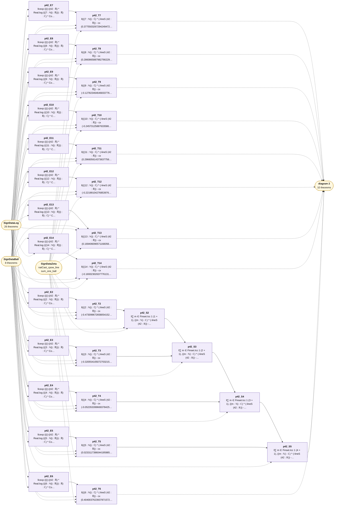

# `lean_stage3/Stage3/SignDataPt42.lean`

> **Read from the source text.** This file changed after the last `python3 utilities/lean_map.py --dump`, so the arrows on this page are names occurring in each proof and have not been confirmed by Lean.

SignDataPt42 — block S14 of `lean_stage3/design/stencil.md`, Turing's sign data: the sign of `Re Λ(1/2 + it)` at `t = 42.0`. 2026-11-25. Generated by `lean_stage3/checks/signdata/gen_signdata.py`; do not edit by hand.

559 theorems, 0 definitions, 2827 lines. 

**Imports:** [`SignDataGamma`](../lean_stage3/SignDataGamma.md), [`SignDataLog`](../lean_stage3/SignDataLog.md)  
**Imported by:** [`SignData`](../lean_stage3/SignData.md)

## The picture

### Diagram 1 of 19: `p42_E2` to `p42_S5`



### Diagram 2 of 19: `p42_S6` to `p42_P18`

```mermaid
flowchart LR
  n0["<b>p42_S6</b><br/>‖∑ m ∈ Finset.Icc 1 (5 + 1), ((m : ℕ) : ℂ) ^ (-lineS (42 : ℝ)) -…"]:::shp
  n1["<b>p42_S7</b><br/>‖∑ m ∈ Finset.Icc 1 (6 + 1), ((m : ℕ) : ℂ) ^ (-lineS (42 : ℝ)) -…"]:::shp
  n2["<b>p42_S8</b><br/>‖∑ m ∈ Finset.Icc 1 (7 + 1), ((m : ℕ) : ℂ) ^ (-lineS (42 : ℝ)) -…"]:::shp
  n3["<b>p42_S9</b><br/>‖∑ m ∈ Finset.Icc 1 (8 + 1), ((m : ℕ) : ℂ) ^ (-lineS (42 : ℝ)) -…"]:::shp
  n4["<b>p42_S10</b><br/>‖∑ m ∈ Finset.Icc 1 (9 + 1), ((m : ℕ) : ℂ) ^ (-lineS (42 : ℝ)) -…"]:::shp
  n5["<b>p42_S11</b><br/>‖∑ m ∈ Finset.Icc 1 (10 + 1), ((m : ℕ) : ℂ) ^ (-lineS (42 : ℝ)) …"]:::shp
  n6["<b>p42_S12</b><br/>‖∑ m ∈ Finset.Icc 1 (11 + 1), ((m : ℕ) : ℂ) ^ (-lineS (42 : ℝ)) …"]:::shp
  n7["<b>p42_S13</b><br/>‖∑ m ∈ Finset.Icc 1 (12 + 1), ((m : ℕ) : ℂ) ^ (-lineS (42 : ℝ)) …"]:::shp
  n8["<b>p42_S14</b><br/>‖∑ m ∈ Finset.Icc 1 (13 + 1), ((m : ℕ) : ℂ) ^ (-lineS (42 : ℝ)) …"]:::shp
  n9["<b>p42_NB</b><br/>‖(((14 : ℕ)) : ℂ) ^ (-lineS (42 : ℝ)) * emB (42 : ℝ) 14 - cx (0.…"]:::shp
  n10["<b>p42_Y</b><br/>‖(∑ m ∈ Finset.Icc 1 (13 + 1), ((m : ℕ) : ℂ) ^ (-lineS (42 : ℝ))…"]:::shp
  n11["<b>p42_zeta</b><br/>‖riemannZeta (lineS (42 : ℝ)) - cx (1.03973035515994463388750886…"]:::thm
  n12["<b>p42_P1</b><br/>‖∏ j ∈ Finset.range (0 + 1), (1 + zz (42 : ℝ) / ((j : ℂ) + 1)) -…"]:::shp
  n13["<b>p42_P2</b><br/>‖∏ j ∈ Finset.range (1 + 1), (1 + zz (42 : ℝ) / ((j : ℂ) + 1)) -…"]:::shp
  n14["<b>p42_P3</b><br/>‖∏ j ∈ Finset.range (2 + 1), (1 + zz (42 : ℝ) / ((j : ℂ) + 1)) -…"]:::shp
  n15["<b>p42_P4</b><br/>‖∏ j ∈ Finset.range (3 + 1), (1 + zz (42 : ℝ) / ((j : ℂ) + 1)) -…"]:::shp
  n16["<b>p42_P5</b><br/>‖∏ j ∈ Finset.range (4 + 1), (1 + zz (42 : ℝ) / ((j : ℂ) + 1)) -…"]:::shp
  n17["<b>p42_P6</b><br/>‖∏ j ∈ Finset.range (5 + 1), (1 + zz (42 : ℝ) / ((j : ℂ) + 1)) -…"]:::shp
  n18["<b>p42_P7</b><br/>‖∏ j ∈ Finset.range (6 + 1), (1 + zz (42 : ℝ) / ((j : ℂ) + 1)) -…"]:::shp
  n19["<b>p42_P8</b><br/>‖∏ j ∈ Finset.range (7 + 1), (1 + zz (42 : ℝ) / ((j : ℂ) + 1)) -…"]:::shp
  n20["<b>p42_P9</b><br/>‖∏ j ∈ Finset.range (8 + 1), (1 + zz (42 : ℝ) / ((j : ℂ) + 1)) -…"]:::shp
  n21["<b>p42_P10</b><br/>‖∏ j ∈ Finset.range (9 + 1), (1 + zz (42 : ℝ) / ((j : ℂ) + 1)) -…"]:::shp
  n22["<b>p42_P11</b><br/>‖∏ j ∈ Finset.range (10 + 1), (1 + zz (42 : ℝ) / ((j : ℂ) + 1)) …"]:::shp
  n23["<b>p42_P12</b><br/>‖∏ j ∈ Finset.range (11 + 1), (1 + zz (42 : ℝ) / ((j : ℂ) + 1)) …"]:::shp
  n24["<b>p42_P13</b><br/>‖∏ j ∈ Finset.range (12 + 1), (1 + zz (42 : ℝ) / ((j : ℂ) + 1)) …"]:::shp
  n25["<b>p42_P14</b><br/>‖∏ j ∈ Finset.range (13 + 1), (1 + zz (42 : ℝ) / ((j : ℂ) + 1)) …"]:::shp
  n26["<b>p42_P15</b><br/>‖∏ j ∈ Finset.range (14 + 1), (1 + zz (42 : ℝ) / ((j : ℂ) + 1)) …"]:::shp
  n27["<b>p42_P16</b><br/>‖∏ j ∈ Finset.range (15 + 1), (1 + zz (42 : ℝ) / ((j : ℂ) + 1)) …"]:::shp
  n28["<b>p42_P17</b><br/>‖∏ j ∈ Finset.range (16 + 1), (1 + zz (42 : ℝ) / ((j : ℂ) + 1)) …"]:::shp
  n29["<b>p42_P18</b><br/>‖∏ j ∈ Finset.range (17 + 1), (1 + zz (42 : ℝ) / ((j : ℂ) + 1)) …"]:::shp
  x0(["<b>SignDataBall</b><br/>ball_add<br/>ball_mul"]):::ext
  x1(["<b>diagram 1</b><br/>10 theorems"]):::ext
  x2(["<b>SignDataZeta</b><br/>emB_ball<br/>rem_le<br/>zeta_ball"]):::ext
  x3(["<b>diagram 19</b><br/>p42_X"]):::ext
  x4(["<b>SignDataGamma</b><br/>factor_ball<br/>prod_zero_ball"]):::ext
  x5(["<b>diagram 3</b><br/>p42_P19"]):::ext
  n0 --> n1
  n1 --> n2
  n10 --> n11
  n12 --> n13
  n13 --> n14
  n14 --> n15
  n15 --> n16
  n16 --> n17
  n17 --> n18
  n18 --> n19
  n19 --> n20
  n2 --> n3
  n20 --> n21
  n21 --> n22
  n22 --> n23
  n23 --> n24
  n24 --> n25
  n25 --> n26
  n26 --> n27
  n27 --> n28
  n28 --> n29
  n3 --> n4
  n4 --> n5
  n5 --> n6
  n6 --> n7
  n7 --> n8
  n8 --> n10
  n9 --> n10
  n11 -.-> x3
  n29 -.-> x5
  x0 -.-> n0
  x0 -.-> n1
  x0 -.-> n10
  x0 -.-> n12
  x0 -.-> n13
  x0 -.-> n14
  x0 -.-> n15
  x0 -.-> n16
  x0 -.-> n17
  x0 -.-> n18
  x0 -.-> n19
  x0 -.-> n2
  x0 -.-> n20
  x0 -.-> n21
  x0 -.-> n22
  x0 -.-> n23
  x0 -.-> n24
  x0 -.-> n25
  x0 -.-> n26
  x0 -.-> n27
  x0 -.-> n28
  x0 -.-> n29
  x0 -.-> n3
  x0 -.-> n4
  x0 -.-> n5
  x0 -.-> n6
  x0 -.-> n7
  x0 -.-> n8
  x0 -.-> n9
  x1 -.-> n0
  x1 -.-> n1
  x1 -.-> n2
  x1 -.-> n3
  x1 -.-> n4
  x1 -.-> n5
  x1 -.-> n6
  x1 -.-> n7
  x1 -.-> n8
  x1 -.-> n9
  x2 -.-> n11
  x2 -.-> n9
  x4 -.-> n12
  x4 -.-> n13
  x4 -.-> n14
  x4 -.-> n15
  x4 -.-> n16
  x4 -.-> n17
  x4 -.-> n18
  x4 -.-> n19
  x4 -.-> n20
  x4 -.-> n21
  x4 -.-> n22
  x4 -.-> n23
  x4 -.-> n24
  x4 -.-> n25
  x4 -.-> n26
  x4 -.-> n27
  x4 -.-> n28
  x4 -.-> n29
  classDef cnt fill:#dff5ec,stroke:#17694a,color:#111
  classDef shp fill:#f1ecfb,stroke:#5b3fa0,color:#111
  classDef rh fill:#ffe5e5,stroke:#c22,color:#111,stroke-width:2px
  classDef thm fill:#eef4ff,stroke:#335,color:#111
  classDef end_ fill:#e7f7e7,stroke:#2a7,color:#111,stroke-width:2px
  classDef lone fill:#fff,stroke:#999,color:#111,stroke-dasharray:4 3
  classDef bad fill:#ffe5e5,stroke:#c22,color:#111,stroke-width:2px
  classDef ext fill:#fff8e1,stroke:#b80,color:#111
```



### Diagram 3 of 19: `p42_P19` to `p42_P48`


### Diagram 4 of 19: `p42_P49` to `p42_P78`

```mermaid
flowchart LR
  n0["<b>p42_P49</b><br/>‖∏ j ∈ Finset.range (48 + 1), (1 + zz (42 : ℝ) / ((j : ℂ) + 1)) …"]:::shp
  n1["<b>p42_P50</b><br/>‖∏ j ∈ Finset.range (49 + 1), (1 + zz (42 : ℝ) / ((j : ℂ) + 1)) …"]:::shp
  n2["<b>p42_P51</b><br/>‖∏ j ∈ Finset.range (50 + 1), (1 + zz (42 : ℝ) / ((j : ℂ) + 1)) …"]:::shp
  n3["<b>p42_P52</b><br/>‖∏ j ∈ Finset.range (51 + 1), (1 + zz (42 : ℝ) / ((j : ℂ) + 1)) …"]:::shp
  n4["<b>p42_P53</b><br/>‖∏ j ∈ Finset.range (52 + 1), (1 + zz (42 : ℝ) / ((j : ℂ) + 1)) …"]:::shp
  n5["<b>p42_P54</b><br/>‖∏ j ∈ Finset.range (53 + 1), (1 + zz (42 : ℝ) / ((j : ℂ) + 1)) …"]:::shp
  n6["<b>p42_P55</b><br/>‖∏ j ∈ Finset.range (54 + 1), (1 + zz (42 : ℝ) / ((j : ℂ) + 1)) …"]:::shp
  n7["<b>p42_P56</b><br/>‖∏ j ∈ Finset.range (55 + 1), (1 + zz (42 : ℝ) / ((j : ℂ) + 1)) …"]:::shp
  n8["<b>p42_P57</b><br/>‖∏ j ∈ Finset.range (56 + 1), (1 + zz (42 : ℝ) / ((j : ℂ) + 1)) …"]:::shp
  n9["<b>p42_P58</b><br/>‖∏ j ∈ Finset.range (57 + 1), (1 + zz (42 : ℝ) / ((j : ℂ) + 1)) …"]:::shp
  n10["<b>p42_P59</b><br/>‖∏ j ∈ Finset.range (58 + 1), (1 + zz (42 : ℝ) / ((j : ℂ) + 1)) …"]:::shp
  n11["<b>p42_P60</b><br/>‖∏ j ∈ Finset.range (59 + 1), (1 + zz (42 : ℝ) / ((j : ℂ) + 1)) …"]:::shp
  n12["<b>p42_P61</b><br/>‖∏ j ∈ Finset.range (60 + 1), (1 + zz (42 : ℝ) / ((j : ℂ) + 1)) …"]:::shp
  n13["<b>p42_P62</b><br/>‖∏ j ∈ Finset.range (61 + 1), (1 + zz (42 : ℝ) / ((j : ℂ) + 1)) …"]:::shp
  n14["<b>p42_P63</b><br/>‖∏ j ∈ Finset.range (62 + 1), (1 + zz (42 : ℝ) / ((j : ℂ) + 1)) …"]:::shp
  n15["<b>p42_P64</b><br/>‖∏ j ∈ Finset.range (63 + 1), (1 + zz (42 : ℝ) / ((j : ℂ) + 1)) …"]:::shp
  n16["<b>p42_P65</b><br/>‖∏ j ∈ Finset.range (64 + 1), (1 + zz (42 : ℝ) / ((j : ℂ) + 1)) …"]:::shp
  n17["<b>p42_P66</b><br/>‖∏ j ∈ Finset.range (65 + 1), (1 + zz (42 : ℝ) / ((j : ℂ) + 1)) …"]:::shp
  n18["<b>p42_P67</b><br/>‖∏ j ∈ Finset.range (66 + 1), (1 + zz (42 : ℝ) / ((j : ℂ) + 1)) …"]:::shp
  n19["<b>p42_P68</b><br/>‖∏ j ∈ Finset.range (67 + 1), (1 + zz (42 : ℝ) / ((j : ℂ) + 1)) …"]:::shp
  n20["<b>p42_P69</b><br/>‖∏ j ∈ Finset.range (68 + 1), (1 + zz (42 : ℝ) / ((j : ℂ) + 1)) …"]:::shp
  n21["<b>p42_P70</b><br/>‖∏ j ∈ Finset.range (69 + 1), (1 + zz (42 : ℝ) / ((j : ℂ) + 1)) …"]:::shp
  n22["<b>p42_P71</b><br/>‖∏ j ∈ Finset.range (70 + 1), (1 + zz (42 : ℝ) / ((j : ℂ) + 1)) …"]:::shp
  n23["<b>p42_P72</b><br/>‖∏ j ∈ Finset.range (71 + 1), (1 + zz (42 : ℝ) / ((j : ℂ) + 1)) …"]:::shp
  n24["<b>p42_P73</b><br/>‖∏ j ∈ Finset.range (72 + 1), (1 + zz (42 : ℝ) / ((j : ℂ) + 1)) …"]:::shp
  n25["<b>p42_P74</b><br/>‖∏ j ∈ Finset.range (73 + 1), (1 + zz (42 : ℝ) / ((j : ℂ) + 1)) …"]:::shp
  n26["<b>p42_P75</b><br/>‖∏ j ∈ Finset.range (74 + 1), (1 + zz (42 : ℝ) / ((j : ℂ) + 1)) …"]:::shp
  n27["<b>p42_P76</b><br/>‖∏ j ∈ Finset.range (75 + 1), (1 + zz (42 : ℝ) / ((j : ℂ) + 1)) …"]:::shp
  n28["<b>p42_P77</b><br/>‖∏ j ∈ Finset.range (76 + 1), (1 + zz (42 : ℝ) / ((j : ℂ) + 1)) …"]:::shp
  n29["<b>p42_P78</b><br/>‖∏ j ∈ Finset.range (77 + 1), (1 + zz (42 : ℝ) / ((j : ℂ) + 1)) …"]:::shp
  x0(["<b>SignDataBall</b><br/>ball_mul"]):::ext
  x1(["<b>SignDataGamma</b><br/>factor_ball"]):::ext
  x2(["<b>diagram 3</b><br/>p42_P48"]):::ext
  x3(["<b>diagram 5</b><br/>p42_P79"]):::ext
  n0 --> n1
  n1 --> n2
  n10 --> n11
  n11 --> n12
  n12 --> n13
  n13 --> n14
  n14 --> n15
  n15 --> n16
  n16 --> n17
  n17 --> n18
  n18 --> n19
  n19 --> n20
  n2 --> n3
  n20 --> n21
  n21 --> n22
  n22 --> n23
  n23 --> n24
  n24 --> n25
  n25 --> n26
  n26 --> n27
  n27 --> n28
  n28 --> n29
  n3 --> n4
  n4 --> n5
  n5 --> n6
  n6 --> n7
  n7 --> n8
  n8 --> n9
  n9 --> n10
  n29 -.-> x3
  x0 -.-> n0
  x0 -.-> n1
  x0 -.-> n10
  x0 -.-> n11
  x0 -.-> n12
  x0 -.-> n13
  x0 -.-> n14
  x0 -.-> n15
  x0 -.-> n16
  x0 -.-> n17
  x0 -.-> n18
  x0 -.-> n19
  x0 -.-> n2
  x0 -.-> n20
  x0 -.-> n21
  x0 -.-> n22
  x0 -.-> n23
  x0 -.-> n24
  x0 -.-> n25
  x0 -.-> n26
  x0 -.-> n27
  x0 -.-> n28
  x0 -.-> n29
  x0 -.-> n3
  x0 -.-> n4
  x0 -.-> n5
  x0 -.-> n6
  x0 -.-> n7
  x0 -.-> n8
  x0 -.-> n9
  x1 -.-> n0
  x1 -.-> n1
  x1 -.-> n10
  x1 -.-> n11
  x1 -.-> n12
  x1 -.-> n13
  x1 -.-> n14
  x1 -.-> n15
  x1 -.-> n16
  x1 -.-> n17
  x1 -.-> n18
  x1 -.-> n19
  x1 -.-> n2
  x1 -.-> n20
  x1 -.-> n21
  x1 -.-> n22
  x1 -.-> n23
  x1 -.-> n24
  x1 -.-> n25
  x1 -.-> n26
  x1 -.-> n27
  x1 -.-> n28
  x1 -.-> n29
  x1 -.-> n3
  x1 -.-> n4
  x1 -.-> n5
  x1 -.-> n6
  x1 -.-> n7
  x1 -.-> n8
  x1 -.-> n9
  x2 -.-> n0
  classDef cnt fill:#dff5ec,stroke:#17694a,color:#111
  classDef shp fill:#f1ecfb,stroke:#5b3fa0,color:#111
  classDef rh fill:#ffe5e5,stroke:#c22,color:#111,stroke-width:2px
  classDef thm fill:#eef4ff,stroke:#335,color:#111
  classDef end_ fill:#e7f7e7,stroke:#2a7,color:#111,stroke-width:2px
  classDef lone fill:#fff,stroke:#999,color:#111,stroke-dasharray:4 3
  classDef bad fill:#ffe5e5,stroke:#c22,color:#111,stroke-width:2px
  classDef ext fill:#fff8e1,stroke:#b80,color:#111
```



### Diagram 5 of 19: `p42_P79` to `p42_P108`


### Diagram 6 of 19: `p42_P109` to `p42_P138`

```mermaid
flowchart LR
  n0["<b>p42_P109</b><br/>‖∏ j ∈ Finset.range (108 + 1), (1 + zz (42 : ℝ) / ((j : ℂ) + 1))…"]:::shp
  n1["<b>p42_P110</b><br/>‖∏ j ∈ Finset.range (109 + 1), (1 + zz (42 : ℝ) / ((j : ℂ) + 1))…"]:::shp
  n2["<b>p42_P111</b><br/>‖∏ j ∈ Finset.range (110 + 1), (1 + zz (42 : ℝ) / ((j : ℂ) + 1))…"]:::shp
  n3["<b>p42_P112</b><br/>‖∏ j ∈ Finset.range (111 + 1), (1 + zz (42 : ℝ) / ((j : ℂ) + 1))…"]:::shp
  n4["<b>p42_P113</b><br/>‖∏ j ∈ Finset.range (112 + 1), (1 + zz (42 : ℝ) / ((j : ℂ) + 1))…"]:::shp
  n5["<b>p42_P114</b><br/>‖∏ j ∈ Finset.range (113 + 1), (1 + zz (42 : ℝ) / ((j : ℂ) + 1))…"]:::shp
  n6["<b>p42_P115</b><br/>‖∏ j ∈ Finset.range (114 + 1), (1 + zz (42 : ℝ) / ((j : ℂ) + 1))…"]:::shp
  n7["<b>p42_P116</b><br/>‖∏ j ∈ Finset.range (115 + 1), (1 + zz (42 : ℝ) / ((j : ℂ) + 1))…"]:::shp
  n8["<b>p42_P117</b><br/>‖∏ j ∈ Finset.range (116 + 1), (1 + zz (42 : ℝ) / ((j : ℂ) + 1))…"]:::shp
  n9["<b>p42_P118</b><br/>‖∏ j ∈ Finset.range (117 + 1), (1 + zz (42 : ℝ) / ((j : ℂ) + 1))…"]:::shp
  n10["<b>p42_P119</b><br/>‖∏ j ∈ Finset.range (118 + 1), (1 + zz (42 : ℝ) / ((j : ℂ) + 1))…"]:::shp
  n11["<b>p42_P120</b><br/>‖∏ j ∈ Finset.range (119 + 1), (1 + zz (42 : ℝ) / ((j : ℂ) + 1))…"]:::shp
  n12["<b>p42_P121</b><br/>‖∏ j ∈ Finset.range (120 + 1), (1 + zz (42 : ℝ) / ((j : ℂ) + 1))…"]:::shp
  n13["<b>p42_P122</b><br/>‖∏ j ∈ Finset.range (121 + 1), (1 + zz (42 : ℝ) / ((j : ℂ) + 1))…"]:::shp
  n14["<b>p42_P123</b><br/>‖∏ j ∈ Finset.range (122 + 1), (1 + zz (42 : ℝ) / ((j : ℂ) + 1))…"]:::shp
  n15["<b>p42_P124</b><br/>‖∏ j ∈ Finset.range (123 + 1), (1 + zz (42 : ℝ) / ((j : ℂ) + 1))…"]:::shp
  n16["<b>p42_P125</b><br/>‖∏ j ∈ Finset.range (124 + 1), (1 + zz (42 : ℝ) / ((j : ℂ) + 1))…"]:::shp
  n17["<b>p42_P126</b><br/>‖∏ j ∈ Finset.range (125 + 1), (1 + zz (42 : ℝ) / ((j : ℂ) + 1))…"]:::shp
  n18["<b>p42_P127</b><br/>‖∏ j ∈ Finset.range (126 + 1), (1 + zz (42 : ℝ) / ((j : ℂ) + 1))…"]:::shp
  n19["<b>p42_P128</b><br/>‖∏ j ∈ Finset.range (127 + 1), (1 + zz (42 : ℝ) / ((j : ℂ) + 1))…"]:::shp
  n20["<b>p42_P129</b><br/>‖∏ j ∈ Finset.range (128 + 1), (1 + zz (42 : ℝ) / ((j : ℂ) + 1))…"]:::shp
  n21["<b>p42_P130</b><br/>‖∏ j ∈ Finset.range (129 + 1), (1 + zz (42 : ℝ) / ((j : ℂ) + 1))…"]:::shp
  n22["<b>p42_P131</b><br/>‖∏ j ∈ Finset.range (130 + 1), (1 + zz (42 : ℝ) / ((j : ℂ) + 1))…"]:::shp
  n23["<b>p42_P132</b><br/>‖∏ j ∈ Finset.range (131 + 1), (1 + zz (42 : ℝ) / ((j : ℂ) + 1))…"]:::shp
  n24["<b>p42_P133</b><br/>‖∏ j ∈ Finset.range (132 + 1), (1 + zz (42 : ℝ) / ((j : ℂ) + 1))…"]:::shp
  n25["<b>p42_P134</b><br/>‖∏ j ∈ Finset.range (133 + 1), (1 + zz (42 : ℝ) / ((j : ℂ) + 1))…"]:::shp
  n26["<b>p42_P135</b><br/>‖∏ j ∈ Finset.range (134 + 1), (1 + zz (42 : ℝ) / ((j : ℂ) + 1))…"]:::shp
  n27["<b>p42_P136</b><br/>‖∏ j ∈ Finset.range (135 + 1), (1 + zz (42 : ℝ) / ((j : ℂ) + 1))…"]:::shp
  n28["<b>p42_P137</b><br/>‖∏ j ∈ Finset.range (136 + 1), (1 + zz (42 : ℝ) / ((j : ℂ) + 1))…"]:::shp
  n29["<b>p42_P138</b><br/>‖∏ j ∈ Finset.range (137 + 1), (1 + zz (42 : ℝ) / ((j : ℂ) + 1))…"]:::shp
  x0(["<b>SignDataBall</b><br/>ball_mul"]):::ext
  x1(["<b>SignDataGamma</b><br/>factor_ball"]):::ext
  x2(["<b>diagram 5</b><br/>p42_P108"]):::ext
  x3(["<b>diagram 7</b><br/>p42_P139"]):::ext
  n0 --> n1
  n1 --> n2
  n10 --> n11
  n11 --> n12
  n12 --> n13
  n13 --> n14
  n14 --> n15
  n15 --> n16
  n16 --> n17
  n17 --> n18
  n18 --> n19
  n19 --> n20
  n2 --> n3
  n20 --> n21
  n21 --> n22
  n22 --> n23
  n23 --> n24
  n24 --> n25
  n25 --> n26
  n26 --> n27
  n27 --> n28
  n28 --> n29
  n3 --> n4
  n4 --> n5
  n5 --> n6
  n6 --> n7
  n7 --> n8
  n8 --> n9
  n9 --> n10
  n29 -.-> x3
  x0 -.-> n0
  x0 -.-> n1
  x0 -.-> n10
  x0 -.-> n11
  x0 -.-> n12
  x0 -.-> n13
  x0 -.-> n14
  x0 -.-> n15
  x0 -.-> n16
  x0 -.-> n17
  x0 -.-> n18
  x0 -.-> n19
  x0 -.-> n2
  x0 -.-> n20
  x0 -.-> n21
  x0 -.-> n22
  x0 -.-> n23
  x0 -.-> n24
  x0 -.-> n25
  x0 -.-> n26
  x0 -.-> n27
  x0 -.-> n28
  x0 -.-> n29
  x0 -.-> n3
  x0 -.-> n4
  x0 -.-> n5
  x0 -.-> n6
  x0 -.-> n7
  x0 -.-> n8
  x0 -.-> n9
  x1 -.-> n0
  x1 -.-> n1
  x1 -.-> n10
  x1 -.-> n11
  x1 -.-> n12
  x1 -.-> n13
  x1 -.-> n14
  x1 -.-> n15
  x1 -.-> n16
  x1 -.-> n17
  x1 -.-> n18
  x1 -.-> n19
  x1 -.-> n2
  x1 -.-> n20
  x1 -.-> n21
  x1 -.-> n22
  x1 -.-> n23
  x1 -.-> n24
  x1 -.-> n25
  x1 -.-> n26
  x1 -.-> n27
  x1 -.-> n28
  x1 -.-> n29
  x1 -.-> n3
  x1 -.-> n4
  x1 -.-> n5
  x1 -.-> n6
  x1 -.-> n7
  x1 -.-> n8
  x1 -.-> n9
  x2 -.-> n0
  classDef cnt fill:#dff5ec,stroke:#17694a,color:#111
  classDef shp fill:#f1ecfb,stroke:#5b3fa0,color:#111
  classDef rh fill:#ffe5e5,stroke:#c22,color:#111,stroke-width:2px
  classDef thm fill:#eef4ff,stroke:#335,color:#111
  classDef end_ fill:#e7f7e7,stroke:#2a7,color:#111,stroke-width:2px
  classDef lone fill:#fff,stroke:#999,color:#111,stroke-dasharray:4 3
  classDef bad fill:#ffe5e5,stroke:#c22,color:#111,stroke-width:2px
  classDef ext fill:#fff8e1,stroke:#b80,color:#111
```



### Diagram 7 of 19: `p42_P139` to `p42_P168`


### Diagram 8 of 19: `p42_P169` to `p42_P198`


### Diagram 9 of 19: `p42_P199` to `p42_P228`


### Diagram 10 of 19: `p42_P229` to `p42_P258`


### Diagram 11 of 19: `p42_P259` to `p42_P288`

```mermaid
flowchart LR
  n0["<b>p42_P259</b><br/>‖∏ j ∈ Finset.range (258 + 1), (1 + zz (42 : ℝ) / ((j : ℂ) + 1))…"]:::shp
  n1["<b>p42_P260</b><br/>‖∏ j ∈ Finset.range (259 + 1), (1 + zz (42 : ℝ) / ((j : ℂ) + 1))…"]:::shp
  n2["<b>p42_P261</b><br/>‖∏ j ∈ Finset.range (260 + 1), (1 + zz (42 : ℝ) / ((j : ℂ) + 1))…"]:::shp
  n3["<b>p42_P262</b><br/>‖∏ j ∈ Finset.range (261 + 1), (1 + zz (42 : ℝ) / ((j : ℂ) + 1))…"]:::shp
  n4["<b>p42_P263</b><br/>‖∏ j ∈ Finset.range (262 + 1), (1 + zz (42 : ℝ) / ((j : ℂ) + 1))…"]:::shp
  n5["<b>p42_P264</b><br/>‖∏ j ∈ Finset.range (263 + 1), (1 + zz (42 : ℝ) / ((j : ℂ) + 1))…"]:::shp
  n6["<b>p42_P265</b><br/>‖∏ j ∈ Finset.range (264 + 1), (1 + zz (42 : ℝ) / ((j : ℂ) + 1))…"]:::shp
  n7["<b>p42_P266</b><br/>‖∏ j ∈ Finset.range (265 + 1), (1 + zz (42 : ℝ) / ((j : ℂ) + 1))…"]:::shp
  n8["<b>p42_P267</b><br/>‖∏ j ∈ Finset.range (266 + 1), (1 + zz (42 : ℝ) / ((j : ℂ) + 1))…"]:::shp
  n9["<b>p42_P268</b><br/>‖∏ j ∈ Finset.range (267 + 1), (1 + zz (42 : ℝ) / ((j : ℂ) + 1))…"]:::shp
  n10["<b>p42_P269</b><br/>‖∏ j ∈ Finset.range (268 + 1), (1 + zz (42 : ℝ) / ((j : ℂ) + 1))…"]:::shp
  n11["<b>p42_P270</b><br/>‖∏ j ∈ Finset.range (269 + 1), (1 + zz (42 : ℝ) / ((j : ℂ) + 1))…"]:::shp
  n12["<b>p42_P271</b><br/>‖∏ j ∈ Finset.range (270 + 1), (1 + zz (42 : ℝ) / ((j : ℂ) + 1))…"]:::shp
  n13["<b>p42_P272</b><br/>‖∏ j ∈ Finset.range (271 + 1), (1 + zz (42 : ℝ) / ((j : ℂ) + 1))…"]:::shp
  n14["<b>p42_P273</b><br/>‖∏ j ∈ Finset.range (272 + 1), (1 + zz (42 : ℝ) / ((j : ℂ) + 1))…"]:::shp
  n15["<b>p42_P274</b><br/>‖∏ j ∈ Finset.range (273 + 1), (1 + zz (42 : ℝ) / ((j : ℂ) + 1))…"]:::shp
  n16["<b>p42_P275</b><br/>‖∏ j ∈ Finset.range (274 + 1), (1 + zz (42 : ℝ) / ((j : ℂ) + 1))…"]:::shp
  n17["<b>p42_P276</b><br/>‖∏ j ∈ Finset.range (275 + 1), (1 + zz (42 : ℝ) / ((j : ℂ) + 1))…"]:::shp
  n18["<b>p42_P277</b><br/>‖∏ j ∈ Finset.range (276 + 1), (1 + zz (42 : ℝ) / ((j : ℂ) + 1))…"]:::shp
  n19["<b>p42_P278</b><br/>‖∏ j ∈ Finset.range (277 + 1), (1 + zz (42 : ℝ) / ((j : ℂ) + 1))…"]:::shp
  n20["<b>p42_P279</b><br/>‖∏ j ∈ Finset.range (278 + 1), (1 + zz (42 : ℝ) / ((j : ℂ) + 1))…"]:::shp
  n21["<b>p42_P280</b><br/>‖∏ j ∈ Finset.range (279 + 1), (1 + zz (42 : ℝ) / ((j : ℂ) + 1))…"]:::shp
  n22["<b>p42_P281</b><br/>‖∏ j ∈ Finset.range (280 + 1), (1 + zz (42 : ℝ) / ((j : ℂ) + 1))…"]:::shp
  n23["<b>p42_P282</b><br/>‖∏ j ∈ Finset.range (281 + 1), (1 + zz (42 : ℝ) / ((j : ℂ) + 1))…"]:::shp
  n24["<b>p42_P283</b><br/>‖∏ j ∈ Finset.range (282 + 1), (1 + zz (42 : ℝ) / ((j : ℂ) + 1))…"]:::shp
  n25["<b>p42_P284</b><br/>‖∏ j ∈ Finset.range (283 + 1), (1 + zz (42 : ℝ) / ((j : ℂ) + 1))…"]:::shp
  n26["<b>p42_P285</b><br/>‖∏ j ∈ Finset.range (284 + 1), (1 + zz (42 : ℝ) / ((j : ℂ) + 1))…"]:::shp
  n27["<b>p42_P286</b><br/>‖∏ j ∈ Finset.range (285 + 1), (1 + zz (42 : ℝ) / ((j : ℂ) + 1))…"]:::shp
  n28["<b>p42_P287</b><br/>‖∏ j ∈ Finset.range (286 + 1), (1 + zz (42 : ℝ) / ((j : ℂ) + 1))…"]:::shp
  n29["<b>p42_P288</b><br/>‖∏ j ∈ Finset.range (287 + 1), (1 + zz (42 : ℝ) / ((j : ℂ) + 1))…"]:::shp
  x0(["<b>SignDataBall</b><br/>ball_mul"]):::ext
  x1(["<b>SignDataGamma</b><br/>factor_ball"]):::ext
  x2(["<b>diagram 10</b><br/>p42_P258"]):::ext
  x3(["<b>diagram 12</b><br/>p42_P289"]):::ext
  n0 --> n1
  n1 --> n2
  n10 --> n11
  n11 --> n12
  n12 --> n13
  n13 --> n14
  n14 --> n15
  n15 --> n16
  n16 --> n17
  n17 --> n18
  n18 --> n19
  n19 --> n20
  n2 --> n3
  n20 --> n21
  n21 --> n22
  n22 --> n23
  n23 --> n24
  n24 --> n25
  n25 --> n26
  n26 --> n27
  n27 --> n28
  n28 --> n29
  n3 --> n4
  n4 --> n5
  n5 --> n6
  n6 --> n7
  n7 --> n8
  n8 --> n9
  n9 --> n10
  n29 -.-> x3
  x0 -.-> n0
  x0 -.-> n1
  x0 -.-> n10
  x0 -.-> n11
  x0 -.-> n12
  x0 -.-> n13
  x0 -.-> n14
  x0 -.-> n15
  x0 -.-> n16
  x0 -.-> n17
  x0 -.-> n18
  x0 -.-> n19
  x0 -.-> n2
  x0 -.-> n20
  x0 -.-> n21
  x0 -.-> n22
  x0 -.-> n23
  x0 -.-> n24
  x0 -.-> n25
  x0 -.-> n26
  x0 -.-> n27
  x0 -.-> n28
  x0 -.-> n29
  x0 -.-> n3
  x0 -.-> n4
  x0 -.-> n5
  x0 -.-> n6
  x0 -.-> n7
  x0 -.-> n8
  x0 -.-> n9
  x1 -.-> n0
  x1 -.-> n1
  x1 -.-> n10
  x1 -.-> n11
  x1 -.-> n12
  x1 -.-> n13
  x1 -.-> n14
  x1 -.-> n15
  x1 -.-> n16
  x1 -.-> n17
  x1 -.-> n18
  x1 -.-> n19
  x1 -.-> n2
  x1 -.-> n20
  x1 -.-> n21
  x1 -.-> n22
  x1 -.-> n23
  x1 -.-> n24
  x1 -.-> n25
  x1 -.-> n26
  x1 -.-> n27
  x1 -.-> n28
  x1 -.-> n29
  x1 -.-> n3
  x1 -.-> n4
  x1 -.-> n5
  x1 -.-> n6
  x1 -.-> n7
  x1 -.-> n8
  x1 -.-> n9
  x2 -.-> n0
  classDef cnt fill:#dff5ec,stroke:#17694a,color:#111
  classDef shp fill:#f1ecfb,stroke:#5b3fa0,color:#111
  classDef rh fill:#ffe5e5,stroke:#c22,color:#111,stroke-width:2px
  classDef thm fill:#eef4ff,stroke:#335,color:#111
  classDef end_ fill:#e7f7e7,stroke:#2a7,color:#111,stroke-width:2px
  classDef lone fill:#fff,stroke:#999,color:#111,stroke-dasharray:4 3
  classDef bad fill:#ffe5e5,stroke:#c22,color:#111,stroke-width:2px
  classDef ext fill:#fff8e1,stroke:#b80,color:#111
```



### Diagram 12 of 19: `p42_P289` to `p42_P318`


### Diagram 13 of 19: `p42_P319` to `p42_P348`


### Diagram 14 of 19: `p42_P349` to `p42_P378`


### Diagram 15 of 19: `p42_P379` to `p42_P408`


### Diagram 16 of 19: `p42_P409` to `p42_P438`


### Diagram 17 of 19: `p42_P439` to `p42_P468`


### Diagram 18 of 19: `p42_P469` to `p42_P498`


### Diagram 19 of 19: `p42_P499` to `sign_42`

```mermaid
flowchart LR
  n0["<b>p42_P499</b><br/>‖∏ j ∈ Finset.range (498 + 1), (1 + zz (42 : ℝ) / ((j : ℂ) + 1))…"]:::shp
  n1["<b>p42_P500</b><br/>‖∏ j ∈ Finset.range (499 + 1), (1 + zz (42 : ℝ) / ((j : ℂ) + 1))…"]:::shp
  n2["<b>p42_P501</b><br/>‖∏ j ∈ Finset.range (500 + 1), (1 + zz (42 : ℝ) / ((j : ℂ) + 1))…"]:::shp
  n3["<b>p42_P502</b><br/>‖∏ j ∈ Finset.range (501 + 1), (1 + zz (42 : ℝ) / ((j : ℂ) + 1))…"]:::shp
  n4["<b>p42_P503</b><br/>‖∏ j ∈ Finset.range (502 + 1), (1 + zz (42 : ℝ) / ((j : ℂ) + 1))…"]:::shp
  n5["<b>p42_P504</b><br/>‖∏ j ∈ Finset.range (503 + 1), (1 + zz (42 : ℝ) / ((j : ℂ) + 1))…"]:::shp
  n6["<b>p42_P505</b><br/>‖∏ j ∈ Finset.range (504 + 1), (1 + zz (42 : ℝ) / ((j : ℂ) + 1))…"]:::shp
  n7["<b>p42_P506</b><br/>‖∏ j ∈ Finset.range (505 + 1), (1 + zz (42 : ℝ) / ((j : ℂ) + 1))…"]:::shp
  n8["<b>p42_P507</b><br/>‖∏ j ∈ Finset.range (506 + 1), (1 + zz (42 : ℝ) / ((j : ℂ) + 1))…"]:::shp
  n9["<b>p42_P508</b><br/>‖∏ j ∈ Finset.range (507 + 1), (1 + zz (42 : ℝ) / ((j : ℂ) + 1))…"]:::shp
  n10["<b>p42_P509</b><br/>‖∏ j ∈ Finset.range (508 + 1), (1 + zz (42 : ℝ) / ((j : ℂ) + 1))…"]:::shp
  n11["<b>p42_P510</b><br/>‖∏ j ∈ Finset.range (509 + 1), (1 + zz (42 : ℝ) / ((j : ℂ) + 1))…"]:::shp
  n12["<b>p42_P511</b><br/>‖∏ j ∈ Finset.range (510 + 1), (1 + zz (42 : ℝ) / ((j : ℂ) + 1))…"]:::shp
  n13["<b>p42_P512</b><br/>‖∏ j ∈ Finset.range (511 + 1), (1 + zz (42 : ℝ) / ((j : ℂ) + 1))…"]:::shp
  n14["<b>p42_W</b><br/>‖zz (42 : ℝ) * ∏ j ∈ Finset.range (511 + 1), (1 + zz (42 : ℝ) / …"]:::shp
  n15["<b>p42_phase</b><br/>‖cexp (((((42 : ℝ) / 2) * (Real.log (((512 : ℕ)) : ℝ) - Real.log…"]:::shp
  n16["<b>p42_G</b><br/>‖gammaDir (42 : ℝ) 512 - cx (519438194354492.2242995252373635573…"]:::shp
  n17["<b>p42_X</b><br/>‖gammaDir (42 : ℝ) 512 * riemannZeta (lineS (42 : ℝ)) - cx (6184…"]:::thm
  n18["<b>sign_42</b><br/>0 ＜ (completedRiemannZeta (lineS (42 : ℝ))).re"]:::thm
  x0(["<b>SignDataBall</b><br/>4 theorems"]):::ext
  x1(["<b>SignDataGamma</b><br/>factor_ball<br/>re_lambda_pos<br/>zz_ball"]):::ext
  x2(["<b>diagram 18</b><br/>p42_P498"]):::ext
  x3(["<b>SignDataLog</b><br/>log_pi_ball'<br/>log_pow2_ball_512"]):::ext
  x4(["<b>diagram 2</b><br/>p42_zeta"]):::ext
  x5(["<b>SignData</b><br/>run_signs"]):::ext
  n0 --> n1
  n1 --> n2
  n10 --> n11
  n11 --> n12
  n12 --> n13
  n13 --> n14
  n14 --> n16
  n15 --> n16
  n16 --> n17
  n17 --> n18
  n2 --> n3
  n3 --> n4
  n4 --> n5
  n5 --> n6
  n6 --> n7
  n7 --> n8
  n8 --> n9
  n9 --> n10
  n18 -.-> x5
  x0 -.-> n0
  x0 -.-> n1
  x0 -.-> n10
  x0 -.-> n11
  x0 -.-> n12
  x0 -.-> n13
  x0 -.-> n14
  x0 -.-> n15
  x0 -.-> n16
  x0 -.-> n17
  x0 -.-> n2
  x0 -.-> n3
  x0 -.-> n4
  x0 -.-> n5
  x0 -.-> n6
  x0 -.-> n7
  x0 -.-> n8
  x0 -.-> n9
  x1 -.-> n0
  x1 -.-> n1
  x1 -.-> n10
  x1 -.-> n11
  x1 -.-> n12
  x1 -.-> n13
  x1 -.-> n14
  x1 -.-> n18
  x1 -.-> n2
  x1 -.-> n3
  x1 -.-> n4
  x1 -.-> n5
  x1 -.-> n6
  x1 -.-> n7
  x1 -.-> n8
  x1 -.-> n9
  x2 -.-> n0
  x3 -.-> n15
  x4 -.-> n17
  classDef cnt fill:#dff5ec,stroke:#17694a,color:#111
  classDef shp fill:#f1ecfb,stroke:#5b3fa0,color:#111
  classDef rh fill:#ffe5e5,stroke:#c22,color:#111,stroke-width:2px
  classDef thm fill:#eef4ff,stroke:#335,color:#111
  classDef end_ fill:#e7f7e7,stroke:#2a7,color:#111,stroke-width:2px
  classDef lone fill:#fff,stroke:#999,color:#111,stroke-dasharray:4 3
  classDef bad fill:#ffe5e5,stroke:#c22,color:#111,stroke-width:2px
  classDef ext fill:#fff8e1,stroke:#b80,color:#111
```



An arrow A → B reads "A is used in the proof of B". Green: counting, integers only. Violet: shape, analysis with no ζ. Blue: reads ζ. A name ending in ■ is an end: nothing else uses it. Red: contains `sorry`. Yellow: theorems in another file, counted; a dotted arrow crosses files. Definitions are not drawn; they are listed below the diagram.

## Theorems

<a name="SignData-p42_E2"></a>
### `SignData.p42_E2`

line 31 · arrows read from text

**Shape.** Uses real or complex analysis; nothing in it or beneath it reads ζ.

**Proves**

```lean
‖cexp ((((-((42 : ℝ) * Real.log (((2 : ℕ)) : ℝ))) : ℝ) : ℂ) * Complex.I) - cx (-(0.669063973427291916286815082708)) (0.743204816629765940682680217072)‖ ≤ (0.000000010500000000095864043055)
```

**Fed by** (3 theorems its proof uses)

  - [`SignData.exp_ball1`](../lean_stage3/SignDataBall.md#SignData-exp_ball1) (SignDataBall) — `` ‖cexp ((x : ℂ) * I) - cx (-f) e‖ ≤ R ``
  - [`SignData.neg_mul_ball`](../lean_stage3/SignDataBall.md#SignData-neg_mul_ball) (SignDataBall) — `` |-(t * x) - -(t * a)| ≤ |t| * e ``
  - [`SignData.log_ball_2`](../lean_stage3/SignDataLog.md#SignData-log_ball_2) (SignDataLog) — `` |Real.log ((2 : ℕ) : ℝ) - (0.69314718055)| ≤ (0.00000000025) ``

**Definitions its proof touches:** [`SignData.cosP`](../lean_stage3/SignDataBall.md#SignData-cosP), [`SignData.cx`](../lean_stage3/SignDataBall.md#SignData-cx), [`SignData.sinP`](../lean_stage3/SignDataBall.md#SignData-sinP)

**Feeds** (1 that use it)

  - [`SignData.p42_T2`](#SignData-p42_T2) — `` ‖(((2 : ℕ)) : ℂ) ^ (-lineS (42 : ℝ)) - cx (-0.47309967265805415238154490852) (0.525525165649412081764633272315)‖ ≤ (0.000000007424621202526535121128) ``

<a name="SignData-p42_T2"></a>
### `SignData.p42_T2`

line 37 · arrows read from text

**Shape.** Uses real or complex analysis; nothing in it or beneath it reads ζ.

**Proves**

```lean
‖(((2 : ℕ)) : ℂ) ^ (-lineS (42 : ℝ)) - cx (-0.47309967265805415238154490852) (0.525525165649412081764633272315)‖ ≤ (0.000000007424621202526535121128)
```

**Fed by** (5 theorems its proof uses)

  - [`SignData.ball_mul`](../lean_stage3/SignDataBall.md#SignData-ball_mul) (SignDataBall) — `` ‖z * w - cx e f‖ ≤ R ``
  - [`SignData.ball_ofReal`](../lean_stage3/SignDataBall.md#SignData-ball_ofReal) (SignDataBall) — `` ‖(x : ℂ) - cx c 0‖ ≤ e ``
  - [`SignData.isqrt_ball_2`](../lean_stage3/SignDataLog.md#SignData-isqrt_ball_2) (SignDataLog) — `` |(Real.sqrt (((2 : ℕ)) : ℝ))⁻¹ - (0.707106781186547524400844362104)| ≤ (0.000000000000000000000000000001) ``
  - [`SignData.p42_E2`](#SignData-p42_E2) — `` ‖cexp ((((-((42 : ℝ) * Real.log (((2 : ℕ)) : ℝ))) : ℝ) : ℂ) * Complex.I) - cx (-(0.669063973427291916286815082708)) (0.743204816629765940682680217072)… ``
  - [`SignData.natCast_cpow_line`](../lean_stage3/SignDataZeta.md#SignData-natCast_cpow_line) (SignDataZeta) — `` (m : ℂ) ^ (-lineS t) = (((Real.sqrt m)⁻¹ : ℝ) : ℂ) * cexp (((-(t * Real.log m)) : ℝ) * I) ``

**Definitions its proof touches:** [`SignData.cx`](../lean_stage3/SignDataBall.md#SignData-cx), [`SignData.lineS`](../lean_stage3/SignDataZeta.md#SignData-lineS)

**Feeds** (1 that use it)

  - [`SignData.p42_S2`](#SignData-p42_S2) — `` ‖∑ m ∈ Finset.Icc 1 (1 + 1), ((m : ℕ) : ℂ) ^ (-lineS (42 : ℝ)) - cx (0.52690032734194584761845509148) (0.525525165649412081764633272315)‖ ≤ (0.0000000… ``

<a name="SignData-p42_E3"></a>
### `SignData.p42_E3`

line 41 · arrows read from text

**Shape.** Uses real or complex analysis; nothing in it or beneath it reads ζ.

**Proves**

```lean
‖cexp ((((-((42 : ℝ) * Real.log (((3 : ℕ)) : ℝ))) : ℝ) : ℂ) * Complex.I) - cx (-0.555215996560694349992309630905) (-(0.831706196419814489120539581043))‖ ≤ (0.000000010500305987097756680913)
```

**Fed by** (3 theorems its proof uses)

  - [`SignData.exp_ball3`](../lean_stage3/SignDataBall.md#SignData-exp_ball3) (SignDataBall) — `` ‖cexp ((x : ℂ) * I) - cx f (-e)‖ ≤ R ``
  - [`SignData.neg_mul_ball`](../lean_stage3/SignDataBall.md#SignData-neg_mul_ball) (SignDataBall) — `` |-(t * x) - -(t * a)| ≤ |t| * e ``
  - [`SignData.log_ball_3`](../lean_stage3/SignDataLog.md#SignData-log_ball_3) (SignDataLog) — `` |Real.log (((3 : ℕ)) : ℝ) - (1.098612288658164142930964760306)| ≤ (0.000000000250007285403624428292) ``

**Definitions its proof touches:** [`SignData.cosP`](../lean_stage3/SignDataBall.md#SignData-cosP), [`SignData.cx`](../lean_stage3/SignDataBall.md#SignData-cx), [`SignData.sinP`](../lean_stage3/SignDataBall.md#SignData-sinP)

**Feeds** (1 that use it)

  - [`SignData.p42_T3`](#SignData-p42_T3) — `` ‖(((3 : ℕ)) : ℂ) ^ (-lineS (42 : ℝ)) - cx (-0.320554105072703215610370699386) (-0.480185796389659655566944683421)‖ ≤ (0.000000006062354488224328899407… ``

<a name="SignData-p42_T3"></a>
### `SignData.p42_T3`

line 47 · arrows read from text

**Shape.** Uses real or complex analysis; nothing in it or beneath it reads ζ.

**Proves**

```lean
‖(((3 : ℕ)) : ℂ) ^ (-lineS (42 : ℝ)) - cx (-0.320554105072703215610370699386) (-0.480185796389659655566944683421)‖ ≤ (0.000000006062354488224328899407)
```

**Fed by** (5 theorems its proof uses)

  - [`SignData.ball_mul`](../lean_stage3/SignDataBall.md#SignData-ball_mul) (SignDataBall) — `` ‖z * w - cx e f‖ ≤ R ``
  - [`SignData.ball_ofReal`](../lean_stage3/SignDataBall.md#SignData-ball_ofReal) (SignDataBall) — `` ‖(x : ℂ) - cx c 0‖ ≤ e ``
  - [`SignData.isqrt_ball_3`](../lean_stage3/SignDataLog.md#SignData-isqrt_ball_3) (SignDataLog) — `` |(Real.sqrt (((3 : ℕ)) : ℝ))⁻¹ - (0.577350269189625764509148780502)| ≤ (0.000000000000000000000000000001) ``
  - [`SignData.p42_E3`](#SignData-p42_E3) — `` ‖cexp ((((-((42 : ℝ) * Real.log (((3 : ℕ)) : ℝ))) : ℝ) : ℂ) * Complex.I) - cx (-0.555215996560694349992309630905) (-(0.831706196419814489120539581043)… ``
  - [`SignData.natCast_cpow_line`](../lean_stage3/SignDataZeta.md#SignData-natCast_cpow_line) (SignDataZeta) — `` (m : ℂ) ^ (-lineS t) = (((Real.sqrt m)⁻¹ : ℝ) : ℂ) * cexp (((-(t * Real.log m)) : ℝ) * I) ``

**Definitions its proof touches:** [`SignData.cx`](../lean_stage3/SignDataBall.md#SignData-cx), [`SignData.lineS`](../lean_stage3/SignDataZeta.md#SignData-lineS)

**Feeds** (1 that use it)

  - [`SignData.p42_S3`](#SignData-p42_S3) — `` ‖∑ m ∈ Finset.Icc 1 (2 + 1), ((m : ℕ) : ℂ) ^ (-lineS (42 : ℝ)) - cx (0.206346222269242632008084392094) (0.045339369259752426197688588894)‖ ≤ (0.000000… ``

<a name="SignData-p42_E4"></a>
### `SignData.p42_E4`

line 51 · arrows read from text

**Shape.** Uses real or complex analysis; nothing in it or beneath it reads ζ.

**Proves**

```lean
‖cexp ((((-((42 : ℝ) * Real.log (((4 : ℕ)) : ℝ))) : ℝ) : ℂ) * Complex.I) - cx (-0.104706799338756850078504428178) (-(0.994503135325491725552585984738))‖ ≤ (0.000000010500504939105737983783)
```

**Fed by** (3 theorems its proof uses)

  - [`SignData.exp_ball3`](../lean_stage3/SignDataBall.md#SignData-exp_ball3) (SignDataBall) — `` ‖cexp ((x : ℂ) * I) - cx f (-e)‖ ≤ R ``
  - [`SignData.neg_mul_ball`](../lean_stage3/SignDataBall.md#SignData-neg_mul_ball) (SignDataBall) — `` |-(t * x) - -(t * a)| ≤ |t| * e ``
  - [`SignData.log_ball_4`](../lean_stage3/SignDataLog.md#SignData-log_ball_4) (SignDataLog) — `` |Real.log (((4 : ℕ)) : ℝ) - (1.386294361109944875563750019823)| ≤ (0.000000000250012022355196162294) ``

**Definitions its proof touches:** [`SignData.cosP`](../lean_stage3/SignDataBall.md#SignData-cosP), [`SignData.cx`](../lean_stage3/SignDataBall.md#SignData-cx), [`SignData.sinP`](../lean_stage3/SignDataBall.md#SignData-sinP)

**Feeds** (1 that use it)

  - [`SignData.p42_T4`](#SignData-p42_T4) — `` ‖(((4 : ℕ)) : ℂ) ^ (-lineS (42 : ℝ)) - cx (-0.052353399669378425039252214089) (-0.497251567662745862776292992369)‖ ≤ (0.000000005250252469552868991893… ``

<a name="SignData-p42_T4"></a>
### `SignData.p42_T4`

line 57 · arrows read from text

**Shape.** Uses real or complex analysis; nothing in it or beneath it reads ζ.

**Proves**

```lean
‖(((4 : ℕ)) : ℂ) ^ (-lineS (42 : ℝ)) - cx (-0.052353399669378425039252214089) (-0.497251567662745862776292992369)‖ ≤ (0.000000005250252469552868991893)
```

**Fed by** (5 theorems its proof uses)

  - [`SignData.ball_mul`](../lean_stage3/SignDataBall.md#SignData-ball_mul) (SignDataBall) — `` ‖z * w - cx e f‖ ≤ R ``
  - [`SignData.ball_ofReal`](../lean_stage3/SignDataBall.md#SignData-ball_ofReal) (SignDataBall) — `` ‖(x : ℂ) - cx c 0‖ ≤ e ``
  - [`SignData.isqrt_ball_4`](../lean_stage3/SignDataLog.md#SignData-isqrt_ball_4) (SignDataLog) — `` |(Real.sqrt (((4 : ℕ)) : ℝ))⁻¹ - (0.5)| ≤ (0.000000000000000000000000000001) ``
  - [`SignData.p42_E4`](#SignData-p42_E4) — `` ‖cexp ((((-((42 : ℝ) * Real.log (((4 : ℕ)) : ℝ))) : ℝ) : ℂ) * Complex.I) - cx (-0.104706799338756850078504428178) (-(0.994503135325491725552585984738)… ``
  - [`SignData.natCast_cpow_line`](../lean_stage3/SignDataZeta.md#SignData-natCast_cpow_line) (SignDataZeta) — `` (m : ℂ) ^ (-lineS t) = (((Real.sqrt m)⁻¹ : ℝ) : ℂ) * cexp (((-(t * Real.log m)) : ℝ) * I) ``

**Definitions its proof touches:** [`SignData.cx`](../lean_stage3/SignDataBall.md#SignData-cx), [`SignData.lineS`](../lean_stage3/SignDataZeta.md#SignData-lineS)

**Feeds** (1 that use it)

  - [`SignData.p42_S4`](#SignData-p42_S4) — `` ‖∑ m ∈ Finset.Icc 1 (3 + 1), ((m : ℕ) : ℂ) ^ (-lineS (42 : ℝ)) - cx (0.153992822599864206968832178005) (-0.451912198402993436578604403475)‖ ≤ (0.00000… ``

<a name="SignData-p42_E5"></a>
### `SignData.p42_E5`

line 61 · arrows read from text

**Shape.** Uses real or complex analysis; nothing in it or beneath it reads ζ.

**Proves**

```lean
‖cexp ((((-((42 : ℝ) * Real.log (((5 : ℕ)) : ℝ))) : ℝ) : ℂ) * Complex.I) - cx (-(-0.052126634429256279260206725105)) (0.998640482848096176604862864199)‖ ≤ (0.000000010500615039617066494445)
```

**Fed by** (3 theorems its proof uses)

  - [`SignData.exp_ball1`](../lean_stage3/SignDataBall.md#SignData-exp_ball1) (SignDataBall) — `` ‖cexp ((x : ℂ) * I) - cx (-f) e‖ ≤ R ``
  - [`SignData.neg_mul_ball`](../lean_stage3/SignDataBall.md#SignData-neg_mul_ball) (SignDataBall) — `` |-(t * x) - -(t * a)| ≤ |t| * e ``
  - [`SignData.log_ball_5`](../lean_stage3/SignDataLog.md#SignData-log_ball_5) (SignDataLog) — `` |Real.log (((5 : ℕ)) : ℝ) - (1.609437912424154507888186373287)| ≤ (0.000000000250014643795196162295) ``

**Definitions its proof touches:** [`SignData.cosP`](../lean_stage3/SignDataBall.md#SignData-cosP), [`SignData.cx`](../lean_stage3/SignDataBall.md#SignData-cx), [`SignData.sinP`](../lean_stage3/SignDataBall.md#SignData-sinP)

**Feeds** (1 that use it)

  - [`SignData.p42_T5`](#SignData-p42_T5) — `` ‖(((5 : ℕ)) : ℂ) ^ (-lineS (42 : ℝ)) - cx (0.023311739604419598555229496795) (0.446605600946311167933366205101)‖ ≤ (0.000000004696017806828081586736) ``

<a name="SignData-p42_T5"></a>
### `SignData.p42_T5`

line 67 · arrows read from text

**Shape.** Uses real or complex analysis; nothing in it or beneath it reads ζ.

**Proves**

```lean
‖(((5 : ℕ)) : ℂ) ^ (-lineS (42 : ℝ)) - cx (0.023311739604419598555229496795) (0.446605600946311167933366205101)‖ ≤ (0.000000004696017806828081586736)
```

**Fed by** (5 theorems its proof uses)

  - [`SignData.ball_mul`](../lean_stage3/SignDataBall.md#SignData-ball_mul) (SignDataBall) — `` ‖z * w - cx e f‖ ≤ R ``
  - [`SignData.ball_ofReal`](../lean_stage3/SignDataBall.md#SignData-ball_ofReal) (SignDataBall) — `` ‖(x : ℂ) - cx c 0‖ ≤ e ``
  - [`SignData.isqrt_ball_5`](../lean_stage3/SignDataLog.md#SignData-isqrt_ball_5) (SignDataLog) — `` |(Real.sqrt (((5 : ℕ)) : ℝ))⁻¹ - (0.447213595499957939281834733746)| ≤ (0.000000000000000000000000000001) ``
  - [`SignData.p42_E5`](#SignData-p42_E5) — `` ‖cexp ((((-((42 : ℝ) * Real.log (((5 : ℕ)) : ℝ))) : ℝ) : ℂ) * Complex.I) - cx (-(-0.052126634429256279260206725105)) (0.998640482848096176604862864199… ``
  - [`SignData.natCast_cpow_line`](../lean_stage3/SignDataZeta.md#SignData-natCast_cpow_line) (SignDataZeta) — `` (m : ℂ) ^ (-lineS t) = (((Real.sqrt m)⁻¹ : ℝ) : ℂ) * cexp (((-(t * Real.log m)) : ℝ) * I) ``

**Definitions its proof touches:** [`SignData.cx`](../lean_stage3/SignDataBall.md#SignData-cx), [`SignData.lineS`](../lean_stage3/SignDataZeta.md#SignData-lineS)

**Feeds** (1 that use it)

  - [`SignData.p42_S5`](#SignData-p42_S5) — `` ‖∑ m ∈ Finset.Icc 1 (4 + 1), ((m : ℕ) : ℂ) ^ (-lineS (42 : ℝ)) - cx (0.1773045622042838055240616748) (-0.005306597456682268645238198374)‖ ≤ (0.0000000… ``

<a name="SignData-p42_E6"></a>
### `SignData.p42_E6`

line 71 · arrows read from text

**Shape.** Uses real or complex analysis; nothing in it or beneath it reads ζ.

**Proves**

```lean
‖cexp ((((-((42 : ℝ) * Real.log (((6 : ℕ)) : ℝ))) : ℝ) : ℂ) * Complex.I) - cx (0.989603072029393904526882759668) (0.143825449173594516410114496309)‖ ≤ (0.000000010500697749406445479879)
```

**Fed by** (3 theorems its proof uses)

  - [`SignData.exp_ball0`](../lean_stage3/SignDataBall.md#SignData-exp_ball0) (SignDataBall) — `` ‖cexp ((x : ℂ) * I) - cx e f‖ ≤ R ``
  - [`SignData.neg_mul_ball`](../lean_stage3/SignDataBall.md#SignData-neg_mul_ball) (SignDataBall) — `` |-(t * x) - -(t * a)| ≤ |t| * e ``
  - [`SignData.log_ball_6`](../lean_stage3/SignDataLog.md#SignData-log_ball_6) (SignDataLog) — `` |Real.log (((6 : ℕ)) : ℝ) - (1.791759469218109031470825672761)| ≤ (0.000000000250016613075280171998) ``

**Definitions its proof touches:** [`SignData.cosP`](../lean_stage3/SignDataBall.md#SignData-cosP), [`SignData.cx`](../lean_stage3/SignDataBall.md#SignData-cx), [`SignData.sinP`](../lean_stage3/SignDataBall.md#SignData-sinP)

**Feeds** (1 that use it)

  - [`SignData.p42_T6`](#SignData-p42_T6) — `` ‖(((6 : ℕ)) : ℂ) ^ (-lineS (42 : ℝ)) - cx (0.404003762393787157256349554612) (0.0587164937503171811616953366)‖ ≤ (0.000000004286891904872915214131) ``

<a name="SignData-p42_T6"></a>
### `SignData.p42_T6`

line 77 · arrows read from text

**Shape.** Uses real or complex analysis; nothing in it or beneath it reads ζ.

**Proves**

```lean
‖(((6 : ℕ)) : ℂ) ^ (-lineS (42 : ℝ)) - cx (0.404003762393787157256349554612) (0.0587164937503171811616953366)‖ ≤ (0.000000004286891904872915214131)
```

**Fed by** (5 theorems its proof uses)

  - [`SignData.ball_mul`](../lean_stage3/SignDataBall.md#SignData-ball_mul) (SignDataBall) — `` ‖z * w - cx e f‖ ≤ R ``
  - [`SignData.ball_ofReal`](../lean_stage3/SignDataBall.md#SignData-ball_ofReal) (SignDataBall) — `` ‖(x : ℂ) - cx c 0‖ ≤ e ``
  - [`SignData.isqrt_ball_6`](../lean_stage3/SignDataLog.md#SignData-isqrt_ball_6) (SignDataLog) — `` |(Real.sqrt (((6 : ℕ)) : ℝ))⁻¹ - (0.40824829046386301636621401245)| ≤ (0.000000000000000000000000000001) ``
  - [`SignData.p42_E6`](#SignData-p42_E6) — `` ‖cexp ((((-((42 : ℝ) * Real.log (((6 : ℕ)) : ℝ))) : ℝ) : ℂ) * Complex.I) - cx (0.989603072029393904526882759668) (0.143825449173594516410114496309)‖ ≤… ``
  - [`SignData.natCast_cpow_line`](../lean_stage3/SignDataZeta.md#SignData-natCast_cpow_line) (SignDataZeta) — `` (m : ℂ) ^ (-lineS t) = (((Real.sqrt m)⁻¹ : ℝ) : ℂ) * cexp (((-(t * Real.log m)) : ℝ) * I) ``

**Definitions its proof touches:** [`SignData.cx`](../lean_stage3/SignDataBall.md#SignData-cx), [`SignData.lineS`](../lean_stage3/SignDataZeta.md#SignData-lineS)

**Feeds** (1 that use it)

  - [`SignData.p42_S6`](#SignData-p42_S6) — `` ‖∑ m ∈ Finset.Icc 1 (5 + 1), ((m : ℕ) : ℂ) ^ (-lineS (42 : ℝ)) - cx (0.581308324598070962780411229412) (0.053409896293634912516457138226)‖ ≤ (0.000000… ``

<a name="SignData-p42_E7"></a>
### `SignData.p42_E7`

line 81 · arrows read from text

**Shape.** Uses real or complex analysis; nothing in it or beneath it reads ζ.

**Proves**

```lean
‖cexp ((((-((42 : ℝ) * Real.log (((7 : ℕ)) : ℝ))) : ℝ) : ℂ) * Complex.I) - cx (0.998904271937240595115246264234) (-0.046800165657092404048224811706)‖ ≤ (0.000000010500908383874672963247)
```

**Fed by** (3 theorems its proof uses)

  - [`SignData.exp_ball0`](../lean_stage3/SignDataBall.md#SignData-exp_ball0) (SignDataBall) — `` ‖cexp ((x : ℂ) * I) - cx e f‖ ≤ R ``
  - [`SignData.neg_mul_ball`](../lean_stage3/SignDataBall.md#SignData-neg_mul_ball) (SignDataBall) — `` |-(t * x) - -(t * a)| ≤ |t| * e ``
  - [`SignData.log_ball_7`](../lean_stage3/SignDataLog.md#SignData-log_ball_7) (SignDataLog) — `` |Real.log (((7 : ℕ)) : ℝ) - (1.945910149045367043442249594592)| ≤ (0.000000000250021628181194999771) ``

**Definitions its proof touches:** [`SignData.cosP`](../lean_stage3/SignDataBall.md#SignData-cosP), [`SignData.cx`](../lean_stage3/SignDataBall.md#SignData-cx), [`SignData.sinP`](../lean_stage3/SignDataBall.md#SignData-sinP)

**Feeds** (1 that use it)

  - [`SignData.p42_T7`](#SignData-p42_T7) — `` ‖(((7 : ℕ)) : ℂ) ^ (-lineS (42 : ℝ)) - cx (0.377550326729424947289656561696) (-0.017688799949327464970585362746)‖ ≤ (0.00000000396897030342936673222) ``

<a name="SignData-p42_T7"></a>
### `SignData.p42_T7`

line 87 · arrows read from text

**Shape.** Uses real or complex analysis; nothing in it or beneath it reads ζ.

**Proves**

```lean
‖(((7 : ℕ)) : ℂ) ^ (-lineS (42 : ℝ)) - cx (0.377550326729424947289656561696) (-0.017688799949327464970585362746)‖ ≤ (0.00000000396897030342936673222)
```

**Fed by** (5 theorems its proof uses)

  - [`SignData.ball_mul`](../lean_stage3/SignDataBall.md#SignData-ball_mul) (SignDataBall) — `` ‖z * w - cx e f‖ ≤ R ``
  - [`SignData.ball_ofReal`](../lean_stage3/SignDataBall.md#SignData-ball_ofReal) (SignDataBall) — `` ‖(x : ℂ) - cx c 0‖ ≤ e ``
  - [`SignData.isqrt_ball_7`](../lean_stage3/SignDataLog.md#SignData-isqrt_ball_7) (SignDataLog) — `` |(Real.sqrt (((7 : ℕ)) : ℝ))⁻¹ - (0.377964473009227227214516536234)| ≤ (0.000000000000000000000000000001) ``
  - [`SignData.p42_E7`](#SignData-p42_E7) — `` ‖cexp ((((-((42 : ℝ) * Real.log (((7 : ℕ)) : ℝ))) : ℝ) : ℂ) * Complex.I) - cx (0.998904271937240595115246264234) (-0.046800165657092404048224811706)‖ … ``
  - [`SignData.natCast_cpow_line`](../lean_stage3/SignDataZeta.md#SignData-natCast_cpow_line) (SignDataZeta) — `` (m : ℂ) ^ (-lineS t) = (((Real.sqrt m)⁻¹ : ℝ) : ℂ) * cexp (((-(t * Real.log m)) : ℝ) * I) ``

**Definitions its proof touches:** [`SignData.cx`](../lean_stage3/SignDataBall.md#SignData-cx), [`SignData.lineS`](../lean_stage3/SignDataZeta.md#SignData-lineS)

**Feeds** (1 that use it)

  - [`SignData.p42_S7`](#SignData-p42_S7) — `` ‖∑ m ∈ Finset.Icc 1 (6 + 1), ((m : ℕ) : ℂ) ^ (-lineS (42 : ℝ)) - cx (0.958858651327495910070067791108) (0.03572109634430744754587177548)‖ ≤ (0.0000000… ``

<a name="SignData-p42_E8"></a>
### `SignData.p42_E8`

line 91 · arrows read from text

**Shape.** Uses real or complex analysis; nothing in it or beneath it reads ζ.

**Proves**

```lean
‖cexp ((((-((42 : ℝ) * Real.log (((8 : ℕ)) : ℝ))) : ℝ) : ℂ) * Complex.I) - cx (0.80917506778316193267140565464) (0.587567621366354131152771439893)‖ ≤ (0.000000010501078914150427846797)
```

**Fed by** (3 theorems its proof uses)

  - [`SignData.exp_ball0`](../lean_stage3/SignDataBall.md#SignData-exp_ball0) (SignDataBall) — `` ‖cexp ((x : ℂ) * I) - cx e f‖ ≤ R ``
  - [`SignData.neg_mul_ball`](../lean_stage3/SignDataBall.md#SignData-neg_mul_ball) (SignDataBall) — `` |-(t * x) - -(t * a)| ≤ |t| * e ``
  - [`SignData.log_ball_8`](../lean_stage3/SignDataLog.md#SignData-log_ball_8) (SignDataLog) — `` |Real.log (((8 : ℕ)) : ℝ) - (2.079441541669889414922705144822)| ≤ (0.000000000250025688425399343201) ``

**Definitions its proof touches:** [`SignData.cosP`](../lean_stage3/SignDataBall.md#SignData-cosP), [`SignData.cx`](../lean_stage3/SignDataBall.md#SignData-cx), [`SignData.sinP`](../lean_stage3/SignDataBall.md#SignData-sinP)

**Feeds** (1 that use it)

  - [`SignData.p42_T8`](#SignData-p42_T8) — `` ‖(((8 : ℕ)) : ℂ) ^ (-lineS (42 : ℝ)) - cx (0.286086588798279022957425337252) (0.207736524736899388284737030272)‖ ≤ (0.00000000371269205498541732975) ``

<a name="SignData-p42_T8"></a>
### `SignData.p42_T8`

line 97 · arrows read from text

**Shape.** Uses real or complex analysis; nothing in it or beneath it reads ζ.

**Proves**

```lean
‖(((8 : ℕ)) : ℂ) ^ (-lineS (42 : ℝ)) - cx (0.286086588798279022957425337252) (0.207736524736899388284737030272)‖ ≤ (0.00000000371269205498541732975)
```

**Fed by** (5 theorems its proof uses)

  - [`SignData.ball_mul`](../lean_stage3/SignDataBall.md#SignData-ball_mul) (SignDataBall) — `` ‖z * w - cx e f‖ ≤ R ``
  - [`SignData.ball_ofReal`](../lean_stage3/SignDataBall.md#SignData-ball_ofReal) (SignDataBall) — `` ‖(x : ℂ) - cx c 0‖ ≤ e ``
  - [`SignData.isqrt_ball_8`](../lean_stage3/SignDataLog.md#SignData-isqrt_ball_8) (SignDataLog) — `` |(Real.sqrt (((8 : ℕ)) : ℝ))⁻¹ - (0.353553390593273762200422181052)| ≤ (0.000000000000000000000000000001) ``
  - [`SignData.p42_E8`](#SignData-p42_E8) — `` ‖cexp ((((-((42 : ℝ) * Real.log (((8 : ℕ)) : ℝ))) : ℝ) : ℂ) * Complex.I) - cx (0.80917506778316193267140565464) (0.587567621366354131152771439893)‖ ≤ … ``
  - [`SignData.natCast_cpow_line`](../lean_stage3/SignDataZeta.md#SignData-natCast_cpow_line) (SignDataZeta) — `` (m : ℂ) ^ (-lineS t) = (((Real.sqrt m)⁻¹ : ℝ) : ℂ) * cexp (((-(t * Real.log m)) : ℝ) * I) ``

**Definitions its proof touches:** [`SignData.cx`](../lean_stage3/SignDataBall.md#SignData-cx), [`SignData.lineS`](../lean_stage3/SignDataZeta.md#SignData-lineS)

**Feeds** (1 that use it)

  - [`SignData.p42_S8`](#SignData-p42_S8) — `` ‖∑ m ∈ Finset.Icc 1 (7 + 1), ((m : ℕ) : ℂ) ^ (-lineS (42 : ℝ)) - cx (1.24494524012577493302749312836) (0.243457621081206835830608805752)‖ ≤ (0.0000000… ``

<a name="SignData-p42_E9"></a>
### `SignData.p42_E9`

line 101 · arrows read from text

**Shape.** Uses real or complex analysis; nothing in it or beneath it reads ζ.

**Proves**

```lean
‖cexp ((((-((42 : ℝ) * Real.log (((9 : ℕ)) : ℝ))) : ℝ) : ℂ) * Complex.I) - cx (-(0.383470393940501328901777584338)) (0.923553169542023022607209780411)‖ ≤ (0.000000010501308404376483921651)
```

**Fed by** (3 theorems its proof uses)

  - [`SignData.exp_ball1`](../lean_stage3/SignDataBall.md#SignData-exp_ball1) (SignDataBall) — `` ‖cexp ((x : ℂ) * I) - cx (-f) e‖ ≤ R ``
  - [`SignData.neg_mul_ball`](../lean_stage3/SignDataBall.md#SignData-neg_mul_ball) (SignDataBall) — `` |-(t * x) - -(t * a)| ≤ |t| * e ``
  - [`SignData.log_ball_9`](../lean_stage3/SignDataLog.md#SignData-log_ball_9) (SignDataLog) — `` |Real.log (((9 : ℕ)) : ℝ) - (2.19722457732627250799617757113)| ≤ (0.000000000250031152478117664421) ``

**Definitions its proof touches:** [`SignData.cosP`](../lean_stage3/SignDataBall.md#SignData-cosP), [`SignData.cx`](../lean_stage3/SignDataBall.md#SignData-cx), [`SignData.sinP`](../lean_stage3/SignDataBall.md#SignData-sinP)

**Feeds** (1 that use it)

  - [`SignData.p42_T9`](#SignData-p42_T9) — `` ‖(((9 : ℕ)) : ℂ) ^ (-lineS (42 : ℝ)) - cx (-0.127823464646833776300592528113) (0.307851056514007674202403260138)‖ ≤ (0.000000003500436134792161307219) ``

<a name="SignData-p42_T9"></a>
### `SignData.p42_T9`

line 107 · arrows read from text

**Shape.** Uses real or complex analysis; nothing in it or beneath it reads ζ.

**Proves**

```lean
‖(((9 : ℕ)) : ℂ) ^ (-lineS (42 : ℝ)) - cx (-0.127823464646833776300592528113) (0.307851056514007674202403260138)‖ ≤ (0.000000003500436134792161307219)
```

**Fed by** (5 theorems its proof uses)

  - [`SignData.ball_mul`](../lean_stage3/SignDataBall.md#SignData-ball_mul) (SignDataBall) — `` ‖z * w - cx e f‖ ≤ R ``
  - [`SignData.ball_ofReal`](../lean_stage3/SignDataBall.md#SignData-ball_ofReal) (SignDataBall) — `` ‖(x : ℂ) - cx c 0‖ ≤ e ``
  - [`SignData.isqrt_ball_9`](../lean_stage3/SignDataLog.md#SignData-isqrt_ball_9) (SignDataLog) — `` |(Real.sqrt (((9 : ℕ)) : ℝ))⁻¹ - (0.333333333333333333333333333334)| ≤ (0.000000000000000000000000000001) ``
  - [`SignData.p42_E9`](#SignData-p42_E9) — `` ‖cexp ((((-((42 : ℝ) * Real.log (((9 : ℕ)) : ℝ))) : ℝ) : ℂ) * Complex.I) - cx (-(0.383470393940501328901777584338)) (0.923553169542023022607209780411)… ``
  - [`SignData.natCast_cpow_line`](../lean_stage3/SignDataZeta.md#SignData-natCast_cpow_line) (SignDataZeta) — `` (m : ℂ) ^ (-lineS t) = (((Real.sqrt m)⁻¹ : ℝ) : ℂ) * cexp (((-(t * Real.log m)) : ℝ) * I) ``

**Definitions its proof touches:** [`SignData.cx`](../lean_stage3/SignDataBall.md#SignData-cx), [`SignData.lineS`](../lean_stage3/SignDataZeta.md#SignData-lineS)

**Feeds** (1 that use it)

  - [`SignData.p42_S9`](#SignData-p42_S9) — `` ‖∑ m ∈ Finset.Icc 1 (8 + 1), ((m : ℕ) : ℂ) ^ (-lineS (42 : ℝ)) - cx (1.117121775478941156726900600247) (0.55130867759521451003301206589)‖ ≤ (0.0000000… ``

<a name="SignData-p42_E10"></a>
### `SignData.p42_E10`

line 111 · arrows read from text

**Shape.** Uses real or complex analysis; nothing in it or beneath it reads ζ.

**Proves**

```lean
‖cexp ((((-((42 : ℝ) * Real.log (((10 : ℕ)) : ℝ))) : ℝ) : ℂ) * Complex.I) - cx (-(0.777070470349689674975876348873)) (-(0.629413603372624970549981269756))‖ ≤ (0.000000010501355071058825771198)
```

**Fed by** (3 theorems its proof uses)

  - [`SignData.exp_ball2`](../lean_stage3/SignDataBall.md#SignData-exp_ball2) (SignDataBall) — `` ‖cexp ((x : ℂ) * I) - cx (-e) (-f)‖ ≤ R ``
  - [`SignData.neg_mul_ball`](../lean_stage3/SignDataBall.md#SignData-neg_mul_ball) (SignDataBall) — `` |-(t * x) - -(t * a)| ≤ |t| * e ``
  - [`SignData.log_ball_10`](../lean_stage3/SignDataLog.md#SignData-log_ball_10) (SignDataLog) — `` |Real.log (((10 : ℕ)) : ℝ) - (2.302585092984098735657405232358)| ≤ (0.000000000250032263589228775533) ``

**Definitions its proof touches:** [`SignData.cosP`](../lean_stage3/SignDataBall.md#SignData-cosP), [`SignData.cx`](../lean_stage3/SignDataBall.md#SignData-cx), [`SignData.sinP`](../lean_stage3/SignDataBall.md#SignData-sinP)

**Feeds** (1 that use it)

  - [`SignData.p42_T10`](#SignData-p42_T10) — `` ‖(((10 : ℕ)) : ℂ) ^ (-lineS (42 : ℝ)) - cx (-0.24573125887633586538224215769) (-0.199038057695133284201526280421)‖ ≤ (0.000000003320820054270524843406… ``

<a name="SignData-p42_T10"></a>
### `SignData.p42_T10`

line 117 · arrows read from text

**Shape.** Uses real or complex analysis; nothing in it or beneath it reads ζ.

**Proves**

```lean
‖(((10 : ℕ)) : ℂ) ^ (-lineS (42 : ℝ)) - cx (-0.24573125887633586538224215769) (-0.199038057695133284201526280421)‖ ≤ (0.000000003320820054270524843406)
```

**Fed by** (5 theorems its proof uses)

  - [`SignData.ball_mul`](../lean_stage3/SignDataBall.md#SignData-ball_mul) (SignDataBall) — `` ‖z * w - cx e f‖ ≤ R ``
  - [`SignData.ball_ofReal`](../lean_stage3/SignDataBall.md#SignData-ball_ofReal) (SignDataBall) — `` ‖(x : ℂ) - cx c 0‖ ≤ e ``
  - [`SignData.isqrt_ball_10`](../lean_stage3/SignDataLog.md#SignData-isqrt_ball_10) (SignDataLog) — `` |(Real.sqrt (((10 : ℕ)) : ℝ))⁻¹ - (0.316227766016837933199889354444)| ≤ (0.000000000000000000000000000001) ``
  - [`SignData.p42_E10`](#SignData-p42_E10) — `` ‖cexp ((((-((42 : ℝ) * Real.log (((10 : ℕ)) : ℝ))) : ℝ) : ℂ) * Complex.I) - cx (-(0.777070470349689674975876348873)) (-(0.6294136033726249705499812697… ``
  - [`SignData.natCast_cpow_line`](../lean_stage3/SignDataZeta.md#SignData-natCast_cpow_line) (SignDataZeta) — `` (m : ℂ) ^ (-lineS t) = (((Real.sqrt m)⁻¹ : ℝ) : ℂ) * cexp (((-(t * Real.log m)) : ℝ) * I) ``

**Definitions its proof touches:** [`SignData.cx`](../lean_stage3/SignDataBall.md#SignData-cx), [`SignData.lineS`](../lean_stage3/SignDataZeta.md#SignData-lineS)

**Feeds** (1 that use it)

  - [`SignData.p42_S10`](#SignData-p42_S10) — `` ‖∑ m ∈ Finset.Icc 1 (9 + 1), ((m : ℕ) : ℂ) ^ (-lineS (42 : ℝ)) - cx (0.871390516602605291344658442557) (0.352270619900081225831485785469)‖ ≤ (0.000000… ``

<a name="SignData-p42_E11"></a>
### `SignData.p42_E11`

line 121 · arrows read from text

**Shape.** Uses real or complex analysis; nothing in it or beneath it reads ζ.

**Proves**

```lean
‖cexp ((((-((42 : ℝ) * Real.log (((11 : ℕ)) : ℝ))) : ℝ) : ℂ) * Complex.I) - cx (0.983729533590200895749583239722) (-0.179655795181802603458386369665)‖ ≤ (0.000000010501476730110263564745)
```

**Fed by** (3 theorems its proof uses)

  - [`SignData.exp_ball0`](../lean_stage3/SignDataBall.md#SignData-exp_ball0) (SignDataBall) — `` ‖cexp ((x : ℂ) * I) - cx e f‖ ≤ R ``
  - [`SignData.neg_mul_ball`](../lean_stage3/SignDataBall.md#SignData-neg_mul_ball) (SignDataBall) — `` |-(t * x) - -(t * a)| ≤ |t| * e ``
  - [`SignData.log_ball_11`](../lean_stage3/SignDataLog.md#SignData-log_ball_11) (SignDataLog) — `` |Real.log (((11 : ℕ)) : ℝ) - (2.397895272788423390160638914682)| ≤ (0.000000000250035160233026142414) ``

**Definitions its proof touches:** [`SignData.cosP`](../lean_stage3/SignDataBall.md#SignData-cosP), [`SignData.cx`](../lean_stage3/SignDataBall.md#SignData-cx), [`SignData.sinP`](../lean_stage3/SignDataBall.md#SignData-sinP)

**Feeds** (1 that use it)

  - [`SignData.p42_T11`](#SignData-p42_T11) — `` ‖(((11 : ℕ)) : ℂ) ^ (-lineS (42 : ℝ)) - cx (0.296605614373637756339193996245) (-0.054168260366452610365169079277)‖ ≤ (0.000000003166314368947642074332… ``

<a name="SignData-p42_T11"></a>
### `SignData.p42_T11`

line 127 · arrows read from text

**Shape.** Uses real or complex analysis; nothing in it or beneath it reads ζ.

**Proves**

```lean
‖(((11 : ℕ)) : ℂ) ^ (-lineS (42 : ℝ)) - cx (0.296605614373637756339193996245) (-0.054168260366452610365169079277)‖ ≤ (0.000000003166314368947642074332)
```

**Fed by** (5 theorems its proof uses)

  - [`SignData.ball_mul`](../lean_stage3/SignDataBall.md#SignData-ball_mul) (SignDataBall) — `` ‖z * w - cx e f‖ ≤ R ``
  - [`SignData.ball_ofReal`](../lean_stage3/SignDataBall.md#SignData-ball_ofReal) (SignDataBall) — `` ‖(x : ℂ) - cx c 0‖ ≤ e ``
  - [`SignData.isqrt_ball_11`](../lean_stage3/SignDataLog.md#SignData-isqrt_ball_11) (SignDataLog) — `` |(Real.sqrt (((11 : ℕ)) : ℝ))⁻¹ - (0.30151134457776362264681206697)| ≤ (0.000000000000000000000000000001) ``
  - [`SignData.p42_E11`](#SignData-p42_E11) — `` ‖cexp ((((-((42 : ℝ) * Real.log (((11 : ℕ)) : ℝ))) : ℝ) : ℂ) * Complex.I) - cx (0.983729533590200895749583239722) (-0.179655795181802603458386369665)‖… ``
  - [`SignData.natCast_cpow_line`](../lean_stage3/SignDataZeta.md#SignData-natCast_cpow_line) (SignDataZeta) — `` (m : ℂ) ^ (-lineS t) = (((Real.sqrt m)⁻¹ : ℝ) : ℂ) * cexp (((-(t * Real.log m)) : ℝ) * I) ``

**Definitions its proof touches:** [`SignData.cx`](../lean_stage3/SignDataBall.md#SignData-cx), [`SignData.lineS`](../lean_stage3/SignDataZeta.md#SignData-lineS)

**Feeds** (1 that use it)

  - [`SignData.p42_S11`](#SignData-p42_S11) — `` ‖∑ m ∈ Finset.Icc 1 (10 + 1), ((m : ℕ) : ℂ) ^ (-lineS (42 : ℝ)) - cx (1.167996130976243047683852438802) (0.298102359533628615466316706192)‖ ≤ (0.00000… ``

<a name="SignData-p42_E12"></a>
### `SignData.p42_E12`

line 131 · arrows read from text

**Shape.** Uses real or complex analysis; nothing in it or beneath it reads ζ.

**Proves**

```lean
‖cexp ((((-((42 : ℝ) * Real.log (((12 : ℕ)) : ℝ))) : ℝ) : ℂ) * Complex.I) - cx (-(0.768999529800612943184183394889)) (-(-0.639249343500981787217671575856))‖ ≤ (0.000000010501512416329629123282)
```

**Fed by** (3 theorems its proof uses)

  - [`SignData.exp_ball2`](../lean_stage3/SignDataBall.md#SignData-exp_ball2) (SignDataBall) — `` ‖cexp ((x : ℂ) * I) - cx (-e) (-f)‖ ≤ R ``
  - [`SignData.neg_mul_ball`](../lean_stage3/SignDataBall.md#SignData-neg_mul_ball) (SignDataBall) — `` |-(t * x) - -(t * a)| ≤ |t| * e ``
  - [`SignData.log_ball_12`](../lean_stage3/SignDataLog.md#SignData-log_ball_12) (SignDataLog) — `` |Real.log (((12 : ℕ)) : ℝ) - (2.484906649778053096001283444008)| ≤ (0.00000000025003600990465329859) ``

**Definitions its proof touches:** [`SignData.cosP`](../lean_stage3/SignDataBall.md#SignData-cosP), [`SignData.cx`](../lean_stage3/SignDataBall.md#SignData-cx), [`SignData.sinP`](../lean_stage3/SignDataBall.md#SignData-sinP)

**Feeds** (1 that use it)

  - [`SignData.p42_T12`](#SignData-p42_T12) — `` ‖(((12 : ℕ)) : ℂ) ^ (-lineS (42 : ℝ)) - cx (-0.221991042768539761428943584704) (0.184535390274791691043784287852)‖ ≤ (0.000000003031525510233054343725… ``

<a name="SignData-p42_T12"></a>
### `SignData.p42_T12`

line 137 · arrows read from text

**Shape.** Uses real or complex analysis; nothing in it or beneath it reads ζ.

**Proves**

```lean
‖(((12 : ℕ)) : ℂ) ^ (-lineS (42 : ℝ)) - cx (-0.221991042768539761428943584704) (0.184535390274791691043784287852)‖ ≤ (0.000000003031525510233054343725)
```

**Fed by** (5 theorems its proof uses)

  - [`SignData.ball_mul`](../lean_stage3/SignDataBall.md#SignData-ball_mul) (SignDataBall) — `` ‖z * w - cx e f‖ ≤ R ``
  - [`SignData.ball_ofReal`](../lean_stage3/SignDataBall.md#SignData-ball_ofReal) (SignDataBall) — `` ‖(x : ℂ) - cx c 0‖ ≤ e ``
  - [`SignData.isqrt_ball_12`](../lean_stage3/SignDataLog.md#SignData-isqrt_ball_12) (SignDataLog) — `` |(Real.sqrt (((12 : ℕ)) : ℝ))⁻¹ - (0.28867513459481288225457439025)| ≤ (0.000000000000000000000000000001) ``
  - [`SignData.p42_E12`](#SignData-p42_E12) — `` ‖cexp ((((-((42 : ℝ) * Real.log (((12 : ℕ)) : ℝ))) : ℝ) : ℂ) * Complex.I) - cx (-(0.768999529800612943184183394889)) (-(-0.639249343500981787217671575… ``
  - [`SignData.natCast_cpow_line`](../lean_stage3/SignDataZeta.md#SignData-natCast_cpow_line) (SignDataZeta) — `` (m : ℂ) ^ (-lineS t) = (((Real.sqrt m)⁻¹ : ℝ) : ℂ) * cexp (((-(t * Real.log m)) : ℝ) * I) ``

**Definitions its proof touches:** [`SignData.cx`](../lean_stage3/SignDataBall.md#SignData-cx), [`SignData.lineS`](../lean_stage3/SignDataZeta.md#SignData-lineS)

**Feeds** (1 that use it)

  - [`SignData.p42_S12`](#SignData-p42_S12) — `` ‖∑ m ∈ Finset.Icc 1 (11 + 1), ((m : ℕ) : ℂ) ^ (-lineS (42 : ℝ)) - cx (0.946005088207703286254908854098) (0.482637749808420306510100994044)‖ ≤ (0.00000… ``

<a name="SignData-p42_E13"></a>
### `SignData.p42_E13`

line 141 · arrows read from text

**Shape.** Uses real or complex analysis; nothing in it or beneath it reads ζ.

**Proves**

```lean
‖cexp ((((-((42 : ℝ) * Real.log (((13 : ℕ)) : ℝ))) : ℝ) : ℂ) * Complex.I) - cx (0.610802345930244156577169120903) (-(0.791783110584022466249406067019))‖ ≤ (0.000000010501662643282101976442)
```

**Fed by** (3 theorems its proof uses)

  - [`SignData.exp_ball3`](../lean_stage3/SignDataBall.md#SignData-exp_ball3) (SignDataBall) — `` ‖cexp ((x : ℂ) * I) - cx f (-e)‖ ≤ R ``
  - [`SignData.neg_mul_ball`](../lean_stage3/SignDataBall.md#SignData-neg_mul_ball) (SignDataBall) — `` |-(t * x) - -(t * a)| ≤ |t| * e ``
  - [`SignData.log_ball_13`](../lean_stage3/SignDataLog.md#SignData-log_ball_13) (SignDataLog) — `` |Real.log (((13 : ℕ)) : ℝ) - (2.564949357451589248303973730065)| ≤ (0.000000000250039586736521464553) ``

**Definitions its proof touches:** [`SignData.cosP`](../lean_stage3/SignDataBall.md#SignData-cosP), [`SignData.cx`](../lean_stage3/SignDataBall.md#SignData-cx), [`SignData.sinP`](../lean_stage3/SignDataBall.md#SignData-sinP)

**Feeds** (1 that use it)

  - [`SignData.p42_T13`](#SignData-p42_T13) — `` ‖(((13 : ℕ)) : ℂ) ^ (-lineS (42 : ℝ)) - cx (0.169406090571168356040911369472) (-0.219601123404389775661369946165)‖ ≤ (0.000000002912637164459870153254… ``

<a name="SignData-p42_T13"></a>
### `SignData.p42_T13`

line 147 · arrows read from text

**Shape.** Uses real or complex analysis; nothing in it or beneath it reads ζ.

**Proves**

```lean
‖(((13 : ℕ)) : ℂ) ^ (-lineS (42 : ℝ)) - cx (0.169406090571168356040911369472) (-0.219601123404389775661369946165)‖ ≤ (0.000000002912637164459870153254)
```

**Fed by** (5 theorems its proof uses)

  - [`SignData.ball_mul`](../lean_stage3/SignDataBall.md#SignData-ball_mul) (SignDataBall) — `` ‖z * w - cx e f‖ ≤ R ``
  - [`SignData.ball_ofReal`](../lean_stage3/SignDataBall.md#SignData-ball_ofReal) (SignDataBall) — `` ‖(x : ℂ) - cx c 0‖ ≤ e ``
  - [`SignData.isqrt_ball_13`](../lean_stage3/SignDataLog.md#SignData-isqrt_ball_13) (SignDataLog) — `` |(Real.sqrt (((13 : ℕ)) : ℝ))⁻¹ - (0.277350098112614561009170866728)| ≤ (0.000000000000000000000000000001) ``
  - [`SignData.p42_E13`](#SignData-p42_E13) — `` ‖cexp ((((-((42 : ℝ) * Real.log (((13 : ℕ)) : ℝ))) : ℝ) : ℂ) * Complex.I) - cx (0.610802345930244156577169120903) (-(0.791783110584022466249406067019)… ``
  - [`SignData.natCast_cpow_line`](../lean_stage3/SignDataZeta.md#SignData-natCast_cpow_line) (SignDataZeta) — `` (m : ℂ) ^ (-lineS t) = (((Real.sqrt m)⁻¹ : ℝ) : ℂ) * cexp (((-(t * Real.log m)) : ℝ) * I) ``

**Definitions its proof touches:** [`SignData.cx`](../lean_stage3/SignDataBall.md#SignData-cx), [`SignData.lineS`](../lean_stage3/SignDataZeta.md#SignData-lineS)

**Feeds** (1 that use it)

  - [`SignData.p42_S13`](#SignData-p42_S13) — `` ‖∑ m ∈ Finset.Icc 1 (12 + 1), ((m : ℕ) : ℂ) ^ (-lineS (42 : ℝ)) - cx (1.11541117877887164229582022357) (0.263036626404030530848731047879)‖ ≤ (0.000000… ``

<a name="SignData-p42_E14"></a>
### `SignData.p42_E14`

line 151 · arrows read from text

**Shape.** Uses real or complex analysis; nothing in it or beneath it reads ζ.

**Proves**

```lean
‖cexp ((((-((42 : ℝ) * Real.log (((14 : ℕ)) : ℝ))) : ℝ) : ℂ) * Complex.I) - cx (-(0.633548752397269540432742662724)) (0.773702771311996305133390203999)‖ ≤ (0.000000010501719629465502647031)
```

**Fed by** (3 theorems its proof uses)

  - [`SignData.exp_ball1`](../lean_stage3/SignDataBall.md#SignData-exp_ball1) (SignDataBall) — `` ‖cexp ((x : ℂ) * I) - cx (-f) e‖ ≤ R ``
  - [`SignData.neg_mul_ball`](../lean_stage3/SignDataBall.md#SignData-neg_mul_ball) (SignDataBall) — `` |-(t * x) - -(t * a)| ≤ |t| * e ``
  - [`SignData.log_ball_14`](../lean_stage3/SignDataLog.md#SignData-log_ball_14) (SignDataLog) — `` |Real.log (((14 : ℕ)) : ℝ) - (2.639057329605311022970451423173)| ≤ (0.000000000250040943550219800809) ``

**Definitions its proof touches:** [`SignData.cosP`](../lean_stage3/SignDataBall.md#SignData-cosP), [`SignData.cx`](../lean_stage3/SignDataBall.md#SignData-cx), [`SignData.sinP`](../lean_stage3/SignDataBall.md#SignData-sinP)

**Feeds** (1 that use it)

  - [`SignData.p42_T14`](#SignData-p42_T14) — `` ‖(((14 : ℕ)) : ℂ) ^ (-lineS (42 : ℝ)) - cx (-0.169323026377761312961299668545) (0.206780763531928605740446562248)‖ ≤ (0.000000002806702630387035475182… ``

<a name="SignData-p42_T14"></a>
### `SignData.p42_T14`

line 157 · arrows read from text

**Shape.** Uses real or complex analysis; nothing in it or beneath it reads ζ.

**Proves**

```lean
‖(((14 : ℕ)) : ℂ) ^ (-lineS (42 : ℝ)) - cx (-0.169323026377761312961299668545) (0.206780763531928605740446562248)‖ ≤ (0.000000002806702630387035475182)
```

**Fed by** (5 theorems its proof uses)

  - [`SignData.ball_mul`](../lean_stage3/SignDataBall.md#SignData-ball_mul) (SignDataBall) — `` ‖z * w - cx e f‖ ≤ R ``
  - [`SignData.ball_ofReal`](../lean_stage3/SignDataBall.md#SignData-ball_ofReal) (SignDataBall) — `` ‖(x : ℂ) - cx c 0‖ ≤ e ``
  - [`SignData.isqrt_ball_14`](../lean_stage3/SignDataLog.md#SignData-isqrt_ball_14) (SignDataLog) — `` |(Real.sqrt (((14 : ℕ)) : ℝ))⁻¹ - (0.26726124191242438468455348088)| ≤ (0.000000000000000000000000000001) ``
  - [`SignData.p42_E14`](#SignData-p42_E14) — `` ‖cexp ((((-((42 : ℝ) * Real.log (((14 : ℕ)) : ℝ))) : ℝ) : ℂ) * Complex.I) - cx (-(0.633548752397269540432742662724)) (0.773702771311996305133390203999… ``
  - [`SignData.natCast_cpow_line`](../lean_stage3/SignDataZeta.md#SignData-natCast_cpow_line) (SignDataZeta) — `` (m : ℂ) ^ (-lineS t) = (((Real.sqrt m)⁻¹ : ℝ) : ℂ) * cexp (((-(t * Real.log m)) : ℝ) * I) ``

**Definitions its proof touches:** [`SignData.cx`](../lean_stage3/SignDataBall.md#SignData-cx), [`SignData.lineS`](../lean_stage3/SignDataZeta.md#SignData-lineS)

**Feeds** (2 that use it)

  - [`SignData.p42_NB`](#SignData-p42_NB) — `` ‖(((14 : ℕ)) : ℂ) ^ (-lineS (42 : ℝ)) * emB (42 : ℝ) 14 - cx (0.093642202758834304552988307489) (-0.094991447542465821744872222441)‖ ≤ (0.000000001523… ``
  - [`SignData.p42_S14`](#SignData-p42_S14) — `` ‖∑ m ∈ Finset.Icc 1 (13 + 1), ((m : ℕ) : ℂ) ^ (-lineS (42 : ℝ)) - cx (0.946088152401110329334520555025) (0.469817389935959136589177610127)‖ ≤ (0.00000… ``

<a name="SignData-p42_S2"></a>
### `SignData.p42_S2`

line 161 · arrows read from text

**Shape.** Uses real or complex analysis; nothing in it or beneath it reads ζ.

**Proves**

```lean
‖∑ m ∈ Finset.Icc 1 (1 + 1), ((m : ℕ) : ℂ) ^ (-lineS (42 : ℝ)) - cx (0.52690032734194584761845509148) (0.525525165649412081764633272315)‖ ≤ (0.000000007424621202526535121128)
```

**Fed by** (3 theorems its proof uses)

  - [`SignData.ball_add`](../lean_stage3/SignDataBall.md#SignData-ball_add) (SignDataBall) — `` ‖z + w - cx e f‖ ≤ R ``
  - [`SignData.p42_T2`](#SignData-p42_T2) — `` ‖(((2 : ℕ)) : ℂ) ^ (-lineS (42 : ℝ)) - cx (-0.47309967265805415238154490852) (0.525525165649412081764633272315)‖ ≤ (0.000000007424621202526535121128) ``
  - [`SignData.sum_one_ball`](../lean_stage3/SignDataZeta.md#SignData-sum_one_ball) (SignDataZeta) — `` ‖∑ m ∈ Finset.Icc 1 1, ((m : ℕ) : ℂ) ^ (-lineS t) - cx 1 0‖ ≤ 0 ``

**Definitions its proof touches:** [`SignData.cx`](../lean_stage3/SignDataBall.md#SignData-cx), [`SignData.lineS`](../lean_stage3/SignDataZeta.md#SignData-lineS)

**Feeds** (1 that use it)

  - [`SignData.p42_S3`](#SignData-p42_S3) — `` ‖∑ m ∈ Finset.Icc 1 (2 + 1), ((m : ℕ) : ℂ) ^ (-lineS (42 : ℝ)) - cx (0.206346222269242632008084392094) (0.045339369259752426197688588894)‖ ≤ (0.000000… ``

<a name="SignData-p42_S3"></a>
### `SignData.p42_S3`

line 166 · arrows read from text

**Shape.** Uses real or complex analysis; nothing in it or beneath it reads ζ.

**Proves**

```lean
‖∑ m ∈ Finset.Icc 1 (2 + 1), ((m : ℕ) : ℂ) ^ (-lineS (42 : ℝ)) - cx (0.206346222269242632008084392094) (0.045339369259752426197688588894)‖ ≤ (0.000000013486975690750864020535)
```

**Fed by** (3 theorems its proof uses)

  - [`SignData.ball_add`](../lean_stage3/SignDataBall.md#SignData-ball_add) (SignDataBall) — `` ‖z + w - cx e f‖ ≤ R ``
  - [`SignData.p42_S2`](#SignData-p42_S2) — `` ‖∑ m ∈ Finset.Icc 1 (1 + 1), ((m : ℕ) : ℂ) ^ (-lineS (42 : ℝ)) - cx (0.52690032734194584761845509148) (0.525525165649412081764633272315)‖ ≤ (0.0000000… ``
  - [`SignData.p42_T3`](#SignData-p42_T3) — `` ‖(((3 : ℕ)) : ℂ) ^ (-lineS (42 : ℝ)) - cx (-0.320554105072703215610370699386) (-0.480185796389659655566944683421)‖ ≤ (0.000000006062354488224328899407… ``

**Definitions its proof touches:** [`SignData.cx`](../lean_stage3/SignDataBall.md#SignData-cx), [`SignData.lineS`](../lean_stage3/SignDataZeta.md#SignData-lineS)

**Feeds** (1 that use it)

  - [`SignData.p42_S4`](#SignData-p42_S4) — `` ‖∑ m ∈ Finset.Icc 1 (3 + 1), ((m : ℕ) : ℂ) ^ (-lineS (42 : ℝ)) - cx (0.153992822599864206968832178005) (-0.451912198402993436578604403475)‖ ≤ (0.00000… ``

<a name="SignData-p42_S4"></a>
### `SignData.p42_S4`

line 171 · arrows read from text

**Shape.** Uses real or complex analysis; nothing in it or beneath it reads ζ.

**Proves**

```lean
‖∑ m ∈ Finset.Icc 1 (3 + 1), ((m : ℕ) : ℂ) ^ (-lineS (42 : ℝ)) - cx (0.153992822599864206968832178005) (-0.451912198402993436578604403475)‖ ≤ (0.000000018737228160303733012428)
```

**Fed by** (3 theorems its proof uses)

  - [`SignData.ball_add`](../lean_stage3/SignDataBall.md#SignData-ball_add) (SignDataBall) — `` ‖z + w - cx e f‖ ≤ R ``
  - [`SignData.p42_S3`](#SignData-p42_S3) — `` ‖∑ m ∈ Finset.Icc 1 (2 + 1), ((m : ℕ) : ℂ) ^ (-lineS (42 : ℝ)) - cx (0.206346222269242632008084392094) (0.045339369259752426197688588894)‖ ≤ (0.000000… ``
  - [`SignData.p42_T4`](#SignData-p42_T4) — `` ‖(((4 : ℕ)) : ℂ) ^ (-lineS (42 : ℝ)) - cx (-0.052353399669378425039252214089) (-0.497251567662745862776292992369)‖ ≤ (0.000000005250252469552868991893… ``

**Definitions its proof touches:** [`SignData.cx`](../lean_stage3/SignDataBall.md#SignData-cx), [`SignData.lineS`](../lean_stage3/SignDataZeta.md#SignData-lineS)

**Feeds** (1 that use it)

  - [`SignData.p42_S5`](#SignData-p42_S5) — `` ‖∑ m ∈ Finset.Icc 1 (4 + 1), ((m : ℕ) : ℂ) ^ (-lineS (42 : ℝ)) - cx (0.1773045622042838055240616748) (-0.005306597456682268645238198374)‖ ≤ (0.0000000… ``

<a name="SignData-p42_S5"></a>
### `SignData.p42_S5`

line 176 · arrows read from text

**Shape.** Uses real or complex analysis; nothing in it or beneath it reads ζ.

**Proves**

```lean
‖∑ m ∈ Finset.Icc 1 (4 + 1), ((m : ℕ) : ℂ) ^ (-lineS (42 : ℝ)) - cx (0.1773045622042838055240616748) (-0.005306597456682268645238198374)‖ ≤ (0.000000023433245967131814599164)
```

**Fed by** (3 theorems its proof uses)

  - [`SignData.ball_add`](../lean_stage3/SignDataBall.md#SignData-ball_add) (SignDataBall) — `` ‖z + w - cx e f‖ ≤ R ``
  - [`SignData.p42_S4`](#SignData-p42_S4) — `` ‖∑ m ∈ Finset.Icc 1 (3 + 1), ((m : ℕ) : ℂ) ^ (-lineS (42 : ℝ)) - cx (0.153992822599864206968832178005) (-0.451912198402993436578604403475)‖ ≤ (0.00000… ``
  - [`SignData.p42_T5`](#SignData-p42_T5) — `` ‖(((5 : ℕ)) : ℂ) ^ (-lineS (42 : ℝ)) - cx (0.023311739604419598555229496795) (0.446605600946311167933366205101)‖ ≤ (0.000000004696017806828081586736) ``

**Definitions its proof touches:** [`SignData.cx`](../lean_stage3/SignDataBall.md#SignData-cx), [`SignData.lineS`](../lean_stage3/SignDataZeta.md#SignData-lineS)

**Feeds** (1 that use it)

  - [`SignData.p42_S6`](#SignData-p42_S6) — `` ‖∑ m ∈ Finset.Icc 1 (5 + 1), ((m : ℕ) : ℂ) ^ (-lineS (42 : ℝ)) - cx (0.581308324598070962780411229412) (0.053409896293634912516457138226)‖ ≤ (0.000000… ``

<a name="SignData-p42_S6"></a>
### `SignData.p42_S6`

line 181 · arrows read from text

**Shape.** Uses real or complex analysis; nothing in it or beneath it reads ζ.

**Proves**

```lean
‖∑ m ∈ Finset.Icc 1 (5 + 1), ((m : ℕ) : ℂ) ^ (-lineS (42 : ℝ)) - cx (0.581308324598070962780411229412) (0.053409896293634912516457138226)‖ ≤ (0.000000027720137872004729813295)
```

**Fed by** (3 theorems its proof uses)

  - [`SignData.ball_add`](../lean_stage3/SignDataBall.md#SignData-ball_add) (SignDataBall) — `` ‖z + w - cx e f‖ ≤ R ``
  - [`SignData.p42_S5`](#SignData-p42_S5) — `` ‖∑ m ∈ Finset.Icc 1 (4 + 1), ((m : ℕ) : ℂ) ^ (-lineS (42 : ℝ)) - cx (0.1773045622042838055240616748) (-0.005306597456682268645238198374)‖ ≤ (0.0000000… ``
  - [`SignData.p42_T6`](#SignData-p42_T6) — `` ‖(((6 : ℕ)) : ℂ) ^ (-lineS (42 : ℝ)) - cx (0.404003762393787157256349554612) (0.0587164937503171811616953366)‖ ≤ (0.000000004286891904872915214131) ``

**Definitions its proof touches:** [`SignData.cx`](../lean_stage3/SignDataBall.md#SignData-cx), [`SignData.lineS`](../lean_stage3/SignDataZeta.md#SignData-lineS)

**Feeds** (1 that use it)

  - [`SignData.p42_S7`](#SignData-p42_S7) — `` ‖∑ m ∈ Finset.Icc 1 (6 + 1), ((m : ℕ) : ℂ) ^ (-lineS (42 : ℝ)) - cx (0.958858651327495910070067791108) (0.03572109634430744754587177548)‖ ≤ (0.0000000… ``

<a name="SignData-p42_S7"></a>
### `SignData.p42_S7`

line 186 · arrows read from text

**Shape.** Uses real or complex analysis; nothing in it or beneath it reads ζ.

**Proves**

```lean
‖∑ m ∈ Finset.Icc 1 (6 + 1), ((m : ℕ) : ℂ) ^ (-lineS (42 : ℝ)) - cx (0.958858651327495910070067791108) (0.03572109634430744754587177548)‖ ≤ (0.000000031689108175434096545515)
```

**Fed by** (3 theorems its proof uses)

  - [`SignData.ball_add`](../lean_stage3/SignDataBall.md#SignData-ball_add) (SignDataBall) — `` ‖z + w - cx e f‖ ≤ R ``
  - [`SignData.p42_S6`](#SignData-p42_S6) — `` ‖∑ m ∈ Finset.Icc 1 (5 + 1), ((m : ℕ) : ℂ) ^ (-lineS (42 : ℝ)) - cx (0.581308324598070962780411229412) (0.053409896293634912516457138226)‖ ≤ (0.000000… ``
  - [`SignData.p42_T7`](#SignData-p42_T7) — `` ‖(((7 : ℕ)) : ℂ) ^ (-lineS (42 : ℝ)) - cx (0.377550326729424947289656561696) (-0.017688799949327464970585362746)‖ ≤ (0.00000000396897030342936673222) ``

**Definitions its proof touches:** [`SignData.cx`](../lean_stage3/SignDataBall.md#SignData-cx), [`SignData.lineS`](../lean_stage3/SignDataZeta.md#SignData-lineS)

**Feeds** (1 that use it)

  - [`SignData.p42_S8`](#SignData-p42_S8) — `` ‖∑ m ∈ Finset.Icc 1 (7 + 1), ((m : ℕ) : ℂ) ^ (-lineS (42 : ℝ)) - cx (1.24494524012577493302749312836) (0.243457621081206835830608805752)‖ ≤ (0.0000000… ``

<a name="SignData-p42_S8"></a>
### `SignData.p42_S8`

line 191 · arrows read from text

**Shape.** Uses real or complex analysis; nothing in it or beneath it reads ζ.

**Proves**

```lean
‖∑ m ∈ Finset.Icc 1 (7 + 1), ((m : ℕ) : ℂ) ^ (-lineS (42 : ℝ)) - cx (1.24494524012577493302749312836) (0.243457621081206835830608805752)‖ ≤ (0.000000035401800230419513875265)
```

**Fed by** (3 theorems its proof uses)

  - [`SignData.ball_add`](../lean_stage3/SignDataBall.md#SignData-ball_add) (SignDataBall) — `` ‖z + w - cx e f‖ ≤ R ``
  - [`SignData.p42_S7`](#SignData-p42_S7) — `` ‖∑ m ∈ Finset.Icc 1 (6 + 1), ((m : ℕ) : ℂ) ^ (-lineS (42 : ℝ)) - cx (0.958858651327495910070067791108) (0.03572109634430744754587177548)‖ ≤ (0.0000000… ``
  - [`SignData.p42_T8`](#SignData-p42_T8) — `` ‖(((8 : ℕ)) : ℂ) ^ (-lineS (42 : ℝ)) - cx (0.286086588798279022957425337252) (0.207736524736899388284737030272)‖ ≤ (0.00000000371269205498541732975) ``

**Definitions its proof touches:** [`SignData.cx`](../lean_stage3/SignDataBall.md#SignData-cx), [`SignData.lineS`](../lean_stage3/SignDataZeta.md#SignData-lineS)

**Feeds** (1 that use it)

  - [`SignData.p42_S9`](#SignData-p42_S9) — `` ‖∑ m ∈ Finset.Icc 1 (8 + 1), ((m : ℕ) : ℂ) ^ (-lineS (42 : ℝ)) - cx (1.117121775478941156726900600247) (0.55130867759521451003301206589)‖ ≤ (0.0000000… ``

<a name="SignData-p42_S9"></a>
### `SignData.p42_S9`

line 196 · arrows read from text

**Shape.** Uses real or complex analysis; nothing in it or beneath it reads ζ.

**Proves**

```lean
‖∑ m ∈ Finset.Icc 1 (8 + 1), ((m : ℕ) : ℂ) ^ (-lineS (42 : ℝ)) - cx (1.117121775478941156726900600247) (0.55130867759521451003301206589)‖ ≤ (0.000000038902236365211675182484)
```

**Fed by** (3 theorems its proof uses)

  - [`SignData.ball_add`](../lean_stage3/SignDataBall.md#SignData-ball_add) (SignDataBall) — `` ‖z + w - cx e f‖ ≤ R ``
  - [`SignData.p42_S8`](#SignData-p42_S8) — `` ‖∑ m ∈ Finset.Icc 1 (7 + 1), ((m : ℕ) : ℂ) ^ (-lineS (42 : ℝ)) - cx (1.24494524012577493302749312836) (0.243457621081206835830608805752)‖ ≤ (0.0000000… ``
  - [`SignData.p42_T9`](#SignData-p42_T9) — `` ‖(((9 : ℕ)) : ℂ) ^ (-lineS (42 : ℝ)) - cx (-0.127823464646833776300592528113) (0.307851056514007674202403260138)‖ ≤ (0.000000003500436134792161307219) ``

**Definitions its proof touches:** [`SignData.cx`](../lean_stage3/SignDataBall.md#SignData-cx), [`SignData.lineS`](../lean_stage3/SignDataZeta.md#SignData-lineS)

**Feeds** (1 that use it)

  - [`SignData.p42_S10`](#SignData-p42_S10) — `` ‖∑ m ∈ Finset.Icc 1 (9 + 1), ((m : ℕ) : ℂ) ^ (-lineS (42 : ℝ)) - cx (0.871390516602605291344658442557) (0.352270619900081225831485785469)‖ ≤ (0.000000… ``

<a name="SignData-p42_S10"></a>
### `SignData.p42_S10`

line 201 · arrows read from text

**Shape.** Uses real or complex analysis; nothing in it or beneath it reads ζ.

**Proves**

```lean
‖∑ m ∈ Finset.Icc 1 (9 + 1), ((m : ℕ) : ℂ) ^ (-lineS (42 : ℝ)) - cx (0.871390516602605291344658442557) (0.352270619900081225831485785469)‖ ≤ (0.00000004222305641948220002589)
```

**Fed by** (3 theorems its proof uses)

  - [`SignData.ball_add`](../lean_stage3/SignDataBall.md#SignData-ball_add) (SignDataBall) — `` ‖z + w - cx e f‖ ≤ R ``
  - [`SignData.p42_S9`](#SignData-p42_S9) — `` ‖∑ m ∈ Finset.Icc 1 (8 + 1), ((m : ℕ) : ℂ) ^ (-lineS (42 : ℝ)) - cx (1.117121775478941156726900600247) (0.55130867759521451003301206589)‖ ≤ (0.0000000… ``
  - [`SignData.p42_T10`](#SignData-p42_T10) — `` ‖(((10 : ℕ)) : ℂ) ^ (-lineS (42 : ℝ)) - cx (-0.24573125887633586538224215769) (-0.199038057695133284201526280421)‖ ≤ (0.000000003320820054270524843406… ``

**Definitions its proof touches:** [`SignData.cx`](../lean_stage3/SignDataBall.md#SignData-cx), [`SignData.lineS`](../lean_stage3/SignDataZeta.md#SignData-lineS)

**Feeds** (1 that use it)

  - [`SignData.p42_S11`](#SignData-p42_S11) — `` ‖∑ m ∈ Finset.Icc 1 (10 + 1), ((m : ℕ) : ℂ) ^ (-lineS (42 : ℝ)) - cx (1.167996130976243047683852438802) (0.298102359533628615466316706192)‖ ≤ (0.00000… ``

<a name="SignData-p42_S11"></a>
### `SignData.p42_S11`

line 206 · arrows read from text

**Shape.** Uses real or complex analysis; nothing in it or beneath it reads ζ.

**Proves**

```lean
‖∑ m ∈ Finset.Icc 1 (10 + 1), ((m : ℕ) : ℂ) ^ (-lineS (42 : ℝ)) - cx (1.167996130976243047683852438802) (0.298102359533628615466316706192)‖ ≤ (0.000000045389370788429842100222)
```

**Fed by** (3 theorems its proof uses)

  - [`SignData.ball_add`](../lean_stage3/SignDataBall.md#SignData-ball_add) (SignDataBall) — `` ‖z + w - cx e f‖ ≤ R ``
  - [`SignData.p42_S10`](#SignData-p42_S10) — `` ‖∑ m ∈ Finset.Icc 1 (9 + 1), ((m : ℕ) : ℂ) ^ (-lineS (42 : ℝ)) - cx (0.871390516602605291344658442557) (0.352270619900081225831485785469)‖ ≤ (0.000000… ``
  - [`SignData.p42_T11`](#SignData-p42_T11) — `` ‖(((11 : ℕ)) : ℂ) ^ (-lineS (42 : ℝ)) - cx (0.296605614373637756339193996245) (-0.054168260366452610365169079277)‖ ≤ (0.000000003166314368947642074332… ``

**Definitions its proof touches:** [`SignData.cx`](../lean_stage3/SignDataBall.md#SignData-cx), [`SignData.lineS`](../lean_stage3/SignDataZeta.md#SignData-lineS)

**Feeds** (1 that use it)

  - [`SignData.p42_S12`](#SignData-p42_S12) — `` ‖∑ m ∈ Finset.Icc 1 (11 + 1), ((m : ℕ) : ℂ) ^ (-lineS (42 : ℝ)) - cx (0.946005088207703286254908854098) (0.482637749808420306510100994044)‖ ≤ (0.00000… ``

<a name="SignData-p42_S12"></a>
### `SignData.p42_S12`

line 211 · arrows read from text

**Shape.** Uses real or complex analysis; nothing in it or beneath it reads ζ.

**Proves**

```lean
‖∑ m ∈ Finset.Icc 1 (11 + 1), ((m : ℕ) : ℂ) ^ (-lineS (42 : ℝ)) - cx (0.946005088207703286254908854098) (0.482637749808420306510100994044)‖ ≤ (0.000000048420896298662896443947)
```

**Fed by** (3 theorems its proof uses)

  - [`SignData.ball_add`](../lean_stage3/SignDataBall.md#SignData-ball_add) (SignDataBall) — `` ‖z + w - cx e f‖ ≤ R ``
  - [`SignData.p42_S11`](#SignData-p42_S11) — `` ‖∑ m ∈ Finset.Icc 1 (10 + 1), ((m : ℕ) : ℂ) ^ (-lineS (42 : ℝ)) - cx (1.167996130976243047683852438802) (0.298102359533628615466316706192)‖ ≤ (0.00000… ``
  - [`SignData.p42_T12`](#SignData-p42_T12) — `` ‖(((12 : ℕ)) : ℂ) ^ (-lineS (42 : ℝ)) - cx (-0.221991042768539761428943584704) (0.184535390274791691043784287852)‖ ≤ (0.000000003031525510233054343725… ``

**Definitions its proof touches:** [`SignData.cx`](../lean_stage3/SignDataBall.md#SignData-cx), [`SignData.lineS`](../lean_stage3/SignDataZeta.md#SignData-lineS)

**Feeds** (1 that use it)

  - [`SignData.p42_S13`](#SignData-p42_S13) — `` ‖∑ m ∈ Finset.Icc 1 (12 + 1), ((m : ℕ) : ℂ) ^ (-lineS (42 : ℝ)) - cx (1.11541117877887164229582022357) (0.263036626404030530848731047879)‖ ≤ (0.000000… ``

<a name="SignData-p42_S13"></a>
### `SignData.p42_S13`

line 216 · arrows read from text

**Shape.** Uses real or complex analysis; nothing in it or beneath it reads ζ.

**Proves**

```lean
‖∑ m ∈ Finset.Icc 1 (12 + 1), ((m : ℕ) : ℂ) ^ (-lineS (42 : ℝ)) - cx (1.11541117877887164229582022357) (0.263036626404030530848731047879)‖ ≤ (0.000000051333533463122766597201)
```

**Fed by** (3 theorems its proof uses)

  - [`SignData.ball_add`](../lean_stage3/SignDataBall.md#SignData-ball_add) (SignDataBall) — `` ‖z + w - cx e f‖ ≤ R ``
  - [`SignData.p42_S12`](#SignData-p42_S12) — `` ‖∑ m ∈ Finset.Icc 1 (11 + 1), ((m : ℕ) : ℂ) ^ (-lineS (42 : ℝ)) - cx (0.946005088207703286254908854098) (0.482637749808420306510100994044)‖ ≤ (0.00000… ``
  - [`SignData.p42_T13`](#SignData-p42_T13) — `` ‖(((13 : ℕ)) : ℂ) ^ (-lineS (42 : ℝ)) - cx (0.169406090571168356040911369472) (-0.219601123404389775661369946165)‖ ≤ (0.000000002912637164459870153254… ``

**Definitions its proof touches:** [`SignData.cx`](../lean_stage3/SignDataBall.md#SignData-cx), [`SignData.lineS`](../lean_stage3/SignDataZeta.md#SignData-lineS)

**Feeds** (1 that use it)

  - [`SignData.p42_S14`](#SignData-p42_S14) — `` ‖∑ m ∈ Finset.Icc 1 (13 + 1), ((m : ℕ) : ℂ) ^ (-lineS (42 : ℝ)) - cx (0.946088152401110329334520555025) (0.469817389935959136589177610127)‖ ≤ (0.00000… ``

<a name="SignData-p42_S14"></a>
### `SignData.p42_S14`

line 221 · arrows read from text

**Shape.** Uses real or complex analysis; nothing in it or beneath it reads ζ.

**Proves**

```lean
‖∑ m ∈ Finset.Icc 1 (13 + 1), ((m : ℕ) : ℂ) ^ (-lineS (42 : ℝ)) - cx (0.946088152401110329334520555025) (0.469817389935959136589177610127)‖ ≤ (0.000000054140236093509802072383)
```

**Fed by** (3 theorems its proof uses)

  - [`SignData.ball_add`](../lean_stage3/SignDataBall.md#SignData-ball_add) (SignDataBall) — `` ‖z + w - cx e f‖ ≤ R ``
  - [`SignData.p42_S13`](#SignData-p42_S13) — `` ‖∑ m ∈ Finset.Icc 1 (12 + 1), ((m : ℕ) : ℂ) ^ (-lineS (42 : ℝ)) - cx (1.11541117877887164229582022357) (0.263036626404030530848731047879)‖ ≤ (0.000000… ``
  - [`SignData.p42_T14`](#SignData-p42_T14) — `` ‖(((14 : ℕ)) : ℂ) ^ (-lineS (42 : ℝ)) - cx (-0.169323026377761312961299668545) (0.206780763531928605740446562248)‖ ≤ (0.000000002806702630387035475182… ``

**Definitions its proof touches:** [`SignData.cx`](../lean_stage3/SignDataBall.md#SignData-cx), [`SignData.lineS`](../lean_stage3/SignDataZeta.md#SignData-lineS)

**Feeds** (1 that use it)

  - [`SignData.p42_Y`](#SignData-p42_Y) — `` ‖(∑ m ∈ Finset.Icc 1 (13 + 1), ((m : ℕ) : ℂ) ^ (-lineS (42 : ℝ)) + (((13 + 1 : ℕ)) : ℂ) ^ (-lineS (42 : ℝ)) * emB (42 : ℝ) (13 + 1)) - cx (1.039730355… ``

<a name="SignData-p42_NB"></a>
### `SignData.p42_NB`

line 226 · arrows read from text

**Shape.** Uses real or complex analysis; nothing in it or beneath it reads ζ.

**Proves**

```lean
‖(((14 : ℕ)) : ℂ) ^ (-lineS (42 : ℝ)) * emB (42 : ℝ) 14 - cx (0.093642202758834304552988307489) (-0.094991447542465821744872222441)‖ ≤ (0.000000001523710943071879212894)
```

**Fed by** (3 theorems its proof uses)

  - [`SignData.ball_mul`](../lean_stage3/SignDataBall.md#SignData-ball_mul) (SignDataBall) — `` ‖z * w - cx e f‖ ≤ R ``
  - [`SignData.p42_T14`](#SignData-p42_T14) — `` ‖(((14 : ℕ)) : ℂ) ^ (-lineS (42 : ℝ)) - cx (-0.169323026377761312961299668545) (0.206780763531928605740446562248)‖ ≤ (0.000000002806702630387035475182… ``
  - [`SignData.emB_ball`](../lean_stage3/SignDataZeta.md#SignData-emB_ball) (SignDataZeta) — `` ‖emB t N - cx (Bre t N) (Bim t N)‖ ≤ 0 ``

**Definitions its proof touches:** [`SignData.cx`](../lean_stage3/SignDataBall.md#SignData-cx), [`SignData.Bim`](../lean_stage3/SignDataZeta.md#SignData-Bim), [`SignData.Bre`](../lean_stage3/SignDataZeta.md#SignData-Bre), [`SignData.emB`](../lean_stage3/SignDataZeta.md#SignData-emB), [`SignData.lineS`](../lean_stage3/SignDataZeta.md#SignData-lineS)

**Feeds** (1 that use it)

  - [`SignData.p42_Y`](#SignData-p42_Y) — `` ‖(∑ m ∈ Finset.Icc 1 (13 + 1), ((m : ℕ) : ℂ) ^ (-lineS (42 : ℝ)) + (((13 + 1 : ℕ)) : ℂ) ^ (-lineS (42 : ℝ)) * emB (42 : ℝ) (13 + 1)) - cx (1.039730355… ``

<a name="SignData-p42_Y"></a>
### `SignData.p42_Y`

line 229 · arrows read from text

**Shape.** Uses real or complex analysis; nothing in it or beneath it reads ζ.

**Proves**

```lean
‖(∑ m ∈ Finset.Icc 1 (13 + 1), ((m : ℕ) : ℂ) ^ (-lineS (42 : ℝ)) + (((13 + 1 : ℕ)) : ℂ) ^ (-lineS (42 : ℝ)) * emB (42 : ℝ) (13 + 1)) - cx (1.039730355159944633887508862514) (0.374825942393493314844305387686)‖ ≤ (0.000000055663947036581681285277)
```

**Fed by** (3 theorems its proof uses)

  - [`SignData.ball_add`](../lean_stage3/SignDataBall.md#SignData-ball_add) (SignDataBall) — `` ‖z + w - cx e f‖ ≤ R ``
  - [`SignData.p42_NB`](#SignData-p42_NB) — `` ‖(((14 : ℕ)) : ℂ) ^ (-lineS (42 : ℝ)) * emB (42 : ℝ) 14 - cx (0.093642202758834304552988307489) (-0.094991447542465821744872222441)‖ ≤ (0.000000001523… ``
  - [`SignData.p42_S14`](#SignData-p42_S14) — `` ‖∑ m ∈ Finset.Icc 1 (13 + 1), ((m : ℕ) : ℂ) ^ (-lineS (42 : ℝ)) - cx (0.946088152401110329334520555025) (0.469817389935959136589177610127)‖ ≤ (0.00000… ``

**Definitions its proof touches:** [`SignData.cx`](../lean_stage3/SignDataBall.md#SignData-cx), [`SignData.emB`](../lean_stage3/SignDataZeta.md#SignData-emB), [`SignData.lineS`](../lean_stage3/SignDataZeta.md#SignData-lineS)

**Feeds** (1 that use it)

  - [`SignData.p42_zeta`](#SignData-p42_zeta) — `` ‖riemannZeta (lineS (42 : ℝ)) - cx (1.039730355159944633887508862514) (0.374825942393493314844305387686)‖ ≤ (0.120983747189808286619915382375) ``

<a name="SignData-p42_zeta"></a>
### `SignData.p42_zeta`

line 233 · arrows read from text

**Reads ζ.** It, or something it rests on, uses the zeta function, its zeros or the Riemann hypothesis.

**Proves**

```lean
‖riemannZeta (lineS (42 : ℝ)) - cx (1.039730355159944633887508862514) (0.374825942393493314844305387686)‖ ≤ (0.120983747189808286619915382375)
```

**Fed by** (3 theorems its proof uses)

  - [`SignData.p42_Y`](#SignData-p42_Y) — `` ‖(∑ m ∈ Finset.Icc 1 (13 + 1), ((m : ℕ) : ℂ) ^ (-lineS (42 : ℝ)) + (((13 + 1 : ℕ)) : ℂ) ^ (-lineS (42 : ℝ)) * emB (42 : ℝ) (13 + 1)) - cx (1.039730355… ``
  - [`SignData.rem_le`](../lean_stage3/SignDataZeta.md#SignData-rem_le) (SignDataZeta) — `` (∏ i ∈ Finset.range 4, ‖lineS t + i‖) / 24 * ((1 / 30) * ((N : ℝ) ^ (-(7 / 2) : ℝ) / (7 / 2))) ≤ Q ``
  - [`SignData.zeta_ball`](../lean_stage3/SignDataZeta.md#SignData-zeta_ball) (SignDataZeta) — `` ‖riemannZeta (lineS t) - cx a b‖ ≤ R ``

**Definitions its proof touches:** [`SignData.cx`](../lean_stage3/SignDataBall.md#SignData-cx), [`SignData.lineS`](../lean_stage3/SignDataZeta.md#SignData-lineS)

**Feeds** (1 that use it)

  - [`SignData.p42_X`](#SignData-p42_X) — `` ‖gammaDir (42 : ℝ) 512 * riemannZeta (lineS (42 : ℝ)) - cx (618456909302222.872064299533619152715472558745) (-22722982290944.2707730086072943885657881… ``

<a name="SignData-p42_P1"></a>
### `SignData.p42_P1`

line 240 · arrows read from text

**Shape.** Uses real or complex analysis; nothing in it or beneath it reads ζ.

**Proves**

```lean
‖∏ j ∈ Finset.range (0 + 1), (1 + zz (42 : ℝ) / ((j : ℂ) + 1)) - cx (1.25) (21)‖ ≤ (0)
```

**Fed by** (3 theorems its proof uses)

  - [`SignData.ball_mul`](../lean_stage3/SignDataBall.md#SignData-ball_mul) (SignDataBall) — `` ‖z * w - cx e f‖ ≤ R ``
  - [`SignData.factor_ball`](../lean_stage3/SignDataGamma.md#SignData-factor_ball) (SignDataGamma) — `` ‖(1 + zz t / ((j : ℂ) + 1)) - cx (1 + 1 / (4 * ((j : ℝ) + 1))) (t / (2 * ((j : ℝ) + 1)))‖ ≤ 0 ``
  - [`SignData.prod_zero_ball`](../lean_stage3/SignDataGamma.md#SignData-prod_zero_ball) (SignDataGamma) — `` ‖∏ j ∈ Finset.range 0, (1 + zz t / ((j : ℂ) + 1)) - cx 1 0‖ ≤ 0 ``

**Definitions its proof touches:** [`SignData.cx`](../lean_stage3/SignDataBall.md#SignData-cx), [`SignData.zz`](../lean_stage3/SignDataGamma.md#SignData-zz)

**Feeds** (1 that use it)

  - [`SignData.p42_P2`](#SignData-p42_P2) — `` ‖∏ j ∈ Finset.range (1 + 1), (1 + zz (42 : ℝ) / ((j : ℂ) + 1)) - cx (-219.09375) (36.75)‖ ≤ (0) ``

<a name="SignData-p42_P2"></a>
### `SignData.p42_P2`

line 245 · arrows read from text

**Shape.** Uses real or complex analysis; nothing in it or beneath it reads ζ.

**Proves**

```lean
‖∏ j ∈ Finset.range (1 + 1), (1 + zz (42 : ℝ) / ((j : ℂ) + 1)) - cx (-219.09375) (36.75)‖ ≤ (0)
```

**Fed by** (3 theorems its proof uses)

  - [`SignData.ball_mul`](../lean_stage3/SignDataBall.md#SignData-ball_mul) (SignDataBall) — `` ‖z * w - cx e f‖ ≤ R ``
  - [`SignData.factor_ball`](../lean_stage3/SignDataGamma.md#SignData-factor_ball) (SignDataGamma) — `` ‖(1 + zz t / ((j : ℂ) + 1)) - cx (1 + 1 / (4 * ((j : ℝ) + 1))) (t / (2 * ((j : ℝ) + 1)))‖ ≤ 0 ``
  - [`SignData.p42_P1`](#SignData-p42_P1) — `` ‖∏ j ∈ Finset.range (0 + 1), (1 + zz (42 : ℝ) / ((j : ℂ) + 1)) - cx (1.25) (21)‖ ≤ (0) ``

**Definitions its proof touches:** [`SignData.cx`](../lean_stage3/SignDataBall.md#SignData-cx), [`SignData.zz`](../lean_stage3/SignDataGamma.md#SignData-zz)

**Feeds** (1 that use it)

  - [`SignData.p42_P3`](#SignData-p42_P3) — `` ‖∏ j ∈ Finset.range (2 + 1), (1 + zz (42 : ℝ) / ((j : ℂ) + 1)) - cx (-494.6015625) (-1493.84375)‖ ≤ (0) ``

<a name="SignData-p42_P3"></a>
### `SignData.p42_P3`

line 250 · arrows read from text

**Shape.** Uses real or complex analysis; nothing in it or beneath it reads ζ.

**Proves**

```lean
‖∏ j ∈ Finset.range (2 + 1), (1 + zz (42 : ℝ) / ((j : ℂ) + 1)) - cx (-494.6015625) (-1493.84375)‖ ≤ (0)
```

**Fed by** (3 theorems its proof uses)

  - [`SignData.ball_mul`](../lean_stage3/SignDataBall.md#SignData-ball_mul) (SignDataBall) — `` ‖z * w - cx e f‖ ≤ R ``
  - [`SignData.factor_ball`](../lean_stage3/SignDataGamma.md#SignData-factor_ball) (SignDataGamma) — `` ‖(1 + zz t / ((j : ℂ) + 1)) - cx (1 + 1 / (4 * ((j : ℝ) + 1))) (t / (2 * ((j : ℝ) + 1)))‖ ≤ 0 ``
  - [`SignData.p42_P2`](#SignData-p42_P2) — `` ‖∏ j ∈ Finset.range (1 + 1), (1 + zz (42 : ℝ) / ((j : ℂ) + 1)) - cx (-219.09375) (36.75)‖ ≤ (0) ``

**Definitions its proof touches:** [`SignData.cx`](../lean_stage3/SignDataBall.md#SignData-cx), [`SignData.zz`](../lean_stage3/SignDataGamma.md#SignData-zz)

**Feeds** (1 that use it)

  - [`SignData.p42_P4`](#SignData-p42_P4) — `` ‖∏ j ∈ Finset.range (3 + 1), (1 + zz (42 : ℝ) / ((j : ℂ) + 1)) - cx (7317.16552734375) (-4183.8671875)‖ ≤ (0) ``

<a name="SignData-p42_P4"></a>
### `SignData.p42_P4`

line 255 · arrows read from text

**Shape.** Uses real or complex analysis; nothing in it or beneath it reads ζ.

**Proves**

```lean
‖∏ j ∈ Finset.range (3 + 1), (1 + zz (42 : ℝ) / ((j : ℂ) + 1)) - cx (7317.16552734375) (-4183.8671875)‖ ≤ (0)
```

**Fed by** (3 theorems its proof uses)

  - [`SignData.ball_mul`](../lean_stage3/SignDataBall.md#SignData-ball_mul) (SignDataBall) — `` ‖z * w - cx e f‖ ≤ R ``
  - [`SignData.factor_ball`](../lean_stage3/SignDataGamma.md#SignData-factor_ball) (SignDataGamma) — `` ‖(1 + zz t / ((j : ℂ) + 1)) - cx (1 + 1 / (4 * ((j : ℝ) + 1))) (t / (2 * ((j : ℝ) + 1)))‖ ≤ 0 ``
  - [`SignData.p42_P3`](#SignData-p42_P3) — `` ‖∏ j ∈ Finset.range (2 + 1), (1 + zz (42 : ℝ) / ((j : ℂ) + 1)) - cx (-494.6015625) (-1493.84375)‖ ≤ (0) ``

**Definitions its proof touches:** [`SignData.cx`](../lean_stage3/SignDataBall.md#SignData-cx), [`SignData.zz`](../lean_stage3/SignDataGamma.md#SignData-zz)

**Feeds** (1 that use it)

  - [`SignData.p42_P5`](#SignData-p42_P5) — `` ‖∏ j ∈ Finset.range (4 + 1), (1 + zz (42 : ℝ) / ((j : ℂ) + 1)) - cx (25255.2659912109375) (26339.03466796875)‖ ≤ (0) ``

<a name="SignData-p42_P5"></a>
### `SignData.p42_P5`

line 260 · arrows read from text

**Shape.** Uses real or complex analysis; nothing in it or beneath it reads ζ.

**Proves**

```lean
‖∏ j ∈ Finset.range (4 + 1), (1 + zz (42 : ℝ) / ((j : ℂ) + 1)) - cx (25255.2659912109375) (26339.03466796875)‖ ≤ (0)
```

**Fed by** (3 theorems its proof uses)

  - [`SignData.ball_mul`](../lean_stage3/SignDataBall.md#SignData-ball_mul) (SignDataBall) — `` ‖z * w - cx e f‖ ≤ R ``
  - [`SignData.factor_ball`](../lean_stage3/SignDataGamma.md#SignData-factor_ball) (SignDataGamma) — `` ‖(1 + zz t / ((j : ℂ) + 1)) - cx (1 + 1 / (4 * ((j : ℝ) + 1))) (t / (2 * ((j : ℝ) + 1)))‖ ≤ 0 ``
  - [`SignData.p42_P4`](#SignData-p42_P4) — `` ‖∏ j ∈ Finset.range (3 + 1), (1 + zz (42 : ℝ) / ((j : ℂ) + 1)) - cx (7317.16552734375) (-4183.8671875)‖ ≤ (0) ``

**Definitions its proof touches:** [`SignData.cx`](../lean_stage3/SignDataBall.md#SignData-cx), [`SignData.zz`](../lean_stage3/SignDataGamma.md#SignData-zz)

**Feeds** (1 that use it)

  - [`SignData.p42_P6`](#SignData-p42_P6) — `` ‖∏ j ∈ Finset.range (5 + 1), (1 + zz (42 : ℝ) / ((j : ℂ) + 1)) - cx (-65879.0525970458984375) (115829.9254150390625)‖ ≤ (0) ``

<a name="SignData-p42_P6"></a>
### `SignData.p42_P6`

line 265 · arrows read from text

**Shape.** Uses real or complex analysis; nothing in it or beneath it reads ζ.

**Proves**

```lean
‖∏ j ∈ Finset.range (5 + 1), (1 + zz (42 : ℝ) / ((j : ℂ) + 1)) - cx (-65879.0525970458984375) (115829.9254150390625)‖ ≤ (0)
```

**Fed by** (3 theorems its proof uses)

  - [`SignData.ball_mul`](../lean_stage3/SignDataBall.md#SignData-ball_mul) (SignDataBall) — `` ‖z * w - cx e f‖ ≤ R ``
  - [`SignData.factor_ball`](../lean_stage3/SignDataGamma.md#SignData-factor_ball) (SignDataGamma) — `` ‖(1 + zz t / ((j : ℂ) + 1)) - cx (1 + 1 / (4 * ((j : ℝ) + 1))) (t / (2 * ((j : ℝ) + 1)))‖ ≤ 0 ``
  - [`SignData.p42_P5`](#SignData-p42_P5) — `` ‖∏ j ∈ Finset.range (4 + 1), (1 + zz (42 : ℝ) / ((j : ℂ) + 1)) - cx (25255.2659912109375) (26339.03466796875)‖ ≤ (0) ``

**Definitions its proof touches:** [`SignData.cx`](../lean_stage3/SignDataBall.md#SignData-cx), [`SignData.zz`](../lean_stage3/SignDataGamma.md#SignData-zz)

**Feeds** (1 that use it)

  - [`SignData.p42_P7`](#SignData-p42_P7) — `` ‖∏ j ∈ Finset.range (6 + 1), (1 + zz (42 : ℝ) / ((j : ℂ) + 1)) - cx (-415721.652149200439453125) (-77670.4493255615234375)‖ ≤ (0) ``

<a name="SignData-p42_P7"></a>
### `SignData.p42_P7`

line 270 · arrows read from text

**Shape.** Uses real or complex analysis; nothing in it or beneath it reads ζ.

**Proves**

```lean
‖∏ j ∈ Finset.range (6 + 1), (1 + zz (42 : ℝ) / ((j : ℂ) + 1)) - cx (-415721.652149200439453125) (-77670.4493255615234375)‖ ≤ (0)
```

**Fed by** (3 theorems its proof uses)

  - [`SignData.ball_mul`](../lean_stage3/SignDataBall.md#SignData-ball_mul) (SignDataBall) — `` ‖z * w - cx e f‖ ≤ R ``
  - [`SignData.factor_ball`](../lean_stage3/SignDataGamma.md#SignData-factor_ball) (SignDataGamma) — `` ‖(1 + zz t / ((j : ℂ) + 1)) - cx (1 + 1 / (4 * ((j : ℝ) + 1))) (t / (2 * ((j : ℝ) + 1)))‖ ≤ 0 ``
  - [`SignData.p42_P6`](#SignData-p42_P6) — `` ‖∏ j ∈ Finset.range (5 + 1), (1 + zz (42 : ℝ) / ((j : ℂ) + 1)) - cx (-65879.0525970458984375) (115829.9254150390625)‖ ≤ (0) ``

**Definitions its proof touches:** [`SignData.cx`](../lean_stage3/SignDataBall.md#SignData-cx), [`SignData.zz`](../lean_stage3/SignDataGamma.md#SignData-zz)

**Feeds** (1 that use it)

  - [`SignData.p42_P8`](#SignData-p42_P8) — `` ‖∏ j ∈ Finset.range (7 + 1), (1 + zz (42 : ℝ) / ((j : ℂ) + 1)) - cx (-224828.02429926395416259765625) (-1171366.987758636474609375)‖ ≤ (0) ``

<a name="SignData-p42_P8"></a>
### `SignData.p42_P8`

line 275 · arrows read from text

**Shape.** Uses real or complex analysis; nothing in it or beneath it reads ζ.

**Proves**

```lean
‖∏ j ∈ Finset.range (7 + 1), (1 + zz (42 : ℝ) / ((j : ℂ) + 1)) - cx (-224828.02429926395416259765625) (-1171366.987758636474609375)‖ ≤ (0)
```

**Fed by** (3 theorems its proof uses)

  - [`SignData.ball_mul`](../lean_stage3/SignDataBall.md#SignData-ball_mul) (SignDataBall) — `` ‖z * w - cx e f‖ ≤ R ``
  - [`SignData.factor_ball`](../lean_stage3/SignDataGamma.md#SignData-factor_ball) (SignDataGamma) — `` ‖(1 + zz t / ((j : ℂ) + 1)) - cx (1 + 1 / (4 * ((j : ℝ) + 1))) (t / (2 * ((j : ℝ) + 1)))‖ ≤ 0 ``
  - [`SignData.p42_P7`](#SignData-p42_P7) — `` ‖∏ j ∈ Finset.range (6 + 1), (1 + zz (42 : ℝ) / ((j : ℂ) + 1)) - cx (-415721.652149200439453125) (-77670.4493255615234375)‖ ≤ (0) ``

**Definitions its proof touches:** [`SignData.cx`](../lean_stage3/SignDataBall.md#SignData-cx), [`SignData.zz`](../lean_stage3/SignDataGamma.md#SignData-zz)

**Feeds** (1 that use it)

  - [`SignData.p42_P9`](#SignData-p42_P9) — `` ‖∏ j ∈ Finset.range (8 + 1), (1 + zz (42 : ℝ) / ((j : ℂ) + 1)) - cx (2502116.3909070193767547607421875) (-1728503.683005770047505696614583333333)‖ ≤ (… ``

<a name="SignData-p42_P9"></a>
### `SignData.p42_P9`

line 280 · arrows read from text

**Shape.** Uses real or complex analysis; nothing in it or beneath it reads ζ.

**Proves**

```lean
‖∏ j ∈ Finset.range (8 + 1), (1 + zz (42 : ℝ) / ((j : ℂ) + 1)) - cx (2502116.3909070193767547607421875) (-1728503.683005770047505696614583333333)‖ ≤ (0.000000000000000000000000000001)
```

**Fed by** (3 theorems its proof uses)

  - [`SignData.ball_mul`](../lean_stage3/SignDataBall.md#SignData-ball_mul) (SignDataBall) — `` ‖z * w - cx e f‖ ≤ R ``
  - [`SignData.factor_ball`](../lean_stage3/SignDataGamma.md#SignData-factor_ball) (SignDataGamma) — `` ‖(1 + zz t / ((j : ℂ) + 1)) - cx (1 + 1 / (4 * ((j : ℝ) + 1))) (t / (2 * ((j : ℝ) + 1)))‖ ≤ 0 ``
  - [`SignData.p42_P8`](#SignData-p42_P8) — `` ‖∏ j ∈ Finset.range (7 + 1), (1 + zz (42 : ℝ) / ((j : ℂ) + 1)) - cx (-224828.02429926395416259765625) (-1171366.987758636474609375)‖ ≤ (0) ``

**Definitions its proof touches:** [`SignData.cx`](../lean_stage3/SignDataBall.md#SignData-cx), [`SignData.zz`](../lean_stage3/SignDataGamma.md#SignData-zz)

**Feeds** (1 that use it)

  - [`SignData.p42_P10`](#SignData-p42_P10) — `` ‖∏ j ∈ Finset.range (9 + 1), (1 + zz (42 : ℝ) / ((j : ℂ) + 1)) - cx (6194527.034991811960935592651367187499) (3482728.145823826392491658528645833334)‖… ``

<a name="SignData-p42_P10"></a>
### `SignData.p42_P10`

line 285 · arrows read from text

**Shape.** Uses real or complex analysis; nothing in it or beneath it reads ζ.

**Proves**

```lean
‖∏ j ∈ Finset.range (9 + 1), (1 + zz (42 : ℝ) / ((j : ℂ) + 1)) - cx (6194527.034991811960935592651367187499) (3482728.145823826392491658528645833334)‖ ≤ (0.000000000000000000000000000004)
```

**Fed by** (3 theorems its proof uses)

  - [`SignData.ball_mul`](../lean_stage3/SignDataBall.md#SignData-ball_mul) (SignDataBall) — `` ‖z * w - cx e f‖ ≤ R ``
  - [`SignData.factor_ball`](../lean_stage3/SignDataGamma.md#SignData-factor_ball) (SignDataGamma) — `` ‖(1 + zz t / ((j : ℂ) + 1)) - cx (1 + 1 / (4 * ((j : ℝ) + 1))) (t / (2 * ((j : ℝ) + 1)))‖ ≤ 0 ``
  - [`SignData.p42_P9`](#SignData-p42_P9) — `` ‖∏ j ∈ Finset.range (8 + 1), (1 + zz (42 : ℝ) / ((j : ℂ) + 1)) - cx (2502116.3909070193767547607421875) (-1728503.683005770047505696614583333333)‖ ≤ (… ``

**Definitions its proof touches:** [`SignData.cx`](../lean_stage3/SignDataBall.md#SignData-cx), [`SignData.zz`](../lean_stage3/SignDataGamma.md#SignData-zz)

**Feeds** (1 that use it)

  - [`SignData.p42_P11`](#SignData-p42_P11) — `` ‖∏ j ∈ Finset.range (10 + 1), (1 + zz (42 : ℝ) / ((j : ℂ) + 1)) - cx (-313532.901694769971072673797607421877) (15387796.306849645281379873102361505681… ``

<a name="SignData-p42_P11"></a>
### `SignData.p42_P11`

line 290 · arrows read from text

**Shape.** Uses real or complex analysis; nothing in it or beneath it reads ζ.

**Proves**

```lean
‖∏ j ∈ Finset.range (10 + 1), (1 + zz (42 : ℝ) / ((j : ℂ) + 1)) - cx (-313532.901694769971072673797607421877) (15387796.306849645281379873102361505681)‖ ≤ (0.000000000000000000000000000013)
```

**Fed by** (3 theorems its proof uses)

  - [`SignData.ball_mul`](../lean_stage3/SignDataBall.md#SignData-ball_mul) (SignDataBall) — `` ‖z * w - cx e f‖ ≤ R ``
  - [`SignData.factor_ball`](../lean_stage3/SignDataGamma.md#SignData-factor_ball) (SignDataGamma) — `` ‖(1 + zz t / ((j : ℂ) + 1)) - cx (1 + 1 / (4 * ((j : ℝ) + 1))) (t / (2 * ((j : ℝ) + 1)))‖ ≤ 0 ``
  - [`SignData.p42_P10`](#SignData-p42_P10) — `` ‖∏ j ∈ Finset.range (9 + 1), (1 + zz (42 : ℝ) / ((j : ℂ) + 1)) - cx (6194527.034991811960935592651367187499) (3482728.145823826392491658528645833334)‖… ``

**Definitions its proof touches:** [`SignData.cx`](../lean_stage3/SignDataBall.md#SignData-cx), [`SignData.zz`](../lean_stage3/SignDataGamma.md#SignData-zz)

**Feeds** (1 that use it)

  - [`SignData.p42_P12`](#SignData-p42_P12) — `` ‖∏ j ∈ Finset.range (11 + 1), (1 + zz (42 : ℝ) / ((j : ℂ) + 1)) - cx (-27248708.374133623587884799097523544775) (15159692.8186098321086981079795143820… ``

<a name="SignData-p42_P12"></a>
### `SignData.p42_P12`

line 295 · arrows read from text

**Shape.** Uses real or complex analysis; nothing in it or beneath it reads ζ.

**Proves**

```lean
‖∏ j ∈ Finset.range (11 + 1), (1 + zz (42 : ℝ) / ((j : ℂ) + 1)) - cx (-27248708.374133623587884799097523544775) (15159692.818609832108698107979514382098)‖ ≤ (0.000000000000000000000000000037)
```

**Fed by** (3 theorems its proof uses)

  - [`SignData.ball_mul`](../lean_stage3/SignDataBall.md#SignData-ball_mul) (SignDataBall) — `` ‖z * w - cx e f‖ ≤ R ``
  - [`SignData.factor_ball`](../lean_stage3/SignDataGamma.md#SignData-factor_ball) (SignDataGamma) — `` ‖(1 + zz t / ((j : ℂ) + 1)) - cx (1 + 1 / (4 * ((j : ℝ) + 1))) (t / (2 * ((j : ℝ) + 1)))‖ ≤ 0 ``
  - [`SignData.p42_P11`](#SignData-p42_P11) — `` ‖∏ j ∈ Finset.range (10 + 1), (1 + zz (42 : ℝ) / ((j : ℂ) + 1)) - cx (-313532.901694769971072673797607421877) (15387796.306849645281379873102361505681… ``

**Definitions its proof touches:** [`SignData.cx`](../lean_stage3/SignDataBall.md#SignData-cx), [`SignData.zz`](../lean_stage3/SignDataGamma.md#SignData-zz)

**Feeds** (1 that use it)

  - [`SignData.p42_P13`](#SignData-p42_P13) — `` ‖∏ j ∈ Finset.range (12 + 1), (1 + zz (42 : ℝ) / ((j : ℂ) + 1)) - cx (-52261456.54985207590939491197015299941) (-28565918.9238635246081023731014945290… ``

<a name="SignData-p42_P13"></a>
### `SignData.p42_P13`

line 300 · arrows read from text

**Shape.** Uses real or complex analysis; nothing in it or beneath it reads ζ.

**Proves**

```lean
‖∏ j ∈ Finset.range (12 + 1), (1 + zz (42 : ℝ) / ((j : ℂ) + 1)) - cx (-52261456.54985207590939491197015299941) (-28565918.923863524608102373101494529037)‖ ≤ (0.000000000000000000000000000099)
```

**Fed by** (3 theorems its proof uses)

  - [`SignData.ball_mul`](../lean_stage3/SignDataBall.md#SignData-ball_mul) (SignDataBall) — `` ‖z * w - cx e f‖ ≤ R ``
  - [`SignData.factor_ball`](../lean_stage3/SignDataGamma.md#SignData-factor_ball) (SignDataGamma) — `` ‖(1 + zz t / ((j : ℂ) + 1)) - cx (1 + 1 / (4 * ((j : ℝ) + 1))) (t / (2 * ((j : ℝ) + 1)))‖ ≤ 0 ``
  - [`SignData.p42_P12`](#SignData-p42_P12) — `` ‖∏ j ∈ Finset.range (11 + 1), (1 + zz (42 : ℝ) / ((j : ℂ) + 1)) - cx (-27248708.374133623587884799097523544775) (15159692.8186098321086981079795143820… ``

**Definitions its proof touches:** [`SignData.cx`](../lean_stage3/SignDataBall.md#SignData-cx), [`SignData.zz`](../lean_stage3/SignDataGamma.md#SignData-zz)

**Feeds** (1 that use it)

  - [`SignData.p42_P14`](#SignData-p42_P14) — `` ‖∏ j ∈ Finset.range (13 + 1), (1 + zz (42 : ℝ) / ((j : ℂ) + 1)) - cx (-10345818.459589861781337690031663937987) (-107468209.44371062998305371200496500… ``

<a name="SignData-p42_P14"></a>
### `SignData.p42_P14`

line 305 · arrows read from text

**Shape.** Uses real or complex analysis; nothing in it or beneath it reads ζ.

**Proves**

```lean
‖∏ j ∈ Finset.range (13 + 1), (1 + zz (42 : ℝ) / ((j : ℂ) + 1)) - cx (-10345818.459589861781337690031663937987) (-107468209.443710629983053712004965001885)‖ ≤ (0.00000000000000000000000000025)
```

**Fed by** (3 theorems its proof uses)

  - [`SignData.ball_mul`](../lean_stage3/SignDataBall.md#SignData-ball_mul) (SignDataBall) — `` ‖z * w - cx e f‖ ≤ R ``
  - [`SignData.factor_ball`](../lean_stage3/SignDataGamma.md#SignData-factor_ball) (SignDataGamma) — `` ‖(1 + zz t / ((j : ℂ) + 1)) - cx (1 + 1 / (4 * ((j : ℝ) + 1))) (t / (2 * ((j : ℝ) + 1)))‖ ≤ 0 ``
  - [`SignData.p42_P13`](#SignData-p42_P13) — `` ‖∏ j ∈ Finset.range (12 + 1), (1 + zz (42 : ℝ) / ((j : ℂ) + 1)) - cx (-52261456.54985207590939491197015299941) (-28565918.9238635246081023731014945290… ``

**Definitions its proof touches:** [`SignData.cx`](../lean_stage3/SignDataBall.md#SignData-cx), [`SignData.zz`](../lean_stage3/SignDataGamma.md#SignData-zz)

**Feeds** (1 that use it)

  - [`SignData.p42_P15`](#SignData-p42_P15) — `` ‖∏ j ∈ Finset.range (14 + 1), (1 + zz (42 : ℝ) / ((j : ℂ) + 1)) - cx (139937244.453945189165248545274759332352) (-123743492.11119828030997737324937726… ``

<a name="SignData-p42_P15"></a>
### `SignData.p42_P15`

line 310 · arrows read from text

**Shape.** Uses real or complex analysis; nothing in it or beneath it reads ζ.

**Proves**

```lean
‖∏ j ∈ Finset.range (14 + 1), (1 + zz (42 : ℝ) / ((j : ℂ) + 1)) - cx (139937244.453945189165248545274759332352) (-123743492.111198280309977373249377265098)‖ ≤ (0.000000000000000000000000000605)
```

**Fed by** (3 theorems its proof uses)

  - [`SignData.ball_mul`](../lean_stage3/SignDataBall.md#SignData-ball_mul) (SignDataBall) — `` ‖z * w - cx e f‖ ≤ R ``
  - [`SignData.factor_ball`](../lean_stage3/SignDataGamma.md#SignData-factor_ball) (SignDataGamma) — `` ‖(1 + zz t / ((j : ℂ) + 1)) - cx (1 + 1 / (4 * ((j : ℝ) + 1))) (t / (2 * ((j : ℝ) + 1)))‖ ≤ 0 ``
  - [`SignData.p42_P14`](#SignData-p42_P14) — `` ‖∏ j ∈ Finset.range (13 + 1), (1 + zz (42 : ℝ) / ((j : ℂ) + 1)) - cx (-10345818.459589861781337690031663937987) (-107468209.44371062998305371200496500… ``

**Definitions its proof touches:** [`SignData.cx`](../lean_stage3/SignDataBall.md#SignData-cx), [`SignData.zz`](../lean_stage3/SignDataGamma.md#SignData-zz)

**Feeds** (1 that use it)

  - [`SignData.p42_P16`](#SignData-p42_P16) — `` ‖∏ j ∈ Finset.range (15 + 1), (1 + zz (42 : ℝ) / ((j : ℂ) + 1)) - cx (304537097.294485825652800856184485107361) (57990649.1703673073395679459667228388… ``

<a name="SignData-p42_P16"></a>
### `SignData.p42_P16`

line 315 · arrows read from text

**Shape.** Uses real or complex analysis; nothing in it or beneath it reads ζ.

**Proves**

```lean
‖∏ j ∈ Finset.range (15 + 1), (1 + zz (42 : ℝ) / ((j : ℂ) + 1)) - cx (304537097.294485825652800856184485107361) (57990649.170367307339567945966722838847)‖ ≤ (0.000000000000000000000000001409)
```

**Fed by** (3 theorems its proof uses)

  - [`SignData.ball_mul`](../lean_stage3/SignDataBall.md#SignData-ball_mul) (SignDataBall) — `` ‖z * w - cx e f‖ ≤ R ``
  - [`SignData.factor_ball`](../lean_stage3/SignDataGamma.md#SignData-factor_ball) (SignDataGamma) — `` ‖(1 + zz t / ((j : ℂ) + 1)) - cx (1 + 1 / (4 * ((j : ℝ) + 1))) (t / (2 * ((j : ℝ) + 1)))‖ ≤ 0 ``
  - [`SignData.p42_P15`](#SignData-p42_P15) — `` ‖∏ j ∈ Finset.range (14 + 1), (1 + zz (42 : ℝ) / ((j : ℂ) + 1)) - cx (139937244.453945189165248545274759332352) (-123743492.11119828030997737324937726… ``

**Definitions its proof touches:** [`SignData.cx`](../lean_stage3/SignDataBall.md#SignData-cx), [`SignData.zz`](../lean_stage3/SignDataGamma.md#SignData-zz)

**Feeds** (1 that use it)

  - [`SignData.p42_P17`](#SignData-p42_P17) — `` ‖∏ j ∈ Finset.range (16 + 1), (1 + zz (42 : ℝ) / ((j : ℂ) + 1)) - cx (237380076.220715708139993406110658146246) (435036337.727825787665668532223538601… ``

<a name="SignData-p42_P17"></a>
### `SignData.p42_P17`

line 320 · arrows read from text

**Shape.** Uses real or complex analysis; nothing in it or beneath it reads ζ.

**Proves**

```lean
‖∏ j ∈ Finset.range (16 + 1), (1 + zz (42 : ℝ) / ((j : ℂ) + 1)) - cx (237380076.220715708139993406110658146246) (435036337.727825787665668532223538601452)‖ ≤ (0.000000000000000000000000003172)
```

**Fed by** (3 theorems its proof uses)

  - [`SignData.ball_mul`](../lean_stage3/SignDataBall.md#SignData-ball_mul) (SignDataBall) — `` ‖z * w - cx e f‖ ≤ R ``
  - [`SignData.factor_ball`](../lean_stage3/SignDataGamma.md#SignData-factor_ball) (SignDataGamma) — `` ‖(1 + zz t / ((j : ℂ) + 1)) - cx (1 + 1 / (4 * ((j : ℝ) + 1))) (t / (2 * ((j : ℝ) + 1)))‖ ≤ 0 ``
  - [`SignData.p42_P16`](#SignData-p42_P16) — `` ‖∏ j ∈ Finset.range (15 + 1), (1 + zz (42 : ℝ) / ((j : ℂ) + 1)) - cx (304537097.294485825652800856184485107361) (57990649.1703673073395679459667228388… ``

**Definitions its proof touches:** [`SignData.cx`](../lean_stage3/SignDataBall.md#SignData-cx), [`SignData.zz`](../lean_stage3/SignDataGamma.md#SignData-zz)

**Feeds** (1 that use it)

  - [`SignData.p42_P18`](#SignData-p42_P18) — `` ‖∏ j ∈ Finset.range (17 + 1), (1 + zz (42 : ℝ) / ((j : ℂ) + 1)) - cx (-266865372.292015548190231084176377747861) (718021931.34265836087990623563352225… ``

<a name="SignData-p42_P18"></a>
### `SignData.p42_P18`

line 325 · arrows read from text

**Shape.** Uses real or complex analysis; nothing in it or beneath it reads ζ.

**Proves**

```lean
‖∏ j ∈ Finset.range (17 + 1), (1 + zz (42 : ℝ) / ((j : ℂ) + 1)) - cx (-266865372.292015548190231084176377747861) (718021931.342658360879906235633522252648)‖ ≤ (0.000000000000000000000000006918)
```

**Fed by** (3 theorems its proof uses)

  - [`SignData.ball_mul`](../lean_stage3/SignDataBall.md#SignData-ball_mul) (SignDataBall) — `` ‖z * w - cx e f‖ ≤ R ``
  - [`SignData.factor_ball`](../lean_stage3/SignDataGamma.md#SignData-factor_ball) (SignDataGamma) — `` ‖(1 + zz t / ((j : ℂ) + 1)) - cx (1 + 1 / (4 * ((j : ℝ) + 1))) (t / (2 * ((j : ℝ) + 1)))‖ ≤ 0 ``
  - [`SignData.p42_P17`](#SignData-p42_P17) — `` ‖∏ j ∈ Finset.range (16 + 1), (1 + zz (42 : ℝ) / ((j : ℂ) + 1)) - cx (237380076.220715708139993406110658146246) (435036337.727825787665668532223538601… ``

**Definitions its proof touches:** [`SignData.cx`](../lean_stage3/SignDataBall.md#SignData-cx), [`SignData.zz`](../lean_stage3/SignDataGamma.md#SignData-zz)

**Feeds** (1 that use it)

  - [`SignData.p42_P19`](#SignData-p42_P19) — `` ‖∏ j ∈ Finset.range (18 + 1), (1 + zz (42 : ℝ) / ((j : ℂ) + 1)) - cx (-1063979946.04300657269157785887890731326) (432513124.22178141762859696148638792… ``

<a name="SignData-p42_P19"></a>
### `SignData.p42_P19`

line 330 · arrows read from text

**Shape.** Uses real or complex analysis; nothing in it or beneath it reads ζ.

**Proves**

```lean
‖∏ j ∈ Finset.range (18 + 1), (1 + zz (42 : ℝ) / ((j : ℂ) + 1)) - cx (-1063979946.04300657269157785887890731326) (432513124.221781417628596961486387929389)‖ ≤ (0.000000000000000000000000014656)
```

**Fed by** (3 theorems its proof uses)

  - [`SignData.ball_mul`](../lean_stage3/SignDataBall.md#SignData-ball_mul) (SignDataBall) — `` ‖z * w - cx e f‖ ≤ R ``
  - [`SignData.factor_ball`](../lean_stage3/SignDataGamma.md#SignData-factor_ball) (SignDataGamma) — `` ‖(1 + zz t / ((j : ℂ) + 1)) - cx (1 + 1 / (4 * ((j : ℝ) + 1))) (t / (2 * ((j : ℝ) + 1)))‖ ≤ 0 ``
  - [`SignData.p42_P18`](#SignData-p42_P18) — `` ‖∏ j ∈ Finset.range (17 + 1), (1 + zz (42 : ℝ) / ((j : ℂ) + 1)) - cx (-266865372.292015548190231084176377747861) (718021931.34265836087990623563352225… ``

**Definitions its proof touches:** [`SignData.cx`](../lean_stage3/SignDataBall.md#SignData-cx), [`SignData.zz`](../lean_stage3/SignDataGamma.md#SignData-zz)

**Feeds** (1 that use it)

  - [`SignData.p42_P20`](#SignData-p42_P20) — `` ‖∏ j ∈ Finset.range (19 + 1), (1 + zz (42 : ℝ) / ((j : ℂ) + 1)) - cx (-1531418475.801414643360249391675600980534) (-679259405.070603215977202328317884… ``

<a name="SignData-p42_P20"></a>
### `SignData.p42_P20`

line 335 · arrows read from text

**Shape.** Uses real or complex analysis; nothing in it or beneath it reads ζ.

**Proves**

```lean
‖∏ j ∈ Finset.range (19 + 1), (1 + zz (42 : ℝ) / ((j : ℂ) + 1)) - cx (-1531418475.801414643360249391675600980534) (-679259405.070603215977202328317884900417)‖ ≤ (0.000000000000000000000000030229)
```

**Fed by** (3 theorems its proof uses)

  - [`SignData.ball_mul`](../lean_stage3/SignDataBall.md#SignData-ball_mul) (SignDataBall) — `` ‖z * w - cx e f‖ ≤ R ``
  - [`SignData.factor_ball`](../lean_stage3/SignDataGamma.md#SignData-factor_ball) (SignDataGamma) — `` ‖(1 + zz t / ((j : ℂ) + 1)) - cx (1 + 1 / (4 * ((j : ℝ) + 1))) (t / (2 * ((j : ℝ) + 1)))‖ ≤ 0 ``
  - [`SignData.p42_P19`](#SignData-p42_P19) — `` ‖∏ j ∈ Finset.range (18 + 1), (1 + zz (42 : ℝ) / ((j : ℂ) + 1)) - cx (-1063979946.04300657269157785887890731326) (432513124.22178141762859696148638792… ``

**Definitions its proof touches:** [`SignData.cx`](../lean_stage3/SignDataBall.md#SignData-cx), [`SignData.zz`](../lean_stage3/SignDataGamma.md#SignData-zz)

**Feeds** (1 that use it)

  - [`SignData.p42_P21`](#SignData-p42_P21) — `` ‖∏ j ∈ Finset.range (20 + 1), (1 + zz (42 : ℝ) / ((j : ℂ) + 1)) - cx (-870390243.061780649327811937068139901314) (-2218764302.360953611908608890568698… ``

<a name="SignData-p42_P21"></a>
### `SignData.p42_P21`

line 340 · arrows read from text

**Shape.** Uses real or complex analysis; nothing in it or beneath it reads ζ.

**Proves**

```lean
‖∏ j ∈ Finset.range (20 + 1), (1 + zz (42 : ℝ) / ((j : ℂ) + 1)) - cx (-870390243.061780649327811937068139901314) (-2218764302.360953611908608890568698796432)‖ ≤ (0.000000000000000000000000060819)
```

**Fed by** (3 theorems its proof uses)

  - [`SignData.ball_mul`](../lean_stage3/SignDataBall.md#SignData-ball_mul) (SignDataBall) — `` ‖z * w - cx e f‖ ≤ R ``
  - [`SignData.factor_ball`](../lean_stage3/SignDataGamma.md#SignData-factor_ball) (SignDataGamma) — `` ‖(1 + zz t / ((j : ℂ) + 1)) - cx (1 + 1 / (4 * ((j : ℝ) + 1))) (t / (2 * ((j : ℝ) + 1)))‖ ≤ 0 ``
  - [`SignData.p42_P20`](#SignData-p42_P20) — `` ‖∏ j ∈ Finset.range (19 + 1), (1 + zz (42 : ℝ) / ((j : ℂ) + 1)) - cx (-1531418475.801414643360249391675600980534) (-679259405.070603215977202328317884… ``

**Definitions its proof touches:** [`SignData.cx`](../lean_stage3/SignDataBall.md#SignData-cx), [`SignData.zz`](../lean_stage3/SignDataGamma.md#SignData-zz)

**Feeds** (1 that use it)

  - [`SignData.p42_P22`](#SignData-p42_P22) — `` ‖∏ j ∈ Finset.range (21 + 1), (1 + zz (42 : ℝ) / ((j : ℂ) + 1)) - cx (1237630338.247973018297135050098934632765) (-3074804583.264936886402299931526567… ``

<a name="SignData-p42_P22"></a>
### `SignData.p42_P22`

line 345 · arrows read from text

**Shape.** Uses real or complex analysis; nothing in it or beneath it reads ζ.

**Proves**

```lean
‖∏ j ∈ Finset.range (21 + 1), (1 + zz (42 : ℝ) / ((j : ℂ) + 1)) - cx (1237630338.247973018297135050098934632765) (-3074804583.264936886402299931526567552191)‖ ≤ (0.000000000000000000000000119566)
```

**Fed by** (3 theorems its proof uses)

  - [`SignData.ball_mul`](../lean_stage3/SignDataBall.md#SignData-ball_mul) (SignDataBall) — `` ‖z * w - cx e f‖ ≤ R ``
  - [`SignData.factor_ball`](../lean_stage3/SignDataGamma.md#SignData-factor_ball) (SignDataGamma) — `` ‖(1 + zz t / ((j : ℂ) + 1)) - cx (1 + 1 / (4 * ((j : ℝ) + 1))) (t / (2 * ((j : ℝ) + 1)))‖ ≤ 0 ``
  - [`SignData.p42_P21`](#SignData-p42_P21) — `` ‖∏ j ∈ Finset.range (20 + 1), (1 + zz (42 : ℝ) / ((j : ℂ) + 1)) - cx (-870390243.061780649327811937068139901314) (-2218764302.360953611908608890568698… ``

**Definitions its proof touches:** [`SignData.cx`](../lean_stage3/SignDataBall.md#SignData-cx), [`SignData.zz`](../lean_stage3/SignDataGamma.md#SignData-zz)

**Feeds** (1 that use it)

  - [`SignData.p42_P23`](#SignData-p42_P23) — `` ‖∏ j ∈ Finset.range (22 + 1), (1 + zz (42 : ℝ) / ((j : ℂ) + 1)) - cx (4058513113.601262925645942977254702122078) (-1978216063.378363009765810319822394… ``

<a name="SignData-p42_P23"></a>
### `SignData.p42_P23`

line 350 · arrows read from text

**Shape.** Uses real or complex analysis; nothing in it or beneath it reads ζ.

**Proves**

```lean
‖∏ j ∈ Finset.range (22 + 1), (1 + zz (42 : ℝ) / ((j : ℂ) + 1)) - cx (4058513113.601262925645942977254702122078) (-1978216063.378363009765810319822394273929)‖ ≤ (0.000000000000000000000000230036)
```

**Fed by** (3 theorems its proof uses)

  - [`SignData.ball_mul`](../lean_stage3/SignDataBall.md#SignData-ball_mul) (SignDataBall) — `` ‖z * w - cx e f‖ ≤ R ``
  - [`SignData.factor_ball`](../lean_stage3/SignDataGamma.md#SignData-factor_ball) (SignDataGamma) — `` ‖(1 + zz t / ((j : ℂ) + 1)) - cx (1 + 1 / (4 * ((j : ℝ) + 1))) (t / (2 * ((j : ℝ) + 1)))‖ ≤ 0 ``
  - [`SignData.p42_P22`](#SignData-p42_P22) — `` ‖∏ j ∈ Finset.range (21 + 1), (1 + zz (42 : ℝ) / ((j : ℂ) + 1)) - cx (1237630338.247973018297135050098934632765) (-3074804583.264936886402299931526567… ``

**Definitions its proof touches:** [`SignData.cx`](../lean_stage3/SignDataBall.md#SignData-cx), [`SignData.zz`](../lean_stage3/SignDataGamma.md#SignData-zz)

**Feeds** (1 that use it)

  - [`SignData.p42_P24`](#SignData-p42_P24) — `` ‖∏ j ∈ Finset.range (23 + 1), (1 + zz (42 : ℝ) / ((j : ℂ) + 1)) - cx (5831728347.324010381333172246445700258871) (1552376493.6958841021559959277773201… ``

<a name="SignData-p42_P24"></a>
### `SignData.p42_P24`

line 355 · arrows read from text

**Shape.** Uses real or complex analysis; nothing in it or beneath it reads ζ.

**Proves**

```lean
‖∏ j ∈ Finset.range (23 + 1), (1 + zz (42 : ℝ) / ((j : ℂ) + 1)) - cx (5831728347.324010381333172246445700258871) (1552376493.695884102155995927777320142536)‖ ≤ (0.000000000000000000000000433715)
```

**Fed by** (3 theorems its proof uses)

  - [`SignData.ball_mul`](../lean_stage3/SignDataBall.md#SignData-ball_mul) (SignDataBall) — `` ‖z * w - cx e f‖ ≤ R ``
  - [`SignData.factor_ball`](../lean_stage3/SignDataGamma.md#SignData-factor_ball) (SignDataGamma) — `` ‖(1 + zz t / ((j : ℂ) + 1)) - cx (1 + 1 / (4 * ((j : ℝ) + 1))) (t / (2 * ((j : ℝ) + 1)))‖ ≤ 0 ``
  - [`SignData.p42_P23`](#SignData-p42_P23) — `` ‖∏ j ∈ Finset.range (22 + 1), (1 + zz (42 : ℝ) / ((j : ℂ) + 1)) - cx (4058513113.601262925645942977254702122078) (-1978216063.378363009765810319822394… ``

**Definitions its proof touches:** [`SignData.cx`](../lean_stage3/SignDataBall.md#SignData-cx), [`SignData.zz`](../lean_stage3/SignDataGamma.md#SignData-zz)

**Feeds** (1 that use it)

  - [`SignData.p42_P25`](#SignData-p42_P25) — `` ‖∏ j ∈ Finset.range (24 + 1), (1 + zz (42 : ℝ) / ((j : ℂ) + 1)) - cx (4586049376.092707839335467389577208341729) (6466552070.3850116634974205740694815… ``

<a name="SignData-p42_P25"></a>
### `SignData.p42_P25`

line 360 · arrows read from text

**Shape.** Uses real or complex analysis; nothing in it or beneath it reads ζ.

**Proves**

```lean
‖∏ j ∈ Finset.range (24 + 1), (1 + zz (42 : ℝ) / ((j : ℂ) + 1)) - cx (4586049376.092707839335467389577208341729) (6466552070.385011663497420574069481561413)‖ ≤ (0.000000000000000000000000802374)
```

**Fed by** (3 theorems its proof uses)

  - [`SignData.ball_mul`](../lean_stage3/SignDataBall.md#SignData-ball_mul) (SignDataBall) — `` ‖z * w - cx e f‖ ≤ R ``
  - [`SignData.factor_ball`](../lean_stage3/SignDataGamma.md#SignData-factor_ball) (SignDataGamma) — `` ‖(1 + zz t / ((j : ℂ) + 1)) - cx (1 + 1 / (4 * ((j : ℝ) + 1))) (t / (2 * ((j : ℝ) + 1)))‖ ≤ 0 ``
  - [`SignData.p42_P24`](#SignData-p42_P24) — `` ‖∏ j ∈ Finset.range (23 + 1), (1 + zz (42 : ℝ) / ((j : ℂ) + 1)) - cx (5831728347.324010381333172246445700258871) (1552376493.6958841021559959277773201… ``

**Definitions its proof touches:** [`SignData.cx`](../lean_stage3/SignDataBall.md#SignData-cx), [`SignData.zz`](../lean_stage3/SignDataGamma.md#SignData-zz)

**Feeds** (1 that use it)

  - [`SignData.p42_P26`](#SignData-p42_P26) — `` ‖∏ j ∈ Finset.range (25 + 1), (1 + zz (42 : ℝ) / ((j : ℂ) + 1)) - cx (-592838359.832756313495762041502207454588) (10232847259.444362338186619432709433… ``

<a name="SignData-p42_P26"></a>
### `SignData.p42_P26`

line 365 · arrows read from text

**Shape.** Uses real or complex analysis; nothing in it or beneath it reads ζ.

**Proves**

```lean
‖∏ j ∈ Finset.range (25 + 1), (1 + zz (42 : ℝ) / ((j : ℂ) + 1)) - cx (-592838359.832756313495762041502207454588) (10232847259.444362338186619432709433313977)‖ ≤ (0.000000000000000000000001458161)
```

**Fed by** (3 theorems its proof uses)

  - [`SignData.ball_mul`](../lean_stage3/SignDataBall.md#SignData-ball_mul) (SignDataBall) — `` ‖z * w - cx e f‖ ≤ R ``
  - [`SignData.factor_ball`](../lean_stage3/SignDataGamma.md#SignData-factor_ball) (SignDataGamma) — `` ‖(1 + zz t / ((j : ℂ) + 1)) - cx (1 + 1 / (4 * ((j : ℝ) + 1))) (t / (2 * ((j : ℝ) + 1)))‖ ≤ 0 ``
  - [`SignData.p42_P25`](#SignData-p42_P25) — `` ‖∏ j ∈ Finset.range (24 + 1), (1 + zz (42 : ℝ) / ((j : ℂ) + 1)) - cx (4586049376.092707839335467389577208341729) (6466552070.3850116634974205740694815… ``

**Definitions its proof touches:** [`SignData.cx`](../lean_stage3/SignDataBall.md#SignData-cx), [`SignData.zz`](../lean_stage3/SignDataGamma.md#SignData-zz)

**Feeds** (1 that use it)

  - [`SignData.p42_P27`](#SignData-p42_P27) — `` ‖∏ j ∈ Finset.range (26 + 1), (1 + zz (42 : ℝ) / ((j : ℂ) + 1)) - cx (-8557208805.695341431284389767327157508557) (9866499343.087814486376828765547618… ``

<a name="SignData-p42_P27"></a>
### `SignData.p42_P27`

line 370 · arrows read from text

**Shape.** Uses real or complex analysis; nothing in it or beneath it reads ζ.

**Proves**

```lean
‖∏ j ∈ Finset.range (26 + 1), (1 + zz (42 : ℝ) / ((j : ℂ) + 1)) - cx (-8557208805.695341431284389767327157508557) (9866499343.087814486376828765547618565168)‖ ≤ (0.000000000000000000000002605789)
```

**Fed by** (3 theorems its proof uses)

  - [`SignData.ball_mul`](../lean_stage3/SignDataBall.md#SignData-ball_mul) (SignDataBall) — `` ‖z * w - cx e f‖ ≤ R ``
  - [`SignData.factor_ball`](../lean_stage3/SignDataGamma.md#SignData-factor_ball) (SignDataGamma) — `` ‖(1 + zz t / ((j : ℂ) + 1)) - cx (1 + 1 / (4 * ((j : ℝ) + 1))) (t / (2 * ((j : ℝ) + 1)))‖ ≤ 0 ``
  - [`SignData.p42_P26`](#SignData-p42_P26) — `` ‖∏ j ∈ Finset.range (25 + 1), (1 + zz (42 : ℝ) / ((j : ℂ) + 1)) - cx (-592838359.832756313495762041502207454588) (10232847259.444362338186619432709433… ``

**Definitions its proof touches:** [`SignData.cx`](../lean_stage3/SignDataBall.md#SignData-cx), [`SignData.zz`](../lean_stage3/SignDataGamma.md#SignData-zz)

**Feeds** (1 that use it)

  - [`SignData.p42_P28`](#SignData-p42_P28) — `` ‖∏ j ∈ Finset.range (27 + 1), (1 + zz (42 : ℝ) / ((j : ℂ) + 1)) - cx (-16033486963.062053558846336250124721053045) (3536686482.95102104225618669688749… ``

<a name="SignData-p42_P28"></a>
### `SignData.p42_P28`

line 375 · arrows read from text

**Shape.** Uses real or complex analysis; nothing in it or beneath it reads ζ.

**Proves**

```lean
‖∏ j ∈ Finset.range (27 + 1), (1 + zz (42 : ℝ) / ((j : ℂ) + 1)) - cx (-16033486963.062053558846336250124721053045) (3536686482.951021042256186696887497028082)‖ ≤ (0.000000000000000000000004583397)
```

**Fed by** (3 theorems its proof uses)

  - [`SignData.ball_mul`](../lean_stage3/SignDataBall.md#SignData-ball_mul) (SignDataBall) — `` ‖z * w - cx e f‖ ≤ R ``
  - [`SignData.factor_ball`](../lean_stage3/SignDataGamma.md#SignData-factor_ball) (SignDataGamma) — `` ‖(1 + zz t / ((j : ℂ) + 1)) - cx (1 + 1 / (4 * ((j : ℝ) + 1))) (t / (2 * ((j : ℝ) + 1)))‖ ≤ 0 ``
  - [`SignData.p42_P27`](#SignData-p42_P27) — `` ‖∏ j ∈ Finset.range (26 + 1), (1 + zz (42 : ℝ) / ((j : ℂ) + 1)) - cx (-8557208805.695341431284389767327157508557) (9866499343.087814486376828765547618… ``

**Definitions its proof touches:** [`SignData.cx`](../lean_stage3/SignDataBall.md#SignData-cx), [`SignData.zz`](../lean_stage3/SignDataGamma.md#SignData-zz)

**Feeds** (1 that use it)

  - [`SignData.p42_P29`](#SignData-p42_P29) — `` ‖∏ j ∈ Finset.range (28 + 1), (1 + zz (42 : ℝ) / ((j : ℂ) + 1)) - cx (-18732755510.742638223573629515544328565217) (-8043280917.1719227327510207023675… ``

<a name="SignData-p42_P29"></a>
### `SignData.p42_P29`

line 380 · arrows read from text

**Shape.** Uses real or complex analysis; nothing in it or beneath it reads ζ.

**Proves**

```lean
‖∏ j ∈ Finset.range (28 + 1), (1 + zz (42 : ℝ) / ((j : ℂ) + 1)) - cx (-18732755510.742638223573629515544328565217) (-8043280917.171922732751020702367581173881)‖ ≤ (0.000000000000000000000007941921)
```

**Fed by** (3 theorems its proof uses)

  - [`SignData.ball_mul`](../lean_stage3/SignDataBall.md#SignData-ball_mul) (SignDataBall) — `` ‖z * w - cx e f‖ ≤ R ``
  - [`SignData.factor_ball`](../lean_stage3/SignDataGamma.md#SignData-factor_ball) (SignDataGamma) — `` ‖(1 + zz t / ((j : ℂ) + 1)) - cx (1 + 1 / (4 * ((j : ℝ) + 1))) (t / (2 * ((j : ℝ) + 1)))‖ ≤ 0 ``
  - [`SignData.p42_P28`](#SignData-p42_P28) — `` ‖∏ j ∈ Finset.range (27 + 1), (1 + zz (42 : ℝ) / ((j : ℂ) + 1)) - cx (-16033486963.062053558846336250124721053045) (3536686482.95102104225618669688749… ``

**Definitions its proof touches:** [`SignData.cx`](../lean_stage3/SignDataBall.md#SignData-cx), [`SignData.zz`](../lean_stage3/SignDataGamma.md#SignData-zz)

**Feeds** (1 that use it)

  - [`SignData.p42_P30`](#SignData-p42_P30) — `` ‖∏ j ∈ Finset.range (29 + 1), (1 + zz (42 : ℝ) / ((j : ℂ) + 1)) - cx (-13258565164.64514762917769526984989114821) (-21223237115.6682021786921532024350… ``

<a name="SignData-p42_P30"></a>
### `SignData.p42_P30`

line 385 · arrows read from text

**Shape.** Uses real or complex analysis; nothing in it or beneath it reads ζ.

**Proves**

```lean
‖∏ j ∈ Finset.range (29 + 1), (1 + zz (42 : ℝ) / ((j : ℂ) + 1)) - cx (-13258565164.64514762917769526984989114821) (-21223237115.668202178692153202435007679315)‖ ≤ (0.00000000000000000000001356745)
```

**Fed by** (3 theorems its proof uses)

  - [`SignData.ball_mul`](../lean_stage3/SignDataBall.md#SignData-ball_mul) (SignDataBall) — `` ‖z * w - cx e f‖ ≤ R ``
  - [`SignData.factor_ball`](../lean_stage3/SignDataGamma.md#SignData-factor_ball) (SignDataGamma) — `` ‖(1 + zz t / ((j : ℂ) + 1)) - cx (1 + 1 / (4 * ((j : ℝ) + 1))) (t / (2 * ((j : ℝ) + 1)))‖ ≤ 0 ``
  - [`SignData.p42_P29`](#SignData-p42_P29) — `` ‖∏ j ∈ Finset.range (28 + 1), (1 + zz (42 : ℝ) / ((j : ℂ) + 1)) - cx (-18732755510.742638223573629515544328565217) (-8043280917.1719227327510207023675… ``

**Definitions its proof touches:** [`SignData.cx`](../lean_stage3/SignDataBall.md#SignData-cx), [`SignData.zz`](../lean_stage3/SignDataGamma.md#SignData-zz)

**Feeds** (1 that use it)

  - [`SignData.p42_P31`](#SignData-p42_P31) — `` ‖∏ j ∈ Finset.range (30 + 1), (1 + zz (42 : ℝ) / ((j : ℂ) + 1)) - cx (1011542517.221657494862330324784711705937) (-30376000913.61869091280198026590134… ``

<a name="SignData-p42_P31"></a>
### `SignData.p42_P31`

line 390 · arrows read from text

**Shape.** Uses real or complex analysis; nothing in it or beneath it reads ζ.

**Proves**

```lean
‖∏ j ∈ Finset.range (30 + 1), (1 + zz (42 : ℝ) / ((j : ℂ) + 1)) - cx (1011542517.221657494862330324784711705937) (-30376000913.618690912801980265901345293258)‖ ≤ (0.000000000000000000000022867719)
```

**Fed by** (3 theorems its proof uses)

  - [`SignData.ball_mul`](../lean_stage3/SignDataBall.md#SignData-ball_mul) (SignDataBall) — `` ‖z * w - cx e f‖ ≤ R ``
  - [`SignData.factor_ball`](../lean_stage3/SignDataGamma.md#SignData-factor_ball) (SignDataGamma) — `` ‖(1 + zz t / ((j : ℂ) + 1)) - cx (1 + 1 / (4 * ((j : ℝ) + 1))) (t / (2 * ((j : ℝ) + 1)))‖ ≤ 0 ``
  - [`SignData.p42_P30`](#SignData-p42_P30) — `` ‖∏ j ∈ Finset.range (29 + 1), (1 + zz (42 : ℝ) / ((j : ℂ) + 1)) - cx (-13258565164.64514762917769526984989114821) (-21223237115.6682021786921532024350… ``

**Definitions its proof touches:** [`SignData.cx`](../lean_stage3/SignDataBall.md#SignData-cx), [`SignData.zz`](../lean_stage3/SignDataGamma.md#SignData-zz)

**Feeds** (1 that use it)

  - [`SignData.p42_P32`](#SignData-p42_P32) — `` ‖∏ j ∈ Finset.range (31 + 1), (1 + zz (42 : ℝ) / ((j : ℂ) + 1)) - cx (20953695792.69971760556724182994485011484) (-29949488643.82962420455484146108873… ``

<a name="SignData-p42_P32"></a>
### `SignData.p42_P32`

line 395 · arrows read from text

**Shape.** Uses real or complex analysis; nothing in it or beneath it reads ζ.

**Proves**

```lean
‖∏ j ∈ Finset.range (31 + 1), (1 + zz (42 : ℝ) / ((j : ℂ) + 1)) - cx (20953695792.69971760556724182994485011484) (-29949488643.82962420455484146108873249634)‖ ≤ (0.000000000000000000000038053315)
```

**Fed by** (3 theorems its proof uses)

  - [`SignData.ball_mul`](../lean_stage3/SignDataBall.md#SignData-ball_mul) (SignDataBall) — `` ‖z * w - cx e f‖ ≤ R ``
  - [`SignData.factor_ball`](../lean_stage3/SignDataGamma.md#SignData-factor_ball) (SignDataGamma) — `` ‖(1 + zz t / ((j : ℂ) + 1)) - cx (1 + 1 / (4 * ((j : ℝ) + 1))) (t / (2 * ((j : ℝ) + 1)))‖ ≤ 0 ``
  - [`SignData.p42_P31`](#SignData-p42_P31) — `` ‖∏ j ∈ Finset.range (30 + 1), (1 + zz (42 : ℝ) / ((j : ℂ) + 1)) - cx (1011542517.221657494862330324784711705937) (-30376000913.61869091280198026590134… ``

**Definitions its proof touches:** [`SignData.cx`](../lean_stage3/SignDataBall.md#SignData-cx), [`SignData.zz`](../lean_stage3/SignDataGamma.md#SignData-zz)

**Feeds** (1 that use it)

  - [`SignData.p42_P33`](#SignData-p42_P33) — `` ‖∏ j ∈ Finset.range (32 + 1), (1 + zz (42 : ℝ) / ((j : ℂ) + 1)) - cx (40171201412.960233899417044288743322689138) (-16842208659.4133616692283757621926… ``

<a name="SignData-p42_P33"></a>
### `SignData.p42_P33`

line 400 · arrows read from text

**Shape.** Uses real or complex analysis; nothing in it or beneath it reads ζ.

**Proves**

```lean
‖∏ j ∈ Finset.range (32 + 1), (1 + zz (42 : ℝ) / ((j : ℂ) + 1)) - cx (40171201412.960233899417044288743322689138) (-16842208659.413361669228375762192681911869)‖ ≤ (0.000000000000000000000062557345)
```

**Fed by** (3 theorems its proof uses)

  - [`SignData.ball_mul`](../lean_stage3/SignDataBall.md#SignData-ball_mul) (SignDataBall) — `` ‖z * w - cx e f‖ ≤ R ``
  - [`SignData.factor_ball`](../lean_stage3/SignDataGamma.md#SignData-factor_ball) (SignDataGamma) — `` ‖(1 + zz t / ((j : ℂ) + 1)) - cx (1 + 1 / (4 * ((j : ℝ) + 1))) (t / (2 * ((j : ℝ) + 1)))‖ ≤ 0 ``
  - [`SignData.p42_P32`](#SignData-p42_P32) — `` ‖∏ j ∈ Finset.range (31 + 1), (1 + zz (42 : ℝ) / ((j : ℂ) + 1)) - cx (20953695792.69971760556724182994485011484) (-29949488643.82962420455484146108873… ``

**Definitions its proof touches:** [`SignData.cx`](../lean_stage3/SignDataBall.md#SignData-cx), [`SignData.zz`](../lean_stage3/SignDataGamma.md#SignData-zz)

**Feeds** (1 that use it)

  - [`SignData.p42_P34`](#SignData-p42_P34) — `` ‖∏ j ∈ Finset.range (33 + 1), (1 + zz (42 : ℝ) / ((j : ℂ) + 1)) - cx (50869118536.516723709083225232220738889771) (7845575973.154625726961354712015012… ``

<a name="SignData-p42_P34"></a>
### `SignData.p42_P34`

line 405 · arrows read from text

**Shape.** Uses real or complex analysis; nothing in it or beneath it reads ζ.

**Proves**

```lean
‖∏ j ∈ Finset.range (33 + 1), (1 + zz (42 : ℝ) / ((j : ℂ) + 1)) - cx (50869118536.516723709083225232220738889771) (7845575973.15462572696135471201501238207)‖ ≤ (0.000000000000000000000101655687)
```

**Fed by** (3 theorems its proof uses)

  - [`SignData.ball_mul`](../lean_stage3/SignDataBall.md#SignData-ball_mul) (SignDataBall) — `` ‖z * w - cx e f‖ ≤ R ``
  - [`SignData.factor_ball`](../lean_stage3/SignDataGamma.md#SignData-factor_ball) (SignDataGamma) — `` ‖(1 + zz t / ((j : ℂ) + 1)) - cx (1 + 1 / (4 * ((j : ℝ) + 1))) (t / (2 * ((j : ℝ) + 1)))‖ ≤ 0 ``
  - [`SignData.p42_P33`](#SignData-p42_P33) — `` ‖∏ j ∈ Finset.range (32 + 1), (1 + zz (42 : ℝ) / ((j : ℂ) + 1)) - cx (40171201412.960233899417044288743322689138) (-16842208659.4133616692283757621926… ``

**Definitions its proof touches:** [`SignData.cx`](../lean_stage3/SignDataBall.md#SignData-cx), [`SignData.zz`](../lean_stage3/SignDataGamma.md#SignData-zz)

**Feeds** (1 that use it)

  - [`SignData.p42_P35`](#SignData-p42_P35) — `` ‖∏ j ∈ Finset.range (34 + 1), (1 + zz (42 : ℝ) / ((j : ℂ) + 1)) - cx (46525123799.313353442257006870956165309742) (38423086923.44433585046101381357613… ``

<a name="SignData-p42_P35"></a>
### `SignData.p42_P35`

line 410 · arrows read from text

**Shape.** Uses real or complex analysis; nothing in it or beneath it reads ζ.

**Proves**

```lean
‖∏ j ∈ Finset.range (34 + 1), (1 + zz (42 : ℝ) / ((j : ℂ) + 1)) - cx (46525123799.313353442257006870956165309742) (38423086923.444335850461013813576134375805)‖ ≤ (0.000000000000000000000163375213)
```

**Fed by** (3 theorems its proof uses)

  - [`SignData.ball_mul`](../lean_stage3/SignDataBall.md#SignData-ball_mul) (SignDataBall) — `` ‖z * w - cx e f‖ ≤ R ``
  - [`SignData.factor_ball`](../lean_stage3/SignDataGamma.md#SignData-factor_ball) (SignDataGamma) — `` ‖(1 + zz t / ((j : ℂ) + 1)) - cx (1 + 1 / (4 * ((j : ℝ) + 1))) (t / (2 * ((j : ℝ) + 1)))‖ ≤ 0 ``
  - [`SignData.p42_P34`](#SignData-p42_P34) — `` ‖∏ j ∈ Finset.range (33 + 1), (1 + zz (42 : ℝ) / ((j : ℂ) + 1)) - cx (50869118536.516723709083225232220738889771) (7845575973.154625726961354712015012… ``

**Definitions its proof touches:** [`SignData.cx`](../lean_stage3/SignDataBall.md#SignData-cx), [`SignData.zz`](../lean_stage3/SignDataGamma.md#SignData-zz)

**Feeds** (1 that use it)

  - [`SignData.p42_P36`](#SignData-p42_P36) — `` ‖∏ j ∈ Finset.range (35 + 1), (1 + zz (42 : ℝ) / ((j : ℂ) + 1)) - cx (24434747564.799389150614866916307282516285) (65829569465.56771102407246930645039… ``

<a name="SignData-p42_P36"></a>
### `SignData.p42_P36`

line 415 · arrows read from text

**Shape.** Uses real or complex analysis; nothing in it or beneath it reads ζ.

**Proves**

```lean
‖∏ j ∈ Finset.range (35 + 1), (1 + zz (42 : ℝ) / ((j : ℂ) + 1)) - cx (24434747564.799389150614866916307282516285) (65829569465.56771102407246930645039840632)‖ ≤ (0.000000000000000000000259811972)
```

**Fed by** (3 theorems its proof uses)

  - [`SignData.ball_mul`](../lean_stage3/SignDataBall.md#SignData-ball_mul) (SignDataBall) — `` ‖z * w - cx e f‖ ≤ R ``
  - [`SignData.factor_ball`](../lean_stage3/SignDataGamma.md#SignData-factor_ball) (SignDataGamma) — `` ‖(1 + zz t / ((j : ℂ) + 1)) - cx (1 + 1 / (4 * ((j : ℝ) + 1))) (t / (2 * ((j : ℝ) + 1)))‖ ≤ 0 ``
  - [`SignData.p42_P35`](#SignData-p42_P35) — `` ‖∏ j ∈ Finset.range (34 + 1), (1 + zz (42 : ℝ) / ((j : ℂ) + 1)) - cx (46525123799.313353442257006870956165309742) (38423086923.44433585046101381357613… ``

**Definitions its proof touches:** [`SignData.cx`](../lean_stage3/SignDataBall.md#SignData-cx), [`SignData.zz`](../lean_stage3/SignDataGamma.md#SignData-zz)

**Feeds** (1 that use it)

  - [`SignData.p42_P37`](#SignData-p42_P37) — `` ‖∏ j ∈ Finset.range (36 + 1), (1 + zz (42 : ℝ) / ((j : ℂ) + 1)) - cx (-12762881405.084991503922109805486813318949) (80142734093.3293083191786942407494… ``

<a name="SignData-p42_P37"></a>
### `SignData.p42_P37`

line 420 · arrows read from text

**Shape.** Uses real or complex analysis; nothing in it or beneath it reads ζ.

**Proves**

```lean
‖∏ j ∈ Finset.range (36 + 1), (1 + zz (42 : ℝ) / ((j : ℂ) + 1)) - cx (-12762881405.084991503922109805486813318949) (80142734093.329308319178694240749466850741)‖ ≤ (0.000000000000000000000409028308)
```

**Fed by** (3 theorems its proof uses)

  - [`SignData.ball_mul`](../lean_stage3/SignDataBall.md#SignData-ball_mul) (SignDataBall) — `` ‖z * w - cx e f‖ ≤ R ``
  - [`SignData.factor_ball`](../lean_stage3/SignDataGamma.md#SignData-factor_ball) (SignDataGamma) — `` ‖(1 + zz t / ((j : ℂ) + 1)) - cx (1 + 1 / (4 * ((j : ℝ) + 1))) (t / (2 * ((j : ℝ) + 1)))‖ ≤ 0 ``
  - [`SignData.p42_P36`](#SignData-p42_P36) — `` ‖∏ j ∈ Finset.range (35 + 1), (1 + zz (42 : ℝ) / ((j : ℂ) + 1)) - cx (24434747564.799389150614866916307282516285) (65829569465.56771102407246930645039… ``

**Definitions its proof touches:** [`SignData.cx`](../lean_stage3/SignDataBall.md#SignData-cx), [`SignData.zz`](../lean_stage3/SignDataGamma.md#SignData-zz)

**Feeds** (1 that use it)

  - [`SignData.p42_P38`](#SignData-p42_P38) — `` ‖∏ j ∈ Finset.range (37 + 1), (1 + zz (42 : ℝ) / ((j : ℂ) + 1)) - cx (-57136253413.274115782309823134621300350404) (73616817620.0805584638479144419327… ``

<a name="SignData-p42_P38"></a>
### `SignData.p42_P38`

line 425 · arrows read from text

**Shape.** Uses real or complex analysis; nothing in it or beneath it reads ζ.

**Proves**

```lean
‖∏ j ∈ Finset.range (37 + 1), (1 + zz (42 : ℝ) / ((j : ℂ) + 1)) - cx (-57136253413.274115782309823134621300350404) (73616817620.080558463847914441932737561656)‖ ≤ (0.000000000000000000000637761244)
```

**Fed by** (3 theorems its proof uses)

  - [`SignData.ball_mul`](../lean_stage3/SignDataBall.md#SignData-ball_mul) (SignDataBall) — `` ‖z * w - cx e f‖ ≤ R ``
  - [`SignData.factor_ball`](../lean_stage3/SignDataGamma.md#SignData-factor_ball) (SignDataGamma) — `` ‖(1 + zz t / ((j : ℂ) + 1)) - cx (1 + 1 / (4 * ((j : ℝ) + 1))) (t / (2 * ((j : ℝ) + 1)))‖ ≤ 0 ``
  - [`SignData.p42_P37`](#SignData-p42_P37) — `` ‖∏ j ∈ Finset.range (36 + 1), (1 + zz (42 : ℝ) / ((j : ℂ) + 1)) - cx (-12762881405.084991503922109805486813318949) (80142734093.3293083191786942407494… ``

**Definitions its proof touches:** [`SignData.cx`](../lean_stage3/SignDataBall.md#SignData-cx), [`SignData.zz`](../lean_stage3/SignDataGamma.md#SignData-zz)

**Feeds** (1 that use it)

  - [`SignData.p42_P39`](#SignData-p42_P39) — `` ‖∏ j ∈ Finset.range (38 + 1), (1 + zz (42 : ℝ) / ((j : ℂ) + 1)) - cx (-97142336320.325660825550429777294193014055) (43323045382.2924484173724193850977… ``

<a name="SignData-p42_P39"></a>
### `SignData.p42_P39`

line 430 · arrows read from text

**Shape.** Uses real or complex analysis; nothing in it or beneath it reads ζ.

**Proves**

```lean
‖∏ j ∈ Finset.range (38 + 1), (1 + zz (42 : ℝ) / ((j : ℂ) + 1)) - cx (-97142336320.325660825550429777294193014055) (43323045382.292448417372419385097760049654)‖ ≤ (0.000000000000000000000985259359)
```

**Fed by** (3 theorems its proof uses)

  - [`SignData.ball_mul`](../lean_stage3/SignDataBall.md#SignData-ball_mul) (SignDataBall) — `` ‖z * w - cx e f‖ ≤ R ``
  - [`SignData.factor_ball`](../lean_stage3/SignDataGamma.md#SignData-factor_ball) (SignDataGamma) — `` ‖(1 + zz t / ((j : ℂ) + 1)) - cx (1 + 1 / (4 * ((j : ℝ) + 1))) (t / (2 * ((j : ℝ) + 1)))‖ ≤ 0 ``
  - [`SignData.p42_P38`](#SignData-p42_P38) — `` ‖∏ j ∈ Finset.range (37 + 1), (1 + zz (42 : ℝ) / ((j : ℂ) + 1)) - cx (-57136253413.274115782309823134621300350404) (73616817620.0805584638479144419327… ``

**Definitions its proof touches:** [`SignData.cx`](../lean_stage3/SignDataBall.md#SignData-cx), [`SignData.zz`](../lean_stage3/SignDataGamma.md#SignData-zz)

**Feeds** (1 that use it)

  - [`SignData.p42_P40`](#SignData-p42_P40) — `` ‖∏ j ∈ Finset.range (39 + 1), (1 + zz (42 : ℝ) / ((j : ℂ) + 1)) - cx (-120494074748.031231624830640140578605746461) (-7405912152.239195713432978626824… ``

<a name="SignData-p42_P40"></a>
### `SignData.p42_P40`

line 435 · arrows read from text

**Shape.** Uses real or complex analysis; nothing in it or beneath it reads ζ.

**Proves**

```lean
‖∏ j ∈ Finset.range (39 + 1), (1 + zz (42 : ℝ) / ((j : ℂ) + 1)) - cx (-120494074748.031231624830640140578605746461) (-7405912152.239195713432978626824830282415)‖ ≤ (0.000000000000000000001508678395)
```

**Fed by** (3 theorems its proof uses)

  - [`SignData.ball_mul`](../lean_stage3/SignDataBall.md#SignData-ball_mul) (SignDataBall) — `` ‖z * w - cx e f‖ ≤ R ``
  - [`SignData.factor_ball`](../lean_stage3/SignDataGamma.md#SignData-factor_ball) (SignDataGamma) — `` ‖(1 + zz t / ((j : ℂ) + 1)) - cx (1 + 1 / (4 * ((j : ℝ) + 1))) (t / (2 * ((j : ℝ) + 1)))‖ ≤ 0 ``
  - [`SignData.p42_P39`](#SignData-p42_P39) — `` ‖∏ j ∈ Finset.range (38 + 1), (1 + zz (42 : ℝ) / ((j : ℂ) + 1)) - cx (-97142336320.325660825550429777294193014055) (43323045382.2924484173724193850977… ``

**Definitions its proof touches:** [`SignData.cx`](../lean_stage3/SignDataBall.md#SignData-cx), [`SignData.zz`](../lean_stage3/SignDataGamma.md#SignData-zz)

**Feeds** (1 that use it)

  - [`SignData.p42_P41`](#SignData-p42_P41) — `` ‖∏ j ∈ Finset.range (40 + 1), (1 + zz (42 : ℝ) / ((j : ℂ) + 1)) - cx (-117435522638.030858403467594015501123197824) (-69167547463.13469969025741003191… ``

<a name="SignData-p42_P41"></a>
### `SignData.p42_P41`

line 440 · arrows read from text

**Shape.** Uses real or complex analysis; nothing in it or beneath it reads ζ.

**Proves**

```lean
‖∏ j ∈ Finset.range (40 + 1), (1 + zz (42 : ℝ) / ((j : ℂ) + 1)) - cx (-117435522638.030858403467594015501123197824) (-69167547463.134699690257410031918901703056)‖ ≤ (0.000000000000000000002290615369)
```

**Fed by** (3 theorems its proof uses)

  - [`SignData.ball_mul`](../lean_stage3/SignDataBall.md#SignData-ball_mul) (SignDataBall) — `` ‖z * w - cx e f‖ ≤ R ``
  - [`SignData.factor_ball`](../lean_stage3/SignDataGamma.md#SignData-factor_ball) (SignDataGamma) — `` ‖(1 + zz t / ((j : ℂ) + 1)) - cx (1 + 1 / (4 * ((j : ℝ) + 1))) (t / (2 * ((j : ℝ) + 1)))‖ ≤ 0 ``
  - [`SignData.p42_P40`](#SignData-p42_P40) — `` ‖∏ j ∈ Finset.range (39 + 1), (1 + zz (42 : ℝ) / ((j : ℂ) + 1)) - cx (-120494074748.031231624830640140578605746461) (-7405912152.239195713432978626824… ``

**Definitions its proof touches:** [`SignData.cx`](../lean_stage3/SignDataBall.md#SignData-cx), [`SignData.zz`](../lean_stage3/SignDataGamma.md#SignData-zz)

**Feeds** (1 that use it)

  - [`SignData.p42_P42`](#SignData-p42_P42) — `` ‖∏ j ∈ Finset.range (41 + 1), (1 + zz (42 : ℝ) / ((j : ℂ) + 1)) - cx (-83550769874.547025572645243725824417127235) (-128297020374.19259734252845352795… ``

<a name="SignData-p42_P42"></a>
### `SignData.p42_P42`

line 445 · arrows read from text

**Shape.** Uses real or complex analysis; nothing in it or beneath it reads ζ.

**Proves**

```lean
‖∏ j ∈ Finset.range (41 + 1), (1 + zz (42 : ℝ) / ((j : ℂ) + 1)) - cx (-83550769874.547025572645243725824417127235) (-128297020374.192597342528453527954694859724)‖ ≤ (0.00000000000000000000344955767)
```

**Fed by** (3 theorems its proof uses)

  - [`SignData.ball_mul`](../lean_stage3/SignDataBall.md#SignData-ball_mul) (SignDataBall) — `` ‖z * w - cx e f‖ ≤ R ``
  - [`SignData.factor_ball`](../lean_stage3/SignDataGamma.md#SignData-factor_ball) (SignDataGamma) — `` ‖(1 + zz t / ((j : ℂ) + 1)) - cx (1 + 1 / (4 * ((j : ℝ) + 1))) (t / (2 * ((j : ℝ) + 1)))‖ ≤ 0 ``
  - [`SignData.p42_P41`](#SignData-p42_P41) — `` ‖∏ j ∈ Finset.range (40 + 1), (1 + zz (42 : ℝ) / ((j : ℂ) + 1)) - cx (-117435522638.030858403467594015501123197824) (-69167547463.13469969025741003191… ``

**Definitions its proof touches:** [`SignData.cx`](../lean_stage3/SignDataBall.md#SignData-cx), [`SignData.zz`](../lean_stage3/SignDataGamma.md#SignData-zz)

**Feeds** (1 that use it)

  - [`SignData.p42_P43`](#SignData-p42_P43) — `` ‖∏ j ∈ Finset.range (42 + 1), (1 + zz (42 : ℝ) / ((j : ℂ) + 1)) - cx (-21379845795.723588647065331791973429039505) (-169846797640.68179935092804030991… ``

<a name="SignData-p42_P43"></a>
### `SignData.p42_P43`

line 450 · arrows read from text

**Shape.** Uses real or complex analysis; nothing in it or beneath it reads ζ.

**Proves**

```lean
‖∏ j ∈ Finset.range (42 + 1), (1 + zz (42 : ℝ) / ((j : ℂ) + 1)) - cx (-21379845795.723588647065331791973429039505) (-169846797640.681799350928040309915193310581)‖ ≤ (0.000000000000000000005154280938)
```

**Fed by** (3 theorems its proof uses)

  - [`SignData.ball_mul`](../lean_stage3/SignDataBall.md#SignData-ball_mul) (SignDataBall) — `` ‖z * w - cx e f‖ ≤ R ``
  - [`SignData.factor_ball`](../lean_stage3/SignDataGamma.md#SignData-factor_ball) (SignDataGamma) — `` ‖(1 + zz t / ((j : ℂ) + 1)) - cx (1 + 1 / (4 * ((j : ℝ) + 1))) (t / (2 * ((j : ℝ) + 1)))‖ ≤ 0 ``
  - [`SignData.p42_P42`](#SignData-p42_P42) — `` ‖∏ j ∈ Finset.range (41 + 1), (1 + zz (42 : ℝ) / ((j : ℂ) + 1)) - cx (-83550769874.547025572645243725824417127235) (-128297020374.19259734252845352795… ``

**Definitions its proof touches:** [`SignData.cx`](../lean_stage3/SignDataBall.md#SignData-cx), [`SignData.zz`](../lean_stage3/SignDataGamma.md#SignData-zz)

**Feeds** (1 that use it)

  - [`SignData.p42_P44`](#SignData-p42_P44) — `` ‖∏ j ∈ Finset.range (43 + 1), (1 + zz (42 : ℝ) / ((j : ℂ) + 1)) - cx (59561922136.21702247129199806166806419373) (-181015853575.2355677924304034396633… ``

<a name="SignData-p42_P44"></a>
### `SignData.p42_P44`

line 455 · arrows read from text

**Shape.** Uses real or complex analysis; nothing in it or beneath it reads ζ.

**Proves**

```lean
‖∏ j ∈ Finset.range (43 + 1), (1 + zz (42 : ℝ) / ((j : ℂ) + 1)) - cx (59561922136.21702247129199806166806419373) (-181015853575.235567792430403439663393495973)‖ ≤ (0.000000000000000000007643564346)
```

**Fed by** (3 theorems its proof uses)

  - [`SignData.ball_mul`](../lean_stage3/SignDataBall.md#SignData-ball_mul) (SignDataBall) — `` ‖z * w - cx e f‖ ≤ R ``
  - [`SignData.factor_ball`](../lean_stage3/SignDataGamma.md#SignData-factor_ball) (SignDataGamma) — `` ‖(1 + zz t / ((j : ℂ) + 1)) - cx (1 + 1 / (4 * ((j : ℝ) + 1))) (t / (2 * ((j : ℝ) + 1)))‖ ≤ 0 ``
  - [`SignData.p42_P43`](#SignData-p42_P43) — `` ‖∏ j ∈ Finset.range (42 + 1), (1 + zz (42 : ℝ) / ((j : ℂ) + 1)) - cx (-21379845795.723588647065331791973429039505) (-169846797640.68179935092804030991… ``

**Definitions its proof touches:** [`SignData.cx`](../lean_stage3/SignDataBall.md#SignData-cx), [`SignData.zz`](../lean_stage3/SignDataGamma.md#SignData-zz)

**Feeds** (1 that use it)

  - [`SignData.p42_P45`](#SignData-p42_P45) — `` ‖∏ j ∈ Finset.range (44 + 1), (1 + zz (42 : ℝ) / ((j : ℂ) + 1)) - cx (144366886705.417048677044475211631359292927) (-154225933542.64115490467430658554… ``

<a name="SignData-p42_P45"></a>
### `SignData.p42_P45`

line 460 · arrows read from text

**Shape.** Uses real or complex analysis; nothing in it or beneath it reads ζ.

**Proves**

```lean
‖∏ j ∈ Finset.range (44 + 1), (1 + zz (42 : ℝ) / ((j : ℂ) + 1)) - cx (144366886705.417048677044475211631359292927) (-154225933542.641154904674306585549760169432)‖ ≤ (0.000000000000000000011253025288)
```

**Fed by** (3 theorems its proof uses)

  - [`SignData.ball_mul`](../lean_stage3/SignDataBall.md#SignData-ball_mul) (SignDataBall) — `` ‖z * w - cx e f‖ ≤ R ``
  - [`SignData.factor_ball`](../lean_stage3/SignDataGamma.md#SignData-factor_ball) (SignDataGamma) — `` ‖(1 + zz t / ((j : ℂ) + 1)) - cx (1 + 1 / (4 * ((j : ℝ) + 1))) (t / (2 * ((j : ℝ) + 1)))‖ ≤ 0 ``
  - [`SignData.p42_P44`](#SignData-p42_P44) — `` ‖∏ j ∈ Finset.range (43 + 1), (1 + zz (42 : ℝ) / ((j : ℂ) + 1)) - cx (59561922136.21702247129199806166806419373) (-181015853575.2355677924304034396633… ``

**Definitions its proof touches:** [`SignData.cx`](../lean_stage3/SignDataBall.md#SignData-cx), [`SignData.zz`](../lean_stage3/SignDataGamma.md#SignData-zz)

**Feeds** (1 that use it)

  - [`SignData.p42_P46`](#SignData-p42_P46) — `` ‖∏ j ∈ Finset.range (45 + 1), (1 + zz (42 : ℝ) / ((j : ℂ) + 1)) - cx (215558980750.456581615466682974662941975129) (-89157495772.465117220070710872552… ``

<a name="SignData-p42_P46"></a>
### `SignData.p42_P46`

line 465 · arrows read from text

**Shape.** Uses real or complex analysis; nothing in it or beneath it reads ζ.

**Proves**

```lean
‖∏ j ∈ Finset.range (45 + 1), (1 + zz (42 : ℝ) / ((j : ℂ) + 1)) - cx (215558980750.456581615466682974662941975129) (-89157495772.465117220070710872552562232277)‖ ≤ (0.00000000000000000001645143371)
```

**Fed by** (3 theorems its proof uses)

  - [`SignData.ball_mul`](../lean_stage3/SignDataBall.md#SignData-ball_mul) (SignDataBall) — `` ‖z * w - cx e f‖ ≤ R ``
  - [`SignData.factor_ball`](../lean_stage3/SignDataGamma.md#SignData-factor_ball) (SignDataGamma) — `` ‖(1 + zz t / ((j : ℂ) + 1)) - cx (1 + 1 / (4 * ((j : ℝ) + 1))) (t / (2 * ((j : ℝ) + 1)))‖ ≤ 0 ``
  - [`SignData.p42_P45`](#SignData-p42_P45) — `` ‖∏ j ∈ Finset.range (44 + 1), (1 + zz (42 : ℝ) / ((j : ℂ) + 1)) - cx (144366886705.417048677044475211631359292927) (-154225933542.64115490467430658554… ``

**Definitions its proof touches:** [`SignData.cx`](../lean_stage3/SignDataBall.md#SignData-cx), [`SignData.zz`](../lean_stage3/SignDataGamma.md#SignData-zz)

**Feeds** (1 that use it)

  - [`SignData.p42_P47`](#SignData-p42_P47) — `` ‖∏ j ∈ Finset.range (46 + 1), (1 + zz (42 : ℝ) / ((j : ℂ) + 1)) - cx (256541898971.932786020261397848434634366014) (6681849372.56620053779700539871943… ``

<a name="SignData-p42_P47"></a>
### `SignData.p42_P47`

line 470 · arrows read from text

**Shape.** Uses real or complex analysis; nothing in it or beneath it reads ζ.

**Proves**

```lean
‖∏ j ∈ Finset.range (46 + 1), (1 + zz (42 : ℝ) / ((j : ℂ) + 1)) - cx (256541898971.932786020261397848434634366014) (6681849372.566200537797005398719430127715)‖ ≤ (0.000000000000000000023889581931)
```

**Fed by** (3 theorems its proof uses)

  - [`SignData.ball_mul`](../lean_stage3/SignDataBall.md#SignData-ball_mul) (SignDataBall) — `` ‖z * w - cx e f‖ ≤ R ``
  - [`SignData.factor_ball`](../lean_stage3/SignDataGamma.md#SignData-factor_ball) (SignDataGamma) — `` ‖(1 + zz t / ((j : ℂ) + 1)) - cx (1 + 1 / (4 * ((j : ℝ) + 1))) (t / (2 * ((j : ℝ) + 1)))‖ ≤ 0 ``
  - [`SignData.p42_P46`](#SignData-p42_P46) — `` ‖∏ j ∈ Finset.range (45 + 1), (1 + zz (42 : ℝ) / ((j : ℂ) + 1)) - cx (215558980750.456581615466682974662941975129) (-89157495772.465117220070710872552… ``

**Definitions its proof touches:** [`SignData.cx`](../lean_stage3/SignDataBall.md#SignData-cx), [`SignData.zz`](../lean_stage3/SignDataGamma.md#SignData-zz)

**Feeds** (1 that use it)

  - [`SignData.p42_P48`](#SignData-p42_P48) — `` ‖∏ j ∈ Finset.range (47 + 1), (1 + zz (42 : ℝ) / ((j : ℂ) + 1)) - cx (254954745595.247223212164069433622147405795) (118953731471.602243382795726360527… ``

<a name="SignData-p42_P48"></a>
### `SignData.p42_P48`

line 475 · arrows read from text

**Shape.** Uses real or complex analysis; nothing in it or beneath it reads ζ.

**Proves**

```lean
‖∏ j ∈ Finset.range (47 + 1), (1 + zz (42 : ℝ) / ((j : ℂ) + 1)) - cx (254954745595.247223212164069433622147405795) (118953731471.602243382795726360527913028095)‖ ≤ (0.000000000000000000034465698933)
```

**Fed by** (3 theorems its proof uses)

  - [`SignData.ball_mul`](../lean_stage3/SignDataBall.md#SignData-ball_mul) (SignDataBall) — `` ‖z * w - cx e f‖ ≤ R ``
  - [`SignData.factor_ball`](../lean_stage3/SignDataGamma.md#SignData-factor_ball) (SignDataGamma) — `` ‖(1 + zz t / ((j : ℂ) + 1)) - cx (1 + 1 / (4 * ((j : ℝ) + 1))) (t / (2 * ((j : ℝ) + 1)))‖ ≤ 0 ``
  - [`SignData.p42_P47`](#SignData-p42_P47) — `` ‖∏ j ∈ Finset.range (46 + 1), (1 + zz (42 : ℝ) / ((j : ℂ) + 1)) - cx (256541898971.932786020261397848434634366014) (6681849372.56620053779700539871943… ``

**Definitions its proof touches:** [`SignData.cx`](../lean_stage3/SignDataBall.md#SignData-cx), [`SignData.zz`](../lean_stage3/SignDataGamma.md#SignData-zz)

**Feeds** (1 that use it)

  - [`SignData.p42_P49`](#SignData-p42_P49) — `` ‖∏ j ∈ Finset.range (48 + 1), (1 + zz (42 : ℝ) / ((j : ℂ) + 1)) - cx (205275364482.903645554293268694587848696845) (228826957805.644942327717040435960… ``

<a name="SignData-p42_P49"></a>
### `SignData.p42_P49`

line 480 · arrows read from text

**Shape.** Uses real or complex analysis; nothing in it or beneath it reads ζ.

**Proves**

```lean
‖∏ j ∈ Finset.range (48 + 1), (1 + zz (42 : ℝ) / ((j : ℂ) + 1)) - cx (205275364482.903645554293268694587848696845) (228826957805.644942327717040435960506370518)‖ ≤ (0.000000000000000000049412558165)
```

**Fed by** (3 theorems its proof uses)

  - [`SignData.ball_mul`](../lean_stage3/SignDataBall.md#SignData-ball_mul) (SignDataBall) — `` ‖z * w - cx e f‖ ≤ R ``
  - [`SignData.factor_ball`](../lean_stage3/SignDataGamma.md#SignData-factor_ball) (SignDataGamma) — `` ‖(1 + zz t / ((j : ℂ) + 1)) - cx (1 + 1 / (4 * ((j : ℝ) + 1))) (t / (2 * ((j : ℝ) + 1)))‖ ≤ 0 ``
  - [`SignData.p42_P48`](#SignData-p42_P48) — `` ‖∏ j ∈ Finset.range (47 + 1), (1 + zz (42 : ℝ) / ((j : ℂ) + 1)) - cx (254954745595.247223212164069433622147405795) (118953731471.602243382795726360527… ``

**Definitions its proof touches:** [`SignData.cx`](../lean_stage3/SignDataBall.md#SignData-cx), [`SignData.zz`](../lean_stage3/SignDataGamma.md#SignData-zz)

**Feeds** (1 that use it)

  - [`SignData.p42_P50`](#SignData-p42_P50) — `` ‖∏ j ∈ Finset.range (49 + 1), (1 + zz (42 : ℝ) / ((j : ℂ) + 1)) - cx (110194419026.947288004423578054957375264712) (316186745677.492698172158798489867… ``

<a name="SignData-p42_P50"></a>
### `SignData.p42_P50`

line 485 · arrows read from text

**Shape.** Uses real or complex analysis; nothing in it or beneath it reads ζ.

**Proves**

```lean
‖∏ j ∈ Finset.range (49 + 1), (1 + zz (42 : ℝ) / ((j : ℂ) + 1)) - cx (110194419026.947288004423578054957375264712) (316186745677.492698172158798489867205355045)‖ ≤ (0.000000000000000000070412895386)
```

**Fed by** (3 theorems its proof uses)

  - [`SignData.ball_mul`](../lean_stage3/SignDataBall.md#SignData-ball_mul) (SignDataBall) — `` ‖z * w - cx e f‖ ≤ R ``
  - [`SignData.factor_ball`](../lean_stage3/SignDataGamma.md#SignData-factor_ball) (SignDataGamma) — `` ‖(1 + zz t / ((j : ℂ) + 1)) - cx (1 + 1 / (4 * ((j : ℝ) + 1))) (t / (2 * ((j : ℝ) + 1)))‖ ≤ 0 ``
  - [`SignData.p42_P49`](#SignData-p42_P49) — `` ‖∏ j ∈ Finset.range (48 + 1), (1 + zz (42 : ℝ) / ((j : ℂ) + 1)) - cx (205275364482.903645554293268694587848696845) (228826957805.644942327717040435960… ``

**Definitions its proof touches:** [`SignData.cx`](../lean_stage3/SignDataBall.md#SignData-cx), [`SignData.zz`](../lean_stage3/SignDataGamma.md#SignData-zz)

**Feeds** (1 that use it)

  - [`SignData.p42_P51`](#SignData-p42_P51) — `` ‖∏ j ∈ Finset.range (50 + 1), (1 + zz (42 : ℝ) / ((j : ℂ) + 1)) - cx (-19459954590.123493164482870450404820198813) (363110853245.831251557177128661956… ``

<a name="SignData-p42_P51"></a>
### `SignData.p42_P51`

line 490 · arrows read from text

**Shape.** Uses real or complex analysis; nothing in it or beneath it reads ζ.

**Proves**

```lean
‖∏ j ∈ Finset.range (50 + 1), (1 + zz (42 : ℝ) / ((j : ℂ) + 1)) - cx (-19459954590.123493164482870450404820198813) (363110853245.831251557177128661956846176569)‖ ≤ (0.000000000000000000099751601798)
```

**Fed by** (3 theorems its proof uses)

  - [`SignData.ball_mul`](../lean_stage3/SignDataBall.md#SignData-ball_mul) (SignDataBall) — `` ‖z * w - cx e f‖ ≤ R ``
  - [`SignData.factor_ball`](../lean_stage3/SignDataGamma.md#SignData-factor_ball) (SignDataGamma) — `` ‖(1 + zz t / ((j : ℂ) + 1)) - cx (1 + 1 / (4 * ((j : ℝ) + 1))) (t / (2 * ((j : ℝ) + 1)))‖ ≤ 0 ``
  - [`SignData.p42_P50`](#SignData-p42_P50) — `` ‖∏ j ∈ Finset.range (49 + 1), (1 + zz (42 : ℝ) / ((j : ℂ) + 1)) - cx (110194419026.947288004423578054957375264712) (316186745677.492698172158798489867… ``

**Definitions its proof touches:** [`SignData.cx`](../lean_stage3/SignDataBall.md#SignData-cx), [`SignData.zz`](../lean_stage3/SignDataGamma.md#SignData-zz)

**Feeds** (1 that use it)

  - [`SignData.p42_P52`](#SignData-p42_P52) — `` ‖∏ j ∈ Finset.range (51 + 1), (1 + zz (42 : ℝ) / ((j : ℂ) + 1)) - cx (-166194433567.238630779710570825668185097999) (356997750686.57864495016085948324… ``

<a name="SignData-p42_P52"></a>
### `SignData.p42_P52`

line 495 · arrows read from text

**Shape.** Uses real or complex analysis; nothing in it or beneath it reads ζ.

**Proves**

```lean
‖∏ j ∈ Finset.range (51 + 1), (1 + zz (42 : ℝ) / ((j : ℂ) + 1)) - cx (-166194433567.238630779710570825668185097999) (356997750686.578644950160859483245076702897)‖ ≤ (0.000000000000000000140515477534)
```

**Fed by** (3 theorems its proof uses)

  - [`SignData.ball_mul`](../lean_stage3/SignDataBall.md#SignData-ball_mul) (SignDataBall) — `` ‖z * w - cx e f‖ ≤ R ``
  - [`SignData.factor_ball`](../lean_stage3/SignDataGamma.md#SignData-factor_ball) (SignDataGamma) — `` ‖(1 + zz t / ((j : ℂ) + 1)) - cx (1 + 1 / (4 * ((j : ℝ) + 1))) (t / (2 * ((j : ℝ) + 1)))‖ ≤ 0 ``
  - [`SignData.p42_P51`](#SignData-p42_P51) — `` ‖∏ j ∈ Finset.range (50 + 1), (1 + zz (42 : ℝ) / ((j : ℂ) + 1)) - cx (-19459954590.123493164482870450404820198813) (363110853245.831251557177128661956… ``

**Definitions its proof touches:** [`SignData.cx`](../lean_stage3/SignDataBall.md#SignData-cx), [`SignData.zz`](../lean_stage3/SignDataGamma.md#SignData-zz)

**Feeds** (1 that use it)

  - [`SignData.p42_P53`](#SignData-p42_P53) — `` ‖∏ j ∈ Finset.range (52 + 1), (1 + zz (42 : ℝ) / ((j : ℂ) + 1)) - cx (-308430308525.91714401835784803047127296659) (292831077719.779275419285731700825… ``

<a name="SignData-p42_P53"></a>
### `SignData.p42_P53`

line 500 · arrows read from text

**Shape.** Uses real or complex analysis; nothing in it or beneath it reads ζ.

**Proves**

```lean
‖∏ j ∈ Finset.range (52 + 1), (1 + zz (42 : ℝ) / ((j : ℂ) + 1)) - cx (-308430308525.91714401835784803047127296659) (292831077719.779275419285731700825819761722)‖ ≤ (0.00000000000000000019685423032)
```

**Fed by** (3 theorems its proof uses)

  - [`SignData.ball_mul`](../lean_stage3/SignDataBall.md#SignData-ball_mul) (SignDataBall) — `` ‖z * w - cx e f‖ ≤ R ``
  - [`SignData.factor_ball`](../lean_stage3/SignDataGamma.md#SignData-factor_ball) (SignDataGamma) — `` ‖(1 + zz t / ((j : ℂ) + 1)) - cx (1 + 1 / (4 * ((j : ℝ) + 1))) (t / (2 * ((j : ℝ) + 1)))‖ ≤ 0 ``
  - [`SignData.p42_P52`](#SignData-p42_P52) — `` ‖∏ j ∈ Finset.range (51 + 1), (1 + zz (42 : ℝ) / ((j : ℂ) + 1)) - cx (-166194433567.238630779710570825668185097999) (356997750686.57864495016085948324… ``

**Definitions its proof touches:** [`SignData.cx`](../lean_stage3/SignDataBall.md#SignData-cx), [`SignData.zz`](../lean_stage3/SignDataGamma.md#SignData-zz)

**Feeds** (1 that use it)

  - [`SignData.p42_P54`](#SignData-p42_P54) — `` ‖∏ j ∈ Finset.range (53 + 1), (1 + zz (42 : ℝ) / ((j : ℂ) + 1)) - cx (-423736979067.525367533350252247600162470994) (174241657171.36603087242103955796… ``

<a name="SignData-p42_P54"></a>
### `SignData.p42_P54`

line 505 · arrows read from text

**Shape.** Uses real or complex analysis; nothing in it or beneath it reads ζ.

**Proves**

```lean
‖∏ j ∈ Finset.range (53 + 1), (1 + zz (42 : ℝ) / ((j : ℂ) + 1)) - cx (-423736979067.525367533350252247600162470994) (174241657171.366030872421039557961184995834)‖ ≤ (0.0000000000000000002743200154)
```

**Fed by** (3 theorems its proof uses)

  - [`SignData.ball_mul`](../lean_stage3/SignDataBall.md#SignData-ball_mul) (SignDataBall) — `` ‖z * w - cx e f‖ ≤ R ``
  - [`SignData.factor_ball`](../lean_stage3/SignDataGamma.md#SignData-factor_ball) (SignDataGamma) — `` ‖(1 + zz t / ((j : ℂ) + 1)) - cx (1 + 1 / (4 * ((j : ℝ) + 1))) (t / (2 * ((j : ℝ) + 1)))‖ ≤ 0 ``
  - [`SignData.p42_P53`](#SignData-p42_P53) — `` ‖∏ j ∈ Finset.range (52 + 1), (1 + zz (42 : ℝ) / ((j : ℂ) + 1)) - cx (-308430308525.91714401835784803047127296659) (292831077719.779275419285731700825… ``

**Definitions its proof touches:** [`SignData.cx`](../lean_stage3/SignDataBall.md#SignData-cx), [`SignData.zz`](../lean_stage3/SignDataGamma.md#SignData-zz)

**Feeds** (1 that use it)

  - [`SignData.p42_P55`](#SignData-p42_P55) — `` ‖∏ j ∈ Finset.range (54 + 1), (1 + zz (42 : ℝ) / ((j : ℂ) + 1)) - cx (-492191688983.262967355244423043583524753362) (13243181787.271645227289220697777… ``

<a name="SignData-p42_P55"></a>
### `SignData.p42_P55`

line 510 · arrows read from text

**Shape.** Uses real or complex analysis; nothing in it or beneath it reads ζ.

**Proves**

```lean
‖∏ j ∈ Finset.range (54 + 1), (1 + zz (42 : ℝ) / ((j : ℂ) + 1)) - cx (-492191688983.262967355244423043583524753362) (13243181787.271645227289220697777310165981)‖ ≤ (0.000000000000000000380307294078)
```

**Fed by** (3 theorems its proof uses)

  - [`SignData.ball_mul`](../lean_stage3/SignDataBall.md#SignData-ball_mul) (SignDataBall) — `` ‖z * w - cx e f‖ ≤ R ``
  - [`SignData.factor_ball`](../lean_stage3/SignDataGamma.md#SignData-factor_ball) (SignDataGamma) — `` ‖(1 + zz t / ((j : ℂ) + 1)) - cx (1 + 1 / (4 * ((j : ℝ) + 1))) (t / (2 * ((j : ℝ) + 1)))‖ ≤ 0 ``
  - [`SignData.p42_P54`](#SignData-p42_P54) — `` ‖∏ j ∈ Finset.range (53 + 1), (1 + zz (42 : ℝ) / ((j : ℂ) + 1)) - cx (-423736979067.525367533350252247600162470994) (174241657171.36603087242103955796… ``

**Definitions its proof touches:** [`SignData.cx`](../lean_stage3/SignDataBall.md#SignData-cx), [`SignData.zz`](../lean_stage3/SignDataGamma.md#SignData-zz)

**Feeds** (1 that use it)

  - [`SignData.p42_P56`](#SignData-p42_P56) — `` ‖∏ j ∈ Finset.range (55 + 1), (1 + zz (42 : ℝ) / ((j : ℂ) + 1)) - cx (-499355166479.307972562599507693837442515397) (-171269580234.1873619718770396368… ``

<a name="SignData-p42_P56"></a>
### `SignData.p42_P56`

line 515 · arrows read from text

**Shape.** Uses real or complex analysis; nothing in it or beneath it reads ζ.

**Proves**

```lean
‖∏ j ∈ Finset.range (55 + 1), (1 + zz (42 : ℝ) / ((j : ℂ) + 1)) - cx (-499355166479.307972562599507693837442515397) (-171269580234.187361971877039636880005767574)‖ ≤ (0.000000000000000000524620329779)
```

**Fed by** (3 theorems its proof uses)

  - [`SignData.ball_mul`](../lean_stage3/SignDataBall.md#SignData-ball_mul) (SignDataBall) — `` ‖z * w - cx e f‖ ≤ R ``
  - [`SignData.factor_ball`](../lean_stage3/SignDataGamma.md#SignData-factor_ball) (SignDataGamma) — `` ‖(1 + zz t / ((j : ℂ) + 1)) - cx (1 + 1 / (4 * ((j : ℝ) + 1))) (t / (2 * ((j : ℝ) + 1)))‖ ≤ 0 ``
  - [`SignData.p42_P55`](#SignData-p42_P55) — `` ‖∏ j ∈ Finset.range (54 + 1), (1 + zz (42 : ℝ) / ((j : ℂ) + 1)) - cx (-492191688983.262967355244423043583524753362) (13243181787.271645227289220697777… ``

**Definitions its proof touches:** [`SignData.cx`](../lean_stage3/SignDataBall.md#SignData-cx), [`SignData.zz`](../lean_stage3/SignDataGamma.md#SignData-zz)

**Feeds** (1 that use it)

  - [`SignData.p42_P57`](#SignData-p42_P57) — `` ‖∏ j ∈ Finset.range (56 + 1), (1 + zz (42 : ℝ) / ((j : ℂ) + 1)) - cx (-438446001684.604330312270245317503744962937) (-355993718674.9595420474482487856… ``

<a name="SignData-p42_P57"></a>
### `SignData.p42_P57`

line 520 · arrows read from text

**Shape.** Uses real or complex analysis; nothing in it or beneath it reads ζ.

**Proves**

```lean
‖∏ j ∈ Finset.range (56 + 1), (1 + zz (42 : ℝ) / ((j : ℂ) + 1)) - cx (-438446001684.604330312270245317503744962937) (-355993718674.959542047448248785648537245911)‖ ≤ (0.000000000000000000720202470268)
```

**Fed by** (3 theorems its proof uses)

  - [`SignData.ball_mul`](../lean_stage3/SignDataBall.md#SignData-ball_mul) (SignDataBall) — `` ‖z * w - cx e f‖ ≤ R ``
  - [`SignData.factor_ball`](../lean_stage3/SignDataGamma.md#SignData-factor_ball) (SignDataGamma) — `` ‖(1 + zz t / ((j : ℂ) + 1)) - cx (1 + 1 / (4 * ((j : ℝ) + 1))) (t / (2 * ((j : ℝ) + 1)))‖ ≤ 0 ``
  - [`SignData.p42_P56`](#SignData-p42_P56) — `` ‖∏ j ∈ Finset.range (55 + 1), (1 + zz (42 : ℝ) / ((j : ℂ) + 1)) - cx (-499355166479.307972562599507693837442515397) (-171269580234.1873619718770396368… ``

**Definitions its proof touches:** [`SignData.cx`](../lean_stage3/SignDataBall.md#SignData-cx), [`SignData.zz`](../lean_stage3/SignDataGamma.md#SignData-zz)

**Feeds** (1 that use it)

  - [`SignData.p42_P58`](#SignData-p42_P58) — `` ‖∏ j ∈ Finset.range (57 + 1), (1 + zz (42 : ℝ) / ((j : ℂ) + 1)) - cx (-311441577688.862963063678078711137480378051) (-516275864624.0186941520954421281… ``

<a name="SignData-p42_P58"></a>
### `SignData.p42_P58`

line 525 · arrows read from text

**Shape.** Uses real or complex analysis; nothing in it or beneath it reads ζ.

**Proves**

```lean
‖∏ j ∈ Finset.range (57 + 1), (1 + zz (42 : ℝ) / ((j : ℂ) + 1)) - cx (-311441577688.862963063678078711137480378051) (-516275864624.018694152095442128131136875793)‖ ≤ (0.000000000000000000984069754634)
```

**Fed by** (3 theorems its proof uses)

  - [`SignData.ball_mul`](../lean_stage3/SignDataBall.md#SignData-ball_mul) (SignDataBall) — `` ‖z * w - cx e f‖ ≤ R ``
  - [`SignData.factor_ball`](../lean_stage3/SignDataGamma.md#SignData-factor_ball) (SignDataGamma) — `` ‖(1 + zz t / ((j : ℂ) + 1)) - cx (1 + 1 / (4 * ((j : ℝ) + 1))) (t / (2 * ((j : ℝ) + 1)))‖ ≤ 0 ``
  - [`SignData.p42_P57`](#SignData-p42_P57) — `` ‖∏ j ∈ Finset.range (56 + 1), (1 + zz (42 : ℝ) / ((j : ℂ) + 1)) - cx (-438446001684.604330312270245317503744962937) (-355993718674.9595420474482487856… ``

**Definitions its proof touches:** [`SignData.cx`](../lean_stage3/SignDataBall.md#SignData-cx), [`SignData.zz`](../lean_stage3/SignDataGamma.md#SignData-zz)

**Feeds** (1 that use it)

  - [`SignData.p42_P59`](#SignData-p42_P59) — `` ‖∏ j ∈ Finset.range (58 + 1), (1 + zz (42 : ℝ) / ((j : ℂ) + 1)) - cx (-129002039338.317592954727489473629522678099) (-629315561193.8852517432016033733… ``

<a name="SignData-p42_P59"></a>
### `SignData.p42_P59`

line 530 · arrows read from text

**Shape.** Uses real or complex analysis; nothing in it or beneath it reads ζ.

**Proves**

```lean
‖∏ j ∈ Finset.range (58 + 1), (1 + zz (42 : ℝ) / ((j : ℂ) + 1)) - cx (-129002039338.317592954727489473629522678099) (-629315561193.885251743201603373316219454742)‖ ≤ (0.000000000000000001338501657788)
```

**Fed by** (3 theorems its proof uses)

  - [`SignData.ball_mul`](../lean_stage3/SignDataBall.md#SignData-ball_mul) (SignDataBall) — `` ‖z * w - cx e f‖ ≤ R ``
  - [`SignData.factor_ball`](../lean_stage3/SignDataGamma.md#SignData-factor_ball) (SignDataGamma) — `` ‖(1 + zz t / ((j : ℂ) + 1)) - cx (1 + 1 / (4 * ((j : ℝ) + 1))) (t / (2 * ((j : ℝ) + 1)))‖ ≤ 0 ``
  - [`SignData.p42_P58`](#SignData-p42_P58) — `` ‖∏ j ∈ Finset.range (57 + 1), (1 + zz (42 : ℝ) / ((j : ℂ) + 1)) - cx (-311441577688.862963063678078711137480378051) (-516275864624.0186941520954421281… ``

**Definitions its proof touches:** [`SignData.cx`](../lean_stage3/SignDataBall.md#SignData-cx), [`SignData.zz`](../lean_stage3/SignDataGamma.md#SignData-zz)

**Feeds** (1 that use it)

  - [`SignData.p42_P60`](#SignData-p42_P60) — `` ‖∏ j ∈ Finset.range (59 + 1), (1 + zz (42 : ℝ) / ((j : ℂ) + 1)) - cx (90720898582.299255184748373834224364453235) (-677088423133.937597826286231369808… ``

<a name="SignData-p42_P60"></a>
### `SignData.p42_P60`

line 535 · arrows read from text

**Shape.** Uses real or complex analysis; nothing in it or beneath it reads ζ.

**Proves**

```lean
‖∏ j ∈ Finset.range (59 + 1), (1 + zz (42 : ℝ) / ((j : ℂ) + 1)) - cx (90720898582.299255184748373834224364453235) (-677088423133.937597826286231369808703306471)‖ ≤ (0.000000000000000001812554328256)
```

**Fed by** (3 theorems its proof uses)

  - [`SignData.ball_mul`](../lean_stage3/SignDataBall.md#SignData-ball_mul) (SignDataBall) — `` ‖z * w - cx e f‖ ≤ R ``
  - [`SignData.factor_ball`](../lean_stage3/SignDataGamma.md#SignData-factor_ball) (SignDataGamma) — `` ‖(1 + zz t / ((j : ℂ) + 1)) - cx (1 + 1 / (4 * ((j : ℝ) + 1))) (t / (2 * ((j : ℝ) + 1)))‖ ≤ 0 ``
  - [`SignData.p42_P59`](#SignData-p42_P59) — `` ‖∏ j ∈ Finset.range (58 + 1), (1 + zz (42 : ℝ) / ((j : ℂ) + 1)) - cx (-129002039338.317592954727489473629522678099) (-629315561193.8852517432016033733… ``

**Definitions its proof touches:** [`SignData.cx`](../lean_stage3/SignDataBall.md#SignData-cx), [`SignData.zz`](../lean_stage3/SignDataGamma.md#SignData-zz)

**Feeds** (1 that use it)

  - [`SignData.p42_P61`](#SignData-p42_P61) — `` ‖∏ j ∈ Finset.range (60 + 1), (1 + zz (42 : ℝ) / ((j : ℂ) + 1)) - cx (324188720065.22162187570243862479057528191) (-648631590929.924483737382226571837… ``

<a name="SignData-p42_P61"></a>
### `SignData.p42_P61`

line 540 · arrows read from text

**Shape.** Uses real or complex analysis; nothing in it or beneath it reads ζ.

**Proves**

```lean
‖∏ j ∈ Finset.range (60 + 1), (1 + zz (42 : ℝ) / ((j : ℂ) + 1)) - cx (324188720065.22162187570243862479057528191) (-648631590929.924483737382226571837236459072)‖ ≤ (0.000000000000000002443976942609)
```

**Fed by** (3 theorems its proof uses)

  - [`SignData.ball_mul`](../lean_stage3/SignDataBall.md#SignData-ball_mul) (SignDataBall) — `` ‖z * w - cx e f‖ ≤ R ``
  - [`SignData.factor_ball`](../lean_stage3/SignDataGamma.md#SignData-factor_ball) (SignDataGamma) — `` ‖(1 + zz t / ((j : ℂ) + 1)) - cx (1 + 1 / (4 * ((j : ℝ) + 1))) (t / (2 * ((j : ℝ) + 1)))‖ ≤ 0 ``
  - [`SignData.p42_P60`](#SignData-p42_P60) — `` ‖∏ j ∈ Finset.range (59 + 1), (1 + zz (42 : ℝ) / ((j : ℂ) + 1)) - cx (90720898582.299255184748373834224364453235) (-677088423133.937597826286231369808… ``

**Definitions its proof touches:** [`SignData.cx`](../lean_stage3/SignDataBall.md#SignData-cx), [`SignData.zz`](../lean_stage3/SignDataGamma.md#SignData-zz)

**Feeds** (1 that use it)

  - [`SignData.p42_P62`](#SignData-p42_P62) — `` ‖∏ j ∈ Finset.range (61 + 1), (1 + zz (42 : ℝ) / ((j : ℂ) + 1)) - cx (545193729574.007421294314573587125730273216) (-541441184097.06685569777890956413… ``

<a name="SignData-p42_P62"></a>
### `SignData.p42_P62`

line 545 · arrows read from text

**Shape.** Uses real or complex analysis; nothing in it or beneath it reads ζ.

**Proves**

```lean
‖∏ j ∈ Finset.range (61 + 1), (1 + zz (42 : ℝ) / ((j : ℂ) + 1)) - cx (545193729574.007421294314573587125730273216) (-541441184097.066855697778909564133320784792)‖ ≤ (0.000000000000000003281630330198)
```

**Fed by** (3 theorems its proof uses)

  - [`SignData.ball_mul`](../lean_stage3/SignDataBall.md#SignData-ball_mul) (SignDataBall) — `` ‖z * w - cx e f‖ ≤ R ``
  - [`SignData.factor_ball`](../lean_stage3/SignDataGamma.md#SignData-factor_ball) (SignDataGamma) — `` ‖(1 + zz t / ((j : ℂ) + 1)) - cx (1 + 1 / (4 * ((j : ℝ) + 1))) (t / (2 * ((j : ℝ) + 1)))‖ ≤ 0 ``
  - [`SignData.p42_P61`](#SignData-p42_P61) — `` ‖∏ j ∈ Finset.range (60 + 1), (1 + zz (42 : ℝ) / ((j : ℂ) + 1)) - cx (324188720065.22162187570243862479057528191) (-648631590929.924483737382226571837… ``

**Definitions its proof touches:** [`SignData.cx`](../lean_stage3/SignDataBall.md#SignData-cx), [`SignData.zz`](../lean_stage3/SignDataGamma.md#SignData-zz)

**Feeds** (1 that use it)

  - [`SignData.p42_P63`](#SignData-p42_P63) — `` ‖∏ j ∈ Finset.range (62 + 1), (1 + zz (42 : ℝ) / ((j : ℂ) + 1)) - cx (727837591453.878942325694506035436542480342) (-361858517033.10036151910968229526… ``

<a name="SignData-p42_P63"></a>
### `SignData.p42_P63`

line 550 · arrows read from text

**Shape.** Uses real or complex analysis; nothing in it or beneath it reads ζ.

**Proves**

```lean
‖∏ j ∈ Finset.range (62 + 1), (1 + zz (42 : ℝ) / ((j : ℂ) + 1)) - cx (727837591453.878942325694506035436542480342) (-361858517033.100361519109682295266542919056)‖ ≤ (0.000000000000000004388529449512)
```

**Fed by** (3 theorems its proof uses)

  - [`SignData.ball_mul`](../lean_stage3/SignDataBall.md#SignData-ball_mul) (SignDataBall) — `` ‖z * w - cx e f‖ ≤ R ``
  - [`SignData.factor_ball`](../lean_stage3/SignDataGamma.md#SignData-factor_ball) (SignDataGamma) — `` ‖(1 + zz t / ((j : ℂ) + 1)) - cx (1 + 1 / (4 * ((j : ℝ) + 1))) (t / (2 * ((j : ℝ) + 1)))‖ ≤ 0 ``
  - [`SignData.p42_P62`](#SignData-p42_P62) — `` ‖∏ j ∈ Finset.range (61 + 1), (1 + zz (42 : ℝ) / ((j : ℂ) + 1)) - cx (545193729574.007421294314573587125730273216) (-541441184097.06685569777890956413… ``

**Definitions its proof touches:** [`SignData.cx`](../lean_stage3/SignDataBall.md#SignData-cx), [`SignData.zz`](../lean_stage3/SignDataGamma.md#SignData-zz)

**Feeds** (1 that use it)

  - [`SignData.p42_P64`](#SignData-p42_P64) — `` ‖∏ j ∈ Finset.range (63 + 1), (1 + zz (42 : ℝ) / ((j : ℂ) + 1)) - cx (849415532946.981713067612114702771800869721) (-124450317169.45688185567519469885… ``

<a name="SignData-p42_P64"></a>
### `SignData.p42_P64`

line 555 · arrows read from text

**Shape.** Uses real or complex analysis; nothing in it or beneath it reads ζ.

**Proves**

```lean
‖∏ j ∈ Finset.range (63 + 1), (1 + zz (42 : ℝ) / ((j : ℂ) + 1)) - cx (849415532946.981713067612114702771800869721) (-124450317169.456881855675194698854812350971)‖ ≤ (0.000000000000000005845658368296)
```

**Fed by** (3 theorems its proof uses)

  - [`SignData.ball_mul`](../lean_stage3/SignDataBall.md#SignData-ball_mul) (SignDataBall) — `` ‖z * w - cx e f‖ ≤ R ``
  - [`SignData.factor_ball`](../lean_stage3/SignDataGamma.md#SignData-factor_ball) (SignDataGamma) — `` ‖(1 + zz t / ((j : ℂ) + 1)) - cx (1 + 1 / (4 * ((j : ℝ) + 1))) (t / (2 * ((j : ℝ) + 1)))‖ ≤ 0 ``
  - [`SignData.p42_P63`](#SignData-p42_P63) — `` ‖∏ j ∈ Finset.range (62 + 1), (1 + zz (42 : ℝ) / ((j : ℂ) + 1)) - cx (727837591453.878942325694506035436542480342) (-361858517033.10036151910968229526… ``

**Definitions its proof touches:** [`SignData.cx`](../lean_stage3/SignDataBall.md#SignData-cx), [`SignData.zz`](../lean_stage3/SignDataGamma.md#SignData-zz)

**Feeds** (1 that use it)

  - [`SignData.p42_P65`](#SignData-p42_P65) — `` ‖∏ j ∈ Finset.range (64 + 1), (1 + zz (42 : ℝ) / ((j : ℂ) + 1)) - cx (892889541313.063866102013378046643247171072) (149497584562.762375897493045456275… ``

<a name="SignData-p42_P65"></a>
### `SignData.p42_P65`

line 560 · arrows read from text

**Shape.** Uses real or complex analysis; nothing in it or beneath it reads ζ.

**Proves**

```lean
‖∏ j ∈ Finset.range (64 + 1), (1 + zz (42 : ℝ) / ((j : ℂ) + 1)) - cx (892889541313.063866102013378046643247171072) (149497584562.762375897493045456275866344051)‖ ≤ (0.000000000000000007756738988702)
```

**Fed by** (3 theorems its proof uses)

  - [`SignData.ball_mul`](../lean_stage3/SignDataBall.md#SignData-ball_mul) (SignDataBall) — `` ‖z * w - cx e f‖ ≤ R ``
  - [`SignData.factor_ball`](../lean_stage3/SignDataGamma.md#SignData-factor_ball) (SignDataGamma) — `` ‖(1 + zz t / ((j : ℂ) + 1)) - cx (1 + 1 / (4 * ((j : ℝ) + 1))) (t / (2 * ((j : ℝ) + 1)))‖ ≤ 0 ``
  - [`SignData.p42_P64`](#SignData-p42_P64) — `` ‖∏ j ∈ Finset.range (63 + 1), (1 + zz (42 : ℝ) / ((j : ℂ) + 1)) - cx (849415532946.981713067612114702771800869721) (-124450317169.45688185567519469885… ``

**Definitions its proof touches:** [`SignData.cx`](../lean_stage3/SignDataBall.md#SignData-cx), [`SignData.zz`](../lean_stage3/SignDataGamma.md#SignData-zz)

**Feeds** (1 that use it)

  - [`SignData.p42_P66`](#SignData-p42_P66) — `` ‖∏ j ∈ Finset.range (65 + 1), (1 + zz (42 : ℝ) / ((j : ℂ) + 1)) - cx (848704285396.552594475924732439520029270583) (434165080982.687099868957503037239… ``

<a name="SignData-p42_P66"></a>
### `SignData.p42_P66`

line 565 · arrows read from text

**Shape.** Uses real or complex analysis; nothing in it or beneath it reads ζ.

**Proves**

```lean
‖∏ j ∈ Finset.range (65 + 1), (1 + zz (42 : ℝ) / ((j : ℂ) + 1)) - cx (848704285396.552594475924732439520029270583) (434165080982.687099868957503037239156604332)‖ ≤ (0.000000000000000010254173890369)
```

**Fed by** (3 theorems its proof uses)

  - [`SignData.ball_mul`](../lean_stage3/SignDataBall.md#SignData-ball_mul) (SignDataBall) — `` ‖z * w - cx e f‖ ≤ R ``
  - [`SignData.factor_ball`](../lean_stage3/SignDataGamma.md#SignData-factor_ball) (SignDataGamma) — `` ‖(1 + zz t / ((j : ℂ) + 1)) - cx (1 + 1 / (4 * ((j : ℝ) + 1))) (t / (2 * ((j : ℝ) + 1)))‖ ≤ 0 ``
  - [`SignData.p42_P65`](#SignData-p42_P65) — `` ‖∏ j ∈ Finset.range (64 + 1), (1 + zz (42 : ℝ) / ((j : ℂ) + 1)) - cx (892889541313.063866102013378046643247171072) (149497584562.762375897493045456275… ``

**Definitions its proof touches:** [`SignData.cx`](../lean_stage3/SignDataBall.md#SignData-cx), [`SignData.zz`](../lean_stage3/SignDataGamma.md#SignData-zz)

**Feeds** (1 that use it)

  - [`SignData.p42_P67`](#SignData-p42_P67) — `` ‖∏ j ∈ Finset.range (66 + 1), (1 + zz (42 : ℝ) / ((j : ℂ) + 1)) - cx (715789499884.801983302355681981726860891877) (701796890886.765850002713603887824… ``

<a name="SignData-p42_P67"></a>
### `SignData.p42_P67`

line 570 · arrows read from text

**Shape.** Uses real or complex analysis; nothing in it or beneath it reads ζ.

**Proves**

```lean
‖∏ j ∈ Finset.range (66 + 1), (1 + zz (42 : ℝ) / ((j : ℂ) + 1)) - cx (715789499884.801983302355681981726860891877) (701796890886.765850002713603887824685019755)‖ ≤ (0.000000000000000013506430534704)
```

**Fed by** (3 theorems its proof uses)

  - [`SignData.ball_mul`](../lean_stage3/SignDataBall.md#SignData-ball_mul) (SignDataBall) — `` ‖z * w - cx e f‖ ≤ R ``
  - [`SignData.factor_ball`](../lean_stage3/SignDataGamma.md#SignData-factor_ball) (SignDataGamma) — `` ‖(1 + zz t / ((j : ℂ) + 1)) - cx (1 + 1 / (4 * ((j : ℝ) + 1))) (t / (2 * ((j : ℝ) + 1)))‖ ≤ 0 ``
  - [`SignData.p42_P66`](#SignData-p42_P66) — `` ‖∏ j ∈ Finset.range (65 + 1), (1 + zz (42 : ℝ) / ((j : ℂ) + 1)) - cx (848704285396.552594475924732439520029270583) (434165080982.687099868957503037239… ``

**Definitions its proof touches:** [`SignData.cx`](../lean_stage3/SignDataBall.md#SignData-cx), [`SignData.zz`](../lean_stage3/SignDataGamma.md#SignData-zz)

**Feeds** (1 that use it)

  - [`SignData.p42_P68`](#SignData-p42_P68) — `` ‖∏ j ∈ Finset.range (67 + 1), (1 + zz (42 : ℝ) / ((j : ℂ) + 1)) - cx (501689686154.641948681305729611890292212585) (925429666185.332513412274599808239… ``

<a name="SignData-p42_P68"></a>
### `SignData.p42_P68`

line 575 · arrows read from text

**Shape.** Uses real or complex analysis; nothing in it or beneath it reads ζ.

**Proves**

```lean
‖∏ j ∈ Finset.range (67 + 1), (1 + zz (42 : ℝ) / ((j : ℂ) + 1)) - cx (501689686154.641948681305729611890292212585) (925429666185.332513412274599808239688695996)‖ ≤ (0.0000000000000000177271900768)
```

**Fed by** (3 theorems its proof uses)

  - [`SignData.ball_mul`](../lean_stage3/SignDataBall.md#SignData-ball_mul) (SignDataBall) — `` ‖z * w - cx e f‖ ≤ R ``
  - [`SignData.factor_ball`](../lean_stage3/SignDataGamma.md#SignData-factor_ball) (SignDataGamma) — `` ‖(1 + zz t / ((j : ℂ) + 1)) - cx (1 + 1 / (4 * ((j : ℝ) + 1))) (t / (2 * ((j : ℝ) + 1)))‖ ≤ 0 ``
  - [`SignData.p42_P67`](#SignData-p42_P67) — `` ‖∏ j ∈ Finset.range (66 + 1), (1 + zz (42 : ℝ) / ((j : ℂ) + 1)) - cx (715789499884.801983302355681981726860891877) (701796890886.765850002713603887824… ``

**Definitions its proof touches:** [`SignData.cx`](../lean_stage3/SignDataBall.md#SignData-cx), [`SignData.zz`](../lean_stage3/SignDataGamma.md#SignData-zz)

**Feeds** (1 that use it)

  - [`SignData.p42_P69`](#SignData-p42_P69) — `` ‖∏ j ∈ Finset.range (68 + 1), (1 + zz (42 : ℝ) / ((j : ℂ) + 1)) - cx (221854895308.941625572792104052903902508777) (1081470837573.64865907402081679087… ``

<a name="SignData-p42_P69"></a>
### `SignData.p42_P69`

line 580 · arrows read from text

**Shape.** Uses real or complex analysis; nothing in it or beneath it reads ζ.

**Proves**

```lean
‖∏ j ∈ Finset.range (68 + 1), (1 + zz (42 : ℝ) / ((j : ℂ) + 1)) - cx (221854895308.941625572792104052903902508777) (1081470837573.648659074020816790873834473362)‖ ≤ (0.000000000000000023186650788859)
```

**Fed by** (3 theorems its proof uses)

  - [`SignData.ball_mul`](../lean_stage3/SignDataBall.md#SignData-ball_mul) (SignDataBall) — `` ‖z * w - cx e f‖ ≤ R ``
  - [`SignData.factor_ball`](../lean_stage3/SignDataGamma.md#SignData-factor_ball) (SignDataGamma) — `` ‖(1 + zz t / ((j : ℂ) + 1)) - cx (1 + 1 / (4 * ((j : ℝ) + 1))) (t / (2 * ((j : ℝ) + 1)))‖ ≤ 0 ``
  - [`SignData.p42_P68`](#SignData-p42_P68) — `` ‖∏ j ∈ Finset.range (67 + 1), (1 + zz (42 : ℝ) / ((j : ℂ) + 1)) - cx (501689686154.641948681305729611890292212585) (925429666185.332513412274599808239… ``

**Definitions its proof touches:** [`SignData.cx`](../lean_stage3/SignDataBall.md#SignData-cx), [`SignData.zz`](../lean_stage3/SignDataGamma.md#SignData-zz)

**Feeds** (1 that use it)

  - [`SignData.p42_P70`](#SignData-p42_P70) — `` ‖∏ j ∈ Finset.range (69 + 1), (1 + zz (42 : ℝ) / ((j : ℂ) + 1)) - cx (-101794017051.335323486654169184169305324272) (1151889702014.8084633854085223524… ``

<a name="SignData-p42_P70"></a>
### `SignData.p42_P70`

line 585 · arrows read from text

**Shape.** Uses real or complex analysis; nothing in it or beneath it reads ζ.

**Proves**

```lean
‖∏ j ∈ Finset.range (69 + 1), (1 + zz (42 : ℝ) / ((j : ℂ) + 1)) - cx (-101794017051.335323486654169184169305324272) (1151889702014.808463385408522352426697491971)‖ ≤ (0.000000000000000030225455492621)
```

**Fed by** (3 theorems its proof uses)

  - [`SignData.ball_mul`](../lean_stage3/SignDataBall.md#SignData-ball_mul) (SignDataBall) — `` ‖z * w - cx e f‖ ≤ R ``
  - [`SignData.factor_ball`](../lean_stage3/SignDataGamma.md#SignData-factor_ball) (SignDataGamma) — `` ‖(1 + zz t / ((j : ℂ) + 1)) - cx (1 + 1 / (4 * ((j : ℝ) + 1))) (t / (2 * ((j : ℝ) + 1)))‖ ≤ 0 ``
  - [`SignData.p42_P69`](#SignData-p42_P69) — `` ‖∏ j ∈ Finset.range (68 + 1), (1 + zz (42 : ℝ) / ((j : ℂ) + 1)) - cx (221854895308.941625572792104052903902508777) (1081470837573.64865907402081679087… ``

**Definitions its proof touches:** [`SignData.cx`](../lean_stage3/SignDataBall.md#SignData-cx), [`SignData.zz`](../lean_stage3/SignDataGamma.md#SignData-zz)

**Feeds** (1 that use it)

  - [`SignData.p42_P71`](#SignData-p42_P71) — `` ‖∏ j ∈ Finset.range (70 + 1), (1 + zz (42 : ℝ) / ((j : ℂ) + 1)) - cx (-442852217707.304500415742091884127093685715) (1125837562119.3952284928256290808… ``

<a name="SignData-p42_P71"></a>
### `SignData.p42_P71`

line 590 · arrows read from text

**Shape.** Uses real or complex analysis; nothing in it or beneath it reads ζ.

**Proves**

```lean
‖∏ j ∈ Finset.range (70 + 1), (1 + zz (42 : ℝ) / ((j : ℂ) + 1)) - cx (-442852217707.304500415742091884127093685715) (1125837562119.395228492825629080885165978778)‖ ≤ (0.000000000000000039271806608371)
```

**Fed by** (3 theorems its proof uses)

  - [`SignData.ball_mul`](../lean_stage3/SignDataBall.md#SignData-ball_mul) (SignDataBall) — `` ‖z * w - cx e f‖ ≤ R ``
  - [`SignData.factor_ball`](../lean_stage3/SignDataGamma.md#SignData-factor_ball) (SignDataGamma) — `` ‖(1 + zz t / ((j : ℂ) + 1)) - cx (1 + 1 / (4 * ((j : ℝ) + 1))) (t / (2 * ((j : ℝ) + 1)))‖ ≤ 0 ``
  - [`SignData.p42_P70`](#SignData-p42_P70) — `` ‖∏ j ∈ Finset.range (69 + 1), (1 + zz (42 : ℝ) / ((j : ℂ) + 1)) - cx (-101794017051.335323486654169184169305324272) (1151889702014.8084633854085223524… ``

**Definitions its proof touches:** [`SignData.cx`](../lean_stage3/SignDataBall.md#SignData-cx), [`SignData.zz`](../lean_stage3/SignDataGamma.md#SignData-zz)

**Feeds** (1 that use it)

  - [`SignData.p42_P72`](#SignData-p42_P72) — `` ‖∏ j ∈ Finset.range (71 + 1), (1 + zz (42 : ℝ) / ((j : ℂ) + 1)) - cx (-772759187970.278471574815338185094041727045) (1000581490156.5682048593898301601… ``

<a name="SignData-p42_P72"></a>
### `SignData.p42_P72`

line 595 · arrows read from text

**Shape.** Uses real or complex analysis; nothing in it or beneath it reads ζ.

**Proves**

```lean
‖∏ j ∈ Finset.range (71 + 1), (1 + zz (42 : ℝ) / ((j : ℂ) + 1)) - cx (-772759187970.278471574815338185094041727045) (1000581490156.568204859389830160101170480093)‖ ≤ (0.000000000000000050862443975426)
```

**Fed by** (3 theorems its proof uses)

  - [`SignData.ball_mul`](../lean_stage3/SignDataBall.md#SignData-ball_mul) (SignDataBall) — `` ‖z * w - cx e f‖ ≤ R ``
  - [`SignData.factor_ball`](../lean_stage3/SignDataGamma.md#SignData-factor_ball) (SignDataGamma) — `` ‖(1 + zz t / ((j : ℂ) + 1)) - cx (1 + 1 / (4 * ((j : ℝ) + 1))) (t / (2 * ((j : ℝ) + 1)))‖ ≤ 0 ``
  - [`SignData.p42_P71`](#SignData-p42_P71) — `` ‖∏ j ∈ Finset.range (70 + 1), (1 + zz (42 : ℝ) / ((j : ℂ) + 1)) - cx (-442852217707.304500415742091884127093685715) (1125837562119.3952284928256290808… ``

**Definitions its proof touches:** [`SignData.cx`](../lean_stage3/SignDataBall.md#SignData-cx), [`SignData.zz`](../lean_stage3/SignDataGamma.md#SignData-zz)

**Feeds** (1 that use it)

  - [`SignData.p42_P73`](#SignData-p42_P73) — `` ‖∏ j ∈ Finset.range (72 + 1), (1 + zz (42 : ℝ) / ((j : ℂ) + 1)) - cx (-1063244134412.477128012361780211236481323123) (781707550775.2434671627285336621… ``

<a name="SignData-p42_P73"></a>
### `SignData.p42_P73`

line 600 · arrows read from text

**Shape.** Uses real or complex analysis; nothing in it or beneath it reads ζ.

**Proves**

```lean
‖∏ j ∈ Finset.range (72 + 1), (1 + zz (42 : ℝ) / ((j : ℂ) + 1)) - cx (-1063244134412.477128012361780211236481323123) (781707550775.243467162728533662197751526012)‖ ≤ (0.000000000000000065668292392931)
```

**Fed by** (3 theorems its proof uses)

  - [`SignData.ball_mul`](../lean_stage3/SignDataBall.md#SignData-ball_mul) (SignDataBall) — `` ‖z * w - cx e f‖ ≤ R ``
  - [`SignData.factor_ball`](../lean_stage3/SignDataGamma.md#SignData-factor_ball) (SignDataGamma) — `` ‖(1 + zz t / ((j : ℂ) + 1)) - cx (1 + 1 / (4 * ((j : ℝ) + 1))) (t / (2 * ((j : ℝ) + 1)))‖ ≤ 0 ``
  - [`SignData.p42_P72`](#SignData-p42_P72) — `` ‖∏ j ∈ Finset.range (71 + 1), (1 + zz (42 : ℝ) / ((j : ℂ) + 1)) - cx (-772759187970.278471574815338185094041727045) (1000581490156.5682048593898301601… ``

**Definitions its proof touches:** [`SignData.cx`](../lean_stage3/SignDataBall.md#SignData-cx), [`SignData.zz`](../lean_stage3/SignDataGamma.md#SignData-zz)

**Feeds** (1 that use it)

  - [`SignData.p42_P74`](#SignData-p42_P74) — `` ‖∏ j ∈ Finset.range (73 + 1), (1 + zz (42 : ℝ) / ((j : ℂ) + 1)) - cx (-1288672101978.466750882907586318790020544434) (482617011113.5109155212567059457… ``

<a name="SignData-p42_P74"></a>
### `SignData.p42_P74`

line 605 · arrows read from text

**Shape.** Uses real or complex analysis; nothing in it or beneath it reads ζ.

**Proves**

```lean
‖∏ j ∈ Finset.range (73 + 1), (1 + zz (42 : ℝ) / ((j : ℂ) + 1)) - cx (-1288672101978.466750882907586318790020544434) (482617011113.510915521256705945705634365146)‖ ≤ (0.000000000000000084525741221983)
```

**Fed by** (3 theorems its proof uses)

  - [`SignData.ball_mul`](../lean_stage3/SignDataBall.md#SignData-ball_mul) (SignDataBall) — `` ‖z * w - cx e f‖ ≤ R ``
  - [`SignData.factor_ball`](../lean_stage3/SignDataGamma.md#SignData-factor_ball) (SignDataGamma) — `` ‖(1 + zz t / ((j : ℂ) + 1)) - cx (1 + 1 / (4 * ((j : ℝ) + 1))) (t / (2 * ((j : ℝ) + 1)))‖ ≤ 0 ``
  - [`SignData.p42_P73`](#SignData-p42_P73) — `` ‖∏ j ∈ Finset.range (72 + 1), (1 + zz (42 : ℝ) / ((j : ℂ) + 1)) - cx (-1063244134412.477128012361780211236481323123) (781707550775.2434671627285336621… ``

**Definitions its proof touches:** [`SignData.cx`](../lean_stage3/SignDataBall.md#SignData-cx), [`SignData.zz`](../lean_stage3/SignDataGamma.md#SignData-zz)

**Feeds** (1 that use it)

  - [`SignData.p42_P75`](#SignData-p42_P75) — `` ‖∏ j ∈ Finset.range (74 + 1), (1 + zz (42 : ℝ) / ((j : ℂ) + 1)) - cx (-1428100438763.51136306513582260465023156849) (123397545929.91859499244677079626… ``

<a name="SignData-p42_P75"></a>
### `SignData.p42_P75`

line 610 · arrows read from text

**Shape.** Uses real or complex analysis; nothing in it or beneath it reads ζ.

**Proves**

```lean
‖∏ j ∈ Finset.range (74 + 1), (1 + zz (42 : ℝ) / ((j : ℂ) + 1)) - cx (-1428100438763.51136306513582260465023156849) (123397545929.918594992446770796263447393922)‖ ≤ (0.000000000000000108474701234879)
```

**Fed by** (3 theorems its proof uses)

  - [`SignData.ball_mul`](../lean_stage3/SignDataBall.md#SignData-ball_mul) (SignDataBall) — `` ‖z * w - cx e f‖ ≤ R ``
  - [`SignData.factor_ball`](../lean_stage3/SignDataGamma.md#SignData-factor_ball) (SignDataGamma) — `` ‖(1 + zz t / ((j : ℂ) + 1)) - cx (1 + 1 / (4 * ((j : ℝ) + 1))) (t / (2 * ((j : ℝ) + 1)))‖ ≤ 0 ``
  - [`SignData.p42_P74`](#SignData-p42_P74) — `` ‖∏ j ∈ Finset.range (73 + 1), (1 + zz (42 : ℝ) / ((j : ℂ) + 1)) - cx (-1288672101978.466750882907586318790020544434) (482617011113.5109155212567059457… ``

**Definitions its proof touches:** [`SignData.cx`](../lean_stage3/SignDataBall.md#SignData-cx), [`SignData.zz`](../lean_stage3/SignDataGamma.md#SignData-zz)

**Feeds** (1 that use it)

  - [`SignData.p42_P76`](#SignData-p42_P76) — `` ‖∏ j ∈ Finset.range (75 + 1), (1 + zz (42 : ℝ) / ((j : ℂ) + 1)) - cx (-1466894827897.974104323131429741133059899602) (-270803241274.703233634128763177… ``

<a name="SignData-p42_P76"></a>
### `SignData.p42_P76`

line 615 · arrows read from text

**Shape.** Uses real or complex analysis; nothing in it or beneath it reads ζ.

**Proves**

```lean
‖∏ j ∈ Finset.range (75 + 1), (1 + zz (42 : ℝ) / ((j : ℂ) + 1)) - cx (-1466894827897.974104323131429741133059899602) (-270803241274.70323363412876317740219735726)‖ ≤ (0.000000000000000138804798619633)
```

**Fed by** (3 theorems its proof uses)

  - [`SignData.ball_mul`](../lean_stage3/SignDataBall.md#SignData-ball_mul) (SignDataBall) — `` ‖z * w - cx e f‖ ≤ R ``
  - [`SignData.factor_ball`](../lean_stage3/SignDataGamma.md#SignData-factor_ball) (SignDataGamma) — `` ‖(1 + zz t / ((j : ℂ) + 1)) - cx (1 + 1 / (4 * ((j : ℝ) + 1))) (t / (2 * ((j : ℝ) + 1)))‖ ≤ 0 ``
  - [`SignData.p42_P75`](#SignData-p42_P75) — `` ‖∏ j ∈ Finset.range (74 + 1), (1 + zz (42 : ℝ) / ((j : ℂ) + 1)) - cx (-1428100438763.51136306513582260465023156849) (123397545929.91859499244677079626… ``

**Definitions its proof touches:** [`SignData.cx`](../lean_stage3/SignDataBall.md#SignData-cx), [`SignData.zz`](../lean_stage3/SignDataGamma.md#SignData-zz)

**Feeds** (1 that use it)

  - [`SignData.p42_P77`](#SignData-p42_P77) — `` ‖∏ j ∈ Finset.range (76 + 1), (1 + zz (42 : ℝ) / ((j : ℂ) + 1)) - cx (-1397802044004.541969514872713256845230295348) (-671744698367.899753104184506234… ``

<a name="SignData-p42_P77"></a>
### `SignData.p42_P77`

line 620 · arrows read from text

**Shape.** Uses real or complex analysis; nothing in it or beneath it reads ζ.

**Proves**

```lean
‖∏ j ∈ Finset.range (76 + 1), (1 + zz (42 : ℝ) / ((j : ℂ) + 1)) - cx (-1397802044004.541969514872713256845230295348) (-671744698367.899753104184506234001480568052)‖ ≤ (0.000000000000000177111317719208)
```

**Fed by** (3 theorems its proof uses)

  - [`SignData.ball_mul`](../lean_stage3/SignDataBall.md#SignData-ball_mul) (SignDataBall) — `` ‖z * w - cx e f‖ ≤ R ``
  - [`SignData.factor_ball`](../lean_stage3/SignDataGamma.md#SignData-factor_ball) (SignDataGamma) — `` ‖(1 + zz t / ((j : ℂ) + 1)) - cx (1 + 1 / (4 * ((j : ℝ) + 1))) (t / (2 * ((j : ℝ) + 1)))‖ ≤ 0 ``
  - [`SignData.p42_P76`](#SignData-p42_P76) — `` ‖∏ j ∈ Finset.range (75 + 1), (1 + zz (42 : ℝ) / ((j : ℂ) + 1)) - cx (-1466894827897.974104323131429741133059899602) (-270803241274.703233634128763177… ``

**Definitions its proof touches:** [`SignData.cx`](../lean_stage3/SignDataBall.md#SignData-cx), [`SignData.zz`](../lean_stage3/SignDataGamma.md#SignData-zz)

**Feeds** (1 that use it)

  - [`SignData.p42_P78`](#SignData-p42_P78) — `` ‖∏ j ∈ Finset.range (77 + 1), (1 + zz (42 : ℝ) / ((j : ℂ) + 1)) - cx (-1221427836892.686080760909168992744976649768) (-1050229045786.96842359249698193… ``

<a name="SignData-p42_P78"></a>
### `SignData.p42_P78`

line 625 · arrows read from text

**Shape.** Uses real or complex analysis; nothing in it or beneath it reads ζ.

**Proves**

```lean
‖∏ j ∈ Finset.range (77 + 1), (1 + zz (42 : ℝ) / ((j : ℂ) + 1)) - cx (-1221427836892.686080760909168992744976649768) (-1050229045786.968423592496981938517508854518)‖ ≤ (0.000000000000000225362798508096)
```

**Fed by** (3 theorems its proof uses)

  - [`SignData.ball_mul`](../lean_stage3/SignDataBall.md#SignData-ball_mul) (SignDataBall) — `` ‖z * w - cx e f‖ ≤ R ``
  - [`SignData.factor_ball`](../lean_stage3/SignDataGamma.md#SignData-factor_ball) (SignDataGamma) — `` ‖(1 + zz t / ((j : ℂ) + 1)) - cx (1 + 1 / (4 * ((j : ℝ) + 1))) (t / (2 * ((j : ℝ) + 1)))‖ ≤ 0 ``
  - [`SignData.p42_P77`](#SignData-p42_P77) — `` ‖∏ j ∈ Finset.range (76 + 1), (1 + zz (42 : ℝ) / ((j : ℂ) + 1)) - cx (-1397802044004.541969514872713256845230295348) (-671744698367.899753104184506234… ``

**Definitions its proof touches:** [`SignData.cx`](../lean_stage3/SignDataBall.md#SignData-cx), [`SignData.zz`](../lean_stage3/SignDataGamma.md#SignData-zz)

**Feeds** (1 that use it)

  - [`SignData.p42_P79`](#SignData-p42_P79) — `` ‖∏ j ∈ Finset.range (78 + 1), (1 + zz (42 : ℝ) / ((j : ℂ) + 1)) - cx (-946118305217.96246841594449394893888244999) (-1378235904472.9576615909427641452… ``

<a name="SignData-p42_P79"></a>
### `SignData.p42_P79`

line 630 · arrows read from text

**Shape.** Uses real or complex analysis; nothing in it or beneath it reads ζ.

**Proves**

```lean
‖∏ j ∈ Finset.range (78 + 1), (1 + zz (42 : ℝ) / ((j : ℂ) + 1)) - cx (-946118305217.96246841594449394893888244999) (-1378235904472.957661590942764145255152991971)‖ ≤ (0.000000000000000285982538613123)
```

**Fed by** (3 theorems its proof uses)

  - [`SignData.ball_mul`](../lean_stage3/SignDataBall.md#SignData-ball_mul) (SignDataBall) — `` ‖z * w - cx e f‖ ≤ R ``
  - [`SignData.factor_ball`](../lean_stage3/SignDataGamma.md#SignData-factor_ball) (SignDataGamma) — `` ‖(1 + zz t / ((j : ℂ) + 1)) - cx (1 + 1 / (4 * ((j : ℝ) + 1))) (t / (2 * ((j : ℝ) + 1)))‖ ≤ 0 ``
  - [`SignData.p42_P78`](#SignData-p42_P78) — `` ‖∏ j ∈ Finset.range (77 + 1), (1 + zz (42 : ℝ) / ((j : ℂ) + 1)) - cx (-1221427836892.686080760909168992744976649768) (-1050229045786.96842359249698193… ``

**Definitions its proof touches:** [`SignData.cx`](../lean_stage3/SignDataBall.md#SignData-cx), [`SignData.zz`](../lean_stage3/SignDataGamma.md#SignData-zz)

**Feeds** (1 that use it)

  - [`SignData.p42_P80`](#SignData-p42_P80) — `` ‖∏ j ∈ Finset.range (79 + 1), (1 + zz (42 : ℝ) / ((j : ℂ) + 1)) - cx (-587287999997.617214962121844904399838797254) (-1630898946794.150802242599889944… ``

<a name="SignData-p42_P80"></a>
### `SignData.p42_P80`

line 635 · arrows read from text

**Shape.** Uses real or complex analysis; nothing in it or beneath it reads ζ.

**Proves**

```lean
‖∏ j ∈ Finset.range (79 + 1), (1 + zz (42 : ℝ) / ((j : ℂ) + 1)) - cx (-587287999997.617214962121844904399838797254) (-1630898946794.150802242599889944805531988193)‖ ≤ (0.000000000000000361946650432235)
```

**Fed by** (3 theorems its proof uses)

  - [`SignData.ball_mul`](../lean_stage3/SignDataBall.md#SignData-ball_mul) (SignDataBall) — `` ‖z * w - cx e f‖ ≤ R ``
  - [`SignData.factor_ball`](../lean_stage3/SignDataGamma.md#SignData-factor_ball) (SignDataGamma) — `` ‖(1 + zz t / ((j : ℂ) + 1)) - cx (1 + 1 / (4 * ((j : ℝ) + 1))) (t / (2 * ((j : ℝ) + 1)))‖ ≤ 0 ``
  - [`SignData.p42_P79`](#SignData-p42_P79) — `` ‖∏ j ∈ Finset.range (78 + 1), (1 + zz (42 : ℝ) / ((j : ℂ) + 1)) - cx (-946118305217.96246841594449394893888244999) (-1378235904472.9576615909427641452… ``

**Definitions its proof touches:** [`SignData.cx`](../lean_stage3/SignDataBall.md#SignData-cx), [`SignData.zz`](../lean_stage3/SignDataGamma.md#SignData-zz)

**Feeds** (1 that use it)

  - [`SignData.p42_P81`](#SignData-p42_P81) — `` ‖∏ j ∈ Finset.range (80 + 1), (1 + zz (42 : ℝ) / ((j : ℂ) + 1)) - cx (-166274964409.002862575034595180760132475615) (-1788192437370.058199955750614827… ``

<a name="SignData-p42_P81"></a>
### `SignData.p42_P81`

line 640 · arrows read from text

**Shape.** Uses real or complex analysis; nothing in it or beneath it reads ζ.

**Proves**

```lean
‖∏ j ∈ Finset.range (80 + 1), (1 + zz (42 : ℝ) / ((j : ℂ) + 1)) - cx (-166274964409.002862575034595180760132475615) (-1788192437370.058199955750614827257359120778)‖ ≤ (0.000000000000000456901790206125)
```

**Fed by** (3 theorems its proof uses)

  - [`SignData.ball_mul`](../lean_stage3/SignDataBall.md#SignData-ball_mul) (SignDataBall) — `` ‖z * w - cx e f‖ ≤ R ``
  - [`SignData.factor_ball`](../lean_stage3/SignDataGamma.md#SignData-factor_ball) (SignDataGamma) — `` ‖(1 + zz t / ((j : ℂ) + 1)) - cx (1 + 1 / (4 * ((j : ℝ) + 1))) (t / (2 * ((j : ℝ) + 1)))‖ ≤ 0 ``
  - [`SignData.p42_P80`](#SignData-p42_P80) — `` ‖∏ j ∈ Finset.range (79 + 1), (1 + zz (42 : ℝ) / ((j : ℂ) + 1)) - cx (-587287999997.617214962121844904399838797254) (-1630898946794.150802242599889944… ``

**Definitions its proof touches:** [`SignData.cx`](../lean_stage3/SignDataBall.md#SignData-cx), [`SignData.zz`](../lean_stage3/SignDataGamma.md#SignData-zz)

**Feeds** (1 that use it)

  - [`SignData.p42_P82`](#SignData-p42_P82) — `` ‖∏ j ∈ Finset.range (81 + 1), (1 + zz (42 : ℝ) / ((j : ℂ) + 1)) - cx (291169821489.399228686270334850669312748988) (-1836226856418.0042324443440801016… ``

<a name="SignData-p42_P82"></a>
### `SignData.p42_P82`

line 645 · arrows read from text

**Shape.** Uses real or complex analysis; nothing in it or beneath it reads ζ.

**Proves**

```lean
‖∏ j ∈ Finset.range (81 + 1), (1 + zz (42 : ℝ) / ((j : ℂ) + 1)) - cx (291169821489.399228686270334850669312748988) (-1836226856418.004232444344080101681470361853)‖ ≤ (0.000000000000000575306217546128)
```

**Fed by** (3 theorems its proof uses)

  - [`SignData.ball_mul`](../lean_stage3/SignDataBall.md#SignData-ball_mul) (SignDataBall) — `` ‖z * w - cx e f‖ ≤ R ``
  - [`SignData.factor_ball`](../lean_stage3/SignDataGamma.md#SignData-factor_ball) (SignDataGamma) — `` ‖(1 + zz t / ((j : ℂ) + 1)) - cx (1 + 1 / (4 * ((j : ℝ) + 1))) (t / (2 * ((j : ℝ) + 1)))‖ ≤ 0 ``
  - [`SignData.p42_P81`](#SignData-p42_P81) — `` ‖∏ j ∈ Finset.range (80 + 1), (1 + zz (42 : ℝ) / ((j : ℂ) + 1)) - cx (-166274964409.002862575034595180760132475615) (-1788192437370.058199955750614827… ``

**Definitions its proof touches:** [`SignData.cx`](../lean_stage3/SignDataBall.md#SignData-cx), [`SignData.zz`](../lean_stage3/SignDataGamma.md#SignData-zz)

**Feeds** (1 that use it)

  - [`SignData.p42_P83`](#SignData-p42_P83) — `` ‖∏ j ∈ Finset.range (82 + 1), (1 + zz (42 : ℝ) / ((j : ℂ) + 1)) - cx (756634356912.898489993532904318717242939183) (-1768088187295.4393801033731040554… ``

<a name="SignData-p42_P83"></a>
### `SignData.p42_P83`

line 650 · arrows read from text

**Shape.** Uses real or complex analysis; nothing in it or beneath it reads ζ.

**Proves**

```lean
‖∏ j ∈ Finset.range (82 + 1), (1 + zz (42 : ℝ) / ((j : ℂ) + 1)) - cx (756634356912.898489993532904318717242939183) (-1768088187295.439380103373104055432853492717)‖ ≤ (0.00000000000000072259847203836)
```

**Fed by** (3 theorems its proof uses)

  - [`SignData.ball_mul`](../lean_stage3/SignDataBall.md#SignData-ball_mul) (SignDataBall) — `` ‖z * w - cx e f‖ ≤ R ``
  - [`SignData.factor_ball`](../lean_stage3/SignDataGamma.md#SignData-factor_ball) (SignDataGamma) — `` ‖(1 + zz t / ((j : ℂ) + 1)) - cx (1 + 1 / (4 * ((j : ℝ) + 1))) (t / (2 * ((j : ℝ) + 1)))‖ ≤ 0 ``
  - [`SignData.p42_P82`](#SignData-p42_P82) — `` ‖∏ j ∈ Finset.range (81 + 1), (1 + zz (42 : ℝ) / ((j : ℂ) + 1)) - cx (291169821489.399228686270334850669312748988) (-1836226856418.0042324443440801016… ``

**Definitions its proof touches:** [`SignData.cx`](../lean_stage3/SignDataBall.md#SignData-cx), [`SignData.zz`](../lean_stage3/SignDataGamma.md#SignData-zz)

**Feeds** (1 that use it)

  - [`SignData.p42_P84`](#SignData-p42_P84) — `` ‖∏ j ∈ Finset.range (83 + 1), (1 + zz (42 : ℝ) / ((j : ℂ) + 1)) - cx (1200908291703.761009096737885404952590963967) (-1584191765291.308327188630869356… ``

<a name="SignData-p42_P84"></a>
### `SignData.p42_P84`

line 655 · arrows read from text

**Shape.** Uses real or complex analysis; nothing in it or beneath it reads ζ.

**Proves**

```lean
‖∏ j ∈ Finset.range (83 + 1), (1 + zz (42 : ℝ) / ((j : ℂ) + 1)) - cx (1200908291703.761009096737885404952590963967) (-1584191765291.308327188630869356870902440935)‖ ≤ (0.000000000000000905398680738541)
```

**Fed by** (3 theorems its proof uses)

  - [`SignData.ball_mul`](../lean_stage3/SignDataBall.md#SignData-ball_mul) (SignDataBall) — `` ‖z * w - cx e f‖ ≤ R ``
  - [`SignData.factor_ball`](../lean_stage3/SignDataGamma.md#SignData-factor_ball) (SignDataGamma) — `` ‖(1 + zz t / ((j : ℂ) + 1)) - cx (1 + 1 / (4 * ((j : ℝ) + 1))) (t / (2 * ((j : ℝ) + 1)))‖ ≤ 0 ``
  - [`SignData.p42_P83`](#SignData-p42_P83) — `` ‖∏ j ∈ Finset.range (82 + 1), (1 + zz (42 : ℝ) / ((j : ℂ) + 1)) - cx (756634356912.898489993532904318717242939183) (-1768088187295.4393801033731040554… ``

**Definitions its proof touches:** [`SignData.cx`](../lean_stage3/SignDataBall.md#SignData-cx), [`SignData.zz`](../lean_stage3/SignDataGamma.md#SignData-zz)

**Feeds** (1 that use it)

  - [`SignData.p42_P85`](#SignData-p42_P85) — `` ‖∏ j ∈ Finset.range (84 + 1), (1 + zz (42 : ℝ) / ((j : ℂ) + 1)) - cx (1595828928692.507069370095917497252909775739) (-1292156163121.235925903521011990… ``

<a name="SignData-p42_P85"></a>
### `SignData.p42_P85`

line 660 · arrows read from text

**Shape.** Uses real or complex analysis; nothing in it or beneath it reads ζ.

**Proves**

```lean
‖∏ j ∈ Finset.range (84 + 1), (1 + zz (42 : ℝ) / ((j : ℂ) + 1)) - cx (1595828928692.507069370095917497252909775739) (-1292156163121.235925903521011990226353209958)‖ ≤ (0.000000000000001131748350923177)
```

**Fed by** (3 theorems its proof uses)

  - [`SignData.ball_mul`](../lean_stage3/SignDataBall.md#SignData-ball_mul) (SignDataBall) — `` ‖z * w - cx e f‖ ≤ R ``
  - [`SignData.factor_ball`](../lean_stage3/SignDataGamma.md#SignData-factor_ball) (SignDataGamma) — `` ‖(1 + zz t / ((j : ℂ) + 1)) - cx (1 + 1 / (4 * ((j : ℝ) + 1))) (t / (2 * ((j : ℝ) + 1)))‖ ≤ 0 ``
  - [`SignData.p42_P84`](#SignData-p42_P84) — `` ‖∏ j ∈ Finset.range (83 + 1), (1 + zz (42 : ℝ) / ((j : ℂ) + 1)) - cx (1200908291703.761009096737885404952590963967) (-1584191765291.308327188630869356… ``

**Definitions its proof touches:** [`SignData.cx`](../lean_stage3/SignDataBall.md#SignData-cx), [`SignData.zz`](../lean_stage3/SignDataGamma.md#SignData-zz)

**Feeds** (1 that use it)

  - [`SignData.p42_P86`](#SignData-p42_P86) — `` ‖∏ j ∈ Finset.range (85 + 1), (1 + zz (42 : ℝ) / ((j : ℂ) + 1)) - cx (1915994471224.124292757496675999218800994961) (-906233274030.9761645628682908920… ``

<a name="SignData-p42_P86"></a>
### `SignData.p42_P86`

line 665 · arrows read from text

**Shape.** Uses real or complex analysis; nothing in it or beneath it reads ζ.

**Proves**

```lean
‖∏ j ∈ Finset.range (85 + 1), (1 + zz (42 : ℝ) / ((j : ℂ) + 1)) - cx (1915994471224.124292757496675999218800994961) (-906233274030.976164562868290892031533244981)‖ ≤ (0.000000000000001411395472517568)
```

**Fed by** (3 theorems its proof uses)

  - [`SignData.ball_mul`](../lean_stage3/SignDataBall.md#SignData-ball_mul) (SignDataBall) — `` ‖z * w - cx e f‖ ≤ R ``
  - [`SignData.factor_ball`](../lean_stage3/SignDataGamma.md#SignData-factor_ball) (SignDataGamma) — `` ‖(1 + zz t / ((j : ℂ) + 1)) - cx (1 + 1 / (4 * ((j : ℝ) + 1))) (t / (2 * ((j : ℝ) + 1)))‖ ≤ 0 ``
  - [`SignData.p42_P85`](#SignData-p42_P85) — `` ‖∏ j ∈ Finset.range (84 + 1), (1 + zz (42 : ℝ) / ((j : ℂ) + 1)) - cx (1595828928692.507069370095917497252909775739) (-1292156163121.235925903521011990… ``

**Definitions its proof touches:** [`SignData.cx`](../lean_stage3/SignDataBall.md#SignData-cx), [`SignData.zz`](../lean_stage3/SignDataGamma.md#SignData-zz)

**Feeds** (1 that use it)

  - [`SignData.p42_P87`](#SignData-p42_P87) — `` ‖∏ j ∈ Finset.range (86 + 1), (1 + zz (42 : ℝ) / ((j : ℂ) + 1)) - cx (2140246165160.40625286105539183522416764316) (-446355968545.93172655405549637179… ``

<a name="SignData-p42_P87"></a>
### `SignData.p42_P87`

line 670 · arrows read from text

**Shape.** Uses real or complex analysis; nothing in it or beneath it reads ζ.

**Proves**

```lean
‖∏ j ∈ Finset.range (86 + 1), (1 + zz (42 : ℝ) / ((j : ℂ) + 1)) - cx (2140246165160.40625286105539183522416764316) (-446355968545.93172655405549637179490177851)‖ ≤ (0.000000000000001756132872414102)
```

**Fed by** (3 theorems its proof uses)

  - [`SignData.ball_mul`](../lean_stage3/SignDataBall.md#SignData-ball_mul) (SignDataBall) — `` ‖z * w - cx e f‖ ≤ R ``
  - [`SignData.factor_ball`](../lean_stage3/SignDataGamma.md#SignData-factor_ball) (SignDataGamma) — `` ‖(1 + zz t / ((j : ℂ) + 1)) - cx (1 + 1 / (4 * ((j : ℝ) + 1))) (t / (2 * ((j : ℝ) + 1)))‖ ≤ 0 ``
  - [`SignData.p42_P86`](#SignData-p42_P86) — `` ‖∏ j ∈ Finset.range (85 + 1), (1 + zz (42 : ℝ) / ((j : ℂ) + 1)) - cx (1915994471224.124292757496675999218800994961) (-906233274030.9761645628682908920… ``

**Definitions its proof touches:** [`SignData.cx`](../lean_stage3/SignDataBall.md#SignData-cx), [`SignData.zz`](../lean_stage3/SignDataGamma.md#SignData-zz)

**Feeds** (1 that use it)

  - [`SignData.p42_P88`](#SignData-p42_P88) — `` ‖∏ j ∈ Finset.range (87 + 1), (1 + zz (42 : ℝ) / ((j : ℂ) + 1)) - cx (2252843175168.982023552537542650752565134745) (63116536865.796095928258700837827… ``

<a name="SignData-p42_P88"></a>
### `SignData.p42_P88`

line 675 · arrows read from text

**Shape.** Uses real or complex analysis; nothing in it or beneath it reads ζ.

**Proves**

```lean
‖∏ j ∈ Finset.range (87 + 1), (1 + zz (42 : ℝ) / ((j : ℂ) + 1)) - cx (2252843175168.982023552537542650752565134745) (63116536865.796095928258700837827357256282)‖ ≤ (0.000000000000002180199048991372)
```

**Fed by** (3 theorems its proof uses)

  - [`SignData.ball_mul`](../lean_stage3/SignDataBall.md#SignData-ball_mul) (SignDataBall) — `` ‖z * w - cx e f‖ ≤ R ``
  - [`SignData.factor_ball`](../lean_stage3/SignDataGamma.md#SignData-factor_ball) (SignDataGamma) — `` ‖(1 + zz t / ((j : ℂ) + 1)) - cx (1 + 1 / (4 * ((j : ℝ) + 1))) (t / (2 * ((j : ℝ) + 1)))‖ ≤ 0 ``
  - [`SignData.p42_P87`](#SignData-p42_P87) — `` ‖∏ j ∈ Finset.range (86 + 1), (1 + zz (42 : ℝ) / ((j : ℂ) + 1)) - cx (2140246165160.40625286105539183522416764316) (-446355968545.93172655405549637179… ``

**Definitions its proof touches:** [`SignData.cx`](../lean_stage3/SignDataBall.md#SignData-cx), [`SignData.zz`](../lean_stage3/SignDataGamma.md#SignData-zz)

**Feeds** (1 that use it)

  - [`SignData.p42_P89`](#SignData-p42_P89) — `` ‖∏ j ∈ Finset.range (88 + 1), (1 + zz (42 : ℝ) / ((j : ℂ) + 1)) - cx (2244278720333.145253792927449033542606021282) (594863568469.89802310337502747687… ``

<a name="SignData-p42_P89"></a>
### `SignData.p42_P89`

line 680 · arrows read from text

**Shape.** Uses real or complex analysis; nothing in it or beneath it reads ζ.

**Proves**

```lean
‖∏ j ∈ Finset.range (88 + 1), (1 + zz (42 : ℝ) / ((j : ℂ) + 1)) - cx (2244278720333.145253792927449033542606021282) (594863568469.898023103375027476875230370256)‖ ≤ (0.000000000000002700752192711223)
```

**Fed by** (3 theorems its proof uses)

  - [`SignData.ball_mul`](../lean_stage3/SignDataBall.md#SignData-ball_mul) (SignDataBall) — `` ‖z * w - cx e f‖ ≤ R ``
  - [`SignData.factor_ball`](../lean_stage3/SignDataGamma.md#SignData-factor_ball) (SignDataGamma) — `` ‖(1 + zz t / ((j : ℂ) + 1)) - cx (1 + 1 / (4 * ((j : ℝ) + 1))) (t / (2 * ((j : ℝ) + 1)))‖ ≤ 0 ``
  - [`SignData.p42_P88`](#SignData-p42_P88) — `` ‖∏ j ∈ Finset.range (87 + 1), (1 + zz (42 : ℝ) / ((j : ℂ) + 1)) - cx (2252843175168.982023552537542650752565134745) (63116536865.796095928258700837827… ``

**Definitions its proof touches:** [`SignData.cx`](../lean_stage3/SignDataBall.md#SignData-cx), [`SignData.zz`](../lean_stage3/SignDataGamma.md#SignData-zz)

**Feeds** (1 that use it)

  - [`SignData.p42_P90`](#SignData-p42_P90) — `` ‖∏ j ∈ Finset.range (89 + 1), (1 + zz (42 : ℝ) / ((j : ℂ) + 1)) - cx (2111711328579.98334077378696331403155950717) (1120181002015.60385460812302954991… ``

<a name="SignData-p42_P90"></a>
### `SignData.p42_P90`

line 685 · arrows read from text

**Shape.** Uses real or complex analysis; nothing in it or beneath it reads ζ.

**Proves**

```lean
‖∏ j ∈ Finset.range (89 + 1), (1 + zz (42 : ℝ) / ((j : ℂ) + 1)) - cx (2111711328579.98334077378696331403155950717) (1120181002015.603854608123029549915380748473)‖ ≤ (0.000000000000003338429793768041)
```

**Fed by** (3 theorems its proof uses)

  - [`SignData.ball_mul`](../lean_stage3/SignDataBall.md#SignData-ball_mul) (SignDataBall) — `` ‖z * w - cx e f‖ ≤ R ``
  - [`SignData.factor_ball`](../lean_stage3/SignDataGamma.md#SignData-factor_ball) (SignDataGamma) — `` ‖(1 + zz t / ((j : ℂ) + 1)) - cx (1 + 1 / (4 * ((j : ℝ) + 1))) (t / (2 * ((j : ℝ) + 1)))‖ ≤ 0 ``
  - [`SignData.p42_P89`](#SignData-p42_P89) — `` ‖∏ j ∈ Finset.range (88 + 1), (1 + zz (42 : ℝ) / ((j : ℂ) + 1)) - cx (2244278720333.145253792927449033542606021282) (594863568469.89802310337502747687… ``

**Definitions its proof touches:** [`SignData.cx`](../lean_stage3/SignDataBall.md#SignData-cx), [`SignData.zz`](../lean_stage3/SignDataGamma.md#SignData-zz)

**Feeds** (1 that use it)

  - [`SignData.p42_P91`](#SignData-p42_P91) — `` ‖∏ j ∈ Finset.range (90 + 1), (1 + zz (42 : ℝ) / ((j : ℂ) + 1)) - cx (1859009425171.382405481730514086342382519905) (1610576421253.8846361455027766596… ``

<a name="SignData-p42_P91"></a>
### `SignData.p42_P91`

line 690 · arrows read from text

**Shape.** Uses real or complex analysis; nothing in it or beneath it reads ζ.

**Proves**

```lean
‖∏ j ∈ Finset.range (90 + 1), (1 + zz (42 : ℝ) / ((j : ℂ) + 1)) - cx (1859009425171.382405481730514086342382519905) (1610576421253.884636145502776659609244428008)‖ ≤ (0.000000000000004118008179675414)
```

**Fed by** (3 theorems its proof uses)

  - [`SignData.ball_mul`](../lean_stage3/SignDataBall.md#SignData-ball_mul) (SignDataBall) — `` ‖z * w - cx e f‖ ≤ R ``
  - [`SignData.factor_ball`](../lean_stage3/SignDataGamma.md#SignData-factor_ball) (SignDataGamma) — `` ‖(1 + zz t / ((j : ℂ) + 1)) - cx (1 + 1 / (4 * ((j : ℝ) + 1))) (t / (2 * ((j : ℝ) + 1)))‖ ≤ 0 ``
  - [`SignData.p42_P90`](#SignData-p42_P90) — `` ‖∏ j ∈ Finset.range (89 + 1), (1 + zz (42 : ℝ) / ((j : ℂ) + 1)) - cx (2111711328579.98334077378696331403155950717) (1120181002015.60385460812302954991… ``

**Definitions its proof touches:** [`SignData.cx`](../lean_stage3/SignDataBall.md#SignData-cx), [`SignData.zz`](../lean_stage3/SignDataGamma.md#SignData-zz)

**Feeds** (1 that use it)

  - [`SignData.p42_P92`](#SignData-p42_P92) — `` ‖∏ j ∈ Finset.range (91 + 1), (1 + zz (42 : ℝ) / ((j : ℂ) + 1)) - cx (1496429506801.396190724283495811014028852968) (2039292095535.5422630384670863332… ``

<a name="SignData-p42_P92"></a>
### `SignData.p42_P92`

line 695 · arrows read from text

**Shape.** Uses real or complex analysis; nothing in it or beneath it reads ζ.

**Proves**

```lean
‖∏ j ∈ Finset.range (91 + 1), (1 + zz (42 : ℝ) / ((j : ℂ) + 1)) - cx (1496429506801.396190724283495811014028852968) (2039292095535.542263038467086333284161210889)‖ ≤ (0.000000000000005069178547263486)
```

**Fed by** (3 theorems its proof uses)

  - [`SignData.ball_mul`](../lean_stage3/SignDataBall.md#SignData-ball_mul) (SignDataBall) — `` ‖z * w - cx e f‖ ≤ R ``
  - [`SignData.factor_ball`](../lean_stage3/SignDataGamma.md#SignData-factor_ball) (SignDataGamma) — `` ‖(1 + zz t / ((j : ℂ) + 1)) - cx (1 + 1 / (4 * ((j : ℝ) + 1))) (t / (2 * ((j : ℝ) + 1)))‖ ≤ 0 ``
  - [`SignData.p42_P91`](#SignData-p42_P91) — `` ‖∏ j ∈ Finset.range (90 + 1), (1 + zz (42 : ℝ) / ((j : ℂ) + 1)) - cx (1859009425171.382405481730514086342382519905) (1610576421253.8846361455027766596… ``

**Definitions its proof touches:** [`SignData.cx`](../lean_stage3/SignDataBall.md#SignData-cx), [`SignData.zz`](../lean_stage3/SignDataGamma.md#SignData-zz)

**Feeds** (1 that use it)

  - [`SignData.p42_P93`](#SignData-p42_P93) — `` ‖∏ j ∈ Finset.range (92 + 1), (1 + zz (42 : ℝ) / ((j : ℂ) + 1)) - cx (1039966854870.79362646485620614385043876463) (2382677500553.96382831770977647967… ``

<a name="SignData-p42_P93"></a>
### `SignData.p42_P93`

line 700 · arrows read from text

**Shape.** Uses real or complex analysis; nothing in it or beneath it reads ζ.

**Proves**

```lean
‖∏ j ∈ Finset.range (92 + 1), (1 + zz (42 : ℝ) / ((j : ℂ) + 1)) - cx (1039966854870.79362646485620614385043876463) (2382677500553.963828317709776479677877836857)‖ ≤ (0.00000000000000622745859166509)
```

**Fed by** (3 theorems its proof uses)

  - [`SignData.ball_mul`](../lean_stage3/SignDataBall.md#SignData-ball_mul) (SignDataBall) — `` ‖z * w - cx e f‖ ≤ R ``
  - [`SignData.factor_ball`](../lean_stage3/SignDataGamma.md#SignData-factor_ball) (SignDataGamma) — `` ‖(1 + zz t / ((j : ℂ) + 1)) - cx (1 + 1 / (4 * ((j : ℝ) + 1))) (t / (2 * ((j : ℝ) + 1)))‖ ≤ 0 ``
  - [`SignData.p42_P92`](#SignData-p42_P92) — `` ‖∏ j ∈ Finset.range (91 + 1), (1 + zz (42 : ℝ) / ((j : ℂ) + 1)) - cx (1496429506801.396190724283495811014028852968) (2039292095535.5422630384670863332… ``

**Definitions its proof touches:** [`SignData.cx`](../lean_stage3/SignDataBall.md#SignData-cx), [`SignData.zz`](../lean_stage3/SignDataGamma.md#SignData-zz)

**Feeds** (1 that use it)

  - [`SignData.p42_P94`](#SignData-p42_P94) — `` ‖∏ j ∈ Finset.range (93 + 1), (1 + zz (42 : ℝ) / ((j : ℂ) + 1)) - cx (510432431488.713392549370128967922004457366) (2621347429569.12507419900134853436… ``

<a name="SignData-p42_P94"></a>
### `SignData.p42_P94`

line 705 · arrows read from text

**Shape.** Uses real or complex analysis; nothing in it or beneath it reads ζ.

**Proves**

```lean
‖∏ j ∈ Finset.range (93 + 1), (1 + zz (42 : ℝ) / ((j : ℂ) + 1)) - cx (510432431488.713392549370128967922004457366) (2621347429569.125074199001348534367012767883)‖ ≤ (0.000000000000007635261730738316)
```

**Fed by** (3 theorems its proof uses)

  - [`SignData.ball_mul`](../lean_stage3/SignDataBall.md#SignData-ball_mul) (SignDataBall) — `` ‖z * w - cx e f‖ ≤ R ``
  - [`SignData.factor_ball`](../lean_stage3/SignDataGamma.md#SignData-factor_ball) (SignDataGamma) — `` ‖(1 + zz t / ((j : ℂ) + 1)) - cx (1 + 1 / (4 * ((j : ℝ) + 1))) (t / (2 * ((j : ℝ) + 1)))‖ ≤ 0 ``
  - [`SignData.p42_P93`](#SignData-p42_P93) — `` ‖∏ j ∈ Finset.range (92 + 1), (1 + zz (42 : ℝ) / ((j : ℂ) + 1)) - cx (1039966854870.79362646485620614385043876463) (2382677500553.96382831770977647967… ``

**Definitions its proof touches:** [`SignData.cx`](../lean_stage3/SignDataBall.md#SignData-cx), [`SignData.zz`](../lean_stage3/SignDataGamma.md#SignData-zz)

**Feeds** (1 that use it)

  - [`SignData.p42_P95`](#SignData-p42_P95) — `` ‖∏ j ∈ Finset.range (94 + 1), (1 + zz (42 : ℝ) / ((j : ℂ) + 1)) - cx (-67680072859.491325451068668789759329932226) (2741078144502.33836379991211743394… ``

<a name="SignData-p42_P95"></a>
### `SignData.p42_P95`

line 710 · arrows read from text

**Shape.** Uses real or complex analysis; nothing in it or beneath it reads ζ.

**Proves**

```lean
‖∏ j ∈ Finset.range (94 + 1), (1 + zz (42 : ℝ) / ((j : ℂ) + 1)) - cx (-67680072859.491325451068668789759329932226) (2741078144502.338363799912117433945474313111)‖ ≤ (0.000000000000009343149223140309)
```

**Fed by** (3 theorems its proof uses)

  - [`SignData.ball_mul`](../lean_stage3/SignDataBall.md#SignData-ball_mul) (SignDataBall) — `` ‖z * w - cx e f‖ ≤ R ``
  - [`SignData.factor_ball`](../lean_stage3/SignDataGamma.md#SignData-factor_ball) (SignDataGamma) — `` ‖(1 + zz t / ((j : ℂ) + 1)) - cx (1 + 1 / (4 * ((j : ℝ) + 1))) (t / (2 * ((j : ℝ) + 1)))‖ ≤ 0 ``
  - [`SignData.p42_P94`](#SignData-p42_P94) — `` ‖∏ j ∈ Finset.range (93 + 1), (1 + zz (42 : ℝ) / ((j : ℂ) + 1)) - cx (510432431488.713392549370128967922004457366) (2621347429569.12507419900134853436… ``

**Definitions its proof touches:** [`SignData.cx`](../lean_stage3/SignDataBall.md#SignData-cx), [`SignData.zz`](../lean_stage3/SignDataGamma.md#SignData-zz)

**Feeds** (1 that use it)

  - [`SignData.p42_P96`](#SignData-p42_P96) — `` ‖∏ j ∈ Finset.range (95 + 1), (1 + zz (42 : ℝ) / ((j : ℂ) + 1)) - cx (-667467167159.116101192328269136741567359918) (2733411352898.9661425132197839420… ``

<a name="SignData-p42_P96"></a>
### `SignData.p42_P96`

line 715 · arrows read from text

**Shape.** Uses real or complex analysis; nothing in it or beneath it reads ζ.

**Proves**

```lean
‖∏ j ∈ Finset.range (95 + 1), (1 + zz (42 : ℝ) / ((j : ℂ) + 1)) - cx (-667467167159.116101192328269136741567359918) (2733411352898.966142513219783942003187229794)‖ ≤ (0.000000000000011411294233470847)
```

**Fed by** (3 theorems its proof uses)

  - [`SignData.ball_mul`](../lean_stage3/SignDataBall.md#SignData-ball_mul) (SignDataBall) — `` ‖z * w - cx e f‖ ≤ R ``
  - [`SignData.factor_ball`](../lean_stage3/SignDataGamma.md#SignData-factor_ball) (SignDataGamma) — `` ‖(1 + zz t / ((j : ℂ) + 1)) - cx (1 + 1 / (4 * ((j : ℝ) + 1))) (t / (2 * ((j : ℝ) + 1)))‖ ≤ 0 ``
  - [`SignData.p42_P95`](#SignData-p42_P95) — `` ‖∏ j ∈ Finset.range (94 + 1), (1 + zz (42 : ℝ) / ((j : ℂ) + 1)) - cx (-67680072859.491325451068668789759329932226) (2741078144502.33836379991211743394… ``

**Definitions its proof touches:** [`SignData.cx`](../lean_stage3/SignDataBall.md#SignData-cx), [`SignData.zz`](../lean_stage3/SignDataGamma.md#SignData-zz)

**Feeds** (1 that use it)

  - [`SignData.p42_P97`](#SignData-p42_P97) — `` ‖∏ j ∈ Finset.range (96 + 1), (1 + zz (42 : ℝ) / ((j : ℂ) + 1)) - cx (-1260956911516.518864265273604498249323273997) (2595953026382.299167364657013778… ``

<a name="SignData-p42_P97"></a>
### `SignData.p42_P97`

line 720 · arrows read from text

**Shape.** Uses real or complex analysis; nothing in it or beneath it reads ζ.

**Proves**

```lean
‖∏ j ∈ Finset.range (96 + 1), (1 + zz (42 : ℝ) / ((j : ℂ) + 1)) - cx (-1260956911516.518864265273604498249323273997) (2595953026382.299167364657013778229247871538)‖ ≤ (0.00000000000001391119116606111)
```

**Fed by** (3 theorems its proof uses)

  - [`SignData.ball_mul`](../lean_stage3/SignDataBall.md#SignData-ball_mul) (SignDataBall) — `` ‖z * w - cx e f‖ ≤ R ``
  - [`SignData.factor_ball`](../lean_stage3/SignDataGamma.md#SignData-factor_ball) (SignDataGamma) — `` ‖(1 + zz t / ((j : ℂ) + 1)) - cx (1 + 1 / (4 * ((j : ℝ) + 1))) (t / (2 * ((j : ℝ) + 1)))‖ ≤ 0 ``
  - [`SignData.p42_P96`](#SignData-p42_P96) — `` ‖∏ j ∈ Finset.range (95 + 1), (1 + zz (42 : ℝ) / ((j : ℂ) + 1)) - cx (-667467167159.116101192328269136741567359918) (2733411352898.9661425132197839420… ``

**Definitions its proof touches:** [`SignData.cx`](../lean_stage3/SignDataBall.md#SignData-cx), [`SignData.zz`](../lean_stage3/SignDataGamma.md#SignData-zz)

**Feeds** (1 that use it)

  - [`SignData.p42_P98`](#SignData-p42_P98) — `` ‖∏ j ∈ Finset.range (97 + 1), (1 + zz (42 : ℝ) / ((j : ℂ) + 1)) - cx (-1820449286842.104703354295193176487859356862) (2332370303063.408133102110264380… ``

<a name="SignData-p42_P98"></a>
### `SignData.p42_P98`

line 725 · arrows read from text

**Shape.** Uses real or complex analysis; nothing in it or beneath it reads ζ.

**Proves**

```lean
‖∏ j ∈ Finset.range (97 + 1), (1 + zz (42 : ℝ) / ((j : ℂ) + 1)) - cx (-1820449286842.104703354295193176487859356862) (2332370303063.40813310211026438007946749617)‖ ≤ (0.000000000000016927648434212117)
```

**Fed by** (3 theorems its proof uses)

  - [`SignData.ball_mul`](../lean_stage3/SignDataBall.md#SignData-ball_mul) (SignDataBall) — `` ‖z * w - cx e f‖ ≤ R ``
  - [`SignData.factor_ball`](../lean_stage3/SignDataGamma.md#SignData-factor_ball) (SignDataGamma) — `` ‖(1 + zz t / ((j : ℂ) + 1)) - cx (1 + 1 / (4 * ((j : ℝ) + 1))) (t / (2 * ((j : ℝ) + 1)))‖ ≤ 0 ``
  - [`SignData.p42_P97`](#SignData-p42_P97) — `` ‖∏ j ∈ Finset.range (96 + 1), (1 + zz (42 : ℝ) / ((j : ℂ) + 1)) - cx (-1260956911516.518864265273604498249323273997) (2595953026382.299167364657013778… ``

**Definitions its proof touches:** [`SignData.cx`](../lean_stage3/SignDataBall.md#SignData-cx), [`SignData.zz`](../lean_stage3/SignDataGamma.md#SignData-zz)

**Feeds** (1 that use it)

  - [`SignData.p42_P99`](#SignData-p42_P99) — `` ‖∏ j ∈ Finset.range (98 + 1), (1 + zz (42 : ℝ) / ((j : ℂ) + 1)) - cx (-2319791596802.125884879374883583314028874628) (1952104217730.899580201457017000… ``

<a name="SignData-p42_P99"></a>
### `SignData.p42_P99`

line 730 · arrows read from text

**Shape.** Uses real or complex analysis; nothing in it or beneath it reads ζ.

**Proves**

```lean
‖∏ j ∈ Finset.range (98 + 1), (1 + zz (42 : ℝ) / ((j : ℂ) + 1)) - cx (-2319791596802.125884879374883583314028874628) (1952104217730.899580201457017000168102045462)‖ ≤ (0.000000000000020561108325394012)
```

**Fed by** (3 theorems its proof uses)

  - [`SignData.ball_mul`](../lean_stage3/SignDataBall.md#SignData-ball_mul) (SignDataBall) — `` ‖z * w - cx e f‖ ≤ R ``
  - [`SignData.factor_ball`](../lean_stage3/SignDataGamma.md#SignData-factor_ball) (SignDataGamma) — `` ‖(1 + zz t / ((j : ℂ) + 1)) - cx (1 + 1 / (4 * ((j : ℝ) + 1))) (t / (2 * ((j : ℝ) + 1)))‖ ≤ 0 ``
  - [`SignData.p42_P98`](#SignData-p42_P98) — `` ‖∏ j ∈ Finset.range (97 + 1), (1 + zz (42 : ℝ) / ((j : ℂ) + 1)) - cx (-1820449286842.104703354295193176487859356862) (2332370303063.408133102110264380… ``

**Definitions its proof touches:** [`SignData.cx`](../lean_stage3/SignDataBall.md#SignData-cx), [`SignData.zz`](../lean_stage3/SignDataGamma.md#SignData-zz)

**Feeds** (1 that use it)

  - [`SignData.p42_P100`](#SignData-p42_P100) — `` ‖∏ j ∈ Finset.range (99 + 1), (1 + zz (42 : ℝ) / ((j : ℂ) + 1)) - cx (-2735532961517.620111433879294362307615376362) (1469828242946.780393327291933990… ``

<a name="SignData-p42_P100"></a>
### `SignData.p42_P100`

line 735 · arrows read from text

**Shape.** Uses real or complex analysis; nothing in it or beneath it reads ζ.

**Proves**

```lean
‖∏ j ∈ Finset.range (99 + 1), (1 + zz (42 : ℝ) / ((j : ℂ) + 1)) - cx (-2735532961517.620111433879294362307615376362) (1469828242946.780393327291933990172576236904)‖ ≤ (0.000000000000024930343844540241)
```

**Fed by** (3 theorems its proof uses)

  - [`SignData.ball_mul`](../lean_stage3/SignDataBall.md#SignData-ball_mul) (SignDataBall) — `` ‖z * w - cx e f‖ ≤ R ``
  - [`SignData.factor_ball`](../lean_stage3/SignDataGamma.md#SignData-factor_ball) (SignDataGamma) — `` ‖(1 + zz t / ((j : ℂ) + 1)) - cx (1 + 1 / (4 * ((j : ℝ) + 1))) (t / (2 * ((j : ℝ) + 1)))‖ ≤ 0 ``
  - [`SignData.p42_P99`](#SignData-p42_P99) — `` ‖∏ j ∈ Finset.range (98 + 1), (1 + zz (42 : ℝ) / ((j : ℂ) + 1)) - cx (-2319791596802.125884879374883583314028874628) (1952104217730.899580201457017000… ``

**Definitions its proof touches:** [`SignData.cx`](../lean_stage3/SignDataBall.md#SignData-cx), [`SignData.zz`](../lean_stage3/SignDataGamma.md#SignData-zz)

**Feeds** (1 that use it)

  - [`SignData.p42_P101`](#SignData-p42_P101) — `` ‖∏ j ∈ Finset.range (100 + 1), (1 + zz (42 : ℝ) / ((j : ℂ) + 1)) - cx (-3047911935203.380441015380288791854159978531) (904692251549.420717666107357771… ``

<a name="SignData-p42_P101"></a>
### `SignData.p42_P101`

line 740 · arrows read from text

**Shape.** Uses real or complex analysis; nothing in it or beneath it reads ζ.

**Proves**

```lean
‖∏ j ∈ Finset.range (100 + 1), (1 + zz (42 : ℝ) / ((j : ℂ) + 1)) - cx (-3047911935203.380441015380288791854159978531) (904692251549.420717666107357771252608129534)‖ ≤ (0.00000000000003017558945539648)
```

**Fed by** (3 theorems its proof uses)

  - [`SignData.ball_mul`](../lean_stage3/SignDataBall.md#SignData-ball_mul) (SignDataBall) — `` ‖z * w - cx e f‖ ≤ R ``
  - [`SignData.factor_ball`](../lean_stage3/SignDataGamma.md#SignData-factor_ball) (SignDataGamma) — `` ‖(1 + zz t / ((j : ℂ) + 1)) - cx (1 + 1 / (4 * ((j : ℝ) + 1))) (t / (2 * ((j : ℝ) + 1)))‖ ≤ 0 ``
  - [`SignData.p42_P100`](#SignData-p42_P100) — `` ‖∏ j ∈ Finset.range (99 + 1), (1 + zz (42 : ℝ) / ((j : ℂ) + 1)) - cx (-2735532961517.620111433879294362307615376362) (1469828242946.780393327291933990… ``

**Definitions its proof touches:** [`SignData.cx`](../lean_stage3/SignDataBall.md#SignData-cx), [`SignData.zz`](../lean_stage3/SignDataGamma.md#SignData-zz)

**Feeds** (1 that use it)

  - [`SignData.p42_P102`](#SignData-p42_P102) — `` ‖∏ j ∈ Finset.range (101 + 1), (1 + zz (42 : ℝ) / ((j : ℂ) + 1)) - cx (-3241642477030.230246713832245511405810083579) (279398353741.738030588593051641… ``

<a name="SignData-p42_P102"></a>
### `SignData.p42_P102`

line 745 · arrows read from text

**Shape.** Uses real or complex analysis; nothing in it or beneath it reads ζ.

**Proves**

```lean
‖∏ j ∈ Finset.range (101 + 1), (1 + zz (42 : ℝ) / ((j : ℂ) + 1)) - cx (-3241642477030.230246713832245511405810083579) (279398353741.73803058859305164197688060486)‖ ≤ (0.000000000000036462170591937415)
```

**Fed by** (3 theorems its proof uses)

  - [`SignData.ball_mul`](../lean_stage3/SignDataBall.md#SignData-ball_mul) (SignDataBall) — `` ‖z * w - cx e f‖ ≤ R ``
  - [`SignData.factor_ball`](../lean_stage3/SignDataGamma.md#SignData-factor_ball) (SignDataGamma) — `` ‖(1 + zz t / ((j : ℂ) + 1)) - cx (1 + 1 / (4 * ((j : ℝ) + 1))) (t / (2 * ((j : ℝ) + 1)))‖ ≤ 0 ``
  - [`SignData.p42_P101`](#SignData-p42_P101) — `` ‖∏ j ∈ Finset.range (100 + 1), (1 + zz (42 : ℝ) / ((j : ℂ) + 1)) - cx (-3047911935203.380441015380288791854159978531) (904692251549.420717666107357771… ``

**Definitions its proof touches:** [`SignData.cx`](../lean_stage3/SignDataBall.md#SignData-cx), [`SignData.zz`](../lean_stage3/SignDataGamma.md#SignData-zz)

**Feeds** (1 that use it)

  - [`SignData.p42_P103`](#SignData-p42_P103) — `` ‖∏ j ∈ Finset.range (102 + 1), (1 + zz (42 : ℝ) / ((j : ℂ) + 1)) - cx (-3306475254193.667685587996441102273440619724) (-380840893143.69304390988586964… ``

<a name="SignData-p42_P103"></a>
### `SignData.p42_P103`

line 750 · arrows read from text

**Shape.** Uses real or complex analysis; nothing in it or beneath it reads ζ.

**Proves**

```lean
‖∏ j ∈ Finset.range (102 + 1), (1 + zz (42 : ℝ) / ((j : ℂ) + 1)) - cx (-3306475254193.667685587996441102273440619724) (-380840893143.69304390988586964762533096411)‖ ≤ (0.00000000000004398470578687596)
```

**Fed by** (3 theorems its proof uses)

  - [`SignData.ball_mul`](../lean_stage3/SignDataBall.md#SignData-ball_mul) (SignDataBall) — `` ‖z * w - cx e f‖ ≤ R ``
  - [`SignData.factor_ball`](../lean_stage3/SignDataGamma.md#SignData-factor_ball) (SignDataGamma) — `` ‖(1 + zz t / ((j : ℂ) + 1)) - cx (1 + 1 / (4 * ((j : ℝ) + 1))) (t / (2 * ((j : ℝ) + 1)))‖ ≤ 0 ``
  - [`SignData.p42_P102`](#SignData-p42_P102) — `` ‖∏ j ∈ Finset.range (101 + 1), (1 + zz (42 : ℝ) / ((j : ℂ) + 1)) - cx (-3241642477030.230246713832245511405810083579) (279398353741.738030588593051641… ``

**Definitions its proof touches:** [`SignData.cx`](../lean_stage3/SignDataBall.md#SignData-cx), [`SignData.zz`](../lean_stage3/SignDataGamma.md#SignData-zz)

**Feeds** (1 that use it)

  - [`SignData.p42_P104`](#SignData-p42_P104) — `` ‖∏ j ∈ Finset.range (103 + 1), (1 + zz (42 : ℝ) / ((j : ℂ) + 1)) - cx (-3237522947054.541368273471401176075713791922) (-1049410033156.7021271630146843… ``

<a name="SignData-p42_P104"></a>
### `SignData.p42_P104`

line 755 · arrows read from text

**Shape.** Uses real or complex analysis; nothing in it or beneath it reads ζ.

**Proves**

```lean
‖∏ j ∈ Finset.range (103 + 1), (1 + zz (42 : ℝ) / ((j : ℂ) + 1)) - cx (-3237522947054.541368273471401176075713791922) (-1049410033156.702127163014684364545028904064)‖ ≤ (0.000000000000052971965382752059)
```

**Fed by** (3 theorems its proof uses)

  - [`SignData.ball_mul`](../lean_stage3/SignDataBall.md#SignData-ball_mul) (SignDataBall) — `` ‖z * w - cx e f‖ ≤ R ``
  - [`SignData.factor_ball`](../lean_stage3/SignDataGamma.md#SignData-factor_ball) (SignDataGamma) — `` ‖(1 + zz t / ((j : ℂ) + 1)) - cx (1 + 1 / (4 * ((j : ℝ) + 1))) (t / (2 * ((j : ℝ) + 1)))‖ ≤ 0 ``
  - [`SignData.p42_P103`](#SignData-p42_P103) — `` ‖∏ j ∈ Finset.range (102 + 1), (1 + zz (42 : ℝ) / ((j : ℂ) + 1)) - cx (-3306475254193.667685587996441102273440619724) (-380840893143.69304390988586964… ``

**Definitions its proof touches:** [`SignData.cx`](../lean_stage3/SignDataBall.md#SignData-cx), [`SignData.zz`](../lean_stage3/SignDataGamma.md#SignData-zz)

**Feeds** (1 that use it)

  - [`SignData.p42_P105`](#SignData-p42_P105) — `` ‖∏ j ∈ Finset.range (104 + 1), (1 + zz (42 : ℝ) / ((j : ℂ) + 1)) - cx (-3035349328392.378422289138634305966888282042) (-1699413217884.6501677871447138… ``

<a name="SignData-p42_P105"></a>
### `SignData.p42_P105`

line 760 · arrows read from text

**Shape.** Uses real or complex analysis; nothing in it or beneath it reads ζ.

**Proves**

```lean
‖∏ j ∈ Finset.range (104 + 1), (1 + zz (42 : ℝ) / ((j : ℂ) + 1)) - cx (-3035349328392.378422289138634305966888282042) (-1699413217884.65016778714471384824718363603)‖ ≤ (0.000000000000063692482186404263)
```

**Fed by** (3 theorems its proof uses)

  - [`SignData.ball_mul`](../lean_stage3/SignDataBall.md#SignData-ball_mul) (SignDataBall) — `` ‖z * w - cx e f‖ ≤ R ``
  - [`SignData.factor_ball`](../lean_stage3/SignDataGamma.md#SignData-factor_ball) (SignDataGamma) — `` ‖(1 + zz t / ((j : ℂ) + 1)) - cx (1 + 1 / (4 * ((j : ℝ) + 1))) (t / (2 * ((j : ℝ) + 1)))‖ ≤ 0 ``
  - [`SignData.p42_P104`](#SignData-p42_P104) — `` ‖∏ j ∈ Finset.range (103 + 1), (1 + zz (42 : ℝ) / ((j : ℂ) + 1)) - cx (-3237522947054.541368273471401176075713791922) (-1049410033156.7021271630146843… ``

**Definitions its proof touches:** [`SignData.cx`](../lean_stage3/SignDataBall.md#SignData-cx), [`SignData.zz`](../lean_stage3/SignDataGamma.md#SignData-zz)

**Feeds** (1 that use it)

  - [`SignData.p42_P106`](#SignData-p42_P106) — `` ‖∏ j ∈ Finset.range (105 + 1), (1 + zz (42 : ℝ) / ((j : ℂ) + 1)) - cx (-2705831967604.835413629159819850903688901984) (-2304764059400.7927093910946902… ``

<a name="SignData-p42_P106"></a>
### `SignData.p42_P106`

line 765 · arrows read from text

**Shape.** Uses real or complex analysis; nothing in it or beneath it reads ζ.

**Proves**

```lean
‖∏ j ∈ Finset.range (105 + 1), (1 + zz (42 : ℝ) / ((j : ℂ) + 1)) - cx (-2705831967604.835413629159819850903688901984) (-2304764059400.792709391094690252844980332557)‖ ≤ (0.000000000000076461022247357949)
```

**Fed by** (3 theorems its proof uses)

  - [`SignData.ball_mul`](../lean_stage3/SignDataBall.md#SignData-ball_mul) (SignDataBall) — `` ‖z * w - cx e f‖ ≤ R ``
  - [`SignData.factor_ball`](../lean_stage3/SignDataGamma.md#SignData-factor_ball) (SignDataGamma) — `` ‖(1 + zz t / ((j : ℂ) + 1)) - cx (1 + 1 / (4 * ((j : ℝ) + 1))) (t / (2 * ((j : ℝ) + 1)))‖ ≤ 0 ``
  - [`SignData.p42_P105`](#SignData-p42_P105) — `` ‖∏ j ∈ Finset.range (104 + 1), (1 + zz (42 : ℝ) / ((j : ℂ) + 1)) - cx (-3035349328392.378422289138634305966888282042) (-1699413217884.6501677871447138… ``

**Definitions its proof touches:** [`SignData.cx`](../lean_stage3/SignDataBall.md#SignData-cx), [`SignData.zz`](../lean_stage3/SignDataGamma.md#SignData-zz)

**Feeds** (1 that use it)

  - [`SignData.p42_P107`](#SignData-p42_P107) — `` ‖∏ j ∈ Finset.range (106 + 1), (1 + zz (42 : ℝ) / ((j : ℂ) + 1)) - cx (-2259817133441.139730976770113866352112595833) (-2841200155985.3884277421239415… ``

<a name="SignData-p42_P107"></a>
### `SignData.p42_P107`

line 770 · arrows read from text

**Shape.** Uses real or complex analysis; nothing in it or beneath it reads ζ.

**Proves**

```lean
‖∏ j ∈ Finset.range (106 + 1), (1 + zz (42 : ℝ) / ((j : ℂ) + 1)) - cx (-2259817133441.139730976770113866352112595833) (-2841200155985.388427742123941555949547734658)‖ ≤ (0.000000000000091646038347884645)
```

**Fed by** (3 theorems its proof uses)

  - [`SignData.ball_mul`](../lean_stage3/SignDataBall.md#SignData-ball_mul) (SignDataBall) — `` ‖z * w - cx e f‖ ≤ R ``
  - [`SignData.factor_ball`](../lean_stage3/SignDataGamma.md#SignData-factor_ball) (SignDataGamma) — `` ‖(1 + zz t / ((j : ℂ) + 1)) - cx (1 + 1 / (4 * ((j : ℝ) + 1))) (t / (2 * ((j : ℝ) + 1)))‖ ≤ 0 ``
  - [`SignData.p42_P106`](#SignData-p42_P106) — `` ‖∏ j ∈ Finset.range (105 + 1), (1 + zz (42 : ℝ) / ((j : ℂ) + 1)) - cx (-2705831967604.835413629159819850903688901984) (-2304764059400.7927093910946902… ``

**Definitions its proof touches:** [`SignData.cx`](../lean_stage3/SignDataBall.md#SignData-cx), [`SignData.zz`](../lean_stage3/SignDataGamma.md#SignData-zz)

**Feeds** (1 that use it)

  - [`SignData.p42_P108`](#SignData-p42_P108) — `` ‖∏ j ∈ Finset.range (107 + 1), (1 + zz (42 : ℝ) / ((j : ℂ) + 1)) - cx (-1712592605734.353878663432981975534034130288) (-3287185895256.3169597555286024… ``

<a name="SignData-p42_P108"></a>
### `SignData.p42_P108`

line 775 · arrows read from text

**Shape.** Uses real or complex analysis; nothing in it or beneath it reads ζ.

**Proves**

```lean
‖∏ j ∈ Finset.range (107 + 1), (1 + zz (42 : ℝ) / ((j : ℂ) + 1)) - cx (-1712592605734.353878663432981975534034130288) (-3287185895256.316959755528602450230860248048)‖ ≤ (0.000000000000109678244967260097)
```

**Fed by** (3 theorems its proof uses)

  - [`SignData.ball_mul`](../lean_stage3/SignDataBall.md#SignData-ball_mul) (SignDataBall) — `` ‖z * w - cx e f‖ ≤ R ``
  - [`SignData.factor_ball`](../lean_stage3/SignDataGamma.md#SignData-factor_ball) (SignDataGamma) — `` ‖(1 + zz t / ((j : ℂ) + 1)) - cx (1 + 1 / (4 * ((j : ℝ) + 1))) (t / (2 * ((j : ℝ) + 1)))‖ ≤ 0 ``
  - [`SignData.p42_P107`](#SignData-p42_P107) — `` ‖∏ j ∈ Finset.range (106 + 1), (1 + zz (42 : ℝ) / ((j : ℂ) + 1)) - cx (-2259817133441.139730976770113866352112595833) (-2841200155985.3884277421239415… ``

**Definitions its proof touches:** [`SignData.cx`](../lean_stage3/SignDataBall.md#SignData-cx), [`SignData.zz`](../lean_stage3/SignDataGamma.md#SignData-zz)

**Feeds** (1 that use it)

  - [`SignData.p42_P109`](#SignData-p42_P109) — `` ‖∏ j ∈ Finset.range (108 + 1), (1 + zz (42 : ℝ) / ((j : ℂ) + 1)) - cx (-1083209526386.197294395540849810754542784633) (-3624674346579.5785257359962609… ``

<a name="SignData-p42_P109"></a>
### `SignData.p42_P109`

line 780 · arrows read from text

**Shape.** Uses real or complex analysis; nothing in it or beneath it reads ζ.

**Proves**

```lean
‖∏ j ∈ Finset.range (108 + 1), (1 + zz (42 : ℝ) / ((j : ℂ) + 1)) - cx (-1083209526386.197294395540849810754542784633) (-3624674346579.578525735996260909852625677388)‖ ≤ (0.000000000000131060471623721355)
```

**Fed by** (3 theorems its proof uses)

  - [`SignData.ball_mul`](../lean_stage3/SignDataBall.md#SignData-ball_mul) (SignDataBall) — `` ‖z * w - cx e f‖ ≤ R ``
  - [`SignData.factor_ball`](../lean_stage3/SignDataGamma.md#SignData-factor_ball) (SignDataGamma) — `` ‖(1 + zz t / ((j : ℂ) + 1)) - cx (1 + 1 / (4 * ((j : ℝ) + 1))) (t / (2 * ((j : ℝ) + 1)))‖ ≤ 0 ``
  - [`SignData.p42_P108`](#SignData-p42_P108) — `` ‖∏ j ∈ Finset.range (107 + 1), (1 + zz (42 : ℝ) / ((j : ℂ) + 1)) - cx (-1712592605734.353878663432981975534034130288) (-3287185895256.3169597555286024… ``

**Definitions its proof touches:** [`SignData.cx`](../lean_stage3/SignDataBall.md#SignData-cx), [`SignData.zz`](../lean_stage3/SignDataGamma.md#SignData-zz)

**Feeds** (1 that use it)

  - [`SignData.p42_P110`](#SignData-p42_P110) — `` ‖∏ j ∈ Finset.range (109 + 1), (1 + zz (42 : ℝ) / ((j : ℂ) + 1)) - cx (-393688081871.882751515022338295716210934369) (-3839706788768.26068767909041464… ``

<a name="SignData-p42_P110"></a>
### `SignData.p42_P110`

line 785 · arrows read from text

**Shape.** Uses real or complex analysis; nothing in it or beneath it reads ζ.

**Proves**

```lean
‖∏ j ∈ Finset.range (109 + 1), (1 + zz (42 : ℝ) / ((j : ℂ) + 1)) - cx (-393688081871.882751515022338295716210934369) (-3839706788768.260687679090414648519067085539)‖ ≤ (0.000000000000156378971823758436)
```

**Fed by** (3 theorems its proof uses)

  - [`SignData.ball_mul`](../lean_stage3/SignDataBall.md#SignData-ball_mul) (SignDataBall) — `` ‖z * w - cx e f‖ ≤ R ``
  - [`SignData.factor_ball`](../lean_stage3/SignDataGamma.md#SignData-factor_ball) (SignDataGamma) — `` ‖(1 + zz t / ((j : ℂ) + 1)) - cx (1 + 1 / (4 * ((j : ℝ) + 1))) (t / (2 * ((j : ℝ) + 1)))‖ ≤ 0 ``
  - [`SignData.p42_P109`](#SignData-p42_P109) — `` ‖∏ j ∈ Finset.range (108 + 1), (1 + zz (42 : ℝ) / ((j : ℂ) + 1)) - cx (-1083209526386.197294395540849810754542784633) (-3624674346579.5785257359962609… ``

**Definitions its proof touches:** [`SignData.cx`](../lean_stage3/SignDataBall.md#SignData-cx), [`SignData.zz`](../lean_stage3/SignDataGamma.md#SignData-zz)

**Feeds** (1 that use it)

  - [`SignData.p42_P111`](#SignData-p42_P111) — `` ‖∏ j ∈ Finset.range (110 + 1), (1 + zz (42 : ℝ) / ((j : ℂ) + 1)) - cx (331856247350.328994010942915065049296777908) (-3922836306034.040894469497997602… ``

<a name="SignData-p42_P111"></a>
### `SignData.p42_P111`

line 790 · arrows read from text

**Shape.** Uses real or complex analysis; nothing in it or beneath it reads ζ.

**Proves**

```lean
‖∏ j ∈ Finset.range (110 + 1), (1 + zz (42 : ℝ) / ((j : ℂ) + 1)) - cx (331856247350.328994010942915065049296777908) (-3922836306034.04089446949799760232240218818)‖ ≤ (0.000000000000186316387600829309)
```

**Fed by** (3 theorems its proof uses)

  - [`SignData.ball_mul`](../lean_stage3/SignDataBall.md#SignData-ball_mul) (SignDataBall) — `` ‖z * w - cx e f‖ ≤ R ``
  - [`SignData.factor_ball`](../lean_stage3/SignDataGamma.md#SignData-factor_ball) (SignDataGamma) — `` ‖(1 + zz t / ((j : ℂ) + 1)) - cx (1 + 1 / (4 * ((j : ℝ) + 1))) (t / (2 * ((j : ℝ) + 1)))‖ ≤ 0 ``
  - [`SignData.p42_P110`](#SignData-p42_P110) — `` ‖∏ j ∈ Finset.range (109 + 1), (1 + zz (42 : ℝ) / ((j : ℂ) + 1)) - cx (-393688081871.882751515022338295716210934369) (-3839706788768.26068767909041464… ``

**Definitions its proof touches:** [`SignData.cx`](../lean_stage3/SignDataBall.md#SignData-cx), [`SignData.zz`](../lean_stage3/SignDataGamma.md#SignData-zz)

**Feeds** (1 that use it)

  - [`SignData.p42_P112`](#SignData-p42_P112) — `` ‖∏ j ∈ Finset.range (111 + 1), (1 + zz (42 : ℝ) / ((j : ℂ) + 1)) - cx (1068128805283.832931799891072908040660797071) (-3869369590696.10876366045847334… ``

<a name="SignData-p42_P112"></a>
### `SignData.p42_P112`

line 795 · arrows read from text

**Shape.** Uses real or complex analysis; nothing in it or beneath it reads ζ.

**Proves**

```lean
‖∏ j ∈ Finset.range (111 + 1), (1 + zz (42 : ℝ) / ((j : ℂ) + 1)) - cx (1068128805283.832931799891072908040660797071) (-3869369590696.108763660458473343702271547207)‖ ≤ (0.000000000000221666595069736657)
```

**Fed by** (3 theorems its proof uses)

  - [`SignData.ball_mul`](../lean_stage3/SignDataBall.md#SignData-ball_mul) (SignDataBall) — `` ‖z * w - cx e f‖ ≤ R ``
  - [`SignData.factor_ball`](../lean_stage3/SignDataGamma.md#SignData-factor_ball) (SignDataGamma) — `` ‖(1 + zz t / ((j : ℂ) + 1)) - cx (1 + 1 / (4 * ((j : ℝ) + 1))) (t / (2 * ((j : ℝ) + 1)))‖ ≤ 0 ``
  - [`SignData.p42_P111`](#SignData-p42_P111) — `` ‖∏ j ∈ Finset.range (110 + 1), (1 + zz (42 : ℝ) / ((j : ℂ) + 1)) - cx (331856247350.328994010942915065049296777908) (-3922836306034.040894469497997602… ``

**Definitions its proof touches:** [`SignData.cx`](../lean_stage3/SignDataBall.md#SignData-cx), [`SignData.zz`](../lean_stage3/SignDataGamma.md#SignData-zz)

**Feeds** (1 that use it)

  - [`SignData.p42_P113`](#SignData-p42_P113) — `` ‖∏ j ∈ Finset.range (112 + 1), (1 + zz (42 : ℝ) / ((j : ℂ) + 1)) - cx (1789578306221.348350116878689796932323343006) (-3679428329516.58253023671866880… ``

<a name="SignData-p42_P113"></a>
### `SignData.p42_P113`

line 800 · arrows read from text

**Shape.** Uses real or complex analysis; nothing in it or beneath it reads ζ.

**Proves**

```lean
‖∏ j ∈ Finset.range (112 + 1), (1 + zz (42 : ℝ) / ((j : ℂ) + 1)) - cx (1789578306221.348350116878689796932323343006) (-3679428329516.582530236718668806242728990997)‖ ≤ (0.000000000000263351684850549968)
```

**Fed by** (3 theorems its proof uses)

  - [`SignData.ball_mul`](../lean_stage3/SignDataBall.md#SignData-ball_mul) (SignDataBall) — `` ‖z * w - cx e f‖ ≤ R ``
  - [`SignData.factor_ball`](../lean_stage3/SignDataGamma.md#SignData-factor_ball) (SignDataGamma) — `` ‖(1 + zz t / ((j : ℂ) + 1)) - cx (1 + 1 / (4 * ((j : ℝ) + 1))) (t / (2 * ((j : ℝ) + 1)))‖ ≤ 0 ``
  - [`SignData.p42_P112`](#SignData-p42_P112) — `` ‖∏ j ∈ Finset.range (111 + 1), (1 + zz (42 : ℝ) / ((j : ℂ) + 1)) - cx (1068128805283.832931799891072908040660797071) (-3869369590696.10876366045847334… ``

**Definitions its proof touches:** [`SignData.cx`](../lean_stage3/SignDataBall.md#SignData-cx), [`SignData.zz`](../lean_stage3/SignDataGamma.md#SignData-zz)

**Feeds** (1 that use it)

  - [`SignData.p42_P114`](#SignData-p42_P114) — `` ‖∏ j ∈ Finset.range (113 + 1), (1 + zz (42 : ℝ) / ((j : ℂ) + 1)) - cx (2471292249172.256860840565634686233467111837) (-3357838089619.48455023763732829… ``

<a name="SignData-p42_P114"></a>
### `SignData.p42_P114`

line 805 · arrows read from text

**Shape.** Uses real or complex analysis; nothing in it or beneath it reads ζ.

**Proves**

```lean
‖∏ j ∈ Finset.range (113 + 1), (1 + zz (42 : ℝ) / ((j : ℂ) + 1)) - cx (2471292249172.256860840565634686233467111837) (-3357838089619.484550237637328292786429798406)‖ ≤ (0.000000000000312441362947691959)
```

**Fed by** (3 theorems its proof uses)

  - [`SignData.ball_mul`](../lean_stage3/SignDataBall.md#SignData-ball_mul) (SignDataBall) — `` ‖z * w - cx e f‖ ≤ R ``
  - [`SignData.factor_ball`](../lean_stage3/SignDataGamma.md#SignData-factor_ball) (SignDataGamma) — `` ‖(1 + zz t / ((j : ℂ) + 1)) - cx (1 + 1 / (4 * ((j : ℝ) + 1))) (t / (2 * ((j : ℝ) + 1)))‖ ≤ 0 ``
  - [`SignData.p42_P113`](#SignData-p42_P113) — `` ‖∏ j ∈ Finset.range (112 + 1), (1 + zz (42 : ℝ) / ((j : ℂ) + 1)) - cx (1789578306221.348350116878689796932323343006) (-3679428329516.58253023671866880… ``

**Definitions its proof touches:** [`SignData.cx`](../lean_stage3/SignDataBall.md#SignData-cx), [`SignData.zz`](../lean_stage3/SignDataGamma.md#SignData-zz)

**Feeds** (1 that use it)

  - [`SignData.p42_P115`](#SignData-p42_P115) — `` ‖∏ j ∈ Finset.range (114 + 1), (1 + zz (42 : ℝ) / ((j : ℂ) + 1)) - cx (3089835057383.580684929265854710755844438311) (-2913858283443.72348119335498919… ``

<a name="SignData-p42_P115"></a>
### `SignData.p42_P115`

line 810 · arrows read from text

**Shape.** Uses real or complex analysis; nothing in it or beneath it reads ζ.

**Proves**

```lean
‖∏ j ∈ Finset.range (114 + 1), (1 + zz (42 : ℝ) / ((j : ℂ) + 1)) - cx (3089835057383.580684929265854710755844438311) (-2913858283443.723481193354989194197680216676)‖ ≤ (0.000000000000370175093057591561)
```

**Fed by** (3 theorems its proof uses)

  - [`SignData.ball_mul`](../lean_stage3/SignDataBall.md#SignData-ball_mul) (SignDataBall) — `` ‖z * w - cx e f‖ ≤ R ``
  - [`SignData.factor_ball`](../lean_stage3/SignDataGamma.md#SignData-factor_ball) (SignDataGamma) — `` ‖(1 + zz t / ((j : ℂ) + 1)) - cx (1 + 1 / (4 * ((j : ℝ) + 1))) (t / (2 * ((j : ℝ) + 1)))‖ ≤ 0 ``
  - [`SignData.p42_P114`](#SignData-p42_P114) — `` ‖∏ j ∈ Finset.range (113 + 1), (1 + zz (42 : ℝ) / ((j : ℂ) + 1)) - cx (2471292249172.256860840565634686233467111837) (-3357838089619.48455023763732829… ``

**Definitions its proof touches:** [`SignData.cx`](../lean_stage3/SignDataBall.md#SignData-cx), [`SignData.zz`](../lean_stage3/SignDataGamma.md#SignData-zz)

**Feeds** (1 that use it)

  - [`SignData.p42_P116`](#SignData-p42_P116) — `` ‖∏ j ∈ Finset.range (115 + 1), (1 + zz (42 : ℝ) / ((j : ℂ) + 1)) - cx (3624003011837.581445931789744682788950004344) (-2360771459011.01431297597357366… ``

<a name="SignData-p42_P116"></a>
### `SignData.p42_P116`

line 815 · arrows read from text

**Shape.** Uses real or complex analysis; nothing in it or beneath it reads ζ.

**Proves**

```lean
‖∏ j ∈ Finset.range (115 + 1), (1 + zz (42 : ℝ) / ((j : ℂ) + 1)) - cx (3624003011837.581445931789744682788950004344) (-2360771459011.014312975973573662927651655035)‖ ≤ (0.000000000000437987340708227947)
```

**Fed by** (3 theorems its proof uses)

  - [`SignData.ball_mul`](../lean_stage3/SignDataBall.md#SignData-ball_mul) (SignDataBall) — `` ‖z * w - cx e f‖ ≤ R ``
  - [`SignData.factor_ball`](../lean_stage3/SignDataGamma.md#SignData-factor_ball) (SignDataGamma) — `` ‖(1 + zz t / ((j : ℂ) + 1)) - cx (1 + 1 / (4 * ((j : ℝ) + 1))) (t / (2 * ((j : ℝ) + 1)))‖ ≤ 0 ``
  - [`SignData.p42_P115`](#SignData-p42_P115) — `` ‖∏ j ∈ Finset.range (114 + 1), (1 + zz (42 : ℝ) / ((j : ℂ) + 1)) - cx (3089835057383.580684929265854710755844438311) (-2913858283443.72348119335498919… ``

**Definitions its proof touches:** [`SignData.cx`](../lean_stage3/SignDataBall.md#SignData-cx), [`SignData.zz`](../lean_stage3/SignDataGamma.md#SignData-zz)

**Feeds** (1 that use it)

  - [`SignData.p42_P117`](#SignData-p42_P117) — `` ‖∏ j ∈ Finset.range (116 + 1), (1 + zz (42 : ℝ) / ((j : ℂ) + 1)) - cx (4055474818608.442094940152073598106710023633) (-1715353763422.66852847748134080… ``

<a name="SignData-p42_P117"></a>
### `SignData.p42_P117`

line 820 · arrows read from text

**Shape.** Uses real or complex analysis; nothing in it or beneath it reads ζ.

**Proves**

```lean
‖∏ j ∈ Finset.range (116 + 1), (1 + zz (42 : ℝ) / ((j : ℂ) + 1)) - cx (4055474818608.442094940152073598106710023633) (-1715353763422.668528477481340800339309456937)‖ ≤ (0.000000000000517536323529166784)
```

**Fed by** (3 theorems its proof uses)

  - [`SignData.ball_mul`](../lean_stage3/SignDataBall.md#SignData-ball_mul) (SignDataBall) — `` ‖z * w - cx e f‖ ≤ R ``
  - [`SignData.factor_ball`](../lean_stage3/SignDataGamma.md#SignData-factor_ball) (SignDataGamma) — `` ‖(1 + zz t / ((j : ℂ) + 1)) - cx (1 + 1 / (4 * ((j : ℝ) + 1))) (t / (2 * ((j : ℝ) + 1)))‖ ≤ 0 ``
  - [`SignData.p42_P116`](#SignData-p42_P116) — `` ‖∏ j ∈ Finset.range (115 + 1), (1 + zz (42 : ℝ) / ((j : ℂ) + 1)) - cx (3624003011837.581445931789744682788950004344) (-2360771459011.01431297597357366… ``

**Definitions its proof touches:** [`SignData.cx`](../lean_stage3/SignDataBall.md#SignData-cx), [`SignData.zz`](../lean_stage3/SignDataGamma.md#SignData-zz)

**Feeds** (1 that use it)

  - [`SignData.p42_P118`](#SignData-p42_P118) — `` ‖∏ j ∈ Finset.range (117 + 1), (1 + zz (42 : ℝ) / ((j : ℂ) + 1)) - cx (4369341748579.019634107627888642230881007545) (-997250943508.078555073889618678… ``

<a name="SignData-p42_P118"></a>
### `SignData.p42_P118`

line 825 · arrows read from text

**Shape.** Uses real or complex analysis; nothing in it or beneath it reads ζ.

**Proves**

```lean
‖∏ j ∈ Finset.range (117 + 1), (1 + zz (42 : ℝ) / ((j : ℂ) + 1)) - cx (4369341748579.019634107627888642230881007545) (-997250943508.078555073889618678643071464292)‖ ≤ (0.00000000000061073672077488538)
```

**Fed by** (3 theorems its proof uses)

  - [`SignData.ball_mul`](../lean_stage3/SignDataBall.md#SignData-ball_mul) (SignDataBall) — `` ‖z * w - cx e f‖ ≤ R ``
  - [`SignData.factor_ball`](../lean_stage3/SignDataGamma.md#SignData-factor_ball) (SignDataGamma) — `` ‖(1 + zz t / ((j : ℂ) + 1)) - cx (1 + 1 / (4 * ((j : ℝ) + 1))) (t / (2 * ((j : ℝ) + 1)))‖ ≤ 0 ``
  - [`SignData.p42_P117`](#SignData-p42_P117) — `` ‖∏ j ∈ Finset.range (116 + 1), (1 + zz (42 : ℝ) / ((j : ℂ) + 1)) - cx (4055474818608.442094940152073598106710023633) (-1715353763422.66852847748134080… ``

**Definitions its proof touches:** [`SignData.cx`](../lean_stage3/SignDataBall.md#SignData-cx), [`SignData.zz`](../lean_stage3/SignDataGamma.md#SignData-zz)

**Feeds** (1 that use it)

  - [`SignData.p42_P119`](#SignData-p42_P119) — `` ‖∏ j ∈ Finset.range (118 + 1), (1 + zz (42 : ℝ) / ((j : ℂ) + 1)) - cx (4554506498585.86336994862443456165997530168) (-228285699942.6802972798416081171… ``

<a name="SignData-p42_P119"></a>
### `SignData.p42_P119`

line 830 · arrows read from text

**Shape.** Uses real or complex analysis; nothing in it or beneath it reads ζ.

**Proves**

```lean
‖∏ j ∈ Finset.range (118 + 1), (1 + zz (42 : ℝ) / ((j : ℂ) + 1)) - cx (4554506498585.86336994862443456165997530168) (-228285699942.680297279841608117154098915617)‖ ≤ (0.000000000000719796849484686342)
```

**Fed by** (3 theorems its proof uses)

  - [`SignData.ball_mul`](../lean_stage3/SignDataBall.md#SignData-ball_mul) (SignDataBall) — `` ‖z * w - cx e f‖ ≤ R ``
  - [`SignData.factor_ball`](../lean_stage3/SignDataGamma.md#SignData-factor_ball) (SignDataGamma) — `` ‖(1 + zz t / ((j : ℂ) + 1)) - cx (1 + 1 / (4 * ((j : ℝ) + 1))) (t / (2 * ((j : ℝ) + 1)))‖ ≤ 0 ``
  - [`SignData.p42_P118`](#SignData-p42_P118) — `` ‖∏ j ∈ Finset.range (117 + 1), (1 + zz (42 : ℝ) / ((j : ℂ) + 1)) - cx (4369341748579.019634107627888642230881007545) (-997250943508.078555073889618678… ``

**Definitions its proof touches:** [`SignData.cx`](../lean_stage3/SignDataBall.md#SignData-cx), [`SignData.zz`](../lean_stage3/SignDataGamma.md#SignData-zz)

**Feeds** (1 that use it)

  - [`SignData.p42_P120`](#SignData-p42_P120) — `` ‖∏ j ∈ Finset.range (119 + 1), (1 + zz (42 : ℝ) / ((j : ℂ) + 1)) - cx (4603945051281.219637326656350220832067560458) (568277342101.6318751751679979142… ``

<a name="SignData-p42_P120"></a>
### `SignData.p42_P120`

line 835 · arrows read from text

**Shape.** Uses real or complex analysis; nothing in it or beneath it reads ζ.

**Proves**

```lean
‖∏ j ∈ Finset.range (119 + 1), (1 + zz (42 : ℝ) / ((j : ℂ) + 1)) - cx (4603945051281.219637326656350220832067560458) (568277342101.631875175167997914225659056103)‖ ≤ (0.000000000000847260874914266216)
```

**Fed by** (3 theorems its proof uses)

  - [`SignData.ball_mul`](../lean_stage3/SignDataBall.md#SignData-ball_mul) (SignDataBall) — `` ‖z * w - cx e f‖ ≤ R ``
  - [`SignData.factor_ball`](../lean_stage3/SignDataGamma.md#SignData-factor_ball) (SignDataGamma) — `` ‖(1 + zz t / ((j : ℂ) + 1)) - cx (1 + 1 / (4 * ((j : ℝ) + 1))) (t / (2 * ((j : ℝ) + 1)))‖ ≤ 0 ``
  - [`SignData.p42_P119`](#SignData-p42_P119) — `` ‖∏ j ∈ Finset.range (118 + 1), (1 + zz (42 : ℝ) / ((j : ℂ) + 1)) - cx (4554506498585.86336994862443456165997530168) (-228285699942.6802972798416081171… ``

**Definitions its proof touches:** [`SignData.cx`](../lean_stage3/SignDataBall.md#SignData-cx), [`SignData.zz`](../lean_stage3/SignDataGamma.md#SignData-zz)

**Feeds** (1 that use it)

  - [`SignData.p42_P121`](#SignData-p42_P121) — `` ‖∏ j ∈ Finset.range (120 + 1), (1 + zz (42 : ℝ) / ((j : ℂ) + 1)) - cx (4514830688295.153815265938467008902060756425) (1368483254601.061795445032257039… ``

<a name="SignData-p42_P121"></a>
### `SignData.p42_P121`

line 840 · arrows read from text

**Shape.** Uses real or complex analysis; nothing in it or beneath it reads ζ.

**Proves**

```lean
‖∏ j ∈ Finset.range (120 + 1), (1 + zz (42 : ℝ) / ((j : ℂ) + 1)) - cx (4514830688295.153815265938467008902060756425) (1368483254601.061795445032257039151525448943)‖ ≤ (0.000000000000996056689723589829)
```

**Fed by** (3 theorems its proof uses)

  - [`SignData.ball_mul`](../lean_stage3/SignDataBall.md#SignData-ball_mul) (SignDataBall) — `` ‖z * w - cx e f‖ ≤ R ``
  - [`SignData.factor_ball`](../lean_stage3/SignDataGamma.md#SignData-factor_ball) (SignDataGamma) — `` ‖(1 + zz t / ((j : ℂ) + 1)) - cx (1 + 1 / (4 * ((j : ℝ) + 1))) (t / (2 * ((j : ℝ) + 1)))‖ ≤ 0 ``
  - [`SignData.p42_P120`](#SignData-p42_P120) — `` ‖∏ j ∈ Finset.range (119 + 1), (1 + zz (42 : ℝ) / ((j : ℂ) + 1)) - cx (4603945051281.219637326656350220832067560458) (568277342101.6318751751679979142… ``

**Definitions its proof touches:** [`SignData.cx`](../lean_stage3/SignDataBall.md#SignData-cx), [`SignData.zz`](../lean_stage3/SignDataGamma.md#SignData-zz)

**Feeds** (1 that use it)

  - [`SignData.p42_P122`](#SignData-p42_P122) — `` ‖∏ j ∈ Finset.range (121 + 1), (1 + zz (42 : ℝ) / ((j : ℂ) + 1)) - cx (4288523797520.166034523895903229640122074141) (2148430510894.901923063441813362… ``

<a name="SignData-p42_P122"></a>
### `SignData.p42_P122`

line 845 · arrows read from text

**Shape.** Uses real or complex analysis; nothing in it or beneath it reads ζ.

**Proves**

```lean
‖∏ j ∈ Finset.range (121 + 1), (1 + zz (42 : ℝ) / ((j : ℂ) + 1)) - cx (4288523797520.166034523895903229640122074141) (2148430510894.901923063441813362485387393592)‖ ≤ (0.00000000000116955017051560855)
```

**Fed by** (3 theorems its proof uses)

  - [`SignData.ball_mul`](../lean_stage3/SignDataBall.md#SignData-ball_mul) (SignDataBall) — `` ‖z * w - cx e f‖ ≤ R ``
  - [`SignData.factor_ball`](../lean_stage3/SignDataGamma.md#SignData-factor_ball) (SignDataGamma) — `` ‖(1 + zz t / ((j : ℂ) + 1)) - cx (1 + 1 / (4 * ((j : ℝ) + 1))) (t / (2 * ((j : ℝ) + 1)))‖ ≤ 0 ``
  - [`SignData.p42_P121`](#SignData-p42_P121) — `` ‖∏ j ∈ Finset.range (120 + 1), (1 + zz (42 : ℝ) / ((j : ℂ) + 1)) - cx (4514830688295.153815265938467008902060756425) (1368483254601.061795445032257039… ``

**Definitions its proof touches:** [`SignData.cx`](../lean_stage3/SignDataBall.md#SignData-cx), [`SignData.zz`](../lean_stage3/SignDataGamma.md#SignData-zz)

**Feeds** (1 that use it)

  - [`SignData.p42_P123`](#SignData-p42_P123) — `` ‖∏ j ∈ Finset.range (122 + 1), (1 + zz (42 : ℝ) / ((j : ℂ) + 1)) - cx (3930435100126.565230656405625954804487076199) (2884984229396.098770264805020038… ``

<a name="SignData-p42_P123"></a>
### `SignData.p42_P123`

line 850 · arrows read from text

**Shape.** Uses real or complex analysis; nothing in it or beneath it reads ζ.

**Proves**

```lean
‖∏ j ∈ Finset.range (122 + 1), (1 + zz (42 : ℝ) / ((j : ℂ) + 1)) - cx (3930435100126.565230656405625954804487076199) (2884984229396.098770264805020038607858209896)‖ ≤ (0.000000000001371606602413630353)
```

**Fed by** (3 theorems its proof uses)

  - [`SignData.ball_mul`](../lean_stage3/SignDataBall.md#SignData-ball_mul) (SignDataBall) — `` ‖z * w - cx e f‖ ≤ R ``
  - [`SignData.factor_ball`](../lean_stage3/SignDataGamma.md#SignData-factor_ball) (SignDataGamma) — `` ‖(1 + zz t / ((j : ℂ) + 1)) - cx (1 + 1 / (4 * ((j : ℝ) + 1))) (t / (2 * ((j : ℝ) + 1)))‖ ≤ 0 ``
  - [`SignData.p42_P122`](#SignData-p42_P122) — `` ‖∏ j ∈ Finset.range (121 + 1), (1 + zz (42 : ℝ) / ((j : ℂ) + 1)) - cx (4288523797520.166034523895903229640122074141) (2148430510894.901923063441813362… ``

**Definitions its proof touches:** [`SignData.cx`](../lean_stage3/SignDataBall.md#SignData-cx), [`SignData.zz`](../lean_stage3/SignDataGamma.md#SignData-zz)

**Feeds** (1 that use it)

  - [`SignData.p42_P124`](#SignData-p42_P124) — `` ‖∏ j ∈ Finset.range (123 + 1), (1 + zz (42 : ℝ) / ((j : ℂ) + 1)) - cx (3449773325591.997223657237851645755584651693) (3556438932299.380177816020499071… ``

<a name="SignData-p42_P124"></a>
### `SignData.p42_P124`

line 855 · arrows read from text

**Shape.** Uses real or complex analysis; nothing in it or beneath it reads ζ.

**Proves**

```lean
‖∏ j ∈ Finset.range (123 + 1), (1 + zz (42 : ℝ) / ((j : ℂ) + 1)) - cx (3449773325591.997223657237851645755584651693) (3556438932299.380177816020499071354198477256)‖ ≤ (0.00000000000160666015323048233)
```

**Fed by** (3 theorems its proof uses)

  - [`SignData.ball_mul`](../lean_stage3/SignDataBall.md#SignData-ball_mul) (SignDataBall) — `` ‖z * w - cx e f‖ ≤ R ``
  - [`SignData.factor_ball`](../lean_stage3/SignDataGamma.md#SignData-factor_ball) (SignDataGamma) — `` ‖(1 + zz t / ((j : ℂ) + 1)) - cx (1 + 1 / (4 * ((j : ℝ) + 1))) (t / (2 * ((j : ℝ) + 1)))‖ ≤ 0 ``
  - [`SignData.p42_P123`](#SignData-p42_P123) — `` ‖∏ j ∈ Finset.range (122 + 1), (1 + zz (42 : ℝ) / ((j : ℂ) + 1)) - cx (3930435100126.565230656405625954804487076199) (2884984229396.098770264805020038… ``

**Definitions its proof touches:** [`SignData.cx`](../lean_stage3/SignDataBall.md#SignData-cx), [`SignData.zz`](../lean_stage3/SignDataGamma.md#SignData-zz)

**Feeds** (1 that use it)

  - [`SignData.p42_P125`](#SignData-p42_P125) — `` ‖∏ j ∈ Finset.range (124 + 1), (1 + zz (42 : ℝ) / ((j : ℂ) + 1)) - cx (2859191131616.885348231460883505059590476817) (4143113728863.434471746068499145… ``

<a name="SignData-p42_P125"></a>
### `SignData.p42_P125`

line 860 · arrows read from text

**Shape.** Uses real or complex analysis; nothing in it or beneath it reads ζ.

**Proves**

```lean
‖∏ j ∈ Finset.range (124 + 1), (1 + zz (42 : ℝ) / ((j : ℂ) + 1)) - cx (2859191131616.885348231460883505059590476817) (4143113728863.434471746068499145983845095695)‖ ≤ (0.000000000001879792379279664327)
```

**Fed by** (3 theorems its proof uses)

  - [`SignData.ball_mul`](../lean_stage3/SignDataBall.md#SignData-ball_mul) (SignDataBall) — `` ‖z * w - cx e f‖ ≤ R ``
  - [`SignData.factor_ball`](../lean_stage3/SignDataGamma.md#SignData-factor_ball) (SignDataGamma) — `` ‖(1 + zz t / ((j : ℂ) + 1)) - cx (1 + 1 / (4 * ((j : ℝ) + 1))) (t / (2 * ((j : ℝ) + 1)))‖ ≤ 0 ``
  - [`SignData.p42_P124`](#SignData-p42_P124) — `` ‖∏ j ∈ Finset.range (123 + 1), (1 + zz (42 : ℝ) / ((j : ℂ) + 1)) - cx (3449773325591.997223657237851645755584651693) (3556438932299.380177816020499071… ``

**Definitions its proof touches:** [`SignData.cx`](../lean_stage3/SignDataBall.md#SignData-cx), [`SignData.zz`](../lean_stage3/SignDataGamma.md#SignData-zz)

**Feeds** (1 that use it)

  - [`SignData.p42_P126`](#SignData-p42_P126) — `` ‖∏ j ∈ Finset.range (125 + 1), (1 + zz (42 : ℝ) / ((j : ℂ) + 1)) - cx (2174345175083.330565932972206828953274211814) (4627866047880.660272784141480720… ``

<a name="SignData-p42_P126"></a>
### `SignData.p42_P126`

line 865 · arrows read from text

**Shape.** Uses real or complex analysis; nothing in it or beneath it reads ζ.

**Proves**

```lean
‖∏ j ∈ Finset.range (125 + 1), (1 + zz (42 : ℝ) / ((j : ℂ) + 1)) - cx (2174345175083.330565932972206828953274211814) (4627866047880.660272784141480720529459074164)‖ ≤ (0.00000000000219682085594389343)
```

**Fed by** (3 theorems its proof uses)

  - [`SignData.ball_mul`](../lean_stage3/SignDataBall.md#SignData-ball_mul) (SignDataBall) — `` ‖z * w - cx e f‖ ≤ R ``
  - [`SignData.factor_ball`](../lean_stage3/SignDataGamma.md#SignData-factor_ball) (SignDataGamma) — `` ‖(1 + zz t / ((j : ℂ) + 1)) - cx (1 + 1 / (4 * ((j : ℝ) + 1))) (t / (2 * ((j : ℝ) + 1)))‖ ≤ 0 ``
  - [`SignData.p42_P125`](#SignData-p42_P125) — `` ‖∏ j ∈ Finset.range (124 + 1), (1 + zz (42 : ℝ) / ((j : ℂ) + 1)) - cx (2859191131616.885348231460883505059590476817) (4143113728863.434471746068499145… ``

**Definitions its proof touches:** [`SignData.cx`](../lean_stage3/SignDataBall.md#SignData-cx), [`SignData.zz`](../lean_stage3/SignDataGamma.md#SignData-zz)

**Feeds** (1 that use it)

  - [`SignData.p42_P127`](#SignData-p42_P127) — `` ‖∏ j ∈ Finset.range (126 + 1), (1 + zz (42 : ℝ) / ((j : ℂ) + 1)) - cx (1413387689164.251565248060962392544767739338) (4996513411571.369776349404880040… ``

<a name="SignData-p42_P127"></a>
### `SignData.p42_P127`

line 870 · arrows read from text

**Shape.** Uses real or complex analysis; nothing in it or beneath it reads ζ.

**Proves**

```lean
‖∏ j ∈ Finset.range (126 + 1), (1 + zz (42 : ℝ) / ((j : ℂ) + 1)) - cx (1413387689164.251565248060962392544767739338) (4996513411571.369776349404880040121200201854)‖ ≤ (0.00000000000256439914876915119)
```

**Fed by** (3 theorems its proof uses)

  - [`SignData.ball_mul`](../lean_stage3/SignDataBall.md#SignData-ball_mul) (SignDataBall) — `` ‖z * w - cx e f‖ ≤ R ``
  - [`SignData.factor_ball`](../lean_stage3/SignDataGamma.md#SignData-factor_ball) (SignDataGamma) — `` ‖(1 + zz t / ((j : ℂ) + 1)) - cx (1 + 1 / (4 * ((j : ℝ) + 1))) (t / (2 * ((j : ℝ) + 1)))‖ ≤ 0 ``
  - [`SignData.p42_P126`](#SignData-p42_P126) — `` ‖∏ j ∈ Finset.range (125 + 1), (1 + zz (42 : ℝ) / ((j : ℂ) + 1)) - cx (2174345175083.330565932972206828953274211814) (4627866047880.660272784141480720… ``

**Definitions its proof touches:** [`SignData.cx`](../lean_stage3/SignDataBall.md#SignData-cx), [`SignData.zz`](../lean_stage3/SignDataGamma.md#SignData-zz)

**Feeds** (1 that use it)

  - [`SignData.p42_P128`](#SignData-p42_P128) — `` ‖∏ j ∈ Finset.range (127 + 1), (1 + zz (42 : ℝ) / ((j : ℂ) + 1)) - cx (596407730408.722640154111843328135322330712) (5238156144581.8551303673473130889… ``

<a name="SignData-p42_P128"></a>
### `SignData.p42_P128`

line 875 · arrows read from text

**Shape.** Uses real or complex analysis; nothing in it or beneath it reads ζ.

**Proves**

```lean
‖∏ j ∈ Finset.range (127 + 1), (1 + zz (42 : ℝ) / ((j : ℂ) + 1)) - cx (596407730408.722640154111843328135322330712) (5238156144581.855130367347313088976437878233)‖ ≤ (0.000000000002990129476201529807)
```

**Fed by** (3 theorems its proof uses)

  - [`SignData.ball_mul`](../lean_stage3/SignDataBall.md#SignData-ball_mul) (SignDataBall) — `` ‖z * w - cx e f‖ ≤ R ``
  - [`SignData.factor_ball`](../lean_stage3/SignDataGamma.md#SignData-factor_ball) (SignDataGamma) — `` ‖(1 + zz t / ((j : ℂ) + 1)) - cx (1 + 1 / (4 * ((j : ℝ) + 1))) (t / (2 * ((j : ℝ) + 1)))‖ ≤ 0 ``
  - [`SignData.p42_P127`](#SignData-p42_P127) — `` ‖∏ j ∈ Finset.range (126 + 1), (1 + zz (42 : ℝ) / ((j : ℂ) + 1)) - cx (1413387689164.251565248060962392544767739338) (4996513411571.369776349404880040… ``

**Definitions its proof touches:** [`SignData.cx`](../lean_stage3/SignDataBall.md#SignData-cx), [`SignData.zz`](../lean_stage3/SignDataGamma.md#SignData-zz)

**Feeds** (1 that use it)

  - [`SignData.p42_P129`](#SignData-p42_P129) — `` ‖∏ j ∈ Finset.range (128 + 1), (1 + zz (42 : ℝ) / ((j : ℂ) + 1)) - cx (-255159533960.399662773607269958969106854251) (5345397240509.984116614077433539… ``

<a name="SignData-p42_P129"></a>
### `SignData.p42_P129`

line 880 · arrows read from text

**Shape.** Uses real or complex analysis; nothing in it or beneath it reads ζ.

**Proves**

```lean
‖∏ j ∈ Finset.range (128 + 1), (1 + zz (42 : ℝ) / ((j : ℂ) + 1)) - cx (-255159533960.399662773607269958969106854251) (5345397240509.984116614077433539853072594625)‖ ≤ (0.000000000003482689564335502741)
```

**Fed by** (3 theorems its proof uses)

  - [`SignData.ball_mul`](../lean_stage3/SignDataBall.md#SignData-ball_mul) (SignDataBall) — `` ‖z * w - cx e f‖ ≤ R ``
  - [`SignData.factor_ball`](../lean_stage3/SignDataGamma.md#SignData-factor_ball) (SignDataGamma) — `` ‖(1 + zz t / ((j : ℂ) + 1)) - cx (1 + 1 / (4 * ((j : ℝ) + 1))) (t / (2 * ((j : ℝ) + 1)))‖ ≤ 0 ``
  - [`SignData.p42_P128`](#SignData-p42_P128) — `` ‖∏ j ∈ Finset.range (127 + 1), (1 + zz (42 : ℝ) / ((j : ℂ) + 1)) - cx (596407730408.722640154111843328135322330712) (5238156144581.8551303673473130889… ``

**Definitions its proof touches:** [`SignData.cx`](../lean_stage3/SignDataBall.md#SignData-cx), [`SignData.zz`](../lean_stage3/SignDataGamma.md#SignData-zz)

**Feeds** (1 that use it)

  - [`SignData.p42_P130`](#SignData-p42_P130) — `` ‖∏ j ∈ Finset.range (129 + 1), (1 + zz (42 : ℝ) / ((j : ℂ) + 1)) - cx (-1119137471915.782480962753638588404928401949) (5314458772025.05414054413717730… ``

<a name="SignData-p42_P130"></a>
### `SignData.p42_P130`

line 885 · arrows read from text

**Shape.** Uses real or complex analysis; nothing in it or beneath it reads ζ.

**Proves**

```lean
‖∏ j ∈ Finset.range (129 + 1), (1 + zz (42 : ℝ) / ((j : ℂ) + 1)) - cx (-1119137471915.782480962753638588404928401949) (5314458772025.054140544137177303288549703928)‖ ≤ (0.000000000004051975358505729152)
```

**Fed by** (3 theorems its proof uses)

  - [`SignData.ball_mul`](../lean_stage3/SignDataBall.md#SignData-ball_mul) (SignDataBall) — `` ‖z * w - cx e f‖ ≤ R ``
  - [`SignData.factor_ball`](../lean_stage3/SignDataGamma.md#SignData-factor_ball) (SignDataGamma) — `` ‖(1 + zz t / ((j : ℂ) + 1)) - cx (1 + 1 / (4 * ((j : ℝ) + 1))) (t / (2 * ((j : ℝ) + 1)))‖ ≤ 0 ``
  - [`SignData.p42_P129`](#SignData-p42_P129) — `` ‖∏ j ∈ Finset.range (128 + 1), (1 + zz (42 : ℝ) / ((j : ℂ) + 1)) - cx (-255159533960.399662773607269958969106854251) (5345397240509.984116614077433539… ``

**Definitions its proof touches:** [`SignData.cx`](../lean_stage3/SignDataBall.md#SignData-cx), [`SignData.zz`](../lean_stage3/SignDataGamma.md#SignData-zz)

**Feeds** (1 that use it)

  - [`SignData.p42_P131`](#SignData-p42_P131) — `` ‖∏ j ∈ Finset.range (130 + 1), (1 + zz (42 : ℝ) / ((j : ℂ) + 1)) - cx (-1973209369476.889981509834318993108445775101) (5145197152046.23605989465784817… ``

<a name="SignData-p42_P131"></a>
### `SignData.p42_P131`

line 890 · arrows read from text

**Shape.** Uses real or complex analysis; nothing in it or beneath it reads ζ.

**Proves**

```lean
‖∏ j ∈ Finset.range (130 + 1), (1 + zz (42 : ℝ) / ((j : ℂ) + 1)) - cx (-1973209369476.889981509834318993108445775101) (5145197152046.236059894657848173283348490073)‖ ≤ (0.000000000004709261437652650867)
```

**Fed by** (3 theorems its proof uses)

  - [`SignData.ball_mul`](../lean_stage3/SignDataBall.md#SignData-ball_mul) (SignDataBall) — `` ‖z * w - cx e f‖ ≤ R ``
  - [`SignData.factor_ball`](../lean_stage3/SignDataGamma.md#SignData-factor_ball) (SignDataGamma) — `` ‖(1 + zz t / ((j : ℂ) + 1)) - cx (1 + 1 / (4 * ((j : ℝ) + 1))) (t / (2 * ((j : ℝ) + 1)))‖ ≤ 0 ``
  - [`SignData.p42_P130`](#SignData-p42_P130) — `` ‖∏ j ∈ Finset.range (129 + 1), (1 + zz (42 : ℝ) / ((j : ℂ) + 1)) - cx (-1119137471915.782480962753638588404928401949) (5314458772025.05414054413717730… ``

**Definitions its proof touches:** [`SignData.cx`](../lean_stage3/SignDataBall.md#SignData-cx), [`SignData.zz`](../lean_stage3/SignDataGamma.md#SignData-zz)

**Feeds** (1 that use it)

  - [`SignData.p42_P132`](#SignData-p42_P132) — `` ‖∏ j ∈ Finset.range (131 + 1), (1 + zz (42 : ℝ) / ((j : ℂ) + 1)) - cx (-2795500600805.224676609571238624829865697338) (4841022171205.30325234365136153… ``

<a name="SignData-p42_P132"></a>
### `SignData.p42_P132`

line 895 · arrows read from text

**Shape.** Uses real or complex analysis; nothing in it or beneath it reads ζ.

**Proves**

```lean
‖∏ j ∈ Finset.range (131 + 1), (1 + zz (42 : ℝ) / ((j : ℂ) + 1)) - cx (-2795500600805.224676609571238624829865697338) (4841022171205.303252343651361530768526337387)‖ ≤ (0.000000000005467381176668702617)
```

**Fed by** (3 theorems its proof uses)

  - [`SignData.ball_mul`](../lean_stage3/SignDataBall.md#SignData-ball_mul) (SignDataBall) — `` ‖z * w - cx e f‖ ≤ R ``
  - [`SignData.factor_ball`](../lean_stage3/SignDataGamma.md#SignData-factor_ball) (SignDataGamma) — `` ‖(1 + zz t / ((j : ℂ) + 1)) - cx (1 + 1 / (4 * ((j : ℝ) + 1))) (t / (2 * ((j : ℝ) + 1)))‖ ≤ 0 ``
  - [`SignData.p42_P131`](#SignData-p42_P131) — `` ‖∏ j ∈ Finset.range (130 + 1), (1 + zz (42 : ℝ) / ((j : ℂ) + 1)) - cx (-1973209369476.889981509834318993108445775101) (5145197152046.23605989465784817… ``

**Definitions its proof touches:** [`SignData.cx`](../lean_stage3/SignDataBall.md#SignData-cx), [`SignData.zz`](../lean_stage3/SignDataGamma.md#SignData-zz)

**Feeds** (1 that use it)

  - [`SignData.p42_P133`](#SignData-p42_P133) — `` ‖∏ j ∈ Finset.range (132 + 1), (1 + zz (42 : ℝ) / ((j : ℂ) + 1)) - cx (-3565127222951.936514717609369465449012460567) (4408727005234.56345989466577378… ``

<a name="SignData-p42_P133"></a>
### `SignData.p42_P133`

line 900 · arrows read from text

**Shape.** Uses real or complex analysis; nothing in it or beneath it reads ζ.

**Proves**

```lean
‖∏ j ∈ Finset.range (132 + 1), (1 + zz (42 : ℝ) / ((j : ℂ) + 1)) - cx (-3565127222951.936514717609369465449012460567) (4408727005234.563459894665773780853225224156)‖ ≤ (0.000000000006340928921061258487)
```

**Fed by** (3 theorems its proof uses)

  - [`SignData.ball_mul`](../lean_stage3/SignDataBall.md#SignData-ball_mul) (SignDataBall) — `` ‖z * w - cx e f‖ ≤ R ``
  - [`SignData.factor_ball`](../lean_stage3/SignDataGamma.md#SignData-factor_ball) (SignDataGamma) — `` ‖(1 + zz t / ((j : ℂ) + 1)) - cx (1 + 1 / (4 * ((j : ℝ) + 1))) (t / (2 * ((j : ℝ) + 1)))‖ ≤ 0 ``
  - [`SignData.p42_P132`](#SignData-p42_P132) — `` ‖∏ j ∈ Finset.range (131 + 1), (1 + zz (42 : ℝ) / ((j : ℂ) + 1)) - cx (-2795500600805.224676609571238624829865697338) (4841022171205.30325234365136153… ``

**Definitions its proof touches:** [`SignData.cx`](../lean_stage3/SignDataBall.md#SignData-cx), [`SignData.zz`](../lean_stage3/SignDataGamma.md#SignData-zz)

**Feeds** (1 that use it)

  - [`SignData.p42_P134`](#SignData-p42_P134) — `` ‖∏ j ∈ Finset.range (133 + 1), (1 + zz (42 : ℝ) / ((j : ℂ) + 1)) - cx (-4262698483516.591863870351038060704833227898) (3858238274408.57819165514241321… ``

<a name="SignData-p42_P134"></a>
### `SignData.p42_P134`

line 905 · arrows read from text

**Shape.** Uses real or complex analysis; nothing in it or beneath it reads ζ.

**Proves**

```lean
‖∏ j ∈ Finset.range (133 + 1), (1 + zz (42 : ℝ) / ((j : ℂ) + 1)) - cx (-4262698483516.591863870351038060704833227898) (3858238274408.578191655142413218694897199038)‖ ≤ (0.000000000007346486679065375972)
```

**Fed by** (3 theorems its proof uses)

  - [`SignData.ball_mul`](../lean_stage3/SignDataBall.md#SignData-ball_mul) (SignDataBall) — `` ‖z * w - cx e f‖ ≤ R ``
  - [`SignData.factor_ball`](../lean_stage3/SignDataGamma.md#SignData-factor_ball) (SignDataGamma) — `` ‖(1 + zz t / ((j : ℂ) + 1)) - cx (1 + 1 / (4 * ((j : ℝ) + 1))) (t / (2 * ((j : ℝ) + 1)))‖ ≤ 0 ``
  - [`SignData.p42_P133`](#SignData-p42_P133) — `` ‖∏ j ∈ Finset.range (132 + 1), (1 + zz (42 : ℝ) / ((j : ℂ) + 1)) - cx (-3565127222951.936514717609369465449012460567) (4408727005234.56345989466577378… ``

**Definitions its proof touches:** [`SignData.cx`](../lean_stage3/SignDataBall.md#SignData-cx), [`SignData.zz`](../lean_stage3/SignDataGamma.md#SignData-zz)

**Feeds** (1 that use it)

  - [`SignData.p42_P135`](#SignData-p42_P135) — `` ‖∏ j ∈ Finset.range (134 + 1), (1 + zz (42 : ℝ) / ((j : ℂ) + 1)) - cx (-4870762767838.512530468318285742984603964837) (3202296729332.67978725985658954… ``

<a name="SignData-p42_P135"></a>
### `SignData.p42_P135`

line 910 · arrows read from text

**Shape.** Uses real or complex analysis; nothing in it or beneath it reads ζ.

**Proves**

```lean
‖∏ j ∈ Finset.range (134 + 1), (1 + zz (42 : ℝ) / ((j : ℂ) + 1)) - cx (-4870762767838.512530468318285742984603964837) (3202296729332.679787259856589544842098876919)‖ ≤ (0.00000000000850287810077011108)
```

**Fed by** (3 theorems its proof uses)

  - [`SignData.ball_mul`](../lean_stage3/SignDataBall.md#SignData-ball_mul) (SignDataBall) — `` ‖z * w - cx e f‖ ≤ R ``
  - [`SignData.factor_ball`](../lean_stage3/SignDataGamma.md#SignData-factor_ball) (SignDataGamma) — `` ‖(1 + zz t / ((j : ℂ) + 1)) - cx (1 + 1 / (4 * ((j : ℝ) + 1))) (t / (2 * ((j : ℝ) + 1)))‖ ≤ 0 ``
  - [`SignData.p42_P134`](#SignData-p42_P134) — `` ‖∏ j ∈ Finset.range (133 + 1), (1 + zz (42 : ℝ) / ((j : ℂ) + 1)) - cx (-4262698483516.591863870351038060704833227898) (3858238274408.57819165514241321… ``

**Definitions its proof touches:** [`SignData.cx`](../lean_stage3/SignDataBall.md#SignData-cx), [`SignData.zz`](../lean_stage3/SignDataGamma.md#SignData-zz)

**Feeds** (1 that use it)

  - [`SignData.p42_P136`](#SignData-p42_P136) — `` ‖∏ j ∈ Finset.range (135 + 1), (1 + zz (42 : ℝ) / ((j : ℂ) + 1)) - cx (-5374188664955.761822123274667742083355636944) (2456080229757.12395495824100238… ``

<a name="SignData-p42_P136"></a>
### `SignData.p42_P136`

line 915 · arrows read from text

**Shape.** Uses real or complex analysis; nothing in it or beneath it reads ζ.

**Proves**

```lean
‖∏ j ∈ Finset.range (135 + 1), (1 + zz (42 : ℝ) / ((j : ℂ) + 1)) - cx (-5374188664955.761822123274667742083355636944) (2456080229757.123954958241002388838671240578)‖ ≤ (0.000000000009831452804015440937)
```

**Fed by** (3 theorems its proof uses)

  - [`SignData.ball_mul`](../lean_stage3/SignDataBall.md#SignData-ball_mul) (SignDataBall) — `` ‖z * w - cx e f‖ ≤ R ``
  - [`SignData.factor_ball`](../lean_stage3/SignDataGamma.md#SignData-factor_ball) (SignDataGamma) — `` ‖(1 + zz t / ((j : ℂ) + 1)) - cx (1 + 1 / (4 * ((j : ℝ) + 1))) (t / (2 * ((j : ℝ) + 1)))‖ ≤ 0 ``
  - [`SignData.p42_P135`](#SignData-p42_P135) — `` ‖∏ j ∈ Finset.range (134 + 1), (1 + zz (42 : ℝ) / ((j : ℂ) + 1)) - cx (-4870762767838.512530468318285742984603964837) (3202296729332.67978725985658954… ``

**Definitions its proof touches:** [`SignData.cx`](../lean_stage3/SignDataBall.md#SignData-cx), [`SignData.zz`](../lean_stage3/SignDataGamma.md#SignData-zz)

**Feeds** (1 that use it)

  - [`SignData.p42_P137`](#SignData-p42_P137) — `` ‖∏ j ∈ Finset.range (136 + 1), (1 + zz (42 : ℝ) / ((j : ℂ) + 1)) - cx (-5760475029854.58330759520079706398943545418) (1636781383723.315799660071602593… ``

<a name="SignData-p42_P137"></a>
### `SignData.p42_P137`

line 920 · arrows read from text

**Shape.** Uses real or complex analysis; nothing in it or beneath it reads ζ.

**Proves**

```lean
‖∏ j ∈ Finset.range (136 + 1), (1 + zz (42 : ℝ) / ((j : ℂ) + 1)) - cx (-5760475029854.58330759520079706398943545418) (1636781383723.315799660071602593316475616011)‖ ≤ (0.000000000011356404425076230134)
```

**Fed by** (3 theorems its proof uses)

  - [`SignData.ball_mul`](../lean_stage3/SignDataBall.md#SignData-ball_mul) (SignDataBall) — `` ‖z * w - cx e f‖ ≤ R ``
  - [`SignData.factor_ball`](../lean_stage3/SignDataGamma.md#SignData-factor_ball) (SignDataGamma) — `` ‖(1 + zz t / ((j : ℂ) + 1)) - cx (1 + 1 / (4 * ((j : ℝ) + 1))) (t / (2 * ((j : ℝ) + 1)))‖ ≤ 0 ``
  - [`SignData.p42_P136`](#SignData-p42_P136) — `` ‖∏ j ∈ Finset.range (135 + 1), (1 + zz (42 : ℝ) / ((j : ℂ) + 1)) - cx (-5374188664955.761822123274667742083355636944) (2456080229757.12395495824100238… ``

**Definitions its proof touches:** [`SignData.cx`](../lean_stage3/SignDataBall.md#SignData-cx), [`SignData.zz`](../lean_stage3/SignDataGamma.md#SignData-zz)

**Feeds** (1 that use it)

  - [`SignData.p42_P138`](#SignData-p42_P138) — `` ‖∏ j ∈ Finset.range (137 + 1), (1 + zz (42 : ℝ) / ((j : ℂ) + 1)) - cx (-6019986100982.505609187666767018523082894758) (763152541107.262027851490451595… ``

<a name="SignData-p42_P138"></a>
### `SignData.p42_P138`

line 925 · arrows read from text

**Shape.** Uses real or complex analysis; nothing in it or beneath it reads ζ.

**Proves**

```lean
‖∏ j ∈ Finset.range (137 + 1), (1 + zz (42 : ℝ) / ((j : ℂ) + 1)) - cx (-6019986100982.505609187666767018523082894758) (763152541107.262027851490451595523366734607)‖ ≤ (0.000000000013105126120966591659)
```

**Fed by** (3 theorems its proof uses)

  - [`SignData.ball_mul`](../lean_stage3/SignDataBall.md#SignData-ball_mul) (SignDataBall) — `` ‖z * w - cx e f‖ ≤ R ``
  - [`SignData.factor_ball`](../lean_stage3/SignDataGamma.md#SignData-factor_ball) (SignDataGamma) — `` ‖(1 + zz t / ((j : ℂ) + 1)) - cx (1 + 1 / (4 * ((j : ℝ) + 1))) (t / (2 * ((j : ℝ) + 1)))‖ ≤ 0 ``
  - [`SignData.p42_P137`](#SignData-p42_P137) — `` ‖∏ j ∈ Finset.range (136 + 1), (1 + zz (42 : ℝ) / ((j : ℂ) + 1)) - cx (-5760475029854.58330759520079706398943545418) (1636781383723.315799660071602593… ``

**Definitions its proof touches:** [`SignData.cx`](../lean_stage3/SignDataBall.md#SignData-cx), [`SignData.zz`](../lean_stage3/SignDataGamma.md#SignData-zz)

**Feeds** (1 that use it)

  - [`SignData.p42_P139`](#SignData-p42_P139) — `` ‖∏ j ∈ Finset.range (138 + 1), (1 + zz (42 : ℝ) / ((j : ℂ) + 1)) - cx (-6146109841187.528119886790624394498776939006) (-144969185406.08906773108601958… ``

<a name="SignData-p42_P139"></a>
### `SignData.p42_P139`

line 930 · arrows read from text

**Shape.** Uses real or complex analysis; nothing in it or beneath it reads ζ.

**Proves**

```lean
‖∏ j ∈ Finset.range (138 + 1), (1 + zz (42 : ℝ) / ((j : ℂ) + 1)) - cx (-6146109841187.528119886790624394498776939006) (-144969185406.089067731086019587858675705006)‖ ≤ (0.000000000015108607632265441104)
```

**Fed by** (3 theorems its proof uses)

  - [`SignData.ball_mul`](../lean_stage3/SignDataBall.md#SignData-ball_mul) (SignDataBall) — `` ‖z * w - cx e f‖ ≤ R ``
  - [`SignData.factor_ball`](../lean_stage3/SignDataGamma.md#SignData-factor_ball) (SignDataGamma) — `` ‖(1 + zz t / ((j : ℂ) + 1)) - cx (1 + 1 / (4 * ((j : ℝ) + 1))) (t / (2 * ((j : ℝ) + 1)))‖ ≤ 0 ``
  - [`SignData.p42_P138`](#SignData-p42_P138) — `` ‖∏ j ∈ Finset.range (137 + 1), (1 + zz (42 : ℝ) / ((j : ℂ) + 1)) - cx (-6019986100982.505609187666767018523082894758) (763152541107.262027851490451595… ``

**Definitions its proof touches:** [`SignData.cx`](../lean_stage3/SignDataBall.md#SignData-cx), [`SignData.zz`](../lean_stage3/SignDataGamma.md#SignData-zz)

**Feeds** (1 that use it)

  - [`SignData.p42_P140`](#SignData-p42_P140) — `` ‖∏ j ∈ Finset.range (139 + 1), (1 + zz (42 : ℝ) / ((j : ℂ) + 1)) - cx (-6135339659521.592488512639847571310151970646) (-1067144535129.5863019064815525… ``

<a name="SignData-p42_P140"></a>
### `SignData.p42_P140`

line 935 · arrows read from text

**Shape.** Uses real or complex analysis; nothing in it or beneath it reads ζ.

**Proves**

```lean
‖∏ j ∈ Finset.range (139 + 1), (1 + zz (42 : ℝ) / ((j : ℂ) + 1)) - cx (-6135339659521.592488512639847571310151970646) (-1067144535129.586301906481552567726097023902)‖ ≤ (0.000000000017401878433591445558)
```

**Fed by** (3 theorems its proof uses)

  - [`SignData.ball_mul`](../lean_stage3/SignDataBall.md#SignData-ball_mul) (SignDataBall) — `` ‖z * w - cx e f‖ ≤ R ``
  - [`SignData.factor_ball`](../lean_stage3/SignDataGamma.md#SignData-factor_ball) (SignDataGamma) — `` ‖(1 + zz t / ((j : ℂ) + 1)) - cx (1 + 1 / (4 * ((j : ℝ) + 1))) (t / (2 * ((j : ℝ) + 1)))‖ ≤ 0 ``
  - [`SignData.p42_P139`](#SignData-p42_P139) — `` ‖∏ j ∈ Finset.range (138 + 1), (1 + zz (42 : ℝ) / ((j : ℂ) + 1)) - cx (-6146109841187.528119886790624394498776939006) (-144969185406.08906773108601958… ``

**Definitions its proof touches:** [`SignData.cx`](../lean_stage3/SignDataBall.md#SignData-cx), [`SignData.zz`](../lean_stage3/SignDataGamma.md#SignData-zz)

**Feeds** (1 that use it)

  - [`SignData.p42_P141`](#SignData-p42_P141) — `` ‖∏ j ∈ Finset.range (140 + 1), (1 + zz (42 : ℝ) / ((j : ℂ) + 1)) - cx (-5987281501203.571820300526708266136956938665) (-1982810627212.8192014401131638… ``

<a name="SignData-p42_P141"></a>
### `SignData.p42_P141`

line 940 · arrows read from text

**Shape.** Uses real or complex analysis; nothing in it or beneath it reads ζ.

**Proves**

```lean
‖∏ j ∈ Finset.range (140 + 1), (1 + zz (42 : ℝ) / ((j : ℂ) + 1)) - cx (-5987281501203.571820300526708266136956938665) (-1982810627212.819201440113163824034215574537)‖ ≤ (0.000000000020024501956384482567)
```

**Fed by** (3 theorems its proof uses)

  - [`SignData.ball_mul`](../lean_stage3/SignDataBall.md#SignData-ball_mul) (SignDataBall) — `` ‖z * w - cx e f‖ ≤ R ``
  - [`SignData.factor_ball`](../lean_stage3/SignDataGamma.md#SignData-factor_ball) (SignDataGamma) — `` ‖(1 + zz t / ((j : ℂ) + 1)) - cx (1 + 1 / (4 * ((j : ℝ) + 1))) (t / (2 * ((j : ℝ) + 1)))‖ ≤ 0 ``
  - [`SignData.p42_P140`](#SignData-p42_P140) — `` ‖∏ j ∈ Finset.range (139 + 1), (1 + zz (42 : ℝ) / ((j : ℂ) + 1)) - cx (-6135339659521.592488512639847571310151970646) (-1067144535129.5863019064815525… ``

**Definitions its proof touches:** [`SignData.cx`](../lean_stage3/SignDataBall.md#SignData-cx), [`SignData.zz`](../lean_stage3/SignDataGamma.md#SignData-zz)

**Feeds** (1 that use it)

  - [`SignData.p42_P142`](#SignData-p42_P142) — `` ‖∏ j ∈ Finset.range (141 + 1), (1 + zz (42 : ℝ) / ((j : ℂ) + 1)) - cx (-5704589932216.471043714841885989811715475069) (-2871744529903.5108424730081579… ``

<a name="SignData-p42_P142"></a>
### `SignData.p42_P142`

line 945 · arrows read from text

**Shape.** Uses real or complex analysis; nothing in it or beneath it reads ζ.

**Proves**

```lean
‖∏ j ∈ Finset.range (141 + 1), (1 + zz (42 : ℝ) / ((j : ℂ) + 1)) - cx (-5704589932216.471043714841885989811715475069) (-2871744529903.510842473008157940547487754858)‖ ≤ (0.000000000023021126368871597036)
```

**Fed by** (3 theorems its proof uses)

  - [`SignData.ball_mul`](../lean_stage3/SignDataBall.md#SignData-ball_mul) (SignDataBall) — `` ‖z * w - cx e f‖ ≤ R ``
  - [`SignData.factor_ball`](../lean_stage3/SignDataGamma.md#SignData-factor_ball) (SignDataGamma) — `` ‖(1 + zz t / ((j : ℂ) + 1)) - cx (1 + 1 / (4 * ((j : ℝ) + 1))) (t / (2 * ((j : ℝ) + 1)))‖ ≤ 0 ``
  - [`SignData.p42_P141`](#SignData-p42_P141) — `` ‖∏ j ∈ Finset.range (140 + 1), (1 + zz (42 : ℝ) / ((j : ℂ) + 1)) - cx (-5987281501203.571820300526708266136956938665) (-1982810627212.8192014401131638… ``

**Definitions its proof touches:** [`SignData.cx`](../lean_stage3/SignDataBall.md#SignData-cx), [`SignData.zz`](../lean_stage3/SignDataGamma.md#SignData-zz)

**Feeds** (1 that use it)

  - [`SignData.p42_P143`](#SignData-p42_P143) — `` ‖∏ j ∈ Finset.range (142 + 1), (1 + zz (42 : ℝ) / ((j : ℂ) + 1)) - cx (-5292838270363.886358882642859099923293698962) (-3714502045351.2155251906999876… ``

<a name="SignData-p42_P143"></a>
### `SignData.p42_P143`

line 950 · arrows read from text

**Shape.** Uses real or complex analysis; nothing in it or beneath it reads ζ.

**Proves**

```lean
‖∏ j ∈ Finset.range (142 + 1), (1 + zz (42 : ℝ) / ((j : ℂ) + 1)) - cx (-5292838270363.886358882642859099923293698962) (-3714502045351.215525190699987627758556964055)‖ ≤ (0.00000000002644209794466545324)
```

**Fed by** (3 theorems its proof uses)

  - [`SignData.ball_mul`](../lean_stage3/SignDataBall.md#SignData-ball_mul) (SignDataBall) — `` ‖z * w - cx e f‖ ≤ R ``
  - [`SignData.factor_ball`](../lean_stage3/SignDataGamma.md#SignData-factor_ball) (SignDataGamma) — `` ‖(1 + zz t / ((j : ℂ) + 1)) - cx (1 + 1 / (4 * ((j : ℝ) + 1))) (t / (2 * ((j : ℝ) + 1)))‖ ≤ 0 ``
  - [`SignData.p42_P142`](#SignData-p42_P142) — `` ‖∏ j ∈ Finset.range (141 + 1), (1 + zz (42 : ℝ) / ((j : ℂ) + 1)) - cx (-5704589932216.471043714841885989811715475069) (-2871744529903.5108424730081579… ``

**Definitions its proof touches:** [`SignData.cx`](../lean_stage3/SignDataBall.md#SignData-cx), [`SignData.zz`](../lean_stage3/SignDataGamma.md#SignData-zz)

**Feeds** (1 that use it)

  - [`SignData.p42_P144`](#SignData-p42_P144) — `` ‖∏ j ∈ Finset.range (143 + 1), (1 + zz (42 : ℝ) / ((j : ℂ) + 1)) - cx (-4760329010747.326953054281476979034759859931) (-4492823081385.7948128145414809… ``

<a name="SignData-p42_P144"></a>
### `SignData.p42_P144`

line 955 · arrows read from text

**Shape.** Uses real or complex analysis; nothing in it or beneath it reads ζ.

**Proves**

```lean
‖∏ j ∈ Finset.range (143 + 1), (1 + zz (42 : ℝ) / ((j : ℂ) + 1)) - cx (-4760329010747.326953054281476979034759859931) (-4492823081385.794812814541480947240007012105)‖ ≤ (0.000000000030344143648305320473)
```

**Fed by** (3 theorems its proof uses)

  - [`SignData.ball_mul`](../lean_stage3/SignDataBall.md#SignData-ball_mul) (SignDataBall) — `` ‖z * w - cx e f‖ ≤ R ``
  - [`SignData.factor_ball`](../lean_stage3/SignDataGamma.md#SignData-factor_ball) (SignDataGamma) — `` ‖(1 + zz t / ((j : ℂ) + 1)) - cx (1 + 1 / (4 * ((j : ℝ) + 1))) (t / (2 * ((j : ℝ) + 1)))‖ ≤ 0 ``
  - [`SignData.p42_P143`](#SignData-p42_P143) — `` ‖∏ j ∈ Finset.range (142 + 1), (1 + zz (42 : ℝ) / ((j : ℂ) + 1)) - cx (-5292838270363.886358882642859099923293698962) (-3714502045351.2155251906999876… ``

**Definitions its proof touches:** [`SignData.cx`](../lean_stage3/SignDataBall.md#SignData-cx), [`SignData.zz`](../lean_stage3/SignDataGamma.md#SignData-zz)

**Feeds** (1 that use it)

  - [`SignData.p42_P145`](#SignData-p42_P145) — `` ‖∏ j ∈ Finset.range (144 + 1), (1 + zz (42 : ℝ) / ((j : ℂ) + 1)) - cx (-4117851752427.224474910544920215950060154488) (-5189996288255.0383625893245594… ``

<a name="SignData-p42_P145"></a>
### `SignData.p42_P145`

line 960 · arrows read from text

**Shape.** Uses real or complex analysis; nothing in it or beneath it reads ζ.

**Proves**

```lean
‖∏ j ∈ Finset.range (144 + 1), (1 + zz (42 : ℝ) / ((j : ℂ) + 1)) - cx (-4117851752427.224474910544920215950060154488) (-5189996288255.038362589324559476871317072874)‖ ≤ (0.000000000034791130217453513992)
```

**Fed by** (3 theorems its proof uses)

  - [`SignData.ball_mul`](../lean_stage3/SignDataBall.md#SignData-ball_mul) (SignDataBall) — `` ‖z * w - cx e f‖ ≤ R ``
  - [`SignData.factor_ball`](../lean_stage3/SignDataGamma.md#SignData-factor_ball) (SignDataGamma) — `` ‖(1 + zz t / ((j : ℂ) + 1)) - cx (1 + 1 / (4 * ((j : ℝ) + 1))) (t / (2 * ((j : ℝ) + 1)))‖ ≤ 0 ``
  - [`SignData.p42_P144`](#SignData-p42_P144) — `` ‖∏ j ∈ Finset.range (143 + 1), (1 + zz (42 : ℝ) / ((j : ℂ) + 1)) - cx (-4760329010747.326953054281476979034759859931) (-4492823081385.7948128145414809… ``

**Definitions its proof touches:** [`SignData.cx`](../lean_stage3/SignDataBall.md#SignData-cx), [`SignData.zz`](../lean_stage3/SignDataGamma.md#SignData-zz)

**Feeds** (1 that use it)

  - [`SignData.p42_P146`](#SignData-p42_P146) — `` ‖∏ j ∈ Finset.range (145 + 1), (1 + zz (42 : ℝ) / ((j : ℂ) + 1)) - cx (-3378396553007.710779734872457757317798897695) (-5791177013412.8155787795216448… ``

<a name="SignData-p42_P146"></a>
### `SignData.p42_P146`

line 965 · arrows read from text

**Shape.** Uses real or complex analysis; nothing in it or beneath it reads ζ.

**Proves**

```lean
‖∏ j ∈ Finset.range (145 + 1), (1 + zz (42 : ℝ) / ((j : ℂ) + 1)) - cx (-3378396553007.710779734872457757317798897695) (-5791177013412.815578779521644849502612227069)‖ ≤ (0.000000000039854907731980138461)
```

**Fed by** (3 theorems its proof uses)

  - [`SignData.ball_mul`](../lean_stage3/SignDataBall.md#SignData-ball_mul) (SignDataBall) — `` ‖z * w - cx e f‖ ≤ R ``
  - [`SignData.factor_ball`](../lean_stage3/SignDataGamma.md#SignData-factor_ball) (SignDataGamma) — `` ‖(1 + zz t / ((j : ℂ) + 1)) - cx (1 + 1 / (4 * ((j : ℝ) + 1))) (t / (2 * ((j : ℝ) + 1)))‖ ≤ 0 ``
  - [`SignData.p42_P145`](#SignData-p42_P145) — `` ‖∏ j ∈ Finset.range (144 + 1), (1 + zz (42 : ℝ) / ((j : ℂ) + 1)) - cx (-4117851752427.224474910544920215950060154488) (-5189996288255.0383625893245594… ``

**Definitions its proof touches:** [`SignData.cx`](../lean_stage3/SignDataBall.md#SignData-cx), [`SignData.zz`](../lean_stage3/SignDataGamma.md#SignData-zz)

**Feeds** (1 that use it)

  - [`SignData.p42_P147`](#SignData-p42_P147) — `` ‖∏ j ∈ Finset.range (146 + 1), (1 + zz (42 : ℝ) / ((j : ℂ) + 1)) - cx (-2556831123460.655001099251801788608782523246) (-6283654032912.9185057803869647… ``

<a name="SignData-p42_P147"></a>
### `SignData.p42_P147`

line 970 · arrows read from text

**Shape.** Uses real or complex analysis; nothing in it or beneath it reads ζ.

**Proves**

```lean
‖∏ j ∈ Finset.range (146 + 1), (1 + zz (42 : ℝ) / ((j : ℂ) + 1)) - cx (-2556831123460.655001099251801788608782523246) (-6283654032912.918505780386964741448526716242)‖ ≤ (0.000000000045616246434732369362)
```

**Fed by** (3 theorems its proof uses)

  - [`SignData.ball_mul`](../lean_stage3/SignDataBall.md#SignData-ball_mul) (SignDataBall) — `` ‖z * w - cx e f‖ ≤ R ``
  - [`SignData.factor_ball`](../lean_stage3/SignDataGamma.md#SignData-factor_ball) (SignDataGamma) — `` ‖(1 + zz t / ((j : ℂ) + 1)) - cx (1 + 1 / (4 * ((j : ℝ) + 1))) (t / (2 * ((j : ℝ) + 1)))‖ ≤ 0 ``
  - [`SignData.p42_P146`](#SignData-p42_P146) — `` ‖∏ j ∈ Finset.range (145 + 1), (1 + zz (42 : ℝ) / ((j : ℂ) + 1)) - cx (-3378396553007.710779734872457757317798897695) (-5791177013412.8155787795216448… ``

**Definitions its proof touches:** [`SignData.cx`](../lean_stage3/SignDataBall.md#SignData-cx), [`SignData.zz`](../lean_stage3/SignDataGamma.md#SignData-zz)

**Feeds** (1 that use it)

  - [`SignData.p42_P148`](#SignData-p42_P148) — `` ‖∏ j ∈ Finset.range (147 + 1), (1 + zz (42 : ℝ) / ((j : ℂ) + 1)) - cx (-1669550536228.856860078215901051289411811014) (-6657061918729.8238074663963200… ``

<a name="SignData-p42_P148"></a>
### `SignData.p42_P148`

line 975 · arrows read from text

**Shape.** Uses real or complex analysis; nothing in it or beneath it reads ζ.

**Proves**

```lean
‖∏ j ∈ Finset.range (147 + 1), (1 + zz (42 : ℝ) / ((j : ℂ) + 1)) - cx (-1669550536228.856860078215901051289411811014) (-6657061918729.823807466396320003246814315345)‖ ≤ (0.000000000052165876412692253478)
```

**Fed by** (3 theorems its proof uses)

  - [`SignData.ball_mul`](../lean_stage3/SignDataBall.md#SignData-ball_mul) (SignDataBall) — `` ‖z * w - cx e f‖ ≤ R ``
  - [`SignData.factor_ball`](../lean_stage3/SignDataGamma.md#SignData-factor_ball) (SignDataGamma) — `` ‖(1 + zz t / ((j : ℂ) + 1)) - cx (1 + 1 / (4 * ((j : ℝ) + 1))) (t / (2 * ((j : ℝ) + 1)))‖ ≤ 0 ``
  - [`SignData.p42_P147`](#SignData-p42_P147) — `` ‖∏ j ∈ Finset.range (146 + 1), (1 + zz (42 : ℝ) / ((j : ℂ) + 1)) - cx (-2556831123460.655001099251801788608782523246) (-6283654032912.9185057803869647… ``

**Definitions its proof touches:** [`SignData.cx`](../lean_stage3/SignDataBall.md#SignData-cx), [`SignData.zz`](../lean_stage3/SignDataGamma.md#SignData-zz)

**Feeds** (1 that use it)

  - [`SignData.p42_P149`](#SignData-p42_P149) — `` ‖∏ j ∈ Finset.range (148 + 1), (1 + zz (42 : ℝ) / ((j : ℂ) + 1)) - cx (-734108169388.124741005902016857964843034709) (-6903537265981.42414312753144082… ``

<a name="SignData-p42_P149"></a>
### `SignData.p42_P149`

line 980 · arrows read from text

**Shape.** Uses real or complex analysis; nothing in it or beneath it reads ζ.

**Proves**

```lean
‖∏ j ∈ Finset.range (148 + 1), (1 + zz (42 : ℝ) / ((j : ℂ) + 1)) - cx (-734108169388.124741005902016857964843034709) (-6903537265981.424143127531440822561507950312)‖ ≤ (0.00000000005960564066618024265)
```

**Fed by** (3 theorems its proof uses)

  - [`SignData.ball_mul`](../lean_stage3/SignDataBall.md#SignData-ball_mul) (SignDataBall) — `` ‖z * w - cx e f‖ ≤ R ``
  - [`SignData.factor_ball`](../lean_stage3/SignDataGamma.md#SignData-factor_ball) (SignDataGamma) — `` ‖(1 + zz t / ((j : ℂ) + 1)) - cx (1 + 1 / (4 * ((j : ℝ) + 1))) (t / (2 * ((j : ℝ) + 1)))‖ ≤ 0 ``
  - [`SignData.p42_P148`](#SignData-p42_P148) — `` ‖∏ j ∈ Finset.range (147 + 1), (1 + zz (42 : ℝ) / ((j : ℂ) + 1)) - cx (-1669550536228.856860078215901051289411811014) (-6657061918729.8238074663963200… ``

**Definitions its proof touches:** [`SignData.cx`](../lean_stage3/SignDataBall.md#SignData-cx), [`SignData.zz`](../lean_stage3/SignDataGamma.md#SignData-zz)

**Feeds** (1 that use it)

  - [`SignData.p42_P150`](#SignData-p42_P150) — `` ‖∏ j ∈ Finset.range (149 + 1), (1 + zz (42 : ℝ) / ((j : ℂ) + 1)) - cx (231163534233.62776446360921482909716000661) (-7017818305139.0639804402369422507… ``

<a name="SignData-p42_P150"></a>
### `SignData.p42_P150`

line 985 · arrows read from text

**Shape.** Uses real or complex analysis; nothing in it or beneath it reads ζ.

**Proves**

```lean
‖∏ j ∈ Finset.range (149 + 1), (1 + zz (42 : ℝ) / ((j : ℂ) + 1)) - cx (231163534233.62776446360921482909716000661) (-7017818305139.063980440236942250714188488422)‖ ≤ (0.00000000006804977309388911036)
```

**Fed by** (3 theorems its proof uses)

  - [`SignData.ball_mul`](../lean_stage3/SignDataBall.md#SignData-ball_mul) (SignDataBall) — `` ‖z * w - cx e f‖ ≤ R ``
  - [`SignData.factor_ball`](../lean_stage3/SignDataGamma.md#SignData-factor_ball) (SignDataGamma) — `` ‖(1 + zz t / ((j : ℂ) + 1)) - cx (1 + 1 / (4 * ((j : ℝ) + 1))) (t / (2 * ((j : ℝ) + 1)))‖ ≤ 0 ``
  - [`SignData.p42_P149`](#SignData-p42_P149) — `` ‖∏ j ∈ Finset.range (148 + 1), (1 + zz (42 : ℝ) / ((j : ℂ) + 1)) - cx (-734108169388.124741005902016857964843034709) (-6903537265981.42414312753144082… ``

**Definitions its proof touches:** [`SignData.cx`](../lean_stage3/SignDataBall.md#SignData-cx), [`SignData.zz`](../lean_stage3/SignDataGamma.md#SignData-zz)

**Feeds** (1 that use it)

  - [`SignData.p42_P151`](#SignData-p42_P151) — `` ‖∏ j ∈ Finset.range (150 + 1), (1 + zz (42 : ℝ) / ((j : ℂ) + 1)) - cx (1207534231528.189026254078606160039360326203) (-6997288638631.63737740298042386… ``

<a name="SignData-p42_P151"></a>
### `SignData.p42_P151`

line 990 · arrows read from text

**Shape.** Uses real or complex analysis; nothing in it or beneath it reads ζ.

**Proves**

```lean
‖∏ j ∈ Finset.range (150 + 1), (1 + zz (42 : ℝ) / ((j : ℂ) + 1)) - cx (1207534231528.189026254078606160039360326203) (-6997288638631.637377402980423867612454627384)‖ ≤ (0.000000000077626314009419862647)
```

**Fed by** (3 theorems its proof uses)

  - [`SignData.ball_mul`](../lean_stage3/SignDataBall.md#SignData-ball_mul) (SignDataBall) — `` ‖z * w - cx e f‖ ≤ R ``
  - [`SignData.factor_ball`](../lean_stage3/SignDataGamma.md#SignData-factor_ball) (SignDataGamma) — `` ‖(1 + zz t / ((j : ℂ) + 1)) - cx (1 + 1 / (4 * ((j : ℝ) + 1))) (t / (2 * ((j : ℝ) + 1)))‖ ≤ 0 ``
  - [`SignData.p42_P150`](#SignData-p42_P150) — `` ‖∏ j ∈ Finset.range (149 + 1), (1 + zz (42 : ℝ) / ((j : ℂ) + 1)) - cx (231163534233.62776446360921482909716000661) (-7017818305139.0639804402369422507… ``

**Definitions its proof touches:** [`SignData.cx`](../lean_stage3/SignDataBall.md#SignData-cx), [`SignData.zz`](../lean_stage3/SignDataGamma.md#SignData-zz)

**Feeds** (1 that use it)

  - [`SignData.p42_P152`](#SignData-p42_P152) — `` ‖∏ j ∈ Finset.range (151 + 1), (1 + zz (42 : ℝ) / ((j : ℂ) + 1)) - cx (2176250974746.257659030566162428196408926575) (-6841966949799.83434972544815002… ``

<a name="SignData-p42_P152"></a>
### `SignData.p42_P152`

line 995 · arrows read from text

**Shape.** Uses real or complex analysis; nothing in it or beneath it reads ζ.

**Proves**

```lean
‖∏ j ∈ Finset.range (151 + 1), (1 + zz (42 : ℝ) / ((j : ℂ) + 1)) - cx (2176250974746.257659030566162428196408926575) (-6841966949799.834349725448150029494537172164)‖ ≤ (0.000000000088478676987710468446)
```

**Fed by** (3 theorems its proof uses)

  - [`SignData.ball_mul`](../lean_stage3/SignDataBall.md#SignData-ball_mul) (SignDataBall) — `` ‖z * w - cx e f‖ ≤ R ``
  - [`SignData.factor_ball`](../lean_stage3/SignDataGamma.md#SignData-factor_ball) (SignDataGamma) — `` ‖(1 + zz t / ((j : ℂ) + 1)) - cx (1 + 1 / (4 * ((j : ℝ) + 1))) (t / (2 * ((j : ℝ) + 1)))‖ ≤ 0 ``
  - [`SignData.p42_P151`](#SignData-p42_P151) — `` ‖∏ j ∈ Finset.range (150 + 1), (1 + zz (42 : ℝ) / ((j : ℂ) + 1)) - cx (1207534231528.189026254078606160039360326203) (-6997288638631.63737740298042386… ``

**Definitions its proof touches:** [`SignData.cx`](../lean_stage3/SignDataBall.md#SignData-cx), [`SignData.zz`](../lean_stage3/SignDataGamma.md#SignData-zz)

**Feeds** (1 that use it)

  - [`SignData.p42_P153`](#SignData-p42_P153) — `` ‖∏ j ∈ Finset.range (152 + 1), (1 + zz (42 : ℝ) / ((j : ℂ) + 1)) - cx (3118900443304.970637847507683285885522539955) (-6554445520177.47191670446431098… ``

<a name="SignData-p42_P153"></a>
### `SignData.p42_P153`

line 1000 · arrows read from text

**Shape.** Uses real or complex analysis; nothing in it or beneath it reads ζ.

**Proves**

```lean
‖∏ j ∈ Finset.range (152 + 1), (1 + zz (42 : ℝ) / ((j : ℂ) + 1)) - cx (3118900443304.970637847507683285885522539955) (-6554445520177.471916704464310987110544014223)‖ ≤ (0.000000000100767382124892477954)
```

**Fed by** (3 theorems its proof uses)

  - [`SignData.ball_mul`](../lean_stage3/SignDataBall.md#SignData-ball_mul) (SignDataBall) — `` ‖z * w - cx e f‖ ≤ R ``
  - [`SignData.factor_ball`](../lean_stage3/SignDataGamma.md#SignData-factor_ball) (SignDataGamma) — `` ‖(1 + zz t / ((j : ℂ) + 1)) - cx (1 + 1 / (4 * ((j : ℝ) + 1))) (t / (2 * ((j : ℝ) + 1)))‖ ≤ 0 ``
  - [`SignData.p42_P152`](#SignData-p42_P152) — `` ‖∏ j ∈ Finset.range (151 + 1), (1 + zz (42 : ℝ) / ((j : ℂ) + 1)) - cx (2176250974746.257659030566162428196408926575) (-6841966949799.83434972544815002… ``

**Definitions its proof touches:** [`SignData.cx`](../lean_stage3/SignDataBall.md#SignData-cx), [`SignData.zz`](../lean_stage3/SignDataGamma.md#SignData-zz)

**Feeds** (1 that use it)

  - [`SignData.p42_P154`](#SignData-p42_P154) — `` ‖∏ j ∈ Finset.range (153 + 1), (1 + zz (42 : ℝ) / ((j : ℂ) + 1)) - cx (4017751618854.017085316700069334916644649914) (-6139781247908.90038803159713390… ``

<a name="SignData-p42_P154"></a>
### `SignData.p42_P154`

line 1005 · arrows read from text

**Shape.** Uses real or complex analysis; nothing in it or beneath it reads ζ.

**Proves**

```lean
‖∏ j ∈ Finset.range (153 + 1), (1 + zz (42 : ℝ) / ((j : ℂ) + 1)) - cx (4017751618854.017085316700069334916644649914) (-6139781247908.900388031597133901027308057499)‖ ≤ (0.000000000114671972190827316633)
```

**Fed by** (3 theorems its proof uses)

  - [`SignData.ball_mul`](../lean_stage3/SignDataBall.md#SignData-ball_mul) (SignDataBall) — `` ‖z * w - cx e f‖ ≤ R ``
  - [`SignData.factor_ball`](../lean_stage3/SignDataGamma.md#SignData-factor_ball) (SignDataGamma) — `` ‖(1 + zz t / ((j : ℂ) + 1)) - cx (1 + 1 / (4 * ((j : ℝ) + 1))) (t / (2 * ((j : ℝ) + 1)))‖ ≤ 0 ``
  - [`SignData.p42_P153`](#SignData-p42_P153) — `` ‖∏ j ∈ Finset.range (152 + 1), (1 + zz (42 : ℝ) / ((j : ℂ) + 1)) - cx (3118900443304.970637847507683285885522539955) (-6554445520177.47191670446431098… ``

**Definitions its proof touches:** [`SignData.cx`](../lean_stage3/SignDataBall.md#SignData-cx), [`SignData.zz`](../lean_stage3/SignDataGamma.md#SignData-zz)

**Feeds** (1 that use it)

  - [`SignData.p42_P155`](#SignData-p42_P155) — `` ‖∏ j ∈ Finset.range (154 + 1), (1 + zz (42 : ℝ) / ((j : ℂ) + 1)) - cx (4856073193762.40684286504016500753150032972) (-5605343578980.144686775837119884… ``

<a name="SignData-p42_P155"></a>
### `SignData.p42_P155`

line 1010 · arrows read from text

**Shape.** Uses real or complex analysis; nothing in it or beneath it reads ζ.

**Proves**

```lean
‖∏ j ∈ Finset.range (154 + 1), (1 + zz (42 : ℝ) / ((j : ℂ) + 1)) - cx (4856073193762.40684286504016500753150032972) (-5605343578980.144686775837119884524129279216)‖ ≤ (0.000000000130393129668602029398)
```

**Fed by** (3 theorems its proof uses)

  - [`SignData.ball_mul`](../lean_stage3/SignDataBall.md#SignData-ball_mul) (SignDataBall) — `` ‖z * w - cx e f‖ ≤ R ``
  - [`SignData.factor_ball`](../lean_stage3/SignDataGamma.md#SignData-factor_ball) (SignDataGamma) — `` ‖(1 + zz t / ((j : ℂ) + 1)) - cx (1 + 1 / (4 * ((j : ℝ) + 1))) (t / (2 * ((j : ℝ) + 1)))‖ ≤ 0 ``
  - [`SignData.p42_P154`](#SignData-p42_P154) — `` ‖∏ j ∈ Finset.range (153 + 1), (1 + zz (42 : ℝ) / ((j : ℂ) + 1)) - cx (4017751618854.017085316700069334916644649914) (-6139781247908.90038803159713390… ``

**Definitions its proof touches:** [`SignData.cx`](../lean_stage3/SignDataBall.md#SignData-cx), [`SignData.zz`](../lean_stage3/SignDataGamma.md#SignData-zz)

**Feeds** (1 that use it)

  - [`SignData.p42_P156`](#SignData-p42_P156) — `` ‖∏ j ∈ Finset.range (155 + 1), (1 + zz (42 : ℝ) / ((j : ℂ) + 1)) - cx (5618420844127.942997563814777564114125906297) (-4960624340683.57092056768401613… ``

<a name="SignData-p42_P156"></a>
### `SignData.p42_P156`

line 1015 · arrows read from text

**Shape.** Uses real or complex analysis; nothing in it or beneath it reads ζ.

**Proves**

```lean
‖∏ j ∈ Finset.range (155 + 1), (1 + zz (42 : ℝ) / ((j : ℂ) + 1)) - cx (5618420844127.942997563814777564114125906297) (-4960624340683.57092056768401613332521598047)‖ ≤ (0.000000000148155014318972498147)
```

**Fed by** (3 theorems its proof uses)

  - [`SignData.ball_mul`](../lean_stage3/SignDataBall.md#SignData-ball_mul) (SignDataBall) — `` ‖z * w - cx e f‖ ≤ R ``
  - [`SignData.factor_ball`](../lean_stage3/SignDataGamma.md#SignData-factor_ball) (SignDataGamma) — `` ‖(1 + zz t / ((j : ℂ) + 1)) - cx (1 + 1 / (4 * ((j : ℝ) + 1))) (t / (2 * ((j : ℝ) + 1)))‖ ≤ 0 ``
  - [`SignData.p42_P155`](#SignData-p42_P155) — `` ‖∏ j ∈ Finset.range (154 + 1), (1 + zz (42 : ℝ) / ((j : ℂ) + 1)) - cx (4856073193762.40684286504016500753150032972) (-5605343578980.144686775837119884… ``

**Definitions its proof touches:** [`SignData.cx`](../lean_stage3/SignDataBall.md#SignData-cx), [`SignData.zz`](../lean_stage3/SignDataGamma.md#SignData-zz)

**Feeds** (1 that use it)

  - [`SignData.p42_P157`](#SignData-p42_P157) — `` ‖∏ j ∈ Finset.range (156 + 1), (1 + zz (42 : ℝ) / ((j : ℂ) + 1)) - cx (6290890375117.668953495740370132208763276147) (-4217014903476.46321216833249177… ``

<a name="SignData-p42_P157"></a>
### `SignData.p42_P157`

line 1020 · arrows read from text

**Shape.** Uses real or complex analysis; nothing in it or beneath it reads ζ.

**Proves**

```lean
‖∏ j ∈ Finset.range (156 + 1), (1 + zz (42 : ℝ) / ((j : ℂ) + 1)) - cx (6290890375117.668953495740370132208763276147) (-4217014903476.463212168332491771458557763673)‖ ≤ (0.000000000168207842690171005062)
```

**Fed by** (3 theorems its proof uses)

  - [`SignData.ball_mul`](../lean_stage3/SignDataBall.md#SignData-ball_mul) (SignDataBall) — `` ‖z * w - cx e f‖ ≤ R ``
  - [`SignData.factor_ball`](../lean_stage3/SignDataGamma.md#SignData-factor_ball) (SignDataGamma) — `` ‖(1 + zz t / ((j : ℂ) + 1)) - cx (1 + 1 / (4 * ((j : ℝ) + 1))) (t / (2 * ((j : ℝ) + 1)))‖ ≤ 0 ``
  - [`SignData.p42_P156`](#SignData-p42_P156) — `` ‖∏ j ∈ Finset.range (155 + 1), (1 + zz (42 : ℝ) / ((j : ℂ) + 1)) - cx (5618420844127.942997563814777564114125906297) (-4960624340683.57092056768401613… ``

**Definitions its proof touches:** [`SignData.cx`](../lean_stage3/SignDataBall.md#SignData-cx), [`SignData.zz`](../lean_stage3/SignDataGamma.md#SignData-zz)

**Feeds** (1 that use it)

  - [`SignData.p42_P158`](#SignData-p42_P158) — `` ‖∏ j ∈ Finset.range (157 + 1), (1 + zz (42 : ℝ) / ((j : ℂ) + 1)) - cx (6861333638198.587590798961366459637129756249) (-3387556396187.84338798878524715… ``

<a name="SignData-p42_P158"></a>
### `SignData.p42_P158`

line 1025 · arrows read from text

**Shape.** Uses real or complex analysis; nothing in it or beneath it reads ζ.

**Proves**

```lean
‖∏ j ∈ Finset.range (157 + 1), (1 + zz (42 : ℝ) / ((j : ℂ) + 1)) - cx (6861333638198.587590798961366459637129756249) (-3387556396187.843387988785247152259067957609)‖ ≤ (0.000000000190830732925399700364)
```

**Fed by** (3 theorems its proof uses)

  - [`SignData.ball_mul`](../lean_stage3/SignDataBall.md#SignData-ball_mul) (SignDataBall) — `` ‖z * w - cx e f‖ ≤ R ``
  - [`SignData.factor_ball`](../lean_stage3/SignDataGamma.md#SignData-factor_ball) (SignDataGamma) — `` ‖(1 + zz t / ((j : ℂ) + 1)) - cx (1 + 1 / (4 * ((j : ℝ) + 1))) (t / (2 * ((j : ℝ) + 1)))‖ ≤ 0 ``
  - [`SignData.p42_P157`](#SignData-p42_P157) — `` ‖∏ j ∈ Finset.range (156 + 1), (1 + zz (42 : ℝ) / ((j : ℂ) + 1)) - cx (6290890375117.668953495740370132208763276147) (-4217014903476.46321216833249177… ``

**Definitions its proof touches:** [`SignData.cx`](../lean_stage3/SignDataBall.md#SignData-cx), [`SignData.zz`](../lean_stage3/SignDataGamma.md#SignData-zz)

**Feeds** (1 that use it)

  - [`SignData.p42_P159`](#SignData-p42_P159) — `` ‖∏ j ∈ Finset.range (158 + 1), (1 + zz (42 : ℝ) / ((j : ℂ) + 1)) - cx (7319535007566.476635110057155967890901514418) (-2486668865979.52025239267837681… ``

<a name="SignData-p42_P159"></a>
### `SignData.p42_P159`

line 1030 · arrows read from text

**Shape.** Uses real or complex analysis; nothing in it or beneath it reads ζ.

**Proves**

```lean
‖∏ j ∈ Finset.range (158 + 1), (1 + zz (42 : ℝ) / ((j : ℂ) + 1)) - cx (7319535007566.476635110057155967890901514418) (-2486668865979.520252392678376813489791492881)‖ ≤ (0.000000000216334840313228276672)
```

**Fed by** (3 theorems its proof uses)

  - [`SignData.ball_mul`](../lean_stage3/SignDataBall.md#SignData-ball_mul) (SignDataBall) — `` ‖z * w - cx e f‖ ≤ R ``
  - [`SignData.factor_ball`](../lean_stage3/SignDataGamma.md#SignData-factor_ball) (SignDataGamma) — `` ‖(1 + zz t / ((j : ℂ) + 1)) - cx (1 + 1 / (4 * ((j : ℝ) + 1))) (t / (2 * ((j : ℝ) + 1)))‖ ≤ 0 ``
  - [`SignData.p42_P158`](#SignData-p42_P158) — `` ‖∏ j ∈ Finset.range (157 + 1), (1 + zz (42 : ℝ) / ((j : ℂ) + 1)) - cx (6861333638198.587590798961366459637129756249) (-3387556396187.84338798878524715… ``

**Definitions its proof touches:** [`SignData.cx`](../lean_stage3/SignDataBall.md#SignData-cx), [`SignData.zz`](../lean_stage3/SignDataGamma.md#SignData-zz)

**Feeds** (1 that use it)

  - [`SignData.p42_P160`](#SignData-p42_P160) — `` ‖∏ j ∈ Finset.range (159 + 1), (1 + zz (42 : ℝ) / ((j : ℂ) + 1)) - cx (7657347069675.611287978955657230861266181475) (-1529865316339.51319442884693505… ``

<a name="SignData-p42_P160"></a>
### `SignData.p42_P160`

line 1035 · arrows read from text

**Shape.** Uses real or complex analysis; nothing in it or beneath it reads ζ.

**Proves**

```lean
‖∏ j ∈ Finset.range (159 + 1), (1 + zz (42 : ℝ) / ((j : ℂ) + 1)) - cx (7657347069675.611287978955657230861266181475) (-1529865316339.513194428846935056475188468321)‖ ≤ (0.000000000245066811292328907168)
```

**Fed by** (3 theorems its proof uses)

  - [`SignData.ball_mul`](../lean_stage3/SignDataBall.md#SignData-ball_mul) (SignDataBall) — `` ‖z * w - cx e f‖ ≤ R ``
  - [`SignData.factor_ball`](../lean_stage3/SignDataGamma.md#SignData-factor_ball) (SignDataGamma) — `` ‖(1 + zz t / ((j : ℂ) + 1)) - cx (1 + 1 / (4 * ((j : ℝ) + 1))) (t / (2 * ((j : ℝ) + 1)))‖ ≤ 0 ``
  - [`SignData.p42_P159`](#SignData-p42_P159) — `` ‖∏ j ∈ Finset.range (158 + 1), (1 + zz (42 : ℝ) / ((j : ℂ) + 1)) - cx (7319535007566.476635110057155967890901514418) (-2486668865979.52025239267837681… ``

**Definitions its proof touches:** [`SignData.cx`](../lean_stage3/SignDataBall.md#SignData-cx), [`SignData.zz`](../lean_stage3/SignDataGamma.md#SignData-zz)

**Feeds** (1 that use it)

  - [`SignData.p42_P161`](#SignData-p42_P161) — `` ‖∏ j ∈ Finset.range (160 + 1), (1 + zz (42 : ℝ) / ((j : ℂ) + 1)) - cx (7868785010113.801846395107983631443218196258) (-533456483208.438916485052791776… ``

<a name="SignData-p42_P161"></a>
### `SignData.p42_P161`

line 1040 · arrows read from text

**Shape.** Uses real or complex analysis; nothing in it or beneath it reads ζ.

**Proves**

```lean
‖∏ j ∈ Finset.range (160 + 1), (1 + zz (42 : ℝ) / ((j : ℂ) + 1)) - cx (7868785010113.801846395107983631443218196258) (-533456483208.438916485052791776450543793204)‖ ≤ (0.000000000277412586074701511376)
```

**Fed by** (3 theorems its proof uses)

  - [`SignData.ball_mul`](../lean_stage3/SignDataBall.md#SignData-ball_mul) (SignDataBall) — `` ‖z * w - cx e f‖ ≤ R ``
  - [`SignData.factor_ball`](../lean_stage3/SignDataGamma.md#SignData-factor_ball) (SignDataGamma) — `` ‖(1 + zz t / ((j : ℂ) + 1)) - cx (1 + 1 / (4 * ((j : ℝ) + 1))) (t / (2 * ((j : ℝ) + 1)))‖ ≤ 0 ``
  - [`SignData.p42_P160`](#SignData-p42_P160) — `` ‖∏ j ∈ Finset.range (159 + 1), (1 + zz (42 : ℝ) / ((j : ℂ) + 1)) - cx (7657347069675.611287978955657230861266181475) (-1529865316339.51319442884693505… ``

**Definitions its proof touches:** [`SignData.cx`](../lean_stage3/SignDataBall.md#SignData-cx), [`SignData.zz`](../lean_stage3/SignDataGamma.md#SignData-zz)

**Feeds** (1 that use it)

  - [`SignData.p42_P162`](#SignData-p42_P162) — `` ‖∏ j ∈ Finset.range (161 + 1), (1 + zz (42 : ℝ) / ((j : ℂ) + 1)) - cx (7950079963199.639301381434438095722985012347) (485747967974.2013862629472357440… ``

<a name="SignData-p42_P162"></a>
### `SignData.p42_P162`

line 1045 · arrows read from text

**Shape.** Uses real or complex analysis; nothing in it or beneath it reads ζ.

**Proves**

```lean
‖∏ j ∈ Finset.range (161 + 1), (1 + zz (42 : ℝ) / ((j : ℂ) + 1)) - cx (7950079963199.639301381434438095722985012347) (485747967974.201386262947235744019795380704)‖ ≤ (0.00000000031380158270487069111)
```

**Fed by** (3 theorems its proof uses)

  - [`SignData.ball_mul`](../lean_stage3/SignDataBall.md#SignData-ball_mul) (SignDataBall) — `` ‖z * w - cx e f‖ ≤ R ``
  - [`SignData.factor_ball`](../lean_stage3/SignDataGamma.md#SignData-factor_ball) (SignDataGamma) — `` ‖(1 + zz t / ((j : ℂ) + 1)) - cx (1 + 1 / (4 * ((j : ℝ) + 1))) (t / (2 * ((j : ℝ) + 1)))‖ ≤ 0 ``
  - [`SignData.p42_P161`](#SignData-p42_P161) — `` ‖∏ j ∈ Finset.range (160 + 1), (1 + zz (42 : ℝ) / ((j : ℂ) + 1)) - cx (7868785010113.801846395107983631443218196258) (-533456483208.438916485052791776… ``

**Definitions its proof touches:** [`SignData.cx`](../lean_stage3/SignDataBall.md#SignData-cx), [`SignData.zz`](../lean_stage3/SignDataGamma.md#SignData-zz)

**Feeds** (1 that use it)

  - [`SignData.p42_P163`](#SignData-p42_P163) — `` ‖∏ j ∈ Finset.range (162 + 1), (1 + zz (42 : ℝ) / ((j : ℂ) + 1)) - cx (7899692310827.502373245382086309830439265465) (1510736411036.692034579363554817… ``

<a name="SignData-p42_P163"></a>
### `SignData.p42_P163`

line 1050 · arrows read from text

**Shape.** Uses real or complex analysis; nothing in it or beneath it reads ζ.

**Proves**

```lean
‖∏ j ∈ Finset.range (162 + 1), (1 + zz (42 : ℝ) / ((j : ℂ) + 1)) - cx (7899692310827.502373245382086309830439265465) (1510736411036.692034579363554817309290068461)‖ ≤ (0.000000000354711298241548618633)
```

**Fed by** (3 theorems its proof uses)

  - [`SignData.ball_mul`](../lean_stage3/SignDataBall.md#SignData-ball_mul) (SignDataBall) — `` ‖z * w - cx e f‖ ≤ R ``
  - [`SignData.factor_ball`](../lean_stage3/SignDataGamma.md#SignData-factor_ball) (SignDataGamma) — `` ‖(1 + zz t / ((j : ℂ) + 1)) - cx (1 + 1 / (4 * ((j : ℝ) + 1))) (t / (2 * ((j : ℝ) + 1)))‖ ≤ 0 ``
  - [`SignData.p42_P162`](#SignData-p42_P162) — `` ‖∏ j ∈ Finset.range (161 + 1), (1 + zz (42 : ℝ) / ((j : ℂ) + 1)) - cx (7950079963199.639301381434438095722985012347) (485747967974.2013862629472357440… ``

**Definitions its proof touches:** [`SignData.cx`](../lean_stage3/SignDataBall.md#SignData-cx), [`SignData.zz`](../lean_stage3/SignDataGamma.md#SignData-zz)

**Feeds** (1 that use it)

  - [`SignData.p42_P164`](#SignData-p42_P164) — `` ‖∏ j ∈ Finset.range (163 + 1), (1 + zz (42 : ℝ) / ((j : ℂ) + 1)) - cx (7718286569644.187390727971786739183869255579) (2524585329513.135466572033461532… ``

<a name="SignData-p42_P164"></a>
### `SignData.p42_P164`

line 1055 · arrows read from text

**Shape.** Uses real or complex analysis; nothing in it or beneath it reads ζ.

**Proves**

```lean
‖∏ j ∈ Finset.range (163 + 1), (1 + zz (42 : ℝ) / ((j : ℂ) + 1)) - cx (7718286569644.187390727971786739183869255579) (2524585329513.135466572033461532009086087314)‖ ≤ (0.000000000400672365849066351231)
```

**Fed by** (3 theorems its proof uses)

  - [`SignData.ball_mul`](../lean_stage3/SignDataBall.md#SignData-ball_mul) (SignDataBall) — `` ‖z * w - cx e f‖ ≤ R ``
  - [`SignData.factor_ball`](../lean_stage3/SignDataGamma.md#SignData-factor_ball) (SignDataGamma) — `` ‖(1 + zz t / ((j : ℂ) + 1)) - cx (1 + 1 / (4 * ((j : ℝ) + 1))) (t / (2 * ((j : ℝ) + 1)))‖ ≤ 0 ``
  - [`SignData.p42_P163`](#SignData-p42_P163) — `` ‖∏ j ∈ Finset.range (162 + 1), (1 + zz (42 : ℝ) / ((j : ℂ) + 1)) - cx (7899692310827.502373245382086309830439265465) (1510736411036.692034579363554817… ``

**Definitions its proof touches:** [`SignData.cx`](../lean_stage3/SignDataBall.md#SignData-cx), [`SignData.zz`](../lean_stage3/SignDataGamma.md#SignData-zz)

**Feeds** (1 that use it)

  - [`SignData.p42_P165`](#SignData-p42_P165) — `` ‖∏ j ∈ Finset.range (164 + 1), (1 + zz (42 : ℝ) / ((j : ℂ) + 1)) - cx (7408670083114.703766786573545857442082343338) (3510737840391.354976098884466907… ``

<a name="SignData-p42_P165"></a>
### `SignData.p42_P165`

line 1060 · arrows read from text

**Shape.** Uses real or complex analysis; nothing in it or beneath it reads ζ.

**Proves**

```lean
‖∏ j ∈ Finset.range (164 + 1), (1 + zz (42 : ℝ) / ((j : ℂ) + 1)) - cx (7408670083114.703766786573545857442082343338) (3510737840391.354976098884466907196137759368)‖ ≤ (0.00000000045227410993568853283)
```

**Fed by** (3 theorems its proof uses)

  - [`SignData.ball_mul`](../lean_stage3/SignDataBall.md#SignData-ball_mul) (SignDataBall) — `` ‖z * w - cx e f‖ ≤ R ``
  - [`SignData.factor_ball`](../lean_stage3/SignDataGamma.md#SignData-factor_ball) (SignDataGamma) — `` ‖(1 + zz t / ((j : ℂ) + 1)) - cx (1 + 1 / (4 * ((j : ℝ) + 1))) (t / (2 * ((j : ℝ) + 1)))‖ ≤ 0 ``
  - [`SignData.p42_P164`](#SignData-p42_P164) — `` ‖∏ j ∈ Finset.range (163 + 1), (1 + zz (42 : ℝ) / ((j : ℂ) + 1)) - cx (7718286569644.187390727971786739183869255579) (2524585329513.135466572033461532… ``

**Definitions its proof touches:** [`SignData.cx`](../lean_stage3/SignDataBall.md#SignData-cx), [`SignData.zz`](../lean_stage3/SignDataGamma.md#SignData-zz)

**Feeds** (1 that use it)

  - [`SignData.p42_P166`](#SignData-p42_P166) — `` ‖∏ j ∈ Finset.range (165 + 1), (1 + zz (42 : ℝ) / ((j : ℂ) + 1)) - cx (6975698232949.403895965007699962341128292971) (4453266492231.756288427455343893… ``

<a name="SignData-p42_P166"></a>
### `SignData.p42_P166`

line 1065 · arrows read from text

**Shape.** Uses real or complex analysis; nothing in it or beneath it reads ζ.

**Proves**

```lean
‖∏ j ∈ Finset.range (165 + 1), (1 + zz (42 : ℝ) / ((j : ℂ) + 1)) - cx (6975698232949.403895965007699962341128292971) (4453266492231.756288427455343893540009829548)‖ ≤ (0.000000000510170645093118540799)
```

**Fed by** (3 theorems its proof uses)

  - [`SignData.ball_mul`](../lean_stage3/SignDataBall.md#SignData-ball_mul) (SignDataBall) — `` ‖z * w - cx e f‖ ≤ R ``
  - [`SignData.factor_ball`](../lean_stage3/SignDataGamma.md#SignData-factor_ball) (SignDataGamma) — `` ‖(1 + zz t / ((j : ℂ) + 1)) - cx (1 + 1 / (4 * ((j : ℝ) + 1))) (t / (2 * ((j : ℝ) + 1)))‖ ≤ 0 ``
  - [`SignData.p42_P165`](#SignData-p42_P165) — `` ‖∏ j ∈ Finset.range (164 + 1), (1 + zz (42 : ℝ) / ((j : ℂ) + 1)) - cx (7408670083114.703766786573545857442082343338) (3510737840391.354976098884466907… ``

**Definitions its proof touches:** [`SignData.cx`](../lean_stage3/SignDataBall.md#SignData-cx), [`SignData.zz`](../lean_stage3/SignDataGamma.md#SignData-zz)

**Feeds** (1 that use it)

  - [`SignData.p42_P167`](#SignData-p42_P167) — `` ‖∏ j ∈ Finset.range (166 + 1), (1 + zz (42 : ℝ) / ((j : ℂ) + 1)) - cx (6426149300143.239039180664524532558164674125) (5337116668968.255814699144119553… ``

<a name="SignData-p42_P167"></a>
### `SignData.p42_P167`

line 1070 · arrows read from text

**Shape.** Uses real or complex analysis; nothing in it or beneath it reads ζ.

**Proves**

```lean
‖∏ j ∈ Finset.range (166 + 1), (1 + zz (42 : ℝ) / ((j : ℂ) + 1)) - cx (6426149300143.239039180664524532558164674125) (5337116668968.25581469914411955331575052781)‖ ≤ (0.000000000575087568495686019794)
```

**Fed by** (3 theorems its proof uses)

  - [`SignData.ball_mul`](../lean_stage3/SignDataBall.md#SignData-ball_mul) (SignDataBall) — `` ‖z * w - cx e f‖ ≤ R ``
  - [`SignData.factor_ball`](../lean_stage3/SignDataGamma.md#SignData-factor_ball) (SignDataGamma) — `` ‖(1 + zz t / ((j : ℂ) + 1)) - cx (1 + 1 / (4 * ((j : ℝ) + 1))) (t / (2 * ((j : ℝ) + 1)))‖ ≤ 0 ``
  - [`SignData.p42_P166`](#SignData-p42_P166) — `` ‖∏ j ∈ Finset.range (165 + 1), (1 + zz (42 : ℝ) / ((j : ℂ) + 1)) - cx (6975698232949.403895965007699962341128292971) (4453266492231.756288427455343893… ``

**Definitions its proof touches:** [`SignData.cx`](../lean_stage3/SignDataBall.md#SignData-cx), [`SignData.zz`](../lean_stage3/SignDataGamma.md#SignData-zz)

**Feeds** (1 that use it)

  - [`SignData.p42_P168`](#SignData-p42_P168) — `` ‖∏ j ∈ Finset.range (167 + 1), (1 + zz (42 : ℝ) / ((j : ℂ) + 1)) - cx (5768572438695.039263294433212749900478841295) (6148327469386.411075273362816250… ``

<a name="SignData-p42_P168"></a>
### `SignData.p42_P168`

line 1075 · arrows read from text

**Shape.** Uses real or complex analysis; nothing in it or beneath it reads ζ.

**Proves**

```lean
‖∏ j ∈ Finset.range (167 + 1), (1 + zz (42 : ℝ) / ((j : ℂ) + 1)) - cx (5768572438695.039263294433212749900478841295) (6148327469386.411075273362816250173193359885)‖ ≤ (0.000000000647829299629812971703)
```

**Fed by** (3 theorems its proof uses)

  - [`SignData.ball_mul`](../lean_stage3/SignDataBall.md#SignData-ball_mul) (SignDataBall) — `` ‖z * w - cx e f‖ ≤ R ``
  - [`SignData.factor_ball`](../lean_stage3/SignDataGamma.md#SignData-factor_ball) (SignDataGamma) — `` ‖(1 + zz t / ((j : ℂ) + 1)) - cx (1 + 1 / (4 * ((j : ℝ) + 1))) (t / (2 * ((j : ℝ) + 1)))‖ ≤ 0 ``
  - [`SignData.p42_P167`](#SignData-p42_P167) — `` ‖∏ j ∈ Finset.range (166 + 1), (1 + zz (42 : ℝ) / ((j : ℂ) + 1)) - cx (6426149300143.239039180664524532558164674125) (5337116668968.255814699144119553… ``

**Definitions its proof touches:** [`SignData.cx`](../lean_stage3/SignDataBall.md#SignData-cx), [`SignData.zz`](../lean_stage3/SignDataGamma.md#SignData-zz)

**Feeds** (1 that use it)

  - [`SignData.p42_P169`](#SignData-p42_P169) — `` ‖∏ j ∈ Finset.range (168 + 1), (1 + zz (42 : ℝ) / ((j : ℂ) + 1)) - cx (5013112475692.430548709125456311639165581844) (6874227487610.922479403548840935… ``

<a name="SignData-p42_P169"></a>
### `SignData.p42_P169`

line 1080 · arrows read from text

**Shape.** Uses real or complex analysis; nothing in it or beneath it reads ζ.

**Proves**

```lean
‖∏ j ∈ Finset.range (168 + 1), (1 + zz (42 : ℝ) / ((j : ℂ) + 1)) - cx (5013112475692.430548709125456311639165581844) (6874227487610.922479403548840935442148117324)‖ ≤ (0.000000000729287125766697738856)
```

**Fed by** (3 theorems its proof uses)

  - [`SignData.ball_mul`](../lean_stage3/SignDataBall.md#SignData-ball_mul) (SignDataBall) — `` ‖z * w - cx e f‖ ≤ R ``
  - [`SignData.factor_ball`](../lean_stage3/SignDataGamma.md#SignData-factor_ball) (SignDataGamma) — `` ‖(1 + zz t / ((j : ℂ) + 1)) - cx (1 + 1 / (4 * ((j : ℝ) + 1))) (t / (2 * ((j : ℝ) + 1)))‖ ≤ 0 ``
  - [`SignData.p42_P168`](#SignData-p42_P168) — `` ‖∏ j ∈ Finset.range (167 + 1), (1 + zz (42 : ℝ) / ((j : ℂ) + 1)) - cx (5768572438695.039263294433212749900478841295) (6148327469386.411075273362816250… ``

**Definitions its proof touches:** [`SignData.cx`](../lean_stage3/SignDataBall.md#SignData-cx), [`SignData.zz`](../lean_stage3/SignDataGamma.md#SignData-zz)

**Feeds** (1 that use it)

  - [`SignData.p42_P170`](#SignData-p42_P170) — `` ‖∏ j ∈ Finset.range (169 + 1), (1 + zz (42 : ℝ) / ((j : ℂ) + 1)) - cx (4171315422040.040757942671078102425193116736) (7503603480913.532903772622498540… ``

<a name="SignData-p42_P170"></a>
### `SignData.p42_P170`

line 1085 · arrows read from text

**Shape.** Uses real or complex analysis; nothing in it or beneath it reads ζ.

**Proves**

```lean
‖∏ j ∈ Finset.range (169 + 1), (1 + zz (42 : ℝ) / ((j : ℂ) + 1)) - cx (4171315422040.040757942671078102425193116736) (7503603480913.532903772622498540020283495254)‖ ≤ (0.000000000820448016487534956214)
```

**Fed by** (3 theorems its proof uses)

  - [`SignData.ball_mul`](../lean_stage3/SignDataBall.md#SignData-ball_mul) (SignDataBall) — `` ‖z * w - cx e f‖ ≤ R ``
  - [`SignData.factor_ball`](../lean_stage3/SignDataGamma.md#SignData-factor_ball) (SignDataGamma) — `` ‖(1 + zz t / ((j : ℂ) + 1)) - cx (1 + 1 / (4 * ((j : ℝ) + 1))) (t / (2 * ((j : ℝ) + 1)))‖ ≤ 0 ``
  - [`SignData.p42_P169`](#SignData-p42_P169) — `` ‖∏ j ∈ Finset.range (168 + 1), (1 + zz (42 : ℝ) / ((j : ℂ) + 1)) - cx (5013112475692.430548709125456311639165581844) (6874227487610.922479403548840935… ``

**Definitions its proof touches:** [`SignData.cx`](../lean_stage3/SignDataBall.md#SignData-cx), [`SignData.zz`](../lean_stage3/SignDataGamma.md#SignData-zz)

**Feeds** (1 that use it)

  - [`SignData.p42_P171`](#SignData-p42_P171) — `` ‖∏ j ∈ Finset.range (170 + 1), (1 + zz (42 : ℝ) / ((j : ℂ) + 1)) - cx (3255918672077.033852739516664653215721449361) (8026840467656.627869519635646287… ``

<a name="SignData-p42_P171"></a>
### `SignData.p42_P171`

line 1090 · arrows read from text

**Shape.** Uses real or complex analysis; nothing in it or beneath it reads ζ.

**Proves**

```lean
‖∏ j ∈ Finset.range (170 + 1), (1 + zz (42 : ℝ) / ((j : ℂ) + 1)) - cx (3255918672077.033852739516664653215721449361) (8026840467656.627869519635646287306447976688)‖ ≤ (0.000000000922404275846366054575)
```

**Fed by** (3 theorems its proof uses)

  - [`SignData.ball_mul`](../lean_stage3/SignDataBall.md#SignData-ball_mul) (SignDataBall) — `` ‖z * w - cx e f‖ ≤ R ``
  - [`SignData.factor_ball`](../lean_stage3/SignDataGamma.md#SignData-factor_ball) (SignDataGamma) — `` ‖(1 + zz t / ((j : ℂ) + 1)) - cx (1 + 1 / (4 * ((j : ℝ) + 1))) (t / (2 * ((j : ℝ) + 1)))‖ ≤ 0 ``
  - [`SignData.p42_P170`](#SignData-p42_P170) — `` ‖∏ j ∈ Finset.range (169 + 1), (1 + zz (42 : ℝ) / ((j : ℂ) + 1)) - cx (4171315422040.040757942671078102425193116736) (7503603480913.532903772622498540… ``

**Definitions its proof touches:** [`SignData.cx`](../lean_stage3/SignDataBall.md#SignData-cx), [`SignData.zz`](../lean_stage3/SignDataGamma.md#SignData-zz)

**Feeds** (1 that use it)

  - [`SignData.p42_P172`](#SignData-p42_P172) — `` ‖∏ j ∈ Finset.range (171 + 1), (1 + zz (42 : ℝ) / ((j : ℂ) + 1)) - cx (2280629892119.069162060868586712110305884546) (8436032341089.952682745855174597… ``

<a name="SignData-p42_P172"></a>
### `SignData.p42_P172`

line 1095 · arrows read from text

**Shape.** Uses real or complex analysis; nothing in it or beneath it reads ζ.

**Proves**

```lean
‖∏ j ∈ Finset.range (171 + 1), (1 + zz (42 : ℝ) / ((j : ℂ) + 1)) - cx (2280629892119.069162060868586712110305884546) (8436032341089.952682745855174597128289618727)‖ ≤ (0.00000000103636410643785023283)
```

**Fed by** (3 theorems its proof uses)

  - [`SignData.ball_mul`](../lean_stage3/SignDataBall.md#SignData-ball_mul) (SignDataBall) — `` ‖z * w - cx e f‖ ≤ R ``
  - [`SignData.factor_ball`](../lean_stage3/SignDataGamma.md#SignData-factor_ball) (SignDataGamma) — `` ‖(1 + zz t / ((j : ℂ) + 1)) - cx (1 + 1 / (4 * ((j : ℝ) + 1))) (t / (2 * ((j : ℝ) + 1)))‖ ≤ 0 ``
  - [`SignData.p42_P171`](#SignData-p42_P171) — `` ‖∏ j ∈ Finset.range (170 + 1), (1 + zz (42 : ℝ) / ((j : ℂ) + 1)) - cx (3255918672077.033852739516664653215721449361) (8026840467656.627869519635646287… ``

**Definitions its proof touches:** [`SignData.cx`](../lean_stage3/SignDataBall.md#SignData-cx), [`SignData.zz`](../lean_stage3/SignDataGamma.md#SignData-zz)

**Feeds** (1 that use it)

  - [`SignData.p42_P173`](#SignData-p42_P173) — `` ‖∏ j ∈ Finset.range (172 + 1), (1 + zz (42 : ℝ) / ((j : ℂ) + 1)) - cx (1259898552871.327895892384531684008187355516) (8725062605944.131529994206065432… ``

<a name="SignData-p42_P173"></a>
### `SignData.p42_P173`

line 1100 · arrows read from text

**Shape.** Uses real or complex analysis; nothing in it or beneath it reads ζ.

**Proves**

```lean
‖∏ j ∈ Finset.range (172 + 1), (1 + zz (42 : ℝ) / ((j : ℂ) + 1)) - cx (1259898552871.327895892384531684008187355516) (8725062605944.131529994206065432987240462543)‖ ≤ (0.000000001163663165754638194956)
```

**Fed by** (3 theorems its proof uses)

  - [`SignData.ball_mul`](../lean_stage3/SignDataBall.md#SignData-ball_mul) (SignDataBall) — `` ‖z * w - cx e f‖ ≤ R ``
  - [`SignData.factor_ball`](../lean_stage3/SignDataGamma.md#SignData-factor_ball) (SignDataGamma) — `` ‖(1 + zz t / ((j : ℂ) + 1)) - cx (1 + 1 / (4 * ((j : ℝ) + 1))) (t / (2 * ((j : ℝ) + 1)))‖ ≤ 0 ``
  - [`SignData.p42_P172`](#SignData-p42_P172) — `` ‖∏ j ∈ Finset.range (171 + 1), (1 + zz (42 : ℝ) / ((j : ℂ) + 1)) - cx (2280629892119.069162060868586712110305884546) (8436032341089.952682745855174597… ``

**Definitions its proof touches:** [`SignData.cx`](../lean_stage3/SignDataBall.md#SignData-cx), [`SignData.zz`](../lean_stage3/SignDataGamma.md#SignData-zz)

**Feeds** (1 that use it)

  - [`SignData.p42_P174`](#SignData-p42_P174) — `` ‖∏ j ∈ Finset.range (173 + 1), (1 + zz (42 : ℝ) / ((j : ℂ) + 1)) - cx (208683954672.425998444653317654285601132099) (8889655337333.6942811220142647532… ``

<a name="SignData-p42_P174"></a>
### `SignData.p42_P174`

line 1105 · arrows read from text

**Shape.** Uses real or complex analysis; nothing in it or beneath it reads ζ.

**Proves**

```lean
‖∏ j ∈ Finset.range (173 + 1), (1 + zz (42 : ℝ) / ((j : ℂ) + 1)) - cx (208683954672.425998444653317654285601132099) (8889655337333.694281122014264753231026350942)‖ ≤ (0.000000001305777201802259238881)
```

**Fed by** (3 theorems its proof uses)

  - [`SignData.ball_mul`](../lean_stage3/SignDataBall.md#SignData-ball_mul) (SignDataBall) — `` ‖z * w - cx e f‖ ≤ R ``
  - [`SignData.factor_ball`](../lean_stage3/SignDataGamma.md#SignData-factor_ball) (SignDataGamma) — `` ‖(1 + zz t / ((j : ℂ) + 1)) - cx (1 + 1 / (4 * ((j : ℝ) + 1))) (t / (2 * ((j : ℝ) + 1)))‖ ≤ 0 ``
  - [`SignData.p42_P173`](#SignData-p42_P173) — `` ‖∏ j ∈ Finset.range (172 + 1), (1 + zz (42 : ℝ) / ((j : ℂ) + 1)) - cx (1259898552871.327895892384531684008187355516) (8725062605944.131529994206065432… ``

**Definitions its proof touches:** [`SignData.cx`](../lean_stage3/SignDataBall.md#SignData-cx), [`SignData.zz`](../lean_stage3/SignDataGamma.md#SignData-zz)

**Feeds** (1 that use it)

  - [`SignData.p42_P175`](#SignData-p42_P175) — `` ‖∏ j ∈ Finset.range (174 + 1), (1 + zz (42 : ℝ) / ((j : ℂ) + 1)) - cx (-857776565872.370992435067460805167428314111) (8927396919519.147821336975540392… ``

<a name="SignData-p42_P175"></a>
### `SignData.p42_P175`

line 1110 · arrows read from text

**Shape.** Uses real or complex analysis; nothing in it or beneath it reads ζ.

**Proves**

```lean
‖∏ j ∈ Finset.range (174 + 1), (1 + zz (42 : ℝ) / ((j : ℂ) + 1)) - cx (-857776565872.370992435067460805167428314111) (8927396919519.147821336975540392821342810152)‖ ≤ (0.000000001464335862021105003603)
```

**Fed by** (3 theorems its proof uses)

  - [`SignData.ball_mul`](../lean_stage3/SignDataBall.md#SignData-ball_mul) (SignDataBall) — `` ‖z * w - cx e f‖ ≤ R ``
  - [`SignData.factor_ball`](../lean_stage3/SignDataGamma.md#SignData-factor_ball) (SignDataGamma) — `` ‖(1 + zz t / ((j : ℂ) + 1)) - cx (1 + 1 / (4 * ((j : ℝ) + 1))) (t / (2 * ((j : ℝ) + 1)))‖ ≤ 0 ``
  - [`SignData.p42_P174`](#SignData-p42_P174) — `` ‖∏ j ∈ Finset.range (173 + 1), (1 + zz (42 : ℝ) / ((j : ℂ) + 1)) - cx (208683954672.425998444653317654285601132099) (8889655337333.6942811220142647532… ``

**Definitions its proof touches:** [`SignData.cx`](../lean_stage3/SignDataBall.md#SignData-cx), [`SignData.zz`](../lean_stage3/SignDataGamma.md#SignData-zz)

**Feeds** (1 that use it)

  - [`SignData.p42_P176`](#SignData-p42_P176) — `` ‖∏ j ∈ Finset.range (175 + 1), (1 + zz (42 : ℝ) / ((j : ℂ) + 1)) - cx (-1924195767300.610748095210944972500042269178) (8837729540806.42052653128137680… ``

<a name="SignData-p42_P176"></a>
### `SignData.p42_P176`

line 1115 · arrows read from text

**Shape.** Uses real or complex analysis; nothing in it or beneath it reads ζ.

**Proves**

```lean
‖∏ j ∈ Finset.range (175 + 1), (1 + zz (42 : ℝ) / ((j : ℂ) + 1)) - cx (-1924195767300.610748095210944972500042269178) (8837729540806.420526531281376802990032248255)‖ ≤ (0.00000000164113777717990319296)
```

**Fed by** (3 theorems its proof uses)

  - [`SignData.ball_mul`](../lean_stage3/SignDataBall.md#SignData-ball_mul) (SignDataBall) — `` ‖z * w - cx e f‖ ≤ R ``
  - [`SignData.factor_ball`](../lean_stage3/SignDataGamma.md#SignData-factor_ball) (SignDataGamma) — `` ‖(1 + zz t / ((j : ℂ) + 1)) - cx (1 + 1 / (4 * ((j : ℝ) + 1))) (t / (2 * ((j : ℝ) + 1)))‖ ≤ 0 ``
  - [`SignData.p42_P175`](#SignData-p42_P175) — `` ‖∏ j ∈ Finset.range (174 + 1), (1 + zz (42 : ℝ) / ((j : ℂ) + 1)) - cx (-857776565872.370992435067460805167428314111) (8927396919519.147821336975540392… ``

**Definitions its proof touches:** [`SignData.cx`](../lean_stage3/SignDataBall.md#SignData-cx), [`SignData.zz`](../lean_stage3/SignDataGamma.md#SignData-zz)

**Feeds** (1 that use it)

  - [`SignData.p42_P177`](#SignData-p42_P177) — `` ‖∏ j ∈ Finset.range (176 + 1), (1 + zz (42 : ℝ) / ((j : ℂ) + 1)) - cx (-2975457740739.932690152729089882702955759464) (8621917796579.80346111678075815… ``

<a name="SignData-p42_P177"></a>
### `SignData.p42_P177`

line 1120 · arrows read from text

**Shape.** Uses real or complex analysis; nothing in it or beneath it reads ζ.

**Proves**

```lean
‖∏ j ∈ Finset.range (176 + 1), (1 + zz (42 : ℝ) / ((j : ℂ) + 1)) - cx (-2975457740739.932690152729089882702955759464) (8621917796579.803461116780758157669391685596)‖ ≤ (0.000000001838167030089919819234)
```

**Fed by** (3 theorems its proof uses)

  - [`SignData.ball_mul`](../lean_stage3/SignDataBall.md#SignData-ball_mul) (SignDataBall) — `` ‖z * w - cx e f‖ ≤ R ``
  - [`SignData.factor_ball`](../lean_stage3/SignDataGamma.md#SignData-factor_ball) (SignDataGamma) — `` ‖(1 + zz t / ((j : ℂ) + 1)) - cx (1 + 1 / (4 * ((j : ℝ) + 1))) (t / (2 * ((j : ℝ) + 1)))‖ ≤ 0 ``
  - [`SignData.p42_P176`](#SignData-p42_P176) — `` ‖∏ j ∈ Finset.range (175 + 1), (1 + zz (42 : ℝ) / ((j : ℂ) + 1)) - cx (-1924195767300.610748095210944972500042269178) (8837729540806.42052653128137680… ``

**Definitions its proof touches:** [`SignData.cx`](../lean_stage3/SignDataBall.md#SignData-cx), [`SignData.zz`](../lean_stage3/SignDataGamma.md#SignData-zz)

**Feeds** (1 that use it)

  - [`SignData.p42_P178`](#SignData-p42_P178) — `` ‖∏ j ∈ Finset.range (177 + 1), (1 + zz (42 : ℝ) / ((j : ℂ) + 1)) - cx (-3996829303455.443116309979529173611567918663) (8282990082498.94033961156662502… ``

<a name="SignData-p42_P178"></a>
### `SignData.p42_P178`

line 1125 · arrows read from text

**Shape.** Uses real or complex analysis; nothing in it or beneath it reads ζ.

**Proves**

```lean
‖∏ j ∈ Finset.range (177 + 1), (1 + zz (42 : ℝ) / ((j : ℂ) + 1)) - cx (-3996829303455.443116309979529173611567918663) (8282990082498.940339611566625022852848297802)‖ ≤ (0.000000002057611127783238898778)
```

**Fed by** (3 theorems its proof uses)

  - [`SignData.ball_mul`](../lean_stage3/SignDataBall.md#SignData-ball_mul) (SignDataBall) — `` ‖z * w - cx e f‖ ≤ R ``
  - [`SignData.factor_ball`](../lean_stage3/SignDataGamma.md#SignData-factor_ball) (SignDataGamma) — `` ‖(1 + zz t / ((j : ℂ) + 1)) - cx (1 + 1 / (4 * ((j : ℝ) + 1))) (t / (2 * ((j : ℝ) + 1)))‖ ≤ 0 ``
  - [`SignData.p42_P177`](#SignData-p42_P177) — `` ‖∏ j ∈ Finset.range (176 + 1), (1 + zz (42 : ℝ) / ((j : ℂ) + 1)) - cx (-2975457740739.932690152729089882702955759464) (8621917796579.80346111678075815… ``

**Definitions its proof touches:** [`SignData.cx`](../lean_stage3/SignDataBall.md#SignData-cx), [`SignData.zz`](../lean_stage3/SignDataGamma.md#SignData-zz)

**Feeds** (1 that use it)

  - [`SignData.p42_P179`](#SignData-p42_P179) — `` ‖∏ j ∈ Finset.range (178 + 1), (1 + zz (42 : ℝ) / ((j : ℂ) + 1)) - cx (-4974158907133.329194024618601842736219908794) (7825656742543.97067280929467833… ``

<a name="SignData-p42_P179"></a>
### `SignData.p42_P179`

line 1130 · arrows read from text

**Shape.** Uses real or complex analysis; nothing in it or beneath it reads ζ.

**Proves**

```lean
‖∏ j ∈ Finset.range (178 + 1), (1 + zz (42 : ℝ) / ((j : ℂ) + 1)) - cx (-4974158907133.329194024618601842736219908794) (7825656742543.970672809294678339109106877593)‖ ≤ (0.000000002301880605243539606036)
```

**Fed by** (3 theorems its proof uses)

  - [`SignData.ball_mul`](../lean_stage3/SignDataBall.md#SignData-ball_mul) (SignDataBall) — `` ‖z * w - cx e f‖ ≤ R ``
  - [`SignData.factor_ball`](../lean_stage3/SignDataGamma.md#SignData-factor_ball) (SignDataGamma) — `` ‖(1 + zz t / ((j : ℂ) + 1)) - cx (1 + 1 / (4 * ((j : ℝ) + 1))) (t / (2 * ((j : ℝ) + 1)))‖ ≤ 0 ``
  - [`SignData.p42_P178`](#SignData-p42_P178) — `` ‖∏ j ∈ Finset.range (177 + 1), (1 + zz (42 : ℝ) / ((j : ℂ) + 1)) - cx (-3996829303455.443116309979529173611567918663) (8282990082498.94033961156662502… ``

**Definitions its proof touches:** [`SignData.cx`](../lean_stage3/SignDataBall.md#SignData-cx), [`SignData.zz`](../lean_stage3/SignDataGamma.md#SignData-zz)

**Feeds** (1 that use it)

  - [`SignData.p42_P180`](#SignData-p42_P180) — `` ‖∏ j ∈ Finset.range (179 + 1), (1 + zz (42 : ℝ) / ((j : ℂ) + 1)) - cx (-5894060747801.144285288514951262636082683275) (7256207171076.39333721865763962… ``

<a name="SignData-p42_P180"></a>
### `SignData.p42_P180`

line 1135 · arrows read from text

**Shape.** Uses real or complex analysis; nothing in it or beneath it reads ζ.

**Proves**

```lean
‖∏ j ∈ Finset.range (179 + 1), (1 + zz (42 : ℝ) / ((j : ℂ) + 1)) - cx (-5894060747801.144285288514951262636082683275) (7256207171076.393337218657639621816421647786)‖ ≤ (0.000000002573630398918124142861)
```

**Fed by** (3 theorems its proof uses)

  - [`SignData.ball_mul`](../lean_stage3/SignDataBall.md#SignData-ball_mul) (SignDataBall) — `` ‖z * w - cx e f‖ ≤ R ``
  - [`SignData.factor_ball`](../lean_stage3/SignDataGamma.md#SignData-factor_ball) (SignDataGamma) — `` ‖(1 + zz t / ((j : ℂ) + 1)) - cx (1 + 1 / (4 * ((j : ℝ) + 1))) (t / (2 * ((j : ℝ) + 1)))‖ ≤ 0 ``
  - [`SignData.p42_P179`](#SignData-p42_P179) — `` ‖∏ j ∈ Finset.range (178 + 1), (1 + zz (42 : ℝ) / ((j : ℂ) + 1)) - cx (-4974158907133.329194024618601842736219908794) (7825656742543.97067280929467833… ``

**Definitions its proof touches:** [`SignData.cx`](../lean_stage3/SignDataBall.md#SignData-cx), [`SignData.zz`](../lean_stage3/SignDataGamma.md#SignData-zz)

**Feeds** (1 that use it)

  - [`SignData.p42_P181`](#SignData-p42_P181) — `` ‖∏ j ∈ Finset.range (180 + 1), (1 + zz (42 : ℝ) / ((j : ℂ) + 1)) - cx (-6744082105699.23570049798422844425930851352) (6582388254440.730731380236923784… ``

<a name="SignData-p42_P181"></a>
### `SignData.p42_P181`

line 1140 · arrows read from text

**Shape.** Uses real or complex analysis; nothing in it or beneath it reads ζ.

**Proves**

```lean
‖∏ j ∈ Finset.range (180 + 1), (1 + zz (42 : ℝ) / ((j : ℂ) + 1)) - cx (-6744082105699.23570049798422844425930851352) (6582388254440.730731380236923784192644681284)‖ ≤ (0.000000002875783139122600043612)
```

**Fed by** (3 theorems its proof uses)

  - [`SignData.ball_mul`](../lean_stage3/SignDataBall.md#SignData-ball_mul) (SignDataBall) — `` ‖z * w - cx e f‖ ≤ R ``
  - [`SignData.factor_ball`](../lean_stage3/SignDataGamma.md#SignData-factor_ball) (SignDataGamma) — `` ‖(1 + zz t / ((j : ℂ) + 1)) - cx (1 + 1 / (4 * ((j : ℝ) + 1))) (t / (2 * ((j : ℝ) + 1)))‖ ≤ 0 ``
  - [`SignData.p42_P180`](#SignData-p42_P180) — `` ‖∏ j ∈ Finset.range (179 + 1), (1 + zz (42 : ℝ) / ((j : ℂ) + 1)) - cx (-5894060747801.144285288514951262636082683275) (7256207171076.39333721865763962… ``

**Definitions its proof touches:** [`SignData.cx`](../lean_stage3/SignDataBall.md#SignData-cx), [`SignData.zz`](../lean_stage3/SignDataGamma.md#SignData-zz)

**Feeds** (1 that use it)

  - [`SignData.p42_P182`](#SignData-p42_P182) — `` ‖∏ j ∈ Finset.range (181 + 1), (1 + zz (42 : ℝ) / ((j : ℂ) + 1)) - cx (-7512852291796.379405355728577106781892938989) (5813266676660.10563782192588221… ``

<a name="SignData-p42_P182"></a>
### `SignData.p42_P182`

line 1145 · arrows read from text

**Shape.** Uses real or complex analysis; nothing in it or beneath it reads ζ.

**Proves**

```lean
‖∏ j ∈ Finset.range (181 + 1), (1 + zz (42 : ℝ) / ((j : ℂ) + 1)) - cx (-7512852291796.379405355728577106781892938989) (5813266676660.105637821925882210657494584506)‖ ≤ (0.000000003211554522124551971782)
```

**Fed by** (3 theorems its proof uses)

  - [`SignData.ball_mul`](../lean_stage3/SignDataBall.md#SignData-ball_mul) (SignDataBall) — `` ‖z * w - cx e f‖ ≤ R ``
  - [`SignData.factor_ball`](../lean_stage3/SignDataGamma.md#SignData-factor_ball) (SignDataGamma) — `` ‖(1 + zz t / ((j : ℂ) + 1)) - cx (1 + 1 / (4 * ((j : ℝ) + 1))) (t / (2 * ((j : ℝ) + 1)))‖ ≤ 0 ``
  - [`SignData.p42_P181`](#SignData-p42_P181) — `` ‖∏ j ∈ Finset.range (180 + 1), (1 + zz (42 : ℝ) / ((j : ℂ) + 1)) - cx (-6744082105699.23570049798422844425930851352) (6582388254440.730731380236923784… ``

**Definitions its proof touches:** [`SignData.cx`](../lean_stage3/SignDataBall.md#SignData-cx), [`SignData.zz`](../lean_stage3/SignDataGamma.md#SignData-zz)

**Feeds** (1 that use it)

  - [`SignData.p42_P183`](#SignData-p42_P183) — `` ‖∏ j ∈ Finset.range (182 + 1), (1 + zz (42 : ℝ) / ((j : ℂ) + 1)) - cx (-8190211927221.577838391790739241757318400789) (4959077706941.20432031911266555… ``

<a name="SignData-p42_P183"></a>
### `SignData.p42_P183`

line 1150 · arrows read from text

**Shape.** Uses real or complex analysis; nothing in it or beneath it reads ζ.

**Proves**

```lean
‖∏ j ∈ Finset.range (182 + 1), (1 + zz (42 : ℝ) / ((j : ℂ) + 1)) - cx (-8190211927221.577838391790739241757318400789) (4959077706941.204320319112665551150634595038)‖ ≤ (0.000000003584480935212785465774)
```

**Fed by** (3 theorems its proof uses)

  - [`SignData.ball_mul`](../lean_stage3/SignDataBall.md#SignData-ball_mul) (SignDataBall) — `` ‖z * w - cx e f‖ ≤ R ``
  - [`SignData.factor_ball`](../lean_stage3/SignDataGamma.md#SignData-factor_ball) (SignDataGamma) — `` ‖(1 + zz t / ((j : ℂ) + 1)) - cx (1 + 1 / (4 * ((j : ℝ) + 1))) (t / (2 * ((j : ℝ) + 1)))‖ ≤ 0 ``
  - [`SignData.p42_P182`](#SignData-p42_P182) — `` ‖∏ j ∈ Finset.range (181 + 1), (1 + zz (42 : ℝ) / ((j : ℂ) + 1)) - cx (-7512852291796.379405355728577106781892938989) (5813266676660.10563782192588221… ``

**Definitions its proof touches:** [`SignData.cx`](../lean_stage3/SignDataBall.md#SignData-cx), [`SignData.zz`](../lean_stage3/SignDataGamma.md#SignData-zz)

**Feeds** (1 that use it)

  - [`SignData.p42_P184`](#SignData-p42_P184) — `` ‖∏ j ∈ Finset.range (183 + 1), (1 + zz (42 : ℝ) / ((j : ℂ) + 1)) - cx (-8767321627371.418518752113096097108419792615) (4031063136044.91174680743969078… ``

<a name="SignData-p42_P184"></a>
### `SignData.p42_P184`

line 1155 · arrows read from text

**Shape.** Uses real or complex analysis; nothing in it or beneath it reads ζ.

**Proves**

```lean
‖∏ j ∈ Finset.range (183 + 1), (1 + zz (42 : ℝ) / ((j : ℂ) + 1)) - cx (-8767321627371.418518752113096097108419792615) (4031063136044.911746807439690781101090965865)‖ ≤ (0.000000003998449521480566395925)
```

**Fed by** (3 theorems its proof uses)

  - [`SignData.ball_mul`](../lean_stage3/SignDataBall.md#SignData-ball_mul) (SignDataBall) — `` ‖z * w - cx e f‖ ≤ R ``
  - [`SignData.factor_ball`](../lean_stage3/SignDataGamma.md#SignData-factor_ball) (SignDataGamma) — `` ‖(1 + zz t / ((j : ℂ) + 1)) - cx (1 + 1 / (4 * ((j : ℝ) + 1))) (t / (2 * ((j : ℝ) + 1)))‖ ≤ 0 ``
  - [`SignData.p42_P183`](#SignData-p42_P183) — `` ‖∏ j ∈ Finset.range (182 + 1), (1 + zz (42 : ℝ) / ((j : ℂ) + 1)) - cx (-8190211927221.577838391790739241757318400789) (4959077706941.20432031911266555… ``

**Definitions its proof touches:** [`SignData.cx`](../lean_stage3/SignDataBall.md#SignData-cx), [`SignData.zz`](../lean_stage3/SignDataGamma.md#SignData-zz)

**Feeds** (1 that use it)

  - [`SignData.p42_P185`](#SignData-p42_P185) — `` ‖∏ j ∈ Finset.range (184 + 1), (1 + zz (42 : ℝ) / ((j : ℂ) + 1)) - cx (-9236749499067.559066388028024639959230685757) (3041301036635.24384974207474431… ``

<a name="SignData-p42_P185"></a>
### `SignData.p42_P185`

line 1160 · arrows read from text

**Shape.** Uses real or complex analysis; nothing in it or beneath it reads ζ.

**Proves**

```lean
‖∏ j ∈ Finset.range (184 + 1), (1 + zz (42 : ℝ) / ((j : ℂ) + 1)) - cx (-9236749499067.559066388028024639959230685757) (3041301036635.243849742074744319782163706927)‖ ≤ (0.000000004457730885434415238701)
```

**Fed by** (3 theorems its proof uses)

  - [`SignData.ball_mul`](../lean_stage3/SignDataBall.md#SignData-ball_mul) (SignDataBall) — `` ‖z * w - cx e f‖ ≤ R ``
  - [`SignData.factor_ball`](../lean_stage3/SignDataGamma.md#SignData-factor_ball) (SignDataGamma) — `` ‖(1 + zz t / ((j : ℂ) + 1)) - cx (1 + 1 / (4 * ((j : ℝ) + 1))) (t / (2 * ((j : ℝ) + 1)))‖ ≤ 0 ``
  - [`SignData.p42_P184`](#SignData-p42_P184) — `` ‖∏ j ∈ Finset.range (183 + 1), (1 + zz (42 : ℝ) / ((j : ℂ) + 1)) - cx (-8767321627371.418518752113096097108419792615) (4031063136044.91174680743969078… ``

**Definitions its proof touches:** [`SignData.cx`](../lean_stage3/SignDataBall.md#SignData-cx), [`SignData.zz`](../lean_stage3/SignDataGamma.md#SignData-zz)

**Feeds** (1 that use it)

  - [`SignData.p42_P186`](#SignData-p42_P186) — `` ‖∏ j ∈ Finset.range (185 + 1), (1 + zz (42 : ℝ) / ((j : ℂ) + 1)) - cx (-9592537182638.026865372869834515633506199289) (2002529992434.92164849630555167… ``

<a name="SignData-p42_P186"></a>
### `SignData.p42_P186`

line 1165 · arrows read from text

**Shape.** Uses real or complex analysis; nothing in it or beneath it reads ζ.

**Proves**

```lean
‖∏ j ∈ Finset.range (185 + 1), (1 + zz (42 : ℝ) / ((j : ℂ) + 1)) - cx (-9592537182638.026865372869834515633506199289) (2002529992434.921648496305551678066043795776)‖ ≤ (0.00000000496701465594775568936)
```

**Fed by** (3 theorems its proof uses)

  - [`SignData.ball_mul`](../lean_stage3/SignDataBall.md#SignData-ball_mul) (SignDataBall) — `` ‖z * w - cx e f‖ ≤ R ``
  - [`SignData.factor_ball`](../lean_stage3/SignDataGamma.md#SignData-factor_ball) (SignDataGamma) — `` ‖(1 + zz t / ((j : ℂ) + 1)) - cx (1 + 1 / (4 * ((j : ℝ) + 1))) (t / (2 * ((j : ℝ) + 1)))‖ ≤ 0 ``
  - [`SignData.p42_P185`](#SignData-p42_P185) — `` ‖∏ j ∈ Finset.range (184 + 1), (1 + zz (42 : ℝ) / ((j : ℂ) + 1)) - cx (-9236749499067.559066388028024639959230685757) (3041301036635.24384974207474431… ``

**Definitions its proof touches:** [`SignData.cx`](../lean_stage3/SignDataBall.md#SignData-cx), [`SignData.zz`](../lean_stage3/SignDataGamma.md#SignData-zz)

**Feeds** (1 that use it)

  - [`SignData.p42_P187`](#SignData-p42_P187) — `` ‖∏ j ∈ Finset.range (186 + 1), (1 + zz (42 : ℝ) / ((j : ℂ) + 1)) - cx (-9830244477487.186551655039000525624390136514) (927970375657.970665818732342389… ``

<a name="SignData-p42_P187"></a>
### `SignData.p42_P187`

line 1170 · arrows read from text

**Shape.** Uses real or complex analysis; nothing in it or beneath it reads ζ.

**Proves**

```lean
‖∏ j ∈ Finset.range (186 + 1), (1 + zz (42 : ℝ) / ((j : ℂ) + 1)) - cx (-9830244477487.186551655039000525624390136514) (927970375657.97066581873234238978375973569)‖ ≤ (0.000000005531448139578182472243)
```

**Fed by** (3 theorems its proof uses)

  - [`SignData.ball_mul`](../lean_stage3/SignDataBall.md#SignData-ball_mul) (SignDataBall) — `` ‖z * w - cx e f‖ ≤ R ``
  - [`SignData.factor_ball`](../lean_stage3/SignDataGamma.md#SignData-factor_ball) (SignDataGamma) — `` ‖(1 + zz t / ((j : ℂ) + 1)) - cx (1 + 1 / (4 * ((j : ℝ) + 1))) (t / (2 * ((j : ℝ) + 1)))‖ ≤ 0 ``
  - [`SignData.p42_P186`](#SignData-p42_P186) — `` ‖∏ j ∈ Finset.range (185 + 1), (1 + zz (42 : ℝ) / ((j : ℂ) + 1)) - cx (-9592537182638.026865372869834515633506199289) (2002529992434.92164849630555167… ``

**Definitions its proof touches:** [`SignData.cx`](../lean_stage3/SignDataBall.md#SignData-cx), [`SignData.zz`](../lean_stage3/SignDataGamma.md#SignData-zz)

**Feeds** (1 that use it)

  - [`SignData.p42_P188`](#SignData-p42_P188) — `` ‖∏ j ∈ Finset.range (187 + 1), (1 + zz (42 : ℝ) / ((j : ℂ) + 1)) - cx (-9946972876466.91623580454505871879920424281) (-168854844732.010317789252423171… ``

<a name="SignData-p42_P188"></a>
### `SignData.p42_P188`

line 1175 · arrows read from text

**Shape.** Uses real or complex analysis; nothing in it or beneath it reads ζ.

**Proves**

```lean
‖∏ j ∈ Finset.range (187 + 1), (1 + zz (42 : ℝ) / ((j : ℂ) + 1)) - cx (-9946972876466.91623580454505871879920424281) (-168854844732.010317789252423171070847992676)‖ ≤ (0.000000006156678314929439799559)
```

**Fed by** (3 theorems its proof uses)

  - [`SignData.ball_mul`](../lean_stage3/SignDataBall.md#SignData-ball_mul) (SignDataBall) — `` ‖z * w - cx e f‖ ≤ R ``
  - [`SignData.factor_ball`](../lean_stage3/SignDataGamma.md#SignData-factor_ball) (SignDataGamma) — `` ‖(1 + zz t / ((j : ℂ) + 1)) - cx (1 + 1 / (4 * ((j : ℝ) + 1))) (t / (2 * ((j : ℝ) + 1)))‖ ≤ 0 ``
  - [`SignData.p42_P187`](#SignData-p42_P187) — `` ‖∏ j ∈ Finset.range (186 + 1), (1 + zz (42 : ℝ) / ((j : ℂ) + 1)) - cx (-9830244477487.186551655039000525624390136514) (927970375657.970665818732342389… ``

**Definitions its proof touches:** [`SignData.cx`](../lean_stage3/SignDataBall.md#SignData-cx), [`SignData.zz`](../lean_stage3/SignDataGamma.md#SignData-zz)

**Feeds** (1 that use it)

  - [`SignData.p42_P189`](#SignData-p42_P189) — `` ‖∏ j ∈ Finset.range (188 + 1), (1 + zz (42 : ℝ) / ((j : ℂ) + 1)) - cx (-9941368598581.966565885903976063175987275691) (-1274297406197.5565798598490334… ``

<a name="SignData-p42_P189"></a>
### `SignData.p42_P189`

line 1180 · arrows read from text

**Shape.** Uses real or complex analysis; nothing in it or beneath it reads ζ.

**Proves**

```lean
‖∏ j ∈ Finset.range (188 + 1), (1 + zz (42 : ℝ) / ((j : ℂ) + 1)) - cx (-9941368598581.966565885903976063175987275691) (-1274297406197.556579859849033429735139003772)‖ ≤ (0.000000006848897437639760411944)
```

**Fed by** (3 theorems its proof uses)

  - [`SignData.ball_mul`](../lean_stage3/SignDataBall.md#SignData-ball_mul) (SignDataBall) — `` ‖z * w - cx e f‖ ≤ R ``
  - [`SignData.factor_ball`](../lean_stage3/SignDataGamma.md#SignData-factor_ball) (SignDataGamma) — `` ‖(1 + zz t / ((j : ℂ) + 1)) - cx (1 + 1 / (4 * ((j : ℝ) + 1))) (t / (2 * ((j : ℝ) + 1)))‖ ≤ 0 ``
  - [`SignData.p42_P188`](#SignData-p42_P188) — `` ‖∏ j ∈ Finset.range (187 + 1), (1 + zz (42 : ℝ) / ((j : ℂ) + 1)) - cx (-9946972876466.91623580454505871879920424281) (-168854844732.010317789252423171… ``

**Definitions its proof touches:** [`SignData.cx`](../lean_stage3/SignDataBall.md#SignData-cx), [`SignData.zz`](../lean_stage3/SignDataGamma.md#SignData-zz)

**Feeds** (1 that use it)

  - [`SignData.p42_P190`](#SignData-p42_P190) — `` ‖∏ j ∈ Finset.range (189 + 1), (1 + zz (42 : ℝ) / ((j : ℂ) + 1)) - cx (-9813605949210.897110435454746021025229790111) (-2374756958417.4023010628434847… ``

<a name="SignData-p42_P190"></a>
### `SignData.p42_P190`

line 1185 · arrows read from text

**Shape.** Uses real or complex analysis; nothing in it or beneath it reads ζ.

**Proves**

```lean
‖∏ j ∈ Finset.range (189 + 1), (1 + zz (42 : ℝ) / ((j : ℂ) + 1)) - cx (-9813605949210.897110435454746021025229790111) (-2374756958417.402301062843484775441083832932)‖ ≤ (0.000000007614892545796838879071)
```

**Fed by** (3 theorems its proof uses)

  - [`SignData.ball_mul`](../lean_stage3/SignDataBall.md#SignData-ball_mul) (SignDataBall) — `` ‖z * w - cx e f‖ ≤ R ``
  - [`SignData.factor_ball`](../lean_stage3/SignDataGamma.md#SignData-factor_ball) (SignDataGamma) — `` ‖(1 + zz t / ((j : ℂ) + 1)) - cx (1 + 1 / (4 * ((j : ℝ) + 1))) (t / (2 * ((j : ℝ) + 1)))‖ ≤ 0 ``
  - [`SignData.p42_P189`](#SignData-p42_P189) — `` ‖∏ j ∈ Finset.range (188 + 1), (1 + zz (42 : ℝ) / ((j : ℂ) + 1)) - cx (-9941368598581.966565885903976063175987275691) (-1274297406197.5565798598490334… ``

**Definitions its proof touches:** [`SignData.cx`](../lean_stage3/SignDataBall.md#SignData-cx), [`SignData.zz`](../lean_stage3/SignDataGamma.md#SignData-zz)

**Feeds** (1 that use it)

  - [`SignData.p42_P191`](#SignData-p42_P191) — `` ‖∏ j ∈ Finset.range (190 + 1), (1 + zz (42 : ℝ) / ((j : ℂ) + 1)) - cx (-9565352050574.966618054769670137365510140666) (-3456848132098.2043423948343776… ``

<a name="SignData-p42_P191"></a>
### `SignData.p42_P191`

line 1190 · arrows read from text

**Shape.** Uses real or complex analysis; nothing in it or beneath it reads ζ.

**Proves**

```lean
‖∏ j ∈ Finset.range (190 + 1), (1 + zz (42 : ℝ) / ((j : ℂ) + 1)) - cx (-9565352050574.966618054769670137365510140666) (-3456848132098.20434239483437764264207910283)‖ ≤ (0.000000008462099177200937445461)
```

**Fed by** (3 theorems its proof uses)

  - [`SignData.ball_mul`](../lean_stage3/SignDataBall.md#SignData-ball_mul) (SignDataBall) — `` ‖z * w - cx e f‖ ≤ R ``
  - [`SignData.factor_ball`](../lean_stage3/SignDataGamma.md#SignData-factor_ball) (SignDataGamma) — `` ‖(1 + zz t / ((j : ℂ) + 1)) - cx (1 + 1 / (4 * ((j : ℝ) + 1))) (t / (2 * ((j : ℝ) + 1)))‖ ≤ 0 ``
  - [`SignData.p42_P190`](#SignData-p42_P190) — `` ‖∏ j ∈ Finset.range (189 + 1), (1 + zz (42 : ℝ) / ((j : ℂ) + 1)) - cx (-9813605949210.897110435454746021025229790111) (-2374756958417.4023010628434847… ``

**Definitions its proof touches:** [`SignData.cx`](../lean_stage3/SignDataBall.md#SignData-cx), [`SignData.zz`](../lean_stage3/SignDataGamma.md#SignData-zz)

**Feeds** (1 that use it)

  - [`SignData.p42_P192`](#SignData-p42_P192) — `` ‖∏ j ∈ Finset.range (191 + 1), (1 + zz (42 : ℝ) / ((j : ℂ) + 1)) - cx (-9199714171609.245005889260141424026227413456) (-4507559616968.5108531487347509… ``

<a name="SignData-p42_P192"></a>
### `SignData.p42_P192`

line 1195 · arrows read from text

**Shape.** Uses real or complex analysis; nothing in it or beneath it reads ζ.

**Proves**

```lean
‖∏ j ∈ Finset.range (191 + 1), (1 + zz (42 : ℝ) / ((j : ℂ) + 1)) - cx (-9199714171609.245005889260141424026227413456) (-4507559616968.510853148734750909805288648297)‖ ≤ (0.000000009398659633010937032525)
```

**Fed by** (3 theorems its proof uses)

  - [`SignData.ball_mul`](../lean_stage3/SignDataBall.md#SignData-ball_mul) (SignDataBall) — `` ‖z * w - cx e f‖ ≤ R ``
  - [`SignData.factor_ball`](../lean_stage3/SignDataGamma.md#SignData-factor_ball) (SignDataGamma) — `` ‖(1 + zz t / ((j : ℂ) + 1)) - cx (1 + 1 / (4 * ((j : ℝ) + 1))) (t / (2 * ((j : ℝ) + 1)))‖ ≤ 0 ``
  - [`SignData.p42_P191`](#SignData-p42_P191) — `` ‖∏ j ∈ Finset.range (190 + 1), (1 + zz (42 : ℝ) / ((j : ℂ) + 1)) - cx (-9565352050574.966618054769670137365510140666) (-3456848132098.2043423948343776… ``

**Definitions its proof touches:** [`SignData.cx`](../lean_stage3/SignDataBall.md#SignData-cx), [`SignData.zz`](../lean_stage3/SignDataGamma.md#SignData-zz)

**Feeds** (1 that use it)

  - [`SignData.p42_P193`](#SignData-p42_P193) — `` ‖∏ j ∈ Finset.range (192 + 1), (1 + zz (42 : ℝ) / ((j : ℂ) + 1)) - cx (-8721171045114.755800372933122078171799927648) (-5514403593694.0873963454272206… ``

<a name="SignData-p42_P193"></a>
### `SignData.p42_P193`

line 1200 · arrows read from text

**Shape.** Uses real or complex analysis; nothing in it or beneath it reads ζ.

**Proves**

```lean
‖∏ j ∈ Finset.range (192 + 1), (1 + zz (42 : ℝ) / ((j : ℂ) + 1)) - cx (-8721171045114.755800372933122078171799927648) (-5514403593694.087396345427220638468511953192)‖ ≤ (0.000000010433486147008255229113)
```

**Fed by** (3 theorems its proof uses)

  - [`SignData.ball_mul`](../lean_stage3/SignDataBall.md#SignData-ball_mul) (SignDataBall) — `` ‖z * w - cx e f‖ ≤ R ``
  - [`SignData.factor_ball`](../lean_stage3/SignDataGamma.md#SignData-factor_ball) (SignDataGamma) — `` ‖(1 + zz t / ((j : ℂ) + 1)) - cx (1 + 1 / (4 * ((j : ℝ) + 1))) (t / (2 * ((j : ℝ) + 1)))‖ ≤ 0 ``
  - [`SignData.p42_P192`](#SignData-p42_P192) — `` ‖∏ j ∈ Finset.range (191 + 1), (1 + zz (42 : ℝ) / ((j : ℂ) + 1)) - cx (-9199714171609.245005889260141424026227413456) (-4507559616968.5108531487347509… ``

**Definitions its proof touches:** [`SignData.cx`](../lean_stage3/SignDataBall.md#SignData-cx), [`SignData.zz`](../lean_stage3/SignDataGamma.md#SignData-zz)

**Feeds** (1 that use it)

  - [`SignData.p42_P194`](#SignData-p42_P194) — `` ‖∏ j ∈ Finset.range (193 + 1), (1 + zz (42 : ℝ) / ((j : ℂ) + 1)) - cx (-8135489690958.584942779321068712768213324374) (-6465554072280.8574667419115111… ``

<a name="SignData-p42_P194"></a>
### `SignData.p42_P194`

line 1205 · arrows read from text

**Shape.** Uses real or complex analysis; nothing in it or beneath it reads ζ.

**Proves**

```lean
‖∏ j ∈ Finset.range (193 + 1), (1 + zz (42 : ℝ) / ((j : ℂ) + 1)) - cx (-8135489690958.584942779321068712768213324374) (-6465554072280.857466741911511199299568275197)‖ ≤ (0.000000011576329346100654319932)
```

**Fed by** (3 theorems its proof uses)

  - [`SignData.ball_mul`](../lean_stage3/SignDataBall.md#SignData-ball_mul) (SignDataBall) — `` ‖z * w - cx e f‖ ≤ R ``
  - [`SignData.factor_ball`](../lean_stage3/SignDataGamma.md#SignData-factor_ball) (SignDataGamma) — `` ‖(1 + zz t / ((j : ℂ) + 1)) - cx (1 + 1 / (4 * ((j : ℝ) + 1))) (t / (2 * ((j : ℝ) + 1)))‖ ≤ 0 ``
  - [`SignData.p42_P193`](#SignData-p42_P193) — `` ‖∏ j ∈ Finset.range (192 + 1), (1 + zz (42 : ℝ) / ((j : ℂ) + 1)) - cx (-8721171045114.755800372933122078171799927648) (-5514403593694.0873963454272206… ``

**Definitions its proof touches:** [`SignData.cx`](../lean_stage3/SignDataBall.md#SignData-cx), [`SignData.zz`](../lean_stage3/SignDataGamma.md#SignData-zz)

**Feeds** (1 that use it)

  - [`SignData.p42_P195`](#SignData-p42_P195) — `` ‖∏ j ∈ Finset.range (194 + 1), (1 + zz (42 : ℝ) / ((j : ℂ) + 1)) - cx (-7449629367393.670273210678445799911295988743) (-7349972903194.7061752806357179… ``

<a name="SignData-p42_P195"></a>
### `SignData.p42_P195`

line 1210 · arrows read from text

**Shape.** Uses real or complex analysis; nothing in it or beneath it reads ζ.

**Proves**

```lean
‖∏ j ∈ Finset.range (194 + 1), (1 + zz (42 : ℝ) / ((j : ℂ) + 1)) - cx (-7449629367393.670273210678445799911295988743) (-7349972903194.706175280635717972468580438688)‖ ≤ (0.000000012837852415868033316336)
```

**Fed by** (3 theorems its proof uses)

  - [`SignData.ball_mul`](../lean_stage3/SignDataBall.md#SignData-ball_mul) (SignDataBall) — `` ‖z * w - cx e f‖ ≤ R ``
  - [`SignData.factor_ball`](../lean_stage3/SignDataGamma.md#SignData-factor_ball) (SignDataGamma) — `` ‖(1 + zz t / ((j : ℂ) + 1)) - cx (1 + 1 / (4 * ((j : ℝ) + 1))) (t / (2 * ((j : ℝ) + 1)))‖ ≤ 0 ``
  - [`SignData.p42_P194`](#SignData-p42_P194) — `` ‖∏ j ∈ Finset.range (193 + 1), (1 + zz (42 : ℝ) / ((j : ℂ) + 1)) - cx (-8135489690958.584942779321068712768213324374) (-6465554072280.8574667419115111… ``

**Definitions its proof touches:** [`SignData.cx`](../lean_stage3/SignDataBall.md#SignData-cx), [`SignData.zz`](../lean_stage3/SignDataGamma.md#SignData-zz)

**Feeds** (1 that use it)

  - [`SignData.p42_P196`](#SignData-p42_P196) — `` ‖∏ j ∈ Finset.range (195 + 1), (1 + zz (42 : ℝ) / ((j : ℂ) + 1)) - cx (-6671634348897.545721615828035259238528819277) (-8157522443710.3477685522908521… ``

<a name="SignData-p42_P196"></a>
### `SignData.p42_P196`

line 1215 · arrows read from text

**Shape.** Uses real or complex analysis; nothing in it or beneath it reads ζ.

**Proves**

```lean
‖∏ j ∈ Finset.range (195 + 1), (1 + zz (42 : ℝ) / ((j : ℂ) + 1)) - cx (-6671634348897.545721615828035259238528819277) (-8157522443710.347768552290852111709674116613)‖ ≤ (0.000000014229711415037399173338)
```

**Fed by** (3 theorems its proof uses)

  - [`SignData.ball_mul`](../lean_stage3/SignDataBall.md#SignData-ball_mul) (SignDataBall) — `` ‖z * w - cx e f‖ ≤ R ``
  - [`SignData.factor_ball`](../lean_stage3/SignDataGamma.md#SignData-factor_ball) (SignDataGamma) — `` ‖(1 + zz t / ((j : ℂ) + 1)) - cx (1 + 1 / (4 * ((j : ℝ) + 1))) (t / (2 * ((j : ℝ) + 1)))‖ ≤ 0 ``
  - [`SignData.p42_P195`](#SignData-p42_P195) — `` ‖∏ j ∈ Finset.range (194 + 1), (1 + zz (42 : ℝ) / ((j : ℂ) + 1)) - cx (-7449629367393.670273210678445799911295988743) (-7349972903194.7061752806357179… ``

**Definitions its proof touches:** [`SignData.cx`](../lean_stage3/SignDataBall.md#SignData-cx), [`SignData.zz`](../lean_stage3/SignDataGamma.md#SignData-zz)

**Feeds** (1 that use it)

  - [`SignData.p42_P197`](#SignData-p42_P197) — `` ‖∏ j ∈ Finset.range (196 + 1), (1 + zz (42 : ℝ) / ((j : ℂ) + 1)) - cx (-5810517279198.596905833116609444359881488089) (-8879064077912.2566370602627376… ``

<a name="SignData-p42_P197"></a>
### `SignData.p42_P197`

line 1220 · arrows read from text

**Shape.** Uses real or complex analysis; nothing in it or beneath it reads ζ.

**Proves**

```lean
‖∏ j ∈ Finset.range (196 + 1), (1 + zz (42 : ℝ) / ((j : ℂ) + 1)) - cx (-5810517279198.596905833116609444359881488089) (-8879064077912.256637060262737662328641242166)‖ ≤ (0.000000015764642214882803906503)
```

**Fed by** (3 theorems its proof uses)

  - [`SignData.ball_mul`](../lean_stage3/SignDataBall.md#SignData-ball_mul) (SignDataBall) — `` ‖z * w - cx e f‖ ≤ R ``
  - [`SignData.factor_ball`](../lean_stage3/SignDataGamma.md#SignData-factor_ball) (SignDataGamma) — `` ‖(1 + zz t / ((j : ℂ) + 1)) - cx (1 + 1 / (4 * ((j : ℝ) + 1))) (t / (2 * ((j : ℝ) + 1)))‖ ≤ 0 ``
  - [`SignData.p42_P196`](#SignData-p42_P196) — `` ‖∏ j ∈ Finset.range (195 + 1), (1 + zz (42 : ℝ) / ((j : ℂ) + 1)) - cx (-6671634348897.545721615828035259238528819277) (-8157522443710.3477685522908521… ``

**Definitions its proof touches:** [`SignData.cx`](../lean_stage3/SignDataBall.md#SignData-cx), [`SignData.zz`](../lean_stage3/SignDataGamma.md#SignData-zz)

**Feeds** (1 that use it)

  - [`SignData.p42_P198`](#SignData-p42_P198) — `` ‖∏ j ∈ Finset.range (197 + 1), (1 + zz (42 : ℝ) / ((j : ℂ) + 1)) - cx (-4876134873560.42650102600934510825982342893) (-9506542001561.99703696814412393… ``

<a name="SignData-p42_P198"></a>
### `SignData.p42_P198`

line 1225 · arrows read from text

**Shape.** Uses real or complex analysis; nothing in it or beneath it reads ζ.

**Proves**

```lean
‖∏ j ∈ Finset.range (197 + 1), (1 + zz (42 : ℝ) / ((j : ℂ) + 1)) - cx (-4876134873560.42650102600934510825982342893) (-9506542001561.997036968144123938829346654087)‖ ≤ (0.000000017456554573803306851015)
```

**Fed by** (3 theorems its proof uses)

  - [`SignData.ball_mul`](../lean_stage3/SignDataBall.md#SignData-ball_mul) (SignDataBall) — `` ‖z * w - cx e f‖ ≤ R ``
  - [`SignData.factor_ball`](../lean_stage3/SignDataGamma.md#SignData-factor_ball) (SignDataGamma) — `` ‖(1 + zz t / ((j : ℂ) + 1)) - cx (1 + 1 / (4 * ((j : ℝ) + 1))) (t / (2 * ((j : ℝ) + 1)))‖ ≤ 0 ``
  - [`SignData.p42_P197`](#SignData-p42_P197) — `` ‖∏ j ∈ Finset.range (196 + 1), (1 + zz (42 : ℝ) / ((j : ℂ) + 1)) - cx (-5810517279198.596905833116609444359881488089) (-8879064077912.2566370602627376… ``

**Definitions its proof touches:** [`SignData.cx`](../lean_stage3/SignDataBall.md#SignData-cx), [`SignData.zz`](../lean_stage3/SignDataGamma.md#SignData-zz)

**Feeds** (1 that use it)

  - [`SignData.p42_P199`](#SignData-p42_P199) — `` ‖∏ j ∈ Finset.range (198 + 1), (1 + zz (42 : ℝ) / ((j : ℂ) + 1)) - cx (-3879057746352.326847000509223166358560494867) (-10033051890231.140030841451823… ``

<a name="SignData-p42_P199"></a>
### `SignData.p42_P199`

line 1230 · arrows read from text

**Shape.** Uses real or complex analysis; nothing in it or beneath it reads ζ.

**Proves**

```lean
‖∏ j ∈ Finset.range (198 + 1), (1 + zz (42 : ℝ) / ((j : ℂ) + 1)) - cx (-3879057746352.326847000509223166358560494867) (-10033051890231.14003084145182382957388750168)‖ ≤ (0.000000019320633893870242884102)
```

**Fed by** (3 theorems its proof uses)

  - [`SignData.ball_mul`](../lean_stage3/SignDataBall.md#SignData-ball_mul) (SignDataBall) — `` ‖z * w - cx e f‖ ≤ R ``
  - [`SignData.factor_ball`](../lean_stage3/SignDataGamma.md#SignData-factor_ball) (SignDataGamma) — `` ‖(1 + zz t / ((j : ℂ) + 1)) - cx (1 + 1 / (4 * ((j : ℝ) + 1))) (t / (2 * ((j : ℝ) + 1)))‖ ≤ 0 ``
  - [`SignData.p42_P198`](#SignData-p42_P198) — `` ‖∏ j ∈ Finset.range (197 + 1), (1 + zz (42 : ℝ) / ((j : ℂ) + 1)) - cx (-4876134873560.42650102600934510825982342893) (-9506542001561.99703696814412393… ``

**Definitions its proof touches:** [`SignData.cx`](../lean_stage3/SignDataBall.md#SignData-cx), [`SignData.zz`](../lean_stage3/SignDataGamma.md#SignData-zz)

**Feeds** (1 that use it)

  - [`SignData.p42_P200`](#SignData-p42_P200) — `` ‖∏ j ∈ Finset.range (199 + 1), (1 + zz (42 : ℝ) / ((j : ℂ) + 1)) - cx (-2830436120060.997552320907418193211250507809) (-10452894268460.923274815057107… ``

<a name="SignData-p42_P200"></a>
### `SignData.p42_P200`

line 1235 · arrows read from text

**Shape.** Uses real or complex analysis; nothing in it or beneath it reads ζ.

**Proves**

```lean
‖∏ j ∈ Finset.range (199 + 1), (1 + zz (42 : ℝ) / ((j : ℂ) + 1)) - cx (-2830436120060.997552320907418193211250507809) (-10452894268460.923274815057107041828503713018)‖ ≤ (0.000000021373451245093956190539)
```

**Fed by** (3 theorems its proof uses)

  - [`SignData.ball_mul`](../lean_stage3/SignDataBall.md#SignData-ball_mul) (SignDataBall) — `` ‖z * w - cx e f‖ ≤ R ``
  - [`SignData.factor_ball`](../lean_stage3/SignDataGamma.md#SignData-factor_ball) (SignDataGamma) — `` ‖(1 + zz t / ((j : ℂ) + 1)) - cx (1 + 1 / (4 * ((j : ℝ) + 1))) (t / (2 * ((j : ℝ) + 1)))‖ ≤ 0 ``
  - [`SignData.p42_P199`](#SignData-p42_P199) — `` ‖∏ j ∈ Finset.range (198 + 1), (1 + zz (42 : ℝ) / ((j : ℂ) + 1)) - cx (-3879057746352.326847000509223166358560494867) (-10033051890231.140030841451823… ``

**Definitions its proof touches:** [`SignData.cx`](../lean_stage3/SignDataBall.md#SignData-cx), [`SignData.zz`](../lean_stage3/SignDataGamma.md#SignData-zz)

**Feeds** (1 that use it)

  - [`SignData.p42_P201`](#SignData-p42_P201) — `` ‖∏ j ∈ Finset.range (200 + 1), (1 + zz (42 : ℝ) / ((j : ℂ) + 1)) - cx (-1741863131963.166013101822978425399828789668) (-10761612587308.665460971489047… ``

<a name="SignData-p42_P201"></a>
### `SignData.p42_P201`

line 1240 · arrows read from text

**Shape.** Uses real or complex analysis; nothing in it or beneath it reads ζ.

**Proves**

```lean
‖∏ j ∈ Finset.range (200 + 1), (1 + zz (42 : ℝ) / ((j : ℂ) + 1)) - cx (-1741863131963.166013101822978425399828789668) (-10761612587308.665460971489047632962301656263)‖ ≤ (0.000000023633082284687222703221)
```

**Fed by** (3 theorems its proof uses)

  - [`SignData.ball_mul`](../lean_stage3/SignDataBall.md#SignData-ball_mul) (SignDataBall) — `` ‖z * w - cx e f‖ ≤ R ``
  - [`SignData.factor_ball`](../lean_stage3/SignDataGamma.md#SignData-factor_ball) (SignDataGamma) — `` ‖(1 + zz t / ((j : ℂ) + 1)) - cx (1 + 1 / (4 * ((j : ℝ) + 1))) (t / (2 * ((j : ℝ) + 1)))‖ ≤ 0 ``
  - [`SignData.p42_P200`](#SignData-p42_P200) — `` ‖∏ j ∈ Finset.range (199 + 1), (1 + zz (42 : ℝ) / ((j : ℂ) + 1)) - cx (-2830436120060.997552320907418193211250507809) (-10452894268460.923274815057107… ``

**Definitions its proof touches:** [`SignData.cx`](../lean_stage3/SignDataBall.md#SignData-cx), [`SignData.zz`](../lean_stage3/SignDataGamma.md#SignData-zz)

**Feeds** (1 that use it)

  - [`SignData.p42_P202`](#SignData-p42_P202) — `` ‖∏ j ∈ Finset.range (201 + 1), (1 + zz (42 : ℝ) / ((j : ℂ) + 1)) - cx (-625237396564.694809254665482110123302167965) (-10956016195813.8815631515937744… ``

<a name="SignData-p42_P202"></a>
### `SignData.p42_P202`

line 1245 · arrows read from text

**Shape.** Uses real or complex analysis; nothing in it or beneath it reads ζ.

**Proves**

```lean
‖∏ j ∈ Finset.range (201 + 1), (1 + zz (42 : ℝ) / ((j : ℂ) + 1)) - cx (-625237396564.694809254665482110123302167965) (-10956016195813.881563151593774409406049081991)‖ ≤ (0.000000026119235742853576576705)
```

**Fed by** (3 theorems its proof uses)

  - [`SignData.ball_mul`](../lean_stage3/SignDataBall.md#SignData-ball_mul) (SignDataBall) — `` ‖z * w - cx e f‖ ≤ R ``
  - [`SignData.factor_ball`](../lean_stage3/SignDataGamma.md#SignData-factor_ball) (SignDataGamma) — `` ‖(1 + zz t / ((j : ℂ) + 1)) - cx (1 + 1 / (4 * ((j : ℝ) + 1))) (t / (2 * ((j : ℝ) + 1)))‖ ≤ 0 ``
  - [`SignData.p42_P201`](#SignData-p42_P201) — `` ‖∏ j ∈ Finset.range (200 + 1), (1 + zz (42 : ℝ) / ((j : ℂ) + 1)) - cx (-1741863131963.166013101822978425399828789668) (-10761612587308.665460971489047… ``

**Definitions its proof touches:** [`SignData.cx`](../lean_stage3/SignDataBall.md#SignData-cx), [`SignData.zz`](../lean_stage3/SignDataGamma.md#SignData-zz)

**Feeds** (1 that use it)

  - [`SignData.p42_P203`](#SignData-p42_P203) — `` ‖∏ j ∈ Finset.range (202 + 1), (1 + zz (42 : ℝ) / ((j : ℂ) + 1)) - cx (507373592415.356122390013349870517073227009) (-11034188557276.00994435915965405… ``

<a name="SignData-p42_P203"></a>
### `SignData.p42_P203`

line 1250 · arrows read from text

**Shape.** Uses real or complex analysis; nothing in it or beneath it reads ζ.

**Proves**

```lean
‖∏ j ∈ Finset.range (202 + 1), (1 + zz (42 : ℝ) / ((j : ℂ) + 1)) - cx (507373592415.356122390013349870517073227009) (-11034188557276.009944359159654054307235573606)‖ ≤ (0.000000028853392193768051957273)
```

**Fed by** (3 theorems its proof uses)

  - [`SignData.ball_mul`](../lean_stage3/SignDataBall.md#SignData-ball_mul) (SignDataBall) — `` ‖z * w - cx e f‖ ≤ R ``
  - [`SignData.factor_ball`](../lean_stage3/SignDataGamma.md#SignData-factor_ball) (SignDataGamma) — `` ‖(1 + zz t / ((j : ℂ) + 1)) - cx (1 + 1 / (4 * ((j : ℝ) + 1))) (t / (2 * ((j : ℝ) + 1)))‖ ≤ 0 ``
  - [`SignData.p42_P202`](#SignData-p42_P202) — `` ‖∏ j ∈ Finset.range (201 + 1), (1 + zz (42 : ℝ) / ((j : ℂ) + 1)) - cx (-625237396564.694809254665482110123302167965) (-10956016195813.8815631515937744… ``

**Definitions its proof touches:** [`SignData.cx`](../lean_stage3/SignDataBall.md#SignData-cx), [`SignData.zz`](../lean_stage3/SignDataGamma.md#SignData-zz)

**Feeds** (1 that use it)

  - [`SignData.p42_P204`](#SignData-p42_P204) — `` ‖∏ j ∈ Finset.range (203 + 1), (1 + zz (42 : ℝ) / ((j : ℂ) + 1)) - cx (1643867725262.905376616189114932321392910109) (-10995481212661.2870223782748970… ``

<a name="SignData-p42_P204"></a>
### `SignData.p42_P204`

line 1255 · arrows read from text

**Shape.** Uses real or complex analysis; nothing in it or beneath it reads ζ.

**Proves**

```lean
‖∏ j ∈ Finset.range (203 + 1), (1 + zz (42 : ℝ) / ((j : ℂ) + 1)) - cx (1643867725262.905376616189114932321392910109) (-10995481212661.287022378274897026036246706578)‖ ≤ (0.000000031858953880618890702824)
```

**Fed by** (3 theorems its proof uses)

  - [`SignData.ball_mul`](../lean_stage3/SignDataBall.md#SignData-ball_mul) (SignDataBall) — `` ‖z * w - cx e f‖ ≤ R ``
  - [`SignData.factor_ball`](../lean_stage3/SignDataGamma.md#SignData-factor_ball) (SignDataGamma) — `` ‖(1 + zz t / ((j : ℂ) + 1)) - cx (1 + 1 / (4 * ((j : ℝ) + 1))) (t / (2 * ((j : ℝ) + 1)))‖ ≤ 0 ``
  - [`SignData.p42_P203`](#SignData-p42_P203) — `` ‖∏ j ∈ Finset.range (202 + 1), (1 + zz (42 : ℝ) / ((j : ℂ) + 1)) - cx (507373592415.356122390013349870517073227009) (-11034188557276.00994435915965405… ``

**Definitions its proof touches:** [`SignData.cx`](../lean_stage3/SignDataBall.md#SignData-cx), [`SignData.zz`](../lean_stage3/SignDataGamma.md#SignData-zz)

**Feeds** (1 that use it)

  - [`SignData.p42_P205`](#SignData-p42_P205) — `` ‖∏ j ∈ Finset.range (204 + 1), (1 + zz (42 : ℝ) / ((j : ℂ) + 1)) - cx (2772238810127.309053758129700865393790612868) (-10840494130088.8202362643948839… ``

<a name="SignData-p42_P205"></a>
### `SignData.p42_P205`

line 1260 · arrows read from text

**Shape.** Uses real or complex analysis; nothing in it or beneath it reads ζ.

**Proves**

```lean
‖∏ j ∈ Finset.range (204 + 1), (1 + zz (42 : ℝ) / ((j : ℂ) + 1)) - cx (2772238810127.309053758129700865393790612868) (-10840494130088.82023626439488390739117261177)‖ ≤ (0.00000003516140641702450742202)
```

**Fed by** (3 theorems its proof uses)

  - [`SignData.ball_mul`](../lean_stage3/SignDataBall.md#SignData-ball_mul) (SignDataBall) — `` ‖z * w - cx e f‖ ≤ R ``
  - [`SignData.factor_ball`](../lean_stage3/SignDataGamma.md#SignData-factor_ball) (SignDataGamma) — `` ‖(1 + zz t / ((j : ℂ) + 1)) - cx (1 + 1 / (4 * ((j : ℝ) + 1))) (t / (2 * ((j : ℝ) + 1)))‖ ≤ 0 ``
  - [`SignData.p42_P204`](#SignData-p42_P204) — `` ‖∏ j ∈ Finset.range (203 + 1), (1 + zz (42 : ℝ) / ((j : ℂ) + 1)) - cx (1643867725262.905376616189114932321392910109) (-10995481212661.2870223782748970… ``

**Definitions its proof touches:** [`SignData.cx`](../lean_stage3/SignDataBall.md#SignData-cx), [`SignData.zz`](../lean_stage3/SignDataGamma.md#SignData-zz)

**Feeds** (1 that use it)

  - [`SignData.p42_P206`](#SignData-p42_P206) — `` ‖∏ j ∈ Finset.range (205 + 1), (1 + zz (42 : ℝ) / ((j : ℂ) + 1)) - cx (3880702093789.430666500808462939527591935685) (-10571043200573.5227359252947625… ``

<a name="SignData-p42_P206"></a>
### `SignData.p42_P206`

line 1265 · arrows read from text

**Shape.** Uses real or complex analysis; nothing in it or beneath it reads ζ.

**Proves**

```lean
‖∏ j ∈ Finset.range (205 + 1), (1 + zz (42 : ℝ) / ((j : ℂ) + 1)) - cx (3880702093789.430666500808462939527591935685) (-10571043200573.522735925294762561777474506346)‖ ≤ (0.000000038788493244023394716768)
```

**Fed by** (3 theorems its proof uses)

  - [`SignData.ball_mul`](../lean_stage3/SignDataBall.md#SignData-ball_mul) (SignDataBall) — `` ‖z * w - cx e f‖ ≤ R ``
  - [`SignData.factor_ball`](../lean_stage3/SignDataGamma.md#SignData-factor_ball) (SignDataGamma) — `` ‖(1 + zz t / ((j : ℂ) + 1)) - cx (1 + 1 / (4 * ((j : ℝ) + 1))) (t / (2 * ((j : ℝ) + 1)))‖ ≤ 0 ``
  - [`SignData.p42_P205`](#SignData-p42_P205) — `` ‖∏ j ∈ Finset.range (204 + 1), (1 + zz (42 : ℝ) / ((j : ℂ) + 1)) - cx (2772238810127.309053758129700865393790612868) (-10840494130088.8202362643948839… ``

**Definitions its proof touches:** [`SignData.cx`](../lean_stage3/SignDataBall.md#SignData-cx), [`SignData.zz`](../lean_stage3/SignDataGamma.md#SignData-zz)

**Feeds** (1 that use it)

  - [`SignData.p42_P207`](#SignData-p42_P207) — `` ‖∏ j ∈ Finset.range (206 + 1), (1 + zz (42 : ℝ) / ((j : ℂ) + 1)) - cx (4957813604588.905715394800695449345026054609) (-10190115745648.7175991497602020… ``

<a name="SignData-p42_P207"></a>
### `SignData.p42_P207`

line 1270 · arrows read from text

**Shape.** Uses real or complex analysis; nothing in it or beneath it reads ζ.

**Proves**

```lean
‖∏ j ∈ Finset.range (206 + 1), (1 + zz (42 : ℝ) / ((j : ℂ) + 1)) - cx (4957813604588.905715394800695449345026054609) (-10190115745648.717599149760202025112570825076)‖ ≤ (0.000000042770403782359129681655)
```

**Fed by** (3 theorems its proof uses)

  - [`SignData.ball_mul`](../lean_stage3/SignDataBall.md#SignData-ball_mul) (SignDataBall) — `` ‖z * w - cx e f‖ ≤ R ``
  - [`SignData.factor_ball`](../lean_stage3/SignDataGamma.md#SignData-factor_ball) (SignDataGamma) — `` ‖(1 + zz t / ((j : ℂ) + 1)) - cx (1 + 1 / (4 * ((j : ℝ) + 1))) (t / (2 * ((j : ℝ) + 1)))‖ ≤ 0 ``
  - [`SignData.p42_P206`](#SignData-p42_P206) — `` ‖∏ j ∈ Finset.range (205 + 1), (1 + zz (42 : ℝ) / ((j : ℂ) + 1)) - cx (3880702093789.430666500808462939527591935685) (-10571043200573.5227359252947625… ``

**Definitions its proof touches:** [`SignData.cx`](../lean_stage3/SignDataBall.md#SignData-cx), [`SignData.zz`](../lean_stage3/SignDataGamma.md#SignData-zz)

**Feeds** (1 that use it)

  - [`SignData.p42_P208`](#SignData-p42_P208) — `` ‖∏ j ∈ Finset.range (207 + 1), (1 + zz (42 : ℝ) / ((j : ℂ) + 1)) - cx (5992582277953.185984678424082066603200303841) (-9701814991995.08855769060936282… ``

<a name="SignData-p42_P208"></a>
### `SignData.p42_P208`

line 1275 · arrows read from text

**Shape.** Uses real or complex analysis; nothing in it or beneath it reads ζ.

**Proves**

```lean
‖∏ j ∈ Finset.range (207 + 1), (1 + zz (42 : ℝ) / ((j : ℂ) + 1)) - cx (5992582277953.185984678424082066603200303841) (-9701814991995.088557690609362823526189072958)‖ ≤ (0.000000047139976284162646536152)
```

**Fed by** (3 theorems its proof uses)

  - [`SignData.ball_mul`](../lean_stage3/SignDataBall.md#SignData-ball_mul) (SignDataBall) — `` ‖z * w - cx e f‖ ≤ R ``
  - [`SignData.factor_ball`](../lean_stage3/SignDataGamma.md#SignData-factor_ball) (SignDataGamma) — `` ‖(1 + zz t / ((j : ℂ) + 1)) - cx (1 + 1 / (4 * ((j : ℝ) + 1))) (t / (2 * ((j : ℝ) + 1)))‖ ≤ 0 ``
  - [`SignData.p42_P207`](#SignData-p42_P207) — `` ‖∏ j ∈ Finset.range (206 + 1), (1 + zz (42 : ℝ) / ((j : ℂ) + 1)) - cx (4957813604588.905715394800695449345026054609) (-10190115745648.7175991497602020… ``

**Definitions its proof touches:** [`SignData.cx`](../lean_stage3/SignDataBall.md#SignData-cx), [`SignData.zz`](../lean_stage3/SignDataGamma.md#SignData-zz)

**Feeds** (1 that use it)

  - [`SignData.p42_P209`](#SignData-p42_P209) — `` ‖∏ j ∈ Finset.range (208 + 1), (1 + zz (42 : ℝ) / ((j : ℂ) + 1)) - cx (6974573954514.837449786904477472396026957468) (-9111294541808.39892353355551888… ``

<a name="SignData-p42_P209"></a>
### `SignData.p42_P209`

line 1280 · arrows read from text

**Shape.** Uses real or complex analysis; nothing in it or beneath it reads ζ.

**Proves**

```lean
‖∏ j ∈ Finset.range (208 + 1), (1 + zz (42 : ℝ) / ((j : ℂ) + 1)) - cx (6974573954514.837449786904477472396026957468) (-9111294541808.398923533555518887197071086774)‖ ≤ (0.000000051932916456595451506934)
```

**Fed by** (3 theorems its proof uses)

  - [`SignData.ball_mul`](../lean_stage3/SignDataBall.md#SignData-ball_mul) (SignDataBall) — `` ‖z * w - cx e f‖ ≤ R ``
  - [`SignData.factor_ball`](../lean_stage3/SignDataGamma.md#SignData-factor_ball) (SignDataGamma) — `` ‖(1 + zz t / ((j : ℂ) + 1)) - cx (1 + 1 / (4 * ((j : ℝ) + 1))) (t / (2 * ((j : ℝ) + 1)))‖ ≤ 0 ``
  - [`SignData.p42_P208`](#SignData-p42_P208) — `` ‖∏ j ∈ Finset.range (207 + 1), (1 + zz (42 : ℝ) / ((j : ℂ) + 1)) - cx (5992582277953.185984678424082066603200303841) (-9701814991995.08855769060936282… ``

**Definitions its proof touches:** [`SignData.cx`](../lean_stage3/SignDataBall.md#SignData-cx), [`SignData.zz`](../lean_stage3/SignDataGamma.md#SignData-zz)

**Feeds** (1 that use it)

  - [`SignData.p42_P210`](#SignData-p42_P210) — `` ‖∏ j ∈ Finset.range (209 + 1), (1 + zz (42 : ℝ) / ((j : ℂ) + 1)) - cx (7894006472927.242624818577772786678110288714) (-8424683925573.35374870192882771… ``

<a name="SignData-p42_P210"></a>
### `SignData.p42_P210`

line 1285 · arrows read from text

**Shape.** Uses real or complex analysis; nothing in it or beneath it reads ζ.

**Proves**

```lean
‖∏ j ∈ Finset.range (209 + 1), (1 + zz (42 : ℝ) / ((j : ℂ) + 1)) - cx (7894006472927.242624818577772786678110288714) (-8424683925573.353748701928827710061274428035)‖ ≤ (0.000000057188033002798562671327)
```

**Fed by** (3 theorems its proof uses)

  - [`SignData.ball_mul`](../lean_stage3/SignDataBall.md#SignData-ball_mul) (SignDataBall) — `` ‖z * w - cx e f‖ ≤ R ``
  - [`SignData.factor_ball`](../lean_stage3/SignDataGamma.md#SignData-factor_ball) (SignDataGamma) — `` ‖(1 + zz t / ((j : ℂ) + 1)) - cx (1 + 1 / (4 * ((j : ℝ) + 1))) (t / (2 * ((j : ℝ) + 1)))‖ ≤ 0 ``
  - [`SignData.p42_P209`](#SignData-p42_P209) — `` ‖∏ j ∈ Finset.range (208 + 1), (1 + zz (42 : ℝ) / ((j : ℂ) + 1)) - cx (6974573954514.837449786904477472396026957468) (-9111294541808.39892353355551888… ``

**Definitions its proof touches:** [`SignData.cx`](../lean_stage3/SignDataBall.md#SignData-cx), [`SignData.zz`](../lean_stage3/SignDataGamma.md#SignData-zz)

**Feeds** (1 that use it)

  - [`SignData.p42_P211`](#SignData-p42_P211) — `` ‖∏ j ∈ Finset.range (210 + 1), (1 + zz (42 : ℝ) / ((j : ℂ) + 1)) - cx (8741835212525.68925694627990465922766616815) (-7649006366568.241157782428111967… ``

<a name="SignData-p42_P211"></a>
### `SignData.p42_P211`

line 1290 · arrows read from text

**Shape.** Uses real or complex analysis; nothing in it or beneath it reads ζ.

**Proves**

```lean
‖∏ j ∈ Finset.range (210 + 1), (1 + zz (42 : ℝ) / ((j : ℂ) + 1)) - cx (8741835212525.68925694627990465922766616815) (-7649006366568.241157782428111967915658326348)‖ ≤ (0.000000062947491302843441613346)
```

**Fed by** (3 theorems its proof uses)

  - [`SignData.ball_mul`](../lean_stage3/SignDataBall.md#SignData-ball_mul) (SignDataBall) — `` ‖z * w - cx e f‖ ≤ R ``
  - [`SignData.factor_ball`](../lean_stage3/SignDataGamma.md#SignData-factor_ball) (SignDataGamma) — `` ‖(1 + zz t / ((j : ℂ) + 1)) - cx (1 + 1 / (4 * ((j : ℝ) + 1))) (t / (2 * ((j : ℝ) + 1)))‖ ≤ 0 ``
  - [`SignData.p42_P210`](#SignData-p42_P210) — `` ‖∏ j ∈ Finset.range (209 + 1), (1 + zz (42 : ℝ) / ((j : ℂ) + 1)) - cx (7894006472927.242624818577772786678110288714) (-8424683925573.35374870192882771… ``

**Definitions its proof touches:** [`SignData.cx`](../lean_stage3/SignDataBall.md#SignData-cx), [`SignData.zz`](../lean_stage3/SignDataGamma.md#SignData-zz)

**Feeds** (1 that use it)

  - [`SignData.p42_P212`](#SignData-p42_P212) — `` ‖∏ j ∈ Finset.range (211 + 1), (1 + zz (42 : ℝ) / ((j : ℂ) + 1)) - cx (9509828573379.767024057919340166260853627562) (-6792089914344.66844973324758852… ``

<a name="SignData-p42_P212"></a>
### `SignData.p42_P212`

line 1295 · arrows read from text

**Shape.** Uses real or complex analysis; nothing in it or beneath it reads ζ.

**Proves**

```lean
‖∏ j ∈ Finset.range (211 + 1), (1 + zz (42 : ℝ) / ((j : ℂ) + 1)) - cx (9509828573379.767024057919340166260853627562) (-6792089914344.668449733247588525218478727529)‖ ≤ (0.000000069257086539567135642986)
```

**Fed by** (3 theorems its proof uses)

  - [`SignData.ball_mul`](../lean_stage3/SignDataBall.md#SignData-ball_mul) (SignDataBall) — `` ‖z * w - cx e f‖ ≤ R ``
  - [`SignData.factor_ball`](../lean_stage3/SignDataGamma.md#SignData-factor_ball) (SignDataGamma) — `` ‖(1 + zz t / ((j : ℂ) + 1)) - cx (1 + 1 / (4 * ((j : ℝ) + 1))) (t / (2 * ((j : ℝ) + 1)))‖ ≤ 0 ``
  - [`SignData.p42_P211`](#SignData-p42_P211) — `` ‖∏ j ∈ Finset.range (210 + 1), (1 + zz (42 : ℝ) / ((j : ℂ) + 1)) - cx (8741835212525.68925694627990465922766616815) (-7649006366568.241157782428111967… ``

**Definitions its proof touches:** [`SignData.cx`](../lean_stage3/SignDataBall.md#SignData-cx), [`SignData.zz`](../lean_stage3/SignDataGamma.md#SignData-zz)

**Feeds** (1 that use it)

  - [`SignData.p42_P213`](#SignData-p42_P213) — `` ‖∏ j ∈ Finset.range (212 + 1), (1 + zz (42 : ℝ) / ((j : ℂ) + 1)) - cx (10190633011617.245799646711261265186455818571) (-5862473118277.1147389690081789… ``

<a name="SignData-p42_P213"></a>
### `SignData.p42_P213`

line 1300 · arrows read from text

**Shape.** Uses real or complex analysis; nothing in it or beneath it reads ζ.

**Proves**

```lean
‖∏ j ∈ Finset.range (212 + 1), (1 + zz (42 : ℝ) / ((j : ℂ) + 1)) - cx (10190633011617.245799646711261265186455818571) (-5862473118277.114738969008178917893721420032)‖ ≤ (0.000000076166537661472307626149)
```

**Fed by** (3 theorems its proof uses)

  - [`SignData.ball_mul`](../lean_stage3/SignDataBall.md#SignData-ball_mul) (SignDataBall) — `` ‖z * w - cx e f‖ ≤ R ``
  - [`SignData.factor_ball`](../lean_stage3/SignDataGamma.md#SignData-factor_ball) (SignDataGamma) — `` ‖(1 + zz t / ((j : ℂ) + 1)) - cx (1 + 1 / (4 * ((j : ℝ) + 1))) (t / (2 * ((j : ℝ) + 1)))‖ ≤ 0 ``
  - [`SignData.p42_P212`](#SignData-p42_P212) — `` ‖∏ j ∈ Finset.range (211 + 1), (1 + zz (42 : ℝ) / ((j : ℂ) + 1)) - cx (9509828573379.767024057919340166260853627562) (-6792089914344.66844973324758852… ``

**Definitions its proof touches:** [`SignData.cx`](../lean_stage3/SignDataBall.md#SignData-cx), [`SignData.zz`](../lean_stage3/SignDataGamma.md#SignData-zz)

**Feeds** (1 that use it)

  - [`SignData.p42_P214`](#SignData-p42_P214) — `` ‖∏ j ∈ Finset.range (213 + 1), (1 + zz (42 : ℝ) / ((j : ℂ) + 1)) - cx (10777827374872.964121928304016277298907985745) (-4869306412836.0265001473320833… ``

<a name="SignData-p42_P214"></a>
### `SignData.p42_P214`

line 1305 · arrows read from text

**Shape.** Uses real or complex analysis; nothing in it or beneath it reads ζ.

**Proves**

```lean
‖∏ j ∈ Finset.range (213 + 1), (1 + zz (42 : ℝ) / ((j : ℂ) + 1)) - cx (10777827374872.964121928304016277298907985745) (-4869306412836.026500147332083395279505803981)‖ ≤ (0.000000083729803667576450322672)
```

**Fed by** (3 theorems its proof uses)

  - [`SignData.ball_mul`](../lean_stage3/SignDataBall.md#SignData-ball_mul) (SignDataBall) — `` ‖z * w - cx e f‖ ≤ R ``
  - [`SignData.factor_ball`](../lean_stage3/SignDataGamma.md#SignData-factor_ball) (SignDataGamma) — `` ‖(1 + zz t / ((j : ℂ) + 1)) - cx (1 + 1 / (4 * ((j : ℝ) + 1))) (t / (2 * ((j : ℝ) + 1)))‖ ≤ 0 ``
  - [`SignData.p42_P213`](#SignData-p42_P213) — `` ‖∏ j ∈ Finset.range (212 + 1), (1 + zz (42 : ℝ) / ((j : ℂ) + 1)) - cx (10190633011617.245799646711261265186455818571) (-5862473118277.1147389690081789… ``

**Definitions its proof touches:** [`SignData.cx`](../lean_stage3/SignDataBall.md#SignData-cx), [`SignData.zz`](../lean_stage3/SignDataGamma.md#SignData-zz)

**Feeds** (1 that use it)

  - [`SignData.p42_P215`](#SignData-p42_P215) — `` ‖∏ j ∈ Finset.range (214 + 1), (1 + zz (42 : ℝ) / ((j : ℂ) + 1)) - cx (11265966405167.265505805401922116230044492164) (-3822250374374.9881748661341702… ``

<a name="SignData-p42_P215"></a>
### `SignData.p42_P215`

line 1310 · arrows read from text

**Shape.** Uses real or complex analysis; nothing in it or beneath it reads ζ.

**Proves**

```lean
‖∏ j ∈ Finset.range (214 + 1), (1 + zz (42 : ℝ) / ((j : ℂ) + 1)) - cx (11265966405167.265505805401922116230044492164) (-3822250374374.988174866134170274468077007471)‖ ≤ (0.000000092005423797511332040611)
```

**Fed by** (3 theorems its proof uses)

  - [`SignData.ball_mul`](../lean_stage3/SignDataBall.md#SignData-ball_mul) (SignDataBall) — `` ‖z * w - cx e f‖ ≤ R ``
  - [`SignData.factor_ball`](../lean_stage3/SignDataGamma.md#SignData-factor_ball) (SignDataGamma) — `` ‖(1 + zz t / ((j : ℂ) + 1)) - cx (1 + 1 / (4 * ((j : ℝ) + 1))) (t / (2 * ((j : ℝ) + 1)))‖ ≤ 0 ``
  - [`SignData.p42_P214`](#SignData-p42_P214) — `` ‖∏ j ∈ Finset.range (213 + 1), (1 + zz (42 : ℝ) / ((j : ℂ) + 1)) - cx (10777827374872.964121928304016277298907985745) (-4869306412836.0265001473320833… ``

**Definitions its proof touches:** [`SignData.cx`](../lean_stage3/SignDataBall.md#SignData-cx), [`SignData.zz`](../lean_stage3/SignDataGamma.md#SignData-zz)

**Feeds** (1 that use it)

  - [`SignData.p42_P216`](#SignData-p42_P216) — `` ‖∏ j ∈ Finset.range (215 + 1), (1 + zz (42 : ℝ) / ((j : ℂ) + 1)) - cx (11650613393422.666283808365663117586003419386) (-2731371985879.9935981152225646… ``

<a name="SignData-p42_P216"></a>
### `SignData.p42_P216`

line 1315 · arrows read from text

**Shape.** Uses real or complex analysis; nothing in it or beneath it reads ζ.

**Proves**

```lean
‖∏ j ∈ Finset.range (215 + 1), (1 + zz (42 : ℝ) / ((j : ℂ) + 1)) - cx (11650613393422.666283808365663117586003419386) (-2731371985879.993598115222564617652271845047)‖ ≤ (0.000000101056883314627608919607)
```

**Fed by** (3 theorems its proof uses)

  - [`SignData.ball_mul`](../lean_stage3/SignDataBall.md#SignData-ball_mul) (SignDataBall) — `` ‖z * w - cx e f‖ ≤ R ``
  - [`SignData.factor_ball`](../lean_stage3/SignDataGamma.md#SignData-factor_ball) (SignDataGamma) — `` ‖(1 + zz t / ((j : ℂ) + 1)) - cx (1 + 1 / (4 * ((j : ℝ) + 1))) (t / (2 * ((j : ℝ) + 1)))‖ ≤ 0 ``
  - [`SignData.p42_P215`](#SignData-p42_P215) — `` ‖∏ j ∈ Finset.range (214 + 1), (1 + zz (42 : ℝ) / ((j : ℂ) + 1)) - cx (11265966405167.265505805401922116230044492164) (-3822250374374.9881748661341702… ``

**Definitions its proof touches:** [`SignData.cx`](../lean_stage3/SignDataBall.md#SignData-cx), [`SignData.zz`](../lean_stage3/SignDataGamma.md#SignData-zz)

**Feeds** (1 that use it)

  - [`SignData.p42_P217`](#SignData-p42_P217) — `` ‖∏ j ∈ Finset.range (216 + 1), (1 + zz (42 : ℝ) / ((j : ℂ) + 1)) - cx (11928362080297.48440422943370584915325784151) (-1607040012306.69408862007568312… ``

<a name="SignData-p42_P217"></a>
### `SignData.p42_P217`

line 1320 · arrows read from text

**Shape.** Uses real or complex analysis; nothing in it or beneath it reads ζ.

**Proves**

```lean
‖∏ j ∈ Finset.range (216 + 1), (1 + zz (42 : ℝ) / ((j : ℂ) + 1)) - cx (11928362080297.48440422943370584915325784151) (-1607040012306.694088620075683123113594407969)‖ ≤ (0.000000110953006680691372465883)
```

**Fed by** (3 theorems its proof uses)

  - [`SignData.ball_mul`](../lean_stage3/SignDataBall.md#SignData-ball_mul) (SignDataBall) — `` ‖z * w - cx e f‖ ≤ R ``
  - [`SignData.factor_ball`](../lean_stage3/SignDataGamma.md#SignData-factor_ball) (SignDataGamma) — `` ‖(1 + zz t / ((j : ℂ) + 1)) - cx (1 + 1 / (4 * ((j : ℝ) + 1))) (t / (2 * ((j : ℝ) + 1)))‖ ≤ 0 ``
  - [`SignData.p42_P216`](#SignData-p42_P216) — `` ‖∏ j ∈ Finset.range (215 + 1), (1 + zz (42 : ℝ) / ((j : ℂ) + 1)) - cx (11650613393422.666283808365663117586003419386) (-2731371985879.9935981152225646… ``

**Definitions its proof touches:** [`SignData.cx`](../lean_stage3/SignDataBall.md#SignData-cx), [`SignData.zz`](../lean_stage3/SignDataGamma.md#SignData-zz)

**Feeds** (1 that use it)

  - [`SignData.p42_P218`](#SignData-p42_P218) — `` ‖∏ j ∈ Finset.range (217 + 1), (1 + zz (42 : ℝ) / ((j : ℂ) + 1)) - cx (12096848001299.846546257318787372307724800353) (-459820545870.13216675464866981… ``

<a name="SignData-p42_P218"></a>
### `SignData.p42_P218`

line 1325 · arrows read from text

**Shape.** Uses real or complex analysis; nothing in it or beneath it reads ζ.

**Proves**

```lean
‖∏ j ∈ Finset.range (217 + 1), (1 + zz (42 : ℝ) / ((j : ℂ) + 1)) - cx (12096848001299.846546257318787372307724800353) (-459820545870.132166754648669810951025526915)‖ ≤ (0.00000012176838003832757276359)
```

**Fed by** (3 theorems its proof uses)

  - [`SignData.ball_mul`](../lean_stage3/SignDataBall.md#SignData-ball_mul) (SignDataBall) — `` ‖z * w - cx e f‖ ≤ R ``
  - [`SignData.factor_ball`](../lean_stage3/SignDataGamma.md#SignData-factor_ball) (SignDataGamma) — `` ‖(1 + zz t / ((j : ℂ) + 1)) - cx (1 + 1 / (4 * ((j : ℝ) + 1))) (t / (2 * ((j : ℝ) + 1)))‖ ≤ 0 ``
  - [`SignData.p42_P217`](#SignData-p42_P217) — `` ‖∏ j ∈ Finset.range (216 + 1), (1 + zz (42 : ℝ) / ((j : ℂ) + 1)) - cx (11928362080297.48440422943370584915325784151) (-1607040012306.69408862007568312… ``

**Definitions its proof touches:** [`SignData.cx`](../lean_stage3/SignDataBall.md#SignData-cx), [`SignData.zz`](../lean_stage3/SignDataGamma.md#SignData-zz)

**Feeds** (1 that use it)

  - [`SignData.p42_P219`](#SignData-p42_P219) — `` ‖∏ j ∈ Finset.range (218 + 1), (1 + zz (42 : ℝ) / ((j : ℂ) + 1)) - cx (12154749569626.77685282540989131236730684266) (699626270982.9694059837761355194… ``

<a name="SignData-p42_P219"></a>
### `SignData.p42_P219`

line 1330 · arrows read from text

**Shape.** Uses real or complex analysis; nothing in it or beneath it reads ζ.

**Proves**

```lean
‖∏ j ∈ Finset.range (218 + 1), (1 + zz (42 : ℝ) / ((j : ℂ) + 1)) - cx (12154749569626.77685282540989131236730684266) (699626270982.969405983776135519486072484161)‖ ≤ (0.000000133583805042046572403894)
```

**Fed by** (3 theorems its proof uses)

  - [`SignData.ball_mul`](../lean_stage3/SignDataBall.md#SignData-ball_mul) (SignDataBall) — `` ‖z * w - cx e f‖ ≤ R ``
  - [`SignData.factor_ball`](../lean_stage3/SignDataGamma.md#SignData-factor_ball) (SignDataGamma) — `` ‖(1 + zz t / ((j : ℂ) + 1)) - cx (1 + 1 / (4 * ((j : ℝ) + 1))) (t / (2 * ((j : ℝ) + 1)))‖ ≤ 0 ``
  - [`SignData.p42_P218`](#SignData-p42_P218) — `` ‖∏ j ∈ Finset.range (217 + 1), (1 + zz (42 : ℝ) / ((j : ℂ) + 1)) - cx (12096848001299.846546257318787372307724800353) (-459820545870.13216675464866981… ``

**Definitions its proof touches:** [`SignData.cx`](../lean_stage3/SignDataBall.md#SignData-cx), [`SignData.zz`](../lean_stage3/SignDataGamma.md#SignData-zz)

**Feeds** (1 that use it)

  - [`SignData.p42_P220`](#SignData-p42_P220) — `` ‖∏ j ∈ Finset.range (219 + 1), (1 + zz (42 : ℝ) / ((j : ℂ) + 1)) - cx (12101779277362.069292314260135071089508226948) (1860647396118.91511626027409802… ``

<a name="SignData-p42_P220"></a>
### `SignData.p42_P220`

line 1335 · arrows read from text

**Shape.** Uses real or complex analysis; nothing in it or beneath it reads ζ.

**Proves**

```lean
‖∏ j ∈ Finset.range (219 + 1), (1 + zz (42 : ℝ) / ((j : ℂ) + 1)) - cx (12101779277362.069292314260135071089508226948) (1860647396118.91511626027409802602964049242)‖ ≤ (0.000000146486786210880616329271)
```

**Fed by** (3 theorems its proof uses)

  - [`SignData.ball_mul`](../lean_stage3/SignDataBall.md#SignData-ball_mul) (SignDataBall) — `` ‖z * w - cx e f‖ ≤ R ``
  - [`SignData.factor_ball`](../lean_stage3/SignDataGamma.md#SignData-factor_ball) (SignDataGamma) — `` ‖(1 + zz t / ((j : ℂ) + 1)) - cx (1 + 1 / (4 * ((j : ℝ) + 1))) (t / (2 * ((j : ℝ) + 1)))‖ ≤ 0 ``
  - [`SignData.p42_P219`](#SignData-p42_P219) — `` ‖∏ j ∈ Finset.range (218 + 1), (1 + zz (42 : ℝ) / ((j : ℂ) + 1)) - cx (12154749569626.77685282540989131236730684266) (699626270982.9694059837761355194… ``

**Definitions its proof touches:** [`SignData.cx`](../lean_stage3/SignDataBall.md#SignData-cx), [`SignData.zz`](../lean_stage3/SignDataGamma.md#SignData-zz)

**Feeds** (1 that use it)

  - [`SignData.p42_P221`](#SignData-p42_P221) — `` ‖∏ j ∈ Finset.range (220 + 1), (1 + zz (42 : ℝ) / ((j : ℂ) + 1)) - cx (11938665474198.464314403005877040415978483581) (3012695028126.30508873839414943… ``

<a name="SignData-p42_P221"></a>
### `SignData.p42_P221`

line 1340 · arrows read from text

**Shape.** Uses real or complex analysis; nothing in it or beneath it reads ζ.

**Proves**

```lean
‖∏ j ∈ Finset.range (220 + 1), (1 + zz (42 : ℝ) / ((j : ℂ) + 1)) - cx (11938665474198.464314403005877040415978483581) (3012695028126.305088738394149433266686116352)‖ ≤ (0.000000160572054115772983284009)
```

**Fed by** (3 theorems its proof uses)

  - [`SignData.ball_mul`](../lean_stage3/SignDataBall.md#SignData-ball_mul) (SignDataBall) — `` ‖z * w - cx e f‖ ≤ R ``
  - [`SignData.factor_ball`](../lean_stage3/SignDataGamma.md#SignData-factor_ball) (SignDataGamma) — `` ‖(1 + zz t / ((j : ℂ) + 1)) - cx (1 + 1 / (4 * ((j : ℝ) + 1))) (t / (2 * ((j : ℝ) + 1)))‖ ≤ 0 ``
  - [`SignData.p42_P220`](#SignData-p42_P220) — `` ‖∏ j ∈ Finset.range (219 + 1), (1 + zz (42 : ℝ) / ((j : ℂ) + 1)) - cx (12101779277362.069292314260135071089508226948) (1860647396118.91511626027409802… ``

**Definitions its proof touches:** [`SignData.cx`](../lean_stage3/SignDataBall.md#SignData-cx), [`SignData.zz`](../lean_stage3/SignDataGamma.md#SignData-zz)

**Feeds** (1 that use it)

  - [`SignData.p42_P222`](#SignData-p42_P222) — `` ‖∏ j ∈ Finset.range (221 + 1), (1 + zz (42 : ℝ) / ((j : ℂ) + 1)) - cx (11667125252477.280572128656662315918246889786) (4145420923239.81557015572623031… ``

<a name="SignData-p42_P222"></a>
### `SignData.p42_P222`

line 1345 · arrows read from text

**Shape.** Uses real or complex analysis; nothing in it or beneath it reads ζ.

**Proves**

```lean
‖∏ j ∈ Finset.range (221 + 1), (1 + zz (42 : ℝ) / ((j : ℂ) + 1)) - cx (11667125252477.280572128656662315918246889786) (4145420923239.815570155726230312577732150966)‖ ≤ (0.000000175942126863341343170429)
```

**Fed by** (3 theorems its proof uses)

  - [`SignData.ball_mul`](../lean_stage3/SignDataBall.md#SignData-ball_mul) (SignDataBall) — `` ‖z * w - cx e f‖ ≤ R ``
  - [`SignData.factor_ball`](../lean_stage3/SignDataGamma.md#SignData-factor_ball) (SignDataGamma) — `` ‖(1 + zz t / ((j : ℂ) + 1)) - cx (1 + 1 / (4 * ((j : ℝ) + 1))) (t / (2 * ((j : ℝ) + 1)))‖ ≤ 0 ``
  - [`SignData.p42_P221`](#SignData-p42_P221) — `` ‖∏ j ∈ Finset.range (220 + 1), (1 + zz (42 : ℝ) / ((j : ℂ) + 1)) - cx (11938665474198.464314403005877040415978483581) (3012695028126.30508873839414943… ``

**Definitions its proof touches:** [`SignData.cx`](../lean_stage3/SignDataBall.md#SignData-cx), [`SignData.zz`](../lean_stage3/SignDataGamma.md#SignData-zz)

**Feeds** (1 that use it)

  - [`SignData.p42_P223`](#SignData-p42_P223) — `` ‖∏ j ∈ Finset.range (222 + 1), (1 + zz (42 : ℝ) / ((j : ℂ) + 1)) - cx (11289829027926.084128943732506840648503331724) (5248766149844.44716615232139383… ``

<a name="SignData-p42_P223"></a>
### `SignData.p42_P223`

line 1350 · arrows read from text

**Shape.** Uses real or complex analysis; nothing in it or beneath it reads ζ.

**Proves**

```lean
‖∏ j ∈ Finset.range (222 + 1), (1 + zz (42 : ℝ) / ((j : ℂ) + 1)) - cx (11289829027926.084128943732506840648503331724) (5248766149844.447166152321393838193999495016)‖ ≤ (0.000000192707912494937771611558)
```

**Fed by** (3 theorems its proof uses)

  - [`SignData.ball_mul`](../lean_stage3/SignDataBall.md#SignData-ball_mul) (SignDataBall) — `` ‖z * w - cx e f‖ ≤ R ``
  - [`SignData.factor_ball`](../lean_stage3/SignDataGamma.md#SignData-factor_ball) (SignDataGamma) — `` ‖(1 + zz t / ((j : ℂ) + 1)) - cx (1 + 1 / (4 * ((j : ℝ) + 1))) (t / (2 * ((j : ℝ) + 1)))‖ ≤ 0 ``
  - [`SignData.p42_P222`](#SignData-p42_P222) — `` ‖∏ j ∈ Finset.range (221 + 1), (1 + zz (42 : ℝ) / ((j : ℂ) + 1)) - cx (11667125252477.280572128656662315918246889786) (4145420923239.81557015572623031… ``

**Definitions its proof touches:** [`SignData.cx`](../lean_stage3/SignDataBall.md#SignData-cx), [`SignData.zz`](../lean_stage3/SignDataGamma.md#SignData-zz)

**Feeds** (1 that use it)

  - [`SignData.p42_P224`](#SignData-p42_P224) — `` ‖∏ j ∈ Finset.range (223 + 1), (1 + zz (42 : ℝ) / ((j : ℂ) + 1)) - cx (10810357456989.691854582291363341131039655106) (6313045619147.61180231016274648… ``

<a name="SignData-p42_P224"></a>
### `SignData.p42_P224`

line 1355 · arrows read from text

**Shape.** Uses real or complex analysis; nothing in it or beneath it reads ζ.

**Proves**

```lean
‖∏ j ∈ Finset.range (223 + 1), (1 + zz (42 : ℝ) / ((j : ℂ) + 1)) - cx (10810357456989.691854582291363341131039655106) (6313045619147.611802310162746481556352485373)‖ ≤ (0.000000210989355086533430748816)
```

**Fed by** (3 theorems its proof uses)

  - [`SignData.ball_mul`](../lean_stage3/SignDataBall.md#SignData-ball_mul) (SignDataBall) — `` ‖z * w - cx e f‖ ≤ R ``
  - [`SignData.factor_ball`](../lean_stage3/SignDataGamma.md#SignData-factor_ball) (SignDataGamma) — `` ‖(1 + zz t / ((j : ℂ) + 1)) - cx (1 + 1 / (4 * ((j : ℝ) + 1))) (t / (2 * ((j : ℝ) + 1)))‖ ≤ 0 ``
  - [`SignData.p42_P223`](#SignData-p42_P223) — `` ‖∏ j ∈ Finset.range (222 + 1), (1 + zz (42 : ℝ) / ((j : ℂ) + 1)) - cx (11289829027926.084128943732506840648503331724) (5248766149844.44716615232139383… ``

**Definitions its proof touches:** [`SignData.cx`](../lean_stage3/SignDataBall.md#SignData-cx), [`SignData.zz`](../lean_stage3/SignDataGamma.md#SignData-zz)

**Feeds** (1 that use it)

  - [`SignData.p42_P225`](#SignData-p42_P225) — `` ‖∏ j ∈ Finset.range (224 + 1), (1 + zz (42 : ℝ) / ((j : ℂ) + 1)) - cx (10233151374154.792188427323164073231481244977) (7329026810265.70261074041012122… ``

<a name="SignData-p42_P225"></a>
### `SignData.p42_P225`

line 1360 · arrows read from text

**Shape.** Uses real or complex analysis; nothing in it or beneath it reads ζ.

**Proves**

```lean
‖∏ j ∈ Finset.range (224 + 1), (1 + zz (42 : ℝ) / ((j : ℂ) + 1)) - cx (10233151374154.792188427323164073231481244977) (7329026810265.702610740410121222819201022611)‖ ≤ (0.000000230916127511372699208427)
```

**Fed by** (3 theorems its proof uses)

  - [`SignData.ball_mul`](../lean_stage3/SignDataBall.md#SignData-ball_mul) (SignDataBall) — `` ‖z * w - cx e f‖ ≤ R ``
  - [`SignData.factor_ball`](../lean_stage3/SignDataGamma.md#SignData-factor_ball) (SignDataGamma) — `` ‖(1 + zz t / ((j : ℂ) + 1)) - cx (1 + 1 / (4 * ((j : ℝ) + 1))) (t / (2 * ((j : ℝ) + 1)))‖ ≤ 0 ``
  - [`SignData.p42_P224`](#SignData-p42_P224) — `` ‖∏ j ∈ Finset.range (223 + 1), (1 + zz (42 : ℝ) / ((j : ℂ) + 1)) - cx (10810357456989.691854582291363341131039655106) (6313045619147.61180231016274648… ``

**Definitions its proof touches:** [`SignData.cx`](../lean_stage3/SignDataBall.md#SignData-cx), [`SignData.zz`](../lean_stage3/SignDataGamma.md#SignData-zz)

**Feeds** (1 that use it)

  - [`SignData.p42_P226`](#SignData-p42_P226) — `` ‖∏ j ∈ Finset.range (225 + 1), (1 + zz (42 : ℝ) / ((j : ℂ) + 1)) - cx (9563455466313.902556664306430645528404469917) (8288002188848.963945296422904301… ``

<a name="SignData-p42_P226"></a>
### `SignData.p42_P226`

line 1365 · arrows read from text

**Shape.** Uses real or complex analysis; nothing in it or beneath it reads ζ.

**Proves**

```lean
‖∏ j ∈ Finset.range (225 + 1), (1 + zz (42 : ℝ) / ((j : ℂ) + 1)) - cx (9563455466313.902556664306430645528404469917) (8288002188848.96394529642290430177303246686)‖ ≤ (0.000000252628374014101326899486)
```

**Fed by** (3 theorems its proof uses)

  - [`SignData.ball_mul`](../lean_stage3/SignDataBall.md#SignData-ball_mul) (SignDataBall) — `` ‖z * w - cx e f‖ ≤ R ``
  - [`SignData.factor_ball`](../lean_stage3/SignDataGamma.md#SignData-factor_ball) (SignDataGamma) — `` ‖(1 + zz t / ((j : ℂ) + 1)) - cx (1 + 1 / (4 * ((j : ℝ) + 1))) (t / (2 * ((j : ℝ) + 1)))‖ ≤ 0 ``
  - [`SignData.p42_P225`](#SignData-p42_P225) — `` ‖∏ j ∈ Finset.range (224 + 1), (1 + zz (42 : ℝ) / ((j : ℂ) + 1)) - cx (10233151374154.792188427323164073231481244977) (7329026810265.70261074041012122… ``

**Definitions its proof touches:** [`SignData.cx`](../lean_stage3/SignDataBall.md#SignData-cx), [`SignData.zz`](../lean_stage3/SignDataGamma.md#SignData-zz)

**Feeds** (1 that use it)

  - [`SignData.p42_P227`](#SignData-p42_P227) — `` ‖∏ j ∈ Finset.range (226 + 1), (1 + zz (42 : ℝ) / ((j : ℂ) + 1)) - cx (8807256426229.101820047307292395855049488919) (9181854899597.000045191905462758… ``

<a name="SignData-p42_P227"></a>
### `SignData.p42_P227`

line 1370 · arrows read from text

**Shape.** Uses real or complex analysis; nothing in it or beneath it reads ζ.

**Proves**

```lean
‖∏ j ∈ Finset.range (226 + 1), (1 + zz (42 : ℝ) / ((j : ℂ) + 1)) - cx (8807256426229.101820047307292395855049488919) (9181854899597.000045191905462758299639303798)‖ ≤ (0.000000276277505942734160364747)
```

**Fed by** (3 theorems its proof uses)

  - [`SignData.ball_mul`](../lean_stage3/SignDataBall.md#SignData-ball_mul) (SignDataBall) — `` ‖z * w - cx e f‖ ≤ R ``
  - [`SignData.factor_ball`](../lean_stage3/SignDataGamma.md#SignData-factor_ball) (SignDataGamma) — `` ‖(1 + zz t / ((j : ℂ) + 1)) - cx (1 + 1 / (4 * ((j : ℝ) + 1))) (t / (2 * ((j : ℝ) + 1)))‖ ≤ 0 ``
  - [`SignData.p42_P226`](#SignData-p42_P226) — `` ‖∏ j ∈ Finset.range (225 + 1), (1 + zz (42 : ℝ) / ((j : ℂ) + 1)) - cx (9563455466313.902556664306430645528404469917) (8288002188848.963945296422904301… ``

**Definitions its proof touches:** [`SignData.cx`](../lean_stage3/SignDataBall.md#SignData-cx), [`SignData.zz`](../lean_stage3/SignDataGamma.md#SignData-zz)

**Feeds** (1 that use it)

  - [`SignData.p42_P228`](#SignData-p42_P228) — `` ‖∏ j ∈ Finset.range (227 + 1), (1 + zz (42 : ℝ) / ((j : ℂ) + 1)) - cx (7971216343838.839866126174889348375537809061) (10003117393788.71227428090296059… ``

<a name="SignData-p42_P228"></a>
### `SignData.p42_P228`

line 1375 · arrows read from text

**Shape.** Uses real or complex analysis; nothing in it or beneath it reads ζ.

**Proves**

```lean
‖∏ j ∈ Finset.range (227 + 1), (1 + zz (42 : ℝ) / ((j : ℂ) + 1)) - cx (7971216343838.839866126174889348375537809061) (10003117393788.712274280902960591644073291049)‖ ≤ (0.000000302027054193975831012778)
```

**Fed by** (3 theorems its proof uses)

  - [`SignData.ball_mul`](../lean_stage3/SignDataBall.md#SignData-ball_mul) (SignDataBall) — `` ‖z * w - cx e f‖ ≤ R ``
  - [`SignData.factor_ball`](../lean_stage3/SignDataGamma.md#SignData-factor_ball) (SignDataGamma) — `` ‖(1 + zz t / ((j : ℂ) + 1)) - cx (1 + 1 / (4 * ((j : ℝ) + 1))) (t / (2 * ((j : ℝ) + 1)))‖ ≤ 0 ``
  - [`SignData.p42_P227`](#SignData-p42_P227) — `` ‖∏ j ∈ Finset.range (226 + 1), (1 + zz (42 : ℝ) / ((j : ℂ) + 1)) - cx (8807256426229.101820047307292395855049488919) (9181854899597.000045191905462758… ``

**Definitions its proof touches:** [`SignData.cx`](../lean_stage3/SignDataBall.md#SignData-cx), [`SignData.zz`](../lean_stage3/SignDataGamma.md#SignData-zz)

**Feeds** (1 that use it)

  - [`SignData.p42_P229`](#SignData-p42_P229) — `` ‖∏ j ∈ Finset.range (228 + 1), (1 + zz (42 : ℝ) / ((j : ℂ) + 1)) - cx (7062602102862.406469648587909216989373378232) (10745022732518.24421863557500607… ``

<a name="SignData-p42_P229"></a>
### `SignData.p42_P229`

line 1380 · arrows read from text

**Shape.** Uses real or complex analysis; nothing in it or beneath it reads ζ.

**Proves**

```lean
‖∏ j ∈ Finset.range (228 + 1), (1 + zz (42 : ℝ) / ((j : ℂ) + 1)) - cx (7062602102862.406469648587909216989373378232) (10745022732518.244218635575006078385546270582)‖ ≤ (0.000000330053582148656994370952)
```

**Fed by** (3 theorems its proof uses)

  - [`SignData.ball_mul`](../lean_stage3/SignDataBall.md#SignData-ball_mul) (SignDataBall) — `` ‖z * w - cx e f‖ ≤ R ``
  - [`SignData.factor_ball`](../lean_stage3/SignDataGamma.md#SignData-factor_ball) (SignDataGamma) — `` ‖(1 + zz t / ((j : ℂ) + 1)) - cx (1 + 1 / (4 * ((j : ℝ) + 1))) (t / (2 * ((j : ℝ) + 1)))‖ ≤ 0 ``
  - [`SignData.p42_P228`](#SignData-p42_P228) — `` ‖∏ j ∈ Finset.range (227 + 1), (1 + zz (42 : ℝ) / ((j : ℂ) + 1)) - cx (7971216343838.839866126174889348375537809061) (10003117393788.71227428090296059… ``

**Definitions its proof touches:** [`SignData.cx`](../lean_stage3/SignDataBall.md#SignData-cx), [`SignData.zz`](../lean_stage3/SignDataGamma.md#SignData-zz)

**Feeds** (1 that use it)

  - [`SignData.p42_P230`](#SignData-p42_P230) — `` ‖∏ j ∈ Finset.range (229 + 1), (1 + zz (42 : ℝ) / ((j : ℂ) + 1)) - cx (6089211551309.504178457566482476372638037633) (11401548384010.59246610200648366… ``

<a name="SignData-p42_P230"></a>
### `SignData.p42_P230`

line 1385 · arrows read from text

**Shape.** Uses real or complex analysis; nothing in it or beneath it reads ζ.

**Proves**

```lean
‖∏ j ∈ Finset.range (229 + 1), (1 + zz (42 : ℝ) / ((j : ℂ) + 1)) - cx (6089211551309.504178457566482476372638037633) (11401548384010.592466102006483665674125520628)‖ ≤ (0.000000360547663108043781894356)
```

**Fed by** (3 theorems its proof uses)

  - [`SignData.ball_mul`](../lean_stage3/SignDataBall.md#SignData-ball_mul) (SignDataBall) — `` ‖z * w - cx e f‖ ≤ R ``
  - [`SignData.factor_ball`](../lean_stage3/SignDataGamma.md#SignData-factor_ball) (SignDataGamma) — `` ‖(1 + zz t / ((j : ℂ) + 1)) - cx (1 + 1 / (4 * ((j : ℝ) + 1))) (t / (2 * ((j : ℝ) + 1)))‖ ≤ 0 ``
  - [`SignData.p42_P229`](#SignData-p42_P229) — `` ‖∏ j ∈ Finset.range (228 + 1), (1 + zz (42 : ℝ) / ((j : ℂ) + 1)) - cx (7062602102862.406469648587909216989373378232) (10745022732518.24421863557500607… ``

**Definitions its proof touches:** [`SignData.cx`](../lean_stage3/SignDataBall.md#SignData-cx), [`SignData.zz`](../lean_stage3/SignDataGamma.md#SignData-zz)

**Feeds** (1 that use it)

  - [`SignData.p42_P231`](#SignData-p42_P231) — `` ‖∏ j ∈ Finset.range (230 + 1), (1 + zz (42 : ℝ) / ((j : ℂ) + 1)) - cx (5059297208554.547183896840315652303099178656) (11967452408571.20820577358396311… ``

<a name="SignData-p42_P231"></a>
### `SignData.p42_P231`

line 1390 · arrows read from text

**Shape.** Uses real or complex analysis; nothing in it or beneath it reads ζ.

**Proves**

```lean
‖∏ j ∈ Finset.range (230 + 1), (1 + zz (42 : ℝ) / ((j : ℂ) + 1)) - cx (5059297208554.547183896840315652303099178656) (11967452408571.208205773583963115545311365522)‖ ≤ (0.00000039371492648919499559676)
```

**Fed by** (3 theorems its proof uses)

  - [`SignData.ball_mul`](../lean_stage3/SignDataBall.md#SignData-ball_mul) (SignDataBall) — `` ‖z * w - cx e f‖ ≤ R ``
  - [`SignData.factor_ball`](../lean_stage3/SignDataGamma.md#SignData-factor_ball) (SignDataGamma) — `` ‖(1 + zz t / ((j : ℂ) + 1)) - cx (1 + 1 / (4 * ((j : ℝ) + 1))) (t / (2 * ((j : ℝ) + 1)))‖ ≤ 0 ``
  - [`SignData.p42_P230`](#SignData-p42_P230) — `` ‖∏ j ∈ Finset.range (229 + 1), (1 + zz (42 : ℝ) / ((j : ℂ) + 1)) - cx (6089211551309.504178457566482476372638037633) (11401548384010.59246610200648366… ``

**Definitions its proof touches:** [`SignData.cx`](../lean_stage3/SignDataBall.md#SignData-cx), [`SignData.zz`](../lean_stage3/SignDataGamma.md#SignData-zz)

**Feeds** (1 that use it)

  - [`SignData.p42_P232`](#SignData-p42_P232) — `` ‖∏ j ∈ Finset.range (231 + 1), (1 + zz (42 : ℝ) / ((j : ℂ) + 1)) - cx (3981488259081.026772149982327951814410541237) (12438301996854.77843384805397440… ``

<a name="SignData-p42_P232"></a>
### `SignData.p42_P232`

line 1395 · arrows read from text

**Shape.** Uses real or complex analysis; nothing in it or beneath it reads ζ.

**Proves**

```lean
‖∏ j ∈ Finset.range (231 + 1), (1 + zz (42 : ℝ) / ((j : ℂ) + 1)) - cx (3981488259081.026772149982327951814410541237) (12438301996854.778433848053974406395532962906)‖ ≤ (0.000000429777177299088933771033)
```

**Fed by** (3 theorems its proof uses)

  - [`SignData.ball_mul`](../lean_stage3/SignDataBall.md#SignData-ball_mul) (SignDataBall) — `` ‖z * w - cx e f‖ ≤ R ``
  - [`SignData.factor_ball`](../lean_stage3/SignDataGamma.md#SignData-factor_ball) (SignDataGamma) — `` ‖(1 + zz t / ((j : ℂ) + 1)) - cx (1 + 1 / (4 * ((j : ℝ) + 1))) (t / (2 * ((j : ℝ) + 1)))‖ ≤ 0 ``
  - [`SignData.p42_P231`](#SignData-p42_P231) — `` ‖∏ j ∈ Finset.range (230 + 1), (1 + zz (42 : ℝ) / ((j : ℂ) + 1)) - cx (5059297208554.547183896840315652303099178656) (11967452408571.20820577358396311… ``

**Definitions its proof touches:** [`SignData.cx`](../lean_stage3/SignDataBall.md#SignData-cx), [`SignData.zz`](../lean_stage3/SignDataGamma.md#SignData-zz)

**Feeds** (1 that use it)

  - [`SignData.p42_P233`](#SignData-p42_P233) — `` ‖∏ j ∈ Finset.range (232 + 1), (1 + zz (42 : ℝ) / ((j : ℂ) + 1)) - cx (2864711564363.5156544771426803958214809722) (12810494395738.5349009021811949239… ``

<a name="SignData-p42_P233"></a>
### `SignData.p42_P233`

line 1400 · arrows read from text

**Shape.** Uses real or complex analysis; nothing in it or beneath it reads ζ.

**Proves**

```lean
‖∏ j ∈ Finset.range (232 + 1), (1 + zz (42 : ℝ) / ((j : ℂ) + 1)) - cx (2864711564363.5156544771426803958214809722) (12810494395738.534900902181194923947899935467)‖ ≤ (0.000000468973593683662495327405)
```

**Fed by** (3 theorems its proof uses)

  - [`SignData.ball_mul`](../lean_stage3/SignDataBall.md#SignData-ball_mul) (SignDataBall) — `` ‖z * w - cx e f‖ ≤ R ``
  - [`SignData.factor_ball`](../lean_stage3/SignDataGamma.md#SignData-factor_ball) (SignDataGamma) — `` ‖(1 + zz t / ((j : ℂ) + 1)) - cx (1 + 1 / (4 * ((j : ℝ) + 1))) (t / (2 * ((j : ℝ) + 1)))‖ ≤ 0 ``
  - [`SignData.p42_P232`](#SignData-p42_P232) — `` ‖∏ j ∈ Finset.range (231 + 1), (1 + zz (42 : ℝ) / ((j : ℂ) + 1)) - cx (3981488259081.026772149982327951814410541237) (12438301996854.77843384805397440… ``

**Definitions its proof touches:** [`SignData.cx`](../lean_stage3/SignDataBall.md#SignData-cx), [`SignData.zz`](../lean_stage3/SignDataGamma.md#SignData-zz)

**Feeds** (1 that use it)

  - [`SignData.p42_P234`](#SignData-p42_P234) — `` ‖∏ j ∈ Finset.range (233 + 1), (1 + zz (42 : ℝ) / ((j : ℂ) + 1)) - cx (1718112400177.967133086858409356061008628603) (13081270320740.96422769382880854… ``

<a name="SignData-p42_P234"></a>
### `SignData.p42_P234`

line 1405 · arrows read from text

**Shape.** Uses real or complex analysis; nothing in it or beneath it reads ζ.

**Proves**

```lean
‖∏ j ∈ Finset.range (233 + 1), (1 + zz (42 : ℝ) / ((j : ℂ) + 1)) - cx (1718112400177.967133086858409356061008628603) (13081270320740.964227693828808543790797693587)‖ ≤ (0.000000511562007639977999710771)
```

**Fed by** (3 theorems its proof uses)

  - [`SignData.ball_mul`](../lean_stage3/SignDataBall.md#SignData-ball_mul) (SignDataBall) — `` ‖z * w - cx e f‖ ≤ R ``
  - [`SignData.factor_ball`](../lean_stage3/SignDataGamma.md#SignData-factor_ball) (SignDataGamma) — `` ‖(1 + zz t / ((j : ℂ) + 1)) - cx (1 + 1 / (4 * ((j : ℝ) + 1))) (t / (2 * ((j : ℝ) + 1)))‖ ≤ 0 ``
  - [`SignData.p42_P233`](#SignData-p42_P233) — `` ‖∏ j ∈ Finset.range (232 + 1), (1 + zz (42 : ℝ) / ((j : ℂ) + 1)) - cx (2864711564363.5156544771426803958214809722) (12810494395738.5349009021811949239… ``

**Definitions its proof touches:** [`SignData.cx`](../lean_stage3/SignDataBall.md#SignData-cx), [`SignData.zz`](../lean_stage3/SignDataGamma.md#SignData-zz)

**Feeds** (1 that use it)

  - [`SignData.p42_P235`](#SignData-p42_P235) — `` ‖∏ j ∈ Finset.range (234 + 1), (1 + zz (42 : ℝ) / ((j : ℂ) + 1)) - cx (550975597473.644762881332067325930832035377) (13248720014289.570827062967037474… ``

<a name="SignData-p42_P235"></a>
### `SignData.p42_P235`

line 1410 · arrows read from text

**Shape.** Uses real or complex analysis; nothing in it or beneath it reads ζ.

**Proves**

```lean
‖∏ j ∈ Finset.range (234 + 1), (1 + zz (42 : ℝ) / ((j : ℂ) + 1)) - cx (550975597473.644762881332067325930832035377) (13248720014289.570827062967037474059856760072)‖ ≤ (0.000000557820274288273882663342)
```

**Fed by** (3 theorems its proof uses)

  - [`SignData.ball_mul`](../lean_stage3/SignDataBall.md#SignData-ball_mul) (SignDataBall) — `` ‖z * w - cx e f‖ ≤ R ``
  - [`SignData.factor_ball`](../lean_stage3/SignDataGamma.md#SignData-factor_ball) (SignDataGamma) — `` ‖(1 + zz t / ((j : ℂ) + 1)) - cx (1 + 1 / (4 * ((j : ℝ) + 1))) (t / (2 * ((j : ℝ) + 1)))‖ ≤ 0 ``
  - [`SignData.p42_P234`](#SignData-p42_P234) — `` ‖∏ j ∈ Finset.range (233 + 1), (1 + zz (42 : ℝ) / ((j : ℂ) + 1)) - cx (1718112400177.967133086858409356061008628603) (13081270320740.96422769382880854… ``

**Definitions its proof touches:** [`SignData.cx`](../lean_stage3/SignDataBall.md#SignData-cx), [`SignData.zz`](../lean_stage3/SignDataGamma.md#SignData-zz)

**Feeds** (1 that use it)

  - [`SignData.p42_P236`](#SignData-p42_P236) — `` ‖∏ j ∈ Finset.range (235 + 1), (1 + zz (42 : ℝ) / ((j : ℂ) + 1)) - cx (-627352268631.069542955964435937305499676287) (13311782164927.36291489039803397… ``

<a name="SignData-p42_P236"></a>
### `SignData.p42_P236`

line 1415 · arrows read from text

**Shape.** Uses real or complex analysis; nothing in it or beneath it reads ζ.

**Proves**

```lean
‖∏ j ∈ Finset.range (235 + 1), (1 + zz (42 : ℝ) / ((j : ℂ) + 1)) - cx (-627352268631.069542955964435937305499676287) (13311782164927.362914890398033970725375560635)‖ ≤ (0.000000608047735426518882691292)
```

**Fed by** (3 theorems its proof uses)

  - [`SignData.ball_mul`](../lean_stage3/SignDataBall.md#SignData-ball_mul) (SignDataBall) — `` ‖z * w - cx e f‖ ≤ R ``
  - [`SignData.factor_ball`](../lean_stage3/SignDataGamma.md#SignData-factor_ball) (SignDataGamma) — `` ‖(1 + zz t / ((j : ℂ) + 1)) - cx (1 + 1 / (4 * ((j : ℝ) + 1))) (t / (2 * ((j : ℝ) + 1)))‖ ≤ 0 ``
  - [`SignData.p42_P235`](#SignData-p42_P235) — `` ‖∏ j ∈ Finset.range (234 + 1), (1 + zz (42 : ℝ) / ((j : ℂ) + 1)) - cx (550975597473.644762881332067325930832035377) (13248720014289.570827062967037474… ``

**Definitions its proof touches:** [`SignData.cx`](../lean_stage3/SignDataBall.md#SignData-cx), [`SignData.zz`](../lean_stage3/SignDataGamma.md#SignData-zz)

**Feeds** (1 that use it)

  - [`SignData.p42_P237`](#SignData-p42_P237) — `` ‖∏ j ∈ Finset.range (236 + 1), (1 + zz (42 : ℝ) / ((j : ℂ) + 1)) - cx (-1807539034583.104937886079836031691825674989) (13270235953534.8708487581083561… ``

<a name="SignData-p42_P237"></a>
### `SignData.p42_P237`

line 1420 · arrows read from text

**Shape.** Uses real or complex analysis; nothing in it or beneath it reads ζ.

**Proves**

```lean
‖∏ j ∈ Finset.range (236 + 1), (1 + zz (42 : ℝ) / ((j : ℂ) + 1)) - cx (-1807539034583.104937886079836031691825674989) (13270235953534.870848758108356138696961428517)‖ ≤ (0.000000662566783434170892215301)
```

**Fed by** (3 theorems its proof uses)

  - [`SignData.ball_mul`](../lean_stage3/SignDataBall.md#SignData-ball_mul) (SignDataBall) — `` ‖z * w - cx e f‖ ≤ R ``
  - [`SignData.factor_ball`](../lean_stage3/SignDataGamma.md#SignData-factor_ball) (SignDataGamma) — `` ‖(1 + zz t / ((j : ℂ) + 1)) - cx (1 + 1 / (4 * ((j : ℝ) + 1))) (t / (2 * ((j : ℝ) + 1)))‖ ≤ 0 ``
  - [`SignData.p42_P236`](#SignData-p42_P236) — `` ‖∏ j ∈ Finset.range (235 + 1), (1 + zz (42 : ℝ) / ((j : ℂ) + 1)) - cx (-627352268631.069542955964435937305499676287) (13311782164927.36291489039803397… ``

**Definitions its proof touches:** [`SignData.cx`](../lean_stage3/SignDataBall.md#SignData-cx), [`SignData.zz`](../lean_stage3/SignDataGamma.md#SignData-zz)

**Feeds** (1 that use it)

  - [`SignData.p42_P238`](#SignData-p42_P238) — `` ‖∏ j ∈ Finset.range (237 + 1), (1 + zz (42 : ℝ) / ((j : ℂ) + 1)) - cx (-2980340882410.323694433944522745643754861618) (13124686538669.9066219370236945… ``

<a name="SignData-p42_P238"></a>
### `SignData.p42_P238`

line 1425 · arrows read from text

**Shape.** Uses real or complex analysis; nothing in it or beneath it reads ζ.

**Proves**

```lean
‖∏ j ∈ Finset.range (237 + 1), (1 + zz (42 : ℝ) / ((j : ℂ) + 1)) - cx (-2980340882410.323694433944522745643754861618) (13124686538669.906621937023694509995893786426)‖ ≤ (0.000000721724531955079007591668)
```

**Fed by** (3 theorems its proof uses)

  - [`SignData.ball_mul`](../lean_stage3/SignDataBall.md#SignData-ball_mul) (SignDataBall) — `` ‖z * w - cx e f‖ ≤ R ``
  - [`SignData.factor_ball`](../lean_stage3/SignDataGamma.md#SignData-factor_ball) (SignDataGamma) — `` ‖(1 + zz t / ((j : ℂ) + 1)) - cx (1 + 1 / (4 * ((j : ℝ) + 1))) (t / (2 * ((j : ℝ) + 1)))‖ ≤ 0 ``
  - [`SignData.p42_P237`](#SignData-p42_P237) — `` ‖∏ j ∈ Finset.range (236 + 1), (1 + zz (42 : ℝ) / ((j : ℂ) + 1)) - cx (-1807539034583.104937886079836031691825674989) (13270235953534.8708487581083561… ``

**Definitions its proof touches:** [`SignData.cx`](../lean_stage3/SignDataBall.md#SignData-cx), [`SignData.zz`](../lean_stage3/SignDataGamma.md#SignData-zz)

**Feeds** (1 that use it)

  - [`SignData.p42_P239`](#SignData-p42_P239) — `` ‖∏ j ∈ Finset.range (238 + 1), (1 + zz (42 : ℝ) / ((j : ℂ) + 1)) - cx (-4136673528990.535493531375416952322937741243) (12876544334084.3446096875317319… ``

<a name="SignData-p42_P239"></a>
### `SignData.p42_P239`

line 1430 · arrows read from text

**Shape.** Uses real or complex analysis; nothing in it or beneath it reads ζ.

**Proves**

```lean
‖∏ j ∈ Finset.range (238 + 1), (1 + zz (42 : ℝ) / ((j : ℂ) + 1)) - cx (-4136673528990.535493531375416952322937741243) (12876544334084.344609687531731940828446595433)‖ ≤ (0.000000785894600172842308475865)
```

**Fed by** (3 theorems its proof uses)

  - [`SignData.ball_mul`](../lean_stage3/SignDataBall.md#SignData-ball_mul) (SignDataBall) — `` ‖z * w - cx e f‖ ≤ R ``
  - [`SignData.factor_ball`](../lean_stage3/SignDataGamma.md#SignData-factor_ball) (SignDataGamma) — `` ‖(1 + zz t / ((j : ℂ) + 1)) - cx (1 + 1 / (4 * ((j : ℝ) + 1))) (t / (2 * ((j : ℝ) + 1)))‖ ≤ 0 ``
  - [`SignData.p42_P238`](#SignData-p42_P238) — `` ‖∏ j ∈ Finset.range (237 + 1), (1 + zz (42 : ℝ) / ((j : ℂ) + 1)) - cx (-2980340882410.323694433944522745643754861618) (13124686538669.9066219370236945… ``

**Definitions its proof touches:** [`SignData.cx`](../lean_stage3/SignDataBall.md#SignData-cx), [`SignData.zz`](../lean_stage3/SignDataGamma.md#SignData-zz)

**Feeds** (1 that use it)

  - [`SignData.p42_P240`](#SignData-p42_P240) — `` ‖∏ j ∈ Finset.range (239 + 1), (1 + zz (42 : ℝ) / ((j : ℂ) + 1)) - cx (-5267680193148.947454684796292889804096545157) (12527998467312.3439463052942285… ``

<a name="SignData-p42_P240"></a>
### `SignData.p42_P240`

line 1435 · arrows read from text

**Shape.** Uses real or complex analysis; nothing in it or beneath it reads ζ.

**Proves**

```lean
‖∏ j ∈ Finset.range (239 + 1), (1 + zz (42 : ℝ) / ((j : ℂ) + 1)) - cx (-5267680193148.947454684796292889804096545157) (12527998467312.343946305294228511605219174944)‖ ≤ (0.000000855479017896479387872167)
```

**Fed by** (3 theorems its proof uses)

  - [`SignData.ball_mul`](../lean_stage3/SignDataBall.md#SignData-ball_mul) (SignDataBall) — `` ‖z * w - cx e f‖ ≤ R ``
  - [`SignData.factor_ball`](../lean_stage3/SignDataGamma.md#SignData-factor_ball) (SignDataGamma) — `` ‖(1 + zz t / ((j : ℂ) + 1)) - cx (1 + 1 / (4 * ((j : ℝ) + 1))) (t / (2 * ((j : ℝ) + 1)))‖ ≤ 0 ``
  - [`SignData.p42_P239`](#SignData-p42_P239) — `` ‖∏ j ∈ Finset.range (238 + 1), (1 + zz (42 : ℝ) / ((j : ℂ) + 1)) - cx (-4136673528990.535493531375416952322937741243) (12876544334084.3446096875317319… ``

**Definitions its proof touches:** [`SignData.cx`](../lean_stage3/SignDataBall.md#SignData-cx), [`SignData.zz`](../lean_stage3/SignDataGamma.md#SignData-zz)

**Feeds** (1 that use it)

  - [`SignData.p42_P241`](#SignData-p42_P241) — `` ‖∏ j ∈ Finset.range (240 + 1), (1 + zz (42 : ℝ) / ((j : ℂ) + 1)) - cx (-6364795910418.019901722482508126178207029846) (12081984838933.5065580820394625… ``

<a name="SignData-p42_P241"></a>
### `SignData.p42_P241`

line 1440 · arrows read from text

**Shape.** Uses real or complex analysis; nothing in it or beneath it reads ζ.

**Proves**

```lean
‖∏ j ∈ Finset.range (240 + 1), (1 + zz (42 : ℝ) / ((j : ℂ) + 1)) - cx (-6364795910418.019901722482508126178207029846) (12081984838933.506558082039462563231838583016)‖ ≤ (0.000000930910259101044479126457)
```

**Fed by** (3 theorems its proof uses)

  - [`SignData.ball_mul`](../lean_stage3/SignDataBall.md#SignData-ball_mul) (SignDataBall) — `` ‖z * w - cx e f‖ ≤ R ``
  - [`SignData.factor_ball`](../lean_stage3/SignDataGamma.md#SignData-factor_ball) (SignDataGamma) — `` ‖(1 + zz t / ((j : ℂ) + 1)) - cx (1 + 1 / (4 * ((j : ℝ) + 1))) (t / (2 * ((j : ℝ) + 1)))‖ ≤ 0 ``
  - [`SignData.p42_P240`](#SignData-p42_P240) — `` ‖∏ j ∈ Finset.range (239 + 1), (1 + zz (42 : ℝ) / ((j : ℂ) + 1)) - cx (-5267680193148.947454684796292889804096545157) (12527998467312.3439463052942285… ``

**Definitions its proof touches:** [`SignData.cx`](../lean_stage3/SignDataBall.md#SignData-cx), [`SignData.zz`](../lean_stage3/SignDataGamma.md#SignData-zz)

**Feeds** (1 that use it)

  - [`SignData.p42_P242`](#SignData-p42_P242) — `` ‖∏ j ∈ Finset.range (241 + 1), (1 + zz (42 : ℝ) / ((j : ℂ) + 1)) - cx (-7419807813704.003962446257092179316277947205) (11542149227739.1055609884377154… ``

<a name="SignData-p42_P242"></a>
### `SignData.p42_P242`

line 1445 · arrows read from text

**Shape.** Uses real or complex analysis; nothing in it or beneath it reads ζ.

**Proves**

```lean
‖∏ j ∈ Finset.range (241 + 1), (1 + zz (42 : ℝ) / ((j : ℂ) + 1)) - cx (-7419807813704.003962446257092179316277947205) (11542149227739.105560988437715435095746070698)‖ ≤ (0.000001012653412017975037727438)
```

**Fed by** (3 theorems its proof uses)

  - [`SignData.ball_mul`](../lean_stage3/SignDataBall.md#SignData-ball_mul) (SignDataBall) — `` ‖z * w - cx e f‖ ≤ R ``
  - [`SignData.factor_ball`](../lean_stage3/SignDataGamma.md#SignData-factor_ball) (SignDataGamma) — `` ‖(1 + zz t / ((j : ℂ) + 1)) - cx (1 + 1 / (4 * ((j : ℝ) + 1))) (t / (2 * ((j : ℝ) + 1)))‖ ≤ 0 ``
  - [`SignData.p42_P241`](#SignData-p42_P241) — `` ‖∏ j ∈ Finset.range (240 + 1), (1 + zz (42 : ℝ) / ((j : ℂ) + 1)) - cx (-6364795910418.019901722482508126178207029846) (12081984838933.5065580820394625… ``

**Definitions its proof touches:** [`SignData.cx`](../lean_stage3/SignDataBall.md#SignData-cx), [`SignData.zz`](../lean_stage3/SignDataGamma.md#SignData-zz)

**Feeds** (1 that use it)

  - [`SignData.p42_P243`](#SignData-p42_P243) — `` ‖∏ j ∈ Finset.range (242 + 1), (1 + zz (42 : ℝ) / ((j : ℂ) + 1)) - cx (-8424911047185.268233110326048134797099910051) (10912805907653.3059444406011331… ``

<a name="SignData-p42_P243"></a>
### `SignData.p42_P243`

line 1450 · arrows read from text

**Shape.** Uses real or complex analysis; nothing in it or beneath it reads ζ.

**Proves**

```lean
‖∏ j ∈ Finset.range (242 + 1), (1 + zz (42 : ℝ) / ((j : ℂ) + 1)) - cx (-8424911047185.268233110326048134797099910051) (10912805907653.305944440601133102145672406609)‖ ≤ (0.000001101208494344649809545168)
```

**Fed by** (3 theorems its proof uses)

  - [`SignData.ball_mul`](../lean_stage3/SignDataBall.md#SignData-ball_mul) (SignDataBall) — `` ‖z * w - cx e f‖ ≤ R ``
  - [`SignData.factor_ball`](../lean_stage3/SignDataGamma.md#SignData-factor_ball) (SignDataGamma) — `` ‖(1 + zz t / ((j : ℂ) + 1)) - cx (1 + 1 / (4 * ((j : ℝ) + 1))) (t / (2 * ((j : ℝ) + 1)))‖ ≤ 0 ``
  - [`SignData.p42_P242`](#SignData-p42_P242) — `` ‖∏ j ∈ Finset.range (241 + 1), (1 + zz (42 : ℝ) / ((j : ℂ) + 1)) - cx (-7419807813704.003962446257092179316277947205) (11542149227739.1055609884377154… ``

**Definitions its proof touches:** [`SignData.cx`](../lean_stage3/SignDataBall.md#SignData-cx), [`SignData.zz`](../lean_stage3/SignDataGamma.md#SignData-zz)

**Feeds** (1 that use it)

  - [`SignData.p42_P244`](#SignData-p42_P244) — `` ‖∏ j ∈ Finset.range (243 + 1), (1 + zz (42 : ℝ) / ((j : ℂ) + 1)) - cx (-9372760030064.431109714958037098644470383478) (10198892258005.8579673536884415… ``

<a name="SignData-p42_P244"></a>
### `SignData.p42_P244`

line 1455 · arrows read from text

**Shape.** Uses real or complex analysis; nothing in it or beneath it reads ζ.

**Proves**

```lean
‖∏ j ∈ Finset.range (243 + 1), (1 + zz (42 : ℝ) / ((j : ℂ) + 1)) - cx (-9372760030064.431109714958037098644470383478) (10198892258005.857967353688441595771890931161)‖ ≤ (0.000001197112922643108040909247)
```

**Fed by** (3 theorems its proof uses)

  - [`SignData.ball_mul`](../lean_stage3/SignDataBall.md#SignData-ball_mul) (SignDataBall) — `` ‖z * w - cx e f‖ ≤ R ``
  - [`SignData.factor_ball`](../lean_stage3/SignDataGamma.md#SignData-factor_ball) (SignDataGamma) — `` ‖(1 + zz t / ((j : ℂ) + 1)) - cx (1 + 1 / (4 * ((j : ℝ) + 1))) (t / (2 * ((j : ℝ) + 1)))‖ ≤ 0 ``
  - [`SignData.p42_P243`](#SignData-p42_P243) — `` ‖∏ j ∈ Finset.range (242 + 1), (1 + zz (42 : ℝ) / ((j : ℂ) + 1)) - cx (-8424911047185.268233110326048134797099910051) (10912805907653.3059444406011331… ``

**Definitions its proof touches:** [`SignData.cx`](../lean_stage3/SignDataBall.md#SignData-cx), [`SignData.zz`](../lean_stage3/SignDataGamma.md#SignData-zz)

**Feeds** (1 that use it)

  - [`SignData.p42_P245`](#SignData-p42_P245) — `` ‖∏ j ∈ Finset.range (244 + 1), (1 + zz (42 : ℝ) / ((j : ℂ) + 1)) - cx (-10256514835883.366314171513942334505167637152) (9405919859773.8106660795019245… ``

<a name="SignData-p42_P245"></a>
### `SignData.p42_P245`

line 1460 · arrows read from text

**Shape.** Uses real or complex analysis; nothing in it or beneath it reads ζ.

**Proves**

```lean
‖∏ j ∈ Finset.range (244 + 1), (1 + zz (42 : ℝ) / ((j : ℂ) + 1)) - cx (-10256514835883.366314171513942334505167637152) (9405919859773.81066607950192458078172397067)‖ ≤ (0.000001300944145525418432212601)
```

**Fed by** (3 theorems its proof uses)

  - [`SignData.ball_mul`](../lean_stage3/SignDataBall.md#SignData-ball_mul) (SignDataBall) — `` ‖z * w - cx e f‖ ≤ R ``
  - [`SignData.factor_ball`](../lean_stage3/SignDataGamma.md#SignData-factor_ball) (SignDataGamma) — `` ‖(1 + zz t / ((j : ℂ) + 1)) - cx (1 + 1 / (4 * ((j : ℝ) + 1))) (t / (2 * ((j : ℝ) + 1)))‖ ≤ 0 ``
  - [`SignData.p42_P244`](#SignData-p42_P244) — `` ‖∏ j ∈ Finset.range (243 + 1), (1 + zz (42 : ℝ) / ((j : ℂ) + 1)) - cx (-9372760030064.431109714958037098644470383478) (10198892258005.8579673536884415… ``

**Definitions its proof touches:** [`SignData.cx`](../lean_stage3/SignDataBall.md#SignData-cx), [`SignData.zz`](../lean_stage3/SignDataGamma.md#SignData-zz)

**Feeds** (1 that use it)

  - [`SignData.p42_P246`](#SignData-p42_P246) — `` ‖∏ j ∈ Finset.range (245 + 1), (1 + zz (42 : ℝ) / ((j : ℂ) + 1)) - cx (-11069882501591.58121484717418177263542168306) (8539922576893.29343058729900869… ``

<a name="SignData-p42_P246"></a>
### `SignData.p42_P246`

line 1465 · arrows read from text

**Shape.** Uses real or complex analysis; nothing in it or beneath it reads ζ.

**Proves**

```lean
‖∏ j ∈ Finset.range (245 + 1), (1 + zz (42 : ℝ) / ((j : ℂ) + 1)) - cx (-11069882501591.58121484717418177263542168306) (8539922576893.293430587299008695093052875599)‖ ≤ (0.000001413322450779138520361048)
```

**Fed by** (3 theorems its proof uses)

  - [`SignData.ball_mul`](../lean_stage3/SignDataBall.md#SignData-ball_mul) (SignDataBall) — `` ‖z * w - cx e f‖ ≤ R ``
  - [`SignData.factor_ball`](../lean_stage3/SignDataGamma.md#SignData-factor_ball) (SignDataGamma) — `` ‖(1 + zz t / ((j : ℂ) + 1)) - cx (1 + 1 / (4 * ((j : ℝ) + 1))) (t / (2 * ((j : ℝ) + 1)))‖ ≤ 0 ``
  - [`SignData.p42_P245`](#SignData-p42_P245) — `` ‖∏ j ∈ Finset.range (244 + 1), (1 + zz (42 : ℝ) / ((j : ℂ) + 1)) - cx (-10256514835883.366314171513942334505167637152) (9405919859773.8106660795019245… ``

**Definitions its proof touches:** [`SignData.cx`](../lean_stage3/SignDataBall.md#SignData-cx), [`SignData.zz`](../lean_stage3/SignDataGamma.md#SignData-zz)

**Feeds** (1 that use it)

  - [`SignData.p42_P247`](#SignData-p42_P247) — `` ‖∏ j ∈ Finset.range (246 + 1), (1 + zz (42 : ℝ) / ((j : ℂ) + 1)) - cx (-11807153128069.949868070028727230287700896859) (7607402123900.5813570887409800… ``

<a name="SignData-p42_P247"></a>
### `SignData.p42_P247`

line 1470 · arrows read from text

**Shape.** Uses real or complex analysis; nothing in it or beneath it reads ζ.

**Proves**

```lean
‖∏ j ∈ Finset.range (246 + 1), (1 + zz (42 : ℝ) / ((j : ℂ) + 1)) - cx (-11807153128069.949868070028727230287700896859) (7607402123900.581357088740980091645398656468)‖ ≤ (0.000001534913957172080599541908)
```

**Fed by** (3 theorems its proof uses)

  - [`SignData.ball_mul`](../lean_stage3/SignDataBall.md#SignData-ball_mul) (SignDataBall) — `` ‖z * w - cx e f‖ ≤ R ``
  - [`SignData.factor_ball`](../lean_stage3/SignDataGamma.md#SignData-factor_ball) (SignDataGamma) — `` ‖(1 + zz t / ((j : ℂ) + 1)) - cx (1 + 1 / (4 * ((j : ℝ) + 1))) (t / (2 * ((j : ℝ) + 1)))‖ ≤ 0 ``
  - [`SignData.p42_P246`](#SignData-p42_P246) — `` ‖∏ j ∈ Finset.range (245 + 1), (1 + zz (42 : ℝ) / ((j : ℂ) + 1)) - cx (-11069882501591.58121484717418177263542168306) (8539922576893.29343058729900869… ``

**Definitions its proof touches:** [`SignData.cx`](../lean_stage3/SignDataBall.md#SignData-cx), [`SignData.zz`](../lean_stage3/SignDataGamma.md#SignData-zz)

**Feeds** (1 that use it)

  - [`SignData.p42_P248`](#SignData-p42_P248) — `` ‖∏ j ∈ Finset.range (247 + 1), (1 + zz (42 : ℝ) / ((j : ℂ) + 1)) - cx (-12463230680021.279287287291097245336593223512) (6615271619229.2353817250376815… ``

<a name="SignData-p42_P248"></a>
### `SignData.p42_P248`

line 1475 · arrows read from text

**Shape.** Uses real or complex analysis; nothing in it or beneath it reads ζ.

**Proves**

```lean
‖∏ j ∈ Finset.range (247 + 1), (1 + zz (42 : ℝ) / ((j : ℂ) + 1)) - cx (-12463230680021.279287287291097245336593223512) (6615271619229.235381725037681596431163296912)‖ ≤ (0.000001666433802292672183172012)
```

**Fed by** (3 theorems its proof uses)

  - [`SignData.ball_mul`](../lean_stage3/SignDataBall.md#SignData-ball_mul) (SignDataBall) — `` ‖z * w - cx e f‖ ≤ R ``
  - [`SignData.factor_ball`](../lean_stage3/SignDataGamma.md#SignData-factor_ball) (SignDataGamma) — `` ‖(1 + zz t / ((j : ℂ) + 1)) - cx (1 + 1 / (4 * ((j : ℝ) + 1))) (t / (2 * ((j : ℝ) + 1)))‖ ≤ 0 ``
  - [`SignData.p42_P247`](#SignData-p42_P247) — `` ‖∏ j ∈ Finset.range (246 + 1), (1 + zz (42 : ℝ) / ((j : ℂ) + 1)) - cx (-11807153128069.949868070028727230287700896859) (7607402123900.5813570887409800… ``

**Definitions its proof touches:** [`SignData.cx`](../lean_stage3/SignDataBall.md#SignData-cx), [`SignData.zz`](../lean_stage3/SignDataGamma.md#SignData-zz)

**Feeds** (1 that use it)

  - [`SignData.p42_P249`](#SignData-p42_P249) — `` ‖∏ j ∈ Finset.range (248 + 1), (1 + zz (42 : ℝ) / ((j : ℂ) + 1)) - cx (-13033658437747.461065753345772296888354579098) (5570797617720.6427865941065425… ``

<a name="SignData-p42_P249"></a>
### `SignData.p42_P249`

line 1480 · arrows read from text

**Shape.** Uses real or complex analysis; nothing in it or beneath it reads ζ.

**Proves**

```lean
‖∏ j ∈ Finset.range (248 + 1), (1 + zz (42 : ℝ) / ((j : ℂ) + 1)) - cx (-13033658437747.461065753345772296888354579098) (5570797617720.642786594106542553246582305468)‖ ≤ (0.000001808649538432107058241914)
```

**Fed by** (3 theorems its proof uses)

  - [`SignData.ball_mul`](../lean_stage3/SignDataBall.md#SignData-ball_mul) (SignDataBall) — `` ‖z * w - cx e f‖ ≤ R ``
  - [`SignData.factor_ball`](../lean_stage3/SignDataGamma.md#SignData-factor_ball) (SignDataGamma) — `` ‖(1 + zz t / ((j : ℂ) + 1)) - cx (1 + 1 / (4 * ((j : ℝ) + 1))) (t / (2 * ((j : ℝ) + 1)))‖ ≤ 0 ``
  - [`SignData.p42_P248`](#SignData-p42_P248) — `` ‖∏ j ∈ Finset.range (247 + 1), (1 + zz (42 : ℝ) / ((j : ℂ) + 1)) - cx (-12463230680021.279287287291097245336593223512) (6615271619229.2353817250376815… ``

**Definitions its proof touches:** [`SignData.cx`](../lean_stage3/SignDataBall.md#SignData-cx), [`SignData.zz`](../lean_stage3/SignDataGamma.md#SignData-zz)

**Feeds** (1 that use it)

  - [`SignData.p42_P250`](#SignData-p42_P250) — `` ‖∏ j ∈ Finset.range (249 + 1), (1 + zz (42 : ℝ) / ((j : ℂ) + 1)) - cx (-13514639096073.742520893004067643657955847336) (4481541106567.5766998574196042… ``

<a name="SignData-p42_P250"></a>
### `SignData.p42_P250`

line 1485 · arrows read from text

**Shape.** Uses real or complex analysis; nothing in it or beneath it reads ζ.

**Proves**

```lean
‖∏ j ∈ Finset.range (249 + 1), (1 + zz (42 : ℝ) / ((j : ℂ) + 1)) - cx (-13514639096073.742520893004067643657955847336) (4481541106567.576699857419604222861207103129)‖ ≤ (0.000001962384749198836158192478)
```

**Fed by** (3 theorems its proof uses)

  - [`SignData.ball_mul`](../lean_stage3/SignDataBall.md#SignData-ball_mul) (SignDataBall) — `` ‖z * w - cx e f‖ ≤ R ``
  - [`SignData.factor_ball`](../lean_stage3/SignDataGamma.md#SignData-factor_ball) (SignDataGamma) — `` ‖(1 + zz t / ((j : ℂ) + 1)) - cx (1 + 1 / (4 * ((j : ℝ) + 1))) (t / (2 * ((j : ℝ) + 1)))‖ ≤ 0 ``
  - [`SignData.p42_P249`](#SignData-p42_P249) — `` ‖∏ j ∈ Finset.range (248 + 1), (1 + zz (42 : ℝ) / ((j : ℂ) + 1)) - cx (-13033658437747.461065753345772296888354579098) (5570797617720.6427865941065425… ``

**Definitions its proof touches:** [`SignData.cx`](../lean_stage3/SignDataBall.md#SignData-cx), [`SignData.zz`](../lean_stage3/SignDataGamma.md#SignData-zz)

**Feeds** (1 that use it)

  - [`SignData.p42_P251`](#SignData-p42_P251) — `` ‖∏ j ∈ Finset.range (250 + 1), (1 + zz (42 : ℝ) / ((j : ℂ) + 1)) - cx (-13903049546320.505653670809098343223692254219) (3355297936285.0798920335601200… ``

<a name="SignData-p42_P251"></a>
### `SignData.p42_P251`

line 1490 · arrows read from text

**Shape.** Uses real or complex analysis; nothing in it or beneath it reads ζ.

**Proves**

```lean
‖∏ j ∈ Finset.range (250 + 1), (1 + zz (42 : ℝ) / ((j : ℂ) + 1)) - cx (-13903049546320.505653670809098343223692254219) (3355297936285.079892033560120081581917178753)‖ ≤ (0.000002128522900276426868796424)
```

**Fed by** (3 theorems its proof uses)

  - [`SignData.ball_mul`](../lean_stage3/SignDataBall.md#SignData-ball_mul) (SignDataBall) — `` ‖z * w - cx e f‖ ≤ R ``
  - [`SignData.factor_ball`](../lean_stage3/SignDataGamma.md#SignData-factor_ball) (SignDataGamma) — `` ‖(1 + zz t / ((j : ℂ) + 1)) - cx (1 + 1 / (4 * ((j : ℝ) + 1))) (t / (2 * ((j : ℝ) + 1)))‖ ≤ 0 ``
  - [`SignData.p42_P250`](#SignData-p42_P250) — `` ‖∏ j ∈ Finset.range (249 + 1), (1 + zz (42 : ℝ) / ((j : ℂ) + 1)) - cx (-13514639096073.742520893004067643657955847336) (4481541106567.5766998574196042… ``

**Definitions its proof touches:** [`SignData.cx`](../lean_stage3/SignDataBall.md#SignData-cx), [`SignData.zz`](../lean_stage3/SignDataGamma.md#SignData-zz)

**Feeds** (1 that use it)

  - [`SignData.p42_P252`](#SignData-p42_P252) — `` ‖∏ j ∈ Finset.range (251 + 1), (1 + zz (42 : ℝ) / ((j : ℂ) + 1)) - cx (-14196450415560.850114568120466582505542190002) (2200039142679.2888255491212270… ``

<a name="SignData-p42_P252"></a>
### `SignData.p42_P252`

line 1495 · arrows read from text

**Shape.** Uses real or complex analysis; nothing in it or beneath it reads ζ.

**Proves**

```lean
‖∏ j ∈ Finset.range (251 + 1), (1 + zz (42 : ℝ) / ((j : ℂ) + 1)) - cx (-14196450415560.850114568120466582505542190002) (2200039142679.288825549121227084806909011912)‖ ≤ (0.00000230801143849418111864533)
```

**Fed by** (3 theorems its proof uses)

  - [`SignData.ball_mul`](../lean_stage3/SignDataBall.md#SignData-ball_mul) (SignDataBall) — `` ‖z * w - cx e f‖ ≤ R ``
  - [`SignData.factor_ball`](../lean_stage3/SignDataGamma.md#SignData-factor_ball) (SignDataGamma) — `` ‖(1 + zz t / ((j : ℂ) + 1)) - cx (1 + 1 / (4 * ((j : ℝ) + 1))) (t / (2 * ((j : ℝ) + 1)))‖ ≤ 0 ``
  - [`SignData.p42_P251`](#SignData-p42_P251) — `` ‖∏ j ∈ Finset.range (250 + 1), (1 + zz (42 : ℝ) / ((j : ℂ) + 1)) - cx (-13903049546320.505653670809098343223692254219) (3355297936285.0798920335601200… ``

**Definitions its proof touches:** [`SignData.cx`](../lean_stage3/SignDataBall.md#SignData-cx), [`SignData.zz`](../lean_stage3/SignDataGamma.md#SignData-zz)

**Feeds** (1 that use it)

  - [`SignData.p42_P253`](#SignData-p42_P253) — `` ‖∏ j ∈ Finset.range (252 + 1), (1 + zz (42 : ℝ) / ((j : ℂ) + 1)) - cx (-14393090473268.973742493707723046642188335447) (1023851597457.5179551951953397… ``

<a name="SignData-p42_P253"></a>
### `SignData.p42_P253`

line 1500 · arrows read from text

**Shape.** Uses real or complex analysis; nothing in it or beneath it reads ζ.

**Proves**

```lean
‖∏ j ∈ Finset.range (252 + 1), (1 + zz (42 : ℝ) / ((j : ℂ) + 1)) - cx (-14393090473268.973742493707723046642188335447) (1023851597457.517955195195339766777602060382)‖ ≤ (0.000002501866154177980916160008)
```

**Fed by** (3 theorems its proof uses)

  - [`SignData.ball_mul`](../lean_stage3/SignDataBall.md#SignData-ball_mul) (SignDataBall) — `` ‖z * w - cx e f‖ ≤ R ``
  - [`SignData.factor_ball`](../lean_stage3/SignDataGamma.md#SignData-factor_ball) (SignDataGamma) — `` ‖(1 + zz t / ((j : ℂ) + 1)) - cx (1 + 1 / (4 * ((j : ℝ) + 1))) (t / (2 * ((j : ℝ) + 1)))‖ ≤ 0 ``
  - [`SignData.p42_P252`](#SignData-p42_P252) — `` ‖∏ j ∈ Finset.range (251 + 1), (1 + zz (42 : ℝ) / ((j : ℂ) + 1)) - cx (-14196450415560.850114568120466582505542190002) (2200039142679.2888255491212270… ``

**Definitions its proof touches:** [`SignData.cx`](../lean_stage3/SignDataBall.md#SignData-cx), [`SignData.zz`](../lean_stage3/SignDataGamma.md#SignData-zz)

**Feeds** (1 that use it)

  - [`SignData.p42_P254`](#SignData-p42_P254) — `` ‖∏ j ∈ Finset.range (253 + 1), (1 + zz (42 : ℝ) / ((j : ℂ) + 1)) - cx (-14491906048721.4348468036389398413823071951) (-165120595610.529560960588374205… ``

<a name="SignData-p42_P254"></a>
### `SignData.p42_P254`

line 1505 · arrows read from text

**Shape.** Uses real or complex analysis; nothing in it or beneath it reads ζ.

**Proves**

```lean
‖∏ j ∈ Finset.range (253 + 1), (1 + zz (42 : ℝ) / ((j : ℂ) + 1)) - cx (-14491906048721.4348468036389398413823071951) (-165120595610.529560960588374205812128469261)‖ ≤ (0.000002711175822588540343200954)
```

**Fed by** (3 theorems its proof uses)

  - [`SignData.ball_mul`](../lean_stage3/SignDataBall.md#SignData-ball_mul) (SignDataBall) — `` ‖z * w - cx e f‖ ≤ R ``
  - [`SignData.factor_ball`](../lean_stage3/SignDataGamma.md#SignData-factor_ball) (SignDataGamma) — `` ‖(1 + zz t / ((j : ℂ) + 1)) - cx (1 + 1 / (4 * ((j : ℝ) + 1))) (t / (2 * ((j : ℝ) + 1)))‖ ≤ 0 ``
  - [`SignData.p42_P253`](#SignData-p42_P253) — `` ‖∏ j ∈ Finset.range (252 + 1), (1 + zz (42 : ℝ) / ((j : ℂ) + 1)) - cx (-14393090473268.973742493707723046642188335447) (1023851597457.5179551951953397… ``

**Definitions its proof touches:** [`SignData.cx`](../lean_stage3/SignDataBall.md#SignData-cx), [`SignData.zz`](../lean_stage3/SignDataGamma.md#SignData-zz)

**Feeds** (1 that use it)

  - [`SignData.p42_P255`](#SignData-p42_P255) — `` ‖∏ j ∈ Finset.range (254 + 1), (1 + zz (42 : ℝ) / ((j : ℂ) + 1)) - cx (-14492515633052.255387711594053083101094955666) (-1358733564912.697263600261177… ``

<a name="SignData-p42_P255"></a>
### `SignData.p42_P255`

line 1510 · arrows read from text

**Shape.** Uses real or complex analysis; nothing in it or beneath it reads ζ.

**Proves**

```lean
‖∏ j ∈ Finset.range (254 + 1), (1 + zz (42 : ℝ) / ((j : ℂ) + 1)) - cx (-14492515633052.255387711594053083101094955666) (-1358733564912.697263600261177461578722521082)‖ ≤ (0.000002937107141137585371801034)
```

**Fed by** (3 theorems its proof uses)

  - [`SignData.ball_mul`](../lean_stage3/SignDataBall.md#SignData-ball_mul) (SignDataBall) — `` ‖z * w - cx e f‖ ≤ R ``
  - [`SignData.factor_ball`](../lean_stage3/SignDataGamma.md#SignData-factor_ball) (SignDataGamma) — `` ‖(1 + zz t / ((j : ℂ) + 1)) - cx (1 + 1 / (4 * ((j : ℝ) + 1))) (t / (2 * ((j : ℝ) + 1)))‖ ≤ 0 ``
  - [`SignData.p42_P254`](#SignData-p42_P254) — `` ‖∏ j ∈ Finset.range (253 + 1), (1 + zz (42 : ℝ) / ((j : ℂ) + 1)) - cx (-14491906048721.4348468036389398413823071951) (-165120595610.529560960588374205… ``

**Definitions its proof touches:** [`SignData.cx`](../lean_stage3/SignDataBall.md#SignData-cx), [`SignData.zz`](../lean_stage3/SignDataGamma.md#SignData-zz)

**Feeds** (1 that use it)

  - [`SignData.p42_P256`](#SignData-p42_P256) — `` ‖∏ j ∈ Finset.range (255 + 1), (1 + zz (42 : ℝ) / ((j : ℂ) + 1)) - cx (-14395209867603.413283458947231936919931286901) (-2548899626183.500144294962507… ``

<a name="SignData-p42_P256"></a>
### `SignData.p42_P256`

line 1515 · arrows read from text

**Shape.** Uses real or complex analysis; nothing in it or beneath it reads ζ.

**Proves**

```lean
‖∏ j ∈ Finset.range (255 + 1), (1 + zz (42 : ℝ) / ((j : ℂ) + 1)) - cx (-14395209867603.413283458947231936919931286901) (-2548899626183.500144294962507184666682187876)‖ ≤ (0.000003180909980001545095046238)
```

**Fed by** (3 theorems its proof uses)

  - [`SignData.ball_mul`](../lean_stage3/SignDataBall.md#SignData-ball_mul) (SignDataBall) — `` ‖z * w - cx e f‖ ≤ R ``
  - [`SignData.factor_ball`](../lean_stage3/SignDataGamma.md#SignData-factor_ball) (SignDataGamma) — `` ‖(1 + zz t / ((j : ℂ) + 1)) - cx (1 + 1 / (4 * ((j : ℝ) + 1))) (t / (2 * ((j : ℝ) + 1)))‖ ≤ 0 ``
  - [`SignData.p42_P255`](#SignData-p42_P255) — `` ‖∏ j ∈ Finset.range (254 + 1), (1 + zz (42 : ℝ) / ((j : ℂ) + 1)) - cx (-14492515633052.255387711594053083101094955666) (-1358733564912.697263600261177… ``

**Definitions its proof touches:** [`SignData.cx`](../lean_stage3/SignDataBall.md#SignData-cx), [`SignData.zz`](../lean_stage3/SignDataGamma.md#SignData-zz)

**Feeds** (1 that use it)

  - [`SignData.p42_P257`](#SignData-p42_P257) — `` ‖∏ j ∈ Finset.range (256 + 1), (1 + zz (42 : ℝ) / ((j : ℂ) + 1)) - cx (-14200937145101.652000543268337606593976644396) (-3727641385429.482844640143956… ``

<a name="SignData-p42_P257"></a>
### `SignData.p42_P257`

line 1520 · arrows read from text

**Shape.** Uses real or complex analysis; nothing in it or beneath it reads ζ.

**Proves**

```lean
‖∏ j ∈ Finset.range (256 + 1), (1 + zz (42 : ℝ) / ((j : ℂ) + 1)) - cx (-14200937145101.652000543268337606593976644396) (-3727641385429.482844640143956591170515758195)‖ ≤ (0.000003443922964729299310103564)
```

**Fed by** (3 theorems its proof uses)

  - [`SignData.ball_mul`](../lean_stage3/SignDataBall.md#SignData-ball_mul) (SignDataBall) — `` ‖z * w - cx e f‖ ≤ R ``
  - [`SignData.factor_ball`](../lean_stage3/SignDataGamma.md#SignData-factor_ball) (SignDataGamma) — `` ‖(1 + zz t / ((j : ℂ) + 1)) - cx (1 + 1 / (4 * ((j : ℝ) + 1))) (t / (2 * ((j : ℝ) + 1)))‖ ≤ 0 ``
  - [`SignData.p42_P256`](#SignData-p42_P256) — `` ‖∏ j ∈ Finset.range (255 + 1), (1 + zz (42 : ℝ) / ((j : ℂ) + 1)) - cx (-14395209867603.413283458947231936919931286901) (-2548899626183.500144294962507… ``

**Definitions its proof touches:** [`SignData.cx`](../lean_stage3/SignDataBall.md#SignData-cx), [`SignData.zz`](../lean_stage3/SignDataGamma.md#SignData-zz)

**Feeds** (1 that use it)

  - [`SignData.p42_P258`](#SignData-p42_P258) — `` ‖∏ j ∈ Finset.range (257 + 1), (1 + zz (42 : ℝ) / ((j : ℂ) + 1)) - cx (-13911285072203.420501561457461622047727277105) (-4887143673776.351304805138805… ``

<a name="SignData-p42_P258"></a>
### `SignData.p42_P258`

line 1525 · arrows read from text

**Shape.** Uses real or complex analysis; nothing in it or beneath it reads ζ.

**Proves**

```lean
‖∏ j ∈ Finset.range (257 + 1), (1 + zz (42 : ℝ) / ((j : ℂ) + 1)) - cx (-13911285072203.420501561457461622047727277105) (-4887143673776.351304805138805734140539550722)‖ ≤ (0.000003727579410467662140877599)
```

**Fed by** (3 theorems its proof uses)

  - [`SignData.ball_mul`](../lean_stage3/SignDataBall.md#SignData-ball_mul) (SignDataBall) — `` ‖z * w - cx e f‖ ≤ R ``
  - [`SignData.factor_ball`](../lean_stage3/SignDataGamma.md#SignData-factor_ball) (SignDataGamma) — `` ‖(1 + zz t / ((j : ℂ) + 1)) - cx (1 + 1 / (4 * ((j : ℝ) + 1))) (t / (2 * ((j : ℝ) + 1)))‖ ≤ 0 ``
  - [`SignData.p42_P257`](#SignData-p42_P257) — `` ‖∏ j ∈ Finset.range (256 + 1), (1 + zz (42 : ℝ) / ((j : ℂ) + 1)) - cx (-14200937145101.652000543268337606593976644396) (-3727641385429.482844640143956… ``

**Definitions its proof touches:** [`SignData.cx`](../lean_stage3/SignDataBall.md#SignData-cx), [`SignData.zz`](../lean_stage3/SignDataGamma.md#SignData-zz)

**Feeds** (1 that use it)

  - [`SignData.p42_P259`](#SignData-p42_P259) — `` ‖∏ j ∈ Finset.range (258 + 1), (1 + zz (42 : ℝ) / ((j : ℂ) + 1)) - cx (-13528458061078.8933885285711660428529805638) (-6019803026806.14249538039707367… ``

<a name="SignData-p42_P259"></a>
### `SignData.p42_P259`

line 1530 · arrows read from text

**Shape.** Uses real or complex analysis; nothing in it or beneath it reads ζ.

**Proves**

```lean
‖∏ j ∈ Finset.range (258 + 1), (1 + zz (42 : ℝ) / ((j : ℂ) + 1)) - cx (-13528458061078.8933885285711660428529805638) (-6019803026806.142495380397073670420606761945)‖ ≤ (0.000004033413628507962606104044)
```

**Fed by** (3 theorems its proof uses)

  - [`SignData.ball_mul`](../lean_stage3/SignDataBall.md#SignData-ball_mul) (SignDataBall) — `` ‖z * w - cx e f‖ ≤ R ``
  - [`SignData.factor_ball`](../lean_stage3/SignDataGamma.md#SignData-factor_ball) (SignDataGamma) — `` ‖(1 + zz t / ((j : ℂ) + 1)) - cx (1 + 1 / (4 * ((j : ℝ) + 1))) (t / (2 * ((j : ℝ) + 1)))‖ ≤ 0 ``
  - [`SignData.p42_P258`](#SignData-p42_P258) — `` ‖∏ j ∈ Finset.range (257 + 1), (1 + zz (42 : ℝ) / ((j : ℂ) + 1)) - cx (-13911285072203.420501561457461622047727277105) (-4887143673776.351304805138805… ``

**Definitions its proof touches:** [`SignData.cx`](../lean_stage3/SignDataBall.md#SignData-cx), [`SignData.zz`](../lean_stage3/SignDataGamma.md#SignData-zz)

**Feeds** (1 that use it)

  - [`SignData.p42_P260`](#SignData-p42_P260) — `` ‖∏ j ∈ Finset.range (259 + 1), (1 + zz (42 : ℝ) / ((j : ℂ) + 1)) - cx (-13055251333972.511584467585797752206367114339) (-7118274450034.443636853262818… ``

<a name="SignData-p42_P260"></a>
### `SignData.p42_P260`

line 1535 · arrows read from text

**Shape.** Uses real or complex analysis; nothing in it or beneath it reads ζ.

**Proves**

```lean
‖∏ j ∈ Finset.range (259 + 1), (1 + zz (42 : ℝ) / ((j : ℂ) + 1)) - cx (-13055251333972.511584467585797752206367114339) (-7118274450034.443636853262818883180290390908)‖ ≤ (0.000004363067626991786472949087)
```

**Fed by** (3 theorems its proof uses)

  - [`SignData.ball_mul`](../lean_stage3/SignDataBall.md#SignData-ball_mul) (SignDataBall) — `` ‖z * w - cx e f‖ ≤ R ``
  - [`SignData.factor_ball`](../lean_stage3/SignDataGamma.md#SignData-factor_ball) (SignDataGamma) — `` ‖(1 + zz t / ((j : ℂ) + 1)) - cx (1 + 1 / (4 * ((j : ℝ) + 1))) (t / (2 * ((j : ℝ) + 1)))‖ ≤ 0 ``
  - [`SignData.p42_P259`](#SignData-p42_P259) — `` ‖∏ j ∈ Finset.range (258 + 1), (1 + zz (42 : ℝ) / ((j : ℂ) + 1)) - cx (-13528458061078.8933885285711660428529805638) (-6019803026806.14249538039707367… ``

**Definitions its proof touches:** [`SignData.cx`](../lean_stage3/SignDataBall.md#SignData-cx), [`SignData.zz`](../lean_stage3/SignDataGamma.md#SignData-zz)

**Feeds** (1 that use it)

  - [`SignData.p42_P261`](#SignData-p42_P261) — `` ‖∏ j ∈ Finset.range (260 + 1), (1 + zz (42 : ℝ) / ((j : ℂ) + 1)) - cx (-12495021638121.054923633096821709644165940276) (-8175515241704.678710351472081… ``

<a name="SignData-p42_P261"></a>
### `SignData.p42_P261`

line 1540 · arrows read from text

**Shape.** Uses real or complex analysis; nothing in it or beneath it reads ζ.

**Proves**

```lean
‖∏ j ∈ Finset.range (260 + 1), (1 + zz (42 : ℝ) / ((j : ℂ) + 1)) - cx (-12495021638121.054923633096821709644165940276) (-8175515241704.678710351472081172517948559486)‖ ≤ (0.000004718298228806251846704521)
```

**Fed by** (3 theorems its proof uses)

  - [`SignData.ball_mul`](../lean_stage3/SignDataBall.md#SignData-ball_mul) (SignDataBall) — `` ‖z * w - cx e f‖ ≤ R ``
  - [`SignData.factor_ball`](../lean_stage3/SignDataGamma.md#SignData-factor_ball) (SignDataGamma) — `` ‖(1 + zz t / ((j : ℂ) + 1)) - cx (1 + 1 / (4 * ((j : ℝ) + 1))) (t / (2 * ((j : ℝ) + 1)))‖ ≤ 0 ``
  - [`SignData.p42_P260`](#SignData-p42_P260) — `` ‖∏ j ∈ Finset.range (259 + 1), (1 + zz (42 : ℝ) / ((j : ℂ) + 1)) - cx (-13055251333972.511584467585797752206367114339) (-7118274450034.443636853262818… ``

**Definitions its proof touches:** [`SignData.cx`](../lean_stage3/SignDataBall.md#SignData-cx), [`SignData.zz`](../lean_stage3/SignDataGamma.md#SignData-zz)

**Feeds** (1 that use it)

  - [`SignData.p42_P262`](#SignData-p42_P262) — `` ‖∏ j ∈ Finset.range (261 + 1), (1 + zz (42 : ℝ) / ((j : ℂ) + 1)) - cx (-11851654979089.497712997705067895921013733161) (-9184825673807.611241167819032… ``

<a name="SignData-p42_P262"></a>
### `SignData.p42_P262`

line 1545 · arrows read from text

**Shape.** Uses real or complex analysis; nothing in it or beneath it reads ζ.

**Proves**

```lean
‖∏ j ∈ Finset.range (261 + 1), (1 + zz (42 : ℝ) / ((j : ℂ) + 1)) - cx (-11851654979089.497712997705067895921013733161) (-9184825673807.611241167819032608379234711721)‖ ≤ (0.000005100984630951797082362808)
```

**Fed by** (3 theorems its proof uses)

  - [`SignData.ball_mul`](../lean_stage3/SignDataBall.md#SignData-ball_mul) (SignDataBall) — `` ‖z * w - cx e f‖ ≤ R ``
  - [`SignData.factor_ball`](../lean_stage3/SignDataGamma.md#SignData-factor_ball) (SignDataGamma) — `` ‖(1 + zz t / ((j : ℂ) + 1)) - cx (1 + 1 / (4 * ((j : ℝ) + 1))) (t / (2 * ((j : ℝ) + 1)))‖ ≤ 0 ``
  - [`SignData.p42_P261`](#SignData-p42_P261) — `` ‖∏ j ∈ Finset.range (260 + 1), (1 + zz (42 : ℝ) / ((j : ℂ) + 1)) - cx (-12495021638121.054923633096821709644165940276) (-8175515241704.678710351472081… ``

**Definitions its proof touches:** [`SignData.cx`](../lean_stage3/SignDataBall.md#SignData-cx), [`SignData.zz`](../lean_stage3/SignDataGamma.md#SignData-zz)

**Feeds** (1 that use it)

  - [`SignData.p42_P263`](#SignData-p42_P263) — `` ‖∏ j ∈ Finset.range (262 + 1), (1 + zz (42 : ℝ) / ((j : ℂ) + 1)) - cx (-11129531688575.476946319854218398575068198892) (-10139886361941.95099319536185… ``

<a name="SignData-p42_P263"></a>
### `SignData.p42_P263`

line 1550 · arrows read from text

**Shape.** Uses real or complex analysis; nothing in it or beneath it reads ζ.

**Proves**

```lean
‖∏ j ∈ Finset.range (262 + 1), (1 + zz (42 : ℝ) / ((j : ℂ) + 1)) - cx (-11129531688575.476946319854218398575068198892) (-10139886361941.950993195361850798365683750026)‖ ≤ (0.000005513136430981172321907333)
```

**Fed by** (3 theorems its proof uses)

  - [`SignData.ball_mul`](../lean_stage3/SignDataBall.md#SignData-ball_mul) (SignDataBall) — `` ‖z * w - cx e f‖ ≤ R ``
  - [`SignData.factor_ball`](../lean_stage3/SignDataGamma.md#SignData-factor_ball) (SignDataGamma) — `` ‖(1 + zz t / ((j : ℂ) + 1)) - cx (1 + 1 / (4 * ((j : ℝ) + 1))) (t / (2 * ((j : ℝ) + 1)))‖ ≤ 0 ``
  - [`SignData.p42_P262`](#SignData-p42_P262) — `` ‖∏ j ∈ Finset.range (261 + 1), (1 + zz (42 : ℝ) / ((j : ℂ) + 1)) - cx (-11851654979089.497712997705067895921013733161) (-9184825673807.611241167819032… ``

**Definitions its proof touches:** [`SignData.cx`](../lean_stage3/SignDataBall.md#SignData-cx), [`SignData.zz`](../lean_stage3/SignDataGamma.md#SignData-zz)

**Feeds** (1 that use it)

  - [`SignData.p42_P264`](#SignData-p42_P264) — `` ‖∏ j ∈ Finset.range (263 + 1), (1 + zz (42 : ℝ) / ((j : ℂ) + 1)) - cx (-10333489148126.093985636056357367643115200025) (-11034792184103.20290085072465… ``

<a name="SignData-p42_P264"></a>
### `SignData.p42_P264`

line 1555 · arrows read from text

**Shape.** Uses real or complex analysis; nothing in it or beneath it reads ζ.

**Proves**

```lean
‖∏ j ∈ Finset.range (263 + 1), (1 + zz (42 : ℝ) / ((j : ℂ) + 1)) - cx (-10333489148126.093985636056357367643115200025) (-11034792184103.202900850724650226659880163338)‖ ≤ (0.000005956902147490073503121466)
```

**Fed by** (3 theorems its proof uses)

  - [`SignData.ball_mul`](../lean_stage3/SignDataBall.md#SignData-ball_mul) (SignDataBall) — `` ‖z * w - cx e f‖ ≤ R ``
  - [`SignData.factor_ball`](../lean_stage3/SignDataGamma.md#SignData-factor_ball) (SignDataGamma) — `` ‖(1 + zz t / ((j : ℂ) + 1)) - cx (1 + 1 / (4 * ((j : ℝ) + 1))) (t / (2 * ((j : ℝ) + 1)))‖ ≤ 0 ``
  - [`SignData.p42_P263`](#SignData-p42_P263) — `` ‖∏ j ∈ Finset.range (262 + 1), (1 + zz (42 : ℝ) / ((j : ℂ) + 1)) - cx (-11129531688575.476946319854218398575068198892) (-10139886361941.95099319536185… ``

**Definitions its proof touches:** [`SignData.cx`](../lean_stage3/SignDataBall.md#SignData-cx), [`SignData.zz`](../lean_stage3/SignDataGamma.md#SignData-zz)

**Feeds** (1 that use it)

  - [`SignData.p42_P265`](#SignData-p42_P265) — `` ‖∏ j ∈ Finset.range (264 + 1), (1 + zz (42 : ℝ) / ((j : ℂ) + 1)) - cx (-9468782493110.487429328674457120782938956138) (-11864082637524.613370373629799… ``

<a name="SignData-p42_P265"></a>
### `SignData.p42_P265`

line 1560 · arrows read from text

**Shape.** Uses real or complex analysis; nothing in it or beneath it reads ζ.

**Proves**

```lean
‖∏ j ∈ Finset.range (264 + 1), (1 + zz (42 : ℝ) / ((j : ℂ) + 1)) - cx (-9468782493110.487429328674457120782938956138) (-11864082637524.613370373629799914498258990664)‖ ≤ (0.000006434578263090692604786867)
```

**Fed by** (3 theorems its proof uses)

  - [`SignData.ball_mul`](../lean_stage3/SignDataBall.md#SignData-ball_mul) (SignDataBall) — `` ‖z * w - cx e f‖ ≤ R ``
  - [`SignData.factor_ball`](../lean_stage3/SignDataGamma.md#SignData-factor_ball) (SignDataGamma) — `` ‖(1 + zz t / ((j : ℂ) + 1)) - cx (1 + 1 / (4 * ((j : ℝ) + 1))) (t / (2 * ((j : ℝ) + 1)))‖ ≤ 0 ``
  - [`SignData.p42_P264`](#SignData-p42_P264) — `` ‖∏ j ∈ Finset.range (263 + 1), (1 + zz (42 : ℝ) / ((j : ℂ) + 1)) - cx (-10333489148126.093985636056357367643115200025) (-11034792184103.20290085072465… ``

**Definitions its proof touches:** [`SignData.cx`](../lean_stage3/SignDataBall.md#SignData-cx), [`SignData.zz`](../lean_stage3/SignDataGamma.md#SignData-zz)

**Feeds** (1 that use it)

  - [`SignData.p42_P266`](#SignData-p42_P266) — `` ‖∏ j ∈ Finset.range (265 + 1), (1 + zz (42 : ℝ) / ((j : ℂ) + 1)) - cx (-8541043621814.475177747794542895503737061157) (-12622768551113.716337886771044… ``

<a name="SignData-p42_P266"></a>
### `SignData.p42_P266`

line 1565 · arrows read from text

**Shape.** Uses real or complex analysis; nothing in it or beneath it reads ζ.

**Proves**

```lean
‖∏ j ∈ Finset.range (265 + 1), (1 + zz (42 : ℝ) / ((j : ℂ) + 1)) - cx (-8541043621814.475177747794542895503737061157) (-12622768551113.716337886771044461547380354674)‖ ≤ (0.000006948618819822561844830932)
```

**Fed by** (3 theorems its proof uses)

  - [`SignData.ball_mul`](../lean_stage3/SignDataBall.md#SignData-ball_mul) (SignDataBall) — `` ‖z * w - cx e f‖ ≤ R ``
  - [`SignData.factor_ball`](../lean_stage3/SignDataGamma.md#SignData-factor_ball) (SignDataGamma) — `` ‖(1 + zz t / ((j : ℂ) + 1)) - cx (1 + 1 / (4 * ((j : ℝ) + 1))) (t / (2 * ((j : ℝ) + 1)))‖ ≤ 0 ``
  - [`SignData.p42_P265`](#SignData-p42_P265) — `` ‖∏ j ∈ Finset.range (264 + 1), (1 + zz (42 : ℝ) / ((j : ℂ) + 1)) - cx (-9468782493110.487429328674457120782938956138) (-11864082637524.613370373629799… ``

**Definitions its proof touches:** [`SignData.cx`](../lean_stage3/SignDataBall.md#SignData-cx), [`SignData.zz`](../lean_stage3/SignDataGamma.md#SignData-zz)

**Feeds** (1 that use it)

  - [`SignData.p42_P267`](#SignData-p42_P267) — `` ‖∏ j ∈ Finset.range (266 + 1), (1 + zz (42 : ℝ) / ((j : ℂ) + 1)) - cx (-7556238832795.994187855714979981763590794555) (-13306355098663.837715479188191… ``

<a name="SignData-p42_P267"></a>
### `SignData.p42_P267`

line 1570 · arrows read from text

**Shape.** Uses real or complex analysis; nothing in it or beneath it reads ζ.

**Proves**

```lean
‖∏ j ∈ Finset.range (266 + 1), (1 + zz (42 : ℝ) / ((j : ℂ) + 1)) - cx (-7556238832795.994187855714979981763590794555) (-13306355098663.83771547918819113540867370064)‖ ≤ (0.000007501645598553758246339013)
```

**Fed by** (3 theorems its proof uses)

  - [`SignData.ball_mul`](../lean_stage3/SignDataBall.md#SignData-ball_mul) (SignDataBall) — `` ‖z * w - cx e f‖ ≤ R ``
  - [`SignData.factor_ball`](../lean_stage3/SignDataGamma.md#SignData-factor_ball) (SignDataGamma) — `` ‖(1 + zz t / ((j : ℂ) + 1)) - cx (1 + 1 / (4 * ((j : ℝ) + 1))) (t / (2 * ((j : ℝ) + 1)))‖ ≤ 0 ``
  - [`SignData.p42_P266`](#SignData-p42_P266) — `` ‖∏ j ∈ Finset.range (265 + 1), (1 + zz (42 : ℝ) / ((j : ℂ) + 1)) - cx (-8541043621814.475177747794542895503737061157) (-12622768551113.716337886771044… ``

**Definitions its proof touches:** [`SignData.cx`](../lean_stage3/SignDataBall.md#SignData-cx), [`SignData.zz`](../lean_stage3/SignDataGamma.md#SignData-zz)

**Feeds** (1 that use it)

  - [`SignData.p42_P268`](#SignData-p42_P268) — `` ‖∏ j ∈ Finset.range (267 + 1), (1 + zz (42 : ℝ) / ((j : ℂ) + 1)) - cx (-6520625409796.958391295643997635315302548231) (-13910861084721.232631053217338… ``

<a name="SignData-p42_P268"></a>
### `SignData.p42_P268`

line 1575 · arrows read from text

**Shape.** Uses real or complex analysis; nothing in it or beneath it reads ζ.

**Proves**

```lean
‖∏ j ∈ Finset.range (267 + 1), (1 + zz (42 : ℝ) / ((j : ℂ) + 1)) - cx (-6520625409796.958391295643997635315302548231) (-13910861084721.232631053217338998844821368964)‖ ≤ (0.000008096458915603263331169999)
```

**Fed by** (3 theorems its proof uses)

  - [`SignData.ball_mul`](../lean_stage3/SignDataBall.md#SignData-ball_mul) (SignDataBall) — `` ‖z * w - cx e f‖ ≤ R ``
  - [`SignData.factor_ball`](../lean_stage3/SignDataGamma.md#SignData-factor_ball) (SignDataGamma) — `` ‖(1 + zz t / ((j : ℂ) + 1)) - cx (1 + 1 / (4 * ((j : ℝ) + 1))) (t / (2 * ((j : ℝ) + 1)))‖ ≤ 0 ``
  - [`SignData.p42_P267`](#SignData-p42_P267) — `` ‖∏ j ∈ Finset.range (266 + 1), (1 + zz (42 : ℝ) / ((j : ℂ) + 1)) - cx (-7556238832795.994187855714979981763590794555) (-13306355098663.837715479188191… ``

**Definitions its proof touches:** [`SignData.cx`](../lean_stage3/SignDataBall.md#SignData-cx), [`SignData.zz`](../lean_stage3/SignDataGamma.md#SignData-zz)

**Feeds** (1 that use it)

  - [`SignData.p42_P269`](#SignData-p42_P269) — `` ‖∏ j ∈ Finset.range (268 + 1), (1 + zz (42 : ℝ) / ((j : ℂ) + 1)) - cx (-5440707467690.279411168158298306070274953022) (-14432834500620.550230960175808… ``

<a name="SignData-p42_P269"></a>
### `SignData.p42_P269`

line 1580 · arrows read from text

**Shape.** Uses real or complex analysis; nothing in it or beneath it reads ζ.

**Proves**

```lean
‖∏ j ∈ Finset.range (268 + 1), (1 + zz (42 : ℝ) / ((j : ℂ) + 1)) - cx (-5440707467690.279411168158298306070274953022) (-14432834500620.55023096017580846015089036099)‖ ≤ (0.000008736049071575640081308894)
```

**Fed by** (3 theorems its proof uses)

  - [`SignData.ball_mul`](../lean_stage3/SignDataBall.md#SignData-ball_mul) (SignDataBall) — `` ‖z * w - cx e f‖ ≤ R ``
  - [`SignData.factor_ball`](../lean_stage3/SignDataGamma.md#SignData-factor_ball) (SignDataGamma) — `` ‖(1 + zz t / ((j : ℂ) + 1)) - cx (1 + 1 / (4 * ((j : ℝ) + 1))) (t / (2 * ((j : ℝ) + 1)))‖ ≤ 0 ``
  - [`SignData.p42_P268`](#SignData-p42_P268) — `` ‖∏ j ∈ Finset.range (267 + 1), (1 + zz (42 : ℝ) / ((j : ℂ) + 1)) - cx (-6520625409796.958391295643997635315302548231) (-13910861084721.232631053217338… ``

**Definitions its proof touches:** [`SignData.cx`](../lean_stage3/SignDataBall.md#SignData-cx), [`SignData.zz`](../lean_stage3/SignDataGamma.md#SignData-zz)

**Feeds** (1 that use it)

  - [`SignData.p42_P270`](#SignData-p42_P270) — `` ‖∏ j ∈ Finset.range (269 + 1), (1 + zz (42 : ℝ) / ((j : ℂ) + 1)) - cx (-4323191365297.283170437152178294638233735087) (-14869364372645.183583524143838… ``

<a name="SignData-p42_P270"></a>
### `SignData.p42_P270`

line 1585 · arrows read from text

**Shape.** Uses real or complex analysis; nothing in it or beneath it reads ζ.

**Proves**

```lean
‖∏ j ∈ Finset.range (269 + 1), (1 + zz (42 : ℝ) / ((j : ℂ) + 1)) - cx (-4323191365297.283170437152178294638233735087) (-14869364372645.1835835241438388917898292373)‖ ≤ (0.000009423608489245945087708206)
```

**Fed by** (3 theorems its proof uses)

  - [`SignData.ball_mul`](../lean_stage3/SignDataBall.md#SignData-ball_mul) (SignDataBall) — `` ‖z * w - cx e f‖ ≤ R ``
  - [`SignData.factor_ball`](../lean_stage3/SignDataGamma.md#SignData-factor_ball) (SignDataGamma) — `` ‖(1 + zz t / ((j : ℂ) + 1)) - cx (1 + 1 / (4 * ((j : ℝ) + 1))) (t / (2 * ((j : ℝ) + 1)))‖ ≤ 0 ``
  - [`SignData.p42_P269`](#SignData-p42_P269) — `` ‖∏ j ∈ Finset.range (268 + 1), (1 + zz (42 : ℝ) / ((j : ℂ) + 1)) - cx (-5440707467690.279411168158298306070274953022) (-14432834500620.550230960175808… ``

**Definitions its proof touches:** [`SignData.cx`](../lean_stage3/SignDataBall.md#SignData-cx), [`SignData.zz`](../lean_stage3/SignDataGamma.md#SignData-zz)

**Feeds** (1 that use it)

  - [`SignData.p42_P271`](#SignData-p42_P271) — `` ‖∏ j ∈ Finset.range (270 + 1), (1 + zz (42 : ℝ) / ((j : ℂ) + 1)) - cx (-3174940981591.657582018710360685214149397266) (-15218088947421.583002251307055… ``

<a name="SignData-p42_P271"></a>
### `SignData.p42_P271`

line 1590 · arrows read from text

**Shape.** Uses real or complex analysis; nothing in it or beneath it reads ζ.

**Proves**

```lean
‖∏ j ∈ Finset.range (270 + 1), (1 + zz (42 : ℝ) / ((j : ℂ) + 1)) - cx (-3174940981591.657582018710360685214149397266) (-15218088947421.583002251307055511385218040791)‖ ≤ (0.000010162544579269842995877208)
```

**Fed by** (3 theorems its proof uses)

  - [`SignData.ball_mul`](../lean_stage3/SignDataBall.md#SignData-ball_mul) (SignDataBall) — `` ‖z * w - cx e f‖ ≤ R ``
  - [`SignData.factor_ball`](../lean_stage3/SignDataGamma.md#SignData-factor_ball) (SignDataGamma) — `` ‖(1 + zz t / ((j : ℂ) + 1)) - cx (1 + 1 / (4 * ((j : ℝ) + 1))) (t / (2 * ((j : ℝ) + 1)))‖ ≤ 0 ``
  - [`SignData.p42_P270`](#SignData-p42_P270) — `` ‖∏ j ∈ Finset.range (269 + 1), (1 + zz (42 : ℝ) / ((j : ℂ) + 1)) - cx (-4323191365297.283170437152178294638233735087) (-14869364372645.183583524143838… ``

**Definitions its proof touches:** [`SignData.cx`](../lean_stage3/SignDataBall.md#SignData-cx), [`SignData.zz`](../lean_stage3/SignDataGamma.md#SignData-zz)

**Feeds** (1 that use it)

  - [`SignData.p42_P272`](#SignData-p42_P272) — `` ‖∏ j ∈ Finset.range (271 + 1), (1 + zz (42 : ℝ) / ((j : ℂ) + 1)) - cx (-2002933140964.98357962248693945150905365643) (-15477200281429.9661087695267038… ``

<a name="SignData-p42_P272"></a>
### `SignData.p42_P272`

line 1595 · arrows read from text

**Shape.** Uses real or complex analysis; nothing in it or beneath it reads ζ.

**Proves**

```lean
‖∏ j ∈ Finset.range (271 + 1), (1 + zz (42 : ℝ) / ((j : ℂ) + 1)) - cx (-2002933140964.98357962248693945150905365643) (-15477200281429.966108769526703813838686577014)‖ ≤ (0.000010956493374525299479930116)
```

**Fed by** (3 theorems its proof uses)

  - [`SignData.ball_mul`](../lean_stage3/SignDataBall.md#SignData-ball_mul) (SignDataBall) — `` ‖z * w - cx e f‖ ≤ R ``
  - [`SignData.factor_ball`](../lean_stage3/SignDataGamma.md#SignData-factor_ball) (SignDataGamma) — `` ‖(1 + zz t / ((j : ℂ) + 1)) - cx (1 + 1 / (4 * ((j : ℝ) + 1))) (t / (2 * ((j : ℝ) + 1)))‖ ≤ 0 ``
  - [`SignData.p42_P271`](#SignData-p42_P271) — `` ‖∏ j ∈ Finset.range (270 + 1), (1 + zz (42 : ℝ) / ((j : ℂ) + 1)) - cx (-3174940981591.657582018710360685214149397266) (-15218088947421.583002251307055… ``

**Definitions its proof touches:** [`SignData.cx`](../lean_stage3/SignDataBall.md#SignData-cx), [`SignData.zz`](../lean_stage3/SignDataGamma.md#SignData-zz)

**Feeds** (1 that use it)

  - [`SignData.p42_P273`](#SignData-p42_P273) — `` ‖∏ j ∈ Finset.range (272 + 1), (1 + zz (42 : ℝ) / ((j : ℂ) + 1)) - cx (-814213461020.705036072104378846279254554953) (-15645445321835.1754373382615294… ``

<a name="SignData-p42_P273"></a>
### `SignData.p42_P273`

line 1600 · arrows read from text

**Shape.** Uses real or complex analysis; nothing in it or beneath it reads ζ.

**Proves**

```lean
‖∏ j ∈ Finset.range (272 + 1), (1 + zz (42 : ℝ) / ((j : ℂ) + 1)) - cx (-814213461020.705036072104378846279254554953) (-15645445321835.175437338261529471110297560271)‖ ≤ (0.000011809333976022232131756179)
```

**Fed by** (3 theorems its proof uses)

  - [`SignData.ball_mul`](../lean_stage3/SignDataBall.md#SignData-ball_mul) (SignDataBall) — `` ‖z * w - cx e f‖ ≤ R ``
  - [`SignData.factor_ball`](../lean_stage3/SignDataGamma.md#SignData-factor_ball) (SignDataGamma) — `` ‖(1 + zz t / ((j : ℂ) + 1)) - cx (1 + 1 / (4 * ((j : ℝ) + 1))) (t / (2 * ((j : ℝ) + 1)))‖ ≤ 0 ``
  - [`SignData.p42_P272`](#SignData-p42_P272) — `` ‖∏ j ∈ Finset.range (271 + 1), (1 + zz (42 : ℝ) / ((j : ℂ) + 1)) - cx (-2002933140964.98357962248693945150905365643) (-15477200281429.9661087695267038… ``

**Definitions its proof touches:** [`SignData.cx`](../lean_stage3/SignDataBall.md#SignData-cx), [`SignData.zz`](../lean_stage3/SignDataGamma.md#SignData-zz)

**Feeds** (1 that use it)

  - [`SignData.p42_P274`](#SignData-p42_P274) — `` ‖∏ j ∈ Finset.range (273 + 1), (1 + zz (42 : ℝ) / ((j : ℂ) + 1)) - cx (384147117056.972000150835278176281863821423) (-15722123584652.30536294719860004… ``

<a name="SignData-p42_P274"></a>
### `SignData.p42_P274`

line 1605 · arrows read from text

**Shape.** Uses real or complex analysis; nothing in it or beneath it reads ζ.

**Proves**

```lean
‖∏ j ∈ Finset.range (273 + 1), (1 + zz (42 : ℝ) / ((j : ℂ) + 1)) - cx (384147117056.972000150835278176281863821423) (-15722123584652.305362947198600048262275370651)‖ ≤ (0.000012725203855549503784310263)
```

**Fed by** (3 theorems its proof uses)

  - [`SignData.ball_mul`](../lean_stage3/SignDataBall.md#SignData-ball_mul) (SignDataBall) — `` ‖z * w - cx e f‖ ≤ R ``
  - [`SignData.factor_ball`](../lean_stage3/SignDataGamma.md#SignData-factor_ball) (SignDataGamma) — `` ‖(1 + zz t / ((j : ℂ) + 1)) - cx (1 + 1 / (4 * ((j : ℝ) + 1))) (t / (2 * ((j : ℝ) + 1)))‖ ≤ 0 ``
  - [`SignData.p42_P273`](#SignData-p42_P273) — `` ‖∏ j ∈ Finset.range (272 + 1), (1 + zz (42 : ℝ) / ((j : ℂ) + 1)) - cx (-814213461020.705036072104378846279254554953) (-15645445321835.1754373382615294… ``

**Definitions its proof touches:** [`SignData.cx`](../lean_stage3/SignDataBall.md#SignData-cx), [`SignData.zz`](../lean_stage3/SignDataGamma.md#SignData-zz)

**Feeds** (1 that use it)

  - [`SignData.p42_P275`](#SignData-p42_P275) — `` ‖∏ j ∈ Finset.range (274 + 1), (1 + zz (42 : ℝ) / ((j : ℂ) + 1)) - cx (1585094869991.381656957849385160127602907747) (-15707081553517.6386878110868138… ``

<a name="SignData-p42_P275"></a>
### `SignData.p42_P275`

line 1610 · arrows read from text

**Shape.** Uses real or complex analysis; nothing in it or beneath it reads ζ.

**Proves**

```lean
‖∏ j ∈ Finset.range (274 + 1), (1 + zz (42 : ℝ) / ((j : ℂ) + 1)) - cx (1585094869991.381656957849385160127602907747) (-15707081553517.638687811086813896662807838261)‖ ≤ (0.00001370851506256923816764333)
```

**Fed by** (3 theorems its proof uses)

  - [`SignData.ball_mul`](../lean_stage3/SignDataBall.md#SignData-ball_mul) (SignDataBall) — `` ‖z * w - cx e f‖ ≤ R ``
  - [`SignData.factor_ball`](../lean_stage3/SignDataGamma.md#SignData-factor_ball) (SignDataGamma) — `` ‖(1 + zz t / ((j : ℂ) + 1)) - cx (1 + 1 / (4 * ((j : ℝ) + 1))) (t / (2 * ((j : ℝ) + 1)))‖ ≤ 0 ``
  - [`SignData.p42_P274`](#SignData-p42_P274) — `` ‖∏ j ∈ Finset.range (273 + 1), (1 + zz (42 : ℝ) / ((j : ℂ) + 1)) - cx (384147117056.972000150835278176281863821423) (-15722123584652.30536294719860004… ``

**Definitions its proof touches:** [`SignData.cx`](../lean_stage3/SignDataBall.md#SignData-cx), [`SignData.zz`](../lean_stage3/SignDataGamma.md#SignData-zz)

**Feeds** (1 that use it)

  - [`SignData.p42_P276`](#SignData-p42_P276) — `` ‖∏ j ∈ Finset.range (275 + 1), (1 + zz (42 : ℝ) / ((j : ℂ) + 1)) - cx (2781634675576.049257893618535298243366912567) (-15600703938005.1763504047025190… ``

<a name="SignData-p42_P276"></a>
### `SignData.p42_P276`

line 1615 · arrows read from text

**Shape.** Uses real or complex analysis; nothing in it or beneath it reads ζ.

**Proves**

```lean
‖∏ j ∈ Finset.range (275 + 1), (1 + zz (42 : ℝ) / ((j : ℂ) + 1)) - cx (2781634675576.049257893618535298243366912567) (-15600703938005.176350404702519023878336971945)‖ ≤ (0.000014763971385321398714970943)
```

**Fed by** (3 theorems its proof uses)

  - [`SignData.ball_mul`](../lean_stage3/SignDataBall.md#SignData-ball_mul) (SignDataBall) — `` ‖z * w - cx e f‖ ≤ R ``
  - [`SignData.factor_ball`](../lean_stage3/SignDataGamma.md#SignData-factor_ball) (SignDataGamma) — `` ‖(1 + zz t / ((j : ℂ) + 1)) - cx (1 + 1 / (4 * ((j : ℝ) + 1))) (t / (2 * ((j : ℝ) + 1)))‖ ≤ 0 ``
  - [`SignData.p42_P275`](#SignData-p42_P275) — `` ‖∏ j ∈ Finset.range (274 + 1), (1 + zz (42 : ℝ) / ((j : ℂ) + 1)) - cx (1585094869991.381656957849385160127602907747) (-15707081553517.6386878110868138… ``

**Definitions its proof touches:** [`SignData.cx`](../lean_stage3/SignDataBall.md#SignData-cx), [`SignData.zz`](../lean_stage3/SignDataGamma.md#SignData-zz)

**Feeds** (1 that use it)

  - [`SignData.p42_P277`](#SignData-p42_P277) — `` ‖∏ j ∈ Finset.range (276 + 1), (1 + zz (42 : ℝ) / ((j : ℂ) + 1)) - cx (3966870023471.365920972940403649600788999711) (-15403901944494.0003925412916395… ``

<a name="SignData-p42_P277"></a>
### `SignData.p42_P277`

line 1620 · arrows read from text

**Shape.** Uses real or complex analysis; nothing in it or beneath it reads ζ.

**Proves**

```lean
‖∏ j ∈ Finset.range (276 + 1), (1 + zz (42 : ℝ) / ((j : ℂ) + 1)) - cx (3966870023471.365920972940403649600788999711) (-15403901944494.000392541291639559953639784505)‖ ≤ (0.000015896586518671867027942542)
```

**Fed by** (3 theorems its proof uses)

  - [`SignData.ball_mul`](../lean_stage3/SignDataBall.md#SignData-ball_mul) (SignDataBall) — `` ‖z * w - cx e f‖ ≤ R ``
  - [`SignData.factor_ball`](../lean_stage3/SignDataGamma.md#SignData-factor_ball) (SignDataGamma) — `` ‖(1 + zz t / ((j : ℂ) + 1)) - cx (1 + 1 / (4 * ((j : ℝ) + 1))) (t / (2 * ((j : ℝ) + 1)))‖ ≤ 0 ``
  - [`SignData.p42_P276`](#SignData-p42_P276) — `` ‖∏ j ∈ Finset.range (275 + 1), (1 + zz (42 : ℝ) / ((j : ℂ) + 1)) - cx (2781634675576.049257893618535298243366912567) (-15600703938005.1763504047025190… ``

**Definitions its proof touches:** [`SignData.cx`](../lean_stage3/SignDataBall.md#SignData-cx), [`SignData.zz`](../lean_stage3/SignDataGamma.md#SignData-zz)

**Feeds** (1 that use it)

  - [`SignData.p42_P278`](#SignData-p42_P278) — `` ‖∏ j ∈ Finset.range (277 + 1), (1 + zz (42 : ℝ) / ((j : ℂ) + 1)) - cx (5134041456349.933725734128747288706640196562) (-15118098725045.1687945474196051… ``

<a name="SignData-p42_P278"></a>
### `SignData.p42_P278`

line 1625 · arrows read from text

**Shape.** Uses real or complex analysis; nothing in it or beneath it reads ζ.

**Proves**

```lean
‖∏ j ∈ Finset.range (277 + 1), (1 + zz (42 : ℝ) / ((j : ℂ) + 1)) - cx (5134041456349.933725734128747288706640196562) (-15118098725045.168794547419605147177998924621)‖ ≤ (0.000017111703293930058302560453)
```

**Fed by** (3 theorems its proof uses)

  - [`SignData.ball_mul`](../lean_stage3/SignDataBall.md#SignData-ball_mul) (SignDataBall) — `` ‖z * w - cx e f‖ ≤ R ``
  - [`SignData.factor_ball`](../lean_stage3/SignDataGamma.md#SignData-factor_ball) (SignDataGamma) — `` ‖(1 + zz t / ((j : ℂ) + 1)) - cx (1 + 1 / (4 * ((j : ℝ) + 1))) (t / (2 * ((j : ℝ) + 1)))‖ ≤ 0 ``
  - [`SignData.p42_P277`](#SignData-p42_P277) — `` ‖∏ j ∈ Finset.range (276 + 1), (1 + zz (42 : ℝ) / ((j : ℂ) + 1)) - cx (3966870023471.365920972940403649600788999711) (-15403901944494.0003925412916395… ``

**Definitions its proof touches:** [`SignData.cx`](../lean_stage3/SignDataBall.md#SignData-cx), [`SignData.zz`](../lean_stage3/SignDataGamma.md#SignData-zz)

**Feeds** (1 that use it)

  - [`SignData.p42_P279`](#SignData-p42_P279) — `` ‖∏ j ∈ Finset.range (278 + 1), (1 + zz (42 : ℝ) / ((j : ℂ) + 1)) - cx (6276563261332.141711816312775585885545707193) (-14745212180593.2429305983878890… ``

<a name="SignData-p42_P279"></a>
### `SignData.p42_P279`

line 1630 · arrows read from text

**Shape.** Uses real or complex analysis; nothing in it or beneath it reads ζ.

**Proves**

```lean
‖∏ j ∈ Finset.range (278 + 1), (1 + zz (42 : ℝ) / ((j : ℂ) + 1)) - cx (6276563261332.141711816312775585885545707193) (-14745212180593.242930598387889047622282278038)‖ ≤ (0.000018415014028682795718078051)
```

**Fed by** (3 theorems its proof uses)

  - [`SignData.ball_mul`](../lean_stage3/SignDataBall.md#SignData-ball_mul) (SignDataBall) — `` ‖z * w - cx e f‖ ≤ R ``
  - [`SignData.factor_ball`](../lean_stage3/SignDataGamma.md#SignData-factor_ball) (SignDataGamma) — `` ‖(1 + zz t / ((j : ℂ) + 1)) - cx (1 + 1 / (4 * ((j : ℝ) + 1))) (t / (2 * ((j : ℝ) + 1)))‖ ≤ 0 ``
  - [`SignData.p42_P278`](#SignData-p42_P278) — `` ‖∏ j ∈ Finset.range (277 + 1), (1 + zz (42 : ℝ) / ((j : ℂ) + 1)) - cx (5134041456349.933725734128747288706640196562) (-15118098725045.1687945474196051… ``

**Definitions its proof touches:** [`SignData.cx`](../lean_stage3/SignDataBall.md#SignData-cx), [`SignData.zz`](../lean_stage3/SignDataGamma.md#SignData-zz)

**Feeds** (1 that use it)

  - [`SignData.p42_P280`](#SignData-p42_P280) — `` ‖∏ j ∈ Finset.range (279 + 1), (1 + zz (42 : ℝ) / ((j : ℂ) + 1)) - cx (7388058249217.110058139599289385516043258142) (-14287635304011.7191262573415629… ``

<a name="SignData-p42_P280"></a>
### `SignData.p42_P280`

line 1635 · arrows read from text

**Shape.** Uses real or complex analysis; nothing in it or beneath it reads ζ.

**Proves**

```lean
‖∏ j ∈ Finset.range (279 + 1), (1 + zz (42 : ℝ) / ((j : ℂ) + 1)) - cx (7388058249217.110058139599289385516043258142) (-14287635304011.71912625734156292247338624489)‖ ≤ (0.00001981258205764532932168219)
```

**Fed by** (3 theorems its proof uses)

  - [`SignData.ball_mul`](../lean_stage3/SignDataBall.md#SignData-ball_mul) (SignDataBall) — `` ‖z * w - cx e f‖ ≤ R ``
  - [`SignData.factor_ball`](../lean_stage3/SignDataGamma.md#SignData-factor_ball) (SignDataGamma) — `` ‖(1 + zz t / ((j : ℂ) + 1)) - cx (1 + 1 / (4 * ((j : ℝ) + 1))) (t / (2 * ((j : ℝ) + 1)))‖ ≤ 0 ``
  - [`SignData.p42_P279`](#SignData-p42_P279) — `` ‖∏ j ∈ Finset.range (278 + 1), (1 + zz (42 : ℝ) / ((j : ℂ) + 1)) - cx (6276563261332.141711816312775585885545707193) (-14745212180593.2429305983878890… ``

**Definitions its proof touches:** [`SignData.cx`](../lean_stage3/SignDataBall.md#SignData-cx), [`SignData.zz`](../lean_stage3/SignDataGamma.md#SignData-zz)

**Feeds** (1 that use it)

  - [`SignData.p42_P281`](#SignData-p42_P281) — `` ‖∏ j ∈ Finset.range (280 + 1), (1 + zz (42 : ℝ) / ((j : ℂ) + 1)) - cx (8462390476784.905001790628017654976257215285) (-13748214256297.9953488930453006… ``

<a name="SignData-p42_P281"></a>
### `SignData.p42_P281`

line 1640 · arrows read from text

**Shape.** Uses real or complex analysis; nothing in it or beneath it reads ζ.

**Proves**

```lean
‖∏ j ∈ Finset.range (280 + 1), (1 + zz (42 : ℝ) / ((j : ℂ) + 1)) - cx (8462390476784.905001790628017654976257215285) (-13748214256297.995348893045300693415668942898)‖ ≤ (0.000021310864508623846218784492)
```

**Fed by** (3 theorems its proof uses)

  - [`SignData.ball_mul`](../lean_stage3/SignDataBall.md#SignData-ball_mul) (SignDataBall) — `` ‖z * w - cx e f‖ ≤ R ``
  - [`SignData.factor_ball`](../lean_stage3/SignDataGamma.md#SignData-factor_ball) (SignDataGamma) — `` ‖(1 + zz t / ((j : ℂ) + 1)) - cx (1 + 1 / (4 * ((j : ℝ) + 1))) (t / (2 * ((j : ℝ) + 1)))‖ ≤ 0 ``
  - [`SignData.p42_P280`](#SignData-p42_P280) — `` ‖∏ j ∈ Finset.range (279 + 1), (1 + zz (42 : ℝ) / ((j : ℂ) + 1)) - cx (7388058249217.110058139599289385516043258142) (-14287635304011.7191262573415629… ``

**Definitions its proof touches:** [`SignData.cx`](../lean_stage3/SignDataBall.md#SignData-cx), [`SignData.zz`](../lean_stage3/SignDataGamma.md#SignData-zz)

**Feeds** (1 that use it)

  - [`SignData.p42_P282`](#SignData-p42_P282) — `` ‖∏ j ∈ Finset.range (281 + 1), (1 + zz (42 : ℝ) / ((j : ℂ) + 1)) - cx (9493695785300.699783979286203183258076761755) (-13130224375275.2701496009178998… ``

<a name="SignData-p42_P282"></a>
### `SignData.p42_P282`

line 1645 · arrows read from text

**Shape.** Uses real or complex analysis; nothing in it or beneath it reads ζ.

**Proves**

```lean
‖∏ j ∈ Finset.range (281 + 1), (1 + zz (42 : ℝ) / ((j : ℂ) + 1)) - cx (9493695785300.699783979286203183258076761755) (-13130224375275.270149600917899822560536019901)‖ ≤ (0.000022916736390922628956902119)
```

**Fed by** (3 theorems its proof uses)

  - [`SignData.ball_mul`](../lean_stage3/SignDataBall.md#SignData-ball_mul) (SignDataBall) — `` ‖z * w - cx e f‖ ≤ R ``
  - [`SignData.factor_ball`](../lean_stage3/SignDataGamma.md#SignData-factor_ball) (SignDataGamma) — `` ‖(1 + zz t / ((j : ℂ) + 1)) - cx (1 + 1 / (4 * ((j : ℝ) + 1))) (t / (2 * ((j : ℝ) + 1)))‖ ≤ 0 ``
  - [`SignData.p42_P281`](#SignData-p42_P281) — `` ‖∏ j ∈ Finset.range (280 + 1), (1 + zz (42 : ℝ) / ((j : ℂ) + 1)) - cx (8462390476784.905001790628017654976257215285) (-13748214256297.9953488930453006… ``

**Definitions its proof touches:** [`SignData.cx`](../lean_stage3/SignDataBall.md#SignData-cx), [`SignData.zz`](../lean_stage3/SignDataGamma.md#SignData-zz)

**Feeds** (1 that use it)

  - [`SignData.p42_P283`](#SignData-p42_P283) — `` ‖∏ j ∈ Finset.range (282 + 1), (1 + zz (42 : ℝ) / ((j : ℂ) + 1)) - cx (10476410046173.865324924919056353115270315141) (-12437344320867.157506752279098… ``

<a name="SignData-p42_P283"></a>
### `SignData.p42_P283`

line 1650 · arrows read from text

**Shape.** Uses real or complex analysis; nothing in it or beneath it reads ζ.

**Proves**

```lean
‖∏ j ∈ Finset.range (282 + 1), (1 + zz (42 : ℝ) / ((j : ℂ) + 1)) - cx (10476410046173.865324924919056353115270315141) (-12437344320867.157506752279098437780396521696)‖ ≤ (0.000024637516066919469470450424)
```

**Fed by** (3 theorems its proof uses)

  - [`SignData.ball_mul`](../lean_stage3/SignDataBall.md#SignData-ball_mul) (SignDataBall) — `` ‖z * w - cx e f‖ ≤ R ``
  - [`SignData.factor_ball`](../lean_stage3/SignDataGamma.md#SignData-factor_ball) (SignDataGamma) — `` ‖(1 + zz t / ((j : ℂ) + 1)) - cx (1 + 1 / (4 * ((j : ℝ) + 1))) (t / (2 * ((j : ℝ) + 1)))‖ ≤ 0 ``
  - [`SignData.p42_P282`](#SignData-p42_P282) — `` ‖∏ j ∈ Finset.range (281 + 1), (1 + zz (42 : ℝ) / ((j : ℂ) + 1)) - cx (9493695785300.699783979286203183258076761755) (-13130224375275.2701496009178998… ``

**Definitions its proof touches:** [`SignData.cx`](../lean_stage3/SignDataBall.md#SignData-cx), [`SignData.zz`](../lean_stage3/SignDataGamma.md#SignData-zz)

**Feeds** (1 that use it)

  - [`SignData.p42_P284`](#SignData-p42_P284) — `` ‖∏ j ∈ Finset.range (283 + 1), (1 + zz (42 : ℝ) / ((j : ℂ) + 1)) - cx (11405295022405.392698069387686040726774345192) (-11673628564214.219540390535329… ``

<a name="SignData-p42_P284"></a>
### `SignData.p42_P284`

line 1655 · arrows read from text

**Shape.** Uses real or complex analysis; nothing in it or beneath it reads ζ.

**Proves**

```lean
‖∏ j ∈ Finset.range (283 + 1), (1 + zz (42 : ℝ) / ((j : ℂ) + 1)) - cx (11405295022405.392698069387686040726774345192) (-11673628564214.219540390535329392688933220684)‖ ≤ (0.00002648099218108157766146124)
```

**Fed by** (3 theorems its proof uses)

  - [`SignData.ball_mul`](../lean_stage3/SignDataBall.md#SignData-ball_mul) (SignDataBall) — `` ‖z * w - cx e f‖ ≤ R ``
  - [`SignData.factor_ball`](../lean_stage3/SignDataGamma.md#SignData-factor_ball) (SignDataGamma) — `` ‖(1 + zz t / ((j : ℂ) + 1)) - cx (1 + 1 / (4 * ((j : ℝ) + 1))) (t / (2 * ((j : ℝ) + 1)))‖ ≤ 0 ``
  - [`SignData.p42_P283`](#SignData-p42_P283) — `` ‖∏ j ∈ Finset.range (282 + 1), (1 + zz (42 : ℝ) / ((j : ℂ) + 1)) - cx (10476410046173.865324924919056353115270315141) (-12437344320867.157506752279098… ``

**Definitions its proof touches:** [`SignData.cx`](../lean_stage3/SignDataBall.md#SignData-cx), [`SignData.zz`](../lean_stage3/SignDataGamma.md#SignData-zz)

**Feeds** (1 that use it)

  - [`SignData.p42_P285`](#SignData-p42_P285) — `` ‖∏ j ∈ Finset.range (284 + 1), (1 + zz (42 : ℝ) / ((j : ℂ) + 1)) - cx (12275461771893.46272797366343635215361396351) (-10843478429724.8872885506774080… ``

<a name="SignData-p42_P285"></a>
### `SignData.p42_P285`

line 1660 · arrows read from text

**Shape.** Uses real or complex analysis; nothing in it or beneath it reads ζ.

**Proves**

```lean
‖∏ j ∈ Finset.range (284 + 1), (1 + zz (42 : ℝ) / ((j : ℂ) + 1)) - cx (12275461771893.46272797366343635215361396351) (-10843478429724.887288550677408078628968210355)‖ ≤ (0.000028455452124407835644991246)
```

**Fed by** (3 theorems its proof uses)

  - [`SignData.ball_mul`](../lean_stage3/SignDataBall.md#SignData-ball_mul) (SignDataBall) — `` ‖z * w - cx e f‖ ≤ R ``
  - [`SignData.factor_ball`](../lean_stage3/SignDataGamma.md#SignData-factor_ball) (SignDataGamma) — `` ‖(1 + zz t / ((j : ℂ) + 1)) - cx (1 + 1 / (4 * ((j : ℝ) + 1))) (t / (2 * ((j : ℝ) + 1)))‖ ≤ 0 ``
  - [`SignData.p42_P284`](#SignData-p42_P284) — `` ‖∏ j ∈ Finset.range (283 + 1), (1 + zz (42 : ℝ) / ((j : ℂ) + 1)) - cx (11405295022405.392698069387686040726774345192) (-11673628564214.219540390535329… ``

**Definitions its proof touches:** [`SignData.cx`](../lean_stage3/SignDataBall.md#SignData-cx), [`SignData.zz`](../lean_stage3/SignDataGamma.md#SignData-zz)

**Feeds** (1 that use it)

  - [`SignData.p42_P286`](#SignData-p42_P286) — `` ‖∏ j ∈ Finset.range (285 + 1), (1 + zz (42 : ℝ) / ((j : ℂ) + 1)) - cx (13082391535764.777408888200644144948182970182) (-9951611899646.8051365740715940… ``

<a name="SignData-p42_P286"></a>
### `SignData.p42_P286`

line 1665 · arrows read from text

**Shape.** Uses real or complex analysis; nothing in it or beneath it reads ζ.

**Proves**

```lean
‖∏ j ∈ Finset.range (285 + 1), (1 + zz (42 : ℝ) / ((j : ℂ) + 1)) - cx (13082391535764.777408888200644144948182970182) (-9951611899646.805136574071594052840266632799)‖ ≤ (0.000030569712116168907349383079)
```

**Fed by** (3 theorems its proof uses)

  - [`SignData.ball_mul`](../lean_stage3/SignDataBall.md#SignData-ball_mul) (SignDataBall) — `` ‖z * w - cx e f‖ ≤ R ``
  - [`SignData.factor_ball`](../lean_stage3/SignDataGamma.md#SignData-factor_ball) (SignDataGamma) — `` ‖(1 + zz t / ((j : ℂ) + 1)) - cx (1 + 1 / (4 * ((j : ℝ) + 1))) (t / (2 * ((j : ℝ) + 1)))‖ ≤ 0 ``
  - [`SignData.p42_P285`](#SignData-p42_P285) — `` ‖∏ j ∈ Finset.range (284 + 1), (1 + zz (42 : ℝ) / ((j : ℂ) + 1)) - cx (12275461771893.46272797366343635215361396351) (-10843478429724.8872885506774080… ``

**Definitions its proof touches:** [`SignData.cx`](../lean_stage3/SignDataBall.md#SignData-cx), [`SignData.zz`](../lean_stage3/SignDataGamma.md#SignData-zz)

**Feeds** (1 that use it)

  - [`SignData.p42_P287`](#SignData-p42_P287) — `` ‖∏ j ∈ Finset.range (286 + 1), (1 + zz (42 : ℝ) / ((j : ℂ) + 1)) - cx (13821954071571.481597809028357162878087656702) (-9003032389973.8134142656789263… ``

<a name="SignData-p42_P287"></a>
### `SignData.p42_P287`

line 1670 · arrows read from text

**Shape.** Uses real or complex analysis; nothing in it or beneath it reads ζ.

**Proves**

```lean
‖∏ j ∈ Finset.range (286 + 1), (1 + zz (42 : ℝ) / ((j : ℂ) + 1)) - cx (13821954071571.481597809028357162878087656702) (-9003032389973.813414265678926357611340585009)‖ ≤ (0.000032833148988881761987621374)
```

**Fed by** (3 theorems its proof uses)

  - [`SignData.ball_mul`](../lean_stage3/SignDataBall.md#SignData-ball_mul) (SignDataBall) — `` ‖z * w - cx e f‖ ≤ R ``
  - [`SignData.factor_ball`](../lean_stage3/SignDataGamma.md#SignData-factor_ball) (SignDataGamma) — `` ‖(1 + zz t / ((j : ℂ) + 1)) - cx (1 + 1 / (4 * ((j : ℝ) + 1))) (t / (2 * ((j : ℝ) + 1)))‖ ≤ 0 ``
  - [`SignData.p42_P286`](#SignData-p42_P286) — `` ‖∏ j ∈ Finset.range (285 + 1), (1 + zz (42 : ℝ) / ((j : ℂ) + 1)) - cx (13082391535764.777408888200644144948182970182) (-9951611899646.8051365740715940… ``

**Definitions its proof touches:** [`SignData.cx`](../lean_stage3/SignDataBall.md#SignData-cx), [`SignData.zz`](../lean_stage3/SignDataGamma.md#SignData-zz)

**Feeds** (1 that use it)

  - [`SignData.p42_P288`](#SignData-p42_P288) — `` ‖∏ j ∈ Finset.range (287 + 1), (1 + zz (42 : ℝ) / ((j : ℂ) + 1)) - cx (14490423407360.866848152887782658713357358783) (-8002996704538.0229274586540104… ``

<a name="SignData-p42_P288"></a>
### `SignData.p42_P288`

line 1675 · arrows read from text

**Shape.** Uses real or complex analysis; nothing in it or beneath it reads ζ.

**Proves**

```lean
‖∏ j ∈ Finset.range (287 + 1), (1 + zz (42 : ℝ) / ((j : ℂ) + 1)) - cx (14490423407360.866848152887782658713357358783) (-8002996704538.02292745865401049361468431541)‖ ≤ (0.000035255733766707239217610799)
```

**Fed by** (3 theorems its proof uses)

  - [`SignData.ball_mul`](../lean_stage3/SignDataBall.md#SignData-ball_mul) (SignDataBall) — `` ‖z * w - cx e f‖ ≤ R ``
  - [`SignData.factor_ball`](../lean_stage3/SignDataGamma.md#SignData-factor_ball) (SignDataGamma) — `` ‖(1 + zz t / ((j : ℂ) + 1)) - cx (1 + 1 / (4 * ((j : ℝ) + 1))) (t / (2 * ((j : ℝ) + 1)))‖ ≤ 0 ``
  - [`SignData.p42_P287`](#SignData-p42_P287) — `` ‖∏ j ∈ Finset.range (286 + 1), (1 + zz (42 : ℝ) / ((j : ℂ) + 1)) - cx (13821954071571.481597809028357162878087656702) (-9003032389973.8134142656789263… ``

**Definitions its proof touches:** [`SignData.cx`](../lean_stage3/SignDataBall.md#SignData-cx), [`SignData.zz`](../lean_stage3/SignDataGamma.md#SignData-zz)

**Feeds** (1 that use it)

  - [`SignData.p42_P289`](#SignData-p42_P289) — `` ‖∏ j ∈ Finset.range (288 + 1), (1 + zz (42 : ℝ) / ((j : ℂ) + 1)) - cx (15084491008216.018052957974136174390127981493) (-6956982371048.5983666304672287… ``

<a name="SignData-p42_P289"></a>
### `SignData.p42_P289`

line 1680 · arrows read from text

**Shape.** Uses real or complex analysis; nothing in it or beneath it reads ζ.

**Proves**

```lean
‖∏ j ∈ Finset.range (288 + 1), (1 + zz (42 : ℝ) / ((j : ℂ) + 1)) - cx (15084491008216.018052957974136174390127981493) (-6956982371048.598366630467228717802999770581)‖ ≤ (0.000037848067131906300924788065)
```

**Fed by** (3 theorems its proof uses)

  - [`SignData.ball_mul`](../lean_stage3/SignDataBall.md#SignData-ball_mul) (SignDataBall) — `` ‖z * w - cx e f‖ ≤ R ``
  - [`SignData.factor_ball`](../lean_stage3/SignDataGamma.md#SignData-factor_ball) (SignDataGamma) — `` ‖(1 + zz t / ((j : ℂ) + 1)) - cx (1 + 1 / (4 * ((j : ℝ) + 1))) (t / (2 * ((j : ℝ) + 1)))‖ ≤ 0 ``
  - [`SignData.p42_P288`](#SignData-p42_P288) — `` ‖∏ j ∈ Finset.range (287 + 1), (1 + zz (42 : ℝ) / ((j : ℂ) + 1)) - cx (14490423407360.866848152887782658713357358783) (-8002996704538.0229274586540104… ``

**Definitions its proof touches:** [`SignData.cx`](../lean_stage3/SignDataBall.md#SignData-cx), [`SignData.zz`](../lean_stage3/SignDataGamma.md#SignData-zz)

**Feeds** (1 that use it)

  - [`SignData.p42_P290`](#SignData-p42_P290) — `` ‖∏ j ∈ Finset.range (289 + 1), (1 + zz (42 : ℝ) / ((j : ℂ) + 1)) - cx (15601276361816.275191621695878716174474626933) (-5870654558704.5492993185367457… ``

<a name="SignData-p42_P290"></a>
### `SignData.p42_P290`

line 1685 · arrows read from text

**Shape.** Uses real or complex analysis; nothing in it or beneath it reads ζ.

**Proves**

```lean
‖∏ j ∈ Finset.range (289 + 1), (1 + zz (42 : ℝ) / ((j : ℂ) + 1)) - cx (15601276361816.275191621695878716174474626933) (-5870654558704.549299318536745778207337916551)‖ ≤ (0.000040621416878640814354621674)
```

**Fed by** (3 theorems its proof uses)

  - [`SignData.ball_mul`](../lean_stage3/SignDataBall.md#SignData-ball_mul) (SignDataBall) — `` ‖z * w - cx e f‖ ≤ R ``
  - [`SignData.factor_ball`](../lean_stage3/SignDataGamma.md#SignData-factor_ball) (SignDataGamma) — `` ‖(1 + zz t / ((j : ℂ) + 1)) - cx (1 + 1 / (4 * ((j : ℝ) + 1))) (t / (2 * ((j : ℝ) + 1)))‖ ≤ 0 ``
  - [`SignData.p42_P289`](#SignData-p42_P289) — `` ‖∏ j ∈ Finset.range (288 + 1), (1 + zz (42 : ℝ) / ((j : ℂ) + 1)) - cx (15084491008216.018052957974136174390127981493) (-6956982371048.5983666304672287… ``

**Definitions its proof touches:** [`SignData.cx`](../lean_stage3/SignDataBall.md#SignData-cx), [`SignData.zz`](../lean_stage3/SignDataGamma.md#SignData-zz)

**Feeds** (1 that use it)

  - [`SignData.p42_P291`](#SignData-p42_P291) — `` ‖∏ j ∈ Finset.range (290 + 1), (1 + zz (42 : ℝ) / ((j : ℂ) + 1)) - cx (16038335003820.569363730268715936179277770934) (-4749832771905.6982969156983290… ``

<a name="SignData-p42_P291"></a>
### `SignData.p42_P291`

line 1690 · arrows read from text

**Shape.** Uses real or complex analysis; nothing in it or beneath it reads ζ.

**Proves**

```lean
‖∏ j ∈ Finset.range (290 + 1), (1 + zz (42 : ℝ) / ((j : ℂ) + 1)) - cx (16038335003820.569363730268715936179277770934) (-4749832771905.698296915698329054512794505257)‖ ≤ (0.000043587757458266647017974632)
```

**Fed by** (3 theorems its proof uses)

  - [`SignData.ball_mul`](../lean_stage3/SignDataBall.md#SignData-ball_mul) (SignDataBall) — `` ‖z * w - cx e f‖ ≤ R ``
  - [`SignData.factor_ball`](../lean_stage3/SignDataGamma.md#SignData-factor_ball) (SignDataGamma) — `` ‖(1 + zz t / ((j : ℂ) + 1)) - cx (1 + 1 / (4 * ((j : ℝ) + 1))) (t / (2 * ((j : ℝ) + 1)))‖ ≤ 0 ``
  - [`SignData.p42_P290`](#SignData-p42_P290) — `` ‖∏ j ∈ Finset.range (289 + 1), (1 + zz (42 : ℝ) / ((j : ℂ) + 1)) - cx (15601276361816.275191621695878716174474626933) (-5870654558704.5492993185367457… ``

**Definitions its proof touches:** [`SignData.cx`](../lean_stage3/SignDataBall.md#SignData-cx), [`SignData.zz`](../lean_stage3/SignDataGamma.md#SignData-zz)

**Feeds** (1 that use it)

  - [`SignData.p42_P292`](#SignData-p42_P292) — `` ‖∏ j ∈ Finset.range (291 + 1), (1 + zz (42 : ℝ) / ((j : ℂ) + 1)) - cx (16393664017385.551578032194168296209461003993) (-3600457508593.1793514906753206… ``

<a name="SignData-p42_P292"></a>
### `SignData.p42_P292`

line 1695 · arrows read from text

**Shape.** Uses real or complex analysis; nothing in it or beneath it reads ζ.

**Proves**

```lean
‖∏ j ∈ Finset.range (291 + 1), (1 + zz (42 : ℝ) / ((j : ℂ) + 1)) - cx (16393664017385.551578032194168296209461003993) (-3600457508593.179351490675320655895888222506)‖ ≤ (0.000046759811725349408145138883)
```

**Fed by** (3 theorems its proof uses)

  - [`SignData.ball_mul`](../lean_stage3/SignDataBall.md#SignData-ball_mul) (SignDataBall) — `` ‖z * w - cx e f‖ ≤ R ``
  - [`SignData.factor_ball`](../lean_stage3/SignDataGamma.md#SignData-factor_ball) (SignDataGamma) — `` ‖(1 + zz t / ((j : ℂ) + 1)) - cx (1 + 1 / (4 * ((j : ℝ) + 1))) (t / (2 * ((j : ℝ) + 1)))‖ ≤ 0 ``
  - [`SignData.p42_P291`](#SignData-p42_P291) — `` ‖∏ j ∈ Finset.range (290 + 1), (1 + zz (42 : ℝ) / ((j : ℂ) + 1)) - cx (16038335003820.569363730268715936179277770934) (-4749832771905.6982969156983290… ``

**Definitions its proof touches:** [`SignData.cx`](../lean_stage3/SignDataBall.md#SignData-cx), [`SignData.zz`](../lean_stage3/SignDataGamma.md#SignData-zz)

**Feeds** (1 that use it)

  - [`SignData.p42_P293`](#SignData-p42_P293) — `` ‖∏ j ∈ Finset.range (292 + 1), (1 + zz (42 : ℝ) / ((j : ℂ) + 1)) - cx (16665705053852.456541430870722138693645365507) (-2428557064948.3046473923701714… ``

<a name="SignData-p42_P293"></a>
### `SignData.p42_P293`

line 1700 · arrows read from text

**Shape.** Uses real or complex analysis; nothing in it or beneath it reads ζ.

**Proves**

```lean
‖∏ j ∈ Finset.range (292 + 1), (1 + zz (42 : ℝ) / ((j : ℂ) + 1)) - cx (16665705053852.456541430870722138693645365507) (-2428557064948.304647392370171495293756109782)‖ ≤ (0.000050151094998945568292183939)
```

**Fed by** (3 theorems its proof uses)

  - [`SignData.ball_mul`](../lean_stage3/SignDataBall.md#SignData-ball_mul) (SignDataBall) — `` ‖z * w - cx e f‖ ≤ R ``
  - [`SignData.factor_ball`](../lean_stage3/SignDataGamma.md#SignData-factor_ball) (SignDataGamma) — `` ‖(1 + zz t / ((j : ℂ) + 1)) - cx (1 + 1 / (4 * ((j : ℝ) + 1))) (t / (2 * ((j : ℝ) + 1)))‖ ≤ 0 ``
  - [`SignData.p42_P292`](#SignData-p42_P292) — `` ‖∏ j ∈ Finset.range (291 + 1), (1 + zz (42 : ℝ) / ((j : ℂ) + 1)) - cx (16393664017385.551578032194168296209461003993) (-3600457508593.1793514906753206… ``

**Definitions its proof touches:** [`SignData.cx`](../lean_stage3/SignDataBall.md#SignData-cx), [`SignData.zz`](../lean_stage3/SignDataGamma.md#SignData-zz)

**Feeds** (1 that use it)

  - [`SignData.p42_P294`](#SignData-p42_P294) — `` ‖∏ j ∈ Finset.range (293 + 1), (1 + zz (42 : ℝ) / ((j : ℂ) + 1)) - cx (16853344933537.414064324059467995618279003761) (-1240214660646.7246772964511489… ``

<a name="SignData-p42_P294"></a>
### `SignData.p42_P294`

line 1705 · arrows read from text

**Shape.** Uses real or complex analysis; nothing in it or beneath it reads ζ.

**Proves**

```lean
‖∏ j ∈ Finset.range (293 + 1), (1 + zz (42 : ℝ) / ((j : ℂ) + 1)) - cx (16853344933537.414064324059467995618279003761) (-1240214660646.724677296451148971352453002135)‖ ≤ (0.000053775961559243504775887711)
```

**Fed by** (3 theorems its proof uses)

  - [`SignData.ball_mul`](../lean_stage3/SignDataBall.md#SignData-ball_mul) (SignDataBall) — `` ‖z * w - cx e f‖ ≤ R ``
  - [`SignData.factor_ball`](../lean_stage3/SignDataGamma.md#SignData-factor_ball) (SignDataGamma) — `` ‖(1 + zz t / ((j : ℂ) + 1)) - cx (1 + 1 / (4 * ((j : ℝ) + 1))) (t / (2 * ((j : ℝ) + 1)))‖ ≤ 0 ``
  - [`SignData.p42_P293`](#SignData-p42_P293) — `` ‖∏ j ∈ Finset.range (292 + 1), (1 + zz (42 : ℝ) / ((j : ℂ) + 1)) - cx (16665705053852.456541430870722138693645365507) (-2428557064948.3046473923701714… ``

**Definitions its proof touches:** [`SignData.cx`](../lean_stage3/SignDataBall.md#SignData-cx), [`SignData.zz`](../lean_stage3/SignDataGamma.md#SignData-zz)

**Feeds** (1 that use it)

  - [`SignData.p42_P295`](#SignData-p42_P295) — `` ‖∏ j ∈ Finset.range (294 + 1), (1 + zz (42 : ℝ) / ((j : ℂ) + 1)) - cx (16955913896611.873629542047566285100672504764) (-41536050683.592425833803230189… ``

<a name="SignData-p42_P295"></a>
### `SignData.p42_P295`

line 1710 · arrows read from text

**Shape.** Uses real or complex analysis; nothing in it or beneath it reads ζ.

**Proves**

```lean
‖∏ j ∈ Finset.range (294 + 1), (1 + zz (42 : ℝ) / ((j : ℂ) + 1)) - cx (16955913896611.873629542047566285100672504764) (-41536050683.592425833803230189436704711191)‖ ≤ (0.000057649653705460197916523691)
```

**Fed by** (3 theorems its proof uses)

  - [`SignData.ball_mul`](../lean_stage3/SignDataBall.md#SignData-ball_mul) (SignDataBall) — `` ‖z * w - cx e f‖ ≤ R ``
  - [`SignData.factor_ball`](../lean_stage3/SignDataGamma.md#SignData-factor_ball) (SignDataGamma) — `` ‖(1 + zz t / ((j : ℂ) + 1)) - cx (1 + 1 / (4 * ((j : ℝ) + 1))) (t / (2 * ((j : ℝ) + 1)))‖ ≤ 0 ``
  - [`SignData.p42_P294`](#SignData-p42_P294) — `` ‖∏ j ∈ Finset.range (293 + 1), (1 + zz (42 : ℝ) / ((j : ℂ) + 1)) - cx (16853344933537.414064324059467995618279003761) (-1240214660646.7246772964511489… ``

**Definitions its proof touches:** [`SignData.cx`](../lean_stage3/SignDataBall.md#SignData-cx), [`SignData.zz`](../lean_stage3/SignDataGamma.md#SignData-zz)

**Feeds** (1 that use it)

  - [`SignData.p42_P296`](#SignData-p42_P296) — `` ‖∏ j ∈ Finset.range (295 + 1), (1 + zz (42 : ℝ) / ((j : ℂ) + 1)) - cx (16973181584241.969607075477903195740692663755) (1161382218965.65908806459051333… ``

<a name="SignData-p42_P296"></a>
### `SignData.p42_P296`

line 1715 · arrows read from text

**Shape.** Uses real or complex analysis; nothing in it or beneath it reads ζ.

**Proves**

```lean
‖∏ j ∈ Finset.range (295 + 1), (1 + zz (42 : ℝ) / ((j : ℂ) + 1)) - cx (16973181584241.969607075477903195740692663755) (1161382218965.659088064590513339075980918614)‖ ≤ (0.000061788353506950161449382234)
```

**Fed by** (3 theorems its proof uses)

  - [`SignData.ball_mul`](../lean_stage3/SignDataBall.md#SignData-ball_mul) (SignDataBall) — `` ‖z * w - cx e f‖ ≤ R ``
  - [`SignData.factor_ball`](../lean_stage3/SignDataGamma.md#SignData-factor_ball) (SignDataGamma) — `` ‖(1 + zz t / ((j : ℂ) + 1)) - cx (1 + 1 / (4 * ((j : ℝ) + 1))) (t / (2 * ((j : ℝ) + 1)))‖ ≤ 0 ``
  - [`SignData.p42_P295`](#SignData-p42_P295) — `` ‖∏ j ∈ Finset.range (294 + 1), (1 + zz (42 : ℝ) / ((j : ℂ) + 1)) - cx (16955913896611.873629542047566285100672504764) (-41536050683.592425833803230189… ``

**Definitions its proof touches:** [`SignData.cx`](../lean_stage3/SignDataBall.md#SignData-cx), [`SignData.zz`](../lean_stage3/SignDataGamma.md#SignData-zz)

**Feeds** (1 that use it)

  - [`SignData.p42_P297`](#SignData-p42_P297) — `` ‖∏ j ∈ Finset.range (296 + 1), (1 + zz (42 : ℝ) / ((j : ℂ) + 1)) - cx (16905350839453.355639238482848299034765303065) (2362483763827.01523796560459951… ``

<a name="SignData-p42_P297"></a>
### `SignData.p42_P297`

line 1720 · arrows read from text

**Shape.** Uses real or complex analysis; nothing in it or beneath it reads ζ.

**Proves**

```lean
‖∏ j ∈ Finset.range (296 + 1), (1 + zz (42 : ℝ) / ((j : ℂ) + 1)) - cx (16905350839453.355639238482848299034765303065) (2362483763827.015237965604599519026565232313)‖ ≤ (0.00006620923738581444067766295)
```

**Fed by** (3 theorems its proof uses)

  - [`SignData.ball_mul`](../lean_stage3/SignDataBall.md#SignData-ball_mul) (SignDataBall) — `` ‖z * w - cx e f‖ ≤ R ``
  - [`SignData.factor_ball`](../lean_stage3/SignDataGamma.md#SignData-factor_ball) (SignDataGamma) — `` ‖(1 + zz t / ((j : ℂ) + 1)) - cx (1 + 1 / (4 * ((j : ℝ) + 1))) (t / (2 * ((j : ℝ) + 1)))‖ ≤ 0 ``
  - [`SignData.p42_P296`](#SignData-p42_P296) — `` ‖∏ j ∈ Finset.range (295 + 1), (1 + zz (42 : ℝ) / ((j : ℂ) + 1)) - cx (16973181584241.969607075477903195740692663755) (1161382218965.65908806459051333… ``

**Definitions its proof touches:** [`SignData.cx`](../lean_stage3/SignDataBall.md#SignData-cx), [`SignData.zz`](../lean_stage3/SignDataGamma.md#SignData-zz)

**Feeds** (1 that use it)

  - [`SignData.p42_P298`](#SignData-p42_P298) — `` ‖∏ j ∈ Finset.range (297 + 1), (1 + zz (42 : ℝ) / ((j : ℂ) + 1)) - cx (16753049425592.604024851006083608347519737452) (3555782383187.67705754110641483… ``

<a name="SignData-p42_P298"></a>
### `SignData.p42_P298`

line 1725 · arrows read from text

**Shape.** Uses real or complex analysis; nothing in it or beneath it reads ζ.

**Proves**

```lean
‖∏ j ∈ Finset.range (297 + 1), (1 + zz (42 : ℝ) / ((j : ℂ) + 1)) - cx (16753049425592.604024851006083608347519737452) (3555782383187.677057541106414834997997154033)‖ ≤ (0.00007093053367591026908169093)
```

**Fed by** (3 theorems its proof uses)

  - [`SignData.ball_mul`](../lean_stage3/SignDataBall.md#SignData-ball_mul) (SignDataBall) — `` ‖z * w - cx e f‖ ≤ R ``
  - [`SignData.factor_ball`](../lean_stage3/SignDataGamma.md#SignData-factor_ball) (SignDataGamma) — `` ‖(1 + zz t / ((j : ℂ) + 1)) - cx (1 + 1 / (4 * ((j : ℝ) + 1))) (t / (2 * ((j : ℝ) + 1)))‖ ≤ 0 ``
  - [`SignData.p42_P297`](#SignData-p42_P297) — `` ‖∏ j ∈ Finset.range (296 + 1), (1 + zz (42 : ℝ) / ((j : ℂ) + 1)) - cx (16905350839453.355639238482848299034765303065) (2362483763827.01523796560459951… ``

**Definitions its proof touches:** [`SignData.cx`](../lean_stage3/SignDataBall.md#SignData-cx), [`SignData.zz`](../lean_stage3/SignDataGamma.md#SignData-zz)

**Feeds** (1 that use it)

  - [`SignData.p42_P299`](#SignData-p42_P299) — `` ‖∏ j ∈ Finset.range (298 + 1), (1 + zz (42 : ℝ) / ((j : ℂ) + 1)) - cx (16517319767764.700790061205136482485074719725) (4735391023767.08041468577666352… ``

<a name="SignData-p42_P299"></a>
### `SignData.p42_P299`

line 1730 · arrows read from text

**Shape.** Uses real or complex analysis; nothing in it or beneath it reads ζ.

**Proves**

```lean
‖∏ j ∈ Finset.range (298 + 1), (1 + zz (42 : ℝ) / ((j : ℂ) + 1)) - cx (16517319767764.700790061205136482485074719725) (4735391023767.080414685776663528924577133214)‖ ≤ (0.000075971583310067771482981674)
```

**Fed by** (3 theorems its proof uses)

  - [`SignData.ball_mul`](../lean_stage3/SignDataBall.md#SignData-ball_mul) (SignDataBall) — `` ‖z * w - cx e f‖ ≤ R ``
  - [`SignData.factor_ball`](../lean_stage3/SignDataGamma.md#SignData-factor_ball) (SignDataGamma) — `` ‖(1 + zz t / ((j : ℂ) + 1)) - cx (1 + 1 / (4 * ((j : ℝ) + 1))) (t / (2 * ((j : ℝ) + 1)))‖ ≤ 0 ``
  - [`SignData.p42_P298`](#SignData-p42_P298) — `` ‖∏ j ∈ Finset.range (297 + 1), (1 + zz (42 : ℝ) / ((j : ℂ) + 1)) - cx (16753049425592.604024851006083608347519737452) (3555782383187.67705754110641483… ``

**Definitions its proof touches:** [`SignData.cx`](../lean_stage3/SignDataBall.md#SignData-cx), [`SignData.zz`](../lean_stage3/SignDataGamma.md#SignData-zz)

**Feeds** (1 that use it)

  - [`SignData.p42_P300`](#SignData-p42_P300) — `` ‖∏ j ∈ Finset.range (299 + 1), (1 + zz (42 : ℝ) / ((j : ℂ) + 1)) - cx (16199606829240.809078358251774315862425216) (5895549566697.08203700229917030230… ``

<a name="SignData-p42_P300"></a>
### `SignData.p42_P300`

line 1735 · arrows read from text

**Shape.** Uses real or complex analysis; nothing in it or beneath it reads ζ.

**Proves**

```lean
‖∏ j ∈ Finset.range (299 + 1), (1 + zz (42 : ℝ) / ((j : ℂ) + 1)) - cx (16199606829240.809078358251774315862425216) (5895549566697.082037002299170302305969511206)‖ ≤ (0.000081352903794530905296359544)
```

**Fed by** (3 theorems its proof uses)

  - [`SignData.ball_mul`](../lean_stage3/SignDataBall.md#SignData-ball_mul) (SignDataBall) — `` ‖z * w - cx e f‖ ≤ R ``
  - [`SignData.factor_ball`](../lean_stage3/SignDataGamma.md#SignData-factor_ball) (SignDataGamma) — `` ‖(1 + zz t / ((j : ℂ) + 1)) - cx (1 + 1 / (4 * ((j : ℝ) + 1))) (t / (2 * ((j : ℝ) + 1)))‖ ≤ 0 ``
  - [`SignData.p42_P299`](#SignData-p42_P299) — `` ‖∏ j ∈ Finset.range (298 + 1), (1 + zz (42 : ℝ) / ((j : ℂ) + 1)) - cx (16517319767764.700790061205136482485074719725) (4735391023767.08041468577666352… ``

**Definitions its proof touches:** [`SignData.cx`](../lean_stage3/SignDataBall.md#SignData-cx), [`SignData.zz`](../lean_stage3/SignDataGamma.md#SignData-zz)

**Feeds** (1 that use it)

  - [`SignData.p42_P301`](#SignData-p42_P301) — `` ‖∏ j ∈ Finset.range (300 + 1), (1 + zz (42 : ℝ) / ((j : ℂ) + 1)) - cx (15801744240558.654525177325795469452259922208) (7030651330171.27227339689671865… ``

<a name="SignData-p42_P301"></a>
### `SignData.p42_P301`

line 1740 · arrows read from text

**Shape.** Uses real or complex analysis; nothing in it or beneath it reads ζ.

**Proves**

```lean
‖∏ j ∈ Finset.range (300 + 1), (1 + zz (42 : ℝ) / ((j : ℂ) + 1)) - cx (15801744240558.654525177325795469452259922208) (7030651330171.272273396896718651836492507597)‖ ≤ (0.000087096256637168053926085925)
```

**Fed by** (3 theorems its proof uses)

  - [`SignData.ball_mul`](../lean_stage3/SignDataBall.md#SignData-ball_mul) (SignDataBall) — `` ‖z * w - cx e f‖ ≤ R ``
  - [`SignData.factor_ball`](../lean_stage3/SignDataGamma.md#SignData-factor_ball) (SignDataGamma) — `` ‖(1 + zz t / ((j : ℂ) + 1)) - cx (1 + 1 / (4 * ((j : ℝ) + 1))) (t / (2 * ((j : ℝ) + 1)))‖ ≤ 0 ``
  - [`SignData.p42_P300`](#SignData-p42_P300) — `` ‖∏ j ∈ Finset.range (299 + 1), (1 + zz (42 : ℝ) / ((j : ℂ) + 1)) - cx (16199606829240.809078358251774315862425216) (5895549566697.08203700229917030230… ``

**Definitions its proof touches:** [`SignData.cx`](../lean_stage3/SignDataBall.md#SignData-cx), [`SignData.zz`](../lean_stage3/SignDataGamma.md#SignData-zz)

**Feeds** (1 that use it)

  - [`SignData.p42_P302`](#SignData-p42_P302) — `` ‖∏ j ∈ Finset.range (301 + 1), (1 + zz (42 : ℝ) / ((j : ℂ) + 1)) - cx (15325938803891.578187064608909234944964300754) (8135268190715.22778034084726793… ``

<a name="SignData-p42_P302"></a>
### `SignData.p42_P302`

line 1745 · arrows read from text

**Shape.** Uses real or complex analysis; nothing in it or beneath it reads ζ.

**Proves**

```lean
‖∏ j ∈ Finset.range (301 + 1), (1 + zz (42 : ℝ) / ((j : ℂ) + 1)) - cx (15325938803891.578187064608909234944964300754) (8135268190715.22778034084726793833138185029)‖ ≤ (0.000093224718403856203415918131)
```

**Fed by** (3 theorems its proof uses)

  - [`SignData.ball_mul`](../lean_stage3/SignDataBall.md#SignData-ball_mul) (SignDataBall) — `` ‖z * w - cx e f‖ ≤ R ``
  - [`SignData.factor_ball`](../lean_stage3/SignDataGamma.md#SignData-factor_ball) (SignDataGamma) — `` ‖(1 + zz t / ((j : ℂ) + 1)) - cx (1 + 1 / (4 * ((j : ℝ) + 1))) (t / (2 * ((j : ℝ) + 1)))‖ ≤ 0 ``
  - [`SignData.p42_P301`](#SignData-p42_P301) — `` ‖∏ j ∈ Finset.range (300 + 1), (1 + zz (42 : ℝ) / ((j : ℂ) + 1)) - cx (15801744240558.654525177325795469452259922208) (7030651330171.27227339689671865… ``

**Definitions its proof touches:** [`SignData.cx`](../lean_stage3/SignDataBall.md#SignData-cx), [`SignData.zz`](../lean_stage3/SignDataGamma.md#SignData-zz)

**Feeds** (1 that use it)

  - [`SignData.p42_P303`](#SignData-p42_P303) — `` ‖∏ j ∈ Finset.range (302 + 1), (1 + zz (42 : ℝ) / ((j : ℂ) + 1)) - cx (14774753499257.760072079818016827696704308078) (9204174236686.85137398257003662… ``

<a name="SignData-p42_P303"></a>
### `SignData.p42_P303`

line 1750 · arrows read from text

**Shape.** Uses real or complex analysis; nothing in it or beneath it reads ζ.

**Proves**

```lean
‖∏ j ∈ Finset.range (302 + 1), (1 + zz (42 : ℝ) / ((j : ℂ) + 1)) - cx (14774753499257.760072079818016827696704308078) (9204174236686.851373982570036621230481176291)‖ ≤ (0.000099762755585644798539971796)
```

**Fed by** (3 theorems its proof uses)

  - [`SignData.ball_mul`](../lean_stage3/SignDataBall.md#SignData-ball_mul) (SignDataBall) — `` ‖z * w - cx e f‖ ≤ R ``
  - [`SignData.factor_ball`](../lean_stage3/SignDataGamma.md#SignData-factor_ball) (SignDataGamma) — `` ‖(1 + zz t / ((j : ℂ) + 1)) - cx (1 + 1 / (4 * ((j : ℝ) + 1))) (t / (2 * ((j : ℝ) + 1)))‖ ≤ 0 ``
  - [`SignData.p42_P302`](#SignData-p42_P302) — `` ‖∏ j ∈ Finset.range (301 + 1), (1 + zz (42 : ℝ) / ((j : ℂ) + 1)) - cx (15325938803891.578187064608909234944964300754) (8135268190715.22778034084726793… ``

**Definitions its proof touches:** [`SignData.cx`](../lean_stage3/SignDataBall.md#SignData-cx), [`SignData.zz`](../lean_stage3/SignDataGamma.md#SignData-zz)

**Feeds** (1 that use it)

  - [`SignData.p42_P304`](#SignData-p42_P304) — `` ‖∏ j ∈ Finset.range (303 + 1), (1 + zz (42 : ℝ) / ((j : ℂ) + 1)) - cx (14151089122298.518496962666647535463428227074) (10232367878277.5904343680036578… ``

<a name="SignData-p42_P304"></a>
### `SignData.p42_P304`

line 1755 · arrows read from text

**Shape.** Uses real or complex analysis; nothing in it or beneath it reads ζ.

**Proves**

```lean
‖∏ j ∈ Finset.range (303 + 1), (1 + zz (42 : ℝ) / ((j : ℂ) + 1)) - cx (14151089122298.518496962666647535463428227074) (10232367878277.590434368003657879575673316961)‖ ≤ (0.000106736303467865035280019168)
```

**Fed by** (3 theorems its proof uses)

  - [`SignData.ball_mul`](../lean_stage3/SignDataBall.md#SignData-ball_mul) (SignDataBall) — `` ‖z * w - cx e f‖ ≤ R ``
  - [`SignData.factor_ball`](../lean_stage3/SignDataGamma.md#SignData-factor_ball) (SignDataGamma) — `` ‖(1 + zz t / ((j : ℂ) + 1)) - cx (1 + 1 / (4 * ((j : ℝ) + 1))) (t / (2 * ((j : ℝ) + 1)))‖ ≤ 0 ``
  - [`SignData.p42_P303`](#SignData-p42_P303) — `` ‖∏ j ∈ Finset.range (302 + 1), (1 + zz (42 : ℝ) / ((j : ℂ) + 1)) - cx (14774753499257.760072079818016827696704308078) (9204174236686.85137398257003662… ``

**Definitions its proof touches:** [`SignData.cx`](../lean_stage3/SignDataBall.md#SignData-cx), [`SignData.zz`](../lean_stage3/SignDataGamma.md#SignData-zz)

**Feeds** (1 that use it)

  - [`SignData.p42_P305`](#SignData-p42_P305) — `` ‖∏ j ∈ Finset.range (304 + 1), (1 + zz (42 : ℝ) / ((j : ℂ) + 1)) - cx (13458164685697.68318713483907326140695844806) (11215092348893.45366730180038087… ``

<a name="SignData-p42_P305"></a>
### `SignData.p42_P305`

line 1760 · arrows read from text

**Shape.** Uses real or complex analysis; nothing in it or beneath it reads ζ.

**Proves**

```lean
‖∏ j ∈ Finset.range (304 + 1), (1 + zz (42 : ℝ) / ((j : ℂ) + 1)) - cx (13458164685697.68318713483907326140695844806) (11215092348893.453667301800380872082643517282)‖ ≤ (0.000114172849201281861508545095)
```

**Fed by** (3 theorems its proof uses)

  - [`SignData.ball_mul`](../lean_stage3/SignDataBall.md#SignData-ball_mul) (SignDataBall) — `` ‖z * w - cx e f‖ ≤ R ``
  - [`SignData.factor_ball`](../lean_stage3/SignDataGamma.md#SignData-factor_ball) (SignDataGamma) — `` ‖(1 + zz t / ((j : ℂ) + 1)) - cx (1 + 1 / (4 * ((j : ℝ) + 1))) (t / (2 * ((j : ℝ) + 1)))‖ ≤ 0 ``
  - [`SignData.p42_P304`](#SignData-p42_P304) — `` ‖∏ j ∈ Finset.range (303 + 1), (1 + zz (42 : ℝ) / ((j : ℂ) + 1)) - cx (14151089122298.518496962666647535463428227074) (10232367878277.5904343680036578… ``

**Definitions its proof touches:** [`SignData.cx`](../lean_stage3/SignDataBall.md#SignData-cx), [`SignData.zz`](../lean_stage3/SignDataGamma.md#SignData-zz)

**Feeds** (1 that use it)

  - [`SignData.p42_P306`](#SignData-p42_P306) — `` ‖∏ j ∈ Finset.range (305 + 1), (1 + zz (42 : ℝ) / ((j : ℂ) + 1)) - cx (12699496717869.780879237603458130693285983188) (12147854543295.0050083039476705… ``

<a name="SignData-p42_P306"></a>
### `SignData.p42_P306`

line 1765 · arrows read from text

**Shape.** Uses real or complex analysis; nothing in it or beneath it reads ζ.

**Proves**

```lean
‖∏ j ∈ Finset.range (305 + 1), (1 + zz (42 : ℝ) / ((j : ℂ) + 1)) - cx (12699496717869.780879237603458130693285983188) (12147854543295.005008303947670524721750668552)‖ ≤ (0.000122101519284704213002194061)
```

**Fed by** (3 theorems its proof uses)

  - [`SignData.ball_mul`](../lean_stage3/SignDataBall.md#SignData-ball_mul) (SignDataBall) — `` ‖z * w - cx e f‖ ≤ R ``
  - [`SignData.factor_ball`](../lean_stage3/SignDataGamma.md#SignData-factor_ball) (SignDataGamma) — `` ‖(1 + zz t / ((j : ℂ) + 1)) - cx (1 + 1 / (4 * ((j : ℝ) + 1))) (t / (2 * ((j : ℝ) + 1)))‖ ≤ 0 ``
  - [`SignData.p42_P305`](#SignData-p42_P305) — `` ‖∏ j ∈ Finset.range (304 + 1), (1 + zz (42 : ℝ) / ((j : ℂ) + 1)) - cx (13458164685697.68318713483907326140695844806) (11215092348893.45366730180038087… ``

**Definitions its proof touches:** [`SignData.cx`](../lean_stage3/SignDataBall.md#SignData-cx), [`SignData.zz`](../lean_stage3/SignDataGamma.md#SignData-zz)

**Feeds** (1 that use it)

  - [`SignData.p42_P307`](#SignData-p42_P307) — `` ‖∏ j ∈ Finset.range (306 + 1), (1 + zz (42 : ℝ) / ((j : ℂ) + 1)) - cx (11878877593342.98068394583309911933666239184) (13026442148217.11950249308662667… ``

<a name="SignData-p42_P307"></a>
### `SignData.p42_P307`

line 1770 · arrows read from text

**Shape.** Uses real or complex analysis; nothing in it or beneath it reads ζ.

**Proves**

```lean
‖∏ j ∈ Finset.range (306 + 1), (1 + zz (42 : ℝ) / ((j : ℂ) + 1)) - cx (11878877593342.98068394583309911933666239184) (13026442148217.11950249308662667578279120052)‖ ≤ (0.000130553171678189439472215638)
```

**Fed by** (3 theorems its proof uses)

  - [`SignData.ball_mul`](../lean_stage3/SignDataBall.md#SignData-ball_mul) (SignDataBall) — `` ‖z * w - cx e f‖ ≤ R ``
  - [`SignData.factor_ball`](../lean_stage3/SignDataGamma.md#SignData-factor_ball) (SignDataGamma) — `` ‖(1 + zz t / ((j : ℂ) + 1)) - cx (1 + 1 / (4 * ((j : ℝ) + 1))) (t / (2 * ((j : ℝ) + 1)))‖ ≤ 0 ``
  - [`SignData.p42_P306`](#SignData-p42_P306) — `` ‖∏ j ∈ Finset.range (305 + 1), (1 + zz (42 : ℝ) / ((j : ℂ) + 1)) - cx (12699496717869.780879237603458130693285983188) (12147854543295.0050083039476705… ``

**Definitions its proof touches:** [`SignData.cx`](../lean_stage3/SignDataBall.md#SignData-cx), [`SignData.zz`](../lean_stage3/SignDataGamma.md#SignData-zz)

**Feeds** (1 that use it)

  - [`SignData.p42_P308`](#SignData-p42_P308) — `` ‖∏ j ∈ Finset.range (307 + 1), (1 + zz (42 : ℝ) / ((j : ℂ) + 1)) - cx (11000353029335.760669720611148192675608984006) (13846939031325.0963669037547005… ``

<a name="SignData-p42_P308"></a>
### `SignData.p42_P308`

line 1775 · arrows read from text

**Shape.** Uses real or complex analysis; nothing in it or beneath it reads ζ.

**Proves**

```lean
‖∏ j ∈ Finset.range (307 + 1), (1 + zz (42 : ℝ) / ((j : ℂ) + 1)) - cx (11000353029335.760669720611148192675608984006) (13846939031325.096366903754700501026348369445)‖ ≤ (0.000139560492776116470604633114)
```

**Fed by** (3 theorems its proof uses)

  - [`SignData.ball_mul`](../lean_stage3/SignDataBall.md#SignData-ball_mul) (SignDataBall) — `` ‖z * w - cx e f‖ ≤ R ``
  - [`SignData.factor_ball`](../lean_stage3/SignDataGamma.md#SignData-factor_ball) (SignDataGamma) — `` ‖(1 + zz t / ((j : ℂ) + 1)) - cx (1 + 1 / (4 * ((j : ℝ) + 1))) (t / (2 * ((j : ℝ) + 1)))‖ ≤ 0 ``
  - [`SignData.p42_P307`](#SignData-p42_P307) — `` ‖∏ j ∈ Finset.range (306 + 1), (1 + zz (42 : ℝ) / ((j : ℂ) + 1)) - cx (11878877593342.98068394583309911933666239184) (13026442148217.11950249308662667… ``

**Definitions its proof touches:** [`SignData.cx`](../lean_stage3/SignDataBall.md#SignData-cx), [`SignData.zz`](../lean_stage3/SignDataGamma.md#SignData-zz)

**Feeds** (1 that use it)

  - [`SignData.p42_P309`](#SignData-p42_P309) — `` ‖∏ j ∈ Finset.range (308 + 1), (1 + zz (42 : ℝ) / ((j : ℂ) + 1)) - cx (10068198882408.598587074822488246159801820536) (14605738864250.2816360165662629… ``

<a name="SignData-p42_P309"></a>
### `SignData.p42_P309`

line 1780 · arrows read from text

**Shape.** Uses real or complex analysis; nothing in it or beneath it reads ζ.

**Proves**

```lean
‖∏ j ∈ Finset.range (308 + 1), (1 + zz (42 : ℝ) / ((j : ℂ) + 1)) - cx (10068198882408.598587074822488246159801820536) (14605738864250.281636016566262919056912692282)‖ ≤ (0.000149158099479975613000582804)
```

**Fed by** (3 theorems its proof uses)

  - [`SignData.ball_mul`](../lean_stage3/SignDataBall.md#SignData-ball_mul) (SignDataBall) — `` ‖z * w - cx e f‖ ≤ R ``
  - [`SignData.factor_ball`](../lean_stage3/SignDataGamma.md#SignData-factor_ball) (SignDataGamma) — `` ‖(1 + zz t / ((j : ℂ) + 1)) - cx (1 + 1 / (4 * ((j : ℝ) + 1))) (t / (2 * ((j : ℝ) + 1)))‖ ≤ 0 ``
  - [`SignData.p42_P308`](#SignData-p42_P308) — `` ‖∏ j ∈ Finset.range (307 + 1), (1 + zz (42 : ℝ) / ((j : ℂ) + 1)) - cx (11000353029335.760669720611148192675608984006) (13846939031325.0963669037547005… ``

**Definitions its proof touches:** [`SignData.cx`](../lean_stage3/SignDataBall.md#SignData-cx), [`SignData.zz`](../lean_stage3/SignDataGamma.md#SignData-zz)

**Feeds** (1 that use it)

  - [`SignData.p42_P310`](#SignData-p42_P310) — `` ‖∏ j ∈ Finset.range (309 + 1), (1 + zz (42 : ℝ) / ((j : ℂ) + 1)) - cx (9086897377800.038055753599307926035107575108) (15299556965045.90467065390630749… ``

<a name="SignData-p42_P310"></a>
### `SignData.p42_P310`

line 1785 · arrows read from text

**Shape.** Uses real or complex analysis; nothing in it or beneath it reads ζ.

**Proves**

```lean
‖∏ j ∈ Finset.range (309 + 1), (1 + zz (42 : ℝ) / ((j : ℂ) + 1)) - cx (9086897377800.038055753599307926035107575108) (15299556965045.90467065390630749615084839036)‖ ≤ (0.000159382646621748134859493723)
```

**Fed by** (3 theorems its proof uses)

  - [`SignData.ball_mul`](../lean_stage3/SignDataBall.md#SignData-ball_mul) (SignDataBall) — `` ‖z * w - cx e f‖ ≤ R ``
  - [`SignData.factor_ball`](../lean_stage3/SignDataGamma.md#SignData-factor_ball) (SignDataGamma) — `` ‖(1 + zz t / ((j : ℂ) + 1)) - cx (1 + 1 / (4 * ((j : ℝ) + 1))) (t / (2 * ((j : ℝ) + 1)))‖ ≤ 0 ``
  - [`SignData.p42_P309`](#SignData-p42_P309) — `` ‖∏ j ∈ Finset.range (308 + 1), (1 + zz (42 : ℝ) / ((j : ℂ) + 1)) - cx (10068198882408.598587074822488246159801820536) (14605738864250.2816360165662629… ``

**Definitions its proof touches:** [`SignData.cx`](../lean_stage3/SignDataBall.md#SignData-cx), [`SignData.zz`](../lean_stage3/SignDataGamma.md#SignData-zz)

**Feeds** (1 that use it)

  - [`SignData.p42_P311`](#SignData-p42_P311) — `` ‖∏ j ∈ Finset.range (310 + 1), (1 + zz (42 : ℝ) / ((j : ℂ) + 1)) - cx (8061112902168.160279001851293037168036709179) (15925440354676.32999328570393464… ``

<a name="SignData-p42_P311"></a>
### `SignData.p42_P311`

line 1790 · arrows read from text

**Shape.** Uses real or complex analysis; nothing in it or beneath it reads ζ.

**Proves**

```lean
‖∏ j ∈ Finset.range (310 + 1), (1 + zz (42 : ℝ) / ((j : ℂ) + 1)) - cx (8061112902168.160279001851293037168036709179) (15925440354676.329993285703934645092247011501)‖ ≤ (0.000170272940000243787160986462)
```

**Fed by** (3 theorems its proof uses)

  - [`SignData.ball_mul`](../lean_stage3/SignDataBall.md#SignData-ball_mul) (SignDataBall) — `` ‖z * w - cx e f‖ ≤ R ``
  - [`SignData.factor_ball`](../lean_stage3/SignDataGamma.md#SignData-factor_ball) (SignDataGamma) — `` ‖(1 + zz t / ((j : ℂ) + 1)) - cx (1 + 1 / (4 * ((j : ℝ) + 1))) (t / (2 * ((j : ℝ) + 1)))‖ ≤ 0 ``
  - [`SignData.p42_P310`](#SignData-p42_P310) — `` ‖∏ j ∈ Finset.range (309 + 1), (1 + zz (42 : ℝ) / ((j : ℂ) + 1)) - cx (9086897377800.038055753599307926035107575108) (15299556965045.90467065390630749… ``

**Definitions its proof touches:** [`SignData.cx`](../lean_stage3/SignDataBall.md#SignData-cx), [`SignData.zz`](../lean_stage3/SignDataGamma.md#SignData-zz)

**Feeds** (1 that use it)

  - [`SignData.p42_P312`](#SignData-p42_P312) — `` ‖∏ j ∈ Finset.range (311 + 1), (1 + zz (42 : ℝ) / ((j : ℂ) + 1)) - cx (6995667487992.965119420923985972143532933332) (16480776031067.99809699519208572… ``

<a name="SignData-p42_P312"></a>
### `SignData.p42_P312`

line 1795 · arrows read from text

**Shape.** Uses real or complex analysis; nothing in it or beneath it reads ζ.

**Proves**

```lean
‖∏ j ∈ Finset.range (311 + 1), (1 + zz (42 : ℝ) / ((j : ℂ) + 1)) - cx (6995667487992.965119420923985972143532933332) (16480776031067.998096995192085726636483654596)‖ ≤ (0.000181870055304747570741662624)
```

**Fed by** (3 theorems its proof uses)

  - [`SignData.ball_mul`](../lean_stage3/SignDataBall.md#SignData-ball_mul) (SignDataBall) — `` ‖z * w - cx e f‖ ≤ R ``
  - [`SignData.factor_ball`](../lean_stage3/SignDataGamma.md#SignData-factor_ball) (SignDataGamma) — `` ‖(1 + zz t / ((j : ℂ) + 1)) - cx (1 + 1 / (4 * ((j : ℝ) + 1))) (t / (2 * ((j : ℝ) + 1)))‖ ≤ 0 ``
  - [`SignData.p42_P311`](#SignData-p42_P311) — `` ‖∏ j ∈ Finset.range (310 + 1), (1 + zz (42 : ℝ) / ((j : ℂ) + 1)) - cx (8061112902168.160279001851293037168036709179) (15925440354676.32999328570393464… ``

**Definitions its proof touches:** [`SignData.cx`](../lean_stage3/SignDataBall.md#SignData-cx), [`SignData.zz`](../lean_stage3/SignDataGamma.md#SignData-zz)

**Feeds** (1 that use it)

  - [`SignData.p42_P313`](#SignData-p42_P313) — `` ‖∏ j ∈ Finset.range (312 + 1), (1 + zz (42 : ℝ) / ((j : ℂ) + 1)) - cx (5895516114892.550682497461357206116918640958) (16963297472779.24176163445151616… ``

<a name="SignData-p42_P313"></a>
### `SignData.p42_P313`

line 1800 · arrows read from text

**Shape.** Uses real or complex analysis; nothing in it or beneath it reads ζ.

**Proves**

```lean
‖∏ j ∈ Finset.range (312 + 1), (1 + zz (42 : ℝ) / ((j : ℂ) + 1)) - cx (5895516114892.550682497461357206116918640958) (16963297472779.241761634451516163846302544416)‖ ≤ (0.000194217463212817493675401701)
```

**Fed by** (3 theorems its proof uses)

  - [`SignData.ball_mul`](../lean_stage3/SignDataBall.md#SignData-ball_mul) (SignDataBall) — `` ‖z * w - cx e f‖ ≤ R ``
  - [`SignData.factor_ball`](../lean_stage3/SignDataGamma.md#SignData-factor_ball) (SignDataGamma) — `` ‖(1 + zz t / ((j : ℂ) + 1)) - cx (1 + 1 / (4 * ((j : ℝ) + 1))) (t / (2 * ((j : ℝ) + 1)))‖ ≤ 0 ``
  - [`SignData.p42_P312`](#SignData-p42_P312) — `` ‖∏ j ∈ Finset.range (311 + 1), (1 + zz (42 : ℝ) / ((j : ℂ) + 1)) - cx (6995667487992.965119420923985972143532933332) (16480776031067.99809699519208572… ``

**Definitions its proof touches:** [`SignData.cx`](../lean_stage3/SignDataBall.md#SignData-cx), [`SignData.zz`](../lean_stage3/SignDataGamma.md#SignData-zz)

**Feeds** (1 that use it)

  - [`SignData.p42_P314`](#SignData-p42_P314) — `` ‖∏ j ∈ Finset.range (313 + 1), (1 + zz (42 : ℝ) / ((j : ℂ) + 1)) - cx (4765721949607.069984014343151791660730348689) (17371089392463.75887874545566068… ``

<a name="SignData-p42_P314"></a>
### `SignData.p42_P314`

line 1805 · arrows read from text

**Shape.** Uses real or complex analysis; nothing in it or beneath it reads ζ.

**Proves**

```lean
‖∏ j ∈ Finset.range (313 + 1), (1 + zz (42 : ℝ) / ((j : ℂ) + 1)) - cx (4765721949607.069984014343151791660730348689) (17371089392463.758878745455660687315783012875)‖ ≤ (0.0002073611609620925629129886)
```

**Fed by** (3 theorems its proof uses)

  - [`SignData.ball_mul`](../lean_stage3/SignDataBall.md#SignData-ball_mul) (SignDataBall) — `` ‖z * w - cx e f‖ ≤ R ``
  - [`SignData.factor_ball`](../lean_stage3/SignDataGamma.md#SignData-factor_ball) (SignDataGamma) — `` ‖(1 + zz t / ((j : ℂ) + 1)) - cx (1 + 1 / (4 * ((j : ℝ) + 1))) (t / (2 * ((j : ℝ) + 1)))‖ ≤ 0 ``
  - [`SignData.p42_P313`](#SignData-p42_P313) — `` ‖∏ j ∈ Finset.range (312 + 1), (1 + zz (42 : ℝ) / ((j : ℂ) + 1)) - cx (5895516114892.550682497461357206116918640958) (16963297472779.24176163445151616… ``

**Definitions its proof touches:** [`SignData.cx`](../lean_stage3/SignDataBall.md#SignData-cx), [`SignData.zz`](../lean_stage3/SignDataGamma.md#SignData-zz)

**Feeds** (1 that use it)

  - [`SignData.p42_P315`](#SignData-p42_P315) — `` ‖∏ j ∈ Finset.range (314 + 1), (1 + zz (42 : ℝ) / ((j : ℂ) + 1)) - cx (3611431642450.444050815451141993293377140171) (17702590767987.13795615494001022… ``

<a name="SignData-p42_P315"></a>
### `SignData.p42_P315`

line 1810 · arrows read from text

**Shape.** Uses real or complex analysis; nothing in it or beneath it reads ζ.

**Proves**

```lean
‖∏ j ∈ Finset.range (314 + 1), (1 + zz (42 : ℝ) / ((j : ℂ) + 1)) - cx (3611431642450.444050815451141993293377140171) (17702590767987.137956154940010220003733117877)‖ ≤ (0.0002213498107095353151729918)
```

**Fed by** (3 theorems its proof uses)

  - [`SignData.ball_mul`](../lean_stage3/SignDataBall.md#SignData-ball_mul) (SignDataBall) — `` ‖z * w - cx e f‖ ≤ R ``
  - [`SignData.factor_ball`](../lean_stage3/SignDataGamma.md#SignData-factor_ball) (SignDataGamma) — `` ‖(1 + zz t / ((j : ℂ) + 1)) - cx (1 + 1 / (4 * ((j : ℝ) + 1))) (t / (2 * ((j : ℝ) + 1)))‖ ≤ 0 ``
  - [`SignData.p42_P314`](#SignData-p42_P314) — `` ‖∏ j ∈ Finset.range (313 + 1), (1 + zz (42 : ℝ) / ((j : ℂ) + 1)) - cx (4765721949607.069984014343151791660730348689) (17371089392463.75887874545566068… ``

**Definitions its proof touches:** [`SignData.cx`](../lean_stage3/SignDataBall.md#SignData-cx), [`SignData.zz`](../lean_stage3/SignDataGamma.md#SignData-zz)

**Feeds** (1 that use it)

  - [`SignData.p42_P316`](#SignData-p42_P316) — `` ‖∏ j ∈ Finset.range (315 + 1), (1 + zz (42 : ℝ) / ((j : ℂ) + 1)) - cx (2437850793662.098208832698365318857443433872) (17956596186289.21425221874763358… ``

<a name="SignData-p42_P316"></a>
### `SignData.p42_P316`

line 1815 · arrows read from text

**Shape.** Uses real or complex analysis; nothing in it or beneath it reads ζ.

**Proves**

```lean
‖∏ j ∈ Finset.range (315 + 1), (1 + zz (42 : ℝ) / ((j : ℂ) + 1)) - cx (2437850793662.098208832698365318857443433872) (17956596186289.214252218747633588402979488836)‖ ≤ (0.000236234885005667041272441408)
```

**Fed by** (3 theorems its proof uses)

  - [`SignData.ball_mul`](../lean_stage3/SignDataBall.md#SignData-ball_mul) (SignDataBall) — `` ‖z * w - cx e f‖ ≤ R ``
  - [`SignData.factor_ball`](../lean_stage3/SignDataGamma.md#SignData-factor_ball) (SignDataGamma) — `` ‖(1 + zz t / ((j : ℂ) + 1)) - cx (1 + 1 / (4 * ((j : ℝ) + 1))) (t / (2 * ((j : ℝ) + 1)))‖ ≤ 0 ``
  - [`SignData.p42_P315`](#SignData-p42_P315) — `` ‖∏ j ∈ Finset.range (314 + 1), (1 + zz (42 : ℝ) / ((j : ℂ) + 1)) - cx (3611431642450.444050815451141993293377140171) (17702590767987.13795615494001022… ``

**Definitions its proof touches:** [`SignData.cx`](../lean_stage3/SignDataBall.md#SignData-cx), [`SignData.zz`](../lean_stage3/SignDataGamma.md#SignData-zz)

**Feeds** (1 that use it)

  - [`SignData.p42_P317`](#SignData-p42_P317) — `` ‖∏ j ∈ Finset.range (316 + 1), (1 + zz (42 : ℝ) / ((j : ℂ) + 1)) - cx (1250219698350.874313739999546031706818170758) (18132255541852.23117950121246822… ``

<a name="SignData-p42_P317"></a>
### `SignData.p42_P317`

line 1820 · arrows read from text

**Shape.** Uses real or complex analysis; nothing in it or beneath it reads ζ.

**Proves**

```lean
‖∏ j ∈ Finset.range (316 + 1), (1 + zz (42 : ℝ) / ((j : ℂ) + 1)) - cx (1250219698350.874313739999546031706818170758) (18132255541852.231179501212468225920667365756)‖ ≤ (0.000252070819726078475427139768)
```

**Fed by** (3 theorems its proof uses)

  - [`SignData.ball_mul`](../lean_stage3/SignDataBall.md#SignData-ball_mul) (SignDataBall) — `` ‖z * w - cx e f‖ ≤ R ``
  - [`SignData.factor_ball`](../lean_stage3/SignDataGamma.md#SignData-factor_ball) (SignDataGamma) — `` ‖(1 + zz t / ((j : ℂ) + 1)) - cx (1 + 1 / (4 * ((j : ℝ) + 1))) (t / (2 * ((j : ℝ) + 1)))‖ ≤ 0 ``
  - [`SignData.p42_P316`](#SignData-p42_P316) — `` ‖∏ j ∈ Finset.range (315 + 1), (1 + zz (42 : ℝ) / ((j : ℂ) + 1)) - cx (2437850793662.098208832698365318857443433872) (17956596186289.21425221874763358… ``

**Definitions its proof touches:** [`SignData.cx`](../lean_stage3/SignDataBall.md#SignData-cx), [`SignData.zz`](../lean_stage3/SignDataGamma.md#SignData-zz)

**Feeds** (1 that use it)

  - [`SignData.p42_P318`](#SignData-p42_P318) — `` ‖∏ j ∈ Finset.range (317 + 1), (1 + zz (42 : ℝ) / ((j : ℂ) + 1)) - cx (53789473651.788979805752810351718115937619) (18229072137924.0280926566064732061… ``

<a name="SignData-p42_P318"></a>
### `SignData.p42_P318`

line 1825 · arrows read from text

**Shape.** Uses real or complex analysis; nothing in it or beneath it reads ζ.

**Proves**

```lean
‖∏ j ∈ Finset.range (317 + 1), (1 + zz (42 : ℝ) / ((j : ℂ) + 1)) - cx (53789473651.788979805752810351718115937619) (18229072137924.02809265660647320617954581993)‖ ≤ (0.000268915174817836864115274108)
```

**Fed by** (3 theorems its proof uses)

  - [`SignData.ball_mul`](../lean_stage3/SignDataBall.md#SignData-ball_mul) (SignDataBall) — `` ‖z * w - cx e f‖ ≤ R ``
  - [`SignData.factor_ball`](../lean_stage3/SignDataGamma.md#SignData-factor_ball) (SignDataGamma) — `` ‖(1 + zz t / ((j : ℂ) + 1)) - cx (1 + 1 / (4 * ((j : ℝ) + 1))) (t / (2 * ((j : ℝ) + 1)))‖ ≤ 0 ``
  - [`SignData.p42_P317`](#SignData-p42_P317) — `` ‖∏ j ∈ Finset.range (316 + 1), (1 + zz (42 : ℝ) / ((j : ℂ) + 1)) - cx (1250219698350.874313739999546031706818170758) (18132255541852.23117950121246822… ``

**Definitions its proof touches:** [`SignData.cx`](../lean_stage3/SignDataBall.md#SignData-cx), [`SignData.zz`](../lean_stage3/SignDataGamma.md#SignData-zz)

**Feeds** (1 that use it)

  - [`SignData.p42_P319`](#SignData-p42_P319) — `` ‖∏ j ∈ Finset.range (318 + 1), (1 + zz (42 : ℝ) / ((j : ℂ) + 1)) - cx (-1146201333645.990464397498906685090162849949) (18246899244448.0675145973116789… ``

<a name="SignData-p42_P319"></a>
### `SignData.p42_P319`

line 1830 · arrows read from text

**Shape.** Uses real or complex analysis; nothing in it or beneath it reads ζ.

**Proves**

```lean
‖∏ j ∈ Finset.range (318 + 1), (1 + zz (42 : ℝ) / ((j : ℂ) + 1)) - cx (-1146201333645.990464397498906685090162849949) (18246899244448.06751459731167896068620826866)‖ ≤ (0.000286828803234385558041448325)
```

**Fed by** (3 theorems its proof uses)

  - [`SignData.ball_mul`](../lean_stage3/SignDataBall.md#SignData-ball_mul) (SignDataBall) — `` ‖z * w - cx e f‖ ≤ R ``
  - [`SignData.factor_ball`](../lean_stage3/SignDataGamma.md#SignData-factor_ball) (SignDataGamma) — `` ‖(1 + zz t / ((j : ℂ) + 1)) - cx (1 + 1 / (4 * ((j : ℝ) + 1))) (t / (2 * ((j : ℝ) + 1)))‖ ≤ 0 ``
  - [`SignData.p42_P318`](#SignData-p42_P318) — `` ‖∏ j ∈ Finset.range (317 + 1), (1 + zz (42 : ℝ) / ((j : ℂ) + 1)) - cx (53789473651.788979805752810351718115937619) (18229072137924.0280926566064732061… ``

**Definitions its proof touches:** [`SignData.cx`](../lean_stage3/SignDataBall.md#SignData-cx), [`SignData.zz`](../lean_stage3/SignDataGamma.md#SignData-zz)

**Feeds** (1 that use it)

  - [`SignData.p42_P320`](#SignData-p42_P320) — `` ‖∏ j ∈ Finset.range (319 + 1), (1 + zz (42 : ℝ) / ((j : ℂ) + 1)) - cx (-2344549566354.805825093258031637732921957306) (18185935171962.2744431170049629… ``

<a name="SignData-p42_P320"></a>
### `SignData.p42_P320`

line 1835 · arrows read from text

**Shape.** Uses real or complex analysis; nothing in it or beneath it reads ζ.

**Proves**

```lean
‖∏ j ∈ Finset.range (319 + 1), (1 + zz (42 : ℝ) / ((j : ℂ) + 1)) - cx (-2344549566354.805825093258031637732921957306) (18185935171962.274443117004962958665202431842)‖ ≤ (0.000305876028449168974005138254)
```

**Fed by** (3 theorems its proof uses)

  - [`SignData.ball_mul`](../lean_stage3/SignDataBall.md#SignData-ball_mul) (SignDataBall) — `` ‖z * w - cx e f‖ ≤ R ``
  - [`SignData.factor_ball`](../lean_stage3/SignDataGamma.md#SignData-factor_ball) (SignDataGamma) — `` ‖(1 + zz t / ((j : ℂ) + 1)) - cx (1 + 1 / (4 * ((j : ℝ) + 1))) (t / (2 * ((j : ℝ) + 1)))‖ ≤ 0 ``
  - [`SignData.p42_P319`](#SignData-p42_P319) — `` ‖∏ j ∈ Finset.range (318 + 1), (1 + zz (42 : ℝ) / ((j : ℂ) + 1)) - cx (-1146201333645.990464397498906685090162849949) (18246899244448.0675145973116789… ``

**Definitions its proof touches:** [`SignData.cx`](../lean_stage3/SignDataBall.md#SignData-cx), [`SignData.zz`](../lean_stage3/SignDataGamma.md#SignData-zz)

**Feeds** (1 that use it)

  - [`SignData.p42_P321`](#SignData-p42_P321) — `` ‖∏ j ∈ Finset.range (320 + 1), (1 + zz (42 : ℝ) / ((j : ℂ) + 1)) - cx (-3536109616207.754313447558401513251309750322) (18046716925543.3948365245464974… ``

<a name="SignData-p42_P321"></a>
### `SignData.p42_P321`

line 1840 · arrows read from text

**Shape.** Uses real or complex analysis; nothing in it or beneath it reads ζ.

**Proves**

```lean
‖∏ j ∈ Finset.range (320 + 1), (1 + zz (42 : ℝ) / ((j : ℂ) + 1)) - cx (-3536109616207.754313447558401513251309750322) (18046716925543.394836524546497464419953022199)‖ ≤ (0.000326124830955539194246911426)
```

**Fed by** (3 theorems its proof uses)

  - [`SignData.ball_mul`](../lean_stage3/SignDataBall.md#SignData-ball_mul) (SignDataBall) — `` ‖z * w - cx e f‖ ≤ R ``
  - [`SignData.factor_ball`](../lean_stage3/SignDataGamma.md#SignData-factor_ball) (SignDataGamma) — `` ‖(1 + zz t / ((j : ℂ) + 1)) - cx (1 + 1 / (4 * ((j : ℝ) + 1))) (t / (2 * ((j : ℝ) + 1)))‖ ≤ 0 ``
  - [`SignData.p42_P320`](#SignData-p42_P320) — `` ‖∏ j ∈ Finset.range (319 + 1), (1 + zz (42 : ℝ) / ((j : ℂ) + 1)) - cx (-2344549566354.805825093258031637732921957306) (18185935171962.2744431170049629… ``

**Definitions its proof touches:** [`SignData.cx`](../lean_stage3/SignDataBall.md#SignData-cx), [`SignData.zz`](../lean_stage3/SignDataGamma.md#SignData-zz)

**Feeds** (1 that use it)

  - [`SignData.p42_P322`](#SignData-p42_P322) — `` ‖∏ j ∈ Finset.range (321 + 1), (1 + zz (42 : ℝ) / ((j : ℂ) + 1)) - cx (-4715814842420.373040607115438926702029753129) (17830112507192.5346133156409390… ``

<a name="SignData-p42_P322"></a>
### `SignData.p42_P322`

line 1845 · arrows read from text

**Shape.** Uses real or complex analysis; nothing in it or beneath it reads ζ.

**Proves**

```lean
‖∏ j ∈ Finset.range (321 + 1), (1 + zz (42 : ℝ) / ((j : ℂ) + 1)) - cx (-4715814842420.373040607115438926702029753129) (17830112507192.534613315640939056307616014431)‖ ≤ (0.000347647044178536734239914122)
```

**Fed by** (3 theorems its proof uses)

  - [`SignData.ball_mul`](../lean_stage3/SignDataBall.md#SignData-ball_mul) (SignDataBall) — `` ‖z * w - cx e f‖ ≤ R ``
  - [`SignData.factor_ball`](../lean_stage3/SignDataGamma.md#SignData-factor_ball) (SignDataGamma) — `` ‖(1 + zz t / ((j : ℂ) + 1)) - cx (1 + 1 / (4 * ((j : ℝ) + 1))) (t / (2 * ((j : ℝ) + 1)))‖ ≤ 0 ``
  - [`SignData.p42_P321`](#SignData-p42_P321) — `` ‖∏ j ∈ Finset.range (320 + 1), (1 + zz (42 : ℝ) / ((j : ℂ) + 1)) - cx (-3536109616207.754313447558401513251309750322) (18046716925543.3948365245464974… ``

**Definitions its proof touches:** [`SignData.cx`](../lean_stage3/SignDataBall.md#SignData-cx), [`SignData.zz`](../lean_stage3/SignDataGamma.md#SignData-zz)

**Feeds** (1 that use it)

  - [`SignData.p42_P323`](#SignData-p42_P323) — `` ‖∏ j ∈ Finset.range (322 + 1), (1 + zz (42 : ℝ) / ((j : ℂ) + 1)) - cx (-5878698174809.377127727178097068851055894743) (17537311938882.8451390140294406… ``

<a name="SignData-p42_P323"></a>
### `SignData.p42_P323`

line 1850 · arrows read from text

**Shape.** Uses real or complex analysis; nothing in it or beneath it reads ζ.

**Proves**

```lean
‖∏ j ∈ Finset.range (322 + 1), (1 + zz (42 : ℝ) / ((j : ℂ) + 1)) - cx (-5878698174809.377127727178097068851055894743) (17537311938882.845139014029440657865926476313)‖ ≤ (0.000370518560242914150966224262)
```

**Fed by** (3 theorems its proof uses)

  - [`SignData.ball_mul`](../lean_stage3/SignDataBall.md#SignData-ball_mul) (SignDataBall) — `` ‖z * w - cx e f‖ ≤ R ``
  - [`SignData.factor_ball`](../lean_stage3/SignDataGamma.md#SignData-factor_ball) (SignDataGamma) — `` ‖(1 + zz t / ((j : ℂ) + 1)) - cx (1 + 1 / (4 * ((j : ℝ) + 1))) (t / (2 * ((j : ℝ) + 1)))‖ ≤ 0 ``
  - [`SignData.p42_P322`](#SignData-p42_P322) — `` ‖∏ j ∈ Finset.range (321 + 1), (1 + zz (42 : ℝ) / ((j : ℂ) + 1)) - cx (-4715814842420.373040607115438926702029753129) (17830112507192.5346133156409390… ``

**Definitions its proof touches:** [`SignData.cx`](../lean_stage3/SignDataBall.md#SignData-cx), [`SignData.zz`](../lean_stage3/SignDataGamma.md#SignData-zz)

**Feeds** (1 that use it)

  - [`SignData.p42_P324`](#SignData-p42_P324) — `` ‖∏ j ∈ Finset.range (323 + 1), (1 + zz (42 : ℝ) / ((j : ℂ) + 1)) - cx (-7019911833020.000869088988013050586849783559) (17169817081826.4370884044083521… ``

<a name="SignData-p42_P324"></a>
### `SignData.p42_P324`

line 1855 · arrows read from text

**Shape.** Uses real or complex analysis; nothing in it or beneath it reads ζ.

**Proves**

```lean
‖∏ j ∈ Finset.range (323 + 1), (1 + zz (42 : ℝ) / ((j : ℂ) + 1)) - cx (-7019911833020.000869088988013050586849783559) (17169817081826.437088404408352144651711377021)‖ ≤ (0.000394819546061315156237928786)
```

**Fed by** (3 theorems its proof uses)

  - [`SignData.ball_mul`](../lean_stage3/SignDataBall.md#SignData-ball_mul) (SignDataBall) — `` ‖z * w - cx e f‖ ≤ R ``
  - [`SignData.factor_ball`](../lean_stage3/SignDataGamma.md#SignData-factor_ball) (SignDataGamma) — `` ‖(1 + zz t / ((j : ℂ) + 1)) - cx (1 + 1 / (4 * ((j : ℝ) + 1))) (t / (2 * ((j : ℝ) + 1)))‖ ≤ 0 ``
  - [`SignData.p42_P323`](#SignData-p42_P323) — `` ‖∏ j ∈ Finset.range (322 + 1), (1 + zz (42 : ℝ) / ((j : ℂ) + 1)) - cx (-5878698174809.377127727178097068851055894743) (17537311938882.8451390140294406… ``

**Definitions its proof touches:** [`SignData.cx`](../lean_stage3/SignDataBall.md#SignData-cx), [`SignData.zz`](../lean_stage3/SignDataGamma.md#SignData-zz)

**Feeds** (1 that use it)

  - [`SignData.p42_P325`](#SignData-p42_P325) — `` ‖∏ j ∈ Finset.range (324 + 1), (1 + zz (42 : ℝ) / ((j : ℂ) + 1)) - cx (-8134746099717.262958546725928122280181018523) (16729430330371.1650607774309792… ``

<a name="SignData-p42_P325"></a>
### `SignData.p42_P325`

line 1860 · arrows read from text

**Shape.** Uses real or complex analysis; nothing in it or beneath it reads ζ.

**Proves**

```lean
‖∏ j ∈ Finset.range (324 + 1), (1 + zz (42 : ℝ) / ((j : ℂ) + 1)) - cx (-8134746099717.262958546725928122280181018523) (16729430330371.165060777430979264571216245912)‖ ≤ (0.0004206346702268626856842549)
```

**Fed by** (3 theorems its proof uses)

  - [`SignData.ball_mul`](../lean_stage3/SignDataBall.md#SignData-ball_mul) (SignDataBall) — `` ‖z * w - cx e f‖ ≤ R ``
  - [`SignData.factor_ball`](../lean_stage3/SignDataGamma.md#SignData-factor_ball) (SignDataGamma) — `` ‖(1 + zz t / ((j : ℂ) + 1)) - cx (1 + 1 / (4 * ((j : ℝ) + 1))) (t / (2 * ((j : ℝ) + 1)))‖ ≤ 0 ``
  - [`SignData.p42_P324`](#SignData-p42_P324) — `` ‖∏ j ∈ Finset.range (323 + 1), (1 + zz (42 : ℝ) / ((j : ℂ) + 1)) - cx (-7019911833020.000869088988013050586849783559) (17169817081826.4370884044083521… ``

**Definitions its proof touches:** [`SignData.cx`](../lean_stage3/SignDataBall.md#SignData-cx), [`SignData.zz`](../lean_stage3/SignDataGamma.md#SignData-zz)

**Feeds** (1 that use it)

  - [`SignData.p42_P326`](#SignData-p42_P326) — `` ‖∏ j ∈ Finset.range (325 + 1), (1 + zz (42 : ℝ) / ((j : ℂ) + 1)) - cx (-9218647091934.207075160108541762116271774409) (16218242261317.5769292918883818… ``

<a name="SignData-p42_P326"></a>
### `SignData.p42_P326`

line 1865 · arrows read from text

**Shape.** Uses real or complex analysis; nothing in it or beneath it reads ζ.

**Proves**

```lean
‖∏ j ∈ Finset.range (325 + 1), (1 + zz (42 : ℝ) / ((j : ℂ) + 1)) - cx (-9218647091934.207075160108541762116271774409) (16218242261317.576929291888381884964648769447)‖ ≤ (0.000448053341215576894490360473)
```

**Fed by** (3 theorems its proof uses)

  - [`SignData.ball_mul`](../lean_stage3/SignDataBall.md#SignData-ball_mul) (SignDataBall) — `` ‖z * w - cx e f‖ ≤ R ``
  - [`SignData.factor_ball`](../lean_stage3/SignDataGamma.md#SignData-factor_ball) (SignDataGamma) — `` ‖(1 + zz t / ((j : ℂ) + 1)) - cx (1 + 1 / (4 * ((j : ℝ) + 1))) (t / (2 * ((j : ℝ) + 1)))‖ ≤ 0 ``
  - [`SignData.p42_P325`](#SignData-p42_P325) — `` ‖∏ j ∈ Finset.range (324 + 1), (1 + zz (42 : ℝ) / ((j : ℂ) + 1)) - cx (-8134746099717.262958546725928122280181018523) (16729430330371.1650607774309792… ``

**Definitions its proof touches:** [`SignData.cx`](../lean_stage3/SignDataBall.md#SignData-cx), [`SignData.zz`](../lean_stage3/SignDataGamma.md#SignData-zz)

**Feeds** (1 that use it)

  - [`SignData.p42_P327`](#SignData-p42_P327) — `` ‖∏ j ∈ Finset.range (326 + 1), (1 + zz (42 : ℝ) / ((j : ℂ) + 1)) - cx (-10267233481110.514926181269652327941307530073) (15638618321362.564836490544934… ``

<a name="SignData-p42_P327"></a>
### `SignData.p42_P327`

line 1870 · arrows read from text

**Shape.** Uses real or complex analysis; nothing in it or beneath it reads ζ.

**Proves**

```lean
‖∏ j ∈ Finset.range (326 + 1), (1 + zz (42 : ℝ) / ((j : ℂ) + 1)) - cx (-10267233481110.514926181269652327941307530073) (15638618321362.564836490544934540826420802871)‖ ≤ (0.000477169957426069276777578089)
```

**Fed by** (3 theorems its proof uses)

  - [`SignData.ball_mul`](../lean_stage3/SignDataBall.md#SignData-ball_mul) (SignDataBall) — `` ‖z * w - cx e f‖ ≤ R ``
  - [`SignData.factor_ball`](../lean_stage3/SignDataGamma.md#SignData-factor_ball) (SignDataGamma) — `` ‖(1 + zz t / ((j : ℂ) + 1)) - cx (1 + 1 / (4 * ((j : ℝ) + 1))) (t / (2 * ((j : ℝ) + 1)))‖ ≤ 0 ``
  - [`SignData.p42_P326`](#SignData-p42_P326) — `` ‖∏ j ∈ Finset.range (325 + 1), (1 + zz (42 : ℝ) / ((j : ℂ) + 1)) - cx (-9218647091934.207075160108541762116271774409) (16218242261317.5769292918883818… ``

**Definitions its proof touches:** [`SignData.cx`](../lean_stage3/SignDataBall.md#SignData-cx), [`SignData.zz`](../lean_stage3/SignDataGamma.md#SignData-zz)

**Feeds** (1 that use it)

  - [`SignData.p42_P328`](#SignData-p42_P328) — `` ‖∏ j ∈ Finset.range (327 + 1), (1 + zz (42 : ℝ) / ((j : ℂ) + 1)) - cx (-11276312118668.11093318690002134757344217563) (14993184636841.2838235616302197… ``

<a name="SignData-p42_P328"></a>
### `SignData.p42_P328`

line 1875 · arrows read from text

**Shape.** Uses real or complex analysis; nothing in it or beneath it reads ζ.

**Proves**

```lean
‖∏ j ∈ Finset.range (327 + 1), (1 + zz (42 : ℝ) / ((j : ℂ) + 1)) - cx (-11276312118668.11093318690002134757344217563) (14993184636841.283823561630219707742393812228)‖ ≤ (0.000508084169606874069861491305)
```

**Fed by** (3 theorems its proof uses)

  - [`SignData.ball_mul`](../lean_stage3/SignDataBall.md#SignData-ball_mul) (SignDataBall) — `` ‖z * w - cx e f‖ ≤ R ``
  - [`SignData.factor_ball`](../lean_stage3/SignDataGamma.md#SignData-factor_ball) (SignDataGamma) — `` ‖(1 + zz t / ((j : ℂ) + 1)) - cx (1 + 1 / (4 * ((j : ℝ) + 1))) (t / (2 * ((j : ℝ) + 1)))‖ ≤ 0 ``
  - [`SignData.p42_P327`](#SignData-p42_P327) — `` ‖∏ j ∈ Finset.range (326 + 1), (1 + zz (42 : ℝ) / ((j : ℂ) + 1)) - cx (-10267233481110.514926181269652327941307530073) (15638618321362.564836490544934… ``

**Definitions its proof touches:** [`SignData.cx`](../lean_stage3/SignDataBall.md#SignData-cx), [`SignData.zz`](../lean_stage3/SignDataGamma.md#SignData-zz)

**Feeds** (1 that use it)

  - [`SignData.p42_P329`](#SignData-p42_P329) — `` ‖∏ j ∈ Finset.range (328 + 1), (1 + zz (42 : ℝ) / ((j : ℂ) + 1)) - cx (-12241892530228.39661108383302930866609758779) (14284813030966.4509705493673233… ``

<a name="SignData-p42_P329"></a>
### `SignData.p42_P329`

line 1880 · arrows read from text

**Shape.** Uses real or complex analysis; nothing in it or beneath it reads ζ.

**Proves**

```lean
‖∏ j ∈ Finset.range (328 + 1), (1 + zz (42 : ℝ) / ((j : ℂ) + 1)) - cx (-12241892530228.39661108383302930866609758779) (14284813030966.450970549367323375304379565313)‖ ≤ (0.000540901156245615936075949331)
```

**Fed by** (3 theorems its proof uses)

  - [`SignData.ball_mul`](../lean_stage3/SignDataBall.md#SignData-ball_mul) (SignDataBall) — `` ‖z * w - cx e f‖ ≤ R ``
  - [`SignData.factor_ball`](../lean_stage3/SignDataGamma.md#SignData-factor_ball) (SignDataGamma) — `` ‖(1 + zz t / ((j : ℂ) + 1)) - cx (1 + 1 / (4 * ((j : ℝ) + 1))) (t / (2 * ((j : ℝ) + 1)))‖ ≤ 0 ``
  - [`SignData.p42_P328`](#SignData-p42_P328) — `` ‖∏ j ∈ Finset.range (327 + 1), (1 + zz (42 : ℝ) / ((j : ℂ) + 1)) - cx (-11276312118668.11093318690002134757344217563) (14993184636841.2838235616302197… ``

**Definitions its proof touches:** [`SignData.cx`](../lean_stage3/SignDataBall.md#SignData-cx), [`SignData.zz`](../lean_stage3/SignDataGamma.md#SignData-zz)

**Feeds** (1 that use it)

  - [`SignData.p42_P330`](#SignData-p42_P330) — `` ‖∏ j ∈ Finset.range (329 + 1), (1 + zz (42 : ℝ) / ((j : ℂ) + 1)) - cx (-13160200247752.192276339310823394146577876482) (13516605334369.315467245963833… ``

<a name="SignData-p42_P330"></a>
### `SignData.p42_P330`

line 1885 · arrows read from text

**Shape.** Uses real or complex analysis; nothing in it or beneath it reads ζ.

**Proves**

```lean
‖∏ j ∈ Finset.range (329 + 1), (1 + zz (42 : ℝ) / ((j : ℂ) + 1)) - cx (-13160200247752.192276339310823394146577876482) (13516605334369.315467245963833118825100915458)‖ ≤ (0.000575731912519007871353567282)
```

**Fed by** (3 theorems its proof uses)

  - [`SignData.ball_mul`](../lean_stage3/SignDataBall.md#SignData-ball_mul) (SignDataBall) — `` ‖z * w - cx e f‖ ≤ R ``
  - [`SignData.factor_ball`](../lean_stage3/SignDataGamma.md#SignData-factor_ball) (SignDataGamma) — `` ‖(1 + zz t / ((j : ℂ) + 1)) - cx (1 + 1 / (4 * ((j : ℝ) + 1))) (t / (2 * ((j : ℝ) + 1)))‖ ≤ 0 ``
  - [`SignData.p42_P329`](#SignData-p42_P329) — `` ‖∏ j ∈ Finset.range (328 + 1), (1 + zz (42 : ℝ) / ((j : ℂ) + 1)) - cx (-12241892530228.39661108383302930866609758779) (14284813030966.4509705493673233… ``

**Definitions its proof touches:** [`SignData.cx`](../lean_stage3/SignDataBall.md#SignData-cx), [`SignData.zz`](../lean_stage3/SignDataGamma.md#SignData-zz)

**Feeds** (1 that use it)

  - [`SignData.p42_P331`](#SignData-p42_P331) — `` ‖∏ j ∈ Finset.range (330 + 1), (1 + zz (42 : ℝ) / ((j : ℂ) + 1)) - cx (-14027688954953.683735195051210709384836981297) (12691877074945.739307317522635… ``

<a name="SignData-p42_P331"></a>
### `SignData.p42_P331`

line 1890 · arrows read from text

**Shape.** Uses real or complex analysis; nothing in it or beneath it reads ζ.

**Proves**

```lean
‖∏ j ∈ Finset.range (330 + 1), (1 + zz (42 : ℝ) / ((j : ℂ) + 1)) - cx (-14027688954953.683735195051210709384836981297) (12691877074945.739307317522635738168388346947)‖ ≤ (0.000612693553428460793608139201)
```

**Fed by** (3 theorems its proof uses)

  - [`SignData.ball_mul`](../lean_stage3/SignDataBall.md#SignData-ball_mul) (SignDataBall) — `` ‖z * w - cx e f‖ ≤ R ``
  - [`SignData.factor_ball`](../lean_stage3/SignDataGamma.md#SignData-factor_ball) (SignDataGamma) — `` ‖(1 + zz t / ((j : ℂ) + 1)) - cx (1 + 1 / (4 * ((j : ℝ) + 1))) (t / (2 * ((j : ℝ) + 1)))‖ ≤ 0 ``
  - [`SignData.p42_P330`](#SignData-p42_P330) — `` ‖∏ j ∈ Finset.range (329 + 1), (1 + zz (42 : ℝ) / ((j : ℂ) + 1)) - cx (-13160200247752.192276339310823394146577876482) (13516605334369.315467245963833… ``

**Definitions its proof touches:** [`SignData.cx`](../lean_stage3/SignDataBall.md#SignData-cx), [`SignData.zz`](../lean_stage3/SignDataGamma.md#SignData-zz)

**Feeds** (1 that use it)

  - [`SignData.p42_P332`](#SignData-p42_P332) — `` ‖∏ j ∈ Finset.range (331 + 1), (1 + zz (42 : ℝ) / ((j : ℂ) + 1)) - cx (-14841051427280.788995398264277435827253741933) (11814140632821.369055473345844… ``

<a name="SignData-p42_P332"></a>
### `SignData.p42_P332`

line 1895 · arrows read from text

**Shape.** Uses real or complex analysis; nothing in it or beneath it reads ζ.

**Proves**

```lean
‖∏ j ∈ Finset.range (331 + 1), (1 + zz (42 : ℝ) / ((j : ℂ) + 1)) - cx (-14841051427280.788995398264277435827253741933) (11814140632821.369055473345844274425799553211)‖ ≤ (0.000651909631772902937777334859)
```

**Fed by** (3 theorems its proof uses)

  - [`SignData.ball_mul`](../lean_stage3/SignDataBall.md#SignData-ball_mul) (SignDataBall) — `` ‖z * w - cx e f‖ ≤ R ``
  - [`SignData.factor_ball`](../lean_stage3/SignDataGamma.md#SignData-factor_ball) (SignDataGamma) — `` ‖(1 + zz t / ((j : ℂ) + 1)) - cx (1 + 1 / (4 * ((j : ℝ) + 1))) (t / (2 * ((j : ℝ) + 1)))‖ ≤ 0 ``
  - [`SignData.p42_P331`](#SignData-p42_P331) — `` ‖∏ j ∈ Finset.range (330 + 1), (1 + zz (42 : ℝ) / ((j : ℂ) + 1)) - cx (-14027688954953.683735195051210709384836981297) (12691877074945.739307317522635… ``

**Definitions its proof touches:** [`SignData.cx`](../lean_stage3/SignDataBall.md#SignData-cx), [`SignData.zz`](../lean_stage3/SignDataGamma.md#SignData-zz)

**Feeds** (1 that use it)

  - [`SignData.p42_P333`](#SignData-p42_P333) — `` ‖∏ j ∈ Finset.range (332 + 1), (1 + zz (42 : ℝ) / ((j : ℂ) + 1)) - cx (-15597229253545.260308953188688244001123423774) (10887087945690.164170670056915… ``

<a name="SignData-p42_P333"></a>
### `SignData.p42_P333`

line 1900 · arrows read from text

**Shape.** Uses real or complex analysis; nothing in it or beneath it reads ζ.

**Proves**

```lean
‖∏ j ∈ Finset.range (332 + 1), (1 + zz (42 : ℝ) / ((j : ℂ) + 1)) - cx (-15597229253545.260308953188688244001123423774) (10887087945690.164170670056915250150226343925)‖ ≤ (0.000693510471638290888010873496)
```

**Fed by** (3 theorems its proof uses)

  - [`SignData.ball_mul`](../lean_stage3/SignDataBall.md#SignData-ball_mul) (SignDataBall) — `` ‖z * w - cx e f‖ ≤ R ``
  - [`SignData.factor_ball`](../lean_stage3/SignDataGamma.md#SignData-factor_ball) (SignDataGamma) — `` ‖(1 + zz t / ((j : ℂ) + 1)) - cx (1 + 1 / (4 * ((j : ℝ) + 1))) (t / (2 * ((j : ℝ) + 1)))‖ ≤ 0 ``
  - [`SignData.p42_P332`](#SignData-p42_P332) — `` ‖∏ j ∈ Finset.range (331 + 1), (1 + zz (42 : ℝ) / ((j : ℂ) + 1)) - cx (-14841051427280.788995398264277435827253741933) (11814140632821.369055473345844… ``

**Definitions its proof touches:** [`SignData.cx`](../lean_stage3/SignDataBall.md#SignData-cx), [`SignData.zz`](../lean_stage3/SignDataGamma.md#SignData-zz)

**Feeds** (1 that use it)

  - [`SignData.p42_P334`](#SignData-p42_P334) — `` ‖∏ j ∈ Finset.range (333 + 1), (1 + zz (42 : ℝ) / ((j : ℂ) + 1)) - cx (-16293421331907.175766022977587622187216340176) (9914572848869.7212801151184475… ``

<a name="SignData-p42_P334"></a>
### `SignData.p42_P334`

line 1905 · arrows read from text

**Shape.** Uses real or complex analysis; nothing in it or beneath it reads ζ.

**Proves**

```lean
‖∏ j ∈ Finset.range (333 + 1), (1 + zz (42 : ℝ) / ((j : ℂ) + 1)) - cx (-16293421331907.175766022977587622187216340176) (9914572848869.721280115118447512690687316041)‖ ≤ (0.000737633518112283946005577275)
```

**Fed by** (3 theorems its proof uses)

  - [`SignData.ball_mul`](../lean_stage3/SignDataBall.md#SignData-ball_mul) (SignDataBall) — `` ‖z * w - cx e f‖ ≤ R ``
  - [`SignData.factor_ball`](../lean_stage3/SignDataGamma.md#SignData-factor_ball) (SignDataGamma) — `` ‖(1 + zz t / ((j : ℂ) + 1)) - cx (1 + 1 / (4 * ((j : ℝ) + 1))) (t / (2 * ((j : ℝ) + 1)))‖ ≤ 0 ``
  - [`SignData.p42_P333`](#SignData-p42_P333) — `` ‖∏ j ∈ Finset.range (332 + 1), (1 + zz (42 : ℝ) / ((j : ℂ) + 1)) - cx (-15597229253545.260308953188688244001123423774) (10887087945690.164170670056915… ``

**Definitions its proof touches:** [`SignData.cx`](../lean_stage3/SignDataBall.md#SignData-cx), [`SignData.zz`](../lean_stage3/SignDataGamma.md#SignData-zz)

**Feeds** (1 that use it)

  - [`SignData.p42_P335`](#SignData-p42_P335) — `` ‖∏ j ∈ Finset.range (334 + 1), (1 + zz (42 : ℝ) / ((j : ℂ) + 1)) - cx (-16927091138352.671111766032010889864981228898) (8900593133174.6966211107788960… ``

<a name="SignData-p42_P335"></a>
### `SignData.p42_P335`

line 1910 · arrows read from text

**Shape.** Uses real or complex analysis; nothing in it or beneath it reads ζ.

**Proves**

```lean
‖∏ j ∈ Finset.range (334 + 1), (1 + zz (42 : ℝ) / ((j : ℂ) + 1)) - cx (-16927091138352.671111766032010889864981228898) (8900593133174.69662111077889608526454143152)‖ ≤ (0.000784423703962690017207423596)
```

**Fed by** (3 theorems its proof uses)

  - [`SignData.ball_mul`](../lean_stage3/SignDataBall.md#SignData-ball_mul) (SignDataBall) — `` ‖z * w - cx e f‖ ≤ R ``
  - [`SignData.factor_ball`](../lean_stage3/SignDataGamma.md#SignData-factor_ball) (SignDataGamma) — `` ‖(1 + zz t / ((j : ℂ) + 1)) - cx (1 + 1 / (4 * ((j : ℝ) + 1))) (t / (2 * ((j : ℝ) + 1)))‖ ≤ 0 ``
  - [`SignData.p42_P334`](#SignData-p42_P334) — `` ‖∏ j ∈ Finset.range (333 + 1), (1 + zz (42 : ℝ) / ((j : ℂ) + 1)) - cx (-16293421331907.175766022977587622187216340176) (9914572848869.7212801151184475… ``

**Definitions its proof touches:** [`SignData.cx`](../lean_stage3/SignDataBall.md#SignData-cx), [`SignData.zz`](../lean_stage3/SignDataGamma.md#SignData-zz)

**Feeds** (1 that use it)

  - [`SignData.p42_P336`](#SignData-p42_P336) — `` ‖∏ j ∈ Finset.range (335 + 1), (1 + zz (42 : ℝ) / ((j : ℂ) + 1)) - cx (-17495972771034.983007067424465712820402703211) (7849272402156.5048973256331297… ``

<a name="SignData-p42_P336"></a>
### `SignData.p42_P336`

line 1915 · arrows read from text

**Shape.** Uses real or complex analysis; nothing in it or beneath it reads ζ.

**Proves**

```lean
‖∏ j ∈ Finset.range (335 + 1), (1 + zz (42 : ℝ) / ((j : ℂ) + 1)) - cx (-17495972771034.983007067424465712820402703211) (7849272402156.504897325633129702330468602803)‖ ≤ (0.000834033834049616097164738333)
```

**Fed by** (3 theorems its proof uses)

  - [`SignData.ball_mul`](../lean_stage3/SignDataBall.md#SignData-ball_mul) (SignDataBall) — `` ‖z * w - cx e f‖ ≤ R ``
  - [`SignData.factor_ball`](../lean_stage3/SignDataGamma.md#SignData-factor_ball) (SignDataGamma) — `` ‖(1 + zz t / ((j : ℂ) + 1)) - cx (1 + 1 / (4 * ((j : ℝ) + 1))) (t / (2 * ((j : ℝ) + 1)))‖ ≤ 0 ``
  - [`SignData.p42_P335`](#SignData-p42_P335) — `` ‖∏ j ∈ Finset.range (334 + 1), (1 + zz (42 : ℝ) / ((j : ℂ) + 1)) - cx (-16927091138352.671111766032010889864981228898) (8900593133174.6966211107788960… ``

**Definitions its proof touches:** [`SignData.cx`](../lean_stage3/SignDataBall.md#SignData-cx), [`SignData.zz`](../lean_stage3/SignDataGamma.md#SignData-zz)

**Feeds** (1 that use it)

  - [`SignData.p42_P337`](#SignData-p42_P337) — `` ‖∏ j ∈ Finset.range (336 + 1), (1 + zz (42 : ℝ) / ((j : ℂ) + 1)) - cx (-17998075778863.010747707202364348360892143373) (6764841808414.0849658001598196… ``

<a name="SignData-p42_P337"></a>
### `SignData.p42_P337`

line 1920 · arrows read from text

**Shape.** Uses real or complex analysis; nothing in it or beneath it reads ζ.

**Proves**

```lean
‖∏ j ∈ Finset.range (336 + 1), (1 + zz (42 : ℝ) / ((j : ℂ) + 1)) - cx (-17998075778863.010747707202364348360892143373) (6764841808414.084965800159819620598581838362)‖ ≤ (0.000886624988273812957891001508)
```

**Fed by** (3 theorems its proof uses)

  - [`SignData.ball_mul`](../lean_stage3/SignDataBall.md#SignData-ball_mul) (SignDataBall) — `` ‖z * w - cx e f‖ ≤ R ``
  - [`SignData.factor_ball`](../lean_stage3/SignDataGamma.md#SignData-factor_ball) (SignDataGamma) — `` ‖(1 + zz t / ((j : ℂ) + 1)) - cx (1 + 1 / (4 * ((j : ℝ) + 1))) (t / (2 * ((j : ℝ) + 1)))‖ ≤ 0 ``
  - [`SignData.p42_P336`](#SignData-p42_P336) — `` ‖∏ j ∈ Finset.range (335 + 1), (1 + zz (42 : ℝ) / ((j : ℂ) + 1)) - cx (-17495972771034.983007067424465712820402703211) (7849272402156.5048973256331297… ``

**Definitions its proof touches:** [`SignData.cx`](../lean_stage3/SignDataBall.md#SignData-cx), [`SignData.zz`](../lean_stage3/SignDataGamma.md#SignData-zz)

**Feeds** (1 that use it)

  - [`SignData.p42_P338`](#SignData-p42_P338) — `` ‖∏ j ∈ Finset.range (337 + 1), (1 + zz (42 : ℝ) / ((j : ℂ) + 1)) - cx (-18431688787506.240147022972059032146869781365) (5651621746567.8728224261917435… ``

<a name="SignData-p42_P338"></a>
### `SignData.p42_P338`

line 1925 · arrows read from text

**Shape.** Uses real or complex analysis; nothing in it or beneath it reads ζ.

**Proves**

```lean
‖∏ j ∈ Finset.range (337 + 1), (1 + zz (42 : ℝ) / ((j : ℂ) + 1)) - cx (-18431688787506.240147022972059032146869781365) (5651621746567.872822426191743595715655537915)‖ ≤ (0.000942366943897536405687403231)
```

**Fed by** (3 theorems its proof uses)

  - [`SignData.ball_mul`](../lean_stage3/SignDataBall.md#SignData-ball_mul) (SignDataBall) — `` ‖z * w - cx e f‖ ≤ R ``
  - [`SignData.factor_ball`](../lean_stage3/SignDataGamma.md#SignData-factor_ball) (SignDataGamma) — `` ‖(1 + zz t / ((j : ℂ) + 1)) - cx (1 + 1 / (4 * ((j : ℝ) + 1))) (t / (2 * ((j : ℝ) + 1)))‖ ≤ 0 ``
  - [`SignData.p42_P337`](#SignData-p42_P337) — `` ‖∏ j ∈ Finset.range (336 + 1), (1 + zz (42 : ℝ) / ((j : ℂ) + 1)) - cx (-17998075778863.010747707202364348360892143373) (6764841808414.0849658001598196… ``

**Definitions its proof touches:** [`SignData.cx`](../lean_stage3/SignDataBall.md#SignData-cx), [`SignData.zz`](../lean_stage3/SignDataGamma.md#SignData-zz)

**Feeds** (1 that use it)

  - [`SignData.p42_P339`](#SignData-p42_P339) — `` ‖∏ j ∈ Finset.range (338 + 1), (1 + zz (42 : ℝ) / ((j : ℂ) + 1)) - cx (-18795381940529.25456975956724968190517504314) (4514003578128.37702631446352736… ``

<a name="SignData-p42_P339"></a>
### `SignData.p42_P339`

line 1930 · arrows read from text

**Shape.** Uses real or complex analysis; nothing in it or beneath it reads ζ.

**Proves**

```lean
‖∏ j ∈ Finset.range (338 + 1), (1 + zz (42 : ℝ) / ((j : ℂ) + 1)) - cx (-18795381940529.25456975956724968190517504314) (4514003578128.377026314463527360387763645513)‖ ≤ (0.001001438618109402625807926296)
```

**Fed by** (3 theorems its proof uses)

  - [`SignData.ball_mul`](../lean_stage3/SignDataBall.md#SignData-ball_mul) (SignDataBall) — `` ‖z * w - cx e f‖ ≤ R ``
  - [`SignData.factor_ball`](../lean_stage3/SignDataGamma.md#SignData-factor_ball) (SignDataGamma) — `` ‖(1 + zz t / ((j : ℂ) + 1)) - cx (1 + 1 / (4 * ((j : ℝ) + 1))) (t / (2 * ((j : ℝ) + 1)))‖ ≤ 0 ``
  - [`SignData.p42_P338`](#SignData-p42_P338) — `` ‖∏ j ∈ Finset.range (337 + 1), (1 + zz (42 : ℝ) / ((j : ℂ) + 1)) - cx (-18431688787506.240147022972059032146869781365) (5651621746567.8728224261917435… ``

**Definitions its proof touches:** [`SignData.cx`](../lean_stage3/SignDataBall.md#SignData-cx), [`SignData.zz`](../lean_stage3/SignDataGamma.md#SignData-zz)

**Feeds** (1 that use it)

  - [`SignData.p42_P340`](#SignData-p42_P340) — `` ‖∏ j ∈ Finset.range (339 + 1), (1 + zz (42 : ℝ) / ((j : ℂ) + 1)) - cx (-19088008177664.043485039107325820106996602895) (3356431460903.1351095251332439… ``

<a name="SignData-p42_P340"></a>
### `SignData.p42_P340`

line 1935 · arrows read from text

**Shape.** Uses real or complex analysis; nothing in it or beneath it reads ζ.

**Proves**

```lean
‖∏ j ∈ Finset.range (339 + 1), (1 + zz (42 : ℝ) / ((j : ℂ) + 1)) - cx (-19088008177664.043485039107325820106996602895) (3356431460903.135109525133243944270376189647)‖ ≤ (0.001064028531741240289920921691)
```

**Fed by** (3 theorems its proof uses)

  - [`SignData.ball_mul`](../lean_stage3/SignDataBall.md#SignData-ball_mul) (SignDataBall) — `` ‖z * w - cx e f‖ ≤ R ``
  - [`SignData.factor_ball`](../lean_stage3/SignDataGamma.md#SignData-factor_ball) (SignDataGamma) — `` ‖(1 + zz t / ((j : ℂ) + 1)) - cx (1 + 1 / (4 * ((j : ℝ) + 1))) (t / (2 * ((j : ℝ) + 1)))‖ ≤ 0 ``
  - [`SignData.p42_P339`](#SignData-p42_P339) — `` ‖∏ j ∈ Finset.range (338 + 1), (1 + zz (42 : ℝ) / ((j : ℂ) + 1)) - cx (-18795381940529.25456975956724968190517504314) (4514003578128.37702631446352736… ``

**Definitions its proof touches:** [`SignData.cx`](../lean_stage3/SignDataBall.md#SignData-cx), [`SignData.zz`](../lean_stage3/SignDataGamma.md#SignData-zz)

**Feeds** (1 that use it)

  - [`SignData.p42_P341`](#SignData-p42_P341) — `` ‖∏ j ∈ Finset.range (340 + 1), (1 + zz (42 : ℝ) / ((j : ℂ) + 1)) - cx (-19308703376266.336294925581152665516687656072) (2183384352792.5218268024353831… ``

<a name="SignData-p42_P341"></a>
### `SignData.p42_P341`

line 1940 · arrows read from text

**Shape.** Uses real or complex analysis; nothing in it or beneath it reads ζ.

**Proves**

```lean
‖∏ j ∈ Finset.range (340 + 1), (1 + zz (42 : ℝ) / ((j : ℂ) + 1)) - cx (-19308703376266.336294925581152665516687656072) (2183384352792.521826802435383148856360545619)‖ ≤ (0.001130335295082886495671125756)
```

**Fed by** (3 theorems its proof uses)

  - [`SignData.ball_mul`](../lean_stage3/SignDataBall.md#SignData-ball_mul) (SignDataBall) — `` ‖z * w - cx e f‖ ≤ R ``
  - [`SignData.factor_ball`](../lean_stage3/SignDataGamma.md#SignData-factor_ball) (SignDataGamma) — `` ‖(1 + zz t / ((j : ℂ) + 1)) - cx (1 + 1 / (4 * ((j : ℝ) + 1))) (t / (2 * ((j : ℝ) + 1)))‖ ≤ 0 ``
  - [`SignData.p42_P340`](#SignData-p42_P340) — `` ‖∏ j ∈ Finset.range (339 + 1), (1 + zz (42 : ℝ) / ((j : ℂ) + 1)) - cx (-19088008177664.043485039107325820106996602895) (3356431460903.1351095251332439… ``

**Definitions its proof touches:** [`SignData.cx`](../lean_stage3/SignDataBall.md#SignData-cx), [`SignData.zz`](../lean_stage3/SignDataGamma.md#SignData-zz)

**Feeds** (1 that use it)

  - [`SignData.p42_P342`](#SignData-p42_P342) — `` ‖∏ j ∈ Finset.range (341 + 1), (1 + zz (42 : ℝ) / ((j : ℂ) + 1)) - cx (-19456885385777.182910237226001596196110882306) (999358256846.92261119794241425… ``

<a name="SignData-p42_P342"></a>
### `SignData.p42_P342`

line 1945 · arrows read from text

**Shape.** Uses real or complex analysis; nothing in it or beneath it reads ζ.

**Proves**

```lean
‖∏ j ∈ Finset.range (341 + 1), (1 + zz (42 : ℝ) / ((j : ℂ) + 1)) - cx (-19456885385777.182910237226001596196110882306) (999358256846.922611197942414259415903380002)‖ ≤ (0.001200568116780288068867065588)
```

**Fed by** (3 theorems its proof uses)

  - [`SignData.ball_mul`](../lean_stage3/SignDataBall.md#SignData-ball_mul) (SignDataBall) — `` ‖z * w - cx e f‖ ≤ R ``
  - [`SignData.factor_ball`](../lean_stage3/SignDataGamma.md#SignData-factor_ball) (SignDataGamma) — `` ‖(1 + zz t / ((j : ℂ) + 1)) - cx (1 + 1 / (4 * ((j : ℝ) + 1))) (t / (2 * ((j : ℝ) + 1)))‖ ≤ 0 ``
  - [`SignData.p42_P341`](#SignData-p42_P341) — `` ‖∏ j ∈ Finset.range (340 + 1), (1 + zz (42 : ℝ) / ((j : ℂ) + 1)) - cx (-19308703376266.336294925581152665516687656072) (2183384352792.5218268024353831… ``

**Definitions its proof touches:** [`SignData.cx`](../lean_stage3/SignDataBall.md#SignData-cx), [`SignData.zz`](../lean_stage3/SignDataGamma.md#SignData-zz)

**Feeds** (1 that use it)

  - [`SignData.p42_P343`](#SignData-p42_P343) — `` ‖∏ j ∈ Finset.range (342 + 1), (1 + zz (42 : ℝ) / ((j : ℂ) + 1)) - cx (-19532251988518.37728505564027914676982224878) (-191151228684.00774000375513801… ``

<a name="SignData-p42_P343"></a>
### `SignData.p42_P343`

line 1950 · arrows read from text

**Shape.** Uses real or complex analysis; nothing in it or beneath it reads ζ.

**Proves**

```lean
‖∏ j ∈ Finset.range (342 + 1), (1 + zz (42 : ℝ) / ((j : ℂ) + 1)) - cx (-19532251988518.37728505564027914676982224878) (-191151228684.007740003755138014506150126364)‖ ≤ (0.001274947336843206790334777378)
```

**Fed by** (3 theorems its proof uses)

  - [`SignData.ball_mul`](../lean_stage3/SignDataBall.md#SignData-ball_mul) (SignDataBall) — `` ‖z * w - cx e f‖ ≤ R ``
  - [`SignData.factor_ball`](../lean_stage3/SignDataGamma.md#SignData-factor_ball) (SignDataGamma) — `` ‖(1 + zz t / ((j : ℂ) + 1)) - cx (1 + 1 / (4 * ((j : ℝ) + 1))) (t / (2 * ((j : ℝ) + 1)))‖ ≤ 0 ``
  - [`SignData.p42_P342`](#SignData-p42_P342) — `` ‖∏ j ∈ Finset.range (341 + 1), (1 + zz (42 : ℝ) / ((j : ℂ) + 1)) - cx (-19456885385777.182910237226001596196110882306) (999358256846.92261119794241425… ``

**Definitions its proof touches:** [`SignData.cx`](../lean_stage3/SignDataBall.md#SignData-cx), [`SignData.zz`](../lean_stage3/SignDataGamma.md#SignData-zz)

**Feeds** (1 that use it)

  - [`SignData.p42_P344`](#SignData-p42_P344) — `` ‖∏ j ∈ Finset.range (343 + 1), (1 + zz (42 : ℝ) / ((j : ℂ) + 1)) - cx (-19534777823386.881447210247988947589773710723) (-1383665994864.405777565294046… ``

<a name="SignData-p42_P344"></a>
### `SignData.p42_P344`

line 1955 · arrows read from text

**Shape.** Uses real or complex analysis; nothing in it or beneath it reads ζ.

**Proves**

```lean
‖∏ j ∈ Finset.range (343 + 1), (1 + zz (42 : ℝ) / ((j : ℂ) + 1)) - cx (-19534777823386.881447210247988947589773710723) (-1383665994864.405777565294046870860198977399)‖ ≤ (0.001353704984831340930726097203)
```

**Fed by** (3 theorems its proof uses)

  - [`SignData.ball_mul`](../lean_stage3/SignDataBall.md#SignData-ball_mul) (SignDataBall) — `` ‖z * w - cx e f‖ ≤ R ``
  - [`SignData.factor_ball`](../lean_stage3/SignDataGamma.md#SignData-factor_ball) (SignDataGamma) — `` ‖(1 + zz t / ((j : ℂ) + 1)) - cx (1 + 1 / (4 * ((j : ℝ) + 1))) (t / (2 * ((j : ℝ) + 1)))‖ ≤ 0 ``
  - [`SignData.p42_P343`](#SignData-p42_P343) — `` ‖∏ j ∈ Finset.range (342 + 1), (1 + zz (42 : ℝ) / ((j : ℂ) + 1)) - cx (-19532251988518.37728505564027914676982224878) (-191151228684.00774000375513801… ``

**Definitions its proof touches:** [`SignData.cx`](../lean_stage3/SignDataBall.md#SignData-cx), [`SignData.zz`](../lean_stage3/SignDataGamma.md#SignData-zz)

**Feeds** (1 that use it)

  - [`SignData.p42_P345`](#SignData-p42_P345) — `` ‖∏ j ∈ Finset.range (344 + 1), (1 + zz (42 : ℝ) / ((j : ℂ) + 1)) - cx (-19464710311977.299415421643313622803783174208) (-2573742084110.320594480675296… ``

<a name="SignData-p42_P345"></a>
### `SignData.p42_P345`

line 1960 · arrows read from text

**Shape.** Uses real or complex analysis; nothing in it or beneath it reads ζ.

**Proves**

```lean
‖∏ j ∈ Finset.range (344 + 1), (1 + zz (42 : ℝ) / ((j : ℂ) + 1)) - cx (-19464710311977.299415421643313622803783174208) (-2573742084110.320594480675296956706866506876)‖ ≤ (0.001437085364331822075009951017)
```

**Fed by** (3 theorems its proof uses)

  - [`SignData.ball_mul`](../lean_stage3/SignDataBall.md#SignData-ball_mul) (SignDataBall) — `` ‖z * w - cx e f‖ ≤ R ``
  - [`SignData.factor_ball`](../lean_stage3/SignDataGamma.md#SignData-factor_ball) (SignDataGamma) — `` ‖(1 + zz t / ((j : ℂ) + 1)) - cx (1 + 1 / (4 * ((j : ℝ) + 1))) (t / (2 * ((j : ℝ) + 1)))‖ ≤ 0 ``
  - [`SignData.p42_P344`](#SignData-p42_P344) — `` ‖∏ j ∈ Finset.range (343 + 1), (1 + zz (42 : ℝ) / ((j : ℂ) + 1)) - cx (-19534777823386.881447210247988947589773710723) (-1383665994864.405777565294046… ``

**Definitions its proof touches:** [`SignData.cx`](../lean_stage3/SignDataBall.md#SignData-cx), [`SignData.zz`](../lean_stage3/SignDataGamma.md#SignData-zz)

**Feeds** (1 that use it)

  - [`SignData.p42_P346`](#SignData-p42_P346) — `` ‖∏ j ∈ Finset.range (345 + 1), (1 + zz (42 : ℝ) / ((j : ℂ) + 1)) - cx (-19322564629352.090144814016809554349611928974) (-3756985876227.519634574532749… ``

<a name="SignData-p42_P346"></a>
### `SignData.p42_P346`

line 1965 · arrows read from text

**Shape.** Uses real or complex analysis; nothing in it or beneath it reads ζ.

**Proves**

```lean
‖∏ j ∈ Finset.range (345 + 1), (1 + zz (42 : ℝ) / ((j : ℂ) + 1)) - cx (-19322564629352.090144814016809554349611928974) (-3756985876227.519634574532749009649225360301)‖ ≤ (0.001525345664886883401871111304)
```

**Fed by** (3 theorems its proof uses)

  - [`SignData.ball_mul`](../lean_stage3/SignDataBall.md#SignData-ball_mul) (SignDataBall) — `` ‖z * w - cx e f‖ ≤ R ``
  - [`SignData.factor_ball`](../lean_stage3/SignDataGamma.md#SignData-factor_ball) (SignDataGamma) — `` ‖(1 + zz t / ((j : ℂ) + 1)) - cx (1 + 1 / (4 * ((j : ℝ) + 1))) (t / (2 * ((j : ℝ) + 1)))‖ ≤ 0 ``
  - [`SignData.p42_P345`](#SignData-p42_P345) — `` ‖∏ j ∈ Finset.range (344 + 1), (1 + zz (42 : ℝ) / ((j : ℂ) + 1)) - cx (-19464710311977.299415421643313622803783174208) (-2573742084110.320594480675296… ``

**Definitions its proof touches:** [`SignData.cx`](../lean_stage3/SignDataBall.md#SignData-cx), [`SignData.zz`](../lean_stage3/SignDataGamma.md#SignData-zz)

**Feeds** (1 that use it)

  - [`SignData.p42_P347`](#SignData-p42_P347) — `` ‖∏ j ∈ Finset.range (346 + 1), (1 + zz (42 : ℝ) / ((j : ℂ) + 1)) - cx (-19109117764097.22014541960273599004400291) (-4929069748519.8849744873223345655… ``

<a name="SignData-p42_P347"></a>
### `SignData.p42_P347`

line 1970 · arrows read from text

**Shape.** Uses real or complex analysis; nothing in it or beneath it reads ζ.

**Proves**

```lean
‖∏ j ∈ Finset.range (346 + 1), (1 + zz (42 : ℝ) / ((j : ℂ) + 1)) - cx (-19109117764097.22014541960273599004400291) (-4929069748519.884974487322334565539006792141)‖ ≤ (0.001618756602578083033830077055)
```

**Fed by** (3 theorems its proof uses)

  - [`SignData.ball_mul`](../lean_stage3/SignDataBall.md#SignData-ball_mul) (SignDataBall) — `` ‖z * w - cx e f‖ ≤ R ``
  - [`SignData.factor_ball`](../lean_stage3/SignDataGamma.md#SignData-factor_ball) (SignDataGamma) — `` ‖(1 + zz t / ((j : ℂ) + 1)) - cx (1 + 1 / (4 * ((j : ℝ) + 1))) (t / (2 * ((j : ℝ) + 1)))‖ ≤ 0 ``
  - [`SignData.p42_P346`](#SignData-p42_P346) — `` ‖∏ j ∈ Finset.range (345 + 1), (1 + zz (42 : ℝ) / ((j : ℂ) + 1)) - cx (-19322564629352.090144814016809554349611928974) (-3756985876227.519634574532749… ``

**Definitions its proof touches:** [`SignData.cx`](../lean_stage3/SignDataBall.md#SignData-cx), [`SignData.zz`](../lean_stage3/SignDataGamma.md#SignData-zz)

**Feeds** (1 that use it)

  - [`SignData.p42_P348`](#SignData-p42_P348) — `` ‖∏ j ∈ Finset.range (347 + 1), (1 + zz (42 : ℝ) / ((j : ℂ) + 1)) - cx (-18825401714448.101526373973803973150876065438) (-6085747163701.412544307533507… ``

<a name="SignData-p42_P348"></a>
### `SignData.p42_P348`

line 1975 · arrows read from text

**Shape.** Uses real or complex analysis; nothing in it or beneath it reads ζ.

**Proves**

```lean
‖∏ j ∈ Finset.range (347 + 1), (1 + zz (42 : ℝ) / ((j : ℂ) + 1)) - cx (-18825401714448.101526373973803973150876065438) (-6085747163701.41254430753350709264334246113)‖ ≤ (0.001717603090522865402993551589)
```

**Fed by** (3 theorems its proof uses)

  - [`SignData.ball_mul`](../lean_stage3/SignDataBall.md#SignData-ball_mul) (SignDataBall) — `` ‖z * w - cx e f‖ ≤ R ``
  - [`SignData.factor_ball`](../lean_stage3/SignDataGamma.md#SignData-factor_ball) (SignDataGamma) — `` ‖(1 + zz t / ((j : ℂ) + 1)) - cx (1 + 1 / (4 * ((j : ℝ) + 1))) (t / (2 * ((j : ℝ) + 1)))‖ ≤ 0 ``
  - [`SignData.p42_P347`](#SignData-p42_P347) — `` ‖∏ j ∈ Finset.range (346 + 1), (1 + zz (42 : ℝ) / ((j : ℂ) + 1)) - cx (-19109117764097.22014541960273599004400291) (-4929069748519.8849744873223345655… ``

**Definitions its proof touches:** [`SignData.cx`](../lean_stage3/SignDataBall.md#SignData-cx), [`SignData.zz`](../lean_stage3/SignDataGamma.md#SignData-zz)

**Feeds** (1 that use it)

  - [`SignData.p42_P349`](#SignData-p42_P349) — `` ‖∏ j ∈ Finset.range (348 + 1), (1 + zz (42 : ℝ) / ((j : ℂ) + 1)) - cx (-18472695869149.770185259748273319992645484729) (-7222867143054.809350009339619… ``

<a name="SignData-p42_P349"></a>
### `SignData.p42_P349`

line 1980 · arrows read from text

**Shape.** Uses real or complex analysis; nothing in it or beneath it reads ζ.

**Proves**

```lean
‖∏ j ∈ Finset.range (348 + 1), (1 + zz (42 : ℝ) / ((j : ℂ) + 1)) - cx (-18472695869149.770185259748273319992645484729) (-7222867143054.809350009339619586079815908091)‖ ≤ (0.001822184940590518382402184745)
```

**Fed by** (3 theorems its proof uses)

  - [`SignData.ball_mul`](../lean_stage3/SignDataBall.md#SignData-ball_mul) (SignDataBall) — `` ‖z * w - cx e f‖ ≤ R ``
  - [`SignData.factor_ball`](../lean_stage3/SignDataGamma.md#SignData-factor_ball) (SignDataGamma) — `` ‖(1 + zz t / ((j : ℂ) + 1)) - cx (1 + 1 / (4 * ((j : ℝ) + 1))) (t / (2 * ((j : ℝ) + 1)))‖ ≤ 0 ``
  - [`SignData.p42_P348`](#SignData-p42_P348) — `` ‖∏ j ∈ Finset.range (347 + 1), (1 + zz (42 : ℝ) / ((j : ℂ) + 1)) - cx (-18825401714448.101526373973803973150876065438) (-6085747163701.412544307533507… ``

**Definitions its proof touches:** [`SignData.cx`](../lean_stage3/SignDataBall.md#SignData-cx), [`SignData.zz`](../lean_stage3/SignDataGamma.md#SignData-zz)

**Feeds** (1 that use it)

  - [`SignData.p42_P350`](#SignData-p42_P350) — `` ‖∏ j ∈ Finset.range (349 + 1), (1 + zz (42 : ℝ) / ((j : ℂ) + 1)) - cx (-18052518623330.160031534373430625770708419875) (-8336388086020.263282089216901… ``

<a name="SignData-p42_P350"></a>
### `SignData.p42_P350`

line 1985 · arrows read from text

**Shape.** Uses real or complex analysis; nothing in it or beneath it reads ζ.

**Proves**

```lean
‖∏ j ∈ Finset.range (349 + 1), (1 + zz (42 : ℝ) / ((j : ℂ) + 1)) - cx (-18052518623330.160031534373430625770708419875) (-8336388086020.263282089216901427840860219966)‖ ≤ (0.001932817597697799855619460249)
```

**Fed by** (3 theorems its proof uses)

  - [`SignData.ball_mul`](../lean_stage3/SignDataBall.md#SignData-ball_mul) (SignDataBall) — `` ‖z * w - cx e f‖ ≤ R ``
  - [`SignData.factor_ball`](../lean_stage3/SignDataGamma.md#SignData-factor_ball) (SignDataGamma) — `` ‖(1 + zz t / ((j : ℂ) + 1)) - cx (1 + 1 / (4 * ((j : ℝ) + 1))) (t / (2 * ((j : ℝ) + 1)))‖ ≤ 0 ``
  - [`SignData.p42_P349`](#SignData-p42_P349) — `` ‖∏ j ∈ Finset.range (348 + 1), (1 + zz (42 : ℝ) / ((j : ℂ) + 1)) - cx (-18472695869149.770185259748273319992645484729) (-7222867143054.809350009339619… ``

**Definitions its proof touches:** [`SignData.cx`](../lean_stage3/SignDataBall.md#SignData-cx), [`SignData.zz`](../lean_stage3/SignDataGamma.md#SignData-zz)

**Feeds** (1 that use it)

  - [`SignData.p42_P351`](#SignData-p42_P351) — `` ‖∏ j ∈ Finset.range (350 + 1), (1 + zz (42 : ℝ) / ((j : ℂ) + 1)) - cx (-17566618281020.778296730983226716003713013851) (-9422390901152.566491441764326… ``

<a name="SignData-p42_P351"></a>
### `SignData.p42_P351`

line 1990 · arrows read from text

**Shape.** Uses real or complex analysis; nothing in it or beneath it reads ζ.

**Proves**

```lean
‖∏ j ∈ Finset.range (350 + 1), (1 + zz (42 : ℝ) / ((j : ℂ) + 1)) - cx (-17566618281020.778296730983226716003713013851) (-9422390901152.566491441764326694217341963192)‖ ≤ (0.002049832908099732183060809339)
```

**Fed by** (3 theorems its proof uses)

  - [`SignData.ball_mul`](../lean_stage3/SignDataBall.md#SignData-ball_mul) (SignDataBall) — `` ‖z * w - cx e f‖ ≤ R ``
  - [`SignData.factor_ball`](../lean_stage3/SignDataGamma.md#SignData-factor_ball) (SignDataGamma) — `` ‖(1 + zz t / ((j : ℂ) + 1)) - cx (1 + 1 / (4 * ((j : ℝ) + 1))) (t / (2 * ((j : ℝ) + 1)))‖ ≤ 0 ``
  - [`SignData.p42_P350`](#SignData-p42_P350) — `` ‖∏ j ∈ Finset.range (349 + 1), (1 + zz (42 : ℝ) / ((j : ℂ) + 1)) - cx (-18052518623330.160031534373430625770708419875) (-8336388086020.263282089216901… ``

**Definitions its proof touches:** [`SignData.cx`](../lean_stage3/SignDataBall.md#SignData-cx), [`SignData.zz`](../lean_stage3/SignDataGamma.md#SignData-zz)

**Feeds** (1 that use it)

  - [`SignData.p42_P352`](#SignData-p42_P352) — `` ‖∏ j ∈ Finset.range (351 + 1), (1 + zz (42 : ℝ) / ((j : ℂ) + 1)) - cx (-17016963297060.696757679578950994698135590631) (-10477091417137.57923534577310… ``

<a name="SignData-p42_P352"></a>
### `SignData.p42_P352`

line 1995 · arrows read from text

**Shape.** Uses real or complex analysis; nothing in it or beneath it reads ζ.

**Proves**

```lean
‖∏ j ∈ Finset.range (351 + 1), (1 + zz (42 : ℝ) / ((j : ℂ) + 1)) - cx (-17016963297060.696757679578950994698135590631) (-10477091417137.579235345773101815551524658594)‖ ≤ (0.00217357992314836658331661104)
```

**Fed by** (3 theorems its proof uses)

  - [`SignData.ball_mul`](../lean_stage3/SignDataBall.md#SignData-ball_mul) (SignDataBall) — `` ‖z * w - cx e f‖ ≤ R ``
  - [`SignData.factor_ball`](../lean_stage3/SignDataGamma.md#SignData-factor_ball) (SignDataGamma) — `` ‖(1 + zz t / ((j : ℂ) + 1)) - cx (1 + 1 / (4 * ((j : ℝ) + 1))) (t / (2 * ((j : ℝ) + 1)))‖ ≤ 0 ``
  - [`SignData.p42_P351`](#SignData-p42_P351) — `` ‖∏ j ∈ Finset.range (350 + 1), (1 + zz (42 : ℝ) / ((j : ℂ) + 1)) - cx (-17566618281020.778296730983226716003713013851) (-9422390901152.566491441764326… ``

**Definitions its proof touches:** [`SignData.cx`](../lean_stage3/SignDataBall.md#SignData-cx), [`SignData.zz`](../lean_stage3/SignDataGamma.md#SignData-zz)

**Feeds** (1 that use it)

  - [`SignData.p42_P353`](#SignData-p42_P353) — `` ‖∏ j ∈ Finset.range (352 + 1), (1 + zz (42 : ℝ) / ((j : ℂ) + 1)) - cx (-16405731911973.9432456318697713902281427183) (-11496852046294.9702458843215472… ``

<a name="SignData-p42_P353"></a>
### `SignData.p42_P353`

line 2000 · arrows read from text

**Shape.** Uses real or complex analysis; nothing in it or beneath it reads ζ.

**Proves**

```lean
‖∏ j ∈ Finset.range (352 + 1), (1 + zz (42 : ℝ) / ((j : ℂ) + 1)) - cx (-16405731911973.9432456318697713902281427183) (-11496852046294.970245884321547272612569215444)‖ ≤ (0.002304425740051773920130996266)
```

**Fed by** (3 theorems its proof uses)

  - [`SignData.ball_mul`](../lean_stage3/SignDataBall.md#SignData-ball_mul) (SignDataBall) — `` ‖z * w - cx e f‖ ≤ R ``
  - [`SignData.factor_ball`](../lean_stage3/SignDataGamma.md#SignData-factor_ball) (SignDataGamma) — `` ‖(1 + zz t / ((j : ℂ) + 1)) - cx (1 + 1 / (4 * ((j : ℝ) + 1))) (t / (2 * ((j : ℝ) + 1)))‖ ≤ 0 ``
  - [`SignData.p42_P352`](#SignData-p42_P352) — `` ‖∏ j ∈ Finset.range (351 + 1), (1 + zz (42 : ℝ) / ((j : ℂ) + 1)) - cx (-17016963297060.696757679578950994698135590631) (-10477091417137.57923534577310… ``

**Definitions its proof touches:** [`SignData.cx`](../lean_stage3/SignDataBall.md#SignData-cx), [`SignData.zz`](../lean_stage3/SignDataGamma.md#SignData-zz)

**Feeds** (1 that use it)

  - [`SignData.p42_P354`](#SignData-p42_P354) — `` ‖∏ j ∈ Finset.range (353 + 1), (1 + zz (42 : ℝ) / ((j : ℂ) + 1)) - cx (-15735301234024.223219213330830571365693797835) (-12478192676699.00005017737337… ``

<a name="SignData-p42_P354"></a>
### `SignData.p42_P354`

line 2005 · arrows read from text

**Shape.** Uses real or complex analysis; nothing in it or beneath it reads ζ.

**Proves**

```lean
‖∏ j ∈ Finset.range (353 + 1), (1 + zz (42 : ℝ) / ((j : ℂ) + 1)) - cx (-15735301234024.223219213330830571365693797835) (-12478192676699.000050177373370961914671304111)‖ ≤ (0.002442756381227198202059763698)
```

**Fed by** (3 theorems its proof uses)

  - [`SignData.ball_mul`](../lean_stage3/SignDataBall.md#SignData-ball_mul) (SignDataBall) — `` ‖z * w - cx e f‖ ≤ R ``
  - [`SignData.factor_ball`](../lean_stage3/SignDataGamma.md#SignData-factor_ball) (SignDataGamma) — `` ‖(1 + zz t / ((j : ℂ) + 1)) - cx (1 + 1 / (4 * ((j : ℝ) + 1))) (t / (2 * ((j : ℝ) + 1)))‖ ≤ 0 ``
  - [`SignData.p42_P353`](#SignData-p42_P353) — `` ‖∏ j ∈ Finset.range (352 + 1), (1 + zz (42 : ℝ) / ((j : ℂ) + 1)) - cx (-16405731911973.9432456318697713902281427183) (-11496852046294.9702458843215472… ``

**Definitions its proof touches:** [`SignData.cx`](../lean_stage3/SignDataBall.md#SignData-cx), [`SignData.zz`](../lean_stage3/SignDataGamma.md#SignData-zz)

**Feeds** (1 that use it)

  - [`SignData.p42_P355`](#SignData-p42_P355) — `` ‖∏ j ∈ Finset.range (354 + 1), (1 + zz (42 : ℝ) / ((j : ℂ) + 1)) - cx (-15008235823032.18675372341108949373930880083) (-13417800772709.375930785892499… ``

<a name="SignData-p42_P355"></a>
### `SignData.p42_P355`

line 2010 · arrows read from text

**Shape.** Uses real or complex analysis; nothing in it or beneath it reads ζ.

**Proves**

```lean
‖∏ j ∈ Finset.range (354 + 1), (1 + zz (42 : ℝ) / ((j : ℂ) + 1)) - cx (-15008235823032.18675372341108949373930880083) (-13417800772709.375930785892499933010891691662)‖ ≤ (0.002588977713906291052183059413)
```

**Fed by** (3 theorems its proof uses)

  - [`SignData.ball_mul`](../lean_stage3/SignDataBall.md#SignData-ball_mul) (SignDataBall) — `` ‖z * w - cx e f‖ ≤ R ``
  - [`SignData.factor_ball`](../lean_stage3/SignDataGamma.md#SignData-factor_ball) (SignDataGamma) — `` ‖(1 + zz t / ((j : ℂ) + 1)) - cx (1 + 1 / (4 * ((j : ℝ) + 1))) (t / (2 * ((j : ℝ) + 1)))‖ ≤ 0 ``
  - [`SignData.p42_P354`](#SignData-p42_P354) — `` ‖∏ j ∈ Finset.range (353 + 1), (1 + zz (42 : ℝ) / ((j : ℂ) + 1)) - cx (-15735301234024.223219213330830571365693797835) (-12478192676699.00005017737337… ``

**Definitions its proof touches:** [`SignData.cx`](../lean_stage3/SignDataBall.md#SignData-cx), [`SignData.zz`](../lean_stage3/SignDataGamma.md#SignData-zz)

**Feeds** (1 that use it)

  - [`SignData.p42_P356`](#SignData-p42_P356) — `` ‖∏ j ∈ Finset.range (355 + 1), (1 + zz (42 : ℝ) / ((j : ℂ) + 1)) - cx (-14227275830697.527068728824320599863483243738) (-14312540667307.27836283894897… ``

<a name="SignData-p42_P356"></a>
### `SignData.p42_P356`

line 2015 · arrows read from text

**Shape.** Uses real or complex analysis; nothing in it or beneath it reads ζ.

**Proves**

```lean
‖∏ j ∈ Finset.range (355 + 1), (1 + zz (42 : ℝ) / ((j : ℂ) + 1)) - cx (-14227275830697.527068728824320599863483243738) (-14312540667307.27836283894897747332487542127)‖ ≤ (0.002743516411716708706281065067)
```

**Fed by** (3 theorems its proof uses)

  - [`SignData.ball_mul`](../lean_stage3/SignDataBall.md#SignData-ball_mul) (SignDataBall) — `` ‖z * w - cx e f‖ ≤ R ``
  - [`SignData.factor_ball`](../lean_stage3/SignDataGamma.md#SignData-factor_ball) (SignDataGamma) — `` ‖(1 + zz t / ((j : ℂ) + 1)) - cx (1 + 1 / (4 * ((j : ℝ) + 1))) (t / (2 * ((j : ℝ) + 1)))‖ ≤ 0 ``
  - [`SignData.p42_P355`](#SignData-p42_P355) — `` ‖∏ j ∈ Finset.range (354 + 1), (1 + zz (42 : ℝ) / ((j : ℂ) + 1)) - cx (-15008235823032.18675372341108949373930880083) (-13417800772709.375930785892499… ``

**Definitions its proof touches:** [`SignData.cx`](../lean_stage3/SignDataBall.md#SignData-cx), [`SignData.zz`](../lean_stage3/SignDataGamma.md#SignData-zz)

**Feeds** (1 that use it)

  - [`SignData.p42_P357`](#SignData-p42_P357) — `` ‖∏ j ∈ Finset.range (356 + 1), (1 + zz (42 : ℝ) / ((j : ℂ) + 1)) - cx (-13395324752109.912324044130420188687414579772) (-15159462033165.75143856448132… ``

<a name="SignData-p42_P357"></a>
### `SignData.p42_P357`

line 2020 · arrows read from text

**Shape.** Uses real or complex analysis; nothing in it or beneath it reads ζ.

**Proves**

```lean
‖∏ j ∈ Finset.range (356 + 1), (1 + zz (42 : ℝ) / ((j : ℂ) + 1)) - cx (-13395324752109.912324044130420188687414579772) (-15159462033165.751438564481324747737940874978)‖ ≤ (0.002906820960033179462607318941)
```

**Fed by** (3 theorems its proof uses)

  - [`SignData.ball_mul`](../lean_stage3/SignDataBall.md#SignData-ball_mul) (SignDataBall) — `` ‖z * w - cx e f‖ ≤ R ``
  - [`SignData.factor_ball`](../lean_stage3/SignDataGamma.md#SignData-factor_ball) (SignDataGamma) — `` ‖(1 + zz t / ((j : ℂ) + 1)) - cx (1 + 1 / (4 * ((j : ℝ) + 1))) (t / (2 * ((j : ℝ) + 1)))‖ ≤ 0 ``
  - [`SignData.p42_P356`](#SignData-p42_P356) — `` ‖∏ j ∈ Finset.range (355 + 1), (1 + zz (42 : ℝ) / ((j : ℂ) + 1)) - cx (-14227275830697.527068728824320599863483243738) (-14312540667307.27836283894897… ``

**Definitions its proof touches:** [`SignData.cx`](../lean_stage3/SignDataBall.md#SignData-cx), [`SignData.zz`](../lean_stage3/SignDataGamma.md#SignData-zz)

**Feeds** (1 that use it)

  - [`SignData.p42_P358`](#SignData-p42_P358) — `` ‖∏ j ∈ Finset.range (357 + 1), (1 + zz (42 : ℝ) / ((j : ℂ) + 1)) - cx (-12515436842868.422653293172109533225613169913) (-15955807522837.81735103534126… ``

<a name="SignData-p42_P358"></a>
### `SignData.p42_P358`

line 2025 · arrows read from text

**Shape.** Uses real or complex analysis; nothing in it or beneath it reads ζ.

**Proves**

```lean
‖∏ j ∈ Finset.range (357 + 1), (1 + zz (42 : ℝ) / ((j : ℂ) + 1)) - cx (-12515436842868.422653293172109533225613169913) (-15955807522837.817351035341266521898192806246)‖ ≤ (0.003079362706962523215625211477)
```

**Fed by** (3 theorems its proof uses)

  - [`SignData.ball_mul`](../lean_stage3/SignDataBall.md#SignData-ball_mul) (SignDataBall) — `` ‖z * w - cx e f‖ ≤ R ``
  - [`SignData.factor_ball`](../lean_stage3/SignDataGamma.md#SignData-factor_ball) (SignDataGamma) — `` ‖(1 + zz t / ((j : ℂ) + 1)) - cx (1 + 1 / (4 * ((j : ℝ) + 1))) (t / (2 * ((j : ℝ) + 1)))‖ ≤ 0 ``
  - [`SignData.p42_P357`](#SignData-p42_P357) — `` ‖∏ j ∈ Finset.range (356 + 1), (1 + zz (42 : ℝ) / ((j : ℂ) + 1)) - cx (-13395324752109.912324044130420188687414579772) (-15159462033165.75143856448132… ``

**Definitions its proof touches:** [`SignData.cx`](../lean_stage3/SignDataBall.md#SignData-cx), [`SignData.zz`](../lean_stage3/SignDataGamma.md#SignData-zz)

**Feeds** (1 that use it)

  - [`SignData.p42_P359`](#SignData-p42_P359) — `` ‖∏ j ∈ Finset.range (358 + 1), (1 + zz (42 : ℝ) / ((j : ℂ) + 1)) - cx (-11590804255768.486556612339592626327129477326) (-16699019571809.81269938329516… ``

<a name="SignData-p42_P359"></a>
### `SignData.p42_P359`

line 2030 · arrows read from text

**Shape.** Uses real or complex analysis; nothing in it or beneath it reads ζ.

**Proves**

```lean
‖∏ j ∈ Finset.range (358 + 1), (1 + zz (42 : ℝ) / ((j : ℂ) + 1)) - cx (-11590804255768.486556612339592626327129477326) (-16699019571809.812699383295165176015776162151)‖ ≤ (0.003261636961901112681731160625)
```

**Fed by** (3 theorems its proof uses)

  - [`SignData.ball_mul`](../lean_stage3/SignDataBall.md#SignData-ball_mul) (SignDataBall) — `` ‖z * w - cx e f‖ ≤ R ``
  - [`SignData.factor_ball`](../lean_stage3/SignDataGamma.md#SignData-factor_ball) (SignDataGamma) — `` ‖(1 + zz t / ((j : ℂ) + 1)) - cx (1 + 1 / (4 * ((j : ℝ) + 1))) (t / (2 * ((j : ℝ) + 1)))‖ ≤ 0 ``
  - [`SignData.p42_P358`](#SignData-p42_P358) — `` ‖∏ j ∈ Finset.range (357 + 1), (1 + zz (42 : ℝ) / ((j : ℂ) + 1)) - cx (-12515436842868.422653293172109533225613169913) (-15955807522837.81735103534126… ``

**Definitions its proof touches:** [`SignData.cx`](../lean_stage3/SignDataBall.md#SignData-cx), [`SignData.zz`](../lean_stage3/SignDataGamma.md#SignData-zz)

**Feeds** (1 that use it)

  - [`SignData.p42_P360`](#SignData-p42_P360) — `` ‖∏ j ∈ Finset.range (359 + 1), (1 + zz (42 : ℝ) / ((j : ℂ) + 1)) - cx (-10624743950368.308931479294832708161158596671) (-17386746361432.28678511580892… ``

<a name="SignData-p42_P360"></a>
### `SignData.p42_P360`

line 2035 · arrows read from text

**Shape.** Uses real or complex analysis; nothing in it or beneath it reads ζ.

**Proves**

```lean
‖∏ j ∈ Finset.range (359 + 1), (1 + zz (42 : ℝ) / ((j : ℂ) + 1)) - cx (-10624743950368.308931479294832708161158596671) (-17386746361432.28678511580892972170153633733)‖ ≤ (0.003454164143679997805305569413)
```

**Fed by** (3 theorems its proof uses)

  - [`SignData.ball_mul`](../lean_stage3/SignDataBall.md#SignData-ball_mul) (SignDataBall) — `` ‖z * w - cx e f‖ ≤ R ``
  - [`SignData.factor_ball`](../lean_stage3/SignDataGamma.md#SignData-factor_ball) (SignDataGamma) — `` ‖(1 + zz t / ((j : ℂ) + 1)) - cx (1 + 1 / (4 * ((j : ℝ) + 1))) (t / (2 * ((j : ℝ) + 1)))‖ ≤ 0 ``
  - [`SignData.p42_P359`](#SignData-p42_P359) — `` ‖∏ j ∈ Finset.range (358 + 1), (1 + zz (42 : ℝ) / ((j : ℂ) + 1)) - cx (-11590804255768.486556612339592626327129477326) (-16699019571809.81269938329516… ``

**Definitions its proof touches:** [`SignData.cx`](../lean_stage3/SignDataBall.md#SignData-cx), [`SignData.zz`](../lean_stage3/SignDataGamma.md#SignData-zz)

**Feeds** (1 that use it)

  - [`SignData.p42_P361`](#SignData-p42_P361) — `` ‖∏ j ∈ Finset.range (360 + 1), (1 + zz (42 : ℝ) / ((j : ℂ) + 1)) - cx (-9620684427923.749526342003520198524892742281) (-18016846941897.917143169393815… ``

<a name="SignData-p42_P361"></a>
### `SignData.p42_P361`

line 2040 · arrows read from text

**Shape.** Uses real or complex analysis; nothing in it or beneath it reads ζ.

**Proves**

```lean
‖∏ j ∈ Finset.range (360 + 1), (1 + zz (42 : ℝ) / ((j : ℂ) + 1)) - cx (-9620684427923.749526342003520198524892742281) (-18016846941897.917143169393815370737020311331)‖ ≤ (0.003657490980392463050077711658)
```

**Fed by** (3 theorems its proof uses)

  - [`SignData.ball_mul`](../lean_stage3/SignDataBall.md#SignData-ball_mul) (SignDataBall) — `` ‖z * w - cx e f‖ ≤ R ``
  - [`SignData.factor_ball`](../lean_stage3/SignDataGamma.md#SignData-factor_ball) (SignDataGamma) — `` ‖(1 + zz t / ((j : ℂ) + 1)) - cx (1 + 1 / (4 * ((j : ℝ) + 1))) (t / (2 * ((j : ℝ) + 1)))‖ ≤ 0 ``
  - [`SignData.p42_P360`](#SignData-p42_P360) — `` ‖∏ j ∈ Finset.range (359 + 1), (1 + zz (42 : ℝ) / ((j : ℂ) + 1)) - cx (-10624743950368.308931479294832708161158596671) (-17386746361432.28678511580892… ``

**Definitions its proof touches:** [`SignData.cx`](../lean_stage3/SignDataBall.md#SignData-cx), [`SignData.zz`](../lean_stage3/SignDataGamma.md#SignData-zz)

**Feeds** (1 that use it)

  - [`SignData.p42_P362`](#SignData-p42_P362) — `` ‖∏ j ∈ Finset.range (361 + 1), (1 + zz (42 : ℝ) / ((j : ℂ) + 1)) - cx (-8582152343192.049740085175428367762886655672) (-18587395518477.677417586450230… ``

<a name="SignData-p42_P362"></a>
### `SignData.p42_P362`

line 2045 · arrows read from text

**Shape.** Uses real or complex analysis; nothing in it or beneath it reads ζ.

**Proves**

```lean
‖∏ j ∈ Finset.range (361 + 1), (1 + zz (42 : ℝ) / ((j : ℂ) + 1)) - cx (-8582152343192.049740085175428367762886655672) (-18587395518477.677417586450230779609139103225)‖ ≤ (0.003872191763081247137962107716)
```

**Fed by** (3 theorems its proof uses)

  - [`SignData.ball_mul`](../lean_stage3/SignDataBall.md#SignData-ball_mul) (SignDataBall) — `` ‖z * w - cx e f‖ ≤ R ``
  - [`SignData.factor_ball`](../lean_stage3/SignDataGamma.md#SignData-factor_ball) (SignDataGamma) — `` ‖(1 + zz t / ((j : ℂ) + 1)) - cx (1 + 1 / (4 * ((j : ℝ) + 1))) (t / (2 * ((j : ℝ) + 1)))‖ ≤ 0 ``
  - [`SignData.p42_P361`](#SignData-p42_P361) — `` ‖∏ j ∈ Finset.range (360 + 1), (1 + zz (42 : ℝ) / ((j : ℂ) + 1)) - cx (-9620684427923.749526342003520198524892742281) (-18016846941897.917143169393815… ``

**Definitions its proof touches:** [`SignData.cx`](../lean_stage3/SignDataBall.md#SignData-cx), [`SignData.zz`](../lean_stage3/SignDataGamma.md#SignData-zz)

**Feeds** (1 that use it)

  - [`SignData.p42_P363`](#SignData-p42_P363) — `` ‖∏ j ∈ Finset.range (362 + 1), (1 + zz (42 : ℝ) / ((j : ℂ) + 1)) - cx (-7512759043461.379730899792064760931340651529) (-19096684907146.141505454729284… ``

<a name="SignData-p42_P363"></a>
### `SignData.p42_P363`

line 2050 · arrows read from text

**Shape.** Uses real or complex analysis; nothing in it or beneath it reads ζ.

**Proves**

```lean
‖∏ j ∈ Finset.range (362 + 1), (1 + zz (42 : ℝ) / ((j : ℂ) + 1)) - cx (-7512759043461.379730899792064760931340651529) (-19096684907146.14150545472928464577421597525)‖ ≤ (0.00409886965554812455306319529)
```

**Fed by** (3 theorems its proof uses)

  - [`SignData.ball_mul`](../lean_stage3/SignDataBall.md#SignData-ball_mul) (SignDataBall) — `` ‖z * w - cx e f‖ ≤ R ``
  - [`SignData.factor_ball`](../lean_stage3/SignDataGamma.md#SignData-factor_ball) (SignDataGamma) — `` ‖(1 + zz t / ((j : ℂ) + 1)) - cx (1 + 1 / (4 * ((j : ℝ) + 1))) (t / (2 * ((j : ℝ) + 1)))‖ ≤ 0 ``
  - [`SignData.p42_P362`](#SignData-p42_P362) — `` ‖∏ j ∈ Finset.range (361 + 1), (1 + zz (42 : ℝ) / ((j : ℂ) + 1)) - cx (-8582152343192.049740085175428367762886655672) (-18587395518477.677417586450230… ``

**Definitions its proof touches:** [`SignData.cx`](../lean_stage3/SignDataBall.md#SignData-cx), [`SignData.zz`](../lean_stage3/SignDataGamma.md#SignData-zz)

**Feeds** (1 that use it)

  - [`SignData.p42_P364`](#SignData-p42_P364) — `` ‖∏ j ∈ Finset.range (363 + 1), (1 + zz (42 : ℝ) / ((j : ℂ) + 1)) - cx (-6416187083875.655481773900946735186764551756) (-19543229168518.326971732914217… ``

<a name="SignData-p42_P364"></a>
### `SignData.p42_P364`

line 2055 · arrows read from text

**Shape.** Uses real or complex analysis; nothing in it or beneath it reads ζ.

**Proves**

```lean
‖∏ j ∈ Finset.range (363 + 1), (1 + zz (42 : ℝ) / ((j : ℂ) + 1)) - cx (-6416187083875.655481773900946735186764551756) (-19543229168518.32697173291421783572202286447)‖ ≤ (0.004338158062637129077108780181)
```

**Fed by** (3 theorems its proof uses)

  - [`SignData.ball_mul`](../lean_stage3/SignDataBall.md#SignData-ball_mul) (SignDataBall) — `` ‖z * w - cx e f‖ ≤ R ``
  - [`SignData.factor_ball`](../lean_stage3/SignDataGamma.md#SignData-factor_ball) (SignDataGamma) — `` ‖(1 + zz t / ((j : ℂ) + 1)) - cx (1 + 1 / (4 * ((j : ℝ) + 1))) (t / (2 * ((j : ℝ) + 1)))‖ ≤ 0 ``
  - [`SignData.p42_P363`](#SignData-p42_P363) — `` ‖∏ j ∈ Finset.range (362 + 1), (1 + zz (42 : ℝ) / ((j : ℂ) + 1)) - cx (-7512759043461.379730899792064760931340651529) (-19096684907146.141505454729284… ``

**Definitions its proof touches:** [`SignData.cx`](../lean_stage3/SignDataBall.md#SignData-cx), [`SignData.zz`](../lean_stage3/SignDataGamma.md#SignData-zz)

**Feeds** (1 that use it)

  - [`SignData.p42_P365`](#SignData-p42_P365) — `` ‖∏ j ∈ Finset.range (364 + 1), (1 + zz (42 : ℝ) / ((j : ℂ) + 1)) - cx (-5296176766703.283009072674307453361104855822) (-19925765431678.651209706024213… ``

<a name="SignData-p42_P365"></a>
### `SignData.p42_P365`

line 2060 · arrows read from text

**Shape.** Uses real or complex analysis; nothing in it or beneath it reads ζ.

**Proves**

```lean
‖∏ j ∈ Finset.range (364 + 1), (1 + zz (42 : ℝ) / ((j : ℂ) + 1)) - cx (-5296176766703.283009072674307453361104855822) (-19925765431678.651209706024213550510660018725)‖ ≤ (0.00459072205943449618091305848)
```

**Fed by** (3 theorems its proof uses)

  - [`SignData.ball_mul`](../lean_stage3/SignDataBall.md#SignData-ball_mul) (SignDataBall) — `` ‖z * w - cx e f‖ ≤ R ``
  - [`SignData.factor_ball`](../lean_stage3/SignDataGamma.md#SignData-factor_ball) (SignDataGamma) — `` ‖(1 + zz t / ((j : ℂ) + 1)) - cx (1 + 1 / (4 * ((j : ℝ) + 1))) (t / (2 * ((j : ℝ) + 1)))‖ ≤ 0 ``
  - [`SignData.p42_P364`](#SignData-p42_P364) — `` ‖∏ j ∈ Finset.range (363 + 1), (1 + zz (42 : ℝ) / ((j : ℂ) + 1)) - cx (-6416187083875.655481773900946735186764551756) (-19543229168518.326971732914217… ``

**Definitions its proof touches:** [`SignData.cx`](../lean_stage3/SignDataBall.md#SignData-cx), [`SignData.zz`](../lean_stage3/SignDataGamma.md#SignData-zz)

**Feeds** (1 that use it)

  - [`SignData.p42_P366`](#SignData-p42_P366) — `` ‖∏ j ∈ Finset.range (365 + 1), (1 + zz (42 : ℝ) / ((j : ℂ) + 1)) - cx (-4156512750655.261548276066821366756231675004) (-20243254922002.937018429938602… ``

<a name="SignData-p42_P366"></a>
### `SignData.p42_P366`

line 2065 · arrows read from text

**Shape.** Uses real or complex analysis; nothing in it or beneath it reads ζ.

**Proves**

```lean
‖∏ j ∈ Finset.range (365 + 1), (1 + zz (42 : ℝ) / ((j : ℂ) + 1)) - cx (-4156512750655.261548276066821366756231675004) (-20243254922002.93701842993860292184456949134)‖ ≤ (0.004857259883923520890870442341)
```

**Fed by** (3 theorems its proof uses)

  - [`SignData.ball_mul`](../lean_stage3/SignDataBall.md#SignData-ball_mul) (SignDataBall) — `` ‖z * w - cx e f‖ ≤ R ``
  - [`SignData.factor_ball`](../lean_stage3/SignDataGamma.md#SignData-factor_ball) (SignDataGamma) — `` ‖(1 + zz t / ((j : ℂ) + 1)) - cx (1 + 1 / (4 * ((j : ℝ) + 1))) (t / (2 * ((j : ℝ) + 1)))‖ ≤ 0 ``
  - [`SignData.p42_P365`](#SignData-p42_P365) — `` ‖∏ j ∈ Finset.range (364 + 1), (1 + zz (42 : ℝ) / ((j : ℂ) + 1)) - cx (-5296176766703.283009072674307453361104855822) (-19925765431678.651209706024213… ``

**Definitions its proof touches:** [`SignData.cx`](../lean_stage3/SignDataBall.md#SignData-cx), [`SignData.zz`](../lean_stage3/SignDataGamma.md#SignData-zz)

**Feeds** (1 that use it)

  - [`SignData.p42_P367`](#SignData-p42_P367) — `` ‖∏ j ∈ Finset.range (366 + 1), (1 + zz (42 : ℝ) / ((j : ℂ) + 1)) - cx (-3001010774703.223777159010434565619864096259) (-20494883209453.240088643575899… ``

<a name="SignData-p42_P367"></a>
### `SignData.p42_P367`

line 2070 · arrows read from text

**Shape.** Uses real or complex analysis; nothing in it or beneath it reads ζ.

**Proves**

```lean
‖∏ j ∈ Finset.range (366 + 1), (1 + zz (42 : ℝ) / ((j : ℂ) + 1)) - cx (-3001010774703.223777159010434565619864096259) (-20494883209453.240088643575899650543049075939)‖ ≤ (0.005138504495731081705396319453)
```

**Fed by** (3 theorems its proof uses)

  - [`SignData.ball_mul`](../lean_stage3/SignDataBall.md#SignData-ball_mul) (SignDataBall) — `` ‖z * w - cx e f‖ ≤ R ``
  - [`SignData.factor_ball`](../lean_stage3/SignDataGamma.md#SignData-factor_ball) (SignDataGamma) — `` ‖(1 + zz t / ((j : ℂ) + 1)) - cx (1 + 1 / (4 * ((j : ℝ) + 1))) (t / (2 * ((j : ℝ) + 1)))‖ ≤ 0 ``
  - [`SignData.p42_P366`](#SignData-p42_P366) — `` ‖∏ j ∈ Finset.range (365 + 1), (1 + zz (42 : ℝ) / ((j : ℂ) + 1)) - cx (-4156512750655.261548276066821366756231675004) (-20243254922002.937018429938602… ``

**Definitions its proof touches:** [`SignData.cx`](../lean_stage3/SignDataBall.md#SignData-cx), [`SignData.zz`](../lean_stage3/SignDataGamma.md#SignData-zz)

**Feeds** (1 that use it)

  - [`SignData.p42_P368`](#SignData-p42_P368) — `` ‖∏ j ∈ Finset.range (367 + 1), (1 + zz (42 : ℝ) / ((j : ℂ) + 1)) - cx (-1833504539092.239440427419833250348127507752) (-20680059696059.574353161239250… ``

<a name="SignData-p42_P368"></a>
### `SignData.p42_P368`

line 2075 · arrows read from text

**Shape.** Uses real or complex analysis; nothing in it or beneath it reads ζ.

**Proves**

```lean
‖∏ j ∈ Finset.range (367 + 1), (1 + zz (42 : ℝ) / ((j : ℂ) + 1)) - cx (-1833504539092.239440427419833250348127507752) (-20680059696059.574353161239250467908953718033)‖ ≤ (0.00543522520370468357017803627)
```

**Fed by** (3 theorems its proof uses)

  - [`SignData.ball_mul`](../lean_stage3/SignDataBall.md#SignData-ball_mul) (SignDataBall) — `` ‖z * w - cx e f‖ ≤ R ``
  - [`SignData.factor_ball`](../lean_stage3/SignDataGamma.md#SignData-factor_ball) (SignDataGamma) — `` ‖(1 + zz t / ((j : ℂ) + 1)) - cx (1 + 1 / (4 * ((j : ℝ) + 1))) (t / (2 * ((j : ℝ) + 1)))‖ ≤ 0 ``
  - [`SignData.p42_P367`](#SignData-p42_P367) — `` ‖∏ j ∈ Finset.range (366 + 1), (1 + zz (42 : ℝ) / ((j : ℂ) + 1)) - cx (-3001010774703.223777159010434565619864096259) (-20494883209453.240088643575899… ``

**Definitions its proof touches:** [`SignData.cx`](../lean_stage3/SignDataBall.md#SignData-cx), [`SignData.zz`](../lean_stage3/SignDataGamma.md#SignData-zz)

**Feeds** (1 that use it)

  - [`SignData.p42_P369`](#SignData-p42_P369) — `` ‖∏ j ∈ Finset.range (368 + 1), (1 + zz (42 : ℝ) / ((j : ℂ) + 1)) - cx (-657832784397.177105586554875793671973046501) (-20798416363390.0673662703615439… ``

<a name="SignData-p42_P369"></a>
### `SignData.p42_P369`

line 2080 · arrows read from text

**Shape.** Uses real or complex analysis; nothing in it or beneath it reads ζ.

**Proves**

```lean
‖∏ j ∈ Finset.range (368 + 1), (1 + zz (42 : ℝ) / ((j : ℂ) + 1)) - cx (-657832784397.177105586554875793671973046501) (-20798416363390.067366270361543993313528016386)‖ ≤ (0.005748229365164641634856310717)
```

**Fed by** (3 theorems its proof uses)

  - [`SignData.ball_mul`](../lean_stage3/SignDataBall.md#SignData-ball_mul) (SignDataBall) — `` ‖z * w - cx e f‖ ≤ R ``
  - [`SignData.factor_ball`](../lean_stage3/SignDataGamma.md#SignData-factor_ball) (SignDataGamma) — `` ‖(1 + zz t / ((j : ℂ) + 1)) - cx (1 + 1 / (4 * ((j : ℝ) + 1))) (t / (2 * ((j : ℝ) + 1)))‖ ≤ 0 ``
  - [`SignData.p42_P368`](#SignData-p42_P368) — `` ‖∏ j ∈ Finset.range (367 + 1), (1 + zz (42 : ℝ) / ((j : ℂ) + 1)) - cx (-1833504539092.239440427419833250348127507752) (-20680059696059.574353161239250… ``

**Definitions its proof touches:** [`SignData.cx`](../lean_stage3/SignDataBall.md#SignData-cx), [`SignData.zz`](../lean_stage3/SignDataGamma.md#SignData-zz)

**Feeds** (1 that use it)

  - [`SignData.p42_P370`](#SignData-p42_P370) — `` ‖∏ j ∈ Finset.range (369 + 1), (1 + zz (42 : ℝ) / ((j : ℂ) + 1)) - cx (522173392454.423219860150404489871719102371) (-20849805802750.03557183491625420… ``

<a name="SignData-p42_P370"></a>
### `SignData.p42_P370`

line 2085 · arrows read from text

**Shape.** Uses real or complex analysis; nothing in it or beneath it reads ζ.

**Proves**

```lean
‖∏ j ∈ Finset.range (369 + 1), (1 + zz (42 : ℝ) / ((j : ℂ) + 1)) - cx (522173392454.423219860150404489871719102371) (-20849805802750.035571834916254203220122113631)‖ ≤ (0.006078364159785583890912247482)
```

**Fed by** (3 theorems its proof uses)

  - [`SignData.ball_mul`](../lean_stage3/SignDataBall.md#SignData-ball_mul) (SignDataBall) — `` ‖z * w - cx e f‖ ≤ R ``
  - [`SignData.factor_ball`](../lean_stage3/SignDataGamma.md#SignData-factor_ball) (SignDataGamma) — `` ‖(1 + zz t / ((j : ℂ) + 1)) - cx (1 + 1 / (4 * ((j : ℝ) + 1))) (t / (2 * ((j : ℝ) + 1)))‖ ≤ 0 ``
  - [`SignData.p42_P369`](#SignData-p42_P369) — `` ‖∏ j ∈ Finset.range (368 + 1), (1 + zz (42 : ℝ) / ((j : ℂ) + 1)) - cx (-657832784397.177105586554875793671973046501) (-20798416363390.0673662703615439… ``

**Definitions its proof touches:** [`SignData.cx`](../lean_stage3/SignDataBall.md#SignData-cx), [`SignData.zz`](../lean_stage3/SignDataGamma.md#SignData-zz)

**Feeds** (1 that use it)

  - [`SignData.p42_P371`](#SignData-p42_P371) — `` ‖∏ j ∈ Finset.range (370 + 1), (1 + zz (42 : ℝ) / ((j : ℂ) + 1)) - cx (1702702948265.378348737504256078524254127066) (-20834298552639.9132572146886816… ``

<a name="SignData-p42_P371"></a>
### `SignData.p42_P371`

line 2090 · arrows read from text

**Shape.** Uses real or complex analysis; nothing in it or beneath it reads ζ.

**Proves**

```lean
‖∏ j ∈ Finset.range (370 + 1), (1 + zz (42 : ℝ) / ((j : ℂ) + 1)) - cx (1702702948265.378348737504256078524254127066) (-20834298552639.913257214688681613633865858587)‖ ≤ (0.00642651844117491989544563093)
```

**Fed by** (3 theorems its proof uses)

  - [`SignData.ball_mul`](../lean_stage3/SignDataBall.md#SignData-ball_mul) (SignDataBall) — `` ‖z * w - cx e f‖ ≤ R ``
  - [`SignData.factor_ball`](../lean_stage3/SignDataGamma.md#SignData-factor_ball) (SignDataGamma) — `` ‖(1 + zz t / ((j : ℂ) + 1)) - cx (1 + 1 / (4 * ((j : ℝ) + 1))) (t / (2 * ((j : ℝ) + 1)))‖ ≤ 0 ``
  - [`SignData.p42_P370`](#SignData-p42_P370) — `` ‖∏ j ∈ Finset.range (369 + 1), (1 + zz (42 : ℝ) / ((j : ℂ) + 1)) - cx (522173392454.423219860150404489871719102371) (-20849805802750.03557183491625420… ``

**Definitions its proof touches:** [`SignData.cx`](../lean_stage3/SignDataBall.md#SignData-cx), [`SignData.zz`](../lean_stage3/SignDataGamma.md#SignData-zz)

**Feeds** (1 that use it)

  - [`SignData.p42_P372`](#SignData-p42_P372) — `` ‖∏ j ∈ Finset.range (371 + 1), (1 + zz (42 : ℝ) / ((j : ℂ) + 1)) - cx (2879976994885.014163223237692578271410703846) (-20752179769641.4913028889254633… ``

<a name="SignData-p42_P372"></a>
### `SignData.p42_P372`

line 2095 · arrows read from text

**Shape.** Uses real or complex analysis; nothing in it or beneath it reads ζ.

**Proves**

```lean
‖∏ j ∈ Finset.range (371 + 1), (1 + zz (42 : ℝ) / ((j : ℂ) + 1)) - cx (2879976994885.014163223237692578271410703846) (-20752179769641.491302888925463314586551691373)‖ ≤ (0.006793624669333433464741920332)
```

**Fed by** (3 theorems its proof uses)

  - [`SignData.ball_mul`](../lean_stage3/SignDataBall.md#SignData-ball_mul) (SignDataBall) — `` ‖z * w - cx e f‖ ≤ R ``
  - [`SignData.factor_ball`](../lean_stage3/SignDataGamma.md#SignData-factor_ball) (SignDataGamma) — `` ‖(1 + zz t / ((j : ℂ) + 1)) - cx (1 + 1 / (4 * ((j : ℝ) + 1))) (t / (2 * ((j : ℝ) + 1)))‖ ≤ 0 ``
  - [`SignData.p42_P371`](#SignData-p42_P371) — `` ‖∏ j ∈ Finset.range (370 + 1), (1 + zz (42 : ℝ) / ((j : ℂ) + 1)) - cx (1702702948265.378348737504256078524254127066) (-20834298552639.9132572146886816… ``

**Definitions its proof touches:** [`SignData.cx`](../lean_stage3/SignDataBall.md#SignData-cx), [`SignData.zz`](../lean_stage3/SignDataGamma.md#SignData-zz)

**Feeds** (1 that use it)

  - [`SignData.p42_P373`](#SignData-p42_P373) — `` ‖∏ j ∈ Finset.range (372 + 1), (1 + zz (42 : ℝ) / ((j : ℂ) + 1)) - cx (4050260558990.088079849171323014600862280776) (-20603945260391.6925774144864279… ``

<a name="SignData-p42_P373"></a>
### `SignData.p42_P373`

line 2100 · arrows read from text

**Shape.** Uses real or complex analysis; nothing in it or beneath it reads ζ.

**Proves**

```lean
‖∏ j ∈ Finset.range (372 + 1), (1 + zz (42 : ℝ) / ((j : ℂ) + 1)) - cx (4050260558990.088079849171323014600862280776) (-20603945260391.692577414486427983983192477277)‖ ≤ (0.007180660927304842207706439923)
```

**Fed by** (3 theorems its proof uses)

  - [`SignData.ball_mul`](../lean_stage3/SignDataBall.md#SignData-ball_mul) (SignDataBall) — `` ‖z * w - cx e f‖ ≤ R ``
  - [`SignData.factor_ball`](../lean_stage3/SignDataGamma.md#SignData-factor_ball) (SignDataGamma) — `` ‖(1 + zz t / ((j : ℂ) + 1)) - cx (1 + 1 / (4 * ((j : ℝ) + 1))) (t / (2 * ((j : ℝ) + 1)))‖ ≤ 0 ``
  - [`SignData.p42_P372`](#SignData-p42_P372) — `` ‖∏ j ∈ Finset.range (371 + 1), (1 + zz (42 : ℝ) / ((j : ℂ) + 1)) - cx (2879976994885.014163223237692578271410703846) (-20752179769641.4913028889254633… ``

**Definitions its proof touches:** [`SignData.cx`](../lean_stage3/SignDataBall.md#SignData-cx), [`SignData.zz`](../lean_stage3/SignDataGamma.md#SignData-zz)

**Feeds** (1 that use it)

  - [`SignData.p42_P374`](#SignData-p42_P374) — `` ‖∏ j ∈ Finset.range (373 + 1), (1 + zz (42 : ℝ) / ((j : ℂ) + 1)) - cx (5209873969706.593604302825087234967967247602) (-20390296903643.8478540656121601… ``

<a name="SignData-p42_P374"></a>
### `SignData.p42_P374`

line 2105 · arrows read from text

**Shape.** Uses real or complex analysis; nothing in it or beneath it reads ζ.

**Proves**

```lean
‖∏ j ∈ Finset.range (373 + 1), (1 + zz (42 : ℝ) / ((j : ℂ) + 1)) - cx (5209873969706.593604302825087234967967247602) (-20390296903643.8478540656121601328852718629)‖ ≤ (0.007588653025447162787689760374)
```

**Fed by** (3 theorems its proof uses)

  - [`SignData.ball_mul`](../lean_stage3/SignDataBall.md#SignData-ball_mul) (SignDataBall) — `` ‖z * w - cx e f‖ ≤ R ``
  - [`SignData.factor_ball`](../lean_stage3/SignDataGamma.md#SignData-factor_ball) (SignDataGamma) — `` ‖(1 + zz t / ((j : ℂ) + 1)) - cx (1 + 1 / (4 * ((j : ℝ) + 1))) (t / (2 * ((j : ℝ) + 1)))‖ ≤ 0 ``
  - [`SignData.p42_P373`](#SignData-p42_P373) — `` ‖∏ j ∈ Finset.range (372 + 1), (1 + zz (42 : ℝ) / ((j : ℂ) + 1)) - cx (4050260558990.088079849171323014600862280776) (-20603945260391.6925774144864279… ``

**Definitions its proof touches:** [`SignData.cx`](../lean_stage3/SignDataBall.md#SignData-cx), [`SignData.zz`](../lean_stage3/SignDataGamma.md#SignData-zz)

**Feeds** (1 that use it)

  - [`SignData.p42_P375`](#SignData-p42_P375) — `` ‖∏ j ∈ Finset.range (374 + 1), (1 + zz (42 : ℝ) / ((j : ℂ) + 1)) - cx (6355203845623.786813200034584927232854450089) (-20112137492609.3745107940310300… ``

<a name="SignData-p42_P375"></a>
### `SignData.p42_P375`

line 2110 · arrows read from text

**Shape.** Uses real or complex analysis; nothing in it or beneath it reads ζ.

**Proves**

```lean
‖∏ j ∈ Finset.range (374 + 1), (1 + zz (42 : ℝ) / ((j : ℂ) + 1)) - cx (6355203845623.786813200034584927232854450089) (-20112137492609.37451079403103002114898921161)‖ ≤ (0.00801867669688916867899218013)
```

**Fed by** (3 theorems its proof uses)

  - [`SignData.ball_mul`](../lean_stage3/SignDataBall.md#SignData-ball_mul) (SignDataBall) — `` ‖z * w - cx e f‖ ≤ R ``
  - [`SignData.factor_ball`](../lean_stage3/SignDataGamma.md#SignData-factor_ball) (SignDataGamma) — `` ‖(1 + zz t / ((j : ℂ) + 1)) - cx (1 + 1 / (4 * ((j : ℝ) + 1))) (t / (2 * ((j : ℝ) + 1)))‖ ≤ 0 ``
  - [`SignData.p42_P374`](#SignData-p42_P374) — `` ‖∏ j ∈ Finset.range (373 + 1), (1 + zz (42 : ℝ) / ((j : ℂ) + 1)) - cx (5209873969706.593604302825087234967967247602) (-20390296903643.8478540656121601… ``

**Definitions its proof touches:** [`SignData.cx`](../lean_stage3/SignDataBall.md#SignData-cx), [`SignData.zz`](../lean_stage3/SignDataGamma.md#SignData-zz)

**Feeds** (1 that use it)

  - [`SignData.p42_P376`](#SignData-p42_P376) — `` ‖∏ j ∈ Finset.range (375 + 1), (1 + zz (42 : ℝ) / ((j : ℂ) + 1)) - cx (7482713654948.794290407414000556690133670984) (-19770565028819.6213739602485339… ``

<a name="SignData-p42_P376"></a>
### `SignData.p42_P376`

line 2115 · arrows read from text

**Shape.** Uses real or complex analysis; nothing in it or beneath it reads ζ.

**Proves**

```lean
‖∏ j ∈ Finset.range (375 + 1), (1 + zz (42 : ℝ) / ((j : ℂ) + 1)) - cx (7482713654948.794290407414000556690133670984) (-19770565028819.621373960248533941450577785682)‖ ≤ (0.008471859887870271962046924354)
```

**Fed by** (3 theorems its proof uses)

  - [`SignData.ball_mul`](../lean_stage3/SignDataBall.md#SignData-ball_mul) (SignDataBall) — `` ‖z * w - cx e f‖ ≤ R ``
  - [`SignData.factor_ball`](../lean_stage3/SignDataGamma.md#SignData-factor_ball) (SignDataGamma) — `` ‖(1 + zz t / ((j : ℂ) + 1)) - cx (1 + 1 / (4 * ((j : ℝ) + 1))) (t / (2 * ((j : ℝ) + 1)))‖ ≤ 0 ``
  - [`SignData.p42_P375`](#SignData-p42_P375) — `` ‖∏ j ∈ Finset.range (374 + 1), (1 + zz (42 : ℝ) / ((j : ℂ) + 1)) - cx (6355203845623.786813200034584927232854450089) (-20112137492609.3745107940310300… ``

**Definitions its proof touches:** [`SignData.cx`](../lean_stage3/SignDataBall.md#SignData-cx), [`SignData.zz`](../lean_stage3/SignDataGamma.md#SignData-zz)

**Feeds** (1 that use it)

  - [`SignData.p42_P377`](#SignData-p42_P377) — `` ‖∏ j ∈ Finset.range (376 + 1), (1 + zz (42 : ℝ) / ((j : ℂ) + 1)) - cx (8588953824760.330755727751063455654681859093) (-19366866499650.6034037876606509… ``

<a name="SignData-p42_P377"></a>
### `SignData.p42_P377`

line 2120 · arrows read from text

**Shape.** Uses real or complex analysis; nothing in it or beneath it reads ζ.

**Proves**

```lean
‖∏ j ∈ Finset.range (376 + 1), (1 + zz (42 : ℝ) / ((j : ℂ) + 1)) - cx (8588953824760.330755727751063455654681859093) (-19366866499650.603403787660650975389224569119)‖ ≤ (0.008949385146801951747706067969)
```

**Fed by** (3 theorems its proof uses)

  - [`SignData.ball_mul`](../lean_stage3/SignDataBall.md#SignData-ball_mul) (SignDataBall) — `` ‖z * w - cx e f‖ ≤ R ``
  - [`SignData.factor_ball`](../lean_stage3/SignDataGamma.md#SignData-factor_ball) (SignDataGamma) — `` ‖(1 + zz t / ((j : ℂ) + 1)) - cx (1 + 1 / (4 * ((j : ℝ) + 1))) (t / (2 * ((j : ℝ) + 1)))‖ ≤ 0 ``
  - [`SignData.p42_P376`](#SignData-p42_P376) — `` ‖∏ j ∈ Finset.range (375 + 1), (1 + zz (42 : ℝ) / ((j : ℂ) + 1)) - cx (7482713654948.794290407414000556690133670984) (-19770565028819.6213739602485339… ``

**Definitions its proof touches:** [`SignData.cx`](../lean_stage3/SignDataBall.md#SignData-cx), [`SignData.zz`](../lean_stage3/SignDataGamma.md#SignData-zz)

**Feeds** (1 that use it)

  - [`SignData.p42_P378`](#SignData-p42_P378) — `` ‖∏ j ∈ Finset.range (377 + 1), (1 + zz (42 : ℝ) / ((j : ℂ) + 1)) - cx (9670571377535.073491623181781541228987114163) (-18902511172415.0100307206345738… ``

<a name="SignData-p42_P378"></a>
### `SignData.p42_P378`

line 2125 · arrows read from text

**Shape.** Uses real or complex analysis; nothing in it or beneath it reads ζ.

**Proves**

```lean
‖∏ j ∈ Finset.range (377 + 1), (1 + zz (42 : ℝ) / ((j : ℂ) + 1)) - cx (9670571377535.073491623181781541228987114163) (-18902511172415.010030720634573806540280090551)‖ ≤ (0.009452492116033542950454094278)
```

**Fed by** (3 theorems its proof uses)

  - [`SignData.ball_mul`](../lean_stage3/SignDataBall.md#SignData-ball_mul) (SignDataBall) — `` ‖z * w - cx e f‖ ≤ R ``
  - [`SignData.factor_ball`](../lean_stage3/SignDataGamma.md#SignData-factor_ball) (SignDataGamma) — `` ‖(1 + zz t / ((j : ℂ) + 1)) - cx (1 + 1 / (4 * ((j : ℝ) + 1))) (t / (2 * ((j : ℝ) + 1)))‖ ≤ 0 ``
  - [`SignData.p42_P377`](#SignData-p42_P377) — `` ‖∏ j ∈ Finset.range (376 + 1), (1 + zz (42 : ℝ) / ((j : ℂ) + 1)) - cx (8588953824760.330755727751063455654681859093) (-19366866499650.6034037876606509… ``

**Definitions its proof touches:** [`SignData.cx`](../lean_stage3/SignDataBall.md#SignData-cx), [`SignData.zz`](../lean_stage3/SignDataGamma.md#SignData-zz)

**Feeds** (1 that use it)

  - [`SignData.p42_P379`](#SignData-p42_P379) — `` ‖∏ j ∈ Finset.range (378 + 1), (1 + zz (42 : ℝ) / ((j : ℂ) + 1)) - cx (10724319075332.168423069195294721499839696432) (-18379143438549.224302972859748… ``

<a name="SignData-p42_P379"></a>
### `SignData.p42_P379`

line 2130 · arrows read from text

**Shape.** Uses real or complex analysis; nothing in it or beneath it reads ζ.

**Proves**

```lean
‖∏ j ∈ Finset.range (378 + 1), (1 + zz (42 : ℝ) / ((j : ℂ) + 1)) - cx (10724319075332.168423069195294721499839696432) (-18379143438549.224302972859748558745626635736)‖ ≤ (0.009982480130454948722742087692)
```

**Fed by** (3 theorems its proof uses)

  - [`SignData.ball_mul`](../lean_stage3/SignDataBall.md#SignData-ball_mul) (SignDataBall) — `` ‖z * w - cx e f‖ ≤ R ``
  - [`SignData.factor_ball`](../lean_stage3/SignDataGamma.md#SignData-factor_ball) (SignDataGamma) — `` ‖(1 + zz t / ((j : ℂ) + 1)) - cx (1 + 1 / (4 * ((j : ℝ) + 1))) (t / (2 * ((j : ℝ) + 1)))‖ ≤ 0 ``
  - [`SignData.p42_P378`](#SignData-p42_P378) — `` ‖∏ j ∈ Finset.range (377 + 1), (1 + zz (42 : ℝ) / ((j : ℂ) + 1)) - cx (9670571377535.073491623181781541228987114163) (-18902511172415.0100307206345738… ``

**Definitions its proof touches:** [`SignData.cx`](../lean_stage3/SignDataBall.md#SignData-cx), [`SignData.zz`](../lean_stage3/SignDataGamma.md#SignData-zz)

**Feeds** (1 that use it)

  - [`SignData.p42_P380`](#SignData-p42_P380) — `` ‖∏ j ∈ Finset.range (379 + 1), (1 + zz (42 : ℝ) / ((j : ℂ) + 1)) - cx (11747064054222.607245353925172467326242641891) (-17798575241911.492116634149521… ``

<a name="SignData-p42_P380"></a>
### `SignData.p42_P380`

line 2135 · arrows read from text

**Shape.** Uses real or complex analysis; nothing in it or beneath it reads ζ.

**Proves**

```lean
‖∏ j ∈ Finset.range (379 + 1), (1 + zz (42 : ℝ) / ((j : ℂ) + 1)) - cx (11747064054222.607245353925172467326242641891) (-17798575241911.492116634149521579767178670036)‖ ≤ (0.010540710927223810986842796544)
```

**Fed by** (3 theorems its proof uses)

  - [`SignData.ball_mul`](../lean_stage3/SignDataBall.md#SignData-ball_mul) (SignDataBall) — `` ‖z * w - cx e f‖ ≤ R ``
  - [`SignData.factor_ball`](../lean_stage3/SignDataGamma.md#SignData-factor_ball) (SignDataGamma) — `` ‖(1 + zz t / ((j : ℂ) + 1)) - cx (1 + 1 / (4 * ((j : ℝ) + 1))) (t / (2 * ((j : ℝ) + 1)))‖ ≤ 0 ``
  - [`SignData.p42_P379`](#SignData-p42_P379) — `` ‖∏ j ∈ Finset.range (378 + 1), (1 + zz (42 : ℝ) / ((j : ℂ) + 1)) - cx (10724319075332.168423069195294721499839696432) (-18379143438549.224302972859748… ``

**Definitions its proof touches:** [`SignData.cx`](../lean_stage3/SignDataBall.md#SignData-cx), [`SignData.zz`](../lean_stage3/SignDataGamma.md#SignData-zz)

**Feeds** (1 that use it)

  - [`SignData.p42_P381`](#SignData-p42_P381) — `` ‖∏ j ∈ Finset.range (380 + 1), (1 + zz (42 : ℝ) / ((j : ℂ) + 1)) - cx (12735795933733.622957324149900147882521677931) (-17162778125564.518680615057943… ``

<a name="SignData-p42_P381"></a>
### `SignData.p42_P381`

line 2140 · arrows read from text

**Shape.** Uses real or complex analysis; nothing in it or beneath it reads ζ.

**Proves**

```lean
‖∏ j ∈ Finset.range (380 + 1), (1 + zz (42 : ℝ) / ((j : ℂ) + 1)) - cx (12735795933733.622957324149900147882521677931) (-17162778125564.518680615057943518300225124597)‖ ≤ (0.011128611471065034040570905276)
```

**Fed by** (3 theorems its proof uses)

  - [`SignData.ball_mul`](../lean_stage3/SignDataBall.md#SignData-ball_mul) (SignDataBall) — `` ‖z * w - cx e f‖ ≤ R ``
  - [`SignData.factor_ball`](../lean_stage3/SignDataGamma.md#SignData-factor_ball) (SignDataGamma) — `` ‖(1 + zz t / ((j : ℂ) + 1)) - cx (1 + 1 / (4 * ((j : ℝ) + 1))) (t / (2 * ((j : ℝ) + 1)))‖ ≤ 0 ``
  - [`SignData.p42_P380`](#SignData-p42_P380) — `` ‖∏ j ∈ Finset.range (379 + 1), (1 + zz (42 : ℝ) / ((j : ℂ) + 1)) - cx (11747064054222.607245353925172467326242641891) (-17798575241911.492116634149521… ``

**Definitions its proof touches:** [`SignData.cx`](../lean_stage3/SignDataBall.md#SignData-cx), [`SignData.zz`](../lean_stage3/SignDataGamma.md#SignData-zz)

**Feeds** (1 that use it)

  - [`SignData.p42_P382`](#SignData-p42_P382) — `` ‖∏ j ∈ Finset.range (381 + 1), (1 + zz (42 : ℝ) / ((j : ℂ) + 1)) - cx (13687634388236.995465261969937553435598531428) (-16473874931645.631370579316102… ``

<a name="SignData-p42_P382"></a>
### `SignData.p42_P382`

line 2145 · arrows read from text

**Shape.** Uses real or complex analysis; nothing in it or beneath it reads ζ.

**Proves**

```lean
‖∏ j ∈ Finset.range (381 + 1), (1 + zz (42 : ℝ) / ((j : ℂ) + 1)) - cx (13687634388236.995465261969937553435598531428) (-16473874931645.631370579316102111949549996441)‖ ≤ (0.011747676899756478997016276317)
```

**Fed by** (3 theorems its proof uses)

  - [`SignData.ball_mul`](../lean_stage3/SignDataBall.md#SignData-ball_mul) (SignDataBall) — `` ‖z * w - cx e f‖ ≤ R ``
  - [`SignData.factor_ball`](../lean_stage3/SignDataGamma.md#SignData-factor_ball) (SignDataGamma) — `` ‖(1 + zz t / ((j : ℂ) + 1)) - cx (1 + 1 / (4 * ((j : ℝ) + 1))) (t / (2 * ((j : ℝ) + 1)))‖ ≤ 0 ``
  - [`SignData.p42_P381`](#SignData-p42_P381) — `` ‖∏ j ∈ Finset.range (380 + 1), (1 + zz (42 : ℝ) / ((j : ℂ) + 1)) - cx (12735795933733.622957324149900147882521677931) (-17162778125564.518680615057943… ``

**Definitions its proof touches:** [`SignData.cx`](../lean_stage3/SignDataBall.md#SignData-cx), [`SignData.zz`](../lean_stage3/SignDataGamma.md#SignData-zz)

**Feeds** (1 that use it)

  - [`SignData.p42_P383`](#SignData-p42_P383) — `` ‖∏ j ∈ Finset.range (382 + 1), (1 + zz (42 : ℝ) / ((j : ℂ) + 1)) - cx (14599836169337.82446695513215851620139343889) (-15734131189034.4943028825627348… ``

<a name="SignData-p42_P383"></a>
### `SignData.p42_P383`

line 2150 · arrows read from text

**Shape.** Uses real or complex analysis; nothing in it or beneath it reads ζ.

**Proves**

```lean
‖∏ j ∈ Finset.range (382 + 1), (1 + zz (42 : ℝ) / ((j : ℂ) + 1)) - cx (14599836169337.82446695513215851620139343889) (-15734131189034.494302882562734845385163099154)‖ ≤ (0.012399473594586309750767179377)
```

**Fed by** (3 theorems its proof uses)

  - [`SignData.ball_mul`](../lean_stage3/SignDataBall.md#SignData-ball_mul) (SignDataBall) — `` ‖z * w - cx e f‖ ≤ R ``
  - [`SignData.factor_ball`](../lean_stage3/SignDataGamma.md#SignData-factor_ball) (SignDataGamma) — `` ‖(1 + zz t / ((j : ℂ) + 1)) - cx (1 + 1 / (4 * ((j : ℝ) + 1))) (t / (2 * ((j : ℝ) + 1)))‖ ≤ 0 ``
  - [`SignData.p42_P382`](#SignData-p42_P382) — `` ‖∏ j ∈ Finset.range (381 + 1), (1 + zz (42 : ℝ) / ((j : ℂ) + 1)) - cx (13687634388236.995465261969937553435598531428) (-16473874931645.631370579316102… ``

**Definitions its proof touches:** [`SignData.cx`](../lean_stage3/SignDataBall.md#SignData-cx), [`SignData.zz`](../lean_stage3/SignDataGamma.md#SignData-zz)

**Feeds** (1 that use it)

  - [`SignData.p42_P384`](#SignData-p42_P384) — `` ‖∏ j ∈ Finset.range (383 + 1), (1 + zz (42 : ℝ) / ((j : ℂ) + 1)) - cx (15469801570410.894353614696222243759046494728) (-14945946223516.693026241059780… ``

<a name="SignData-p42_P384"></a>
### `SignData.p42_P384`

line 2155 · arrows read from text

**Shape.** Uses real or complex analysis; nothing in it or beneath it reads ζ.

**Proves**

```lean
‖∏ j ∈ Finset.range (383 + 1), (1 + zz (42 : ℝ) / ((j : ℂ) + 1)) - cx (15469801570410.894353614696222243759046494728) (-14945946223516.693026241059780040362030361024)‖ ≤ (0.013085642380745057360672915216)
```

**Fed by** (3 theorems its proof uses)

  - [`SignData.ball_mul`](../lean_stage3/SignDataBall.md#SignData-ball_mul) (SignDataBall) — `` ‖z * w - cx e f‖ ≤ R ``
  - [`SignData.factor_ball`](../lean_stage3/SignDataGamma.md#SignData-factor_ball) (SignDataGamma) — `` ‖(1 + zz t / ((j : ℂ) + 1)) - cx (1 + 1 / (4 * ((j : ℝ) + 1))) (t / (2 * ((j : ℝ) + 1)))‖ ≤ 0 ``
  - [`SignData.p42_P383`](#SignData-p42_P383) — `` ‖∏ j ∈ Finset.range (382 + 1), (1 + zz (42 : ℝ) / ((j : ℂ) + 1)) - cx (14599836169337.82446695513215851620139343889) (-15734131189034.4943028825627348… ``

**Definitions its proof touches:** [`SignData.cx`](../lean_stage3/SignDataBall.md#SignData-cx), [`SignData.zz`](../lean_stage3/SignDataGamma.md#SignData-zz)

**Feeds** (1 that use it)

  - [`SignData.p42_P385`](#SignData-p42_P385) — `` ‖∏ j ∈ Finset.range (384 + 1), (1 + zz (42 : ℝ) / ((j : ℂ) + 1)) - cx (16295080326479.604164366555779221443572206949) (-14111844025016.044693333661453… ``

<a name="SignData-p42_P385"></a>
### `SignData.p42_P385`

line 2160 · arrows read from text

**Shape.** Uses real or complex analysis; nothing in it or beneath it reads ζ.

**Proves**

```lean
‖∏ j ∈ Finset.range (384 + 1), (1 + zz (42 : ℝ) / ((j : ℂ) + 1)) - cx (16295080326479.604164366555779221443572206949) (-14111844025016.044693333661453489429953818689)‖ ≤ (0.013807901862799167669541225472)
```

**Fed by** (3 theorems its proof uses)

  - [`SignData.ball_mul`](../lean_stage3/SignDataBall.md#SignData-ball_mul) (SignDataBall) — `` ‖z * w - cx e f‖ ≤ R ``
  - [`SignData.factor_ball`](../lean_stage3/SignDataGamma.md#SignData-factor_ball) (SignDataGamma) — `` ‖(1 + zz t / ((j : ℂ) + 1)) - cx (1 + 1 / (4 * ((j : ℝ) + 1))) (t / (2 * ((j : ℝ) + 1)))‖ ≤ 0 ``
  - [`SignData.p42_P384`](#SignData-p42_P384) — `` ‖∏ j ∈ Finset.range (383 + 1), (1 + zz (42 : ℝ) / ((j : ℂ) + 1)) - cx (15469801570410.894353614696222243759046494728) (-14945946223516.693026241059780… ``

**Definitions its proof touches:** [`SignData.cx`](../lean_stage3/SignDataBall.md#SignData-cx), [`SignData.zz`](../lean_stage3/SignDataGamma.md#SignData-zz)

**Feeds** (1 that use it)

  - [`SignData.p42_P386`](#SignData-p42_P386) — `` ‖∏ j ∈ Finset.range (385 + 1), (1 + zz (42 : ℝ) / ((j : ℂ) + 1)) - cx (17073376944632.342090794272176807151836256804) (-13234463906234.133614892303277… ``

<a name="SignData-p42_P386"></a>
### `SignData.p42_P386`

line 2165 · arrows read from text

**Shape.** Uses real or complex analysis; nothing in it or beneath it reads ζ.

**Proves**

```lean
‖∏ j ∈ Finset.range (385 + 1), (1 + zz (42 : ℝ) / ((j : ℂ) + 1)) - cx (17073376944632.342090794272176807151836256804) (-13234463906234.133614892303277322906747787883)‖ ≤ (0.014568051900582800604716746306)
```

**Fed by** (3 theorems its proof uses)

  - [`SignData.ball_mul`](../lean_stage3/SignDataBall.md#SignData-ball_mul) (SignDataBall) — `` ‖z * w - cx e f‖ ≤ R ``
  - [`SignData.factor_ball`](../lean_stage3/SignDataGamma.md#SignData-factor_ball) (SignDataGamma) — `` ‖(1 + zz t / ((j : ℂ) + 1)) - cx (1 + 1 / (4 * ((j : ℝ) + 1))) (t / (2 * ((j : ℝ) + 1)))‖ ≤ 0 ``
  - [`SignData.p42_P385`](#SignData-p42_P385) — `` ‖∏ j ∈ Finset.range (384 + 1), (1 + zz (42 : ℝ) / ((j : ℂ) + 1)) - cx (16295080326479.604164366555779221443572206949) (-14111844025016.044693333661453… ``

**Definitions its proof touches:** [`SignData.cx`](../lean_stage3/SignDataBall.md#SignData-cx), [`SignData.zz`](../lean_stage3/SignDataGamma.md#SignData-zz)

**Feeds** (1 that use it)

  - [`SignData.p42_P387`](#SignData-p42_P387) — `` ‖∏ j ∈ Finset.range (386 + 1), (1 + zz (42 : ℝ) / ((j : ℂ) + 1)) - cx (17802555462118.323722410388292745091964583961) (-12316550986697.387747959598781… ``

<a name="SignData-p42_P387"></a>
### `SignData.p42_P387`

line 2170 · arrows read from text

**Shape.** Uses real or complex analysis; nothing in it or beneath it reads ζ.

**Proves**

```lean
‖∏ j ∈ Finset.range (386 + 1), (1 + zz (42 : ℝ) / ((j : ℂ) + 1)) - cx (17802555462118.323722410388292745091964583961) (-12316550986697.387747959598781473760851471485)‖ ≤ (0.015367977231041158519058428113)
```

**Fed by** (3 theorems its proof uses)

  - [`SignData.ball_mul`](../lean_stage3/SignDataBall.md#SignData-ball_mul) (SignDataBall) — `` ‖z * w - cx e f‖ ≤ R ``
  - [`SignData.factor_ball`](../lean_stage3/SignDataGamma.md#SignData-factor_ball) (SignDataGamma) — `` ‖(1 + zz t / ((j : ℂ) + 1)) - cx (1 + 1 / (4 * ((j : ℝ) + 1))) (t / (2 * ((j : ℝ) + 1)))‖ ≤ 0 ``
  - [`SignData.p42_P386`](#SignData-p42_P386) — `` ‖∏ j ∈ Finset.range (385 + 1), (1 + zz (42 : ℝ) / ((j : ℂ) + 1)) - cx (17073376944632.342090794272176807151836256804) (-13234463906234.133614892303277… ``

**Definitions its proof touches:** [`SignData.cx`](../lean_stage3/SignDataBall.md#SignData-cx), [`SignData.zz`](../lean_stage3/SignDataGamma.md#SignData-zz)

**Feeds** (1 that use it)

  - [`SignData.p42_P388`](#SignData-p42_P388) — `` ‖∏ j ∈ Finset.range (387 + 1), (1 + zz (42 : ℝ) / ((j : ℂ) + 1)) - cx (18480643631154.856515291198013065028178171711) (-11360946535775.195863336845548… ``

<a name="SignData-p42_P388"></a>
### `SignData.p42_P388`

line 2175 · arrows read from text

**Shape.** Uses real or complex analysis; nothing in it or beneath it reads ζ.

**Proves**

```lean
‖∏ j ∈ Finset.range (387 + 1), (1 + zz (42 : ℝ) / ((j : ℂ) + 1)) - cx (18480643631154.856515291198013065028178171711) (-11360946535775.195863336845548349331750844178)‖ ≤ (0.016209651241761840525579025015)
```

**Fed by** (3 theorems its proof uses)

  - [`SignData.ball_mul`](../lean_stage3/SignDataBall.md#SignData-ball_mul) (SignDataBall) — `` ‖z * w - cx e f‖ ≤ R ``
  - [`SignData.factor_ball`](../lean_stage3/SignDataGamma.md#SignData-factor_ball) (SignDataGamma) — `` ‖(1 + zz t / ((j : ℂ) + 1)) - cx (1 + 1 / (4 * ((j : ℝ) + 1))) (t / (2 * ((j : ℝ) + 1)))‖ ≤ 0 ``
  - [`SignData.p42_P387`](#SignData-p42_P387) — `` ‖∏ j ∈ Finset.range (386 + 1), (1 + zz (42 : ℝ) / ((j : ℂ) + 1)) - cx (17802555462118.323722410388292745091964583961) (-12316550986697.387747959598781… ``

**Definitions its proof touches:** [`SignData.cx`](../lean_stage3/SignDataBall.md#SignData-cx), [`SignData.zz`](../lean_stage3/SignDataGamma.md#SignData-zz)

**Feeds** (1 that use it)

  - [`SignData.p42_P389`](#SignData-p42_P389) — `` ‖∏ j ∈ Finset.range (388 + 1), (1 + zz (42 : ℝ) / ((j : ℂ) + 1)) - cx (19105836531306.70182958142052211027811085107) (-10370578207702.4241721921644509… ``

<a name="SignData-p42_P389"></a>
### `SignData.p42_P389`

line 2180 · arrows read from text

**Shape.** Uses real or complex analysis; nothing in it or beneath it reads ζ.

**Proves**

```lean
‖∏ j ∈ Finset.range (388 + 1), (1 + zz (42 : ℝ) / ((j : ℂ) + 1)) - cx (19105836531306.70182958142052211027811085107) (-10370578207702.424172192164450952729543122083)‖ ≤ (0.017095139902140861376912069441)
```

**Fed by** (3 theorems its proof uses)

  - [`SignData.ball_mul`](../lean_stage3/SignDataBall.md#SignData-ball_mul) (SignDataBall) — `` ‖z * w - cx e f‖ ≤ R ``
  - [`SignData.factor_ball`](../lean_stage3/SignDataGamma.md#SignData-factor_ball) (SignDataGamma) — `` ‖(1 + zz t / ((j : ℂ) + 1)) - cx (1 + 1 / (4 * ((j : ℝ) + 1))) (t / (2 * ((j : ℝ) + 1)))‖ ≤ 0 ``
  - [`SignData.p42_P388`](#SignData-p42_P388) — `` ‖∏ j ∈ Finset.range (387 + 1), (1 + zz (42 : ℝ) / ((j : ℂ) + 1)) - cx (18480643631154.856515291198013065028178171711) (-11360946535775.195863336845548… ``

**Definitions its proof touches:** [`SignData.cx`](../lean_stage3/SignDataBall.md#SignData-cx), [`SignData.zz`](../lean_stage3/SignDataGamma.md#SignData-zz)

**Feeds** (1 that use it)

  - [`SignData.p42_P390`](#SignData-p42_P390) — `` ‖∏ j ∈ Finset.range (389 + 1), (1 + zz (42 : ℝ) / ((j : ℂ) + 1)) - cx (19676499612062.028965667140544162931674782548) (-9348450201021.6161404532880667… ``

<a name="SignData-p42_P390"></a>
### `SignData.p42_P390`

line 2185 · arrows read from text

**Shape.** Uses real or complex analysis; nothing in it or beneath it reads ζ.

**Proves**

```lean
‖∏ j ∈ Finset.range (389 + 1), (1 + zz (42 : ℝ) / ((j : ℂ) + 1)) - cx (19676499612062.028965667140544162931674782548) (-9348450201021.616140453288066717915035578257)‖ ≤ (0.018026605858347254464756637328)
```

**Fed by** (3 theorems its proof uses)

  - [`SignData.ball_mul`](../lean_stage3/SignDataBall.md#SignData-ball_mul) (SignDataBall) — `` ‖z * w - cx e f‖ ≤ R ``
  - [`SignData.factor_ball`](../lean_stage3/SignDataGamma.md#SignData-factor_ball) (SignDataGamma) — `` ‖(1 + zz t / ((j : ℂ) + 1)) - cx (1 + 1 / (4 * ((j : ℝ) + 1))) (t / (2 * ((j : ℝ) + 1)))‖ ≤ 0 ``
  - [`SignData.p42_P389`](#SignData-p42_P389) — `` ‖∏ j ∈ Finset.range (388 + 1), (1 + zz (42 : ℝ) / ((j : ℂ) + 1)) - cx (19105836531306.70182958142052211027811085107) (-10370578207702.4241721921644509… ``

**Definitions its proof touches:** [`SignData.cx`](../lean_stage3/SignDataBall.md#SignData-cx), [`SignData.zz`](../lean_stage3/SignDataGamma.md#SignData-zz)

**Feeds** (1 that use it)

  - [`SignData.p42_P391`](#SignData-p42_P391) — `` ‖∏ j ∈ Finset.range (390 + 1), (1 + zz (42 : ℝ) / ((j : ℂ) + 1)) - cx (20191171169925.12217843168232047269369183073) (-8297633374159.60283036659591988… ``

<a name="SignData-p42_P391"></a>
### `SignData.p42_P391`

line 2190 · arrows read from text

**Shape.** Uses real or complex analysis; nothing in it or beneath it reads ζ.

**Proves**

```lean
‖∏ j ∈ Finset.range (390 + 1), (1 + zz (42 : ℝ) / ((j : ℂ) + 1)) - cx (20191171169925.12217843168232047269369183073) (-8297633374159.602830366595919887372615088388)‖ ≤ (0.019006312698474822642189063271)
```

**Fed by** (3 theorems its proof uses)

  - [`SignData.ball_mul`](../lean_stage3/SignDataBall.md#SignData-ball_mul) (SignDataBall) — `` ‖z * w - cx e f‖ ≤ R ``
  - [`SignData.factor_ball`](../lean_stage3/SignDataGamma.md#SignData-factor_ball) (SignDataGamma) — `` ‖(1 + zz t / ((j : ℂ) + 1)) - cx (1 + 1 / (4 * ((j : ℝ) + 1))) (t / (2 * ((j : ℝ) + 1)))‖ ≤ 0 ``
  - [`SignData.p42_P390`](#SignData-p42_P390) — `` ‖∏ j ∈ Finset.range (389 + 1), (1 + zz (42 : ℝ) / ((j : ℂ) + 1)) - cx (19676499612062.028965667140544162931674782548) (-9348450201021.6161404532880667… ``

**Definitions its proof touches:** [`SignData.cx`](../lean_stage3/SignDataBall.md#SignData-cx), [`SignData.zz`](../lean_stage3/SignDataGamma.md#SignData-zz)

**Feeds** (1 that use it)

  - [`SignData.p42_P392`](#SignData-p42_P392) — `` ‖∏ j ∈ Finset.range (391 + 1), (1 + zz (42 : ℝ) / ((j : ℂ) + 1)) - cx (20648564265970.614372264096695211859503922092) (-7221255348075.7057256740610225… ``

<a name="SignData-p42_P392"></a>
### `SignData.p42_P392`

line 2195 · arrows read from text

**Shape.** Uses real or complex analysis; nothing in it or beneath it reads ζ.

**Proves**

```lean
‖∏ j ∈ Finset.range (391 + 1), (1 + zz (42 : ℝ) / ((j : ℂ) + 1)) - cx (20648564265970.614372264096695211859503922092) (-7221255348075.705725674061022566059542704018)‖ ≤ (0.02003662939450183790021589387)
```

**Fed by** (3 theorems its proof uses)

  - [`SignData.ball_mul`](../lean_stage3/SignDataBall.md#SignData-ball_mul) (SignDataBall) — `` ‖z * w - cx e f‖ ≤ R ``
  - [`SignData.factor_ball`](../lean_stage3/SignDataGamma.md#SignData-factor_ball) (SignDataGamma) — `` ‖(1 + zz t / ((j : ℂ) + 1)) - cx (1 + 1 / (4 * ((j : ℝ) + 1))) (t / (2 * ((j : ℝ) + 1)))‖ ≤ 0 ``
  - [`SignData.p42_P391`](#SignData-p42_P391) — `` ‖∏ j ∈ Finset.range (390 + 1), (1 + zz (42 : ℝ) / ((j : ℂ) + 1)) - cx (20191171169925.12217843168232047269369183073) (-8297633374159.60283036659591988… ``

**Definitions its proof touches:** [`SignData.cx`](../lean_stage3/SignDataBall.md#SignData-cx), [`SignData.zz`](../lean_stage3/SignDataGamma.md#SignData-zz)

**Feeds** (1 that use it)

  - [`SignData.p42_P393`](#SignData-p42_P393) — `` ‖∏ j ∈ Finset.range (392 + 1), (1 + zz (42 : ℝ) / ((j : ℂ) + 1)) - cx (21047568091355.048147918603834264506362122512) (-6122490626069.6905211292072939… ``

<a name="SignData-p42_P393"></a>
### `SignData.p42_P393`

line 2200 · arrows read from text

**Shape.** Uses real or complex analysis; nothing in it or beneath it reads ζ.

**Proves**

```lean
‖∏ j ∈ Finset.range (392 + 1), (1 + zz (42 : ℝ) / ((j : ℂ) + 1)) - cx (21047568091355.048147918603834264506362122512) (-6122490626069.690521129207293955862253399469)‖ ≤ (0.021120034927919558142912045894)
```

**Fed by** (3 theorems its proof uses)

  - [`SignData.ball_mul`](../lean_stage3/SignDataBall.md#SignData-ball_mul) (SignDataBall) — `` ‖z * w - cx e f‖ ≤ R ``
  - [`SignData.factor_ball`](../lean_stage3/SignDataGamma.md#SignData-factor_ball) (SignDataGamma) — `` ‖(1 + zz t / ((j : ℂ) + 1)) - cx (1 + 1 / (4 * ((j : ℝ) + 1))) (t / (2 * ((j : ℝ) + 1)))‖ ≤ 0 ``
  - [`SignData.p42_P392`](#SignData-p42_P392) — `` ‖∏ j ∈ Finset.range (391 + 1), (1 + zz (42 : ℝ) / ((j : ℂ) + 1)) - cx (20648564265970.614372264096695211859503922092) (-7221255348075.7057256740610225… ``

**Definitions its proof touches:** [`SignData.cx`](../lean_stage3/SignDataBall.md#SignData-cx), [`SignData.zz`](../lean_stage3/SignDataGamma.md#SignData-zz)

**Feeds** (1 that use it)

  - [`SignData.p42_P394`](#SignData-p42_P394) — `` ‖∏ j ∈ Finset.range (393 + 1), (1 + zz (42 : ℝ) / ((j : ℂ) + 1)) - cx (21387248789756.830541270616535106230306061394) (-5004550759922.6382661139576018… ``

<a name="SignData-p42_P394"></a>
### `SignData.p42_P394`

line 2205 · arrows read from text

**Shape.** Uses real or complex analysis; nothing in it or beneath it reads ζ.

**Proves**

```lean
‖∏ j ∈ Finset.range (393 + 1), (1 + zz (42 : ℝ) / ((j : ℂ) + 1)) - cx (21387248789756.830541270616535106230306061394) (-5004550759922.638266113957601833868172076568)‖ ≤ (0.022259123106138569844782302177)
```

**Fed by** (3 theorems its proof uses)

  - [`SignData.ball_mul`](../lean_stage3/SignDataBall.md#SignData-ball_mul) (SignDataBall) — `` ‖z * w - cx e f‖ ≤ R ``
  - [`SignData.factor_ball`](../lean_stage3/SignDataGamma.md#SignData-factor_ball) (SignDataGamma) — `` ‖(1 + zz t / ((j : ℂ) + 1)) - cx (1 + 1 / (4 * ((j : ℝ) + 1))) (t / (2 * ((j : ℝ) + 1)))‖ ≤ 0 ``
  - [`SignData.p42_P393`](#SignData-p42_P393) — `` ‖∏ j ∈ Finset.range (392 + 1), (1 + zz (42 : ℝ) / ((j : ℂ) + 1)) - cx (21047568091355.048147918603834264506362122512) (-6122490626069.6905211292072939… ``

**Definitions its proof touches:** [`SignData.cx`](../lean_stage3/SignDataBall.md#SignData-cx), [`SignData.zz`](../lean_stage3/SignDataGamma.md#SignData-zz)

**Feeds** (1 that use it)

  - [`SignData.p42_P395`](#SignData-p42_P395) — `` ‖∏ j ∈ Finset.range (394 + 1), (1 + zz (42 : ℝ) / ((j : ℂ) + 1)) - cx (21666849747113.323227912922266175313316669301) (-3870674590568.4286919363513794… ``

<a name="SignData-p42_P395"></a>
### `SignData.p42_P395`

line 2210 · arrows read from text

**Shape.** Uses real or complex analysis; nothing in it or beneath it reads ζ.

**Proves**

```lean
‖∏ j ∈ Finset.range (394 + 1), (1 + zz (42 : ℝ) / ((j : ℂ) + 1)) - cx (21666849747113.323227912922266175313316669301) (-3870674590568.428691936351379462292553382213)‖ ≤ (0.023456607577038429614912995649)
```

**Fed by** (3 theorems its proof uses)

  - [`SignData.ball_mul`](../lean_stage3/SignDataBall.md#SignData-ball_mul) (SignDataBall) — `` ‖z * w - cx e f‖ ≤ R ``
  - [`SignData.factor_ball`](../lean_stage3/SignDataGamma.md#SignData-factor_ball) (SignDataGamma) — `` ‖(1 + zz t / ((j : ℂ) + 1)) - cx (1 + 1 / (4 * ((j : ℝ) + 1))) (t / (2 * ((j : ℝ) + 1)))‖ ≤ 0 ``
  - [`SignData.p42_P394`](#SignData-p42_P394) — `` ‖∏ j ∈ Finset.range (393 + 1), (1 + zz (42 : ℝ) / ((j : ℂ) + 1)) - cx (21387248789756.830541270616535106230306061394) (-5004550759922.6382661139576018… ``

**Definitions its proof touches:** [`SignData.cx`](../lean_stage3/SignDataBall.md#SignData-cx), [`SignData.zz`](../lean_stage3/SignDataGamma.md#SignData-zz)

**Feeds** (1 that use it)

  - [`SignData.p42_P396`](#SignData-p42_P396) — `` ‖∏ j ∈ Finset.range (395 + 1), (1 + zz (42 : ℝ) / ((j : ℂ) + 1)) - cx (21885791360342.402352502926330658272841796053) (-2724118590463.0305085697168346… ``

<a name="SignData-p42_P396"></a>
### `SignData.p42_P396`

line 2215 · arrows read from text

**Shape.** Uses real or complex analysis; nothing in it or beneath it reads ζ.

**Proves**

```lean
‖∏ j ∈ Finset.range (395 + 1), (1 + zz (42 : ℝ) / ((j : ℂ) + 1)) - cx (21885791360342.402352502926330658272841796053) (-2724118590463.030508569716834652151122797087)‖ ≤ (0.024715327049291123123289008674)
```

**Fed by** (3 theorems its proof uses)

  - [`SignData.ball_mul`](../lean_stage3/SignDataBall.md#SignData-ball_mul) (SignDataBall) — `` ‖z * w - cx e f‖ ≤ R ``
  - [`SignData.factor_ball`](../lean_stage3/SignDataGamma.md#SignData-factor_ball) (SignDataGamma) — `` ‖(1 + zz t / ((j : ℂ) + 1)) - cx (1 + 1 / (4 * ((j : ℝ) + 1))) (t / (2 * ((j : ℝ) + 1)))‖ ≤ 0 ``
  - [`SignData.p42_P395`](#SignData-p42_P395) — `` ‖∏ j ∈ Finset.range (394 + 1), (1 + zz (42 : ℝ) / ((j : ℂ) + 1)) - cx (21666849747113.323227912922266175313316669301) (-3870674590568.4286919363513794… ``

**Definitions its proof touches:** [`SignData.cx`](../lean_stage3/SignDataBall.md#SignData-cx), [`SignData.zz`](../lean_stage3/SignDataGamma.md#SignData-zz)

**Feeds** (1 that use it)

  - [`SignData.p42_P397`](#SignData-p42_P397) — `` ‖∏ j ∈ Finset.range (396 + 1), (1 + zz (42 : ℝ) / ((j : ℂ) + 1)) - cx (22043670297974.163665520784731440035415572345) (-1568147333738.6610078759661451… ``

<a name="SignData-p42_P397"></a>
### `SignData.p42_P397`

line 2220 · arrows read from text

**Shape.** Uses real or complex analysis; nothing in it or beneath it reads ζ.

**Proves**

```lean
‖∏ j ∈ Finset.range (396 + 1), (1 + zz (42 : ℝ) / ((j : ℂ) + 1)) - cx (22043670297974.163665520784731440035415572345) (-1568147333738.661007875966145142930236406614)‖ ≤ (0.026038250726362751250165309517)
```

**Fed by** (3 theorems its proof uses)

  - [`SignData.ball_mul`](../lean_stage3/SignDataBall.md#SignData-ball_mul) (SignDataBall) — `` ‖z * w - cx e f‖ ≤ R ``
  - [`SignData.factor_ball`](../lean_stage3/SignDataGamma.md#SignData-factor_ball) (SignDataGamma) — `` ‖(1 + zz t / ((j : ℂ) + 1)) - cx (1 + 1 / (4 * ((j : ℝ) + 1))) (t / (2 * ((j : ℝ) + 1)))‖ ≤ 0 ``
  - [`SignData.p42_P396`](#SignData-p42_P396) — `` ‖∏ j ∈ Finset.range (395 + 1), (1 + zz (42 : ℝ) / ((j : ℂ) + 1)) - cx (21885791360342.402352502926330658272841796053) (-2724118590463.0305085697168346… ``

**Definitions its proof touches:** [`SignData.cx`](../lean_stage3/SignDataBall.md#SignData-cx), [`SignData.zz`](../lean_stage3/SignDataGamma.md#SignData-zz)

**Feeds** (1 that use it)

  - [`SignData.p42_P398`](#SignData-p42_P398) — `` ‖∏ j ∈ Finset.range (397 + 1), (1 + zz (42 : ℝ) / ((j : ℂ) + 1)) - cx (22140258266775.684826530270875236169947779461) (-406024119105.43796334338451744… ``

<a name="SignData-p42_P398"></a>
### `SignData.p42_P398`

line 2225 · arrows read from text

**Shape.** Uses real or complex analysis; nothing in it or beneath it reads ζ.

**Proves**

```lean
‖∏ j ∈ Finset.range (397 + 1), (1 + zz (42 : ℝ) / ((j : ℂ) + 1)) - cx (22140258266775.684826530270875236169947779461) (-406024119105.437963343384517444550811361595)‖ ≤ (0.027428483962380862968924135717)
```

**Fed by** (3 theorems its proof uses)

  - [`SignData.ball_mul`](../lean_stage3/SignDataBall.md#SignData-ball_mul) (SignDataBall) — `` ‖z * w - cx e f‖ ≤ R ``
  - [`SignData.factor_ball`](../lean_stage3/SignDataGamma.md#SignData-factor_ball) (SignDataGamma) — `` ‖(1 + zz t / ((j : ℂ) + 1)) - cx (1 + 1 / (4 * ((j : ℝ) + 1))) (t / (2 * ((j : ℝ) + 1)))‖ ≤ 0 ``
  - [`SignData.p42_P397`](#SignData-p42_P397) — `` ‖∏ j ∈ Finset.range (396 + 1), (1 + zz (42 : ℝ) / ((j : ℂ) + 1)) - cx (22043670297974.163665520784731440035415572345) (-1568147333738.6610078759661451… ``

**Definitions its proof touches:** [`SignData.cx`](../lean_stage3/SignDataBall.md#SignData-cx), [`SignData.zz`](../lean_stage3/SignDataGamma.md#SignData-zz)

**Feeds** (1 that use it)

  - [`SignData.p42_P399`](#SignData-p42_P399) — `` ‖∏ j ∈ Finset.range (398 + 1), (1 + zz (42 : ℝ) / ((j : ℂ) + 1)) - cx (22175500299527.334246171483012041043655863517) (758998230700.359083940574986942… ``

<a name="SignData-p42_P399"></a>
### `SignData.p42_P399`

line 2230 · arrows read from text

**Shape.** Uses real or complex analysis; nothing in it or beneath it reads ζ.

**Proves**

```lean
‖∏ j ∈ Finset.range (398 + 1), (1 + zz (42 : ℝ) / ((j : ℂ) + 1)) - cx (22175500299527.334246171483012041043655863517) (758998230700.359083940574986942913928489353)‖ ≤ (0.028889274148347262312507188058)
```

**Fed by** (3 theorems its proof uses)

  - [`SignData.ball_mul`](../lean_stage3/SignDataBall.md#SignData-ball_mul) (SignDataBall) — `` ‖z * w - cx e f‖ ≤ R ``
  - [`SignData.factor_ball`](../lean_stage3/SignDataGamma.md#SignData-factor_ball) (SignDataGamma) — `` ‖(1 + zz t / ((j : ℂ) + 1)) - cx (1 + 1 / (4 * ((j : ℝ) + 1))) (t / (2 * ((j : ℝ) + 1)))‖ ≤ 0 ``
  - [`SignData.p42_P398`](#SignData-p42_P398) — `` ‖∏ j ∈ Finset.range (397 + 1), (1 + zz (42 : ℝ) / ((j : ℂ) + 1)) - cx (22140258266775.684826530270875236169947779461) (-406024119105.43796334338451744… ``

**Definitions its proof touches:** [`SignData.cx`](../lean_stage3/SignDataBall.md#SignData-cx), [`SignData.zz`](../lean_stage3/SignDataGamma.md#SignData-zz)

**Feeds** (1 that use it)

  - [`SignData.p42_P400`](#SignData-p42_P400) — `` ‖∏ j ∈ Finset.range (399 + 1), (1 + zz (42 : ℝ) / ((j : ℂ) + 1)) - cx (22149512580102.769978168460002109066326902741) (1923686370319.73185629204070444… ``

<a name="SignData-p42_P400"></a>
### `SignData.p42_P400`

line 2235 · arrows read from text

**Shape.** Uses real or complex analysis; nothing in it or beneath it reads ζ.

**Proves**

```lean
‖∏ j ∈ Finset.range (399 + 1), (1 + zz (42 : ℝ) / ((j : ℂ) + 1)) - cx (22149512580102.769978168460002109066326902741) (1923686370319.731856292040704441908041627493)‖ ≤ (0.030424016837478210622859132425)
```

**Fed by** (3 theorems its proof uses)

  - [`SignData.ball_mul`](../lean_stage3/SignDataBall.md#SignData-ball_mul) (SignDataBall) — `` ‖z * w - cx e f‖ ≤ R ``
  - [`SignData.factor_ball`](../lean_stage3/SignDataGamma.md#SignData-factor_ball) (SignDataGamma) — `` ‖(1 + zz t / ((j : ℂ) + 1)) - cx (1 + 1 / (4 * ((j : ℝ) + 1))) (t / (2 * ((j : ℝ) + 1)))‖ ≤ 0 ``
  - [`SignData.p42_P399`](#SignData-p42_P399) — `` ‖∏ j ∈ Finset.range (398 + 1), (1 + zz (42 : ℝ) / ((j : ℂ) + 1)) - cx (22175500299527.334246171483012041043655863517) (758998230700.359083940574986942… ``

**Definitions its proof touches:** [`SignData.cx`](../lean_stage3/SignDataBall.md#SignData-cx), [`SignData.zz`](../lean_stage3/SignDataGamma.md#SignData-zz)

**Feeds** (1 that use it)

  - [`SignData.p42_P401`](#SignData-p42_P401) — `` ‖∏ j ∈ Finset.range (400 + 1), (1 + zz (42 : ℝ) / ((j : ℂ) + 1)) - cx (22062579822916.513927077211274446341134153485) (3084835212650.74956827610721371… ``

<a name="SignData-p42_P401"></a>
### `SignData.p42_P401`

line 2240 · arrows read from text

**Shape.** Uses real or complex analysis; nothing in it or beneath it reads ζ.

**Proves**

```lean
‖∏ j ∈ Finset.range (400 + 1), (1 + zz (42 : ℝ) / ((j : ℂ) + 1)) - cx (22062579822916.513927077211274446341134153485) (3084835212650.74956827610721371971569717703)‖ ≤ (0.032036262118766021036165258521)
```

**Fed by** (3 theorems its proof uses)

  - [`SignData.ball_mul`](../lean_stage3/SignDataBall.md#SignData-ball_mul) (SignDataBall) — `` ‖z * w - cx e f‖ ≤ R ``
  - [`SignData.factor_ball`](../lean_stage3/SignDataGamma.md#SignData-factor_ball) (SignDataGamma) — `` ‖(1 + zz t / ((j : ℂ) + 1)) - cx (1 + 1 / (4 * ((j : ℝ) + 1))) (t / (2 * ((j : ℝ) + 1)))‖ ≤ 0 ``
  - [`SignData.p42_P400`](#SignData-p42_P400) — `` ‖∏ j ∈ Finset.range (399 + 1), (1 + zz (42 : ℝ) / ((j : ℂ) + 1)) - cx (22149512580102.769978168460002109066326902741) (1923686370319.73185629204070444… ``

**Definitions its proof touches:** [`SignData.cx`](../lean_stage3/SignDataBall.md#SignData-cx), [`SignData.zz`](../lean_stage3/SignDataGamma.md#SignData-zz)

**Feeds** (1 that use it)

  - [`SignData.p42_P402`](#SignData-p42_P402) — `` ‖∏ j ∈ Finset.range (401 + 1), (1 + zz (42 : ℝ) / ((j : ℂ) + 1)) - cx (21915152224633.089517992562148402802715354532) (4239276469079.62887141215314299… ``

<a name="SignData-p42_P402"></a>
### `SignData.p42_P402`

line 2245 · arrows read from text

**Shape.** Uses real or complex analysis; nothing in it or beneath it reads ζ.

**Proves**

```lean
‖∏ j ∈ Finset.range (401 + 1), (1 + zz (42 : ℝ) / ((j : ℂ) + 1)) - cx (21915152224633.089517992562148402802715354532) (4239276469079.628871412153142990370156733044)‖ ≤ (0.033729721248178403988947626044)
```

**Fed by** (3 theorems its proof uses)

  - [`SignData.ball_mul`](../lean_stage3/SignDataBall.md#SignData-ball_mul) (SignDataBall) — `` ‖z * w - cx e f‖ ≤ R ``
  - [`SignData.factor_ball`](../lean_stage3/SignDataGamma.md#SignData-factor_ball) (SignDataGamma) — `` ‖(1 + zz t / ((j : ℂ) + 1)) - cx (1 + 1 / (4 * ((j : ℝ) + 1))) (t / (2 * ((j : ℝ) + 1)))‖ ≤ 0 ``
  - [`SignData.p42_P401`](#SignData-p42_P401) — `` ‖∏ j ∈ Finset.range (400 + 1), (1 + zz (42 : ℝ) / ((j : ℂ) + 1)) - cx (22062579822916.513927077211274446341134153485) (3084835212650.74956827610721371… ``

**Definitions its proof touches:** [`SignData.cx`](../lean_stage3/SignDataBall.md#SignData-cx), [`SignData.zz`](../lean_stage3/SignDataGamma.md#SignData-zz)

**Feeds** (1 that use it)

  - [`SignData.p42_P403`](#SignData-p42_P403) — `` ‖∏ j ∈ Finset.range (402 + 1), (1 + zz (42 : ℝ) / ((j : ℂ) + 1)) - cx (21707842006780.697622409045832110750425993353) (5383886930207.58119671164903232… ``

<a name="SignData-p42_P403"></a>
### `SignData.p42_P403`

line 2250 · arrows read from text

**Shape.** Uses real or complex analysis; nothing in it or beneath it reads ζ.

**Proves**

```lean
‖∏ j ∈ Finset.range (402 + 1), (1 + zz (42 : ℝ) / ((j : ℂ) + 1)) - cx (21707842006780.697622409045832110750425993353) (5383886930207.581196711649032325870031575794)‖ ≤ (0.035508273547244883107471539329)
```

**Fed by** (3 theorems its proof uses)

  - [`SignData.ball_mul`](../lean_stage3/SignDataBall.md#SignData-ball_mul) (SignDataBall) — `` ‖z * w - cx e f‖ ≤ R ``
  - [`SignData.factor_ball`](../lean_stage3/SignDataGamma.md#SignData-factor_ball) (SignDataGamma) — `` ‖(1 + zz t / ((j : ℂ) + 1)) - cx (1 + 1 / (4 * ((j : ℝ) + 1))) (t / (2 * ((j : ℝ) + 1)))‖ ≤ 0 ``
  - [`SignData.p42_P402`](#SignData-p42_P402) — `` ‖∏ j ∈ Finset.range (401 + 1), (1 + zz (42 : ℝ) / ((j : ℂ) + 1)) - cx (21915152224633.089517992562148402802715354532) (4239276469079.62887141215314299… ``

**Definitions its proof touches:** [`SignData.cx`](../lean_stage3/SignDataBall.md#SignData-cx), [`SignData.zz`](../lean_stage3/SignDataGamma.md#SignData-zz)

**Feeds** (1 that use it)

  - [`SignData.p42_P404`](#SignData-p42_P404) — `` ‖∏ j ∈ Finset.range (403 + 1), (1 + zz (42 : ℝ) / ((j : ℂ) + 1)) - cx (21441419568581.034180019584524633484131298815) (6515596469502.00333871602495988… ``

<a name="SignData-p42_P404"></a>
### `SignData.p42_P404`

line 2255 · arrows read from text

**Shape.** Uses real or complex analysis; nothing in it or beneath it reads ζ.

**Proves**

```lean
‖∏ j ∈ Finset.range (403 + 1), (1 + zz (42 : ℝ) / ((j : ℂ) + 1)) - cx (21441419568581.034180019584524633484131298815) (6515596469502.003338716024959881333463392018)‖ ≤ (0.037375973579123481538248198267)
```

**Fed by** (3 theorems its proof uses)

  - [`SignData.ball_mul`](../lean_stage3/SignDataBall.md#SignData-ball_mul) (SignDataBall) — `` ‖z * w - cx e f‖ ≤ R ``
  - [`SignData.factor_ball`](../lean_stage3/SignDataGamma.md#SignData-factor_ball) (SignDataGamma) — `` ‖(1 + zz t / ((j : ℂ) + 1)) - cx (1 + 1 / (4 * ((j : ℝ) + 1))) (t / (2 * ((j : ℝ) + 1)))‖ ≤ 0 ``
  - [`SignData.p42_P403`](#SignData-p42_P403) — `` ‖∏ j ∈ Finset.range (402 + 1), (1 + zz (42 : ℝ) / ((j : ℂ) + 1)) - cx (21707842006780.697622409045832110750425993353) (5383886930207.58119671164903232… ``

**Definitions its proof touches:** [`SignData.cx`](../lean_stage3/SignDataBall.md#SignData-cx), [`SignData.zz`](../lean_stage3/SignDataGamma.md#SignData-zz)

**Feeds** (1 that use it)

  - [`SignData.p42_P405`](#SignData-p42_P405) — `` ‖∏ j ∈ Finset.range (404 + 1), (1 + zz (42 : ℝ) / ((j : ℂ) + 1)) - cx (21116809269896.103781086173097407929485129907) (7631395753594.78659455575404940… ``

<a name="SignData-p42_P405"></a>
### `SignData.p42_P405`

line 2260 · arrows read from text

**Shape.** Uses real or complex analysis; nothing in it or beneath it reads ζ.

**Proves**

```lean
‖∏ j ∈ Finset.range (404 + 1), (1 + zz (42 : ℝ) / ((j : ℂ) + 1)) - cx (21116809269896.103781086173097407929485129907) (7631395753594.786594555754049405465562461458)‖ ≤ (0.039337058612596009890563690152)
```

**Fed by** (3 theorems its proof uses)

  - [`SignData.ball_mul`](../lean_stage3/SignDataBall.md#SignData-ball_mul) (SignDataBall) — `` ‖z * w - cx e f‖ ≤ R ``
  - [`SignData.factor_ball`](../lean_stage3/SignDataGamma.md#SignData-factor_ball) (SignDataGamma) — `` ‖(1 + zz t / ((j : ℂ) + 1)) - cx (1 + 1 / (4 * ((j : ℝ) + 1))) (t / (2 * ((j : ℝ) + 1)))‖ ≤ 0 ``
  - [`SignData.p42_P404`](#SignData-p42_P404) — `` ‖∏ j ∈ Finset.range (403 + 1), (1 + zz (42 : ℝ) / ((j : ℂ) + 1)) - cx (21441419568581.034180019584524633484131298815) (6515596469502.00333871602495988… ``

**Definitions its proof touches:** [`SignData.cx`](../lean_stage3/SignDataBall.md#SignData-cx), [`SignData.zz`](../lean_stage3/SignDataGamma.md#SignData-zz)

**Feeds** (1 that use it)

  - [`SignData.p42_P406`](#SignData-p42_P406) — `` ‖∏ j ∈ Finset.range (405 + 1), (1 + zz (42 : ℝ) / ((j : ℂ) + 1)) - cx (20735084864703.944932464499964986346247591956) (8728343644250.49318581547960004… ``

<a name="SignData-p42_P406"></a>
### `SignData.p42_P406`

line 2265 · arrows read from text

**Shape.** Uses real or complex analysis; nothing in it or beneath it reads ζ.

**Proves**

```lean
‖∏ j ∈ Finset.range (405 + 1), (1 + zz (42 : ℝ) / ((j : ℂ) + 1)) - cx (20735084864703.944932464499964986346247591956) (8728343644250.493185815479600040731290486934)‖ ≤ (0.041395956384807007945180632064)
```

**Fed by** (3 theorems its proof uses)

  - [`SignData.ball_mul`](../lean_stage3/SignDataBall.md#SignData-ball_mul) (SignDataBall) — `` ‖z * w - cx e f‖ ≤ R ``
  - [`SignData.factor_ball`](../lean_stage3/SignDataGamma.md#SignData-factor_ball) (SignDataGamma) — `` ‖(1 + zz t / ((j : ℂ) + 1)) - cx (1 + 1 / (4 * ((j : ℝ) + 1))) (t / (2 * ((j : ℝ) + 1)))‖ ≤ 0 ``
  - [`SignData.p42_P405`](#SignData-p42_P405) — `` ‖∏ j ∈ Finset.range (404 + 1), (1 + zz (42 : ℝ) / ((j : ℂ) + 1)) - cx (21116809269896.103781086173097407929485129907) (7631395753594.78659455575404940… ``

**Definitions its proof touches:** [`SignData.cx`](../lean_stage3/SignDataBall.md#SignData-cx), [`SignData.zz`](../lean_stage3/SignDataGamma.md#SignData-zz)

**Feeds** (1 that use it)

  - [`SignData.p42_P407`](#SignData-p42_P407) — `` ‖∏ j ∈ Finset.range (406 + 1), (1 + zz (42 : ℝ) / ((j : ℂ) + 1)) - cx (20297464605949.437879223691742358314870347908) (9803574278328.73757617962792722… ``

<a name="SignData-p42_P407"></a>
### `SignData.p42_P407`

line 2270 · arrows read from text

**Shape.** Uses real or complex analysis; nothing in it or beneath it reads ζ.

**Proves**

```lean
‖∏ j ∈ Finset.range (406 + 1), (1 + zz (42 : ℝ) / ((j : ℂ) + 1)) - cx (20297464605949.437879223691742358314870347908) (9803574278328.73757617962792722678400307183)‖ ≤ (0.043557293173940051971802470963)
```

**Fed by** (3 theorems its proof uses)

  - [`SignData.ball_mul`](../lean_stage3/SignDataBall.md#SignData-ball_mul) (SignDataBall) — `` ‖z * w - cx e f‖ ≤ R ``
  - [`SignData.factor_ball`](../lean_stage3/SignDataGamma.md#SignData-factor_ball) (SignDataGamma) — `` ‖(1 + zz t / ((j : ℂ) + 1)) - cx (1 + 1 / (4 * ((j : ℝ) + 1))) (t / (2 * ((j : ℝ) + 1)))‖ ≤ 0 ``
  - [`SignData.p42_P406`](#SignData-p42_P406) — `` ‖∏ j ∈ Finset.range (405 + 1), (1 + zz (42 : ℝ) / ((j : ℂ) + 1)) - cx (20735084864703.944932464499964986346247591956) (8728343644250.49318581547960004… ``

**Definitions its proof touches:** [`SignData.cx`](../lean_stage3/SignDataBall.md#SignData-cx), [`SignData.zz`](../lean_stage3/SignDataGamma.md#SignData-zz)

**Feeds** (1 that use it)

  - [`SignData.p42_P408`](#SignData-p42_P408) — `` ‖∏ j ∈ Finset.range (407 + 1), (1 + zz (42 : ℝ) / ((j : ℂ) + 1)) - cx (19805306042975.378737973774429769655837634865) (10854303813364.3267424976240879… ``

<a name="SignData-p42_P408"></a>
### `SignData.p42_P408`

line 2275 · arrows read from text

**Shape.** Uses real or complex analysis; nothing in it or beneath it reads ζ.

**Proves**

```lean
‖∏ j ∈ Finset.range (407 + 1), (1 + zz (42 : ℝ) / ((j : ℂ) + 1)) - cx (19805306042975.378737973774429769655837634865) (10854303813364.326742497624087940831327282796)‖ ≤ (0.04582590219341609634533384966)
```

**Fed by** (3 theorems its proof uses)

  - [`SignData.ball_mul`](../lean_stage3/SignDataBall.md#SignData-ball_mul) (SignDataBall) — `` ‖z * w - cx e f‖ ≤ R ``
  - [`SignData.factor_ball`](../lean_stage3/SignDataGamma.md#SignData-factor_ball) (SignDataGamma) — `` ‖(1 + zz t / ((j : ℂ) + 1)) - cx (1 + 1 / (4 * ((j : ℝ) + 1))) (t / (2 * ((j : ℝ) + 1)))‖ ≤ 0 ``
  - [`SignData.p42_P407`](#SignData-p42_P407) — `` ‖∏ j ∈ Finset.range (406 + 1), (1 + zz (42 : ℝ) / ((j : ℂ) + 1)) - cx (20297464605949.437879223691742358314870347908) (9803574278328.73757617962792722… ``

**Definitions its proof touches:** [`SignData.cx`](../lean_stage3/SignDataBall.md#SignData-cx), [`SignData.zz`](../lean_stage3/SignDataGamma.md#SignData-zz)

**Feeds** (1 that use it)

  - [`SignData.p42_P409`](#SignData-p42_P409) — `` ‖∏ j ∈ Finset.range (408 + 1), (1 + zz (42 : ℝ) / ((j : ℂ) + 1)) - cx (19260100533024.505835998330267815340326843838) (11877836827681.7449214293445501… ``

<a name="SignData-p42_P409"></a>
### `SignData.p42_P409`

line 2280 · arrows read from text

**Shape.** Uses real or complex analysis; nothing in it or beneath it reads ζ.

**Proves**

```lean
‖∏ j ∈ Finset.range (408 + 1), (1 + zz (42 : ℝ) / ((j : ℂ) + 1)) - cx (19260100533024.505835998330267815340326843838) (11877836827681.744921429344550158797049586348)‖ ≤ (0.048206832319602140470855473879)
```

**Fed by** (3 theorems its proof uses)

  - [`SignData.ball_mul`](../lean_stage3/SignDataBall.md#SignData-ball_mul) (SignDataBall) — `` ‖z * w - cx e f‖ ≤ R ``
  - [`SignData.factor_ball`](../lean_stage3/SignDataGamma.md#SignData-factor_ball) (SignDataGamma) — `` ‖(1 + zz t / ((j : ℂ) + 1)) - cx (1 + 1 / (4 * ((j : ℝ) + 1))) (t / (2 * ((j : ℝ) + 1)))‖ ≤ 0 ``
  - [`SignData.p42_P408`](#SignData-p42_P408) — `` ‖∏ j ∈ Finset.range (407 + 1), (1 + zz (42 : ℝ) / ((j : ℂ) + 1)) - cx (19805306042975.378737973774429769655837634865) (10854303813364.3267424976240879… ``

**Definitions its proof touches:** [`SignData.cx`](../lean_stage3/SignDataBall.md#SignData-cx), [`SignData.zz`](../lean_stage3/SignDataGamma.md#SignData-zz)

**Feeds** (1 that use it)

  - [`SignData.p42_P410`](#SignData-p42_P410) — `` ‖∏ j ∈ Finset.range (409 + 1), (1 + zz (42 : ℝ) / ((j : ℂ) + 1)) - cx (18663467488517.04116065438721175099666108871) (12871572365243.78165017647204226… ``

<a name="SignData-p42_P410"></a>
### `SignData.p42_P410`

line 2285 · arrows read from text

**Shape.** Uses real or complex analysis; nothing in it or beneath it reads ζ.

**Proves**

```lean
‖∏ j ∈ Finset.range (409 + 1), (1 + zz (42 : ℝ) / ((j : ℂ) + 1)) - cx (18663467488517.04116065438721175099666108871) (12871572365243.781650176472042260411308430536)‖ ≤ (0.050705357165435178239162007587)
```

**Fed by** (3 theorems its proof uses)

  - [`SignData.ball_mul`](../lean_stage3/SignDataBall.md#SignData-ball_mul) (SignDataBall) — `` ‖z * w - cx e f‖ ≤ R ``
  - [`SignData.factor_ball`](../lean_stage3/SignDataGamma.md#SignData-factor_ball) (SignDataGamma) — `` ‖(1 + zz t / ((j : ℂ) + 1)) - cx (1 + 1 / (4 * ((j : ℝ) + 1))) (t / (2 * ((j : ℝ) + 1)))‖ ≤ 0 ``
  - [`SignData.p42_P409`](#SignData-p42_P409) — `` ‖∏ j ∈ Finset.range (408 + 1), (1 + zz (42 : ℝ) / ((j : ℂ) + 1)) - cx (19260100533024.505835998330267815340326843838) (11877836827681.7449214293445501… ``

**Definitions its proof touches:** [`SignData.cx`](../lean_stage3/SignDataBall.md#SignData-cx), [`SignData.zz`](../lean_stage3/SignDataGamma.md#SignData-zz)

**Feeds** (1 that use it)

  - [`SignData.p42_P411`](#SignData-p42_P411) — `` ‖∏ j ∈ Finset.range (410 + 1), (1 + zz (42 : ℝ) / ((j : ℂ) + 1)) - cx (18017148381952.588230329466734659680631133067) (13833009616704.0463941820346930… ``

<a name="SignData-p42_P411"></a>
### `SignData.p42_P411`

line 2290 · arrows read from text

**Shape.** Uses real or complex analysis; nothing in it or beneath it reads ζ.

**Proves**

```lean
‖∏ j ∈ Finset.range (410 + 1), (1 + zz (42 : ℝ) / ((j : ℂ) + 1)) - cx (18017148381952.588230329466734659680631133067) (13833009616704.046394182034693008187543734601)‖ ≤ (0.053326984512796486116490943504)
```

**Fed by** (3 theorems its proof uses)

  - [`SignData.ball_mul`](../lean_stage3/SignDataBall.md#SignData-ball_mul) (SignDataBall) — `` ‖z * w - cx e f‖ ≤ R ``
  - [`SignData.factor_ball`](../lean_stage3/SignDataGamma.md#SignData-factor_ball) (SignDataGamma) — `` ‖(1 + zz t / ((j : ℂ) + 1)) - cx (1 + 1 / (4 * ((j : ℝ) + 1))) (t / (2 * ((j : ℝ) + 1)))‖ ≤ 0 ``
  - [`SignData.p42_P410`](#SignData-p42_P410) — `` ‖∏ j ∈ Finset.range (409 + 1), (1 + zz (42 : ℝ) / ((j : ℂ) + 1)) - cx (18663467488517.04116065438721175099666108871) (12871572365243.78165017647204226… ``

**Definitions its proof touches:** [`SignData.cx`](../lean_stage3/SignDataBall.md#SignData-cx), [`SignData.zz`](../lean_stage3/SignDataGamma.md#SignData-zz)

**Feeds** (1 that use it)

  - [`SignData.p42_P412`](#SignData-p42_P412) — `` ‖∏ j ∈ Finset.range (411 + 1), (1 + zz (42 : ℝ) / ((j : ℂ) + 1)) - cx (17323000530362.06195066868915730650825671403) (14759753229386.52300688947233888… ``

<a name="SignData-p42_P412"></a>
### `SignData.p42_P412`

line 2295 · arrows read from text

**Shape.** Uses real or complex analysis; nothing in it or beneath it reads ζ.

**Proves**

```lean
‖∏ j ∈ Finset.range (411 + 1), (1 + zz (42 : ℝ) / ((j : ℂ) + 1)) - cx (17323000530362.06195066868915730650825671403) (14759753229386.523006889472338884656815918407)‖ ≤ (0.056077466116915236917402187557)
```

**Fed by** (3 theorems its proof uses)

  - [`SignData.ball_mul`](../lean_stage3/SignDataBall.md#SignData-ball_mul) (SignDataBall) — `` ‖z * w - cx e f‖ ≤ R ``
  - [`SignData.factor_ball`](../lean_stage3/SignDataGamma.md#SignData-factor_ball) (SignDataGamma) — `` ‖(1 + zz t / ((j : ℂ) + 1)) - cx (1 + 1 / (4 * ((j : ℝ) + 1))) (t / (2 * ((j : ℝ) + 1)))‖ ≤ 0 ``
  - [`SignData.p42_P411`](#SignData-p42_P411) — `` ‖∏ j ∈ Finset.range (410 + 1), (1 + zz (42 : ℝ) / ((j : ℂ) + 1)) - cx (18017148381952.588230329466734659680631133067) (13833009616704.0463941820346930… ``

**Definitions its proof touches:** [`SignData.cx`](../lean_stage3/SignDataBall.md#SignData-cx), [`SignData.zz`](../lean_stage3/SignDataGamma.md#SignData-zz)

**Feeds** (1 that use it)

  - [`SignData.p42_P413`](#SignData-p42_P413) — `` ‖∏ j ∈ Finset.range (412 + 1), (1 + zz (42 : ℝ) / ((j : ℂ) + 1)) - cx (16582990681246.985757794568704940282673009168) (15649518240149.1136405838181993… ``

<a name="SignData-p42_P413"></a>
### `SignData.p42_P413`

line 2300 · arrows read from text

**Shape.** Uses real or complex analysis; nothing in it or beneath it reads ζ.

**Proves**

```lean
‖∏ j ∈ Finset.range (412 + 1), (1 + zz (42 : ℝ) / ((j : ℂ) + 1)) - cx (16582990681246.985757794568704940282673009168) (15649518240149.113640583818199388670950530935)‖ ≤ (0.058962807896538599591723728685)
```

**Fed by** (3 theorems its proof uses)

  - [`SignData.ball_mul`](../lean_stage3/SignDataBall.md#SignData-ball_mul) (SignDataBall) — `` ‖z * w - cx e f‖ ≤ R ``
  - [`SignData.factor_ball`](../lean_stage3/SignDataGamma.md#SignData-factor_ball) (SignDataGamma) — `` ‖(1 + zz t / ((j : ℂ) + 1)) - cx (1 + 1 / (4 * ((j : ℝ) + 1))) (t / (2 * ((j : ℝ) + 1)))‖ ≤ 0 ``
  - [`SignData.p42_P412`](#SignData-p42_P412) — `` ‖∏ j ∈ Finset.range (411 + 1), (1 + zz (42 : ℝ) / ((j : ℂ) + 1)) - cx (17323000530362.06195066868915730650825671403) (14759753229386.52300688947233888… ``

**Definitions its proof touches:** [`SignData.cx`](../lean_stage3/SignDataBall.md#SignData-cx), [`SignData.zz`](../lean_stage3/SignDataGamma.md#SignData-zz)

**Feeds** (1 that use it)

  - [`SignData.p42_P414`](#SignData-p42_P414) — `` ‖∏ j ∈ Finset.range (413 + 1), (1 + zz (42 : ℝ) / ((j : ℂ) + 1)) - cx (15799188421892.348946169420057570893737519078) (16500134626299.4131075495957292… ``

<a name="SignData-p42_P414"></a>
### `SignData.p42_P414`

line 2305 · arrows read from text

**Shape.** Uses real or complex analysis; nothing in it or beneath it reads ζ.

**Proves**

```lean
‖∏ j ∈ Finset.range (413 + 1), (1 + zz (42 : ℝ) / ((j : ℂ) + 1)) - cx (15799188421892.348946169420057570893737519078) (16500134626299.413107549595729228267819784136)‖ ≤ (0.061989280524078322396854475629)
```

**Fed by** (3 theorems its proof uses)

  - [`SignData.ball_mul`](../lean_stage3/SignDataBall.md#SignData-ball_mul) (SignDataBall) — `` ‖z * w - cx e f‖ ≤ R ``
  - [`SignData.factor_ball`](../lean_stage3/SignDataGamma.md#SignData-factor_ball) (SignDataGamma) — `` ‖(1 + zz t / ((j : ℂ) + 1)) - cx (1 + 1 / (4 * ((j : ℝ) + 1))) (t / (2 * ((j : ℝ) + 1)))‖ ≤ 0 ``
  - [`SignData.p42_P413`](#SignData-p42_P413) — `` ‖∏ j ∈ Finset.range (412 + 1), (1 + zz (42 : ℝ) / ((j : ℂ) + 1)) - cx (16582990681246.985757794568704940282673009168) (15649518240149.1136405838181993… ``

**Definitions its proof touches:** [`SignData.cx`](../lean_stage3/SignDataBall.md#SignData-cx), [`SignData.zz`](../lean_stage3/SignDataGamma.md#SignData-zz)

**Feeds** (1 that use it)

  - [`SignData.p42_P415`](#SignData-p42_P415) — `` ‖∏ j ∈ Finset.range (414 + 1), (1 + zz (42 : ℝ) / ((j : ℂ) + 1)) - cx (14973759433827.735481056169080945831325998386) (17309551470917.0376404325962596… ``

<a name="SignData-p42_P415"></a>
### `SignData.p42_P415`

line 2310 · arrows read from text

**Shape.** Uses real or complex analysis; nothing in it or beneath it reads ζ.

**Proves**

```lean
‖∏ j ∈ Finset.range (414 + 1), (1 + zz (42 : ℝ) / ((j : ℂ) + 1)) - cx (14973759433827.735481056169080945831325998386) (17309551470917.037640432596259689221640128345)‖ ≤ (0.065163430430431730471392204804)
```

**Fed by** (3 theorems its proof uses)

  - [`SignData.ball_mul`](../lean_stage3/SignDataBall.md#SignData-ball_mul) (SignDataBall) — `` ‖z * w - cx e f‖ ≤ R ``
  - [`SignData.factor_ball`](../lean_stage3/SignDataGamma.md#SignData-factor_ball) (SignDataGamma) — `` ‖(1 + zz t / ((j : ℂ) + 1)) - cx (1 + 1 / (4 * ((j : ℝ) + 1))) (t / (2 * ((j : ℝ) + 1)))‖ ≤ 0 ``
  - [`SignData.p42_P414`](#SignData-p42_P414) — `` ‖∏ j ∈ Finset.range (413 + 1), (1 + zz (42 : ℝ) / ((j : ℂ) + 1)) - cx (15799188421892.348946169420057570893737519078) (16500134626299.4131075495957292… ``

**Definitions its proof touches:** [`SignData.cx`](../lean_stage3/SignDataBall.md#SignData-cx), [`SignData.zz`](../lean_stage3/SignDataGamma.md#SignData-zz)

**Feeds** (1 that use it)

  - [`SignData.p42_P416`](#SignData-p42_P416) — `` ‖∏ j ∈ Finset.range (415 + 1), (1 + zz (42 : ℝ) / ((j : ℂ) + 1)) - cx (14108958614042.15649889554292906304960337532) (18075840740095.19077627944169181… ``

<a name="SignData-p42_P416"></a>
### `SignData.p42_P416`

line 2315 · arrows read from text

**Shape.** Uses real or complex analysis; nothing in it or beneath it reads ζ.

**Proves**

```lean
‖∏ j ∈ Finset.range (415 + 1), (1 + zz (42 : ℝ) / ((j : ℂ) + 1)) - cx (14108958614042.15649889554292906304960337532) (18075840740095.190776279441691816108090262956)‖ ≤ (0.068492091239678543626481349882)
```

**Fed by** (3 theorems its proof uses)

  - [`SignData.ball_mul`](../lean_stage3/SignDataBall.md#SignData-ball_mul) (SignDataBall) — `` ‖z * w - cx e f‖ ≤ R ``
  - [`SignData.factor_ball`](../lean_stage3/SignDataGamma.md#SignData-factor_ball) (SignDataGamma) — `` ‖(1 + zz t / ((j : ℂ) + 1)) - cx (1 + 1 / (4 * ((j : ℝ) + 1))) (t / (2 * ((j : ℝ) + 1)))‖ ≤ 0 ``
  - [`SignData.p42_P415`](#SignData-p42_P415) — `` ‖∏ j ∈ Finset.range (414 + 1), (1 + zz (42 : ℝ) / ((j : ℂ) + 1)) - cx (14973759433827.735481056169080945831325998386) (17309551470917.0376404325962596… ``

**Definitions its proof touches:** [`SignData.cx`](../lean_stage3/SignDataBall.md#SignData-cx), [`SignData.zz`](../lean_stage3/SignDataGamma.md#SignData-zz)

**Feeds** (1 that use it)

  - [`SignData.p42_P417`](#SignData-p42_P417) — `` ‖∏ j ∈ Finset.range (416 + 1), (1 + zz (42 : ℝ) / ((j : ℂ) + 1)) - cx (13207123084333.551062019896910367911695714221) (18797200670742.4547670968907612… ``

<a name="SignData-p42_P417"></a>
### `SignData.p42_P417`

line 2320 · arrows read from text

**Shape.** Uses real or complex analysis; nothing in it or beneath it reads ζ.

**Proves**

```lean
‖∏ j ∈ Finset.range (416 + 1), (1 + zz (42 : ℝ) / ((j : ℂ) + 1)) - cx (13207123084333.551062019896910367911695714221) (18797200670742.45476709689076120046796722566)‖ ≤ (0.071982395649374392672195327545)
```

**Fed by** (3 theorems its proof uses)

  - [`SignData.ball_mul`](../lean_stage3/SignDataBall.md#SignData-ball_mul) (SignDataBall) — `` ‖z * w - cx e f‖ ≤ R ``
  - [`SignData.factor_ball`](../lean_stage3/SignDataGamma.md#SignData-factor_ball) (SignDataGamma) — `` ‖(1 + zz t / ((j : ℂ) + 1)) - cx (1 + 1 / (4 * ((j : ℝ) + 1))) (t / (2 * ((j : ℝ) + 1)))‖ ≤ 0 ``
  - [`SignData.p42_P416`](#SignData-p42_P416) — `` ‖∏ j ∈ Finset.range (415 + 1), (1 + zz (42 : ℝ) / ((j : ℂ) + 1)) - cx (14108958614042.15649889554292906304960337532) (18075840740095.19077627944169181… ``

**Definitions its proof touches:** [`SignData.cx`](../lean_stage3/SignDataBall.md#SignData-cx), [`SignData.zz`](../lean_stage3/SignDataGamma.md#SignData-zz)

**Feeds** (1 that use it)

  - [`SignData.p42_P418`](#SignData-p42_P418) — `` ‖∏ j ∈ Finset.range (417 + 1), (1 + zz (42 : ℝ) / ((j : ℂ) + 1)) - cx (12270665109896.928664068868843962127367035249) (19471958768681.9049728246229569… ``

<a name="SignData-p42_P418"></a>
### `SignData.p42_P418`

line 2325 · arrows read from text

**Shape.** Uses real or complex analysis; nothing in it or beneath it reads ζ.

**Proves**

```lean
‖∏ j ∈ Finset.range (417 + 1), (1 + zz (42 : ℝ) / ((j : ℂ) + 1)) - cx (12270665109896.928664068868843962127367035249) (19471958768681.904972824622956913449456703663)‖ ≤ (0.075641787772697851629812912977)
```

**Fed by** (3 theorems its proof uses)

  - [`SignData.ball_mul`](../lean_stage3/SignDataBall.md#SignData-ball_mul) (SignDataBall) — `` ‖z * w - cx e f‖ ≤ R ``
  - [`SignData.factor_ball`](../lean_stage3/SignDataGamma.md#SignData-factor_ball) (SignDataGamma) — `` ‖(1 + zz t / ((j : ℂ) + 1)) - cx (1 + 1 / (4 * ((j : ℝ) + 1))) (t / (2 * ((j : ℝ) + 1)))‖ ≤ 0 ``
  - [`SignData.p42_P417`](#SignData-p42_P417) — `` ‖∏ j ∈ Finset.range (416 + 1), (1 + zz (42 : ℝ) / ((j : ℂ) + 1)) - cx (13207123084333.551062019896910367911695714221) (18797200670742.4547670968907612… ``

**Definitions its proof touches:** [`SignData.cx`](../lean_stage3/SignDataBall.md#SignData-cx), [`SignData.zz`](../lean_stage3/SignDataGamma.md#SignData-zz)

**Feeds** (1 that use it)

  - [`SignData.p42_P419`](#SignData-p42_P419) — `` ‖∏ j ∈ Finset.range (418 + 1), (1 + zz (42 : ℝ) / ((j : ℂ) + 1)) - cx (11302064947928.323002342616183140666969066232) (20098574417846.5970448739126978… ``

<a name="SignData-p42_P419"></a>
### `SignData.p42_P419`

line 2330 · arrows read from text

**Shape.** Uses real or complex analysis; nothing in it or beneath it reads ζ.

**Proves**

```lean
‖∏ j ∈ Finset.range (418 + 1), (1 + zz (42 : ℝ) / ((j : ℂ) + 1)) - cx (11302064947928.323002342616183140666969066232) (20098574417846.59704487391269787391016570585)‖ ≤ (0.079478035959260690167124427061)
```

**Fed by** (3 theorems its proof uses)

  - [`SignData.ball_mul`](../lean_stage3/SignDataBall.md#SignData-ball_mul) (SignDataBall) — `` ‖z * w - cx e f‖ ≤ R ``
  - [`SignData.factor_ball`](../lean_stage3/SignDataGamma.md#SignData-factor_ball) (SignDataGamma) — `` ‖(1 + zz t / ((j : ℂ) + 1)) - cx (1 + 1 / (4 * ((j : ℝ) + 1))) (t / (2 * ((j : ℝ) + 1)))‖ ≤ 0 ``
  - [`SignData.p42_P418`](#SignData-p42_P418) — `` ‖∏ j ∈ Finset.range (417 + 1), (1 + zz (42 : ℝ) / ((j : ℂ) + 1)) - cx (12270665109896.928664068868843962127367035249) (19471958768681.9049728246229569… ``

**Definitions its proof touches:** [`SignData.cx`](../lean_stage3/SignDataBall.md#SignData-cx), [`SignData.zz`](../lean_stage3/SignDataGamma.md#SignData-zz)

**Feeds** (1 that use it)

  - [`SignData.p42_P420`](#SignData-p42_P420) — `` ‖∏ j ∈ Finset.range (419 + 1), (1 + zz (42 : ℝ) / ((j : ℂ) + 1)) - cx (10303863646647.855247124124486451221857786336) (20675641102396.4933122796589312… ``

<a name="SignData-p42_P420"></a>
### `SignData.p42_P420`

line 2335 · arrows read from text

**Shape.** Uses real or complex analysis; nothing in it or beneath it reads ζ.

**Proves**

```lean
‖∏ j ∈ Finset.range (419 + 1), (1 + zz (42 : ℝ) / ((j : ℂ) + 1)) - cx (10303863646647.855247124124486451221857786336) (20675641102396.493312279658931255868460686367)‖ ≤ (0.08349924611196137984819917486)
```

**Fed by** (3 theorems its proof uses)

  - [`SignData.ball_mul`](../lean_stage3/SignDataBall.md#SignData-ball_mul) (SignDataBall) — `` ‖z * w - cx e f‖ ≤ R ``
  - [`SignData.factor_ball`](../lean_stage3/SignDataGamma.md#SignData-factor_ball) (SignDataGamma) — `` ‖(1 + zz t / ((j : ℂ) + 1)) - cx (1 + 1 / (4 * ((j : ℝ) + 1))) (t / (2 * ((j : ℝ) + 1)))‖ ≤ 0 ``
  - [`SignData.p42_P419`](#SignData-p42_P419) — `` ‖∏ j ∈ Finset.range (418 + 1), (1 + zz (42 : ℝ) / ((j : ℂ) + 1)) - cx (11302064947928.323002342616183140666969066232) (20098574417846.5970448739126978… ``

**Definitions its proof touches:** [`SignData.cx`](../lean_stage3/SignDataBall.md#SignData-cx), [`SignData.zz`](../lean_stage3/SignDataGamma.md#SignData-zz)

**Feeds** (1 that use it)

  - [`SignData.p42_P421`](#SignData-p42_P421) — `` ‖∏ j ∈ Finset.range (420 + 1), (1 + zz (42 : ℝ) / ((j : ℂ) + 1)) - cx (9278655814727.037204971887416534926294342234) (21201888244570.37474581333239669… ``

<a name="SignData-p42_P421"></a>
### `SignData.p42_P421`

line 2340 · arrows read from text

**Shape.** Uses real or complex analysis; nothing in it or beneath it reads ζ.

**Proves**

```lean
‖∏ j ∈ Finset.range (420 + 1), (1 + zz (42 : ℝ) / ((j : ℂ) + 1)) - cx (9278655814727.037204971887416534926294342234) (21201888244570.374745813332396691235743652364)‖ ≤ (0.087713875517850166835786425374)
```

**Fed by** (3 theorems its proof uses)

  - [`SignData.ball_mul`](../lean_stage3/SignDataBall.md#SignData-ball_mul) (SignDataBall) — `` ‖z * w - cx e f‖ ≤ R ``
  - [`SignData.factor_ball`](../lean_stage3/SignDataGamma.md#SignData-factor_ball) (SignDataGamma) — `` ‖(1 + zz t / ((j : ℂ) + 1)) - cx (1 + 1 / (4 * ((j : ℝ) + 1))) (t / (2 * ((j : ℝ) + 1)))‖ ≤ 0 ``
  - [`SignData.p42_P420`](#SignData-p42_P420) — `` ‖∏ j ∈ Finset.range (419 + 1), (1 + zz (42 : ℝ) / ((j : ℂ) + 1)) - cx (10303863646647.855247124124486451221857786336) (20675641102396.4933122796589312… ``

**Definitions its proof touches:** [`SignData.cx`](../lean_stage3/SignDataBall.md#SignData-cx), [`SignData.zz`](../lean_stage3/SignDataGamma.md#SignData-zz)

**Feeds** (1 that use it)

  - [`SignData.p42_P422`](#SignData-p42_P422) — `` ‖∏ j ∈ Finset.range (421 + 1), (1 + zz (42 : ℝ) / ((j : ℂ) + 1)) - cx (8229082380645.766801273221519671461320306419) (21676182662035.80217470163327073… ``

<a name="SignData-p42_P422"></a>
### `SignData.p42_P422`

line 2345 · arrows read from text

**Shape.** Uses real or complex analysis; nothing in it or beneath it reads ζ.

**Proves**

```lean
‖∏ j ∈ Finset.range (421 + 1), (1 + zz (42 : ℝ) / ((j : ℂ) + 1)) - cx (8229082380645.766801273221519671461320306419) (21676182662035.80217470163327073485247615734)‖ ≤ (0.092130747211580773578109793951)
```

**Fed by** (3 theorems its proof uses)

  - [`SignData.ball_mul`](../lean_stage3/SignDataBall.md#SignData-ball_mul) (SignDataBall) — `` ‖z * w - cx e f‖ ≤ R ``
  - [`SignData.factor_ball`](../lean_stage3/SignDataGamma.md#SignData-factor_ball) (SignDataGamma) — `` ‖(1 + zz t / ((j : ℂ) + 1)) - cx (1 + 1 / (4 * ((j : ℝ) + 1))) (t / (2 * ((j : ℝ) + 1)))‖ ≤ 0 ``
  - [`SignData.p42_P421`](#SignData-p42_P421) — `` ‖∏ j ∈ Finset.range (420 + 1), (1 + zz (42 : ℝ) / ((j : ℂ) + 1)) - cx (9278655814727.037204971887416534926294342234) (21201888244570.37474581333239669… ``

**Definitions its proof touches:** [`SignData.cx`](../lean_stage3/SignDataBall.md#SignData-cx), [`SignData.zz`](../lean_stage3/SignDataGamma.md#SignData-zz)

**Feeds** (1 that use it)

  - [`SignData.p42_P423`](#SignData-p42_P423) — `` ‖∏ j ∈ Finset.range (422 + 1), (1 + zz (42 : ℝ) / ((j : ℂ) + 1)) - cx (7157823361006.073174870346831005943503121484) (22097529649409.49024413523388593… ``

<a name="SignData-p42_P423"></a>
### `SignData.p42_P423`

line 2350 · arrows read from text

**Shape.** Uses real or complex analysis; nothing in it or beneath it reads ζ.

**Proves**

```lean
‖∏ j ∈ Finset.range (422 + 1), (1 + zz (42 : ℝ) / ((j : ℂ) + 1)) - cx (7157823361006.073174870346831005943503121484) (22097529649409.490244135233885937652478156097)‖ ≤ (0.096759064890649547664480557832)
```

**Fed by** (3 theorems its proof uses)

  - [`SignData.ball_mul`](../lean_stage3/SignDataBall.md#SignData-ball_mul) (SignDataBall) — `` ‖z * w - cx e f‖ ≤ R ``
  - [`SignData.factor_ball`](../lean_stage3/SignDataGamma.md#SignData-factor_ball) (SignDataGamma) — `` ‖(1 + zz t / ((j : ℂ) + 1)) - cx (1 + 1 / (4 * ((j : ℝ) + 1))) (t / (2 * ((j : ℝ) + 1)))‖ ≤ 0 ``
  - [`SignData.p42_P422`](#SignData-p42_P422) — `` ‖∏ j ∈ Finset.range (421 + 1), (1 + zz (42 : ℝ) / ((j : ℂ) + 1)) - cx (8229082380645.766801273221519671461320306419) (21676182662035.80217470163327073… ``

**Definitions its proof touches:** [`SignData.cx`](../lean_stage3/SignDataBall.md#SignData-cx), [`SignData.zz`](../lean_stage3/SignDataGamma.md#SignData-zz)

**Feeds** (1 that use it)

  - [`SignData.p42_P424`](#SignData-p42_P424) — `` ‖∏ j ∈ Finset.range (423 + 1), (1 + zz (42 : ℝ) / ((j : ℂ) + 1)) - cx (6067590656295.347286112982857192407615938706) (22465073689488.45229421379778198… ``

<a name="SignData-p42_P424"></a>
### `SignData.p42_P424`

line 2355 · arrows read from text

**Shape.** Uses real or complex analysis; nothing in it or beneath it reads ζ.

**Proves**

```lean
‖∏ j ∈ Finset.range (423 + 1), (1 + zz (42 : ℝ) / ((j : ℂ) + 1)) - cx (6067590656295.347286112982857192407615938706) (22465073689488.45229421379778198154216373414)‖ ≤ (0.101608428402268186550966906545)
```

**Fed by** (3 theorems its proof uses)

  - [`SignData.ball_mul`](../lean_stage3/SignDataBall.md#SignData-ball_mul) (SignDataBall) — `` ‖z * w - cx e f‖ ≤ R ``
  - [`SignData.factor_ball`](../lean_stage3/SignDataGamma.md#SignData-factor_ball) (SignDataGamma) — `` ‖(1 + zz t / ((j : ℂ) + 1)) - cx (1 + 1 / (4 * ((j : ℝ) + 1))) (t / (2 * ((j : ℝ) + 1)))‖ ≤ 0 ``
  - [`SignData.p42_P423`](#SignData-p42_P423) — `` ‖∏ j ∈ Finset.range (422 + 1), (1 + zz (42 : ℝ) / ((j : ℂ) + 1)) - cx (7157823361006.073174870346831005943503121484) (22097529649409.49024413523388593… ``

**Definitions its proof touches:** [`SignData.cx`](../lean_stage3/SignDataBall.md#SignData-cx), [`SignData.zz`](../lean_stage3/SignDataGamma.md#SignData-zz)

**Feeds** (1 that use it)

  - [`SignData.p42_P425`](#SignData-p42_P425) — `` ‖∏ j ∈ Finset.range (424 + 1), (1 + zz (42 : ℝ) / ((j : ℂ) + 1)) - cx (4961120892024.326906449544015528138713504748) (22778098800558.03913205362387479… ``

<a name="SignData-p42_P425"></a>
### `SignData.p42_P425`

line 2360 · arrows read from text

**Shape.** Uses real or complex analysis; nothing in it or beneath it reads ζ.

**Proves**

```lean
‖∏ j ∈ Finset.range (424 + 1), (1 + zz (42 : ℝ) / ((j : ℂ) + 1)) - cx (4961120892024.326906449544015528138713504748) (22778098800558.039132053623874796920858970955)‖ ≤ (0.106688849822381595878515251873)
```

**Fed by** (3 theorems its proof uses)

  - [`SignData.ball_mul`](../lean_stage3/SignDataBall.md#SignData-ball_mul) (SignDataBall) — `` ‖z * w - cx e f‖ ≤ R ``
  - [`SignData.factor_ball`](../lean_stage3/SignDataGamma.md#SignData-factor_ball) (SignDataGamma) — `` ‖(1 + zz t / ((j : ℂ) + 1)) - cx (1 + 1 / (4 * ((j : ℝ) + 1))) (t / (2 * ((j : ℝ) + 1)))‖ ≤ 0 ``
  - [`SignData.p42_P424`](#SignData-p42_P424) — `` ‖∏ j ∈ Finset.range (423 + 1), (1 + zz (42 : ℝ) / ((j : ℂ) + 1)) - cx (6067590656295.347286112982857192407615938706) (22465073689488.45229421379778198… ``

**Definitions its proof touches:** [`SignData.cx`](../lean_stage3/SignDataBall.md#SignData-cx), [`SignData.zz`](../lean_stage3/SignDataGamma.md#SignData-zz)

**Feeds** (1 that use it)

  - [`SignData.p42_P426`](#SignData-p42_P426) — `` ‖∏ j ∈ Finset.range (425 + 1), (1 + zz (42 : ℝ) / ((j : ℂ) + 1)) - cx (3841168322567.254746715943744713929081204246) (23036028526925.76301660398497877… ``

<a name="SignData-p42_P426"></a>
### `SignData.p42_P426`

line 2365 · arrows read from text

**Shape.** Uses real or complex analysis; nothing in it or beneath it reads ζ.

**Proves**

```lean
‖∏ j ∈ Finset.range (425 + 1), (1 + zz (42 : ℝ) / ((j : ℂ) + 1)) - cx (3841168322567.254746715943744713929081204246) (23036028526925.76301660398497877530147680744)‖ ≤ (0.112010770148028565156492831926)
```

**Fed by** (3 theorems its proof uses)

  - [`SignData.ball_mul`](../lean_stage3/SignDataBall.md#SignData-ball_mul) (SignDataBall) — `` ‖z * w - cx e f‖ ≤ R ``
  - [`SignData.factor_ball`](../lean_stage3/SignDataGamma.md#SignData-factor_ball) (SignDataGamma) — `` ‖(1 + zz t / ((j : ℂ) + 1)) - cx (1 + 1 / (4 * ((j : ℝ) + 1))) (t / (2 * ((j : ℝ) + 1)))‖ ≤ 0 ``
  - [`SignData.p42_P425`](#SignData-p42_P425) — `` ‖∏ j ∈ Finset.range (424 + 1), (1 + zz (42 : ℝ) / ((j : ℂ) + 1)) - cx (4961120892024.326906449544015528138713504748) (22778098800558.03913205362387479… ``

**Definitions its proof touches:** [`SignData.cx`](../lean_stage3/SignDataBall.md#SignData-cx), [`SignData.zz`](../lean_stage3/SignDataGamma.md#SignData-zz)

**Feeds** (1 that use it)

  - [`SignData.p42_P427`](#SignData-p42_P427) — `` ‖∏ j ∈ Finset.range (426 + 1), (1 + zz (42 : ℝ) / ((j : ℂ) + 1)) - cx (2710497814406.13247584473836153336034878585) (23238425580568.956905210977519486… ``

<a name="SignData-p42_P427"></a>
### `SignData.p42_P427`

line 2370 · arrows read from text

**Shape.** Uses real or complex analysis; nothing in it or beneath it reads ζ.

**Proves**

```lean
‖∏ j ∈ Finset.range (426 + 1), (1 + zz (42 : ℝ) / ((j : ℂ) + 1)) - cx (2710497814406.13247584473836153336034878585) (23238425580568.956905210977519486510694780487)‖ ≤ (0.117585076624950361431845226958)
```

**Fed by** (3 theorems its proof uses)

  - [`SignData.ball_mul`](../lean_stage3/SignDataBall.md#SignData-ball_mul) (SignDataBall) — `` ‖z * w - cx e f‖ ≤ R ``
  - [`SignData.factor_ball`](../lean_stage3/SignDataGamma.md#SignData-factor_ball) (SignDataGamma) — `` ‖(1 + zz t / ((j : ℂ) + 1)) - cx (1 + 1 / (4 * ((j : ℝ) + 1))) (t / (2 * ((j : ℝ) + 1)))‖ ≤ 0 ``
  - [`SignData.p42_P426`](#SignData-p42_P426) — `` ‖∏ j ∈ Finset.range (425 + 1), (1 + zz (42 : ℝ) / ((j : ℂ) + 1)) - cx (3841168322567.254746715943744713929081204246) (23036028526925.76301660398497877… ``

**Definitions its proof touches:** [`SignData.cx`](../lean_stage3/SignDataBall.md#SignData-cx), [`SignData.zz`](../lean_stage3/SignDataGamma.md#SignData-zz)

**Feeds** (1 that use it)

  - [`SignData.p42_P428`](#SignData-p42_P428) — `` ‖∏ j ∈ Finset.range (427 + 1), (1 + zz (42 : ℝ) / ((j : ℂ) + 1)) - cx (1571877924830.55639666139877433982440368493) (23384991142479.403216470422028767… ``

<a name="SignData-p42_P428"></a>
### `SignData.p42_P428`

line 2375 · arrows read from text

**Shape.** Uses real or complex analysis; nothing in it or beneath it reads ζ.

**Proves**

```lean
‖∏ j ∈ Finset.range (427 + 1), (1 + zz (42 : ℝ) / ((j : ℂ) + 1)) - cx (1571877924830.55639666139877433982440368493) (23384991142479.40321647042202876705320645852)‖ ≤ (0.123423120733081658582374925727)
```

**Fed by** (3 theorems its proof uses)

  - [`SignData.ball_mul`](../lean_stage3/SignDataBall.md#SignData-ball_mul) (SignDataBall) — `` ‖z * w - cx e f‖ ≤ R ``
  - [`SignData.factor_ball`](../lean_stage3/SignDataGamma.md#SignData-factor_ball) (SignDataGamma) — `` ‖(1 + zz t / ((j : ℂ) + 1)) - cx (1 + 1 / (4 * ((j : ℝ) + 1))) (t / (2 * ((j : ℝ) + 1)))‖ ≤ 0 ``
  - [`SignData.p42_P427`](#SignData-p42_P427) — `` ‖∏ j ∈ Finset.range (426 + 1), (1 + zz (42 : ℝ) / ((j : ℂ) + 1)) - cx (2710497814406.13247584473836153336034878585) (23238425580568.956905210977519486… ``

**Definitions its proof touches:** [`SignData.cx`](../lean_stage3/SignDataBall.md#SignData-cx), [`SignData.zz`](../lean_stage3/SignDataGamma.md#SignData-zz)

**Feeds** (1 that use it)

  - [`SignData.p42_P429`](#SignData-p42_P429) — `` ‖∏ j ∈ Finset.range (428 + 1), (1 + zz (42 : ℝ) / ((j : ℂ) + 1)) - cx (428074091471.908777904490818837439412461835) (23475563832938.754114218690046875… ``

<a name="SignData-p42_P429"></a>
### `SignData.p42_P429`

line 2380 · arrows read from text

**Shape.** Uses real or complex analysis; nothing in it or beneath it reads ζ.

**Proves**

```lean
‖∏ j ∈ Finset.range (428 + 1), (1 + zz (42 : ℝ) / ((j : ℂ) + 1)) - cx (428074091471.908777904490818837439412461835) (23475563832938.754114218690046875044059090217)‖ ≤ (0.129536736853310062416583473914)
```

**Fed by** (3 theorems its proof uses)

  - [`SignData.ball_mul`](../lean_stage3/SignDataBall.md#SignData-ball_mul) (SignDataBall) — `` ‖z * w - cx e f‖ ≤ R ``
  - [`SignData.factor_ball`](../lean_stage3/SignDataGamma.md#SignData-factor_ball) (SignDataGamma) — `` ‖(1 + zz t / ((j : ℂ) + 1)) - cx (1 + 1 / (4 * ((j : ℝ) + 1))) (t / (2 * ((j : ℝ) + 1)))‖ ≤ 0 ``
  - [`SignData.p42_P428`](#SignData-p42_P428) — `` ‖∏ j ∈ Finset.range (427 + 1), (1 + zz (42 : ℝ) / ((j : ℂ) + 1)) - cx (1571877924830.55639666139877433982440368493) (23384991142479.403216470422028767… ``

**Definitions its proof touches:** [`SignData.cx`](../lean_stage3/SignDataBall.md#SignData-cx), [`SignData.zz`](../lean_stage3/SignDataGamma.md#SignData-zz)

**Feeds** (1 that use it)

  - [`SignData.p42_P430`](#SignData-p42_P430) — `` ‖∏ j ∈ Finset.range (429 + 1), (1 + zz (42 : ℝ) / ((j : ℂ) + 1)) - cx (-718158052641.68624350043096785945957681207) (23510118360564.672190647873720612… ``

<a name="SignData-p42_P430"></a>
### `SignData.p42_P430`

line 2385 · arrows read from text

**Shape.** Uses real or complex analysis; nothing in it or beneath it reads ζ.

**Proves**

```lean
‖∏ j ∈ Finset.range (429 + 1), (1 + zz (42 : ℝ) / ((j : ℂ) + 1)) - cx (-718158052641.68624350043096785945957681207) (23510118360564.672190647873720612962637407592)‖ ≤ (0.135938261639665501547635564196)
```

**Fed by** (3 theorems its proof uses)

  - [`SignData.ball_mul`](../lean_stage3/SignDataBall.md#SignData-ball_mul) (SignDataBall) — `` ‖z * w - cx e f‖ ≤ R ``
  - [`SignData.factor_ball`](../lean_stage3/SignDataGamma.md#SignData-factor_ball) (SignDataGamma) — `` ‖(1 + zz t / ((j : ℂ) + 1)) - cx (1 + 1 / (4 * ((j : ℝ) + 1))) (t / (2 * ((j : ℝ) + 1)))‖ ≤ 0 ``
  - [`SignData.p42_P429`](#SignData-p42_P429) — `` ‖∏ j ∈ Finset.range (428 + 1), (1 + zz (42 : ℝ) / ((j : ℂ) + 1)) - cx (428074091471.908777904490818837439412461835) (23475563832938.754114218690046875… ``

**Definitions its proof touches:** [`SignData.cx`](../lean_stage3/SignDataBall.md#SignData-cx), [`SignData.zz`](../lean_stage3/SignDataGamma.md#SignData-zz)

**Feeds** (1 that use it)

  - [`SignData.p42_P431`](#SignData-p42_P431) — `` ‖∏ j ∈ Finset.range (430 + 1), (1 + zz (42 : ℝ) / ((j : ℂ) + 1)) - cx (-1864079224532.680530192961027893884357043537) (23488763860529.0939004718944122… ``

<a name="SignData-p42_P431"></a>
### `SignData.p42_P431`

line 2390 · arrows read from text

**Shape.** Uses real or complex analysis; nothing in it or beneath it reads ζ.

**Proves**

```lean
‖∏ j ∈ Finset.range (430 + 1), (1 + zz (42 : ℝ) / ((j : ℂ) + 1)) - cx (-1864079224532.680530192961027893884357043537) (23488763860529.093900471894412272138019185547)‖ ≤ (0.142640554121899589500970264288)
```

**Fed by** (3 theorems its proof uses)

  - [`SignData.ball_mul`](../lean_stage3/SignDataBall.md#SignData-ball_mul) (SignDataBall) — `` ‖z * w - cx e f‖ ≤ R ``
  - [`SignData.factor_ball`](../lean_stage3/SignDataGamma.md#SignData-factor_ball) (SignDataGamma) — `` ‖(1 + zz t / ((j : ℂ) + 1)) - cx (1 + 1 / (4 * ((j : ℝ) + 1))) (t / (2 * ((j : ℝ) + 1)))‖ ≤ 0 ``
  - [`SignData.p42_P430`](#SignData-p42_P430) — `` ‖∏ j ∈ Finset.range (429 + 1), (1 + zz (42 : ℝ) / ((j : ℂ) + 1)) - cx (-718158052641.68624350043096785945957681207) (23510118360564.672190647873720612… ``

**Definitions its proof touches:** [`SignData.cx`](../lean_stage3/SignDataBall.md#SignData-cx), [`SignData.zz`](../lean_stage3/SignDataGamma.md#SignData-zz)

**Feeds** (1 that use it)

  - [`SignData.p42_P432`](#SignData-p42_P432) — `` ‖∏ j ∈ Finset.range (431 + 1), (1 + zz (42 : ℝ) / ((j : ℂ) + 1)) - cx (-3006972883970.745673809762006863070397534642) (23411741932866.9318225576948567… ``

<a name="SignData-p42_P432"></a>
### `SignData.p42_P432`

line 2395 · arrows read from text

**Shape.** Uses real or complex analysis; nothing in it or beneath it reads ζ.

**Proves**

```lean
‖∏ j ∈ Finset.range (431 + 1), (1 + zz (42 : ℝ) / ((j : ℂ) + 1)) - cx (-3006972883970.745673809762006863070397534642) (23411741932866.931822557694856756620572442219)‖ ≤ (0.149657016564238400327117528447)
```

**Fed by** (3 theorems its proof uses)

  - [`SignData.ball_mul`](../lean_stage3/SignDataBall.md#SignData-ball_mul) (SignDataBall) — `` ‖z * w - cx e f‖ ≤ R ``
  - [`SignData.factor_ball`](../lean_stage3/SignDataGamma.md#SignData-factor_ball) (SignDataGamma) — `` ‖(1 + zz t / ((j : ℂ) + 1)) - cx (1 + 1 / (4 * ((j : ℝ) + 1))) (t / (2 * ((j : ℝ) + 1)))‖ ≤ 0 ``
  - [`SignData.p42_P431`](#SignData-p42_P431) — `` ‖∏ j ∈ Finset.range (430 + 1), (1 + zz (42 : ℝ) / ((j : ℂ) + 1)) - cx (-1864079224532.680530192961027893884357043537) (23488763860529.0939004718944122… ``

**Definitions its proof touches:** [`SignData.cx`](../lean_stage3/SignDataBall.md#SignData-cx), [`SignData.zz`](../lean_stage3/SignDataGamma.md#SignData-zz)

**Feeds** (1 that use it)

  - [`SignData.p42_P433`](#SignData-p42_P433) — `` ‖∏ j ∈ Finset.range (432 + 1), (1 + zz (42 : ℝ) / ((j : ℂ) + 1)) - cx (-4144151460901.919472175036908695875939383765) (23279424392266.0797990141253915… ``

<a name="SignData-p42_P433"></a>
### `SignData.p42_P433`

line 2400 · arrows read from text

**Shape.** Uses real or complex analysis; nothing in it or beneath it reads ζ.

**Proves**

```lean
‖∏ j ∈ Finset.range (432 + 1), (1 + zz (42 : ℝ) / ((j : ℂ) + 1)) - cx (-4144151460901.919472175036908695875939383765) (23279424392266.079799014125391560465091598993)‖ ≤ (0.157001616106940631290053434867)
```

**Fed by** (3 theorems its proof uses)

  - [`SignData.ball_mul`](../lean_stage3/SignDataBall.md#SignData-ball_mul) (SignDataBall) — `` ‖z * w - cx e f‖ ≤ R ``
  - [`SignData.factor_ball`](../lean_stage3/SignDataGamma.md#SignData-factor_ball) (SignDataGamma) — `` ‖(1 + zz t / ((j : ℂ) + 1)) - cx (1 + 1 / (4 * ((j : ℝ) + 1))) (t / (2 * ((j : ℝ) + 1)))‖ ≤ 0 ``
  - [`SignData.p42_P432`](#SignData-p42_P432) — `` ‖∏ j ∈ Finset.range (431 + 1), (1 + zz (42 : ℝ) / ((j : ℂ) + 1)) - cx (-3006972883970.745673809762006863070397534642) (23411741932866.9318225576948567… ``

**Definitions its proof touches:** [`SignData.cx`](../lean_stage3/SignDataBall.md#SignData-cx), [`SignData.zz`](../lean_stage3/SignDataGamma.md#SignData-zz)

**Feeds** (1 that use it)

  - [`SignData.p42_P434`](#SignData-p42_P434) — `` ‖∏ j ∈ Finset.range (433 + 1), (1 + zz (42 : ℝ) / ((j : ℂ) + 1)) - cx (-5272962405839.276973666604633234916805532209) (23092310741158.0756769728298990… ``

<a name="SignData-p42_P434"></a>
### `SignData.p42_P434`

line 2405 · arrows read from text

**Shape.** Uses real or complex analysis; nothing in it or beneath it reads ζ.

**Proves**

```lean
‖∏ j ∈ Finset.range (433 + 1), (1 + zz (42 : ℝ) / ((j : ℂ) + 1)) - cx (-5272962405839.276973666604633234916805532209) (23092310741158.075676972829899084144173501852)‖ ≤ (0.164688907218167563121651673326)
```

**Fed by** (3 theorems its proof uses)

  - [`SignData.ball_mul`](../lean_stage3/SignDataBall.md#SignData-ball_mul) (SignDataBall) — `` ‖z * w - cx e f‖ ≤ R ``
  - [`SignData.factor_ball`](../lean_stage3/SignDataGamma.md#SignData-factor_ball) (SignDataGamma) — `` ‖(1 + zz t / ((j : ℂ) + 1)) - cx (1 + 1 / (4 * ((j : ℝ) + 1))) (t / (2 * ((j : ℝ) + 1)))‖ ≤ 0 ``
  - [`SignData.p42_P433`](#SignData-p42_P433) — `` ‖∏ j ∈ Finset.range (432 + 1), (1 + zz (42 : ℝ) / ((j : ℂ) + 1)) - cx (-4144151460901.919472175036908695875939383765) (23279424392266.0797990141253915… ``

**Definitions its proof touches:** [`SignData.cx`](../lean_stage3/SignDataBall.md#SignData-cx), [`SignData.zz`](../lean_stage3/SignDataGamma.md#SignData-zz)

**Feeds** (1 that use it)

  - [`SignData.p42_P435`](#SignData-p42_P435) — `` ‖∏ j ∈ Finset.range (434 + 1), (1 + zz (42 : ℝ) / ((j : ℂ) + 1)) - cx (-6390794052197.39055633291745861210245345157) (22851025378313.62671713890923282… ``

<a name="SignData-p42_P435"></a>
### `SignData.p42_P435`

line 2410 · arrows read from text

**Shape.** Uses real or complex analysis; nothing in it or beneath it reads ζ.

**Proves**

```lean
‖∏ j ∈ Finset.range (434 + 1), (1 + zz (42 : ℝ) / ((j : ℂ) + 1)) - cx (-6390794052197.39055633291745861210245345157) (22851025378313.626717138909232824001146208057)‖ ≤ (0.172734054984572300400582933231)
```

**Fed by** (3 theorems its proof uses)

  - [`SignData.ball_mul`](../lean_stage3/SignDataBall.md#SignData-ball_mul) (SignDataBall) — `` ‖z * w - cx e f‖ ≤ R ``
  - [`SignData.factor_ball`](../lean_stage3/SignDataGamma.md#SignData-factor_ball) (SignDataGamma) — `` ‖(1 + zz t / ((j : ℂ) + 1)) - cx (1 + 1 / (4 * ((j : ℝ) + 1))) (t / (2 * ((j : ℝ) + 1)))‖ ≤ 0 ``
  - [`SignData.p42_P434`](#SignData-p42_P434) — `` ‖∏ j ∈ Finset.range (433 + 1), (1 + zz (42 : ℝ) / ((j : ℂ) + 1)) - cx (-5272962405839.276973666604633234916805532209) (23092310741158.0756769728298990… ``

**Definitions its proof touches:** [`SignData.cx`](../lean_stage3/SignDataBall.md#SignData-cx), [`SignData.zz`](../lean_stage3/SignDataGamma.md#SignData-zz)

**Feeds** (1 that use it)

  - [`SignData.p42_P436`](#SignData-p42_P436) — `` ‖∏ j ∈ Finset.range (435 + 1), (1 + zz (42 : ℝ) / ((j : ℂ) + 1)) - cx (-7495081280311.233466193009943139526879331689) (22556314555488.9322331854538674… ``

<a name="SignData-p42_P436"></a>
### `SignData.p42_P436`

line 2415 · arrows read from text

**Shape.** Uses real or complex analysis; nothing in it or beneath it reads ζ.

**Proves**

```lean
‖∏ j ∈ Finset.range (435 + 1), (1 + zz (42 : ℝ) / ((j : ℂ) + 1)) - cx (-7495081280311.233466193009943139526879331689) (22556314555488.932233185453867405083368143995)‖ ≤ (0.181152859269944230179281069313)
```

**Fed by** (3 theorems its proof uses)

  - [`SignData.ball_mul`](../lean_stage3/SignDataBall.md#SignData-ball_mul) (SignDataBall) — `` ‖z * w - cx e f‖ ≤ R ``
  - [`SignData.factor_ball`](../lean_stage3/SignDataGamma.md#SignData-factor_ball) (SignDataGamma) — `` ‖(1 + zz t / ((j : ℂ) + 1)) - cx (1 + 1 / (4 * ((j : ℝ) + 1))) (t / (2 * ((j : ℝ) + 1)))‖ ≤ 0 ``
  - [`SignData.p42_P435`](#SignData-p42_P435) — `` ‖∏ j ∈ Finset.range (434 + 1), (1 + zz (42 : ℝ) / ((j : ℂ) + 1)) - cx (-6390794052197.39055633291745861210245345157) (22851025378313.62671713890923282… ``

**Definitions its proof touches:** [`SignData.cx`](../lean_stage3/SignDataBall.md#SignData-cx), [`SignData.zz`](../lean_stage3/SignDataGamma.md#SignData-zz)

**Feeds** (1 that use it)

  - [`SignData.p42_P437`](#SignData-p42_P437) — `` ‖∏ j ∈ Finset.range (436 + 1), (1 + zz (42 : ℝ) / ((j : ℂ) + 1)) - cx (-8583310973641.543272287844688451407045123123) (22209043094967.9627372317768757… ``

<a name="SignData-p42_P437"></a>
### `SignData.p42_P437`

line 2420 · arrows read from text

**Shape.** Uses real or complex analysis; nothing in it or beneath it reads ζ.

**Proves**

```lean
‖∏ j ∈ Finset.range (436 + 1), (1 + zz (42 : ℝ) / ((j : ℂ) + 1)) - cx (-8583310973641.543272287844688451407045123123) (22209043094967.962737231776875782477433077795)‖ ≤ (0.189961779772201243660539016048)
```

**Fed by** (3 theorems its proof uses)

  - [`SignData.ball_mul`](../lean_stage3/SignDataBall.md#SignData-ball_mul) (SignDataBall) — `` ‖z * w - cx e f‖ ≤ R ``
  - [`SignData.factor_ball`](../lean_stage3/SignDataGamma.md#SignData-factor_ball) (SignDataGamma) — `` ‖(1 + zz t / ((j : ℂ) + 1)) - cx (1 + 1 / (4 * ((j : ℝ) + 1))) (t / (2 * ((j : ℝ) + 1)))‖ ≤ 0 ``
  - [`SignData.p42_P436`](#SignData-p42_P436) — `` ‖∏ j ∈ Finset.range (435 + 1), (1 + zz (42 : ℝ) / ((j : ℂ) + 1)) - cx (-7495081280311.233466193009943139526879331689) (22556314555488.9322331854538674… ``

**Definitions its proof touches:** [`SignData.cx`](../lean_stage3/SignDataBall.md#SignData-cx), [`SignData.zz`](../lean_stage3/SignDataGamma.md#SignData-zz)

**Feeds** (1 that use it)

  - [`SignData.p42_P438`](#SignData-p42_P438) — `` ‖∏ j ∈ Finset.range (437 + 1), (1 + zz (42 : ℝ) / ((j : ℂ) + 1)) - cx (-9653027258430.898530963505134943518638401467) (21810190881103.2814175200490350… ``

<a name="SignData-p42_P438"></a>
### `SignData.p42_P438`

line 2425 · arrows read from text

**Shape.** Uses real or complex analysis; nothing in it or beneath it reads ζ.

**Proves**

```lean
‖∏ j ∈ Finset.range (437 + 1), (1 + zz (42 : ℝ) / ((j : ℂ) + 1)) - cx (-9653027258430.898530963505134943518638401467) (21810190881103.28141752004903505523102077342)‖ ≤ (0.199177962010007810847266080184)
```

**Fed by** (3 theorems its proof uses)

  - [`SignData.ball_mul`](../lean_stage3/SignDataBall.md#SignData-ball_mul) (SignDataBall) — `` ‖z * w - cx e f‖ ≤ R ``
  - [`SignData.factor_ball`](../lean_stage3/SignDataGamma.md#SignData-factor_ball) (SignDataGamma) — `` ‖(1 + zz t / ((j : ℂ) + 1)) - cx (1 + 1 / (4 * ((j : ℝ) + 1))) (t / (2 * ((j : ℝ) + 1)))‖ ≤ 0 ``
  - [`SignData.p42_P437`](#SignData-p42_P437) — `` ‖∏ j ∈ Finset.range (436 + 1), (1 + zz (42 : ℝ) / ((j : ℂ) + 1)) - cx (-8583310973641.543272287844688451407045123123) (22209043094967.9627372317768757… ``

**Definitions its proof touches:** [`SignData.cx`](../lean_stage3/SignDataBall.md#SignData-cx), [`SignData.zz`](../lean_stage3/SignDataGamma.md#SignData-zz)

**Feeds** (1 that use it)

  - [`SignData.p42_P439`](#SignData-p42_P439) — `` ‖∏ j ∈ Finset.range (438 + 1), (1 + zz (42 : ℝ) / ((j : ℂ) + 1)) - cx (-10701836518835.856695885286242050342627230265) (21360849139174.413424818787997… ``

<a name="SignData-p42_P439"></a>
### `SignData.p42_P439`

line 2430 · arrows read from text

**Shape.** Uses real or complex analysis; nothing in it or beneath it reads ζ.

**Proves**

```lean
‖∏ j ∈ Finset.range (438 + 1), (1 + zz (42 : ℝ) / ((j : ℂ) + 1)) - cx (-10701836518835.856695885286242050342627230265) (21360849139174.413424818787997298852698105453)‖ ≤ (0.208819264271312289162765861971)
```

**Fed by** (3 theorems its proof uses)

  - [`SignData.ball_mul`](../lean_stage3/SignDataBall.md#SignData-ball_mul) (SignDataBall) — `` ‖z * w - cx e f‖ ≤ R ``
  - [`SignData.factor_ball`](../lean_stage3/SignDataGamma.md#SignData-factor_ball) (SignDataGamma) — `` ‖(1 + zz t / ((j : ℂ) + 1)) - cx (1 + 1 / (4 * ((j : ℝ) + 1))) (t / (2 * ((j : ℝ) + 1)))‖ ≤ 0 ``
  - [`SignData.p42_P438`](#SignData-p42_P438) — `` ‖∏ j ∈ Finset.range (437 + 1), (1 + zz (42 : ℝ) / ((j : ℂ) + 1)) - cx (-9653027258430.898530963505134943518638401467) (21810190881103.2814175200490350… ``

**Definitions its proof touches:** [`SignData.cx`](../lean_stage3/SignDataBall.md#SignData-cx), [`SignData.zz`](../lean_stage3/SignDataGamma.md#SignData-zz)

**Feeds** (1 that use it)

  - [`SignData.p42_P440`](#SignData-p42_P440) — `` ‖∏ j ∈ Finset.range (439 + 1), (1 + zz (42 : ℝ) / ((j : ℂ) + 1)) - cx (-11727412180318.519527919754127286225564314406) (20862216515059.051181052000919… ``

<a name="SignData-p42_P440"></a>
### `SignData.p42_P440`

line 2435 · arrows read from text

**Shape.** Uses real or complex analysis; nothing in it or beneath it reads ζ.

**Proves**

```lean
‖∏ j ∈ Finset.range (439 + 1), (1 + zz (42 : ℝ) / ((j : ℂ) + 1)) - cx (-11727412180318.519527919754127286225564314406) (20862216515059.05118105200091983582432992975)‖ ≤ (0.218904285557142712218922167806)
```

**Fed by** (3 theorems its proof uses)

  - [`SignData.ball_mul`](../lean_stage3/SignDataBall.md#SignData-ball_mul) (SignDataBall) — `` ‖z * w - cx e f‖ ≤ R ``
  - [`SignData.factor_ball`](../lean_stage3/SignDataGamma.md#SignData-factor_ball) (SignDataGamma) — `` ‖(1 + zz t / ((j : ℂ) + 1)) - cx (1 + 1 / (4 * ((j : ℝ) + 1))) (t / (2 * ((j : ℝ) + 1)))‖ ≤ 0 ``
  - [`SignData.p42_P439`](#SignData-p42_P439) — `` ‖∏ j ∈ Finset.range (438 + 1), (1 + zz (42 : ℝ) / ((j : ℂ) + 1)) - cx (-10701836518835.856695885286242050342627230265) (21360849139174.413424818787997… ``

**Definitions its proof touches:** [`SignData.cx`](../lean_stage3/SignDataBall.md#SignData-cx), [`SignData.zz`](../lean_stage3/SignDataGamma.md#SignData-zz)

**Feeds** (1 that use it)

  - [`SignData.p42_P441`](#SignData-p42_P441) — `` ‖∏ j ∈ Finset.range (440 + 1), (1 + zz (42 : ℝ) / ((j : ℂ) + 1)) - cx (-12727499254833.983710876833396783671975469969) (20315594969349.472615766169091… ``

<a name="SignData-p42_P441"></a>
### `SignData.p42_P441`

line 2440 · arrows read from text

**Shape.** Uses real or complex analysis; nothing in it or beneath it reads ζ.

**Proves**

```lean
‖∏ j ∈ Finset.range (440 + 1), (1 + zz (42 : ℝ) / ((j : ℂ) + 1)) - cx (-12727499254833.983710876833396783671975469969) (20315594969349.472615766169091166772672859183)‖ ≤ (0.229452394555077593476636671357)
```

**Fed by** (3 theorems its proof uses)

  - [`SignData.ball_mul`](../lean_stage3/SignDataBall.md#SignData-ball_mul) (SignDataBall) — `` ‖z * w - cx e f‖ ≤ R ``
  - [`SignData.factor_ball`](../lean_stage3/SignDataGamma.md#SignData-factor_ball) (SignDataGamma) — `` ‖(1 + zz t / ((j : ℂ) + 1)) - cx (1 + 1 / (4 * ((j : ℝ) + 1))) (t / (2 * ((j : ℝ) + 1)))‖ ≤ 0 ``
  - [`SignData.p42_P440`](#SignData-p42_P440) — `` ‖∏ j ∈ Finset.range (439 + 1), (1 + zz (42 : ℝ) / ((j : ℂ) + 1)) - cx (-11727412180318.519527919754127286225564314406) (20862216515059.051181052000919… ``

**Definitions its proof touches:** [`SignData.cx`](../lean_stage3/SignDataBall.md#SignData-cx), [`SignData.zz`](../lean_stage3/SignDataGamma.md#SignData-zz)

**Feeds** (1 that use it)

  - [`SignData.p42_P442`](#SignData-p42_P442) — `` ‖∏ j ∈ Finset.range (441 + 1), (1 + zz (42 : ℝ) / ((j : ℂ) + 1)) - cx (-13699918642096.53443680174009195040985810325) (19722385499645.4538606203049303… ``

<a name="SignData-p42_P442"></a>
### `SignData.p42_P442`

line 2445 · arrows read from text

**Shape.** Uses real or complex analysis; nothing in it or beneath it reads ζ.

**Proves**

```lean
‖∏ j ∈ Finset.range (441 + 1), (1 + zz (42 : ℝ) / ((j : ℂ) + 1)) - cx (-13699918642096.53443680174009195040985810325) (19722385499645.453860620304930398298875762679)‖ ≤ (0.240483759677917862393782665174)
```

**Fed by** (3 theorems its proof uses)

  - [`SignData.ball_mul`](../lean_stage3/SignDataBall.md#SignData-ball_mul) (SignDataBall) — `` ‖z * w - cx e f‖ ≤ R ``
  - [`SignData.factor_ball`](../lean_stage3/SignDataGamma.md#SignData-factor_ball) (SignDataGamma) — `` ‖(1 + zz t / ((j : ℂ) + 1)) - cx (1 + 1 / (4 * ((j : ℝ) + 1))) (t / (2 * ((j : ℝ) + 1)))‖ ≤ 0 ``
  - [`SignData.p42_P441`](#SignData-p42_P441) — `` ‖∏ j ∈ Finset.range (440 + 1), (1 + zz (42 : ℝ) / ((j : ℂ) + 1)) - cx (-12727499254833.983710876833396783671975469969) (20315594969349.472615766169091… ``

**Definitions its proof touches:** [`SignData.cx`](../lean_stage3/SignDataBall.md#SignData-cx), [`SignData.zz`](../lean_stage3/SignDataGamma.md#SignData-zz)

**Feeds** (1 that use it)

  - [`SignData.p42_P443`](#SignData-p42_P443) — `` ‖∏ j ∈ Finset.range (442 + 1), (1 + zz (42 : ℝ) / ((j : ℂ) + 1)) - cx (-14642571181945.470474459137018725470532720726) (19084083704816.749888368202299… ``

<a name="SignData-p42_P443"></a>
### `SignData.p42_P443`

line 2450 · arrows read from text

**Shape.** Uses real or complex analysis; nothing in it or beneath it reads ζ.

**Proves**

```lean
‖∏ j ∈ Finset.range (442 + 1), (1 + zz (42 : ℝ) / ((j : ℂ) + 1)) - cx (-14642571181945.470474459137018725470532720726) (19084083704816.74988836820229902502792248677)‖ ≤ (0.252019380204228820804319644035)
```

**Fed by** (3 theorems its proof uses)

  - [`SignData.ball_mul`](../lean_stage3/SignDataBall.md#SignData-ball_mul) (SignDataBall) — `` ‖z * w - cx e f‖ ≤ R ``
  - [`SignData.factor_ball`](../lean_stage3/SignDataGamma.md#SignData-factor_ball) (SignDataGamma) — `` ‖(1 + zz t / ((j : ℂ) + 1)) - cx (1 + 1 / (4 * ((j : ℝ) + 1))) (t / (2 * ((j : ℝ) + 1)))‖ ≤ 0 ``
  - [`SignData.p42_P442`](#SignData-p42_P442) — `` ‖∏ j ∈ Finset.range (441 + 1), (1 + zz (42 : ℝ) / ((j : ℂ) + 1)) - cx (-13699918642096.53443680174009195040985810325) (19722385499645.4538606203049303… ``

**Definitions its proof touches:** [`SignData.cx`](../lean_stage3/SignDataBall.md#SignData-cx), [`SignData.zz`](../lean_stage3/SignDataGamma.md#SignData-zz)

**Feeds** (1 that use it)

  - [`SignData.p42_P444`](#SignData-p42_P444) — `` ‖∏ j ∈ Finset.range (443 + 1), (1 + zz (42 : ℝ) / ((j : ℂ) + 1)) - cx (-15553441453559.520283635594299207918627327488) (18402275205054.023103477324310… ``

<a name="SignData-p42_P444"></a>
### `SignData.p42_P444`

line 2455 · arrows read from text

**Shape.** Uses real or complex analysis; nothing in it or beneath it reads ζ.

**Proves**

```lean
‖∏ j ∈ Finset.range (443 + 1), (1 + zz (42 : ℝ) / ((j : ℂ) + 1)) - cx (-15553441453559.520283635594299207918627327488) (18402275205054.023103477324310695121111210839)‖ ≤ (0.26408111855859788035858043781)
```

**Fed by** (3 theorems its proof uses)

  - [`SignData.ball_mul`](../lean_stage3/SignDataBall.md#SignData-ball_mul) (SignDataBall) — `` ‖z * w - cx e f‖ ≤ R ``
  - [`SignData.factor_ball`](../lean_stage3/SignDataGamma.md#SignData-factor_ball) (SignDataGamma) — `` ‖(1 + zz t / ((j : ℂ) + 1)) - cx (1 + 1 / (4 * ((j : ℝ) + 1))) (t / (2 * ((j : ℝ) + 1)))‖ ≤ 0 ``
  - [`SignData.p42_P443`](#SignData-p42_P443) — `` ‖∏ j ∈ Finset.range (442 + 1), (1 + zz (42 : ℝ) / ((j : ℂ) + 1)) - cx (-14642571181945.470474459137018725470532720726) (19084083704816.749888368202299… ``

**Definitions its proof touches:** [`SignData.cx`](../lean_stage3/SignDataBall.md#SignData-cx), [`SignData.zz`](../lean_stage3/SignDataGamma.md#SignData-zz)

**Feeds** (1 that use it)

  - [`SignData.p42_P445`](#SignData-p42_P445) — `` ‖∏ j ∈ Finset.range (444 + 1), (1 + zz (42 : ℝ) / ((j : ℂ) + 1)) - cx (-16430601317985.417733621959937633535532928071) (17678630931518.098563745912739… ``

<a name="SignData-p42_P445"></a>
### `SignData.p42_P445`

line 2460 · arrows read from text

**Shape.** Uses real or complex analysis; nothing in it or beneath it reads ζ.

**Proves**

```lean
‖∏ j ∈ Finset.range (444 + 1), (1 + zz (42 : ℝ) / ((j : ℂ) + 1)) - cx (-16430601317985.417733621959937633535532928071) (17678630931518.098563745912739446373895714042)‖ ≤ (0.276691733770665756667838492425)
```

**Fed by** (3 theorems its proof uses)

  - [`SignData.ball_mul`](../lean_stage3/SignDataBall.md#SignData-ball_mul) (SignDataBall) — `` ‖z * w - cx e f‖ ≤ R ``
  - [`SignData.factor_ball`](../lean_stage3/SignDataGamma.md#SignData-factor_ball) (SignDataGamma) — `` ‖(1 + zz t / ((j : ℂ) + 1)) - cx (1 + 1 / (4 * ((j : ℝ) + 1))) (t / (2 * ((j : ℝ) + 1)))‖ ≤ 0 ``
  - [`SignData.p42_P444`](#SignData-p42_P444) — `` ‖∏ j ∈ Finset.range (443 + 1), (1 + zz (42 : ℝ) / ((j : ℂ) + 1)) - cx (-15553441453559.520283635594299207918627327488) (18402275205054.023103477324310… ``

**Definitions its proof touches:** [`SignData.cx`](../lean_stage3/SignDataBall.md#SignData-cx), [`SignData.zz`](../lean_stage3/SignDataGamma.md#SignData-zz)

**Feeds** (1 that use it)

  - [`SignData.p42_P446`](#SignData-p42_P446) — `` ‖∏ j ∈ Finset.range (445 + 1), (1 + zz (42 : ℝ) / ((j : ℂ) + 1)) - cx (-17272213201149.93886427682464057699346049136) (16914902299354.8379185326287024… ``

<a name="SignData-p42_P446"></a>
### `SignData.p42_P446`

line 2465 · arrows read from text

**Shape.** Uses real or complex analysis; nothing in it or beneath it reads ζ.

**Proves**

```lean
‖∏ j ∈ Finset.range (445 + 1), (1 + zz (42 : ℝ) / ((j : ℂ) + 1)) - cx (-17272213201149.93886427682464057699346049136) (16914902299354.837918532628702438654943432515)‖ ≤ (0.289874916153236714805039317457)
```

**Fed by** (3 theorems its proof uses)

  - [`SignData.ball_mul`](../lean_stage3/SignDataBall.md#SignData-ball_mul) (SignDataBall) — `` ‖z * w - cx e f‖ ≤ R ``
  - [`SignData.factor_ball`](../lean_stage3/SignDataGamma.md#SignData-factor_ball) (SignDataGamma) — `` ‖(1 + zz t / ((j : ℂ) + 1)) - cx (1 + 1 / (4 * ((j : ℝ) + 1))) (t / (2 * ((j : ℝ) + 1)))‖ ≤ 0 ``
  - [`SignData.p42_P445`](#SignData-p42_P445) — `` ‖∏ j ∈ Finset.range (444 + 1), (1 + zz (42 : ℝ) / ((j : ℂ) + 1)) - cx (-16430601317985.417733621959937633535532928071) (17678630931518.098563745912739… ``

**Definitions its proof touches:** [`SignData.cx`](../lean_stage3/SignDataBall.md#SignData-cx), [`SignData.zz`](../lean_stage3/SignDataGamma.md#SignData-zz)

**Feeds** (1 that use it)

  - [`SignData.p42_P447`](#SignData-p42_P447) — `` ‖∏ j ∈ Finset.range (446 + 1), (1 + zz (42 : ℝ) / ((j : ℂ) + 1)) - cx (-18076533115214.232110373590656038639997800545) (16112916277768.014637391286061… ``

<a name="SignData-p42_P447"></a>
### `SignData.p42_P447`

line 2470 · arrows read from text

**Shape.** Uses real or complex analysis; nothing in it or beneath it reads ζ.

**Proves**

```lean
‖∏ j ∈ Finset.range (446 + 1), (1 + zz (42 : ℝ) / ((j : ℂ) + 1)) - cx (-18076533115214.232110373590656038639997800545) (16112916277768.01463739128606199904152299748)‖ ≤ (0.30365532324105837071020058255)
```

**Fed by** (3 theorems its proof uses)

  - [`SignData.ball_mul`](../lean_stage3/SignDataBall.md#SignData-ball_mul) (SignDataBall) — `` ‖z * w - cx e f‖ ≤ R ``
  - [`SignData.factor_ball`](../lean_stage3/SignDataGamma.md#SignData-factor_ball) (SignDataGamma) — `` ‖(1 + zz t / ((j : ℂ) + 1)) - cx (1 + 1 / (4 * ((j : ℝ) + 1))) (t / (2 * ((j : ℝ) + 1)))‖ ≤ 0 ``
  - [`SignData.p42_P446`](#SignData-p42_P446) — `` ‖∏ j ∈ Finset.range (445 + 1), (1 + zz (42 : ℝ) / ((j : ℂ) + 1)) - cx (-17272213201149.93886427682464057699346049136) (16914902299354.8379185326287024… ``

**Definitions its proof touches:** [`SignData.cx`](../lean_stage3/SignDataBall.md#SignData-cx), [`SignData.zz`](../lean_stage3/SignDataGamma.md#SignData-zz)

**Feeds** (1 that use it)

  - [`SignData.p42_P448`](#SignData-p42_P448) — `` ‖∏ j ∈ Finset.range (447 + 1), (1 + zz (42 : ℝ) / ((j : ℂ) + 1)) - cx (-18841913416803.36573852718530998058091740411) (15274570370736.6376939571396730… ``

<a name="SignData-p42_P448"></a>
### `SignData.p42_P448`

line 2475 · arrows read from text

**Shape.** Uses real or complex analysis; nothing in it or beneath it reads ζ.

**Proves**

```lean
‖∏ j ∈ Finset.range (447 + 1), (1 + zz (42 : ℝ) / ((j : ℂ) + 1)) - cx (-18841913416803.36573852718530998058091740411) (15274570370736.637693957139673022899381093324)‖ ≤ (0.318058617033184465303039337862)
```

**Fed by** (3 theorems its proof uses)

  - [`SignData.ball_mul`](../lean_stage3/SignDataBall.md#SignData-ball_mul) (SignDataBall) — `` ‖z * w - cx e f‖ ≤ R ``
  - [`SignData.factor_ball`](../lean_stage3/SignDataGamma.md#SignData-factor_ball) (SignDataGamma) — `` ‖(1 + zz t / ((j : ℂ) + 1)) - cx (1 + 1 / (4 * ((j : ℝ) + 1))) (t / (2 * ((j : ℝ) + 1)))‖ ≤ 0 ``
  - [`SignData.p42_P447`](#SignData-p42_P447) — `` ‖∏ j ∈ Finset.range (446 + 1), (1 + zz (42 : ℝ) / ((j : ℂ) + 1)) - cx (-18076533115214.232110373590656038639997800545) (16112916277768.014637391286061… ``

**Definitions its proof touches:** [`SignData.cx`](../lean_stage3/SignDataBall.md#SignData-cx), [`SignData.zz`](../lean_stage3/SignDataGamma.md#SignData-zz)

**Feeds** (1 that use it)

  - [`SignData.p42_P449`](#SignData-p42_P449) — `` ‖∏ j ∈ Finset.range (448 + 1), (1 + zz (42 : ℝ) / ((j : ℂ) + 1)) - cx (-19566805301301.517705136832814348010833288989) (14401827521827.536310693038099… ``

<a name="SignData-p42_P449"></a>
### `SignData.p42_P449`

line 2480 · arrows read from text

**Shape.** Uses real or complex analysis; nothing in it or beneath it reads ζ.

**Proves**

```lean
‖∏ j ∈ Finset.range (448 + 1), (1 + zz (42 : ℝ) / ((j : ℂ) + 1)) - cx (-19566805301301.517705136832814348010833288989) (14401827521827.536310693038099322818146304431)‖ ≤ (0.333111502583195979529519484699)
```

**Fed by** (3 theorems its proof uses)

  - [`SignData.ball_mul`](../lean_stage3/SignDataBall.md#SignData-ball_mul) (SignDataBall) — `` ‖z * w - cx e f‖ ≤ R ``
  - [`SignData.factor_ball`](../lean_stage3/SignDataGamma.md#SignData-factor_ball) (SignDataGamma) — `` ‖(1 + zz t / ((j : ℂ) + 1)) - cx (1 + 1 / (4 * ((j : ℝ) + 1))) (t / (2 * ((j : ℝ) + 1)))‖ ≤ 0 ``
  - [`SignData.p42_P448`](#SignData-p42_P448) — `` ‖∏ j ∈ Finset.range (447 + 1), (1 + zz (42 : ℝ) / ((j : ℂ) + 1)) - cx (-18841913416803.36573852718530998058091740411) (15274570370736.6376939571396730… ``

**Definitions its proof touches:** [`SignData.cx`](../lean_stage3/SignDataBall.md#SignData-cx), [`SignData.zz`](../lean_stage3/SignDataGamma.md#SignData-zz)

**Feeds** (1 that use it)

  - [`SignData.p42_P450`](#SignData-p42_P450) — `` ‖∏ j ∈ Finset.range (449 + 1), (1 + zz (42 : ℝ) / ((j : ℂ) + 1)) - cx (-20249761033043.081353916472832768824575023912) (13496710956390.036337959259811… ``

<a name="SignData-p42_P450"></a>
### `SignData.p42_P450`

line 2485 · arrows read from text

**Shape.** Uses real or complex analysis; nothing in it or beneath it reads ζ.

**Proves**

```lean
‖∏ j ∈ Finset.range (449 + 1), (1 + zz (42 : ℝ) / ((j : ℂ) + 1)) - cx (-20249761033043.081353916472832768824575023912) (13496710956390.036337959259811375090317498892)‖ ≤ (0.348841767982958011896191238144)
```

**Fed by** (3 theorems its proof uses)

  - [`SignData.ball_mul`](../lean_stage3/SignDataBall.md#SignData-ball_mul) (SignDataBall) — `` ‖z * w - cx e f‖ ≤ R ``
  - [`SignData.factor_ball`](../lean_stage3/SignDataGamma.md#SignData-factor_ball) (SignDataGamma) — `` ‖(1 + zz t / ((j : ℂ) + 1)) - cx (1 + 1 / (4 * ((j : ℝ) + 1))) (t / (2 * ((j : ℝ) + 1)))‖ ≤ 0 ``
  - [`SignData.p42_P449`](#SignData-p42_P449) — `` ‖∏ j ∈ Finset.range (448 + 1), (1 + zz (42 : ℝ) / ((j : ℂ) + 1)) - cx (-19566805301301.517705136832814348010833288989) (14401827521827.536310693038099… ``

**Definitions its proof touches:** [`SignData.cx`](../lean_stage3/SignDataBall.md#SignData-cx), [`SignData.zz`](../lean_stage3/SignDataGamma.md#SignData-zz)

**Feeds** (1 that use it)

  - [`SignData.p42_P451`](#SignData-p42_P451) — `` ‖∏ j ∈ Finset.range (450 + 1), (1 + zz (42 : ℝ) / ((j : ℂ) + 1)) - cx (-20889435911851.177880381270114913101964849262) (12561298974228.601306146053348… ``

<a name="SignData-p42_P451"></a>
### `SignData.p42_P451`

line 2490 · arrows read from text

**Shape.** Uses real or complex analysis; nothing in it or beneath it reads ζ.

**Proves**

```lean
‖∏ j ∈ Finset.range (450 + 1), (1 + zz (42 : ℝ) / ((j : ℂ) + 1)) - cx (-20889435911851.177880381270114913101964849262) (12561298974228.601306146053348990829688904374)‖ ≤ (0.365278325787033084518794483845)
```

**Fed by** (3 theorems its proof uses)

  - [`SignData.ball_mul`](../lean_stage3/SignDataBall.md#SignData-ball_mul) (SignDataBall) — `` ‖z * w - cx e f‖ ≤ R ``
  - [`SignData.factor_ball`](../lean_stage3/SignDataGamma.md#SignData-factor_ball) (SignDataGamma) — `` ‖(1 + zz t / ((j : ℂ) + 1)) - cx (1 + 1 / (4 * ((j : ℝ) + 1))) (t / (2 * ((j : ℝ) + 1)))‖ ≤ 0 ``
  - [`SignData.p42_P450`](#SignData-p42_P450) — `` ‖∏ j ∈ Finset.range (449 + 1), (1 + zz (42 : ℝ) / ((j : ℂ) + 1)) - cx (-20249761033043.081353916472832768824575023912) (13496710956390.036337959259811… ``

**Definitions its proof touches:** [`SignData.cx`](../lean_stage3/SignDataBall.md#SignData-cx), [`SignData.zz`](../lean_stage3/SignDataGamma.md#SignData-zz)

**Feeds** (1 that use it)

  - [`SignData.p42_P452`](#SignData-p42_P452) — `` ‖∏ j ∈ Finset.range (451 + 1), (1 + zz (42 : ℝ) / ((j : ℂ) + 1)) - cx (-21484589976976.76067219357639335897740502228) (11597719705632.7659407445706961… ``

<a name="SignData-p42_P452"></a>
### `SignData.p42_P452`

line 2495 · arrows read from text

**Shape.** Uses real or complex analysis; nothing in it or beneath it reads ζ.

**Proves**

```lean
‖∏ j ∈ Finset.range (451 + 1), (1 + zz (42 : ℝ) / ((j : ℂ) + 1)) - cx (-21484589976976.76067219357639335897740502228) (11597719705632.765940744570696167981383949488)‖ ≤ (0.382451255926357095682565242212)
```

**Fed by** (3 theorems its proof uses)

  - [`SignData.ball_mul`](../lean_stage3/SignDataBall.md#SignData-ball_mul) (SignDataBall) — `` ‖z * w - cx e f‖ ≤ R ``
  - [`SignData.factor_ball`](../lean_stage3/SignDataGamma.md#SignData-factor_ball) (SignDataGamma) — `` ‖(1 + zz t / ((j : ℂ) + 1)) - cx (1 + 1 / (4 * ((j : ℝ) + 1))) (t / (2 * ((j : ℝ) + 1)))‖ ≤ 0 ``
  - [`SignData.p42_P451`](#SignData-p42_P451) — `` ‖∏ j ∈ Finset.range (450 + 1), (1 + zz (42 : ℝ) / ((j : ℂ) + 1)) - cx (-20889435911851.177880381270114913101964849262) (12561298974228.601306146053348… ``

**Definitions its proof touches:** [`SignData.cx`](../lean_stage3/SignDataBall.md#SignData-cx), [`SignData.zz`](../lean_stage3/SignDataGamma.md#SignData-zz)

**Feeds** (1 that use it)

  - [`SignData.p42_P453`](#SignData-p42_P453) — `` ‖∏ j ∈ Finset.range (452 + 1), (1 + zz (42 : ℝ) / ((j : ℂ) + 1)) - cx (-22034089450072.858409331952505318949487614322) (10608145843402.956266062718683… ``

<a name="SignData-p42_P453"></a>
### `SignData.p42_P453`

line 2500 · arrows read from text

**Shape.** Uses real or complex analysis; nothing in it or beneath it reads ζ.

**Proves**

```lean
‖∏ j ∈ Finset.range (452 + 1), (1 + zz (42 : ℝ) / ((j : ℂ) + 1)) - cx (-22034089450072.858409331952505318949487614322) (10608145843402.956266062718683835759463067633)‖ ≤ (0.400391850161313140457961514613)
```

**Fed by** (3 theorems its proof uses)

  - [`SignData.ball_mul`](../lean_stage3/SignDataBall.md#SignData-ball_mul) (SignDataBall) — `` ‖z * w - cx e f‖ ≤ R ``
  - [`SignData.factor_ball`](../lean_stage3/SignDataGamma.md#SignData-factor_ball) (SignDataGamma) — `` ‖(1 + zz t / ((j : ℂ) + 1)) - cx (1 + 1 / (4 * ((j : ℝ) + 1))) (t / (2 * ((j : ℝ) + 1)))‖ ≤ 0 ``
  - [`SignData.p42_P452`](#SignData-p42_P452) — `` ‖∏ j ∈ Finset.range (451 + 1), (1 + zz (42 : ℝ) / ((j : ℂ) + 1)) - cx (-21484589976976.76067219357639335897740502228) (11597719705632.7659407445706961… ``

**Definitions its proof touches:** [`SignData.cx`](../lean_stage3/SignDataBall.md#SignData-cx), [`SignData.zz`](../lean_stage3/SignDataGamma.md#SignData-zz)

**Feeds** (1 that use it)

  - [`SignData.p42_P454`](#SignData-p42_P454) — `` ‖∏ j ∈ Finset.range (453 + 1), (1 + zz (42 : ℝ) / ((j : ℂ) + 1)) - cx (-22536907919398.806198295939466743796813817679) (9594789363247.2750159978391178… ``

<a name="SignData-p42_P454"></a>
### `SignData.p42_P454`

line 2505 · arrows read from text

**Shape.** Uses real or complex analysis; nothing in it or beneath it reads ζ.

**Proves**

```lean
‖∏ j ∈ Finset.range (453 + 1), (1 + zz (42 : ℝ) / ((j : ℂ) + 1)) - cx (-22536907919398.806198295939466743796813817679) (9594789363247.275015997839117886995147265576)‖ ≤ (0.419132658125912048463978435727)
```

**Fed by** (3 theorems its proof uses)

  - [`SignData.ball_mul`](../lean_stage3/SignDataBall.md#SignData-ball_mul) (SignDataBall) — `` ‖z * w - cx e f‖ ≤ R ``
  - [`SignData.factor_ball`](../lean_stage3/SignDataGamma.md#SignData-factor_ball) (SignDataGamma) — `` ‖(1 + zz t / ((j : ℂ) + 1)) - cx (1 + 1 / (4 * ((j : ℝ) + 1))) (t / (2 * ((j : ℝ) + 1)))‖ ≤ 0 ``
  - [`SignData.p42_P453`](#SignData-p42_P453) — `` ‖∏ j ∈ Finset.range (452 + 1), (1 + zz (42 : ℝ) / ((j : ℂ) + 1)) - cx (-22034089450072.858409331952505318949487614322) (10608145843402.956266062718683… ``

**Definitions its proof touches:** [`SignData.cx`](../lean_stage3/SignDataBall.md#SignData-cx), [`SignData.zz`](../lean_stage3/SignDataGamma.md#SignData-zz)

**Feeds** (1 that use it)

  - [`SignData.p42_P455`](#SignData-p42_P455) — `` ‖∏ j ∈ Finset.range (454 + 1), (1 + zz (42 : ℝ) / ((j : ℂ) + 1)) - cx (-22992127267987.910543099299041122506368314452) (8559896244639.4440019094539112… ``

<a name="SignData-p42_P455"></a>
### `SignData.p42_P455`

line 2510 · arrows read from text

**Shape.** Uses real or complex analysis; nothing in it or beneath it reads ζ.

**Proves**

```lean
‖∏ j ∈ Finset.range (454 + 1), (1 + zz (42 : ℝ) / ((j : ℂ) + 1)) - cx (-22992127267987.910543099299041122506368314452) (8559896244639.444001909453911244911665280181)‖ ≤ (0.438707535016407940837296109924)
```

**Fed by** (3 theorems its proof uses)

  - [`SignData.ball_mul`](../lean_stage3/SignDataBall.md#SignData-ball_mul) (SignDataBall) — `` ‖z * w - cx e f‖ ≤ R ``
  - [`SignData.factor_ball`](../lean_stage3/SignDataGamma.md#SignData-factor_ball) (SignDataGamma) — `` ‖(1 + zz t / ((j : ℂ) + 1)) - cx (1 + 1 / (4 * ((j : ℝ) + 1))) (t / (2 * ((j : ℝ) + 1)))‖ ≤ 0 ``
  - [`SignData.p42_P454`](#SignData-p42_P454) — `` ‖∏ j ∈ Finset.range (453 + 1), (1 + zz (42 : ℝ) / ((j : ℂ) + 1)) - cx (-22536907919398.806198295939466743796813817679) (9594789363247.2750159978391178… ``

**Definitions its proof touches:** [`SignData.cx`](../lean_stage3/SignDataBall.md#SignData-cx), [`SignData.zz`](../lean_stage3/SignDataGamma.md#SignData-zz)

**Feeds** (1 that use it)

  - [`SignData.p42_P456`](#SignData-p42_P456) — `` ‖∏ j ∈ Finset.range (455 + 1), (1 + zz (42 : ℝ) / ((j : ℂ) + 1)) - cx (-23398938349028.316906423582718526944463847264) (7505741203923.2460624256646209… ``

<a name="SignData-p42_P456"></a>
### `SignData.p42_P456`

line 2515 · arrows read from text

**Shape.** Uses real or complex analysis; nothing in it or beneath it reads ζ.

**Proves**

```lean
‖∏ j ∈ Finset.range (455 + 1), (1 + zz (42 : ℝ) / ((j : ℂ) + 1)) - cx (-23398938349028.316906423582718526944463847264) (7505741203923.246062425664620925259459538331)‖ ≤ (0.459151690979343617904823615048)
```

**Fed by** (3 theorems its proof uses)

  - [`SignData.ball_mul`](../lean_stage3/SignDataBall.md#SignData-ball_mul) (SignDataBall) — `` ‖z * w - cx e f‖ ≤ R ``
  - [`SignData.factor_ball`](../lean_stage3/SignDataGamma.md#SignData-factor_ball) (SignDataGamma) — `` ‖(1 + zz t / ((j : ℂ) + 1)) - cx (1 + 1 / (4 * ((j : ℝ) + 1))) (t / (2 * ((j : ℝ) + 1)))‖ ≤ 0 ``
  - [`SignData.p42_P455`](#SignData-p42_P455) — `` ‖∏ j ∈ Finset.range (454 + 1), (1 + zz (42 : ℝ) / ((j : ℂ) + 1)) - cx (-22992127267987.910543099299041122506368314452) (8559896244639.4440019094539112… ``

**Definitions its proof touches:** [`SignData.cx`](../lean_stage3/SignDataBall.md#SignData-cx), [`SignData.zz`](../lean_stage3/SignDataGamma.md#SignData-zz)

**Feeds** (1 that use it)

  - [`SignData.p42_P457`](#SignData-p42_P457) — `` ‖∏ j ∈ Finset.range (456 + 1), (1 + zz (42 : ℝ) / ((j : ℂ) + 1)) - cx (-23756641412200.407161429151324039115546486797) (6434622451125.4039540683586670… ``

<a name="SignData-p42_P457"></a>
### `SignData.p42_P457`

line 2520 · arrows read from text

**Shape.** Uses real or complex analysis; nothing in it or beneath it reads ζ.

**Proves**

```lean
‖∏ j ∈ Finset.range (456 + 1), (1 + zz (42 : ℝ) / ((j : ℂ) + 1)) - cx (-23756641412200.407161429151324039115546486797) (6434622451125.403954068358667021901650181858)‖ ≤ (0.480501742255735416330376135443)
```

**Fed by** (3 theorems its proof uses)

  - [`SignData.ball_mul`](../lean_stage3/SignDataBall.md#SignData-ball_mul) (SignDataBall) — `` ‖z * w - cx e f‖ ≤ R ``
  - [`SignData.factor_ball`](../lean_stage3/SignDataGamma.md#SignData-factor_ball) (SignDataGamma) — `` ‖(1 + zz t / ((j : ℂ) + 1)) - cx (1 + 1 / (4 * ((j : ℝ) + 1))) (t / (2 * ((j : ℝ) + 1)))‖ ≤ 0 ``
  - [`SignData.p42_P456`](#SignData-p42_P456) — `` ‖∏ j ∈ Finset.range (455 + 1), (1 + zz (42 : ℝ) / ((j : ℂ) + 1)) - cx (-23398938349028.316906423582718526944463847264) (7505741203923.2460624256646209… ``

**Definitions its proof touches:** [`SignData.cx`](../lean_stage3/SignDataBall.md#SignData-cx), [`SignData.zz`](../lean_stage3/SignDataGamma.md#SignData-zz)

**Feeds** (1 that use it)

  - [`SignData.p42_P458`](#SignData-p42_P458) — `` ‖∏ j ∈ Finset.range (457 + 1), (1 + zz (42 : ℝ) / ((j : ℂ) + 1)) - cx (-24064646285184.4324558086116293632852267061) (5348856481598.270330920989478947… ``

<a name="SignData-p42_P458"></a>
### `SignData.p42_P458`

line 2525 · arrows read from text

**Shape.** Uses real or complex analysis; nothing in it or beneath it reads ζ.

**Proves**

```lean
‖∏ j ∈ Finset.range (457 + 1), (1 + zz (42 : ℝ) / ((j : ℂ) + 1)) - cx (-24064646285184.4324558086116293632852267061) (5348856481598.270330920989478947521844365969)‖ ≤ (0.502795764139871611957058434304)
```

**Fed by** (3 theorems its proof uses)

  - [`SignData.ball_mul`](../lean_stage3/SignDataBall.md#SignData-ball_mul) (SignDataBall) — `` ‖z * w - cx e f‖ ≤ R ``
  - [`SignData.factor_ball`](../lean_stage3/SignDataGamma.md#SignData-factor_ball) (SignDataGamma) — `` ‖(1 + zz t / ((j : ℂ) + 1)) - cx (1 + 1 / (4 * ((j : ℝ) + 1))) (t / (2 * ((j : ℝ) + 1)))‖ ≤ 0 ``
  - [`SignData.p42_P457`](#SignData-p42_P457) — `` ‖∏ j ∈ Finset.range (456 + 1), (1 + zz (42 : ℝ) / ((j : ℂ) + 1)) - cx (-23756641412200.407161429151324039115546486797) (6434622451125.4039540683586670… ``

**Definitions its proof touches:** [`SignData.cx`](../lean_stage3/SignDataBall.md#SignData-cx), [`SignData.zz`](../lean_stage3/SignDataGamma.md#SignData-zz)

**Feeds** (1 that use it)

  - [`SignData.p42_P459`](#SignData-p42_P459) — `` ‖∏ j ∈ Finset.range (458 + 1), (1 + zz (42 : ℝ) / ((j : ℂ) + 1)) - cx (-24322472314998.941791458487298132868625482488) (4250772913257.3694289836243442… ``

<a name="SignData-p42_P459"></a>
### `SignData.p42_P459`

line 2530 · arrows read from text

**Shape.** Uses real or complex analysis; nothing in it or beneath it reads ζ.

**Proves**

```lean
‖∏ j ∈ Finset.range (458 + 1), (1 + zz (42 : ℝ) / ((j : ℂ) + 1)) - cx (-24322472314998.941791458487298132868625482488) (4250772913257.369428983624344204837510379615)‖ ≤ (0.526073345813013816214329658116)
```

**Fed by** (3 theorems its proof uses)

  - [`SignData.ball_mul`](../lean_stage3/SignDataBall.md#SignData-ball_mul) (SignDataBall) — `` ‖z * w - cx e f‖ ≤ R ``
  - [`SignData.factor_ball`](../lean_stage3/SignDataGamma.md#SignData-factor_ball) (SignDataGamma) — `` ‖(1 + zz t / ((j : ℂ) + 1)) - cx (1 + 1 / (4 * ((j : ℝ) + 1))) (t / (2 * ((j : ℝ) + 1)))‖ ≤ 0 ``
  - [`SignData.p42_P458`](#SignData-p42_P458) — `` ‖∏ j ∈ Finset.range (457 + 1), (1 + zz (42 : ℝ) / ((j : ℂ) + 1)) - cx (-24064646285184.4324558086116293632852267061) (5348856481598.270330920989478947… ``

**Definitions its proof touches:** [`SignData.cx`](../lean_stage3/SignDataBall.md#SignData-cx), [`SignData.zz`](../lean_stage3/SignDataGamma.md#SignData-zz)

**Feeds** (1 that use it)

  - [`SignData.p42_P460`](#SignData-p42_P460) — `` ‖∏ j ∈ Finset.range (459 + 1), (1 + zz (42 : ℝ) / ((j : ℂ) + 1)) - cx (-24529748074253.625472885706283030335592600624) (3142709379808.1010914545323286… ``

<a name="SignData-p42_P460"></a>
### `SignData.p42_P460`

line 2535 · arrows read from text

**Shape.** Uses real or complex analysis; nothing in it or beneath it reads ζ.

**Proves**

```lean
‖∏ j ∈ Finset.range (459 + 1), (1 + zz (42 : ℝ) / ((j : ℂ) + 1)) - cx (-24529748074253.625472885706283030335592600624) (3142709379808.101091454532328607578745689316)‖ ≤ (0.550375647114158476202491626019)
```

**Fed by** (3 theorems its proof uses)

  - [`SignData.ball_mul`](../lean_stage3/SignDataBall.md#SignData-ball_mul) (SignDataBall) — `` ‖z * w - cx e f‖ ≤ R ``
  - [`SignData.factor_ball`](../lean_stage3/SignDataGamma.md#SignData-factor_ball) (SignDataGamma) — `` ‖(1 + zz t / ((j : ℂ) + 1)) - cx (1 + 1 / (4 * ((j : ℝ) + 1))) (t / (2 * ((j : ℝ) + 1)))‖ ≤ 0 ``
  - [`SignData.p42_P459`](#SignData-p42_P459) — `` ‖∏ j ∈ Finset.range (458 + 1), (1 + zz (42 : ℝ) / ((j : ℂ) + 1)) - cx (-24322472314998.941791458487298132868625482488) (4250772913257.3694289836243442… ``

**Definitions its proof touches:** [`SignData.cx`](../lean_stage3/SignDataBall.md#SignData-cx), [`SignData.zz`](../lean_stage3/SignDataGamma.md#SignData-zz)

**Feeds** (1 that use it)

  - [`SignData.p42_P461`](#SignData-p42_P461) — `` ‖∏ j ∈ Finset.range (460 + 1), (1 + zz (42 : ℝ) / ((j : ℂ) + 1)) - cx (-24686210837799.251349867846425050979274938207) (2027006489972.1485759279895978… ``

<a name="SignData-p42_P461"></a>
### `SignData.p42_P461`

line 2540 · arrows read from text

**Shape.** Uses real or complex analysis; nothing in it or beneath it reads ζ.

**Proves**

```lean
‖∏ j ∈ Finset.range (460 + 1), (1 + zz (42 : ℝ) / ((j : ℂ) + 1)) - cx (-24686210837799.251349867846425050979274938207) (2027006489972.148575927989597888522015194325)‖ ≤ (0.575745457311936930908137931991)
```

**Fed by** (3 theorems its proof uses)

  - [`SignData.ball_mul`](../lean_stage3/SignDataBall.md#SignData-ball_mul) (SignDataBall) — `` ‖z * w - cx e f‖ ≤ R ``
  - [`SignData.factor_ball`](../lean_stage3/SignDataGamma.md#SignData-factor_ball) (SignDataGamma) — `` ‖(1 + zz t / ((j : ℂ) + 1)) - cx (1 + 1 / (4 * ((j : ℝ) + 1))) (t / (2 * ((j : ℝ) + 1)))‖ ≤ 0 ``
  - [`SignData.p42_P460`](#SignData-p42_P460) — `` ‖∏ j ∈ Finset.range (459 + 1), (1 + zz (42 : ℝ) / ((j : ℂ) + 1)) - cx (-24529748074253.625472885706283030335592600624) (3142709379808.1010914545323286… ``

**Definitions its proof touches:** [`SignData.cx`](../lean_stage3/SignDataBall.md#SignData-cx), [`SignData.zz`](../lean_stage3/SignDataGamma.md#SignData-zz)

**Feeds** (1 that use it)

  - [`SignData.p42_P462`](#SignData-p42_P462) — `` ‖∏ j ∈ Finset.range (461 + 1), (1 + zz (42 : ℝ) / ((j : ℂ) + 1)) - cx (-24791705835632.292330240042838821372580431314) (906002862328.66104085603553397… ``

<a name="SignData-p42_P462"></a>
### `SignData.p42_P462`

line 2545 · arrows read from text

**Shape.** Uses real or complex analysis; nothing in it or beneath it reads ζ.

**Proves**

```lean
‖∏ j ∈ Finset.range (461 + 1), (1 + zz (42 : ℝ) / ((j : ℂ) + 1)) - cx (-24791705835632.292330240042838821372580431314) (906002862328.661040856035533978135793830897)‖ ≤ (0.602227255943708921777830423452)
```

**Fed by** (3 theorems its proof uses)

  - [`SignData.ball_mul`](../lean_stage3/SignDataBall.md#SignData-ball_mul) (SignDataBall) — `` ‖z * w - cx e f‖ ≤ R ``
  - [`SignData.factor_ball`](../lean_stage3/SignDataGamma.md#SignData-factor_ball) (SignDataGamma) — `` ‖(1 + zz t / ((j : ℂ) + 1)) - cx (1 + 1 / (4 * ((j : ℝ) + 1))) (t / (2 * ((j : ℝ) + 1)))‖ ≤ 0 ``
  - [`SignData.p42_P461`](#SignData-p42_P461) — `` ‖∏ j ∈ Finset.range (460 + 1), (1 + zz (42 : ℝ) / ((j : ℂ) + 1)) - cx (-24686210837799.251349867846425050979274938207) (2027006489972.1485759279895978… ``

**Definitions its proof touches:** [`SignData.cx`](../lean_stage3/SignDataBall.md#SignData-cx), [`SignData.zz`](../lean_stage3/SignDataGamma.md#SignData-zz)

**Feeds** (1 that use it)

  - [`SignData.p42_P463`](#SignData-p42_P463) — `` ‖∏ j ∈ Finset.range (462 + 1), (1 + zz (42 : ℝ) / ((j : ℂ) + 1)) - cx (-24846185288262.551412185046633472012310054547) (-217969755020.5743234524458714… ``

<a name="SignData-p42_P463"></a>
### `SignData.p42_P463`

line 2550 · arrows read from text

**Shape.** Uses real or complex analysis; nothing in it or beneath it reads ζ.

**Proves**

```lean
‖∏ j ∈ Finset.range (462 + 1), (1 + zz (42 : ℝ) / ((j : ℂ) + 1)) - cx (-24846185288262.551412185046633472012310054547) (-217969755020.574323452445871490016020943617)‖ ≤ (0.629867275789937463004134735545)
```

**Fed by** (3 theorems its proof uses)

  - [`SignData.ball_mul`](../lean_stage3/SignDataBall.md#SignData-ball_mul) (SignDataBall) — `` ‖z * w - cx e f‖ ≤ R ``
  - [`SignData.factor_ball`](../lean_stage3/SignDataGamma.md#SignData-factor_ball) (SignDataGamma) — `` ‖(1 + zz t / ((j : ℂ) + 1)) - cx (1 + 1 / (4 * ((j : ℝ) + 1))) (t / (2 * ((j : ℝ) + 1)))‖ ≤ 0 ``
  - [`SignData.p42_P462`](#SignData-p42_P462) — `` ‖∏ j ∈ Finset.range (461 + 1), (1 + zz (42 : ℝ) / ((j : ℂ) + 1)) - cx (-24791705835632.292330240042838821372580431314) (906002862328.66104085603553397… ``

**Definitions its proof touches:** [`SignData.cx`](../lean_stage3/SignDataBall.md#SignData-cx), [`SignData.zz`](../lean_stage3/SignDataGamma.md#SignData-zz)

**Feeds** (1 that use it)

  - [`SignData.p42_P464`](#SignData-p42_P464) — `` ‖∏ j ∈ Finset.range (463 + 1), (1 + zz (42 : ℝ) / ((j : ℂ) + 1)) - cx (-24849707231078.572052401738224758817626084068) (-1342591271167.705192497163739… ``

<a name="SignData-p42_P464"></a>
### `SignData.p42_P464`

line 2555 · arrows read from text

**Shape.** Uses real or complex analysis; nothing in it or beneath it reads ζ.

**Proves**

```lean
‖∏ j ∈ Finset.range (463 + 1), (1 + zz (42 : ℝ) / ((j : ℂ) + 1)) - cx (-24849707231078.572052401738224758817626084068) (-1342591271167.705192497163739530500422918577)‖ ≤ (0.658713568054024038626630130223)
```

**Fed by** (3 theorems its proof uses)

  - [`SignData.ball_mul`](../lean_stage3/SignDataBall.md#SignData-ball_mul) (SignDataBall) — `` ‖z * w - cx e f‖ ≤ R ``
  - [`SignData.factor_ball`](../lean_stage3/SignDataGamma.md#SignData-factor_ball) (SignDataGamma) — `` ‖(1 + zz t / ((j : ℂ) + 1)) - cx (1 + 1 / (4 * ((j : ℝ) + 1))) (t / (2 * ((j : ℝ) + 1)))‖ ≤ 0 ``
  - [`SignData.p42_P463`](#SignData-p42_P463) — `` ‖∏ j ∈ Finset.range (462 + 1), (1 + zz (42 : ℝ) / ((j : ℂ) + 1)) - cx (-24846185288262.551412185046633472012310054547) (-217969755020.5743234524458714… ``

**Definitions its proof touches:** [`SignData.cx`](../lean_stage3/SignDataBall.md#SignData-cx), [`SignData.zz`](../lean_stage3/SignDataGamma.md#SignData-zz)

**Feeds** (1 that use it)

  - [`SignData.p42_P465`](#SignData-p42_P465) — `` ‖∏ j ∈ Finset.range (464 + 1), (1 + zz (42 : ℝ) / ((j : ℂ) + 1)) - cx (-24802434134547.922232983802732341719121837253) (-2465557937125.644847117724586… ``

<a name="SignData-p42_P465"></a>
### `SignData.p42_P465`

line 2560 · arrows read from text

**Shape.** Uses real or complex analysis; nothing in it or beneath it reads ζ.

**Proves**

```lean
‖∏ j ∈ Finset.range (464 + 1), (1 + zz (42 : ℝ) / ((j : ℂ) + 1)) - cx (-24802434134547.922232983802732341719121837253) (-2465557937125.64484711772458610000105787233)‖ ≤ (0.68881606981993373931655677596)
```

**Fed by** (3 theorems its proof uses)

  - [`SignData.ball_mul`](../lean_stage3/SignDataBall.md#SignData-ball_mul) (SignDataBall) — `` ‖z * w - cx e f‖ ≤ R ``
  - [`SignData.factor_ball`](../lean_stage3/SignDataGamma.md#SignData-factor_ball) (SignDataGamma) — `` ‖(1 + zz t / ((j : ℂ) + 1)) - cx (1 + 1 / (4 * ((j : ℝ) + 1))) (t / (2 * ((j : ℝ) + 1)))‖ ≤ 0 ``
  - [`SignData.p42_P464`](#SignData-p42_P464) — `` ‖∏ j ∈ Finset.range (463 + 1), (1 + zz (42 : ℝ) / ((j : ℂ) + 1)) - cx (-24849707231078.572052401738224758817626084068) (-1342591271167.705192497163739… ``

**Definitions its proof touches:** [`SignData.cx`](../lean_stage3/SignDataBall.md#SignData-cx), [`SignData.zz`](../lean_stage3/SignDataGamma.md#SignData-zz)

**Feeds** (1 that use it)

  - [`SignData.p42_P466`](#SignData-p42_P466) — `` ‖∏ j ∈ Finset.range (465 + 1), (1 + zz (42 : ℝ) / ((j : ℂ) + 1)) - cx (-24704631327367.661371972587570056280082277468) (-3584586920623.043512577894733… ``

<a name="SignData-p42_P466"></a>
### `SignData.p42_P466`

line 2565 · arrows read from text

**Shape.** Uses real or complex analysis; nothing in it or beneath it reads ζ.

**Proves**

```lean
‖∏ j ∈ Finset.range (465 + 1), (1 + zz (42 : ℝ) / ((j : ℂ) + 1)) - cx (-24704631327367.661371972587570056280082277468) (-3584586920623.043512577894733150861791398189)‖ ≤ (0.720226673862151747815434096753)
```

**Fed by** (3 theorems its proof uses)

  - [`SignData.ball_mul`](../lean_stage3/SignDataBall.md#SignData-ball_mul) (SignDataBall) — `` ‖z * w - cx e f‖ ≤ R ``
  - [`SignData.factor_ball`](../lean_stage3/SignDataGamma.md#SignData-factor_ball) (SignDataGamma) — `` ‖(1 + zz t / ((j : ℂ) + 1)) - cx (1 + 1 / (4 * ((j : ℝ) + 1))) (t / (2 * ((j : ℝ) + 1)))‖ ≤ 0 ``
  - [`SignData.p42_P465`](#SignData-p42_P465) — `` ‖∏ j ∈ Finset.range (464 + 1), (1 + zz (42 : ℝ) / ((j : ℂ) + 1)) - cx (-24802434134547.922232983802732341719121837253) (-2465557937125.644847117724586… ``

**Definitions its proof touches:** [`SignData.cx`](../lean_stage3/SignDataBall.md#SignData-cx), [`SignData.zz`](../lean_stage3/SignDataGamma.md#SignData-zz)

**Feeds** (1 that use it)

  - [`SignData.p42_P467`](#SignData-p42_P467) — `` ‖∏ j ∈ Finset.range (466 + 1), (1 + zz (42 : ℝ) / ((j : ℂ) + 1)) - cx (-24556665229934.594994197121526151239337954572) (-4697420763460.038479793245509… ``

<a name="SignData-p42_P467"></a>
### `SignData.p42_P467`

line 2570 · arrows read from text

**Shape.** Uses real or complex analysis; nothing in it or beneath it reads ζ.

**Proves**

```lean
‖∏ j ∈ Finset.range (466 + 1), (1 + zz (42 : ℝ) / ((j : ℂ) + 1)) - cx (-24556665229934.594994197121526151239337954572) (-4697420763460.038479793245509712895190061308)‖ ≤ (0.752999300884787132485836611863)
```

**Fed by** (3 theorems its proof uses)

  - [`SignData.ball_mul`](../lean_stage3/SignDataBall.md#SignData-ball_mul) (SignDataBall) — `` ‖z * w - cx e f‖ ≤ R ``
  - [`SignData.factor_ball`](../lean_stage3/SignDataGamma.md#SignData-factor_ball) (SignDataGamma) — `` ‖(1 + zz t / ((j : ℂ) + 1)) - cx (1 + 1 / (4 * ((j : ℝ) + 1))) (t / (2 * ((j : ℝ) + 1)))‖ ≤ 0 ``
  - [`SignData.p42_P466`](#SignData-p42_P466) — `` ‖∏ j ∈ Finset.range (465 + 1), (1 + zz (42 : ℝ) / ((j : ℂ) + 1)) - cx (-24704631327367.661371972587570056280082277468) (-3584586920623.043512577894733… ``

**Definitions its proof touches:** [`SignData.cx`](../lean_stage3/SignDataBall.md#SignData-cx), [`SignData.zz`](../lean_stage3/SignDataGamma.md#SignData-zz)

**Feeds** (1 that use it)

  - [`SignData.p42_P468`](#SignData-p42_P468) — `` ‖∏ j ∈ Finset.range (467 + 1), (1 + zz (42 : ℝ) / ((j : ℂ) + 1)) - cx (-24359001405735.498499908427348111852608987053) (-5801831714356.387848378903337… ``

<a name="SignData-p42_P468"></a>
### `SignData.p42_P468`

line 2575 · arrows read from text

**Shape.** Uses real or complex analysis; nothing in it or beneath it reads ζ.

**Proves**

```lean
‖∏ j ∈ Finset.range (467 + 1), (1 + zz (42 : ℝ) / ((j : ℂ) + 1)) - cx (-24359001405735.498499908427348111852608987053) (-5801831714356.387848378903337547519655647978)‖ ≤ (0.787189974268978855916016158877)
```

**Fed by** (3 theorems its proof uses)

  - [`SignData.ball_mul`](../lean_stage3/SignDataBall.md#SignData-ball_mul) (SignDataBall) — `` ‖z * w - cx e f‖ ≤ R ``
  - [`SignData.factor_ball`](../lean_stage3/SignDataGamma.md#SignData-factor_ball) (SignDataGamma) — `` ‖(1 + zz t / ((j : ℂ) + 1)) - cx (1 + 1 / (4 * ((j : ℝ) + 1))) (t / (2 * ((j : ℝ) + 1)))‖ ≤ 0 ``
  - [`SignData.p42_P467`](#SignData-p42_P467) — `` ‖∏ j ∈ Finset.range (466 + 1), (1 + zz (42 : ℝ) / ((j : ℂ) + 1)) - cx (-24556665229934.594994197121526151239337954572) (-4697420763460.038479793245509… ``

**Definitions its proof touches:** [`SignData.cx`](../lean_stage3/SignDataBall.md#SignData-cx), [`SignData.zz`](../lean_stage3/SignDataGamma.md#SignData-zz)

**Feeds** (1 that use it)

  - [`SignData.p42_P469`](#SignData-p42_P469) — `` ‖∏ j ∈ Finset.range (468 + 1), (1 + zz (42 : ℝ) / ((j : ℂ) + 1)) - cx (-24112202438464.602401420197362501042481873277) (-6895625930665.629992217222527… ``

<a name="SignData-p42_P469"></a>
### `SignData.p42_P469`

line 2580 · arrows read from text

**Shape.** Uses real or complex analysis; nothing in it or beneath it reads ζ.

**Proves**

```lean
‖∏ j ∈ Finset.range (468 + 1), (1 + zz (42 : ℝ) / ((j : ℂ) + 1)) - cx (-24112202438464.602401420197362501042481873277) (-6895625930665.629992217222527621583162476635)‖ ≤ (0.822856897410163932010291944328)
```

**Fed by** (3 theorems its proof uses)

  - [`SignData.ball_mul`](../lean_stage3/SignDataBall.md#SignData-ball_mul) (SignDataBall) — `` ‖z * w - cx e f‖ ≤ R ``
  - [`SignData.factor_ball`](../lean_stage3/SignDataGamma.md#SignData-factor_ball) (SignDataGamma) — `` ‖(1 + zz t / ((j : ℂ) + 1)) - cx (1 + 1 / (4 * ((j : ℝ) + 1))) (t / (2 * ((j : ℝ) + 1)))‖ ≤ 0 ``
  - [`SignData.p42_P468`](#SignData-p42_P468) — `` ‖∏ j ∈ Finset.range (467 + 1), (1 + zz (42 : ℝ) / ((j : ℂ) + 1)) - cx (-24359001405735.498499908427348111852608987053) (-5801831714356.387848378903337… ``

**Definitions its proof touches:** [`SignData.cx`](../lean_stage3/SignDataBall.md#SignData-cx), [`SignData.zz`](../lean_stage3/SignDataGamma.md#SignData-zz)

**Feeds** (1 that use it)

  - [`SignData.p42_P470`](#SignData-p42_P470) — `` ‖∏ j ∈ Finset.range (469 + 1), (1 + zz (42 : ℝ) / ((j : ℂ) + 1)) - cx (-23816925642859.576700917630077949068044018934) (-7976647542772.913094191431996… ``

<a name="SignData-p42_P470"></a>
### `SignData.p42_P470`

line 2585 · arrows read from text

**Shape.** Uses real or complex analysis; nothing in it or beneath it reads ζ.

**Proves**

```lean
‖∏ j ∈ Finset.range (469 + 1), (1 + zz (42 : ℝ) / ((j : ℂ) + 1)) - cx (-23816925642859.576700917630077949068044018934) (-7976647542772.913094191431996226747604838248)‖ ≤ (0.860060533729240492766076420536)
```

**Fed by** (3 theorems its proof uses)

  - [`SignData.ball_mul`](../lean_stage3/SignDataBall.md#SignData-ball_mul) (SignDataBall) — `` ‖z * w - cx e f‖ ≤ R ``
  - [`SignData.factor_ball`](../lean_stage3/SignDataGamma.md#SignData-factor_ball) (SignDataGamma) — `` ‖(1 + zz t / ((j : ℂ) + 1)) - cx (1 + 1 / (4 * ((j : ℝ) + 1))) (t / (2 * ((j : ℝ) + 1)))‖ ≤ 0 ``
  - [`SignData.p42_P469`](#SignData-p42_P469) — `` ‖∏ j ∈ Finset.range (468 + 1), (1 + zz (42 : ℝ) / ((j : ℂ) + 1)) - cx (-24112202438464.602401420197362501042481873277) (-6895625930665.629992217222527… ``

**Definitions its proof touches:** [`SignData.cx`](../lean_stage3/SignDataBall.md#SignData-cx), [`SignData.zz`](../lean_stage3/SignDataGamma.md#SignData-zz)

**Feeds** (1 that use it)

  - [`SignData.p42_P471`](#SignData-p42_P471) — `` ‖∏ j ∈ Finset.range (470 + 1), (1 + zz (42 : ℝ) / ((j : ℂ) + 1)) - cx (-23473920617408.374406219560726778634004336135) (-9042782575439.036956171937494… ``

<a name="SignData-p42_P471"></a>
### `SignData.p42_P471`

line 2590 · arrows read from text

**Shape.** Uses real or complex analysis; nothing in it or beneath it reads ζ.

**Proves**

```lean
‖∏ j ∈ Finset.range (470 + 1), (1 + zz (42 : ℝ) / ((j : ℂ) + 1)) - cx (-23473920617408.374406219560726778634004336135) (-9042782575439.036956171937494392325345444633)‖ ≤ (0.898863689444200918395119146517)
```

**Fed by** (3 theorems its proof uses)

  - [`SignData.ball_mul`](../lean_stage3/SignDataBall.md#SignData-ball_mul) (SignDataBall) — `` ‖z * w - cx e f‖ ≤ R ``
  - [`SignData.factor_ball`](../lean_stage3/SignDataGamma.md#SignData-factor_ball) (SignDataGamma) — `` ‖(1 + zz t / ((j : ℂ) + 1)) - cx (1 + 1 / (4 * ((j : ℝ) + 1))) (t / (2 * ((j : ℝ) + 1)))‖ ≤ 0 ``
  - [`SignData.p42_P470`](#SignData-p42_P470) — `` ‖∏ j ∈ Finset.range (469 + 1), (1 + zz (42 : ℝ) / ((j : ℂ) + 1)) - cx (-23816925642859.576700917630077949068044018934) (-7976647542772.913094191431996… ``

**Definitions its proof touches:** [`SignData.cx`](../lean_stage3/SignDataBall.md#SignData-cx), [`SignData.zz`](../lean_stage3/SignDataGamma.md#SignData-zz)

**Feeds** (1 that use it)

  - [`SignData.p42_P472`](#SignData-p42_P472) — `` ‖∏ j ∈ Finset.range (471 + 1), (1 + zz (42 : ℝ) / ((j : ℂ) + 1)) - cx (-23084026647217.97677385079844457409126333348) (-10091962720798.010731107644612… ``

<a name="SignData-p42_P472"></a>
### `SignData.p42_P472`

line 2595 · arrows read from text

**Shape.** Uses real or complex analysis; nothing in it or beneath it reads ζ.

**Proves**

```lean
‖∏ j ∈ Finset.range (471 + 1), (1 + zz (42 : ℝ) / ((j : ℂ) + 1)) - cx (-23084026647217.97677385079844457409126333348) (-10091962720798.010731107644612265099488299336)‖ ≤ (0.939331599191423947030492625042)
```

**Fed by** (3 theorems its proof uses)

  - [`SignData.ball_mul`](../lean_stage3/SignDataBall.md#SignData-ball_mul) (SignDataBall) — `` ‖z * w - cx e f‖ ≤ R ``
  - [`SignData.factor_ball`](../lean_stage3/SignDataGamma.md#SignData-factor_ball) (SignDataGamma) — `` ‖(1 + zz t / ((j : ℂ) + 1)) - cx (1 + 1 / (4 * ((j : ℝ) + 1))) (t / (2 * ((j : ℝ) + 1)))‖ ≤ 0 ``
  - [`SignData.p42_P471`](#SignData-p42_P471) — `` ‖∏ j ∈ Finset.range (470 + 1), (1 + zz (42 : ℝ) / ((j : ℂ) + 1)) - cx (-23473920617408.374406219560726778634004336135) (-9042782575439.036956171937494… ``

**Definitions its proof touches:** [`SignData.cx`](../lean_stage3/SignDataBall.md#SignData-cx), [`SignData.zz`](../lean_stage3/SignDataGamma.md#SignData-zz)

**Feeds** (1 that use it)

  - [`SignData.p42_P473`](#SignData-p42_P473) — `` ‖∏ j ∈ Finset.range (472 + 1), (1 + zz (42 : ℝ) / ((j : ℂ) + 1)) - cx (-22648169965452.746898248688852086937845916032) (-11122168958159.06150263754668… ``

<a name="SignData-p42_P473"></a>
### `SignData.p42_P473`

line 2600 · arrows read from text

**Shape.** Uses real or complex analysis; nothing in it or beneath it reads ζ.

**Proves**

```lean
‖∏ j ∈ Finset.range (472 + 1), (1 + zz (42 : ℝ) / ((j : ℂ) + 1)) - cx (-22648169965452.746898248688852086937845916032) (-11122168958159.061502637546680952461415153623)‖ ≤ (0.981532014588501661352687061158)
```

**Fed by** (3 theorems its proof uses)

  - [`SignData.ball_mul`](../lean_stage3/SignDataBall.md#SignData-ball_mul) (SignDataBall) — `` ‖z * w - cx e f‖ ≤ R ``
  - [`SignData.factor_ball`](../lean_stage3/SignDataGamma.md#SignData-factor_ball) (SignDataGamma) — `` ‖(1 + zz t / ((j : ℂ) + 1)) - cx (1 + 1 / (4 * ((j : ℝ) + 1))) (t / (2 * ((j : ℝ) + 1)))‖ ≤ 0 ``
  - [`SignData.p42_P472`](#SignData-p42_P472) — `` ‖∏ j ∈ Finset.range (471 + 1), (1 + zz (42 : ℝ) / ((j : ℂ) + 1)) - cx (-23084026647217.97677385079844457409126333348) (-10091962720798.010731107644612… ``

**Definitions its proof touches:** [`SignData.cx`](../lean_stage3/SignDataBall.md#SignData-cx), [`SignData.zz`](../lean_stage3/SignDataGamma.md#SignData-zz)

**Feeds** (1 that use it)

  - [`SignData.p42_P474`](#SignData-p42_P474) — `` ‖∏ j ∈ Finset.range (473 + 1), (1 + zz (42 : ℝ) / ((j : ℂ) + 1)) - cx (-22167360881845.200263584498328696684775754118) (-12131435016205.57511073645354… ``

<a name="SignData-p42_P474"></a>
### `SignData.p42_P474`

line 2605 · arrows read from text

**Shape.** Uses real or complex analysis; nothing in it or beneath it reads ζ.

**Proves**

```lean
‖∏ j ∈ Finset.range (473 + 1), (1 + zz (42 : ℝ) / ((j : ℂ) + 1)) - cx (-22167360881845.200263584498328696684775754118) (-12131435016205.575110736453542901963124263381)‖ ≤ (1.025535295833239341318392968437)
```

**Fed by** (3 theorems its proof uses)

  - [`SignData.ball_mul`](../lean_stage3/SignDataBall.md#SignData-ball_mul) (SignDataBall) — `` ‖z * w - cx e f‖ ≤ R ``
  - [`SignData.factor_ball`](../lean_stage3/SignDataGamma.md#SignData-factor_ball) (SignDataGamma) — `` ‖(1 + zz t / ((j : ℂ) + 1)) - cx (1 + 1 / (4 * ((j : ℝ) + 1))) (t / (2 * ((j : ℝ) + 1)))‖ ≤ 0 ``
  - [`SignData.p42_P473`](#SignData-p42_P473) — `` ‖∏ j ∈ Finset.range (472 + 1), (1 + zz (42 : ℝ) / ((j : ℂ) + 1)) - cx (-22648169965452.746898248688852086937845916032) (-11122168958159.06150263754668… ``

**Definitions its proof touches:** [`SignData.cx`](../lean_stage3/SignDataBall.md#SignData-cx), [`SignData.zz`](../lean_stage3/SignDataGamma.md#SignData-zz)

**Feeds** (1 that use it)

  - [`SignData.p42_P475`](#SignData-p42_P475) — `` ‖∏ j ∈ Finset.range (474 + 1), (1 + zz (42 : ℝ) / ((j : ℂ) + 1)) - cx (-21642690786856.03020619593117118349097698445) (-13117850673621.997425079524234… ``

<a name="SignData-p42_P475"></a>
### `SignData.p42_P475`

line 2610 · arrows read from text

**Shape.** Uses real or complex analysis; nothing in it or beneath it reads ζ.

**Proves**

```lean
‖∏ j ∈ Finset.range (474 + 1), (1 + zz (42 : ℝ) / ((j : ℂ) + 1)) - cx (-21642690786856.03020619593117118349097698445) (-13117850673621.997425079524234035343905467386)‖ ≤ (1.071414506436305311851057917026)
```

**Fed by** (3 theorems its proof uses)

  - [`SignData.ball_mul`](../lean_stage3/SignDataBall.md#SignData-ball_mul) (SignDataBall) — `` ‖z * w - cx e f‖ ≤ R ``
  - [`SignData.factor_ball`](../lean_stage3/SignDataGamma.md#SignData-factor_ball) (SignDataGamma) — `` ‖(1 + zz t / ((j : ℂ) + 1)) - cx (1 + 1 / (4 * ((j : ℝ) + 1))) (t / (2 * ((j : ℝ) + 1)))‖ ≤ 0 ``
  - [`SignData.p42_P474`](#SignData-p42_P474) — `` ‖∏ j ∈ Finset.range (473 + 1), (1 + zz (42 : ℝ) / ((j : ℂ) + 1)) - cx (-22167360881845.200263584498328696684775754118) (-12131435016205.57511073645354… ``

**Definitions its proof touches:** [`SignData.cx`](../lean_stage3/SignDataBall.md#SignData-cx), [`SignData.zz`](../lean_stage3/SignDataGamma.md#SignData-zz)

**Feeds** (1 that use it)

  - [`SignData.p42_P476`](#SignData-p42_P476) — `` ‖∏ j ∈ Finset.range (475 + 1), (1 + zz (42 : ℝ) / ((j : ℂ) + 1)) - cx (-21075329040113.702604567525654120578478516868) (-14079564894614.39686559713859… ``

<a name="SignData-p42_P476"></a>
### `SignData.p42_P476`

line 2615 · arrows read from text

**Shape.** Uses real or complex analysis; nothing in it or beneath it reads ζ.

**Proves**

```lean
‖∏ j ∈ Finset.range (475 + 1), (1 + zz (42 : ℝ) / ((j : ℂ) + 1)) - cx (-21075329040113.702604567525654120578478516868) (-14079564894614.39686559713859465165093591495)‖ ≤ (1.119245511187926084701551574037)
```

**Fed by** (3 theorems its proof uses)

  - [`SignData.ball_mul`](../lean_stage3/SignDataBall.md#SignData-ball_mul) (SignDataBall) — `` ‖z * w - cx e f‖ ≤ R ``
  - [`SignData.factor_ball`](../lean_stage3/SignDataGamma.md#SignData-factor_ball) (SignDataGamma) — `` ‖(1 + zz t / ((j : ℂ) + 1)) - cx (1 + 1 / (4 * ((j : ℝ) + 1))) (t / (2 * ((j : ℝ) + 1)))‖ ≤ 0 ``
  - [`SignData.p42_P475`](#SignData-p42_P475) — `` ‖∏ j ∈ Finset.range (474 + 1), (1 + zz (42 : ℝ) / ((j : ℂ) + 1)) - cx (-21642690786856.03020619593117118349097698445) (-13117850673621.997425079524234… ``

**Definitions its proof touches:** [`SignData.cx`](../lean_stage3/SignDataBall.md#SignData-cx), [`SignData.zz`](../lean_stage3/SignDataGamma.md#SignData-zz)

**Feeds** (1 that use it)

  - [`SignData.p42_P477`](#SignData-p42_P477) — `` ‖∏ j ∈ Finset.range (476 + 1), (1 + zz (42 : ℝ) / ((j : ℂ) + 1)) - cx (-20466519751797.40510241574781539069477823472) (-15014788796220.353582394449545… ``

<a name="SignData-p42_P477"></a>
### `SignData.p42_P477`

line 2620 · arrows read from text

**Shape.** Uses real or complex analysis; nothing in it or beneath it reads ζ.

**Proves**

```lean
‖∏ j ∈ Finset.range (476 + 1), (1 + zz (42 : ℝ) / ((j : ℂ) + 1)) - cx (-20466519751797.40510241574781539069477823472) (-15014788796220.353582394449545144722342168269)‖ ≤ (1.16910707746202132432400015045)
```

**Fed by** (3 theorems its proof uses)

  - [`SignData.ball_mul`](../lean_stage3/SignDataBall.md#SignData-ball_mul) (SignDataBall) — `` ‖z * w - cx e f‖ ≤ R ``
  - [`SignData.factor_ball`](../lean_stage3/SignDataGamma.md#SignData-factor_ball) (SignDataGamma) — `` ‖(1 + zz t / ((j : ℂ) + 1)) - cx (1 + 1 / (4 * ((j : ℝ) + 1))) (t / (2 * ((j : ℝ) + 1)))‖ ≤ 0 ``
  - [`SignData.p42_P476`](#SignData-p42_P476) — `` ‖∏ j ∈ Finset.range (475 + 1), (1 + zz (42 : ℝ) / ((j : ℂ) + 1)) - cx (-21075329040113.702604567525654120578478516868) (-14079564894614.39686559713859… ``

**Definitions its proof touches:** [`SignData.cx`](../lean_stage3/SignDataBall.md#SignData-cx), [`SignData.zz`](../lean_stage3/SignDataGamma.md#SignData-zz)

**Feeds** (1 that use it)

  - [`SignData.p42_P478`](#SignData-p42_P478) — `` ‖∏ j ∈ Finset.range (477 + 1), (1 + zz (42 : ℝ) / ((j : ℂ) + 1)) - cx (-19817578465641.174822175832536114143532437701) (-15921798444728.30461910225146… ``

<a name="SignData-p42_P478"></a>
### `SignData.p42_P478`

line 2625 · arrows read from text

**Shape.** Uses real or complex analysis; nothing in it or beneath it reads ζ.

**Proves**

```lean
‖∏ j ∈ Finset.range (477 + 1), (1 + zz (42 : ℝ) / ((j : ℂ) + 1)) - cx (-19817578465641.174822175832536114143532437701) (-15921798444728.304619102251462528594247876368)‖ ≤ (1.22108097996425553591790183078)
```

**Fed by** (3 theorems its proof uses)

  - [`SignData.ball_mul`](../lean_stage3/SignDataBall.md#SignData-ball_mul) (SignDataBall) — `` ‖z * w - cx e f‖ ≤ R ``
  - [`SignData.factor_ball`](../lean_stage3/SignDataGamma.md#SignData-factor_ball) (SignDataGamma) — `` ‖(1 + zz t / ((j : ℂ) + 1)) - cx (1 + 1 / (4 * ((j : ℝ) + 1))) (t / (2 * ((j : ℝ) + 1)))‖ ≤ 0 ``
  - [`SignData.p42_P477`](#SignData-p42_P477) — `` ‖∏ j ∈ Finset.range (476 + 1), (1 + zz (42 : ℝ) / ((j : ℂ) + 1)) - cx (-20466519751797.40510241574781539069477823472) (-15014788796220.353582394449545… ``

**Definitions its proof touches:** [`SignData.cx`](../lean_stage3/SignDataBall.md#SignData-cx), [`SignData.zz`](../lean_stage3/SignDataGamma.md#SignData-zz)

**Feeds** (1 that use it)

  - [`SignData.p42_P479`](#SignData-p42_P479) — `` ‖∏ j ∈ Finset.range (478 + 1), (1 + zz (42 : ℝ) / ((j : ℂ) + 1)) - cx (-19129888752232.230973959541674779964110052953) (-16798937478944.68613772535803… ``

<a name="SignData-p42_P479"></a>
### `SignData.p42_P479`

line 2630 · arrows read from text

**Shape.** Uses real or complex analysis; nothing in it or beneath it reads ζ.

**Proves**

```lean
‖∏ j ∈ Finset.range (478 + 1), (1 + zz (42 : ℝ) / ((j : ℂ) + 1)) - cx (-19129888752232.230973959541674779964110052953) (-16798937478944.686137725358030637214629386098)‖ ≤ (1.27525210903365100593513651534)
```

**Fed by** (3 theorems its proof uses)

  - [`SignData.ball_mul`](../lean_stage3/SignDataBall.md#SignData-ball_mul) (SignDataBall) — `` ‖z * w - cx e f‖ ≤ R ``
  - [`SignData.factor_ball`](../lean_stage3/SignDataGamma.md#SignData-factor_ball) (SignDataGamma) — `` ‖(1 + zz t / ((j : ℂ) + 1)) - cx (1 + 1 / (4 * ((j : ℝ) + 1))) (t / (2 * ((j : ℝ) + 1)))‖ ≤ 0 ``
  - [`SignData.p42_P478`](#SignData-p42_P478) — `` ‖∏ j ∈ Finset.range (477 + 1), (1 + zz (42 : ℝ) / ((j : ℂ) + 1)) - cx (-19817578465641.174822175832536114143532437701) (-15921798444728.30461910225146… ``

**Definitions its proof touches:** [`SignData.cx`](../lean_stage3/SignDataBall.md#SignData-cx), [`SignData.zz`](../lean_stage3/SignDataGamma.md#SignData-zz)

**Feeds** (1 that use it)

  - [`SignData.p42_P480`](#SignData-p42_P480) — `` ‖∏ j ∈ Finset.range (479 + 1), (1 + zz (42 : ℝ) / ((j : ℂ) + 1)) - cx (-18404898721253.52190906632785556186720132463) (-17644619558458.463266866153269… ``

<a name="SignData-p42_P480"></a>
### `SignData.p42_P480`

line 2635 · arrows read from text

**Shape.** Uses real or complex analysis; nothing in it or beneath it reads ζ.

**Proves**

```lean
‖∏ j ∈ Finset.range (479 + 1), (1 + zz (42 : ℝ) / ((j : ℂ) + 1)) - cx (-18404898721253.52190906632785556186720132463) (-17644619558458.463266866153269549794941820387)‖ ≤ (1.331708582610661597343723288156)
```

**Fed by** (3 theorems its proof uses)

  - [`SignData.ball_mul`](../lean_stage3/SignDataBall.md#SignData-ball_mul) (SignDataBall) — `` ‖z * w - cx e f‖ ≤ R ``
  - [`SignData.factor_ball`](../lean_stage3/SignDataGamma.md#SignData-factor_ball) (SignDataGamma) — `` ‖(1 + zz t / ((j : ℂ) + 1)) - cx (1 + 1 / (4 * ((j : ℝ) + 1))) (t / (2 * ((j : ℝ) + 1)))‖ ≤ 0 ``
  - [`SignData.p42_P479`](#SignData-p42_P479) — `` ‖∏ j ∈ Finset.range (478 + 1), (1 + zz (42 : ℝ) / ((j : ℂ) + 1)) - cx (-19129888752232.230973959541674779964110052953) (-16798937478944.68613772535803… ``

**Definitions its proof touches:** [`SignData.cx`](../lean_stage3/SignDataBall.md#SignData-cx), [`SignData.zz`](../lean_stage3/SignDataGamma.md#SignData-zz)

**Feeds** (1 that use it)

  - [`SignData.p42_P481`](#SignData-p42_P481) — `` ‖∏ j ∈ Finset.range (480 + 1), (1 + zz (42 : ℝ) / ((j : ℂ) + 1)) - cx (-17644117461279.895405683952311493976916547297) (-18457330635456.25656397033086… ``

<a name="SignData-p42_P481"></a>
### `SignData.p42_P481`

line 2640 · arrows read from text

**Shape.** Uses real or complex analysis; nothing in it or beneath it reads ζ.

**Proves**

```lean
‖∏ j ∈ Finset.range (480 + 1), (1 + zz (42 : ℝ) / ((j : ℂ) + 1)) - cx (-17644117461279.895405683952311493976916547297) (-18457330635456.256563970330864735214193303282)‖ ≤ (1.390541861987951740677515637166)
```

**Fed by** (3 theorems its proof uses)

  - [`SignData.ball_mul`](../lean_stage3/SignDataBall.md#SignData-ball_mul) (SignDataBall) — `` ‖z * w - cx e f‖ ≤ R ``
  - [`SignData.factor_ball`](../lean_stage3/SignDataGamma.md#SignData-factor_ball) (SignDataGamma) — `` ‖(1 + zz t / ((j : ℂ) + 1)) - cx (1 + 1 / (4 * ((j : ℝ) + 1))) (t / (2 * ((j : ℝ) + 1)))‖ ≤ 0 ``
  - [`SignData.p42_P480`](#SignData-p42_P480) — `` ‖∏ j ∈ Finset.range (479 + 1), (1 + zz (42 : ℝ) / ((j : ℂ) + 1)) - cx (-18404898721253.52190906632785556186720132463) (-17644619558458.463266866153269… ``

**Definitions its proof touches:** [`SignData.cx`](../lean_stage3/SignDataBall.md#SignData-cx), [`SignData.zz`](../lean_stage3/SignDataGamma.md#SignData-zz)

**Feeds** (1 that use it)

  - [`SignData.p42_P482`](#SignData-p42_P482) — `` ‖∏ j ∈ Finset.range (481 + 1), (1 + zz (42 : ℝ) / ((j : ℂ) + 1)) - cx (-16849111415679.767990762881854893217572501172) (-19235631049036.63388276774908… ``

<a name="SignData-p42_P482"></a>
### `SignData.p42_P482`

line 2645 · arrows read from text

**Shape.** Uses real or complex analysis; nothing in it or beneath it reads ζ.

**Proves**

```lean
‖∏ j ∈ Finset.range (481 + 1), (1 + zz (42 : ℝ) / ((j : ℂ) + 1)) - cx (-16849111415679.767990762881854893217572501172) (-19235631049036.633882767749083111889128564317)‖ ≤ (1.451846871463561646257177892955)
```

**Fed by** (3 theorems its proof uses)

  - [`SignData.ball_mul`](../lean_stage3/SignDataBall.md#SignData-ball_mul) (SignDataBall) — `` ‖z * w - cx e f‖ ≤ R ``
  - [`SignData.factor_ball`](../lean_stage3/SignDataGamma.md#SignData-factor_ball) (SignDataGamma) — `` ‖(1 + zz t / ((j : ℂ) + 1)) - cx (1 + 1 / (4 * ((j : ℝ) + 1))) (t / (2 * ((j : ℝ) + 1)))‖ ≤ 0 ``
  - [`SignData.p42_P481`](#SignData-p42_P481) — `` ‖∏ j ∈ Finset.range (480 + 1), (1 + zz (42 : ℝ) / ((j : ℂ) + 1)) - cx (-17644117461279.895405683952311493976916547297) (-18457330635456.25656397033086… ``

**Definitions its proof touches:** [`SignData.cx`](../lean_stage3/SignDataBall.md#SignData-cx), [`SignData.zz`](../lean_stage3/SignDataGamma.md#SignData-zz)

**Feeds** (1 that use it)

  - [`SignData.p42_P483`](#SignData-p42_P483) — `` ‖∏ j ∈ Finset.range (482 + 1), (1 + zz (42 : ℝ) / ((j : ℂ) + 1)) - cx (-16021500703100.369710140869411245958012859919) (-19978157441358.65103862015582… ``

<a name="SignData-p42_P483"></a>
### `SignData.p42_P483`

line 2650 · arrows read from text

**Shape.** Uses real or complex analysis; nothing in it or beneath it reads ζ.

**Proves**

```lean
‖∏ j ∈ Finset.range (482 + 1), (1 + zz (42 : ℝ) / ((j : ℂ) + 1)) - cx (-16021500703100.369710140869411245958012859919) (-19978157441358.651038620155824775523789650581)‖ ≤ (1.515722122019670724896857044561)
```

**Fed by** (3 theorems its proof uses)

  - [`SignData.ball_mul`](../lean_stage3/SignDataBall.md#SignData-ball_mul) (SignDataBall) — `` ‖z * w - cx e f‖ ≤ R ``
  - [`SignData.factor_ball`](../lean_stage3/SignDataGamma.md#SignData-factor_ball) (SignDataGamma) — `` ‖(1 + zz t / ((j : ℂ) + 1)) - cx (1 + 1 / (4 * ((j : ℝ) + 1))) (t / (2 * ((j : ℝ) + 1)))‖ ≤ 0 ``
  - [`SignData.p42_P482`](#SignData-p42_P482) — `` ‖∏ j ∈ Finset.range (481 + 1), (1 + zz (42 : ℝ) / ((j : ℂ) + 1)) - cx (-16849111415679.767990762881854893217572501172) (-19235631049036.63388276774908… ``

**Definitions its proof touches:** [`SignData.cx`](../lean_stage3/SignDataBall.md#SignData-cx), [`SignData.zz`](../lean_stage3/SignDataGamma.md#SignData-zz)

**Feeds** (1 that use it)

  - [`SignData.p42_P484`](#SignData-p42_P484) — `` ‖∏ j ∈ Finset.range (483 + 1), (1 + zz (42 : ℝ) / ((j : ℂ) + 1)) - cx (-15162955390925.252810588208140652002413522218) (-20683624495336.84820116687751… ``

<a name="SignData-p42_P484"></a>
### `SignData.p42_P484`

line 2655 · arrows read from text

**Shape.** Uses real or complex analysis; nothing in it or beneath it reads ζ.

**Proves**

```lean
‖∏ j ∈ Finset.range (483 + 1), (1 + zz (42 : ℝ) / ((j : ℂ) + 1)) - cx (-15162955390925.252810588208140652002413522218) (-20683624495336.84820116687751194981924257924)‖ ≤ (1.582269839153798830070531036704)
```

**Fed by** (3 theorems its proof uses)

  - [`SignData.ball_mul`](../lean_stage3/SignDataBall.md#SignData-ball_mul) (SignDataBall) — `` ‖z * w - cx e f‖ ≤ R ``
  - [`SignData.factor_ball`](../lean_stage3/SignDataGamma.md#SignData-factor_ball) (SignDataGamma) — `` ‖(1 + zz t / ((j : ℂ) + 1)) - cx (1 + 1 / (4 * ((j : ℝ) + 1))) (t / (2 * ((j : ℝ) + 1)))‖ ≤ 0 ``
  - [`SignData.p42_P483`](#SignData-p42_P483) — `` ‖∏ j ∈ Finset.range (482 + 1), (1 + zz (42 : ℝ) / ((j : ℂ) + 1)) - cx (-16021500703100.369710140869411245958012859919) (-19978157441358.65103862015582… ``

**Definitions its proof touches:** [`SignData.cx`](../lean_stage3/SignDataBall.md#SignData-cx), [`SignData.zz`](../lean_stage3/SignDataGamma.md#SignData-zz)

**Feeds** (1 that use it)

  - [`SignData.p42_P485`](#SignData-p42_P485) — `` ‖∏ j ∈ Finset.range (484 + 1), (1 + zz (42 : ℝ) / ((j : ℂ) + 1)) - cx (-14275191729988.464152811182623712243231066994) (-21350826493962.13587348160759… ``

<a name="SignData-p42_P485"></a>
### `SignData.p42_P485`

line 2660 · arrows read from text

**Shape.** Uses real or complex analysis; nothing in it or beneath it reads ζ.

**Proves**

```lean
‖∏ j ∈ Finset.range (484 + 1), (1 + zz (42 : ℝ) / ((j : ℂ) + 1)) - cx (-14275191729988.464152811182623712243231066994) (-21350826493962.135873481607595107921315764006)‖ ≤ (1.651596094993011665408672860478)
```

**Fed by** (3 theorems its proof uses)

  - [`SignData.ball_mul`](../lean_stage3/SignDataBall.md#SignData-ball_mul) (SignDataBall) — `` ‖z * w - cx e f‖ ≤ R ``
  - [`SignData.factor_ball`](../lean_stage3/SignDataGamma.md#SignData-factor_ball) (SignDataGamma) — `` ‖(1 + zz t / ((j : ℂ) + 1)) - cx (1 + 1 / (4 * ((j : ℝ) + 1))) (t / (2 * ((j : ℝ) + 1)))‖ ≤ 0 ``
  - [`SignData.p42_P484`](#SignData-p42_P484) — `` ‖∏ j ∈ Finset.range (483 + 1), (1 + zz (42 : ℝ) / ((j : ℂ) + 1)) - cx (-15162955390925.252810588208140652002413522218) (-20683624495336.84820116687751… ``

**Definitions its proof touches:** [`SignData.cx`](../lean_stage3/SignDataBall.md#SignData-cx), [`SignData.zz`](../lean_stage3/SignDataGamma.md#SignData-zz)

**Feeds** (1 that use it)

  - [`SignData.p42_P486`](#SignData-p42_P486) — `` ‖∏ j ∈ Finset.range (485 + 1), (1 + zz (42 : ℝ) / ((j : ℂ) + 1)) - cx (-13359968358711.287738603546895643645933076711) (-21978638701684.86896232400520… ``

<a name="SignData-p42_P486"></a>
### `SignData.p42_P486`

line 2665 · arrows read from text

**Shape.** Uses real or complex analysis; nothing in it or beneath it reads ζ.

**Proves**

```lean
‖∏ j ∈ Finset.range (485 + 1), (1 + zz (42 : ℝ) / ((j : ℂ) + 1)) - cx (-13359968358711.287738603546895643645933076711) (-21978638701684.868962324005202097086106260607)‖ ≤ (1.723810944825525035552570593576)
```

**Fed by** (3 theorems its proof uses)

  - [`SignData.ball_mul`](../lean_stage3/SignDataBall.md#SignData-ball_mul) (SignDataBall) — `` ‖z * w - cx e f‖ ≤ R ``
  - [`SignData.factor_ball`](../lean_stage3/SignDataGamma.md#SignData-factor_ball) (SignDataGamma) — `` ‖(1 + zz t / ((j : ℂ) + 1)) - cx (1 + 1 / (4 * ((j : ℝ) + 1))) (t / (2 * ((j : ℝ) + 1)))‖ ≤ 0 ``
  - [`SignData.p42_P485`](#SignData-p42_P485) — `` ‖∏ j ∈ Finset.range (484 + 1), (1 + zz (42 : ℝ) / ((j : ℂ) + 1)) - cx (-14275191729988.464152811182623712243231066994) (-21350826493962.13587348160759… ``

**Definitions its proof touches:** [`SignData.cx`](../lean_stage3/SignDataBall.md#SignData-cx), [`SignData.zz`](../lean_stage3/SignDataGamma.md#SignData-zz)

**Feeds** (1 that use it)

  - [`SignData.p42_P487`](#SignData-p42_P487) — `` ‖∏ j ∈ Finset.range (486 + 1), (1 + zz (42 : ℝ) / ((j : ℂ) + 1)) - cx (-12419082484695.467561449228163569461340164589) (-22566018568642.48345873315404… ``

<a name="SignData-p42_P487"></a>
### `SignData.p42_P487`

line 2670 · arrows read from text

**Shape.** Uses real or complex analysis; nothing in it or beneath it reads ζ.

**Proves**

```lean
‖∏ j ∈ Finset.range (486 + 1), (1 + zz (42 : ℝ) / ((j : ℂ) + 1)) - cx (-12419082484695.467561449228163569461340164589) (-22566018568642.483458733154044210106303634685)‖ ≤ (1.799028568188035111539207400792)
```

**Fed by** (3 theorems its proof uses)

  - [`SignData.ball_mul`](../lean_stage3/SignDataBall.md#SignData-ball_mul) (SignDataBall) — `` ‖z * w - cx e f‖ ≤ R ``
  - [`SignData.factor_ball`](../lean_stage3/SignDataGamma.md#SignData-factor_ball) (SignDataGamma) — `` ‖(1 + zz t / ((j : ℂ) + 1)) - cx (1 + 1 / (4 * ((j : ℝ) + 1))) (t / (2 * ((j : ℝ) + 1)))‖ ≤ 0 ``
  - [`SignData.p42_P486`](#SignData-p42_P486) — `` ‖∏ j ∈ Finset.range (485 + 1), (1 + zz (42 : ℝ) / ((j : ℂ) + 1)) - cx (-13359968358711.287738603546895643645933076711) (-21978638701684.86896232400520… ``

**Definitions its proof touches:** [`SignData.cx`](../lean_stage3/SignDataBall.md#SignData-cx), [`SignData.zz`](../lean_stage3/SignDataGamma.md#SignData-zz)

**Feeds** (1 that use it)

  - [`SignData.p42_P488`](#SignData-p42_P488) — `` ‖∏ j ∈ Finset.range (487 + 1), (1 + zz (42 : ℝ) / ((j : ℂ) + 1)) - cx (-11454366051662.028451320060278554051776555394) (-23112006758848.97001540347592… ``

<a name="SignData-p42_P488"></a>
### `SignData.p42_P488`

line 2675 · arrows read from text

**Shape.** Uses real or complex analysis; nothing in it or beneath it reads ζ.

**Proves**

```lean
‖∏ j ∈ Finset.range (487 + 1), (1 + zz (42 : ℝ) / ((j : ℂ) + 1)) - cx (-11454366051662.028451320060278554051776555394) (-23112006758848.970015403475929345375186256335)‖ ≤ (1.877367414651141148670781493553)
```

**Fed by** (3 theorems its proof uses)

  - [`SignData.ball_mul`](../lean_stage3/SignDataBall.md#SignData-ball_mul) (SignDataBall) — `` ‖z * w - cx e f‖ ≤ R ``
  - [`SignData.factor_ball`](../lean_stage3/SignDataGamma.md#SignData-factor_ball) (SignDataGamma) — `` ‖(1 + zz t / ((j : ℂ) + 1)) - cx (1 + 1 / (4 * ((j : ℝ) + 1))) (t / (2 * ((j : ℝ) + 1)))‖ ≤ 0 ``
  - [`SignData.p42_P487`](#SignData-p42_P487) — `` ‖∏ j ∈ Finset.range (486 + 1), (1 + zz (42 : ℝ) / ((j : ℂ) + 1)) - cx (-12419082484695.467561449228163569461340164589) (-22566018568642.48345873315404… ``

**Definitions its proof touches:** [`SignData.cx`](../lean_stage3/SignDataBall.md#SignData-cx), [`SignData.zz`](../lean_stage3/SignDataGamma.md#SignData-zz)

**Feeds** (1 that use it)

  - [`SignData.p42_P489`](#SignData-p42_P489) — `` ‖∏ j ∈ Finset.range (488 + 1), (1 + zz (42 : ℝ) / ((j : ℂ) + 1)) - cx (-10467681899467.932616533469318540525465783933) (-23615728003786.83267385249869… ``

<a name="SignData-p42_P489"></a>
### `SignData.p42_P489`

line 2680 · arrows read from text

**Shape.** Uses real or complex analysis; nothing in it or beneath it reads ζ.

**Proves**

```lean
‖∏ j ∈ Finset.range (488 + 1), (1 + zz (42 : ℝ) / ((j : ℂ) + 1)) - cx (-10467681899467.932616533469318540525465783933) (-23615728003786.832673852498699962903675222035)‖ ≤ (1.958950354449375810039399298744)
```

**Fed by** (3 theorems its proof uses)

  - [`SignData.ball_mul`](../lean_stage3/SignDataBall.md#SignData-ball_mul) (SignDataBall) — `` ‖z * w - cx e f‖ ≤ R ``
  - [`SignData.factor_ball`](../lean_stage3/SignDataGamma.md#SignData-factor_ball) (SignDataGamma) — `` ‖(1 + zz t / ((j : ℂ) + 1)) - cx (1 + 1 / (4 * ((j : ℝ) + 1))) (t / (2 * ((j : ℝ) + 1)))‖ ≤ 0 ``
  - [`SignData.p42_P488`](#SignData-p42_P488) — `` ‖∏ j ∈ Finset.range (487 + 1), (1 + zz (42 : ℝ) / ((j : ℂ) + 1)) - cx (-11454366051662.028451320060278554051776555394) (-23112006758848.97001540347592… ``

**Definitions its proof touches:** [`SignData.cx`](../lean_stage3/SignDataBall.md#SignData-cx), [`SignData.zz`](../lean_stage3/SignDataGamma.md#SignData-zz)

**Feeds** (1 that use it)

  - [`SignData.p42_P490`](#SignData-p42_P490) — `` ‖∏ j ∈ Finset.range (489 + 1), (1 + zz (42 : ℝ) / ((j : ℂ) + 1)) - cx (-9460919924764.551998172716042276064555961042) (-24076391783153.716945517123149… ``

<a name="SignData-p42_P490"></a>
### `SignData.p42_P490`

line 2685 · arrows read from text

**Shape.** Uses real or complex analysis; nothing in it or beneath it reads ζ.

**Proves**

```lean
‖∏ j ∈ Finset.range (489 + 1), (1 + zz (42 : ℝ) / ((j : ℂ) + 1)) - cx (-9460919924764.551998172716042276064555961042) (-24076391783153.716945517123149686050125630745)‖ ≤ (2.04390483410661914874008753364)
```

**Fed by** (3 theorems its proof uses)

  - [`SignData.ball_mul`](../lean_stage3/SignDataBall.md#SignData-ball_mul) (SignDataBall) — `` ‖z * w - cx e f‖ ≤ R ``
  - [`SignData.factor_ball`](../lean_stage3/SignDataGamma.md#SignData-factor_ball) (SignDataGamma) — `` ‖(1 + zz t / ((j : ℂ) + 1)) - cx (1 + 1 / (4 * ((j : ℝ) + 1))) (t / (2 * ((j : ℝ) + 1)))‖ ≤ 0 ``
  - [`SignData.p42_P489`](#SignData-p42_P489) — `` ‖∏ j ∈ Finset.range (488 + 1), (1 + zz (42 : ℝ) / ((j : ℂ) + 1)) - cx (-10467681899467.932616533469318540525465783933) (-23615728003786.83267385249869… ``

**Definitions its proof touches:** [`SignData.cx`](../lean_stage3/SignDataBall.md#SignData-cx), [`SignData.zz`](../lean_stage3/SignDataGamma.md#SignData-zz)

**Feeds** (1 that use it)

  - [`SignData.p42_P491`](#SignData-p42_P491) — `` ‖∏ j ∈ Finset.range (490 + 1), (1 + zz (42 : ℝ) / ((j : ℂ) + 1)) - cx (-8435993249683.010413943965722249917842113271) (-24493292834815.313730034447625… ``

<a name="SignData-p42_P491"></a>
### `SignData.p42_P491`

line 2690 · arrows read from text

**Shape.** Uses real or complex analysis; nothing in it or beneath it reads ζ.

**Proves**

```lean
‖∏ j ∈ Finset.range (490 + 1), (1 + zz (42 : ℝ) / ((j : ℂ) + 1)) - cx (-8435993249683.010413943965722249917842113271) (-24493292834815.313730034447625602992830735815)‖ ≤ (2.132363037212048185218146311828)
```

**Fed by** (3 theorems its proof uses)

  - [`SignData.ball_mul`](../lean_stage3/SignDataBall.md#SignData-ball_mul) (SignDataBall) — `` ‖z * w - cx e f‖ ≤ R ``
  - [`SignData.factor_ball`](../lean_stage3/SignDataGamma.md#SignData-factor_ball) (SignDataGamma) — `` ‖(1 + zz t / ((j : ℂ) + 1)) - cx (1 + 1 / (4 * ((j : ℝ) + 1))) (t / (2 * ((j : ℝ) + 1)))‖ ≤ 0 ``
  - [`SignData.p42_P490`](#SignData-p42_P490) — `` ‖∏ j ∈ Finset.range (489 + 1), (1 + zz (42 : ℝ) / ((j : ℂ) + 1)) - cx (-9460919924764.551998172716042276064555961042) (-24076391783153.716945517123149… ``

**Definitions its proof touches:** [`SignData.cx`](../lean_stage3/SignDataBall.md#SignData-cx), [`SignData.zz`](../lean_stage3/SignDataGamma.md#SignData-zz)

**Feeds** (1 that use it)

  - [`SignData.p42_P492`](#SignData-p42_P492) — `` ‖∏ j ∈ Finset.range (491 + 1), (1 + zz (42 : ℝ) / ((j : ℂ) + 1)) - cx (-7394834405742.561560839824647641990260843101) (-24865811496303.214232321707568… ``

<a name="SignData-p42_P492"></a>
### `SignData.p42_P492`

line 2695 · arrows read from text

**Shape.** Uses real or complex analysis; nothing in it or beneath it reads ζ.

**Proves**

```lean
‖∏ j ∈ Finset.range (491 + 1), (1 + zz (42 : ℝ) / ((j : ℂ) + 1)) - cx (-7394834405742.561560839824647641990260843101) (-24865811496303.214232321707568842116861004235)‖ ≤ (2.224462050506267746063442265338)
```

**Fed by** (3 theorems its proof uses)

  - [`SignData.ball_mul`](../lean_stage3/SignDataBall.md#SignData-ball_mul) (SignDataBall) — `` ‖z * w - cx e f‖ ≤ R ``
  - [`SignData.factor_ball`](../lean_stage3/SignDataGamma.md#SignData-factor_ball) (SignDataGamma) — `` ‖(1 + zz t / ((j : ℂ) + 1)) - cx (1 + 1 / (4 * ((j : ℝ) + 1))) (t / (2 * ((j : ℝ) + 1)))‖ ≤ 0 ``
  - [`SignData.p42_P491`](#SignData-p42_P491) — `` ‖∏ j ∈ Finset.range (490 + 1), (1 + zz (42 : ℝ) / ((j : ℂ) + 1)) - cx (-8435993249683.010413943965722249917842113271) (-24493292834815.313730034447625… ``

**Definitions its proof touches:** [`SignData.cx`](../lean_stage3/SignDataBall.md#SignData-cx), [`SignData.zz`](../lean_stage3/SignDataGamma.md#SignData-zz)

**Feeds** (1 that use it)

  - [`SignData.p42_P493`](#SignData-p42_P493) — `` ‖∏ j ∈ Finset.range (492 + 1), (1 + zz (42 : ℝ) / ((j : ℂ) + 1)) - cx (-6339391539980.022294128778191691130308478237) (-25193413880470.901040304905833… ``

<a name="SignData-p42_P493"></a>
### `SignData.p42_P493`

line 2700 · arrows read from text

**Shape.** Uses real or complex analysis; nothing in it or beneath it reads ζ.

**Proves**

```lean
‖∏ j ∈ Finset.range (492 + 1), (1 + zz (42 : ℝ) / ((j : ℂ) + 1)) - cx (-6339391539980.022294128778191691130308478237) (-25193413880470.901040304905833533176343140049)‖ ≤ (2.320344035441882735117900983673)
```

**Fed by** (3 theorems its proof uses)

  - [`SignData.ball_mul`](../lean_stage3/SignDataBall.md#SignData-ball_mul) (SignDataBall) — `` ‖z * w - cx e f‖ ≤ R ``
  - [`SignData.factor_ball`](../lean_stage3/SignDataGamma.md#SignData-factor_ball) (SignDataGamma) — `` ‖(1 + zz t / ((j : ℂ) + 1)) - cx (1 + 1 / (4 * ((j : ℝ) + 1))) (t / (2 * ((j : ℝ) + 1)))‖ ≤ 0 ``
  - [`SignData.p42_P492`](#SignData-p42_P492) — `` ‖∏ j ∈ Finset.range (491 + 1), (1 + zz (42 : ℝ) / ((j : ℂ) + 1)) - cx (-7394834405742.561560839824647641990260843101) (-24865811496303.214232321707568… ``

**Definitions its proof touches:** [`SignData.cx`](../lean_stage3/SignDataBall.md#SignData-cx), [`SignData.zz`](../lean_stage3/SignDataGamma.md#SignData-zz)

**Feeds** (1 that use it)

  - [`SignData.p42_P494`](#SignData-p42_P494) — `` ‖∏ j ∈ Finset.range (493 + 1), (1 + zz (42 : ℝ) / ((j : ℂ) + 1)) - cx (-5271624650091.573070904343317285717513683052) (-25475651888182.840703132396862… ``

<a name="SignData-p42_P494"></a>
### `SignData.p42_P494`

line 2705 · arrows read from text

**Shape.** Uses real or complex analysis; nothing in it or beneath it reads ζ.

**Proves**

```lean
‖∏ j ∈ Finset.range (493 + 1), (1 + zz (42 : ℝ) / ((j : ℂ) + 1)) - cx (-5271624650091.573070904343317285717513683052) (-25475651888182.840703132396862852805959666017)‖ ≤ (2.420156405387510281922061704126)
```

**Fed by** (3 theorems its proof uses)

  - [`SignData.ball_mul`](../lean_stage3/SignDataBall.md#SignData-ball_mul) (SignDataBall) — `` ‖z * w - cx e f‖ ≤ R ``
  - [`SignData.factor_ball`](../lean_stage3/SignDataGamma.md#SignData-factor_ball) (SignDataGamma) — `` ‖(1 + zz t / ((j : ℂ) + 1)) - cx (1 + 1 / (4 * ((j : ℝ) + 1))) (t / (2 * ((j : ℝ) + 1)))‖ ≤ 0 ``
  - [`SignData.p42_P493`](#SignData-p42_P493) — `` ‖∏ j ∈ Finset.range (492 + 1), (1 + zz (42 : ℝ) / ((j : ℂ) + 1)) - cx (-6339391539980.022294128778191691130308478237) (-25193413880470.901040304905833… ``

**Definitions its proof touches:** [`SignData.cx`](../lean_stage3/SignDataBall.md#SignData-cx), [`SignData.zz`](../lean_stage3/SignDataGamma.md#SignData-zz)

**Feeds** (1 that use it)

  - [`SignData.p42_P495`](#SignData-p42_P495) — `` ‖∏ j ∈ Finset.range (494 + 1), (1 + zz (42 : ℝ) / ((j : ℂ) + 1)) - cx (-4193501855163.660421413324633870389239391) (-25712163061160.555338818809608062… ``

<a name="SignData-p42_P495"></a>
### `SignData.p42_P495`

line 2710 · arrows read from text

**Shape.** Uses real or complex analysis; nothing in it or beneath it reads ζ.

**Proves**

```lean
‖∏ j ∈ Finset.range (494 + 1), (1 + zz (42 : ℝ) / ((j : ℂ) + 1)) - cx (-4193501855163.660421413324633870389239391) (-25712163061160.555338818809608062327715781695)‖ ≤ (2.524052008649095319277301726779)
```

**Fed by** (3 theorems its proof uses)

  - [`SignData.ball_mul`](../lean_stage3/SignDataBall.md#SignData-ball_mul) (SignDataBall) — `` ‖z * w - cx e f‖ ≤ R ``
  - [`SignData.factor_ball`](../lean_stage3/SignDataGamma.md#SignData-factor_ball) (SignDataGamma) — `` ‖(1 + zz t / ((j : ℂ) + 1)) - cx (1 + 1 / (4 * ((j : ℝ) + 1))) (t / (2 * ((j : ℝ) + 1)))‖ ≤ 0 ``
  - [`SignData.p42_P494`](#SignData-p42_P494) — `` ‖∏ j ∈ Finset.range (493 + 1), (1 + zz (42 : ℝ) / ((j : ℂ) + 1)) - cx (-5271624650091.573070904343317285717513683052) (-25475651888182.840703132396862… ``

**Definitions its proof touches:** [`SignData.cx`](../lean_stage3/SignDataBall.md#SignData-cx), [`SignData.zz`](../lean_stage3/SignDataGamma.md#SignData-zz)

**Feeds** (1 that use it)

  - [`SignData.p42_P496`](#SignData-p42_P496) — `` ‖∏ j ∈ Finset.range (495 + 1), (1 + zz (42 : ℝ) / ((j : ℂ) + 1)) - cx (-3106995708347.973431474127717316273746000742) (-25902670278345.488822053455817… ``

<a name="SignData-p42_P496"></a>
### `SignData.p42_P496`

line 2715 · arrows read from text

**Shape.** Uses real or complex analysis; nothing in it or beneath it reads ζ.

**Proves**

```lean
‖∏ j ∈ Finset.range (495 + 1), (1 + zz (42 : ℝ) / ((j : ℂ) + 1)) - cx (-3106995708347.973431474127717316273746000742) (-25902670278345.488822053455817161710288273946)‖ ≤ (2.632189317487388213500371609228)
```

**Fed by** (3 theorems its proof uses)

  - [`SignData.ball_mul`](../lean_stage3/SignDataBall.md#SignData-ball_mul) (SignDataBall) — `` ‖z * w - cx e f‖ ≤ R ``
  - [`SignData.factor_ball`](../lean_stage3/SignDataGamma.md#SignData-factor_ball) (SignDataGamma) — `` ‖(1 + zz t / ((j : ℂ) + 1)) - cx (1 + 1 / (4 * ((j : ℝ) + 1))) (t / (2 * ((j : ℝ) + 1)))‖ ≤ 0 ``
  - [`SignData.p42_P495`](#SignData-p42_P495) — `` ‖∏ j ∈ Finset.range (494 + 1), (1 + zz (42 : ℝ) / ((j : ℂ) + 1)) - cx (-4193501855163.660421413324633870389239391) (-25712163061160.555338818809608062… ``

**Definitions its proof touches:** [`SignData.cx`](../lean_stage3/SignDataBall.md#SignData-cx), [`SignData.zz`](../lean_stage3/SignDataGamma.md#SignData-zz)

**Feeds** (1 that use it)

  - [`SignData.p42_P497`](#SignData-p42_P497) — `` ‖∏ j ∈ Finset.range (496 + 1), (1 + zz (42 : ℝ) / ((j : ℂ) + 1)) - cx (-2014079557607.192200276433471378513489225586) (-26046981299361.371748142932770… ``

<a name="SignData-p42_P497"></a>
### `SignData.p42_P497`

line 2720 · arrows read from text

**Shape.** Uses real or complex analysis; nothing in it or beneath it reads ζ.

**Proves**

```lean
‖∏ j ∈ Finset.range (496 + 1), (1 + zz (42 : ℝ) / ((j : ℂ) + 1)) - cx (-2014079557607.192200276433471378513489225586) (-26046981299361.371748142932770920125129799266)‖ ≤ (2.74473262331557131116009574745)
```

**Fed by** (3 theorems its proof uses)

  - [`SignData.ball_mul`](../lean_stage3/SignDataBall.md#SignData-ball_mul) (SignDataBall) — `` ‖z * w - cx e f‖ ≤ R ``
  - [`SignData.factor_ball`](../lean_stage3/SignDataGamma.md#SignData-factor_ball) (SignDataGamma) — `` ‖(1 + zz t / ((j : ℂ) + 1)) - cx (1 + 1 / (4 * ((j : ℝ) + 1))) (t / (2 * ((j : ℝ) + 1)))‖ ≤ 0 ``
  - [`SignData.p42_P496`](#SignData-p42_P496) — `` ‖∏ j ∈ Finset.range (495 + 1), (1 + zz (42 : ℝ) / ((j : ℂ) + 1)) - cx (-3106995708347.973431474127717316273746000742) (-25902670278345.488822053455817… ``

**Definitions its proof touches:** [`SignData.cx`](../lean_stage3/SignDataBall.md#SignData-cx), [`SignData.zz`](../lean_stage3/SignDataGamma.md#SignData-zz)

**Feeds** (1 that use it)

  - [`SignData.p42_P498`](#SignData-p42_P498) — `` ‖∏ j ∈ Finset.range (497 + 1), (1 + zz (42 : ℝ) / ((j : ℂ) + 1)) - cx (-916723960424.085757182191544026148028676433) (-26144988158868.5833528474324417… ``

<a name="SignData-p42_P498"></a>
### `SignData.p42_P498`

line 2725 · arrows read from text

**Shape.** Uses real or complex analysis; nothing in it or beneath it reads ζ.

**Proves**

```lean
‖∏ j ∈ Finset.range (497 + 1), (1 + zz (42 : ℝ) / ((j : ℂ) + 1)) - cx (-916723960424.085757182191544026148028676433) (-26144988158868.583352847432441786950058626951)‖ ≤ (2.861852238266285950441525535871)
```

**Fed by** (3 theorems its proof uses)

  - [`SignData.ball_mul`](../lean_stage3/SignDataBall.md#SignData-ball_mul) (SignDataBall) — `` ‖z * w - cx e f‖ ≤ R ``
  - [`SignData.factor_ball`](../lean_stage3/SignDataGamma.md#SignData-factor_ball) (SignDataGamma) — `` ‖(1 + zz t / ((j : ℂ) + 1)) - cx (1 + 1 / (4 * ((j : ℝ) + 1))) (t / (2 * ((j : ℝ) + 1)))‖ ≤ 0 ``
  - [`SignData.p42_P497`](#SignData-p42_P497) — `` ‖∏ j ∈ Finset.range (496 + 1), (1 + zz (42 : ℝ) / ((j : ℂ) + 1)) - cx (-2014079557607.192200276433471378513489225586) (-26046981299361.371748142932770… ``

**Definitions its proof touches:** [`SignData.cx`](../lean_stage3/SignDataBall.md#SignData-cx), [`SignData.zz`](../lean_stage3/SignDataGamma.md#SignData-zz)

**Feeds** (1 that use it)

  - [`SignData.p42_P499`](#SignData-p42_P499) — `` ‖∏ j ∈ Finset.range (498 + 1), (1 + zz (42 : ℝ) / ((j : ℂ) + 1)) - cx (183106841872.776425123420747339622340509933) (-26196666415799.69146254490314426… ``

<a name="SignData-p42_P499"></a>
### `SignData.p42_P499`

line 2730 · arrows read from text

**Shape.** Uses real or complex analysis; nothing in it or beneath it reads ζ.

**Proves**

```lean
‖∏ j ∈ Finset.range (498 + 1), (1 + zz (42 : ℝ) / ((j : ℂ) + 1)) - cx (183106841872.776425123420747339622340509933) (-26196666415799.691462544903144261891634011444)‖ ≤ (2.983724703322715963361129579234)
```

**Fed by** (3 theorems its proof uses)

  - [`SignData.ball_mul`](../lean_stage3/SignDataBall.md#SignData-ball_mul) (SignDataBall) — `` ‖z * w - cx e f‖ ≤ R ``
  - [`SignData.factor_ball`](../lean_stage3/SignDataGamma.md#SignData-factor_ball) (SignDataGamma) — `` ‖(1 + zz t / ((j : ℂ) + 1)) - cx (1 + 1 / (4 * ((j : ℝ) + 1))) (t / (2 * ((j : ℝ) + 1)))‖ ≤ 0 ``
  - [`SignData.p42_P498`](#SignData-p42_P498) — `` ‖∏ j ∈ Finset.range (497 + 1), (1 + zz (42 : ℝ) / ((j : ℂ) + 1)) - cx (-916723960424.085757182191544026148028676433) (-26144988158868.5833528474324417… ``

**Definitions its proof touches:** [`SignData.cx`](../lean_stage3/SignDataBall.md#SignData-cx), [`SignData.zz`](../lean_stage3/SignDataGamma.md#SignData-zz)

**Feeds** (1 that use it)

  - [`SignData.p42_P500`](#SignData-p42_P500) — `` ‖∏ j ∈ Finset.range (499 + 1), (1 + zz (42 : ℝ) / ((j : ℂ) + 1)) - cx (1283458384757.299854762868389772291600308669) (-26202074261648.9346984209919244… ``

<a name="SignData-p42_P500"></a>
### `SignData.p42_P500`

line 2735 · arrows read from text

**Shape.** Uses real or complex analysis; nothing in it or beneath it reads ζ.

**Proves**

```lean
‖∏ j ∈ Finset.range (499 + 1), (1 + zz (42 : ℝ) / ((j : ℂ) + 1)) - cx (1283458384757.299854762868389772291600308669) (-26202074261648.934698420991924445758441527033)‖ ≤ (3.110533003213931391803977586353)
```

**Fed by** (3 theorems its proof uses)

  - [`SignData.ball_mul`](../lean_stage3/SignDataBall.md#SignData-ball_mul) (SignDataBall) — `` ‖z * w - cx e f‖ ≤ R ``
  - [`SignData.factor_ball`](../lean_stage3/SignDataGamma.md#SignData-factor_ball) (SignDataGamma) — `` ‖(1 + zz t / ((j : ℂ) + 1)) - cx (1 + 1 / (4 * ((j : ℝ) + 1))) (t / (2 * ((j : ℝ) + 1)))‖ ≤ 0 ``
  - [`SignData.p42_P499`](#SignData-p42_P499) — `` ‖∏ j ∈ Finset.range (498 + 1), (1 + zz (42 : ℝ) / ((j : ℂ) + 1)) - cx (183106841872.776425123420747339622340509933) (-26196666415799.69146254490314426… ``

**Definitions its proof touches:** [`SignData.cx`](../lean_stage3/SignDataBall.md#SignData-cx), [`SignData.zz`](../lean_stage3/SignDataGamma.md#SignData-zz)

**Feeds** (1 that use it)

  - [`SignData.p42_P501`](#SignData-p42_P501) — `` ‖∏ j ∈ Finset.range (500 + 1), (1 + zz (42 : ℝ) / ((j : ℂ) + 1)) - cx (2382389370966.51533107131459238866685015327) (-26161351492158.93257611477438312… ``

<a name="SignData-p42_P501"></a>
### `SignData.p42_P501`

line 2740 · arrows read from text

**Shape.** Uses real or complex analysis; nothing in it or beneath it reads ζ.

**Proves**

```lean
‖∏ j ∈ Finset.range (500 + 1), (1 + zz (42 : ℝ) / ((j : ℂ) + 1)) - cx (2382389370966.51533107131459238866685015327) (-26161351492158.932576114774383120196198021843)‖ ≤ (3.242466788280390557624006575795)
```

**Fed by** (3 theorems its proof uses)

  - [`SignData.ball_mul`](../lean_stage3/SignDataBall.md#SignData-ball_mul) (SignDataBall) — `` ‖z * w - cx e f‖ ≤ R ``
  - [`SignData.factor_ball`](../lean_stage3/SignDataGamma.md#SignData-factor_ball) (SignDataGamma) — `` ‖(1 + zz t / ((j : ℂ) + 1)) - cx (1 + 1 / (4 * ((j : ℝ) + 1))) (t / (2 * ((j : ℝ) + 1)))‖ ≤ 0 ``
  - [`SignData.p42_P500`](#SignData-p42_P500) — `` ‖∏ j ∈ Finset.range (499 + 1), (1 + zz (42 : ℝ) / ((j : ℂ) + 1)) - cx (1283458384757.299854762868389772291600308669) (-26202074261648.9346984209919244… ``

**Definitions its proof touches:** [`SignData.cx`](../lean_stage3/SignDataBall.md#SignData-cx), [`SignData.zz`](../lean_stage3/SignDataGamma.md#SignData-zz)

**Feeds** (1 that use it)

  - [`SignData.p42_P502`](#SignData-p42_P502) — `` ‖∏ j ∈ Finset.range (501 + 1), (1 + zz (42 : ℝ) / ((j : ℂ) + 1)) - cx (3477974985863.087468384418358710621604876372) (-26074718346905.4323992054737599… ``

<a name="SignData-p42_P502"></a>
### `SignData.p42_P502`

line 2745 · arrows read from text

**Shape.** Uses real or complex analysis; nothing in it or beneath it reads ζ.

**Proves**

```lean
‖∏ j ∈ Finset.range (501 + 1), (1 + zz (42 : ℝ) / ((j : ℂ) + 1)) - cx (3477974985863.087468384418358710621604876372) (-26074718346905.432399205473759924216208373012)‖ ≤ (3.379722603521343345172831555349)
```

**Fed by** (3 theorems its proof uses)

  - [`SignData.ball_mul`](../lean_stage3/SignDataBall.md#SignData-ball_mul) (SignDataBall) — `` ‖z * w - cx e f‖ ≤ R ``
  - [`SignData.factor_ball`](../lean_stage3/SignDataGamma.md#SignData-factor_ball) (SignDataGamma) — `` ‖(1 + zz t / ((j : ℂ) + 1)) - cx (1 + 1 / (4 * ((j : ℝ) + 1))) (t / (2 * ((j : ℝ) + 1)))‖ ≤ 0 ``
  - [`SignData.p42_P501`](#SignData-p42_P501) — `` ‖∏ j ∈ Finset.range (500 + 1), (1 + zz (42 : ℝ) / ((j : ℂ) + 1)) - cx (2382389370966.51533107131459238866685015327) (-26161351492158.93257611477438312… ``

**Definitions its proof touches:** [`SignData.cx`](../lean_stage3/SignDataBall.md#SignData-cx), [`SignData.zz`](../lean_stage3/SignDataGamma.md#SignData-zz)

**Feeds** (1 that use it)

  - [`SignData.p42_P503`](#SignData-p42_P503) — `` ‖∏ j ∈ Finset.range (502 + 1), (1 + zz (42 : ℝ) / ((j : ℂ) + 1)) - cx (4568310133042.96789035342641745433173564586) (-25942474221425.51494644946696649… ``

<a name="SignData-p42_P503"></a>
### `SignData.p42_P503`

line 2750 · arrows read from text

**Shape.** Uses real or complex analysis; nothing in it or beneath it reads ζ.

**Proves**

```lean
‖∏ j ∈ Finset.range (502 + 1), (1 + zz (42 : ℝ) / ((j : ℂ) + 1)) - cx (4568310133042.96789035342641745433173564586) (-25942474221425.514946449466966498884201115933)‖ ≤ (3.522504125041877234009655950084)
```

**Fed by** (3 theorems its proof uses)

  - [`SignData.ball_mul`](../lean_stage3/SignDataBall.md#SignData-ball_mul) (SignDataBall) — `` ‖z * w - cx e f‖ ≤ R ``
  - [`SignData.factor_ball`](../lean_stage3/SignDataGamma.md#SignData-factor_ball) (SignDataGamma) — `` ‖(1 + zz t / ((j : ℂ) + 1)) - cx (1 + 1 / (4 * ((j : ℝ) + 1))) (t / (2 * ((j : ℝ) + 1)))‖ ≤ 0 ``
  - [`SignData.p42_P502`](#SignData-p42_P502) — `` ‖∏ j ∈ Finset.range (501 + 1), (1 + zz (42 : ℝ) / ((j : ℂ) + 1)) - cx (3477974985863.087468384418358710621604876372) (-26074718346905.4323992054737599… ``

**Definitions its proof touches:** [`SignData.cx`](../lean_stage3/SignDataBall.md#SignData-cx), [`SignData.zz`](../lean_stage3/SignDataGamma.md#SignData-zz)

**Feeds** (1 that use it)

  - [`SignData.p42_P504`](#SignData-p42_P504) — `` ‖∏ j ∈ Finset.range (503 + 1), (1 + zz (42 : ℝ) / ((j : ℂ) + 1)) - cx (5651512585787.405501163004121622665368894562) (-25764996256666.4952104161146093… ``

<a name="SignData-p42_P504"></a>
### `SignData.p42_P504`

line 2755 · arrows read from text

**Shape.** Uses real or complex analysis; nothing in it or beneath it reads ζ.

**Proves**

```lean
‖∏ j ∈ Finset.range (503 + 1), (1 + zz (42 : ℝ) / ((j : ℂ) + 1)) - cx (5651512585787.405501163004121622665368894562) (-25764996256666.495210416114609306590063420925)‖ ≤ (3.671022404123504002308674182107)
```

**Fed by** (3 theorems its proof uses)

  - [`SignData.ball_mul`](../lean_stage3/SignDataBall.md#SignData-ball_mul) (SignDataBall) — `` ‖z * w - cx e f‖ ≤ R ``
  - [`SignData.factor_ball`](../lean_stage3/SignDataGamma.md#SignData-factor_ball) (SignDataGamma) — `` ‖(1 + zz t / ((j : ℂ) + 1)) - cx (1 + 1 / (4 * ((j : ℝ) + 1))) (t / (2 * ((j : ℝ) + 1)))‖ ≤ 0 ``
  - [`SignData.p42_P503`](#SignData-p42_P503) — `` ‖∏ j ∈ Finset.range (502 + 1), (1 + zz (42 : ℝ) / ((j : ℂ) + 1)) - cx (4568310133042.96789035342641745433173564586) (-25942474221425.51494644946696649… ``

**Definitions its proof touches:** [`SignData.cx`](../lean_stage3/SignDataBall.md#SignData-cx), [`SignData.zz`](../lean_stage3/SignDataGamma.md#SignData-zz)

**Feeds** (1 that use it)

  - [`SignData.p42_P505`](#SignData-p42_P505) — `` ‖∏ j ∈ Finset.range (504 + 1), (1 + zz (42 : ℝ) / ((j : ℂ) + 1)) - cx (6725726050216.005997784844038109485285080825) (-25542737810651.9033456204333065… ``

<a name="SignData-p42_P505"></a>
### `SignData.p42_P505`

line 2760 · arrows read from text

**Shape.** Uses real or complex analysis; nothing in it or beneath it reads ζ.

**Proves**

```lean
‖∏ j ∈ Finset.range (504 + 1), (1 + zz (42 : ℝ) / ((j : ℂ) + 1)) - cx (6725726050216.005997784844038109485285080825) (-25542737810651.903345620433306530848825339874)‖ ≤ (3.825496119148502933098890669969)
```

**Fed by** (3 theorems its proof uses)

  - [`SignData.ball_mul`](../lean_stage3/SignDataBall.md#SignData-ball_mul) (SignDataBall) — `` ‖z * w - cx e f‖ ≤ R ``
  - [`SignData.factor_ball`](../lean_stage3/SignDataGamma.md#SignData-factor_ball) (SignDataGamma) — `` ‖(1 + zz t / ((j : ℂ) + 1)) - cx (1 + 1 / (4 * ((j : ℝ) + 1))) (t / (2 * ((j : ℝ) + 1)))‖ ≤ 0 ``
  - [`SignData.p42_P504`](#SignData-p42_P504) — `` ‖∏ j ∈ Finset.range (503 + 1), (1 + zz (42 : ℝ) / ((j : ℂ) + 1)) - cx (5651512585787.405501163004121622665368894562) (-25764996256666.4952104161146093… ``

**Definitions its proof touches:** [`SignData.cx`](../lean_stage3/SignDataBall.md#SignData-cx), [`SignData.zz`](../lean_stage3/SignDataGamma.md#SignData-zz)

**Feeds** (1 that use it)

  - [`SignData.p42_P506`](#SignData-p42_P506) — `` ‖∏ j ∈ Finset.range (505 + 1), (1 + zz (42 : ℝ) / ((j : ℂ) + 1)) - cx (7789123136256.013847107917774170108203368192) (-25276226817367.5690568515071870… ``

<a name="SignData-p42_P506"></a>
### `SignData.p42_P506`

line 2765 · arrows read from text

**Shape.** Uses real or complex analysis; nothing in it or beneath it reads ζ.

**Proves**

```lean
‖∏ j ∈ Finset.range (505 + 1), (1 + zz (42 : ℝ) / ((j : ℂ) + 1)) - cx (7789123136256.013847107917774170108203368192) (-25276226817367.569056851507187017673966090146)‖ ≤ (3.986151835614719706475079260359)
```

**Fed by** (3 theorems its proof uses)

  - [`SignData.ball_mul`](../lean_stage3/SignDataBall.md#SignData-ball_mul) (SignDataBall) — `` ‖z * w - cx e f‖ ≤ R ``
  - [`SignData.factor_ball`](../lean_stage3/SignDataGamma.md#SignData-factor_ball) (SignDataGamma) — `` ‖(1 + zz t / ((j : ℂ) + 1)) - cx (1 + 1 / (4 * ((j : ℝ) + 1))) (t / (2 * ((j : ℝ) + 1)))‖ ≤ 0 ``
  - [`SignData.p42_P505`](#SignData-p42_P505) — `` ‖∏ j ∈ Finset.range (504 + 1), (1 + zz (42 : ℝ) / ((j : ℂ) + 1)) - cx (6725726050216.005997784844038109485285080825) (-25542737810651.9033456204333065… ``

**Definitions its proof touches:** [`SignData.cx`](../lean_stage3/SignDataBall.md#SignData-cx), [`SignData.zz`](../lean_stage3/SignDataGamma.md#SignData-zz)

**Feeds** (1 that use it)

  - [`SignData.p42_P507`](#SignData-p42_P507) — `` ‖∏ j ∈ Finset.range (506 + 1), (1 + zz (42 : ℝ) / ((j : ℂ) + 1)) - cx (8839908232801.936832622037360700509939736506) (-24966064037965.1343457567273123… ``

<a name="SignData-p42_P507"></a>
### `SignData.p42_P507`

line 2770 · arrows read from text

**Shape.** Uses real or complex analysis; nothing in it or beneath it reads ζ.

**Proves**

```lean
‖∏ j ∈ Finset.range (506 + 1), (1 + zz (42 : ℝ) / ((j : ℂ) + 1)) - cx (8839908232801.936832622037360700509939736506) (-24966064037965.134345756727312341504629247524)‖ ≤ (4.153224274484172948610375974921)
```

**Fed by** (3 theorems its proof uses)

  - [`SignData.ball_mul`](../lean_stage3/SignDataBall.md#SignData-ball_mul) (SignDataBall) — `` ‖z * w - cx e f‖ ≤ R ``
  - [`SignData.factor_ball`](../lean_stage3/SignDataGamma.md#SignData-factor_ball) (SignDataGamma) — `` ‖(1 + zz t / ((j : ℂ) + 1)) - cx (1 + 1 / (4 * ((j : ℝ) + 1))) (t / (2 * ((j : ℝ) + 1)))‖ ≤ 0 ``
  - [`SignData.p42_P506`](#SignData-p42_P506) — `` ‖∏ j ∈ Finset.range (505 + 1), (1 + zz (42 : ℝ) / ((j : ℂ) + 1)) - cx (7789123136256.013847107917774170108203368192) (-25276226817367.5690568515071870… ``

**Definitions its proof touches:** [`SignData.cx`](../lean_stage3/SignDataBall.md#SignData-cx), [`SignData.zz`](../lean_stage3/SignDataGamma.md#SignData-zz)

**Feeds** (1 that use it)

  - [`SignData.p42_P508`](#SignData-p42_P508) — `` ‖∏ j ∈ Finset.range (507 + 1), (1 + zz (42 : ℝ) / ((j : ℂ) + 1)) - cx (9876320283698.527985120160949085050736388341) (-24612921209462.4780664287280943… ``

<a name="SignData-p42_P508"></a>
### `SignData.p42_P508`

line 2775 · arrows read from text

**Shape.** Uses real or complex analysis; nothing in it or beneath it reads ζ.

**Proves**

```lean
‖∏ j ∈ Finset.range (507 + 1), (1 + zz (42 : ℝ) / ((j : ℂ) + 1)) - cx (9876320283698.527985120160949085050736388341) (-24612921209462.47806642872809433633665173344)‖ ≤ (4.326956589115646718606380875447)
```

**Fed by** (3 theorems its proof uses)

  - [`SignData.ball_mul`](../lean_stage3/SignDataBall.md#SignData-ball_mul) (SignDataBall) — `` ‖z * w - cx e f‖ ≤ R ``
  - [`SignData.factor_ball`](../lean_stage3/SignDataGamma.md#SignData-factor_ball) (SignDataGamma) — `` ‖(1 + zz t / ((j : ℂ) + 1)) - cx (1 + 1 / (4 * ((j : ℝ) + 1))) (t / (2 * ((j : ℝ) + 1)))‖ ≤ 0 ``
  - [`SignData.p42_P507`](#SignData-p42_P507) — `` ‖∏ j ∈ Finset.range (506 + 1), (1 + zz (42 : ℝ) / ((j : ℂ) + 1)) - cx (8839908232801.936832622037360700509939736506) (-24966064037965.1343457567273123… ``

**Definitions its proof touches:** [`SignData.cx`](../lean_stage3/SignDataBall.md#SignData-cx), [`SignData.zz`](../lean_stage3/SignDataGamma.md#SignData-zz)

**Feeds** (1 that use it)

  - [`SignData.p42_P509`](#SignData-p42_P509) — `` ‖∏ j ∈ Finset.range (508 + 1), (1 + zz (42 : ℝ) / ((j : ℂ) + 1)) - cx (10896635461438.482152882996568374509149689911) (-24217539096190.762018941662872… ``

<a name="SignData-p42_P509"></a>
### `SignData.p42_P509`

line 2780 · arrows read from text

**Shape.** Uses real or complex analysis; nothing in it or beneath it reads ζ.

**Proves**

```lean
‖∏ j ∈ Finset.range (508 + 1), (1 + zz (42 : ℝ) / ((j : ℂ) + 1)) - cx (10896635461438.482152882996568374509149689911) (-24217539096190.762018941662872514721757232022)‖ ≤ (4.507600651038451223066863377615)
```

**Fed by** (3 theorems its proof uses)

  - [`SignData.ball_mul`](../lean_stage3/SignDataBall.md#SignData-ball_mul) (SignDataBall) — `` ‖z * w - cx e f‖ ≤ R ``
  - [`SignData.factor_ball`](../lean_stage3/SignDataGamma.md#SignData-factor_ball) (SignDataGamma) — `` ‖(1 + zz t / ((j : ℂ) + 1)) - cx (1 + 1 / (4 * ((j : ℝ) + 1))) (t / (2 * ((j : ℝ) + 1)))‖ ≤ 0 ``
  - [`SignData.p42_P508`](#SignData-p42_P508) — `` ‖∏ j ∈ Finset.range (507 + 1), (1 + zz (42 : ℝ) / ((j : ℂ) + 1)) - cx (9876320283698.527985120160949085050736388341) (-24612921209462.4780664287280943… ``

**Definitions its proof touches:** [`SignData.cx`](../lean_stage3/SignDataBall.md#SignData-cx), [`SignData.zz`](../lean_stage3/SignDataGamma.md#SignData-zz)

**Feeds** (1 that use it)

  - [`SignData.p42_P510`](#SignData-p42_P510) — `` ‖∏ j ∈ Finset.range (509 + 1), (1 + zz (42 : ℝ) / ((j : ℂ) + 1)) - cx (11899169735723.512786090831214384122452021862) (-23780725449296.329794028314809… ``

<a name="SignData-p42_P510"></a>
### `SignData.p42_P510`

line 2785 · arrows read from text

**Shape.** Uses real or complex analysis; nothing in it or beneath it reads ζ.

**Proves**

```lean
‖∏ j ∈ Finset.range (509 + 1), (1 + zz (42 : ℝ) / ((j : ℂ) + 1)) - cx (11899169735723.512786090831214384122452021862) (-23780725449296.32979402831480934269036173363)‖ ≤ (4.695417344831720024027982685017)
```

**Fed by** (3 theorems its proof uses)

  - [`SignData.ball_mul`](../lean_stage3/SignDataBall.md#SignData-ball_mul) (SignDataBall) — `` ‖z * w - cx e f‖ ≤ R ``
  - [`SignData.factor_ball`](../lean_stage3/SignDataGamma.md#SignData-factor_ball) (SignDataGamma) — `` ‖(1 + zz t / ((j : ℂ) + 1)) - cx (1 + 1 / (4 * ((j : ℝ) + 1))) (t / (2 * ((j : ℝ) + 1)))‖ ≤ 0 ``
  - [`SignData.p42_P509`](#SignData-p42_P509) — `` ‖∏ j ∈ Finset.range (508 + 1), (1 + zz (42 : ℝ) / ((j : ℂ) + 1)) - cx (10896635461438.482152882996568374509149689911) (-24217539096190.762018941662872… ``

**Definitions its proof touches:** [`SignData.cx`](../lean_stage3/SignDataBall.md#SignData-cx), [`SignData.zz`](../lean_stage3/SignDataGamma.md#SignData-zz)

**Feeds** (1 that use it)

  - [`SignData.p42_P511`](#SignData-p42_P511) — `` ‖∏ j ∈ Finset.range (510 + 1), (1 + zz (42 : ℝ) / ((j : ℂ) + 1)) - cx (12882281334293.285396406129294227160667695857) (-23303352879652.749195086239707… ``

<a name="SignData-p42_P511"></a>
### `SignData.p42_P511`

line 2790 · arrows read from text

**Shape.** Uses real or complex analysis; nothing in it or beneath it reads ζ.

**Proves**

```lean
‖∏ j ∈ Finset.range (510 + 1), (1 + zz (42 : ℝ) / ((j : ℂ) + 1)) - cx (12882281334293.285396406129294227160667695857) (-23303352879652.749195086239707973353964665087)‖ ≤ (4.890676872380984310741475115658)
```

**Fed by** (3 theorems its proof uses)

  - [`SignData.ball_mul`](../lean_stage3/SignDataBall.md#SignData-ball_mul) (SignDataBall) — `` ‖z * w - cx e f‖ ≤ R ``
  - [`SignData.factor_ball`](../lean_stage3/SignDataGamma.md#SignData-factor_ball) (SignDataGamma) — `` ‖(1 + zz t / ((j : ℂ) + 1)) - cx (1 + 1 / (4 * ((j : ℝ) + 1))) (t / (2 * ((j : ℝ) + 1)))‖ ≤ 0 ``
  - [`SignData.p42_P510`](#SignData-p42_P510) — `` ‖∏ j ∈ Finset.range (509 + 1), (1 + zz (42 : ℝ) / ((j : ℂ) + 1)) - cx (11899169735723.512786090831214384122452021862) (-23780725449296.329794028314809… ``

**Definitions its proof touches:** [`SignData.cx`](../lean_stage3/SignDataBall.md#SignData-cx), [`SignData.zz`](../lean_stage3/SignDataGamma.md#SignData-zz)

**Feeds** (1 that use it)

  - [`SignData.p42_P512`](#SignData-p42_P512) — `` ‖∏ j ∈ Finset.range (511 + 1), (1 + zz (42 : ℝ) / ((j : ℂ) + 1)) - cx (13844373093680.553080870802275068952119697597) (-22786356649574.144105192182764… ``

<a name="SignData-p42_P512"></a>
### `SignData.p42_P512`

line 2795 · arrows read from text

**Shape.** Uses real or complex analysis; nothing in it or beneath it reads ζ.

**Proves**

```lean
‖∏ j ∈ Finset.range (511 + 1), (1 + zz (42 : ℝ) / ((j : ℂ) + 1)) - cx (13844373093680.553080870802275068952119697597) (-22786356649574.144105192182764122226942144683)‖ ≤ (5.093659066791327897857210166846)
```

**Fed by** (3 theorems its proof uses)

  - [`SignData.ball_mul`](../lean_stage3/SignDataBall.md#SignData-ball_mul) (SignDataBall) — `` ‖z * w - cx e f‖ ≤ R ``
  - [`SignData.factor_ball`](../lean_stage3/SignDataGamma.md#SignData-factor_ball) (SignDataGamma) — `` ‖(1 + zz t / ((j : ℂ) + 1)) - cx (1 + 1 / (4 * ((j : ℝ) + 1))) (t / (2 * ((j : ℝ) + 1)))‖ ≤ 0 ``
  - [`SignData.p42_P511`](#SignData-p42_P511) — `` ‖∏ j ∈ Finset.range (510 + 1), (1 + zz (42 : ℝ) / ((j : ℂ) + 1)) - cx (12882281334293.285396406129294227160667695857) (-23303352879652.749195086239707… ``

**Definitions its proof touches:** [`SignData.cx`](../lean_stage3/SignDataBall.md#SignData-cx), [`SignData.zz`](../lean_stage3/SignDataGamma.md#SignData-zz)

**Feeds** (1 that use it)

  - [`SignData.p42_W`](#SignData-p42_W) — `` ‖zz (42 : ℝ) * ∏ j ∈ Finset.range (511 + 1), (1 + zz (42 : ℝ) / ((j : ℂ) + 1)) - cx (481974582914477.164479253538615334003814962742) (285035245804898.… ``

<a name="SignData-p42_W"></a>
### `SignData.p42_W`

line 2800 · arrows read from text

**Shape.** Uses real or complex analysis; nothing in it or beneath it reads ζ.

**Proves**

```lean
‖zz (42 : ℝ) * ∏ j ∈ Finset.range (511 + 1), (1 + zz (42 : ℝ) / ((j : ℂ) + 1)) - cx (481974582914477.164479253538615334003814962742) (285035245804898.078671988802085417437778113366)‖ ≤ (108.240255169315717829465716045478)
```

**Fed by** (3 theorems its proof uses)

  - [`SignData.ball_mul`](../lean_stage3/SignDataBall.md#SignData-ball_mul) (SignDataBall) — `` ‖z * w - cx e f‖ ≤ R ``
  - [`SignData.zz_ball`](../lean_stage3/SignDataGamma.md#SignData-zz_ball) (SignDataGamma) — `` ‖zz t - cx (1 / 4) (t / 2)‖ ≤ 0 ``
  - [`SignData.p42_P512`](#SignData-p42_P512) — `` ‖∏ j ∈ Finset.range (511 + 1), (1 + zz (42 : ℝ) / ((j : ℂ) + 1)) - cx (13844373093680.553080870802275068952119697597) (-22786356649574.144105192182764… ``

**Definitions its proof touches:** [`SignData.cx`](../lean_stage3/SignDataBall.md#SignData-cx), [`SignData.zz`](../lean_stage3/SignDataGamma.md#SignData-zz)

**Feeds** (1 that use it)

  - [`SignData.p42_G`](#SignData-p42_G) — `` ‖gammaDir (42 : ℝ) 512 - cx (519438194354492.224299525237363557324468190541) (-209113730234022.780462066128810380532102517673)‖ ≤ (40268300.4427744287… ``

<a name="SignData-p42_phase"></a>
### `SignData.p42_phase`

line 2804 · arrows read from text

**Shape.** Uses real or complex analysis; nothing in it or beneath it reads ζ.

**Proves**

```lean
‖cexp (((((42 : ℝ) / 2) * (Real.log (((512 : ℕ)) : ℝ) - Real.log Real.pi) : ℝ) : ℂ) * Complex.I) - cx (0.988570048824022088890565013104) (0.150762258433835433791268136568)‖ ≤ (0.000000052500210053868741982215)
```

**Fed by** (4 theorems its proof uses)

  - [`SignData.exp_ball0`](../lean_stage3/SignDataBall.md#SignData-exp_ball0) (SignDataBall) — `` ‖cexp ((x : ℂ) * I) - cx e f‖ ≤ R ``
  - [`SignData.phase_ball`](../lean_stage3/SignDataBall.md#SignData-phase_ball) (SignDataBall) — `` |(t / 2) * (x - y) - (t / 2) * (a - b)| ≤ |t / 2| * (e₁ + e₂) ``
  - [`SignData.log_pi_ball'`](../lean_stage3/SignDataLog.md#SignData-log_pi_ball-) (SignDataLog) — `` |Real.log Real.pi - (1.144729885839454400081836469865)| ≤ (0.000000000250010002548919421399) ``
  - [`SignData.log_pow2_ball_512`](../lean_stage3/SignDataLog.md#SignData-log_pow2_ball_512) (SignDataLog) — `` |Real.log (((512 : ℕ)) : ℝ) - (6.23832462495)| ≤ (0.00000000225) ``

**Definitions its proof touches:** [`SignData.cosP`](../lean_stage3/SignDataBall.md#SignData-cosP), [`SignData.cx`](../lean_stage3/SignDataBall.md#SignData-cx), [`SignData.sinP`](../lean_stage3/SignDataBall.md#SignData-sinP)

**Feeds** (1 that use it)

  - [`SignData.p42_G`](#SignData-p42_G) — `` ‖gammaDir (42 : ℝ) 512 - cx (519438194354492.224299525237363557324468190541) (-209113730234022.780462066128810380532102517673)‖ ≤ (40268300.4427744287… ``

<a name="SignData-p42_G"></a>
### `SignData.p42_G`

line 2810 · arrows read from text

**Shape.** Uses real or complex analysis; nothing in it or beneath it reads ζ.

**Proves**

```lean
‖gammaDir (42 : ℝ) 512 - cx (519438194354492.224299525237363557324468190541) (-209113730234022.780462066128810380532102517673)‖ ≤ (40268300.442774428767197362060970980504)
```

**Fed by** (4 theorems its proof uses)

  - [`SignData.ball_conj`](../lean_stage3/SignDataBall.md#SignData-ball_conj) (SignDataBall) — `` ‖(starRingEnd ℂ) z - cx a (-b)‖ ≤ r ``
  - [`SignData.ball_mul`](../lean_stage3/SignDataBall.md#SignData-ball_mul) (SignDataBall) — `` ‖z * w - cx e f‖ ≤ R ``
  - [`SignData.p42_W`](#SignData-p42_W) — `` ‖zz (42 : ℝ) * ∏ j ∈ Finset.range (511 + 1), (1 + zz (42 : ℝ) / ((j : ℂ) + 1)) - cx (481974582914477.164479253538615334003814962742) (285035245804898.… ``
  - [`SignData.p42_phase`](#SignData-p42_phase) — `` ‖cexp (((((42 : ℝ) / 2) * (Real.log (((512 : ℕ)) : ℝ) - Real.log Real.pi) : ℝ) : ℂ) * Complex.I) - cx (0.988570048824022088890565013104) (0.1507622584… ``

**Definitions its proof touches:** [`SignData.cx`](../lean_stage3/SignDataBall.md#SignData-cx), [`SignData.gammaDir`](../lean_stage3/SignDataGamma.md#SignData-gammaDir)

**Feeds** (1 that use it)

  - [`SignData.p42_X`](#SignData-p42_X) — `` ‖gammaDir (42 : ℝ) 512 * riemannZeta (lineS (42 : ℝ)) - cx (618456909302222.872064299533619152715472558745) (-22722982290944.2707730086072943885657881… ``

<a name="SignData-p42_X"></a>
### `SignData.p42_X`

line 2813 · arrows read from text

**Reads ζ.** It, or something it rests on, uses the zeta function, its zeros or the Riemann hypothesis.

**Proves**

```lean
‖gammaDir (42 : ℝ) 512 * riemannZeta (lineS (42 : ℝ)) - cx (618456909302222.872064299533619152715472558745) (-22722982290944.270773008607294388565788103402)‖ ≤ (88143003692653.034593896537774567745628353815)
```

**Fed by** (3 theorems its proof uses)

  - [`SignData.ball_mul`](../lean_stage3/SignDataBall.md#SignData-ball_mul) (SignDataBall) — `` ‖z * w - cx e f‖ ≤ R ``
  - [`SignData.p42_G`](#SignData-p42_G) — `` ‖gammaDir (42 : ℝ) 512 - cx (519438194354492.224299525237363557324468190541) (-209113730234022.780462066128810380532102517673)‖ ≤ (40268300.4427744287… ``
  - [`SignData.p42_zeta`](#SignData-p42_zeta) — `` ‖riemannZeta (lineS (42 : ℝ)) - cx (1.039730355159944633887508862514) (0.374825942393493314844305387686)‖ ≤ (0.120983747189808286619915382375) ``

**Definitions its proof touches:** [`SignData.cx`](../lean_stage3/SignDataBall.md#SignData-cx), [`SignData.gammaDir`](../lean_stage3/SignDataGamma.md#SignData-gammaDir), [`SignData.lineS`](../lean_stage3/SignDataZeta.md#SignData-lineS)

**Feeds** (1 that use it)

  - [`SignData.sign_42`](#SignData-sign_42) — `` 0 < (completedRiemannZeta (lineS (42 : ℝ))).re ``

<a name="SignData-sign_42"></a>
### `SignData.sign_42`

line 2817 · arrows read from text

**Reads ζ.** It, or something it rests on, uses the zeta function, its zeros or the Riemann hypothesis.

**Why.** The sign at `t = 42.0`: `Re Λ(1/2 + it) > 0`.

**Proves**

```lean
0 < (completedRiemannZeta (lineS (42 : ℝ))).re
```

**Fed by** (2 theorems its proof uses)

  - [`SignData.re_lambda_pos`](../lean_stage3/SignDataGamma.md#SignData-re_lambda_pos) (SignDataGamma) — `` 0 < (completedRiemannZeta (lineS t)).re ``
  - [`SignData.p42_X`](#SignData-p42_X) — `` ‖gammaDir (42 : ℝ) 512 * riemannZeta (lineS (42 : ℝ)) - cx (618456909302222.872064299533619152715472558745) (-22722982290944.2707730086072943885657881… ``

**Definitions its proof touches:** [`SignData.lineS`](../lean_stage3/SignDataZeta.md#SignData-lineS)

**Feeds** (1 that use it)

  - [`SignData.run_signs`](../lean_stage3/SignData.md#SignData-run_signs) (SignData) — `` Turing.StmtSignData 9 ![14, 18, 23, 55 / 2, 63 / 2, 71 / 2, 39, 42, 91 / 2, 49] ``

