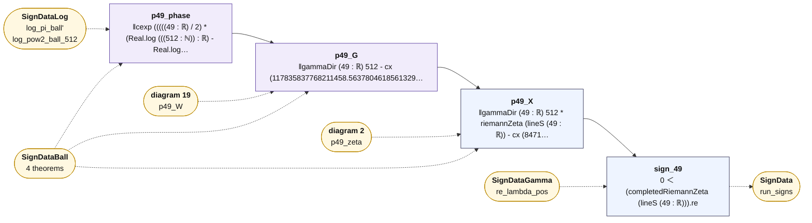

# `lean_stage3/Stage3/SignDataPt49.lean`

> **Read from the source text.** This file changed after the last `python3 utilities/lean_map.py --dump`, so the arrows on this page are names occurring in each proof and have not been confirmed by Lean.

SignDataPt49 — block S14 of `lean_stage3/design/stencil.md`, Turing's sign data: the sign of `Re Λ(1/2 + it)` at `t = 49.0`. 2026-11-25. Generated by `lean_stage3/checks/signdata/gen_signdata.py`; do not edit by hand.

574 theorems, 0 definitions, 2902 lines. 

**Imports:** [`SignDataGamma`](../lean_stage3/SignDataGamma.md), [`SignDataLog`](../lean_stage3/SignDataLog.md)  
**Imported by:** [`SignData`](../lean_stage3/SignData.md)

## The picture

### Diagram 1 of 20: `p49_E2` to `p49_T16`

```mermaid
flowchart LR
  n0["<b>p49_E2</b><br/>‖cexp ((((-((49 : ℝ) * Real.log (((2 : ℕ)) : ℝ))) : ℝ) : ℂ) * Co…"]:::shp
  n1["<b>p49_T2</b><br/>‖(((2 : ℕ)) : ℂ) ^ (-lineS (49 : ℝ)) - cx (-0.586259447237841096…"]:::shp
  n2["<b>p49_E3</b><br/>‖cexp ((((-((49 : ℝ) * Real.log (((3 : ℕ)) : ℝ))) : ℝ) : ℂ) * Co…"]:::shp
  n3["<b>p49_T3</b><br/>‖(((3 : ℕ)) : ℂ) ^ (-lineS (49 : ℝ)) - cx (-0.526005826310512175…"]:::shp
  n4["<b>p49_E4</b><br/>‖cexp ((((-((49 : ℝ) * Real.log (((4 : ℕ)) : ℝ))) : ℝ) : ℂ) * Co…"]:::shp
  n5["<b>p49_T4</b><br/>‖(((4 : ℕ)) : ℂ) ^ (-lineS (49 : ℝ)) - cx (0.1874002791771267145…"]:::shp
  n6["<b>p49_E5</b><br/>‖cexp ((((-((49 : ℝ) * Real.log (((5 : ℕ)) : ℝ))) : ℝ) : ℂ) * Co…"]:::shp
  n7["<b>p49_T5</b><br/>‖(((5 : ℕ)) : ℂ) ^ (-lineS (49 : ℝ)) - cx (-0.424137920176230086…"]:::shp
  n8["<b>p49_E6</b><br/>‖cexp ((((-((49 : ℝ) * Real.log (((6 : ℕ)) : ℝ))) : ℝ) : ℂ) * Co…"]:::shp
  n9["<b>p49_T6</b><br/>‖(((6 : ℕ)) : ℂ) ^ (-lineS (49 : ℝ)) - cx (0.4024746378549908517…"]:::shp
  n10["<b>p49_E7</b><br/>‖cexp ((((-((49 : ℝ) * Real.log (((7 : ℕ)) : ℝ))) : ℝ) : ℂ) * Co…"]:::shp
  n11["<b>p49_T7</b><br/>‖(((7 : ℕ)) : ℂ) ^ (-lineS (49 : ℝ)) - cx (0.1708306549633165674…"]:::shp
  n12["<b>p49_E8</b><br/>‖cexp ((((-((49 : ℝ) * Real.log (((8 : ℕ)) : ℝ))) : ℝ) : ℂ) * Co…"]:::shp
  n13["<b>p49_T8</b><br/>‖(((8 : ℕ)) : ℂ) ^ (-lineS (49 : ℝ)) - cx (0.0733993553815211468…"]:::shp
  n14["<b>p49_E9</b><br/>‖cexp ((((-((49 : ℝ) * Real.log (((9 : ℕ)) : ℝ))) : ℝ) : ℂ) * Co…"]:::shp
  n15["<b>p49_T9</b><br/>‖(((9 : ℕ)) : ℂ) ^ (-lineS (49 : ℝ)) - cx (0.2200309251698670298…"]:::shp
  n16["<b>p49_E10</b><br/>‖cexp ((((-((49 : ℝ) * Real.log (((10 : ℕ)) : ℝ))) : ℝ) : ℂ) * C…"]:::shp
  n17["<b>p49_T10</b><br/>‖(((10 : ℕ)) : ℂ) ^ (-lineS (49 : ℝ)) - cx (0.304714876512029845…"]:::shp
  n18["<b>p49_E11</b><br/>‖cexp ((((-((49 : ℝ) * Real.log (((11 : ℕ)) : ℝ))) : ℝ) : ℂ) * C…"]:::shp
  n19["<b>p49_T11</b><br/>‖(((11 : ℕ)) : ℂ) ^ (-lineS (49 : ℝ)) - cx (-0.09279837448594624…"]:::shp
  n20["<b>p49_E12</b><br/>‖cexp ((((-((49 : ℝ) * Real.log (((12 : ℕ)) : ℝ))) : ℝ) : ℂ) * C…"]:::shp
  n21["<b>p49_T12</b><br/>‖(((12 : ℕ)) : ℂ) ^ (-lineS (49 : ℝ)) - cx (-0.20890620443204601…"]:::shp
  n22["<b>p49_E13</b><br/>‖cexp ((((-((49 : ℝ) * Real.log (((13 : ℕ)) : ℝ))) : ℝ) : ℂ) * C…"]:::shp
  n23["<b>p49_T13</b><br/>‖(((13 : ℕ)) : ℂ) ^ (-lineS (49 : ℝ)) - cx (0.277301021722003987…"]:::shp
  n24["<b>p49_E14</b><br/>‖cexp ((((-((49 : ℝ) * Real.log (((14 : ℕ)) : ℝ))) : ℝ) : ℂ) * C…"]:::shp
  n25["<b>p49_T14</b><br/>‖(((14 : ℕ)) : ℂ) ^ (-lineS (49 : ℝ)) - cx (-0.23344487757529228…"]:::shp
  n26["<b>p49_E15</b><br/>‖cexp ((((-((49 : ℝ) * Real.log (((15 : ℕ)) : ℝ))) : ℝ) : ℂ) * C…"]:::shp
  n27["<b>p49_T15</b><br/>‖(((15 : ℕ)) : ℂ) ^ (-lineS (49 : ℝ)) - cx (0.189348651803191880…"]:::shp
  n28["<b>p49_E16</b><br/>‖cexp ((((-((49 : ℝ) * Real.log (((16 : ℕ)) : ℝ))) : ℝ) : ℂ) * C…"]:::shp
  n29["<b>p49_T16</b><br/>‖(((16 : ℕ)) : ℂ) ^ (-lineS (49 : ℝ)) - cx (-0.17976227064402355…"]:::shp
  x0(["<b>SignDataBall</b><br/>7 theorems"]):::ext
  x1(["<b>SignDataLog</b><br/>30 theorems"]):::ext
  x2(["<b>SignDataZeta</b><br/>natCast_cpow_line"]):::ext
  x3(["<b>diagram 2</b><br/>15 theorems"]):::ext
  n0 --> n1
  n10 --> n11
  n12 --> n13
  n14 --> n15
  n16 --> n17
  n18 --> n19
  n2 --> n3
  n20 --> n21
  n22 --> n23
  n24 --> n25
  n26 --> n27
  n28 --> n29
  n4 --> n5
  n6 --> n7
  n8 --> n9
  n1 -.-> x3
  n11 -.-> x3
  n13 -.-> x3
  n15 -.-> x3
  n17 -.-> x3
  n19 -.-> x3
  n21 -.-> x3
  n23 -.-> x3
  n25 -.-> x3
  n27 -.-> x3
  n29 -.-> x3
  n3 -.-> x3
  n5 -.-> x3
  n7 -.-> x3
  n9 -.-> x3
  x0 -.-> n0
  x0 -.-> n1
  x0 -.-> n10
  x0 -.-> n11
  x0 -.-> n12
  x0 -.-> n13
  x0 -.-> n14
  x0 -.-> n15
  x0 -.-> n16
  x0 -.-> n17
  x0 -.-> n18
  x0 -.-> n19
  x0 -.-> n2
  x0 -.-> n20
  x0 -.-> n21
  x0 -.-> n22
  x0 -.-> n23
  x0 -.-> n24
  x0 -.-> n25
  x0 -.-> n26
  x0 -.-> n27
  x0 -.-> n28
  x0 -.-> n29
  x0 -.-> n3
  x0 -.-> n4
  x0 -.-> n5
  x0 -.-> n6
  x0 -.-> n7
  x0 -.-> n8
  x0 -.-> n9
  x1 -.-> n0
  x1 -.-> n1
  x1 -.-> n10
  x1 -.-> n11
  x1 -.-> n12
  x1 -.-> n13
  x1 -.-> n14
  x1 -.-> n15
  x1 -.-> n16
  x1 -.-> n17
  x1 -.-> n18
  x1 -.-> n19
  x1 -.-> n2
  x1 -.-> n20
  x1 -.-> n21
  x1 -.-> n22
  x1 -.-> n23
  x1 -.-> n24
  x1 -.-> n25
  x1 -.-> n26
  x1 -.-> n27
  x1 -.-> n28
  x1 -.-> n29
  x1 -.-> n3
  x1 -.-> n4
  x1 -.-> n5
  x1 -.-> n6
  x1 -.-> n7
  x1 -.-> n8
  x1 -.-> n9
  x2 -.-> n1
  x2 -.-> n11
  x2 -.-> n13
  x2 -.-> n15
  x2 -.-> n17
  x2 -.-> n19
  x2 -.-> n21
  x2 -.-> n23
  x2 -.-> n25
  x2 -.-> n27
  x2 -.-> n29
  x2 -.-> n3
  x2 -.-> n5
  x2 -.-> n7
  x2 -.-> n9
  classDef cnt fill:#dff5ec,stroke:#17694a,color:#111
  classDef shp fill:#f1ecfb,stroke:#5b3fa0,color:#111
  classDef rh fill:#ffe5e5,stroke:#c22,color:#111,stroke-width:2px
  classDef thm fill:#eef4ff,stroke:#335,color:#111
  classDef end_ fill:#e7f7e7,stroke:#2a7,color:#111,stroke-width:2px
  classDef lone fill:#fff,stroke:#999,color:#111,stroke-dasharray:4 3
  classDef bad fill:#ffe5e5,stroke:#c22,color:#111,stroke-width:2px
  classDef ext fill:#fff8e1,stroke:#b80,color:#111
```



### Diagram 2 of 20: `p49_E17` to `p49_P3`

```mermaid
flowchart LR
  n0["<b>p49_E17</b><br/>‖cexp ((((-((49 : ℝ) * Real.log (((17 : ℕ)) : ℝ))) : ℝ) : ℂ) * C…"]:::shp
  n1["<b>p49_T17</b><br/>‖(((17 : ℕ)) : ℂ) ^ (-lineS (49 : ℝ)) - cx (0.200531795656745017…"]:::shp
  n2["<b>p49_E18</b><br/>‖cexp ((((-((49 : ℝ) * Real.log (((18 : ℕ)) : ℝ))) : ℝ) : ℂ) * C…"]:::shp
  n3["<b>p49_T18</b><br/>‖(((18 : ℕ)) : ℂ) ^ (-lineS (49 : ℝ)) - cx (-0.22798819306857482…"]:::shp
  n4["<b>p49_E19</b><br/>‖cexp ((((-((49 : ℝ) * Real.log (((19 : ℕ)) : ℝ))) : ℝ) : ℂ) * C…"]:::shp
  n5["<b>p49_T19</b><br/>‖(((19 : ℕ)) : ℂ) ^ (-lineS (49 : ℝ)) - cx (0.223069853383308359…"]:::shp
  n6["<b>p49_S2</b><br/>‖∑ m ∈ Finset.Icc 1 (1 + 1), ((m : ℕ) : ℂ) ^ (-lineS (49 : ℝ)) -…"]:::shp
  n7["<b>p49_S3</b><br/>‖∑ m ∈ Finset.Icc 1 (2 + 1), ((m : ℕ) : ℂ) ^ (-lineS (49 : ℝ)) -…"]:::shp
  n8["<b>p49_S4</b><br/>‖∑ m ∈ Finset.Icc 1 (3 + 1), ((m : ℕ) : ℂ) ^ (-lineS (49 : ℝ)) -…"]:::shp
  n9["<b>p49_S5</b><br/>‖∑ m ∈ Finset.Icc 1 (4 + 1), ((m : ℕ) : ℂ) ^ (-lineS (49 : ℝ)) -…"]:::shp
  n10["<b>p49_S6</b><br/>‖∑ m ∈ Finset.Icc 1 (5 + 1), ((m : ℕ) : ℂ) ^ (-lineS (49 : ℝ)) -…"]:::shp
  n11["<b>p49_S7</b><br/>‖∑ m ∈ Finset.Icc 1 (6 + 1), ((m : ℕ) : ℂ) ^ (-lineS (49 : ℝ)) -…"]:::shp
  n12["<b>p49_S8</b><br/>‖∑ m ∈ Finset.Icc 1 (7 + 1), ((m : ℕ) : ℂ) ^ (-lineS (49 : ℝ)) -…"]:::shp
  n13["<b>p49_S9</b><br/>‖∑ m ∈ Finset.Icc 1 (8 + 1), ((m : ℕ) : ℂ) ^ (-lineS (49 : ℝ)) -…"]:::shp
  n14["<b>p49_S10</b><br/>‖∑ m ∈ Finset.Icc 1 (9 + 1), ((m : ℕ) : ℂ) ^ (-lineS (49 : ℝ)) -…"]:::shp
  n15["<b>p49_S11</b><br/>‖∑ m ∈ Finset.Icc 1 (10 + 1), ((m : ℕ) : ℂ) ^ (-lineS (49 : ℝ)) …"]:::shp
  n16["<b>p49_S12</b><br/>‖∑ m ∈ Finset.Icc 1 (11 + 1), ((m : ℕ) : ℂ) ^ (-lineS (49 : ℝ)) …"]:::shp
  n17["<b>p49_S13</b><br/>‖∑ m ∈ Finset.Icc 1 (12 + 1), ((m : ℕ) : ℂ) ^ (-lineS (49 : ℝ)) …"]:::shp
  n18["<b>p49_S14</b><br/>‖∑ m ∈ Finset.Icc 1 (13 + 1), ((m : ℕ) : ℂ) ^ (-lineS (49 : ℝ)) …"]:::shp
  n19["<b>p49_S15</b><br/>‖∑ m ∈ Finset.Icc 1 (14 + 1), ((m : ℕ) : ℂ) ^ (-lineS (49 : ℝ)) …"]:::shp
  n20["<b>p49_S16</b><br/>‖∑ m ∈ Finset.Icc 1 (15 + 1), ((m : ℕ) : ℂ) ^ (-lineS (49 : ℝ)) …"]:::shp
  n21["<b>p49_S17</b><br/>‖∑ m ∈ Finset.Icc 1 (16 + 1), ((m : ℕ) : ℂ) ^ (-lineS (49 : ℝ)) …"]:::shp
  n22["<b>p49_S18</b><br/>‖∑ m ∈ Finset.Icc 1 (17 + 1), ((m : ℕ) : ℂ) ^ (-lineS (49 : ℝ)) …"]:::shp
  n23["<b>p49_S19</b><br/>‖∑ m ∈ Finset.Icc 1 (18 + 1), ((m : ℕ) : ℂ) ^ (-lineS (49 : ℝ)) …"]:::shp
  n24["<b>p49_NB</b><br/>‖(((19 : ℕ)) : ℂ) ^ (-lineS (49 : ℝ)) * emB (49 : ℝ) 19 - cx (-0…"]:::shp
  n25["<b>p49_Y</b><br/>‖(∑ m ∈ Finset.Icc 1 (18 + 1), ((m : ℕ) : ℂ) ^ (-lineS (49 : ℝ))…"]:::shp
  n26["<b>p49_zeta</b><br/>‖riemannZeta (lineS (49 : ℝ)) - cx (0.66634484480220030522670376…"]:::thm
  n27["<b>p49_P1</b><br/>‖∏ j ∈ Finset.range (0 + 1), (1 + zz (49 : ℝ) / ((j : ℂ) + 1)) -…"]:::shp
  n28["<b>p49_P2</b><br/>‖∏ j ∈ Finset.range (1 + 1), (1 + zz (49 : ℝ) / ((j : ℂ) + 1)) -…"]:::shp
  n29["<b>p49_P3</b><br/>‖∏ j ∈ Finset.range (2 + 1), (1 + zz (49 : ℝ) / ((j : ℂ) + 1)) -…"]:::shp
  x0(["<b>SignDataBall</b><br/>6 theorems"]):::ext
  x1(["<b>SignDataLog</b><br/>6 theorems"]):::ext
  x2(["<b>SignDataZeta</b><br/>5 theorems"]):::ext
  x3(["<b>diagram 1</b><br/>15 theorems"]):::ext
  x4(["<b>diagram 20</b><br/>p49_X"]):::ext
  x5(["<b>SignDataGamma</b><br/>factor_ball<br/>prod_zero_ball"]):::ext
  x6(["<b>diagram 3</b><br/>p49_P4"]):::ext
  n0 --> n1
  n1 --> n21
  n10 --> n11
  n11 --> n12
  n12 --> n13
  n13 --> n14
  n14 --> n15
  n15 --> n16
  n16 --> n17
  n17 --> n18
  n18 --> n19
  n19 --> n20
  n2 --> n3
  n20 --> n21
  n21 --> n22
  n22 --> n23
  n23 --> n25
  n24 --> n25
  n25 --> n26
  n27 --> n28
  n28 --> n29
  n3 --> n22
  n4 --> n5
  n5 --> n23
  n5 --> n24
  n6 --> n7
  n7 --> n8
  n8 --> n9
  n9 --> n10
  n26 -.-> x4
  n29 -.-> x6
  x0 -.-> n0
  x0 -.-> n1
  x0 -.-> n10
  x0 -.-> n11
  x0 -.-> n12
  x0 -.-> n13
  x0 -.-> n14
  x0 -.-> n15
  x0 -.-> n16
  x0 -.-> n17
  x0 -.-> n18
  x0 -.-> n19
  x0 -.-> n2
  x0 -.-> n20
  x0 -.-> n21
  x0 -.-> n22
  x0 -.-> n23
  x0 -.-> n24
  x0 -.-> n25
  x0 -.-> n27
  x0 -.-> n28
  x0 -.-> n29
  x0 -.-> n3
  x0 -.-> n4
  x0 -.-> n5
  x0 -.-> n6
  x0 -.-> n7
  x0 -.-> n8
  x0 -.-> n9
  x1 -.-> n0
  x1 -.-> n1
  x1 -.-> n2
  x1 -.-> n3
  x1 -.-> n4
  x1 -.-> n5
  x2 -.-> n1
  x2 -.-> n24
  x2 -.-> n26
  x2 -.-> n3
  x2 -.-> n5
  x2 -.-> n6
  x3 -.-> n10
  x3 -.-> n11
  x3 -.-> n12
  x3 -.-> n13
  x3 -.-> n14
  x3 -.-> n15
  x3 -.-> n16
  x3 -.-> n17
  x3 -.-> n18
  x3 -.-> n19
  x3 -.-> n20
  x3 -.-> n6
  x3 -.-> n7
  x3 -.-> n8
  x3 -.-> n9
  x5 -.-> n27
  x5 -.-> n28
  x5 -.-> n29
  classDef cnt fill:#dff5ec,stroke:#17694a,color:#111
  classDef shp fill:#f1ecfb,stroke:#5b3fa0,color:#111
  classDef rh fill:#ffe5e5,stroke:#c22,color:#111,stroke-width:2px
  classDef thm fill:#eef4ff,stroke:#335,color:#111
  classDef end_ fill:#e7f7e7,stroke:#2a7,color:#111,stroke-width:2px
  classDef lone fill:#fff,stroke:#999,color:#111,stroke-dasharray:4 3
  classDef bad fill:#ffe5e5,stroke:#c22,color:#111,stroke-width:2px
  classDef ext fill:#fff8e1,stroke:#b80,color:#111
```



### Diagram 3 of 20: `p49_P4` to `p49_P33`


### Diagram 4 of 20: `p49_P34` to `p49_P63`


### Diagram 5 of 20: `p49_P64` to `p49_P93`

```mermaid
flowchart LR
  n0["<b>p49_P64</b><br/>‖∏ j ∈ Finset.range (63 + 1), (1 + zz (49 : ℝ) / ((j : ℂ) + 1)) …"]:::shp
  n1["<b>p49_P65</b><br/>‖∏ j ∈ Finset.range (64 + 1), (1 + zz (49 : ℝ) / ((j : ℂ) + 1)) …"]:::shp
  n2["<b>p49_P66</b><br/>‖∏ j ∈ Finset.range (65 + 1), (1 + zz (49 : ℝ) / ((j : ℂ) + 1)) …"]:::shp
  n3["<b>p49_P67</b><br/>‖∏ j ∈ Finset.range (66 + 1), (1 + zz (49 : ℝ) / ((j : ℂ) + 1)) …"]:::shp
  n4["<b>p49_P68</b><br/>‖∏ j ∈ Finset.range (67 + 1), (1 + zz (49 : ℝ) / ((j : ℂ) + 1)) …"]:::shp
  n5["<b>p49_P69</b><br/>‖∏ j ∈ Finset.range (68 + 1), (1 + zz (49 : ℝ) / ((j : ℂ) + 1)) …"]:::shp
  n6["<b>p49_P70</b><br/>‖∏ j ∈ Finset.range (69 + 1), (1 + zz (49 : ℝ) / ((j : ℂ) + 1)) …"]:::shp
  n7["<b>p49_P71</b><br/>‖∏ j ∈ Finset.range (70 + 1), (1 + zz (49 : ℝ) / ((j : ℂ) + 1)) …"]:::shp
  n8["<b>p49_P72</b><br/>‖∏ j ∈ Finset.range (71 + 1), (1 + zz (49 : ℝ) / ((j : ℂ) + 1)) …"]:::shp
  n9["<b>p49_P73</b><br/>‖∏ j ∈ Finset.range (72 + 1), (1 + zz (49 : ℝ) / ((j : ℂ) + 1)) …"]:::shp
  n10["<b>p49_P74</b><br/>‖∏ j ∈ Finset.range (73 + 1), (1 + zz (49 : ℝ) / ((j : ℂ) + 1)) …"]:::shp
  n11["<b>p49_P75</b><br/>‖∏ j ∈ Finset.range (74 + 1), (1 + zz (49 : ℝ) / ((j : ℂ) + 1)) …"]:::shp
  n12["<b>p49_P76</b><br/>‖∏ j ∈ Finset.range (75 + 1), (1 + zz (49 : ℝ) / ((j : ℂ) + 1)) …"]:::shp
  n13["<b>p49_P77</b><br/>‖∏ j ∈ Finset.range (76 + 1), (1 + zz (49 : ℝ) / ((j : ℂ) + 1)) …"]:::shp
  n14["<b>p49_P78</b><br/>‖∏ j ∈ Finset.range (77 + 1), (1 + zz (49 : ℝ) / ((j : ℂ) + 1)) …"]:::shp
  n15["<b>p49_P79</b><br/>‖∏ j ∈ Finset.range (78 + 1), (1 + zz (49 : ℝ) / ((j : ℂ) + 1)) …"]:::shp
  n16["<b>p49_P80</b><br/>‖∏ j ∈ Finset.range (79 + 1), (1 + zz (49 : ℝ) / ((j : ℂ) + 1)) …"]:::shp
  n17["<b>p49_P81</b><br/>‖∏ j ∈ Finset.range (80 + 1), (1 + zz (49 : ℝ) / ((j : ℂ) + 1)) …"]:::shp
  n18["<b>p49_P82</b><br/>‖∏ j ∈ Finset.range (81 + 1), (1 + zz (49 : ℝ) / ((j : ℂ) + 1)) …"]:::shp
  n19["<b>p49_P83</b><br/>‖∏ j ∈ Finset.range (82 + 1), (1 + zz (49 : ℝ) / ((j : ℂ) + 1)) …"]:::shp
  n20["<b>p49_P84</b><br/>‖∏ j ∈ Finset.range (83 + 1), (1 + zz (49 : ℝ) / ((j : ℂ) + 1)) …"]:::shp
  n21["<b>p49_P85</b><br/>‖∏ j ∈ Finset.range (84 + 1), (1 + zz (49 : ℝ) / ((j : ℂ) + 1)) …"]:::shp
  n22["<b>p49_P86</b><br/>‖∏ j ∈ Finset.range (85 + 1), (1 + zz (49 : ℝ) / ((j : ℂ) + 1)) …"]:::shp
  n23["<b>p49_P87</b><br/>‖∏ j ∈ Finset.range (86 + 1), (1 + zz (49 : ℝ) / ((j : ℂ) + 1)) …"]:::shp
  n24["<b>p49_P88</b><br/>‖∏ j ∈ Finset.range (87 + 1), (1 + zz (49 : ℝ) / ((j : ℂ) + 1)) …"]:::shp
  n25["<b>p49_P89</b><br/>‖∏ j ∈ Finset.range (88 + 1), (1 + zz (49 : ℝ) / ((j : ℂ) + 1)) …"]:::shp
  n26["<b>p49_P90</b><br/>‖∏ j ∈ Finset.range (89 + 1), (1 + zz (49 : ℝ) / ((j : ℂ) + 1)) …"]:::shp
  n27["<b>p49_P91</b><br/>‖∏ j ∈ Finset.range (90 + 1), (1 + zz (49 : ℝ) / ((j : ℂ) + 1)) …"]:::shp
  n28["<b>p49_P92</b><br/>‖∏ j ∈ Finset.range (91 + 1), (1 + zz (49 : ℝ) / ((j : ℂ) + 1)) …"]:::shp
  n29["<b>p49_P93</b><br/>‖∏ j ∈ Finset.range (92 + 1), (1 + zz (49 : ℝ) / ((j : ℂ) + 1)) …"]:::shp
  x0(["<b>SignDataBall</b><br/>ball_mul"]):::ext
  x1(["<b>SignDataGamma</b><br/>factor_ball"]):::ext
  x2(["<b>diagram 4</b><br/>p49_P63"]):::ext
  x3(["<b>diagram 6</b><br/>p49_P94"]):::ext
  n0 --> n1
  n1 --> n2
  n10 --> n11
  n11 --> n12
  n12 --> n13
  n13 --> n14
  n14 --> n15
  n15 --> n16
  n16 --> n17
  n17 --> n18
  n18 --> n19
  n19 --> n20
  n2 --> n3
  n20 --> n21
  n21 --> n22
  n22 --> n23
  n23 --> n24
  n24 --> n25
  n25 --> n26
  n26 --> n27
  n27 --> n28
  n28 --> n29
  n3 --> n4
  n4 --> n5
  n5 --> n6
  n6 --> n7
  n7 --> n8
  n8 --> n9
  n9 --> n10
  n29 -.-> x3
  x0 -.-> n0
  x0 -.-> n1
  x0 -.-> n10
  x0 -.-> n11
  x0 -.-> n12
  x0 -.-> n13
  x0 -.-> n14
  x0 -.-> n15
  x0 -.-> n16
  x0 -.-> n17
  x0 -.-> n18
  x0 -.-> n19
  x0 -.-> n2
  x0 -.-> n20
  x0 -.-> n21
  x0 -.-> n22
  x0 -.-> n23
  x0 -.-> n24
  x0 -.-> n25
  x0 -.-> n26
  x0 -.-> n27
  x0 -.-> n28
  x0 -.-> n29
  x0 -.-> n3
  x0 -.-> n4
  x0 -.-> n5
  x0 -.-> n6
  x0 -.-> n7
  x0 -.-> n8
  x0 -.-> n9
  x1 -.-> n0
  x1 -.-> n1
  x1 -.-> n10
  x1 -.-> n11
  x1 -.-> n12
  x1 -.-> n13
  x1 -.-> n14
  x1 -.-> n15
  x1 -.-> n16
  x1 -.-> n17
  x1 -.-> n18
  x1 -.-> n19
  x1 -.-> n2
  x1 -.-> n20
  x1 -.-> n21
  x1 -.-> n22
  x1 -.-> n23
  x1 -.-> n24
  x1 -.-> n25
  x1 -.-> n26
  x1 -.-> n27
  x1 -.-> n28
  x1 -.-> n29
  x1 -.-> n3
  x1 -.-> n4
  x1 -.-> n5
  x1 -.-> n6
  x1 -.-> n7
  x1 -.-> n8
  x1 -.-> n9
  x2 -.-> n0
  classDef cnt fill:#dff5ec,stroke:#17694a,color:#111
  classDef shp fill:#f1ecfb,stroke:#5b3fa0,color:#111
  classDef rh fill:#ffe5e5,stroke:#c22,color:#111,stroke-width:2px
  classDef thm fill:#eef4ff,stroke:#335,color:#111
  classDef end_ fill:#e7f7e7,stroke:#2a7,color:#111,stroke-width:2px
  classDef lone fill:#fff,stroke:#999,color:#111,stroke-dasharray:4 3
  classDef bad fill:#ffe5e5,stroke:#c22,color:#111,stroke-width:2px
  classDef ext fill:#fff8e1,stroke:#b80,color:#111
```



### Diagram 6 of 20: `p49_P94` to `p49_P123`


### Diagram 7 of 20: `p49_P124` to `p49_P153`

```mermaid
flowchart LR
  n0["<b>p49_P124</b><br/>‖∏ j ∈ Finset.range (123 + 1), (1 + zz (49 : ℝ) / ((j : ℂ) + 1))…"]:::shp
  n1["<b>p49_P125</b><br/>‖∏ j ∈ Finset.range (124 + 1), (1 + zz (49 : ℝ) / ((j : ℂ) + 1))…"]:::shp
  n2["<b>p49_P126</b><br/>‖∏ j ∈ Finset.range (125 + 1), (1 + zz (49 : ℝ) / ((j : ℂ) + 1))…"]:::shp
  n3["<b>p49_P127</b><br/>‖∏ j ∈ Finset.range (126 + 1), (1 + zz (49 : ℝ) / ((j : ℂ) + 1))…"]:::shp
  n4["<b>p49_P128</b><br/>‖∏ j ∈ Finset.range (127 + 1), (1 + zz (49 : ℝ) / ((j : ℂ) + 1))…"]:::shp
  n5["<b>p49_P129</b><br/>‖∏ j ∈ Finset.range (128 + 1), (1 + zz (49 : ℝ) / ((j : ℂ) + 1))…"]:::shp
  n6["<b>p49_P130</b><br/>‖∏ j ∈ Finset.range (129 + 1), (1 + zz (49 : ℝ) / ((j : ℂ) + 1))…"]:::shp
  n7["<b>p49_P131</b><br/>‖∏ j ∈ Finset.range (130 + 1), (1 + zz (49 : ℝ) / ((j : ℂ) + 1))…"]:::shp
  n8["<b>p49_P132</b><br/>‖∏ j ∈ Finset.range (131 + 1), (1 + zz (49 : ℝ) / ((j : ℂ) + 1))…"]:::shp
  n9["<b>p49_P133</b><br/>‖∏ j ∈ Finset.range (132 + 1), (1 + zz (49 : ℝ) / ((j : ℂ) + 1))…"]:::shp
  n10["<b>p49_P134</b><br/>‖∏ j ∈ Finset.range (133 + 1), (1 + zz (49 : ℝ) / ((j : ℂ) + 1))…"]:::shp
  n11["<b>p49_P135</b><br/>‖∏ j ∈ Finset.range (134 + 1), (1 + zz (49 : ℝ) / ((j : ℂ) + 1))…"]:::shp
  n12["<b>p49_P136</b><br/>‖∏ j ∈ Finset.range (135 + 1), (1 + zz (49 : ℝ) / ((j : ℂ) + 1))…"]:::shp
  n13["<b>p49_P137</b><br/>‖∏ j ∈ Finset.range (136 + 1), (1 + zz (49 : ℝ) / ((j : ℂ) + 1))…"]:::shp
  n14["<b>p49_P138</b><br/>‖∏ j ∈ Finset.range (137 + 1), (1 + zz (49 : ℝ) / ((j : ℂ) + 1))…"]:::shp
  n15["<b>p49_P139</b><br/>‖∏ j ∈ Finset.range (138 + 1), (1 + zz (49 : ℝ) / ((j : ℂ) + 1))…"]:::shp
  n16["<b>p49_P140</b><br/>‖∏ j ∈ Finset.range (139 + 1), (1 + zz (49 : ℝ) / ((j : ℂ) + 1))…"]:::shp
  n17["<b>p49_P141</b><br/>‖∏ j ∈ Finset.range (140 + 1), (1 + zz (49 : ℝ) / ((j : ℂ) + 1))…"]:::shp
  n18["<b>p49_P142</b><br/>‖∏ j ∈ Finset.range (141 + 1), (1 + zz (49 : ℝ) / ((j : ℂ) + 1))…"]:::shp
  n19["<b>p49_P143</b><br/>‖∏ j ∈ Finset.range (142 + 1), (1 + zz (49 : ℝ) / ((j : ℂ) + 1))…"]:::shp
  n20["<b>p49_P144</b><br/>‖∏ j ∈ Finset.range (143 + 1), (1 + zz (49 : ℝ) / ((j : ℂ) + 1))…"]:::shp
  n21["<b>p49_P145</b><br/>‖∏ j ∈ Finset.range (144 + 1), (1 + zz (49 : ℝ) / ((j : ℂ) + 1))…"]:::shp
  n22["<b>p49_P146</b><br/>‖∏ j ∈ Finset.range (145 + 1), (1 + zz (49 : ℝ) / ((j : ℂ) + 1))…"]:::shp
  n23["<b>p49_P147</b><br/>‖∏ j ∈ Finset.range (146 + 1), (1 + zz (49 : ℝ) / ((j : ℂ) + 1))…"]:::shp
  n24["<b>p49_P148</b><br/>‖∏ j ∈ Finset.range (147 + 1), (1 + zz (49 : ℝ) / ((j : ℂ) + 1))…"]:::shp
  n25["<b>p49_P149</b><br/>‖∏ j ∈ Finset.range (148 + 1), (1 + zz (49 : ℝ) / ((j : ℂ) + 1))…"]:::shp
  n26["<b>p49_P150</b><br/>‖∏ j ∈ Finset.range (149 + 1), (1 + zz (49 : ℝ) / ((j : ℂ) + 1))…"]:::shp
  n27["<b>p49_P151</b><br/>‖∏ j ∈ Finset.range (150 + 1), (1 + zz (49 : ℝ) / ((j : ℂ) + 1))…"]:::shp
  n28["<b>p49_P152</b><br/>‖∏ j ∈ Finset.range (151 + 1), (1 + zz (49 : ℝ) / ((j : ℂ) + 1))…"]:::shp
  n29["<b>p49_P153</b><br/>‖∏ j ∈ Finset.range (152 + 1), (1 + zz (49 : ℝ) / ((j : ℂ) + 1))…"]:::shp
  x0(["<b>SignDataBall</b><br/>ball_mul"]):::ext
  x1(["<b>SignDataGamma</b><br/>factor_ball"]):::ext
  x2(["<b>diagram 6</b><br/>p49_P123"]):::ext
  x3(["<b>diagram 8</b><br/>p49_P154"]):::ext
  n0 --> n1
  n1 --> n2
  n10 --> n11
  n11 --> n12
  n12 --> n13
  n13 --> n14
  n14 --> n15
  n15 --> n16
  n16 --> n17
  n17 --> n18
  n18 --> n19
  n19 --> n20
  n2 --> n3
  n20 --> n21
  n21 --> n22
  n22 --> n23
  n23 --> n24
  n24 --> n25
  n25 --> n26
  n26 --> n27
  n27 --> n28
  n28 --> n29
  n3 --> n4
  n4 --> n5
  n5 --> n6
  n6 --> n7
  n7 --> n8
  n8 --> n9
  n9 --> n10
  n29 -.-> x3
  x0 -.-> n0
  x0 -.-> n1
  x0 -.-> n10
  x0 -.-> n11
  x0 -.-> n12
  x0 -.-> n13
  x0 -.-> n14
  x0 -.-> n15
  x0 -.-> n16
  x0 -.-> n17
  x0 -.-> n18
  x0 -.-> n19
  x0 -.-> n2
  x0 -.-> n20
  x0 -.-> n21
  x0 -.-> n22
  x0 -.-> n23
  x0 -.-> n24
  x0 -.-> n25
  x0 -.-> n26
  x0 -.-> n27
  x0 -.-> n28
  x0 -.-> n29
  x0 -.-> n3
  x0 -.-> n4
  x0 -.-> n5
  x0 -.-> n6
  x0 -.-> n7
  x0 -.-> n8
  x0 -.-> n9
  x1 -.-> n0
  x1 -.-> n1
  x1 -.-> n10
  x1 -.-> n11
  x1 -.-> n12
  x1 -.-> n13
  x1 -.-> n14
  x1 -.-> n15
  x1 -.-> n16
  x1 -.-> n17
  x1 -.-> n18
  x1 -.-> n19
  x1 -.-> n2
  x1 -.-> n20
  x1 -.-> n21
  x1 -.-> n22
  x1 -.-> n23
  x1 -.-> n24
  x1 -.-> n25
  x1 -.-> n26
  x1 -.-> n27
  x1 -.-> n28
  x1 -.-> n29
  x1 -.-> n3
  x1 -.-> n4
  x1 -.-> n5
  x1 -.-> n6
  x1 -.-> n7
  x1 -.-> n8
  x1 -.-> n9
  x2 -.-> n0
  classDef cnt fill:#dff5ec,stroke:#17694a,color:#111
  classDef shp fill:#f1ecfb,stroke:#5b3fa0,color:#111
  classDef rh fill:#ffe5e5,stroke:#c22,color:#111,stroke-width:2px
  classDef thm fill:#eef4ff,stroke:#335,color:#111
  classDef end_ fill:#e7f7e7,stroke:#2a7,color:#111,stroke-width:2px
  classDef lone fill:#fff,stroke:#999,color:#111,stroke-dasharray:4 3
  classDef bad fill:#ffe5e5,stroke:#c22,color:#111,stroke-width:2px
  classDef ext fill:#fff8e1,stroke:#b80,color:#111
```



### Diagram 8 of 20: `p49_P154` to `p49_P183`

```mermaid
flowchart LR
  n0["<b>p49_P154</b><br/>‖∏ j ∈ Finset.range (153 + 1), (1 + zz (49 : ℝ) / ((j : ℂ) + 1))…"]:::shp
  n1["<b>p49_P155</b><br/>‖∏ j ∈ Finset.range (154 + 1), (1 + zz (49 : ℝ) / ((j : ℂ) + 1))…"]:::shp
  n2["<b>p49_P156</b><br/>‖∏ j ∈ Finset.range (155 + 1), (1 + zz (49 : ℝ) / ((j : ℂ) + 1))…"]:::shp
  n3["<b>p49_P157</b><br/>‖∏ j ∈ Finset.range (156 + 1), (1 + zz (49 : ℝ) / ((j : ℂ) + 1))…"]:::shp
  n4["<b>p49_P158</b><br/>‖∏ j ∈ Finset.range (157 + 1), (1 + zz (49 : ℝ) / ((j : ℂ) + 1))…"]:::shp
  n5["<b>p49_P159</b><br/>‖∏ j ∈ Finset.range (158 + 1), (1 + zz (49 : ℝ) / ((j : ℂ) + 1))…"]:::shp
  n6["<b>p49_P160</b><br/>‖∏ j ∈ Finset.range (159 + 1), (1 + zz (49 : ℝ) / ((j : ℂ) + 1))…"]:::shp
  n7["<b>p49_P161</b><br/>‖∏ j ∈ Finset.range (160 + 1), (1 + zz (49 : ℝ) / ((j : ℂ) + 1))…"]:::shp
  n8["<b>p49_P162</b><br/>‖∏ j ∈ Finset.range (161 + 1), (1 + zz (49 : ℝ) / ((j : ℂ) + 1))…"]:::shp
  n9["<b>p49_P163</b><br/>‖∏ j ∈ Finset.range (162 + 1), (1 + zz (49 : ℝ) / ((j : ℂ) + 1))…"]:::shp
  n10["<b>p49_P164</b><br/>‖∏ j ∈ Finset.range (163 + 1), (1 + zz (49 : ℝ) / ((j : ℂ) + 1))…"]:::shp
  n11["<b>p49_P165</b><br/>‖∏ j ∈ Finset.range (164 + 1), (1 + zz (49 : ℝ) / ((j : ℂ) + 1))…"]:::shp
  n12["<b>p49_P166</b><br/>‖∏ j ∈ Finset.range (165 + 1), (1 + zz (49 : ℝ) / ((j : ℂ) + 1))…"]:::shp
  n13["<b>p49_P167</b><br/>‖∏ j ∈ Finset.range (166 + 1), (1 + zz (49 : ℝ) / ((j : ℂ) + 1))…"]:::shp
  n14["<b>p49_P168</b><br/>‖∏ j ∈ Finset.range (167 + 1), (1 + zz (49 : ℝ) / ((j : ℂ) + 1))…"]:::shp
  n15["<b>p49_P169</b><br/>‖∏ j ∈ Finset.range (168 + 1), (1 + zz (49 : ℝ) / ((j : ℂ) + 1))…"]:::shp
  n16["<b>p49_P170</b><br/>‖∏ j ∈ Finset.range (169 + 1), (1 + zz (49 : ℝ) / ((j : ℂ) + 1))…"]:::shp
  n17["<b>p49_P171</b><br/>‖∏ j ∈ Finset.range (170 + 1), (1 + zz (49 : ℝ) / ((j : ℂ) + 1))…"]:::shp
  n18["<b>p49_P172</b><br/>‖∏ j ∈ Finset.range (171 + 1), (1 + zz (49 : ℝ) / ((j : ℂ) + 1))…"]:::shp
  n19["<b>p49_P173</b><br/>‖∏ j ∈ Finset.range (172 + 1), (1 + zz (49 : ℝ) / ((j : ℂ) + 1))…"]:::shp
  n20["<b>p49_P174</b><br/>‖∏ j ∈ Finset.range (173 + 1), (1 + zz (49 : ℝ) / ((j : ℂ) + 1))…"]:::shp
  n21["<b>p49_P175</b><br/>‖∏ j ∈ Finset.range (174 + 1), (1 + zz (49 : ℝ) / ((j : ℂ) + 1))…"]:::shp
  n22["<b>p49_P176</b><br/>‖∏ j ∈ Finset.range (175 + 1), (1 + zz (49 : ℝ) / ((j : ℂ) + 1))…"]:::shp
  n23["<b>p49_P177</b><br/>‖∏ j ∈ Finset.range (176 + 1), (1 + zz (49 : ℝ) / ((j : ℂ) + 1))…"]:::shp
  n24["<b>p49_P178</b><br/>‖∏ j ∈ Finset.range (177 + 1), (1 + zz (49 : ℝ) / ((j : ℂ) + 1))…"]:::shp
  n25["<b>p49_P179</b><br/>‖∏ j ∈ Finset.range (178 + 1), (1 + zz (49 : ℝ) / ((j : ℂ) + 1))…"]:::shp
  n26["<b>p49_P180</b><br/>‖∏ j ∈ Finset.range (179 + 1), (1 + zz (49 : ℝ) / ((j : ℂ) + 1))…"]:::shp
  n27["<b>p49_P181</b><br/>‖∏ j ∈ Finset.range (180 + 1), (1 + zz (49 : ℝ) / ((j : ℂ) + 1))…"]:::shp
  n28["<b>p49_P182</b><br/>‖∏ j ∈ Finset.range (181 + 1), (1 + zz (49 : ℝ) / ((j : ℂ) + 1))…"]:::shp
  n29["<b>p49_P183</b><br/>‖∏ j ∈ Finset.range (182 + 1), (1 + zz (49 : ℝ) / ((j : ℂ) + 1))…"]:::shp
  x0(["<b>SignDataBall</b><br/>ball_mul"]):::ext
  x1(["<b>SignDataGamma</b><br/>factor_ball"]):::ext
  x2(["<b>diagram 7</b><br/>p49_P153"]):::ext
  x3(["<b>diagram 9</b><br/>p49_P184"]):::ext
  n0 --> n1
  n1 --> n2
  n10 --> n11
  n11 --> n12
  n12 --> n13
  n13 --> n14
  n14 --> n15
  n15 --> n16
  n16 --> n17
  n17 --> n18
  n18 --> n19
  n19 --> n20
  n2 --> n3
  n20 --> n21
  n21 --> n22
  n22 --> n23
  n23 --> n24
  n24 --> n25
  n25 --> n26
  n26 --> n27
  n27 --> n28
  n28 --> n29
  n3 --> n4
  n4 --> n5
  n5 --> n6
  n6 --> n7
  n7 --> n8
  n8 --> n9
  n9 --> n10
  n29 -.-> x3
  x0 -.-> n0
  x0 -.-> n1
  x0 -.-> n10
  x0 -.-> n11
  x0 -.-> n12
  x0 -.-> n13
  x0 -.-> n14
  x0 -.-> n15
  x0 -.-> n16
  x0 -.-> n17
  x0 -.-> n18
  x0 -.-> n19
  x0 -.-> n2
  x0 -.-> n20
  x0 -.-> n21
  x0 -.-> n22
  x0 -.-> n23
  x0 -.-> n24
  x0 -.-> n25
  x0 -.-> n26
  x0 -.-> n27
  x0 -.-> n28
  x0 -.-> n29
  x0 -.-> n3
  x0 -.-> n4
  x0 -.-> n5
  x0 -.-> n6
  x0 -.-> n7
  x0 -.-> n8
  x0 -.-> n9
  x1 -.-> n0
  x1 -.-> n1
  x1 -.-> n10
  x1 -.-> n11
  x1 -.-> n12
  x1 -.-> n13
  x1 -.-> n14
  x1 -.-> n15
  x1 -.-> n16
  x1 -.-> n17
  x1 -.-> n18
  x1 -.-> n19
  x1 -.-> n2
  x1 -.-> n20
  x1 -.-> n21
  x1 -.-> n22
  x1 -.-> n23
  x1 -.-> n24
  x1 -.-> n25
  x1 -.-> n26
  x1 -.-> n27
  x1 -.-> n28
  x1 -.-> n29
  x1 -.-> n3
  x1 -.-> n4
  x1 -.-> n5
  x1 -.-> n6
  x1 -.-> n7
  x1 -.-> n8
  x1 -.-> n9
  x2 -.-> n0
  classDef cnt fill:#dff5ec,stroke:#17694a,color:#111
  classDef shp fill:#f1ecfb,stroke:#5b3fa0,color:#111
  classDef rh fill:#ffe5e5,stroke:#c22,color:#111,stroke-width:2px
  classDef thm fill:#eef4ff,stroke:#335,color:#111
  classDef end_ fill:#e7f7e7,stroke:#2a7,color:#111,stroke-width:2px
  classDef lone fill:#fff,stroke:#999,color:#111,stroke-dasharray:4 3
  classDef bad fill:#ffe5e5,stroke:#c22,color:#111,stroke-width:2px
  classDef ext fill:#fff8e1,stroke:#b80,color:#111
```



### Diagram 9 of 20: `p49_P184` to `p49_P213`


### Diagram 10 of 20: `p49_P214` to `p49_P243`


### Diagram 11 of 20: `p49_P244` to `p49_P273`


### Diagram 12 of 20: `p49_P274` to `p49_P303`


### Diagram 13 of 20: `p49_P304` to `p49_P333`


### Diagram 14 of 20: `p49_P334` to `p49_P363`


### Diagram 15 of 20: `p49_P364` to `p49_P393`


### Diagram 16 of 20: `p49_P394` to `p49_P423`


### Diagram 17 of 20: `p49_P424` to `p49_P453`


### Diagram 18 of 20: `p49_P454` to `p49_P483`


### Diagram 19 of 20: `p49_P484` to `p49_W`

```mermaid
flowchart LR
  n0["<b>p49_P484</b><br/>‖∏ j ∈ Finset.range (483 + 1), (1 + zz (49 : ℝ) / ((j : ℂ) + 1))…"]:::shp
  n1["<b>p49_P485</b><br/>‖∏ j ∈ Finset.range (484 + 1), (1 + zz (49 : ℝ) / ((j : ℂ) + 1))…"]:::shp
  n2["<b>p49_P486</b><br/>‖∏ j ∈ Finset.range (485 + 1), (1 + zz (49 : ℝ) / ((j : ℂ) + 1))…"]:::shp
  n3["<b>p49_P487</b><br/>‖∏ j ∈ Finset.range (486 + 1), (1 + zz (49 : ℝ) / ((j : ℂ) + 1))…"]:::shp
  n4["<b>p49_P488</b><br/>‖∏ j ∈ Finset.range (487 + 1), (1 + zz (49 : ℝ) / ((j : ℂ) + 1))…"]:::shp
  n5["<b>p49_P489</b><br/>‖∏ j ∈ Finset.range (488 + 1), (1 + zz (49 : ℝ) / ((j : ℂ) + 1))…"]:::shp
  n6["<b>p49_P490</b><br/>‖∏ j ∈ Finset.range (489 + 1), (1 + zz (49 : ℝ) / ((j : ℂ) + 1))…"]:::shp
  n7["<b>p49_P491</b><br/>‖∏ j ∈ Finset.range (490 + 1), (1 + zz (49 : ℝ) / ((j : ℂ) + 1))…"]:::shp
  n8["<b>p49_P492</b><br/>‖∏ j ∈ Finset.range (491 + 1), (1 + zz (49 : ℝ) / ((j : ℂ) + 1))…"]:::shp
  n9["<b>p49_P493</b><br/>‖∏ j ∈ Finset.range (492 + 1), (1 + zz (49 : ℝ) / ((j : ℂ) + 1))…"]:::shp
  n10["<b>p49_P494</b><br/>‖∏ j ∈ Finset.range (493 + 1), (1 + zz (49 : ℝ) / ((j : ℂ) + 1))…"]:::shp
  n11["<b>p49_P495</b><br/>‖∏ j ∈ Finset.range (494 + 1), (1 + zz (49 : ℝ) / ((j : ℂ) + 1))…"]:::shp
  n12["<b>p49_P496</b><br/>‖∏ j ∈ Finset.range (495 + 1), (1 + zz (49 : ℝ) / ((j : ℂ) + 1))…"]:::shp
  n13["<b>p49_P497</b><br/>‖∏ j ∈ Finset.range (496 + 1), (1 + zz (49 : ℝ) / ((j : ℂ) + 1))…"]:::shp
  n14["<b>p49_P498</b><br/>‖∏ j ∈ Finset.range (497 + 1), (1 + zz (49 : ℝ) / ((j : ℂ) + 1))…"]:::shp
  n15["<b>p49_P499</b><br/>‖∏ j ∈ Finset.range (498 + 1), (1 + zz (49 : ℝ) / ((j : ℂ) + 1))…"]:::shp
  n16["<b>p49_P500</b><br/>‖∏ j ∈ Finset.range (499 + 1), (1 + zz (49 : ℝ) / ((j : ℂ) + 1))…"]:::shp
  n17["<b>p49_P501</b><br/>‖∏ j ∈ Finset.range (500 + 1), (1 + zz (49 : ℝ) / ((j : ℂ) + 1))…"]:::shp
  n18["<b>p49_P502</b><br/>‖∏ j ∈ Finset.range (501 + 1), (1 + zz (49 : ℝ) / ((j : ℂ) + 1))…"]:::shp
  n19["<b>p49_P503</b><br/>‖∏ j ∈ Finset.range (502 + 1), (1 + zz (49 : ℝ) / ((j : ℂ) + 1))…"]:::shp
  n20["<b>p49_P504</b><br/>‖∏ j ∈ Finset.range (503 + 1), (1 + zz (49 : ℝ) / ((j : ℂ) + 1))…"]:::shp
  n21["<b>p49_P505</b><br/>‖∏ j ∈ Finset.range (504 + 1), (1 + zz (49 : ℝ) / ((j : ℂ) + 1))…"]:::shp
  n22["<b>p49_P506</b><br/>‖∏ j ∈ Finset.range (505 + 1), (1 + zz (49 : ℝ) / ((j : ℂ) + 1))…"]:::shp
  n23["<b>p49_P507</b><br/>‖∏ j ∈ Finset.range (506 + 1), (1 + zz (49 : ℝ) / ((j : ℂ) + 1))…"]:::shp
  n24["<b>p49_P508</b><br/>‖∏ j ∈ Finset.range (507 + 1), (1 + zz (49 : ℝ) / ((j : ℂ) + 1))…"]:::shp
  n25["<b>p49_P509</b><br/>‖∏ j ∈ Finset.range (508 + 1), (1 + zz (49 : ℝ) / ((j : ℂ) + 1))…"]:::shp
  n26["<b>p49_P510</b><br/>‖∏ j ∈ Finset.range (509 + 1), (1 + zz (49 : ℝ) / ((j : ℂ) + 1))…"]:::shp
  n27["<b>p49_P511</b><br/>‖∏ j ∈ Finset.range (510 + 1), (1 + zz (49 : ℝ) / ((j : ℂ) + 1))…"]:::shp
  n28["<b>p49_P512</b><br/>‖∏ j ∈ Finset.range (511 + 1), (1 + zz (49 : ℝ) / ((j : ℂ) + 1))…"]:::shp
  n29["<b>p49_W</b><br/>‖zz (49 : ℝ) * ∏ j ∈ Finset.range (511 + 1), (1 + zz (49 : ℝ) / …"]:::shp
  x0(["<b>SignDataBall</b><br/>ball_mul"]):::ext
  x1(["<b>SignDataGamma</b><br/>factor_ball<br/>zz_ball"]):::ext
  x2(["<b>diagram 18</b><br/>p49_P483"]):::ext
  x3(["<b>diagram 20</b><br/>p49_G"]):::ext
  n0 --> n1
  n1 --> n2
  n10 --> n11
  n11 --> n12
  n12 --> n13
  n13 --> n14
  n14 --> n15
  n15 --> n16
  n16 --> n17
  n17 --> n18
  n18 --> n19
  n19 --> n20
  n2 --> n3
  n20 --> n21
  n21 --> n22
  n22 --> n23
  n23 --> n24
  n24 --> n25
  n25 --> n26
  n26 --> n27
  n27 --> n28
  n28 --> n29
  n3 --> n4
  n4 --> n5
  n5 --> n6
  n6 --> n7
  n7 --> n8
  n8 --> n9
  n9 --> n10
  n29 -.-> x3
  x0 -.-> n0
  x0 -.-> n1
  x0 -.-> n10
  x0 -.-> n11
  x0 -.-> n12
  x0 -.-> n13
  x0 -.-> n14
  x0 -.-> n15
  x0 -.-> n16
  x0 -.-> n17
  x0 -.-> n18
  x0 -.-> n19
  x0 -.-> n2
  x0 -.-> n20
  x0 -.-> n21
  x0 -.-> n22
  x0 -.-> n23
  x0 -.-> n24
  x0 -.-> n25
  x0 -.-> n26
  x0 -.-> n27
  x0 -.-> n28
  x0 -.-> n29
  x0 -.-> n3
  x0 -.-> n4
  x0 -.-> n5
  x0 -.-> n6
  x0 -.-> n7
  x0 -.-> n8
  x0 -.-> n9
  x1 -.-> n0
  x1 -.-> n1
  x1 -.-> n10
  x1 -.-> n11
  x1 -.-> n12
  x1 -.-> n13
  x1 -.-> n14
  x1 -.-> n15
  x1 -.-> n16
  x1 -.-> n17
  x1 -.-> n18
  x1 -.-> n19
  x1 -.-> n2
  x1 -.-> n20
  x1 -.-> n21
  x1 -.-> n22
  x1 -.-> n23
  x1 -.-> n24
  x1 -.-> n25
  x1 -.-> n26
  x1 -.-> n27
  x1 -.-> n28
  x1 -.-> n29
  x1 -.-> n3
  x1 -.-> n4
  x1 -.-> n5
  x1 -.-> n6
  x1 -.-> n7
  x1 -.-> n8
  x1 -.-> n9
  x2 -.-> n0
  classDef cnt fill:#dff5ec,stroke:#17694a,color:#111
  classDef shp fill:#f1ecfb,stroke:#5b3fa0,color:#111
  classDef rh fill:#ffe5e5,stroke:#c22,color:#111,stroke-width:2px
  classDef thm fill:#eef4ff,stroke:#335,color:#111
  classDef end_ fill:#e7f7e7,stroke:#2a7,color:#111,stroke-width:2px
  classDef lone fill:#fff,stroke:#999,color:#111,stroke-dasharray:4 3
  classDef bad fill:#ffe5e5,stroke:#c22,color:#111,stroke-width:2px
  classDef ext fill:#fff8e1,stroke:#b80,color:#111
```



### Diagram 20 of 20: `p49_phase` to `sign_49`



An arrow A → B reads "A is used in the proof of B". Green: counting, integers only. Violet: shape, analysis with no ζ. Blue: reads ζ. A name ending in ■ is an end: nothing else uses it. Red: contains `sorry`. Yellow: theorems in another file, counted; a dotted arrow crosses files. Definitions are not drawn; they are listed below the diagram.

## Theorems

<a name="SignData-p49_E2"></a>
### `SignData.p49_E2`

line 31 · arrows read from text

**Shape.** Uses real or complex analysis; nothing in it or beneath it reads ζ.

**Proves**

```lean
‖cexp ((((-((49 : ℝ) * Real.log (((2 : ℕ)) : ℝ))) : ℝ) : ℂ) * Complex.I) - cx (-(0.829096061353108815313364206236)) (-(0.559106180478057336877747965187))‖ ≤ (0.000000012250000000110012608377)
```

**Fed by** (3 theorems its proof uses)

  - [`SignData.exp_ball2`](../lean_stage3/SignDataBall.md#SignData-exp_ball2) (SignDataBall) — `` ‖cexp ((x : ℂ) * I) - cx (-e) (-f)‖ ≤ R ``
  - [`SignData.neg_mul_ball`](../lean_stage3/SignDataBall.md#SignData-neg_mul_ball) (SignDataBall) — `` |-(t * x) - -(t * a)| ≤ |t| * e ``
  - [`SignData.log_ball_2`](../lean_stage3/SignDataLog.md#SignData-log_ball_2) (SignDataLog) — `` |Real.log ((2 : ℕ) : ℝ) - (0.69314718055)| ≤ (0.00000000025) ``

**Definitions its proof touches:** [`SignData.cosP`](../lean_stage3/SignDataBall.md#SignData-cosP), [`SignData.cx`](../lean_stage3/SignDataBall.md#SignData-cx), [`SignData.sinP`](../lean_stage3/SignDataBall.md#SignData-sinP)

**Feeds** (1 that use it)

  - [`SignData.p49_T2`](#SignData-p49_T2) — `` ‖(((2 : ℕ)) : ℂ) ^ (-lineS (49 : ℝ)) - cx (-0.586259447237841096474869491187) (-0.395347771619344038458450246979)‖ ≤ (0.000000008662058069612997835312… ``

<a name="SignData-p49_T2"></a>
### `SignData.p49_T2`

line 37 · arrows read from text

**Shape.** Uses real or complex analysis; nothing in it or beneath it reads ζ.

**Proves**

```lean
‖(((2 : ℕ)) : ℂ) ^ (-lineS (49 : ℝ)) - cx (-0.586259447237841096474869491187) (-0.395347771619344038458450246979)‖ ≤ (0.000000008662058069612997835312)
```

**Fed by** (5 theorems its proof uses)

  - [`SignData.ball_mul`](../lean_stage3/SignDataBall.md#SignData-ball_mul) (SignDataBall) — `` ‖z * w - cx e f‖ ≤ R ``
  - [`SignData.ball_ofReal`](../lean_stage3/SignDataBall.md#SignData-ball_ofReal) (SignDataBall) — `` ‖(x : ℂ) - cx c 0‖ ≤ e ``
  - [`SignData.isqrt_ball_2`](../lean_stage3/SignDataLog.md#SignData-isqrt_ball_2) (SignDataLog) — `` |(Real.sqrt (((2 : ℕ)) : ℝ))⁻¹ - (0.707106781186547524400844362104)| ≤ (0.000000000000000000000000000001) ``
  - [`SignData.p49_E2`](#SignData-p49_E2) — `` ‖cexp ((((-((49 : ℝ) * Real.log (((2 : ℕ)) : ℝ))) : ℝ) : ℂ) * Complex.I) - cx (-(0.829096061353108815313364206236)) (-(0.55910618047805733687774796518… ``
  - [`SignData.natCast_cpow_line`](../lean_stage3/SignDataZeta.md#SignData-natCast_cpow_line) (SignDataZeta) — `` (m : ℂ) ^ (-lineS t) = (((Real.sqrt m)⁻¹ : ℝ) : ℂ) * cexp (((-(t * Real.log m)) : ℝ) * I) ``

**Definitions its proof touches:** [`SignData.cx`](../lean_stage3/SignDataBall.md#SignData-cx), [`SignData.lineS`](../lean_stage3/SignDataZeta.md#SignData-lineS)

**Feeds** (1 that use it)

  - [`SignData.p49_S2`](#SignData-p49_S2) — `` ‖∑ m ∈ Finset.Icc 1 (1 + 1), ((m : ℕ) : ℂ) ^ (-lineS (49 : ℝ)) - cx (0.413740552762158903525130508813) (-0.395347771619344038458450246979)‖ ≤ (0.00000… ``

<a name="SignData-p49_E3"></a>
### `SignData.p49_E3`

line 41 · arrows read from text

**Shape.** Uses real or complex analysis; nothing in it or beneath it reads ζ.

**Proves**

```lean
‖cexp ((((-((49 : ℝ) * Real.log (((3 : ℕ)) : ℝ))) : ℝ) : ℂ) * Complex.I) - cx (-(0.911068816247057217206025703191)) (-(-0.4122543050862972991915974641))‖ ≤ (0.000000012250356984950323747213)
```

**Fed by** (3 theorems its proof uses)

  - [`SignData.exp_ball2`](../lean_stage3/SignDataBall.md#SignData-exp_ball2) (SignDataBall) — `` ‖cexp ((x : ℂ) * I) - cx (-e) (-f)‖ ≤ R ``
  - [`SignData.neg_mul_ball`](../lean_stage3/SignDataBall.md#SignData-neg_mul_ball) (SignDataBall) — `` |-(t * x) - -(t * a)| ≤ |t| * e ``
  - [`SignData.log_ball_3`](../lean_stage3/SignDataLog.md#SignData-log_ball_3) (SignDataLog) — `` |Real.log (((3 : ℕ)) : ℝ) - (1.098612288658164142930964760306)| ≤ (0.000000000250007285403624428292) ``

**Definitions its proof touches:** [`SignData.cosP`](../lean_stage3/SignDataBall.md#SignData-cosP), [`SignData.cx`](../lean_stage3/SignDataBall.md#SignData-cx), [`SignData.sinP`](../lean_stage3/SignDataBall.md#SignData-sinP)

**Feeds** (1 that use it)

  - [`SignData.p49_T3`](#SignData-p49_T3) — `` ‖(((3 : ℕ)) : ℂ) ^ (-lineS (49 : ℝ)) - cx (-0.526005826310512175613583782468) (0.23801513401615585167641926642)‖ ≤ (0.000000007072746902930081675874) ``

<a name="SignData-p49_T3"></a>
### `SignData.p49_T3`

line 47 · arrows read from text

**Shape.** Uses real or complex analysis; nothing in it or beneath it reads ζ.

**Proves**

```lean
‖(((3 : ℕ)) : ℂ) ^ (-lineS (49 : ℝ)) - cx (-0.526005826310512175613583782468) (0.23801513401615585167641926642)‖ ≤ (0.000000007072746902930081675874)
```

**Fed by** (5 theorems its proof uses)

  - [`SignData.ball_mul`](../lean_stage3/SignDataBall.md#SignData-ball_mul) (SignDataBall) — `` ‖z * w - cx e f‖ ≤ R ``
  - [`SignData.ball_ofReal`](../lean_stage3/SignDataBall.md#SignData-ball_ofReal) (SignDataBall) — `` ‖(x : ℂ) - cx c 0‖ ≤ e ``
  - [`SignData.isqrt_ball_3`](../lean_stage3/SignDataLog.md#SignData-isqrt_ball_3) (SignDataLog) — `` |(Real.sqrt (((3 : ℕ)) : ℝ))⁻¹ - (0.577350269189625764509148780502)| ≤ (0.000000000000000000000000000001) ``
  - [`SignData.p49_E3`](#SignData-p49_E3) — `` ‖cexp ((((-((49 : ℝ) * Real.log (((3 : ℕ)) : ℝ))) : ℝ) : ℂ) * Complex.I) - cx (-(0.911068816247057217206025703191)) (-(-0.4122543050862972991915974641… ``
  - [`SignData.natCast_cpow_line`](../lean_stage3/SignDataZeta.md#SignData-natCast_cpow_line) (SignDataZeta) — `` (m : ℂ) ^ (-lineS t) = (((Real.sqrt m)⁻¹ : ℝ) : ℂ) * cexp (((-(t * Real.log m)) : ℝ) * I) ``

**Definitions its proof touches:** [`SignData.cx`](../lean_stage3/SignDataBall.md#SignData-cx), [`SignData.lineS`](../lean_stage3/SignDataZeta.md#SignData-lineS)

**Feeds** (1 that use it)

  - [`SignData.p49_S3`](#SignData-p49_S3) — `` ‖∑ m ∈ Finset.Icc 1 (2 + 1), ((m : ℕ) : ℂ) ^ (-lineS (49 : ℝ)) - cx (-0.112265273548353272088453273655) (-0.157332637603188186782030980559)‖ ≤ (0.0000… ``

<a name="SignData-p49_E4"></a>
### `SignData.p49_E4`

line 51 · arrows read from text

**Shape.** Uses real or complex analysis; nothing in it or beneath it reads ζ.

**Proves**

```lean
‖cexp ((((-((49 : ℝ) * Real.log (((4 : ℕ)) : ℝ))) : ℝ) : ℂ) * Complex.I) - cx (-(-0.374800558354253429056317946331)) (0.927105464042435611244149114255)‖ ≤ (0.000000012250589095623362925852)
```

**Fed by** (3 theorems its proof uses)

  - [`SignData.exp_ball1`](../lean_stage3/SignDataBall.md#SignData-exp_ball1) (SignDataBall) — `` ‖cexp ((x : ℂ) * I) - cx (-f) e‖ ≤ R ``
  - [`SignData.neg_mul_ball`](../lean_stage3/SignDataBall.md#SignData-neg_mul_ball) (SignDataBall) — `` |-(t * x) - -(t * a)| ≤ |t| * e ``
  - [`SignData.log_ball_4`](../lean_stage3/SignDataLog.md#SignData-log_ball_4) (SignDataLog) — `` |Real.log (((4 : ℕ)) : ℝ) - (1.386294361109944875563750019823)| ≤ (0.000000000250012022355196162294) ``

**Definitions its proof touches:** [`SignData.cosP`](../lean_stage3/SignDataBall.md#SignData-cosP), [`SignData.cx`](../lean_stage3/SignDataBall.md#SignData-cx), [`SignData.sinP`](../lean_stage3/SignDataBall.md#SignData-sinP)

**Feeds** (1 that use it)

  - [`SignData.p49_T4`](#SignData-p49_T4) — `` ‖(((4 : ℕ)) : ℂ) ^ (-lineS (49 : ℝ)) - cx (0.187400279177126714528158973166) (0.463552732021217805622074557128)‖ ≤ (0.000000006125294547811681462929) ``

<a name="SignData-p49_T4"></a>
### `SignData.p49_T4`

line 57 · arrows read from text

**Shape.** Uses real or complex analysis; nothing in it or beneath it reads ζ.

**Proves**

```lean
‖(((4 : ℕ)) : ℂ) ^ (-lineS (49 : ℝ)) - cx (0.187400279177126714528158973166) (0.463552732021217805622074557128)‖ ≤ (0.000000006125294547811681462929)
```

**Fed by** (5 theorems its proof uses)

  - [`SignData.ball_mul`](../lean_stage3/SignDataBall.md#SignData-ball_mul) (SignDataBall) — `` ‖z * w - cx e f‖ ≤ R ``
  - [`SignData.ball_ofReal`](../lean_stage3/SignDataBall.md#SignData-ball_ofReal) (SignDataBall) — `` ‖(x : ℂ) - cx c 0‖ ≤ e ``
  - [`SignData.isqrt_ball_4`](../lean_stage3/SignDataLog.md#SignData-isqrt_ball_4) (SignDataLog) — `` |(Real.sqrt (((4 : ℕ)) : ℝ))⁻¹ - (0.5)| ≤ (0.000000000000000000000000000001) ``
  - [`SignData.p49_E4`](#SignData-p49_E4) — `` ‖cexp ((((-((49 : ℝ) * Real.log (((4 : ℕ)) : ℝ))) : ℝ) : ℂ) * Complex.I) - cx (-(-0.374800558354253429056317946331)) (0.927105464042435611244149114255… ``
  - [`SignData.natCast_cpow_line`](../lean_stage3/SignDataZeta.md#SignData-natCast_cpow_line) (SignDataZeta) — `` (m : ℂ) ^ (-lineS t) = (((Real.sqrt m)⁻¹ : ℝ) : ℂ) * cexp (((-(t * Real.log m)) : ℝ) * I) ``

**Definitions its proof touches:** [`SignData.cx`](../lean_stage3/SignDataBall.md#SignData-cx), [`SignData.lineS`](../lean_stage3/SignDataZeta.md#SignData-lineS)

**Feeds** (1 that use it)

  - [`SignData.p49_S4`](#SignData-p49_S4) — `` ‖∑ m ∈ Finset.Icc 1 (3 + 1), ((m : ℕ) : ℂ) ^ (-lineS (49 : ℝ)) - cx (0.075135005628773442439705699511) (0.306220094418029618840043576569)‖ ≤ (0.000000… ``

<a name="SignData-p49_E5"></a>
### `SignData.p49_E5`

line 61 · arrows read from text

**Shape.** Uses real or complex analysis; nothing in it or beneath it reads ζ.

**Proves**

```lean
‖cexp ((((-((49 : ℝ) * Real.log (((5 : ℕ)) : ℝ))) : ℝ) : ℂ) * Complex.I) - cx (-(0.948401221349430055776194616157)) (-(-0.317072741406304707550266781262))‖ ≤ (0.000000012250717546215744243583)
```

**Fed by** (3 theorems its proof uses)

  - [`SignData.exp_ball2`](../lean_stage3/SignDataBall.md#SignData-exp_ball2) (SignDataBall) — `` ‖cexp ((x : ℂ) * I) - cx (-e) (-f)‖ ≤ R ``
  - [`SignData.neg_mul_ball`](../lean_stage3/SignDataBall.md#SignData-neg_mul_ball) (SignDataBall) — `` |-(t * x) - -(t * a)| ≤ |t| * e ``
  - [`SignData.log_ball_5`](../lean_stage3/SignDataLog.md#SignData-log_ball_5) (SignDataLog) — `` |Real.log (((5 : ℕ)) : ℝ) - (1.609437912424154507888186373287)| ≤ (0.000000000250014643795196162295) ``

**Definitions its proof touches:** [`SignData.cosP`](../lean_stage3/SignDataBall.md#SignData-cosP), [`SignData.cx`](../lean_stage3/SignDataBall.md#SignData-cx), [`SignData.sinP`](../lean_stage3/SignDataBall.md#SignData-sinP)

**Feeds** (1 that use it)

  - [`SignData.p49_T5`](#SignData-p49_T5) — `` ‖(((5 : ℕ)) : ℂ) ^ (-lineS (49 : ℝ)) - cx (-0.424137920176230086682958764925) (0.141799240719341918324916625302)‖ ≤ (0.000000005478687441297565127905) ``

<a name="SignData-p49_T5"></a>
### `SignData.p49_T5`

line 67 · arrows read from text

**Shape.** Uses real or complex analysis; nothing in it or beneath it reads ζ.

**Proves**

```lean
‖(((5 : ℕ)) : ℂ) ^ (-lineS (49 : ℝ)) - cx (-0.424137920176230086682958764925) (0.141799240719341918324916625302)‖ ≤ (0.000000005478687441297565127905)
```

**Fed by** (5 theorems its proof uses)

  - [`SignData.ball_mul`](../lean_stage3/SignDataBall.md#SignData-ball_mul) (SignDataBall) — `` ‖z * w - cx e f‖ ≤ R ``
  - [`SignData.ball_ofReal`](../lean_stage3/SignDataBall.md#SignData-ball_ofReal) (SignDataBall) — `` ‖(x : ℂ) - cx c 0‖ ≤ e ``
  - [`SignData.isqrt_ball_5`](../lean_stage3/SignDataLog.md#SignData-isqrt_ball_5) (SignDataLog) — `` |(Real.sqrt (((5 : ℕ)) : ℝ))⁻¹ - (0.447213595499957939281834733746)| ≤ (0.000000000000000000000000000001) ``
  - [`SignData.p49_E5`](#SignData-p49_E5) — `` ‖cexp ((((-((49 : ℝ) * Real.log (((5 : ℕ)) : ℝ))) : ℝ) : ℂ) * Complex.I) - cx (-(0.948401221349430055776194616157)) (-(-0.3170727414063047075502667812… ``
  - [`SignData.natCast_cpow_line`](../lean_stage3/SignDataZeta.md#SignData-natCast_cpow_line) (SignDataZeta) — `` (m : ℂ) ^ (-lineS t) = (((Real.sqrt m)⁻¹ : ℝ) : ℂ) * cexp (((-(t * Real.log m)) : ℝ) * I) ``

**Definitions its proof touches:** [`SignData.cx`](../lean_stage3/SignDataBall.md#SignData-cx), [`SignData.lineS`](../lean_stage3/SignDataZeta.md#SignData-lineS)

**Feeds** (1 that use it)

  - [`SignData.p49_S5`](#SignData-p49_S5) — `` ‖∑ m ∈ Finset.Icc 1 (4 + 1), ((m : ℕ) : ℂ) ^ (-lineS (49 : ℝ)) - cx (-0.349002914547456644243253065414) (0.448019335137371537164960201871)‖ ≤ (0.00000… ``

<a name="SignData-p49_E6"></a>
### `SignData.p49_E6`

line 71 · arrows read from text

**Shape.** Uses real or complex analysis; nothing in it or beneath it reads ζ.

**Proves**

```lean
‖cexp ((((-((49 : ℝ) * Real.log (((6 : ℕ)) : ℝ))) : ℝ) : ℂ) * Complex.I) - cx (0.985857497156174296252574168149) (0.167585784901237340527590176717)‖ ≤ (0.000000012250814040969186393192)
```

**Fed by** (3 theorems its proof uses)

  - [`SignData.exp_ball0`](../lean_stage3/SignDataBall.md#SignData-exp_ball0) (SignDataBall) — `` ‖cexp ((x : ℂ) * I) - cx e f‖ ≤ R ``
  - [`SignData.neg_mul_ball`](../lean_stage3/SignDataBall.md#SignData-neg_mul_ball) (SignDataBall) — `` |-(t * x) - -(t * a)| ≤ |t| * e ``
  - [`SignData.log_ball_6`](../lean_stage3/SignDataLog.md#SignData-log_ball_6) (SignDataLog) — `` |Real.log (((6 : ℕ)) : ℝ) - (1.791759469218109031470825672761)| ≤ (0.000000000250016613075280171998) ``

**Definitions its proof touches:** [`SignData.cosP`](../lean_stage3/SignDataBall.md#SignData-cosP), [`SignData.cx`](../lean_stage3/SignDataBall.md#SignData-cx), [`SignData.sinP`](../lean_stage3/SignDataBall.md#SignData-sinP)

**Feeds** (1 that use it)

  - [`SignData.p49_T6`](#SignData-p49_T6) — `` ‖(((6 : ℕ)) : ℂ) ^ (-lineS (49 : ℝ)) - cx (0.402474637854990851725176074064) (0.068416610191974810838923865093)‖ ≤ (0.000000005001373889016359841699) ``

<a name="SignData-p49_T6"></a>
### `SignData.p49_T6`

line 77 · arrows read from text

**Shape.** Uses real or complex analysis; nothing in it or beneath it reads ζ.

**Proves**

```lean
‖(((6 : ℕ)) : ℂ) ^ (-lineS (49 : ℝ)) - cx (0.402474637854990851725176074064) (0.068416610191974810838923865093)‖ ≤ (0.000000005001373889016359841699)
```

**Fed by** (5 theorems its proof uses)

  - [`SignData.ball_mul`](../lean_stage3/SignDataBall.md#SignData-ball_mul) (SignDataBall) — `` ‖z * w - cx e f‖ ≤ R ``
  - [`SignData.ball_ofReal`](../lean_stage3/SignDataBall.md#SignData-ball_ofReal) (SignDataBall) — `` ‖(x : ℂ) - cx c 0‖ ≤ e ``
  - [`SignData.isqrt_ball_6`](../lean_stage3/SignDataLog.md#SignData-isqrt_ball_6) (SignDataLog) — `` |(Real.sqrt (((6 : ℕ)) : ℝ))⁻¹ - (0.40824829046386301636621401245)| ≤ (0.000000000000000000000000000001) ``
  - [`SignData.p49_E6`](#SignData-p49_E6) — `` ‖cexp ((((-((49 : ℝ) * Real.log (((6 : ℕ)) : ℝ))) : ℝ) : ℂ) * Complex.I) - cx (0.985857497156174296252574168149) (0.167585784901237340527590176717)‖ ≤… ``
  - [`SignData.natCast_cpow_line`](../lean_stage3/SignDataZeta.md#SignData-natCast_cpow_line) (SignDataZeta) — `` (m : ℂ) ^ (-lineS t) = (((Real.sqrt m)⁻¹ : ℝ) : ℂ) * cexp (((-(t * Real.log m)) : ℝ) * I) ``

**Definitions its proof touches:** [`SignData.cx`](../lean_stage3/SignDataBall.md#SignData-cx), [`SignData.lineS`](../lean_stage3/SignDataZeta.md#SignData-lineS)

**Feeds** (1 that use it)

  - [`SignData.p49_S6`](#SignData-p49_S6) — `` ‖∑ m ∈ Finset.Icc 1 (5 + 1), ((m : ℕ) : ℂ) ^ (-lineS (49 : ℝ)) - cx (0.05347172330753420748192300865) (0.516435945329346348003884066964)‖ ≤ (0.0000000… ``

<a name="SignData-p49_E7"></a>
### `SignData.p49_E7`

line 81 · arrows read from text

**Shape.** Uses real or complex analysis; nothing in it or beneath it reads ζ.

**Proves**

```lean
‖cexp ((((-((49 : ℝ) * Real.log (((7 : ℕ)) : ℝ))) : ℝ) : ℂ) * Complex.I) - cx (0.45197542933921751807375912854) (-(0.892030386967635756881720870862))‖ ≤ (0.000000012251059781183785238109)
```

**Fed by** (3 theorems its proof uses)

  - [`SignData.exp_ball3`](../lean_stage3/SignDataBall.md#SignData-exp_ball3) (SignDataBall) — `` ‖cexp ((x : ℂ) * I) - cx f (-e)‖ ≤ R ``
  - [`SignData.neg_mul_ball`](../lean_stage3/SignDataBall.md#SignData-neg_mul_ball) (SignDataBall) — `` |-(t * x) - -(t * a)| ≤ |t| * e ``
  - [`SignData.log_ball_7`](../lean_stage3/SignDataLog.md#SignData-log_ball_7) (SignDataLog) — `` |Real.log (((7 : ℕ)) : ℝ) - (1.945910149045367043442249594592)| ≤ (0.000000000250021628181194999771) ``

**Definitions its proof touches:** [`SignData.cosP`](../lean_stage3/SignDataBall.md#SignData-cosP), [`SignData.cx`](../lean_stage3/SignDataBall.md#SignData-cx), [`SignData.sinP`](../lean_stage3/SignDataBall.md#SignData-sinP)

**Feeds** (1 that use it)

  - [`SignData.p49_T7`](#SignData-p49_T7) — `` ‖(((7 : ℕ)) : ℂ) ^ (-lineS (49 : ℝ)) - cx (0.170830654963316567433007967754) (-0.337155795118439483968559237898)‖ ≤ (0.000000004630465353999668015889) ``

<a name="SignData-p49_T7"></a>
### `SignData.p49_T7`

line 87 · arrows read from text

**Shape.** Uses real or complex analysis; nothing in it or beneath it reads ζ.

**Proves**

```lean
‖(((7 : ℕ)) : ℂ) ^ (-lineS (49 : ℝ)) - cx (0.170830654963316567433007967754) (-0.337155795118439483968559237898)‖ ≤ (0.000000004630465353999668015889)
```

**Fed by** (5 theorems its proof uses)

  - [`SignData.ball_mul`](../lean_stage3/SignDataBall.md#SignData-ball_mul) (SignDataBall) — `` ‖z * w - cx e f‖ ≤ R ``
  - [`SignData.ball_ofReal`](../lean_stage3/SignDataBall.md#SignData-ball_ofReal) (SignDataBall) — `` ‖(x : ℂ) - cx c 0‖ ≤ e ``
  - [`SignData.isqrt_ball_7`](../lean_stage3/SignDataLog.md#SignData-isqrt_ball_7) (SignDataLog) — `` |(Real.sqrt (((7 : ℕ)) : ℝ))⁻¹ - (0.377964473009227227214516536234)| ≤ (0.000000000000000000000000000001) ``
  - [`SignData.p49_E7`](#SignData-p49_E7) — `` ‖cexp ((((-((49 : ℝ) * Real.log (((7 : ℕ)) : ℝ))) : ℝ) : ℂ) * Complex.I) - cx (0.45197542933921751807375912854) (-(0.892030386967635756881720870862))‖… ``
  - [`SignData.natCast_cpow_line`](../lean_stage3/SignDataZeta.md#SignData-natCast_cpow_line) (SignDataZeta) — `` (m : ℂ) ^ (-lineS t) = (((Real.sqrt m)⁻¹ : ℝ) : ℂ) * cexp (((-(t * Real.log m)) : ℝ) * I) ``

**Definitions its proof touches:** [`SignData.cx`](../lean_stage3/SignDataBall.md#SignData-cx), [`SignData.lineS`](../lean_stage3/SignDataZeta.md#SignData-lineS)

**Feeds** (1 that use it)

  - [`SignData.p49_S7`](#SignData-p49_S7) — `` ‖∑ m ∈ Finset.Icc 1 (6 + 1), ((m : ℕ) : ℂ) ^ (-lineS (49 : ℝ)) - cx (0.224302378270850774914930976404) (0.179280150210906864035324829066)‖ ≤ (0.000000… ``

<a name="SignData-p49_E8"></a>
### `SignData.p49_E8`

line 91 · arrows read from text

**Shape.** Uses real or complex analysis; nothing in it or beneath it reads ζ.

**Proves**

```lean
‖cexp ((((-((49 : ℝ) * Real.log (((8 : ℕ)) : ℝ))) : ℝ) : ℂ) * Complex.I) - cx (0.207604727699979652297942031267) (-(0.978212797420181628482487297357))‖ ≤ (0.000000012251258733172119913128)
```

**Fed by** (3 theorems its proof uses)

  - [`SignData.exp_ball3`](../lean_stage3/SignDataBall.md#SignData-exp_ball3) (SignDataBall) — `` ‖cexp ((x : ℂ) * I) - cx f (-e)‖ ≤ R ``
  - [`SignData.neg_mul_ball`](../lean_stage3/SignDataBall.md#SignData-neg_mul_ball) (SignDataBall) — `` |-(t * x) - -(t * a)| ≤ |t| * e ``
  - [`SignData.log_ball_8`](../lean_stage3/SignDataLog.md#SignData-log_ball_8) (SignDataLog) — `` |Real.log (((8 : ℕ)) : ℝ) - (2.079441541669889414922705144822)| ≤ (0.000000000250025688425399343201) ``

**Definitions its proof touches:** [`SignData.cosP`](../lean_stage3/SignDataBall.md#SignData-cosP), [`SignData.cx`](../lean_stage3/SignDataBall.md#SignData-cx), [`SignData.sinP`](../lean_stage3/SignDataBall.md#SignData-sinP)

**Feeds** (1 that use it)

  - [`SignData.p49_T8`](#SignData-p49_T8) — `` ‖(((8 : ℕ)) : ℂ) ^ (-lineS (49 : ℝ)) - cx (0.073399355381521146854119823143) (-0.345850451249636455723774531458)‖ ≤ (0.000000004331474064148458809095) ``

<a name="SignData-p49_T8"></a>
### `SignData.p49_T8`

line 97 · arrows read from text

**Shape.** Uses real or complex analysis; nothing in it or beneath it reads ζ.

**Proves**

```lean
‖(((8 : ℕ)) : ℂ) ^ (-lineS (49 : ℝ)) - cx (0.073399355381521146854119823143) (-0.345850451249636455723774531458)‖ ≤ (0.000000004331474064148458809095)
```

**Fed by** (5 theorems its proof uses)

  - [`SignData.ball_mul`](../lean_stage3/SignDataBall.md#SignData-ball_mul) (SignDataBall) — `` ‖z * w - cx e f‖ ≤ R ``
  - [`SignData.ball_ofReal`](../lean_stage3/SignDataBall.md#SignData-ball_ofReal) (SignDataBall) — `` ‖(x : ℂ) - cx c 0‖ ≤ e ``
  - [`SignData.isqrt_ball_8`](../lean_stage3/SignDataLog.md#SignData-isqrt_ball_8) (SignDataLog) — `` |(Real.sqrt (((8 : ℕ)) : ℝ))⁻¹ - (0.353553390593273762200422181052)| ≤ (0.000000000000000000000000000001) ``
  - [`SignData.p49_E8`](#SignData-p49_E8) — `` ‖cexp ((((-((49 : ℝ) * Real.log (((8 : ℕ)) : ℝ))) : ℝ) : ℂ) * Complex.I) - cx (0.207604727699979652297942031267) (-(0.978212797420181628482487297357))… ``
  - [`SignData.natCast_cpow_line`](../lean_stage3/SignDataZeta.md#SignData-natCast_cpow_line) (SignDataZeta) — `` (m : ℂ) ^ (-lineS t) = (((Real.sqrt m)⁻¹ : ℝ) : ℂ) * cexp (((-(t * Real.log m)) : ℝ) * I) ``

**Definitions its proof touches:** [`SignData.cx`](../lean_stage3/SignDataBall.md#SignData-cx), [`SignData.lineS`](../lean_stage3/SignDataZeta.md#SignData-lineS)

**Feeds** (1 that use it)

  - [`SignData.p49_S8`](#SignData-p49_S8) — `` ‖∑ m ∈ Finset.Icc 1 (7 + 1), ((m : ℕ) : ℂ) ^ (-lineS (49 : ℝ)) - cx (0.297701733652371921769050799547) (-0.166570301038729591688449702392)‖ ≤ (0.00000… ``

<a name="SignData-p49_E9"></a>
### `SignData.p49_E9`

line 101 · arrows read from text

**Shape.** Uses real or complex analysis; nothing in it or beneath it reads ζ.

**Proves**

```lean
‖cexp ((((-((49 : ℝ) * Real.log (((9 : ℕ)) : ℝ))) : ℝ) : ℂ) * Complex.I) - cx (0.660092775509601089415384514153) (-(0.751184083777093469527807872819))‖ ≤ (0.000000012251526471776087517339)
```

**Fed by** (3 theorems its proof uses)

  - [`SignData.exp_ball3`](../lean_stage3/SignDataBall.md#SignData-exp_ball3) (SignDataBall) — `` ‖cexp ((x : ℂ) * I) - cx f (-e)‖ ≤ R ``
  - [`SignData.neg_mul_ball`](../lean_stage3/SignDataBall.md#SignData-neg_mul_ball) (SignDataBall) — `` |-(t * x) - -(t * a)| ≤ |t| * e ``
  - [`SignData.log_ball_9`](../lean_stage3/SignDataLog.md#SignData-log_ball_9) (SignDataLog) — `` |Real.log (((9 : ℕ)) : ℝ) - (2.19722457732627250799617757113)| ≤ (0.000000000250031152478117664421) ``

**Definitions its proof touches:** [`SignData.cosP`](../lean_stage3/SignDataBall.md#SignData-cosP), [`SignData.cx`](../lean_stage3/SignDataBall.md#SignData-cx), [`SignData.sinP`](../lean_stage3/SignDataBall.md#SignData-sinP)

**Feeds** (1 that use it)

  - [`SignData.p49_T9`](#SignData-p49_T9) — `` ‖(((9 : ℕ)) : ℂ) ^ (-lineS (49 : ℝ)) - cx (0.220030925169867029805128171385) (-0.250394694592364489842602624274)‖ ≤ (0.000000004083842157258695839116) ``

<a name="SignData-p49_T9"></a>
### `SignData.p49_T9`

line 107 · arrows read from text

**Shape.** Uses real or complex analysis; nothing in it or beneath it reads ζ.

**Proves**

```lean
‖(((9 : ℕ)) : ℂ) ^ (-lineS (49 : ℝ)) - cx (0.220030925169867029805128171385) (-0.250394694592364489842602624274)‖ ≤ (0.000000004083842157258695839116)
```

**Fed by** (5 theorems its proof uses)

  - [`SignData.ball_mul`](../lean_stage3/SignDataBall.md#SignData-ball_mul) (SignDataBall) — `` ‖z * w - cx e f‖ ≤ R ``
  - [`SignData.ball_ofReal`](../lean_stage3/SignDataBall.md#SignData-ball_ofReal) (SignDataBall) — `` ‖(x : ℂ) - cx c 0‖ ≤ e ``
  - [`SignData.isqrt_ball_9`](../lean_stage3/SignDataLog.md#SignData-isqrt_ball_9) (SignDataLog) — `` |(Real.sqrt (((9 : ℕ)) : ℝ))⁻¹ - (0.333333333333333333333333333334)| ≤ (0.000000000000000000000000000001) ``
  - [`SignData.p49_E9`](#SignData-p49_E9) — `` ‖cexp ((((-((49 : ℝ) * Real.log (((9 : ℕ)) : ℝ))) : ℝ) : ℂ) * Complex.I) - cx (0.660092775509601089415384514153) (-(0.751184083777093469527807872819))… ``
  - [`SignData.natCast_cpow_line`](../lean_stage3/SignDataZeta.md#SignData-natCast_cpow_line) (SignDataZeta) — `` (m : ℂ) ^ (-lineS t) = (((Real.sqrt m)⁻¹ : ℝ) : ℂ) * cexp (((-(t * Real.log m)) : ℝ) * I) ``

**Definitions its proof touches:** [`SignData.cx`](../lean_stage3/SignDataBall.md#SignData-cx), [`SignData.lineS`](../lean_stage3/SignDataZeta.md#SignData-lineS)

**Feeds** (1 that use it)

  - [`SignData.p49_S9`](#SignData-p49_S9) — `` ‖∑ m ∈ Finset.Icc 1 (8 + 1), ((m : ℕ) : ℂ) ^ (-lineS (49 : ℝ)) - cx (0.517732658822238951574178970932) (-0.416964995631094081531052326666)‖ ≤ (0.00000… ``

<a name="SignData-p49_E10"></a>
### `SignData.p49_E10`

line 111 · arrows read from text

**Shape.** Uses real or complex analysis; nothing in it or beneath it reads ζ.

**Proves**

```lean
‖cexp ((((-((49 : ℝ) * Real.log (((10 : ℕ)) : ℝ))) : ℝ) : ℂ) * Complex.I) - cx (0.963593046714958390139362185665) (0.267373222897477184248616449246)‖ ≤ (0.000000012251580916235066386662)
```

**Fed by** (3 theorems its proof uses)

  - [`SignData.exp_ball0`](../lean_stage3/SignDataBall.md#SignData-exp_ball0) (SignDataBall) — `` ‖cexp ((x : ℂ) * I) - cx e f‖ ≤ R ``
  - [`SignData.neg_mul_ball`](../lean_stage3/SignDataBall.md#SignData-neg_mul_ball) (SignDataBall) — `` |-(t * x) - -(t * a)| ≤ |t| * e ``
  - [`SignData.log_ball_10`](../lean_stage3/SignDataLog.md#SignData-log_ball_10) (SignDataLog) — `` |Real.log (((10 : ℕ)) : ℝ) - (2.302585092984098735657405232358)| ≤ (0.000000000250032263589228775533) ``

**Definitions its proof touches:** [`SignData.cosP`](../lean_stage3/SignDataBall.md#SignData-cosP), [`SignData.cx`](../lean_stage3/SignDataBall.md#SignData-cx), [`SignData.sinP`](../lean_stage3/SignDataBall.md#SignData-sinP)

**Feeds** (1 that use it)

  - [`SignData.p49_T10`](#SignData-p49_T10) — `` ‖(((10 : ℕ)) : ℂ) ^ (-lineS (49 : ℝ)) - cx (0.304714876512029845849191264163) (0.084550836969591269477497215954)‖ ≤ (0.000000003874290063315539475378) ``

<a name="SignData-p49_T10"></a>
### `SignData.p49_T10`

line 117 · arrows read from text

**Shape.** Uses real or complex analysis; nothing in it or beneath it reads ζ.

**Proves**

```lean
‖(((10 : ℕ)) : ℂ) ^ (-lineS (49 : ℝ)) - cx (0.304714876512029845849191264163) (0.084550836969591269477497215954)‖ ≤ (0.000000003874290063315539475378)
```

**Fed by** (5 theorems its proof uses)

  - [`SignData.ball_mul`](../lean_stage3/SignDataBall.md#SignData-ball_mul) (SignDataBall) — `` ‖z * w - cx e f‖ ≤ R ``
  - [`SignData.ball_ofReal`](../lean_stage3/SignDataBall.md#SignData-ball_ofReal) (SignDataBall) — `` ‖(x : ℂ) - cx c 0‖ ≤ e ``
  - [`SignData.isqrt_ball_10`](../lean_stage3/SignDataLog.md#SignData-isqrt_ball_10) (SignDataLog) — `` |(Real.sqrt (((10 : ℕ)) : ℝ))⁻¹ - (0.316227766016837933199889354444)| ≤ (0.000000000000000000000000000001) ``
  - [`SignData.p49_E10`](#SignData-p49_E10) — `` ‖cexp ((((-((49 : ℝ) * Real.log (((10 : ℕ)) : ℝ))) : ℝ) : ℂ) * Complex.I) - cx (0.963593046714958390139362185665) (0.267373222897477184248616449246)‖ … ``
  - [`SignData.natCast_cpow_line`](../lean_stage3/SignDataZeta.md#SignData-natCast_cpow_line) (SignDataZeta) — `` (m : ℂ) ^ (-lineS t) = (((Real.sqrt m)⁻¹ : ℝ) : ℂ) * cexp (((-(t * Real.log m)) : ℝ) * I) ``

**Definitions its proof touches:** [`SignData.cx`](../lean_stage3/SignDataBall.md#SignData-cx), [`SignData.lineS`](../lean_stage3/SignDataZeta.md#SignData-lineS)

**Feeds** (1 that use it)

  - [`SignData.p49_S10`](#SignData-p49_S10) — `` ‖∑ m ∈ Finset.Icc 1 (9 + 1), ((m : ℕ) : ℂ) ^ (-lineS (49 : ℝ)) - cx (0.822447535334268797423370235095) (-0.332414158661502812053555110712)‖ ≤ (0.00000… ``

<a name="SignData-p49_E11"></a>
### `SignData.p49_E11`

line 121 · arrows read from text

**Shape.** Uses real or complex analysis; nothing in it or beneath it reads ζ.

**Proves**

```lean
‖cexp ((((-((49 : ℝ) * Real.log (((11 : ℕ)) : ℝ))) : ℝ) : ℂ) * Complex.I) - cx (-(0.307777389324773362727021086033)) (0.951458395632949829771669541356)‖ ≤ (0.00000001225172285179458779774)
```

**Fed by** (3 theorems its proof uses)

  - [`SignData.exp_ball1`](../lean_stage3/SignDataBall.md#SignData-exp_ball1) (SignDataBall) — `` ‖cexp ((x : ℂ) * I) - cx (-f) e‖ ≤ R ``
  - [`SignData.neg_mul_ball`](../lean_stage3/SignDataBall.md#SignData-neg_mul_ball) (SignDataBall) — `` |-(t * x) - -(t * a)| ≤ |t| * e ``
  - [`SignData.log_ball_11`](../lean_stage3/SignDataLog.md#SignData-log_ball_11) (SignDataLog) — `` |Real.log (((11 : ℕ)) : ℝ) - (2.397895272788423390160638914682)| ≤ (0.000000000250035160233026142414) ``

**Definitions its proof touches:** [`SignData.cosP`](../lean_stage3/SignDataBall.md#SignData-cosP), [`SignData.cx`](../lean_stage3/SignDataBall.md#SignData-cx), [`SignData.sinP`](../lean_stage3/SignDataBall.md#SignData-sinP)

**Feeds** (1 that use it)

  - [`SignData.p49_T11`](#SignData-p49_T11) — `` ‖(((11 : ℕ)) : ℂ) ^ (-lineS (49 : ℝ)) - cx (-0.0927983744859462485162829545) (0.286875500177092483317644144247)‖ ≤ (0.000000003694033430438698757343) ``

<a name="SignData-p49_T11"></a>
### `SignData.p49_T11`

line 127 · arrows read from text

**Shape.** Uses real or complex analysis; nothing in it or beneath it reads ζ.

**Proves**

```lean
‖(((11 : ℕ)) : ℂ) ^ (-lineS (49 : ℝ)) - cx (-0.0927983744859462485162829545) (0.286875500177092483317644144247)‖ ≤ (0.000000003694033430438698757343)
```

**Fed by** (5 theorems its proof uses)

  - [`SignData.ball_mul`](../lean_stage3/SignDataBall.md#SignData-ball_mul) (SignDataBall) — `` ‖z * w - cx e f‖ ≤ R ``
  - [`SignData.ball_ofReal`](../lean_stage3/SignDataBall.md#SignData-ball_ofReal) (SignDataBall) — `` ‖(x : ℂ) - cx c 0‖ ≤ e ``
  - [`SignData.isqrt_ball_11`](../lean_stage3/SignDataLog.md#SignData-isqrt_ball_11) (SignDataLog) — `` |(Real.sqrt (((11 : ℕ)) : ℝ))⁻¹ - (0.30151134457776362264681206697)| ≤ (0.000000000000000000000000000001) ``
  - [`SignData.p49_E11`](#SignData-p49_E11) — `` ‖cexp ((((-((49 : ℝ) * Real.log (((11 : ℕ)) : ℝ))) : ℝ) : ℂ) * Complex.I) - cx (-(0.307777389324773362727021086033)) (0.951458395632949829771669541356… ``
  - [`SignData.natCast_cpow_line`](../lean_stage3/SignDataZeta.md#SignData-natCast_cpow_line) (SignDataZeta) — `` (m : ℂ) ^ (-lineS t) = (((Real.sqrt m)⁻¹ : ℝ) : ℂ) * cexp (((-(t * Real.log m)) : ℝ) * I) ``

**Definitions its proof touches:** [`SignData.cx`](../lean_stage3/SignDataBall.md#SignData-cx), [`SignData.lineS`](../lean_stage3/SignDataZeta.md#SignData-lineS)

**Feeds** (1 that use it)

  - [`SignData.p49_S11`](#SignData-p49_S11) — `` ‖∑ m ∈ Finset.Icc 1 (10 + 1), ((m : ℕ) : ℂ) ^ (-lineS (49 : ℝ)) - cx (0.729649160848322548907087280595) (-0.045538658484410328735910966465)‖ ≤ (0.0000… ``

<a name="SignData-p49_E12"></a>
### `SignData.p49_E12`

line 131 · arrows read from text

**Shape.** Uses real or complex analysis; nothing in it or beneath it reads ζ.

**Proves**

```lean
‖cexp ((((-((49 : ℝ) * Real.log (((12 : ℕ)) : ℝ))) : ℝ) : ℂ) * Complex.I) - cx (-(0.723672320185348540337092735067)) (-(0.690143733578415086643778195624))‖ ≤ (0.000000012251764485722765061547)
```

**Fed by** (3 theorems its proof uses)

  - [`SignData.exp_ball2`](../lean_stage3/SignDataBall.md#SignData-exp_ball2) (SignDataBall) — `` ‖cexp ((x : ℂ) * I) - cx (-e) (-f)‖ ≤ R ``
  - [`SignData.neg_mul_ball`](../lean_stage3/SignDataBall.md#SignData-neg_mul_ball) (SignDataBall) — `` |-(t * x) - -(t * a)| ≤ |t| * e ``
  - [`SignData.log_ball_12`](../lean_stage3/SignDataLog.md#SignData-log_ball_12) (SignDataLog) — `` |Real.log (((12 : ℕ)) : ℝ) - (2.484906649778053096001283444008)| ≤ (0.00000000025003600990465329859) ``

**Definitions its proof touches:** [`SignData.cosP`](../lean_stage3/SignDataBall.md#SignData-cosP), [`SignData.cx`](../lean_stage3/SignDataBall.md#SignData-cx), [`SignData.sinP`](../lean_stage3/SignDataBall.md#SignData-sinP)

**Feeds** (1 that use it)

  - [`SignData.p49_T12`](#SignData-p49_T12) — `` ‖(((12 : ℕ)) : ℂ) ^ (-lineS (49 : ℝ)) - cx (-0.20890620443204601329581702957) (-0.199227335180515657984224451727)‖ ≤ (0.000000003536779761939967637452… ``

<a name="SignData-p49_T12"></a>
### `SignData.p49_T12`

line 137 · arrows read from text

**Shape.** Uses real or complex analysis; nothing in it or beneath it reads ζ.

**Proves**

```lean
‖(((12 : ℕ)) : ℂ) ^ (-lineS (49 : ℝ)) - cx (-0.20890620443204601329581702957) (-0.199227335180515657984224451727)‖ ≤ (0.000000003536779761939967637452)
```

**Fed by** (5 theorems its proof uses)

  - [`SignData.ball_mul`](../lean_stage3/SignDataBall.md#SignData-ball_mul) (SignDataBall) — `` ‖z * w - cx e f‖ ≤ R ``
  - [`SignData.ball_ofReal`](../lean_stage3/SignDataBall.md#SignData-ball_ofReal) (SignDataBall) — `` ‖(x : ℂ) - cx c 0‖ ≤ e ``
  - [`SignData.isqrt_ball_12`](../lean_stage3/SignDataLog.md#SignData-isqrt_ball_12) (SignDataLog) — `` |(Real.sqrt (((12 : ℕ)) : ℝ))⁻¹ - (0.28867513459481288225457439025)| ≤ (0.000000000000000000000000000001) ``
  - [`SignData.p49_E12`](#SignData-p49_E12) — `` ‖cexp ((((-((49 : ℝ) * Real.log (((12 : ℕ)) : ℝ))) : ℝ) : ℂ) * Complex.I) - cx (-(0.723672320185348540337092735067)) (-(0.6901437335784150866437781956… ``
  - [`SignData.natCast_cpow_line`](../lean_stage3/SignDataZeta.md#SignData-natCast_cpow_line) (SignDataZeta) — `` (m : ℂ) ^ (-lineS t) = (((Real.sqrt m)⁻¹ : ℝ) : ℂ) * cexp (((-(t * Real.log m)) : ℝ) * I) ``

**Definitions its proof touches:** [`SignData.cx`](../lean_stage3/SignDataBall.md#SignData-cx), [`SignData.lineS`](../lean_stage3/SignDataZeta.md#SignData-lineS)

**Feeds** (1 that use it)

  - [`SignData.p49_S12`](#SignData-p49_S12) — `` ‖∑ m ∈ Finset.Icc 1 (11 + 1), ((m : ℕ) : ℂ) ^ (-lineS (49 : ℝ)) - cx (0.520742956416276535611270251025) (-0.244765993664925986720135418192)‖ ≤ (0.0000… ``

<a name="SignData-p49_E13"></a>
### `SignData.p49_E13`

line 141 · arrows read from text

**Shape.** Uses real or complex analysis; nothing in it or beneath it reads ζ.

**Proves**

```lean
‖cexp ((((-((49 : ℝ) * Real.log (((13 : ℕ)) : ℝ))) : ℝ) : ℂ) * Complex.I) - cx (0.999823052557238879120030502138) (-0.018811261922708483189881440846)‖ ≤ (0.000000012251939750494264536283)
```

**Fed by** (3 theorems its proof uses)

  - [`SignData.exp_ball0`](../lean_stage3/SignDataBall.md#SignData-exp_ball0) (SignDataBall) — `` ‖cexp ((x : ℂ) * I) - cx e f‖ ≤ R ``
  - [`SignData.neg_mul_ball`](../lean_stage3/SignDataBall.md#SignData-neg_mul_ball) (SignDataBall) — `` |-(t * x) - -(t * a)| ≤ |t| * e ``
  - [`SignData.log_ball_13`](../lean_stage3/SignDataLog.md#SignData-log_ball_13) (SignDataLog) — `` |Real.log (((13 : ℕ)) : ℝ) - (2.564949357451589248303973730065)| ≤ (0.000000000250039586736521464553) ``

**Definitions its proof touches:** [`SignData.cosP`](../lean_stage3/SignDataBall.md#SignData-cosP), [`SignData.cx`](../lean_stage3/SignDataBall.md#SignData-cx), [`SignData.sinP`](../lean_stage3/SignDataBall.md#SignData-sinP)

**Feeds** (1 that use it)

  - [`SignData.p49_T13`](#SignData-p49_T13) — `` ‖(((13 : ℕ)) : ℂ) ^ (-lineS (49 : ℝ)) - cx (0.277301021722003987883933241242) (-0.005217305339885288241599317569)‖ ≤ (0.000000003398076691869426634091… ``

<a name="SignData-p49_T13"></a>
### `SignData.p49_T13`

line 147 · arrows read from text

**Shape.** Uses real or complex analysis; nothing in it or beneath it reads ζ.

**Proves**

```lean
‖(((13 : ℕ)) : ℂ) ^ (-lineS (49 : ℝ)) - cx (0.277301021722003987883933241242) (-0.005217305339885288241599317569)‖ ≤ (0.000000003398076691869426634091)
```

**Fed by** (5 theorems its proof uses)

  - [`SignData.ball_mul`](../lean_stage3/SignDataBall.md#SignData-ball_mul) (SignDataBall) — `` ‖z * w - cx e f‖ ≤ R ``
  - [`SignData.ball_ofReal`](../lean_stage3/SignDataBall.md#SignData-ball_ofReal) (SignDataBall) — `` ‖(x : ℂ) - cx c 0‖ ≤ e ``
  - [`SignData.isqrt_ball_13`](../lean_stage3/SignDataLog.md#SignData-isqrt_ball_13) (SignDataLog) — `` |(Real.sqrt (((13 : ℕ)) : ℝ))⁻¹ - (0.277350098112614561009170866728)| ≤ (0.000000000000000000000000000001) ``
  - [`SignData.p49_E13`](#SignData-p49_E13) — `` ‖cexp ((((-((49 : ℝ) * Real.log (((13 : ℕ)) : ℝ))) : ℝ) : ℂ) * Complex.I) - cx (0.999823052557238879120030502138) (-0.018811261922708483189881440846)‖… ``
  - [`SignData.natCast_cpow_line`](../lean_stage3/SignDataZeta.md#SignData-natCast_cpow_line) (SignDataZeta) — `` (m : ℂ) ^ (-lineS t) = (((Real.sqrt m)⁻¹ : ℝ) : ℂ) * cexp (((-(t * Real.log m)) : ℝ) * I) ``

**Definitions its proof touches:** [`SignData.cx`](../lean_stage3/SignDataBall.md#SignData-cx), [`SignData.lineS`](../lean_stage3/SignDataZeta.md#SignData-lineS)

**Feeds** (1 that use it)

  - [`SignData.p49_S13`](#SignData-p49_S13) — `` ‖∑ m ∈ Finset.Icc 1 (12 + 1), ((m : ℕ) : ℂ) ^ (-lineS (49 : ℝ)) - cx (0.798043978138280523495203492267) (-0.249983299004811274961734735761)‖ ≤ (0.0000… ``

<a name="SignData-p49_E14"></a>
### `SignData.p49_E14`

line 151 · arrows read from text

**Shape.** Uses real or complex analysis; nothing in it or beneath it reads ζ.

**Proves**

```lean
‖cexp ((((-((49 : ℝ) * Real.log (((14 : ℕ)) : ℝ))) : ℝ) : ℂ) * Complex.I) - cx (-(0.873470750584130800088945823713)) (-(-0.486876624899979320782963188341))‖ ≤ (0.000000012252006234372890551966)
```

**Fed by** (3 theorems its proof uses)

  - [`SignData.exp_ball2`](../lean_stage3/SignDataBall.md#SignData-exp_ball2) (SignDataBall) — `` ‖cexp ((x : ℂ) * I) - cx (-e) (-f)‖ ≤ R ``
  - [`SignData.neg_mul_ball`](../lean_stage3/SignDataBall.md#SignData-neg_mul_ball) (SignDataBall) — `` |-(t * x) - -(t * a)| ≤ |t| * e ``
  - [`SignData.log_ball_14`](../lean_stage3/SignDataLog.md#SignData-log_ball_14) (SignDataLog) — `` |Real.log (((14 : ℕ)) : ℝ) - (2.639057329605311022970451423173)| ≤ (0.000000000250040943550219800809) ``

**Definitions its proof touches:** [`SignData.cosP`](../lean_stage3/SignDataBall.md#SignData-cosP), [`SignData.cx`](../lean_stage3/SignDataBall.md#SignData-cx), [`SignData.sinP`](../lean_stage3/SignDataBall.md#SignData-sinP)

**Feeds** (1 that use it)

  - [`SignData.p49_T14`](#SignData-p49_T14) — `` ‖(((14 : ℕ)) : ℂ) ^ (-lineS (49 : ℝ)) - cx (-0.233444877575292284679775199433) (0.130123251428898079038447615086)‖ ≤ (0.000000003274486402117264835227… ``

<a name="SignData-p49_T14"></a>
### `SignData.p49_T14`

line 157 · arrows read from text

**Shape.** Uses real or complex analysis; nothing in it or beneath it reads ζ.

**Proves**

```lean
‖(((14 : ℕ)) : ℂ) ^ (-lineS (49 : ℝ)) - cx (-0.233444877575292284679775199433) (0.130123251428898079038447615086)‖ ≤ (0.000000003274486402117264835227)
```

**Fed by** (5 theorems its proof uses)

  - [`SignData.ball_mul`](../lean_stage3/SignDataBall.md#SignData-ball_mul) (SignDataBall) — `` ‖z * w - cx e f‖ ≤ R ``
  - [`SignData.ball_ofReal`](../lean_stage3/SignDataBall.md#SignData-ball_ofReal) (SignDataBall) — `` ‖(x : ℂ) - cx c 0‖ ≤ e ``
  - [`SignData.isqrt_ball_14`](../lean_stage3/SignDataLog.md#SignData-isqrt_ball_14) (SignDataLog) — `` |(Real.sqrt (((14 : ℕ)) : ℝ))⁻¹ - (0.26726124191242438468455348088)| ≤ (0.000000000000000000000000000001) ``
  - [`SignData.p49_E14`](#SignData-p49_E14) — `` ‖cexp ((((-((49 : ℝ) * Real.log (((14 : ℕ)) : ℝ))) : ℝ) : ℂ) * Complex.I) - cx (-(0.873470750584130800088945823713)) (-(-0.486876624899979320782963188… ``
  - [`SignData.natCast_cpow_line`](../lean_stage3/SignDataZeta.md#SignData-natCast_cpow_line) (SignDataZeta) — `` (m : ℂ) ^ (-lineS t) = (((Real.sqrt m)⁻¹ : ℝ) : ℂ) * cexp (((-(t * Real.log m)) : ℝ) * I) ``

**Definitions its proof touches:** [`SignData.cx`](../lean_stage3/SignDataBall.md#SignData-cx), [`SignData.lineS`](../lean_stage3/SignDataZeta.md#SignData-lineS)

**Feeds** (1 that use it)

  - [`SignData.p49_S14`](#SignData-p49_S14) — `` ‖∑ m ∈ Finset.Icc 1 (13 + 1), ((m : ℕ) : ℂ) ^ (-lineS (49 : ℝ)) - cx (0.564599100562988238815428292834) (-0.119860047575913195923287120675)‖ ≤ (0.0000… ``

<a name="SignData-p49_E15"></a>
### `SignData.p49_E15`

line 161 · arrows read from text

**Shape.** Uses real or complex analysis; nothing in it or beneath it reads ζ.

**Proves**

```lean
‖cexp ((((-((49 : ℝ) * Real.log (((15 : ℕ)) : ℝ))) : ℝ) : ℂ) * Complex.I) - cx (0.733344175060589132142689672711) (-0.679857573984951645728051097535)‖ ≤ (0.000000012252410870083154129668)
```

**Fed by** (3 theorems its proof uses)

  - [`SignData.exp_ball0`](../lean_stage3/SignDataBall.md#SignData-exp_ball0) (SignDataBall) — `` ‖cexp ((x : ℂ) * I) - cx e f‖ ≤ R ``
  - [`SignData.neg_mul_ball`](../lean_stage3/SignDataBall.md#SignData-neg_mul_ball) (SignDataBall) — `` |-(t * x) - -(t * a)| ≤ |t| * e ``
  - [`SignData.log_ball_15`](../lean_stage3/SignDataLog.md#SignData-log_ball_15) (SignDataLog) — `` |Real.log (((15 : ℕ)) : ℝ) - (2.708050201092261790030957852678)| ≤ (0.00000000025004920142160829253) ``

**Definitions its proof touches:** [`SignData.cosP`](../lean_stage3/SignDataBall.md#SignData-cosP), [`SignData.cx`](../lean_stage3/SignDataBall.md#SignData-cx), [`SignData.sinP`](../lean_stage3/SignDataBall.md#SignData-sinP)

**Feeds** (1 that use it)

  - [`SignData.p49_T15`](#SignData-p49_T15) — `` ‖(((15 : ℕ)) : ℂ) ^ (-lineS (49 : ℝ)) - cx (0.189348651803191880952843714588) (-0.175538470789112967925434972854)‖ ≤ (0.000000003163558883381518831866… ``

<a name="SignData-p49_T15"></a>
### `SignData.p49_T15`

line 167 · arrows read from text

**Shape.** Uses real or complex analysis; nothing in it or beneath it reads ζ.

**Proves**

```lean
‖(((15 : ℕ)) : ℂ) ^ (-lineS (49 : ℝ)) - cx (0.189348651803191880952843714588) (-0.175538470789112967925434972854)‖ ≤ (0.000000003163558883381518831866)
```

**Fed by** (5 theorems its proof uses)

  - [`SignData.ball_mul`](../lean_stage3/SignDataBall.md#SignData-ball_mul) (SignDataBall) — `` ‖z * w - cx e f‖ ≤ R ``
  - [`SignData.ball_ofReal`](../lean_stage3/SignDataBall.md#SignData-ball_ofReal) (SignDataBall) — `` ‖(x : ℂ) - cx c 0‖ ≤ e ``
  - [`SignData.isqrt_ball_15`](../lean_stage3/SignDataLog.md#SignData-isqrt_ball_15) (SignDataLog) — `` |(Real.sqrt (((15 : ℕ)) : ℝ))⁻¹ - (0.258198889747161125678617693318)| ≤ (0.000000000000000000000000000001) ``
  - [`SignData.p49_E15`](#SignData-p49_E15) — `` ‖cexp ((((-((49 : ℝ) * Real.log (((15 : ℕ)) : ℝ))) : ℝ) : ℂ) * Complex.I) - cx (0.733344175060589132142689672711) (-0.679857573984951645728051097535)‖… ``
  - [`SignData.natCast_cpow_line`](../lean_stage3/SignDataZeta.md#SignData-natCast_cpow_line) (SignDataZeta) — `` (m : ℂ) ^ (-lineS t) = (((Real.sqrt m)⁻¹ : ℝ) : ℂ) * cexp (((-(t * Real.log m)) : ℝ) * I) ``

**Definitions its proof touches:** [`SignData.cx`](../lean_stage3/SignDataBall.md#SignData-cx), [`SignData.lineS`](../lean_stage3/SignDataZeta.md#SignData-lineS)

**Feeds** (1 that use it)

  - [`SignData.p49_S15`](#SignData-p49_S15) — `` ‖∑ m ∈ Finset.Icc 1 (14 + 1), ((m : ℕ) : ℂ) ^ (-lineS (49 : ℝ)) - cx (0.753947752366180119768272007422) (-0.295398518365026163848722093529)‖ ≤ (0.0000… ``

<a name="SignData-p49_E16"></a>
### `SignData.p49_E16`

line 171 · arrows read from text

**Shape.** Uses real or complex analysis; nothing in it or beneath it reads ζ.

**Proves**

```lean
‖cexp ((((-((49 : ℝ) * Real.log (((16 : ℕ)) : ℝ))) : ℝ) : ℂ) * Complex.I) - cx (-(0.719049082576094237195420023918)) (-(-0.694959291503090280729952259963))‖ ≤ (0.000000012252596558596013335532)
```

**Fed by** (3 theorems its proof uses)

  - [`SignData.exp_ball2`](../lean_stage3/SignDataBall.md#SignData-exp_ball2) (SignDataBall) — `` ‖cexp ((x : ℂ) * I) - cx (-e) (-f)‖ ≤ R ``
  - [`SignData.neg_mul_ball`](../lean_stage3/SignDataBall.md#SignData-neg_mul_ball) (SignDataBall) — `` |-(t * x) - -(t * a)| ≤ |t| * e ``
  - [`SignData.log_ball_16`](../lean_stage3/SignDataLog.md#SignData-log_ball_16) (SignDataLog) — `` |Real.log (((16 : ℕ)) : ℝ) - (2.772588722229832647511359697862)| ≤ (0.000000000250052990982865679732) ``

**Definitions its proof touches:** [`SignData.cosP`](../lean_stage3/SignDataBall.md#SignData-cosP), [`SignData.cx`](../lean_stage3/SignDataBall.md#SignData-cx), [`SignData.sinP`](../lean_stage3/SignDataBall.md#SignData-sinP)

**Feeds** (1 that use it)

  - [`SignData.p49_T16`](#SignData-p49_T16) — `` ‖(((16 : ℕ)) : ℂ) ^ (-lineS (49 : ℝ)) - cx (-0.17976227064402355929885500598) (0.173739822875772570182488064991)‖ ≤ (0.000000003063149139649003333886) ``

<a name="SignData-p49_T16"></a>
### `SignData.p49_T16`

line 177 · arrows read from text

**Shape.** Uses real or complex analysis; nothing in it or beneath it reads ζ.

**Proves**

```lean
‖(((16 : ℕ)) : ℂ) ^ (-lineS (49 : ℝ)) - cx (-0.17976227064402355929885500598) (0.173739822875772570182488064991)‖ ≤ (0.000000003063149139649003333886)
```

**Fed by** (5 theorems its proof uses)

  - [`SignData.ball_mul`](../lean_stage3/SignDataBall.md#SignData-ball_mul) (SignDataBall) — `` ‖z * w - cx e f‖ ≤ R ``
  - [`SignData.ball_ofReal`](../lean_stage3/SignDataBall.md#SignData-ball_ofReal) (SignDataBall) — `` ‖(x : ℂ) - cx c 0‖ ≤ e ``
  - [`SignData.isqrt_ball_16`](../lean_stage3/SignDataLog.md#SignData-isqrt_ball_16) (SignDataLog) — `` |(Real.sqrt (((16 : ℕ)) : ℝ))⁻¹ - (0.25)| ≤ (0.000000000000000000000000000001) ``
  - [`SignData.p49_E16`](#SignData-p49_E16) — `` ‖cexp ((((-((49 : ℝ) * Real.log (((16 : ℕ)) : ℝ))) : ℝ) : ℂ) * Complex.I) - cx (-(0.719049082576094237195420023918)) (-(-0.694959291503090280729952259… ``
  - [`SignData.natCast_cpow_line`](../lean_stage3/SignDataZeta.md#SignData-natCast_cpow_line) (SignDataZeta) — `` (m : ℂ) ^ (-lineS t) = (((Real.sqrt m)⁻¹ : ℝ) : ℂ) * cexp (((-(t * Real.log m)) : ℝ) * I) ``

**Definitions its proof touches:** [`SignData.cx`](../lean_stage3/SignDataBall.md#SignData-cx), [`SignData.lineS`](../lean_stage3/SignDataZeta.md#SignData-lineS)

**Feeds** (1 that use it)

  - [`SignData.p49_S16`](#SignData-p49_S16) — `` ‖∑ m ∈ Finset.Icc 1 (15 + 1), ((m : ℕ) : ℂ) ^ (-lineS (49 : ℝ)) - cx (0.574185481722156560469417001442) (-0.121658695489253593666234028538)‖ ≤ (0.0000… ``

<a name="SignData-p49_E17"></a>
### `SignData.p49_E17`

line 181 · arrows read from text

**Shape.** Uses real or complex analysis; nothing in it or beneath it reads ζ.

**Proves**

```lean
‖cexp ((((-((49 : ℝ) * Real.log (((17 : ℕ)) : ℝ))) : ℝ) : ℂ) * Complex.I) - cx (0.826813774787536530903078968627) (-0.562475761096942577239946576211)‖ ≤ (0.00000001225268591753484729548)
```

**Fed by** (3 theorems its proof uses)

  - [`SignData.exp_ball0`](../lean_stage3/SignDataBall.md#SignData-exp_ball0) (SignDataBall) — `` ‖cexp ((x : ℂ) * I) - cx e f‖ ≤ R ``
  - [`SignData.neg_mul_ball`](../lean_stage3/SignDataBall.md#SignData-neg_mul_ball) (SignDataBall) — `` |-(t * x) - -(t * a)| ≤ |t| * e ``
  - [`SignData.log_ball_17`](../lean_stage3/SignDataLog.md#SignData-log_ball_17) (SignDataLog) — `` |Real.log (((17 : ℕ)) : ℝ) - (2.833213344046267338845182082273)| ≤ (0.000000000250054814634508383847) ``

**Definitions its proof touches:** [`SignData.cosP`](../lean_stage3/SignDataBall.md#SignData-cosP), [`SignData.cx`](../lean_stage3/SignDataBall.md#SignData-cx), [`SignData.sinP`](../lean_stage3/SignDataBall.md#SignData-sinP)

**Feeds** (1 that use it)

  - [`SignData.p49_T17`](#SignData-p49_T17) — `` ‖(((17 : ℕ)) : ℂ) ^ (-lineS (49 : ℝ)) - cx (0.200531795656745017717332728298) (-0.136420410285434070492963190086)‖ ≤ (0.000000002971712837383189161068… ``

<a name="SignData-p49_T17"></a>
### `SignData.p49_T17`

line 187 · arrows read from text

**Shape.** Uses real or complex analysis; nothing in it or beneath it reads ζ.

**Proves**

```lean
‖(((17 : ℕ)) : ℂ) ^ (-lineS (49 : ℝ)) - cx (0.200531795656745017717332728298) (-0.136420410285434070492963190086)‖ ≤ (0.000000002971712837383189161068)
```

**Fed by** (5 theorems its proof uses)

  - [`SignData.ball_mul`](../lean_stage3/SignDataBall.md#SignData-ball_mul) (SignDataBall) — `` ‖z * w - cx e f‖ ≤ R ``
  - [`SignData.ball_ofReal`](../lean_stage3/SignDataBall.md#SignData-ball_ofReal) (SignDataBall) — `` ‖(x : ℂ) - cx c 0‖ ≤ e ``
  - [`SignData.isqrt_ball_17`](../lean_stage3/SignDataLog.md#SignData-isqrt_ball_17) (SignDataLog) — `` |(Real.sqrt (((17 : ℕ)) : ℝ))⁻¹ - (0.242535625036332973518906462116)| ≤ (0.000000000000000000000000000001) ``
  - [`SignData.p49_E17`](#SignData-p49_E17) — `` ‖cexp ((((-((49 : ℝ) * Real.log (((17 : ℕ)) : ℝ))) : ℝ) : ℂ) * Complex.I) - cx (0.826813774787536530903078968627) (-0.562475761096942577239946576211)‖… ``
  - [`SignData.natCast_cpow_line`](../lean_stage3/SignDataZeta.md#SignData-natCast_cpow_line) (SignDataZeta) — `` (m : ℂ) ^ (-lineS t) = (((Real.sqrt m)⁻¹ : ℝ) : ℂ) * cexp (((-(t * Real.log m)) : ℝ) * I) ``

**Definitions its proof touches:** [`SignData.cx`](../lean_stage3/SignDataBall.md#SignData-cx), [`SignData.lineS`](../lean_stage3/SignDataZeta.md#SignData-lineS)

**Feeds** (1 that use it)

  - [`SignData.p49_S17`](#SignData-p49_S17) — `` ‖∑ m ∈ Finset.Icc 1 (16 + 1), ((m : ℕ) : ℂ) ^ (-lineS (49 : ℝ)) - cx (0.77471727737890157818674972974) (-0.258079105774687664159197218624)‖ ≤ (0.00000… ``

<a name="SignData-p49_E18"></a>
### `SignData.p49_E18`

line 191 · arrows read from text

**Shape.** Uses real or complex analysis; nothing in it or beneath it reads ζ.

**Proves**

```lean
‖cexp ((((-((49 : ℝ) * Real.log (((18 : ℕ)) : ℝ))) : ℝ) : ℂ) * Complex.I) - cx (-(0.967271984095542522771977112434)) (-(-0.25374181520567817691486354267))‖ ≤ (0.000000012252730766217955131907)
```

**Fed by** (3 theorems its proof uses)

  - [`SignData.exp_ball2`](../lean_stage3/SignDataBall.md#SignData-exp_ball2) (SignDataBall) — `` ‖cexp ((x : ℂ) * I) - cx (-e) (-f)‖ ≤ R ``
  - [`SignData.neg_mul_ball`](../lean_stage3/SignDataBall.md#SignData-neg_mul_ball) (SignDataBall) — `` |-(t * x) - -(t * a)| ≤ |t| * e ``
  - [`SignData.log_ball_18`](../lean_stage3/SignDataLog.md#SignData-log_ball_18) (SignDataLog) — `` |Real.log (((18 : ℕ)) : ℝ) - (2.890371757886215874872377017636)| ≤ (0.00000000025005572991355977543) ``

**Definitions its proof touches:** [`SignData.cosP`](../lean_stage3/SignDataBall.md#SignData-cosP), [`SignData.cx`](../lean_stage3/SignDataBall.md#SignData-cx), [`SignData.sinP`](../lean_stage3/SignDataBall.md#SignData-sinP)

**Feeds** (1 that use it)

  - [`SignData.p49_T18`](#SignData-p49_T18) — `` ‖(((18 : ℕ)) : ℂ) ^ (-lineS (49 : ℝ)) - cx (-0.227988193068574821260409430495) (0.059807519400839618687937820471)‖ ≤ (0.00000000288799633761525279644) ``

<a name="SignData-p49_T18"></a>
### `SignData.p49_T18`

line 197 · arrows read from text

**Shape.** Uses real or complex analysis; nothing in it or beneath it reads ζ.

**Proves**

```lean
‖(((18 : ℕ)) : ℂ) ^ (-lineS (49 : ℝ)) - cx (-0.227988193068574821260409430495) (0.059807519400839618687937820471)‖ ≤ (0.00000000288799633761525279644)
```

**Fed by** (5 theorems its proof uses)

  - [`SignData.ball_mul`](../lean_stage3/SignDataBall.md#SignData-ball_mul) (SignDataBall) — `` ‖z * w - cx e f‖ ≤ R ``
  - [`SignData.ball_ofReal`](../lean_stage3/SignDataBall.md#SignData-ball_ofReal) (SignDataBall) — `` ‖(x : ℂ) - cx c 0‖ ≤ e ``
  - [`SignData.isqrt_ball_18`](../lean_stage3/SignDataLog.md#SignData-isqrt_ball_18) (SignDataLog) — `` |(Real.sqrt (((18 : ℕ)) : ℝ))⁻¹ - (0.235702260395515841466948120702)| ≤ (0.000000000000000000000000000001) ``
  - [`SignData.p49_E18`](#SignData-p49_E18) — `` ‖cexp ((((-((49 : ℝ) * Real.log (((18 : ℕ)) : ℝ))) : ℝ) : ℂ) * Complex.I) - cx (-(0.967271984095542522771977112434)) (-(-0.253741815205678176914863542… ``
  - [`SignData.natCast_cpow_line`](../lean_stage3/SignDataZeta.md#SignData-natCast_cpow_line) (SignDataZeta) — `` (m : ℂ) ^ (-lineS t) = (((Real.sqrt m)⁻¹ : ℝ) : ℂ) * cexp (((-(t * Real.log m)) : ℝ) * I) ``

**Definitions its proof touches:** [`SignData.cx`](../lean_stage3/SignDataBall.md#SignData-cx), [`SignData.lineS`](../lean_stage3/SignDataZeta.md#SignData-lineS)

**Feeds** (1 that use it)

  - [`SignData.p49_S18`](#SignData-p49_S18) — `` ‖∑ m ∈ Finset.Icc 1 (17 + 1), ((m : ℕ) : ℂ) ^ (-lineS (49 : ℝ)) - cx (0.546729084310326756926340299245) (-0.198271586373848045471259398153)‖ ≤ (0.0000… ``

<a name="SignData-p49_E19"></a>
### `SignData.p49_E19`

line 201 · arrows read from text

**Shape.** Uses real or complex analysis; nothing in it or beneath it reads ζ.

**Proves**

```lean
‖cexp ((((-((49 : ℝ) * Real.log (((19 : ℕ)) : ℝ))) : ℝ) : ℂ) * Complex.I) - cx (0.972338948248275751342291868744) (0.233574334462151320908032602483)‖ ≤ (0.000000012253174770923258145715)
```

**Fed by** (3 theorems its proof uses)

  - [`SignData.exp_ball0`](../lean_stage3/SignDataBall.md#SignData-exp_ball0) (SignDataBall) — `` ‖cexp ((x : ℂ) * I) - cx e f‖ ≤ R ``
  - [`SignData.neg_mul_ball`](../lean_stage3/SignDataBall.md#SignData-neg_mul_ball) (SignDataBall) — `` |-(t * x) - -(t * a)| ≤ |t| * e ``
  - [`SignData.log_ball_19`](../lean_stage3/SignDataLog.md#SignData-log_ball_19) (SignDataLog) — `` |Real.log (((19 : ℕ)) : ℝ) - (2.944438979156490822698758619737)| ≤ (0.000000000250064791233927153323) ``

**Definitions its proof touches:** [`SignData.cosP`](../lean_stage3/SignDataBall.md#SignData-cosP), [`SignData.cx`](../lean_stage3/SignDataBall.md#SignData-cx), [`SignData.sinP`](../lean_stage3/SignDataBall.md#SignData-sinP)

**Feeds** (1 that use it)

  - [`SignData.p49_T19`](#SignData-p49_T19) — `` ‖(((19 : ℕ)) : ℂ) ^ (-lineS (49 : ℝ)) - cx (0.223069853383308359327695426272) (0.053585627353962491123006178135)‖ ≤ (0.000000002811071082315611820794) ``

<a name="SignData-p49_T19"></a>
### `SignData.p49_T19`

line 207 · arrows read from text

**Shape.** Uses real or complex analysis; nothing in it or beneath it reads ζ.

**Proves**

```lean
‖(((19 : ℕ)) : ℂ) ^ (-lineS (49 : ℝ)) - cx (0.223069853383308359327695426272) (0.053585627353962491123006178135)‖ ≤ (0.000000002811071082315611820794)
```

**Fed by** (5 theorems its proof uses)

  - [`SignData.ball_mul`](../lean_stage3/SignDataBall.md#SignData-ball_mul) (SignDataBall) — `` ‖z * w - cx e f‖ ≤ R ``
  - [`SignData.ball_ofReal`](../lean_stage3/SignDataBall.md#SignData-ball_ofReal) (SignDataBall) — `` ‖(x : ℂ) - cx c 0‖ ≤ e ``
  - [`SignData.isqrt_ball_19`](../lean_stage3/SignDataLog.md#SignData-isqrt_ball_19) (SignDataLog) — `` |(Real.sqrt (((19 : ℕ)) : ℝ))⁻¹ - (0.229415733870561765907209578098)| ≤ (0.000000000000000000000000000001) ``
  - [`SignData.p49_E19`](#SignData-p49_E19) — `` ‖cexp ((((-((49 : ℝ) * Real.log (((19 : ℕ)) : ℝ))) : ℝ) : ℂ) * Complex.I) - cx (0.972338948248275751342291868744) (0.233574334462151320908032602483)‖ … ``
  - [`SignData.natCast_cpow_line`](../lean_stage3/SignDataZeta.md#SignData-natCast_cpow_line) (SignDataZeta) — `` (m : ℂ) ^ (-lineS t) = (((Real.sqrt m)⁻¹ : ℝ) : ℂ) * cexp (((-(t * Real.log m)) : ℝ) * I) ``

**Definitions its proof touches:** [`SignData.cx`](../lean_stage3/SignDataBall.md#SignData-cx), [`SignData.lineS`](../lean_stage3/SignDataZeta.md#SignData-lineS)

**Feeds** (2 that use it)

  - [`SignData.p49_NB`](#SignData-p49_NB) — `` ‖(((19 : ℕ)) : ℂ) ^ (-lineS (49 : ℝ)) * emB (49 : ℝ) 19 - cx (-0.103454092891434811027331957505) (-0.060015654778742832778070322644)‖ ≤ (0.00000000182… ``
  - [`SignData.p49_S19`](#SignData-p49_S19) — `` ‖∑ m ∈ Finset.Icc 1 (18 + 1), ((m : ℕ) : ℂ) ^ (-lineS (49 : ℝ)) - cx (0.769798937693635116254035725517) (-0.144685959019885554348253220018)‖ ≤ (0.0000… ``

<a name="SignData-p49_S2"></a>
### `SignData.p49_S2`

line 211 · arrows read from text

**Shape.** Uses real or complex analysis; nothing in it or beneath it reads ζ.

**Proves**

```lean
‖∑ m ∈ Finset.Icc 1 (1 + 1), ((m : ℕ) : ℂ) ^ (-lineS (49 : ℝ)) - cx (0.413740552762158903525130508813) (-0.395347771619344038458450246979)‖ ≤ (0.000000008662058069612997835312)
```

**Fed by** (3 theorems its proof uses)

  - [`SignData.ball_add`](../lean_stage3/SignDataBall.md#SignData-ball_add) (SignDataBall) — `` ‖z + w - cx e f‖ ≤ R ``
  - [`SignData.p49_T2`](#SignData-p49_T2) — `` ‖(((2 : ℕ)) : ℂ) ^ (-lineS (49 : ℝ)) - cx (-0.586259447237841096474869491187) (-0.395347771619344038458450246979)‖ ≤ (0.000000008662058069612997835312… ``
  - [`SignData.sum_one_ball`](../lean_stage3/SignDataZeta.md#SignData-sum_one_ball) (SignDataZeta) — `` ‖∑ m ∈ Finset.Icc 1 1, ((m : ℕ) : ℂ) ^ (-lineS t) - cx 1 0‖ ≤ 0 ``

**Definitions its proof touches:** [`SignData.cx`](../lean_stage3/SignDataBall.md#SignData-cx), [`SignData.lineS`](../lean_stage3/SignDataZeta.md#SignData-lineS)

**Feeds** (1 that use it)

  - [`SignData.p49_S3`](#SignData-p49_S3) — `` ‖∑ m ∈ Finset.Icc 1 (2 + 1), ((m : ℕ) : ℂ) ^ (-lineS (49 : ℝ)) - cx (-0.112265273548353272088453273655) (-0.157332637603188186782030980559)‖ ≤ (0.0000… ``

<a name="SignData-p49_S3"></a>
### `SignData.p49_S3`

line 216 · arrows read from text

**Shape.** Uses real or complex analysis; nothing in it or beneath it reads ζ.

**Proves**

```lean
‖∑ m ∈ Finset.Icc 1 (2 + 1), ((m : ℕ) : ℂ) ^ (-lineS (49 : ℝ)) - cx (-0.112265273548353272088453273655) (-0.157332637603188186782030980559)‖ ≤ (0.000000015734804972543079511186)
```

**Fed by** (3 theorems its proof uses)

  - [`SignData.ball_add`](../lean_stage3/SignDataBall.md#SignData-ball_add) (SignDataBall) — `` ‖z + w - cx e f‖ ≤ R ``
  - [`SignData.p49_S2`](#SignData-p49_S2) — `` ‖∑ m ∈ Finset.Icc 1 (1 + 1), ((m : ℕ) : ℂ) ^ (-lineS (49 : ℝ)) - cx (0.413740552762158903525130508813) (-0.395347771619344038458450246979)‖ ≤ (0.00000… ``
  - [`SignData.p49_T3`](#SignData-p49_T3) — `` ‖(((3 : ℕ)) : ℂ) ^ (-lineS (49 : ℝ)) - cx (-0.526005826310512175613583782468) (0.23801513401615585167641926642)‖ ≤ (0.000000007072746902930081675874) ``

**Definitions its proof touches:** [`SignData.cx`](../lean_stage3/SignDataBall.md#SignData-cx), [`SignData.lineS`](../lean_stage3/SignDataZeta.md#SignData-lineS)

**Feeds** (1 that use it)

  - [`SignData.p49_S4`](#SignData-p49_S4) — `` ‖∑ m ∈ Finset.Icc 1 (3 + 1), ((m : ℕ) : ℂ) ^ (-lineS (49 : ℝ)) - cx (0.075135005628773442439705699511) (0.306220094418029618840043576569)‖ ≤ (0.000000… ``

<a name="SignData-p49_S4"></a>
### `SignData.p49_S4`

line 221 · arrows read from text

**Shape.** Uses real or complex analysis; nothing in it or beneath it reads ζ.

**Proves**

```lean
‖∑ m ∈ Finset.Icc 1 (3 + 1), ((m : ℕ) : ℂ) ^ (-lineS (49 : ℝ)) - cx (0.075135005628773442439705699511) (0.306220094418029618840043576569)‖ ≤ (0.000000021860099520354760974115)
```

**Fed by** (3 theorems its proof uses)

  - [`SignData.ball_add`](../lean_stage3/SignDataBall.md#SignData-ball_add) (SignDataBall) — `` ‖z + w - cx e f‖ ≤ R ``
  - [`SignData.p49_S3`](#SignData-p49_S3) — `` ‖∑ m ∈ Finset.Icc 1 (2 + 1), ((m : ℕ) : ℂ) ^ (-lineS (49 : ℝ)) - cx (-0.112265273548353272088453273655) (-0.157332637603188186782030980559)‖ ≤ (0.0000… ``
  - [`SignData.p49_T4`](#SignData-p49_T4) — `` ‖(((4 : ℕ)) : ℂ) ^ (-lineS (49 : ℝ)) - cx (0.187400279177126714528158973166) (0.463552732021217805622074557128)‖ ≤ (0.000000006125294547811681462929) ``

**Definitions its proof touches:** [`SignData.cx`](../lean_stage3/SignDataBall.md#SignData-cx), [`SignData.lineS`](../lean_stage3/SignDataZeta.md#SignData-lineS)

**Feeds** (1 that use it)

  - [`SignData.p49_S5`](#SignData-p49_S5) — `` ‖∑ m ∈ Finset.Icc 1 (4 + 1), ((m : ℕ) : ℂ) ^ (-lineS (49 : ℝ)) - cx (-0.349002914547456644243253065414) (0.448019335137371537164960201871)‖ ≤ (0.00000… ``

<a name="SignData-p49_S5"></a>
### `SignData.p49_S5`

line 226 · arrows read from text

**Shape.** Uses real or complex analysis; nothing in it or beneath it reads ζ.

**Proves**

```lean
‖∑ m ∈ Finset.Icc 1 (4 + 1), ((m : ℕ) : ℂ) ^ (-lineS (49 : ℝ)) - cx (-0.349002914547456644243253065414) (0.448019335137371537164960201871)‖ ≤ (0.00000002733878696165232610202)
```

**Fed by** (3 theorems its proof uses)

  - [`SignData.ball_add`](../lean_stage3/SignDataBall.md#SignData-ball_add) (SignDataBall) — `` ‖z + w - cx e f‖ ≤ R ``
  - [`SignData.p49_S4`](#SignData-p49_S4) — `` ‖∑ m ∈ Finset.Icc 1 (3 + 1), ((m : ℕ) : ℂ) ^ (-lineS (49 : ℝ)) - cx (0.075135005628773442439705699511) (0.306220094418029618840043576569)‖ ≤ (0.000000… ``
  - [`SignData.p49_T5`](#SignData-p49_T5) — `` ‖(((5 : ℕ)) : ℂ) ^ (-lineS (49 : ℝ)) - cx (-0.424137920176230086682958764925) (0.141799240719341918324916625302)‖ ≤ (0.000000005478687441297565127905) ``

**Definitions its proof touches:** [`SignData.cx`](../lean_stage3/SignDataBall.md#SignData-cx), [`SignData.lineS`](../lean_stage3/SignDataZeta.md#SignData-lineS)

**Feeds** (1 that use it)

  - [`SignData.p49_S6`](#SignData-p49_S6) — `` ‖∑ m ∈ Finset.Icc 1 (5 + 1), ((m : ℕ) : ℂ) ^ (-lineS (49 : ℝ)) - cx (0.05347172330753420748192300865) (0.516435945329346348003884066964)‖ ≤ (0.0000000… ``

<a name="SignData-p49_S6"></a>
### `SignData.p49_S6`

line 231 · arrows read from text

**Shape.** Uses real or complex analysis; nothing in it or beneath it reads ζ.

**Proves**

```lean
‖∑ m ∈ Finset.Icc 1 (5 + 1), ((m : ℕ) : ℂ) ^ (-lineS (49 : ℝ)) - cx (0.05347172330753420748192300865) (0.516435945329346348003884066964)‖ ≤ (0.000000032340160850668685943719)
```

**Fed by** (3 theorems its proof uses)

  - [`SignData.ball_add`](../lean_stage3/SignDataBall.md#SignData-ball_add) (SignDataBall) — `` ‖z + w - cx e f‖ ≤ R ``
  - [`SignData.p49_S5`](#SignData-p49_S5) — `` ‖∑ m ∈ Finset.Icc 1 (4 + 1), ((m : ℕ) : ℂ) ^ (-lineS (49 : ℝ)) - cx (-0.349002914547456644243253065414) (0.448019335137371537164960201871)‖ ≤ (0.00000… ``
  - [`SignData.p49_T6`](#SignData-p49_T6) — `` ‖(((6 : ℕ)) : ℂ) ^ (-lineS (49 : ℝ)) - cx (0.402474637854990851725176074064) (0.068416610191974810838923865093)‖ ≤ (0.000000005001373889016359841699) ``

**Definitions its proof touches:** [`SignData.cx`](../lean_stage3/SignDataBall.md#SignData-cx), [`SignData.lineS`](../lean_stage3/SignDataZeta.md#SignData-lineS)

**Feeds** (1 that use it)

  - [`SignData.p49_S7`](#SignData-p49_S7) — `` ‖∑ m ∈ Finset.Icc 1 (6 + 1), ((m : ℕ) : ℂ) ^ (-lineS (49 : ℝ)) - cx (0.224302378270850774914930976404) (0.179280150210906864035324829066)‖ ≤ (0.000000… ``

<a name="SignData-p49_S7"></a>
### `SignData.p49_S7`

line 236 · arrows read from text

**Shape.** Uses real or complex analysis; nothing in it or beneath it reads ζ.

**Proves**

```lean
‖∑ m ∈ Finset.Icc 1 (6 + 1), ((m : ℕ) : ℂ) ^ (-lineS (49 : ℝ)) - cx (0.224302378270850774914930976404) (0.179280150210906864035324829066)‖ ≤ (0.000000036970626204668353959608)
```

**Fed by** (3 theorems its proof uses)

  - [`SignData.ball_add`](../lean_stage3/SignDataBall.md#SignData-ball_add) (SignDataBall) — `` ‖z + w - cx e f‖ ≤ R ``
  - [`SignData.p49_S6`](#SignData-p49_S6) — `` ‖∑ m ∈ Finset.Icc 1 (5 + 1), ((m : ℕ) : ℂ) ^ (-lineS (49 : ℝ)) - cx (0.05347172330753420748192300865) (0.516435945329346348003884066964)‖ ≤ (0.0000000… ``
  - [`SignData.p49_T7`](#SignData-p49_T7) — `` ‖(((7 : ℕ)) : ℂ) ^ (-lineS (49 : ℝ)) - cx (0.170830654963316567433007967754) (-0.337155795118439483968559237898)‖ ≤ (0.000000004630465353999668015889) ``

**Definitions its proof touches:** [`SignData.cx`](../lean_stage3/SignDataBall.md#SignData-cx), [`SignData.lineS`](../lean_stage3/SignDataZeta.md#SignData-lineS)

**Feeds** (1 that use it)

  - [`SignData.p49_S8`](#SignData-p49_S8) — `` ‖∑ m ∈ Finset.Icc 1 (7 + 1), ((m : ℕ) : ℂ) ^ (-lineS (49 : ℝ)) - cx (0.297701733652371921769050799547) (-0.166570301038729591688449702392)‖ ≤ (0.00000… ``

<a name="SignData-p49_S8"></a>
### `SignData.p49_S8`

line 241 · arrows read from text

**Shape.** Uses real or complex analysis; nothing in it or beneath it reads ζ.

**Proves**

```lean
‖∑ m ∈ Finset.Icc 1 (7 + 1), ((m : ℕ) : ℂ) ^ (-lineS (49 : ℝ)) - cx (0.297701733652371921769050799547) (-0.166570301038729591688449702392)‖ ≤ (0.000000041302100268816812768703)
```

**Fed by** (3 theorems its proof uses)

  - [`SignData.ball_add`](../lean_stage3/SignDataBall.md#SignData-ball_add) (SignDataBall) — `` ‖z + w - cx e f‖ ≤ R ``
  - [`SignData.p49_S7`](#SignData-p49_S7) — `` ‖∑ m ∈ Finset.Icc 1 (6 + 1), ((m : ℕ) : ℂ) ^ (-lineS (49 : ℝ)) - cx (0.224302378270850774914930976404) (0.179280150210906864035324829066)‖ ≤ (0.000000… ``
  - [`SignData.p49_T8`](#SignData-p49_T8) — `` ‖(((8 : ℕ)) : ℂ) ^ (-lineS (49 : ℝ)) - cx (0.073399355381521146854119823143) (-0.345850451249636455723774531458)‖ ≤ (0.000000004331474064148458809095) ``

**Definitions its proof touches:** [`SignData.cx`](../lean_stage3/SignDataBall.md#SignData-cx), [`SignData.lineS`](../lean_stage3/SignDataZeta.md#SignData-lineS)

**Feeds** (1 that use it)

  - [`SignData.p49_S9`](#SignData-p49_S9) — `` ‖∑ m ∈ Finset.Icc 1 (8 + 1), ((m : ℕ) : ℂ) ^ (-lineS (49 : ℝ)) - cx (0.517732658822238951574178970932) (-0.416964995631094081531052326666)‖ ≤ (0.00000… ``

<a name="SignData-p49_S9"></a>
### `SignData.p49_S9`

line 246 · arrows read from text

**Shape.** Uses real or complex analysis; nothing in it or beneath it reads ζ.

**Proves**

```lean
‖∑ m ∈ Finset.Icc 1 (8 + 1), ((m : ℕ) : ℂ) ^ (-lineS (49 : ℝ)) - cx (0.517732658822238951574178970932) (-0.416964995631094081531052326666)‖ ≤ (0.000000045385942426075508607819)
```

**Fed by** (3 theorems its proof uses)

  - [`SignData.ball_add`](../lean_stage3/SignDataBall.md#SignData-ball_add) (SignDataBall) — `` ‖z + w - cx e f‖ ≤ R ``
  - [`SignData.p49_S8`](#SignData-p49_S8) — `` ‖∑ m ∈ Finset.Icc 1 (7 + 1), ((m : ℕ) : ℂ) ^ (-lineS (49 : ℝ)) - cx (0.297701733652371921769050799547) (-0.166570301038729591688449702392)‖ ≤ (0.00000… ``
  - [`SignData.p49_T9`](#SignData-p49_T9) — `` ‖(((9 : ℕ)) : ℂ) ^ (-lineS (49 : ℝ)) - cx (0.220030925169867029805128171385) (-0.250394694592364489842602624274)‖ ≤ (0.000000004083842157258695839116) ``

**Definitions its proof touches:** [`SignData.cx`](../lean_stage3/SignDataBall.md#SignData-cx), [`SignData.lineS`](../lean_stage3/SignDataZeta.md#SignData-lineS)

**Feeds** (1 that use it)

  - [`SignData.p49_S10`](#SignData-p49_S10) — `` ‖∑ m ∈ Finset.Icc 1 (9 + 1), ((m : ℕ) : ℂ) ^ (-lineS (49 : ℝ)) - cx (0.822447535334268797423370235095) (-0.332414158661502812053555110712)‖ ≤ (0.00000… ``

<a name="SignData-p49_S10"></a>
### `SignData.p49_S10`

line 251 · arrows read from text

**Shape.** Uses real or complex analysis; nothing in it or beneath it reads ζ.

**Proves**

```lean
‖∑ m ∈ Finset.Icc 1 (9 + 1), ((m : ℕ) : ℂ) ^ (-lineS (49 : ℝ)) - cx (0.822447535334268797423370235095) (-0.332414158661502812053555110712)‖ ≤ (0.000000049260232489391048083197)
```

**Fed by** (3 theorems its proof uses)

  - [`SignData.ball_add`](../lean_stage3/SignDataBall.md#SignData-ball_add) (SignDataBall) — `` ‖z + w - cx e f‖ ≤ R ``
  - [`SignData.p49_S9`](#SignData-p49_S9) — `` ‖∑ m ∈ Finset.Icc 1 (8 + 1), ((m : ℕ) : ℂ) ^ (-lineS (49 : ℝ)) - cx (0.517732658822238951574178970932) (-0.416964995631094081531052326666)‖ ≤ (0.00000… ``
  - [`SignData.p49_T10`](#SignData-p49_T10) — `` ‖(((10 : ℕ)) : ℂ) ^ (-lineS (49 : ℝ)) - cx (0.304714876512029845849191264163) (0.084550836969591269477497215954)‖ ≤ (0.000000003874290063315539475378) ``

**Definitions its proof touches:** [`SignData.cx`](../lean_stage3/SignDataBall.md#SignData-cx), [`SignData.lineS`](../lean_stage3/SignDataZeta.md#SignData-lineS)

**Feeds** (1 that use it)

  - [`SignData.p49_S11`](#SignData-p49_S11) — `` ‖∑ m ∈ Finset.Icc 1 (10 + 1), ((m : ℕ) : ℂ) ^ (-lineS (49 : ℝ)) - cx (0.729649160848322548907087280595) (-0.045538658484410328735910966465)‖ ≤ (0.0000… ``

<a name="SignData-p49_S11"></a>
### `SignData.p49_S11`

line 256 · arrows read from text

**Shape.** Uses real or complex analysis; nothing in it or beneath it reads ζ.

**Proves**

```lean
‖∑ m ∈ Finset.Icc 1 (10 + 1), ((m : ℕ) : ℂ) ^ (-lineS (49 : ℝ)) - cx (0.729649160848322548907087280595) (-0.045538658484410328735910966465)‖ ≤ (0.00000005295426591982974684054)
```

**Fed by** (3 theorems its proof uses)

  - [`SignData.ball_add`](../lean_stage3/SignDataBall.md#SignData-ball_add) (SignDataBall) — `` ‖z + w - cx e f‖ ≤ R ``
  - [`SignData.p49_S10`](#SignData-p49_S10) — `` ‖∑ m ∈ Finset.Icc 1 (9 + 1), ((m : ℕ) : ℂ) ^ (-lineS (49 : ℝ)) - cx (0.822447535334268797423370235095) (-0.332414158661502812053555110712)‖ ≤ (0.00000… ``
  - [`SignData.p49_T11`](#SignData-p49_T11) — `` ‖(((11 : ℕ)) : ℂ) ^ (-lineS (49 : ℝ)) - cx (-0.0927983744859462485162829545) (0.286875500177092483317644144247)‖ ≤ (0.000000003694033430438698757343) ``

**Definitions its proof touches:** [`SignData.cx`](../lean_stage3/SignDataBall.md#SignData-cx), [`SignData.lineS`](../lean_stage3/SignDataZeta.md#SignData-lineS)

**Feeds** (1 that use it)

  - [`SignData.p49_S12`](#SignData-p49_S12) — `` ‖∑ m ∈ Finset.Icc 1 (11 + 1), ((m : ℕ) : ℂ) ^ (-lineS (49 : ℝ)) - cx (0.520742956416276535611270251025) (-0.244765993664925986720135418192)‖ ≤ (0.0000… ``

<a name="SignData-p49_S12"></a>
### `SignData.p49_S12`

line 261 · arrows read from text

**Shape.** Uses real or complex analysis; nothing in it or beneath it reads ζ.

**Proves**

```lean
‖∑ m ∈ Finset.Icc 1 (11 + 1), ((m : ℕ) : ℂ) ^ (-lineS (49 : ℝ)) - cx (0.520742956416276535611270251025) (-0.244765993664925986720135418192)‖ ≤ (0.000000056491045681769714477992)
```

**Fed by** (3 theorems its proof uses)

  - [`SignData.ball_add`](../lean_stage3/SignDataBall.md#SignData-ball_add) (SignDataBall) — `` ‖z + w - cx e f‖ ≤ R ``
  - [`SignData.p49_S11`](#SignData-p49_S11) — `` ‖∑ m ∈ Finset.Icc 1 (10 + 1), ((m : ℕ) : ℂ) ^ (-lineS (49 : ℝ)) - cx (0.729649160848322548907087280595) (-0.045538658484410328735910966465)‖ ≤ (0.0000… ``
  - [`SignData.p49_T12`](#SignData-p49_T12) — `` ‖(((12 : ℕ)) : ℂ) ^ (-lineS (49 : ℝ)) - cx (-0.20890620443204601329581702957) (-0.199227335180515657984224451727)‖ ≤ (0.000000003536779761939967637452… ``

**Definitions its proof touches:** [`SignData.cx`](../lean_stage3/SignDataBall.md#SignData-cx), [`SignData.lineS`](../lean_stage3/SignDataZeta.md#SignData-lineS)

**Feeds** (1 that use it)

  - [`SignData.p49_S13`](#SignData-p49_S13) — `` ‖∑ m ∈ Finset.Icc 1 (12 + 1), ((m : ℕ) : ℂ) ^ (-lineS (49 : ℝ)) - cx (0.798043978138280523495203492267) (-0.249983299004811274961734735761)‖ ≤ (0.0000… ``

<a name="SignData-p49_S13"></a>
### `SignData.p49_S13`

line 266 · arrows read from text

**Shape.** Uses real or complex analysis; nothing in it or beneath it reads ζ.

**Proves**

```lean
‖∑ m ∈ Finset.Icc 1 (12 + 1), ((m : ℕ) : ℂ) ^ (-lineS (49 : ℝ)) - cx (0.798043978138280523495203492267) (-0.249983299004811274961734735761)‖ ≤ (0.000000059889122373639141112083)
```

**Fed by** (3 theorems its proof uses)

  - [`SignData.ball_add`](../lean_stage3/SignDataBall.md#SignData-ball_add) (SignDataBall) — `` ‖z + w - cx e f‖ ≤ R ``
  - [`SignData.p49_S12`](#SignData-p49_S12) — `` ‖∑ m ∈ Finset.Icc 1 (11 + 1), ((m : ℕ) : ℂ) ^ (-lineS (49 : ℝ)) - cx (0.520742956416276535611270251025) (-0.244765993664925986720135418192)‖ ≤ (0.0000… ``
  - [`SignData.p49_T13`](#SignData-p49_T13) — `` ‖(((13 : ℕ)) : ℂ) ^ (-lineS (49 : ℝ)) - cx (0.277301021722003987883933241242) (-0.005217305339885288241599317569)‖ ≤ (0.000000003398076691869426634091… ``

**Definitions its proof touches:** [`SignData.cx`](../lean_stage3/SignDataBall.md#SignData-cx), [`SignData.lineS`](../lean_stage3/SignDataZeta.md#SignData-lineS)

**Feeds** (1 that use it)

  - [`SignData.p49_S14`](#SignData-p49_S14) — `` ‖∑ m ∈ Finset.Icc 1 (13 + 1), ((m : ℕ) : ℂ) ^ (-lineS (49 : ℝ)) - cx (0.564599100562988238815428292834) (-0.119860047575913195923287120675)‖ ≤ (0.0000… ``

<a name="SignData-p49_S14"></a>
### `SignData.p49_S14`

line 271 · arrows read from text

**Shape.** Uses real or complex analysis; nothing in it or beneath it reads ζ.

**Proves**

```lean
‖∑ m ∈ Finset.Icc 1 (13 + 1), ((m : ℕ) : ℂ) ^ (-lineS (49 : ℝ)) - cx (0.564599100562988238815428292834) (-0.119860047575913195923287120675)‖ ≤ (0.00000006316360877575640594731)
```

**Fed by** (3 theorems its proof uses)

  - [`SignData.ball_add`](../lean_stage3/SignDataBall.md#SignData-ball_add) (SignDataBall) — `` ‖z + w - cx e f‖ ≤ R ``
  - [`SignData.p49_S13`](#SignData-p49_S13) — `` ‖∑ m ∈ Finset.Icc 1 (12 + 1), ((m : ℕ) : ℂ) ^ (-lineS (49 : ℝ)) - cx (0.798043978138280523495203492267) (-0.249983299004811274961734735761)‖ ≤ (0.0000… ``
  - [`SignData.p49_T14`](#SignData-p49_T14) — `` ‖(((14 : ℕ)) : ℂ) ^ (-lineS (49 : ℝ)) - cx (-0.233444877575292284679775199433) (0.130123251428898079038447615086)‖ ≤ (0.000000003274486402117264835227… ``

**Definitions its proof touches:** [`SignData.cx`](../lean_stage3/SignDataBall.md#SignData-cx), [`SignData.lineS`](../lean_stage3/SignDataZeta.md#SignData-lineS)

**Feeds** (1 that use it)

  - [`SignData.p49_S15`](#SignData-p49_S15) — `` ‖∑ m ∈ Finset.Icc 1 (14 + 1), ((m : ℕ) : ℂ) ^ (-lineS (49 : ℝ)) - cx (0.753947752366180119768272007422) (-0.295398518365026163848722093529)‖ ≤ (0.0000… ``

<a name="SignData-p49_S15"></a>
### `SignData.p49_S15`

line 276 · arrows read from text

**Shape.** Uses real or complex analysis; nothing in it or beneath it reads ζ.

**Proves**

```lean
‖∑ m ∈ Finset.Icc 1 (14 + 1), ((m : ℕ) : ℂ) ^ (-lineS (49 : ℝ)) - cx (0.753947752366180119768272007422) (-0.295398518365026163848722093529)‖ ≤ (0.000000066327167659137924779176)
```

**Fed by** (3 theorems its proof uses)

  - [`SignData.ball_add`](../lean_stage3/SignDataBall.md#SignData-ball_add) (SignDataBall) — `` ‖z + w - cx e f‖ ≤ R ``
  - [`SignData.p49_S14`](#SignData-p49_S14) — `` ‖∑ m ∈ Finset.Icc 1 (13 + 1), ((m : ℕ) : ℂ) ^ (-lineS (49 : ℝ)) - cx (0.564599100562988238815428292834) (-0.119860047575913195923287120675)‖ ≤ (0.0000… ``
  - [`SignData.p49_T15`](#SignData-p49_T15) — `` ‖(((15 : ℕ)) : ℂ) ^ (-lineS (49 : ℝ)) - cx (0.189348651803191880952843714588) (-0.175538470789112967925434972854)‖ ≤ (0.000000003163558883381518831866… ``

**Definitions its proof touches:** [`SignData.cx`](../lean_stage3/SignDataBall.md#SignData-cx), [`SignData.lineS`](../lean_stage3/SignDataZeta.md#SignData-lineS)

**Feeds** (1 that use it)

  - [`SignData.p49_S16`](#SignData-p49_S16) — `` ‖∑ m ∈ Finset.Icc 1 (15 + 1), ((m : ℕ) : ℂ) ^ (-lineS (49 : ℝ)) - cx (0.574185481722156560469417001442) (-0.121658695489253593666234028538)‖ ≤ (0.0000… ``

<a name="SignData-p49_S16"></a>
### `SignData.p49_S16`

line 281 · arrows read from text

**Shape.** Uses real or complex analysis; nothing in it or beneath it reads ζ.

**Proves**

```lean
‖∑ m ∈ Finset.Icc 1 (15 + 1), ((m : ℕ) : ℂ) ^ (-lineS (49 : ℝ)) - cx (0.574185481722156560469417001442) (-0.121658695489253593666234028538)‖ ≤ (0.000000069390316798786928113062)
```

**Fed by** (3 theorems its proof uses)

  - [`SignData.ball_add`](../lean_stage3/SignDataBall.md#SignData-ball_add) (SignDataBall) — `` ‖z + w - cx e f‖ ≤ R ``
  - [`SignData.p49_S15`](#SignData-p49_S15) — `` ‖∑ m ∈ Finset.Icc 1 (14 + 1), ((m : ℕ) : ℂ) ^ (-lineS (49 : ℝ)) - cx (0.753947752366180119768272007422) (-0.295398518365026163848722093529)‖ ≤ (0.0000… ``
  - [`SignData.p49_T16`](#SignData-p49_T16) — `` ‖(((16 : ℕ)) : ℂ) ^ (-lineS (49 : ℝ)) - cx (-0.17976227064402355929885500598) (0.173739822875772570182488064991)‖ ≤ (0.000000003063149139649003333886) ``

**Definitions its proof touches:** [`SignData.cx`](../lean_stage3/SignDataBall.md#SignData-cx), [`SignData.lineS`](../lean_stage3/SignDataZeta.md#SignData-lineS)

**Feeds** (1 that use it)

  - [`SignData.p49_S17`](#SignData-p49_S17) — `` ‖∑ m ∈ Finset.Icc 1 (16 + 1), ((m : ℕ) : ℂ) ^ (-lineS (49 : ℝ)) - cx (0.77471727737890157818674972974) (-0.258079105774687664159197218624)‖ ≤ (0.00000… ``

<a name="SignData-p49_S17"></a>
### `SignData.p49_S17`

line 286 · arrows read from text

**Shape.** Uses real or complex analysis; nothing in it or beneath it reads ζ.

**Proves**

```lean
‖∑ m ∈ Finset.Icc 1 (16 + 1), ((m : ℕ) : ℂ) ^ (-lineS (49 : ℝ)) - cx (0.77471727737890157818674972974) (-0.258079105774687664159197218624)‖ ≤ (0.00000007236202963617011727413)
```

**Fed by** (3 theorems its proof uses)

  - [`SignData.ball_add`](../lean_stage3/SignDataBall.md#SignData-ball_add) (SignDataBall) — `` ‖z + w - cx e f‖ ≤ R ``
  - [`SignData.p49_S16`](#SignData-p49_S16) — `` ‖∑ m ∈ Finset.Icc 1 (15 + 1), ((m : ℕ) : ℂ) ^ (-lineS (49 : ℝ)) - cx (0.574185481722156560469417001442) (-0.121658695489253593666234028538)‖ ≤ (0.0000… ``
  - [`SignData.p49_T17`](#SignData-p49_T17) — `` ‖(((17 : ℕ)) : ℂ) ^ (-lineS (49 : ℝ)) - cx (0.200531795656745017717332728298) (-0.136420410285434070492963190086)‖ ≤ (0.000000002971712837383189161068… ``

**Definitions its proof touches:** [`SignData.cx`](../lean_stage3/SignDataBall.md#SignData-cx), [`SignData.lineS`](../lean_stage3/SignDataZeta.md#SignData-lineS)

**Feeds** (1 that use it)

  - [`SignData.p49_S18`](#SignData-p49_S18) — `` ‖∑ m ∈ Finset.Icc 1 (17 + 1), ((m : ℕ) : ℂ) ^ (-lineS (49 : ℝ)) - cx (0.546729084310326756926340299245) (-0.198271586373848045471259398153)‖ ≤ (0.0000… ``

<a name="SignData-p49_S18"></a>
### `SignData.p49_S18`

line 291 · arrows read from text

**Shape.** Uses real or complex analysis; nothing in it or beneath it reads ζ.

**Proves**

```lean
‖∑ m ∈ Finset.Icc 1 (17 + 1), ((m : ℕ) : ℂ) ^ (-lineS (49 : ℝ)) - cx (0.546729084310326756926340299245) (-0.198271586373848045471259398153)‖ ≤ (0.00000007525002597378537007057)
```

**Fed by** (3 theorems its proof uses)

  - [`SignData.ball_add`](../lean_stage3/SignDataBall.md#SignData-ball_add) (SignDataBall) — `` ‖z + w - cx e f‖ ≤ R ``
  - [`SignData.p49_S17`](#SignData-p49_S17) — `` ‖∑ m ∈ Finset.Icc 1 (16 + 1), ((m : ℕ) : ℂ) ^ (-lineS (49 : ℝ)) - cx (0.77471727737890157818674972974) (-0.258079105774687664159197218624)‖ ≤ (0.00000… ``
  - [`SignData.p49_T18`](#SignData-p49_T18) — `` ‖(((18 : ℕ)) : ℂ) ^ (-lineS (49 : ℝ)) - cx (-0.227988193068574821260409430495) (0.059807519400839618687937820471)‖ ≤ (0.00000000288799633761525279644) ``

**Definitions its proof touches:** [`SignData.cx`](../lean_stage3/SignDataBall.md#SignData-cx), [`SignData.lineS`](../lean_stage3/SignDataZeta.md#SignData-lineS)

**Feeds** (1 that use it)

  - [`SignData.p49_S19`](#SignData-p49_S19) — `` ‖∑ m ∈ Finset.Icc 1 (18 + 1), ((m : ℕ) : ℂ) ^ (-lineS (49 : ℝ)) - cx (0.769798937693635116254035725517) (-0.144685959019885554348253220018)‖ ≤ (0.0000… ``

<a name="SignData-p49_S19"></a>
### `SignData.p49_S19`

line 296 · arrows read from text

**Shape.** Uses real or complex analysis; nothing in it or beneath it reads ζ.

**Proves**

```lean
‖∑ m ∈ Finset.Icc 1 (18 + 1), ((m : ℕ) : ℂ) ^ (-lineS (49 : ℝ)) - cx (0.769798937693635116254035725517) (-0.144685959019885554348253220018)‖ ≤ (0.000000078061097056100981891364)
```

**Fed by** (3 theorems its proof uses)

  - [`SignData.ball_add`](../lean_stage3/SignDataBall.md#SignData-ball_add) (SignDataBall) — `` ‖z + w - cx e f‖ ≤ R ``
  - [`SignData.p49_S18`](#SignData-p49_S18) — `` ‖∑ m ∈ Finset.Icc 1 (17 + 1), ((m : ℕ) : ℂ) ^ (-lineS (49 : ℝ)) - cx (0.546729084310326756926340299245) (-0.198271586373848045471259398153)‖ ≤ (0.0000… ``
  - [`SignData.p49_T19`](#SignData-p49_T19) — `` ‖(((19 : ℕ)) : ℂ) ^ (-lineS (49 : ℝ)) - cx (0.223069853383308359327695426272) (0.053585627353962491123006178135)‖ ≤ (0.000000002811071082315611820794) ``

**Definitions its proof touches:** [`SignData.cx`](../lean_stage3/SignDataBall.md#SignData-cx), [`SignData.lineS`](../lean_stage3/SignDataZeta.md#SignData-lineS)

**Feeds** (1 that use it)

  - [`SignData.p49_Y`](#SignData-p49_Y) — `` ‖(∑ m ∈ Finset.Icc 1 (18 + 1), ((m : ℕ) : ℂ) ^ (-lineS (49 : ℝ)) + (((18 + 1 : ℕ)) : ℂ) ^ (-lineS (49 : ℝ)) * emB (49 : ℝ) (18 + 1)) - cx (0.666344844… ``

<a name="SignData-p49_NB"></a>
### `SignData.p49_NB`

line 301 · arrows read from text

**Shape.** Uses real or complex analysis; nothing in it or beneath it reads ζ.

**Proves**

```lean
‖(((19 : ℕ)) : ℂ) ^ (-lineS (49 : ℝ)) * emB (49 : ℝ) 19 - cx (-0.103454092891434811027331957505) (-0.060015654778742832778070322644)‖ ≤ (0.000000001823295665475238866078)
```

**Fed by** (3 theorems its proof uses)

  - [`SignData.ball_mul`](../lean_stage3/SignDataBall.md#SignData-ball_mul) (SignDataBall) — `` ‖z * w - cx e f‖ ≤ R ``
  - [`SignData.p49_T19`](#SignData-p49_T19) — `` ‖(((19 : ℕ)) : ℂ) ^ (-lineS (49 : ℝ)) - cx (0.223069853383308359327695426272) (0.053585627353962491123006178135)‖ ≤ (0.000000002811071082315611820794) ``
  - [`SignData.emB_ball`](../lean_stage3/SignDataZeta.md#SignData-emB_ball) (SignDataZeta) — `` ‖emB t N - cx (Bre t N) (Bim t N)‖ ≤ 0 ``

**Definitions its proof touches:** [`SignData.cx`](../lean_stage3/SignDataBall.md#SignData-cx), [`SignData.Bim`](../lean_stage3/SignDataZeta.md#SignData-Bim), [`SignData.Bre`](../lean_stage3/SignDataZeta.md#SignData-Bre), [`SignData.emB`](../lean_stage3/SignDataZeta.md#SignData-emB), [`SignData.lineS`](../lean_stage3/SignDataZeta.md#SignData-lineS)

**Feeds** (1 that use it)

  - [`SignData.p49_Y`](#SignData-p49_Y) — `` ‖(∑ m ∈ Finset.Icc 1 (18 + 1), ((m : ℕ) : ℂ) ^ (-lineS (49 : ℝ)) + (((18 + 1 : ℕ)) : ℂ) ^ (-lineS (49 : ℝ)) * emB (49 : ℝ) (18 + 1)) - cx (0.666344844… ``

<a name="SignData-p49_Y"></a>
### `SignData.p49_Y`

line 304 · arrows read from text

**Shape.** Uses real or complex analysis; nothing in it or beneath it reads ζ.

**Proves**

```lean
‖(∑ m ∈ Finset.Icc 1 (18 + 1), ((m : ℕ) : ℂ) ^ (-lineS (49 : ℝ)) + (((18 + 1 : ℕ)) : ℂ) ^ (-lineS (49 : ℝ)) * emB (49 : ℝ) (18 + 1)) - cx (0.666344844802200305226703768012) (-0.204701613798628387126323542662)‖ ≤ (0.000000079884392721576220757442)
```

**Fed by** (3 theorems its proof uses)

  - [`SignData.ball_add`](../lean_stage3/SignDataBall.md#SignData-ball_add) (SignDataBall) — `` ‖z + w - cx e f‖ ≤ R ``
  - [`SignData.p49_NB`](#SignData-p49_NB) — `` ‖(((19 : ℕ)) : ℂ) ^ (-lineS (49 : ℝ)) * emB (49 : ℝ) 19 - cx (-0.103454092891434811027331957505) (-0.060015654778742832778070322644)‖ ≤ (0.00000000182… ``
  - [`SignData.p49_S19`](#SignData-p49_S19) — `` ‖∑ m ∈ Finset.Icc 1 (18 + 1), ((m : ℕ) : ℂ) ^ (-lineS (49 : ℝ)) - cx (0.769798937693635116254035725517) (-0.144685959019885554348253220018)‖ ≤ (0.0000… ``

**Definitions its proof touches:** [`SignData.cx`](../lean_stage3/SignDataBall.md#SignData-cx), [`SignData.emB`](../lean_stage3/SignDataZeta.md#SignData-emB), [`SignData.lineS`](../lean_stage3/SignDataZeta.md#SignData-lineS)

**Feeds** (1 that use it)

  - [`SignData.p49_zeta`](#SignData-p49_zeta) — `` ‖riemannZeta (lineS (49 : ℝ)) - cx (0.666344844802200305226703768012) (-0.204701613798628387126323542662)‖ ≤ (0.076849708918704680267843517608) ``

<a name="SignData-p49_zeta"></a>
### `SignData.p49_zeta`

line 308 · arrows read from text

**Reads ζ.** It, or something it rests on, uses the zeta function, its zeros or the Riemann hypothesis.

**Proves**

```lean
‖riemannZeta (lineS (49 : ℝ)) - cx (0.666344844802200305226703768012) (-0.204701613798628387126323542662)‖ ≤ (0.076849708918704680267843517608)
```

**Fed by** (3 theorems its proof uses)

  - [`SignData.p49_Y`](#SignData-p49_Y) — `` ‖(∑ m ∈ Finset.Icc 1 (18 + 1), ((m : ℕ) : ℂ) ^ (-lineS (49 : ℝ)) + (((18 + 1 : ℕ)) : ℂ) ^ (-lineS (49 : ℝ)) * emB (49 : ℝ) (18 + 1)) - cx (0.666344844… ``
  - [`SignData.rem_le`](../lean_stage3/SignDataZeta.md#SignData-rem_le) (SignDataZeta) — `` (∏ i ∈ Finset.range 4, ‖lineS t + i‖) / 24 * ((1 / 30) * ((N : ℝ) ^ (-(7 / 2) : ℝ) / (7 / 2))) ≤ Q ``
  - [`SignData.zeta_ball`](../lean_stage3/SignDataZeta.md#SignData-zeta_ball) (SignDataZeta) — `` ‖riemannZeta (lineS t) - cx a b‖ ≤ R ``

**Definitions its proof touches:** [`SignData.cx`](../lean_stage3/SignDataBall.md#SignData-cx), [`SignData.lineS`](../lean_stage3/SignDataZeta.md#SignData-lineS)

**Feeds** (1 that use it)

  - [`SignData.p49_X`](#SignData-p49_X) — `` ‖gammaDir (49 : ℝ) 512 * riemannZeta (lineS (49 : ℝ)) - cx (84714734771649301.756870393115531211244300660294) (-3953812161172176.529697093158843023560… ``

<a name="SignData-p49_P1"></a>
### `SignData.p49_P1`

line 315 · arrows read from text

**Shape.** Uses real or complex analysis; nothing in it or beneath it reads ζ.

**Proves**

```lean
‖∏ j ∈ Finset.range (0 + 1), (1 + zz (49 : ℝ) / ((j : ℂ) + 1)) - cx (1.25) (24.5)‖ ≤ (0)
```

**Fed by** (3 theorems its proof uses)

  - [`SignData.ball_mul`](../lean_stage3/SignDataBall.md#SignData-ball_mul) (SignDataBall) — `` ‖z * w - cx e f‖ ≤ R ``
  - [`SignData.factor_ball`](../lean_stage3/SignDataGamma.md#SignData-factor_ball) (SignDataGamma) — `` ‖(1 + zz t / ((j : ℂ) + 1)) - cx (1 + 1 / (4 * ((j : ℝ) + 1))) (t / (2 * ((j : ℝ) + 1)))‖ ≤ 0 ``
  - [`SignData.prod_zero_ball`](../lean_stage3/SignDataGamma.md#SignData-prod_zero_ball) (SignDataGamma) — `` ‖∏ j ∈ Finset.range 0, (1 + zz t / ((j : ℂ) + 1)) - cx 1 0‖ ≤ 0 ``

**Definitions its proof touches:** [`SignData.cx`](../lean_stage3/SignDataBall.md#SignData-cx), [`SignData.zz`](../lean_stage3/SignDataGamma.md#SignData-zz)

**Feeds** (1 that use it)

  - [`SignData.p49_P2`](#SignData-p49_P2) — `` ‖∏ j ∈ Finset.range (1 + 1), (1 + zz (49 : ℝ) / ((j : ℂ) + 1)) - cx (-298.71875) (42.875)‖ ≤ (0) ``

<a name="SignData-p49_P2"></a>
### `SignData.p49_P2`

line 320 · arrows read from text

**Shape.** Uses real or complex analysis; nothing in it or beneath it reads ζ.

**Proves**

```lean
‖∏ j ∈ Finset.range (1 + 1), (1 + zz (49 : ℝ) / ((j : ℂ) + 1)) - cx (-298.71875) (42.875)‖ ≤ (0)
```

**Fed by** (3 theorems its proof uses)

  - [`SignData.ball_mul`](../lean_stage3/SignDataBall.md#SignData-ball_mul) (SignDataBall) — `` ‖z * w - cx e f‖ ≤ R ``
  - [`SignData.factor_ball`](../lean_stage3/SignDataGamma.md#SignData-factor_ball) (SignDataGamma) — `` ‖(1 + zz t / ((j : ℂ) + 1)) - cx (1 + 1 / (4 * ((j : ℝ) + 1))) (t / (2 * ((j : ℝ) + 1)))‖ ≤ 0 ``
  - [`SignData.p49_P1`](#SignData-p49_P1) — `` ‖∏ j ∈ Finset.range (0 + 1), (1 + zz (49 : ℝ) / ((j : ℂ) + 1)) - cx (1.25) (24.5)‖ ≤ (0) ``

**Definitions its proof touches:** [`SignData.cx`](../lean_stage3/SignDataBall.md#SignData-cx), [`SignData.zz`](../lean_stage3/SignDataGamma.md#SignData-zz)

**Feeds** (1 that use it)

  - [`SignData.p49_P3`](#SignData-p49_P3) — `` ‖∏ j ∈ Finset.range (2 + 1), (1 + zz (49 : ℝ) / ((j : ℂ) + 1)) - cx (-673.7578125) (-2393.088541666666666666666666666667)‖ ≤ (0.0000000000000000000000… ``

<a name="SignData-p49_P3"></a>
### `SignData.p49_P3`

line 325 · arrows read from text

**Shape.** Uses real or complex analysis; nothing in it or beneath it reads ζ.

**Proves**

```lean
‖∏ j ∈ Finset.range (2 + 1), (1 + zz (49 : ℝ) / ((j : ℂ) + 1)) - cx (-673.7578125) (-2393.088541666666666666666666666667)‖ ≤ (0.000000000000000000000000000001)
```

**Fed by** (3 theorems its proof uses)

  - [`SignData.ball_mul`](../lean_stage3/SignDataBall.md#SignData-ball_mul) (SignDataBall) — `` ‖z * w - cx e f‖ ≤ R ``
  - [`SignData.factor_ball`](../lean_stage3/SignDataGamma.md#SignData-factor_ball) (SignDataGamma) — `` ‖(1 + zz t / ((j : ℂ) + 1)) - cx (1 + 1 / (4 * ((j : ℝ) + 1))) (t / (2 * ((j : ℝ) + 1)))‖ ≤ 0 ``
  - [`SignData.p49_P2`](#SignData-p49_P2) — `` ‖∏ j ∈ Finset.range (1 + 1), (1 + zz (49 : ℝ) / ((j : ℂ) + 1)) - cx (-298.71875) (42.875)‖ ≤ (0) ``

**Definitions its proof touches:** [`SignData.cx`](../lean_stage3/SignDataBall.md#SignData-cx), [`SignData.zz`](../lean_stage3/SignDataGamma.md#SignData-zz)

**Feeds** (1 that use it)

  - [`SignData.p49_P4`](#SignData-p49_P4) — `` ‖∏ j ∈ Finset.range (3 + 1), (1 + zz (49 : ℝ) / ((j : ℂ) + 1)) - cx (13941.799641927083333333333333333335) (-6669.423177083333333333333333333334)‖ ≤ (… ``

<a name="SignData-p49_P4"></a>
### `SignData.p49_P4`

line 330 · arrows read from text

**Shape.** Uses real or complex analysis; nothing in it or beneath it reads ζ.

**Proves**

```lean
‖∏ j ∈ Finset.range (3 + 1), (1 + zz (49 : ℝ) / ((j : ℂ) + 1)) - cx (13941.799641927083333333333333333335) (-6669.423177083333333333333333333334)‖ ≤ (0.000000000000000000000000000008)
```

**Fed by** (3 theorems its proof uses)

  - [`SignData.ball_mul`](../lean_stage3/SignDataBall.md#SignData-ball_mul) (SignDataBall) — `` ‖z * w - cx e f‖ ≤ R ``
  - [`SignData.factor_ball`](../lean_stage3/SignDataGamma.md#SignData-factor_ball) (SignDataGamma) — `` ‖(1 + zz t / ((j : ℂ) + 1)) - cx (1 + 1 / (4 * ((j : ℝ) + 1))) (t / (2 * ((j : ℝ) + 1)))‖ ≤ 0 ``
  - [`SignData.p49_P3`](#SignData-p49_P3) — `` ‖∏ j ∈ Finset.range (2 + 1), (1 + zz (49 : ℝ) / ((j : ℂ) + 1)) - cx (-673.7578125) (-2393.088541666666666666666666666667)‖ ≤ (0.0000000000000000000000… ``

**Definitions its proof touches:** [`SignData.cx`](../lean_stage3/SignDataBall.md#SignData-cx), [`SignData.zz`](../lean_stage3/SignDataGamma.md#SignData-zz)

**Feeds** (1 that use it)

  - [`SignData.p49_P5`](#SignData-p49_P5) — `` ‖∏ j ∈ Finset.range (4 + 1), (1 + zz (49 : ℝ) / ((j : ℂ) + 1)) - cx (47319.063191731770833333333333333338) (61311.923909505208333333333333333341)‖ ≤ (… ``

<a name="SignData-p49_P5"></a>
### `SignData.p49_P5`

line 335 · arrows read from text

**Shape.** Uses real or complex analysis; nothing in it or beneath it reads ζ.

**Proves**

```lean
‖∏ j ∈ Finset.range (4 + 1), (1 + zz (49 : ℝ) / ((j : ℂ) + 1)) - cx (47319.063191731770833333333333333338) (61311.923909505208333333333333333341)‖ ≤ (0.000000000000000000000000000049)
```

**Fed by** (3 theorems its proof uses)

  - [`SignData.ball_mul`](../lean_stage3/SignDataBall.md#SignData-ball_mul) (SignDataBall) — `` ‖z * w - cx e f‖ ≤ R ``
  - [`SignData.factor_ball`](../lean_stage3/SignDataGamma.md#SignData-factor_ball) (SignDataGamma) — `` ‖(1 + zz t / ((j : ℂ) + 1)) - cx (1 + 1 / (4 * ((j : ℝ) + 1))) (t / (2 * ((j : ℝ) + 1)))‖ ≤ 0 ``
  - [`SignData.p49_P4`](#SignData-p49_P4) — `` ‖∏ j ∈ Finset.range (3 + 1), (1 + zz (49 : ℝ) / ((j : ℂ) + 1)) - cx (13941.799641927083333333333333333335) (-6669.423177083333333333333333333334)‖ ≤ (… ``

**Definitions its proof touches:** [`SignData.cx`](../lean_stage3/SignDataBall.md#SignData-cx), [`SignData.zz`](../lean_stage3/SignDataGamma.md#SignData-zz)

**Feeds** (1 that use it)

  - [`SignData.p49_P6`](#SignData-p49_P6) — `` ‖∏ j ∈ Finset.range (5 + 1), (1 + zz (49 : ℝ) / ((j : ℂ) + 1)) - cx (-201066.331805759006076388888888888915) (257086.095438639322916666666666666694)‖ … ``

<a name="SignData-p49_P6"></a>
### `SignData.p49_P6`

line 340 · arrows read from text

**Shape.** Uses real or complex analysis; nothing in it or beneath it reads ζ.

**Proves**

```lean
‖∏ j ∈ Finset.range (5 + 1), (1 + zz (49 : ℝ) / ((j : ℂ) + 1)) - cx (-201066.331805759006076388888888888915) (257086.095438639322916666666666666694)‖ ≤ (0.000000000000000000000000000252)
```

**Fed by** (3 theorems its proof uses)

  - [`SignData.ball_mul`](../lean_stage3/SignDataBall.md#SignData-ball_mul) (SignDataBall) — `` ‖z * w - cx e f‖ ≤ R ``
  - [`SignData.factor_ball`](../lean_stage3/SignDataGamma.md#SignData-factor_ball) (SignDataGamma) — `` ‖(1 + zz t / ((j : ℂ) + 1)) - cx (1 + 1 / (4 * ((j : ℝ) + 1))) (t / (2 * ((j : ℝ) + 1)))‖ ≤ 0 ``
  - [`SignData.p49_P5`](#SignData-p49_P5) — `` ‖∏ j ∈ Finset.range (4 + 1), (1 + zz (49 : ℝ) / ((j : ℂ) + 1)) - cx (47319.063191731770833333333333333338) (61311.923909505208333333333333333341)‖ ≤ (… ``

**Definitions its proof touches:** [`SignData.cx`](../lean_stage3/SignDataBall.md#SignData-cx), [`SignData.zz`](../lean_stage3/SignDataGamma.md#SignData-zz)

**Feeds** (1 that use it)

  - [`SignData.p49_P7`](#SignData-p49_P7) — `` ‖∏ j ∈ Finset.range (6 + 1), (1 + zz (49 : ℝ) / ((j : ℂ) + 1)) - cx (-1108048.606262630886501736111111111234) (-437464.419615851508246527777777777841)… ``

<a name="SignData-p49_P7"></a>
### `SignData.p49_P7`

line 345 · arrows read from text

**Shape.** Uses real or complex analysis; nothing in it or beneath it reads ζ.

**Proves**

```lean
‖∏ j ∈ Finset.range (6 + 1), (1 + zz (49 : ℝ) / ((j : ℂ) + 1)) - cx (-1108048.606262630886501736111111111234) (-437464.419615851508246527777777777841)‖ ≤ (0.000000000000000000000000001144)
```

**Fed by** (3 theorems its proof uses)

  - [`SignData.ball_mul`](../lean_stage3/SignDataBall.md#SignData-ball_mul) (SignDataBall) — `` ‖z * w - cx e f‖ ≤ R ``
  - [`SignData.factor_ball`](../lean_stage3/SignDataGamma.md#SignData-factor_ball) (SignDataGamma) — `` ‖(1 + zz t / ((j : ℂ) + 1)) - cx (1 + 1 / (4 * ((j : ℝ) + 1))) (t / (2 * ((j : ℝ) + 1)))‖ ≤ 0 ``
  - [`SignData.p49_P6`](#SignData-p49_P6) — `` ‖∏ j ∈ Finset.range (5 + 1), (1 + zz (49 : ℝ) / ((j : ℂ) + 1)) - cx (-201066.331805759006076388888888888915) (257086.095438639322916666666666666694)‖ … ``

**Definitions its proof touches:** [`SignData.cx`](../lean_stage3/SignDataBall.md#SignData-cx), [`SignData.zz`](../lean_stage3/SignDataGamma.md#SignData-zz)

**Feeds** (1 that use it)

  - [`SignData.p49_P8`](#SignData-p49_P8) — `` ‖∏ j ∈ Finset.range (7 + 1), (1 + zz (49 : ℝ) / ((j : ℂ) + 1)) - cx (197059.659865207142300075954861111178) (-3844534.039408153957790798611111111553)‖… ``

<a name="SignData-p49_P8"></a>
### `SignData.p49_P8`

line 350 · arrows read from text

**Shape.** Uses real or complex analysis; nothing in it or beneath it reads ζ.

**Proves**

```lean
‖∏ j ∈ Finset.range (7 + 1), (1 + zz (49 : ℝ) / ((j : ℂ) + 1)) - cx (197059.659865207142300075954861111178) (-3844534.039408153957790798611111111553)‖ ≤ (0.000000000000000000000000004684)
```

**Fed by** (3 theorems its proof uses)

  - [`SignData.ball_mul`](../lean_stage3/SignDataBall.md#SignData-ball_mul) (SignDataBall) — `` ‖z * w - cx e f‖ ≤ R ``
  - [`SignData.factor_ball`](../lean_stage3/SignDataGamma.md#SignData-factor_ball) (SignDataGamma) — `` ‖(1 + zz t / ((j : ℂ) + 1)) - cx (1 + 1 / (4 * ((j : ℝ) + 1))) (t / (2 * ((j : ℝ) + 1)))‖ ≤ 0 ``
  - [`SignData.p49_P7`](#SignData-p49_P7) — `` ‖∏ j ∈ Finset.range (6 + 1), (1 + zz (49 : ℝ) / ((j : ℂ) + 1)) - cx (-1108048.606262630886501736111111111234) (-437464.419615851508246527777777777841)… ``

**Definitions its proof touches:** [`SignData.cx`](../lean_stage3/SignDataBall.md#SignData-cx), [`SignData.zz`](../lean_stage3/SignDataGamma.md#SignData-zz)

**Feeds** (1 that use it)

  - [`SignData.p49_P9`](#SignData-p49_P9) — `` ‖∏ j ∈ Finset.range (8 + 1), (1 + zz (49 : ℝ) / ((j : ℂ) + 1)) - cx (10668209.535472548670238918728298612383) (-3414886.466425316569245891806520062)‖ … ``

<a name="SignData-p49_P9"></a>
### `SignData.p49_P9`

line 355 · arrows read from text

**Shape.** Uses real or complex analysis; nothing in it or beneath it reads ζ.

**Proves**

```lean
‖∏ j ∈ Finset.range (8 + 1), (1 + zz (49 : ℝ) / ((j : ℂ) + 1)) - cx (10668209.535472548670238918728298612383) (-3414886.466425316569245891806520062)‖ ≤ (0.000000000000000000000000017566)
```

**Fed by** (3 theorems its proof uses)

  - [`SignData.ball_mul`](../lean_stage3/SignDataBall.md#SignData-ball_mul) (SignDataBall) — `` ‖z * w - cx e f‖ ≤ R ``
  - [`SignData.factor_ball`](../lean_stage3/SignDataGamma.md#SignData-factor_ball) (SignDataGamma) — `` ‖(1 + zz t / ((j : ℂ) + 1)) - cx (1 + 1 / (4 * ((j : ℝ) + 1))) (t / (2 * ((j : ℝ) + 1)))‖ ≤ 0 ``
  - [`SignData.p49_P8`](#SignData-p49_P8) — `` ‖∏ j ∈ Finset.range (7 + 1), (1 + zz (49 : ℝ) / ((j : ℂ) + 1)) - cx (197059.659865207142300075954861111178) (-3844534.039408153957790798611111111553)‖… ``

**Definitions its proof touches:** [`SignData.cx`](../lean_stage3/SignDataBall.md#SignData-cx), [`SignData.zz`](../lean_stage3/SignDataGamma.md#SignData-zz)

**Feeds** (1 that use it)

  - [`SignData.p49_P10`](#SignData-p49_P10) — `` ‖∏ j ∈ Finset.range (9 + 1), (1 + zz (49 : ℝ) / ((j : ℂ) + 1)) - cx (19301386.616601387981647326622480229593) (22636854.733821794758608311782648536788… ``

<a name="SignData-p49_P10"></a>
### `SignData.p49_P10`

line 360 · arrows read from text

**Shape.** Uses real or complex analysis; nothing in it or beneath it reads ζ.

**Proves**

```lean
‖∏ j ∈ Finset.range (9 + 1), (1 + zz (49 : ℝ) / ((j : ℂ) + 1)) - cx (19301386.616601387981647326622480229593) (22636854.733821794758608311782648536788)‖ ≤ (0.000000000000000000000000061043)
```

**Fed by** (3 theorems its proof uses)

  - [`SignData.ball_mul`](../lean_stage3/SignDataBall.md#SignData-ball_mul) (SignDataBall) — `` ‖z * w - cx e f‖ ≤ R ``
  - [`SignData.factor_ball`](../lean_stage3/SignDataGamma.md#SignData-factor_ball) (SignDataGamma) — `` ‖(1 + zz t / ((j : ℂ) + 1)) - cx (1 + 1 / (4 * ((j : ℝ) + 1))) (t / (2 * ((j : ℝ) + 1)))‖ ≤ 0 ``
  - [`SignData.p49_P9`](#SignData-p49_P9) — `` ‖∏ j ∈ Finset.range (8 + 1), (1 + zz (49 : ℝ) / ((j : ℂ) + 1)) - cx (10668209.535472548670238918728298612383) (-3414886.466425316569245891806520062)‖ … ``

**Definitions its proof touches:** [`SignData.cx`](../lean_stage3/SignDataBall.md#SignData-cx), [`SignData.zz`](../lean_stage3/SignDataGamma.md#SignData-zz)

**Feeds** (1 that use it)

  - [`SignData.p49_P11`](#SignData-p49_P11) — `` ‖∏ j ∈ Finset.range (10 + 1), (1 + zz (49 : ℝ) / ((j : ℂ) + 1)) - cx (-30678394.685624396072033746742907869853) (66140780.7147481087804275463459601512… ``

<a name="SignData-p49_P11"></a>
### `SignData.p49_P11`

line 365 · arrows read from text

**Shape.** Uses real or complex analysis; nothing in it or beneath it reads ζ.

**Proves**

```lean
‖∏ j ∈ Finset.range (10 + 1), (1 + zz (49 : ℝ) / ((j : ℂ) + 1)) - cx (-30678394.685624396072033746742907869853) (66140780.714748108780427546345960151263)‖ ≤ (0.00000000000000000000000019839)
```

**Fed by** (3 theorems its proof uses)

  - [`SignData.ball_mul`](../lean_stage3/SignDataBall.md#SignData-ball_mul) (SignDataBall) — `` ‖z * w - cx e f‖ ≤ R ``
  - [`SignData.factor_ball`](../lean_stage3/SignDataGamma.md#SignData-factor_ball) (SignDataGamma) — `` ‖(1 + zz t / ((j : ℂ) + 1)) - cx (1 + 1 / (4 * ((j : ℝ) + 1))) (t / (2 * ((j : ℝ) + 1)))‖ ≤ 0 ``
  - [`SignData.p49_P10`](#SignData-p49_P10) — `` ‖∏ j ∈ Finset.range (9 + 1), (1 + zz (49 : ℝ) / ((j : ℂ) + 1)) - cx (19301386.616601387981647326622480229593) (22636854.733821794758608311782648536788… ``

**Definitions its proof touches:** [`SignData.cx`](../lean_stage3/SignDataBall.md#SignData-cx), [`SignData.zz`](../lean_stage3/SignDataGamma.md#SignData-zz)

**Feeds** (1 that use it)

  - [`SignData.p49_P12`](#SignData-p49_P12) — `` ‖∏ j ∈ Finset.range (11 + 1), (1 + zz (49 : ℝ) / ((j : ℂ) + 1)) - cx (-166354955.20085229308357402358972042597) (4883657.82982221906628422062806408679… ``

<a name="SignData-p49_P12"></a>
### `SignData.p49_P12`

line 370 · arrows read from text

**Shape.** Uses real or complex analysis; nothing in it or beneath it reads ζ.

**Proves**

```lean
‖∏ j ∈ Finset.range (11 + 1), (1 + zz (49 : ℝ) / ((j : ℂ) + 1)) - cx (-166354955.20085229308357402358972042597) (4883657.829822219066284220628064086798)‖ ≤ (0.00000000000000000000000060757)
```

**Fed by** (3 theorems its proof uses)

  - [`SignData.ball_mul`](../lean_stage3/SignDataBall.md#SignData-ball_mul) (SignDataBall) — `` ‖z * w - cx e f‖ ≤ R ``
  - [`SignData.factor_ball`](../lean_stage3/SignDataGamma.md#SignData-factor_ball) (SignDataGamma) — `` ‖(1 + zz t / ((j : ℂ) + 1)) - cx (1 + 1 / (4 * ((j : ℝ) + 1))) (t / (2 * ((j : ℝ) + 1)))‖ ≤ 0 ``
  - [`SignData.p49_P11`](#SignData-p49_P11) — `` ‖∏ j ∈ Finset.range (10 + 1), (1 + zz (49 : ℝ) / ((j : ℂ) + 1)) - cx (-30678394.685624396072033746742907869853) (66140780.7147481087804275463459601512… ``

**Definitions its proof touches:** [`SignData.cx`](../lean_stage3/SignDataBall.md#SignData-cx), [`SignData.zz`](../lean_stage3/SignDataGamma.md#SignData-zz)

**Feeds** (1 that use it)

  - [`SignData.p49_P13`](#SignData-p49_P13) — `` ‖∏ j ∈ Finset.range (12 + 1), (1 + zz (49 : ℝ) / ((j : ℂ) + 1)) - cx (-178757905.633995173113947632150105059281) (-308537533.5519797521476382811251000… ``

<a name="SignData-p49_P13"></a>
### `SignData.p49_P13`

line 375 · arrows read from text

**Shape.** Uses real or complex analysis; nothing in it or beneath it reads ζ.

**Proves**

```lean
‖∏ j ∈ Finset.range (12 + 1), (1 + zz (49 : ℝ) / ((j : ℂ) + 1)) - cx (-178757905.633995173113947632150105059281) (-308537533.551979752147638281125100098938)‖ ≤ (0.000000000000000000000001764291)
```

**Fed by** (3 theorems its proof uses)

  - [`SignData.ball_mul`](../lean_stage3/SignDataBall.md#SignData-ball_mul) (SignDataBall) — `` ‖z * w - cx e f‖ ≤ R ``
  - [`SignData.factor_ball`](../lean_stage3/SignDataGamma.md#SignData-factor_ball) (SignDataGamma) — `` ‖(1 + zz t / ((j : ℂ) + 1)) - cx (1 + 1 / (4 * ((j : ℝ) + 1))) (t / (2 * ((j : ℝ) + 1)))‖ ≤ 0 ``
  - [`SignData.p49_P12`](#SignData-p49_P12) — `` ‖∏ j ∈ Finset.range (11 + 1), (1 + zz (49 : ℝ) / ((j : ℂ) + 1)) - cx (-166354955.20085229308357402358972042597) (4883657.82982221906628422062806408679… ``

**Definitions its proof touches:** [`SignData.cx`](../lean_stage3/SignDataBall.md#SignData-cx), [`SignData.zz`](../lean_stage3/SignDataGamma.md#SignData-zz)

**Feeds** (1 that use it)

  - [`SignData.p49_P14`](#SignData-p49_P14) — `` ‖∏ j ∈ Finset.range (13 + 1), (1 + zz (49 : ℝ) / ((j : ℂ) + 1)) - cx (357990672.624219479338813152101853952088) (-626873467.22489951495682589240787502… ``

<a name="SignData-p49_P14"></a>
### `SignData.p49_P14`

line 380 · arrows read from text

**Shape.** Uses real or complex analysis; nothing in it or beneath it reads ζ.

**Proves**

```lean
‖∏ j ∈ Finset.range (13 + 1), (1 + zz (49 : ℝ) / ((j : ℂ) + 1)) - cx (357990672.624219479338813152101853952088) (-626873467.224899514956825892407875025875)‖ ≤ (0.000000000000000000000004883306)
```

**Fed by** (3 theorems its proof uses)

  - [`SignData.ball_mul`](../lean_stage3/SignDataBall.md#SignData-ball_mul) (SignDataBall) — `` ‖z * w - cx e f‖ ≤ R ``
  - [`SignData.factor_ball`](../lean_stage3/SignDataGamma.md#SignData-factor_ball) (SignDataGamma) — `` ‖(1 + zz t / ((j : ℂ) + 1)) - cx (1 + 1 / (4 * ((j : ℝ) + 1))) (t / (2 * ((j : ℝ) + 1)))‖ ≤ 0 ``
  - [`SignData.p49_P13`](#SignData-p49_P13) — `` ‖∏ j ∈ Finset.range (12 + 1), (1 + zz (49 : ℝ) / ((j : ℂ) + 1)) - cx (-178757905.633995173113947632150105059281) (-308537533.5519797521476382811251000… ``

**Definitions its proof touches:** [`SignData.cx`](../lean_stage3/SignDataBall.md#SignData-cx), [`SignData.zz`](../lean_stage3/SignDataGamma.md#SignData-zz)

**Feeds** (1 that use it)

  - [`SignData.p49_P15`](#SignData-p49_P15) — `` ‖∏ j ∈ Finset.range (14 + 1), (1 + zz (49 : ℝ) / ((j : ℂ) + 1)) - cx (1387850513.635292345090608995569747393552) (-52603259.72575602395271150884831148… ``

<a name="SignData-p49_P15"></a>
### `SignData.p49_P15`

line 385 · arrows read from text

**Shape.** Uses real or complex analysis; nothing in it or beneath it reads ζ.

**Proves**

```lean
‖∏ j ∈ Finset.range (14 + 1), (1 + zz (49 : ℝ) / ((j : ℂ) + 1)) - cx (1387850513.635292345090608995569747393552) (-52603259.725756023952711508848311487896)‖ ≤ (0.000000000000000000000012940762)
```

**Fed by** (3 theorems its proof uses)

  - [`SignData.ball_mul`](../lean_stage3/SignDataBall.md#SignData-ball_mul) (SignDataBall) — `` ‖z * w - cx e f‖ ≤ R ``
  - [`SignData.factor_ball`](../lean_stage3/SignDataGamma.md#SignData-factor_ball) (SignDataGamma) — `` ‖(1 + zz t / ((j : ℂ) + 1)) - cx (1 + 1 / (4 * ((j : ℝ) + 1))) (t / (2 * ((j : ℝ) + 1)))‖ ≤ 0 ``
  - [`SignData.p49_P14`](#SignData-p49_P14) — `` ‖∏ j ∈ Finset.range (13 + 1), (1 + zz (49 : ℝ) / ((j : ℂ) + 1)) - cx (357990672.624219479338813152101853952088) (-626873467.22489951495682589240787502… ``

**Definitions its proof touches:** [`SignData.cx`](../lean_stage3/SignDataBall.md#SignData-cx), [`SignData.zz`](../lean_stage3/SignDataGamma.md#SignData-zz)

**Feeds** (1 that use it)

  - [`SignData.p49_P16`](#SignData-p49_P16) — `` ‖∏ j ∈ Finset.range (15 + 1), (1 + zz (49 : ℝ) / ((j : ℂ) + 1)) - cx (1490084419.365907699660239259049501662417) (2071720913.3450704415930223982921093… ``

<a name="SignData-p49_P16"></a>
### `SignData.p49_P16`

line 390 · arrows read from text

**Shape.** Uses real or complex analysis; nothing in it or beneath it reads ζ.

**Proves**

```lean
‖∏ j ∈ Finset.range (15 + 1), (1 + zz (49 : ℝ) / ((j : ℂ) + 1)) - cx (1490084419.365907699660239259049501662417) (2071720913.345070441593022398292109341482)‖ ≤ (0.000000000000000000000032958504)
```

**Fed by** (3 theorems its proof uses)

  - [`SignData.ball_mul`](../lean_stage3/SignDataBall.md#SignData-ball_mul) (SignDataBall) — `` ‖z * w - cx e f‖ ≤ R ``
  - [`SignData.factor_ball`](../lean_stage3/SignDataGamma.md#SignData-factor_ball) (SignDataGamma) — `` ‖(1 + zz t / ((j : ℂ) + 1)) - cx (1 + 1 / (4 * ((j : ℝ) + 1))) (t / (2 * ((j : ℝ) + 1)))‖ ≤ 0 ``
  - [`SignData.p49_P15`](#SignData-p49_P15) — `` ‖∏ j ∈ Finset.range (14 + 1), (1 + zz (49 : ℝ) / ((j : ℂ) + 1)) - cx (1387850513.635292345090608995569747393552) (-52603259.72575602395271150884831148… ``

**Definitions its proof touches:** [`SignData.cx`](../lean_stage3/SignDataBall.md#SignData-cx), [`SignData.zz`](../lean_stage3/SignDataGamma.md#SignData-zz)

**Feeds** (1 that use it)

  - [`SignData.p49_P17`](#SignData-p49_P17) — `` ‖∏ j ∈ Finset.range (16 + 1), (1 + zz (49 : ℝ) / ((j : ℂ) + 1)) - cx (-1473718008.40543047058176009056192795233) (4249662001.7451296328914998951324515… ``

<a name="SignData-p49_P17"></a>
### `SignData.p49_P17`

line 395 · arrows read from text

**Shape.** Uses real or complex analysis; nothing in it or beneath it reads ζ.

**Proves**

```lean
‖∏ j ∈ Finset.range (16 + 1), (1 + zz (49 : ℝ) / ((j : ℂ) + 1)) - cx (-1473718008.40543047058176009056192795233) (4249662001.745129632891499895132451580575)‖ ≤ (0.00000000000000000000008094221)
```

**Fed by** (3 theorems its proof uses)

  - [`SignData.ball_mul`](../lean_stage3/SignDataBall.md#SignData-ball_mul) (SignDataBall) — `` ‖z * w - cx e f‖ ≤ R ``
  - [`SignData.factor_ball`](../lean_stage3/SignDataGamma.md#SignData-factor_ball) (SignDataGamma) — `` ‖(1 + zz t / ((j : ℂ) + 1)) - cx (1 + 1 / (4 * ((j : ℝ) + 1))) (t / (2 * ((j : ℝ) + 1)))‖ ≤ 0 ``
  - [`SignData.p49_P16`](#SignData-p49_P16) — `` ‖∏ j ∈ Finset.range (15 + 1), (1 + zz (49 : ℝ) / ((j : ℂ) + 1)) - cx (1490084419.365907699660239259049501662417) (2071720913.3450704415930223982921093… ``

**Definitions its proof touches:** [`SignData.cx`](../lean_stage3/SignDataBall.md#SignData-cx), [`SignData.zz`](../lean_stage3/SignDataGamma.md#SignData-zz)

**Feeds** (1 that use it)

  - [`SignData.p49_P18`](#SignData-p49_P18) — `` ‖∏ j ∈ Finset.range (17 + 1), (1 + zz (49 : ℝ) / ((j : ℂ) + 1)) - cx (-7278448483.119710116331048282416680491895) (2302791129.217531626167597270411111… ``

<a name="SignData-p49_P18"></a>
### `SignData.p49_P18`

line 400 · arrows read from text

**Shape.** Uses real or complex analysis; nothing in it or beneath it reads ζ.

**Proves**

```lean
‖∏ j ∈ Finset.range (17 + 1), (1 + zz (49 : ℝ) / ((j : ℂ) + 1)) - cx (-7278448483.119710116331048282416680491895) (2302791129.217531626167597270411111472967)‖ ≤ (0.000000000000000000000192237749)
```

**Fed by** (3 theorems its proof uses)

  - [`SignData.ball_mul`](../lean_stage3/SignDataBall.md#SignData-ball_mul) (SignDataBall) — `` ‖z * w - cx e f‖ ≤ R ``
  - [`SignData.factor_ball`](../lean_stage3/SignDataGamma.md#SignData-factor_ball) (SignDataGamma) — `` ‖(1 + zz t / ((j : ℂ) + 1)) - cx (1 + 1 / (4 * ((j : ℝ) + 1))) (t / (2 * ((j : ℝ) + 1)))‖ ≤ 0 ``
  - [`SignData.p49_P17`](#SignData-p49_P17) — `` ‖∏ j ∈ Finset.range (16 + 1), (1 + zz (49 : ℝ) / ((j : ℂ) + 1)) - cx (-1473718008.40543047058176009056192795233) (4249662001.7451296328914998951324515… ``

**Definitions its proof touches:** [`SignData.cx`](../lean_stage3/SignDataBall.md#SignData-cx), [`SignData.zz`](../lean_stage3/SignDataGamma.md#SignData-zz)

**Feeds** (1 that use it)

  - [`SignData.p49_P19`](#SignData-p49_P19) — `` ‖∏ j ∈ Finset.range (18 + 1), (1 + zz (49 : ℝ) / ((j : ℂ) + 1)) - cx (-10343606103.467576030551516450610175292456) (-7052276768.3681796866518123928313… ``

<a name="SignData-p49_P19"></a>
### `SignData.p49_P19`

line 405 · arrows read from text

**Shape.** Uses real or complex analysis; nothing in it or beneath it reads ζ.

**Proves**

```lean
‖∏ j ∈ Finset.range (18 + 1), (1 + zz (49 : ℝ) / ((j : ℂ) + 1)) - cx (-10343606103.467576030551516450610175292456) (-7052276768.368179686651812392831304010359)‖ ≤ (0.000000000000000000000442652713)
```

**Fed by** (3 theorems its proof uses)

  - [`SignData.ball_mul`](../lean_stage3/SignDataBall.md#SignData-ball_mul) (SignDataBall) — `` ‖z * w - cx e f‖ ≤ R ``
  - [`SignData.factor_ball`](../lean_stage3/SignDataGamma.md#SignData-factor_ball) (SignDataGamma) — `` ‖(1 + zz t / ((j : ℂ) + 1)) - cx (1 + 1 / (4 * ((j : ℝ) + 1))) (t / (2 * ((j : ℝ) + 1)))‖ ≤ 0 ``
  - [`SignData.p49_P18`](#SignData-p49_P18) — `` ‖∏ j ∈ Finset.range (17 + 1), (1 + zz (49 : ℝ) / ((j : ℂ) + 1)) - cx (-7278448483.119710116331048282416680491895) (2302791129.217531626167597270411111… ``

**Definitions its proof touches:** [`SignData.cx`](../lean_stage3/SignDataBall.md#SignData-cx), [`SignData.zz`](../lean_stage3/SignDataGamma.md#SignData-zz)

**Feeds** (1 that use it)

  - [`SignData.p49_P20`](#SignData-p49_P20) — `` ‖∏ j ∈ Finset.range (19 + 1), (1 + zz (49 : ℝ) / ((j : ℂ) + 1)) - cx (-1833862138.509900614784940225024455070922) (-19811347704.7205625701605676997391… ``

<a name="SignData-p49_P20"></a>
### `SignData.p49_P20`

line 410 · arrows read from text

**Shape.** Uses real or complex analysis; nothing in it or beneath it reads ζ.

**Proves**

```lean
‖∏ j ∈ Finset.range (19 + 1), (1 + zz (49 : ℝ) / ((j : ℂ) + 1)) - cx (-1833862138.509900614784940225024455070922) (-19811347704.720562570160567699739160043747)‖ ≤ (0.000000000000000000000990435446)
```

**Fed by** (3 theorems its proof uses)

  - [`SignData.ball_mul`](../lean_stage3/SignDataBall.md#SignData-ball_mul) (SignDataBall) — `` ‖z * w - cx e f‖ ≤ R ``
  - [`SignData.factor_ball`](../lean_stage3/SignDataGamma.md#SignData-factor_ball) (SignDataGamma) — `` ‖(1 + zz t / ((j : ℂ) + 1)) - cx (1 + 1 / (4 * ((j : ℝ) + 1))) (t / (2 * ((j : ℝ) + 1)))‖ ≤ 0 ``
  - [`SignData.p49_P19`](#SignData-p49_P19) — `` ‖∏ j ∈ Finset.range (18 + 1), (1 + zz (49 : ℝ) / ((j : ℂ) + 1)) - cx (-10343606103.467576030551516450610175292456) (-7052276768.3681796866518123928313… ``

**Definitions its proof touches:** [`SignData.cx`](../lean_stage3/SignDataBall.md#SignData-cx), [`SignData.zz`](../lean_stage3/SignDataGamma.md#SignData-zz)

**Feeds** (1 that use it)

  - [`SignData.p49_P21`](#SignData-p49_P21) — `` ‖∏ j ∈ Finset.range (20 + 1), (1 + zz (49 : ℝ) / ((j : ℂ) + 1)) - cx (21257545158.205637852607329945801892895939) (-22186702910.4192628418163380539312… ``

<a name="SignData-p49_P21"></a>
### `SignData.p49_P21`

line 415 · arrows read from text

**Shape.** Uses real or complex analysis; nothing in it or beneath it reads ζ.

**Proves**

```lean
‖∏ j ∈ Finset.range (20 + 1), (1 + zz (49 : ℝ) / ((j : ℂ) + 1)) - cx (21257545158.205637852607329945801892895939) (-22186702910.419262841816338053931252388915)‖ ≤ (0.000000000000000000002157734366)
```

**Fed by** (3 theorems its proof uses)

  - [`SignData.ball_mul`](../lean_stage3/SignDataBall.md#SignData-ball_mul) (SignDataBall) — `` ‖z * w - cx e f‖ ≤ R ``
  - [`SignData.factor_ball`](../lean_stage3/SignDataGamma.md#SignData-factor_ball) (SignDataGamma) — `` ‖(1 + zz t / ((j : ℂ) + 1)) - cx (1 + 1 / (4 * ((j : ℝ) + 1))) (t / (2 * ((j : ℝ) + 1)))‖ ≤ 0 ``
  - [`SignData.p49_P20`](#SignData-p49_P20) — `` ‖∏ j ∈ Finset.range (19 + 1), (1 + zz (49 : ℝ) / ((j : ℂ) + 1)) - cx (-1833862138.509900614784940225024455070922) (-19811347704.7205625701605676997391… ``

**Definitions its proof touches:** [`SignData.cx`](../lean_stage3/SignDataBall.md#SignData-cx), [`SignData.zz`](../lean_stage3/SignDataGamma.md#SignData-zz)

**Feeds** (1 that use it)

  - [`SignData.p49_P22`](#SignData-p49_P22) — `` ‖∏ j ∈ Finset.range (21 + 1), (1 + zz (49 : ℝ) / ((j : ℂ) + 1)) - cx (46207027321.606699174773335164336718202866) (1234350755.418614961748457362371636… ``

<a name="SignData-p49_P22"></a>
### `SignData.p49_P22`

line 420 · arrows read from text

**Shape.** Uses real or complex analysis; nothing in it or beneath it reads ζ.

**Proves**

```lean
‖∏ j ∈ Finset.range (21 + 1), (1 + zz (49 : ℝ) / ((j : ℂ) + 1)) - cx (46207027321.606699174773335164336718202866) (1234350755.418614961748457362371636831688)‖ ≤ (0.000000000000000000004585185529)
```

**Fed by** (3 theorems its proof uses)

  - [`SignData.ball_mul`](../lean_stage3/SignDataBall.md#SignData-ball_mul) (SignDataBall) — `` ‖z * w - cx e f‖ ≤ R ``
  - [`SignData.factor_ball`](../lean_stage3/SignDataGamma.md#SignData-factor_ball) (SignDataGamma) — `` ‖(1 + zz t / ((j : ℂ) + 1)) - cx (1 + 1 / (4 * ((j : ℝ) + 1))) (t / (2 * ((j : ℝ) + 1)))‖ ≤ 0 ``
  - [`SignData.p49_P21`](#SignData-p49_P21) — `` ‖∏ j ∈ Finset.range (20 + 1), (1 + zz (49 : ℝ) / ((j : ℂ) + 1)) - cx (21257545158.205637852607329945801892895939) (-22186702910.4192628418163380539312… ``

**Definitions its proof touches:** [`SignData.cx`](../lean_stage3/SignDataBall.md#SignData-cx), [`SignData.zz`](../lean_stage3/SignDataGamma.md#SignData-zz)

**Feeds** (1 that use it)

  - [`SignData.p49_P23`](#SignData-p49_P23) — `` ‖∏ j ∈ Finset.range (22 + 1), (1 + zz (49 : ℝ) / ((j : ℂ) + 1)) - cx (45394425726.939116923940992921422765036534) (50468296714.90638815837384109571261… ``

<a name="SignData-p49_P23"></a>
### `SignData.p49_P23`

line 425 · arrows read from text

**Shape.** Uses real or complex analysis; nothing in it or beneath it reads ζ.

**Proves**

```lean
‖∏ j ∈ Finset.range (22 + 1), (1 + zz (49 : ℝ) / ((j : ℂ) + 1)) - cx (45394425726.939116923940992921422765036534) (50468296714.906388158373841095712615317694)‖ ≤ (0.000000000000000000009519243871)
```

**Fed by** (3 theorems its proof uses)

  - [`SignData.ball_mul`](../lean_stage3/SignDataBall.md#SignData-ball_mul) (SignDataBall) — `` ‖z * w - cx e f‖ ≤ R ``
  - [`SignData.factor_ball`](../lean_stage3/SignDataGamma.md#SignData-factor_ball) (SignDataGamma) — `` ‖(1 + zz t / ((j : ℂ) + 1)) - cx (1 + 1 / (4 * ((j : ℝ) + 1))) (t / (2 * ((j : ℝ) + 1)))‖ ≤ 0 ``
  - [`SignData.p49_P22`](#SignData-p49_P22) — `` ‖∏ j ∈ Finset.range (21 + 1), (1 + zz (49 : ℝ) / ((j : ℂ) + 1)) - cx (46207027321.606699174773335164336718202866) (1234350755.418614961748457362371636… ``

**Definitions its proof touches:** [`SignData.cx`](../lean_stage3/SignDataBall.md#SignData-cx), [`SignData.zz`](../lean_stage3/SignDataGamma.md#SignData-zz)

**Feeds** (1 that use it)

  - [`SignData.p49_P24`](#SignData-p49_P24) — `` ‖∏ j ∈ Finset.range (23 + 1), (1 + zz (49 : ℝ) / ((j : ℂ) + 1)) - cx (-5652435234.872205186441251187519042631148) (97334151068.60367822821333221441202… ``

<a name="SignData-p49_P24"></a>
### `SignData.p49_P24`

line 430 · arrows read from text

**Shape.** Uses real or complex analysis; nothing in it or beneath it reads ζ.

**Proves**

```lean
‖∏ j ∈ Finset.range (23 + 1), (1 + zz (49 : ℝ) / ((j : ℂ) + 1)) - cx (-5652435234.872205186441251187519042631148) (97334151068.603678228213332214412027702048)‖ ≤ (0.000000000000000000019335964114)
```

**Fed by** (3 theorems its proof uses)

  - [`SignData.ball_mul`](../lean_stage3/SignDataBall.md#SignData-ball_mul) (SignDataBall) — `` ‖z * w - cx e f‖ ≤ R ``
  - [`SignData.factor_ball`](../lean_stage3/SignDataGamma.md#SignData-factor_ball) (SignDataGamma) — `` ‖(1 + zz t / ((j : ℂ) + 1)) - cx (1 + 1 / (4 * ((j : ℝ) + 1))) (t / (2 * ((j : ℝ) + 1)))‖ ≤ 0 ``
  - [`SignData.p49_P23`](#SignData-p49_P23) — `` ‖∏ j ∈ Finset.range (22 + 1), (1 + zz (49 : ℝ) / ((j : ℂ) + 1)) - cx (45394425726.939116923940992921422765036534) (50468296714.90638815837384109571261… ``

**Definitions its proof touches:** [`SignData.cx`](../lean_stage3/SignDataBall.md#SignData-cx), [`SignData.zz`](../lean_stage3/SignDataGamma.md#SignData-zz)

**Feeds** (1 that use it)

  - [`SignData.p49_P25`](#SignData-p49_P25) — `` ‖∏ j ∈ Finset.range (24 + 1), (1 + zz (49 : ℝ) / ((j : ℂ) + 1)) - cx (-101096427634.452531901954729269518020205467) (92768106049.114953927783039372787… ``

<a name="SignData-p49_P25"></a>
### `SignData.p49_P25`

line 435 · arrows read from text

**Shape.** Uses real or complex analysis; nothing in it or beneath it reads ζ.

**Proves**

```lean
‖∏ j ∈ Finset.range (24 + 1), (1 + zz (49 : ℝ) / ((j : ℂ) + 1)) - cx (-101096427634.452531901954729269518020205467) (92768106049.114953927783039372787486200543)‖ ≤ (0.000000000000000000038478568588)
```

**Fed by** (3 theorems its proof uses)

  - [`SignData.ball_mul`](../lean_stage3/SignDataBall.md#SignData-ball_mul) (SignDataBall) — `` ‖z * w - cx e f‖ ≤ R ``
  - [`SignData.factor_ball`](../lean_stage3/SignDataGamma.md#SignData-factor_ball) (SignDataGamma) — `` ‖(1 + zz t / ((j : ℂ) + 1)) - cx (1 + 1 / (4 * ((j : ℝ) + 1))) (t / (2 * ((j : ℝ) + 1)))‖ ≤ 0 ``
  - [`SignData.p49_P24`](#SignData-p49_P24) — `` ‖∏ j ∈ Finset.range (23 + 1), (1 + zz (49 : ℝ) / ((j : ℂ) + 1)) - cx (-5652435234.872205186441251187519042631148) (97334151068.60367822821333221441202… ``

**Definitions its proof touches:** [`SignData.cx`](../lean_stage3/SignDataBall.md#SignData-cx), [`SignData.zz`](../lean_stage3/SignDataGamma.md#SignData-zz)

**Feeds** (1 that use it)

  - [`SignData.p49_P26`](#SignData-p49_P26) — `` ‖∏ j ∈ Finset.range (25 + 1), (1 + zz (49 : ℝ) / ((j : ℂ) + 1)) - cx (-189484608600.29597437142292722915928624257) (-1603834355.9545958074456185987507… ``

<a name="SignData-p49_P26"></a>
### `SignData.p49_P26`

line 440 · arrows read from text

**Shape.** Uses real or complex analysis; nothing in it or beneath it reads ζ.

**Proves**

```lean
‖∏ j ∈ Finset.range (25 + 1), (1 + zz (49 : ℝ) / ((j : ℂ) + 1)) - cx (-189484608600.29597437142292722915928624257) (-1603834355.954595807445618598750768548834)‖ ≤ (0.000000000000000000075107205995)
```

**Fed by** (3 theorems its proof uses)

  - [`SignData.ball_mul`](../lean_stage3/SignDataBall.md#SignData-ball_mul) (SignDataBall) — `` ‖z * w - cx e f‖ ≤ R ``
  - [`SignData.factor_ball`](../lean_stage3/SignDataGamma.md#SignData-factor_ball) (SignDataGamma) — `` ‖(1 + zz t / ((j : ℂ) + 1)) - cx (1 + 1 / (4 * ((j : ℝ) + 1))) (t / (2 * ((j : ℝ) + 1)))‖ ≤ 0 ``
  - [`SignData.p49_P25`](#SignData-p49_P25) — `` ‖∏ j ∈ Finset.range (24 + 1), (1 + zz (49 : ℝ) / ((j : ℂ) + 1)) - cx (-101096427634.452531901954729269518020205467) (92768106049.114953927783039372787… ``

**Definitions its proof touches:** [`SignData.cx`](../lean_stage3/SignDataBall.md#SignData-cx), [`SignData.zz`](../lean_stage3/SignDataGamma.md#SignData-zz)

**Feeds** (1 that use it)

  - [`SignData.p49_P27`](#SignData-p49_P27) — `` ‖∏ j ∈ Finset.range (26 + 1), (1 + zz (49 : ℝ) / ((j : ℂ) + 1)) - cx (-189783764542.117692753291004123155434098652) (-173558422107.6671891797316601455… ``

<a name="SignData-p49_P27"></a>
### `SignData.p49_P27`

line 445 · arrows read from text

**Shape.** Uses real or complex analysis; nothing in it or beneath it reads ζ.

**Proves**

```lean
‖∏ j ∈ Finset.range (26 + 1), (1 + zz (49 : ℝ) / ((j : ℂ) + 1)) - cx (-189783764542.117692753291004123155434098652) (-173558422107.667189179731660145568924292544)‖ ≤ (0.000000000000000000143955478158)
```

**Fed by** (3 theorems its proof uses)

  - [`SignData.ball_mul`](../lean_stage3/SignDataBall.md#SignData-ball_mul) (SignDataBall) — `` ‖z * w - cx e f‖ ≤ R ``
  - [`SignData.factor_ball`](../lean_stage3/SignDataGamma.md#SignData-factor_ball) (SignDataGamma) — `` ‖(1 + zz t / ((j : ℂ) + 1)) - cx (1 + 1 / (4 * ((j : ℝ) + 1))) (t / (2 * ((j : ℝ) + 1)))‖ ≤ 0 ``
  - [`SignData.p49_P26`](#SignData-p49_P26) — `` ‖∏ j ∈ Finset.range (25 + 1), (1 + zz (49 : ℝ) / ((j : ℂ) + 1)) - cx (-189484608600.29597437142292722915928624257) (-1603834355.9545958074456185987507… ``

**Definitions its proof touches:** [`SignData.cx`](../lean_stage3/SignDataBall.md#SignData-cx), [`SignData.zz`](../lean_stage3/SignDataGamma.md#SignData-zz)

**Feeds** (1 that use it)

  - [`SignData.p49_P28`](#SignData-p49_P28) — `` ‖∏ j ∈ Finset.range (27 + 1), (1 + zz (49 : ℝ) / ((j : ℂ) + 1)) - cx (-39614643095.606381620608756889739370289985) (-341168844850.83862738510889286177… ``

<a name="SignData-p49_P28"></a>
### `SignData.p49_P28`

line 450 · arrows read from text

**Shape.** Uses real or complex analysis; nothing in it or beneath it reads ζ.

**Proves**

```lean
‖∏ j ∈ Finset.range (27 + 1), (1 + zz (49 : ℝ) / ((j : ℂ) + 1)) - cx (-39614643095.606381620608756889739370289985) (-341168844850.838627385108892861772508810048)‖ ≤ (0.000000000000000000271201838316)
```

**Fed by** (3 theorems its proof uses)

  - [`SignData.ball_mul`](../lean_stage3/SignDataBall.md#SignData-ball_mul) (SignDataBall) — `` ‖z * w - cx e f‖ ≤ R ``
  - [`SignData.factor_ball`](../lean_stage3/SignDataGamma.md#SignData-factor_ball) (SignDataGamma) — `` ‖(1 + zz t / ((j : ℂ) + 1)) - cx (1 + 1 / (4 * ((j : ℝ) + 1))) (t / (2 * ((j : ℝ) + 1)))‖ ≤ 0 ``
  - [`SignData.p49_P27`](#SignData-p49_P27) — `` ‖∏ j ∈ Finset.range (26 + 1), (1 + zz (49 : ℝ) / ((j : ℂ) + 1)) - cx (-189783764542.117692753291004123155434098652) (-173558422107.6671891797316601455… ``

**Definitions its proof touches:** [`SignData.cx`](../lean_stage3/SignDataBall.md#SignData-cx), [`SignData.zz`](../lean_stage3/SignDataGamma.md#SignData-zz)

**Feeds** (1 that use it)

  - [`SignData.p49_P29`](#SignData-p49_P29) — `` ‖∏ j ∈ Finset.range (28 + 1), (1 + zz (49 : ℝ) / ((j : ℂ) + 1)) - cx (248272703044.795162363184887451329306374625) (-377577498887.22021381790860896570… ``

<a name="SignData-p49_P29"></a>
### `SignData.p49_P29`

line 455 · arrows read from text

**Shape.** Uses real or complex analysis; nothing in it or beneath it reads ζ.

**Proves**

```lean
‖∏ j ∈ Finset.range (28 + 1), (1 + zz (49 : ℝ) / ((j : ℂ) + 1)) - cx (248272703044.795162363184887451329306374625) (-377577498887.220213817908608965705532924087)‖ ≤ (0.000000000000000000502658579639)
```

**Fed by** (3 theorems its proof uses)

  - [`SignData.ball_mul`](../lean_stage3/SignDataBall.md#SignData-ball_mul) (SignDataBall) — `` ‖z * w - cx e f‖ ≤ R ``
  - [`SignData.factor_ball`](../lean_stage3/SignDataGamma.md#SignData-factor_ball) (SignDataGamma) — `` ‖(1 + zz t / ((j : ℂ) + 1)) - cx (1 + 1 / (4 * ((j : ℝ) + 1))) (t / (2 * ((j : ℝ) + 1)))‖ ≤ 0 ``
  - [`SignData.p49_P28`](#SignData-p49_P28) — `` ‖∏ j ∈ Finset.range (27 + 1), (1 + zz (49 : ℝ) / ((j : ℂ) + 1)) - cx (-39614643095.606381620608756889739370289985) (-341168844850.83862738510889286177… ``

**Definitions its proof touches:** [`SignData.cx`](../lean_stage3/SignDataBall.md#SignData-cx), [`SignData.zz`](../lean_stage3/SignDataGamma.md#SignData-zz)

**Feeds** (1 that use it)

  - [`SignData.p49_P30`](#SignData-p49_P30) — `` ‖∏ j ∈ Finset.range (29 + 1), (1 + zz (49 : ℝ) / ((j : ℂ) + 1)) - cx (558696599661.398296667503458835416569149085) (-177967937224.69766633645685595516… ``

<a name="SignData-p49_P30"></a>
### `SignData.p49_P30`

line 460 · arrows read from text

**Shape.** Uses real or complex analysis; nothing in it or beneath it reads ζ.

**Proves**

```lean
‖∏ j ∈ Finset.range (29 + 1), (1 + zz (49 : ℝ) / ((j : ℂ) + 1)) - cx (558696599661.398296667503458835416569149085) (-177967937224.697666336456855955167478825844)‖ ≤ (0.000000000000000000917351907842)
```

**Fed by** (3 theorems its proof uses)

  - [`SignData.ball_mul`](../lean_stage3/SignDataBall.md#SignData-ball_mul) (SignDataBall) — `` ‖z * w - cx e f‖ ≤ R ``
  - [`SignData.factor_ball`](../lean_stage3/SignDataGamma.md#SignData-factor_ball) (SignDataGamma) — `` ‖(1 + zz t / ((j : ℂ) + 1)) - cx (1 + 1 / (4 * ((j : ℝ) + 1))) (t / (2 * ((j : ℝ) + 1)))‖ ≤ 0 ``
  - [`SignData.p49_P29`](#SignData-p49_P29) — `` ‖∏ j ∈ Finset.range (28 + 1), (1 + zz (49 : ℝ) / ((j : ℂ) + 1)) - cx (248272703044.795162363184887451329306374625) (-377577498887.22021381790860896570… ``

**Definitions its proof touches:** [`SignData.cx`](../lean_stage3/SignDataBall.md#SignData-cx), [`SignData.zz`](../lean_stage3/SignDataGamma.md#SignData-zz)

**Feeds** (1 that use it)

  - [`SignData.p49_P31`](#SignData-p49_P31) — `` ‖∏ j ∈ Finset.range (30 + 1), (1 + zz (49 : ℝ) / ((j : ℂ) + 1)) - cx (703854296820.122245035570195468011968294906) (262147375917.176006301276064286087… ``

<a name="SignData-p49_P31"></a>
### `SignData.p49_P31`

line 465 · arrows read from text

**Shape.** Uses real or complex analysis; nothing in it or beneath it reads ζ.

**Proves**

```lean
‖∏ j ∈ Finset.range (30 + 1), (1 + zz (49 : ℝ) / ((j : ℂ) + 1)) - cx (703854296820.122245035570195468011968294906) (262147375917.176006301276064286087813898224)‖ ≤ (0.000000000000000001649753834265)
```

**Fed by** (3 theorems its proof uses)

  - [`SignData.ball_mul`](../lean_stage3/SignDataBall.md#SignData-ball_mul) (SignDataBall) — `` ‖z * w - cx e f‖ ≤ R ``
  - [`SignData.factor_ball`](../lean_stage3/SignDataGamma.md#SignData-factor_ball) (SignDataGamma) — `` ‖(1 + zz t / ((j : ℂ) + 1)) - cx (1 + 1 / (4 * ((j : ℝ) + 1))) (t / (2 * ((j : ℝ) + 1)))‖ ≤ 0 ``
  - [`SignData.p49_P30`](#SignData-p49_P30) — `` ‖∏ j ∈ Finset.range (29 + 1), (1 + zz (49 : ℝ) / ((j : ℂ) + 1)) - cx (558696599661.398296667503458835416569149085) (-177967937224.69766633645685595516… ``

**Definitions its proof touches:** [`SignData.cx`](../lean_stage3/SignDataBall.md#SignData-cx), [`SignData.zz`](../lean_stage3/SignDataGamma.md#SignData-zz)

**Feeds** (1 that use it)

  - [`SignData.p49_P32`](#SignData-p49_P32) — `` ‖∏ j ∈ Finset.range (31 + 1), (1 + zz (49 : ℝ) / ((j : ℂ) + 1)) - cx (508646573827.441570250496100901069829281382) (803083848294.435037705863214443519… ``

<a name="SignData-p49_P32"></a>
### `SignData.p49_P32`

line 470 · arrows read from text

**Shape.** Uses real or complex analysis; nothing in it or beneath it reads ζ.

**Proves**

```lean
‖∏ j ∈ Finset.range (31 + 1), (1 + zz (49 : ℝ) / ((j : ℂ) + 1)) - cx (508646573827.441570250496100901069829281382) (803083848294.435037705863214443519538170091)‖ ≤ (0.000000000000000002925735315455)
```

**Fed by** (3 theorems its proof uses)

  - [`SignData.ball_mul`](../lean_stage3/SignDataBall.md#SignData-ball_mul) (SignDataBall) — `` ‖z * w - cx e f‖ ≤ R ``
  - [`SignData.factor_ball`](../lean_stage3/SignDataGamma.md#SignData-factor_ball) (SignDataGamma) — `` ‖(1 + zz t / ((j : ℂ) + 1)) - cx (1 + 1 / (4 * ((j : ℝ) + 1))) (t / (2 * ((j : ℝ) + 1)))‖ ≤ 0 ``
  - [`SignData.p49_P31`](#SignData-p49_P31) — `` ‖∏ j ∈ Finset.range (30 + 1), (1 + zz (49 : ℝ) / ((j : ℂ) + 1)) - cx (703854296820.122245035570195468011968294906) (262147375917.176006301276064286087… ``

**Definitions its proof touches:** [`SignData.cx`](../lean_stage3/SignDataBall.md#SignData-cx), [`SignData.zz`](../lean_stage3/SignDataGamma.md#SignData-zz)

**Feeds** (1 that use it)

  - [`SignData.p49_P33`](#SignData-p49_P33) — `` ‖∏ j ∈ Finset.range (32 + 1), (1 + zz (49 : ℝ) / ((j : ℂ) + 1)) - cx (-83728960710.643218574686466633504753380645) (1186799364077.64495378354867734312… ``

<a name="SignData-p49_P33"></a>
### `SignData.p49_P33`

line 475 · arrows read from text

**Shape.** Uses real or complex analysis; nothing in it or beneath it reads ζ.

**Proves**

```lean
‖∏ j ∈ Finset.range (32 + 1), (1 + zz (49 : ℝ) / ((j : ℂ) + 1)) - cx (-83728960710.643218574686466633504753380645) (1186799364077.644953783548677343128347319678)‖ ≤ (0.000000000000000005120036802047)
```

**Fed by** (3 theorems its proof uses)

  - [`SignData.ball_mul`](../lean_stage3/SignDataBall.md#SignData-ball_mul) (SignDataBall) — `` ‖z * w - cx e f‖ ≤ R ``
  - [`SignData.factor_ball`](../lean_stage3/SignDataGamma.md#SignData-factor_ball) (SignDataGamma) — `` ‖(1 + zz t / ((j : ℂ) + 1)) - cx (1 + 1 / (4 * ((j : ℝ) + 1))) (t / (2 * ((j : ℝ) + 1)))‖ ≤ 0 ``
  - [`SignData.p49_P32`](#SignData-p49_P32) — `` ‖∏ j ∈ Finset.range (31 + 1), (1 + zz (49 : ℝ) / ((j : ℂ) + 1)) - cx (508646573827.441570250496100901069829281382) (803083848294.435037705863214443519… ``

**Definitions its proof touches:** [`SignData.cx`](../lean_stage3/SignDataBall.md#SignData-cx), [`SignData.zz`](../lean_stage3/SignDataGamma.md#SignData-zz)

**Feeds** (1 that use it)

  - [`SignData.p49_P34`](#SignData-p49_P34) — `` ‖∏ j ∈ Finset.range (33 + 1), (1 + zz (49 : ℝ) / ((j : ℂ) + 1)) - cx (-939538274242.406811878822178738358303312329) (1135191725948.4876709413742284259… ``

<a name="SignData-p49_P34"></a>
### `SignData.p49_P34`

line 480 · arrows read from text

**Shape.** Uses real or complex analysis; nothing in it or beneath it reads ζ.

**Proves**

```lean
‖∏ j ∈ Finset.range (33 + 1), (1 + zz (49 : ℝ) / ((j : ℂ) + 1)) - cx (-939538274242.406811878822178738358303312329) (1135191725948.487670941374228425919983466858)‖ ≤ (0.000000000000000008847122415303)
```

**Fed by** (3 theorems its proof uses)

  - [`SignData.ball_mul`](../lean_stage3/SignDataBall.md#SignData-ball_mul) (SignDataBall) — `` ‖z * w - cx e f‖ ≤ R ``
  - [`SignData.factor_ball`](../lean_stage3/SignDataGamma.md#SignData-factor_ball) (SignDataGamma) — `` ‖(1 + zz t / ((j : ℂ) + 1)) - cx (1 + 1 / (4 * ((j : ℝ) + 1))) (t / (2 * ((j : ℝ) + 1)))‖ ≤ 0 ``
  - [`SignData.p49_P33`](#SignData-p49_P33) — `` ‖∏ j ∈ Finset.range (32 + 1), (1 + zz (49 : ℝ) / ((j : ℂ) + 1)) - cx (-83728960710.643218574686466633504753380645) (1186799364077.64495378354867734312… ``

**Definitions its proof touches:** [`SignData.cx`](../lean_stage3/SignDataBall.md#SignData-cx), [`SignData.zz`](../lean_stage3/SignDataGamma.md#SignData-zz)

**Feeds** (1 that use it)

  - [`SignData.p49_P35`](#SignData-p49_P35) — `` ‖∏ j ∈ Finset.range (34 + 1), (1 + zz (49 : ℝ) / ((j : ℂ) + 1)) - cx (-1740883470079.508230194061439913204851048503) (485623446307.0063859900656620835… ``

<a name="SignData-p49_P35"></a>
### `SignData.p49_P35`

line 485 · arrows read from text

**Shape.** Uses real or complex analysis; nothing in it or beneath it reads ζ.

**Proves**

```lean
‖∏ j ∈ Finset.range (34 + 1), (1 + zz (49 : ℝ) / ((j : ℂ) + 1)) - cx (-1740883470079.508230194061439913204851048503) (485623446307.006385990065662083540028172991)‖ ≤ (0.000000000000000015103301837554)
```

**Fed by** (3 theorems its proof uses)

  - [`SignData.ball_mul`](../lean_stage3/SignDataBall.md#SignData-ball_mul) (SignDataBall) — `` ‖z * w - cx e f‖ ≤ R ``
  - [`SignData.factor_ball`](../lean_stage3/SignDataGamma.md#SignData-factor_ball) (SignDataGamma) — `` ‖(1 + zz t / ((j : ℂ) + 1)) - cx (1 + 1 / (4 * ((j : ℝ) + 1))) (t / (2 * ((j : ℝ) + 1)))‖ ≤ 0 ``
  - [`SignData.p49_P34`](#SignData-p49_P34) — `` ‖∏ j ∈ Finset.range (33 + 1), (1 + zz (49 : ℝ) / ((j : ℂ) + 1)) - cx (-939538274242.406811878822178738358303312329) (1135191725948.4876709413742284259… ``

**Definitions its proof touches:** [`SignData.cx`](../lean_stage3/SignDataBall.md#SignData-cx), [`SignData.zz`](../lean_stage3/SignDataGamma.md#SignData-zz)

**Feeds** (1 that use it)

  - [`SignData.p49_P36`](#SignData-p49_P36) — `` ‖∏ j ∈ Finset.range (35 + 1), (1 + zz (49 : ℝ) / ((j : ℂ) + 1)) - cx (-2083466672913.995272258092664386122403909625) (-695772085786.638059655961806315… ``

<a name="SignData-p49_P36"></a>
### `SignData.p49_P36`

line 490 · arrows read from text

**Shape.** Uses real or complex analysis; nothing in it or beneath it reads ζ.

**Proves**

```lean
‖∏ j ∈ Finset.range (35 + 1), (1 + zz (49 : ℝ) / ((j : ℂ) + 1)) - cx (-2083466672913.995272258092664386122403909625) (-695772085786.638059655961806315144245261594)‖ ≤ (0.000000000000000025486821850874)
```

**Fed by** (3 theorems its proof uses)

  - [`SignData.ball_mul`](../lean_stage3/SignDataBall.md#SignData-ball_mul) (SignDataBall) — `` ‖z * w - cx e f‖ ≤ R ``
  - [`SignData.factor_ball`](../lean_stage3/SignDataGamma.md#SignData-factor_ball) (SignDataGamma) — `` ‖(1 + zz t / ((j : ℂ) + 1)) - cx (1 + 1 / (4 * ((j : ℝ) + 1))) (t / (2 * ((j : ℝ) + 1)))‖ ≤ 0 ``
  - [`SignData.p49_P35`](#SignData-p49_P35) — `` ‖∏ j ∈ Finset.range (34 + 1), (1 + zz (49 : ℝ) / ((j : ℂ) + 1)) - cx (-1740883470079.508230194061439913204851048503) (485623446307.0063859900656620835… ``

**Definitions its proof touches:** [`SignData.cx`](../lean_stage3/SignDataBall.md#SignData-cx), [`SignData.zz`](../lean_stage3/SignDataGamma.md#SignData-zz)

**Feeds** (1 that use it)

  - [`SignData.p49_P37`](#SignData-p49_P37) — `` ‖∏ j ∈ Finset.range (36 + 1), (1 + zz (49 : ℝ) / ((j : ℂ) + 1)) - cx (-1636830201737.126795406564526855730419911472) (-2080066045457.97707817588777196… ``

<a name="SignData-p49_P37"></a>
### `SignData.p49_P37`

line 495 · arrows read from text

**Shape.** Uses real or complex analysis; nothing in it or beneath it reads ζ.

**Proves**

```lean
‖∏ j ∈ Finset.range (36 + 1), (1 + zz (49 : ℝ) / ((j : ℂ) + 1)) - cx (-1636830201737.126795406564526855730419911472) (-2080066045457.977078175887771964841135994059)‖ ≤ (0.000000000000000042535439170041)
```

**Fed by** (3 theorems its proof uses)

  - [`SignData.ball_mul`](../lean_stage3/SignDataBall.md#SignData-ball_mul) (SignDataBall) — `` ‖z * w - cx e f‖ ≤ R ``
  - [`SignData.factor_ball`](../lean_stage3/SignDataGamma.md#SignData-factor_ball) (SignDataGamma) — `` ‖(1 + zz t / ((j : ℂ) + 1)) - cx (1 + 1 / (4 * ((j : ℝ) + 1))) (t / (2 * ((j : ℝ) + 1)))‖ ≤ 0 ``
  - [`SignData.p49_P36`](#SignData-p49_P36) — `` ‖∏ j ∈ Finset.range (35 + 1), (1 + zz (49 : ℝ) / ((j : ℂ) + 1)) - cx (-2083466672913.995272258092664386122403909625) (-695772085786.638059655961806315… ``

**Definitions its proof touches:** [`SignData.cx`](../lean_stage3/SignDataBall.md#SignData-cx), [`SignData.zz`](../lean_stage3/SignDataGamma.md#SignData-zz)

**Feeds** (1 that use it)

  - [`SignData.p49_P38`](#SignData-p49_P38) — `` ‖∏ j ∈ Finset.range (37 + 1), (1 + zz (49 : ℝ) / ((j : ℂ) + 1)) - cx (-306503607966.43846076294322997613370341472) (-3149075425824.4007823075931101479… ``

<a name="SignData-p49_P38"></a>
### `SignData.p49_P38`

line 500 · arrows read from text

**Shape.** Uses real or complex analysis; nothing in it or beneath it reads ζ.

**Proves**

```lean
‖∏ j ∈ Finset.range (37 + 1), (1 + zz (49 : ℝ) / ((j : ℂ) + 1)) - cx (-306503607966.43846076294322997613370341472) (-3149075425824.400782307593110147909703673785)‖ ≤ (0.000000000000000070239442313687)
```

**Fed by** (3 theorems its proof uses)

  - [`SignData.ball_mul`](../lean_stage3/SignDataBall.md#SignData-ball_mul) (SignDataBall) — `` ‖z * w - cx e f‖ ≤ R ``
  - [`SignData.factor_ball`](../lean_stage3/SignDataGamma.md#SignData-factor_ball) (SignDataGamma) — `` ‖(1 + zz t / ((j : ℂ) + 1)) - cx (1 + 1 / (4 * ((j : ℝ) + 1))) (t / (2 * ((j : ℝ) + 1)))‖ ≤ 0 ``
  - [`SignData.p49_P37`](#SignData-p49_P37) — `` ‖∏ j ∈ Finset.range (36 + 1), (1 + zz (49 : ℝ) / ((j : ℂ) + 1)) - cx (-1636830201737.126795406564526855730419911472) (-2080066045457.97707817588777196… ``

**Definitions its proof touches:** [`SignData.cx`](../lean_stage3/SignDataBall.md#SignData-cx), [`SignData.zz`](../lean_stage3/SignDataGamma.md#SignData-zz)

**Feeds** (1 that use it)

  - [`SignData.p49_P39`](#SignData-p49_P39) — `` ‖∏ j ∈ Finset.range (38 + 1), (1 + zz (49 : ℝ) / ((j : ℂ) + 1)) - cx (1669796956923.464348245910498001552304640512) (-3361808945097.063410109362530967… ``

<a name="SignData-p49_P39"></a>
### `SignData.p49_P39`

line 505 · arrows read from text

**Shape.** Uses real or complex analysis; nothing in it or beneath it reads ζ.

**Proves**

```lean
‖∏ j ∈ Finset.range (38 + 1), (1 + zz (49 : ℝ) / ((j : ℂ) + 1)) - cx (1669796956923.464348245910498001552304640512) (-3361808945097.063410109362530967198246227095)‖ ≤ (0.000000000000000114814473012758)
```

**Fed by** (3 theorems its proof uses)

  - [`SignData.ball_mul`](../lean_stage3/SignDataBall.md#SignData-ball_mul) (SignDataBall) — `` ‖z * w - cx e f‖ ≤ R ``
  - [`SignData.factor_ball`](../lean_stage3/SignDataGamma.md#SignData-factor_ball) (SignDataGamma) — `` ‖(1 + zz t / ((j : ℂ) + 1)) - cx (1 + 1 / (4 * ((j : ℝ) + 1))) (t / (2 * ((j : ℝ) + 1)))‖ ≤ 0 ``
  - [`SignData.p49_P38`](#SignData-p49_P38) — `` ‖∏ j ∈ Finset.range (37 + 1), (1 + zz (49 : ℝ) / ((j : ℂ) + 1)) - cx (-306503607966.43846076294322997613370341472) (-3149075425824.4007823075931101479… ``

**Definitions its proof touches:** [`SignData.cx`](../lean_stage3/SignDataBall.md#SignData-cx), [`SignData.zz`](../lean_stage3/SignDataGamma.md#SignData-zz)

**Feeds** (1 that use it)

  - [`SignData.p49_P40`](#SignData-p49_P40) — `` ‖∏ j ∈ Finset.range (39 + 1), (1 + zz (49 : ℝ) / ((j : ℂ) + 1)) - cx (3739341166776.187339114431988831470932358611) (-2360069614888.298143121925866759… ``

<a name="SignData-p49_P40"></a>
### `SignData.p49_P40`

line 510 · arrows read from text

**Shape.** Uses real or complex analysis; nothing in it or beneath it reads ζ.

**Proves**

```lean
‖∏ j ∈ Finset.range (39 + 1), (1 + zz (49 : ℝ) / ((j : ℂ) + 1)) - cx (3739341166776.187339114431988831470932358611) (-2360069614888.298143121925866759792448673701)‖ ≤ (0.000000000000000185855928189403)
```

**Fed by** (3 theorems its proof uses)

  - [`SignData.ball_mul`](../lean_stage3/SignDataBall.md#SignData-ball_mul) (SignDataBall) — `` ‖z * w - cx e f‖ ≤ R ``
  - [`SignData.factor_ball`](../lean_stage3/SignDataGamma.md#SignData-factor_ball) (SignDataGamma) — `` ‖(1 + zz t / ((j : ℂ) + 1)) - cx (1 + 1 / (4 * ((j : ℝ) + 1))) (t / (2 * ((j : ℝ) + 1)))‖ ≤ 0 ``
  - [`SignData.p49_P39`](#SignData-p49_P39) — `` ‖∏ j ∈ Finset.range (38 + 1), (1 + zz (49 : ℝ) / ((j : ℂ) + 1)) - cx (1669796956923.464348245910498001552304640512) (-3361808945097.063410109362530967… ``

**Definitions its proof touches:** [`SignData.cx`](../lean_stage3/SignDataBall.md#SignData-cx), [`SignData.zz`](../lean_stage3/SignDataGamma.md#SignData-zz)

**Feeds** (1 that use it)

  - [`SignData.p49_P41`](#SignData-p49_P41) — `` ‖∏ j ∈ Finset.range (40 + 1), (1 + zz (49 : ℝ) / ((j : ℂ) + 1)) - cx (5172427529128.80566451115861646129490127557) (-139975927515.26118525550873847488… ``

<a name="SignData-p49_P41"></a>
### `SignData.p49_P41`

line 515 · arrows read from text

**Shape.** Uses real or complex analysis; nothing in it or beneath it reads ζ.

**Proves**

```lean
‖∏ j ∈ Finset.range (40 + 1), (1 + zz (49 : ℝ) / ((j : ℂ) + 1)) - cx (5172427529128.80566451115861646129490127557) (-139975927515.261185255508738474887821097663)‖ ≤ (0.000000000000000298049445815934)
```

**Fed by** (3 theorems its proof uses)

  - [`SignData.ball_mul`](../lean_stage3/SignDataBall.md#SignData-ball_mul) (SignDataBall) — `` ‖z * w - cx e f‖ ≤ R ``
  - [`SignData.factor_ball`](../lean_stage3/SignDataGamma.md#SignData-factor_ball) (SignDataGamma) — `` ‖(1 + zz t / ((j : ℂ) + 1)) - cx (1 + 1 / (4 * ((j : ℝ) + 1))) (t / (2 * ((j : ℝ) + 1)))‖ ≤ 0 ``
  - [`SignData.p49_P40`](#SignData-p49_P40) — `` ‖∏ j ∈ Finset.range (39 + 1), (1 + zz (49 : ℝ) / ((j : ℂ) + 1)) - cx (3739341166776.187339114431988831470932358611) (-2360069614888.298143121925866759… ``

**Definitions its proof touches:** [`SignData.cx`](../lean_stage3/SignDataBall.md#SignData-cx), [`SignData.zz`](../lean_stage3/SignDataGamma.md#SignData-zz)

**Feeds** (1 that use it)

  - [`SignData.p49_P42`](#SignData-p49_P42) — `` ‖∏ j ∈ Finset.range (41 + 1), (1 + zz (49 : ℝ) / ((j : ℂ) + 1)) - cx (5284868412614.665199151343229479153837994895) (2876440274431.8084215113843310175… ``

<a name="SignData-p49_P42"></a>
### `SignData.p49_P42`

line 520 · arrows read from text

**Shape.** Uses real or complex analysis; nothing in it or beneath it reads ζ.

**Proves**

```lean
‖∏ j ∈ Finset.range (41 + 1), (1 + zz (49 : ℝ) / ((j : ℂ) + 1)) - cx (5284868412614.665199151343229479153837994895) (2876440274431.808421511384331017564634282743)‖ ≤ (0.000000000000000473685726386039)
```

**Fed by** (3 theorems its proof uses)

  - [`SignData.ball_mul`](../lean_stage3/SignDataBall.md#SignData-ball_mul) (SignDataBall) — `` ‖z * w - cx e f‖ ≤ R ``
  - [`SignData.factor_ball`](../lean_stage3/SignDataGamma.md#SignData-factor_ball) (SignDataGamma) — `` ‖(1 + zz t / ((j : ℂ) + 1)) - cx (1 + 1 / (4 * ((j : ℝ) + 1))) (t / (2 * ((j : ℝ) + 1)))‖ ≤ 0 ``
  - [`SignData.p49_P41`](#SignData-p49_P41) — `` ‖∏ j ∈ Finset.range (40 + 1), (1 + zz (49 : ℝ) / ((j : ℂ) + 1)) - cx (5172427529128.80566451115861646129490127557) (-139975927515.26118525550873847488… ``

**Definitions its proof touches:** [`SignData.cx`](../lean_stage3/SignDataBall.md#SignData-cx), [`SignData.zz`](../lean_stage3/SignDataGamma.md#SignData-zz)

**Feeds** (1 that use it)

  - [`SignData.p49_P43`](#SignData-p49_P43) — `` ‖∏ j ∈ Finset.range (42 + 1), (1 + zz (49 : ℝ) / ((j : ℂ) + 1)) - cx (3676692374930.347989215504152675420231473302) (5904309720424.0700374319832892732… ``

<a name="SignData-p49_P43"></a>
### `SignData.p49_P43`

line 525 · arrows read from text

**Shape.** Uses real or complex analysis; nothing in it or beneath it reads ζ.

**Proves**

```lean
‖∏ j ∈ Finset.range (42 + 1), (1 + zz (49 : ℝ) / ((j : ℂ) + 1)) - cx (3676692374930.347989215504152675420231473302) (5904309720424.070037431983289273231150316362)‖ ≤ (0.000000000000000746330417736144)
```

**Fed by** (3 theorems its proof uses)

  - [`SignData.ball_mul`](../lean_stage3/SignDataBall.md#SignData-ball_mul) (SignDataBall) — `` ‖z * w - cx e f‖ ≤ R ``
  - [`SignData.factor_ball`](../lean_stage3/SignDataGamma.md#SignData-factor_ball) (SignDataGamma) — `` ‖(1 + zz t / ((j : ℂ) + 1)) - cx (1 + 1 / (4 * ((j : ℝ) + 1))) (t / (2 * ((j : ℝ) + 1)))‖ ≤ 0 ``
  - [`SignData.p49_P42`](#SignData-p49_P42) — `` ‖∏ j ∈ Finset.range (41 + 1), (1 + zz (49 : ℝ) / ((j : ℂ) + 1)) - cx (5284868412614.665199151343229479153837994895) (2876440274431.8084215113843310175… ``

**Definitions its proof touches:** [`SignData.cx`](../lean_stage3/SignDataBall.md#SignData-cx), [`SignData.zz`](../lean_stage3/SignDataGamma.md#SignData-zz)

**Feeds** (1 that use it)

  - [`SignData.p49_P44`](#SignData-p49_P44) — `` ‖∏ j ∈ Finset.range (43 + 1), (1 + zz (49 : ℝ) / ((j : ℂ) + 1)) - cx (409955669097.231422856874276561208683180517) (7985106098058.15056573057073388382… ``

<a name="SignData-p49_P44"></a>
### `SignData.p49_P44`

line 530 · arrows read from text

**Shape.** Uses real or complex analysis; nothing in it or beneath it reads ζ.

**Proves**

```lean
‖∏ j ∈ Finset.range (43 + 1), (1 + zz (49 : ℝ) / ((j : ℂ) + 1)) - cx (409955669097.231422856874276561208683180517) (7985106098058.150565730570733883824410740794)‖ ≤ (0.000000000000001166141277712726)
```

**Fed by** (3 theorems its proof uses)

  - [`SignData.ball_mul`](../lean_stage3/SignDataBall.md#SignData-ball_mul) (SignDataBall) — `` ‖z * w - cx e f‖ ≤ R ``
  - [`SignData.factor_ball`](../lean_stage3/SignDataGamma.md#SignData-factor_ball) (SignDataGamma) — `` ‖(1 + zz t / ((j : ℂ) + 1)) - cx (1 + 1 / (4 * ((j : ℝ) + 1))) (t / (2 * ((j : ℝ) + 1)))‖ ≤ 0 ``
  - [`SignData.p49_P43`](#SignData-p49_P43) — `` ‖∏ j ∈ Finset.range (42 + 1), (1 + zz (49 : ℝ) / ((j : ℂ) + 1)) - cx (3676692374930.347989215504152675420231473302) (5904309720424.0700374319832892732… ``

**Definitions its proof touches:** [`SignData.cx`](../lean_stage3/SignDataBall.md#SignData-cx), [`SignData.zz`](../lean_stage3/SignDataGamma.md#SignData-zz)

**Feeds** (1 that use it)

  - [`SignData.p49_P45`](#SignData-p49_P45) — `` ‖∏ j ∈ Finset.range (44 + 1), (1 + zz (49 : ℝ) / ((j : ℂ) + 1)) - cx (-3935213452794.999266136120488127977892205135) (8252665885111.410732428927677422… ``

<a name="SignData-p49_P45"></a>
### `SignData.p49_P45`

line 535 · arrows read from text

**Shape.** Uses real or complex analysis; nothing in it or beneath it reads ζ.

**Proves**

```lean
‖∏ j ∈ Finset.range (44 + 1), (1 + zz (49 : ℝ) / ((j : ℂ) + 1)) - cx (-3935213452794.999266136120488127977892205135) (8252665885111.410732428927677422059273865413)‖ ≤ (0.000000000000001807518980454726)
```

**Fed by** (3 theorems its proof uses)

  - [`SignData.ball_mul`](../lean_stage3/SignDataBall.md#SignData-ball_mul) (SignDataBall) — `` ‖z * w - cx e f‖ ≤ R ``
  - [`SignData.factor_ball`](../lean_stage3/SignDataGamma.md#SignData-factor_ball) (SignDataGamma) — `` ‖(1 + zz t / ((j : ℂ) + 1)) - cx (1 + 1 / (4 * ((j : ℝ) + 1))) (t / (2 * ((j : ℝ) + 1)))‖ ≤ 0 ``
  - [`SignData.p49_P44`](#SignData-p49_P44) — `` ‖∏ j ∈ Finset.range (43 + 1), (1 + zz (49 : ℝ) / ((j : ℂ) + 1)) - cx (409955669097.231422856874276561208683180517) (7985106098058.15056573057073388382… ``

**Definitions its proof touches:** [`SignData.cx`](../lean_stage3/SignDataBall.md#SignData-cx), [`SignData.zz`](../lean_stage3/SignDataGamma.md#SignData-zz)

**Feeds** (1 that use it)

  - [`SignData.p49_P46`](#SignData-p49_P46) — `` ‖∏ j ∈ Finset.range (45 + 1), (1 + zz (49 : ℝ) / ((j : ℂ) + 1)) - cx (-8352042095152.136500071832623320857167917176) (6201588425933.157920750064198296… ``

<a name="SignData-p49_P46"></a>
### `SignData.p49_P46`

line 540 · arrows read from text

**Shape.** Uses real or complex analysis; nothing in it or beneath it reads ζ.

**Proves**

```lean
‖∏ j ∈ Finset.range (45 + 1), (1 + zz (49 : ℝ) / ((j : ℂ) + 1)) - cx (-8352042095152.136500071832623320857167917176) (6201588425933.157920750064198296408327331512)‖ ≤ (0.000000000000002780042779721129)
```

**Fed by** (3 theorems its proof uses)

  - [`SignData.ball_mul`](../lean_stage3/SignDataBall.md#SignData-ball_mul) (SignDataBall) — `` ‖z * w - cx e f‖ ≤ R ``
  - [`SignData.factor_ball`](../lean_stage3/SignDataGamma.md#SignData-factor_ball) (SignDataGamma) — `` ‖(1 + zz t / ((j : ℂ) + 1)) - cx (1 + 1 / (4 * ((j : ℝ) + 1))) (t / (2 * ((j : ℝ) + 1)))‖ ≤ 0 ``
  - [`SignData.p49_P45`](#SignData-p49_P45) — `` ‖∏ j ∈ Finset.range (44 + 1), (1 + zz (49 : ℝ) / ((j : ℂ) + 1)) - cx (-3935213452794.999266136120488127977892205135) (8252665885111.410732428927677422… ``

**Definitions its proof touches:** [`SignData.cx`](../lean_stage3/SignDataBall.md#SignData-cx), [`SignData.zz`](../lean_stage3/SignDataGamma.md#SignData-zz)

**Feeds** (1 that use it)

  - [`SignData.p49_P47`](#SignData-p49_P47) — `` ‖∏ j ∈ Finset.range (46 + 1), (1 + zz (49 : ℝ) / ((j : ℂ) + 1)) - cx (-11629210753857.464227378099240641968195823587) (1880851527534.34824475916242762… ``

<a name="SignData-p49_P47"></a>
### `SignData.p49_P47`

line 545 · arrows read from text

**Shape.** Uses real or complex analysis; nothing in it or beneath it reads ζ.

**Proves**

```lean
‖∏ j ∈ Finset.range (46 + 1), (1 + zz (49 : ℝ) / ((j : ℂ) + 1)) - cx (-11629210753857.464227378099240641968195823587) (1880851527534.348244759162427620091337286024)‖ ≤ (0.000000000000004244001477553001)
```

**Fed by** (3 theorems its proof uses)

  - [`SignData.ball_mul`](../lean_stage3/SignDataBall.md#SignData-ball_mul) (SignDataBall) — `` ‖z * w - cx e f‖ ≤ R ``
  - [`SignData.factor_ball`](../lean_stage3/SignDataGamma.md#SignData-factor_ball) (SignDataGamma) — `` ‖(1 + zz t / ((j : ℂ) + 1)) - cx (1 + 1 / (4 * ((j : ℝ) + 1))) (t / (2 * ((j : ℝ) + 1)))‖ ≤ 0 ``
  - [`SignData.p49_P46`](#SignData-p49_P46) — `` ‖∏ j ∈ Finset.range (45 + 1), (1 + zz (49 : ℝ) / ((j : ℂ) + 1)) - cx (-8352042095152.136500071832623320857167917176) (6201588425933.157920750064198296… ``

**Definitions its proof touches:** [`SignData.cx`](../lean_stage3/SignDataBall.md#SignData-cx), [`SignData.zz`](../lean_stage3/SignDataGamma.md#SignData-zz)

**Feeds** (1 that use it)

  - [`SignData.p49_P48`](#SignData-p49_P48) — `` ‖∏ j ∈ Finset.range (47 + 1), (1 + zz (49 : ℝ) / ((j : ℂ) + 1)) - cx (-12649797527046.12877015818266328473340024991) (-4045095359707.82439085695508881… ``

<a name="SignData-p49_P48"></a>
### `SignData.p49_P48`

line 550 · arrows read from text

**Shape.** Uses real or complex analysis; nothing in it or beneath it reads ζ.

**Proves**

```lean
‖∏ j ∈ Finset.range (47 + 1), (1 + zz (49 : ℝ) / ((j : ℂ) + 1)) - cx (-12649797527046.12877015818266328473340024991) (-4045095359707.824390856955088813725286950567)‖ ≤ (0.000000000000006432314739416268)
```

**Fed by** (3 theorems its proof uses)

  - [`SignData.ball_mul`](../lean_stage3/SignDataBall.md#SignData-ball_mul) (SignDataBall) — `` ‖z * w - cx e f‖ ≤ R ``
  - [`SignData.factor_ball`](../lean_stage3/SignDataGamma.md#SignData-factor_ball) (SignDataGamma) — `` ‖(1 + zz t / ((j : ℂ) + 1)) - cx (1 + 1 / (4 * ((j : ℝ) + 1))) (t / (2 * ((j : ℝ) + 1)))‖ ≤ 0 ``
  - [`SignData.p49_P47`](#SignData-p49_P47) — `` ‖∏ j ∈ Finset.range (46 + 1), (1 + zz (49 : ℝ) / ((j : ℂ) + 1)) - cx (-11629210753857.464227378099240641968195823587) (1880851527534.34824475916242762… ``

**Definitions its proof touches:** [`SignData.cx`](../lean_stage3/SignDataBall.md#SignData-cx), [`SignData.zz`](../lean_stage3/SignDataGamma.md#SignData-zz)

**Feeds** (1 that use it)

  - [`SignData.p49_P49`](#SignData-p49_P49) — `` ‖∏ j ∈ Finset.range (48 + 1), (1 + zz (49 : ℝ) / ((j : ℂ) + 1)) - cx (-10691789630493.472333761124418180343886367738) (-10390632364862.051145277153334… ``

<a name="SignData-p49_P49"></a>
### `SignData.p49_P49`

line 555 · arrows read from text

**Shape.** Uses real or complex analysis; nothing in it or beneath it reads ζ.

**Proves**

```lean
‖∏ j ∈ Finset.range (48 + 1), (1 + zz (49 : ℝ) / ((j : ℂ) + 1)) - cx (-10691789630493.472333761124418180343886367738) (-10390632364862.051145277153334174529360988535)‖ ≤ (0.000000000000009681290041468363)
```

**Fed by** (3 theorems its proof uses)

  - [`SignData.ball_mul`](../lean_stage3/SignDataBall.md#SignData-ball_mul) (SignDataBall) — `` ‖z * w - cx e f‖ ≤ R ``
  - [`SignData.factor_ball`](../lean_stage3/SignDataGamma.md#SignData-factor_ball) (SignDataGamma) — `` ‖(1 + zz t / ((j : ℂ) + 1)) - cx (1 + 1 / (4 * ((j : ℝ) + 1))) (t / (2 * ((j : ℝ) + 1)))‖ ≤ 0 ``
  - [`SignData.p49_P48`](#SignData-p49_P48) — `` ‖∏ j ∈ Finset.range (47 + 1), (1 + zz (49 : ℝ) / ((j : ℂ) + 1)) - cx (-12649797527046.12877015818266328473340024991) (-4045095359707.82439085695508881… ``

**Definitions its proof touches:** [`SignData.cx`](../lean_stage3/SignDataBall.md#SignData-cx), [`SignData.zz`](../lean_stage3/SignDataGamma.md#SignData-zz)

**Feeds** (1 that use it)

  - [`SignData.p49_P50`](#SignData-p49_P50) — `` ‖∏ j ∈ Finset.range (49 + 1), (1 + zz (49 : ℝ) / ((j : ℂ) + 1)) - cx (-5653838719863.534634244124906525726218915195) (-15681562445628.1628445464900657… ``

<a name="SignData-p49_P50"></a>
### `SignData.p49_P50`

line 560 · arrows read from text

**Shape.** Uses real or complex analysis; nothing in it or beneath it reads ζ.

**Proves**

```lean
‖∏ j ∈ Finset.range (49 + 1), (1 + zz (49 : ℝ) / ((j : ℂ) + 1)) - cx (-5653838719863.534634244124906525726218915195) (-15681562445628.162844546490065753770512113669)‖ ≤ (0.000000000000014473528611995204)
```

**Fed by** (3 theorems its proof uses)

  - [`SignData.ball_mul`](../lean_stage3/SignDataBall.md#SignData-ball_mul) (SignDataBall) — `` ‖z * w - cx e f‖ ≤ R ``
  - [`SignData.factor_ball`](../lean_stage3/SignDataGamma.md#SignData-factor_ball) (SignDataGamma) — `` ‖(1 + zz t / ((j : ℂ) + 1)) - cx (1 + 1 / (4 * ((j : ℝ) + 1))) (t / (2 * ((j : ℝ) + 1)))‖ ≤ 0 ``
  - [`SignData.p49_P49`](#SignData-p49_P49) — `` ‖∏ j ∈ Finset.range (48 + 1), (1 + zz (49 : ℝ) / ((j : ℂ) + 1)) - cx (-10691789630493.472333761124418180343886367738) (-10390632364862.051145277153334… ``

**Definitions its proof touches:** [`SignData.cx`](../lean_stage3/SignDataBall.md#SignData-cx), [`SignData.zz`](../lean_stage3/SignDataGamma.md#SignData-zz)

**Feeds** (1 that use it)

  - [`SignData.p49_P51`](#SignData-p49_P51) — `` ‖∏ j ∈ Finset.range (50 + 1), (1 + zz (49 : ℝ) / ((j : ℂ) + 1)) - cx (1851745990683.996856595639316696547231909434) (-18474492626962.74400631350345254… ``

<a name="SignData-p49_P51"></a>
### `SignData.p49_P51`

line 565 · arrows read from text

**Shape.** Uses real or complex analysis; nothing in it or beneath it reads ζ.

**Proves**

```lean
‖∏ j ∈ Finset.range (50 + 1), (1 + zz (49 : ℝ) / ((j : ℂ) + 1)) - cx (1851745990683.996856595639316696547231909434) (-18474492626962.744006313503452544333943318585)‖ ≤ (0.000000000000021497446908992878)
```

**Fed by** (3 theorems its proof uses)

  - [`SignData.ball_mul`](../lean_stage3/SignDataBall.md#SignData-ball_mul) (SignDataBall) — `` ‖z * w - cx e f‖ ≤ R ``
  - [`SignData.factor_ball`](../lean_stage3/SignDataGamma.md#SignData-factor_ball) (SignDataGamma) — `` ‖(1 + zz t / ((j : ℂ) + 1)) - cx (1 + 1 / (4 * ((j : ℝ) + 1))) (t / (2 * ((j : ℝ) + 1)))‖ ≤ 0 ``
  - [`SignData.p49_P50`](#SignData-p49_P50) — `` ‖∏ j ∈ Finset.range (49 + 1), (1 + zz (49 : ℝ) / ((j : ℂ) + 1)) - cx (-5653838719863.534634244124906525726218915195) (-15681562445628.1628445464900657… ``

**Definitions its proof touches:** [`SignData.cx`](../lean_stage3/SignDataBall.md#SignData-cx), [`SignData.zz`](../lean_stage3/SignDataGamma.md#SignData-zz)

**Feeds** (1 that use it)

  - [`SignData.p49_P52`](#SignData-p49_P52) — `` ‖∏ j ∈ Finset.range (51 + 1), (1 + zz (49 : ℝ) / ((j : ℂ) + 1)) - cx (10564976872573.578152150057478552514893818717) (-17690855057443.1817566016806180… ``

<a name="SignData-p49_P52"></a>
### `SignData.p49_P52`

line 570 · arrows read from text

**Shape.** Uses real or complex analysis; nothing in it or beneath it reads ζ.

**Proves**

```lean
‖∏ j ∈ Finset.range (51 + 1), (1 + zz (49 : ℝ) / ((j : ℂ) + 1)) - cx (10564976872573.578152150057478552514893818717) (-17690855057443.181756601680618007231564550287)‖ ≤ (0.000000000000031729404812792374)
```

**Fed by** (3 theorems its proof uses)

  - [`SignData.ball_mul`](../lean_stage3/SignDataBall.md#SignData-ball_mul) (SignDataBall) — `` ‖z * w - cx e f‖ ≤ R ``
  - [`SignData.factor_ball`](../lean_stage3/SignDataGamma.md#SignData-factor_ball) (SignDataGamma) — `` ‖(1 + zz t / ((j : ℂ) + 1)) - cx (1 + 1 / (4 * ((j : ℝ) + 1))) (t / (2 * ((j : ℝ) + 1)))‖ ≤ 0 ``
  - [`SignData.p49_P51`](#SignData-p49_P51) — `` ‖∏ j ∈ Finset.range (50 + 1), (1 + zz (49 : ℝ) / ((j : ℂ) + 1)) - cx (1851745990683.996856595639316696547231909434) (-18474492626962.74400631350345254… ``

**Definitions its proof touches:** [`SignData.cx`](../lean_stage3/SignDataBall.md#SignData-cx), [`SignData.zz`](../lean_stage3/SignDataGamma.md#SignData-zz)

**Feeds** (1 that use it)

  - [`SignData.p49_P53`](#SignData-p49_P53) — `` ‖∏ j ∈ Finset.range (52 + 1), (1 + zz (49 : ℝ) / ((j : ℂ) + 1)) - cx (18792659761733.980936579844073096199838251485) (-12890492423222.5804492710015978… ``

<a name="SignData-p49_P53"></a>
### `SignData.p49_P53`

line 575 · arrows read from text

**Shape.** Uses real or complex analysis; nothing in it or beneath it reads ζ.

**Proves**

```lean
‖∏ j ∈ Finset.range (52 + 1), (1 + zz (49 : ℝ) / ((j : ℂ) + 1)) - cx (18792659761733.980936579844073096199838251485) (-12890492423222.580449271001597817895583278193)‖ ≤ (0.000000000000046546438192351078)
```

**Fed by** (3 theorems its proof uses)

  - [`SignData.ball_mul`](../lean_stage3/SignDataBall.md#SignData-ball_mul) (SignDataBall) — `` ‖z * w - cx e f‖ ≤ R ``
  - [`SignData.factor_ball`](../lean_stage3/SignDataGamma.md#SignData-factor_ball) (SignDataGamma) — `` ‖(1 + zz t / ((j : ℂ) + 1)) - cx (1 + 1 / (4 * ((j : ℝ) + 1))) (t / (2 * ((j : ℝ) + 1)))‖ ≤ 0 ``
  - [`SignData.p49_P52`](#SignData-p49_P52) — `` ‖∏ j ∈ Finset.range (51 + 1), (1 + zz (49 : ℝ) / ((j : ℂ) + 1)) - cx (10564976872573.578152150057478552514893818717) (-17690855057443.1817566016806180… ``

**Definitions its proof touches:** [`SignData.cx`](../lean_stage3/SignDataBall.md#SignData-cx), [`SignData.zz`](../lean_stage3/SignDataGamma.md#SignData-zz)

**Feeds** (1 that use it)

  - [`SignData.p49_P54`](#SignData-p49_P54) — `` ‖∏ j ∈ Finset.range (53 + 1), (1 + zz (49 : ℝ) / ((j : ℂ) + 1)) - cx (24728126971167.068274381408890963097833619607) (-4423871292543.37882271751216464… ``

<a name="SignData-p49_P54"></a>
### `SignData.p49_P54`

line 580 · arrows read from text

**Shape.** Uses real or complex analysis; nothing in it or beneath it reads ζ.

**Proves**

```lean
‖∏ j ∈ Finset.range (53 + 1), (1 + zz (49 : ℝ) / ((j : ℂ) + 1)) - cx (24728126971167.068274381408890963097833619607) (-4423871292543.378822717512164643776654734826)‖ ≤ (0.000000000000067880222363845323)
```

**Fed by** (3 theorems its proof uses)

  - [`SignData.ball_mul`](../lean_stage3/SignDataBall.md#SignData-ball_mul) (SignDataBall) — `` ‖z * w - cx e f‖ ≤ R ``
  - [`SignData.factor_ball`](../lean_stage3/SignDataGamma.md#SignData-factor_ball) (SignDataGamma) — `` ‖(1 + zz t / ((j : ℂ) + 1)) - cx (1 + 1 / (4 * ((j : ℝ) + 1))) (t / (2 * ((j : ℝ) + 1)))‖ ≤ 0 ``
  - [`SignData.p49_P53`](#SignData-p49_P53) — `` ‖∏ j ∈ Finset.range (52 + 1), (1 + zz (49 : ℝ) / ((j : ℂ) + 1)) - cx (18792659761733.980936579844073096199838251485) (-12890492423222.5804492710015978… ``

**Definitions its proof touches:** [`SignData.cx`](../lean_stage3/SignDataBall.md#SignData-cx), [`SignData.zz`](../lean_stage3/SignDataGamma.md#SignData-zz)

**Feeds** (1 that use it)

  - [`SignData.p49_P55`](#SignData-p49_P55) — `` ‖∏ j ∈ Finset.range (54 + 1), (1 + zz (49 : ℝ) / ((j : ℂ) + 1)) - cx (26811161124078.060060293670713808794242699755) (6571276761464.936232130944922400… ``

<a name="SignData-p49_P55"></a>
### `SignData.p49_P55`

line 585 · arrows read from text

**Shape.** Uses real or complex analysis; nothing in it or beneath it reads ζ.

**Proves**

```lean
‖∏ j ∈ Finset.range (54 + 1), (1 + zz (49 : ℝ) / ((j : ℂ) + 1)) - cx (26811161124078.060060293670713808794242699755) (6571276761464.93623213094492240049521362875)‖ ≤ (0.000000000000098426322427575719)
```

**Fed by** (3 theorems its proof uses)

  - [`SignData.ball_mul`](../lean_stage3/SignDataBall.md#SignData-ball_mul) (SignDataBall) — `` ‖z * w - cx e f‖ ≤ R ``
  - [`SignData.factor_ball`](../lean_stage3/SignDataGamma.md#SignData-factor_ball) (SignDataGamma) — `` ‖(1 + zz t / ((j : ℂ) + 1)) - cx (1 + 1 / (4 * ((j : ℝ) + 1))) (t / (2 * ((j : ℝ) + 1)))‖ ≤ 0 ``
  - [`SignData.p49_P54`](#SignData-p49_P54) — `` ‖∏ j ∈ Finset.range (53 + 1), (1 + zz (49 : ℝ) / ((j : ℂ) + 1)) - cx (24728126971167.068274381408890963097833619607) (-4423871292543.37882271751216464… ``

**Definitions its proof touches:** [`SignData.cx`](../lean_stage3/SignDataBall.md#SignData-cx), [`SignData.zz`](../lean_stage3/SignDataGamma.md#SignData-zz)

**Feeds** (1 that use it)

  - [`SignData.p49_P56`](#SignData-p49_P56) — `` ‖∏ j ∈ Finset.range (55 + 1), (1 + zz (49 : ℝ) / ((j : ℂ) + 1)) - cx (24055920224526.784655434121911659509703892086) (18330495810219.91311668858186380… ``

<a name="SignData-p49_P56"></a>
### `SignData.p49_P56`

line 590 · arrows read from text

**Shape.** Uses real or complex analysis; nothing in it or beneath it reads ζ.

**Proves**

```lean
‖∏ j ∈ Finset.range (55 + 1), (1 + zz (49 : ℝ) / ((j : ℂ) + 1)) - cx (24055920224526.784655434121911659509703892086) (18330495810219.913116688581863809702048442164)‖ ≤ (0.000000000000141927241714763203)
```

**Fed by** (3 theorems its proof uses)

  - [`SignData.ball_mul`](../lean_stage3/SignDataBall.md#SignData-ball_mul) (SignDataBall) — `` ‖z * w - cx e f‖ ≤ R ``
  - [`SignData.factor_ball`](../lean_stage3/SignDataGamma.md#SignData-factor_ball) (SignDataGamma) — `` ‖(1 + zz t / ((j : ℂ) + 1)) - cx (1 + 1 / (4 * ((j : ℝ) + 1))) (t / (2 * ((j : ℝ) + 1)))‖ ≤ 0 ``
  - [`SignData.p49_P55`](#SignData-p49_P55) — `` ‖∏ j ∈ Finset.range (54 + 1), (1 + zz (49 : ℝ) / ((j : ℂ) + 1)) - cx (26811161124078.060060293670713808794242699755) (6571276761464.936232130944922400… ``

**Definitions its proof touches:** [`SignData.cx`](../lean_stage3/SignDataBall.md#SignData-cx), [`SignData.zz`](../lean_stage3/SignDataGamma.md#SignData-zz)

**Feeds** (1 that use it)

  - [`SignData.p49_P57`](#SignData-p49_P57) — `` ‖∏ j ∈ Finset.range (56 + 1), (1 + zz (49 : ℝ) / ((j : ℂ) + 1)) - cx (16282531324627.553511661986382090688251947174) (28750718081333.26754365889997436… ``

<a name="SignData-p49_P57"></a>
### `SignData.p49_P57`

line 595 · arrows read from text

**Shape.** Uses real or complex analysis; nothing in it or beneath it reads ζ.

**Proves**

```lean
‖∏ j ∈ Finset.range (56 + 1), (1 + zz (49 : ℝ) / ((j : ℂ) + 1)) - cx (16282531324627.553511661986382090688251947174) (28750718081333.26754365889997436427070208193)‖ ≤ (0.000000000000203553544038278805)
```

**Fed by** (3 theorems its proof uses)

  - [`SignData.ball_mul`](../lean_stage3/SignDataBall.md#SignData-ball_mul) (SignDataBall) — `` ‖z * w - cx e f‖ ≤ R ``
  - [`SignData.factor_ball`](../lean_stage3/SignDataGamma.md#SignData-factor_ball) (SignDataGamma) — `` ‖(1 + zz t / ((j : ℂ) + 1)) - cx (1 + 1 / (4 * ((j : ℝ) + 1))) (t / (2 * ((j : ℝ) + 1)))‖ ≤ 0 ``
  - [`SignData.p49_P56`](#SignData-p49_P56) — `` ‖∏ j ∈ Finset.range (55 + 1), (1 + zz (49 : ℝ) / ((j : ℂ) + 1)) - cx (24055920224526.784655434121911659509703892086) (18330495810219.91311668858186380… ``

**Definitions its proof touches:** [`SignData.cx`](../lean_stage3/SignDataBall.md#SignData-cx), [`SignData.zz`](../lean_stage3/SignDataGamma.md#SignData-zz)

**Feeds** (1 that use it)

  - [`SignData.p49_P58`](#SignData-p49_P58) — `` ‖∏ j ∈ Finset.range (57 + 1), (1 + zz (49 : ℝ) / ((j : ℂ) + 1)) - cx (4208014770118.792021287373403187206180601993) (35752609408466.170611273268790826… ``

<a name="SignData-p49_P58"></a>
### `SignData.p49_P58`

line 600 · arrows read from text

**Shape.** Uses real or complex analysis; nothing in it or beneath it reads ζ.

**Proves**

```lean
‖∏ j ∈ Finset.range (57 + 1), (1 + zz (49 : ℝ) / ((j : ℂ) + 1)) - cx (4208014770118.792021287373403187206180601993) (35752609408466.170611273268790826562596016865)‖ ≤ (0.000000000000290414754640820192)
```

**Fed by** (3 theorems its proof uses)

  - [`SignData.ball_mul`](../lean_stage3/SignDataBall.md#SignData-ball_mul) (SignDataBall) — `` ‖z * w - cx e f‖ ≤ R ``
  - [`SignData.factor_ball`](../lean_stage3/SignDataGamma.md#SignData-factor_ball) (SignDataGamma) — `` ‖(1 + zz t / ((j : ℂ) + 1)) - cx (1 + 1 / (4 * ((j : ℝ) + 1))) (t / (2 * ((j : ℝ) + 1)))‖ ≤ 0 ``
  - [`SignData.p49_P57`](#SignData-p49_P57) — `` ‖∏ j ∈ Finset.range (56 + 1), (1 + zz (49 : ℝ) / ((j : ℂ) + 1)) - cx (16282531324627.553511661986382090688251947174) (28750718081333.26754365889997436… ``

**Definitions its proof touches:** [`SignData.cx`](../lean_stage3/SignDataBall.md#SignData-cx), [`SignData.zz`](../lean_stage3/SignDataGamma.md#SignData-zz)

**Feeds** (1 that use it)

  - [`SignData.p49_P59`](#SignData-p49_P59) — `` ‖∏ j ∈ Finset.range (58 + 1), (1 + zz (49 : ℝ) / ((j : ℂ) + 1)) - cx (-10620577209794.622927371495105701844362741442) (37651499479992.0510718556241395… ``

<a name="SignData-p49_P59"></a>
### `SignData.p49_P59`

line 605 · arrows read from text

**Shape.** Uses real or complex analysis; nothing in it or beneath it reads ζ.

**Proves**

```lean
‖∏ j ∈ Finset.range (58 + 1), (1 + zz (49 : ℝ) / ((j : ℂ) + 1)) - cx (-10620577209794.622927371495105701844362741442) (37651499479992.05107185562413956882008879234)‖ ≤ (0.000000000000412241283070655782)
```

**Fed by** (3 theorems its proof uses)

  - [`SignData.ball_mul`](../lean_stage3/SignDataBall.md#SignData-ball_mul) (SignDataBall) — `` ‖z * w - cx e f‖ ≤ R ``
  - [`SignData.factor_ball`](../lean_stage3/SignDataGamma.md#SignData-factor_ball) (SignDataGamma) — `` ‖(1 + zz t / ((j : ℂ) + 1)) - cx (1 + 1 / (4 * ((j : ℝ) + 1))) (t / (2 * ((j : ℝ) + 1)))‖ ≤ 0 ``
  - [`SignData.p49_P58`](#SignData-p49_P58) — `` ‖∏ j ∈ Finset.range (57 + 1), (1 + zz (49 : ℝ) / ((j : ℂ) + 1)) - cx (4208014770118.792021287373403187206180601993) (35752609408466.170611273268790826… ``

**Definitions its proof touches:** [`SignData.cx`](../lean_stage3/SignDataBall.md#SignData-cx), [`SignData.zz`](../lean_stage3/SignDataGamma.md#SignData-zz)

**Feeds** (1 that use it)

  - [`SignData.p49_P60`](#SignData-p49_P60) — `` ‖∏ j ∈ Finset.range (59 + 1), (1 + zz (49 : ℝ) / ((j : ℂ) + 1)) - cx (-26039191902498.854710576589525632870250509737) (33471645033825.8802559783287386… ``

<a name="SignData-p49_P60"></a>
### `SignData.p49_P60`

line 610 · arrows read from text

**Shape.** Uses real or complex analysis; nothing in it or beneath it reads ζ.

**Proves**

```lean
‖∏ j ∈ Finset.range (59 + 1), (1 + zz (49 : ℝ) / ((j : ℂ) + 1)) - cx (-26039191902498.854710576589525632870250509737) (33471645033825.880255978328738655437057709553)‖ ≤ (0.000000000000582290812337301293)
```

**Fed by** (3 theorems its proof uses)

  - [`SignData.ball_mul`](../lean_stage3/SignDataBall.md#SignData-ball_mul) (SignDataBall) — `` ‖z * w - cx e f‖ ≤ R ``
  - [`SignData.factor_ball`](../lean_stage3/SignDataGamma.md#SignData-factor_ball) (SignDataGamma) — `` ‖(1 + zz t / ((j : ℂ) + 1)) - cx (1 + 1 / (4 * ((j : ℝ) + 1))) (t / (2 * ((j : ℝ) + 1)))‖ ≤ 0 ``
  - [`SignData.p49_P59`](#SignData-p49_P59) — `` ‖∏ j ∈ Finset.range (58 + 1), (1 + zz (49 : ℝ) / ((j : ℂ) + 1)) - cx (-10620577209794.622927371495105701844362741442) (37651499479992.0510718556241395… ``

**Definitions its proof touches:** [`SignData.cx`](../lean_stage3/SignDataBall.md#SignData-cx), [`SignData.zz`](../lean_stage3/SignDataGamma.md#SignData-zz)

**Feeds** (1 that use it)

  - [`SignData.p49_P61`](#SignData-p49_P61) — `` ‖∏ j ∈ Finset.range (60 + 1), (1 + zz (49 : ℝ) / ((j : ℂ) + 1)) - cx (-39589439464865.392086791560041673303455042712) (23150459946075.6266437630523256… ``

<a name="SignData-p49_P61"></a>
### `SignData.p49_P61`

line 615 · arrows read from text

**Shape.** Uses real or complex analysis; nothing in it or beneath it reads ζ.

**Proves**

```lean
‖∏ j ∈ Finset.range (60 + 1), (1 + zz (49 : ℝ) / ((j : ℂ) + 1)) - cx (-39589439464865.392086791560041673303455042712) (23150459946075.626643763052325649839322085599)‖ ≤ (0.000000000000818548150129894851)
```

**Fed by** (3 theorems its proof uses)

  - [`SignData.ball_mul`](../lean_stage3/SignDataBall.md#SignData-ball_mul) (SignDataBall) — `` ‖z * w - cx e f‖ ≤ R ``
  - [`SignData.factor_ball`](../lean_stage3/SignDataGamma.md#SignData-factor_ball) (SignDataGamma) — `` ‖(1 + zz t / ((j : ℂ) + 1)) - cx (1 + 1 / (4 * ((j : ℝ) + 1))) (t / (2 * ((j : ℝ) + 1)))‖ ≤ 0 ``
  - [`SignData.p49_P60`](#SignData-p49_P60) — `` ‖∏ j ∈ Finset.range (59 + 1), (1 + zz (49 : ℝ) / ((j : ℂ) + 1)) - cx (-26039191902498.854710576589525632870250509737) (33471645033825.8802559783287386… ``

**Definitions its proof touches:** [`SignData.cx`](../lean_stage3/SignDataBall.md#SignData-cx), [`SignData.zz`](../lean_stage3/SignDataGamma.md#SignData-zz)

**Feeds** (1 that use it)

  - [`SignData.p49_P62`](#SignData-p49_P62) — `` ‖∏ j ∈ Finset.range (61 + 1), (1 + zz (49 : ℝ) / ((j : ℂ) + 1)) - cx (-48897239925269.734035080151525364261346250097) (7599594592806.54278141704493952… ``

<a name="SignData-p49_P62"></a>
### `SignData.p49_P62`

line 620 · arrows read from text

**Shape.** Uses real or complex analysis; nothing in it or beneath it reads ζ.

**Proves**

```lean
‖∏ j ∈ Finset.range (61 + 1), (1 + zz (49 : ℝ) / ((j : ℂ) + 1)) - cx (-48897239925269.734035080151525364261346250097) (7599594592806.542781417044939527525212117453)‖ ≤ (0.000000000001145307290705941587)
```

**Fed by** (3 theorems its proof uses)

  - [`SignData.ball_mul`](../lean_stage3/SignDataBall.md#SignData-ball_mul) (SignDataBall) — `` ‖z * w - cx e f‖ ≤ R ``
  - [`SignData.factor_ball`](../lean_stage3/SignDataGamma.md#SignData-factor_ball) (SignDataGamma) — `` ‖(1 + zz t / ((j : ℂ) + 1)) - cx (1 + 1 / (4 * ((j : ℝ) + 1))) (t / (2 * ((j : ℝ) + 1)))‖ ≤ 0 ``
  - [`SignData.p49_P61`](#SignData-p49_P61) — `` ‖∏ j ∈ Finset.range (60 + 1), (1 + zz (49 : ℝ) / ((j : ℂ) + 1)) - cx (-39589439464865.392086791560041673303455042712) (23150459946075.6266437630523256… ``

**Definitions its proof touches:** [`SignData.cx`](../lean_stage3/SignDataBall.md#SignData-cx), [`SignData.zz`](../lean_stage3/SignDataGamma.md#SignData-zz)

**Feeds** (1 that use it)

  - [`SignData.p49_P63`](#SignData-p49_P63) — `` ‖∏ j ∈ Finset.range (62 + 1), (1 + zz (49 : ℝ) / ((j : ℂ) + 1)) - cx (-52046674488842.396442278368015836728537257083) (-11385841590064.994491029136824… ``

<a name="SignData-p49_P63"></a>
### `SignData.p49_P63`

line 625 · arrows read from text

**Shape.** Uses real or complex analysis; nothing in it or beneath it reads ζ.

**Proves**

```lean
‖∏ j ∈ Finset.range (62 + 1), (1 + zz (49 : ℝ) / ((j : ℂ) + 1)) - cx (-52046674488842.396442278368015836728537257083) (-11385841590064.994491029136824544578306614261)‖ ≤ (0.000000000001595249440626132926)
```

**Fed by** (3 theorems its proof uses)

  - [`SignData.ball_mul`](../lean_stage3/SignDataBall.md#SignData-ball_mul) (SignDataBall) — `` ‖z * w - cx e f‖ ≤ R ``
  - [`SignData.factor_ball`](../lean_stage3/SignDataGamma.md#SignData-factor_ball) (SignDataGamma) — `` ‖(1 + zz t / ((j : ℂ) + 1)) - cx (1 + 1 / (4 * ((j : ℝ) + 1))) (t / (2 * ((j : ℝ) + 1)))‖ ≤ 0 ``
  - [`SignData.p49_P62`](#SignData-p49_P62) — `` ‖∏ j ∈ Finset.range (61 + 1), (1 + zz (49 : ℝ) / ((j : ℂ) + 1)) - cx (-48897239925269.734035080151525364261346250097) (7599594592806.54278141704493952… ``

**Definitions its proof touches:** [`SignData.cx`](../lean_stage3/SignDataBall.md#SignData-cx), [`SignData.zz`](../lean_stage3/SignDataGamma.md#SignData-zz)

**Feeds** (1 that use it)

  - [`SignData.p49_P64`](#SignData-p49_P64) — `` ‖∏ j ∈ Finset.range (63 + 1), (1 + zz (49 : ℝ) / ((j : ℂ) + 1)) - cx (-47891339327367.681349783926450252619375104972) (-31354435111536.165763819407146… ``

<a name="SignData-p49_P64"></a>
### `SignData.p49_P64`

line 630 · arrows read from text

**Shape.** Uses real or complex analysis; nothing in it or beneath it reads ζ.

**Proves**

```lean
‖∏ j ∈ Finset.range (63 + 1), (1 + zz (49 : ℝ) / ((j : ℂ) + 1)) - cx (-47891339327367.681349783926450252619375104972) (-31354435111536.1657638194071463279532087932)‖ ≤ (0.000000000002212162310243270269)
```

**Fed by** (3 theorems its proof uses)

  - [`SignData.ball_mul`](../lean_stage3/SignDataBall.md#SignData-ball_mul) (SignDataBall) — `` ‖z * w - cx e f‖ ≤ R ``
  - [`SignData.factor_ball`](../lean_stage3/SignDataGamma.md#SignData-factor_ball) (SignDataGamma) — `` ‖(1 + zz t / ((j : ℂ) + 1)) - cx (1 + 1 / (4 * ((j : ℝ) + 1))) (t / (2 * ((j : ℝ) + 1)))‖ ≤ 0 ``
  - [`SignData.p49_P63`](#SignData-p49_P63) — `` ‖∏ j ∈ Finset.range (62 + 1), (1 + zz (49 : ℝ) / ((j : ℂ) + 1)) - cx (-52046674488842.396442278368015836728537257083) (-11385841590064.994491029136824… ``

**Definitions its proof touches:** [`SignData.cx`](../lean_stage3/SignDataBall.md#SignData-cx), [`SignData.zz`](../lean_stage3/SignDataGamma.md#SignData-zz)

**Feeds** (1 that use it)

  - [`SignData.p49_P65`](#SignData-p49_P65) — `` ‖∏ j ∈ Finset.range (64 + 1), (1 + zz (49 : ℝ) / ((j : ℂ) + 1)) - cx (-36257326628893.925336305011166060747086310247) (-49526380069972.969371675730989… ``

<a name="SignData-p49_P65"></a>
### `SignData.p49_P65`

line 635 · arrows read from text

**Shape.** Uses real or complex analysis; nothing in it or beneath it reads ζ.

**Proves**

```lean
‖∏ j ∈ Finset.range (64 + 1), (1 + zz (49 : ℝ) / ((j : ℂ) + 1)) - cx (-36257326628893.925336305011166060747086310247) (-49526380069972.969371675730989678278793289663)‖ ≤ (0.000000000003054485651451284719)
```

**Fed by** (3 theorems its proof uses)

  - [`SignData.ball_mul`](../lean_stage3/SignDataBall.md#SignData-ball_mul) (SignDataBall) — `` ‖z * w - cx e f‖ ≤ R ``
  - [`SignData.factor_ball`](../lean_stage3/SignDataGamma.md#SignData-factor_ball) (SignDataGamma) — `` ‖(1 + zz t / ((j : ℂ) + 1)) - cx (1 + 1 / (4 * ((j : ℝ) + 1))) (t / (2 * ((j : ℝ) + 1)))‖ ≤ 0 ``
  - [`SignData.p49_P64`](#SignData-p49_P64) — `` ‖∏ j ∈ Finset.range (63 + 1), (1 + zz (49 : ℝ) / ((j : ℂ) + 1)) - cx (-47891339327367.681349783926450252619375104972) (-31354435111536.165763819407146… ``

**Definitions its proof touches:** [`SignData.cx`](../lean_stage3/SignDataBall.md#SignData-cx), [`SignData.zz`](../lean_stage3/SignDataGamma.md#SignData-zz)

**Feeds** (1 that use it)

  - [`SignData.p49_P66`](#SignData-p49_P66) — `` ‖∏ j ∈ Finset.range (65 + 1), (1 + zz (49 : ℝ) / ((j : ℂ) + 1)) - cx (-18009872385604.31521097199364400616157624935) (-63173139121872.8847214089386611… ``

<a name="SignData-p49_P66"></a>
### `SignData.p49_P66`

line 640 · arrows read from text

**Shape.** Uses real or complex analysis; nothing in it or beneath it reads ζ.

**Proves**

```lean
‖∏ j ∈ Finset.range (65 + 1), (1 + zz (49 : ℝ) / ((j : ℂ) + 1)) - cx (-18009872385604.31521097199364400616157624935) (-63173139121872.884721408938661131428388940019)‖ ≤ (0.00000000000419991777074551649)
```

**Fed by** (3 theorems its proof uses)

  - [`SignData.ball_mul`](../lean_stage3/SignDataBall.md#SignData-ball_mul) (SignDataBall) — `` ‖z * w - cx e f‖ ≤ R ``
  - [`SignData.factor_ball`](../lean_stage3/SignDataGamma.md#SignData-factor_ball) (SignDataGamma) — `` ‖(1 + zz t / ((j : ℂ) + 1)) - cx (1 + 1 / (4 * ((j : ℝ) + 1))) (t / (2 * ((j : ℝ) + 1)))‖ ≤ 0 ``
  - [`SignData.p49_P65`](#SignData-p49_P65) — `` ‖∏ j ∈ Finset.range (64 + 1), (1 + zz (49 : ℝ) / ((j : ℂ) + 1)) - cx (-36257326628893.925336305011166060747086310247) (-49526380069972.969371675730989… ``

**Definitions its proof touches:** [`SignData.cx`](../lean_stage3/SignDataBall.md#SignData-cx), [`SignData.zz`](../lean_stage3/SignDataGamma.md#SignData-zz)

**Feeds** (1 that use it)

  - [`SignData.p49_P67`](#SignData-p49_P67) — `` ‖∏ j ∈ Finset.range (66 + 1), (1 + zz (49 : ℝ) / ((j : ℂ) + 1)) - cx (5023552097820.828025920185442362770589944204) (-69994559393929.21224154574580954… ``

<a name="SignData-p49_P67"></a>
### `SignData.p49_P67`

line 645 · arrows read from text

**Shape.** Uses real or complex analysis; nothing in it or beneath it reads ζ.

**Proves**

```lean
‖∏ j ∈ Finset.range (66 + 1), (1 + zz (49 : ℝ) / ((j : ℂ) + 1)) - cx (5023552097820.828025920185442362770589944204) (-69994559393929.212241545745809540888324989931)‖ ≤ (0.000000000005751379932326882657)
```

**Fed by** (3 theorems its proof uses)

  - [`SignData.ball_mul`](../lean_stage3/SignDataBall.md#SignData-ball_mul) (SignDataBall) — `` ‖z * w - cx e f‖ ≤ R ``
  - [`SignData.factor_ball`](../lean_stage3/SignDataGamma.md#SignData-factor_ball) (SignDataGamma) — `` ‖(1 + zz t / ((j : ℂ) + 1)) - cx (1 + 1 / (4 * ((j : ℝ) + 1))) (t / (2 * ((j : ℝ) + 1)))‖ ≤ 0 ``
  - [`SignData.p49_P66`](#SignData-p49_P66) — `` ‖∏ j ∈ Finset.range (65 + 1), (1 + zz (49 : ℝ) / ((j : ℂ) + 1)) - cx (-18009872385604.31521097199364400616157624935) (-63173139121872.8847214089386611… ``

**Definitions its proof touches:** [`SignData.cx`](../lean_stage3/SignDataBall.md#SignData-cx), [`SignData.zz`](../lean_stage3/SignDataGamma.md#SignData-zz)

**Feeds** (1 that use it)

  - [`SignData.p49_P68`](#SignData-p49_P68) — `` ‖∏ j ∈ Finset.range (67 + 1), (1 + zz (49 : ℝ) / ((j : ℂ) + 1)) - cx (30260649056287.311951278285717279571422440371) (-68441936062339.0948360360677671… ``

<a name="SignData-p49_P68"></a>
### `SignData.p49_P68`

line 650 · arrows read from text

**Shape.** Uses real or complex analysis; nothing in it or beneath it reads ζ.

**Proves**

```lean
‖∏ j ∈ Finset.range (67 + 1), (1 + zz (49 : ℝ) / ((j : ℂ) + 1)) - cx (30260649056287.311951278285717279571422440371) (-68441936062339.094836036067767107025716572497)‖ ≤ (0.000000000007844713069460564213)
```

**Fed by** (3 theorems its proof uses)

  - [`SignData.ball_mul`](../lean_stage3/SignDataBall.md#SignData-ball_mul) (SignDataBall) — `` ‖z * w - cx e f‖ ≤ R ``
  - [`SignData.factor_ball`](../lean_stage3/SignDataGamma.md#SignData-factor_ball) (SignDataGamma) — `` ‖(1 + zz t / ((j : ℂ) + 1)) - cx (1 + 1 / (4 * ((j : ℝ) + 1))) (t / (2 * ((j : ℝ) + 1)))‖ ≤ 0 ``
  - [`SignData.p49_P67`](#SignData-p49_P67) — `` ‖∏ j ∈ Finset.range (66 + 1), (1 + zz (49 : ℝ) / ((j : ℂ) + 1)) - cx (5023552097820.828025920185442362770589944204) (-69994559393929.21224154574580954… ``

**Definitions its proof touches:** [`SignData.cx`](../lean_stage3/SignDataBall.md#SignData-cx), [`SignData.zz`](../lean_stage3/SignDataGamma.md#SignData-zz)

**Feeds** (1 that use it)

  - [`SignData.p49_P69`](#SignData-p49_P69) — `` ‖∏ j ∈ Finset.range (68 + 1), (1 + zz (49 : ℝ) / ((j : ℂ) + 1)) - cx (54672135951814.553276940651394430905087826404) (-57945190875912.2199215823143883… ``

<a name="SignData-p49_P69"></a>
### `SignData.p49_P69`

line 655 · arrows read from text

**Shape.** Uses real or complex analysis; nothing in it or beneath it reads ζ.

**Proves**

```lean
‖∏ j ∈ Finset.range (68 + 1), (1 + zz (49 : ℝ) / ((j : ℂ) + 1)) - cx (54672135951814.553276940651394430905087826404) (-57945190875912.219921582314388388580159751541)‖ ≤ (0.000000000010658577540027940507)
```

**Fed by** (3 theorems its proof uses)

  - [`SignData.ball_mul`](../lean_stage3/SignDataBall.md#SignData-ball_mul) (SignDataBall) — `` ‖z * w - cx e f‖ ≤ R ``
  - [`SignData.factor_ball`](../lean_stage3/SignDataGamma.md#SignData-factor_ball) (SignDataGamma) — `` ‖(1 + zz t / ((j : ℂ) + 1)) - cx (1 + 1 / (4 * ((j : ℝ) + 1))) (t / (2 * ((j : ℝ) + 1)))‖ ≤ 0 ``
  - [`SignData.p49_P68`](#SignData-p49_P68) — `` ‖∏ j ∈ Finset.range (67 + 1), (1 + zz (49 : ℝ) / ((j : ℂ) + 1)) - cx (30260649056287.311951278285717279571422440371) (-68441936062339.0948360360677671… ``

**Definitions its proof touches:** [`SignData.cx`](../lean_stage3/SignDataBall.md#SignData-cx), [`SignData.zz`](../lean_stage3/SignDataGamma.md#SignData-zz)

**Feeds** (1 that use it)

  - [`SignData.p49_P70`](#SignData-p49_P70) — `` ‖∏ j ∈ Finset.range (69 + 1), (1 + zz (49 : ℝ) / ((j : ℂ) + 1)) - cx (75148210386783.167939769249471061304233338823) (-39016890403048.2413458015946660… ``

<a name="SignData-p49_P70"></a>
### `SignData.p49_P70`

line 660 · arrows read from text

**Shape.** Uses real or complex analysis; nothing in it or beneath it reads ζ.

**Proves**

```lean
‖∏ j ∈ Finset.range (69 + 1), (1 + zz (49 : ℝ) / ((j : ℂ) + 1)) - cx (75148210386783.167939769249471061304233338823) (-39016890403048.241345801594666010579736725698)‖ ≤ (0.00000000001442714602739496233)
```

**Fed by** (3 theorems its proof uses)

  - [`SignData.ball_mul`](../lean_stage3/SignDataBall.md#SignData-ball_mul) (SignDataBall) — `` ‖z * w - cx e f‖ ≤ R ``
  - [`SignData.factor_ball`](../lean_stage3/SignDataGamma.md#SignData-factor_ball) (SignDataGamma) — `` ‖(1 + zz t / ((j : ℂ) + 1)) - cx (1 + 1 / (4 * ((j : ℝ) + 1))) (t / (2 * ((j : ℝ) + 1)))‖ ≤ 0 ``
  - [`SignData.p49_P69`](#SignData-p49_P69) — `` ‖∏ j ∈ Finset.range (68 + 1), (1 + zz (49 : ℝ) / ((j : ℂ) + 1)) - cx (54672135951814.553276940651394430905087826404) (-57945190875912.2199215823143883… ``

**Definitions its proof touches:** [`SignData.cx`](../lean_stage3/SignDataBall.md#SignData-cx), [`SignData.zz`](../lean_stage3/SignDataGamma.md#SignData-zz)

**Feeds** (1 that use it)

  - [`SignData.p49_P71`](#SignData-p49_P71) — `` ‖∏ j ∈ Finset.range (70 + 1), (1 + zz (49 : ℝ) / ((j : ℂ) + 1)) - cx (88876391618774.403220854902734230663805284095) (-13222849109028.1631178030564494… ``

<a name="SignData-p49_P71"></a>
### `SignData.p49_P71`

line 665 · arrows read from text

**Shape.** Uses real or complex analysis; nothing in it or beneath it reads ζ.

**Proves**

```lean
‖∏ j ∈ Finset.range (70 + 1), (1 + zz (49 : ℝ) / ((j : ℂ) + 1)) - cx (88876391618774.403220854902734230663805284095) (-13222849109028.163117803056449468335951054997)‖ ≤ (0.000000000019456327213000952721)
```

**Fed by** (3 theorems its proof uses)

  - [`SignData.ball_mul`](../lean_stage3/SignDataBall.md#SignData-ball_mul) (SignDataBall) — `` ‖z * w - cx e f‖ ≤ R ``
  - [`SignData.factor_ball`](../lean_stage3/SignDataGamma.md#SignData-factor_ball) (SignDataGamma) — `` ‖(1 + zz t / ((j : ℂ) + 1)) - cx (1 + 1 / (4 * ((j : ℝ) + 1))) (t / (2 * ((j : ℝ) + 1)))‖ ≤ 0 ``
  - [`SignData.p49_P70`](#SignData-p49_P70) — `` ‖∏ j ∈ Finset.range (69 + 1), (1 + zz (49 : ℝ) / ((j : ℂ) + 1)) - cx (75148210386783.167939769249471061304233338823) (-39016890403048.2413458015946660… ``

**Definitions its proof touches:** [`SignData.cx`](../lean_stage3/SignDataBall.md#SignData-cx), [`SignData.zz`](../lean_stage3/SignDataGamma.md#SignData-zz)

**Feeds** (1 that use it)

  - [`SignData.p49_P72`](#SignData-p49_P72) — `` ‖∏ j ∈ Finset.range (71 + 1), (1 + zz (49 : ℝ) / ((j : ℂ) + 1)) - cx (93684431911495.008737401966743890829037953101) (16973899257398.44574513436511825… ``

<a name="SignData-p49_P72"></a>
### `SignData.p49_P72`

line 670 · arrows read from text

**Shape.** Uses real or complex analysis; nothing in it or beneath it reads ζ.

**Proves**

```lean
‖∏ j ∈ Finset.range (71 + 1), (1 + zz (49 : ℝ) / ((j : ℂ) + 1)) - cx (93684431911495.008737401966743890829037953101) (16973899257398.445745134365118257833205079678)‖ ≤ (0.00000000002614443969247003022)
```

**Fed by** (3 theorems its proof uses)

  - [`SignData.ball_mul`](../lean_stage3/SignDataBall.md#SignData-ball_mul) (SignDataBall) — `` ‖z * w - cx e f‖ ≤ R ``
  - [`SignData.factor_ball`](../lean_stage3/SignDataGamma.md#SignData-factor_ball) (SignDataGamma) — `` ‖(1 + zz t / ((j : ℂ) + 1)) - cx (1 + 1 / (4 * ((j : ℝ) + 1))) (t / (2 * ((j : ℝ) + 1)))‖ ≤ 0 ``
  - [`SignData.p49_P71`](#SignData-p49_P71) — `` ‖∏ j ∈ Finset.range (70 + 1), (1 + zz (49 : ℝ) / ((j : ℂ) + 1)) - cx (88876391618774.403220854902734230663805284095) (-13222849109028.1631178030564494… ``

**Definitions its proof touches:** [`SignData.cx`](../lean_stage3/SignDataBall.md#SignData-cx), [`SignData.zz`](../lean_stage3/SignDataGamma.md#SignData-zz)

**Feeds** (1 that use it)

  - [`SignData.p49_P73`](#SignData-p49_P73) — `` ‖∏ j ∈ Finset.range (72 + 1), (1 + zz (49 : ℝ) / ((j : ℂ) + 1)) - cx (88308549393297.910537793179706749127582268665) (48474064416932.38171092384150873… ``

<a name="SignData-p49_P73"></a>
### `SignData.p49_P73`

line 675 · arrows read from text

**Shape.** Uses real or complex analysis; nothing in it or beneath it reads ζ.

**Proves**

```lean
‖∏ j ∈ Finset.range (72 + 1), (1 + zz (49 : ℝ) / ((j : ℂ) + 1)) - cx (88308549393297.910537793179706749127582268665) (48474064416932.381710923841508735775256190923)‖ ≤ (0.000000000035008479177245828138)
```

**Fed by** (3 theorems its proof uses)

  - [`SignData.ball_mul`](../lean_stage3/SignDataBall.md#SignData-ball_mul) (SignDataBall) — `` ‖z * w - cx e f‖ ≤ R ``
  - [`SignData.factor_ball`](../lean_stage3/SignDataGamma.md#SignData-factor_ball) (SignDataGamma) — `` ‖(1 + zz t / ((j : ℂ) + 1)) - cx (1 + 1 / (4 * ((j : ℝ) + 1))) (t / (2 * ((j : ℝ) + 1)))‖ ≤ 0 ``
  - [`SignData.p49_P72`](#SignData-p49_P72) — `` ‖∏ j ∈ Finset.range (71 + 1), (1 + zz (49 : ℝ) / ((j : ℂ) + 1)) - cx (93684431911495.008737401966743890829037953101) (16973899257398.44574513436511825… ``

**Definitions its proof touches:** [`SignData.cx`](../lean_stage3/SignDataBall.md#SignData-cx), [`SignData.zz`](../lean_stage3/SignDataGamma.md#SignData-zz)

**Feeds** (1 that use it)

  - [`SignData.p49_P74`](#SignData-p49_P74) — `` ‖∏ j ∈ Finset.range (73 + 1), (1 + zz (49 : ℝ) / ((j : ℂ) + 1)) - cx (72558043435642.250074506884814352651746037443) (77875118149905.78581367605587620… ``

<a name="SignData-p49_P74"></a>
### `SignData.p49_P74`

line 680 · arrows read from text

**Shape.** Uses real or complex analysis; nothing in it or beneath it reads ζ.

**Proves**

```lean
‖∏ j ∈ Finset.range (73 + 1), (1 + zz (49 : ℝ) / ((j : ℂ) + 1)) - cx (72558043435642.250074506884814352651746037443) (77875118149905.785813676055876202499169429167)‖ ≤ (0.000000000046717396199365209848)
```

**Fed by** (3 theorems its proof uses)

  - [`SignData.ball_mul`](../lean_stage3/SignDataBall.md#SignData-ball_mul) (SignDataBall) — `` ‖z * w - cx e f‖ ≤ R ``
  - [`SignData.factor_ball`](../lean_stage3/SignDataGamma.md#SignData-factor_ball) (SignDataGamma) — `` ‖(1 + zz t / ((j : ℂ) + 1)) - cx (1 + 1 / (4 * ((j : ℝ) + 1))) (t / (2 * ((j : ℝ) + 1)))‖ ≤ 0 ``
  - [`SignData.p49_P73`](#SignData-p49_P73) — `` ‖∏ j ∈ Finset.range (72 + 1), (1 + zz (49 : ℝ) / ((j : ℂ) + 1)) - cx (88308549393297.910537793179706749127582268665) (48474064416932.38171092384150873… ``

**Definitions its proof touches:** [`SignData.cx`](../lean_stage3/SignDataBall.md#SignData-cx), [`SignData.zz`](../lean_stage3/SignDataGamma.md#SignData-zz)

**Feeds** (1 that use it)

  - [`SignData.p49_P75`](#SignData-p49_P75) — `` ‖∏ j ∈ Finset.range (74 + 1), (1 + zz (49 : ℝ) / ((j : ℂ) + 1)) - cx (47360698318125.167542287729510841010856510707) (101836996066048.6067907272251018… ``

<a name="SignData-p49_P75"></a>
### `SignData.p49_P75`

line 685 · arrows read from text

**Shape.** Uses real or complex analysis; nothing in it or beneath it reads ζ.

**Proves**

```lean
‖∏ j ∈ Finset.range (74 + 1), (1 + zz (49 : ℝ) / ((j : ℂ) + 1)) - cx (47360698318125.167542287729510841010856510707) (101836996066048.606790727225101811707070366162)‖ ≤ (0.000000000062134136945155729099)
```

**Fed by** (3 theorems its proof uses)

  - [`SignData.ball_mul`](../lean_stage3/SignDataBall.md#SignData-ball_mul) (SignDataBall) — `` ‖z * w - cx e f‖ ≤ R ``
  - [`SignData.factor_ball`](../lean_stage3/SignDataGamma.md#SignData-factor_ball) (SignDataGamma) — `` ‖(1 + zz t / ((j : ℂ) + 1)) - cx (1 + 1 / (4 * ((j : ℝ) + 1))) (t / (2 * ((j : ℝ) + 1)))‖ ≤ 0 ``
  - [`SignData.p49_P74`](#SignData-p49_P74) — `` ‖∏ j ∈ Finset.range (73 + 1), (1 + zz (49 : ℝ) / ((j : ℂ) + 1)) - cx (72558043435642.250074506884814352651746037443) (77875118149905.78581367605587620… ``

**Definitions its proof touches:** [`SignData.cx`](../lean_stage3/SignDataBall.md#SignData-cx), [`SignData.zz`](../lean_stage3/SignDataGamma.md#SignData-zz)

**Feeds** (1 that use it)

  - [`SignData.p49_P76`](#SignData-p49_P76) — `` ‖∏ j ∈ Finset.range (75 + 1), (1 + zz (49 : ℝ) / ((j : ℂ) + 1)) - cx (14687458462353.331035876610002726845455065401) (117439579721450.9588497236879872… ``

<a name="SignData-p49_P76"></a>
### `SignData.p49_P76`

line 690 · arrows read from text

**Shape.** Uses real or complex analysis; nothing in it or beneath it reads ζ.

**Proves**

```lean
‖∏ j ∈ Finset.range (75 + 1), (1 + zz (49 : ℝ) / ((j : ℂ) + 1)) - cx (14687458462353.331035876610002726845455065401) (117439579721450.958849723687987220360922367529)‖ ≤ (0.000000000082368609174005785616)
```

**Fed by** (3 theorems its proof uses)

  - [`SignData.ball_mul`](../lean_stage3/SignDataBall.md#SignData-ball_mul) (SignDataBall) — `` ‖z * w - cx e f‖ ≤ R ``
  - [`SignData.factor_ball`](../lean_stage3/SignDataGamma.md#SignData-factor_ball) (SignDataGamma) — `` ‖(1 + zz t / ((j : ℂ) + 1)) - cx (1 + 1 / (4 * ((j : ℝ) + 1))) (t / (2 * ((j : ℝ) + 1)))‖ ≤ 0 ``
  - [`SignData.p49_P75`](#SignData-p49_P75) — `` ‖∏ j ∈ Finset.range (74 + 1), (1 + zz (49 : ℝ) / ((j : ℂ) + 1)) - cx (47360698318125.167542287729510841010856510707) (101836996066048.6067907272251018… ``

**Definitions its proof touches:** [`SignData.cx`](../lean_stage3/SignDataBall.md#SignData-cx), [`SignData.zz`](../lean_stage3/SignDataGamma.md#SignData-zz)

**Feeds** (1 that use it)

  - [`SignData.p49_P77`](#SignData-p49_P77) — `` ‖∏ j ∈ Finset.range (76 + 1), (1 + zz (49 : ℝ) / ((j : ℂ) + 1)) - cx (-22631993986477.320380477431597094156249275354) (122494159296230.430928832881065… ``

<a name="SignData-p49_P77"></a>
### `SignData.p49_P77`

line 695 · arrows read from text

**Shape.** Uses real or complex analysis; nothing in it or beneath it reads ζ.

**Proves**

```lean
‖∏ j ∈ Finset.range (76 + 1), (1 + zz (49 : ℝ) / ((j : ℂ) + 1)) - cx (-22631993986477.320380477431597094156249275354) (122494159296230.43092883288106596857915457135)‖ ≤ (0.000000000108844233551364788136)
```

**Fed by** (3 theorems its proof uses)

  - [`SignData.ball_mul`](../lean_stage3/SignDataBall.md#SignData-ball_mul) (SignDataBall) — `` ‖z * w - cx e f‖ ≤ R ``
  - [`SignData.factor_ball`](../lean_stage3/SignDataGamma.md#SignData-factor_ball) (SignDataGamma) — `` ‖(1 + zz t / ((j : ℂ) + 1)) - cx (1 + 1 / (4 * ((j : ℝ) + 1))) (t / (2 * ((j : ℝ) + 1)))‖ ≤ 0 ``
  - [`SignData.p49_P76`](#SignData-p49_P76) — `` ‖∏ j ∈ Finset.range (75 + 1), (1 + zz (49 : ℝ) / ((j : ℂ) + 1)) - cx (14687458462353.331035876610002726845455065401) (117439579721450.9588497236879872… ``

**Definitions its proof touches:** [`SignData.cx`](../lean_stage3/SignDataBall.md#SignData-cx), [`SignData.zz`](../lean_stage3/SignDataGamma.md#SignData-zz)

**Feeds** (1 that use it)

  - [`SignData.p49_P78`](#SignData-p49_P78) — `` ‖∏ j ∈ Finset.range (77 + 1), (1 + zz (49 : ℝ) / ((j : ℂ) + 1)) - cx (-61180261951275.58817344570011011343481785634) (115778001439247.9086007625111446… ``

<a name="SignData-p49_P78"></a>
### `SignData.p49_P78`

line 700 · arrows read from text

**Shape.** Uses real or complex analysis; nothing in it or beneath it reads ζ.

**Proves**

```lean
‖∏ j ∈ Finset.range (77 + 1), (1 + zz (49 : ℝ) / ((j : ℂ) + 1)) - cx (-61180261951275.58817344570011011343481785634) (115778001439247.908600762511144656852445358487)‖ ≤ (0.000000000143381346120547845911)
```

**Fed by** (3 theorems its proof uses)

  - [`SignData.ball_mul`](../lean_stage3/SignDataBall.md#SignData-ball_mul) (SignDataBall) — `` ‖z * w - cx e f‖ ≤ R ``
  - [`SignData.factor_ball`](../lean_stage3/SignDataGamma.md#SignData-factor_ball) (SignDataGamma) — `` ‖(1 + zz t / ((j : ℂ) + 1)) - cx (1 + 1 / (4 * ((j : ℝ) + 1))) (t / (2 * ((j : ℝ) + 1)))‖ ≤ 0 ``
  - [`SignData.p49_P77`](#SignData-p49_P77) — `` ‖∏ j ∈ Finset.range (76 + 1), (1 + zz (49 : ℝ) / ((j : ℂ) + 1)) - cx (-22631993986477.320380477431597094156249275354) (122494159296230.430928832881065… ``

**Definitions its proof touches:** [`SignData.cx`](../lean_stage3/SignDataBall.md#SignData-cx), [`SignData.zz`](../lean_stage3/SignDataGamma.md#SignData-zz)

**Feeds** (1 that use it)

  - [`SignData.p49_P79`](#SignData-p49_P79) — `` ‖∏ j ∈ Finset.range (78 + 1), (1 + zz (49 : ℝ) / ((j : ℂ) + 1)) - cx (-97279706264559.0395375221931236782606864101) (97170761977900.567675455814626788… ``

<a name="SignData-p49_P79"></a>
### `SignData.p49_P79`

line 705 · arrows read from text

**Shape.** Uses real or complex analysis; nothing in it or beneath it reads ζ.

**Proves**

```lean
‖∏ j ∈ Finset.range (78 + 1), (1 + zz (49 : ℝ) / ((j : ℂ) + 1)) - cx (-97279706264559.0395375221931236782606864101) (97170761977900.567675455814626788308901989617)‖ ≤ (0.00000000018830145139249163308)
```

**Fed by** (3 theorems its proof uses)

  - [`SignData.ball_mul`](../lean_stage3/SignDataBall.md#SignData-ball_mul) (SignDataBall) — `` ‖z * w - cx e f‖ ≤ R ``
  - [`SignData.factor_ball`](../lean_stage3/SignDataGamma.md#SignData-factor_ball) (SignDataGamma) — `` ‖(1 + zz t / ((j : ℂ) + 1)) - cx (1 + 1 / (4 * ((j : ℝ) + 1))) (t / (2 * ((j : ℝ) + 1)))‖ ≤ 0 ``
  - [`SignData.p49_P78`](#SignData-p49_P78) — `` ‖∏ j ∈ Finset.range (77 + 1), (1 + zz (49 : ℝ) / ((j : ℂ) + 1)) - cx (-61180261951275.58817344570011011343481785634) (115778001439247.9086007625111446… ``

**Definitions its proof touches:** [`SignData.cx`](../lean_stage3/SignDataBall.md#SignData-cx), [`SignData.zz`](../lean_stage3/SignDataGamma.md#SignData-zz)

**Feeds** (1 that use it)

  - [`SignData.p49_P80`](#SignData-p49_P80) — `` ‖∏ j ∈ Finset.range (79 + 1), (1 + zz (49 : ℝ) / ((j : ℂ) + 1)) - cx (-127342251202367.835386685293206643674852289452) (67682510565560.301091075442403… ``

<a name="SignData-p49_P80"></a>
### `SignData.p49_P80`

line 710 · arrows read from text

**Shape.** Uses real or complex analysis; nothing in it or beneath it reads ζ.

**Proves**

```lean
‖∏ j ∈ Finset.range (79 + 1), (1 + zz (49 : ℝ) / ((j : ℂ) + 1)) - cx (-127342251202367.835386685293206643674852289452) (67682510565560.301091075442403370555032095241)‖ ≤ (0.000000000246557212917043732065)
```

**Fed by** (3 theorems its proof uses)

  - [`SignData.ball_mul`](../lean_stage3/SignDataBall.md#SignData-ball_mul) (SignDataBall) — `` ‖z * w - cx e f‖ ≤ R ``
  - [`SignData.factor_ball`](../lean_stage3/SignDataGamma.md#SignData-factor_ball) (SignDataGamma) — `` ‖(1 + zz t / ((j : ℂ) + 1)) - cx (1 + 1 / (4 * ((j : ℝ) + 1))) (t / (2 * ((j : ℝ) + 1)))‖ ≤ 0 ``
  - [`SignData.p49_P79`](#SignData-p49_P79) — `` ‖∏ j ∈ Finset.range (78 + 1), (1 + zz (49 : ℝ) / ((j : ℂ) + 1)) - cx (-97279706264559.0395375221931236782606864101) (97170761977900.567675455814626788… ``

**Definitions its proof touches:** [`SignData.cx`](../lean_stage3/SignDataBall.md#SignData-cx), [`SignData.zz`](../lean_stage3/SignDataGamma.md#SignData-zz)

**Feeds** (1 that use it)

  - [`SignData.p49_P81`](#SignData-p49_P81) — `` ‖∏ j ∈ Finset.range (80 + 1), (1 + zz (49 : ℝ) / ((j : ℂ) + 1)) - cx (-148207153321587.827183944795208918236790553721) (29374306530787.191316988765576… ``

<a name="SignData-p49_P81"></a>
### `SignData.p49_P81`

line 715 · arrows read from text

**Shape.** Uses real or complex analysis; nothing in it or beneath it reads ζ.

**Proves**

```lean
‖∏ j ∈ Finset.range (80 + 1), (1 + zz (49 : ℝ) / ((j : ℂ) + 1)) - cx (-148207153321587.827183944795208918236790553721) (29374306530787.191316988765576680093363909219)‖ ≤ (0.000000000321894139086140427975)
```

**Fed by** (3 theorems its proof uses)

  - [`SignData.ball_mul`](../lean_stage3/SignDataBall.md#SignData-ball_mul) (SignDataBall) — `` ‖z * w - cx e f‖ ≤ R ``
  - [`SignData.factor_ball`](../lean_stage3/SignDataGamma.md#SignData-factor_ball) (SignDataGamma) — `` ‖(1 + zz t / ((j : ℂ) + 1)) - cx (1 + 1 / (4 * ((j : ℝ) + 1))) (t / (2 * ((j : ℝ) + 1)))‖ ≤ 0 ``
  - [`SignData.p49_P80`](#SignData-p49_P80) — `` ‖∏ j ∈ Finset.range (79 + 1), (1 + zz (49 : ℝ) / ((j : ℂ) + 1)) - cx (-127342251202367.835386685293206643674852289452) (67682510565560.301091075442403… ``

**Definitions its proof touches:** [`SignData.cx`](../lean_stage3/SignDataBall.md#SignData-cx), [`SignData.zz`](../lean_stage3/SignDataGamma.md#SignData-zz)

**Feeds** (1 that use it)

  - [`SignData.p49_P82`](#SignData-p49_P82) — `` ‖∏ j ∈ Finset.range (81 + 1), (1 + zz (49 : ℝ) / ((j : ℂ) + 1)) - cx (-157435474032986.402111532733689782771505351456) (-14817543222215.30829493075016… ``

<a name="SignData-p49_P82"></a>
### `SignData.p49_P82`

line 720 · arrows read from text

**Shape.** Uses real or complex analysis; nothing in it or beneath it reads ζ.

**Proves**

```lean
‖∏ j ∈ Finset.range (81 + 1), (1 + zz (49 : ℝ) / ((j : ℂ) + 1)) - cx (-157435474032986.402111532733689782771505351456) (-14817543222215.308294930750169958038075451621)‖ ≤ (0.000000000419051211554213301054)
```

**Fed by** (3 theorems its proof uses)

  - [`SignData.ball_mul`](../lean_stage3/SignDataBall.md#SignData-ball_mul) (SignDataBall) — `` ‖z * w - cx e f‖ ≤ R ``
  - [`SignData.factor_ball`](../lean_stage3/SignDataGamma.md#SignData-factor_ball) (SignDataGamma) — `` ‖(1 + zz t / ((j : ℂ) + 1)) - cx (1 + 1 / (4 * ((j : ℝ) + 1))) (t / (2 * ((j : ℝ) + 1)))‖ ≤ 0 ``
  - [`SignData.p49_P81`](#SignData-p49_P81) — `` ‖∏ j ∈ Finset.range (80 + 1), (1 + zz (49 : ℝ) / ((j : ℂ) + 1)) - cx (-148207153321587.827183944795208918236790553721) (29374306530787.191316988765576… ``

**Definitions its proof touches:** [`SignData.cx`](../lean_stage3/SignDataBall.md#SignData-cx), [`SignData.zz`](../lean_stage3/SignDataGamma.md#SignData-zz)

**Feeds** (1 that use it)

  - [`SignData.p49_P83`](#SignData-p49_P83) — `` ‖∏ j ∈ Finset.range (82 + 1), (1 + zz (49 : ℝ) / ((j : ℂ) + 1)) - cx (-153535824148214.974970593936150728238493637879) (-61334091410332.42490705466177… ``

<a name="SignData-p49_P83"></a>
### `SignData.p49_P83`

line 725 · arrows read from text

**Shape.** Uses real or complex analysis; nothing in it or beneath it reads ζ.

**Proves**

```lean
‖∏ j ∈ Finset.range (82 + 1), (1 + zz (49 : ℝ) / ((j : ℂ) + 1)) - cx (-153535824148214.974970593936150728238493637879) (-61334091410332.424907054661771670898453764556)‖ ≤ (0.000000000544009253553813050466)
```

**Fed by** (3 theorems its proof uses)

  - [`SignData.ball_mul`](../lean_stage3/SignDataBall.md#SignData-ball_mul) (SignDataBall) — `` ‖z * w - cx e f‖ ≤ R ``
  - [`SignData.factor_ball`](../lean_stage3/SignDataGamma.md#SignData-factor_ball) (SignDataGamma) — `` ‖(1 + zz t / ((j : ℂ) + 1)) - cx (1 + 1 / (4 * ((j : ℝ) + 1))) (t / (2 * ((j : ℝ) + 1)))‖ ≤ 0 ``
  - [`SignData.p49_P82`](#SignData-p49_P82) — `` ‖∏ j ∈ Finset.range (81 + 1), (1 + zz (49 : ℝ) / ((j : ℂ) + 1)) - cx (-157435474032986.402111532733689782771505351456) (-14817543222215.30829493075016… ``

**Definitions its proof touches:** [`SignData.cx`](../lean_stage3/SignDataBall.md#SignData-cx), [`SignData.zz`](../lean_stage3/SignDataGamma.md#SignData-zz)

**Feeds** (1 that use it)

  - [`SignData.p49_P84`](#SignData-p49_P84) — `` ‖∏ j ∈ Finset.range (83 + 1), (1 + zz (49 : ℝ) / ((j : ℂ) + 1)) - cx (-136103666011118.657512496427467772822392520949) (-106297915392283.0200618917463… ``

<a name="SignData-p49_P84"></a>
### `SignData.p49_P84`

line 730 · arrows read from text

**Shape.** Uses real or complex analysis; nothing in it or beneath it reads ζ.

**Proves**

```lean
‖∏ j ∈ Finset.range (83 + 1), (1 + zz (49 : ℝ) / ((j : ℂ) + 1)) - cx (-136103666011118.657512496427467772822392520949) (-106297915392283.020061891746309001369497902284)‖ ≤ (0.000000000704297694333061538551)
```

**Fed by** (3 theorems its proof uses)

  - [`SignData.ball_mul`](../lean_stage3/SignDataBall.md#SignData-ball_mul) (SignDataBall) — `` ‖z * w - cx e f‖ ≤ R ``
  - [`SignData.factor_ball`](../lean_stage3/SignDataGamma.md#SignData-factor_ball) (SignDataGamma) — `` ‖(1 + zz t / ((j : ℂ) + 1)) - cx (1 + 1 / (4 * ((j : ℝ) + 1))) (t / (2 * ((j : ℝ) + 1)))‖ ≤ 0 ``
  - [`SignData.p49_P83`](#SignData-p49_P83) — `` ‖∏ j ∈ Finset.range (82 + 1), (1 + zz (49 : ℝ) / ((j : ℂ) + 1)) - cx (-153535824148214.974970593936150728238493637879) (-61334091410332.42490705466177… ``

**Definitions its proof touches:** [`SignData.cx`](../lean_stage3/SignDataBall.md#SignData-cx), [`SignData.zz`](../lean_stage3/SignDataGamma.md#SignData-zz)

**Feeds** (1 that use it)

  - [`SignData.p49_P85`](#SignData-p49_P85) — `` ‖∏ j ∈ Finset.range (84 + 1), (1 + zz (49 : ℝ) / ((j : ℂ) + 1)) - cx (-105865160003963.900722634972435965877132515352) (-145840436523112.1714039109864… ``

<a name="SignData-p49_P85"></a>
### `SignData.p49_P85`

line 735 · arrows read from text

**Shape.** Uses real or complex analysis; nothing in it or beneath it reads ζ.

**Proves**

```lean
‖∏ j ∈ Finset.range (84 + 1), (1 + zz (49 : ℝ) / ((j : ℂ) + 1)) - cx (-105865160003963.900722634972435965877132515352) (-145840436523112.171403910986421209422333093329)‖ ≤ (0.000000000909372611212394163012)
```

**Fed by** (3 theorems its proof uses)

  - [`SignData.ball_mul`](../lean_stage3/SignDataBall.md#SignData-ball_mul) (SignDataBall) — `` ‖z * w - cx e f‖ ≤ R ``
  - [`SignData.factor_ball`](../lean_stage3/SignDataGamma.md#SignData-factor_ball) (SignDataGamma) — `` ‖(1 + zz t / ((j : ℂ) + 1)) - cx (1 + 1 / (4 * ((j : ℝ) + 1))) (t / (2 * ((j : ℝ) + 1)))‖ ≤ 0 ``
  - [`SignData.p49_P84`](#SignData-p49_P84) — `` ‖∏ j ∈ Finset.range (83 + 1), (1 + zz (49 : ℝ) / ((j : ℂ) + 1)) - cx (-136103666011118.657512496427467772822392520949) (-106297915392283.0200618917463… ``

**Definitions its proof touches:** [`SignData.cx`](../lean_stage3/SignDataBall.md#SignData-cx), [`SignData.zz`](../lean_stage3/SignDataGamma.md#SignData-zz)

**Feeds** (1 that use it)

  - [`SignData.p49_P86`](#SignData-p49_P86) — `` ‖∏ j ∈ Finset.range (85 + 1), (1 + zz (49 : ℝ) / ((j : ℂ) + 1)) - cx (-64625341343321.37485966799075909797738975189) (-176423651979250.469201068365157… ``

<a name="SignData-p49_P86"></a>
### `SignData.p49_P86`

line 740 · arrows read from text

**Shape.** Uses real or complex analysis; nothing in it or beneath it reads ζ.

**Proves**

```lean
‖∏ j ∈ Finset.range (85 + 1), (1 + zz (49 : ℝ) / ((j : ℂ) + 1)) - cx (-64625341343321.37485966799075909797738975189) (-176423651979250.469201068365157098565883440997)‖ ≤ (0.000000001171081589439216901787)
```

**Fed by** (3 theorems its proof uses)

  - [`SignData.ball_mul`](../lean_stage3/SignDataBall.md#SignData-ball_mul) (SignDataBall) — `` ‖z * w - cx e f‖ ≤ R ``
  - [`SignData.factor_ball`](../lean_stage3/SignDataGamma.md#SignData-factor_ball) (SignDataGamma) — `` ‖(1 + zz t / ((j : ℂ) + 1)) - cx (1 + 1 / (4 * ((j : ℝ) + 1))) (t / (2 * ((j : ℝ) + 1)))‖ ≤ 0 ``
  - [`SignData.p49_P85`](#SignData-p49_P85) — `` ‖∏ j ∈ Finset.range (84 + 1), (1 + zz (49 : ℝ) / ((j : ℂ) + 1)) - cx (-105865160003963.900722634972435965877132515352) (-145840436523112.1714039109864… ``

**Definitions its proof touches:** [`SignData.cx`](../lean_stage3/SignDataBall.md#SignData-cx), [`SignData.zz`](../lean_stage3/SignDataGamma.md#SignData-zz)

**Feeds** (1 that use it)

  - [`SignData.p49_P87`](#SignData-p49_P87) — `` ‖∏ j ∈ Finset.range (86 + 1), (1 + zz (49 : ℝ) / ((j : ℂ) + 1)) - cx (-15128523663369.580012412152268763030610477563) (-195129706874723.87496385150153… ``

<a name="SignData-p49_P87"></a>
### `SignData.p49_P87`

line 745 · arrows read from text

**Shape.** Uses real or complex analysis; nothing in it or beneath it reads ζ.

**Proves**

```lean
‖∏ j ∈ Finset.range (86 + 1), (1 + zz (49 : ℝ) / ((j : ℂ) + 1)) - cx (-15128523663369.580012412152268763030610477563) (-195129706874723.874963851501535112072636541934)‖ ≤ (0.000000001504234110572787227296)
```

**Fed by** (3 theorems its proof uses)

  - [`SignData.ball_mul`](../lean_stage3/SignDataBall.md#SignData-ball_mul) (SignDataBall) — `` ‖z * w - cx e f‖ ≤ R ``
  - [`SignData.factor_ball`](../lean_stage3/SignDataGamma.md#SignData-factor_ball) (SignDataGamma) — `` ‖(1 + zz t / ((j : ℂ) + 1)) - cx (1 + 1 / (4 * ((j : ℝ) + 1))) (t / (2 * ((j : ℝ) + 1)))‖ ≤ 0 ``
  - [`SignData.p49_P86`](#SignData-p49_P86) — `` ‖∏ j ∈ Finset.range (85 + 1), (1 + zz (49 : ℝ) / ((j : ℂ) + 1)) - cx (-64625341343321.37485966799075909797738975189) (-176423651979250.469201068365157… ``

**Definitions its proof touches:** [`SignData.cx`](../lean_stage3/SignDataBall.md#SignData-cx), [`SignData.zz`](../lean_stage3/SignDataGamma.md#SignData-zz)

**Feeds** (1 that use it)

  - [`SignData.p49_P88`](#SignData-p49_P88) — `` ‖∏ j ∈ Finset.range (87 + 1), (1 + zz (49 : ℝ) / ((j : ℂ) + 1)) - cx (39154381876572.380687715788066953503729779914) (-199895971152806.098589363553875… ``

<a name="SignData-p49_P88"></a>
### `SignData.p49_P88`

line 750 · arrows read from text

**Shape.** Uses real or complex analysis; nothing in it or beneath it reads ζ.

**Proves**

```lean
‖∏ j ∈ Finset.range (87 + 1), (1 + zz (49 : ℝ) / ((j : ℂ) + 1)) - cx (39154381876572.380687715788066953503729779914) (-199895971152806.098589363553875662893865130977)‖ ≤ (0.000000001927299954171383634974)
```

**Fed by** (3 theorems its proof uses)

  - [`SignData.ball_mul`](../lean_stage3/SignDataBall.md#SignData-ball_mul) (SignDataBall) — `` ‖z * w - cx e f‖ ≤ R ``
  - [`SignData.factor_ball`](../lean_stage3/SignDataGamma.md#SignData-factor_ball) (SignDataGamma) — `` ‖(1 + zz t / ((j : ℂ) + 1)) - cx (1 + 1 / (4 * ((j : ℝ) + 1))) (t / (2 * ((j : ℝ) + 1)))‖ ≤ 0 ``
  - [`SignData.p49_P87`](#SignData-p49_P87) — `` ‖∏ j ∈ Finset.range (86 + 1), (1 + zz (49 : ℝ) / ((j : ℂ) + 1)) - cx (-15128523663369.580012412152268763030610477563) (-195129706874723.87496385150153… ``

**Definitions its proof touches:** [`SignData.cx`](../lean_stage3/SignDataBall.md#SignData-cx), [`SignData.zz`](../lean_stage3/SignDataGamma.md#SignData-zz)

**Feeds** (1 that use it)

  - [`SignData.p49_P89`](#SignData-p49_P89) — `` ‖∏ j ∈ Finset.range (88 + 1), (1 + zz (49 : ℝ) / ((j : ℂ) + 1)) - cx (94291908716043.083054135293875610574242455801) (-189679023251819.336766872588491… ``

<a name="SignData-p49_P89"></a>
### `SignData.p49_P89`

line 755 · arrows read from text

**Shape.** Uses real or complex analysis; nothing in it or beneath it reads ζ.

**Proves**

```lean
‖∏ j ∈ Finset.range (88 + 1), (1 + zz (49 : ℝ) / ((j : ℂ) + 1)) - cx (94291908716043.083054135293875610574242455801) (-189679023251819.336766872588491714072315543054)‖ ≤ (0.000000002463262581876347061555)
```

**Fed by** (3 theorems its proof uses)

  - [`SignData.ball_mul`](../lean_stage3/SignDataBall.md#SignData-ball_mul) (SignDataBall) — `` ‖z * w - cx e f‖ ≤ R ``
  - [`SignData.factor_ball`](../lean_stage3/SignDataGamma.md#SignData-factor_ball) (SignDataGamma) — `` ‖(1 + zz t / ((j : ℂ) + 1)) - cx (1 + 1 / (4 * ((j : ℝ) + 1))) (t / (2 * ((j : ℝ) + 1)))‖ ≤ 0 ``
  - [`SignData.p49_P88`](#SignData-p49_P88) — `` ‖∏ j ∈ Finset.range (87 + 1), (1 + zz (49 : ℝ) / ((j : ℂ) + 1)) - cx (39154381876572.380687715788066953503729779914) (-199895971152806.098589363553875… ``

**Definitions its proof touches:** [`SignData.cx`](../lean_stage3/SignDataBall.md#SignData-cx), [`SignData.zz`](../lean_stage3/SignDataGamma.md#SignData-zz)

**Feeds** (1 that use it)

  - [`SignData.p49_P90`](#SignData-p49_P90) — `` ‖∏ j ∈ Finset.range (89 + 1), (1 + zz (49 : ℝ) / ((j : ℂ) + 1)) - cx (146188675903249.577738045429892453878856804898) (-164537556499262.66231537707123… ``

<a name="SignData-p49_P90"></a>
### `SignData.p49_P90`

line 760 · arrows read from text

**Shape.** Uses real or complex analysis; nothing in it or beneath it reads ζ.

**Proves**

```lean
‖∏ j ∈ Finset.range (89 + 1), (1 + zz (49 : ℝ) / ((j : ℂ) + 1)) - cx (146188675903249.577738045429892453878856804898) (-164537556499262.662315377071238052621750417706)‖ ≤ (0.000000003140659791892342503484)
```

**Fed by** (3 theorems its proof uses)

  - [`SignData.ball_mul`](../lean_stage3/SignDataBall.md#SignData-ball_mul) (SignDataBall) — `` ‖z * w - cx e f‖ ≤ R ``
  - [`SignData.factor_ball`](../lean_stage3/SignDataGamma.md#SignData-factor_ball) (SignDataGamma) — `` ‖(1 + zz t / ((j : ℂ) + 1)) - cx (1 + 1 / (4 * ((j : ℝ) + 1))) (t / (2 * ((j : ℝ) + 1)))‖ ≤ 0 ``
  - [`SignData.p49_P89`](#SignData-p49_P89) — `` ‖∏ j ∈ Finset.range (88 + 1), (1 + zz (49 : ℝ) / ((j : ℂ) + 1)) - cx (94291908716043.083054135293875610574242455801) (-189679023251819.336766872588491… ``

**Definitions its proof touches:** [`SignData.cx`](../lean_stage3/SignDataBall.md#SignData-cx), [`SignData.zz`](../lean_stage3/SignDataGamma.md#SignData-zz)

**Feeds** (1 that use it)

  - [`SignData.p49_P91`](#SignData-p49_P91) — `` ‖∏ j ∈ Finset.range (90 + 1), (1 + zz (49 : ℝ) / ((j : ℂ) + 1)) - cx (190888866048389.661487070150802403359105150338) (-125631093087122.01408457191997… ``

<a name="SignData-p49_P91"></a>
### `SignData.p49_P91`

line 765 · arrows read from text

**Shape.** Uses real or complex analysis; nothing in it or beneath it reads ζ.

**Proves**

```lean
‖∏ j ∈ Finset.range (90 + 1), (1 + zz (49 : ℝ) / ((j : ℂ) + 1)) - cx (190888866048389.661487070150802403359105150338) (-125631093087122.014084571919979199798931141711)‖ ≤ (0.000000003994850229797127964597)
```

**Fed by** (3 theorems its proof uses)

  - [`SignData.ball_mul`](../lean_stage3/SignDataBall.md#SignData-ball_mul) (SignDataBall) — `` ‖z * w - cx e f‖ ≤ R ``
  - [`SignData.factor_ball`](../lean_stage3/SignDataGamma.md#SignData-factor_ball) (SignDataGamma) — `` ‖(1 + zz t / ((j : ℂ) + 1)) - cx (1 + 1 / (4 * ((j : ℝ) + 1))) (t / (2 * ((j : ℝ) + 1)))‖ ≤ 0 ``
  - [`SignData.p49_P90`](#SignData-p49_P90) — `` ‖∏ j ∈ Finset.range (89 + 1), (1 + zz (49 : ℝ) / ((j : ℂ) + 1)) - cx (146188675903249.577738045429892453878856804898) (-164537556499262.66231537707123… ``

**Definitions its proof touches:** [`SignData.cx`](../lean_stage3/SignDataBall.md#SignData-cx), [`SignData.zz`](../lean_stage3/SignDataGamma.md#SignData-zz)

**Feeds** (1 that use it)

  - [`SignData.p49_P92`](#SignData-p49_P92) — `` ‖∏ j ∈ Finset.range (91 + 1), (1 + zz (49 : ℝ) / ((j : ℂ) + 1)) - cx (224863692104330.821926676450554479401644164028) (-75137946946754.990139875444819… ``

<a name="SignData-p49_P92"></a>
### `SignData.p49_P92`

line 770 · arrows read from text

**Shape.** Uses real or complex analysis; nothing in it or beneath it reads ζ.

**Proves**

```lean
‖∏ j ∈ Finset.range (91 + 1), (1 + zz (49 : ℝ) / ((j : ℂ) + 1)) - cx (224863692104330.821926676450554479401644164028) (-75137946946754.990139875444819807599492626517)‖ ≤ (0.000000005069551786182768368117)
```

**Fed by** (3 theorems its proof uses)

  - [`SignData.ball_mul`](../lean_stage3/SignDataBall.md#SignData-ball_mul) (SignDataBall) — `` ‖z * w - cx e f‖ ≤ R ``
  - [`SignData.factor_ball`](../lean_stage3/SignDataGamma.md#SignData-factor_ball) (SignDataGamma) — `` ‖(1 + zz t / ((j : ℂ) + 1)) - cx (1 + 1 / (4 * ((j : ℝ) + 1))) (t / (2 * ((j : ℝ) + 1)))‖ ≤ 0 ``
  - [`SignData.p49_P91`](#SignData-p49_P91) — `` ‖∏ j ∈ Finset.range (90 + 1), (1 + zz (49 : ℝ) / ((j : ℂ) + 1)) - cx (190888866048389.661487070150802403359105150338) (-125631093087122.01408457191997… ``

**Definitions its proof touches:** [`SignData.cx`](../lean_stage3/SignDataBall.md#SignData-cx), [`SignData.zz`](../lean_stage3/SignDataGamma.md#SignData-zz)

**Feeds** (1 that use it)

  - [`SignData.p49_P93`](#SignData-p49_P93) — `` ‖∏ j ∈ Finset.range (92 + 1), (1 + zz (49 : ℝ) / ((j : ℂ) + 1)) - cx (245262569773380.06885042502593860742355793167) (-16101646196008.5773477399160307… ``

<a name="SignData-p49_P93"></a>
### `SignData.p49_P93`

line 775 · arrows read from text

**Shape.** Uses real or complex analysis; nothing in it or beneath it reads ζ.

**Proves**

```lean
‖∏ j ∈ Finset.range (92 + 1), (1 + zz (49 : ℝ) / ((j : ℂ) + 1)) - cx (245262569773380.06885042502593860742355793167) (-16101646196008.577347739916030777562498982839)‖ ≤ (0.000000006418706697021730917697)
```

**Fed by** (3 theorems its proof uses)

  - [`SignData.ball_mul`](../lean_stage3/SignDataBall.md#SignData-ball_mul) (SignDataBall) — `` ‖z * w - cx e f‖ ≤ R ``
  - [`SignData.factor_ball`](../lean_stage3/SignDataGamma.md#SignData-factor_ball) (SignDataGamma) — `` ‖(1 + zz t / ((j : ℂ) + 1)) - cx (1 + 1 / (4 * ((j : ℝ) + 1))) (t / (2 * ((j : ℝ) + 1)))‖ ≤ 0 ``
  - [`SignData.p49_P92`](#SignData-p49_P92) — `` ‖∏ j ∈ Finset.range (91 + 1), (1 + zz (49 : ℝ) / ((j : ℂ) + 1)) - cx (224863692104330.821926676450554479401644164028) (-75137946946754.990139875444819… ``

**Definitions its proof touches:** [`SignData.cx`](../lean_stage3/SignDataBall.md#SignData-cx), [`SignData.zz`](../lean_stage3/SignDataGamma.md#SignData-zz)

**Feeds** (1 that use it)

  - [`SignData.p49_P94`](#SignData-p49_P94) — `` ‖∏ j ∈ Finset.range (93 + 1), (1 + zz (49 : ℝ) / ((j : ℂ) + 1)) - cx (250111569499396.613129491347207104254803831271) (47780348994404.2901256481494637… ``

<a name="SignData-p49_P94"></a>
### `SignData.p49_P94`

line 780 · arrows read from text

**Shape.** Uses real or complex analysis; nothing in it or beneath it reads ζ.

**Proves**

```lean
‖∏ j ∈ Finset.range (93 + 1), (1 + zz (49 : ℝ) / ((j : ℂ) + 1)) - cx (250111569499396.613129491347207104254803831271) (47780348994404.290125648149463777623528087163)‖ ≤ (0.000000008108738513524793047623)
```

**Fed by** (3 theorems its proof uses)

  - [`SignData.ball_mul`](../lean_stage3/SignDataBall.md#SignData-ball_mul) (SignDataBall) — `` ‖z * w - cx e f‖ ≤ R ``
  - [`SignData.factor_ball`](../lean_stage3/SignDataGamma.md#SignData-factor_ball) (SignDataGamma) — `` ‖(1 + zz t / ((j : ℂ) + 1)) - cx (1 + 1 / (4 * ((j : ℝ) + 1))) (t / (2 * ((j : ℝ) + 1)))‖ ≤ 0 ``
  - [`SignData.p49_P93`](#SignData-p49_P93) — `` ‖∏ j ∈ Finset.range (92 + 1), (1 + zz (49 : ℝ) / ((j : ℂ) + 1)) - cx (245262569773380.06885042502593860742355793167) (-16101646196008.5773477399160307… ``

**Definitions its proof touches:** [`SignData.cx`](../lean_stage3/SignDataBall.md#SignData-cx), [`SignData.zz`](../lean_stage3/SignDataGamma.md#SignData-zz)

**Feeds** (1 that use it)

  - [`SignData.p49_P95`](#SignData-p49_P95) — `` ‖∏ j ∈ Finset.range (94 + 1), (1 + zz (49 : ℝ) / ((j : ℂ) + 1)) - cx (238447457310048.655710586012206464510459229401) (112408544152128.691117268676242… ``

<a name="SignData-p49_P95"></a>
### `SignData.p49_P95`

line 785 · arrows read from text

**Shape.** Uses real or complex analysis; nothing in it or beneath it reads ζ.

**Proves**

```lean
‖∏ j ∈ Finset.range (94 + 1), (1 + zz (49 : ℝ) / ((j : ℂ) + 1)) - cx (238447457310048.655710586012206464510459229401) (112408544152128.691117268676242093398776254404)‖ ≤ (0.000000010221278284153620710031)
```

**Fed by** (3 theorems its proof uses)

  - [`SignData.ball_mul`](../lean_stage3/SignDataBall.md#SignData-ball_mul) (SignDataBall) — `` ‖z * w - cx e f‖ ≤ R ``
  - [`SignData.factor_ball`](../lean_stage3/SignDataGamma.md#SignData-factor_ball) (SignDataGamma) — `` ‖(1 + zz t / ((j : ℂ) + 1)) - cx (1 + 1 / (4 * ((j : ℝ) + 1))) (t / (2 * ((j : ℝ) + 1)))‖ ≤ 0 ``
  - [`SignData.p49_P94`](#SignData-p49_P94) — `` ‖∏ j ∈ Finset.range (93 + 1), (1 + zz (49 : ℝ) / ((j : ℂ) + 1)) - cx (250111569499396.613129491347207104254803831271) (47780348994404.2901256481494637… ``

**Definitions its proof touches:** [`SignData.cx`](../lean_stage3/SignDataBall.md#SignData-cx), [`SignData.zz`](../lean_stage3/SignDataGamma.md#SignData-zz)

**Feeds** (1 that use it)

  - [`SignData.p49_P96`](#SignData-p49_P96) — `` ‖∏ j ∈ Finset.range (95 + 1), (1 + zz (49 : ℝ) / ((j : ℂ) + 1)) - cx (210380817024635.731039279386530634592309193718) (173555052903526.860259859035284… ``

<a name="SignData-p49_P96"></a>
### `SignData.p49_P96`

line 790 · arrows read from text

**Shape.** Uses real or complex analysis; nothing in it or beneath it reads ζ.

**Proves**

```lean
‖∏ j ∈ Finset.range (95 + 1), (1 + zz (49 : ℝ) / ((j : ℂ) + 1)) - cx (210380817024635.731039279386530634592309193718) (173555052903526.860259859035284998647275683403)‖ ≤ (0.000000012856451591786976049337)
```

**Fed by** (3 theorems its proof uses)

  - [`SignData.ball_mul`](../lean_stage3/SignDataBall.md#SignData-ball_mul) (SignDataBall) — `` ‖z * w - cx e f‖ ≤ R ``
  - [`SignData.factor_ball`](../lean_stage3/SignDataGamma.md#SignData-factor_ball) (SignDataGamma) — `` ‖(1 + zz t / ((j : ℂ) + 1)) - cx (1 + 1 / (4 * ((j : ℝ) + 1))) (t / (2 * ((j : ℝ) + 1)))‖ ≤ 0 ``
  - [`SignData.p49_P95`](#SignData-p49_P95) — `` ‖∏ j ∈ Finset.range (94 + 1), (1 + zz (49 : ℝ) / ((j : ℂ) + 1)) - cx (238447457310048.655710586012206464510459229401) (112408544152128.691117268676242… ``

**Definitions its proof touches:** [`SignData.cx`](../lean_stage3/SignDataBall.md#SignData-cx), [`SignData.zz`](../lean_stage3/SignDataGamma.md#SignData-zz)

**Feeds** (1 that use it)

  - [`SignData.p49_P97`](#SignData-p49_P97) — `` ‖∏ j ∈ Finset.range (96 + 1), (1 + zz (49 : ℝ) / ((j : ℂ) + 1)) - cx (167086965561952.750177354370882698425193967481) (227139782597644.974956016867540… ``

<a name="SignData-p49_P97"></a>
### `SignData.p49_P97`

line 795 · arrows read from text

**Shape.** Uses real or complex analysis; nothing in it or beneath it reads ζ.

**Proves**

```lean
‖∏ j ∈ Finset.range (96 + 1), (1 + zz (49 : ℝ) / ((j : ℂ) + 1)) - cx (167086965561952.750177354370882698425193967481) (227139782597644.974956016867540893463496241825)‖ ≤ (0.000000016136834858763549835122)
```

**Fed by** (3 theorems its proof uses)

  - [`SignData.ball_mul`](../lean_stage3/SignDataBall.md#SignData-ball_mul) (SignDataBall) — `` ‖z * w - cx e f‖ ≤ R ``
  - [`SignData.factor_ball`](../lean_stage3/SignDataGamma.md#SignData-factor_ball) (SignDataGamma) — `` ‖(1 + zz t / ((j : ℂ) + 1)) - cx (1 + 1 / (4 * ((j : ℝ) + 1))) (t / (2 * ((j : ℝ) + 1)))‖ ≤ 0 ``
  - [`SignData.p49_P96`](#SignData-p49_P96) — `` ‖∏ j ∈ Finset.range (95 + 1), (1 + zz (49 : ℝ) / ((j : ℂ) + 1)) - cx (210380817024635.731039279386530634592309193718) (173555052903526.860259859035284… ``

**Definitions its proof touches:** [`SignData.cx`](../lean_stage3/SignDataBall.md#SignData-cx), [`SignData.zz`](../lean_stage3/SignDataGamma.md#SignData-zz)

**Feeds** (1 that use it)

  - [`SignData.p49_P98`](#SignData-p49_P98) — `` ‖∏ j ∈ Finset.range (97 + 1), (1 + zz (49 : ℝ) / ((j : ℂ) + 1)) - cx (110728262171628.120596965853923196228771932452) (269490962209045.522130345299209… ``

<a name="SignData-p49_P98"></a>
### `SignData.p49_P98`

line 800 · arrows read from text

**Shape.** Uses real or complex analysis; nothing in it or beneath it reads ζ.

**Proves**

```lean
‖∏ j ∈ Finset.range (97 + 1), (1 + zz (49 : ℝ) / ((j : ℂ) + 1)) - cx (110728262171628.120596965853923196228771932452) (269490962209045.522130345299209376471487326149)‖ ≤ (0.000000020212208968502303492462)
```

**Fed by** (3 theorems its proof uses)

  - [`SignData.ball_mul`](../lean_stage3/SignDataBall.md#SignData-ball_mul) (SignDataBall) — `` ‖z * w - cx e f‖ ≤ R ``
  - [`SignData.factor_ball`](../lean_stage3/SignDataGamma.md#SignData-factor_ball) (SignDataGamma) — `` ‖(1 + zz t / ((j : ℂ) + 1)) - cx (1 + 1 / (4 * ((j : ℝ) + 1))) (t / (2 * ((j : ℝ) + 1)))‖ ≤ 0 ``
  - [`SignData.p49_P97`](#SignData-p49_P97) — `` ‖∏ j ∈ Finset.range (96 + 1), (1 + zz (49 : ℝ) / ((j : ℂ) + 1)) - cx (167086965561952.750177354370882698425193967481) (227139782597644.974956016867540… ``

**Definitions its proof touches:** [`SignData.cx`](../lean_stage3/SignDataBall.md#SignData-cx), [`SignData.zz`](../lean_stage3/SignDataGamma.md#SignData-zz)

**Feeds** (1 that use it)

  - [`SignData.p49_P99`](#SignData-p49_P99) — `` ‖∏ j ∈ Finset.range (98 + 1), (1 + zz (49 : ℝ) / ((j : ℂ) + 1)) - cx (44315671175883.592697529304760075779335099043) (297573943661137.9497582064077540… ``

<a name="SignData-p49_P99"></a>
### `SignData.p49_P99`

line 805 · arrows read from text

**Shape.** Uses real or complex analysis; nothing in it or beneath it reads ζ.

**Proves**

```lean
‖∏ j ∈ Finset.range (98 + 1), (1 + zz (49 : ℝ) / ((j : ℂ) + 1)) - cx (44315671175883.592697529304760075779335099043) (297573943661137.949758206407754029519192216822)‖ ≤ (0.000000025265261210627879365579)
```

**Fed by** (3 theorems its proof uses)

  - [`SignData.ball_mul`](../lean_stage3/SignDataBall.md#SignData-ball_mul) (SignDataBall) — `` ‖z * w - cx e f‖ ≤ R ``
  - [`SignData.factor_ball`](../lean_stage3/SignDataGamma.md#SignData-factor_ball) (SignDataGamma) — `` ‖(1 + zz t / ((j : ℂ) + 1)) - cx (1 + 1 / (4 * ((j : ℝ) + 1))) (t / (2 * ((j : ℝ) + 1)))‖ ≤ 0 ``
  - [`SignData.p49_P98`](#SignData-p49_P98) — `` ‖∏ j ∈ Finset.range (97 + 1), (1 + zz (49 : ℝ) / ((j : ℂ) + 1)) - cx (110728262171628.120596965853923196228771932452) (269490962209045.522130345299209… ``

**Definitions its proof touches:** [`SignData.cx`](../lean_stage3/SignDataBall.md#SignData-cx), [`SignData.zz`](../lean_stage3/SignDataGamma.md#SignData-zz)

**Feeds** (1 that use it)

  - [`SignData.p49_P100`](#SignData-p49_P100) — `` ‖∏ j ∈ Finset.range (99 + 1), (1 + zz (49 : ℝ) / ((j : ℂ) + 1)) - cx (-28479155843155.496011487441877761263418656331) (309175217958382.274843496603439… ``

<a name="SignData-p49_P100"></a>
### `SignData.p49_P100`

line 810 · arrows read from text

**Shape.** Uses real or complex analysis; nothing in it or beneath it reads ζ.

**Proves**

```lean
‖∏ j ∈ Finset.range (99 + 1), (1 + zz (49 : ℝ) / ((j : ℂ) + 1)) - cx (-28479155843155.496011487441877761263418656331) (309175217958382.27484349660343963315892729663)‖ ≤ (0.000000031518413360258279508561)
```

**Fed by** (3 theorems its proof uses)

  - [`SignData.ball_mul`](../lean_stage3/SignDataBall.md#SignData-ball_mul) (SignDataBall) — `` ‖z * w - cx e f‖ ≤ R ``
  - [`SignData.factor_ball`](../lean_stage3/SignDataGamma.md#SignData-factor_ball) (SignDataGamma) — `` ‖(1 + zz t / ((j : ℂ) + 1)) - cx (1 + 1 / (4 * ((j : ℝ) + 1))) (t / (2 * ((j : ℝ) + 1)))‖ ≤ 0 ``
  - [`SignData.p49_P99`](#SignData-p49_P99) — `` ‖∏ j ∈ Finset.range (98 + 1), (1 + zz (49 : ℝ) / ((j : ℂ) + 1)) - cx (44315671175883.592697529304760075779335099043) (297573943661137.9497582064077540… ``

**Definitions its proof touches:** [`SignData.cx`](../lean_stage3/SignDataBall.md#SignData-cx), [`SignData.zz`](../lean_stage3/SignDataGamma.md#SignData-zz)

**Feeds** (1 that use it)

  - [`SignData.p49_P101`](#SignData-p49_P101) — `` ‖∏ j ∈ Finset.range (100 + 1), (1 + zz (49 : ℝ) / ((j : ℂ) + 1)) - cx (-103547597713859.997077512576974201389256017039) (303032193070583.1255012137502… ``

<a name="SignData-p49_P101"></a>
### `SignData.p49_P101`

line 815 · arrows read from text

**Shape.** Uses real or complex analysis; nothing in it or beneath it reads ζ.

**Proves**

```lean
‖∏ j ∈ Finset.range (100 + 1), (1 + zz (49 : ℝ) / ((j : ℂ) + 1)) - cx (-103547597713859.997077512576974201389256017039) (303032193070583.125501213750220373330570610928)‖ ≤ (0.000000039241984951014640081205)
```

**Fed by** (3 theorems its proof uses)

  - [`SignData.ball_mul`](../lean_stage3/SignDataBall.md#SignData-ball_mul) (SignDataBall) — `` ‖z * w - cx e f‖ ≤ R ``
  - [`SignData.factor_ball`](../lean_stage3/SignDataGamma.md#SignData-factor_ball) (SignDataGamma) — `` ‖(1 + zz t / ((j : ℂ) + 1)) - cx (1 + 1 / (4 * ((j : ℝ) + 1))) (t / (2 * ((j : ℝ) + 1)))‖ ≤ 0 ``
  - [`SignData.p49_P100`](#SignData-p49_P100) — `` ‖∏ j ∈ Finset.range (99 + 1), (1 + zz (49 : ℝ) / ((j : ℂ) + 1)) - cx (-28479155843155.496011487441877761263418656331) (309175217958382.274843496603439… ``

**Definitions its proof touches:** [`SignData.cx`](../lean_stage3/SignDataBall.md#SignData-cx), [`SignData.zz`](../lean_stage3/SignDataGamma.md#SignData-zz)

**Feeds** (1 that use it)

  - [`SignData.p49_P102`](#SignData-p49_P102) — `` ‖∏ j ∈ Finset.range (101 + 1), (1 + zz (49 : ℝ) / ((j : ℂ) + 1)) - cx (-176588535259524.228195641155647169006376546176) (278903192132132.8887656867433… ``

<a name="SignData-p49_P102"></a>
### `SignData.p49_P102`

line 820 · arrows read from text

**Shape.** Uses real or complex analysis; nothing in it or beneath it reads ζ.

**Proves**

```lean
‖∏ j ∈ Finset.range (101 + 1), (1 + zz (49 : ℝ) / ((j : ℂ) + 1)) - cx (-176588535259524.228195641155647169006376546176) (278903192132132.888765686743374169009941887744)‖ ≤ (0.000000048763937181775545395028)
```

**Fed by** (3 theorems its proof uses)

  - [`SignData.ball_mul`](../lean_stage3/SignDataBall.md#SignData-ball_mul) (SignDataBall) — `` ‖z * w - cx e f‖ ≤ R ``
  - [`SignData.factor_ball`](../lean_stage3/SignDataGamma.md#SignData-factor_ball) (SignDataGamma) — `` ‖(1 + zz t / ((j : ℂ) + 1)) - cx (1 + 1 / (4 * ((j : ℝ) + 1))) (t / (2 * ((j : ℝ) + 1)))‖ ≤ 0 ``
  - [`SignData.p49_P101`](#SignData-p49_P101) — `` ‖∏ j ∈ Finset.range (100 + 1), (1 + zz (49 : ℝ) / ((j : ℂ) + 1)) - cx (-103547597713859.997077512576974201389256017039) (303032193070583.1255012137502… ``

**Definitions its proof touches:** [`SignData.cx`](../lean_stage3/SignDataBall.md#SignData-cx), [`SignData.zz`](../lean_stage3/SignDataGamma.md#SignData-zz)

**Feeds** (1 that use it)

  - [`SignData.p49_P103`](#SignData-p49_P103) — `` ‖∏ j ∈ Finset.range (102 + 1), (1 + zz (49 : ℝ) / ((j : ℂ) + 1)) - cx (-243358198764884.77996076965566249845293159847) (237576072561013.37062392182466… ``

<a name="SignData-p49_P103"></a>
### `SignData.p49_P103`

line 825 · arrows read from text

**Shape.** Uses real or complex analysis; nothing in it or beneath it reads ζ.

**Proves**

```lean
‖∏ j ∈ Finset.range (102 + 1), (1 + zz (49 : ℝ) / ((j : ℂ) + 1)) - cx (-243358198764884.77996076965566249845293159847) (237576072561013.370623921824660459316701694449)‖ ≤ (0.000000060481485193901222565193)
```

**Fed by** (3 theorems its proof uses)

  - [`SignData.ball_mul`](../lean_stage3/SignDataBall.md#SignData-ball_mul) (SignDataBall) — `` ‖z * w - cx e f‖ ≤ R ``
  - [`SignData.factor_ball`](../lean_stage3/SignDataGamma.md#SignData-factor_ball) (SignDataGamma) — `` ‖(1 + zz t / ((j : ℂ) + 1)) - cx (1 + 1 / (4 * ((j : ℝ) + 1))) (t / (2 * ((j : ℝ) + 1)))‖ ≤ 0 ``
  - [`SignData.p49_P102`](#SignData-p49_P102) — `` ‖∏ j ∈ Finset.range (101 + 1), (1 + zz (49 : ℝ) / ((j : ℂ) + 1)) - cx (-176588535259524.228195641155647169006376546176) (278903192132132.8887656867433… ``

**Definitions its proof touches:** [`SignData.cx`](../lean_stage3/SignDataBall.md#SignData-cx), [`SignData.zz`](../lean_stage3/SignDataGamma.md#SignData-zz)

**Feeds** (1 that use it)

  - [`SignData.p49_P104`](#SignData-p49_P104) — `` ‖∏ j ∈ Finset.range (103 + 1), (1 + zz (49 : ℝ) / ((j : ℂ) + 1)) - cx (-299910634605616.018184580012567276124781833216) (180817593218711.2190240864774… ``

<a name="SignData-p49_P104"></a>
### `SignData.p49_P104`

line 830 · arrows read from text

**Shape.** Uses real or complex analysis; nothing in it or beneath it reads ζ.

**Proves**

```lean
‖∏ j ∈ Finset.range (103 + 1), (1 + zz (49 : ℝ) / ((j : ℂ) + 1)) - cx (-299910634605616.018184580012567276124781833216) (180817593218711.219024086477472323766051225806)‖ ≤ (0.000000074874915564565215435276)
```

**Fed by** (3 theorems its proof uses)

  - [`SignData.ball_mul`](../lean_stage3/SignDataBall.md#SignData-ball_mul) (SignDataBall) — `` ‖z * w - cx e f‖ ≤ R ``
  - [`SignData.factor_ball`](../lean_stage3/SignDataGamma.md#SignData-factor_ball) (SignDataGamma) — `` ‖(1 + zz t / ((j : ℂ) + 1)) - cx (1 + 1 / (4 * ((j : ℝ) + 1))) (t / (2 * ((j : ℝ) + 1)))‖ ≤ 0 ``
  - [`SignData.p49_P103`](#SignData-p49_P103) — `` ‖∏ j ∈ Finset.range (102 + 1), (1 + zz (49 : ℝ) / ((j : ℂ) + 1)) - cx (-243358198764884.77996076965566249845293159847) (237576072561013.37062392182466… ``

**Definitions its proof touches:** [`SignData.cx`](../lean_stage3/SignDataBall.md#SignData-cx), [`SignData.zz`](../lean_stage3/SignDataGamma.md#SignData-zz)

**Feeds** (1 that use it)

  - [`SignData.p49_P105`](#SignData-p49_P105) — `` ‖∏ j ∈ Finset.range (104 + 1), (1 + zz (49 : ℝ) / ((j : ℂ) + 1)) - cx (-342815479296185.816952544428769311851443266459) (111268963223159.6510167894423… ``

<a name="SignData-p49_P105"></a>
### `SignData.p49_P105`

line 835 · arrows read from text

**Shape.** Uses real or complex analysis; nothing in it or beneath it reads ζ.

**Proves**

```lean
‖∏ j ∈ Finset.range (104 + 1), (1 + zz (49 : ℝ) / ((j : ℂ) + 1)) - cx (-342815479296185.816952544428769311851443266459) (111268963223159.651016789442343464869711777165)‖ ≤ (0.000000092524002804784159073592)
```

**Fed by** (3 theorems its proof uses)

  - [`SignData.ball_mul`](../lean_stage3/SignDataBall.md#SignData-ball_mul) (SignDataBall) — `` ‖z * w - cx e f‖ ≤ R ``
  - [`SignData.factor_ball`](../lean_stage3/SignDataGamma.md#SignData-factor_ball) (SignDataGamma) — `` ‖(1 + zz t / ((j : ℂ) + 1)) - cx (1 + 1 / (4 * ((j : ℝ) + 1))) (t / (2 * ((j : ℝ) + 1)))‖ ≤ 0 ``
  - [`SignData.p49_P104`](#SignData-p49_P104) — `` ‖∏ j ∈ Finset.range (103 + 1), (1 + zz (49 : ℝ) / ((j : ℂ) + 1)) - cx (-299910634605616.018184580012567276124781833216) (180817593218711.2190240864774… ``

**Definitions its proof touches:** [`SignData.cx`](../lean_stage3/SignDataBall.md#SignData-cx), [`SignData.zz`](../lean_stage3/SignDataGamma.md#SignData-zz)

**Feeds** (1 that use it)

  - [`SignData.p49_P106`](#SignData-p49_P106) — `` ‖∏ j ∈ Finset.range (105 + 1), (1 + zz (49 : ℝ) / ((j : ℂ) + 1)) - cx (-369341832775350.514161501763152398806828166055) (32295736789661.89061506169569… ``

<a name="SignData-p49_P106"></a>
### `SignData.p49_P106`

line 840 · arrows read from text

**Shape.** Uses real or complex analysis; nothing in it or beneath it reads ζ.

**Proves**

```lean
‖∏ j ∈ Finset.range (105 + 1), (1 + zz (49 : ℝ) / ((j : ℂ) + 1)) - cx (-369341832775350.514161501763152398806828166055) (32295736789661.890615061695699481151382229203)‖ ≤ (0.000000114127484591750271687474)
```

**Fed by** (3 theorems its proof uses)

  - [`SignData.ball_mul`](../lean_stage3/SignDataBall.md#SignData-ball_mul) (SignDataBall) — `` ‖z * w - cx e f‖ ≤ R ``
  - [`SignData.factor_ball`](../lean_stage3/SignDataGamma.md#SignData-factor_ball) (SignDataGamma) — `` ‖(1 + zz t / ((j : ℂ) + 1)) - cx (1 + 1 / (4 * ((j : ℝ) + 1))) (t / (2 * ((j : ℝ) + 1)))‖ ≤ 0 ``
  - [`SignData.p49_P105`](#SignData-p49_P105) — `` ‖∏ j ∈ Finset.range (104 + 1), (1 + zz (49 : ℝ) / ((j : ℂ) + 1)) - cx (-342815479296185.816952544428769311851443266459) (111268963223159.6510167894423… ``

**Definitions its proof touches:** [`SignData.cx`](../lean_stage3/SignDataBall.md#SignData-cx), [`SignData.zz`](../lean_stage3/SignDataGamma.md#SignData-zz)

**Feeds** (1 that use it)

  - [`SignData.p49_P107`](#SignData-p49_P107) — `` ‖∏ j ∈ Finset.range (106 + 1), (1 + zz (49 : ℝ) / ((j : ℂ) + 1)) - cx (-377599599219654.756671869865819925796646592756) (-52197730208456.5404531909003… ``

<a name="SignData-p49_P107"></a>
### `SignData.p49_P107`

line 845 · arrows read from text

**Shape.** Uses real or complex analysis; nothing in it or beneath it reads ζ.

**Proves**

```lean
‖∏ j ∈ Finset.range (106 + 1), (1 + zz (49 : ℝ) / ((j : ℂ) + 1)) - cx (-377599599219654.756671869865819925796646592756) (-52197730208456.540453190900312751563378934452)‖ ≤ (0.000000140526131728627086867522)
```

**Fed by** (3 theorems its proof uses)

  - [`SignData.ball_mul`](../lean_stage3/SignDataBall.md#SignData-ball_mul) (SignDataBall) — `` ‖z * w - cx e f‖ ≤ R ``
  - [`SignData.factor_ball`](../lean_stage3/SignDataGamma.md#SignData-factor_ball) (SignDataGamma) — `` ‖(1 + zz t / ((j : ℂ) + 1)) - cx (1 + 1 / (4 * ((j : ℝ) + 1))) (t / (2 * ((j : ℝ) + 1)))‖ ≤ 0 ``
  - [`SignData.p49_P106`](#SignData-p49_P106) — `` ‖∏ j ∈ Finset.range (105 + 1), (1 + zz (49 : ℝ) / ((j : ℂ) + 1)) - cx (-369341832775350.514161501763152398806828166055) (32295736789661.89061506169569… ``

**Definitions its proof touches:** [`SignData.cx`](../lean_stage3/SignDataBall.md#SignData-cx), [`SignData.zz`](../lean_stage3/SignDataGamma.md#SignData-zz)

**Feeds** (1 that use it)

  - [`SignData.p49_P108`](#SignData-p49_P108) — `` ‖∏ j ∈ Finset.range (107 + 1), (1 + zz (49 : ℝ) / ((j : ℂ) + 1)) - cx (-366632520605744.834894691999234671798001942331) (-137977726629138.537430728950… ``

<a name="SignData-p49_P108"></a>
### `SignData.p49_P108`

line 850 · arrows read from text

**Shape.** Uses real or complex analysis; nothing in it or beneath it reads ζ.

**Proves**

```lean
‖∏ j ∈ Finset.range (107 + 1), (1 + zz (49 : ℝ) / ((j : ℂ) + 1)) - cx (-366632520605744.834894691999234671798001942331) (-137977726629138.537430728950661514247718622009)‖ ≤ (0.00000017273003691643746094133)
```

**Fed by** (3 theorems its proof uses)

  - [`SignData.ball_mul`](../lean_stage3/SignDataBall.md#SignData-ball_mul) (SignDataBall) — `` ‖z * w - cx e f‖ ≤ R ``
  - [`SignData.factor_ball`](../lean_stage3/SignDataGamma.md#SignData-factor_ball) (SignDataGamma) — `` ‖(1 + zz t / ((j : ℂ) + 1)) - cx (1 + 1 / (4 * ((j : ℝ) + 1))) (t / (2 * ((j : ℝ) + 1)))‖ ≤ 0 ``
  - [`SignData.p49_P107`](#SignData-p49_P107) — `` ‖∏ j ∈ Finset.range (106 + 1), (1 + zz (49 : ℝ) / ((j : ℂ) + 1)) - cx (-377599599219654.756671869865819925796646592756) (-52197730208456.5404531909003… ``

**Definitions its proof touches:** [`SignData.cx`](../lean_stage3/SignDataBall.md#SignData-cx), [`SignData.zz`](../lean_stage3/SignDataGamma.md#SignData-zz)

**Feeds** (1 that use it)

  - [`SignData.p49_P109`](#SignData-p49_P109) — `` ‖∏ j ∈ Finset.range (108 + 1), (1 + zz (49 : ℝ) / ((j : ℂ) + 1)) - cx (-336460078658382.835276993042432851329014733582) (-220702416413524.162103000842… ``

<a name="SignData-p49_P109"></a>
### `SignData.p49_P109`

line 855 · arrows read from text

**Shape.** Uses real or complex analysis; nothing in it or beneath it reads ζ.

**Proves**

```lean
‖∏ j ∈ Finset.range (108 + 1), (1 + zz (49 : ℝ) / ((j : ℂ) + 1)) - cx (-336460078658382.835276993042432851329014733582) (-220702416413524.162103000842578164134076211391)‖ ≤ (0.000000211950848051133122944064)
```

**Fed by** (3 theorems its proof uses)

  - [`SignData.ball_mul`](../lean_stage3/SignDataBall.md#SignData-ball_mul) (SignDataBall) — `` ‖z * w - cx e f‖ ≤ R ``
  - [`SignData.factor_ball`](../lean_stage3/SignDataGamma.md#SignData-factor_ball) (SignDataGamma) — `` ‖(1 + zz t / ((j : ℂ) + 1)) - cx (1 + 1 / (4 * ((j : ℝ) + 1))) (t / (2 * ((j : ℝ) + 1)))‖ ≤ 0 ``
  - [`SignData.p49_P108`](#SignData-p49_P108) — `` ‖∏ j ∈ Finset.range (107 + 1), (1 + zz (49 : ℝ) / ((j : ℂ) + 1)) - cx (-366632520605744.834894691999234671798001942331) (-137977726629138.537430728950… ``

**Definitions its proof touches:** [`SignData.cx`](../lean_stage3/SignDataBall.md#SignData-cx), [`SignData.zz`](../lean_stage3/SignDataGamma.md#SignData-zz)

**Feeds** (1 that use it)

  - [`SignData.p49_P110`](#SignData-p49_P110) — `` ‖∏ j ∈ Finset.range (109 + 1), (1 + zz (49 : ℝ) / ((j : ℂ) + 1)) - cx (-288068313363230.596525136020773243979445519985) (-296142848515649.257601292476… ``

<a name="SignData-p49_P110"></a>
### `SignData.p49_P110`

line 860 · arrows read from text

**Shape.** Uses real or complex analysis; nothing in it or beneath it reads ζ.

**Proves**

```lean
‖∏ j ∈ Finset.range (109 + 1), (1 + zz (49 : ℝ) / ((j : ℂ) + 1)) - cx (-288068313363230.596525136020773243979445519985) (-296142848515649.257601292476671340484934211624)‖ ≤ (0.000000259639788862638075606479)
```

**Fed by** (3 theorems its proof uses)

  - [`SignData.ball_mul`](../lean_stage3/SignDataBall.md#SignData-ball_mul) (SignDataBall) — `` ‖z * w - cx e f‖ ≤ R ``
  - [`SignData.factor_ball`](../lean_stage3/SignDataGamma.md#SignData-factor_ball) (SignDataGamma) — `` ‖(1 + zz t / ((j : ℂ) + 1)) - cx (1 + 1 / (4 * ((j : ℝ) + 1))) (t / (2 * ((j : ℝ) + 1)))‖ ≤ 0 ``
  - [`SignData.p49_P109`](#SignData-p49_P109) — `` ‖∏ j ∈ Finset.range (108 + 1), (1 + zz (49 : ℝ) / ((j : ℂ) + 1)) - cx (-336460078658382.835276993042432851329014733582) (-220702416413524.162103000842… ``

**Definitions its proof touches:** [`SignData.cx`](../lean_stage3/SignDataBall.md#SignData-cx), [`SignData.zz`](../lean_stage3/SignDataGamma.md#SignData-zz)

**Feeds** (1 that use it)

  - [`SignData.p49_P111`](#SignData-p49_P111) — `` ‖∏ j ∈ Finset.range (110 + 1), (1 + zz (49 : ℝ) / ((j : ℂ) + 1)) - cx (-223352252910144.117587294744437617575066900122) (-360392482655541.707414501085… ``

<a name="SignData-p49_P111"></a>
### `SignData.p49_P111`

line 865 · arrows read from text

**Shape.** Uses real or complex analysis; nothing in it or beneath it reads ζ.

**Proves**

```lean
‖∏ j ∈ Finset.range (110 + 1), (1 + zz (49 : ℝ) / ((j : ℂ) + 1)) - cx (-223352252910144.117587294744437617575066900122) (-360392482655541.707414501085933613571579696241)‖ ≤ (0.000000317532444487415484356573)
```

**Fed by** (3 theorems its proof uses)

  - [`SignData.ball_mul`](../lean_stage3/SignDataBall.md#SignData-ball_mul) (SignDataBall) — `` ‖z * w - cx e f‖ ≤ R ``
  - [`SignData.factor_ball`](../lean_stage3/SignDataGamma.md#SignData-factor_ball) (SignDataGamma) — `` ‖(1 + zz t / ((j : ℂ) + 1)) - cx (1 + 1 / (4 * ((j : ℝ) + 1))) (t / (2 * ((j : ℝ) + 1)))‖ ≤ 0 ``
  - [`SignData.p49_P110`](#SignData-p49_P110) — `` ‖∏ j ∈ Finset.range (109 + 1), (1 + zz (49 : ℝ) / ((j : ℂ) + 1)) - cx (-288068313363230.596525136020773243979445519985) (-296142848515649.257601292476… ``

**Definitions its proof touches:** [`SignData.cx`](../lean_stage3/SignDataBall.md#SignData-cx), [`SignData.zz`](../lean_stage3/SignDataGamma.md#SignData-zz)

**Feeds** (1 that use it)

  - [`SignData.p49_P112`](#SignData-p49_P112) — `` ‖∏ j ∈ Finset.range (111 + 1), (1 + zz (49 : ℝ) / ((j : ℂ) + 1)) - cx (-145014951465204.512209987129087045002656758757) (-410055235485563.281590772036… ``

<a name="SignData-p49_P112"></a>
### `SignData.p49_P112`

line 870 · arrows read from text

**Shape.** Uses real or complex analysis; nothing in it or beneath it reads ζ.

**Proves**

```lean
‖∏ j ∈ Finset.range (111 + 1), (1 + zz (49 : ℝ) / ((j : ℂ) + 1)) - cx (-145014951465204.512209987129087045002656758757) (-410055235485563.281590772036917587089276428179)‖ ≤ (0.000000387701444496911316837156)
```

**Fed by** (3 theorems its proof uses)

  - [`SignData.ball_mul`](../lean_stage3/SignDataBall.md#SignData-ball_mul) (SignDataBall) — `` ‖z * w - cx e f‖ ≤ R ``
  - [`SignData.factor_ball`](../lean_stage3/SignDataGamma.md#SignData-factor_ball) (SignDataGamma) — `` ‖(1 + zz t / ((j : ℂ) + 1)) - cx (1 + 1 / (4 * ((j : ℝ) + 1))) (t / (2 * ((j : ℝ) + 1)))‖ ≤ 0 ``
  - [`SignData.p49_P111`](#SignData-p49_P111) — `` ‖∏ j ∈ Finset.range (110 + 1), (1 + zz (49 : ℝ) / ((j : ℂ) + 1)) - cx (-223352252910144.117587294744437617575066900122) (-360392482655541.707414501085… ``

**Definitions its proof touches:** [`SignData.cx`](../lean_stage3/SignDataBall.md#SignData-cx), [`SignData.zz`](../lean_stage3/SignDataGamma.md#SignData-zz)

**Feeds** (1 that use it)

  - [`SignData.p49_P113`](#SignData-p49_P113) — `` ‖∏ j ∈ Finset.range (112 + 1), (1 + zz (49 : ℝ) / ((j : ℂ) + 1)) - cx (-56429999858744.341670859535085194361624826892) (-442403732120686.3025601736092… ``

<a name="SignData-p49_P113"></a>
### `SignData.p49_P113`

line 875 · arrows read from text

**Shape.** Uses real or complex analysis; nothing in it or beneath it reads ζ.

**Proves**

```lean
‖∏ j ∈ Finset.range (112 + 1), (1 + zz (49 : ℝ) / ((j : ℂ) + 1)) - cx (-56429999858744.341670859535085194361624826892) (-442403732120686.302560173609234949915271204255)‖ ≤ (0.000000472618353800438353047065)
```

**Fed by** (3 theorems its proof uses)

  - [`SignData.ball_mul`](../lean_stage3/SignDataBall.md#SignData-ball_mul) (SignDataBall) — `` ‖z * w - cx e f‖ ≤ R ``
  - [`SignData.factor_ball`](../lean_stage3/SignDataGamma.md#SignData-factor_ball) (SignDataGamma) — `` ‖(1 + zz t / ((j : ℂ) + 1)) - cx (1 + 1 / (4 * ((j : ℝ) + 1))) (t / (2 * ((j : ℝ) + 1)))‖ ≤ 0 ``
  - [`SignData.p49_P112`](#SignData-p49_P112) — `` ‖∏ j ∈ Finset.range (111 + 1), (1 + zz (49 : ℝ) / ((j : ℂ) + 1)) - cx (-145014951465204.512209987129087045002656758757) (-410055235485563.281590772036… ``

**Definitions its proof touches:** [`SignData.cx`](../lean_stage3/SignDataBall.md#SignData-cx), [`SignData.zz`](../lean_stage3/SignDataGamma.md#SignData-zz)

**Feeds** (1 that use it)

  - [`SignData.p49_P114`](#SignData-p49_P114) — `` ‖∏ j ∈ Finset.range (113 + 1), (1 + zz (49 : ℝ) / ((j : ℂ) + 1)) - cx (38524245202590.117340601329322568571127263437) (-455501415713400.40735470081986… ``

<a name="SignData-p49_P114"></a>
### `SignData.p49_P114`

line 880 · arrows read from text

**Shape.** Uses real or complex analysis; nothing in it or beneath it reads ζ.

**Proves**

```lean
‖∏ j ∈ Finset.range (113 + 1), (1 + zz (49 : ℝ) / ((j : ℂ) + 1)) - cx (38524245202590.117340601329322568571127263437) (-455501415713400.407354700819865616576136345131)‖ ≤ (0.000000575226285875533521800705)
```

**Fed by** (3 theorems its proof uses)

  - [`SignData.ball_mul`](../lean_stage3/SignDataBall.md#SignData-ball_mul) (SignDataBall) — `` ‖z * w - cx e f‖ ≤ R ``
  - [`SignData.factor_ball`](../lean_stage3/SignDataGamma.md#SignData-factor_ball) (SignDataGamma) — `` ‖(1 + zz t / ((j : ℂ) + 1)) - cx (1 + 1 / (4 * ((j : ℝ) + 1))) (t / (2 * ((j : ℝ) + 1)))‖ ≤ 0 ``
  - [`SignData.p49_P113`](#SignData-p49_P113) — `` ‖∏ j ∈ Finset.range (112 + 1), (1 + zz (49 : ℝ) / ((j : ℂ) + 1)) - cx (-56429999858744.341670859535085194361624826892) (-442403732120686.3025601736092… ``

**Definitions its proof touches:** [`SignData.cx`](../lean_stage3/SignDataBall.md#SignData-cx), [`SignData.zz`](../lean_stage3/SignDataGamma.md#SignData-zz)

**Feeds** (1 that use it)

  - [`SignData.p49_P115`](#SignData-p49_P115) — `` ‖∏ j ∈ Finset.range (114 + 1), (1 + zz (49 : ℝ) / ((j : ℂ) + 1)) - cx (135649599518059.313075604115575075077719631016) (-448284296987008.1658503003210… ``

<a name="SignData-p49_P115"></a>
### `SignData.p49_P115`

line 885 · arrows read from text

**Shape.** Uses real or complex analysis; nothing in it or beneath it reads ζ.

**Proves**

```lean
‖∏ j ∈ Finset.range (114 + 1), (1 + zz (49 : ℝ) / ((j : ℂ) + 1)) - cx (135649599518059.313075604115575075077719631016) (-448284296987008.16585030032105312504701822454)‖ ≤ (0.000000699024986531354866709988)
```

**Fed by** (3 theorems its proof uses)

  - [`SignData.ball_mul`](../lean_stage3/SignDataBall.md#SignData-ball_mul) (SignDataBall) — `` ‖z * w - cx e f‖ ≤ R ``
  - [`SignData.factor_ball`](../lean_stage3/SignDataGamma.md#SignData-factor_ball) (SignDataGamma) — `` ‖(1 + zz t / ((j : ℂ) + 1)) - cx (1 + 1 / (4 * ((j : ℝ) + 1))) (t / (2 * ((j : ℝ) + 1)))‖ ≤ 0 ``
  - [`SignData.p49_P114`](#SignData-p49_P114) — `` ‖∏ j ∈ Finset.range (113 + 1), (1 + zz (49 : ℝ) / ((j : ℂ) + 1)) - cx (38524245202590.117340601329322568571127263437) (-455501415713400.40735470081986… ``

**Definitions its proof touches:** [`SignData.cx`](../lean_stage3/SignDataBall.md#SignData-cx), [`SignData.zz`](../lean_stage3/SignDataGamma.md#SignData-zz)

**Feeds** (1 that use it)

  - [`SignData.p49_P116`](#SignData-p49_P116) — `` ‖∏ j ∈ Finset.range (115 + 1), (1 + zz (49 : ℝ) / ((j : ℂ) + 1)) - cx (230622682932380.13110664945087417277100735868) (-420600296004717.63887711303009… ``

<a name="SignData-p49_P116"></a>
### `SignData.p49_P116`

line 890 · arrows read from text

**Shape.** Uses real or complex analysis; nothing in it or beneath it reads ζ.

**Proves**

```lean
‖∏ j ∈ Finset.range (115 + 1), (1 + zz (49 : ℝ) / ((j : ℂ) + 1)) - cx (230622682932380.13110664945087417277100735868) (-420600296004717.638877113030093417649239117611)‖ ≤ (0.00000084817040391627756456406)
```

**Fed by** (3 theorems its proof uses)

  - [`SignData.ball_mul`](../lean_stage3/SignDataBall.md#SignData-ball_mul) (SignDataBall) — `` ‖z * w - cx e f‖ ≤ R ``
  - [`SignData.factor_ball`](../lean_stage3/SignDataGamma.md#SignData-factor_ball) (SignDataGamma) — `` ‖(1 + zz t / ((j : ℂ) + 1)) - cx (1 + 1 / (4 * ((j : ℝ) + 1))) (t / (2 * ((j : ℝ) + 1)))‖ ≤ 0 ``
  - [`SignData.p49_P115`](#SignData-p49_P115) — `` ‖∏ j ∈ Finset.range (114 + 1), (1 + zz (49 : ℝ) / ((j : ℂ) + 1)) - cx (135649599518059.313075604115575075077719631016) (-448284296987008.1658503003210… ``

**Definitions its proof touches:** [`SignData.cx`](../lean_stage3/SignDataBall.md#SignData-cx), [`SignData.zz`](../lean_stage3/SignDataGamma.md#SignData-zz)

**Feeds** (1 that use it)

  - [`SignData.p49_P117`](#SignData-p49_P117) — `` ‖∏ j ∈ Finset.range (116 + 1), (1 + zz (49 : ℝ) / ((j : ℂ) + 1)) - cx (319189887401172.24380123006284004692142710416) (-373206230553075.46962588539514… ``

<a name="SignData-p49_P117"></a>
### `SignData.p49_P117`

line 895 · arrows read from text

**Shape.** Uses real or complex analysis; nothing in it or beneath it reads ζ.

**Proves**

```lean
‖∏ j ∈ Finset.range (116 + 1), (1 + zz (49 : ℝ) / ((j : ℂ) + 1)) - cx (319189887401172.24380123006284004692142710416) (-373206230553075.46962588539514560672208210472)‖ ≤ (0.000001027591066283182433991073)
```

**Fed by** (3 theorems its proof uses)

  - [`SignData.ball_mul`](../lean_stage3/SignDataBall.md#SignData-ball_mul) (SignDataBall) — `` ‖z * w - cx e f‖ ≤ R ``
  - [`SignData.factor_ball`](../lean_stage3/SignDataGamma.md#SignData-factor_ball) (SignDataGamma) — `` ‖(1 + zz t / ((j : ℂ) + 1)) - cx (1 + 1 / (4 * ((j : ℝ) + 1))) (t / (2 * ((j : ℝ) + 1)))‖ ≤ 0 ``
  - [`SignData.p49_P116`](#SignData-p49_P116) — `` ‖∏ j ∈ Finset.range (115 + 1), (1 + zz (49 : ℝ) / ((j : ℂ) + 1)) - cx (230622682932380.13110664945087417277100735868) (-420600296004717.63887711303009… ``

**Definitions its proof touches:** [`SignData.cx`](../lean_stage3/SignDataBall.md#SignData-cx), [`SignData.zz`](../lean_stage3/SignDataGamma.md#SignData-zz)

**Feeds** (1 that use it)

  - [`SignData.p49_P118`](#SignData-p49_P118) — `` ‖∏ j ∈ Finset.range (117 + 1), (1 + zz (49 : ℝ) / ((j : ℂ) + 1)) - cx (397353871472364.125723132602643245026692937564) (-307724445098071.6466960238257… ``

<a name="SignData-p49_P118"></a>
### `SignData.p49_P118`

line 900 · arrows read from text

**Shape.** Uses real or complex analysis; nothing in it or beneath it reads ζ.

**Proves**

```lean
‖∏ j ∈ Finset.range (117 + 1), (1 + zz (49 : ℝ) / ((j : ℂ) + 1)) - cx (397353871472364.125723132602643245026692937564) (-307724445098071.646696023825732091909417329078)‖ ≤ (0.000001243123938236646546205303)
```

**Fed by** (3 theorems its proof uses)

  - [`SignData.ball_mul`](../lean_stage3/SignDataBall.md#SignData-ball_mul) (SignDataBall) — `` ‖z * w - cx e f‖ ≤ R ``
  - [`SignData.factor_ball`](../lean_stage3/SignDataGamma.md#SignData-factor_ball) (SignDataGamma) — `` ‖(1 + zz t / ((j : ℂ) + 1)) - cx (1 + 1 / (4 * ((j : ℝ) + 1))) (t / (2 * ((j : ℝ) + 1)))‖ ≤ 0 ``
  - [`SignData.p49_P117`](#SignData-p49_P117) — `` ‖∏ j ∈ Finset.range (116 + 1), (1 + zz (49 : ℝ) / ((j : ℂ) + 1)) - cx (319189887401172.24380123006284004692142710416) (-373206230553075.46962588539514… ``

**Definitions its proof touches:** [`SignData.cx`](../lean_stage3/SignDataBall.md#SignData-cx), [`SignData.zz`](../lean_stage3/SignDataGamma.md#SignData-zz)

**Feeds** (1 that use it)

  - [`SignData.p49_P119`](#SignData-p49_P119) — `` ‖∏ j ∈ Finset.range (118 + 1), (1 + zz (49 : ℝ) / ((j : ℂ) + 1)) - cx (461543681327581.32215576593777851446398199468) (-226562775015732.12427129489456… ``

<a name="SignData-p49_P119"></a>
### `SignData.p49_P119`

line 905 · arrows read from text

**Shape.** Uses real or complex analysis; nothing in it or beneath it reads ζ.

**Proves**

```lean
‖∏ j ∈ Finset.range (118 + 1), (1 + zz (49 : ℝ) / ((j : ℂ) + 1)) - cx (461543681327581.32215576593777851446398199468) (-226562775015732.124271294894569684512975122036)‖ ≤ (0.000001501672824550570932916071)
```

**Fed by** (3 theorems its proof uses)

  - [`SignData.ball_mul`](../lean_stage3/SignDataBall.md#SignData-ball_mul) (SignDataBall) — `` ‖z * w - cx e f‖ ≤ R ``
  - [`SignData.factor_ball`](../lean_stage3/SignDataGamma.md#SignData-factor_ball) (SignDataGamma) — `` ‖(1 + zz t / ((j : ℂ) + 1)) - cx (1 + 1 / (4 * ((j : ℝ) + 1))) (t / (2 * ((j : ℝ) + 1)))‖ ≤ 0 ``
  - [`SignData.p49_P118`](#SignData-p49_P118) — `` ‖∏ j ∈ Finset.range (117 + 1), (1 + zz (49 : ℝ) / ((j : ℂ) + 1)) - cx (397353871472364.125723132602643245026692937564) (-307724445098071.6466960238257… ``

**Definitions its proof touches:** [`SignData.cx`](../lean_stage3/SignDataBall.md#SignData-cx), [`SignData.zz`](../lean_stage3/SignDataGamma.md#SignData-zz)

**Feeds** (1 that use it)

  - [`SignData.p49_P120`](#SignData-p49_P120) — `` ‖∏ j ∈ Finset.range (119 + 1), (1 + zz (49 : ℝ) / ((j : ℂ) + 1)) - cx (508761797229392.425282313157790196957181044585) (-132802945859300.3795900578799… ``

<a name="SignData-p49_P120"></a>
### `SignData.p49_P120`

line 910 · arrows read from text

**Shape.** Uses real or complex analysis; nothing in it or beneath it reads ζ.

**Proves**

```lean
‖∏ j ∈ Finset.range (119 + 1), (1 + zz (49 : ℝ) / ((j : ℂ) + 1)) - cx (508761797229392.425282313157790196957181044585) (-132802945859300.379590057879970257985980829626)‖ ≤ (0.000001811392844614126187830012)
```

**Fed by** (3 theorems its proof uses)

  - [`SignData.ball_mul`](../lean_stage3/SignDataBall.md#SignData-ball_mul) (SignDataBall) — `` ‖z * w - cx e f‖ ≤ R ``
  - [`SignData.factor_ball`](../lean_stage3/SignDataGamma.md#SignData-factor_ball) (SignDataGamma) — `` ‖(1 + zz t / ((j : ℂ) + 1)) - cx (1 + 1 / (4 * ((j : ℝ) + 1))) (t / (2 * ((j : ℝ) + 1)))‖ ≤ 0 ``
  - [`SignData.p49_P119`](#SignData-p49_P119) — `` ‖∏ j ∈ Finset.range (118 + 1), (1 + zz (49 : ℝ) / ((j : ℂ) + 1)) - cx (461543681327581.32215576593777851446398199468) (-226562775015732.12427129489456… ``

**Definitions its proof touches:** [`SignData.cx`](../lean_stage3/SignDataBall.md#SignData-cx), [`SignData.zz`](../lean_stage3/SignDataGamma.md#SignData-zz)

**Feeds** (1 that use it)

  - [`SignData.p49_P121`](#SignData-p49_P121) — `` ‖∏ j ∈ Finset.range (120 + 1), (1 + zz (49 : ℝ) / ((j : ℂ) + 1)) - cx (536702810641460.255086255276374650427394479188) (-30063579779504.60004857723620… ``

<a name="SignData-p49_P121"></a>
### `SignData.p49_P121`

line 915 · arrows read from text

**Shape.** Uses real or complex analysis; nothing in it or beneath it reads ζ.

**Proves**

```lean
‖∏ j ∈ Finset.range (120 + 1), (1 + zz (49 : ℝ) / ((j : ℂ) + 1)) - cx (536702810641460.255086255276374650427394479188) (-30063579779504.600048577236202759961563966941)‖ ≤ (0.000002181905017376106544431606)
```

**Fed by** (3 theorems its proof uses)

  - [`SignData.ball_mul`](../lean_stage3/SignDataBall.md#SignData-ball_mul) (SignDataBall) — `` ‖z * w - cx e f‖ ≤ R ``
  - [`SignData.factor_ball`](../lean_stage3/SignDataGamma.md#SignData-factor_ball) (SignDataGamma) — `` ‖(1 + zz t / ((j : ℂ) + 1)) - cx (1 + 1 / (4 * ((j : ℝ) + 1))) (t / (2 * ((j : ℝ) + 1)))‖ ≤ 0 ``
  - [`SignData.p49_P120`](#SignData-p49_P120) — `` ‖∏ j ∈ Finset.range (119 + 1), (1 + zz (49 : ℝ) / ((j : ℂ) + 1)) - cx (508761797229392.425282313157790196957181044585) (-132802945859300.3795900578799… ``

**Definitions its proof touches:** [`SignData.cx`](../lean_stage3/SignDataBall.md#SignData-cx), [`SignData.zz`](../lean_stage3/SignDataGamma.md#SignData-zz)

**Feeds** (1 that use it)

  - [`SignData.p49_P122`](#SignData-p49_P122) — `` ‖∏ j ∈ Finset.range (121 + 1), (1 + zz (49 : ℝ) / ((j : ℂ) + 1)) - cx (543839969717347.36791381024445711994924010058) (77655296989109.3351940548126671… ``

<a name="SignData-p49_P122"></a>
### `SignData.p49_P122`

line 920 · arrows read from text

**Shape.** Uses real or complex analysis; nothing in it or beneath it reads ζ.

**Proves**

```lean
‖∏ j ∈ Finset.range (121 + 1), (1 + zz (49 : ℝ) / ((j : ℂ) + 1)) - cx (543839969717347.36791381024445711994924010058) (77655296989109.335194054812667143689917785095)‖ ≤ (0.000002624545584425767503240478)
```

**Fed by** (3 theorems its proof uses)

  - [`SignData.ball_mul`](../lean_stage3/SignDataBall.md#SignData-ball_mul) (SignDataBall) — `` ‖z * w - cx e f‖ ≤ R ``
  - [`SignData.factor_ball`](../lean_stage3/SignDataGamma.md#SignData-factor_ball) (SignDataGamma) — `` ‖(1 + zz t / ((j : ℂ) + 1)) - cx (1 + 1 / (4 * ((j : ℝ) + 1))) (t / (2 * ((j : ℝ) + 1)))‖ ≤ 0 ``
  - [`SignData.p49_P121`](#SignData-p49_P121) — `` ‖∏ j ∈ Finset.range (120 + 1), (1 + zz (49 : ℝ) / ((j : ℂ) + 1)) - cx (536702810641460.255086255276374650427394479188) (-30063579779504.60004857723620… ``

**Definitions its proof touches:** [`SignData.cx`](../lean_stage3/SignDataBall.md#SignData-cx), [`SignData.zz`](../lean_stage3/SignDataGamma.md#SignData-zz)

**Feeds** (1 that use it)

  - [`SignData.p49_P123`](#SignData-p49_P123) — `` ‖∏ j ∈ Finset.range (122 + 1), (1 + zz (49 : ℝ) / ((j : ℂ) + 1)) - cx (529477410499429.954334331461130040758868753347) (186138980585225.49655736265569… ``

<a name="SignData-p49_P123"></a>
### `SignData.p49_P123`

line 925 · arrows read from text

**Shape.** Uses real or complex analysis; nothing in it or beneath it reads ζ.

**Proves**

```lean
‖∏ j ∈ Finset.range (122 + 1), (1 + zz (49 : ℝ) / ((j : ℂ) + 1)) - cx (529477410499429.954334331461130040758868753347) (186138980585225.496557362655694511370233735587)‖ ≤ (0.000003152655366657781695965697)
```

**Fed by** (3 theorems its proof uses)

  - [`SignData.ball_mul`](../lean_stage3/SignDataBall.md#SignData-ball_mul) (SignDataBall) — `` ‖z * w - cx e f‖ ≤ R ``
  - [`SignData.factor_ball`](../lean_stage3/SignDataGamma.md#SignData-factor_ball) (SignDataGamma) — `` ‖(1 + zz t / ((j : ℂ) + 1)) - cx (1 + 1 / (4 * ((j : ℝ) + 1))) (t / (2 * ((j : ℝ) + 1)))‖ ≤ 0 ``
  - [`SignData.p49_P122`](#SignData-p49_P122) — `` ‖∏ j ∈ Finset.range (121 + 1), (1 + zz (49 : ℝ) / ((j : ℂ) + 1)) - cx (543839969717347.36791381024445711994924010058) (77655296989109.3351940548126671… ``

**Definitions its proof touches:** [`SignData.cx`](../lean_stage3/SignDataBall.md#SignData-cx), [`SignData.zz`](../lean_stage3/SignDataGamma.md#SignData-zz)

**Feeds** (1 that use it)

  - [`SignData.p49_P124`](#SignData-p49_P124) — `` ‖∏ j ∈ Finset.range (123 + 1), (1 + zz (49 : ℝ) / ((j : ℂ) + 1)) - cx (493767445404968.928712784669200742223538032915) (291128749152825.01474551153844… ``

<a name="SignData-p49_P124"></a>
### `SignData.p49_P124`

line 930 · arrows read from text

**Shape.** Uses real or complex analysis; nothing in it or beneath it reads ζ.

**Proves**

```lean
‖∏ j ∈ Finset.range (123 + 1), (1 + zz (49 : ℝ) / ((j : ℂ) + 1)) - cx (493767445404968.928712784669200742223538032915) (291128749152825.014745511538449427712450210514)‖ ≤ (0.000003781915207986653445765303)
```

**Fed by** (3 theorems its proof uses)

  - [`SignData.ball_mul`](../lean_stage3/SignDataBall.md#SignData-ball_mul) (SignDataBall) — `` ‖z * w - cx e f‖ ≤ R ``
  - [`SignData.factor_ball`](../lean_stage3/SignDataGamma.md#SignData-factor_ball) (SignDataGamma) — `` ‖(1 + zz t / ((j : ℂ) + 1)) - cx (1 + 1 / (4 * ((j : ℝ) + 1))) (t / (2 * ((j : ℝ) + 1)))‖ ≤ 0 ``
  - [`SignData.p49_P123`](#SignData-p49_P123) — `` ‖∏ j ∈ Finset.range (122 + 1), (1 + zz (49 : ℝ) / ((j : ℂ) + 1)) - cx (529477410499429.954334331461130040758868753347) (186138980585225.49655736265569… ``

**Definitions its proof touches:** [`SignData.cx`](../lean_stage3/SignDataBall.md#SignData-cx), [`SignData.zz`](../lean_stage3/SignDataGamma.md#SignData-zz)

**Feeds** (1 that use it)

  - [`SignData.p49_P125`](#SignData-p49_P125) — `` ‖∏ j ∈ Finset.range (124 + 1), (1 + zz (49 : ℝ) / ((j : ℂ) + 1)) - cx (437693745461825.16368008997700305587634486772) (388489425950504.574802708356689… ``

<a name="SignData-p49_P125"></a>
### `SignData.p49_P125`

line 935 · arrows read from text

**Shape.** Uses real or complex analysis; nothing in it or beneath it reads ζ.

**Proves**

```lean
‖∏ j ∈ Finset.range (124 + 1), (1 + zz (49 : ℝ) / ((j : ℂ) + 1)) - cx (437693745461825.16368008997700305587634486772) (388489425950504.574802708356689672043688565386)‖ ≤ (0.000004530734419168010828026834)
```

**Fed by** (3 theorems its proof uses)

  - [`SignData.ball_mul`](../lean_stage3/SignDataBall.md#SignData-ball_mul) (SignDataBall) — `` ‖z * w - cx e f‖ ≤ R ``
  - [`SignData.factor_ball`](../lean_stage3/SignDataGamma.md#SignData-factor_ball) (SignDataGamma) — `` ‖(1 + zz t / ((j : ℂ) + 1)) - cx (1 + 1 / (4 * ((j : ℝ) + 1))) (t / (2 * ((j : ℝ) + 1)))‖ ≤ 0 ``
  - [`SignData.p49_P124`](#SignData-p49_P124) — `` ‖∏ j ∈ Finset.range (123 + 1), (1 + zz (49 : ℝ) / ((j : ℂ) + 1)) - cx (493767445404968.928712784669200742223538032915) (291128749152825.01474551153844… ``

**Definitions its proof touches:** [`SignData.cx`](../lean_stage3/SignDataBall.md#SignData-cx), [`SignData.zz`](../lean_stage3/SignDataGamma.md#SignData-zz)

**Feeds** (1 that use it)

  - [`SignData.p49_P126`](#SignData-p49_P126) — `` ‖∏ j ∈ Finset.range (125 + 1), (1 + zz (49 : ℝ) / ((j : ℂ) + 1)) - cx (363022574831492.578031309562363006661255315061) (474367355476713.64348415979737… ``

<a name="SignData-p49_P126"></a>
### `SignData.p49_P126`

line 940 · arrows read from text

**Shape.** Uses real or complex analysis; nothing in it or beneath it reads ζ.

**Proves**

```lean
‖∏ j ∈ Finset.range (125 + 1), (1 + zz (49 : ℝ) / ((j : ℂ) + 1)) - cx (363022574831492.578031309562363006661255315061) (474367355476713.643484159797370206067350243168)‖ ≤ (0.000005420700108647441526389249)
```

**Fed by** (3 theorems its proof uses)

  - [`SignData.ball_mul`](../lean_stage3/SignDataBall.md#SignData-ball_mul) (SignDataBall) — `` ‖z * w - cx e f‖ ≤ R ``
  - [`SignData.factor_ball`](../lean_stage3/SignDataGamma.md#SignData-factor_ball) (SignDataGamma) — `` ‖(1 + zz t / ((j : ℂ) + 1)) - cx (1 + 1 / (4 * ((j : ℝ) + 1))) (t / (2 * ((j : ℝ) + 1)))‖ ≤ 0 ``
  - [`SignData.p49_P125`](#SignData-p49_P125) — `` ‖∏ j ∈ Finset.range (124 + 1), (1 + zz (49 : ℝ) / ((j : ℂ) + 1)) - cx (437693745461825.16368008997700305587634486772) (388489425950504.574802708356689… ``

**Definitions its proof touches:** [`SignData.cx`](../lean_stage3/SignDataBall.md#SignData-cx), [`SignData.zz`](../lean_stage3/SignDataGamma.md#SignData-zz)

**Feeds** (1 that use it)

  - [`SignData.p49_P127`](#SignData-p49_P127) — `` ‖∏ j ∈ Finset.range (126 + 1), (1 + zz (49 : ℝ) / ((j : ℂ) + 1)) - cx (272225373528566.506213560840748996448776833731) (545333063525853.38027658597238… ``

<a name="SignData-p49_P127"></a>
### `SignData.p49_P127`

line 945 · arrows read from text

**Shape.** Uses real or complex analysis; nothing in it or beneath it reads ζ.

**Proves**

```lean
‖∏ j ∈ Finset.range (126 + 1), (1 + zz (49 : ℝ) / ((j : ℂ) + 1)) - cx (272225373528566.506213560840748996448776833731) (545333063525853.380276585972387814057252548521)‖ ≤ (0.000006477096389663379934091092)
```

**Fed by** (3 theorems its proof uses)

  - [`SignData.ball_mul`](../lean_stage3/SignDataBall.md#SignData-ball_mul) (SignDataBall) — `` ‖z * w - cx e f‖ ≤ R ``
  - [`SignData.factor_ball`](../lean_stage3/SignDataGamma.md#SignData-factor_ball) (SignDataGamma) — `` ‖(1 + zz t / ((j : ℂ) + 1)) - cx (1 + 1 / (4 * ((j : ℝ) + 1))) (t / (2 * ((j : ℝ) + 1)))‖ ≤ 0 ``
  - [`SignData.p49_P126`](#SignData-p49_P126) — `` ‖∏ j ∈ Finset.range (125 + 1), (1 + zz (49 : ℝ) / ((j : ℂ) + 1)) - cx (363022574831492.578031309562363006661255315061) (474367355476713.64348415979737… ``

**Definitions its proof touches:** [`SignData.cx`](../lean_stage3/SignDataBall.md#SignData-cx), [`SignData.zz`](../lean_stage3/SignDataGamma.md#SignData-zz)

**Feeds** (1 that use it)

  - [`SignData.p49_P128`](#SignData-p49_P128) — `` ‖∏ j ∈ Finset.range (127 + 1), (1 + zz (49 : ℝ) / ((j : ℂ) + 1)) - cx (168376907020744.114102443917988729298069855369) (598503805067504.49548987805903… ``

<a name="SignData-p49_P128"></a>
### `SignData.p49_P128`

line 950 · arrows read from text

**Shape.** Uses real or complex analysis; nothing in it or beneath it reads ζ.

**Proves**

```lean
‖∏ j ∈ Finset.range (127 + 1), (1 + zz (49 : ℝ) / ((j : ℂ) + 1)) - cx (168376907020744.114102443917988729298069855369) (598503805067504.495489878059039746608106810736)‖ ≤ (0.000007729503699383447538534487)
```

**Fed by** (3 theorems its proof uses)

  - [`SignData.ball_mul`](../lean_stage3/SignDataBall.md#SignData-ball_mul) (SignDataBall) — `` ‖z * w - cx e f‖ ≤ R ``
  - [`SignData.factor_ball`](../lean_stage3/SignDataGamma.md#SignData-factor_ball) (SignDataGamma) — `` ‖(1 + zz t / ((j : ℂ) + 1)) - cx (1 + 1 / (4 * ((j : ℝ) + 1))) (t / (2 * ((j : ℝ) + 1)))‖ ≤ 0 ``
  - [`SignData.p49_P127`](#SignData-p49_P127) — `` ‖∏ j ∈ Finset.range (126 + 1), (1 + zz (49 : ℝ) / ((j : ℂ) + 1)) - cx (272225373528566.506213560840748996448776833731) (545333063525853.38027658597238… ``

**Definitions its proof touches:** [`SignData.cx`](../lean_stage3/SignDataBall.md#SignData-cx), [`SignData.zz`](../lean_stage3/SignDataGamma.md#SignData-zz)

**Feeds** (1 that use it)

  - [`SignData.p49_P129`](#SignData-p49_P129) — `` ‖∏ j ∈ Finset.range (128 + 1), (1 + zz (49 : ℝ) / ((j : ℂ) + 1)) - cx (55033891537033.462079371038399763332379162352) (631642256023125.479361059031950… ``

<a name="SignData-p49_P129"></a>
### `SignData.p49_P129`

line 955 · arrows read from text

**Shape.** Uses real or complex analysis; nothing in it or beneath it reads ζ.

**Proves**

```lean
‖∏ j ∈ Finset.range (128 + 1), (1 + zz (49 : ℝ) / ((j : ℂ) + 1)) - cx (55033891537033.462079371038399763332379162352) (631642256023125.47936105903195047377442261042)‖ ≤ (0.000009212489874265155496509128)
```

**Fed by** (3 theorems its proof uses)

  - [`SignData.ball_mul`](../lean_stage3/SignDataBall.md#SignData-ball_mul) (SignDataBall) — `` ‖z * w - cx e f‖ ≤ R ``
  - [`SignData.factor_ball`](../lean_stage3/SignDataGamma.md#SignData-factor_ball) (SignDataGamma) — `` ‖(1 + zz t / ((j : ℂ) + 1)) - cx (1 + 1 / (4 * ((j : ℝ) + 1))) (t / (2 * ((j : ℝ) + 1)))‖ ≤ 0 ``
  - [`SignData.p49_P128`](#SignData-p49_P128) — `` ‖∏ j ∈ Finset.range (127 + 1), (1 + zz (49 : ℝ) / ((j : ℂ) + 1)) - cx (168376907020744.114102443917988729298069855369) (598503805067504.49548987805903… ``

**Definitions its proof touches:** [`SignData.cx`](../lean_stage3/SignDataBall.md#SignData-cx), [`SignData.zz`](../lean_stage3/SignDataGamma.md#SignData-zz)

**Feeds** (1 that use it)

  - [`SignData.p49_P130`](#SignData-p49_P130) — `` ‖∏ j ∈ Finset.range (129 + 1), (1 + zz (49 : ℝ) / ((j : ℂ) + 1)) - cx (-63900545383599.73698852206562474948793052353) (643228724535918.565444019456556… ``

<a name="SignData-p49_P130"></a>
### `SignData.p49_P130`

line 960 · arrows read from text

**Shape.** Uses real or complex analysis; nothing in it or beneath it reads ζ.

**Proves**

```lean
‖∏ j ∈ Finset.range (129 + 1), (1 + zz (49 : ℝ) / ((j : ℂ) + 1)) - cx (-63900545383599.73698852206562474948793052353) (643228724535918.565444019456556487775091034499)‖ ≤ (0.000010966406215711790869882982)
```

**Fed by** (3 theorems its proof uses)

  - [`SignData.ball_mul`](../lean_stage3/SignDataBall.md#SignData-ball_mul) (SignDataBall) — `` ‖z * w - cx e f‖ ≤ R ``
  - [`SignData.factor_ball`](../lean_stage3/SignDataGamma.md#SignData-factor_ball) (SignDataGamma) — `` ‖(1 + zz t / ((j : ℂ) + 1)) - cx (1 + 1 / (4 * ((j : ℝ) + 1))) (t / (2 * ((j : ℝ) + 1)))‖ ≤ 0 ``
  - [`SignData.p49_P129`](#SignData-p49_P129) — `` ‖∏ j ∈ Finset.range (128 + 1), (1 + zz (49 : ℝ) / ((j : ℂ) + 1)) - cx (55033891537033.462079371038399763332379162352) (631642256023125.479361059031950… ``

**Definitions its proof touches:** [`SignData.cx`](../lean_stage3/SignDataBall.md#SignData-cx), [`SignData.zz`](../lean_stage3/SignDataGamma.md#SignData-zz)

**Feeds** (1 that use it)

  - [`SignData.p49_P131`](#SignData-p49_P131) — `` ‖∏ j ∈ Finset.range (130 + 1), (1 + zz (49 : ℝ) / ((j : ℂ) + 1)) - cx (-184320994906316.5674284121969380329830581035) (632505394911764.260750448573017… ``

<a name="SignData-p49_P131"></a>
### `SignData.p49_P131`

line 965 · arrows read from text

**Shape.** Uses real or complex analysis; nothing in it or beneath it reads ζ.

**Proves**

```lean
‖∏ j ∈ Finset.range (130 + 1), (1 + zz (49 : ℝ) / ((j : ℂ) + 1)) - cx (-184320994906316.5674284121969380329830581035) (632505394911764.260750448573017043191041224821)‖ ≤ (0.00001303830357326039258003263)
```

**Fed by** (3 theorems its proof uses)

  - [`SignData.ball_mul`](../lean_stage3/SignDataBall.md#SignData-ball_mul) (SignDataBall) — `` ‖z * w - cx e f‖ ≤ R ``
  - [`SignData.factor_ball`](../lean_stage3/SignDataGamma.md#SignData-factor_ball) (SignDataGamma) — `` ‖(1 + zz t / ((j : ℂ) + 1)) - cx (1 + 1 / (4 * ((j : ℝ) + 1))) (t / (2 * ((j : ℝ) + 1)))‖ ≤ 0 ``
  - [`SignData.p49_P130`](#SignData-p49_P130) — `` ‖∏ j ∈ Finset.range (129 + 1), (1 + zz (49 : ℝ) / ((j : ℂ) + 1)) - cx (-63900545383599.73698852206562474948793052353) (643228724535918.565444019456556… ``

**Definitions its proof touches:** [`SignData.cx`](../lean_stage3/SignDataBall.md#SignData-cx), [`SignData.zz`](../lean_stage3/SignDataGamma.md#SignData-zz)

**Feeds** (1 that use it)

  - [`SignData.p49_P132`](#SignData-p49_P132) — `` ‖∏ j ∈ Finset.range (131 + 1), (1 + zz (49 : ℝ) / ((j : ℂ) + 1)) - cx (-302066922361352.957809041690030094092348062091) (599492228044515.6635018994314… ``

<a name="SignData-p49_P132"></a>
### `SignData.p49_P132`

line 970 · arrows read from text

**Shape.** Uses real or complex analysis; nothing in it or beneath it reads ζ.

**Proves**

```lean
‖∏ j ∈ Finset.range (131 + 1), (1 + zz (49 : ℝ) / ((j : ℂ) + 1)) - cx (-302066922361352.957809041690030094092348062091) (599492228044515.663501899431488804196441503385)‖ ≤ (0.000015482985493246716188788749)
```

**Fed by** (3 theorems its proof uses)

  - [`SignData.ball_mul`](../lean_stage3/SignDataBall.md#SignData-ball_mul) (SignDataBall) — `` ‖z * w - cx e f‖ ≤ R ``
  - [`SignData.factor_ball`](../lean_stage3/SignDataGamma.md#SignData-factor_ball) (SignDataGamma) — `` ‖(1 + zz t / ((j : ℂ) + 1)) - cx (1 + 1 / (4 * ((j : ℝ) + 1))) (t / (2 * ((j : ℝ) + 1)))‖ ≤ 0 ``
  - [`SignData.p49_P131`](#SignData-p49_P131) — `` ‖∏ j ∈ Finset.range (130 + 1), (1 + zz (49 : ℝ) / ((j : ℂ) + 1)) - cx (-184320994906316.5674284121969380329830581035) (632505394911764.260750448573017… ``

**Definitions its proof touches:** [`SignData.cx`](../lean_stage3/SignDataBall.md#SignData-cx), [`SignData.zz`](../lean_stage3/SignDataGamma.md#SignData-zz)

**Feeds** (1 that use it)

  - [`SignData.p49_P133`](#SignData-p49_P133) — `` ‖∏ j ∈ Finset.range (132 + 1), (1 + zz (49 : ℝ) / ((j : ℂ) + 1)) - cx (-413067496178503.123186852189984855192618015839) (544975186384049.3586113276529… ``

<a name="SignData-p49_P133"></a>
### `SignData.p49_P133`

line 975 · arrows read from text

**Shape.** Uses real or complex analysis; nothing in it or beneath it reads ζ.

**Proves**

```lean
‖∏ j ∈ Finset.range (132 + 1), (1 + zz (49 : ℝ) / ((j : ℂ) + 1)) - cx (-413067496178503.123186852189984855192618015839) (544975186384049.358611327652933427473032351916)‖ ≤ (0.000018364217756087740441965603)
```

**Fed by** (3 theorems its proof uses)

  - [`SignData.ball_mul`](../lean_stage3/SignDataBall.md#SignData-ball_mul) (SignDataBall) — `` ‖z * w - cx e f‖ ≤ R ``
  - [`SignData.factor_ball`](../lean_stage3/SignDataGamma.md#SignData-factor_ball) (SignDataGamma) — `` ‖(1 + zz t / ((j : ℂ) + 1)) - cx (1 + 1 / (4 * ((j : ℝ) + 1))) (t / (2 * ((j : ℝ) + 1)))‖ ≤ 0 ``
  - [`SignData.p49_P132`](#SignData-p49_P132) — `` ‖∏ j ∈ Finset.range (131 + 1), (1 + zz (49 : ℝ) / ((j : ℂ) + 1)) - cx (-302066922361352.957809041690030094092348062091) (599492228044515.6635018994314… ``

**Definitions its proof touches:** [`SignData.cx`](../lean_stage3/SignDataBall.md#SignData-cx), [`SignData.zz`](../lean_stage3/SignDataGamma.md#SignData-zz)

**Feeds** (1 that use it)

  - [`SignData.p49_P134`](#SignData-p49_P134) — `` ‖∏ j ∈ Finset.range (133 + 1), (1 + zz (49 : ℝ) / ((j : ℂ) + 1)) - cx (-513479130062486.966968749507480117781330307823) (470468396385711.1931006929757… ``

<a name="SignData-p49_P134"></a>
### `SignData.p49_P134`

line 980 · arrows read from text

**Shape.** Uses real or complex analysis; nothing in it or beneath it reads ζ.

**Proves**

```lean
‖∏ j ∈ Finset.range (133 + 1), (1 + zz (49 : ℝ) / ((j : ℂ) + 1)) - cx (-513479130062486.966968749507480117781330307823) (470468396385711.193100692975758833477876506393)‖ ≤ (0.00002175611618491737906837343)
```

**Fed by** (3 theorems its proof uses)

  - [`SignData.ball_mul`](../lean_stage3/SignDataBall.md#SignData-ball_mul) (SignDataBall) — `` ‖z * w - cx e f‖ ≤ R ``
  - [`SignData.factor_ball`](../lean_stage3/SignDataGamma.md#SignData-factor_ball) (SignDataGamma) — `` ‖(1 + zz t / ((j : ℂ) + 1)) - cx (1 + 1 / (4 * ((j : ℝ) + 1))) (t / (2 * ((j : ℝ) + 1)))‖ ≤ 0 ``
  - [`SignData.p49_P133`](#SignData-p49_P133) — `` ‖∏ j ∈ Finset.range (132 + 1), (1 + zz (49 : ℝ) / ((j : ℂ) + 1)) - cx (-413067496178503.123186852189984855192618015839) (544975186384049.3586113276529… ``

**Definitions its proof touches:** [`SignData.cx`](../lean_stage3/SignDataBall.md#SignData-cx), [`SignData.zz`](../lean_stage3/SignDataGamma.md#SignData-zz)

**Feeds** (1 that use it)

  - [`SignData.p49_P135`](#SignData-p49_P135) — `` ‖∏ j ∈ Finset.range (134 + 1), (1 + zz (49 : ℝ) / ((j : ℂ) + 1)) - cx (-599811318906676.196396224805872424815799248442) (378152680923233.3938972915706… ``

<a name="SignData-p49_P135"></a>
### `SignData.p49_P135`

line 985 · arrows read from text

**Shape.** Uses real or complex analysis; nothing in it or beneath it reads ζ.

**Proves**

```lean
‖∏ j ∈ Finset.range (134 + 1), (1 + zz (49 : ℝ) / ((j : ℂ) + 1)) - cx (-599811318906676.196396224805872424815799248442) (378152680923233.393897291570652735868445962578)‖ ≤ (0.00002574473748548556523090856)
```

**Fed by** (3 theorems its proof uses)

  - [`SignData.ball_mul`](../lean_stage3/SignDataBall.md#SignData-ball_mul) (SignDataBall) — `` ‖z * w - cx e f‖ ≤ R ``
  - [`SignData.factor_ball`](../lean_stage3/SignDataGamma.md#SignData-factor_ball) (SignDataGamma) — `` ‖(1 + zz t / ((j : ℂ) + 1)) - cx (1 + 1 / (4 * ((j : ℝ) + 1))) (t / (2 * ((j : ℝ) + 1)))‖ ≤ 0 ``
  - [`SignData.p49_P134`](#SignData-p49_P134) — `` ‖∏ j ∈ Finset.range (133 + 1), (1 + zz (49 : ℝ) / ((j : ℂ) + 1)) - cx (-513479130062486.966968749507480117781330307823) (470468396385711.1931006929757… ``

**Definitions its proof touches:** [`SignData.cx`](../lean_stage3/SignDataBall.md#SignData-cx), [`SignData.zz`](../lean_stage3/SignDataGamma.md#SignData-zz)

**Feeds** (1 that use it)

  - [`SignData.p49_P136`](#SignData-p49_P136) — `` ‖∏ j ∈ Finset.range (135 + 1), (1 + zz (49 : ℝ) / ((j : ℂ) + 1)) - cx (-669037006497454.778746097597655219925952747672) (270793569577771.9346088122702… ``

<a name="SignData-p49_P136"></a>
### `SignData.p49_P136`

line 990 · arrows read from text

**Shape.** Uses real or complex analysis; nothing in it or beneath it reads ζ.

**Proves**

```lean
‖∏ j ∈ Finset.range (135 + 1), (1 + zz (49 : ℝ) / ((j : ℂ) + 1)) - cx (-669037006497454.778746097597655219925952747672) (270793569577771.934608812270276182750652064812)‖ ≤ (0.000030429901108763269197562876)
```

**Fed by** (3 theorems its proof uses)

  - [`SignData.ball_mul`](../lean_stage3/SignDataBall.md#SignData-ball_mul) (SignDataBall) — `` ‖z * w - cx e f‖ ≤ R ``
  - [`SignData.factor_ball`](../lean_stage3/SignDataGamma.md#SignData-factor_ball) (SignDataGamma) — `` ‖(1 + zz t / ((j : ℂ) + 1)) - cx (1 + 1 / (4 * ((j : ℝ) + 1))) (t / (2 * ((j : ℝ) + 1)))‖ ≤ 0 ``
  - [`SignData.p49_P135`](#SignData-p49_P135) — `` ‖∏ j ∈ Finset.range (134 + 1), (1 + zz (49 : ℝ) / ((j : ℂ) + 1)) - cx (-599811318906676.196396224805872424815799248442) (378152680923233.3938972915706… ``

**Definitions its proof touches:** [`SignData.cx`](../lean_stage3/SignDataBall.md#SignData-cx), [`SignData.zz`](../lean_stage3/SignDataGamma.md#SignData-zz)

**Feeds** (1 that use it)

  - [`SignData.p49_P137`](#SignData-p49_P137) — `` ‖∏ j ∈ Finset.range (136 + 1), (1 + zz (49 : ℝ) / ((j : ℂ) + 1)) - cx (-718684464207526.137086261283941207388525475955) (151642414345704.7879254021383… ``

<a name="SignData-p49_P137"></a>
### `SignData.p49_P137`

line 995 · arrows read from text

**Shape.** Uses real or complex analysis; nothing in it or beneath it reads ζ.

**Proves**

```lean
‖∏ j ∈ Finset.range (136 + 1), (1 + zz (49 : ℝ) / ((j : ℂ) + 1)) - cx (-718684464207526.137086261283941207388525475955) (151642414345704.787925402138341994119278493266)‖ ≤ (0.000035927273754324516735078798)
```

**Fed by** (3 theorems its proof uses)

  - [`SignData.ball_mul`](../lean_stage3/SignDataBall.md#SignData-ball_mul) (SignDataBall) — `` ‖z * w - cx e f‖ ≤ R ``
  - [`SignData.factor_ball`](../lean_stage3/SignDataGamma.md#SignData-factor_ball) (SignDataGamma) — `` ‖(1 + zz t / ((j : ℂ) + 1)) - cx (1 + 1 / (4 * ((j : ℝ) + 1))) (t / (2 * ((j : ℝ) + 1)))‖ ≤ 0 ``
  - [`SignData.p49_P136`](#SignData-p49_P136) — `` ‖∏ j ∈ Finset.range (135 + 1), (1 + zz (49 : ℝ) / ((j : ℂ) + 1)) - cx (-669037006497454.778746097597655219925952747672) (270793569577771.9346088122702… ``

**Definitions its proof touches:** [`SignData.cx`](../lean_stage3/SignDataBall.md#SignData-cx), [`SignData.zz`](../lean_stage3/SignDataGamma.md#SignData-zz)

**Feeds** (1 that use it)

  - [`SignData.p49_P138`](#SignData-p49_P138) — `` ‖∏ j ∈ Finset.range (137 + 1), (1 + zz (49 : ℝ) / ((j : ℂ) + 1)) - cx (-746908451653335.186640202716625005633231667651) (24324597175429.68530488003021… ``

<a name="SignData-p49_P138"></a>
### `SignData.p49_P138`

line 1000 · arrows read from text

**Shape.** Uses real or complex analysis; nothing in it or beneath it reads ζ.

**Proves**

```lean
‖∏ j ∈ Finset.range (137 + 1), (1 + zz (49 : ℝ) / ((j : ℂ) + 1)) - cx (-746908451653335.186640202716625005633231667651) (24324597175429.685304880030211747144720127052)‖ ≤ (0.00004237075219939358767126141)
```

**Fed by** (3 theorems its proof uses)

  - [`SignData.ball_mul`](../lean_stage3/SignDataBall.md#SignData-ball_mul) (SignDataBall) — `` ‖z * w - cx e f‖ ≤ R ``
  - [`SignData.factor_ball`](../lean_stage3/SignDataGamma.md#SignData-factor_ball) (SignDataGamma) — `` ‖(1 + zz t / ((j : ℂ) + 1)) - cx (1 + 1 / (4 * ((j : ℝ) + 1))) (t / (2 * ((j : ℝ) + 1)))‖ ≤ 0 ``
  - [`SignData.p49_P137`](#SignData-p49_P137) — `` ‖∏ j ∈ Finset.range (136 + 1), (1 + zz (49 : ℝ) / ((j : ℂ) + 1)) - cx (-718684464207526.137086261283941207388525475955) (151642414345704.7879254021383… ``

**Definitions its proof touches:** [`SignData.cx`](../lean_stage3/SignDataBall.md#SignData-cx), [`SignData.zz`](../lean_stage3/SignDataGamma.md#SignData-zz)

**Feeds** (1 that use it)

  - [`SignData.p49_P139`](#SignData-p49_P139) — `` ‖∏ j ∈ Finset.range (138 + 1), (1 + zz (49 : ℝ) / ((j : ℂ) + 1)) - cx (-752539241176438.503810199921080718269591027577) (-107280984955598.045999859153… ``

<a name="SignData-p49_P139"></a>
### `SignData.p49_P139`

line 1005 · arrows read from text

**Shape.** Uses real or complex analysis; nothing in it or beneath it reads ζ.

**Proves**

```lean
‖∏ j ∈ Finset.range (138 + 1), (1 + zz (49 : ℝ) / ((j : ℂ) + 1)) - cx (-752539241176438.503810199921080718269591027577) (-107280984955598.045999859153599473727423727809)‖ ≤ (0.000049915184695328776842942849)
```

**Fed by** (3 theorems its proof uses)

  - [`SignData.ball_mul`](../lean_stage3/SignDataBall.md#SignData-ball_mul) (SignDataBall) — `` ‖z * w - cx e f‖ ≤ R ``
  - [`SignData.factor_ball`](../lean_stage3/SignDataGamma.md#SignData-factor_ball) (SignDataGamma) — `` ‖(1 + zz t / ((j : ℂ) + 1)) - cx (1 + 1 / (4 * ((j : ℝ) + 1))) (t / (2 * ((j : ℝ) + 1)))‖ ≤ 0 ``
  - [`SignData.p49_P138`](#SignData-p49_P138) — `` ‖∏ j ∈ Finset.range (137 + 1), (1 + zz (49 : ℝ) / ((j : ℂ) + 1)) - cx (-746908451653335.186640202716625005633231667651) (24324597175429.68530488003021… ``

**Definitions its proof touches:** [`SignData.cx`](../lean_stage3/SignDataBall.md#SignData-cx), [`SignData.zz`](../lean_stage3/SignDataGamma.md#SignData-zz)

**Feeds** (1 that use it)

  - [`SignData.p49_P140`](#SignData-p49_P140) — `` ‖∏ j ∈ Finset.range (139 + 1), (1 + zz (49 : ℝ) / ((j : ℂ) + 1)) - cx (-735108888882738.200231314211917025935630430617) (-239166925348895.494963072459… ``

<a name="SignData-p49_P140"></a>
### `SignData.p49_P140`

line 1010 · arrows read from text

**Shape.** Uses real or complex analysis; nothing in it or beneath it reads ζ.

**Proves**

```lean
‖∏ j ∈ Finset.range (139 + 1), (1 + zz (49 : ℝ) / ((j : ℂ) + 1)) - cx (-735108888882738.200231314211917025935630430617) (-239166925348895.494963072459705741341972557149)‖ ≤ (0.000058739476275395828463391675)
```

**Fed by** (3 theorems its proof uses)

  - [`SignData.ball_mul`](../lean_stage3/SignDataBall.md#SignData-ball_mul) (SignDataBall) — `` ‖z * w - cx e f‖ ≤ R ``
  - [`SignData.factor_ball`](../lean_stage3/SignDataGamma.md#SignData-factor_ball) (SignDataGamma) — `` ‖(1 + zz t / ((j : ℂ) + 1)) - cx (1 + 1 / (4 * ((j : ℝ) + 1))) (t / (2 * ((j : ℝ) + 1)))‖ ≤ 0 ``
  - [`SignData.p49_P139`](#SignData-p49_P139) — `` ‖∏ j ∈ Finset.range (138 + 1), (1 + zz (49 : ℝ) / ((j : ℂ) + 1)) - cx (-752539241176438.503810199921080718269591027577) (-107280984955598.045999859153… ``

**Definitions its proof touches:** [`SignData.cx`](../lean_stage3/SignDataBall.md#SignData-cx), [`SignData.zz`](../lean_stage3/SignDataGamma.md#SignData-zz)

**Feeds** (1 that use it)

  - [`SignData.p49_P141`](#SignData-p49_P141) — `` ‖∏ j ∈ Finset.range (140 + 1), (1 + zz (49 : ℝ) / ((j : ℂ) + 1)) - cx (-694854899883963.341532467072131129436379224642) (-367322666547223.933114902007… ``

<a name="SignData-p49_P141"></a>
### `SignData.p49_P141`

line 1015 · arrows read from text

**Shape.** Uses real or complex analysis; nothing in it or beneath it reads ζ.

**Proves**

```lean
‖∏ j ∈ Finset.range (140 + 1), (1 + zz (49 : ℝ) / ((j : ℂ) + 1)) - cx (-694854899883963.341532467072131129436379224642) (-367322666547223.933114902007981582269337370549)‖ ≤ (0.00006905012902586424516175298)
```

**Fed by** (3 theorems its proof uses)

  - [`SignData.ball_mul`](../lean_stage3/SignDataBall.md#SignData-ball_mul) (SignDataBall) — `` ‖z * w - cx e f‖ ≤ R ``
  - [`SignData.factor_ball`](../lean_stage3/SignDataGamma.md#SignData-factor_ball) (SignDataGamma) — `` ‖(1 + zz t / ((j : ℂ) + 1)) - cx (1 + 1 / (4 * ((j : ℝ) + 1))) (t / (2 * ((j : ℝ) + 1)))‖ ≤ 0 ``
  - [`SignData.p49_P140`](#SignData-p49_P140) — `` ‖∏ j ∈ Finset.range (139 + 1), (1 + zz (49 : ℝ) / ((j : ℂ) + 1)) - cx (-735108888882738.200231314211917025935630430617) (-239166925348895.494963072459… ``

**Definitions its proof touches:** [`SignData.cx`](../lean_stage3/SignDataBall.md#SignData-cx), [`SignData.zz`](../lean_stage3/SignDataGamma.md#SignData-zz)

**Feeds** (1 that use it)

  - [`SignData.p49_P142`](#SignData-p49_P142) — `` ‖∏ j ∈ Finset.range (141 + 1), (1 + zz (49 : ℝ) / ((j : ℂ) + 1)) - cx (-632702142099202.809659706632500735188212529062) (-487856298334504.974317889111… ``

<a name="SignData-p49_P142"></a>
### `SignData.p49_P142`

line 1020 · arrows read from text

**Shape.** Uses real or complex analysis; nothing in it or beneath it reads ζ.

**Proves**

```lean
‖∏ j ∈ Finset.range (141 + 1), (1 + zz (49 : ℝ) / ((j : ℂ) + 1)) - cx (-632702142099202.809659706632500735188212529062) (-487856298334504.974317889111990089781722056087)‖ ≤ (0.000081085274753963823103678237)
```

**Fed by** (3 theorems its proof uses)

  - [`SignData.ball_mul`](../lean_stage3/SignDataBall.md#SignData-ball_mul) (SignDataBall) — `` ‖z * w - cx e f‖ ≤ R ``
  - [`SignData.factor_ball`](../lean_stage3/SignDataGamma.md#SignData-factor_ball) (SignDataGamma) — `` ‖(1 + zz t / ((j : ℂ) + 1)) - cx (1 + 1 / (4 * ((j : ℝ) + 1))) (t / (2 * ((j : ℝ) + 1)))‖ ≤ 0 ``
  - [`SignData.p49_P141`](#SignData-p49_P141) — `` ‖∏ j ∈ Finset.range (140 + 1), (1 + zz (49 : ℝ) / ((j : ℂ) + 1)) - cx (-694854899883963.341532467072131129436379224642) (-367322666547223.933114902007… ``

**Definitions its proof touches:** [`SignData.cx`](../lean_stage3/SignDataBall.md#SignData-cx), [`SignData.zz`](../lean_stage3/SignDataGamma.md#SignData-zz)

**Feeds** (1 that use it)

  - [`SignData.p49_P143`](#SignData-p49_P143) — `` ‖∏ j ∈ Finset.range (142 + 1), (1 + zz (49 : ℝ) / ((j : ℂ) + 1)) - cx (-550224493332275.73855220064239142039202275814) (-597109211313624.5203335694250… ``

<a name="SignData-p49_P143"></a>
### `SignData.p49_P143`

line 1025 · arrows read from text

**Shape.** Uses real or complex analysis; nothing in it or beneath it reads ζ.

**Proves**

```lean
‖∏ j ∈ Finset.range (142 + 1), (1 + zz (49 : ℝ) / ((j : ℂ) + 1)) - cx (-550224493332275.73855220064239142039202275814) (-597109211313624.520333569425096841771628611864)‖ ≤ (0.000095119264615226792487007164)
```

**Fed by** (3 theorems its proof uses)

  - [`SignData.ball_mul`](../lean_stage3/SignDataBall.md#SignData-ball_mul) (SignDataBall) — `` ‖z * w - cx e f‖ ≤ R ``
  - [`SignData.factor_ball`](../lean_stage3/SignDataGamma.md#SignData-factor_ball) (SignDataGamma) — `` ‖(1 + zz t / ((j : ℂ) + 1)) - cx (1 + 1 / (4 * ((j : ℝ) + 1))) (t / (2 * ((j : ℝ) + 1)))‖ ≤ 0 ``
  - [`SignData.p49_P142`](#SignData-p49_P142) — `` ‖∏ j ∈ Finset.range (141 + 1), (1 + zz (49 : ℝ) / ((j : ℂ) + 1)) - cx (-632702142099202.809659706632500735188212529062) (-487856298334504.974317889111… ``

**Definitions its proof touches:** [`SignData.cx`](../lean_stage3/SignDataBall.md#SignData-cx), [`SignData.zz`](../lean_stage3/SignDataGamma.md#SignData-zz)

**Feeds** (1 that use it)

  - [`SignData.p49_P144`](#SignData-p49_P144) — `` ‖∏ j ∈ Finset.range (143 + 1), (1 + zz (49 : ℝ) / ((j : ℂ) + 1)) - cx (-449588246430534.545402656192708956723224874104) (-691760443184938.143421154897… ``

<a name="SignData-p49_P144"></a>
### `SignData.p49_P144`

line 1030 · arrows read from text

**Shape.** Uses real or complex analysis; nothing in it or beneath it reads ζ.

**Proves**

```lean
‖∏ j ∈ Finset.range (143 + 1), (1 + zz (49 : ℝ) / ((j : ℂ) + 1)) - cx (-449588246430534.545402656192708956723224874104) (-691760443184938.143421154897977841841402672471)‖ ≤ (0.000111467888220968897445711521)
```

**Fed by** (3 theorems its proof uses)

  - [`SignData.ball_mul`](../lean_stage3/SignDataBall.md#SignData-ball_mul) (SignDataBall) — `` ‖z * w - cx e f‖ ≤ R ``
  - [`SignData.factor_ball`](../lean_stage3/SignDataGamma.md#SignData-factor_ball) (SignDataGamma) — `` ‖(1 + zz t / ((j : ℂ) + 1)) - cx (1 + 1 / (4 * ((j : ℝ) + 1))) (t / (2 * ((j : ℝ) + 1)))‖ ≤ 0 ``
  - [`SignData.p49_P143`](#SignData-p49_P143) — `` ‖∏ j ∈ Finset.range (142 + 1), (1 + zz (49 : ℝ) / ((j : ℂ) + 1)) - cx (-550224493332275.73855220064239142039202275814) (-597109211313624.5203335694250… ``

**Definitions its proof touches:** [`SignData.cx`](../lean_stage3/SignDataBall.md#SignData-cx), [`SignData.zz`](../lean_stage3/SignDataGamma.md#SignData-zz)

**Feeds** (1 that use it)

  - [`SignData.p49_P145`](#SignData-p49_P145) — `` ‖∏ j ∈ Finset.range (144 + 1), (1 + zz (49 : ℝ) / ((j : ℂ) + 1)) - cx (-333479737489683.849695982875796681647821017159) (-768918044208002.494443364314… ``

<a name="SignData-p49_P145"></a>
### `SignData.p49_P145`

line 1035 · arrows read from text

**Shape.** Uses real or complex analysis; nothing in it or beneath it reads ζ.

**Proves**

```lean
‖∏ j ∈ Finset.range (144 + 1), (1 + zz (49 : ℝ) / ((j : ℂ) + 1)) - cx (-333479737489683.849695982875796681647821017159) (-768918044208002.494443364314845868739191362703)‖ ≤ (0.000130494303624203243733858833)
```

**Fed by** (3 theorems its proof uses)

  - [`SignData.ball_mul`](../lean_stage3/SignDataBall.md#SignData-ball_mul) (SignDataBall) — `` ‖z * w - cx e f‖ ≤ R ``
  - [`SignData.factor_ball`](../lean_stage3/SignDataGamma.md#SignData-factor_ball) (SignDataGamma) — `` ‖(1 + zz t / ((j : ℂ) + 1)) - cx (1 + 1 / (4 * ((j : ℝ) + 1))) (t / (2 * ((j : ℝ) + 1)))‖ ≤ 0 ``
  - [`SignData.p49_P144`](#SignData-p49_P144) — `` ‖∏ j ∈ Finset.range (143 + 1), (1 + zz (49 : ℝ) / ((j : ℂ) + 1)) - cx (-449588246430534.545402656192708956723224874104) (-691760443184938.143421154897… ``

**Definitions its proof touches:** [`SignData.cx`](../lean_stage3/SignDataBall.md#SignData-cx), [`SignData.zz`](../lean_stage3/SignDataGamma.md#SignData-zz)

**Feeds** (1 that use it)

  - [`SignData.p49_P146`](#SignData-p49_P146) — `` ‖∏ j ∈ Finset.range (145 + 1), (1 + zz (49 : ℝ) / ((j : ℂ) + 1)) - cx (-205019996745001.382905308697750280184134488858) (-826195325574778.213218449393… ``

<a name="SignData-p49_P146"></a>
### `SignData.p49_P146`

line 1040 · arrows read from text

**Shape.** Uses real or complex analysis; nothing in it or beneath it reads ζ.

**Proves**

```lean
‖∏ j ∈ Finset.range (145 + 1), (1 + zz (49 : ℝ) / ((j : ℂ) + 1)) - cx (-205019996745001.382905308697750280184134488858) (-826195325574778.213218449393857719201906518601)‖ ≤ (0.000152615769478306190873673944)
```

**Fed by** (3 theorems its proof uses)

  - [`SignData.ball_mul`](../lean_stage3/SignDataBall.md#SignData-ball_mul) (SignDataBall) — `` ‖z * w - cx e f‖ ≤ R ``
  - [`SignData.factor_ball`](../lean_stage3/SignDataGamma.md#SignData-factor_ball) (SignDataGamma) — `` ‖(1 + zz t / ((j : ℂ) + 1)) - cx (1 + 1 / (4 * ((j : ℝ) + 1))) (t / (2 * ((j : ℝ) + 1)))‖ ≤ 0 ``
  - [`SignData.p49_P145`](#SignData-p49_P145) — `` ‖∏ j ∈ Finset.range (144 + 1), (1 + zz (49 : ℝ) / ((j : ℂ) + 1)) - cx (-333479737489683.849695982875796681647821017159) (-768918044208002.494443364314… ``

**Definitions its proof touches:** [`SignData.cx`](../lean_stage3/SignDataBall.md#SignData-cx), [`SignData.zz`](../lean_stage3/SignDataGamma.md#SignData-zz)

**Feeds** (1 that use it)

  - [`SignData.p49_P147`](#SignData-p49_P147) — `` ‖∏ j ∈ Finset.range (146 + 1), (1 + zz (49 : ℝ) / ((j : ℂ) + 1)) - cx (-67669449279723.723870440106083092766442814821) (-861770419123392.0120924948050… ``

<a name="SignData-p49_P147"></a>
### `SignData.p49_P147`

line 1045 · arrows read from text

**Shape.** Uses real or complex analysis; nothing in it or beneath it reads ζ.

**Proves**

```lean
‖∏ j ∈ Finset.range (146 + 1), (1 + zz (49 : ℝ) / ((j : ℂ) + 1)) - cx (-67669449279723.723870440106083092766442814821) (-861770419123392.012092494805036945693823332252)‖ ≤ (0.000178311281686388355663629252)
```

**Fed by** (3 theorems its proof uses)

  - [`SignData.ball_mul`](../lean_stage3/SignDataBall.md#SignData-ball_mul) (SignDataBall) — `` ‖z * w - cx e f‖ ≤ R ``
  - [`SignData.factor_ball`](../lean_stage3/SignDataGamma.md#SignData-factor_ball) (SignDataGamma) — `` ‖(1 + zz t / ((j : ℂ) + 1)) - cx (1 + 1 / (4 * ((j : ℝ) + 1))) (t / (2 * ((j : ℝ) + 1)))‖ ≤ 0 ``
  - [`SignData.p49_P146`](#SignData-p49_P146) — `` ‖∏ j ∈ Finset.range (145 + 1), (1 + zz (49 : ℝ) / ((j : ℂ) + 1)) - cx (-205019996745001.382905308697750280184134488858) (-826195325574778.213218449393… ``

**Definitions its proof touches:** [`SignData.cx`](../lean_stage3/SignDataBall.md#SignData-cx), [`SignData.zz`](../lean_stage3/SignDataGamma.md#SignData-zz)

**Feeds** (1 that use it)

  - [`SignData.p49_P148`](#SignData-p49_P148) — `` ‖∏ j ∈ Finset.range (147 + 1), (1 + zz (49 : ℝ) / ((j : ℂ) + 1)) - cx (74874185221649.069138333628355315316713002317) (-874428149610784.43937525768544… ``

<a name="SignData-p49_P148"></a>
### `SignData.p49_P148`

line 1050 · arrows read from text

**Shape.** Uses real or complex analysis; nothing in it or beneath it reads ζ.

**Proves**

```lean
‖∏ j ∈ Finset.range (147 + 1), (1 + zz (49 : ℝ) / ((j : ℂ) + 1)) - cx (74874185221649.069138333628355315316713002317) (-874428149610784.439375257685444344404642959253)‖ ≤ (0.000208130229130564786762783469)
```

**Fed by** (3 theorems its proof uses)

  - [`SignData.ball_mul`](../lean_stage3/SignDataBall.md#SignData-ball_mul) (SignDataBall) — `` ‖z * w - cx e f‖ ≤ R ``
  - [`SignData.factor_ball`](../lean_stage3/SignDataGamma.md#SignData-factor_ball) (SignDataGamma) — `` ‖(1 + zz t / ((j : ℂ) + 1)) - cx (1 + 1 / (4 * ((j : ℝ) + 1))) (t / (2 * ((j : ℝ) + 1)))‖ ≤ 0 ``
  - [`SignData.p49_P147`](#SignData-p49_P147) — `` ‖∏ j ∈ Finset.range (146 + 1), (1 + zz (49 : ℝ) / ((j : ℂ) + 1)) - cx (-67669449279723.723870440106083092766442814821) (-861770419123392.0120924948050… ``

**Definitions its proof touches:** [`SignData.cx`](../lean_stage3/SignDataBall.md#SignData-cx), [`SignData.zz`](../lean_stage3/SignDataGamma.md#SignData-zz)

**Feeds** (1 that use it)

  - [`SignData.p49_P149`](#SignData-p49_P149) — `` ‖∏ j ∈ Finset.range (148 + 1), (1 + zz (49 : ℝ) / ((j : ℂ) + 1)) - cx (218781622884532.498883155082720921133779651661) (-863583783835430.7072675707091… ``

<a name="SignData-p49_P149"></a>
### `SignData.p49_P149`

line 1055 · arrows read from text

**Shape.** Uses real or complex analysis; nothing in it or beneath it reads ζ.

**Proves**

```lean
‖∏ j ∈ Finset.range (148 + 1), (1 + zz (49 : ℝ) / ((j : ℂ) + 1)) - cx (218781622884532.498883155082720921133779651661) (-863583783835430.707267570709113175685459685314)‖ ≤ (0.000242702196721044508053916966)
```

**Fed by** (3 theorems its proof uses)

  - [`SignData.ball_mul`](../lean_stage3/SignDataBall.md#SignData-ball_mul) (SignDataBall) — `` ‖z * w - cx e f‖ ≤ R ``
  - [`SignData.factor_ball`](../lean_stage3/SignDataGamma.md#SignData-factor_ball) (SignDataGamma) — `` ‖(1 + zz t / ((j : ℂ) + 1)) - cx (1 + 1 / (4 * ((j : ℝ) + 1))) (t / (2 * ((j : ℝ) + 1)))‖ ≤ 0 ``
  - [`SignData.p49_P148`](#SignData-p49_P148) — `` ‖∏ j ∈ Finset.range (147 + 1), (1 + zz (49 : ℝ) / ((j : ℂ) + 1)) - cx (74874185221649.069138333628355315316713002317) (-874428149610784.43937525768544… ``

**Definitions its proof touches:** [`SignData.cx`](../lean_stage3/SignDataBall.md#SignData-cx), [`SignData.zz`](../lean_stage3/SignDataGamma.md#SignData-zz)

**Feeds** (1 that use it)

  - [`SignData.p49_P150`](#SignData-p49_P150) — `` ‖∏ j ∈ Finset.range (149 + 1), (1 + zz (49 : ℝ) / ((j : ℂ) + 1)) - cx (360198276949127.068568330223680608030961033015) (-829288758404016.1169621013301… ``

<a name="SignData-p49_P150"></a>
### `SignData.p49_P150`

line 1060 · arrows read from text

**Shape.** Uses real or complex analysis; nothing in it or beneath it reads ζ.

**Proves**

```lean
‖∏ j ∈ Finset.range (149 + 1), (1 + zz (49 : ℝ) / ((j : ℂ) + 1)) - cx (360198276949127.068568330223680608030961033015) (-829288758404016.116962101330117280526418108352)‖ ≤ (0.000282748059180016851882813266)
```

**Fed by** (3 theorems its proof uses)

  - [`SignData.ball_mul`](../lean_stage3/SignDataBall.md#SignData-ball_mul) (SignDataBall) — `` ‖z * w - cx e f‖ ≤ R ``
  - [`SignData.factor_ball`](../lean_stage3/SignDataGamma.md#SignData-factor_ball) (SignDataGamma) — `` ‖(1 + zz t / ((j : ℂ) + 1)) - cx (1 + 1 / (4 * ((j : ℝ) + 1))) (t / (2 * ((j : ℝ) + 1)))‖ ≤ 0 ``
  - [`SignData.p49_P149`](#SignData-p49_P149) — `` ‖∏ j ∈ Finset.range (148 + 1), (1 + zz (49 : ℝ) / ((j : ℂ) + 1)) - cx (218781622884532.498883155082720921133779651661) (-863583783835430.7072675707091… ``

**Definitions its proof touches:** [`SignData.cx`](../lean_stage3/SignDataBall.md#SignData-cx), [`SignData.zz`](../lean_stage3/SignDataGamma.md#SignData-zz)

**Feeds** (1 that use it)

  - [`SignData.p49_P151`](#SignData-p49_P151) — `` ‖∏ j ∈ Finset.range (150 + 1), (1 + zz (49 : ℝ) / ((j : ℂ) + 1)) - cx (495348105757972.609182327343838181043576820518) (-772218986247376.3212622101701… ``

<a name="SignData-p49_P151"></a>
### `SignData.p49_P151`

line 1065 · arrows read from text

**Shape.** Uses real or complex analysis; nothing in it or beneath it reads ζ.

**Proves**

```lean
‖∏ j ∈ Finset.range (150 + 1), (1 + zz (49 : ℝ) / ((j : ℂ) + 1)) - cx (495348105757972.609182327343838181043576820518) (-772218986247376.321262210170199097899749626353)‖ ≤ (0.000329092525833695110717910144)
```

**Fed by** (3 theorems its proof uses)

  - [`SignData.ball_mul`](../lean_stage3/SignDataBall.md#SignData-ball_mul) (SignDataBall) — `` ‖z * w - cx e f‖ ≤ R ``
  - [`SignData.factor_ball`](../lean_stage3/SignDataGamma.md#SignData-factor_ball) (SignDataGamma) — `` ‖(1 + zz t / ((j : ℂ) + 1)) - cx (1 + 1 / (4 * ((j : ℝ) + 1))) (t / (2 * ((j : ℝ) + 1)))‖ ≤ 0 ``
  - [`SignData.p49_P150`](#SignData-p49_P150) — `` ‖∏ j ∈ Finset.range (149 + 1), (1 + zz (49 : ℝ) / ((j : ℂ) + 1)) - cx (360198276949127.068568330223680608030961033015) (-829288758404016.1169621013301… ``

**Definitions its proof touches:** [`SignData.cx`](../lean_stage3/SignDataBall.md#SignData-cx), [`SignData.zz`](../lean_stage3/SignDataGamma.md#SignData-zz)

**Feeds** (1 that use it)

  - [`SignData.p49_P152`](#SignData-p49_P152) — `` ‖∏ j ∈ Finset.range (151 + 1), (1 + zz (49 : ℝ) / ((j : ℂ) + 1)) - cx (620632330688895.063282457153087111594923926115) (-693646789901925.7630737136742… ``

<a name="SignData-p49_P152"></a>
### `SignData.p49_P152`

line 1070 · arrows read from text

**Shape.** Uses real or complex analysis; nothing in it or beneath it reads ζ.

**Proves**

```lean
‖∏ j ∈ Finset.range (151 + 1), (1 + zz (49 : ℝ) / ((j : ℂ) + 1)) - cx (620632330688895.063282457153087111594923926115) (-693646789901925.763073713674268271182034529668)‖ ≤ (0.000382678315402010597495990908)
```

**Fed by** (3 theorems its proof uses)

  - [`SignData.ball_mul`](../lean_stage3/SignDataBall.md#SignData-ball_mul) (SignDataBall) — `` ‖z * w - cx e f‖ ≤ R ``
  - [`SignData.factor_ball`](../lean_stage3/SignDataGamma.md#SignData-factor_ball) (SignDataGamma) — `` ‖(1 + zz t / ((j : ℂ) + 1)) - cx (1 + 1 / (4 * ((j : ℝ) + 1))) (t / (2 * ((j : ℝ) + 1)))‖ ≤ 0 ``
  - [`SignData.p49_P151`](#SignData-p49_P151) — `` ‖∏ j ∈ Finset.range (150 + 1), (1 + zz (49 : ℝ) / ((j : ℂ) + 1)) - cx (495348105757972.609182327343838181043576820518) (-772218986247376.3212622101701… ``

**Definitions its proof touches:** [`SignData.cx`](../lean_stage3/SignDataBall.md#SignData-cx), [`SignData.zz`](../lean_stage3/SignDataGamma.md#SignData-zz)

**Feeds** (1 that use it)

  - [`SignData.p49_P153`](#SignData-p49_P153) — `` ‖∏ j ∈ Finset.range (152 + 1), (1 + zz (49 : ℝ) / ((j : ℂ) + 1)) - cx (732720594971701.631655833619151454221450572902) (-595397898369883.6218341596100… ``

<a name="SignData-p49_P153"></a>
### `SignData.p49_P153`

line 1075 · arrows read from text

**Shape.** Uses real or complex analysis; nothing in it or beneath it reads ζ.

**Proves**

```lean
‖∏ j ∈ Finset.range (152 + 1), (1 + zz (49 : ℝ) / ((j : ℂ) + 1)) - cx (732720594971701.631655833619151454221450572902) (-595397898369883.621834159610006394278242846286)‖ ≤ (0.000444582160540571135326224732)
```

**Fed by** (3 theorems its proof uses)

  - [`SignData.ball_mul`](../lean_stage3/SignDataBall.md#SignData-ball_mul) (SignDataBall) — `` ‖z * w - cx e f‖ ≤ R ``
  - [`SignData.factor_ball`](../lean_stage3/SignDataGamma.md#SignData-factor_ball) (SignDataGamma) — `` ‖(1 + zz t / ((j : ℂ) + 1)) - cx (1 + 1 / (4 * ((j : ℝ) + 1))) (t / (2 * ((j : ℝ) + 1)))‖ ≤ 0 ``
  - [`SignData.p49_P152`](#SignData-p49_P152) — `` ‖∏ j ∈ Finset.range (151 + 1), (1 + zz (49 : ℝ) / ((j : ℂ) + 1)) - cx (620632330688895.063282457153087111594923926115) (-693646789901925.7630737136742… ``

**Definitions its proof touches:** [`SignData.cx`](../lean_stage3/SignDataBall.md#SignData-cx), [`SignData.zz`](../lean_stage3/SignDataGamma.md#SignData-zz)

**Feeds** (1 that use it)

  - [`SignData.p49_P154`](#SignData-p49_P154) — `` ‖∏ j ∈ Finset.range (153 + 1), (1 + zz (49 : ℝ) / ((j : ℂ) + 1)) - cx (828632469379526.788427592507787457619972081845) (-479795267836025.0564438389361… ``

<a name="SignData-p49_P154"></a>
### `SignData.p49_P154`

line 1080 · arrows read from text

**Shape.** Uses real or complex analysis; nothing in it or beneath it reads ζ.

**Proves**

```lean
‖∏ j ∈ Finset.range (153 + 1), (1 + zz (49 : ℝ) / ((j : ℂ) + 1)) - cx (828632469379526.788427592507787457619972081845) (-479795267836025.056443838936196595383074155867)‖ ≤ (0.000516032864913162924932225136)
```

**Fed by** (3 theorems its proof uses)

  - [`SignData.ball_mul`](../lean_stage3/SignDataBall.md#SignData-ball_mul) (SignDataBall) — `` ‖z * w - cx e f‖ ≤ R ``
  - [`SignData.factor_ball`](../lean_stage3/SignDataGamma.md#SignData-factor_ball) (SignDataGamma) — `` ‖(1 + zz t / ((j : ℂ) + 1)) - cx (1 + 1 / (4 * ((j : ℝ) + 1))) (t / (2 * ((j : ℝ) + 1)))‖ ≤ 0 ``
  - [`SignData.p49_P153`](#SignData-p49_P153) — `` ‖∏ j ∈ Finset.range (152 + 1), (1 + zz (49 : ℝ) / ((j : ℂ) + 1)) - cx (732720594971701.631655833619151454221450572902) (-595397898369883.6218341596100… ``

**Definitions its proof touches:** [`SignData.cx`](../lean_stage3/SignDataBall.md#SignData-cx), [`SignData.zz`](../lean_stage3/SignDataGamma.md#SignData-zz)

**Feeds** (1 that use it)

  - [`SignData.p49_P155`](#SignData-p49_P155) — `` ‖∏ j ∈ Finset.range (154 + 1), (1 + zz (49 : ℝ) / ((j : ℂ) + 1)) - cx (905807580213897.727653276069489157305716016291) (-349591740849964.4109447095380… ``

<a name="SignData-p49_P155"></a>
### `SignData.p49_P155`

line 1085 · arrows read from text

**Shape.** Uses real or complex analysis; nothing in it or beneath it reads ζ.

**Proves**

```lean
‖∏ j ∈ Finset.range (154 + 1), (1 + zz (49 : ℝ) / ((j : ℂ) + 1)) - cx (905807580213897.727653276069489157305716016291) (-349591740849964.410944709538088572396986752859)‖ ≤ (0.000598431661084780875848822376)
```

**Fed by** (3 theorems its proof uses)

  - [`SignData.ball_mul`](../lean_stage3/SignDataBall.md#SignData-ball_mul) (SignDataBall) — `` ‖z * w - cx e f‖ ≤ R ``
  - [`SignData.factor_ball`](../lean_stage3/SignDataGamma.md#SignData-factor_ball) (SignDataGamma) — `` ‖(1 + zz t / ((j : ℂ) + 1)) - cx (1 + 1 / (4 * ((j : ℝ) + 1))) (t / (2 * ((j : ℝ) + 1)))‖ ≤ 0 ``
  - [`SignData.p49_P154`](#SignData-p49_P154) — `` ‖∏ j ∈ Finset.range (153 + 1), (1 + zz (49 : ℝ) / ((j : ℂ) + 1)) - cx (828632469379526.788427592507787457619972081845) (-479795267836025.0564438389361… ``

**Definitions its proof touches:** [`SignData.cx`](../lean_stage3/SignDataBall.md#SignData-cx), [`SignData.zz`](../lean_stage3/SignDataGamma.md#SignData-zz)

**Feeds** (1 that use it)

  - [`SignData.p49_P156`](#SignData-p49_P156) — `` ‖∏ j ∈ Finset.range (155 + 1), (1 + zz (49 : ℝ) / ((j : ℂ) + 1)) - cx (962163026020805.43598698570218494136374553199) (-207893742260041.31335003590784… ``

<a name="SignData-p49_P156"></a>
### `SignData.p49_P156`

line 1090 · arrows read from text

**Shape.** Uses real or complex analysis; nothing in it or beneath it reads ζ.

**Proves**

```lean
‖∏ j ∈ Finset.range (155 + 1), (1 + zz (49 : ℝ) / ((j : ℂ) + 1)) - cx (962163026020805.43598698570218494136374553199) (-207893742260041.313350035907845224891276523943)‖ ≤ (0.000693375145776116303267145158)
```

**Fed by** (3 theorems its proof uses)

  - [`SignData.ball_mul`](../lean_stage3/SignDataBall.md#SignData-ball_mul) (SignDataBall) — `` ‖z * w - cx e f‖ ≤ R ``
  - [`SignData.factor_ball`](../lean_stage3/SignDataGamma.md#SignData-factor_ball) (SignDataGamma) — `` ‖(1 + zz t / ((j : ℂ) + 1)) - cx (1 + 1 / (4 * ((j : ℝ) + 1))) (t / (2 * ((j : ℝ) + 1)))‖ ≤ 0 ``
  - [`SignData.p49_P155`](#SignData-p49_P155) — `` ‖∏ j ∈ Finset.range (154 + 1), (1 + zz (49 : ℝ) / ((j : ℂ) + 1)) - cx (905807580213897.727653276069489157305716016291) (-349591740849964.4109447095380… ``

**Definitions its proof touches:** [`SignData.cx`](../lean_stage3/SignDataBall.md#SignData-cx), [`SignData.zz`](../lean_stage3/SignDataGamma.md#SignData-zz)

**Feeds** (1 that use it)

  - [`SignData.p49_P157`](#SignData-p49_P157) — `` ‖∏ j ∈ Finset.range (156 + 1), (1 + zz (49 : ℝ) / ((j : ℂ) + 1)) - cx (996137149854411.89163076039115152891264496651) (-58078323776316.963965681508312… ``

<a name="SignData-p49_P157"></a>
### `SignData.p49_P157`

line 1095 · arrows read from text

**Shape.** Uses real or complex analysis; nothing in it or beneath it reads ζ.

**Proves**

```lean
‖∏ j ∈ Finset.range (156 + 1), (1 + zz (49 : ℝ) / ((j : ℂ) + 1)) - cx (996137149854411.89163076039115152891264496651) (-58078323776316.963965681508312933444213171059)‖ ≤ (0.000802681100285408523049704666)
```

**Fed by** (3 theorems its proof uses)

  - [`SignData.ball_mul`](../lean_stage3/SignDataBall.md#SignData-ball_mul) (SignDataBall) — `` ‖z * w - cx e f‖ ≤ R ``
  - [`SignData.factor_ball`](../lean_stage3/SignDataGamma.md#SignData-factor_ball) (SignDataGamma) — `` ‖(1 + zz t / ((j : ℂ) + 1)) - cx (1 + 1 / (4 * ((j : ℝ) + 1))) (t / (2 * ((j : ℝ) + 1)))‖ ≤ 0 ``
  - [`SignData.p49_P156`](#SignData-p49_P156) — `` ‖∏ j ∈ Finset.range (155 + 1), (1 + zz (49 : ℝ) / ((j : ℂ) + 1)) - cx (962163026020805.43598698570218494136374553199) (-207893742260041.31335003590784… ``

**Definitions its proof touches:** [`SignData.cx`](../lean_stage3/SignDataBall.md#SignData-cx), [`SignData.zz`](../lean_stage3/SignDataGamma.md#SignData-zz)

**Feeds** (1 that use it)

  - [`SignData.p49_P158`](#SignData-p49_P158) — `` ‖∏ j ∈ Finset.range (157 + 1), (1 + zz (49 : ℝ) / ((j : ℂ) + 1)) - cx (1006719132259369.920681816638312634935501826843) (96294085024246.40378091475248… ``

<a name="SignData-p49_P158"></a>
### `SignData.p49_P158`

line 1100 · arrows read from text

**Shape.** Uses real or complex analysis; nothing in it or beneath it reads ζ.

**Proves**

```lean
‖∏ j ∈ Finset.range (157 + 1), (1 + zz (49 : ℝ) / ((j : ℂ) + 1)) - cx (1006719132259369.920681816638312634935501826843) (96294085024246.403780914752485384435525742781)‖ ≤ (0.0009284175384630278961223641)
```

**Fed by** (3 theorems its proof uses)

  - [`SignData.ball_mul`](../lean_stage3/SignDataBall.md#SignData-ball_mul) (SignDataBall) — `` ‖z * w - cx e f‖ ≤ R ``
  - [`SignData.factor_ball`](../lean_stage3/SignDataGamma.md#SignData-factor_ball) (SignDataGamma) — `` ‖(1 + zz t / ((j : ℂ) + 1)) - cx (1 + 1 / (4 * ((j : ℝ) + 1))) (t / (2 * ((j : ℝ) + 1)))‖ ≤ 0 ``
  - [`SignData.p49_P157`](#SignData-p49_P157) — `` ‖∏ j ∈ Finset.range (156 + 1), (1 + zz (49 : ℝ) / ((j : ℂ) + 1)) - cx (996137149854411.89163076039115152891264496651) (-58078323776316.963965681508312… ``

**Definitions its proof touches:** [`SignData.cx`](../lean_stage3/SignDataBall.md#SignData-cx), [`SignData.zz`](../lean_stage3/SignDataGamma.md#SignData-zz)

**Feeds** (1 that use it)

  - [`SignData.p49_P159`](#SignData-p49_P159) — `` ‖∏ j ∈ Finset.range (158 + 1), (1 + zz (49 : ℝ) / ((j : ℂ) + 1)) - cx (993464256158557.377207213133430158457913743564) (251568879122426.43307430932057… ``

<a name="SignData-p49_P159"></a>
### `SignData.p49_P159`

line 1105 · arrows read from text

**Shape.** Uses real or complex analysis; nothing in it or beneath it reads ζ.

**Proves**

```lean
‖∏ j ∈ Finset.range (158 + 1), (1 + zz (49 : ℝ) / ((j : ℂ) + 1)) - cx (993464256158557.377207213133430158457913743564) (251568879122426.433074309320578346083504838337)‖ ≤ (0.0010729353628464237478772604)
```

**Fed by** (3 theorems its proof uses)

  - [`SignData.ball_mul`](../lean_stage3/SignDataBall.md#SignData-ball_mul) (SignDataBall) — `` ‖z * w - cx e f‖ ≤ R ``
  - [`SignData.factor_ball`](../lean_stage3/SignDataGamma.md#SignData-factor_ball) (SignDataGamma) — `` ‖(1 + zz t / ((j : ℂ) + 1)) - cx (1 + 1 / (4 * ((j : ℝ) + 1))) (t / (2 * ((j : ℝ) + 1)))‖ ≤ 0 ``
  - [`SignData.p49_P158`](#SignData-p49_P158) — `` ‖∏ j ∈ Finset.range (157 + 1), (1 + zz (49 : ℝ) / ((j : ℂ) + 1)) - cx (1006719132259369.920681816638312634935501826843) (96294085024246.40378091475248… ``

**Definitions its proof touches:** [`SignData.cx`](../lean_stage3/SignDataBall.md#SignData-cx), [`SignData.zz`](../lean_stage3/SignDataGamma.md#SignData-zz)

**Feeds** (1 that use it)

  - [`SignData.p49_P160`](#SignData-p49_P160) — `` ‖∏ j ∈ Finset.range (159 + 1), (1 + zz (49 : ℝ) / ((j : ℂ) + 1)) - cx (956495059443183.575544595789237583836467555418) (404086169720334.32276084243994… ``

<a name="SignData-p49_P160"></a>
### `SignData.p49_P160`

line 1110 · arrows read from text

**Shape.** Uses real or complex analysis; nothing in it or beneath it reads ζ.

**Proves**

```lean
‖∏ j ∈ Finset.range (159 + 1), (1 + zz (49 : ℝ) / ((j : ℂ) + 1)) - cx (956495059443183.575544595789237583836467555418) (404086169720334.32276084243994824276312835663)‖ ≤ (0.001238905051786729921377024119)
```

**Fed by** (3 theorems its proof uses)

  - [`SignData.ball_mul`](../lean_stage3/SignDataBall.md#SignData-ball_mul) (SignDataBall) — `` ‖z * w - cx e f‖ ≤ R ``
  - [`SignData.factor_ball`](../lean_stage3/SignDataGamma.md#SignData-factor_ball) (SignDataGamma) — `` ‖(1 + zz t / ((j : ℂ) + 1)) - cx (1 + 1 / (4 * ((j : ℝ) + 1))) (t / (2 * ((j : ℝ) + 1)))‖ ≤ 0 ``
  - [`SignData.p49_P159`](#SignData-p49_P159) — `` ‖∏ j ∈ Finset.range (158 + 1), (1 + zz (49 : ℝ) / ((j : ℂ) + 1)) - cx (993464256158557.377207213133430158457913743564) (251568879122426.43307430932057… ``

**Definitions its proof touches:** [`SignData.cx`](../lean_stage3/SignDataBall.md#SignData-cx), [`SignData.zz`](../lean_stage3/SignDataGamma.md#SignData-zz)

**Feeds** (1 that use it)

  - [`SignData.p49_P161`](#SignData-p49_P161) — `` ‖∏ j ∈ Finset.range (160 + 1), (1 + zz (49 : ℝ) / ((j : ℂ) + 1)) - cx (896488926565622.11583183497662005245921582965) (550267228719018.056807630063838… ``

<a name="SignData-p49_P161"></a>
### `SignData.p49_P161`

line 1115 · arrows read from text

**Shape.** Uses real or complex analysis; nothing in it or beneath it reads ζ.

**Proves**

```lean
‖∏ j ∈ Finset.range (160 + 1), (1 + zz (49 : ℝ) / ((j : ℂ) + 1)) - cx (896488926565622.11583183497662005245921582965) (550267228719018.056807630063838353723900016238)‖ ≤ (0.001429357847014814179476908263)
```

**Fed by** (3 theorems its proof uses)

  - [`SignData.ball_mul`](../lean_stage3/SignDataBall.md#SignData-ball_mul) (SignDataBall) — `` ‖z * w - cx e f‖ ≤ R ``
  - [`SignData.factor_ball`](../lean_stage3/SignDataGamma.md#SignData-factor_ball) (SignDataGamma) — `` ‖(1 + zz t / ((j : ℂ) + 1)) - cx (1 + 1 / (4 * ((j : ℝ) + 1))) (t / (2 * ((j : ℝ) + 1)))‖ ≤ 0 ``
  - [`SignData.p49_P160`](#SignData-p49_P160) — `` ‖∏ j ∈ Finset.range (159 + 1), (1 + zz (49 : ℝ) / ((j : ℂ) + 1)) - cx (956495059443183.575544595789237583836467555418) (404086169720334.32276084243994… ``

**Definitions its proof touches:** [`SignData.cx`](../lean_stage3/SignDataBall.md#SignData-cx), [`SignData.zz`](../lean_stage3/SignDataGamma.md#SignData-zz)

**Feeds** (1 that use it)

  - [`SignData.p49_P162`](#SignData-p49_P162) — `` ‖∏ j ∈ Finset.range (161 + 1), (1 + zz (49 : ℝ) / ((j : ℂ) + 1)) - cx (814652970565779.295690915360447924970816160265) (686696521978508.77503035762212… ``

<a name="SignData-p49_P162"></a>
### `SignData.p49_P162`

line 1120 · arrows read from text

**Shape.** Uses real or complex analysis; nothing in it or beneath it reads ζ.

**Proves**

```lean
‖∏ j ∈ Finset.range (161 + 1), (1 + zz (49 : ℝ) / ((j : ℂ) + 1)) - cx (814652970565779.295690915360447924970816160265) (686696521978508.775030357622129408499713367043)‖ ≤ (0.00164773196253096634578588036)
```

**Fed by** (3 theorems its proof uses)

  - [`SignData.ball_mul`](../lean_stage3/SignDataBall.md#SignData-ball_mul) (SignDataBall) — `` ‖z * w - cx e f‖ ≤ R ``
  - [`SignData.factor_ball`](../lean_stage3/SignDataGamma.md#SignData-factor_ball) (SignDataGamma) — `` ‖(1 + zz t / ((j : ℂ) + 1)) - cx (1 + 1 / (4 * ((j : ℝ) + 1))) (t / (2 * ((j : ℝ) + 1)))‖ ≤ 0 ``
  - [`SignData.p49_P161`](#SignData-p49_P161) — `` ‖∏ j ∈ Finset.range (160 + 1), (1 + zz (49 : ℝ) / ((j : ℂ) + 1)) - cx (896488926565622.11583183497662005245921582965) (550267228719018.056807630063838… ``

**Definitions its proof touches:** [`SignData.cx`](../lean_stage3/SignDataBall.md#SignData-cx), [`SignData.zz`](../lean_stage3/SignDataGamma.md#SignData-zz)

**Feeds** (1 that use it)

  - [`SignData.p49_P163`](#SignData-p49_P163) — `` ‖∏ j ∈ Finset.range (162 + 1), (1 + zz (49 : ℝ) / ((j : ℂ) + 1)) - cx (712687316910368.129038639084975173271427979575) (810197576637135.89121554176775… ``

<a name="SignData-p49_P163"></a>
### `SignData.p49_P163`

line 1125 · arrows read from text

**Shape.** Uses real or complex analysis; nothing in it or beneath it reads ζ.

**Proves**

```lean
‖∏ j ∈ Finset.range (162 + 1), (1 + zz (49 : ℝ) / ((j : ℂ) + 1)) - cx (712687316910368.129038639084975173271427979575) (810197576637135.891215541767752147848854006726)‖ ≤ (0.001897924392424471971909810048)
```

**Fed by** (3 theorems its proof uses)

  - [`SignData.ball_mul`](../lean_stage3/SignDataBall.md#SignData-ball_mul) (SignDataBall) — `` ‖z * w - cx e f‖ ≤ R ``
  - [`SignData.factor_ball`](../lean_stage3/SignDataGamma.md#SignData-factor_ball) (SignDataGamma) — `` ‖(1 + zz t / ((j : ℂ) + 1)) - cx (1 + 1 / (4 * ((j : ℝ) + 1))) (t / (2 * ((j : ℝ) + 1)))‖ ≤ 0 ``
  - [`SignData.p49_P162`](#SignData-p49_P162) — `` ‖∏ j ∈ Finset.range (161 + 1), (1 + zz (49 : ℝ) / ((j : ℂ) + 1)) - cx (814652970565779.295690915360447924970816160265) (686696521978508.77503035762212… ``

**Definitions its proof touches:** [`SignData.cx`](../lean_stage3/SignDataBall.md#SignData-cx), [`SignData.zz`](../lean_stage3/SignDataGamma.md#SignData-zz)

**Feeds** (1 that use it)

  - [`SignData.p49_P164`](#SignData-p49_P164) — `` ‖∏ j ∈ Finset.range (163 + 1), (1 + zz (49 : ℝ) / ((j : ℂ) + 1)) - cx (592738116920232.535730583514617345045945868783) (917901166018009.69081463044472… ``

<a name="SignData-p49_P164"></a>
### `SignData.p49_P164`

line 1130 · arrows read from text

**Shape.** Uses real or complex analysis; nothing in it or beneath it reads ζ.

**Proves**

```lean
‖∏ j ∈ Finset.range (163 + 1), (1 + zz (49 : ℝ) / ((j : ℂ) + 1)) - cx (592738116920232.535730583514617345045945868783) (917901166018009.690814630444726719691001561612)‖ ≤ (0.002184348957744628565231564919)
```

**Fed by** (3 theorems its proof uses)

  - [`SignData.ball_mul`](../lean_stage3/SignDataBall.md#SignData-ball_mul) (SignDataBall) — `` ‖z * w - cx e f‖ ≤ R ``
  - [`SignData.factor_ball`](../lean_stage3/SignDataGamma.md#SignData-factor_ball) (SignDataGamma) — `` ‖(1 + zz t / ((j : ℂ) + 1)) - cx (1 + 1 / (4 * ((j : ℝ) + 1))) (t / (2 * ((j : ℝ) + 1)))‖ ≤ 0 ``
  - [`SignData.p49_P163`](#SignData-p49_P163) — `` ‖∏ j ∈ Finset.range (162 + 1), (1 + zz (49 : ℝ) / ((j : ℂ) + 1)) - cx (712687316910368.129038639084975173271427979575) (810197576637135.89121554176775… ``

**Definitions its proof touches:** [`SignData.cx`](../lean_stage3/SignDataBall.md#SignData-cx), [`SignData.zz`](../lean_stage3/SignDataGamma.md#SignData-zz)

**Feeds** (1 that use it)

  - [`SignData.p49_P165`](#SignData-p49_P165) — `` ‖∏ j ∈ Finset.range (164 + 1), (1 + zz (49 : ℝ) / ((j : ℂ) + 1)) - cx (457341789415922.358209215029664919008563736708) (1007304554842556.3547425271339… ``

<a name="SignData-p49_P165"></a>
### `SignData.p49_P165`

line 1135 · arrows read from text

**Shape.** Uses real or complex analysis; nothing in it or beneath it reads ζ.

**Proves**

```lean
‖∏ j ∈ Finset.range (164 + 1), (1 + zz (49 : ℝ) / ((j : ℂ) + 1)) - cx (457341789415922.358209215029664919008563736708) (1007304554842556.354742527133934638682204132373)‖ ≤ (0.002512001301406322850016299658)
```

**Fed by** (3 theorems its proof uses)

  - [`SignData.ball_mul`](../lean_stage3/SignDataBall.md#SignData-ball_mul) (SignDataBall) — `` ‖z * w - cx e f‖ ≤ R ``
  - [`SignData.factor_ball`](../lean_stage3/SignDataGamma.md#SignData-factor_ball) (SignDataGamma) — `` ‖(1 + zz t / ((j : ℂ) + 1)) - cx (1 + 1 / (4 * ((j : ℝ) + 1))) (t / (2 * ((j : ℝ) + 1)))‖ ≤ 0 ``
  - [`SignData.p49_P164`](#SignData-p49_P164) — `` ‖∏ j ∈ Finset.range (163 + 1), (1 + zz (49 : ℝ) / ((j : ℂ) + 1)) - cx (592738116920232.535730583514617345045945868783) (917901166018009.69081463044472… ``

**Definitions its proof touches:** [`SignData.cx`](../lean_stage3/SignDataBall.md#SignData-cx), [`SignData.zz`](../lean_stage3/SignDataGamma.md#SignData-zz)

**Feeds** (1 that use it)

  - [`SignData.p49_P166`](#SignData-p49_P166) — `` ‖∏ j ∈ Finset.range (165 + 1), (1 + zz (49 : ℝ) / ((j : ℂ) + 1)) - cx (309362113835870.2491631932765083984184320481) (1076320819778705.372000427133996… ``

<a name="SignData-p49_P166"></a>
### `SignData.p49_P166`

line 1140 · arrows read from text

**Shape.** Uses real or complex analysis; nothing in it or beneath it reads ζ.

**Proves**

```lean
‖∏ j ∈ Finset.range (165 + 1), (1 + zz (49 : ℝ) / ((j : ℂ) + 1)) - cx (309362113835870.2491631932765083984184320481) (1076320819778705.372000427133996531304977400942)‖ ≤ (0.002886531615923229419521741927)
```

**Fed by** (3 theorems its proof uses)

  - [`SignData.ball_mul`](../lean_stage3/SignDataBall.md#SignData-ball_mul) (SignDataBall) — `` ‖z * w - cx e f‖ ≤ R ``
  - [`SignData.factor_ball`](../lean_stage3/SignDataGamma.md#SignData-factor_ball) (SignDataGamma) — `` ‖(1 + zz t / ((j : ℂ) + 1)) - cx (1 + 1 / (4 * ((j : ℝ) + 1))) (t / (2 * ((j : ℝ) + 1)))‖ ≤ 0 ``
  - [`SignData.p49_P165`](#SignData-p49_P165) — `` ‖∏ j ∈ Finset.range (164 + 1), (1 + zz (49 : ℝ) / ((j : ℂ) + 1)) - cx (457341789415922.358209215029664919008563736708) (1007304554842556.3547425271339… ``

**Definitions its proof touches:** [`SignData.cx`](../lean_stage3/SignDataBall.md#SignData-cx), [`SignData.zz`](../lean_stage3/SignDataGamma.md#SignData-zz)

**Feeds** (1 that use it)

  - [`SignData.p49_P167`](#SignData-p49_P167) — `` ‖∏ j ∈ Finset.range (166 + 1), (1 + zz (49 : ℝ) / ((j : ℂ) + 1)) - cx (151921876972880.344661877908461764182699483363) (1123317538305193.3806680818768… ``

<a name="SignData-p49_P167"></a>
### `SignData.p49_P167`

line 1145 · arrows read from text

**Shape.** Uses real or complex analysis; nothing in it or beneath it reads ζ.

**Proves**

```lean
‖∏ j ∈ Finset.range (166 + 1), (1 + zz (49 : ℝ) / ((j : ℂ) + 1)) - cx (151921876972880.344661877908461764182699483363) (1123317538305193.380668081876858536658736859198)‖ ≤ (0.003314325972175324797564634818)
```

**Fed by** (3 theorems its proof uses)

  - [`SignData.ball_mul`](../lean_stage3/SignDataBall.md#SignData-ball_mul) (SignDataBall) — `` ‖z * w - cx e f‖ ≤ R ``
  - [`SignData.factor_ball`](../lean_stage3/SignDataGamma.md#SignData-factor_ball) (SignDataGamma) — `` ‖(1 + zz t / ((j : ℂ) + 1)) - cx (1 + 1 / (4 * ((j : ℝ) + 1))) (t / (2 * ((j : ℝ) + 1)))‖ ≤ 0 ``
  - [`SignData.p49_P166`](#SignData-p49_P166) — `` ‖∏ j ∈ Finset.range (165 + 1), (1 + zz (49 : ℝ) / ((j : ℂ) + 1)) - cx (309362113835870.2491631932765083984184320481) (1076320819778705.372000427133996… ``

**Definitions its proof touches:** [`SignData.cx`](../lean_stage3/SignDataBall.md#SignData-cx), [`SignData.zz`](../lean_stage3/SignDataGamma.md#SignData-zz)

**Feeds** (1 that use it)

  - [`SignData.p49_P168`](#SignData-p49_P168) — `` ‖∏ j ∈ Finset.range (167 + 1), (1 + zz (49 : ℝ) / ((j : ℂ) + 1)) - cx (-11669189808274.522839327665978228121427767706) (1147144415510025.9210810760984… ``

<a name="SignData-p49_P168"></a>
### `SignData.p49_P168`

line 1150 · arrows read from text

**Shape.** Uses real or complex analysis; nothing in it or beneath it reads ζ.

**Proves**

```lean
‖∏ j ∈ Finset.range (167 + 1), (1 + zz (49 : ℝ) / ((j : ℂ) + 1)) - cx (-11669189808274.522839327665978228121427767706) (1147144415510025.921081076098445011995884606562)‖ ≤ (0.00380259720914758246863442477)
```

**Fed by** (3 theorems its proof uses)

  - [`SignData.ball_mul`](../lean_stage3/SignDataBall.md#SignData-ball_mul) (SignDataBall) — `` ‖z * w - cx e f‖ ≤ R ``
  - [`SignData.factor_ball`](../lean_stage3/SignDataGamma.md#SignData-factor_ball) (SignDataGamma) — `` ‖(1 + zz t / ((j : ℂ) + 1)) - cx (1 + 1 / (4 * ((j : ℝ) + 1))) (t / (2 * ((j : ℝ) + 1)))‖ ≤ 0 ``
  - [`SignData.p49_P167`](#SignData-p49_P167) — `` ‖∏ j ∈ Finset.range (166 + 1), (1 + zz (49 : ℝ) / ((j : ℂ) + 1)) - cx (151921876972880.344661877908461764182699483363) (1123317538305193.3806680818768… ``

**Definitions its proof touches:** [`SignData.cx`](../lean_stage3/SignDataBall.md#SignData-cx), [`SignData.zz`](../lean_stage3/SignDataGamma.md#SignData-zz)

**Feeds** (1 that use it)

  - [`SignData.p49_P169`](#SignData-p49_P169) — `` ‖∏ j ∈ Finset.range (168 + 1), (1 + zz (49 : ℝ) / ((j : ℂ) + 1)) - cx (-177988452988438.450041672022950993511543328669) (1147149687424669.593688808294… ``

<a name="SignData-p49_P169"></a>
### `SignData.p49_P169`

line 1155 · arrows read from text

**Shape.** Uses real or complex analysis; nothing in it or beneath it reads ζ.

**Proves**

```lean
‖∏ j ∈ Finset.range (168 + 1), (1 + zz (49 : ℝ) / ((j : ℂ) + 1)) - cx (-177988452988438.450041672022950993511543328669) (1147149687424669.593688808294942909416144907407)‖ ≤ (0.004359486445398485818330886387)
```

**Fed by** (3 theorems its proof uses)

  - [`SignData.ball_mul`](../lean_stage3/SignDataBall.md#SignData-ball_mul) (SignDataBall) — `` ‖z * w - cx e f‖ ≤ R ``
  - [`SignData.factor_ball`](../lean_stage3/SignDataGamma.md#SignData-factor_ball) (SignDataGamma) — `` ‖(1 + zz t / ((j : ℂ) + 1)) - cx (1 + 1 / (4 * ((j : ℝ) + 1))) (t / (2 * ((j : ℝ) + 1)))‖ ≤ 0 ``
  - [`SignData.p49_P168`](#SignData-p49_P168) — `` ‖∏ j ∈ Finset.range (167 + 1), (1 + zz (49 : ℝ) / ((j : ℂ) + 1)) - cx (-11669189808274.522839327665978228121427767706) (1147144415510025.9210810760984… ``

**Definitions its proof touches:** [`SignData.cx`](../lean_stage3/SignDataBall.md#SignData-cx), [`SignData.zz`](../lean_stage3/SignDataGamma.md#SignData-zz)

**Feeds** (1 that use it)

  - [`SignData.p49_P170`](#SignData-p49_P170) — `` ‖∏ j ∈ Finset.range (169 + 1), (1 + zz (49 : ℝ) / ((j : ℂ) + 1)) - cx (-343574714489329.712735120383138281917857658455) (1123185395210783.860585286162… ``

<a name="SignData-p49_P170"></a>
### `SignData.p49_P170`

line 1160 · arrows read from text

**Shape.** Uses real or complex analysis; nothing in it or beneath it reads ζ.

**Proves**

```lean
‖∏ j ∈ Finset.range (169 + 1), (1 + zz (49 : ℝ) / ((j : ℂ) + 1)) - cx (-343574714489329.712735120383138281917857658455) (1123185395210783.860585286162657241100387405492)‖ ≤ (0.004994176383772677135999647788)
```

**Fed by** (3 theorems its proof uses)

  - [`SignData.ball_mul`](../lean_stage3/SignDataBall.md#SignData-ball_mul) (SignDataBall) — `` ‖z * w - cx e f‖ ≤ R ``
  - [`SignData.factor_ball`](../lean_stage3/SignDataGamma.md#SignData-factor_ball) (SignDataGamma) — `` ‖(1 + zz t / ((j : ℂ) + 1)) - cx (1 + 1 / (4 * ((j : ℝ) + 1))) (t / (2 * ((j : ℝ) + 1)))‖ ≤ 0 ``
  - [`SignData.p49_P169`](#SignData-p49_P169) — `` ‖∏ j ∈ Finset.range (168 + 1), (1 + zz (49 : ℝ) / ((j : ℂ) + 1)) - cx (-177988452988438.450041672022950993511543328669) (1147149687424669.593688808294… ``

**Definitions its proof touches:** [`SignData.cx`](../lean_stage3/SignDataBall.md#SignData-cx), [`SignData.zz`](../lean_stage3/SignDataGamma.md#SignData-zz)

**Feeds** (1 that use it)

  - [`SignData.p49_P171`](#SignData-p49_P171) — `` ‖∏ j ∈ Finset.range (170 + 1), (1 + zz (49 : ℝ) / ((j : ℂ) + 1)) - cx (-505001239993929.344387303371915398744986055234) (1075601862133673.439550993017… ``

<a name="SignData-p49_P171"></a>
### `SignData.p49_P171`

line 1165 · arrows read from text

**Shape.** Uses real or complex analysis; nothing in it or beneath it reads ζ.

**Proves**

```lean
‖∏ j ∈ Finset.range (170 + 1), (1 + zz (49 : ℝ) / ((j : ℂ) + 1)) - cx (-505001239993929.344387303371915398744986055234) (1075601862133673.439550993017357687903238775195)‖ ≤ (0.005717017702476617247789070495)
```

**Fed by** (3 theorems its proof uses)

  - [`SignData.ball_mul`](../lean_stage3/SignDataBall.md#SignData-ball_mul) (SignDataBall) — `` ‖z * w - cx e f‖ ≤ R ``
  - [`SignData.factor_ball`](../lean_stage3/SignDataGamma.md#SignData-factor_ball) (SignDataGamma) — `` ‖(1 + zz t / ((j : ℂ) + 1)) - cx (1 + 1 / (4 * ((j : ℝ) + 1))) (t / (2 * ((j : ℝ) + 1)))‖ ≤ 0 ``
  - [`SignData.p49_P170`](#SignData-p49_P170) — `` ‖∏ j ∈ Finset.range (169 + 1), (1 + zz (49 : ℝ) / ((j : ℂ) + 1)) - cx (-343574714489329.712735120383138281917857658455) (1123185395210783.860585286162… ``

**Definitions its proof touches:** [`SignData.cx`](../lean_stage3/SignDataBall.md#SignData-cx), [`SignData.zz`](../lean_stage3/SignDataGamma.md#SignData-zz)

**Feeds** (1 that use it)

  - [`SignData.p49_P172`](#SignData-p49_P172) — `` ‖∏ j ∈ Finset.range (171 + 1), (1 + zz (49 : ℝ) / ((j : ℂ) + 1)) - cx (-658945983786217.028137862411265644113099988409) (1005231920771360.354797497759… ``

<a name="SignData-p49_P172"></a>
### `SignData.p49_P172`

line 1170 · arrows read from text

**Shape.** Uses real or complex analysis; nothing in it or beneath it reads ζ.

**Proves**

```lean
‖∏ j ∈ Finset.range (171 + 1), (1 + zz (49 : ℝ) / ((j : ℂ) + 1)) - cx (-658945983786217.028137862411265644113099988409) (1005231920771360.35479749775946473530279488764)‖ ≤ (0.006539669959082990950595928023)
```

**Fed by** (3 theorems its proof uses)

  - [`SignData.ball_mul`](../lean_stage3/SignDataBall.md#SignData-ball_mul) (SignDataBall) — `` ‖z * w - cx e f‖ ≤ R ``
  - [`SignData.factor_ball`](../lean_stage3/SignDataGamma.md#SignData-factor_ball) (SignDataGamma) — `` ‖(1 + zz t / ((j : ℂ) + 1)) - cx (1 + 1 / (4 * ((j : ℝ) + 1))) (t / (2 * ((j : ℝ) + 1)))‖ ≤ 0 ``
  - [`SignData.p49_P171`](#SignData-p49_P171) — `` ‖∏ j ∈ Finset.range (170 + 1), (1 + zz (49 : ℝ) / ((j : ℂ) + 1)) - cx (-505001239993929.344387303371915398744986055234) (1075601862133673.439550993017… ``

**Definitions its proof touches:** [`SignData.cx`](../lean_stage3/SignDataBall.md#SignData-cx), [`SignData.zz`](../lean_stage3/SignDataGamma.md#SignData-zz)

**Feeds** (1 that use it)

  - [`SignData.p49_P173`](#SignData-p49_P173) — `` ‖∏ j ∈ Finset.range (172 + 1), (1 + zz (49 : ℝ) / ((j : ℂ) + 1)) - cx (-802257651733297.276401291085888201488514726815) (913365628155351.8166432881950… ``

<a name="SignData-p49_P173"></a>
### `SignData.p49_P173`

line 1175 · arrows read from text

**Shape.** Uses real or complex analysis; nothing in it or beneath it reads ζ.

**Proves**

```lean
‖∏ j ∈ Finset.range (172 + 1), (1 + zz (49 : ℝ) / ((j : ℂ) + 1)) - cx (-802257651733297.276401291085888201488514726815) (913365628155351.816643288195093971736637367443)‖ ≤ (0.007475258580396887054799680732)
```

**Fed by** (3 theorems its proof uses)

  - [`SignData.ball_mul`](../lean_stage3/SignDataBall.md#SignData-ball_mul) (SignDataBall) — `` ‖z * w - cx e f‖ ≤ R ``
  - [`SignData.factor_ball`](../lean_stage3/SignDataGamma.md#SignData-factor_ball) (SignDataGamma) — `` ‖(1 + zz t / ((j : ℂ) + 1)) - cx (1 + 1 / (4 * ((j : ℝ) + 1))) (t / (2 * ((j : ℝ) + 1)))‖ ≤ 0 ``
  - [`SignData.p49_P172`](#SignData-p49_P172) — `` ‖∏ j ∈ Finset.range (171 + 1), (1 + zz (49 : ℝ) / ((j : ℂ) + 1)) - cx (-658945983786217.028137862411265644113099988409) (1005231920771360.354797497759… ``

**Definitions its proof touches:** [`SignData.cx`](../lean_stage3/SignDataBall.md#SignData-cx), [`SignData.zz`](../lean_stage3/SignDataGamma.md#SignData-zz)

**Feeds** (1 that use it)

  - [`SignData.p49_P174`](#SignData-p49_P174) — `` ‖∏ j ∈ Finset.range (173 + 1), (1 + zz (49 : ℝ) / ((j : ℂ) + 1)) - cx (-932016400599615.919084399612044950671961532471) (801716369187380.8665417318183… ``

<a name="SignData-p49_P174"></a>
### `SignData.p49_P174`

line 1180 · arrows read from text

**Shape.** Uses real or complex analysis; nothing in it or beneath it reads ζ.

**Proves**

```lean
‖∏ j ∈ Finset.range (173 + 1), (1 + zz (49 : ℝ) / ((j : ℂ) + 1)) - cx (-932016400599615.919084399612044950671961532471) (801716369187380.866541731818338296773795692356)‖ ≤ (0.008538549671574030472077221527)
```

**Fed by** (3 theorems its proof uses)

  - [`SignData.ball_mul`](../lean_stage3/SignDataBall.md#SignData-ball_mul) (SignDataBall) — `` ‖z * w - cx e f‖ ≤ R ``
  - [`SignData.factor_ball`](../lean_stage3/SignDataGamma.md#SignData-factor_ball) (SignDataGamma) — `` ‖(1 + zz t / ((j : ℂ) + 1)) - cx (1 + 1 / (4 * ((j : ℝ) + 1))) (t / (2 * ((j : ℝ) + 1)))‖ ≤ 0 ``
  - [`SignData.p49_P173`](#SignData-p49_P173) — `` ‖∏ j ∈ Finset.range (172 + 1), (1 + zz (49 : ℝ) / ((j : ℂ) + 1)) - cx (-802257651733297.276401291085888201488514726815) (913365628155351.8166432881950… ``

**Definitions its proof touches:** [`SignData.cx`](../lean_stage3/SignDataBall.md#SignData-cx), [`SignData.zz`](../lean_stage3/SignDataGamma.md#SignData-zz)

**Feeds** (1 that use it)

  - [`SignData.p49_P175`](#SignData-p49_P175) — `` ‖∏ j ∈ Finset.range (174 + 1), (1 + zz (49 : ℝ) / ((j : ℂ) + 1)) - cx (-1045588144286705.834570362637486662149824303019) (672379382202273.753393546918… ``

<a name="SignData-p49_P175"></a>
### `SignData.p49_P175`

line 1185 · arrows read from text

**Shape.** Uses real or complex analysis; nothing in it or beneath it reads ζ.

**Proves**

```lean
‖∏ j ∈ Finset.range (174 + 1), (1 + zz (49 : ℝ) / ((j : ℂ) + 1)) - cx (-1045588144286705.834570362637486662149824303019) (672379382202273.753393546918106772675112214513)‖ ≤ (0.009746144553696643353128142859)
```

**Fed by** (3 theorems its proof uses)

  - [`SignData.ball_mul`](../lean_stage3/SignDataBall.md#SignData-ball_mul) (SignDataBall) — `` ‖z * w - cx e f‖ ≤ R ``
  - [`SignData.factor_ball`](../lean_stage3/SignDataGamma.md#SignData-factor_ball) (SignDataGamma) — `` ‖(1 + zz t / ((j : ℂ) + 1)) - cx (1 + 1 / (4 * ((j : ℝ) + 1))) (t / (2 * ((j : ℝ) + 1)))‖ ≤ 0 ``
  - [`SignData.p49_P174`](#SignData-p49_P174) — `` ‖∏ j ∈ Finset.range (173 + 1), (1 + zz (49 : ℝ) / ((j : ℂ) + 1)) - cx (-932016400599615.919084399612044950671961532471) (801716369187380.8665417318183… ``

**Definitions its proof touches:** [`SignData.cx`](../lean_stage3/SignDataBall.md#SignData-cx), [`SignData.zz`](../lean_stage3/SignDataGamma.md#SignData-zz)

**Feeds** (1 that use it)

  - [`SignData.p49_P176`](#SignData-p49_P176) — `` ‖∏ j ∈ Finset.range (175 + 1), (1 + zz (49 : ℝ) / ((j : ℂ) + 1)) - cx (-1140671620991406.87671118360426500076390217422) (527783844193900.3186854474982… ``

<a name="SignData-p49_P176"></a>
### `SignData.p49_P176`

line 1190 · arrows read from text

**Shape.** Uses real or complex analysis; nothing in it or beneath it reads ζ.

**Proves**

```lean
‖∏ j ∈ Finset.range (175 + 1), (1 + zz (49 : ℝ) / ((j : ℂ) + 1)) - cx (-1140671620991406.87671118360426500076390217422) (527783844193900.318685447498283496939305865818)‖ ≤ (0.011116696131560233824661787949)
```

**Fed by** (3 theorems its proof uses)

  - [`SignData.ball_mul`](../lean_stage3/SignDataBall.md#SignData-ball_mul) (SignDataBall) — `` ‖z * w - cx e f‖ ≤ R ``
  - [`SignData.factor_ball`](../lean_stage3/SignDataGamma.md#SignData-factor_ball) (SignDataGamma) — `` ‖(1 + zz t / ((j : ℂ) + 1)) - cx (1 + 1 / (4 * ((j : ℝ) + 1))) (t / (2 * ((j : ℝ) + 1)))‖ ≤ 0 ``
  - [`SignData.p49_P175`](#SignData-p49_P175) — `` ‖∏ j ∈ Finset.range (174 + 1), (1 + zz (49 : ℝ) / ((j : ℂ) + 1)) - cx (-1045588144286705.834570362637486662149824303019) (672379382202273.753393546918… ``

**Definitions its proof touches:** [`SignData.cx`](../lean_stage3/SignDataBall.md#SignData-cx), [`SignData.zz`](../lean_stage3/SignDataGamma.md#SignData-zz)

**Feeds** (1 that use it)

  - [`SignData.p49_P177`](#SignData-p49_P177) — `` ‖∏ j ∈ Finset.range (176 + 1), (1 + zz (49 : ℝ) / ((j : ℂ) + 1)) - cx (-1215337564991397.890987857387366763053190136119) (370639726943951.203432607744… ``

<a name="SignData-p49_P177"></a>
### `SignData.p49_P177`

line 1195 · arrows read from text

**Shape.** Uses real or complex analysis; nothing in it or beneath it reads ζ.

**Proves**

```lean
‖∏ j ∈ Finset.range (176 + 1), (1 + zz (49 : ℝ) / ((j : ℂ) + 1)) - cx (-1215337564991397.890987857387366763053190136119) (370639726943951.203432607744442131716250629649)‖ ≤ (0.012671149404193656350991614231)
```

**Fed by** (3 theorems its proof uses)

  - [`SignData.ball_mul`](../lean_stage3/SignDataBall.md#SignData-ball_mul) (SignDataBall) — `` ‖z * w - cx e f‖ ≤ R ``
  - [`SignData.factor_ball`](../lean_stage3/SignDataGamma.md#SignData-factor_ball) (SignDataGamma) — `` ‖(1 + zz t / ((j : ℂ) + 1)) - cx (1 + 1 / (4 * ((j : ℝ) + 1))) (t / (2 * ((j : ℝ) + 1)))‖ ≤ 0 ``
  - [`SignData.p49_P176`](#SignData-p49_P176) — `` ‖∏ j ∈ Finset.range (175 + 1), (1 + zz (49 : ℝ) / ((j : ℂ) + 1)) - cx (-1140671620991406.87671118360426500076390217422) (527783844193900.3186854474982… ``

**Definitions its proof touches:** [`SignData.cx`](../lean_stage3/SignDataBall.md#SignData-cx), [`SignData.zz`](../lean_stage3/SignDataGamma.md#SignData-zz)

**Feeds** (1 that use it)

  - [`SignData.p49_P178`](#SignData-p49_P178) — `` ‖∏ j ∈ Finset.range (177 + 1), (1 + zz (49 : ℝ) / ((j : ℂ) + 1)) - cx (-1268059518369907.182880249826050324389209450503) (203880679693651.986981234968… ``

<a name="SignData-p49_P178"></a>
### `SignData.p49_P178`

line 1200 · arrows read from text

**Shape.** Uses real or complex analysis; nothing in it or beneath it reads ζ.

**Proves**

```lean
‖∏ j ∈ Finset.range (177 + 1), (1 + zz (49 : ℝ) / ((j : ℂ) + 1)) - cx (-1268059518369907.182880249826050324389209450503) (203880679693651.98698123496885575440235121573)‖ ≤ (0.014433008661237437220019942616)
```

**Fed by** (3 theorems its proof uses)

  - [`SignData.ball_mul`](../lean_stage3/SignDataBall.md#SignData-ball_mul) (SignDataBall) — `` ‖z * w - cx e f‖ ≤ R ``
  - [`SignData.factor_ball`](../lean_stage3/SignDataGamma.md#SignData-factor_ball) (SignDataGamma) — `` ‖(1 + zz t / ((j : ℂ) + 1)) - cx (1 + 1 / (4 * ((j : ℝ) + 1))) (t / (2 * ((j : ℝ) + 1)))‖ ≤ 0 ``
  - [`SignData.p49_P177`](#SignData-p49_P177) — `` ‖∏ j ∈ Finset.range (176 + 1), (1 + zz (49 : ℝ) / ((j : ℂ) + 1)) - cx (-1215337564991397.890987857387366763053190136119) (370639726943951.203432607744… ``

**Definitions its proof touches:** [`SignData.cx`](../lean_stage3/SignDataBall.md#SignData-cx), [`SignData.zz`](../lean_stage3/SignDataGamma.md#SignData-zz)

**Feeds** (1 that use it)

  - [`SignData.p49_P179`](#SignData-p49_P179) — `` ‖∏ j ∈ Finset.range (178 + 1), (1 + zz (49 : ℝ) / ((j : ℂ) + 1)) - cx (-1297736007375979.531912430380203835919683792112) (30604210251532.9200325153487… ``

<a name="SignData-p49_P179"></a>
### `SignData.p49_P179`

line 1205 · arrows read from text

**Shape.** Uses real or complex analysis; nothing in it or beneath it reads ζ.

**Proves**

```lean
‖∏ j ∈ Finset.range (178 + 1), (1 + zz (49 : ℝ) / ((j : ℂ) + 1)) - cx (-1297736007375979.531912430380203835919683792112) (30604210251532.920032515348766262732323038448)‖ ≤ (0.016428634160486747673626052001)
```

**Fed by** (3 theorems its proof uses)

  - [`SignData.ball_mul`](../lean_stage3/SignDataBall.md#SignData-ball_mul) (SignDataBall) — `` ‖z * w - cx e f‖ ≤ R ``
  - [`SignData.factor_ball`](../lean_stage3/SignDataGamma.md#SignData-factor_ball) (SignDataGamma) — `` ‖(1 + zz t / ((j : ℂ) + 1)) - cx (1 + 1 / (4 * ((j : ℝ) + 1))) (t / (2 * ((j : ℝ) + 1)))‖ ≤ 0 ``
  - [`SignData.p49_P178`](#SignData-p49_P178) — `` ‖∏ j ∈ Finset.range (177 + 1), (1 + zz (49 : ℝ) / ((j : ℂ) + 1)) - cx (-1268059518369907.182880249826050324389209450503) (203880679693651.986981234968… ``

**Definitions its proof touches:** [`SignData.cx`](../lean_stage3/SignDataBall.md#SignData-cx), [`SignData.zz`](../lean_stage3/SignDataGamma.md#SignData-zz)

**Feeds** (1 that use it)

  - [`SignData.p49_P180`](#SignData-p49_P180) — `` ‖∏ j ∈ Finset.range (179 + 1), (1 + zz (49 : ℝ) / ((j : ℂ) + 1)) - cx (-1303703991559349.262044512233758415897027322056) (-145989573793737.16497774251… ``

<a name="SignData-p49_P180"></a>
### `SignData.p49_P180`

line 1210 · arrows read from text

**Shape.** Uses real or complex analysis; nothing in it or beneath it reads ζ.

**Proves**

```lean
‖∏ j ∈ Finset.range (179 + 1), (1 + zz (49 : ℝ) / ((j : ℂ) + 1)) - cx (-1303703991559349.262044512233758415897027322056) (-145989573793737.164977742514999306236283473481)‖ ≤ (0.018687571357553675478749634153)
```

**Fed by** (3 theorems its proof uses)

  - [`SignData.ball_mul`](../lean_stage3/SignDataBall.md#SignData-ball_mul) (SignDataBall) — `` ‖z * w - cx e f‖ ≤ R ``
  - [`SignData.factor_ball`](../lean_stage3/SignDataGamma.md#SignData-factor_ball) (SignDataGamma) — `` ‖(1 + zz t / ((j : ℂ) + 1)) - cx (1 + 1 / (4 * ((j : ℝ) + 1))) (t / (2 * ((j : ℝ) + 1)))‖ ≤ 0 ``
  - [`SignData.p49_P179`](#SignData-p49_P179) — `` ‖∏ j ∈ Finset.range (178 + 1), (1 + zz (49 : ℝ) / ((j : ℂ) + 1)) - cx (-1297736007375979.531912430380203835919683792112) (30604210251532.9200325153487… ``

**Definitions its proof touches:** [`SignData.cx`](../lean_stage3/SignDataBall.md#SignData-cx), [`SignData.zz`](../lean_stage3/SignDataGamma.md#SignData-zz)

**Feeds** (1 that use it)

  - [`SignData.p49_P181`](#SignData-p49_P181) — `` ‖∏ j ∈ Finset.range (180 + 1), (1 + zz (49 : ℝ) / ((j : ℂ) + 1)) - cx (-1285743668023124.271843166578736076677056668632) (-322659436703419.43686357116… ``

<a name="SignData-p49_P181"></a>
### `SignData.p49_P181`

line 1215 · arrows read from text

**Shape.** Uses real or complex analysis; nothing in it or beneath it reads ζ.

**Proves**

```lean
‖∏ j ∈ Finset.range (180 + 1), (1 + zz (49 : ℝ) / ((j : ℂ) + 1)) - cx (-1285743668023124.271843166578736076677056668632) (-322659436703419.436863571163374063230958834027)‖ ≤ (0.021242916059760600716865951531)
```

**Fed by** (3 theorems its proof uses)

  - [`SignData.ball_mul`](../lean_stage3/SignDataBall.md#SignData-ball_mul) (SignDataBall) — `` ‖z * w - cx e f‖ ≤ R ``
  - [`SignData.factor_ball`](../lean_stage3/SignDataGamma.md#SignData-factor_ball) (SignDataGamma) — `` ‖(1 + zz t / ((j : ℂ) + 1)) - cx (1 + 1 / (4 * ((j : ℝ) + 1))) (t / (2 * ((j : ℝ) + 1)))‖ ≤ 0 ``
  - [`SignData.p49_P180`](#SignData-p49_P180) — `` ‖∏ j ∈ Finset.range (179 + 1), (1 + zz (49 : ℝ) / ((j : ℂ) + 1)) - cx (-1303703991559349.262044512233758415897027322056) (-145989573793737.16497774251… ``

**Definitions its proof touches:** [`SignData.cx`](../lean_stage3/SignDataBall.md#SignData-cx), [`SignData.zz`](../lean_stage3/SignDataGamma.md#SignData-zz)

**Feeds** (1 that use it)

  - [`SignData.p49_P182`](#SignData-p49_P182) — `` ‖∏ j ∈ Finset.range (181 + 1), (1 + zz (49 : ℝ) / ((j : ℂ) + 1)) - cx (-1244074875263629.793078349535560359479313661673) (-496183528603102.95070628255… ``

<a name="SignData-p49_P182"></a>
### `SignData.p49_P182`

line 1220 · arrows read from text

**Shape.** Uses real or complex analysis; nothing in it or beneath it reads ζ.

**Proves**

```lean
‖∏ j ∈ Finset.range (181 + 1), (1 + zz (49 : ℝ) / ((j : ℂ) + 1)) - cx (-1244074875263629.793078349535560359479313661673) (-496183528603102.950706282558812950013352394961)‖ ≤ (0.024131719205250023067099096039)
```

**Fed by** (3 theorems its proof uses)

  - [`SignData.ball_mul`](../lean_stage3/SignDataBall.md#SignData-ball_mul) (SignDataBall) — `` ‖z * w - cx e f‖ ≤ R ``
  - [`SignData.factor_ball`](../lean_stage3/SignDataGamma.md#SignData-factor_ball) (SignDataGamma) — `` ‖(1 + zz t / ((j : ℂ) + 1)) - cx (1 + 1 / (4 * ((j : ℝ) + 1))) (t / (2 * ((j : ℝ) + 1)))‖ ≤ 0 ``
  - [`SignData.p49_P181`](#SignData-p49_P181) — `` ‖∏ j ∈ Finset.range (180 + 1), (1 + zz (49 : ℝ) / ((j : ℂ) + 1)) - cx (-1285743668023124.271843166578736076677056668632) (-322659436703419.43686357116… ``

**Definitions its proof touches:** [`SignData.cx`](../lean_stage3/SignDataBall.md#SignData-cx), [`SignData.zz`](../lean_stage3/SignDataGamma.md#SignData-zz)

**Feeds** (1 that use it)

  - [`SignData.p49_P183`](#SignData-p49_P183) — `` ‖∏ j ∈ Finset.range (182 + 1), (1 + zz (49 : ℝ) / ((j : ℂ) + 1)) - cx (-1179345488750186.54256450070874600327462893347) (-663417847325013.910641234112… ``

<a name="SignData-p49_P183"></a>
### `SignData.p49_P183`

line 1225 · arrows read from text

**Shape.** Uses real or complex analysis; nothing in it or beneath it reads ζ.

**Proves**

```lean
‖∏ j ∈ Finset.range (182 + 1), (1 + zz (49 : ℝ) / ((j : ℂ) + 1)) - cx (-1179345488750186.54256450070874600327462893347) (-663417847325013.910641234112151376487377109768)‖ ≤ (0.027395435327271542580272334439)
```

**Fed by** (3 theorems its proof uses)

  - [`SignData.ball_mul`](../lean_stage3/SignDataBall.md#SignData-ball_mul) (SignDataBall) — `` ‖z * w - cx e f‖ ≤ R ``
  - [`SignData.factor_ball`](../lean_stage3/SignDataGamma.md#SignData-factor_ball) (SignDataGamma) — `` ‖(1 + zz t / ((j : ℂ) + 1)) - cx (1 + 1 / (4 * ((j : ℝ) + 1))) (t / (2 * ((j : ℝ) + 1)))‖ ≤ 0 ``
  - [`SignData.p49_P182`](#SignData-p49_P182) — `` ‖∏ j ∈ Finset.range (181 + 1), (1 + zz (49 : ℝ) / ((j : ℂ) + 1)) - cx (-1244074875263629.793078349535560359479313661673) (-496183528603102.95070628255… ``

**Definitions its proof touches:** [`SignData.cx`](../lean_stage3/SignDataBall.md#SignData-cx), [`SignData.zz`](../lean_stage3/SignDataGamma.md#SignData-zz)

**Feeds** (1 that use it)

  - [`SignData.p49_P184`](#SignData-p49_P184) — `` ‖∏ j ∈ Finset.range (183 + 1), (1 + zz (49 : ℝ) / ((j : ℂ) + 1)) - cx (-1092612331754125.161178255542601860757661096753) (-821351645891377.08330694376… ``

<a name="SignData-p49_P184"></a>
### `SignData.p49_P184`

line 1230 · arrows read from text

**Shape.** Uses real or complex analysis; nothing in it or beneath it reads ζ.

**Proves**

```lean
‖∏ j ∈ Finset.range (183 + 1), (1 + zz (49 : ℝ) / ((j : ℂ) + 1)) - cx (-1092612331754125.161178255542601860757661096753) (-821351645891377.083306943763740044554498050787)‖ ≤ (0.031080419155260513661042662034)
```

**Fed by** (3 theorems its proof uses)

  - [`SignData.ball_mul`](../lean_stage3/SignDataBall.md#SignData-ball_mul) (SignDataBall) — `` ‖z * w - cx e f‖ ≤ R ``
  - [`SignData.factor_ball`](../lean_stage3/SignDataGamma.md#SignData-factor_ball) (SignDataGamma) — `` ‖(1 + zz t / ((j : ℂ) + 1)) - cx (1 + 1 / (4 * ((j : ℝ) + 1))) (t / (2 * ((j : ℝ) + 1)))‖ ≤ 0 ``
  - [`SignData.p49_P183`](#SignData-p49_P183) — `` ‖∏ j ∈ Finset.range (182 + 1), (1 + zz (49 : ℝ) / ((j : ℂ) + 1)) - cx (-1179345488750186.54256450070874600327462893347) (-663417847325013.910641234112… ``

**Definitions its proof touches:** [`SignData.cx`](../lean_stage3/SignDataBall.md#SignData-cx), [`SignData.zz`](../lean_stage3/SignDataGamma.md#SignData-zz)

**Feeds** (1 that use it)

  - [`SignData.p49_P185`](#SignData-p49_P185) — `` ‖∏ j ∈ Finset.range (184 + 1), (1 + zz (49 : ℝ) / ((j : ℂ) + 1)) - cx (-985315238557367.284147306578677641155521707725) (-967158889347857.681791776178… ``

<a name="SignData-p49_P185"></a>
### `SignData.p49_P185`

line 1235 · arrows read from text

**Shape.** Uses real or complex analysis; nothing in it or beneath it reads ζ.

**Proves**

```lean
‖∏ j ∈ Finset.range (184 + 1), (1 + zz (49 : ℝ) / ((j : ℂ) + 1)) - cx (-985315238557367.284147306578677641155521707725) (-967158889347857.681791776178522101850180869074)‖ ≤ (0.035238475231437258056236207361)
```

**Fed by** (3 theorems its proof uses)

  - [`SignData.ball_mul`](../lean_stage3/SignDataBall.md#SignData-ball_mul) (SignDataBall) — `` ‖z * w - cx e f‖ ≤ R ``
  - [`SignData.factor_ball`](../lean_stage3/SignDataGamma.md#SignData-factor_ball) (SignDataGamma) — `` ‖(1 + zz t / ((j : ℂ) + 1)) - cx (1 + 1 / (4 * ((j : ℝ) + 1))) (t / (2 * ((j : ℝ) + 1)))‖ ≤ 0 ``
  - [`SignData.p49_P184`](#SignData-p49_P184) — `` ‖∏ j ∈ Finset.range (183 + 1), (1 + zz (49 : ℝ) / ((j : ℂ) + 1)) - cx (-1092612331754125.161178255542601860757661096753) (-821351645891377.08330694376… ``

**Definitions its proof touches:** [`SignData.cx`](../lean_stage3/SignDataBall.md#SignData-cx), [`SignData.zz`](../lean_stage3/SignDataGamma.md#SignData-zz)

**Feeds** (1 that use it)

  - [`SignData.p49_P186`](#SignData-p49_P186) — `` ‖∏ j ∈ Finset.range (185 + 1), (1 + zz (49 : ℝ) / ((j : ℂ) + 1)) - cx (-859245002109070.663809340504865156827346703072) (-1098244981105881.67578132970… ``

<a name="SignData-p49_P186"></a>
### `SignData.p49_P186`

line 1240 · arrows read from text

**Shape.** Uses real or complex analysis; nothing in it or beneath it reads ζ.

**Proves**

```lean
‖∏ j ∈ Finset.range (185 + 1), (1 + zz (49 : ℝ) / ((j : ℂ) + 1)) - cx (-859245002109070.663809340504865156827346703072) (-1098244981105881.675781329701222277838206820991)‖ ≤ (0.039927465887233344813719251083)
```

**Fed by** (3 theorems its proof uses)

  - [`SignData.ball_mul`](../lean_stage3/SignDataBall.md#SignData-ball_mul) (SignDataBall) — `` ‖z * w - cx e f‖ ≤ R ``
  - [`SignData.factor_ball`](../lean_stage3/SignDataGamma.md#SignData-factor_ball) (SignDataGamma) — `` ‖(1 + zz t / ((j : ℂ) + 1)) - cx (1 + 1 / (4 * ((j : ℝ) + 1))) (t / (2 * ((j : ℝ) + 1)))‖ ≤ 0 ``
  - [`SignData.p49_P185`](#SignData-p49_P185) — `` ‖∏ j ∈ Finset.range (184 + 1), (1 + zz (49 : ℝ) / ((j : ℂ) + 1)) - cx (-985315238557367.284147306578677641155521707725) (-967158889347857.681791776178… ``

**Definitions its proof touches:** [`SignData.cx`](../lean_stage3/SignDataBall.md#SignData-cx), [`SignData.zz`](../lean_stage3/SignDataGamma.md#SignData-zz)

**Feeds** (1 that use it)

  - [`SignData.p49_P187`](#SignData-p49_P187) — `` ‖∏ j ∈ Finset.range (186 + 1), (1 + zz (49 : ℝ) / ((j : ℂ) + 1)) - cx (-716506013945611.661720087870887993630398946716) (-1212288103014698.26231755523… ``

<a name="SignData-p49_P187"></a>
### `SignData.p49_P187`

line 1245 · arrows read from text

**Shape.** Uses real or complex analysis; nothing in it or beneath it reads ζ.

**Proves**

```lean
‖∏ j ∈ Finset.range (186 + 1), (1 + zz (49 : ℝ) / ((j : ℂ) + 1)) - cx (-716506013945611.661720087870887993630398946716) (-1212288103014698.262317555234882715868846104042)‖ ≤ (0.045211983431131875744946799021)
```

**Fed by** (3 theorems its proof uses)

  - [`SignData.ball_mul`](../lean_stage3/SignDataBall.md#SignData-ball_mul) (SignDataBall) — `` ‖z * w - cx e f‖ ≤ R ``
  - [`SignData.factor_ball`](../lean_stage3/SignDataGamma.md#SignData-factor_ball) (SignDataGamma) — `` ‖(1 + zz t / ((j : ℂ) + 1)) - cx (1 + 1 / (4 * ((j : ℝ) + 1))) (t / (2 * ((j : ℝ) + 1)))‖ ≤ 0 ``
  - [`SignData.p49_P186`](#SignData-p49_P186) — `` ‖∏ j ∈ Finset.range (185 + 1), (1 + zz (49 : ℝ) / ((j : ℂ) + 1)) - cx (-859245002109070.663809340504865156827346703072) (-1098244981105881.67578132970… ``

**Definitions its proof touches:** [`SignData.cx`](../lean_stage3/SignDataBall.md#SignData-cx), [`SignData.zz`](../lean_stage3/SignDataGamma.md#SignData-zz)

**Feeds** (1 that use it)

  - [`SignData.p49_P188`](#SignData-p49_P188) — `` ‖∏ j ∈ Finset.range (187 + 1), (1 + zz (49 : ℝ) / ((j : ℂ) + 1)) - cx (-559474460645751.53134056616191509713902059665) (-1307274642203108.689326712371… ``

<a name="SignData-p49_P188"></a>
### `SignData.p49_P188`

line 1250 · arrows read from text

**Shape.** Uses real or complex analysis; nothing in it or beneath it reads ζ.

**Proves**

```lean
‖∏ j ∈ Finset.range (187 + 1), (1 + zz (49 : ℝ) / ((j : ℂ) + 1)) - cx (-559474460645751.53134056616191509713902059665) (-1307274642203108.689326712371294825033271560002)‖ ≤ (0.051164092951985673216688465383)
```

**Fed by** (3 theorems its proof uses)

  - [`SignData.ball_mul`](../lean_stage3/SignDataBall.md#SignData-ball_mul) (SignDataBall) — `` ‖z * w - cx e f‖ ≤ R ``
  - [`SignData.factor_ball`](../lean_stage3/SignDataGamma.md#SignData-factor_ball) (SignDataGamma) — `` ‖(1 + zz t / ((j : ℂ) + 1)) - cx (1 + 1 / (4 * ((j : ℝ) + 1))) (t / (2 * ((j : ℝ) + 1)))‖ ≤ 0 ``
  - [`SignData.p49_P187`](#SignData-p49_P187) — `` ‖∏ j ∈ Finset.range (186 + 1), (1 + zz (49 : ℝ) / ((j : ℂ) + 1)) - cx (-716506013945611.661720087870887993630398946716) (-1212288103014698.26231755523… ``

**Definitions its proof touches:** [`SignData.cx`](../lean_stage3/SignDataBall.md#SignData-cx), [`SignData.zz`](../lean_stage3/SignDataGamma.md#SignData-zz)

**Feeds** (1 that use it)

  - [`SignData.p49_P189`](#SignData-p49_P189) — `` ‖∏ j ∈ Finset.range (188 + 1), (1 + zz (49 : ℝ) / ((j : ℂ) + 1)) - cx (-390752978535620.711204749698654544551558172995) (-1381528308586027.68239642427… ``

<a name="SignData-p49_P189"></a>
### `SignData.p49_P189`

line 1255 · arrows read from text

**Shape.** Uses real or complex analysis; nothing in it or beneath it reads ζ.

**Proves**

```lean
‖∏ j ∈ Finset.range (188 + 1), (1 + zz (49 : ℝ) / ((j : ℂ) + 1)) - cx (-390752978535620.711204749698654544551558172995) (-1381528308586027.68239642427108182813467009179)‖ ≤ (0.057864152743317130423635764422)
```

**Fed by** (3 theorems its proof uses)

  - [`SignData.ball_mul`](../lean_stage3/SignDataBall.md#SignData-ball_mul) (SignDataBall) — `` ‖z * w - cx e f‖ ≤ R ``
  - [`SignData.factor_ball`](../lean_stage3/SignDataGamma.md#SignData-factor_ball) (SignDataGamma) — `` ‖(1 + zz t / ((j : ℂ) + 1)) - cx (1 + 1 / (4 * ((j : ℝ) + 1))) (t / (2 * ((j : ℝ) + 1)))‖ ≤ 0 ``
  - [`SignData.p49_P188`](#SignData-p49_P188) — `` ‖∏ j ∈ Finset.range (187 + 1), (1 + zz (49 : ℝ) / ((j : ℂ) + 1)) - cx (-559474460645751.53134056616191509713902059665) (-1307274642203108.689326712371… ``

**Definitions its proof touches:** [`SignData.cx`](../lean_stage3/SignDataBall.md#SignData-cx), [`SignData.zz`](../lean_stage3/SignDataGamma.md#SignData-zz)

**Feeds** (1 that use it)

  - [`SignData.p49_P190`](#SignData-p49_P190) — `` ‖∏ j ∈ Finset.range (189 + 1), (1 + zz (49 : ℝ) / ((j : ℂ) + 1)) - cx (-213122687400232.432042059134355380587550132439) (-1433732677276918.28421282150… ``

<a name="SignData-p49_P190"></a>
### `SignData.p49_P190`

line 1260 · arrows read from text

**Shape.** Uses real or complex analysis; nothing in it or beneath it reads ζ.

**Proves**

```lean
‖∏ j ∈ Finset.range (189 + 1), (1 + zz (49 : ℝ) / ((j : ℂ) + 1)) - cx (-213122687400232.432042059134355380587550132439) (-1433732677276918.284212821501001863916495580008)‖ ≤ (0.065401720008565019781451475841)
```

**Fed by** (3 theorems its proof uses)

  - [`SignData.ball_mul`](../lean_stage3/SignDataBall.md#SignData-ball_mul) (SignDataBall) — `` ‖z * w - cx e f‖ ≤ R ``
  - [`SignData.factor_ball`](../lean_stage3/SignDataGamma.md#SignData-factor_ball) (SignDataGamma) — `` ‖(1 + zz t / ((j : ℂ) + 1)) - cx (1 + 1 / (4 * ((j : ℝ) + 1))) (t / (2 * ((j : ℝ) + 1)))‖ ≤ 0 ``
  - [`SignData.p49_P189`](#SignData-p49_P189) — `` ‖∏ j ∈ Finset.range (188 + 1), (1 + zz (49 : ℝ) / ((j : ℂ) + 1)) - cx (-390752978535620.711204749698654544551558172995) (-1381528308586027.68239642427… ``

**Definitions its proof touches:** [`SignData.cx`](../lean_stage3/SignDataBall.md#SignData-cx), [`SignData.zz`](../lean_stage3/SignDataGamma.md#SignData-zz)

**Feeds** (1 that use it)

  - [`SignData.p49_P191`](#SignData-p49_P191) — `` ‖∏ j ∈ Finset.range (190 + 1), (1 + zz (49 : ℝ) / ((j : ℂ) + 1)) - cx (-29493525507905.521805391008748276813690162925) (-1462947017646682.285030013407… ``

<a name="SignData-p49_P191"></a>
### `SignData.p49_P191`

line 1265 · arrows read from text

**Shape.** Uses real or complex analysis; nothing in it or beneath it reads ζ.

**Proves**

```lean
‖∏ j ∈ Finset.range (190 + 1), (1 + zz (49 : ℝ) / ((j : ℂ) + 1)) - cx (-29493525507905.521805391008748276813690162925) (-1462947017646682.285030013407635148159291926289)‖ ≤ (0.073876550219098968679833277031)
```

**Fed by** (3 theorems its proof uses)

  - [`SignData.ball_mul`](../lean_stage3/SignDataBall.md#SignData-ball_mul) (SignDataBall) — `` ‖z * w - cx e f‖ ≤ R ``
  - [`SignData.factor_ball`](../lean_stage3/SignDataGamma.md#SignData-factor_ball) (SignDataGamma) — `` ‖(1 + zz t / ((j : ℂ) + 1)) - cx (1 + 1 / (4 * ((j : ℝ) + 1))) (t / (2 * ((j : ℝ) + 1)))‖ ≤ 0 ``
  - [`SignData.p49_P190`](#SignData-p49_P190) — `` ‖∏ j ∈ Finset.range (189 + 1), (1 + zz (49 : ℝ) / ((j : ℂ) + 1)) - cx (-213122687400232.432042059134355380587550132439) (-1433732677276918.28421282150… ``

**Definitions its proof touches:** [`SignData.cx`](../lean_stage3/SignDataBall.md#SignData-cx), [`SignData.zz`](../lean_stage3/SignDataGamma.md#SignData-zz)

**Feeds** (1 that use it)

  - [`SignData.p49_P192`](#SignData-p49_P192) — `` ‖∏ j ∈ Finset.range (191 + 1), (1 + zz (49 : ℝ) / ((j : ℂ) + 1)) - cx (157146206528379.580292442224245858919118324853) (-1468615393320408.096777354986… ``

<a name="SignData-p49_P192"></a>
### `SignData.p49_P192`

line 1270 · arrows read from text

**Shape.** Uses real or complex analysis; nothing in it or beneath it reads ζ.

**Proves**

```lean
‖∏ j ∈ Finset.range (191 + 1), (1 + zz (49 : ℝ) / ((j : ℂ) + 1)) - cx (157146206528379.580292442224245858919118324853) (-1468615393320408.09677735498610515633103792615)‖ ≤ (0.083399699270779695111218035399)
```

**Fed by** (3 theorems its proof uses)

  - [`SignData.ball_mul`](../lean_stage3/SignDataBall.md#SignData-ball_mul) (SignDataBall) — `` ‖z * w - cx e f‖ ≤ R ``
  - [`SignData.factor_ball`](../lean_stage3/SignDataGamma.md#SignData-factor_ball) (SignDataGamma) — `` ‖(1 + zz t / ((j : ℂ) + 1)) - cx (1 + 1 / (4 * ((j : ℝ) + 1))) (t / (2 * ((j : ℝ) + 1)))‖ ≤ 0 ``
  - [`SignData.p49_P191`](#SignData-p49_P191) — `` ‖∏ j ∈ Finset.range (190 + 1), (1 + zz (49 : ℝ) / ((j : ℂ) + 1)) - cx (-29493525507905.521805391008748276813690162925) (-1462947017646682.285030013407… ``

**Definitions its proof touches:** [`SignData.cx`](../lean_stage3/SignDataBall.md#SignData-cx), [`SignData.zz`](../lean_stage3/SignDataGamma.md#SignData-zz)

**Feeds** (1 that use it)

  - [`SignData.p49_P193`](#SignData-p49_P193) — `` ‖∏ j ∈ Finset.range (192 + 1), (1 + zz (49 : ℝ) / ((j : ℂ) + 1)) - cx (343780215274400.788925179569922738685129769267) (-1450569133156598.782306005267… ``

<a name="SignData-p49_P193"></a>
### `SignData.p49_P193`

line 1275 · arrows read from text

**Shape.** Uses real or complex analysis; nothing in it or beneath it reads ζ.

**Proves**

```lean
‖∏ j ∈ Finset.range (192 + 1), (1 + zz (49 : ℝ) / ((j : ℂ) + 1)) - cx (343780215274400.788925179569922738685129769267) (-1450569133156598.78230600526720620682619005321)‖ ≤ (0.094094738425970355494651436312)
```

**Fed by** (3 theorems its proof uses)

  - [`SignData.ball_mul`](../lean_stage3/SignDataBall.md#SignData-ball_mul) (SignDataBall) — `` ‖z * w - cx e f‖ ≤ R ``
  - [`SignData.factor_ball`](../lean_stage3/SignDataGamma.md#SignData-factor_ball) (SignDataGamma) — `` ‖(1 + zz t / ((j : ℂ) + 1)) - cx (1 + 1 / (4 * ((j : ℝ) + 1))) (t / (2 * ((j : ℝ) + 1)))‖ ≤ 0 ``
  - [`SignData.p49_P192`](#SignData-p49_P192) — `` ‖∏ j ∈ Finset.range (191 + 1), (1 + zz (49 : ℝ) / ((j : ℂ) + 1)) - cx (157146206528379.580292442224245858919118324853) (-1468615393320408.096777354986… ``

**Definitions its proof touches:** [`SignData.cx`](../lean_stage3/SignDataBall.md#SignData-cx), [`SignData.zz`](../lean_stage3/SignDataGamma.md#SignData-zz)

**Feeds** (1 that use it)

  - [`SignData.p49_P194`](#SignData-p49_P194) — `` ‖∏ j ∈ Finset.range (193 + 1), (1 + zz (49 : ℝ) / ((j : ℂ) + 1)) - cx (527413662780355.79080006835311362915890780404) (-1409022880626012.8563622403283… ``

<a name="SignData-p49_P194"></a>
### `SignData.p49_P194`

line 1280 · arrows read from text

**Shape.** Uses real or complex analysis; nothing in it or beneath it reads ζ.

**Proves**

```lean
‖∏ j ∈ Finset.range (193 + 1), (1 + zz (49 : ℝ) / ((j : ℂ) + 1)) - cx (527413662780355.79080006835311362915890780404) (-1409022880626012.8563622403283077246299058685)‖ ≤ (0.106099092941654717858015472646)
```

**Fed by** (3 theorems its proof uses)

  - [`SignData.ball_mul`](../lean_stage3/SignDataBall.md#SignData-ball_mul) (SignDataBall) — `` ‖z * w - cx e f‖ ≤ R ``
  - [`SignData.factor_ball`](../lean_stage3/SignDataGamma.md#SignData-factor_ball) (SignDataGamma) — `` ‖(1 + zz t / ((j : ℂ) + 1)) - cx (1 + 1 / (4 * ((j : ℝ) + 1))) (t / (2 * ((j : ℝ) + 1)))‖ ≤ 0 ``
  - [`SignData.p49_P193`](#SignData-p49_P193) — `` ‖∏ j ∈ Finset.range (192 + 1), (1 + zz (49 : ℝ) / ((j : ℂ) + 1)) - cx (343780215274400.788925179569922738685129769267) (-1450569133156598.782306005267… ``

**Definitions its proof touches:** [`SignData.cx`](../lean_stage3/SignDataBall.md#SignData-cx), [`SignData.zz`](../lean_stage3/SignDataGamma.md#SignData-zz)

**Feeds** (1 that use it)

  - [`SignData.p49_P195`](#SignData-p49_P195) — `` ‖∏ j ∈ Finset.range (194 + 1), (1 + zz (49 : ℝ) / ((j : ℂ) + 1)) - cx (705120914016419.400690196071738335111330474446) (-1344564526687745.094000644868… ``

<a name="SignData-p49_P195"></a>
### `SignData.p49_P195`

line 1285 · arrows read from text

**Shape.** Uses real or complex analysis; nothing in it or beneath it reads ζ.

**Proves**

```lean
‖∏ j ∈ Finset.range (194 + 1), (1 + zz (49 : ℝ) / ((j : ℂ) + 1)) - cx (705120914016419.400690196071738335111330474446) (-1344564526687745.094000644868978458049209639106)‖ ≤ (0.119565516276557047432302051868)
```

**Fed by** (3 theorems its proof uses)

  - [`SignData.ball_mul`](../lean_stage3/SignDataBall.md#SignData-ball_mul) (SignDataBall) — `` ‖z * w - cx e f‖ ≤ R ``
  - [`SignData.factor_ball`](../lean_stage3/SignDataGamma.md#SignData-factor_ball) (SignDataGamma) — `` ‖(1 + zz t / ((j : ℂ) + 1)) - cx (1 + 1 / (4 * ((j : ℝ) + 1))) (t / (2 * ((j : ℝ) + 1)))‖ ≤ 0 ``
  - [`SignData.p49_P194`](#SignData-p49_P194) — `` ‖∏ j ∈ Finset.range (193 + 1), (1 + zz (49 : ℝ) / ((j : ℂ) + 1)) - cx (527413662780355.79080006835311362915890780404) (-1409022880626012.8563622403283… ``

**Definitions its proof touches:** [`SignData.cx`](../lean_stage3/SignDataBall.md#SignData-cx), [`SignData.zz`](../lean_stage3/SignDataGamma.md#SignData-zz)

**Feeds** (1 that use it)

  - [`SignData.p49_P196`](#SignData-p49_P196) — `` ‖∏ j ∈ Finset.range (195 + 1), (1 + zz (49 : ℝ) / ((j : ℂ) + 1)) - cx (874090868773326.847900340705962349427572662082) (-1258139418209529.078473044651… ``

<a name="SignData-p49_P196"></a>
### `SignData.p49_P196`

line 1290 · arrows read from text

**Shape.** Uses real or complex analysis; nothing in it or beneath it reads ζ.

**Proves**

```lean
‖∏ j ∈ Finset.range (195 + 1), (1 + zz (49 : ℝ) / ((j : ℂ) + 1)) - cx (874090868773326.847900340705962349427572662082) (-1258139418209529.078473044651935883581274464544)‖ ≤ (0.13466371284719371541163611199)
```

**Fed by** (3 theorems its proof uses)

  - [`SignData.ball_mul`](../lean_stage3/SignDataBall.md#SignData-ball_mul) (SignDataBall) — `` ‖z * w - cx e f‖ ≤ R ``
  - [`SignData.factor_ball`](../lean_stage3/SignDataGamma.md#SignData-factor_ball) (SignDataGamma) — `` ‖(1 + zz t / ((j : ℂ) + 1)) - cx (1 + 1 / (4 * ((j : ℝ) + 1))) (t / (2 * ((j : ℝ) + 1)))‖ ≤ 0 ``
  - [`SignData.p49_P195`](#SignData-p49_P195) — `` ‖∏ j ∈ Finset.range (194 + 1), (1 + zz (49 : ℝ) / ((j : ℂ) + 1)) - cx (705120914016419.400690196071738335111330474446) (-1344564526687745.094000644868… ``

**Definitions its proof touches:** [`SignData.cx`](../lean_stage3/SignDataBall.md#SignData-cx), [`SignData.zz`](../lean_stage3/SignDataGamma.md#SignData-zz)

**Feeds** (1 that use it)

  - [`SignData.p49_P197`](#SignData-p49_P197) — `` ‖∏ j ∈ Finset.range (196 + 1), (1 + zz (49 : ℝ) / ((j : ℂ) + 1)) - cx (1031669236607473.011019958366616764326547878056) (-1151029309425802.55307233355… ``

<a name="SignData-p49_P197"></a>
### `SignData.p49_P197`

line 1295 · arrows read from text

**Shape.** Uses real or complex analysis; nothing in it or beneath it reads ζ.

**Proves**

```lean
‖∏ j ∈ Finset.range (196 + 1), (1 + zz (49 : ℝ) / ((j : ℂ) + 1)) - cx (1031669236607473.011019958366616764326547878056) (-1151029309425802.553072333554813581093557654367)‖ ≤ (0.151582123471396986764113237736)
```

**Fed by** (3 theorems its proof uses)

  - [`SignData.ball_mul`](../lean_stage3/SignDataBall.md#SignData-ball_mul) (SignDataBall) — `` ‖z * w - cx e f‖ ≤ R ``
  - [`SignData.factor_ball`](../lean_stage3/SignDataGamma.md#SignData-factor_ball) (SignDataGamma) — `` ‖(1 + zz t / ((j : ℂ) + 1)) - cx (1 + 1 / (4 * ((j : ℝ) + 1))) (t / (2 * ((j : ℝ) + 1)))‖ ≤ 0 ``
  - [`SignData.p49_P196`](#SignData-p49_P196) — `` ‖∏ j ∈ Finset.range (195 + 1), (1 + zz (49 : ℝ) / ((j : ℂ) + 1)) - cx (874090868773326.847900340705962349427572662082) (-1258139418209529.078473044651… ``

**Definitions its proof touches:** [`SignData.cx`](../lean_stage3/SignDataBall.md#SignData-cx), [`SignData.zz`](../lean_stage3/SignDataGamma.md#SignData-zz)

**Feeds** (1 that use it)

  - [`SignData.p49_P198`](#SignData-p49_P198) — `` ‖∏ j ∈ Finset.range (197 + 1), (1 + zz (49 : ℝ) / ((j : ℂ) + 1)) - cx (1175397193123048.924166560193306597295607471498) (-1024826587357486.19887172296… ``

<a name="SignData-p49_P198"></a>
### `SignData.p49_P198`

line 1300 · arrows read from text

**Shape.** Uses real or complex analysis; nothing in it or beneath it reads ζ.

**Proves**

```lean
‖∏ j ∈ Finset.range (197 + 1), (1 + zz (49 : ℝ) / ((j : ℂ) + 1)) - cx (1175397193123048.924166560193306597295607471498) (-1024826587357486.198871722965957988514128191747)‖ ≤ (0.170529888905321610109627392454)
```

**Fed by** (3 theorems its proof uses)

  - [`SignData.ball_mul`](../lean_stage3/SignDataBall.md#SignData-ball_mul) (SignDataBall) — `` ‖z * w - cx e f‖ ≤ R ``
  - [`SignData.factor_ball`](../lean_stage3/SignDataGamma.md#SignData-factor_ball) (SignDataGamma) — `` ‖(1 + zz t / ((j : ℂ) + 1)) - cx (1 + 1 / (4 * ((j : ℝ) + 1))) (t / (2 * ((j : ℝ) + 1)))‖ ≤ 0 ``
  - [`SignData.p49_P197`](#SignData-p49_P197) — `` ‖∏ j ∈ Finset.range (196 + 1), (1 + zz (49 : ℝ) / ((j : ℂ) + 1)) - cx (1031669236607473.011019958366616764326547878056) (-1151029309425802.55307233355… ``

**Definitions its proof touches:** [`SignData.cx`](../lean_stage3/SignDataBall.md#SignData-cx), [`SignData.zz`](../lean_stage3/SignDataGamma.md#SignData-zz)

**Feeds** (1 that use it)

  - [`SignData.p49_P199`](#SignData-p49_P199) — `` ‖∏ j ∈ Finset.range (198 + 1), (1 + zz (49 : ℝ) / ((j : ℂ) + 1)) - cx (1303045940301637.738756504176795528792693112532) (-881404353263640.334085980282… ``

<a name="SignData-p49_P199"></a>
### `SignData.p49_P199`

line 1305 · arrows read from text

**Shape.** Uses real or complex analysis; nothing in it or beneath it reads ζ.

**Proves**

```lean
‖∏ j ∈ Finset.range (198 + 1), (1 + zz (49 : ℝ) / ((j : ℂ) + 1)) - cx (1303045940301637.738756504176795528792693112532) (-881404353263640.334085980282568430038681704291)‖ ≤ (0.191739008254099046542859945034)
```

**Fed by** (3 theorems its proof uses)

  - [`SignData.ball_mul`](../lean_stage3/SignDataBall.md#SignData-ball_mul) (SignDataBall) — `` ‖z * w - cx e f‖ ≤ R ``
  - [`SignData.factor_ball`](../lean_stage3/SignDataGamma.md#SignData-factor_ball) (SignDataGamma) — `` ‖(1 + zz t / ((j : ℂ) + 1)) - cx (1 + 1 / (4 * ((j : ℝ) + 1))) (t / (2 * ((j : ℝ) + 1)))‖ ≤ 0 ``
  - [`SignData.p49_P198`](#SignData-p49_P198) — `` ‖∏ j ∈ Finset.range (197 + 1), (1 + zz (49 : ℝ) / ((j : ℂ) + 1)) - cx (1175397193123048.924166560193306597295607471498) (-1024826587357486.19887172296… ``

**Definitions its proof touches:** [`SignData.cx`](../lean_stage3/SignDataBall.md#SignData-cx), [`SignData.zz`](../lean_stage3/SignDataGamma.md#SignData-zz)

**Feeds** (1 that use it)

  - [`SignData.p49_P200`](#SignData-p49_P200) — `` ‖∏ j ∈ Finset.range (199 + 1), (1 + zz (49 : ℝ) / ((j : ℂ) + 1)) - cx (1412646781001810.726855482391631155883422487698) (-722882981018269.261505915996… ``

<a name="SignData-p49_P200"></a>
### `SignData.p49_P200`

line 1310 · arrows read from text

**Shape.** Uses real or complex analysis; nothing in it or beneath it reads ζ.

**Proves**

```lean
‖∏ j ∈ Finset.range (199 + 1), (1 + zz (49 : ℝ) / ((j : ℂ) + 1)) - cx (1412646781001810.726855482391631155883422487698) (-722882981018269.261505915996264188299125150136)‖ ≤ (0.215466710525543803552538863233)
```

**Fed by** (3 theorems its proof uses)

  - [`SignData.ball_mul`](../lean_stage3/SignDataBall.md#SignData-ball_mul) (SignDataBall) — `` ‖z * w - cx e f‖ ≤ R ``
  - [`SignData.factor_ball`](../lean_stage3/SignDataGamma.md#SignData-factor_ball) (SignDataGamma) — `` ‖(1 + zz t / ((j : ℂ) + 1)) - cx (1 + 1 / (4 * ((j : ℝ) + 1))) (t / (2 * ((j : ℝ) + 1)))‖ ≤ 0 ``
  - [`SignData.p49_P199`](#SignData-p49_P199) — `` ‖∏ j ∈ Finset.range (198 + 1), (1 + zz (49 : ℝ) / ((j : ℂ) + 1)) - cx (1303045940301637.738756504176795528792693112532) (-881404353263640.334085980282… ``

**Definitions its proof touches:** [`SignData.cx`](../lean_stage3/SignDataBall.md#SignData-cx), [`SignData.zz`](../lean_stage3/SignDataGamma.md#SignData-zz)

**Feeds** (1 that use it)

  - [`SignData.p49_P201`](#SignData-p49_P201) — `` ‖∏ j ∈ Finset.range (200 + 1), (1 + zz (49 : ℝ) / ((j : ℂ) + 1)) - cx (1502516406525184.107893337180220113108792745411) (-551593799977026.497861225252… ``

<a name="SignData-p49_P201"></a>
### `SignData.p49_P201`

line 1315 · arrows read from text

**Shape.** Uses real or complex analysis; nothing in it or beneath it reads ζ.

**Proves**

```lean
‖∏ j ∈ Finset.range (200 + 1), (1 + zz (49 : ℝ) / ((j : ℂ) + 1)) - cx (1502516406525184.107893337180220113108792745411) (-551593799977026.497861225252005992915696942867)‖ ≤ (0.241998059209659271900426111318)
```

**Fed by** (3 theorems its proof uses)

  - [`SignData.ball_mul`](../lean_stage3/SignDataBall.md#SignData-ball_mul) (SignDataBall) — `` ‖z * w - cx e f‖ ≤ R ``
  - [`SignData.factor_ball`](../lean_stage3/SignDataGamma.md#SignData-factor_ball) (SignDataGamma) — `` ‖(1 + zz t / ((j : ℂ) + 1)) - cx (1 + 1 / (4 * ((j : ℝ) + 1))) (t / (2 * ((j : ℝ) + 1)))‖ ≤ 0 ``
  - [`SignData.p49_P200`](#SignData-p49_P200) — `` ‖∏ j ∈ Finset.range (199 + 1), (1 + zz (49 : ℝ) / ((j : ℂ) + 1)) - cx (1412646781001810.726855482391631155883422487698) (-722882981018269.261505915996… ``

**Definitions its proof touches:** [`SignData.cx`](../lean_stage3/SignDataBall.md#SignData-cx), [`SignData.zz`](../lean_stage3/SignDataGamma.md#SignData-zz)

**Feeds** (1 that use it)

  - [`SignData.p49_P202`](#SignData-p49_P202) — `` ‖∏ j ∈ Finset.range (201 + 1), (1 + zz (49 : ℝ) / ((j : ℂ) + 1)) - cx (1571277184748295.222866472590958736151920335939) (-370040564779636.626480425971… ``

<a name="SignData-p49_P202"></a>
### `SignData.p49_P202`

line 1320 · arrows read from text

**Shape.** Uses real or complex analysis; nothing in it or beneath it reads ζ.

**Proves**

```lean
‖∏ j ∈ Finset.range (201 + 1), (1 + zz (49 : ℝ) / ((j : ℂ) + 1)) - cx (1571277184748295.222866472590958736151920335939) (-370040564779636.626480425971796135128882596199)‖ ≤ (0.271648811513813068828819904661)
```

**Fed by** (3 theorems its proof uses)

  - [`SignData.ball_mul`](../lean_stage3/SignDataBall.md#SignData-ball_mul) (SignDataBall) — `` ‖z * w - cx e f‖ ≤ R ``
  - [`SignData.factor_ball`](../lean_stage3/SignDataGamma.md#SignData-factor_ball) (SignDataGamma) — `` ‖(1 + zz t / ((j : ℂ) + 1)) - cx (1 + 1 / (4 * ((j : ℝ) + 1))) (t / (2 * ((j : ℝ) + 1)))‖ ≤ 0 ``
  - [`SignData.p49_P201`](#SignData-p49_P201) — `` ‖∏ j ∈ Finset.range (200 + 1), (1 + zz (49 : ℝ) / ((j : ℂ) + 1)) - cx (1502516406525184.107893337180220113108792745411) (-551593799977026.497861225252… ``

**Definitions its proof touches:** [`SignData.cx`](../lean_stage3/SignDataBall.md#SignData-cx), [`SignData.zz`](../lean_stage3/SignDataGamma.md#SignData-zz)

**Feeds** (1 that use it)

  - [`SignData.p49_P203`](#SignData-p49_P203) — `` ‖∏ j ∈ Finset.range (202 + 1), (1 + zz (49 : ℝ) / ((j : ℂ) + 1)) - cx (1617872323335921.681755571381386051396726265451) (-180859378153339.464886295567… ``

<a name="SignData-p49_P203"></a>
### `SignData.p49_P203`

line 1325 · arrows read from text

**Shape.** Uses real or complex analysis; nothing in it or beneath it reads ζ.

**Proves**

```lean
‖∏ j ∈ Finset.range (202 + 1), (1 + zz (49 : ℝ) / ((j : ℂ) + 1)) - cx (1617872323335921.681755571381386051396726265451) (-180859378153339.464886295567926479946913002202)‖ ≤ (0.304768555774733627713121838851)
```

**Fed by** (3 theorems its proof uses)

  - [`SignData.ball_mul`](../lean_stage3/SignDataBall.md#SignData-ball_mul) (SignDataBall) — `` ‖z * w - cx e f‖ ≤ R ``
  - [`SignData.factor_ball`](../lean_stage3/SignDataGamma.md#SignData-factor_ball) (SignDataGamma) — `` ‖(1 + zz t / ((j : ℂ) + 1)) - cx (1 + 1 / (4 * ((j : ℝ) + 1))) (t / (2 * ((j : ℝ) + 1)))‖ ≤ 0 ``
  - [`SignData.p49_P202`](#SignData-p49_P202) — `` ‖∏ j ∈ Finset.range (201 + 1), (1 + zz (49 : ℝ) / ((j : ℂ) + 1)) - cx (1571277184748295.222866472590958736151920335939) (-370040564779636.626480425971… ``

**Definitions its proof touches:** [`SignData.cx`](../lean_stage3/SignDataBall.md#SignData-cx), [`SignData.zz`](../lean_stage3/SignDataGamma.md#SignData-zz)

**Feeds** (1 that use it)

  - [`SignData.p49_P204`](#SignData-p49_P204) — `` ‖∏ j ∈ Finset.range (203 + 1), (1 + zz (49 : ℝ) / ((j : ℂ) + 1)) - cx (1641575866696660.884256322039521077237650530747) (13222274185835.76225483151517… ``

<a name="SignData-p49_P204"></a>
### `SignData.p49_P204`

line 1330 · arrows read from text

**Shape.** Uses real or complex analysis; nothing in it or beneath it reads ζ.

**Proves**

```lean
‖∏ j ∈ Finset.range (203 + 1), (1 + zz (49 : ℝ) / ((j : ℂ) + 1)) - cx (1641575866696660.884256322039521077237650530747) (13222274185835.762254831515171444755209866685)‖ ≤ (0.341744152615050575193022650183)
```

**Fed by** (3 theorems its proof uses)

  - [`SignData.ball_mul`](../lean_stage3/SignDataBall.md#SignData-ball_mul) (SignDataBall) — `` ‖z * w - cx e f‖ ≤ R ``
  - [`SignData.factor_ball`](../lean_stage3/SignDataGamma.md#SignData-factor_ball) (SignDataGamma) — `` ‖(1 + zz t / ((j : ℂ) + 1)) - cx (1 + 1 / (4 * ((j : ℝ) + 1))) (t / (2 * ((j : ℝ) + 1)))‖ ≤ 0 ``
  - [`SignData.p49_P203`](#SignData-p49_P203) — `` ‖∏ j ∈ Finset.range (202 + 1), (1 + zz (49 : ℝ) / ((j : ℂ) + 1)) - cx (1617872323335921.681755571381386051396726265451) (-180859378153339.464886295567… ``

**Definitions its proof touches:** [`SignData.cx`](../lean_stage3/SignDataBall.md#SignData-cx), [`SignData.zz`](../lean_stage3/SignDataGamma.md#SignData-zz)

**Feeds** (1 that use it)

  - [`SignData.p49_P205`](#SignData-p49_P205) — `` ‖∏ j ∈ Finset.range (204 + 1), (1 + zz (49 : ℝ) / ((j : ℂ) + 1)) - cx (1641997565472861.806431057202390247348903071717) (209426734198590.1554491905290… ``

<a name="SignData-p49_P205"></a>
### `SignData.p49_P205`

line 1335 · arrows read from text

**Shape.** Uses real or complex analysis; nothing in it or beneath it reads ζ.

**Proves**

```lean
‖∏ j ∈ Finset.range (204 + 1), (1 + zz (49 : ℝ) / ((j : ℂ) + 1)) - cx (1641997565472861.806431057202390247348903071717) (209426734198590.155449190529059538674776893368)‖ ≤ (0.383003507625892047076082701852)
```

**Fed by** (3 theorems its proof uses)

  - [`SignData.ball_mul`](../lean_stage3/SignDataBall.md#SignData-ball_mul) (SignDataBall) — `` ‖z * w - cx e f‖ ≤ R ``
  - [`SignData.factor_ball`](../lean_stage3/SignDataGamma.md#SignData-factor_ball) (SignDataGamma) — `` ‖(1 + zz t / ((j : ℂ) + 1)) - cx (1 + 1 / (4 * ((j : ℝ) + 1))) (t / (2 * ((j : ℝ) + 1)))‖ ≤ 0 ``
  - [`SignData.p49_P204`](#SignData-p49_P204) — `` ‖∏ j ∈ Finset.range (203 + 1), (1 + zz (49 : ℝ) / ((j : ℂ) + 1)) - cx (1641575866696660.884256322039521077237650530747) (13222274185835.76225483151517… ``

**Definitions its proof touches:** [`SignData.cx`](../lean_stage3/SignDataBall.md#SignData-cx), [`SignData.zz`](../lean_stage3/SignDataGamma.md#SignData-zz)

**Feeds** (1 that use it)

  - [`SignData.p49_P206`](#SignData-p49_P206) — `` ‖∏ j ∈ Finset.range (205 + 1), (1 + zz (49 : ℝ) / ((j : ℂ) + 1)) - cx (1619082732480156.741591749417626358340675847836) (404967011080312.3000920215926… ``

<a name="SignData-p49_P206"></a>
### `SignData.p49_P206`

line 1340 · arrows read from text

**Shape.** Uses real or complex analysis; nothing in it or beneath it reads ζ.

**Proves**

```lean
‖∏ j ∈ Finset.range (205 + 1), (1 + zz (49 : ℝ) / ((j : ℂ) + 1)) - cx (1619082732480156.741591749417626358340675847836) (404967011080312.300092021592607237435538152982)‖ ≤ (0.429019705750847523605854774042)
```

**Fed by** (3 theorems its proof uses)

  - [`SignData.ball_mul`](../lean_stage3/SignDataBall.md#SignData-ball_mul) (SignDataBall) — `` ‖z * w - cx e f‖ ≤ R ``
  - [`SignData.factor_ball`](../lean_stage3/SignDataGamma.md#SignData-factor_ball) (SignDataGamma) — `` ‖(1 + zz t / ((j : ℂ) + 1)) - cx (1 + 1 / (4 * ((j : ℝ) + 1))) (t / (2 * ((j : ℝ) + 1)))‖ ≤ 0 ``
  - [`SignData.p49_P205`](#SignData-p49_P205) — `` ‖∏ j ∈ Finset.range (204 + 1), (1 + zz (49 : ℝ) / ((j : ℂ) + 1)) - cx (1641997565472861.806431057202390247348903071717) (209426734198590.1554491905290… ``

**Definitions its proof touches:** [`SignData.cx`](../lean_stage3/SignDataBall.md#SignData-cx), [`SignData.zz`](../lean_stage3/SignDataGamma.md#SignData-zz)

**Feeds** (1 that use it)

  - [`SignData.p49_P207`](#SignData-p49_P207) — `` ‖∏ j ∈ Finset.range (206 + 1), (1 + zz (49 : ℝ) / ((j : ℂ) + 1)) - cx (1573107268285240.740785678926493649511760312637) (597086666628785.3350872914772… ``

<a name="SignData-p49_P207"></a>
### `SignData.p49_P207`

line 1345 · arrows read from text

**Shape.** Uses real or complex analysis; nothing in it or beneath it reads ζ.

**Proves**

```lean
‖∏ j ∈ Finset.range (206 + 1), (1 + zz (49 : ℝ) / ((j : ℂ) + 1)) - cx (1573107268285240.740785678926493649511760312637) (597086666628785.335087291477293216124936427428)‖ ≤ (0.480315540134101031863076540505)
```

**Fed by** (3 theorems its proof uses)

  - [`SignData.ball_mul`](../lean_stage3/SignDataBall.md#SignData-ball_mul) (SignDataBall) — `` ‖z * w - cx e f‖ ≤ R ``
  - [`SignData.factor_ball`](../lean_stage3/SignDataGamma.md#SignData-factor_ball) (SignDataGamma) — `` ‖(1 + zz t / ((j : ℂ) + 1)) - cx (1 + 1 / (4 * ((j : ℝ) + 1))) (t / (2 * ((j : ℝ) + 1)))‖ ≤ 0 ``
  - [`SignData.p49_P206`](#SignData-p49_P206) — `` ‖∏ j ∈ Finset.range (205 + 1), (1 + zz (49 : ℝ) / ((j : ℂ) + 1)) - cx (1619082732480156.741591749417626358340675847836) (404967011080312.3000920215926… ``

**Definitions its proof touches:** [`SignData.cx`](../lean_stage3/SignDataBall.md#SignData-cx), [`SignData.zz`](../lean_stage3/SignDataGamma.md#SignData-zz)

**Feeds** (1 that use it)

  - [`SignData.p49_P208`](#SignData-p49_P208) — `` ‖∏ j ∈ Finset.range (207 + 1), (1 + zz (49 : ℝ) / ((j : ℂ) + 1)) - cx (1504668102346135.30557201440023374382578433959) (783098203838619.92394796915310… ``

<a name="SignData-p49_P208"></a>
### `SignData.p49_P208`

line 1350 · arrows read from text

**Shape.** Uses real or complex analysis; nothing in it or beneath it reads ζ.

**Proves**

```lean
‖∏ j ∈ Finset.range (207 + 1), (1 + zz (49 : ℝ) / ((j : ℂ) + 1)) - cx (1504668102346135.30557201440023374382578433959) (783098203838619.923947969153102916687769897459)‖ ≤ (0.537468470991403919067937811551)
```

**Fed by** (3 theorems its proof uses)

  - [`SignData.ball_mul`](../lean_stage3/SignDataBall.md#SignData-ball_mul) (SignDataBall) — `` ‖z * w - cx e f‖ ≤ R ``
  - [`SignData.factor_ball`](../lean_stage3/SignDataGamma.md#SignData-factor_ball) (SignDataGamma) — `` ‖(1 + zz t / ((j : ℂ) + 1)) - cx (1 + 1 / (4 * ((j : ℝ) + 1))) (t / (2 * ((j : ℝ) + 1)))‖ ≤ 0 ``
  - [`SignData.p49_P207`](#SignData-p49_P207) — `` ‖∏ j ∈ Finset.range (206 + 1), (1 + zz (49 : ℝ) / ((j : ℂ) + 1)) - cx (1573107268285240.740785678926493649511760312637) (597086666628785.3350872914772… ``

**Definitions its proof touches:** [`SignData.cx`](../lean_stage3/SignDataBall.md#SignData-cx), [`SignData.zz`](../lean_stage3/SignDataGamma.md#SignData-zz)

**Feeds** (1 that use it)

  - [`SignData.p49_P209`](#SignData-p49_P209) — `` ‖∏ j ∈ Finset.range (208 + 1), (1 + zz (49 : ℝ) / ((j : ℂ) + 1)) - cx (1414669351300873.801694826645922915965047897471) (960419462491442.7467589803736… ``

<a name="SignData-p49_P209"></a>
### `SignData.p49_P209`

line 1355 · arrows read from text

**Shape.** Uses real or complex analysis; nothing in it or beneath it reads ζ.

**Proves**

```lean
‖∏ j ∈ Finset.range (208 + 1), (1 + zz (49 : ℝ) / ((j : ℂ) + 1)) - cx (1414669351300873.801694826645922915965047897471) (960419462491442.74675898037364838296960558547)‖ ≤ (0.601116053082491225273351499762)
```

**Fed by** (3 theorems its proof uses)

  - [`SignData.ball_mul`](../lean_stage3/SignDataBall.md#SignData-ball_mul) (SignDataBall) — `` ‖z * w - cx e f‖ ≤ R ``
  - [`SignData.factor_ball`](../lean_stage3/SignDataGamma.md#SignData-factor_ball) (SignDataGamma) — `` ‖(1 + zz t / ((j : ℂ) + 1)) - cx (1 + 1 / (4 * ((j : ℝ) + 1))) (t / (2 * ((j : ℝ) + 1)))‖ ≤ 0 ``
  - [`SignData.p49_P208`](#SignData-p49_P208) — `` ‖∏ j ∈ Finset.range (207 + 1), (1 + zz (49 : ℝ) / ((j : ℂ) + 1)) - cx (1504668102346135.30557201440023374382578433959) (783098203838619.92394796915310… ``

**Definitions its proof touches:** [`SignData.cx`](../lean_stage3/SignDataBall.md#SignData-cx), [`SignData.zz`](../lean_stage3/SignDataGamma.md#SignData-zz)

**Feeds** (1 that use it)

  - [`SignData.p49_P210`](#SignData-p49_P210) — `` ‖∏ j ∈ Finset.range (209 + 1), (1 + zz (49 : ℝ) / ((j : ℂ) + 1)) - cx (1304304544190325.569098772776909084280457064758) (1126607576646177.360226661316… ``

<a name="SignData-p49_P210"></a>
### `SignData.p49_P210`

line 1360 · arrows read from text

**Shape.** Uses real or complex analysis; nothing in it or beneath it reads ζ.

**Proves**

```lean
‖∏ j ∈ Finset.range (209 + 1), (1 + zz (49 : ℝ) / ((j : ℂ) + 1)) - cx (1304304544190325.569098772776909084280457064758) (1126607576646177.36022666131611754266906308492)‖ ≤ (0.671961873624356262537710783664)
```

**Fed by** (3 theorems its proof uses)

  - [`SignData.ball_mul`](../lean_stage3/SignDataBall.md#SignData-ball_mul) (SignDataBall) — `` ‖z * w - cx e f‖ ≤ R ``
  - [`SignData.factor_ball`](../lean_stage3/SignDataGamma.md#SignData-factor_ball) (SignDataGamma) — `` ‖(1 + zz t / ((j : ℂ) + 1)) - cx (1 + 1 / (4 * ((j : ℝ) + 1))) (t / (2 * ((j : ℝ) + 1)))‖ ≤ 0 ``
  - [`SignData.p49_P209`](#SignData-p49_P209) — `` ‖∏ j ∈ Finset.range (208 + 1), (1 + zz (49 : ℝ) / ((j : ℂ) + 1)) - cx (1414669351300873.801694826645922915965047897471) (960419462491442.7467589803736… ``

**Definitions its proof touches:** [`SignData.cx`](../lean_stage3/SignDataBall.md#SignData-cx), [`SignData.zz`](../lean_stage3/SignDataGamma.md#SignData-zz)

**Feeds** (1 that use it)

  - [`SignData.p49_P211`](#SignData-p49_P211) — `` ‖∏ j ∈ Finset.range (210 + 1), (1 + zz (49 : ℝ) / ((j : ℂ) + 1)) - cx (1175035304892772.185528732449654806914002413979) (1279390103787525.799956408227… ``

<a name="SignData-p49_P211"></a>
### `SignData.p49_P211`

line 1365 · arrows read from text

**Shape.** Uses real or complex analysis; nothing in it or beneath it reads ζ.

**Proves**

```lean
‖∏ j ∈ Finset.range (210 + 1), (1 + zz (49 : ℝ) / ((j : ℂ) + 1)) - cx (1175035304892772.185528732449654806914002413979) (1279390103787525.799956408227791959496259596094)‖ ≤ (0.750782046004464402337750318716)
```

**Fed by** (3 theorems its proof uses)

  - [`SignData.ball_mul`](../lean_stage3/SignDataBall.md#SignData-ball_mul) (SignDataBall) — `` ‖z * w - cx e f‖ ≤ R ``
  - [`SignData.factor_ball`](../lean_stage3/SignDataGamma.md#SignData-factor_ball) (SignDataGamma) — `` ‖(1 + zz t / ((j : ℂ) + 1)) - cx (1 + 1 / (4 * ((j : ℝ) + 1))) (t / (2 * ((j : ℝ) + 1)))‖ ≤ 0 ``
  - [`SignData.p49_P210`](#SignData-p49_P210) — `` ‖∏ j ∈ Finset.range (209 + 1), (1 + zz (49 : ℝ) / ((j : ℂ) + 1)) - cx (1304304544190325.569098772776909084280457064758) (1126607576646177.360226661316… ``

**Definitions its proof touches:** [`SignData.cx`](../lean_stage3/SignDataBall.md#SignData-cx), [`SignData.zz`](../lean_stage3/SignDataGamma.md#SignData-zz)

**Feeds** (1 that use it)

  - [`SignData.p49_P212`](#SignData-p49_P212) — `` ‖∏ j ∈ Finset.range (211 + 1), (1 + zz (49 : ℝ) / ((j : ℂ) + 1)) - cx (1028566914720266.57679028990970910264074835973) (1416692992918751.2716330263743… ``

<a name="SignData-p49_P212"></a>
### `SignData.p49_P212`

line 1370 · arrows read from text

**Shape.** Uses real or complex analysis; nothing in it or beneath it reads ζ.

**Proves**

```lean
‖∏ j ∈ Finset.range (211 + 1), (1 + zz (49 : ℝ) / ((j : ℂ) + 1)) - cx (1028566914720266.57679028990970910264074835973) (1416692992918751.27163302637436502911544414346)‖ ≤ (0.838432308450740317233313150737)
```

**Fed by** (3 theorems its proof uses)

  - [`SignData.ball_mul`](../lean_stage3/SignDataBall.md#SignData-ball_mul) (SignDataBall) — `` ‖z * w - cx e f‖ ≤ R ``
  - [`SignData.factor_ball`](../lean_stage3/SignDataGamma.md#SignData-factor_ball) (SignDataGamma) — `` ‖(1 + zz t / ((j : ℂ) + 1)) - cx (1 + 1 / (4 * ((j : ℝ) + 1))) (t / (2 * ((j : ℝ) + 1)))‖ ≤ 0 ``
  - [`SignData.p49_P211`](#SignData-p49_P211) — `` ‖∏ j ∈ Finset.range (210 + 1), (1 + zz (49 : ℝ) / ((j : ℂ) + 1)) - cx (1175035304892772.185528732449654806914002413979) (1279390103787525.799956408227… ``

**Definitions its proof touches:** [`SignData.cx`](../lean_stage3/SignDataBall.md#SignData-cx), [`SignData.zz`](../lean_stage3/SignDataGamma.md#SignData-zz)

**Feeds** (1 that use it)

  - [`SignData.p49_P213`](#SignData-p49_P213) — `` ‖∏ j ∈ Finset.range (212 + 1), (1 + zz (49 : ℝ) / ((j : ℂ) + 1)) - cx (866821202993368.269227794258561140492071390599) (1536665118077794.5530849998925… ``

<a name="SignData-p49_P213"></a>
### `SignData.p49_P213`

line 1375 · arrows read from text

**Shape.** Uses real or complex analysis; nothing in it or beneath it reads ζ.

**Proves**

```lean
‖∏ j ∈ Finset.range (212 + 1), (1 + zz (49 : ℝ) / ((j : ℂ) + 1)) - cx (866821202993368.269227794258561140492071390599) (1536665118077794.553084999892587866073083560593)‖ ≤ (0.935855780911565776630141791493)
```

**Fed by** (3 theorems its proof uses)

  - [`SignData.ball_mul`](../lean_stage3/SignDataBall.md#SignData-ball_mul) (SignDataBall) — `` ‖z * w - cx e f‖ ≤ R ``
  - [`SignData.factor_ball`](../lean_stage3/SignDataGamma.md#SignData-factor_ball) (SignDataGamma) — `` ‖(1 + zz t / ((j : ℂ) + 1)) - cx (1 + 1 / (4 * ((j : ℝ) + 1))) (t / (2 * ((j : ℝ) + 1)))‖ ≤ 0 ``
  - [`SignData.p49_P212`](#SignData-p49_P212) — `` ‖∏ j ∈ Finset.range (211 + 1), (1 + zz (49 : ℝ) / ((j : ℂ) + 1)) - cx (1028566914720266.57679028990970910264074835973) (1416692992918751.2716330263743… ``

**Definitions its proof touches:** [`SignData.cx`](../lean_stage3/SignDataBall.md#SignData-cx), [`SignData.zz`](../lean_stage3/SignDataGamma.md#SignData-zz)

**Feeds** (1 that use it)

  - [`SignData.p49_P214`](#SignData-p49_P214) — `` ‖∏ j ∈ Finset.range (213 + 1), (1 + zz (49 : ℝ) / ((j : ℂ) + 1)) - cx (691907230600108.341735852441721129119793215894) (1637699163651892.5495072064781… ``

<a name="SignData-p49_P214"></a>
### `SignData.p49_P214`

line 1380 · arrows read from text

**Shape.** Uses real or complex analysis; nothing in it or beneath it reads ζ.

**Proves**

```lean
‖∏ j ∈ Finset.range (213 + 1), (1 + zz (49 : ℝ) / ((j : ℂ) + 1)) - cx (691907230600108.341735852441721129119793215894) (1637699163651892.549507206478138776860812625826)‖ ≤ (1.044091437816057612946010994015)
```

**Fed by** (3 theorems its proof uses)

  - [`SignData.ball_mul`](../lean_stage3/SignDataBall.md#SignData-ball_mul) (SignDataBall) — `` ‖z * w - cx e f‖ ≤ R ``
  - [`SignData.factor_ball`](../lean_stage3/SignDataGamma.md#SignData-factor_ball) (SignDataGamma) — `` ‖(1 + zz t / ((j : ℂ) + 1)) - cx (1 + 1 / (4 * ((j : ℝ) + 1))) (t / (2 * ((j : ℝ) + 1)))‖ ≤ 0 ``
  - [`SignData.p49_P213`](#SignData-p49_P213) — `` ‖∏ j ∈ Finset.range (212 + 1), (1 + zz (49 : ℝ) / ((j : ℂ) + 1)) - cx (866821202993368.269227794258561140492071390599) (1536665118077794.5530849998925… ``

**Definitions its proof touches:** [`SignData.cx`](../lean_stage3/SignDataBall.md#SignData-cx), [`SignData.zz`](../lean_stage3/SignDataGamma.md#SignData-zz)

**Feeds** (1 that use it)

  - [`SignData.p49_P215`](#SignData-p49_P215) — `` ‖∏ j ∈ Finset.range (214 + 1), (1 + zz (49 : ℝ) / ((j : ℂ) + 1)) - cx (506090241289311.409747514787749176790444559946) (1718448707561732.6774602538569… ``

<a name="SignData-p49_P215"></a>
### `SignData.p49_P215`

line 1385 · arrows read from text

**Shape.** Uses real or complex analysis; nothing in it or beneath it reads ζ.

**Proves**

```lean
‖∏ j ∈ Finset.range (214 + 1), (1 + zz (49 : ℝ) / ((j : ℂ) + 1)) - cx (506090241289311.409747514787749176790444559946) (1718448707561732.67746025385693739247779000697)‖ ≤ (1.164283359146045640482819236351)
```

**Fed by** (3 theorems its proof uses)

  - [`SignData.ball_mul`](../lean_stage3/SignDataBall.md#SignData-ball_mul) (SignDataBall) — `` ‖z * w - cx e f‖ ≤ R ``
  - [`SignData.factor_ball`](../lean_stage3/SignDataGamma.md#SignData-factor_ball) (SignDataGamma) — `` ‖(1 + zz t / ((j : ℂ) + 1)) - cx (1 + 1 / (4 * ((j : ℝ) + 1))) (t / (2 * ((j : ℝ) + 1)))‖ ≤ 0 ``
  - [`SignData.p49_P214`](#SignData-p49_P214) — `` ‖∏ j ∈ Finset.range (213 + 1), (1 + zz (49 : ℝ) / ((j : ℂ) + 1)) - cx (691907230600108.341735852441721129119793215894) (1637699163651892.5495072064781… ``

**Definitions its proof touches:** [`SignData.cx`](../lean_stage3/SignDataBall.md#SignData-cx), [`SignData.zz`](../lean_stage3/SignDataGamma.md#SignData-zz)

**Feeds** (1 that use it)

  - [`SignData.p49_P216`](#SignData-p49_P216) — `` ‖∏ j ∈ Finset.range (215 + 1), (1 + zz (49 : ℝ) / ((j : ℂ) + 1)) - cx (311759358071996.0266672400618323766908693561) (1777841407045429.727035157448437… ``

<a name="SignData-p49_P216"></a>
### `SignData.p49_P216`

line 1390 · arrows read from text

**Shape.** Uses real or complex analysis; nothing in it or beneath it reads ζ.

**Proves**

```lean
‖∏ j ∈ Finset.range (215 + 1), (1 + zz (49 : ℝ) / ((j : ℂ) + 1)) - cx (311759358071996.0266672400618323766908693561) (1777841407045429.727035157448437805345777688546)‖ ≤ (1.29769082738153003678814227385)
```

**Fed by** (3 theorems its proof uses)

  - [`SignData.ball_mul`](../lean_stage3/SignDataBall.md#SignData-ball_mul) (SignDataBall) — `` ‖z * w - cx e f‖ ≤ R ``
  - [`SignData.factor_ball`](../lean_stage3/SignDataGamma.md#SignData-factor_ball) (SignDataGamma) — `` ‖(1 + zz t / ((j : ℂ) + 1)) - cx (1 + 1 / (4 * ((j : ℝ) + 1))) (t / (2 * ((j : ℝ) + 1)))‖ ≤ 0 ``
  - [`SignData.p49_P215`](#SignData-p49_P215) — `` ‖∏ j ∈ Finset.range (214 + 1), (1 + zz (49 : ℝ) / ((j : ℂ) + 1)) - cx (506090241289311.409747514787749176790444559946) (1718448707561732.6774602538569… ``

**Definitions its proof touches:** [`SignData.cx`](../lean_stage3/SignDataBall.md#SignData-cx), [`SignData.zz`](../lean_stage3/SignDataGamma.md#SignData-zz)

**Feeds** (1 that use it)

  - [`SignData.p49_P217`](#SignData-p49_P217) — `` ‖∏ j ∈ Finset.range (216 + 1), (1 + zz (49 : ℝ) / ((j : ℂ) + 1)) - cx (111394498011650.269498140764729758548939236144) (1815088248633103.7366439416460… ``

<a name="SignData-p49_P217"></a>
### `SignData.p49_P217`

line 1395 · arrows read from text

**Shape.** Uses real or complex analysis; nothing in it or beneath it reads ζ.

**Proves**

```lean
‖∏ j ∈ Finset.range (216 + 1), (1 + zz (49 : ℝ) / ((j : ℂ) + 1)) - cx (111394498011650.269498140764729758548939236144) (1815088248633103.73664394164602767944837097724)‖ ≤ (1.445699343407764453426421173749)
```

**Fed by** (3 theorems its proof uses)

  - [`SignData.ball_mul`](../lean_stage3/SignDataBall.md#SignData-ball_mul) (SignDataBall) — `` ‖z * w - cx e f‖ ≤ R ``
  - [`SignData.factor_ball`](../lean_stage3/SignDataGamma.md#SignData-factor_ball) (SignDataGamma) — `` ‖(1 + zz t / ((j : ℂ) + 1)) - cx (1 + 1 / (4 * ((j : ℝ) + 1))) (t / (2 * ((j : ℝ) + 1)))‖ ≤ 0 ``
  - [`SignData.p49_P216`](#SignData-p49_P216) — `` ‖∏ j ∈ Finset.range (215 + 1), (1 + zz (49 : ℝ) / ((j : ℂ) + 1)) - cx (311759358071996.0266672400618323766908693561) (1777841407045429.727035157448437… ``

**Definitions its proof touches:** [`SignData.cx`](../lean_stage3/SignDataBall.md#SignData-cx), [`SignData.zz`](../lean_stage3/SignDataGamma.md#SignData-zz)

**Feeds** (1 that use it)

  - [`SignData.p49_P218`](#SignData-p49_P218) — `` ‖∏ j ∈ Finset.range (217 + 1), (1 + zz (49 : ℝ) / ((j : ℂ) + 1)) - cx (-92467031653524.634081685084520221757702296578) (1829688878281928.0831433243714… ``

<a name="SignData-p49_P218"></a>
### `SignData.p49_P218`

line 1400 · arrows read from text

**Shape.** Uses real or complex analysis; nothing in it or beneath it reads ζ.

**Proves**

```lean
‖∏ j ∈ Finset.range (217 + 1), (1 + zz (49 : ℝ) / ((j : ℂ) + 1)) - cx (-92467031653524.634081685084520221757702296578) (1829688878281928.083143324371474404238788885634)‖ ≤ (1.609832640423095509492035504256)
```

**Fed by** (3 theorems its proof uses)

  - [`SignData.ball_mul`](../lean_stage3/SignDataBall.md#SignData-ball_mul) (SignDataBall) — `` ‖z * w - cx e f‖ ≤ R ``
  - [`SignData.factor_ball`](../lean_stage3/SignDataGamma.md#SignData-factor_ball) (SignDataGamma) — `` ‖(1 + zz t / ((j : ℂ) + 1)) - cx (1 + 1 / (4 * ((j : ℝ) + 1))) (t / (2 * ((j : ℝ) + 1)))‖ ≤ 0 ``
  - [`SignData.p49_P217`](#SignData-p49_P217) — `` ‖∏ j ∈ Finset.range (216 + 1), (1 + zz (49 : ℝ) / ((j : ℂ) + 1)) - cx (111394498011650.269498140764729758548939236144) (1815088248633103.7366439416460… ``

**Definitions its proof touches:** [`SignData.cx`](../lean_stage3/SignDataBall.md#SignData-cx), [`SignData.zz`](../lean_stage3/SignDataGamma.md#SignData-zz)

**Feeds** (1 that use it)

  - [`SignData.p49_P219`](#SignData-p49_P219) — `` ‖∏ j ∈ Finset.range (218 + 1), (1 + zz (49 : ℝ) / ((j : ℂ) + 1)) - cx (-297263809168687.278810141104484847142587014716) (1821433078939732.322804441022… ``

<a name="SignData-p49_P219"></a>
### `SignData.p49_P219`

line 1405 · arrows read from text

**Shape.** Uses real or complex analysis; nothing in it or beneath it reads ζ.

**Proves**

```lean
‖∏ j ∈ Finset.range (218 + 1), (1 + zz (49 : ℝ) / ((j : ℂ) + 1)) - cx (-297263809168687.278810141104484847142587014716) (1821433078939732.322804441022260354777583364882)‖ ≤ (1.791765781292828906112710749601)
```

**Fed by** (3 theorems its proof uses)

  - [`SignData.ball_mul`](../lean_stage3/SignDataBall.md#SignData-ball_mul) (SignDataBall) — `` ‖z * w - cx e f‖ ≤ R ``
  - [`SignData.factor_ball`](../lean_stage3/SignDataGamma.md#SignData-factor_ball) (SignDataGamma) — `` ‖(1 + zz t / ((j : ℂ) + 1)) - cx (1 + 1 / (4 * ((j : ℝ) + 1))) (t / (2 * ((j : ℝ) + 1)))‖ ≤ 0 ``
  - [`SignData.p49_P218`](#SignData-p49_P218) — `` ‖∏ j ∈ Finset.range (217 + 1), (1 + zz (49 : ℝ) / ((j : ℂ) + 1)) - cx (-92467031653524.634081685084520221757702296578) (1829688878281928.0831433243714… ``

**Definitions its proof touches:** [`SignData.cx`](../lean_stage3/SignDataBall.md#SignData-cx), [`SignData.zz`](../lean_stage3/SignDataGamma.md#SignData-zz)

**Feeds** (1 that use it)

  - [`SignData.p49_P220`](#SignData-p49_P220) — `` ‖∏ j ∈ Finset.range (219 + 1), (1 + zz (49 : ℝ) / ((j : ℂ) + 1)) - cx (-500443020015576.43212110174230984670547992014) (1790398510508378.2080310439913… ``

<a name="SignData-p49_P220"></a>
### `SignData.p49_P220`

line 1410 · arrows read from text

**Shape.** Uses real or complex analysis; nothing in it or beneath it reads ζ.

**Proves**

```lean
‖∏ j ∈ Finset.range (219 + 1), (1 + zz (49 : ℝ) / ((j : ℂ) + 1)) - cx (-500443020015576.43212110174230984670547992014) (1790398510508378.208031043991331656294406155703)‖ ≤ (1.993339431688272158050390708932)
```

**Fed by** (3 theorems its proof uses)

  - [`SignData.ball_mul`](../lean_stage3/SignDataBall.md#SignData-ball_mul) (SignDataBall) — `` ‖z * w - cx e f‖ ≤ R ``
  - [`SignData.factor_ball`](../lean_stage3/SignDataGamma.md#SignData-factor_ball) (SignDataGamma) — `` ‖(1 + zz t / ((j : ℂ) + 1)) - cx (1 + 1 / (4 * ((j : ℝ) + 1))) (t / (2 * ((j : ℝ) + 1)))‖ ≤ 0 ``
  - [`SignData.p49_P219`](#SignData-p49_P219) — `` ‖∏ j ∈ Finset.range (218 + 1), (1 + zz (49 : ℝ) / ((j : ℂ) + 1)) - cx (-297263809168687.278810141104484847142587014716) (1821433078939732.322804441022… ``

**Definitions its proof touches:** [`SignData.cx`](../lean_stage3/SignDataBall.md#SignData-cx), [`SignData.zz`](../lean_stage3/SignDataGamma.md#SignData-zz)

**Feeds** (1 that use it)

  - [`SignData.p49_P221`](#SignData-p49_P221) — `` ‖∏ j ∈ Finset.range (220 + 1), (1 + zz (49 : ℝ) / ((j : ℂ) + 1)) - cx (-699492224823083.94435997438132886499004698256) (1736944870857905.2304972918117… ``

<a name="SignData-p49_P221"></a>
### `SignData.p49_P221`

line 1415 · arrows read from text

**Shape.** Uses real or complex analysis; nothing in it or beneath it reads ζ.

**Proves**

```lean
‖∏ j ∈ Finset.range (220 + 1), (1 + zz (49 : ℝ) / ((j : ℂ) + 1)) - cx (-699492224823083.94435997438132886499004698256) (1736944870857905.230497291811744514528747076497)‖ ≤ (2.216575408766483632764178808689)
```

**Fed by** (3 theorems its proof uses)

  - [`SignData.ball_mul`](../lean_stage3/SignDataBall.md#SignData-ball_mul) (SignDataBall) — `` ‖z * w - cx e f‖ ≤ R ``
  - [`SignData.factor_ball`](../lean_stage3/SignDataGamma.md#SignData-factor_ball) (SignDataGamma) — `` ‖(1 + zz t / ((j : ℂ) + 1)) - cx (1 + 1 / (4 * ((j : ℝ) + 1))) (t / (2 * ((j : ℝ) + 1)))‖ ≤ 0 ``
  - [`SignData.p49_P220`](#SignData-p49_P220) — `` ‖∏ j ∈ Finset.range (219 + 1), (1 + zz (49 : ℝ) / ((j : ℂ) + 1)) - cx (-500443020015576.43212110174230984670547992014) (1790398510508378.2080310439913… ``

**Definitions its proof touches:** [`SignData.cx`](../lean_stage3/SignDataBall.md#SignData-cx), [`SignData.zz`](../lean_stage3/SignDataGamma.md#SignData-zz)

**Feeds** (1 that use it)

  - [`SignData.p49_P222`](#SignData-p49_P222) — `` ‖∏ j ∈ Finset.range (221 + 1), (1 + zz (49 : ℝ) / ((j : ℂ) + 1)) - cx (-891969803166437.318834179980351715540505609226) (1661704675855873.337122539337… ``

<a name="SignData-p49_P222"></a>
### `SignData.p49_P222`

line 1420 · arrows read from text

**Shape.** Uses real or complex analysis; nothing in it or beneath it reads ζ.

**Proves**

```lean
‖∏ j ∈ Finset.range (221 + 1), (1 + zz (49 : ℝ) / ((j : ℂ) + 1)) - cx (-891969803166437.318834179980351715540505609226) (1661704675855873.337122539337016491719630120174)‖ ≤ (2.46369361312220647020072577047)
```

**Fed by** (3 theorems its proof uses)

  - [`SignData.ball_mul`](../lean_stage3/SignDataBall.md#SignData-ball_mul) (SignDataBall) — `` ‖z * w - cx e f‖ ≤ R ``
  - [`SignData.factor_ball`](../lean_stage3/SignDataGamma.md#SignData-factor_ball) (SignDataGamma) — `` ‖(1 + zz t / ((j : ℂ) + 1)) - cx (1 + 1 / (4 * ((j : ℝ) + 1))) (t / (2 * ((j : ℝ) + 1)))‖ ≤ 0 ``
  - [`SignData.p49_P221`](#SignData-p49_P221) — `` ‖∏ j ∈ Finset.range (220 + 1), (1 + zz (49 : ℝ) / ((j : ℂ) + 1)) - cx (-699492224823083.94435997438132886499004698256) (1736944870857905.2304972918117… ``

**Definitions its proof touches:** [`SignData.cx`](../lean_stage3/SignDataBall.md#SignData-cx), [`SignData.zz`](../lean_stage3/SignDataGamma.md#SignData-zz)

**Feeds** (1 that use it)

  - [`SignData.p49_P223`](#SignData-p49_P223) — `` ‖∏ j ∈ Finset.range (222 + 1), (1 + zz (49 : ℝ) / ((j : ℂ) + 1)) - cx (-1075533735943390.260938264100315805119052982977) (1565570891063883.44484829371… ``

<a name="SignData-p49_P223"></a>
### `SignData.p49_P223`

line 1425 · arrows read from text

**Shape.** Uses real or complex analysis; nothing in it or beneath it reads ζ.

**Proves**

```lean
‖∏ j ∈ Finset.range (222 + 1), (1 + zz (49 : ℝ) / ((j : ℂ) + 1)) - cx (-1075533735943390.260938264100315805119052982977) (1565570891063883.444848293710629214106121241717)‖ ≤ (2.737130460318505170368743540961)
```

**Fed by** (3 theorems its proof uses)

  - [`SignData.ball_mul`](../lean_stage3/SignDataBall.md#SignData-ball_mul) (SignDataBall) — `` ‖z * w - cx e f‖ ≤ R ``
  - [`SignData.factor_ball`](../lean_stage3/SignDataGamma.md#SignData-factor_ball) (SignDataGamma) — `` ‖(1 + zz t / ((j : ℂ) + 1)) - cx (1 + 1 / (4 * ((j : ℝ) + 1))) (t / (2 * ((j : ℝ) + 1)))‖ ≤ 0 ``
  - [`SignData.p49_P222`](#SignData-p49_P222) — `` ‖∏ j ∈ Finset.range (221 + 1), (1 + zz (49 : ℝ) / ((j : ℂ) + 1)) - cx (-891969803166437.318834179980351715540505609226) (1661704675855873.337122539337… ``

**Definitions its proof touches:** [`SignData.cx`](../lean_stage3/SignDataBall.md#SignData-cx), [`SignData.zz`](../lean_stage3/SignDataGamma.md#SignData-zz)

**Feeds** (1 that use it)

  - [`SignData.p49_P224`](#SignData-p49_P224) — `` ‖∏ j ∈ Finset.range (223 + 1), (1 + zz (49 : ℝ) / ((j : ℂ) + 1)) - cx (-1247968424626653.617920486251813549301551793994) (1449681677635994.64783143925… ``

<a name="SignData-p49_P224"></a>
### `SignData.p49_P224`

line 1430 · arrows read from text

**Shape.** Uses real or complex analysis; nothing in it or beneath it reads ζ.

**Proves**

```lean
‖∏ j ∈ Finset.range (223 + 1), (1 + zz (49 : ℝ) / ((j : ℂ) + 1)) - cx (-1247968424626653.617920486251813549301551793994) (1449681677635994.647831439259602071597682546304)‖ ≤ (3.03955893751887571932689712417)
```

**Fed by** (3 theorems its proof uses)

  - [`SignData.ball_mul`](../lean_stage3/SignDataBall.md#SignData-ball_mul) (SignDataBall) — `` ‖z * w - cx e f‖ ≤ R ``
  - [`SignData.factor_ball`](../lean_stage3/SignDataGamma.md#SignData-factor_ball) (SignDataGamma) — `` ‖(1 + zz t / ((j : ℂ) + 1)) - cx (1 + 1 / (4 * ((j : ℝ) + 1))) (t / (2 * ((j : ℝ) + 1)))‖ ≤ 0 ``
  - [`SignData.p49_P223`](#SignData-p49_P223) — `` ‖∏ j ∈ Finset.range (222 + 1), (1 + zz (49 : ℝ) / ((j : ℂ) + 1)) - cx (-1075533735943390.260938264100315805119052982977) (1565570891063883.44484829371… ``

**Definitions its proof touches:** [`SignData.cx`](../lean_stage3/SignDataBall.md#SignData-cx), [`SignData.zz`](../lean_stage3/SignDataGamma.md#SignData-zz)

**Feeds** (1 that use it)

  - [`SignData.p49_P225`](#SignData-p49_P225) — `` ‖∏ j ∈ Finset.range (224 + 1), (1 + zz (49 : ℝ) / ((j : ℂ) + 1)) - cx (-1407209283329935.983593154622583345485856728807) (1315402539929576.80348879902… ``

<a name="SignData-p49_P225"></a>
### `SignData.p49_P225`

line 1435 · arrows read from text

**Shape.** Uses real or complex analysis; nothing in it or beneath it reads ζ.

**Proves**

```lean
‖∏ j ∈ Finset.range (224 + 1), (1 + zz (49 : ℝ) / ((j : ℂ) + 1)) - cx (-1407209283329935.983593154622583345485856728807) (1315402539929576.803488799022470820753288776009)‖ ≤ (3.37391042064595204845285580783)
```

**Fed by** (3 theorems its proof uses)

  - [`SignData.ball_mul`](../lean_stage3/SignDataBall.md#SignData-ball_mul) (SignDataBall) — `` ‖z * w - cx e f‖ ≤ R ``
  - [`SignData.factor_ball`](../lean_stage3/SignDataGamma.md#SignData-factor_ball) (SignDataGamma) — `` ‖(1 + zz t / ((j : ℂ) + 1)) - cx (1 + 1 / (4 * ((j : ℝ) + 1))) (t / (2 * ((j : ℝ) + 1)))‖ ≤ 0 ``
  - [`SignData.p49_P224`](#SignData-p49_P224) — `` ‖∏ j ∈ Finset.range (223 + 1), (1 + zz (49 : ℝ) / ((j : ℂ) + 1)) - cx (-1247968424626653.617920486251813549301551793994) (1449681677635994.64783143925… ``

**Definitions its proof touches:** [`SignData.cx`](../lean_stage3/SignDataBall.md#SignData-cx), [`SignData.zz`](../lean_stage3/SignDataGamma.md#SignData-zz)

**Feeds** (1 that use it)

  - [`SignData.p49_P226`](#SignData-p49_P226) — `` ‖∏ j ∈ Finset.range (225 + 1), (1 + zz (49 : ℝ) / ((j : ℂ) + 1)) - cx (-1551364878679967.46890896818323016382579938011) (1164306182378244.779607559692… ``

<a name="SignData-p49_P226"></a>
### `SignData.p49_P226`

line 1440 · arrows read from text

**Shape.** Uses real or complex analysis; nothing in it or beneath it reads ζ.

**Proves**

```lean
‖∏ j ∈ Finset.range (225 + 1), (1 + zz (49 : ℝ) / ((j : ℂ) + 1)) - cx (-1551364878679967.46890896818323016382579938011) (1164306182378244.779607559692835093942602193435)‖ ≤ (3.743398398128196797121918556697)
```

**Fed by** (3 theorems its proof uses)

  - [`SignData.ball_mul`](../lean_stage3/SignDataBall.md#SignData-ball_mul) (SignDataBall) — `` ‖z * w - cx e f‖ ≤ R ``
  - [`SignData.factor_ball`](../lean_stage3/SignDataGamma.md#SignData-factor_ball) (SignDataGamma) — `` ‖(1 + zz t / ((j : ℂ) + 1)) - cx (1 + 1 / (4 * ((j : ℝ) + 1))) (t / (2 * ((j : ℝ) + 1)))‖ ≤ 0 ``
  - [`SignData.p49_P225`](#SignData-p49_P225) — `` ‖∏ j ∈ Finset.range (224 + 1), (1 + zz (49 : ℝ) / ((j : ℂ) + 1)) - cx (-1407209283329935.983593154622583345485856728807) (1315402539929576.80348879902… ``

**Definitions its proof touches:** [`SignData.cx`](../lean_stage3/SignDataBall.md#SignData-cx), [`SignData.zz`](../lean_stage3/SignDataGamma.md#SignData-zz)

**Feeds** (1 that use it)

  - [`SignData.p49_P227`](#SignData-p49_P227) — `` ‖∏ j ∈ Finset.range (226 + 1), (1 + zz (49 : ℝ) / ((j : ℂ) + 1)) - cx (-1678736432371319.843215630978473632295183536869) (998150398316286.005187437091… ``

<a name="SignData-p49_P227"></a>
### `SignData.p49_P227`

line 1445 · arrows read from text

**Shape.** Uses real or complex analysis; nothing in it or beneath it reads ζ.

**Proves**

```lean
‖∏ j ∈ Finset.range (226 + 1), (1 + zz (49 : ℝ) / ((j : ℂ) + 1)) - cx (-1678736432371319.843215630978473632295183536869) (998150398316286.005187437091223066452529795795)‖ ≤ (4.15154425871706406905481496321)
```

**Fed by** (3 theorems its proof uses)

  - [`SignData.ball_mul`](../lean_stage3/SignDataBall.md#SignData-ball_mul) (SignDataBall) — `` ‖z * w - cx e f‖ ≤ R ``
  - [`SignData.factor_ball`](../lean_stage3/SignDataGamma.md#SignData-factor_ball) (SignDataGamma) — `` ‖(1 + zz t / ((j : ℂ) + 1)) - cx (1 + 1 / (4 * ((j : ℝ) + 1))) (t / (2 * ((j : ℝ) + 1)))‖ ≤ 0 ``
  - [`SignData.p49_P226`](#SignData-p49_P226) — `` ‖∏ j ∈ Finset.range (225 + 1), (1 + zz (49 : ℝ) / ((j : ℂ) + 1)) - cx (-1551364878679967.46890896818323016382579938011) (1164306182378244.779607559692… ``

**Definitions its proof touches:** [`SignData.cx`](../lean_stage3/SignDataBall.md#SignData-cx), [`SignData.zz`](../lean_stage3/SignDataGamma.md#SignData-zz)

**Feeds** (1 that use it)

  - [`SignData.p49_P228`](#SignData-p49_P228) — `` ‖∏ j ∈ Finset.range (227 + 1), (1 + zz (49 : ℝ) / ((j : ℂ) + 1)) - cx (-1787834541436415.619916929734963033769572904769) (818854323783311.160198462969… ``

<a name="SignData-p49_P228"></a>
### `SignData.p49_P228`

line 1450 · arrows read from text

**Shape.** Uses real or complex analysis; nothing in it or beneath it reads ζ.

**Proves**

```lean
‖∏ j ∈ Finset.range (227 + 1), (1 + zz (49 : ℝ) / ((j : ℂ) + 1)) - cx (-1787834541436415.619916929734963033769572904769) (818854323783311.160198462969732723362096180864)‖ ≤ (4.602205313117271681814054745401)
```

**Fed by** (3 theorems its proof uses)

  - [`SignData.ball_mul`](../lean_stage3/SignDataBall.md#SignData-ball_mul) (SignDataBall) — `` ‖z * w - cx e f‖ ≤ R ``
  - [`SignData.factor_ball`](../lean_stage3/SignDataGamma.md#SignData-factor_ball) (SignDataGamma) — `` ‖(1 + zz t / ((j : ℂ) + 1)) - cx (1 + 1 / (4 * ((j : ℝ) + 1))) (t / (2 * ((j : ℝ) + 1)))‖ ≤ 0 ``
  - [`SignData.p49_P227`](#SignData-p49_P227) — `` ‖∏ j ∈ Finset.range (226 + 1), (1 + zz (49 : ℝ) / ((j : ℂ) + 1)) - cx (-1678736432371319.843215630978473632295183536869) (998150398316286.005187437091… ``

**Definitions its proof touches:** [`SignData.cx`](../lean_stage3/SignDataBall.md#SignData-cx), [`SignData.zz`](../lean_stage3/SignDataGamma.md#SignData-zz)

**Feeds** (1 that use it)

  - [`SignData.p49_P229`](#SignData-p49_P229) — `` ‖∏ j ∈ Finset.range (228 + 1), (1 + zz (49 : ℝ) / ((j : ℂ) + 1)) - cx (-1877393011165892.595156412596064310978366571395) (628473395031143.671561278852… ``

<a name="SignData-p49_P229"></a>
### `SignData.p49_P229`

line 1455 · arrows read from text

**Shape.** Uses real or complex analysis; nothing in it or beneath it reads ζ.

**Proves**

```lean
‖∏ j ∈ Finset.range (228 + 1), (1 + zz (49 : ℝ) / ((j : ℂ) + 1)) - cx (-1877393011165892.595156412596064310978366571395) (628473395031143.67156127885285865722011359518)‖ ≤ (5.099605232329727900700071579239)
```

**Fed by** (3 theorems its proof uses)

  - [`SignData.ball_mul`](../lean_stage3/SignDataBall.md#SignData-ball_mul) (SignDataBall) — `` ‖z * w - cx e f‖ ≤ R ``
  - [`SignData.factor_ball`](../lean_stage3/SignDataGamma.md#SignData-factor_ball) (SignDataGamma) — `` ‖(1 + zz t / ((j : ℂ) + 1)) - cx (1 + 1 / (4 * ((j : ℝ) + 1))) (t / (2 * ((j : ℝ) + 1)))‖ ≤ 0 ``
  - [`SignData.p49_P228`](#SignData-p49_P228) — `` ‖∏ j ∈ Finset.range (227 + 1), (1 + zz (49 : ℝ) / ((j : ℂ) + 1)) - cx (-1787834541436415.619916929734963033769572904769) (818854323783311.160198462969… ``

**Definitions its proof touches:** [`SignData.cx`](../lean_stage3/SignDataBall.md#SignData-cx), [`SignData.zz`](../lean_stage3/SignDataGamma.md#SignData-zz)

**Feeds** (1 that use it)

  - [`SignData.p49_P230`](#SignData-p49_P230) — `` ‖∏ j ∈ Finset.range (229 + 1), (1 + zz (49 : ℝ) / ((j : ℂ) + 1)) - cx (-1946379734779172.999947892748429759585485591937) (429173349705897.659981097162… ``

<a name="SignData-p49_P230"></a>
### `SignData.p49_P230`

line 1460 · arrows read from text

**Shape.** Uses real or complex analysis; nothing in it or beneath it reads ζ.

**Proves**

```lean
‖∏ j ∈ Finset.range (229 + 1), (1 + zz (49 : ℝ) / ((j : ℂ) + 1)) - cx (-1946379734779172.999947892748429759585485591937) (429173349705897.659981097162031000895483366483)‖ ≤ (5.648367099721731229144970586137)
```

**Fed by** (3 theorems its proof uses)

  - [`SignData.ball_mul`](../lean_stage3/SignDataBall.md#SignData-ball_mul) (SignDataBall) — `` ‖z * w - cx e f‖ ≤ R ``
  - [`SignData.factor_ball`](../lean_stage3/SignDataGamma.md#SignData-factor_ball) (SignDataGamma) — `` ‖(1 + zz t / ((j : ℂ) + 1)) - cx (1 + 1 / (4 * ((j : ℝ) + 1))) (t / (2 * ((j : ℝ) + 1)))‖ ≤ 0 ``
  - [`SignData.p49_P229`](#SignData-p49_P229) — `` ‖∏ j ∈ Finset.range (228 + 1), (1 + zz (49 : ℝ) / ((j : ℂ) + 1)) - cx (-1877393011165892.595156412596064310978366571395) (628473395031143.671561278852… ``

**Definitions its proof touches:** [`SignData.cx`](../lean_stage3/SignDataBall.md#SignData-cx), [`SignData.zz`](../lean_stage3/SignDataGamma.md#SignData-zz)

**Feeds** (1 that use it)

  - [`SignData.p49_P231`](#SignData-p49_P231) — `` ‖∏ j ∈ Finset.range (230 + 1), (1 + zz (49 : ℝ) / ((j : ℂ) + 1)) - cx (-1994004591928477.267997779560797149030661842486) (223203608733329.417194395438… ``

<a name="SignData-p49_P231"></a>
### `SignData.p49_P231`

line 1465 · arrows read from text

**Shape.** Uses real or complex analysis; nothing in it or beneath it reads ζ.

**Proves**

```lean
‖∏ j ∈ Finset.range (230 + 1), (1 + zz (49 : ℝ) / ((j : ℂ) + 1)) - cx (-1994004591928477.267997779560797149030661842486) (223203608733329.417194395438888051286736499986)‖ ≤ (6.253549288977631003696217434652)
```

**Fed by** (3 theorems its proof uses)

  - [`SignData.ball_mul`](../lean_stage3/SignDataBall.md#SignData-ball_mul) (SignDataBall) — `` ‖z * w - cx e f‖ ≤ R ``
  - [`SignData.factor_ball`](../lean_stage3/SignDataGamma.md#SignData-factor_ball) (SignDataGamma) — `` ‖(1 + zz t / ((j : ℂ) + 1)) - cx (1 + 1 / (4 * ((j : ℝ) + 1))) (t / (2 * ((j : ℝ) + 1)))‖ ≤ 0 ``
  - [`SignData.p49_P230`](#SignData-p49_P230) — `` ‖∏ j ∈ Finset.range (229 + 1), (1 + zz (49 : ℝ) / ((j : ℂ) + 1)) - cx (-1946379734779172.999947892748429759585485591937) (429173349705897.659981097162… ``

**Definitions its proof touches:** [`SignData.cx`](../lean_stage3/SignDataBall.md#SignData-cx), [`SignData.zz`](../lean_stage3/SignDataGamma.md#SignData-zz)

**Feeds** (1 that use it)

  - [`SignData.p49_P232`](#SignData-p49_P232) — `` ‖∏ j ∈ Finset.range (231 + 1), (1 + zz (49 : ℝ) / ((j : ℂ) + 1)) - cx (-2019724374523083.690576495651930582409035591237) (12870369077879.5865407445751… ``

<a name="SignData-p49_P232"></a>
### `SignData.p49_P232`

line 1470 · arrows read from text

**Shape.** Uses real or complex analysis; nothing in it or beneath it reads ζ.

**Proves**

```lean
‖∏ j ∈ Finset.range (231 + 1), (1 + zz (49 : ℝ) / ((j : ℂ) + 1)) - cx (-2019724374523083.690576495651930582409035591237) (12870369077879.586540744575181981724540245607)‖ ≤ (6.920684396314684311202602699772)
```

**Fed by** (3 theorems its proof uses)

  - [`SignData.ball_mul`](../lean_stage3/SignDataBall.md#SignData-ball_mul) (SignDataBall) — `` ‖z * w - cx e f‖ ≤ R ``
  - [`SignData.factor_ball`](../lean_stage3/SignDataGamma.md#SignData-factor_ball) (SignDataGamma) — `` ‖(1 + zz t / ((j : ℂ) + 1)) - cx (1 + 1 / (4 * ((j : ℝ) + 1))) (t / (2 * ((j : ℝ) + 1)))‖ ≤ 0 ``
  - [`SignData.p49_P231`](#SignData-p49_P231) — `` ‖∏ j ∈ Finset.range (230 + 1), (1 + zz (49 : ℝ) / ((j : ℂ) + 1)) - cx (-1994004591928477.267997779560797149030661842486) (223203608733329.417194395438… ``

**Definitions its proof touches:** [`SignData.cx`](../lean_stage3/SignDataBall.md#SignData-cx), [`SignData.zz`](../lean_stage3/SignDataGamma.md#SignData-zz)

**Feeds** (1 that use it)

  - [`SignData.p49_P233`](#SignData-p49_P233) — `` ‖∏ j ∈ Finset.range (232 + 1), (1 + zz (49 : ℝ) / ((j : ℂ) + 1)) - cx (-2023244782832263.178958007952380973816132135937) (-199490272911588.57020813507… ``

<a name="SignData-p49_P233"></a>
### `SignData.p49_P233`

line 1475 · arrows read from text

**Shape.** Uses real or complex analysis; nothing in it or beneath it reads ζ.

**Proves**

```lean
‖∏ j ∈ Finset.range (232 + 1), (1 + zz (49 : ℝ) / ((j : ℂ) + 1)) - cx (-2023244782832263.178958007952380973816132135937) (-199490272911588.570208135070004729750095964367)‖ ≤ (7.655821472747252709066398480114)
```

**Fed by** (3 theorems its proof uses)

  - [`SignData.ball_mul`](../lean_stage3/SignDataBall.md#SignData-ball_mul) (SignDataBall) — `` ‖z * w - cx e f‖ ≤ R ``
  - [`SignData.factor_ball`](../lean_stage3/SignDataGamma.md#SignData-factor_ball) (SignDataGamma) — `` ‖(1 + zz t / ((j : ℂ) + 1)) - cx (1 + 1 / (4 * ((j : ℝ) + 1))) (t / (2 * ((j : ℝ) + 1)))‖ ≤ 0 ``
  - [`SignData.p49_P232`](#SignData-p49_P232) — `` ‖∏ j ∈ Finset.range (231 + 1), (1 + zz (49 : ℝ) / ((j : ℂ) + 1)) - cx (-2019724374523083.690576495651930582409035591237) (12870369077879.5865407445751… ``

**Definitions its proof touches:** [`SignData.cx`](../lean_stage3/SignDataBall.md#SignData-cx), [`SignData.zz`](../lean_stage3/SignDataGamma.md#SignData-zz)

**Feeds** (1 that use it)

  - [`SignData.p49_P234`](#SignData-p49_P234) — `` ‖∏ j ∈ Finset.range (233 + 1), (1 + zz (49 : ℝ) / ((j : ℂ) + 1)) - cx (-2004519567060357.819234248092436441186117956052) (-411538861576624.23271678134… ``

<a name="SignData-p49_P234"></a>
### `SignData.p49_P234`

line 1480 · arrows read from text

**Shape.** Uses real or complex analysis; nothing in it or beneath it reads ζ.

**Proves**

```lean
‖∏ j ∈ Finset.range (233 + 1), (1 + zz (49 : ℝ) / ((j : ℂ) + 1)) - cx (-2004519567060357.819234248092436441186117956052) (-411538861576624.232716781346076674369466739245)‖ ≤ (8.465571820826289053294575242435)
```

**Fed by** (3 theorems its proof uses)

  - [`SignData.ball_mul`](../lean_stage3/SignDataBall.md#SignData-ball_mul) (SignDataBall) — `` ‖z * w - cx e f‖ ≤ R ``
  - [`SignData.factor_ball`](../lean_stage3/SignDataGamma.md#SignData-factor_ball) (SignDataGamma) — `` ‖(1 + zz t / ((j : ℂ) + 1)) - cx (1 + 1 / (4 * ((j : ℝ) + 1))) (t / (2 * ((j : ℝ) + 1)))‖ ≤ 0 ``
  - [`SignData.p49_P233`](#SignData-p49_P233) — `` ‖∏ j ∈ Finset.range (232 + 1), (1 + zz (49 : ℝ) / ((j : ℂ) + 1)) - cx (-2023244782832263.178958007952380973816132135937) (-199490272911588.57020813507… ``

**Definitions its proof touches:** [`SignData.cx`](../lean_stage3/SignDataBall.md#SignData-cx), [`SignData.zz`](../lean_stage3/SignDataGamma.md#SignData-zz)

**Feeds** (1 that use it)

  - [`SignData.p49_P235`](#SignData-p49_P235) — `` ‖∏ j ∈ Finset.range (234 + 1), (1 + zz (49 : ℝ) / ((j : ℂ) + 1)) - cx (-1963746919329029.29052466264156082666800984702) (-620958496080338.797097284637… ``

<a name="SignData-p49_P235"></a>
### `SignData.p49_P235`

line 1485 · arrows read from text

**Shape.** Uses real or complex analysis; nothing in it or beneath it reads ζ.

**Proves**

```lean
‖∏ j ∈ Finset.range (234 + 1), (1 + zz (49 : ℝ) / ((j : ℂ) + 1)) - cx (-1963746919329029.29052466264156082666800984702) (-620958496080338.797097284637996725338199746088)‖ ≤ (9.357158640253738645077727315841)
```

**Fed by** (3 theorems its proof uses)

  - [`SignData.ball_mul`](../lean_stage3/SignDataBall.md#SignData-ball_mul) (SignDataBall) — `` ‖z * w - cx e f‖ ≤ R ``
  - [`SignData.factor_ball`](../lean_stage3/SignDataGamma.md#SignData-factor_ball) (SignDataGamma) — `` ‖(1 + zz t / ((j : ℂ) + 1)) - cx (1 + 1 / (4 * ((j : ℝ) + 1))) (t / (2 * ((j : ℝ) + 1)))‖ ≤ 0 ``
  - [`SignData.p49_P234`](#SignData-p49_P234) — `` ‖∏ j ∈ Finset.range (233 + 1), (1 + zz (49 : ℝ) / ((j : ℂ) + 1)) - cx (-2004519567060357.819234248092436441186117956052) (-411538861576624.23271678134… ``

**Definitions its proof touches:** [`SignData.cx`](../lean_stage3/SignDataBall.md#SignData-cx), [`SignData.zz`](../lean_stage3/SignDataGamma.md#SignData-zz)

**Feeds** (1 that use it)

  - [`SignData.p49_P236`](#SignData-p49_P236) — `` ‖∏ j ∈ Finset.range (235 + 1), (1 + zz (49 : ℝ) / ((j : ℂ) + 1)) - cx (-1901363248040317.243040542692533159023438273641) (-825479848400598.55267833784… ``

<a name="SignData-p49_P236"></a>
### `SignData.p49_P236`

line 1490 · arrows read from text

**Shape.** Uses real or complex analysis; nothing in it or beneath it reads ζ.

**Proves**

```lean
‖∏ j ∈ Finset.range (235 + 1), (1 + zz (49 : ℝ) / ((j : ℂ) + 1)) - cx (-1901363248040317.243040542692533159023438273641) (-825479848400598.552678337840868502603881064683)‖ ≤ (10.338470828161704880101768633923)
```

**Fed by** (3 theorems its proof uses)

  - [`SignData.ball_mul`](../lean_stage3/SignDataBall.md#SignData-ball_mul) (SignDataBall) — `` ‖z * w - cx e f‖ ≤ R ``
  - [`SignData.factor_ball`](../lean_stage3/SignDataGamma.md#SignData-factor_ball) (SignDataGamma) — `` ‖(1 + zz t / ((j : ℂ) + 1)) - cx (1 + 1 / (4 * ((j : ℝ) + 1))) (t / (2 * ((j : ℝ) + 1)))‖ ≤ 0 ``
  - [`SignData.p49_P235`](#SignData-p49_P235) — `` ‖∏ j ∈ Finset.range (234 + 1), (1 + zz (49 : ℝ) / ((j : ℂ) + 1)) - cx (-1963746919329029.29052466264156082666800984702) (-620958496080338.797097284637… ``

**Definitions its proof touches:** [`SignData.cx`](../lean_stage3/SignDataBall.md#SignData-cx), [`SignData.zz`](../lean_stage3/SignDataGamma.md#SignData-zz)

**Feeds** (1 that use it)

  - [`SignData.p49_P237`](#SignData-p49_P237) — `` ‖∏ j ∈ Finset.range (236 + 1), (1 + zz (49 : ℝ) / ((j : ℂ) + 1)) - cx (-1818034490766880.174560124374270943732133520408) (-1022905036329239.5741663668… ``

<a name="SignData-p49_P237"></a>
### `SignData.p49_P237`

line 1495 · arrows read from text

**Shape.** Uses real or complex analysis; nothing in it or beneath it reads ζ.

**Proves**

```lean
‖∏ j ∈ Finset.range (236 + 1), (1 + zz (49 : ℝ) / ((j : ℂ) + 1)) - cx (-1818034490766880.174560124374270943732133520408) (-1022905036329239.574166366872207234763059157385)‖ ≤ (11.418121262748212035302269788732)
```

**Fed by** (3 theorems its proof uses)

  - [`SignData.ball_mul`](../lean_stage3/SignDataBall.md#SignData-ball_mul) (SignDataBall) — `` ‖z * w - cx e f‖ ≤ R ``
  - [`SignData.factor_ball`](../lean_stage3/SignDataGamma.md#SignData-factor_ball) (SignDataGamma) — `` ‖(1 + zz t / ((j : ℂ) + 1)) - cx (1 + 1 / (4 * ((j : ℝ) + 1))) (t / (2 * ((j : ℝ) + 1)))‖ ≤ 0 ``
  - [`SignData.p49_P236`](#SignData-p49_P236) — `` ‖∏ j ∈ Finset.range (235 + 1), (1 + zz (49 : ℝ) / ((j : ℂ) + 1)) - cx (-1901363248040317.243040542692533159023438273641) (-825479848400598.55267833784… ``

**Definitions its proof touches:** [`SignData.cx`](../lean_stage3/SignDataBall.md#SignData-cx), [`SignData.zz`](../lean_stage3/SignDataGamma.md#SignData-zz)

**Feeds** (1 that use it)

  - [`SignData.p49_P238`](#SignData-p49_P238) — `` ‖∏ j ∈ Finset.range (237 + 1), (1 + zz (49 : ℝ) / ((j : ℂ) + 1)) - cx (-1714645143004801.815217956486558718875991016308) (-1211130125753066.7765624367… ``

<a name="SignData-p49_P238"></a>
### `SignData.p49_P238`

line 1500 · arrows read from text

**Shape.** Uses real or complex analysis; nothing in it or beneath it reads ζ.

**Proves**

```lean
‖∏ j ∈ Finset.range (237 + 1), (1 + zz (49 : ℝ) / ((j : ℂ) + 1)) - cx (-1714645143004801.815217956486558718875991016308) (-1211130125753066.776562436783500049595529897046)‖ ≤ (12.605509923475179463343157088191)
```

**Fed by** (3 theorems its proof uses)

  - [`SignData.ball_mul`](../lean_stage3/SignDataBall.md#SignData-ball_mul) (SignDataBall) — `` ‖z * w - cx e f‖ ≤ R ``
  - [`SignData.factor_ball`](../lean_stage3/SignDataGamma.md#SignData-factor_ball) (SignDataGamma) — `` ‖(1 + zz t / ((j : ℂ) + 1)) - cx (1 + 1 / (4 * ((j : ℝ) + 1))) (t / (2 * ((j : ℝ) + 1)))‖ ≤ 0 ``
  - [`SignData.p49_P237`](#SignData-p49_P237) — `` ‖∏ j ∈ Finset.range (236 + 1), (1 + zz (49 : ℝ) / ((j : ℂ) + 1)) - cx (-1818034490766880.174560124374270943732133520408) (-1022905036329239.5741663668… ``

**Definitions its proof touches:** [`SignData.cx`](../lean_stage3/SignDataBall.md#SignData-cx), [`SignData.zz`](../lean_stage3/SignDataGamma.md#SignData-zz)

**Feeds** (1 that use it)

  - [`SignData.p49_P239`](#SignData-p49_P239) — `` ‖∏ j ∈ Finset.range (238 + 1), (1 + zz (49 : ℝ) / ((j : ℂ) + 1)) - cx (-1592285198255015.473912620871185867263558025833) (-1388166061046187.7437882967… ``

<a name="SignData-p49_P239"></a>
### `SignData.p49_P239`

line 1505 · arrows read from text

**Shape.** Uses real or complex analysis; nothing in it or beneath it reads ζ.

**Proves**

```lean
‖∏ j ∈ Finset.range (238 + 1), (1 + zz (49 : ℝ) / ((j : ℂ) + 1)) - cx (-1592285198255015.473912620871185867263558025833) (-1388166061046187.743788296796540064762310911162)‖ ≤ (13.910892227266019177643337581634)
```

**Fed by** (3 theorems its proof uses)

  - [`SignData.ball_mul`](../lean_stage3/SignDataBall.md#SignData-ball_mul) (SignDataBall) — `` ‖z * w - cx e f‖ ≤ R ``
  - [`SignData.factor_ball`](../lean_stage3/SignDataGamma.md#SignData-factor_ball) (SignDataGamma) — `` ‖(1 + zz t / ((j : ℂ) + 1)) - cx (1 + 1 / (4 * ((j : ℝ) + 1))) (t / (2 * ((j : ℝ) + 1)))‖ ≤ 0 ``
  - [`SignData.p49_P238`](#SignData-p49_P238) — `` ‖∏ j ∈ Finset.range (237 + 1), (1 + zz (49 : ℝ) / ((j : ℂ) + 1)) - cx (-1714645143004801.815217956486558718875991016308) (-1211130125753066.7765624367… ``

**Definitions its proof touches:** [`SignData.cx`](../lean_stage3/SignDataBall.md#SignData-cx), [`SignData.zz`](../lean_stage3/SignDataGamma.md#SignData-zz)

**Feeds** (1 that use it)

  - [`SignData.p49_P240`](#SignData-p49_P240) — `` ‖∏ j ∈ Finset.range (239 + 1), (1 + zz (49 : ℝ) / ((j : ℂ) + 1)) - cx (-1452235209938066.116186224553279887597471659929) (-1552157848014977.0189833229… ``

<a name="SignData-p49_P240"></a>
### `SignData.p49_P240`

line 1510 · arrows read from text

**Shape.** Uses real or complex analysis; nothing in it or beneath it reads ζ.

**Proves**

```lean
‖∏ j ∈ Finset.range (239 + 1), (1 + zz (49 : ℝ) / ((j : ℂ) + 1)) - cx (-1452235209938066.116186224553279887597471659929) (-1552157848014977.018983322986303351279593200165)‖ ≤ (15.345452988202827405337806769741)
```

**Fed by** (3 theorems its proof uses)

  - [`SignData.ball_mul`](../lean_stage3/SignDataBall.md#SignData-ball_mul) (SignDataBall) — `` ‖z * w - cx e f‖ ≤ R ``
  - [`SignData.factor_ball`](../lean_stage3/SignDataGamma.md#SignData-factor_ball) (SignDataGamma) — `` ‖(1 + zz t / ((j : ℂ) + 1)) - cx (1 + 1 / (4 * ((j : ℝ) + 1))) (t / (2 * ((j : ℝ) + 1)))‖ ≤ 0 ``
  - [`SignData.p49_P239`](#SignData-p49_P239) — `` ‖∏ j ∈ Finset.range (238 + 1), (1 + zz (49 : ℝ) / ((j : ℂ) + 1)) - cx (-1592285198255015.473912620871185867263558025833) (-1388166061046187.7437882967… ``

**Definitions its proof touches:** [`SignData.cx`](../lean_stage3/SignDataBall.md#SignData-cx), [`SignData.zz`](../lean_stage3/SignDataGamma.md#SignData-zz)

**Feeds** (1 that use it)

  - [`SignData.p49_P241`](#SignData-p49_P241) — `` ‖∏ j ∈ Finset.range (240 + 1), (1 + zz (49 : ℝ) / ((j : ℂ) + 1)) - cx (-1295949697598305.035538735519976517744979272008) (-1701401840153924.5878684198… ``

<a name="SignData-p49_P241"></a>
### `SignData.p49_P241`

line 1515 · arrows read from text

**Shape.** Uses real or complex analysis; nothing in it or beneath it reads ζ.

**Proves**

```lean
‖∏ j ∈ Finset.range (240 + 1), (1 + zz (49 : ℝ) / ((j : ℂ) + 1)) - cx (-1295949697598305.035538735519976517744979272008) (-1701401840153924.587868419800834193951617905428)‖ ≤ (16.921386438236105323520838792776)
```

**Fed by** (3 theorems its proof uses)

  - [`SignData.ball_mul`](../lean_stage3/SignDataBall.md#SignData-ball_mul) (SignDataBall) — `` ‖z * w - cx e f‖ ≤ R ``
  - [`SignData.factor_ball`](../lean_stage3/SignDataGamma.md#SignData-factor_ball) (SignDataGamma) — `` ‖(1 + zz t / ((j : ℂ) + 1)) - cx (1 + 1 / (4 * ((j : ℝ) + 1))) (t / (2 * ((j : ℝ) + 1)))‖ ≤ 0 ``
  - [`SignData.p49_P240`](#SignData-p49_P240) — `` ‖∏ j ∈ Finset.range (239 + 1), (1 + zz (49 : ℝ) / ((j : ℂ) + 1)) - cx (-1452235209938066.116186224553279887597471659929) (-1552157848014977.0189833229… ``

**Definitions its proof touches:** [`SignData.cx`](../lean_stage3/SignDataBall.md#SignData-cx), [`SignData.zz`](../lean_stage3/SignDataGamma.md#SignData-zz)

**Feeds** (1 that use it)

  - [`SignData.p49_P242`](#SignData-p49_P242) — `` ‖∏ j ∈ Finset.range (241 + 1), (1 + zz (49 : ℝ) / ((j : ℂ) + 1)) - cx (-1125039128757926.621721001630553196991349545293) (-1834361005654738.4495116682… ``

<a name="SignData-p49_P242"></a>
### `SignData.p49_P242`

line 1520 · arrows read from text

**Shape.** Uses real or complex analysis; nothing in it or beneath it reads ζ.

**Proves**

```lean
‖∏ j ∈ Finset.range (241 + 1), (1 + zz (49 : ℝ) / ((j : ℂ) + 1)) - cx (-1125039128757926.621721001630553196991349545293) (-1834361005654738.44951166825203102549393152791)‖ ≤ (18.651982778510252458880924578402)
```

**Fed by** (3 theorems its proof uses)

  - [`SignData.ball_mul`](../lean_stage3/SignDataBall.md#SignData-ball_mul) (SignDataBall) — `` ‖z * w - cx e f‖ ≤ R ``
  - [`SignData.factor_ball`](../lean_stage3/SignDataGamma.md#SignData-factor_ball) (SignDataGamma) — `` ‖(1 + zz t / ((j : ℂ) + 1)) - cx (1 + 1 / (4 * ((j : ℝ) + 1))) (t / (2 * ((j : ℝ) + 1)))‖ ≤ 0 ``
  - [`SignData.p49_P241`](#SignData-p49_P241) — `` ‖∏ j ∈ Finset.range (240 + 1), (1 + zz (49 : ℝ) / ((j : ℂ) + 1)) - cx (-1295949697598305.035538735519976517744979272008) (-1701401840153924.5878684198… ``

**Definitions its proof touches:** [`SignData.cx`](../lean_stage3/SignDataBall.md#SignData-cx), [`SignData.zz`](../lean_stage3/SignDataGamma.md#SignData-zz)

**Feeds** (1 that use it)

  - [`SignData.p49_P243`](#SignData-p49_P243) — `` ‖∏ j ∈ Finset.range (242 + 1), (1 + zz (49 : ℝ) / ((j : ℂ) + 1)) - cx (-941250713711212.17580492911299302487055331053) (-1949678079341910.823357521984… ``

<a name="SignData-p49_P243"></a>
### `SignData.p49_P243`

line 1525 · arrows read from text

**Shape.** Uses real or complex analysis; nothing in it or beneath it reads ζ.

**Proves**

```lean
‖∏ j ∈ Finset.range (242 + 1), (1 + zz (49 : ℝ) / ((j : ℂ) + 1)) - cx (-941250713711212.17580492911299302487055331053) (-1949678079341910.823357521984588890031633366353)‖ ≤ (20.551721765210370764878055785462)
```

**Fed by** (3 theorems its proof uses)

  - [`SignData.ball_mul`](../lean_stage3/SignDataBall.md#SignData-ball_mul) (SignDataBall) — `` ‖z * w - cx e f‖ ≤ R ``
  - [`SignData.factor_ball`](../lean_stage3/SignDataGamma.md#SignData-factor_ball) (SignDataGamma) — `` ‖(1 + zz t / ((j : ℂ) + 1)) - cx (1 + 1 / (4 * ((j : ℝ) + 1))) (t / (2 * ((j : ℝ) + 1)))‖ ≤ 0 ``
  - [`SignData.p49_P242`](#SignData-p49_P242) — `` ‖∏ j ∈ Finset.range (241 + 1), (1 + zz (49 : ℝ) / ((j : ℂ) + 1)) - cx (-1125039128757926.621721001630553196991349545293) (-1834361005654738.4495116682… ``

**Definitions its proof touches:** [`SignData.cx`](../lean_stage3/SignDataBall.md#SignData-cx), [`SignData.zz`](../lean_stage3/SignDataGamma.md#SignData-zz)

**Feeds** (1 that use it)

  - [`SignData.p49_P244`](#SignData-p49_P244) — `` ‖∏ j ∈ Finset.range (243 + 1), (1 + zz (49 : ℝ) / ((j : ℂ) + 1)) - cx (-746448253606912.945770879701746387372367330415) (-2046186530185190.23324711273… ``

<a name="SignData-p49_P244"></a>
### `SignData.p49_P244`

line 1530 · arrows read from text

**Shape.** Uses real or complex analysis; nothing in it or beneath it reads ζ.

**Proves**

```lean
‖∏ j ∈ Finset.range (243 + 1), (1 + zz (49 : ℝ) / ((j : ℂ) + 1)) - cx (-746448253606912.945770879701746387372367330415) (-2046186530185190.233247112737721989752274614097)‖ ≤ (22.636373870492980094512202837472)
```

**Fed by** (3 theorems its proof uses)

  - [`SignData.ball_mul`](../lean_stage3/SignDataBall.md#SignData-ball_mul) (SignDataBall) — `` ‖z * w - cx e f‖ ≤ R ``
  - [`SignData.factor_ball`](../lean_stage3/SignDataGamma.md#SignData-factor_ball) (SignDataGamma) — `` ‖(1 + zz t / ((j : ℂ) + 1)) - cx (1 + 1 / (4 * ((j : ℝ) + 1))) (t / (2 * ((j : ℝ) + 1)))‖ ≤ 0 ``
  - [`SignData.p49_P243`](#SignData-p49_P243) — `` ‖∏ j ∈ Finset.range (242 + 1), (1 + zz (49 : ℝ) / ((j : ℂ) + 1)) - cx (-941250713711212.17580492911299302487055331053) (-1949678079341910.823357521984… ``

**Definitions its proof touches:** [`SignData.cx`](../lean_stage3/SignDataBall.md#SignData-cx), [`SignData.zz`](../lean_stage3/SignDataGamma.md#SignData-zz)

**Feeds** (1 that use it)

  - [`SignData.p49_P245`](#SignData-p49_P245) — `` ‖∏ j ∈ Finset.range (244 + 1), (1 + zz (49 : ℝ) / ((j : ℂ) + 1)) - cx (-542591282479829.547901036672567807159764733628) (-2122919300984846.00765404470… ``

<a name="SignData-p49_P245"></a>
### `SignData.p49_P245`

line 1535 · arrows read from text

**Shape.** Uses real or complex analysis; nothing in it or beneath it reads ζ.

**Proves**

```lean
‖∏ j ∈ Finset.range (244 + 1), (1 + zz (49 : ℝ) / ((j : ℂ) + 1)) - cx (-542591282479829.547901036672567807159764733628) (-2122919300984846.007654044700486140723952443683)‖ ≤ (24.923109598226454614263945777177)
```

**Fed by** (3 theorems its proof uses)

  - [`SignData.ball_mul`](../lean_stage3/SignDataBall.md#SignData-ball_mul) (SignDataBall) — `` ‖z * w - cx e f‖ ≤ R ``
  - [`SignData.factor_ball`](../lean_stage3/SignDataGamma.md#SignData-factor_ball) (SignDataGamma) — `` ‖(1 + zz t / ((j : ℂ) + 1)) - cx (1 + 1 / (4 * ((j : ℝ) + 1))) (t / (2 * ((j : ℝ) + 1)))‖ ≤ 0 ``
  - [`SignData.p49_P244`](#SignData-p49_P244) — `` ‖∏ j ∈ Finset.range (243 + 1), (1 + zz (49 : ℝ) / ((j : ℂ) + 1)) - cx (-746448253606912.945770879701746387372367330415) (-2046186530185190.23324711273… ``

**Definitions its proof touches:** [`SignData.cx`](../lean_stage3/SignDataBall.md#SignData-cx), [`SignData.zz`](../lean_stage3/SignDataGamma.md#SignData-zz)

**Feeds** (1 that use it)

  - [`SignData.p49_P246`](#SignData-p49_P246) — `` ‖∏ j ∈ Finset.range (245 + 1), (1 + zz (49 : ℝ) / ((j : ℂ) + 1)) - cx (-331713741611907.719443521079097203517704190186) (-2179115301984854.28174139799… ``

<a name="SignData-p49_P246"></a>
### `SignData.p49_P246`

line 1540 · arrows read from text

**Shape.** Uses real or complex analysis; nothing in it or beneath it reads ζ.

**Proves**

```lean
‖∏ j ∈ Finset.range (245 + 1), (1 + zz (49 : ℝ) / ((j : ℂ) + 1)) - cx (-331713741611907.719443521079097203517704190186) (-2179115301984854.281741397991758631823933029394)‖ ≤ (27.430617576096799133381964712077)
```

**Fed by** (3 theorems its proof uses)

  - [`SignData.ball_mul`](../lean_stage3/SignDataBall.md#SignData-ball_mul) (SignDataBall) — `` ‖z * w - cx e f‖ ≤ R ``
  - [`SignData.factor_ball`](../lean_stage3/SignDataGamma.md#SignData-factor_ball) (SignDataGamma) — `` ‖(1 + zz t / ((j : ℂ) + 1)) - cx (1 + 1 / (4 * ((j : ℝ) + 1))) (t / (2 * ((j : ℝ) + 1)))‖ ≤ 0 ``
  - [`SignData.p49_P245`](#SignData-p49_P245) — `` ‖∏ j ∈ Finset.range (244 + 1), (1 + zz (49 : ℝ) / ((j : ℂ) + 1)) - cx (-542591282479829.547901036672567807159764733628) (-2122919300984846.00765404470… ``

**Definitions its proof touches:** [`SignData.cx`](../lean_stage3/SignDataBall.md#SignData-cx), [`SignData.zz`](../lean_stage3/SignDataGamma.md#SignData-zz)

**Feeds** (1 that use it)

  - [`SignData.p49_P247`](#SignData-p49_P247) — `` ‖∏ j ∈ Finset.range (246 + 1), (1 + zz (49 : ℝ) / ((j : ℂ) + 1)) - cx (-115902419898442.322792495287484603603506080175) (-2214223664312740.72990658672… ``

<a name="SignData-p49_P247"></a>
### `SignData.p49_P247`

line 1545 · arrows read from text

**Shape.** Uses real or complex analysis; nothing in it or beneath it reads ζ.

**Proves**

```lean
‖∏ j ∈ Finset.range (246 + 1), (1 + zz (49 : ℝ) / ((j : ℂ) + 1)) - cx (-115902419898442.322792495287484603603506080175) (-2214223664312740.729906586720243737670652608005)‖ ≤ (30.179232090300830625492100852256)
```

**Fed by** (3 theorems its proof uses)

  - [`SignData.ball_mul`](../lean_stage3/SignDataBall.md#SignData-ball_mul) (SignDataBall) — `` ‖z * w - cx e f‖ ≤ R ``
  - [`SignData.factor_ball`](../lean_stage3/SignDataGamma.md#SignData-factor_ball) (SignDataGamma) — `` ‖(1 + zz t / ((j : ℂ) + 1)) - cx (1 + 1 / (4 * ((j : ℝ) + 1))) (t / (2 * ((j : ℝ) + 1)))‖ ≤ 0 ``
  - [`SignData.p49_P246`](#SignData-p49_P246) — `` ‖∏ j ∈ Finset.range (245 + 1), (1 + zz (49 : ℝ) / ((j : ℂ) + 1)) - cx (-331713741611907.719443521079097203517704190186) (-2179115301984854.28174139799… ``

**Definitions its proof touches:** [`SignData.cx`](../lean_stage3/SignDataBall.md#SignData-cx), [`SignData.zz`](../lean_stage3/SignDataGamma.md#SignData-zz)

**Feeds** (1 that use it)

  - [`SignData.p49_P248`](#SignData-p49_P248) — `` ‖∏ j ∈ Finset.range (247 + 1), (1 + zz (49 : ℝ) / ((j : ℂ) + 1)) - cx (102724613047878.392134977498096446485325018116) (-2227905782069152.109305347934… ``

<a name="SignData-p49_P248"></a>
### `SignData.p49_P248`

line 1550 · arrows read from text

**Shape.** Uses real or complex analysis; nothing in it or beneath it reads ζ.

**Proves**

```lean
‖∏ j ∈ Finset.range (247 + 1), (1 + zz (49 : ℝ) / ((j : ℂ) + 1)) - cx (102724613047878.392134977498096446485325018116) (-2227905782069152.109305347934854357520263745571)‖ ≤ (33.19107077673206271412488107844)
```

**Fed by** (3 theorems its proof uses)

  - [`SignData.ball_mul`](../lean_stage3/SignDataBall.md#SignData-ball_mul) (SignDataBall) — `` ‖z * w - cx e f‖ ≤ R ``
  - [`SignData.factor_ball`](../lean_stage3/SignDataGamma.md#SignData-factor_ball) (SignDataGamma) — `` ‖(1 + zz t / ((j : ℂ) + 1)) - cx (1 + 1 / (4 * ((j : ℝ) + 1))) (t / (2 * ((j : ℝ) + 1)))‖ ≤ 0 ``
  - [`SignData.p49_P247`](#SignData-p49_P247) — `` ‖∏ j ∈ Finset.range (246 + 1), (1 + zz (49 : ℝ) / ((j : ℂ) + 1)) - cx (-115902419898442.322792495287484603603506080175) (-2214223664312740.72990658672… ``

**Definitions its proof touches:** [`SignData.cx`](../lean_stage3/SignDataBall.md#SignData-cx), [`SignData.zz`](../lean_stage3/SignDataGamma.md#SignData-zz)

**Feeds** (1 that use it)

  - [`SignData.p49_P249`](#SignData-p49_P249) — `` ‖∏ j ∈ Finset.range (248 + 1), (1 + zz (49 : ℝ) / ((j : ℂ) + 1)) - cx (322039363304730.586014554882748879701661536273) (-2220035193417924.267618678811… ``

<a name="SignData-p49_P249"></a>
### `SignData.p49_P249`

line 1555 · arrows read from text

**Shape.** Uses real or complex analysis; nothing in it or beneath it reads ζ.

**Proves**

```lean
‖∏ j ∈ Finset.range (248 + 1), (1 + zz (49 : ℝ) / ((j : ℂ) + 1)) - cx (322039363304730.586014554882748879701661536273) (-2220035193417924.267618678811482271779258135099)‖ ≤ (36.490183233455430393540908414551)
```

**Fed by** (3 theorems its proof uses)

  - [`SignData.ball_mul`](../lean_stage3/SignDataBall.md#SignData-ball_mul) (SignDataBall) — `` ‖z * w - cx e f‖ ≤ R ``
  - [`SignData.factor_ball`](../lean_stage3/SignDataGamma.md#SignData-factor_ball) (SignDataGamma) — `` ‖(1 + zz t / ((j : ℂ) + 1)) - cx (1 + 1 / (4 * ((j : ℝ) + 1))) (t / (2 * ((j : ℝ) + 1)))‖ ≤ 0 ``
  - [`SignData.p49_P248`](#SignData-p49_P248) — `` ‖∏ j ∈ Finset.range (247 + 1), (1 + zz (49 : ℝ) / ((j : ℂ) + 1)) - cx (102724613047878.392134977498096446485325018116) (-2227905782069152.109305347934… ``

**Definitions its proof touches:** [`SignData.cx`](../lean_stage3/SignDataBall.md#SignData-cx), [`SignData.zz`](../lean_stage3/SignDataGamma.md#SignData-zz)

**Feeds** (1 that use it)

  - [`SignData.p49_P250`](#SignData-p49_P250) — `` ‖∏ j ∈ Finset.range (249 + 1), (1 + zz (49 : ℝ) / ((j : ℂ) + 1)) - cx (539924851622991.894827199961156891215730495049) (-2190695371007478.594456871111… ``

<a name="SignData-p49_P250"></a>
### `SignData.p49_P250`

line 1560 · arrows read from text

**Shape.** Uses real or complex analysis; nothing in it or beneath it reads ζ.

**Proves**

```lean
‖∏ j ∈ Finset.range (249 + 1), (1 + zz (49 : ℝ) / ((j : ℂ) + 1)) - cx (539924851622991.894827199961156891215730495049) (-2190695371007478.594456871111784363840274562679)‖ ≤ (40.102711373567518002501458347592)
```

**Fed by** (3 theorems its proof uses)

  - [`SignData.ball_mul`](../lean_stage3/SignDataBall.md#SignData-ball_mul) (SignDataBall) — `` ‖z * w - cx e f‖ ≤ R ``
  - [`SignData.factor_ball`](../lean_stage3/SignDataGamma.md#SignData-factor_ball) (SignDataGamma) — `` ‖(1 + zz t / ((j : ℂ) + 1)) - cx (1 + 1 / (4 * ((j : ℝ) + 1))) (t / (2 * ((j : ℝ) + 1)))‖ ≤ 0 ``
  - [`SignData.p49_P249`](#SignData-p49_P249) — `` ‖∏ j ∈ Finset.range (248 + 1), (1 + zz (49 : ℝ) / ((j : ℂ) + 1)) - cx (322039363304730.586014554882748879701661536273) (-2220035193417924.267618678811… ``

**Definitions its proof touches:** [`SignData.cx`](../lean_stage3/SignDataBall.md#SignData-cx), [`SignData.zz`](../lean_stage3/SignDataGamma.md#SignData-zz)

**Feeds** (1 that use it)

  - [`SignData.p49_P251`](#SignData-p49_P251) — `` ‖∏ j ∈ Finset.range (250 + 1), (1 + zz (49 : ℝ) / ((j : ℂ) + 1)) - cx (754295440477928.0443805869819895849882032417) (-2140175510362014.72284471102704… ``

<a name="SignData-p49_P251"></a>
### `SignData.p49_P251`

line 1565 · arrows read from text

**Shape.** Uses real or complex analysis; nothing in it or beneath it reads ζ.

**Proves**

```lean
‖∏ j ∈ Finset.range (250 + 1), (1 + zz (49 : ℝ) / ((j : ℂ) + 1)) - cx (754295440477928.0443805869819895849882032417) (-2140175510362014.722844711027041743346946560735)‖ ≤ (44.057062395463119877250108124895)
```

**Fed by** (3 theorems its proof uses)

  - [`SignData.ball_mul`](../lean_stage3/SignDataBall.md#SignData-ball_mul) (SignDataBall) — `` ‖z * w - cx e f‖ ≤ R ``
  - [`SignData.factor_ball`](../lean_stage3/SignDataGamma.md#SignData-factor_ball) (SignDataGamma) — `` ‖(1 + zz t / ((j : ℂ) + 1)) - cx (1 + 1 / (4 * ((j : ℝ) + 1))) (t / (2 * ((j : ℝ) + 1)))‖ ≤ 0 ``
  - [`SignData.p49_P250`](#SignData-p49_P250) — `` ‖∏ j ∈ Finset.range (249 + 1), (1 + zz (49 : ℝ) / ((j : ℂ) + 1)) - cx (539924851622991.894827199961156891215730495049) (-2190695371007478.594456871111… ``

**Definitions its proof touches:** [`SignData.cx`](../lean_stage3/SignDataBall.md#SignData-cx), [`SignData.zz`](../lean_stage3/SignDataGamma.md#SignData-zz)

**Feeds** (1 that use it)

  - [`SignData.p49_P252`](#SignData-p49_P252) — `` ‖∏ j ∈ Finset.range (251 + 1), (1 + zz (49 : ℝ) / ((j : ℂ) + 1)) - cx (963116368509629.801209120977656331449501819273) (-2068964421417099.114088309426… ``

<a name="SignData-p49_P252"></a>
### `SignData.p49_P252`

line 1570 · arrows read from text

**Shape.** Uses real or complex analysis; nothing in it or beneath it reads ζ.

**Proves**

```lean
‖∏ j ∈ Finset.range (251 + 1), (1 + zz (49 : ℝ) / ((j : ℂ) + 1)) - cx (963116368509629.801209120977656331449501819273) (-2068964421417099.114088309426637043361334486205)‖ ≤ (48.384095309303247722337172315734)
```

**Fed by** (3 theorems its proof uses)

  - [`SignData.ball_mul`](../lean_stage3/SignDataBall.md#SignData-ball_mul) (SignDataBall) — `` ‖z * w - cx e f‖ ≤ R ``
  - [`SignData.factor_ball`](../lean_stage3/SignDataGamma.md#SignData-factor_ball) (SignDataGamma) — `` ‖(1 + zz t / ((j : ℂ) + 1)) - cx (1 + 1 / (4 * ((j : ℝ) + 1))) (t / (2 * ((j : ℝ) + 1)))‖ ≤ 0 ``
  - [`SignData.p49_P251`](#SignData-p49_P251) — `` ‖∏ j ∈ Finset.range (250 + 1), (1 + zz (49 : ℝ) / ((j : ℂ) + 1)) - cx (754295440477928.0443805869819895849882032417) (-2140175510362014.72284471102704… ``

**Definitions its proof touches:** [`SignData.cx`](../lean_stage3/SignDataBall.md#SignData-cx), [`SignData.zz`](../lean_stage3/SignDataGamma.md#SignData-zz)

**Feeds** (1 that use it)

  - [`SignData.p49_P253`](#SignData-p49_P253) — `` ‖∏ j ∈ Finset.range (252 + 1), (1 + zz (49 : ℝ) / ((j : ℂ) + 1)) - cx (1164422326678982.906922424776854045462209607284) (-1977742643064800.08108000355… ``

<a name="SignData-p49_P253"></a>
### `SignData.p49_P253`

line 1575 · arrows read from text

**Shape.** Uses real or complex analysis; nothing in it or beneath it reads ζ.

**Proves**

```lean
‖∏ j ∈ Finset.range (252 + 1), (1 + zz (49 : ℝ) / ((j : ℂ) + 1)) - cx (1164422326678982.906922424776854045462209607284) (-1977742643064800.081080003550763838382391952803)‖ ≤ (53.117322024343782825609286998796)
```

**Fed by** (3 theorems its proof uses)

  - [`SignData.ball_mul`](../lean_stage3/SignDataBall.md#SignData-ball_mul) (SignDataBall) — `` ‖z * w - cx e f‖ ≤ R ``
  - [`SignData.factor_ball`](../lean_stage3/SignDataGamma.md#SignData-factor_ball) (SignDataGamma) — `` ‖(1 + zz t / ((j : ℂ) + 1)) - cx (1 + 1 / (4 * ((j : ℝ) + 1))) (t / (2 * ((j : ℝ) + 1)))‖ ≤ 0 ``
  - [`SignData.p49_P252`](#SignData-p49_P252) — `` ‖∏ j ∈ Finset.range (251 + 1), (1 + zz (49 : ℝ) / ((j : ℂ) + 1)) - cx (963116368509629.801209120977656331449501819273) (-2068964421417099.114088309426… ``

**Definitions its proof touches:** [`SignData.cx`](../lean_stage3/SignDataBall.md#SignData-cx), [`SignData.zz`](../lean_stage3/SignDataGamma.md#SignData-zz)

**Feeds** (1 that use it)

  - [`SignData.p49_P254`](#SignData-p49_P254) — `` ‖∏ j ∈ Finset.range (253 + 1), (1 + zz (49 : ℝ) / ((j : ℂ) + 1)) - cx (1356334926429996.086895616482318327161950375967) (-1867372913368465.90312988777… ``

<a name="SignData-p49_P254"></a>
### `SignData.p49_P254`

line 1580 · arrows read from text

**Shape.** Uses real or complex analysis; nothing in it or beneath it reads ζ.

**Proves**

```lean
‖∏ j ∈ Finset.range (253 + 1), (1 + zz (49 : ℝ) / ((j : ℂ) + 1)) - cx (1356334926429996.086895616482318327161950375967) (-1867372913368465.903129887778538511003539443393)‖ ≤ (58.293124071991454577317278546908)
```

**Fed by** (3 theorems its proof uses)

  - [`SignData.ball_mul`](../lean_stage3/SignDataBall.md#SignData-ball_mul) (SignDataBall) — `` ‖z * w - cx e f‖ ≤ R ``
  - [`SignData.factor_ball`](../lean_stage3/SignDataGamma.md#SignData-factor_ball) (SignDataGamma) — `` ‖(1 + zz t / ((j : ℂ) + 1)) - cx (1 + 1 / (4 * ((j : ℝ) + 1))) (t / (2 * ((j : ℝ) + 1)))‖ ≤ 0 ``
  - [`SignData.p49_P253`](#SignData-p49_P253) — `` ‖∏ j ∈ Finset.range (252 + 1), (1 + zz (49 : ℝ) / ((j : ℂ) + 1)) - cx (1164422326678982.906922424776854045462209607284) (-1977742643064800.08108000355… ``

**Definitions its proof touches:** [`SignData.cx`](../lean_stage3/SignDataBall.md#SignData-cx), [`SignData.zz`](../lean_stage3/SignDataGamma.md#SignData-zz)

**Feeds** (1 that use it)

  - [`SignData.p49_P255`](#SignData-p49_P255) — `` ‖∏ j ∈ Finset.range (254 + 1), (1 + zz (49 : ℝ) / ((j : ℂ) + 1)) - cx (1537078926857976.140418777873278221677155097367) (-1738889138979474.57899984804… ``

<a name="SignData-p49_P255"></a>
### `SignData.p49_P255`

line 1585 · arrows read from text

**Shape.** Uses real or complex analysis; nothing in it or beneath it reads ζ.

**Proves**

```lean
‖∏ j ∈ Finset.range (254 + 1), (1 + zz (49 : ℝ) / ((j : ℂ) + 1)) - cx (1537078926857976.140418777873278221677155097367) (-1738889138979474.578999848045706493796806504764)‖ ≤ (63.950986114272978109821602641168)
```

**Fed by** (3 theorems its proof uses)

  - [`SignData.ball_mul`](../lean_stage3/SignDataBall.md#SignData-ball_mul) (SignDataBall) — `` ‖z * w - cx e f‖ ≤ R ``
  - [`SignData.factor_ball`](../lean_stage3/SignDataGamma.md#SignData-factor_ball) (SignDataGamma) — `` ‖(1 + zz t / ((j : ℂ) + 1)) - cx (1 + 1 / (4 * ((j : ℝ) + 1))) (t / (2 * ((j : ℝ) + 1)))‖ ≤ 0 ``
  - [`SignData.p49_P254`](#SignData-p49_P254) — `` ‖∏ j ∈ Finset.range (253 + 1), (1 + zz (49 : ℝ) / ((j : ℂ) + 1)) - cx (1356334926429996.086895616482318327161950375967) (-1867372913368465.90312988777… ``

**Definitions its proof touches:** [`SignData.cx`](../lean_stage3/SignDataBall.md#SignData-cx), [`SignData.zz`](../lean_stage3/SignDataGamma.md#SignData-zz)

**Feeds** (1 that use it)

  - [`SignData.p49_P256`](#SignData-p49_P256) — `` ‖∏ j ∈ Finset.range (255 + 1), (1 + zz (49 : ℝ) / ((j : ℂ) + 1)) - cx (1704997105126380.910811750418544349229659191668) (-1593484016232304.47432988673… ``

<a name="SignData-p49_P256"></a>
### `SignData.p49_P256`

line 1590 · arrows read from text

**Shape.** Uses real or complex analysis; nothing in it or beneath it reads ζ.

**Proves**

```lean
‖∏ j ∈ Finset.range (255 + 1), (1 + zz (49 : ℝ) / ((j : ℂ) + 1)) - cx (1704997105126380.910811750418544349229659191668) (-1593484016232304.474329886733660049235708464689)‖ ≤ (70.133747467117728923173495865266)
```

**Fed by** (3 theorems its proof uses)

  - [`SignData.ball_mul`](../lean_stage3/SignDataBall.md#SignData-ball_mul) (SignDataBall) — `` ‖z * w - cx e f‖ ≤ R ``
  - [`SignData.factor_ball`](../lean_stage3/SignDataGamma.md#SignData-factor_ball) (SignDataGamma) — `` ‖(1 + zz t / ((j : ℂ) + 1)) - cx (1 + 1 / (4 * ((j : ℝ) + 1))) (t / (2 * ((j : ℝ) + 1)))‖ ≤ 0 ``
  - [`SignData.p49_P255`](#SignData-p49_P255) — `` ‖∏ j ∈ Finset.range (254 + 1), (1 + zz (49 : ℝ) / ((j : ℂ) + 1)) - cx (1537078926857976.140418777873278221677155097367) (-1738889138979474.57899984804… ``

**Definitions its proof touches:** [`SignData.cx`](../lean_stage3/SignDataBall.md#SignData-cx), [`SignData.zz`](../lean_stage3/SignDataGamma.md#SignData-zz)

**Feeds** (1 that use it)

  - [`SignData.p49_P257`](#SignData-p49_P257) — `` ‖∏ j ∈ Finset.range (256 + 1), (1 + zz (49 : ℝ) / ((j : ℂ) + 1)) - cx (1858563671951178.789600797743755661656049355803) (-1432495463424762.62142597461… ``

<a name="SignData-p49_P257"></a>
### `SignData.p49_P257`

line 1595 · arrows read from text

**Shape.** Uses real or complex analysis; nothing in it or beneath it reads ζ.

**Proves**

```lean
‖∏ j ∈ Finset.range (256 + 1), (1 + zz (49 : ℝ) / ((j : ℂ) + 1)) - cx (1858563671951178.789600797743755661656049355803) (-1432495463424762.621425974618598097703343783445)‖ ≤ (76.887872952764280638537480389257)
```

**Fed by** (3 theorems its proof uses)

  - [`SignData.ball_mul`](../lean_stage3/SignDataBall.md#SignData-ball_mul) (SignDataBall) — `` ‖z * w - cx e f‖ ≤ R ``
  - [`SignData.factor_ball`](../lean_stage3/SignDataGamma.md#SignData-factor_ball) (SignDataGamma) — `` ‖(1 + zz t / ((j : ℂ) + 1)) - cx (1 + 1 / (4 * ((j : ℝ) + 1))) (t / (2 * ((j : ℝ) + 1)))‖ ≤ 0 ``
  - [`SignData.p49_P256`](#SignData-p49_P256) — `` ‖∏ j ∈ Finset.range (255 + 1), (1 + zz (49 : ℝ) / ((j : ℂ) + 1)) - cx (1704997105126380.910811750418544349229659191668) (-1593484016232304.47432988673… ``

**Definitions its proof touches:** [`SignData.cx`](../lean_stage3/SignDataBall.md#SignData-cx), [`SignData.zz`](../lean_stage3/SignDataGamma.md#SignData-zz)

**Feeds** (1 that use it)

  - [`SignData.p49_P258`](#SignData-p49_P258) — `` ‖∏ j ∈ Finset.range (257 + 1), (1 + zz (49 : ℝ) / ((j : ℂ) + 1)) - cx (1996396151687203.901702877501862608590723522599) (-1257392028940469.25053503256… ``

<a name="SignData-p49_P258"></a>
### `SignData.p49_P258`

line 1600 · arrows read from text

**Shape.** Uses real or complex analysis; nothing in it or beneath it reads ζ.

**Proves**

```lean
‖∏ j ∈ Finset.range (257 + 1), (1 + zz (49 : ℝ) / ((j : ℂ) + 1)) - cx (1996396151687203.901702877501862608590723522599) (-1257392028940469.250535032560197461322927607975)‖ ≤ (84.263744486023644769559971240553)
```

**Fed by** (3 theorems its proof uses)

  - [`SignData.ball_mul`](../lean_stage3/SignDataBall.md#SignData-ball_mul) (SignDataBall) — `` ‖z * w - cx e f‖ ≤ R ``
  - [`SignData.factor_ball`](../lean_stage3/SignDataGamma.md#SignData-factor_ball) (SignDataGamma) — `` ‖(1 + zz t / ((j : ℂ) + 1)) - cx (1 + 1 / (4 * ((j : ℝ) + 1))) (t / (2 * ((j : ℝ) + 1)))‖ ≤ 0 ``
  - [`SignData.p49_P257`](#SignData-p49_P257) — `` ‖∏ j ∈ Finset.range (256 + 1), (1 + zz (49 : ℝ) / ((j : ℂ) + 1)) - cx (1858563671951178.789600797743755661656049355803) (-1432495463424762.62142597461… ``

**Definitions its proof touches:** [`SignData.cx`](../lean_stage3/SignDataBall.md#SignData-cx), [`SignData.zz`](../lean_stage3/SignDataGamma.md#SignData-zz)

**Feeds** (1 that use it)

  - [`SignData.p49_P259`](#SignData-p49_P259) — `` ‖∏ j ∈ Finset.range (258 + 1), (1 + zz (49 : ℝ) / ((j : ℂ) + 1)) - cx (2117265664223741.730326560965570343936512739881) (-1069757443191043.07957330769… ``

<a name="SignData-p49_P259"></a>
### `SignData.p49_P259`

line 1605 · arrows read from text

**Shape.** Uses real or complex analysis; nothing in it or beneath it reads ζ.

**Proves**

```lean
‖∏ j ∈ Finset.range (258 + 1), (1 + zz (49 : ℝ) / ((j : ℂ) + 1)) - cx (2117265664223741.730326560965570343936512739881) (-1069757443191043.079573307692801381998055042718)‖ ≤ (92.315974895402352136535296677634)
```

**Fed by** (3 theorems its proof uses)

  - [`SignData.ball_mul`](../lean_stage3/SignDataBall.md#SignData-ball_mul) (SignDataBall) — `` ‖z * w - cx e f‖ ≤ R ``
  - [`SignData.factor_ball`](../lean_stage3/SignDataGamma.md#SignData-factor_ball) (SignDataGamma) — `` ‖(1 + zz t / ((j : ℂ) + 1)) - cx (1 + 1 / (4 * ((j : ℝ) + 1))) (t / (2 * ((j : ℝ) + 1)))‖ ≤ 0 ``
  - [`SignData.p49_P258`](#SignData-p49_P258) — `` ‖∏ j ∈ Finset.range (257 + 1), (1 + zz (49 : ℝ) / ((j : ℂ) + 1)) - cx (1996396151687203.901702877501862608590723522599) (-1257392028940469.25053503256… ``

**Definitions its proof touches:** [`SignData.cx`](../lean_stage3/SignDataBall.md#SignData-cx), [`SignData.zz`](../lean_stage3/SignDataGamma.md#SignData-zz)

**Feeds** (1 that use it)

  - [`SignData.p49_P260`](#SignData-p49_P260) — `` ‖∏ j ∈ Finset.range (259 + 1), (1 + zz (49 : ℝ) / ((j : ℂ) + 1)) - cx (2220105563355420.54141166742216659949396072731) (-871274483911489.5733305868592… ``

<a name="SignData-p49_P260"></a>
### `SignData.p49_P260`

line 1610 · arrows read from text

**Shape.** Uses real or complex analysis; nothing in it or beneath it reads ζ.

**Proves**

```lean
‖∏ j ∈ Finset.range (259 + 1), (1 + zz (49 : ℝ) / ((j : ℂ) + 1)) - cx (2220105563355420.54141166742216659949396072731) (-871274483911489.573330586859211870148266395155)‖ ≤ (101.103745582560845272609329726756)
```

**Fed by** (3 theorems its proof uses)

  - [`SignData.ball_mul`](../lean_stage3/SignDataBall.md#SignData-ball_mul) (SignDataBall) — `` ‖z * w - cx e f‖ ≤ R ``
  - [`SignData.factor_ball`](../lean_stage3/SignDataGamma.md#SignData-factor_ball) (SignDataGamma) — `` ‖(1 + zz t / ((j : ℂ) + 1)) - cx (1 + 1 / (4 * ((j : ℝ) + 1))) (t / (2 * ((j : ℝ) + 1)))‖ ≤ 0 ``
  - [`SignData.p49_P259`](#SignData-p49_P259) — `` ‖∏ j ∈ Finset.range (258 + 1), (1 + zz (49 : ℝ) / ((j : ℂ) + 1)) - cx (2117265664223741.730326560965570343936512739881) (-1069757443191043.07957330769… ``

**Definitions its proof touches:** [`SignData.cx`](../lean_stage3/SignDataBall.md#SignData-cx), [`SignData.zz`](../lean_stage3/SignDataGamma.md#SignData-zz)

**Feeds** (1 that use it)

  - [`SignData.p49_P261`](#SignData-p49_P261) — `` ‖∏ j ∈ Finset.range (260 + 1), (1 + zz (49 : ℝ) / ((j : ℂ) + 1)) - cx (2304018403380977.436744817977362892476742401115) (-663708324213290.604475210594… ``

<a name="SignData-p49_P261"></a>
### `SignData.p49_P261`

line 1615 · arrows read from text

**Shape.** Uses real or complex analysis; nothing in it or beneath it reads ζ.

**Proves**

```lean
‖∏ j ∈ Finset.range (260 + 1), (1 + zz (49 : ℝ) / ((j : ℂ) + 1)) - cx (2304018403380977.436744817977362892476742401115) (-663708324213290.604475210594352564707404436457)‖ ≤ (110.691169732631270255356766166363)
```

**Fed by** (3 theorems its proof uses)

  - [`SignData.ball_mul`](../lean_stage3/SignDataBall.md#SignData-ball_mul) (SignDataBall) — `` ‖z * w - cx e f‖ ≤ R ``
  - [`SignData.factor_ball`](../lean_stage3/SignDataGamma.md#SignData-factor_ball) (SignDataGamma) — `` ‖(1 + zz t / ((j : ℂ) + 1)) - cx (1 + 1 / (4 * ((j : ℝ) + 1))) (t / (2 * ((j : ℝ) + 1)))‖ ≤ 0 ``
  - [`SignData.p49_P260`](#SignData-p49_P260) — `` ‖∏ j ∈ Finset.range (259 + 1), (1 + zz (49 : ℝ) / ((j : ℂ) + 1)) - cx (2220105563355420.54141166742216659949396072731) (-871274483911489.5733305868592… ``

**Definitions its proof touches:** [`SignData.cx`](../lean_stage3/SignDataBall.md#SignData-cx), [`SignData.zz`](../lean_stage3/SignDataGamma.md#SignData-zz)

**Feeds** (1 that use it)

  - [`SignData.p49_P262`](#SignData-p49_P262) — `` ‖∏ j ∈ Finset.range (261 + 1), (1 + zz (49 : ℝ) / ((j : ℂ) + 1)) - cx (2368281222251476.918305233489026932776172150327) (-448889531076723.335203724953… ``

<a name="SignData-p49_P262"></a>
### `SignData.p49_P262`

line 1620 · arrows read from text

**Shape.** Uses real or complex analysis; nothing in it or beneath it reads ζ.

**Proves**

```lean
‖∏ j ∈ Finset.range (261 + 1), (1 + zz (49 : ℝ) / ((j : ℂ) + 1)) - cx (2368281222251476.918305233489026932776172150327) (-448889531076723.335203724953906752781819177991)‖ ≤ (121.147682903938995212685315642003)
```

**Fed by** (3 theorems its proof uses)

  - [`SignData.ball_mul`](../lean_stage3/SignDataBall.md#SignData-ball_mul) (SignDataBall) — `` ‖z * w - cx e f‖ ≤ R ``
  - [`SignData.factor_ball`](../lean_stage3/SignDataGamma.md#SignData-factor_ball) (SignDataGamma) — `` ‖(1 + zz t / ((j : ℂ) + 1)) - cx (1 + 1 / (4 * ((j : ℝ) + 1))) (t / (2 * ((j : ℝ) + 1)))‖ ≤ 0 ``
  - [`SignData.p49_P261`](#SignData-p49_P261) — `` ‖∏ j ∈ Finset.range (260 + 1), (1 + zz (49 : ℝ) / ((j : ℂ) + 1)) - cx (2304018403380977.436744817977362892476742401115) (-663708324213290.604475210594… ``

**Definitions its proof touches:** [`SignData.cx`](../lean_stage3/SignDataBall.md#SignData-cx), [`SignData.zz`](../lean_stage3/SignDataGamma.md#SignData-zz)

**Feeds** (1 that use it)

  - [`SignData.p49_P263`](#SignData-p49_P263) — `` ‖∏ j ∈ Finset.range (262 + 1), (1 + zz (49 : ℝ) / ((j : ℂ) + 1)) - cx (2412349145509813.765993703335958385918182085302) (-228696878748236.629254381648… ``

<a name="SignData-p49_P263"></a>
### `SignData.p49_P263`

line 1625 · arrows read from text

**Shape.** Uses real or complex analysis; nothing in it or beneath it reads ζ.

**Proves**

```lean
‖∏ j ∈ Finset.range (262 + 1), (1 + zz (49 : ℝ) / ((j : ℂ) + 1)) - cx (2412349145509813.765993703335958385918182085302) (-228696878748236.629254381648801493599991182217)‖ ≤ (132.548462949081543241255511695767)
```

**Fed by** (3 theorems its proof uses)

  - [`SignData.ball_mul`](../lean_stage3/SignDataBall.md#SignData-ball_mul) (SignDataBall) — `` ‖z * w - cx e f‖ ≤ R ``
  - [`SignData.factor_ball`](../lean_stage3/SignDataGamma.md#SignData-factor_ball) (SignDataGamma) — `` ‖(1 + zz t / ((j : ℂ) + 1)) - cx (1 + 1 / (4 * ((j : ℝ) + 1))) (t / (2 * ((j : ℝ) + 1)))‖ ≤ 0 ``
  - [`SignData.p49_P262`](#SignData-p49_P262) — `` ‖∏ j ∈ Finset.range (261 + 1), (1 + zz (49 : ℝ) / ((j : ℂ) + 1)) - cx (2368281222251476.918305233489026932776172150327) (-448889531076723.335203724953… ``

**Definitions its proof touches:** [`SignData.cx`](../lean_stage3/SignDataBall.md#SignData-cx), [`SignData.zz`](../lean_stage3/SignDataGamma.md#SignData-zz)

**Feeds** (1 that use it)

  - [`SignData.p49_P264`](#SignData-p49_P264) — `` ‖∏ j ∈ Finset.range (263 + 1), (1 + zz (49 : ℝ) / ((j : ℂ) + 1)) - cx (2435857330417803.35257791082167666693969469699) (-5040136909966.257627365980927… ``

<a name="SignData-p49_P264"></a>
### `SignData.p49_P264`

line 1630 · arrows read from text

**Shape.** Uses real or complex analysis; nothing in it or beneath it reads ζ.

**Proves**

```lean
‖∏ j ∈ Finset.range (263 + 1), (1 + zz (49 : ℝ) / ((j : ℂ) + 1)) - cx (2435857330417803.35257791082167666693969469699) (-5040136909966.257627365980927326624250790951)‖ ≤ (144.974881350557937920123215917246)
```

**Fed by** (3 theorems its proof uses)

  - [`SignData.ball_mul`](../lean_stage3/SignDataBall.md#SignData-ball_mul) (SignDataBall) — `` ‖z * w - cx e f‖ ≤ R ``
  - [`SignData.factor_ball`](../lean_stage3/SignDataGamma.md#SignData-factor_ball) (SignDataGamma) — `` ‖(1 + zz t / ((j : ℂ) + 1)) - cx (1 + 1 / (4 * ((j : ℝ) + 1))) (t / (2 * ((j : ℝ) + 1)))‖ ≤ 0 ``
  - [`SignData.p49_P263`](#SignData-p49_P263) — `` ‖∏ j ∈ Finset.range (262 + 1), (1 + zz (49 : ℝ) / ((j : ℂ) + 1)) - cx (2412349145509813.765993703335958385918182085302) (-228696878748236.629254381648… ``

**Definitions its proof touches:** [`SignData.cx`](../lean_stage3/SignDataBall.md#SignData-cx), [`SignData.zz`](../lean_stage3/SignDataGamma.md#SignData-zz)

**Feeds** (1 that use it)

  - [`SignData.p49_P265`](#SignData-p49_P265) — `` ‖∏ j ∈ Finset.range (264 + 1), (1 + zz (49 : ℝ) / ((j : ℂ) + 1)) - cx (2438621283953269.85880438230936775625678551983) (220157012376858.98982075467430… ``

<a name="SignData-p49_P265"></a>
### `SignData.p49_P265`

line 1635 · arrows read from text

**Shape.** Uses real or complex analysis; nothing in it or beneath it reads ζ.

**Proves**

```lean
‖∏ j ∈ Finset.range (264 + 1), (1 + zz (49 : ℝ) / ((j : ℂ) + 1)) - cx (2438621283953269.85880438230936775625678551983) (220157012376858.989820754674302282841283010477)‖ ≤ (158.514988193676084952285667215179)
```

**Fed by** (3 theorems its proof uses)

  - [`SignData.ball_mul`](../lean_stage3/SignDataBall.md#SignData-ball_mul) (SignDataBall) — `` ‖z * w - cx e f‖ ≤ R ``
  - [`SignData.factor_ball`](../lean_stage3/SignDataGamma.md#SignData-factor_ball) (SignDataGamma) — `` ‖(1 + zz t / ((j : ℂ) + 1)) - cx (1 + 1 / (4 * ((j : ℝ) + 1))) (t / (2 * ((j : ℝ) + 1)))‖ ≤ 0 ``
  - [`SignData.p49_P264`](#SignData-p49_P264) — `` ‖∏ j ∈ Finset.range (263 + 1), (1 + zz (49 : ℝ) / ((j : ℂ) + 1)) - cx (2435857330417803.35257791082167666693969469699) (-5040136909966.257627365980927… ``

**Definitions its proof touches:** [`SignData.cx`](../lean_stage3/SignDataBall.md#SignData-cx), [`SignData.zz`](../lean_stage3/SignDataGamma.md#SignData-zz)

**Feeds** (1 that use it)

  - [`SignData.p49_P266`](#SignData-p49_P266) — `` ‖∏ j ∈ Finset.range (265 + 1), (1 + zz (49 : ℝ) / ((j : ℂ) + 1)) - cx (2420635601689191.934797211655446463059239514654) (444973781963134.6525582078895… ``

<a name="SignData-p49_P266"></a>
### `SignData.p49_P266`

line 1640 · arrows read from text

**Shape.** Uses real or complex analysis; nothing in it or beneath it reads ζ.

**Proves**

```lean
‖∏ j ∈ Finset.range (265 + 1), (1 + zz (49 : ℝ) / ((j : ℂ) + 1)) - cx (2420635601689191.934797211655446463059239514654) (444973781963134.652558207889520649754822732238)‖ ≤ (173.264033147786923683748337378998)
```

**Fed by** (3 theorems its proof uses)

  - [`SignData.ball_mul`](../lean_stage3/SignDataBall.md#SignData-ball_mul) (SignDataBall) — `` ‖z * w - cx e f‖ ≤ R ``
  - [`SignData.factor_ball`](../lean_stage3/SignDataGamma.md#SignData-factor_ball) (SignDataGamma) — `` ‖(1 + zz t / ((j : ℂ) + 1)) - cx (1 + 1 / (4 * ((j : ℝ) + 1))) (t / (2 * ((j : ℝ) + 1)))‖ ≤ 0 ``
  - [`SignData.p49_P265`](#SignData-p49_P265) — `` ‖∏ j ∈ Finset.range (264 + 1), (1 + zz (49 : ℝ) / ((j : ℂ) + 1)) - cx (2438621283953269.85880438230936775625678551983) (220157012376858.98982075467430… ``

**Definitions its proof touches:** [`SignData.cx`](../lean_stage3/SignDataBall.md#SignData-cx), [`SignData.zz`](../lean_stage3/SignDataGamma.md#SignData-zz)

**Feeds** (1 that use it)

  - [`SignData.p49_P267`](#SignData-p49_P267) — `` ‖∏ j ∈ Finset.range (266 + 1), (1 + zz (49 : ℝ) / ((j : ℂ) + 1)) - cx (2382071186866440.99470741094241502372130563053) (667508672176153.32696147095143… ``

<a name="SignData-p49_P267"></a>
### `SignData.p49_P267`

line 1645 · arrows read from text

**Shape.** Uses real or complex analysis; nothing in it or beneath it reads ζ.

**Proves**

```lean
‖∏ j ∈ Finset.range (266 + 1), (1 + zz (49 : ℝ) / ((j : ℂ) + 1)) - cx (2382071186866440.99470741094241502372130563053) (667508672176153.326961470951433827685122634081)‖ ≤ (189.325024984519981216230627079861)
```

**Fed by** (3 theorems its proof uses)

  - [`SignData.ball_mul`](../lean_stage3/SignDataBall.md#SignData-ball_mul) (SignDataBall) — `` ‖z * w - cx e f‖ ≤ R ``
  - [`SignData.factor_ball`](../lean_stage3/SignDataGamma.md#SignData-factor_ball) (SignDataGamma) — `` ‖(1 + zz t / ((j : ℂ) + 1)) - cx (1 + 1 / (4 * ((j : ℝ) + 1))) (t / (2 * ((j : ℝ) + 1)))‖ ≤ 0 ``
  - [`SignData.p49_P266`](#SignData-p49_P266) — `` ‖∏ j ∈ Finset.range (265 + 1), (1 + zz (49 : ℝ) / ((j : ℂ) + 1)) - cx (2420635601689191.934797211655446463059239514654) (444973781963134.6525582078895… ``

**Definitions its proof touches:** [`SignData.cx`](../lean_stage3/SignDataBall.md#SignData-cx), [`SignData.zz`](../lean_stage3/SignDataGamma.md#SignData-zz)

**Feeds** (1 that use it)

  - [`SignData.p49_P268`](#SignData-p49_P268) — `` ‖∏ j ∈ Finset.range (267 + 1), (1 + zz (49 : ℝ) / ((j : ℂ) + 1)) - cx (2323271020181369.553431742339525004981174368861) (885895318617466.1728647244433… ``

<a name="SignData-p49_P268"></a>
### `SignData.p49_P268`

line 1650 · arrows read from text

**Shape.** Uses real or complex analysis; nothing in it or beneath it reads ζ.

**Proves**

```lean
‖∏ j ∈ Finset.range (267 + 1), (1 + zz (49 : ℝ) / ((j : ℂ) + 1)) - cx (2323271020181369.553431742339525004981174368861) (885895318617466.172864724443325717752634830374)‖ ≤ (206.809332329172479481535507752349)
```

**Fed by** (3 theorems its proof uses)

  - [`SignData.ball_mul`](../lean_stage3/SignDataBall.md#SignData-ball_mul) (SignDataBall) — `` ‖z * w - cx e f‖ ≤ R ``
  - [`SignData.factor_ball`](../lean_stage3/SignDataGamma.md#SignData-factor_ball) (SignDataGamma) — `` ‖(1 + zz t / ((j : ℂ) + 1)) - cx (1 + 1 / (4 * ((j : ℝ) + 1))) (t / (2 * ((j : ℝ) + 1)))‖ ≤ 0 ``
  - [`SignData.p49_P267`](#SignData-p49_P267) — `` ‖∏ j ∈ Finset.range (266 + 1), (1 + zz (49 : ℝ) / ((j : ℂ) + 1)) - cx (2382071186866440.99470741094241502372130563053) (667508672176153.32696147095143… ``

**Definitions its proof touches:** [`SignData.cx`](../lean_stage3/SignDataBall.md#SignData-cx), [`SignData.zz`](../lean_stage3/SignDataGamma.md#SignData-zz)

**Feeds** (1 that use it)

  - [`SignData.p49_P269`](#SignData-p49_P269) — `` ‖∏ j ∈ Finset.range (268 + 1), (1 + zz (49 : ℝ) / ((j : ℂ) + 1)) - cx (2244744560883664.79935431552437036247673474153) (1098317674840878.5171111700508… ``

<a name="SignData-p49_P269"></a>
### `SignData.p49_P269`

line 1655 · arrows read from text

**Shape.** Uses real or complex analysis; nothing in it or beneath it reads ζ.

**Proves**

```lean
‖∏ j ∈ Finset.range (268 + 1), (1 + zz (49 : ℝ) / ((j : ℂ) + 1)) - cx (2244744560883664.79935431552437036247673474153) (1098317674840878.517111170050869190062957992994)‖ ≤ (225.83732851931009608810801264778)
```

**Fed by** (3 theorems its proof uses)

  - [`SignData.ball_mul`](../lean_stage3/SignDataBall.md#SignData-ball_mul) (SignDataBall) — `` ‖z * w - cx e f‖ ≤ R ``
  - [`SignData.factor_ball`](../lean_stage3/SignDataGamma.md#SignData-factor_ball) (SignDataGamma) — `` ‖(1 + zz t / ((j : ℂ) + 1)) - cx (1 + 1 / (4 * ((j : ℝ) + 1))) (t / (2 * ((j : ℝ) + 1)))‖ ≤ 0 ``
  - [`SignData.p49_P268`](#SignData-p49_P268) — `` ‖∏ j ∈ Finset.range (267 + 1), (1 + zz (49 : ℝ) / ((j : ℂ) + 1)) - cx (2323271020181369.553431742339525004981174368861) (885895318617466.1728647244433… ``

**Definitions its proof touches:** [`SignData.cx`](../lean_stage3/SignDataBall.md#SignData-cx), [`SignData.zz`](../lean_stage3/SignDataGamma.md#SignData-zz)

**Feeds** (1 that use it)

  - [`SignData.p49_P270`](#SignData-p49_P270) — `` ‖∏ j ∈ Finset.range (269 + 1), (1 + zz (49 : ℝ) / ((j : ℂ) + 1)) - cx (2147160868685958.845764000385980723343685529889) (1303024419879248.914198053468… ``

<a name="SignData-p49_P270"></a>
### `SignData.p49_P270`

line 1660 · arrows read from text

**Shape.** Uses real or complex analysis; nothing in it or beneath it reads ζ.

**Proves**

```lean
‖∏ j ∈ Finset.range (269 + 1), (1 + zz (49 : ℝ) / ((j : ℂ) + 1)) - cx (2147160868685958.845764000385980723343685529889) (1303024419879248.914198053468868416648868143608)‖ ≤ (246.539083633580188229517913807161)
```

**Fed by** (3 theorems its proof uses)

  - [`SignData.ball_mul`](../lean_stage3/SignDataBall.md#SignData-ball_mul) (SignDataBall) — `` ‖z * w - cx e f‖ ≤ R ``
  - [`SignData.factor_ball`](../lean_stage3/SignDataGamma.md#SignData-factor_ball) (SignDataGamma) — `` ‖(1 + zz t / ((j : ℂ) + 1)) - cx (1 + 1 / (4 * ((j : ℝ) + 1))) (t / (2 * ((j : ℝ) + 1)))‖ ≤ 0 ``
  - [`SignData.p49_P269`](#SignData-p49_P269) — `` ‖∏ j ∈ Finset.range (268 + 1), (1 + zz (49 : ℝ) / ((j : ℂ) + 1)) - cx (2244744560883664.79935431552437036247673474153) (1098317674840878.5171111700508… ``

**Definitions its proof touches:** [`SignData.cx`](../lean_stage3/SignDataBall.md#SignData-cx), [`SignData.zz`](../lean_stage3/SignDataGamma.md#SignData-zz)

**Feeds** (1 that use it)

  - [`SignData.p49_P271`](#SignData-p49_P271) — `` ‖∏ j ∈ Finset.range (270 + 1), (1 + zz (49 : ℝ) / ((j : ℂ) + 1)) - cx (2031340543704888.334006025072730608852684245255) (1498342491420857.046854022187… ``

<a name="SignData-p49_P271"></a>
### `SignData.p49_P271`

line 1665 · arrows read from text

**Shape.** Uses real or complex analysis; nothing in it or beneath it reads ζ.

**Proves**

```lean
‖∏ j ∈ Finset.range (270 + 1), (1 + zz (49 : ℝ) / ((j : ℂ) + 1)) - cx (2031340543704888.334006025072730608852684245255) (1498342491420857.046854022187775224125187377992)‖ ≤ (269.055106954359190660073516636414)
```

**Fed by** (3 theorems its proof uses)

  - [`SignData.ball_mul`](../lean_stage3/SignDataBall.md#SignData-ball_mul) (SignDataBall) — `` ‖z * w - cx e f‖ ≤ R ``
  - [`SignData.factor_ball`](../lean_stage3/SignDataGamma.md#SignData-factor_ball) (SignDataGamma) — `` ‖(1 + zz t / ((j : ℂ) + 1)) - cx (1 + 1 / (4 * ((j : ℝ) + 1))) (t / (2 * ((j : ℝ) + 1)))‖ ≤ 0 ``
  - [`SignData.p49_P270`](#SignData-p49_P270) — `` ‖∏ j ∈ Finset.range (269 + 1), (1 + zz (49 : ℝ) / ((j : ℂ) + 1)) - cx (2147160868685958.845764000385980723343685529889) (1303024419879248.914198053468… ``

**Definitions its proof touches:** [`SignData.cx`](../lean_stage3/SignDataBall.md#SignData-cx), [`SignData.zz`](../lean_stage3/SignDataGamma.md#SignData-zz)

**Feeds** (1 that use it)

  - [`SignData.p49_P272`](#SignData-p49_P272) — `` ‖∏ j ∈ Finset.range (271 + 1), (1 + zz (49 : ℝ) / ((j : ℂ) + 1)) - cx (1898246588175900.188548591111950056136309540477) (1682689656654772.408783658657… ``

<a name="SignData-p49_P272"></a>
### `SignData.p49_P272`

line 1670 · arrows read from text

**Shape.** Uses real or complex analysis; nothing in it or beneath it reads ζ.

**Proves**

```lean
‖∏ j ∈ Finset.range (271 + 1), (1 + zz (49 : ℝ) / ((j : ℂ) + 1)) - cx (1898246588175900.188548591111950056136309540477) (1682689656654772.408783658657734208400636131129)‖ ≤ (293.537143340831212604326529639177)
```

**Fed by** (3 theorems its proof uses)

  - [`SignData.ball_mul`](../lean_stage3/SignDataBall.md#SignData-ball_mul) (SignDataBall) — `` ‖z * w - cx e f‖ ≤ R ``
  - [`SignData.factor_ball`](../lean_stage3/SignDataGamma.md#SignData-factor_ball) (SignDataGamma) — `` ‖(1 + zz t / ((j : ℂ) + 1)) - cx (1 + 1 / (4 * ((j : ℝ) + 1))) (t / (2 * ((j : ℝ) + 1)))‖ ≤ 0 ``
  - [`SignData.p49_P271`](#SignData-p49_P271) — `` ‖∏ j ∈ Finset.range (270 + 1), (1 + zz (49 : ℝ) / ((j : ℂ) + 1)) - cx (2031340543704888.334006025072730608852684245255) (1498342491420857.046854022187… ``

**Definitions its proof touches:** [`SignData.cx`](../lean_stage3/SignDataBall.md#SignData-cx), [`SignData.zz`](../lean_stage3/SignDataGamma.md#SignData-zz)

**Feeds** (1 that use it)

  - [`SignData.p49_P273`](#SignData-p49_P273) — `` ‖∏ j ∈ Finset.range (272 + 1), (1 + zz (49 : ℝ) / ((j : ℂ) + 1)) - cx (1748974299014735.540313929978849321367879108874) (1854586044290205.550621154617… ``

<a name="SignData-p49_P273"></a>
### `SignData.p49_P273`

line 1675 · arrows read from text

**Shape.** Uses real or complex analysis; nothing in it or beneath it reads ζ.

**Proves**

```lean
‖∏ j ∈ Finset.range (272 + 1), (1 + zz (49 : ℝ) / ((j : ℂ) + 1)) - cx (1748974299014735.540313929978849321367879108874) (1854586044290205.550621154617101277731917240193)‖ ≤ (320.149027215137339021751736996576)
```

**Fed by** (3 theorems its proof uses)

  - [`SignData.ball_mul`](../lean_stage3/SignDataBall.md#SignData-ball_mul) (SignDataBall) — `` ‖z * w - cx e f‖ ≤ R ``
  - [`SignData.factor_ball`](../lean_stage3/SignDataGamma.md#SignData-factor_ball) (SignDataGamma) — `` ‖(1 + zz t / ((j : ℂ) + 1)) - cx (1 + 1 / (4 * ((j : ℝ) + 1))) (t / (2 * ((j : ℝ) + 1)))‖ ≤ 0 ``
  - [`SignData.p49_P272`](#SignData-p49_P272) — `` ‖∏ j ∈ Finset.range (271 + 1), (1 + zz (49 : ℝ) / ((j : ℂ) + 1)) - cx (1898246588175900.188548591111950056136309540477) (1682689656654772.408783658657… ``

**Definitions its proof touches:** [`SignData.cx`](../lean_stage3/SignDataBall.md#SignData-cx), [`SignData.zz`](../lean_stage3/SignDataGamma.md#SignData-zz)

**Feeds** (1 that use it)

  - [`SignData.p49_P274`](#SignData-p49_P274) — `` ‖∏ j ∈ Finset.range (273 + 1), (1 + zz (49 : ℝ) / ((j : ℂ) + 1)) - cx (1584740304451391.189565244556862938250762311036) (2012664572892152.894144317292… ``

<a name="SignData-p49_P274"></a>
### `SignData.p49_P274`

line 1680 · arrows read from text

**Shape.** Uses real or complex analysis; nothing in it or beneath it reads ζ.

**Proves**

```lean
‖∏ j ∈ Finset.range (273 + 1), (1 + zz (49 : ℝ) / ((j : ℂ) + 1)) - cx (1584740304451391.189565244556862938250762311036) (2012664572892152.894144317292780415297413654344)‖ ≤ (349.06759810409591252827858185302)
```

**Fed by** (3 theorems its proof uses)

  - [`SignData.ball_mul`](../lean_stage3/SignDataBall.md#SignData-ball_mul) (SignDataBall) — `` ‖z * w - cx e f‖ ≤ R ``
  - [`SignData.factor_ball`](../lean_stage3/SignDataGamma.md#SignData-factor_ball) (SignDataGamma) — `` ‖(1 + zz t / ((j : ℂ) + 1)) - cx (1 + 1 / (4 * ((j : ℝ) + 1))) (t / (2 * ((j : ℝ) + 1)))‖ ≤ 0 ``
  - [`SignData.p49_P273`](#SignData-p49_P273) — `` ‖∏ j ∈ Finset.range (272 + 1), (1 + zz (49 : ℝ) / ((j : ℂ) + 1)) - cx (1748974299014735.540313929978849321367879108874) (1854586044290205.550621154617… ``

**Definitions its proof touches:** [`SignData.cx`](../lean_stage3/SignDataBall.md#SignData-cx), [`SignData.zz`](../lean_stage3/SignDataGamma.md#SignData-zz)

**Feeds** (1 that use it)

  - [`SignData.p49_P275`](#SignData-p49_P275) — `` ‖∏ j ∈ Finset.range (274 + 1), (1 + zz (49 : ℝ) / ((j : ℂ) + 1)) - cx (1406870860961409.741895628329466922104493423932) (2155680222354996.975482079369… ``

<a name="SignData-p49_P275"></a>
### `SignData.p49_P275`

line 1685 · arrows read from text

**Shape.** Uses real or complex analysis; nothing in it or beneath it reads ζ.

**Proves**

```lean
‖∏ j ∈ Finset.range (274 + 1), (1 + zz (49 : ℝ) / ((j : ℂ) + 1)) - cx (1406870860961409.741895628329466922104493423932) (2155680222354996.975482079369021641082751945377)‖ ≤ (380.483681933464544655823654219793)
```

**Fed by** (3 theorems its proof uses)

  - [`SignData.ball_mul`](../lean_stage3/SignDataBall.md#SignData-ball_mul) (SignDataBall) — `` ‖z * w - cx e f‖ ≤ R ``
  - [`SignData.factor_ball`](../lean_stage3/SignDataGamma.md#SignData-factor_ball) (SignDataGamma) — `` ‖(1 + zz t / ((j : ℂ) + 1)) - cx (1 + 1 / (4 * ((j : ℝ) + 1))) (t / (2 * ((j : ℝ) + 1)))‖ ≤ 0 ``
  - [`SignData.p49_P274`](#SignData-p49_P274) — `` ‖∏ j ∈ Finset.range (273 + 1), (1 + zz (49 : ℝ) / ((j : ℂ) + 1)) - cx (1584740304451391.189565244556862938250762311036) (2012664572892152.894144317292… ``

**Definitions its proof touches:** [`SignData.cx`](../lean_stage3/SignDataBall.md#SignData-cx), [`SignData.zz`](../lean_stage3/SignDataGamma.md#SignData-zz)

**Feeds** (1 that use it)

  - [`SignData.p49_P276`](#SignData-p49_P276) — `` ‖∏ j ∈ Finset.range (275 + 1), (1 + zz (49 : ℝ) / ((j : ℂ) + 1)) - cx (1216789528597434.838041146309689155887097411955) (2282518106953342.221570171448… ``

<a name="SignData-p49_P276"></a>
### `SignData.p49_P276`

line 1690 · arrows read from text

**Shape.** Uses real or complex analysis; nothing in it or beneath it reads ζ.

**Proves**

```lean
‖∏ j ∈ Finset.range (275 + 1), (1 + zz (49 : ℝ) / ((j : ℂ) + 1)) - cx (1216789528597434.838041146309689155887097411955) (2282518106953342.22157017144842089833576200651)‖ ≤ (414.603142541628484801590449299286)
```

**Fed by** (3 theorems its proof uses)

  - [`SignData.ball_mul`](../lean_stage3/SignDataBall.md#SignData-ball_mul) (SignDataBall) — `` ‖z * w - cx e f‖ ≤ R ``
  - [`SignData.factor_ball`](../lean_stage3/SignDataGamma.md#SignData-factor_ball) (SignDataGamma) — `` ‖(1 + zz t / ((j : ℂ) + 1)) - cx (1 + 1 / (4 * ((j : ℝ) + 1))) (t / (2 * ((j : ℝ) + 1)))‖ ≤ 0 ``
  - [`SignData.p49_P275`](#SignData-p49_P275) — `` ‖∏ j ∈ Finset.range (274 + 1), (1 + zz (49 : ℝ) / ((j : ℂ) + 1)) - cx (1406870860961409.741895628329466922104493423932) (2155680222354996.975482079369… ``

**Definitions its proof touches:** [`SignData.cx`](../lean_stage3/SignDataBall.md#SignData-cx), [`SignData.zz`](../lean_stage3/SignDataGamma.md#SignData-zz)

**Feeds** (1 that use it)

  - [`SignData.p49_P277`](#SignData-p49_P277) — `` ‖∏ j ∈ Finset.range (276 + 1), (1 + zz (49 : ℝ) / ((j : ℂ) + 1)) - cx (1016004343621956.405842738678249120795926311571) (2392200319868055.178564397540… ``

<a name="SignData-p49_P277"></a>
### `SignData.p49_P277`

line 1695 · arrows read from text

**Shape.** Uses real or complex analysis; nothing in it or beneath it reads ζ.

**Proves**

```lean
‖∏ j ∈ Finset.range (276 + 1), (1 + zz (49 : ℝ) / ((j : ℂ) + 1)) - cx (1016004343621956.405842738678249120795926311571) (2392200319868055.178564397540296311851349829956)‖ ≤ (451.64800816583536205371811579805)
```

**Fed by** (3 theorems its proof uses)

  - [`SignData.ball_mul`](../lean_stage3/SignDataBall.md#SignData-ball_mul) (SignDataBall) — `` ‖z * w - cx e f‖ ≤ R ``
  - [`SignData.factor_ball`](../lean_stage3/SignDataGamma.md#SignData-factor_ball) (SignDataGamma) — `` ‖(1 + zz t / ((j : ℂ) + 1)) - cx (1 + 1 / (4 * ((j : ℝ) + 1))) (t / (2 * ((j : ℝ) + 1)))‖ ≤ 0 ``
  - [`SignData.p49_P276`](#SignData-p49_P276) — `` ‖∏ j ∈ Finset.range (275 + 1), (1 + zz (49 : ℝ) / ((j : ℂ) + 1)) - cx (1216789528597434.838041146309689155887097411955) (2282518106953342.221570171448… ``

**Definitions its proof touches:** [`SignData.cx`](../lean_stage3/SignDataBall.md#SignData-cx), [`SignData.zz`](../lean_stage3/SignDataGamma.md#SignData-zz)

**Feeds** (1 that use it)

  - [`SignData.p49_P278`](#SignData-p49_P278) — `` ‖∏ j ∈ Finset.range (277 + 1), (1 + zz (49 : ℝ) / ((j : ℂ) + 1)) - cx (806094607108064.813132785242753806550749731513) (2483891530295051.3862542831410… ``

<a name="SignData-p49_P278"></a>
### `SignData.p49_P278`

line 1700 · arrows read from text

**Shape.** Uses real or complex analysis; nothing in it or beneath it reads ζ.

**Proves**

```lean
‖∏ j ∈ Finset.range (277 + 1), (1 + zz (49 : ℝ) / ((j : ℂ) + 1)) - cx (806094607108064.813132785242753806550749731513) (2483891530295051.386254283141023569180353542513)‖ ≤ (491.857677957577898783320717834029)
```

**Fed by** (3 theorems its proof uses)

  - [`SignData.ball_mul`](../lean_stage3/SignDataBall.md#SignData-ball_mul) (SignDataBall) — `` ‖z * w - cx e f‖ ≤ R ``
  - [`SignData.factor_ball`](../lean_stage3/SignDataGamma.md#SignData-factor_ball) (SignDataGamma) — `` ‖(1 + zz t / ((j : ℂ) + 1)) - cx (1 + 1 / (4 * ((j : ℝ) + 1))) (t / (2 * ((j : ℝ) + 1)))‖ ≤ 0 ``
  - [`SignData.p49_P277`](#SignData-p49_P277) — `` ‖∏ j ∈ Finset.range (276 + 1), (1 + zz (49 : ℝ) / ((j : ℂ) + 1)) - cx (1016004343621956.405842738678249120795926311571) (2392200319868055.178564397540… ``

**Definitions its proof touches:** [`SignData.cx`](../lean_stage3/SignDataBall.md#SignData-cx), [`SignData.zz`](../lean_stage3/SignDataGamma.md#SignData-zz)

**Feeds** (1 that use it)

  - [`SignData.p49_P279`](#SignData-p49_P279) — `` ‖∏ j ∈ Finset.range (278 + 1), (1 + zz (49 : ℝ) / ((j : ℂ) + 1)) - cx (588697406963076.487828316638293630947592117324) (2556903325122009.6327357053963… ``

<a name="SignData-p49_P279"></a>
### `SignData.p49_P279`

line 1705 · arrows read from text

**Shape.** Uses real or complex analysis; nothing in it or beneath it reads ζ.

**Proves**

```lean
‖∏ j ∈ Finset.range (278 + 1), (1 + zz (49 : ℝ) / ((j : ℂ) + 1)) - cx (588697406963076.487828316638293630947592117324) (2556903325122009.632735705396337992667050520318)‖ ≤ (535.490213905427551094744329899952)
```

**Fed by** (3 theorems its proof uses)

  - [`SignData.ball_mul`](../lean_stage3/SignDataBall.md#SignData-ball_mul) (SignDataBall) — `` ‖z * w - cx e f‖ ≤ R ``
  - [`SignData.factor_ball`](../lean_stage3/SignDataGamma.md#SignData-factor_ball) (SignDataGamma) — `` ‖(1 + zz t / ((j : ℂ) + 1)) - cx (1 + 1 / (4 * ((j : ℝ) + 1))) (t / (2 * ((j : ℝ) + 1)))‖ ≤ 0 ``
  - [`SignData.p49_P278`](#SignData-p49_P278) — `` ‖∏ j ∈ Finset.range (277 + 1), (1 + zz (49 : ℝ) / ((j : ℂ) + 1)) - cx (806094607108064.813132785242753806550749731513) (2483891530295051.3862542831410… ``

**Definitions its proof touches:** [`SignData.cx`](../lean_stage3/SignDataBall.md#SignData-cx), [`SignData.zz`](../lean_stage3/SignDataGamma.md#SignData-zz)

**Feeds** (1 that use it)

  - [`SignData.p49_P280`](#SignData-p49_P280) — `` ‖∏ j ∈ Finset.range (279 + 1), (1 + zz (49 : ℝ) / ((j : ℂ) + 1)) - cx (365493988699689.106113789127398247331142689758) (2610697297628709.1911641971248… ``

<a name="SignData-p49_P280"></a>
### `SignData.p49_P280`

line 1710 · arrows read from text

**Shape.** Uses real or complex analysis; nothing in it or beneath it reads ζ.

**Proves**

```lean
‖∏ j ∈ Finset.range (279 + 1), (1 + zz (49 : ℝ) / ((j : ℂ) + 1)) - cx (365493988699689.106113789127398247331142689758) (2610697297628709.191164197124863987154131839977)‖ ≤ (582.823723884568022129011909060752)
```

**Fed by** (3 theorems its proof uses)

  - [`SignData.ball_mul`](../lean_stage3/SignDataBall.md#SignData-ball_mul) (SignDataBall) — `` ‖z * w - cx e f‖ ≤ R ``
  - [`SignData.factor_ball`](../lean_stage3/SignDataGamma.md#SignData-factor_ball) (SignDataGamma) — `` ‖(1 + zz t / ((j : ℂ) + 1)) - cx (1 + 1 / (4 * ((j : ℝ) + 1))) (t / (2 * ((j : ℝ) + 1)))‖ ≤ 0 ``
  - [`SignData.p49_P279`](#SignData-p49_P279) — `` ‖∏ j ∈ Finset.range (278 + 1), (1 + zz (49 : ℝ) / ((j : ℂ) + 1)) - cx (588697406963076.487828316638293630947592117324) (2556903325122009.6327357053963… ``

**Definitions its proof touches:** [`SignData.cx`](../lean_stage3/SignDataBall.md#SignData-cx), [`SignData.zz`](../lean_stage3/SignDataGamma.md#SignData-zz)

**Feeds** (1 that use it)

  - [`SignData.p49_P281`](#SignData-p49_P281) — `` ‖∏ j ∈ Finset.range (280 + 1), (1 + zz (49 : ℝ) / ((j : ℂ) + 1)) - cx (138196087294961.515697439012532346535970289733) (2644886895662693.3918673248220… ``

<a name="SignData-p49_P281"></a>
### `SignData.p49_P281`

line 1715 · arrows read from text

**Shape.** Uses real or complex analysis; nothing in it or beneath it reads ζ.

**Proves**

```lean
‖∏ j ∈ Finset.range (280 + 1), (1 + zz (49 : ℝ) / ((j : ℂ) + 1)) - cx (138196087294961.515697439012532346535970289733) (2644886895662693.391867324822025812977624825241)‖ ≤ (634.157841913546878170624167954894)
```

**Fed by** (3 theorems its proof uses)

  - [`SignData.ball_mul`](../lean_stage3/SignDataBall.md#SignData-ball_mul) (SignDataBall) — `` ‖z * w - cx e f‖ ≤ R ``
  - [`SignData.factor_ball`](../lean_stage3/SignDataGamma.md#SignData-factor_ball) (SignDataGamma) — `` ‖(1 + zz t / ((j : ℂ) + 1)) - cx (1 + 1 / (4 * ((j : ℝ) + 1))) (t / (2 * ((j : ℝ) + 1)))‖ ≤ 0 ``
  - [`SignData.p49_P280`](#SignData-p49_P280) — `` ‖∏ j ∈ Finset.range (279 + 1), (1 + zz (49 : ℝ) / ((j : ℂ) + 1)) - cx (365493988699689.106113789127398247331142689758) (2610697297628709.1911641971248… ``

**Definitions its proof touches:** [`SignData.cx`](../lean_stage3/SignDataBall.md#SignData-cx), [`SignData.zz`](../lean_stage3/SignDataGamma.md#SignData-zz)

**Feeds** (1 that use it)

  - [`SignData.p49_P282`](#SignData-p49_P282) — `` ‖∏ j ∈ Finset.range (281 + 1), (1 + zz (49 : ℝ) / ((j : ℂ) + 1)) - cx (-91467671293379.788280664173235381589270191281) (2659238051203977.8971246088185… ``

<a name="SignData-p49_P282"></a>
### `SignData.p49_P282`

line 1720 · arrows read from text

**Shape.** Uses real or complex analysis; nothing in it or beneath it reads ζ.

**Proves**

```lean
‖∏ j ∈ Finset.range (281 + 1), (1 + zz (49 : ℝ) / ((j : ℂ) + 1)) - cx (-91467671293379.788280664173235381589270191281) (2659238051203977.897124608818524213486049216393)‖ ≤ (689.815312081491152052620438014766)
```

**Fed by** (3 theorems its proof uses)

  - [`SignData.ball_mul`](../lean_stage3/SignDataBall.md#SignData-ball_mul) (SignDataBall) — `` ‖z * w - cx e f‖ ≤ R ``
  - [`SignData.factor_ball`](../lean_stage3/SignDataGamma.md#SignData-factor_ball) (SignDataGamma) — `` ‖(1 + zz t / ((j : ℂ) + 1)) - cx (1 + 1 / (4 * ((j : ℝ) + 1))) (t / (2 * ((j : ℝ) + 1)))‖ ≤ 0 ``
  - [`SignData.p49_P281`](#SignData-p49_P281) — `` ‖∏ j ∈ Finset.range (280 + 1), (1 + zz (49 : ℝ) / ((j : ℂ) + 1)) - cx (138196087294961.515697439012532346535970289733) (2644886895662693.3918673248220… ``

**Definitions its proof touches:** [`SignData.cx`](../lean_stage3/SignDataBall.md#SignData-cx), [`SignData.zz`](../lean_stage3/SignDataGamma.md#SignData-zz)

**Feeds** (1 that use it)

  - [`SignData.p49_P283`](#SignData-p49_P283) — `` ‖∏ j ∈ Finset.range (282 + 1), (1 + zz (49 : ℝ) / ((j : ℂ) + 1)) - cx (-321765194870485.100742229834356060302363913364) (2653668622108971.500168442316… ``

<a name="SignData-p49_P283"></a>
### `SignData.p49_P283`

line 1725 · arrows read from text

**Shape.** Uses real or complex analysis; nothing in it or beneath it reads ζ.

**Proves**

```lean
‖∏ j ∈ Finset.range (282 + 1), (1 + zz (49 : ℝ) / ((j : ℂ) + 1)) - cx (-321765194870485.100742229834356060302363913364) (2653668622108971.50016844231661737321903293589)‖ ≤ (750.143683014413081428247137099097)
```

**Fed by** (3 theorems its proof uses)

  - [`SignData.ball_mul`](../lean_stage3/SignDataBall.md#SignData-ball_mul) (SignDataBall) — `` ‖z * w - cx e f‖ ≤ R ``
  - [`SignData.factor_ball`](../lean_stage3/SignDataGamma.md#SignData-factor_ball) (SignDataGamma) — `` ‖(1 + zz t / ((j : ℂ) + 1)) - cx (1 + 1 / (4 * ((j : ℝ) + 1))) (t / (2 * ((j : ℝ) + 1)))‖ ≤ 0 ``
  - [`SignData.p49_P282`](#SignData-p49_P282) — `` ‖∏ j ∈ Finset.range (281 + 1), (1 + zz (49 : ℝ) / ((j : ℂ) + 1)) - cx (-91467671293379.788280664173235381589270191281) (2659238051203977.8971246088185… ``

**Definitions its proof touches:** [`SignData.cx`](../lean_stage3/SignDataBall.md#SignData-cx), [`SignData.zz`](../lean_stage3/SignDataGamma.md#SignData-zz)

**Feeds** (1 that use it)

  - [`SignData.p49_P284`](#SignData-p49_P284) — `` ‖∏ j ∈ Finset.range (283 + 1), (1 + zz (49 : ℝ) / ((j : ℂ) + 1)) - cx (-550974077054947.857887696011171956988779046842) (2628246685070944.591389771470… ``

<a name="SignData-p49_P284"></a>
### `SignData.p49_P284`

line 1730 · arrows read from text

**Shape.** Uses real or complex analysis; nothing in it or beneath it reads ζ.

**Proves**

```lean
‖∏ j ∈ Finset.range (283 + 1), (1 + zz (49 : ℝ) / ((j : ℂ) + 1)) - cx (-550974077054947.857887696011171956988779046842) (2628246685070944.591389771470270298803176747005)‖ ≤ (815.517120178521263700603181617417)
```

**Fed by** (3 theorems its proof uses)

  - [`SignData.ball_mul`](../lean_stage3/SignDataBall.md#SignData-ball_mul) (SignDataBall) — `` ‖z * w - cx e f‖ ≤ R ``
  - [`SignData.factor_ball`](../lean_stage3/SignDataGamma.md#SignData-factor_ball) (SignDataGamma) — `` ‖(1 + zz t / ((j : ℂ) + 1)) - cx (1 + 1 / (4 * ((j : ℝ) + 1))) (t / (2 * ((j : ℝ) + 1)))‖ ≤ 0 ``
  - [`SignData.p49_P283`](#SignData-p49_P283) — `` ‖∏ j ∈ Finset.range (282 + 1), (1 + zz (49 : ℝ) / ((j : ℂ) + 1)) - cx (-321765194870485.100742229834356060302363913364) (2653668622108971.500168442316… ``

**Definitions its proof touches:** [`SignData.cx`](../lean_stage3/SignDataBall.md#SignData-cx), [`SignData.zz`](../lean_stage3/SignDataGamma.md#SignData-zz)

**Feeds** (1 that use it)

  - [`SignData.p49_P285`](#SignData-p49_P285) — `` ‖∏ j ∈ Finset.range (284 + 1), (1 + zz (49 : ℝ) / ((j : ℂ) + 1)) - cx (-777394383383024.627900051537573414216586152327) (2583187726416283.235704153542… ``

<a name="SignData-p49_P285"></a>
### `SignData.p49_P285`

line 1735 · arrows read from text

**Shape.** Uses real or complex analysis; nothing in it or beneath it reads ζ.

**Proves**

```lean
‖∏ j ∈ Finset.range (284 + 1), (1 + zz (49 : ℝ) / ((j : ℂ) + 1)) - cx (-777394383383024.627900051537573414216586152327) (2583187726416283.235704153542529437850459931353)‖ ≤ (886.338343772971794495655563178931)
```

**Fed by** (3 theorems its proof uses)

  - [`SignData.ball_mul`](../lean_stage3/SignDataBall.md#SignData-ball_mul) (SignDataBall) — `` ‖z * w - cx e f‖ ≤ R ``
  - [`SignData.factor_ball`](../lean_stage3/SignDataGamma.md#SignData-factor_ball) (SignDataGamma) — `` ‖(1 + zz t / ((j : ℂ) + 1)) - cx (1 + 1 / (4 * ((j : ℝ) + 1))) (t / (2 * ((j : ℝ) + 1)))‖ ≤ 0 ``
  - [`SignData.p49_P284`](#SignData-p49_P284) — `` ‖∏ j ∈ Finset.range (283 + 1), (1 + zz (49 : ℝ) / ((j : ℂ) + 1)) - cx (-550974077054947.857887696011171956988779046842) (2628246685070944.591389771470… ``

**Definitions its proof touches:** [`SignData.cx`](../lean_stage3/SignDataBall.md#SignData-cx), [`SignData.zz`](../lean_stage3/SignDataGamma.md#SignData-zz)

**Feeds** (1 that use it)

  - [`SignData.p49_P286`](#SignData-p49_P286) — `` ‖∏ j ∈ Finset.range (285 + 1), (1 + zz (49 : ℝ) / ((j : ℂ) + 1)) - cx (-999360984407656.43010888641406419946445473574) (2518850784243975.4294991702408… ``

<a name="SignData-p49_P286"></a>
### `SignData.p49_P286`

line 1740 · arrows read from text

**Shape.** Uses real or complex analysis; nothing in it or beneath it reads ζ.

**Proves**

```lean
‖∏ j ∈ Finset.range (285 + 1), (1 + zz (49 : ℝ) / ((j : ℂ) + 1)) - cx (-999360984407656.43010888641406419946445473574) (2518850784243975.429499170240833926351006274887)‖ ≤ (963.040700445632815173164217684801)
```

**Fed by** (3 theorems its proof uses)

  - [`SignData.ball_mul`](../lean_stage3/SignDataBall.md#SignData-ball_mul) (SignDataBall) — `` ‖z * w - cx e f‖ ≤ R ``
  - [`SignData.factor_ball`](../lean_stage3/SignDataGamma.md#SignData-factor_ball) (SignDataGamma) — `` ‖(1 + zz t / ((j : ℂ) + 1)) - cx (1 + 1 / (4 * ((j : ℝ) + 1))) (t / (2 * ((j : ℝ) + 1)))‖ ≤ 0 ``
  - [`SignData.p49_P285`](#SignData-p49_P285) — `` ‖∏ j ∈ Finset.range (284 + 1), (1 + zz (49 : ℝ) / ((j : ℂ) + 1)) - cx (-777394383383024.627900051537573414216586152327) (2583187726416283.235704153542… ``

**Definitions its proof touches:** [`SignData.cx`](../lean_stage3/SignDataBall.md#SignData-cx), [`SignData.zz`](../lean_stage3/SignDataGamma.md#SignData-zz)

**Feeds** (1 that use it)

  - [`SignData.p49_P287`](#SignData-p49_P287) — `` ‖∏ j ∈ Finset.range (286 + 1), (1 + zz (49 : ℝ) / ((j : ℂ) + 1)) - cx (-1215255355348699.329517447015123249100223960195) (2435733601589178.95326121579… ``

<a name="SignData-p49_P287"></a>
### `SignData.p49_P287`

line 1745 · arrows read from text

**Shape.** Uses real or complex analysis; nothing in it or beneath it reads ζ.

**Proves**

```lean
‖∏ j ∈ Finset.range (286 + 1), (1 + zz (49 : ℝ) / ((j : ℂ) + 1)) - cx (-1215255355348699.329517447015123249100223960195) (2435733601589178.953261215799773423196680876082)‖ ≤ (1046.090377574655157248201898478178)
```

**Fed by** (3 theorems its proof uses)

  - [`SignData.ball_mul`](../lean_stage3/SignDataBall.md#SignData-ball_mul) (SignDataBall) — `` ‖z * w - cx e f‖ ≤ R ``
  - [`SignData.factor_ball`](../lean_stage3/SignDataGamma.md#SignData-factor_ball) (SignDataGamma) — `` ‖(1 + zz t / ((j : ℂ) + 1)) - cx (1 + 1 / (4 * ((j : ℝ) + 1))) (t / (2 * ((j : ℝ) + 1)))‖ ≤ 0 ``
  - [`SignData.p49_P286`](#SignData-p49_P286) — `` ‖∏ j ∈ Finset.range (285 + 1), (1 + zz (49 : ℝ) / ((j : ℂ) + 1)) - cx (-999360984407656.43010888641406419946445473574) (2518850784243975.4294991702408… ``

**Definitions its proof touches:** [`SignData.cx`](../lean_stage3/SignDataBall.md#SignData-cx), [`SignData.zz`](../lean_stage3/SignDataGamma.md#SignData-zz)

**Feeds** (1 that use it)

  - [`SignData.p49_P288`](#SignData-p49_P288) — `` ‖∏ j ∈ Finset.range (287 + 1), (1 + zz (49 : ℝ) / ((j : ℂ) + 1)) - cx (-1423516768813185.646139944059735157713396659688) (2334466855736242.01286238889… ``

<a name="SignData-p49_P288"></a>
### `SignData.p49_P288`

line 1750 · arrows read from text

**Shape.** Uses real or complex analysis; nothing in it or beneath it reads ζ.

**Proves**

```lean
‖∏ j ∈ Finset.range (287 + 1), (1 + zz (49 : ℝ) / ((j : ℂ) + 1)) - cx (-1423516768813185.646139944059735157713396659688) (2334466855736242.012862388897271422338499220506)‖ ≤ (1135.988769397477084824219249128648)
```

**Fed by** (3 theorems its proof uses)

  - [`SignData.ball_mul`](../lean_stage3/SignDataBall.md#SignData-ball_mul) (SignDataBall) — `` ‖z * w - cx e f‖ ≤ R ``
  - [`SignData.factor_ball`](../lean_stage3/SignDataGamma.md#SignData-factor_ball) (SignDataGamma) — `` ‖(1 + zz t / ((j : ℂ) + 1)) - cx (1 + 1 / (4 * ((j : ℝ) + 1))) (t / (2 * ((j : ℝ) + 1)))‖ ≤ 0 ``
  - [`SignData.p49_P287`](#SignData-p49_P287) — `` ‖∏ j ∈ Finset.range (286 + 1), (1 + zz (49 : ℝ) / ((j : ℂ) + 1)) - cx (-1215255355348699.329517447015123249100223960195) (2435733601589178.95326121579… ``

**Definitions its proof touches:** [`SignData.cx`](../lean_stage3/SignDataBall.md#SignData-cx), [`SignData.zz`](../lean_stage3/SignDataGamma.md#SignData-zz)

**Feeds** (1 that use it)

  - [`SignData.p49_P289`](#SignData-p49_P289) — `` ‖∏ j ∈ Finset.range (288 + 1), (1 + zz (49 : ℝ) / ((j : ℂ) + 1)) - cx (-1622652814341701.998135319540697384830080327741) (2215807533514826.83006926421… ``

<a name="SignData-p49_P289"></a>
### `SignData.p49_P289`

line 1755 · arrows read from text

**Shape.** Uses real or complex analysis; nothing in it or beneath it reads ζ.

**Proves**

```lean
‖∏ j ∈ Finset.range (288 + 1), (1 + zz (49 : ℝ) / ((j : ℂ) + 1)) - cx (-1622652814341701.998135319540697384830080327741) (2215807533514826.830069264218243071098382980516)‖ ≤ (1233.275004838956523749476779979632)
```

**Fed by** (3 theorems its proof uses)

  - [`SignData.ball_mul`](../lean_stage3/SignDataBall.md#SignData-ball_mul) (SignDataBall) — `` ‖z * w - cx e f‖ ≤ R ``
  - [`SignData.factor_ball`](../lean_stage3/SignDataGamma.md#SignData-factor_ball) (SignDataGamma) — `` ‖(1 + zz t / ((j : ℂ) + 1)) - cx (1 + 1 / (4 * ((j : ℝ) + 1))) (t / (2 * ((j : ℝ) + 1)))‖ ≤ 0 ``
  - [`SignData.p49_P288`](#SignData-p49_P288) — `` ‖∏ j ∈ Finset.range (287 + 1), (1 + zz (49 : ℝ) / ((j : ℂ) + 1)) - cx (-1423516768813185.646139944059735157713396659688) (2334466855736242.01286238889… ``

**Definitions its proof touches:** [`SignData.cx`](../lean_stage3/SignDataBall.md#SignData-cx), [`SignData.zz`](../lean_stage3/SignDataGamma.md#SignData-zz)

**Feeds** (1 that use it)

  - [`SignData.p49_P290`](#SignData-p49_P290) — `` ‖∏ j ∈ Finset.range (289 + 1), (1 + zz (49 : ℝ) / ((j : ℂ) + 1)) - cx (-1811249185978594.00791542575873921099600413155) (2080631526383816.511976857277… ``

<a name="SignData-p49_P290"></a>
### `SignData.p49_P290`

line 1760 · arrows read from text

**Shape.** Uses real or complex analysis; nothing in it or beneath it reads ζ.

**Proves**

```lean
‖∏ j ∈ Finset.range (289 + 1), (1 + zz (49 : ℝ) / ((j : ℂ) + 1)) - cx (-1811249185978594.00791542575873921099600413155) (2080631526383816.511976857277924018820581696776)‖ ≤ (1338.528647493315744310854539650308)
```

**Fed by** (3 theorems its proof uses)

  - [`SignData.ball_mul`](../lean_stage3/SignDataBall.md#SignData-ball_mul) (SignDataBall) — `` ‖z * w - cx e f‖ ≤ R ``
  - [`SignData.factor_ball`](../lean_stage3/SignDataGamma.md#SignData-factor_ball) (SignDataGamma) — `` ‖(1 + zz t / ((j : ℂ) + 1)) - cx (1 + 1 / (4 * ((j : ℝ) + 1))) (t / (2 * ((j : ℝ) + 1)))‖ ≤ 0 ``
  - [`SignData.p49_P289`](#SignData-p49_P289) — `` ‖∏ j ∈ Finset.range (288 + 1), (1 + zz (49 : ℝ) / ((j : ℂ) + 1)) - cx (-1622652814341701.998135319540697384830080327741) (2215807533514826.83006926421… ``

**Definitions its proof touches:** [`SignData.cx`](../lean_stage3/SignDataBall.md#SignData-cx), [`SignData.zz`](../lean_stage3/SignDataGamma.md#SignData-zz)

**Feeds** (1 that use it)

  - [`SignData.p49_P291`](#SignData-p49_P291) — `` ‖∏ j ∈ Finset.range (290 + 1), (1 + zz (49 : ℝ) / ((j : ℂ) + 1)) - cx (-1987978686641474.25893058678880389575151359067) (1929925522346429.573605951034… ``

<a name="SignData-p49_P291"></a>
### `SignData.p49_P291`

line 1765 · arrows read from text

**Shape.** Uses real or complex analysis; nothing in it or beneath it reads ζ.

**Proves**

```lean
‖∏ j ∈ Finset.range (290 + 1), (1 + zz (49 : ℝ) / ((j : ℂ) + 1)) - cx (-1987978686641474.25893058678880389575151359067) (1929925522346429.573605951034729415161829271351)‖ ≤ (1452.372578852283320502241652558711)
```

**Fed by** (3 theorems its proof uses)

  - [`SignData.ball_mul`](../lean_stage3/SignDataBall.md#SignData-ball_mul) (SignDataBall) — `` ‖z * w - cx e f‖ ≤ R ``
  - [`SignData.factor_ball`](../lean_stage3/SignDataGamma.md#SignData-factor_ball) (SignDataGamma) — `` ‖(1 + zz t / ((j : ℂ) + 1)) - cx (1 + 1 / (4 * ((j : ℝ) + 1))) (t / (2 * ((j : ℝ) + 1)))‖ ≤ 0 ``
  - [`SignData.p49_P290`](#SignData-p49_P290) — `` ‖∏ j ∈ Finset.range (289 + 1), (1 + zz (49 : ℝ) / ((j : ℂ) + 1)) - cx (-1811249185978594.00791542575873921099600413155) (2080631526383816.511976857277… ``

**Definitions its proof touches:** [`SignData.cx`](../lean_stage3/SignDataBall.md#SignData-cx), [`SignData.zz`](../lean_stage3/SignDataGamma.md#SignData-zz)

**Feeds** (1 that use it)

  - [`SignData.p49_P292`](#SignData-p49_P292) — `` ‖∏ j ∈ Finset.range (291 + 1), (1 + zz (49 : ℝ) / ((j : ℂ) + 1)) - cx (-2151609405713898.550430855443078113715221452128) (1764778274256944.94363883497… ``

<a name="SignData-p49_P292"></a>
### `SignData.p49_P292`

line 1770 · arrows read from text

**Shape.** Uses real or complex analysis; nothing in it or beneath it reads ζ.

**Proves**

```lean
‖∏ j ∈ Finset.range (291 + 1), (1 + zz (49 : ℝ) / ((j : ℂ) + 1)) - cx (-2151609405713898.550430855443078113715221452128) (1764778274256944.943638834977993068955933293085)‖ ≤ (1575.47607654609843071604466934237)
```

**Fed by** (3 theorems its proof uses)

  - [`SignData.ball_mul`](../lean_stage3/SignDataBall.md#SignData-ball_mul) (SignDataBall) — `` ‖z * w - cx e f‖ ≤ R ``
  - [`SignData.factor_ball`](../lean_stage3/SignDataGamma.md#SignData-factor_ball) (SignDataGamma) — `` ‖(1 + zz t / ((j : ℂ) + 1)) - cx (1 + 1 / (4 * ((j : ℝ) + 1))) (t / (2 * ((j : ℝ) + 1)))‖ ≤ 0 ``
  - [`SignData.p49_P291`](#SignData-p49_P291) — `` ‖∏ j ∈ Finset.range (290 + 1), (1 + zz (49 : ℝ) / ((j : ℂ) + 1)) - cx (-1987978686641474.25893058678880389575151359067) (1929925522346429.573605951034… ``

**Definitions its proof touches:** [`SignData.cx`](../lean_stage3/SignDataBall.md#SignData-cx), [`SignData.zz`](../lean_stage3/SignDataGamma.md#SignData-zz)

**Feeds** (1 that use it)

  - [`SignData.p49_P293`](#SignData-p49_P293) — `` ‖∏ j ∈ Finset.range (292 + 1), (1 + zz (49 : ℝ) / ((j : ℂ) + 1)) - cx (-2301012033941624.23560750790322009227443363999) (1586371325890302.355756083272… ``

<a name="SignData-p49_P293"></a>
### `SignData.p49_P293`

line 1775 · arrows read from text

**Shape.** Uses real or complex analysis; nothing in it or beneath it reads ζ.

**Proves**

```lean
‖∏ j ∈ Finset.range (292 + 1), (1 + zz (49 : ℝ) / ((j : ℂ) + 1)) - cx (-2301012033941624.23560750790322009227443363999) (1586371325890302.35575608327283636070069799529)‖ ≤ (1708.558100076869543890864142264636)
```

**Fed by** (3 theorems its proof uses)

  - [`SignData.ball_mul`](../lean_stage3/SignDataBall.md#SignData-ball_mul) (SignDataBall) — `` ‖z * w - cx e f‖ ≤ R ``
  - [`SignData.factor_ball`](../lean_stage3/SignDataGamma.md#SignData-factor_ball) (SignDataGamma) — `` ‖(1 + zz t / ((j : ℂ) + 1)) - cx (1 + 1 / (4 * ((j : ℝ) + 1))) (t / (2 * ((j : ℝ) + 1)))‖ ≤ 0 ``
  - [`SignData.p49_P292`](#SignData-p49_P292) — `` ‖∏ j ∈ Finset.range (291 + 1), (1 + zz (49 : ℝ) / ((j : ℂ) + 1)) - cx (-2151609405713898.550430855443078113715221452128) (1764778274256944.94363883497… ``

**Definitions its proof touches:** [`SignData.cx`](../lean_stage3/SignDataBall.md#SignData-cx), [`SignData.zz`](../lean_stage3/SignDataGamma.md#SignData-zz)

**Feeds** (1 that use it)

  - [`SignData.p49_P294`](#SignData-p49_P294) — `` ‖∏ j ∈ Finset.range (293 + 1), (1 + zz (49 : ℝ) / ((j : ℂ) + 1)) - cx (-2435166287318487.547767119866350350302446256638) (1395969278270924.06261511414… ``

<a name="SignData-p49_P294"></a>
### `SignData.p49_P294`

line 1780 · arrows read from text

**Shape.** Uses real or complex analysis; nothing in it or beneath it reads ζ.

**Proves**

```lean
‖∏ j ∈ Finset.range (293 + 1), (1 + zz (49 : ℝ) / ((j : ℂ) + 1)) - cx (-2435166287318487.547767119866350350302446256638) (1395969278270924.062615114147629955358696465763)‖ ≤ (1852.390797277218255493921582812425)
```

**Fed by** (3 theorems its proof uses)

  - [`SignData.ball_mul`](../lean_stage3/SignDataBall.md#SignData-ball_mul) (SignDataBall) — `` ‖z * w - cx e f‖ ≤ R ``
  - [`SignData.factor_ball`](../lean_stage3/SignDataGamma.md#SignData-factor_ball) (SignDataGamma) — `` ‖(1 + zz t / ((j : ℂ) + 1)) - cx (1 + 1 / (4 * ((j : ℝ) + 1))) (t / (2 * ((j : ℝ) + 1)))‖ ≤ 0 ``
  - [`SignData.p49_P293`](#SignData-p49_P293) — `` ‖∏ j ∈ Finset.range (292 + 1), (1 + zz (49 : ℝ) / ((j : ℂ) + 1)) - cx (-2301012033941624.23560750790322009227443363999) (1586371325890302.355756083272… ``

**Definitions its proof touches:** [`SignData.cx`](../lean_stage3/SignDataBall.md#SignData-cx), [`SignData.zz`](../lean_stage3/SignDataGamma.md#SignData-zz)

**Feeds** (1 that use it)

  - [`SignData.p49_P295`](#SignData-p49_P295) — `` ‖∏ j ∈ Finset.range (294 + 1), (1 + zz (49 : ℝ) / ((j : ℂ) + 1)) - cx (-2553166419147190.128855296397141948586729900622) (1194909679220974.18497226445… ``

<a name="SignData-p49_P295"></a>
### `SignData.p49_P295`

line 1785 · arrows read from text

**Shape.** Uses real or complex analysis; nothing in it or beneath it reads ζ.

**Proves**

```lean
‖∏ j ∈ Finset.range (294 + 1), (1 + zz (49 : ℝ) / ((j : ℂ) + 1)) - cx (-2553166419147190.128855296397141948586729900622) (1194909679220974.184972264458854782160153214335)‖ ≤ (2007.803245523357753200615003743299)
```

**Fed by** (3 theorems its proof uses)

  - [`SignData.ball_mul`](../lean_stage3/SignDataBall.md#SignData-ball_mul) (SignDataBall) — `` ‖z * w - cx e f‖ ≤ R ``
  - [`SignData.factor_ball`](../lean_stage3/SignDataGamma.md#SignData-factor_ball) (SignDataGamma) — `` ‖(1 + zz t / ((j : ℂ) + 1)) - cx (1 + 1 / (4 * ((j : ℝ) + 1))) (t / (2 * ((j : ℝ) + 1)))‖ ≤ 0 ``
  - [`SignData.p49_P294`](#SignData-p49_P294) — `` ‖∏ j ∈ Finset.range (293 + 1), (1 + zz (49 : ℝ) / ((j : ℂ) + 1)) - cx (-2435166287318487.547767119866350350302446256638) (1395969278270924.06261511414… ``

**Definitions its proof touches:** [`SignData.cx`](../lean_stage3/SignDataBall.md#SignData-cx), [`SignData.zz`](../lean_stage3/SignDataGamma.md#SignData-zz)

**Feeds** (1 that use it)

  - [`SignData.p49_P296`](#SignData-p49_P296) — `` ‖∏ j ∈ Finset.range (295 + 1), (1 + zz (49 : ℝ) / ((j : ℂ) + 1)) - cx (-2654225806801584.267585142016537987945075968954) (984592618919281.905882022243… ``

<a name="SignData-p49_P296"></a>
### `SignData.p49_P296`

line 1790 · arrows read from text

**Shape.** Uses real or complex analysis; nothing in it or beneath it reads ζ.

**Proves**

```lean
‖∏ j ∈ Finset.range (295 + 1), (1 + zz (49 : ℝ) / ((j : ℂ) + 1)) - cx (-2654225806801584.267585142016537987945075968954) (984592618919281.905882022243938349576251713451)‖ ≤ (2175.685442573030403172625886657647)
```

**Fed by** (3 theorems its proof uses)

  - [`SignData.ball_mul`](../lean_stage3/SignDataBall.md#SignData-ball_mul) (SignDataBall) — `` ‖z * w - cx e f‖ ≤ R ``
  - [`SignData.factor_ball`](../lean_stage3/SignDataGamma.md#SignData-factor_ball) (SignDataGamma) — `` ‖(1 + zz t / ((j : ℂ) + 1)) - cx (1 + 1 / (4 * ((j : ℝ) + 1))) (t / (2 * ((j : ℝ) + 1)))‖ ≤ 0 ``
  - [`SignData.p49_P295`](#SignData-p49_P295) — `` ‖∏ j ∈ Finset.range (294 + 1), (1 + zz (49 : ℝ) / ((j : ℂ) + 1)) - cx (-2553166419147190.128855296397141948586729900622) (1194909679220974.18497226445… ``

**Definitions its proof touches:** [`SignData.cx`](../lean_stage3/SignDataBall.md#SignData-cx), [`SignData.zz`](../lean_stage3/SignDataGamma.md#SignData-zz)

**Feeds** (1 that use it)

  - [`SignData.p49_P297`](#SignData-p49_P297) — `` ‖∏ j ∈ Finset.range (296 + 1), (1 + zz (49 : ℝ) / ((j : ℂ) + 1)) - cx (-2737680606852839.495736676799301031923542083337) (766470113491978.895513788325… ``

<a name="SignData-p49_P297"></a>
### `SignData.p49_P297`

line 1795 · arrows read from text

**Shape.** Uses real or complex analysis; nothing in it or beneath it reads ζ.

**Proves**

```lean
‖∏ j ∈ Finset.range (296 + 1), (1 + zz (49 : ℝ) / ((j : ℂ) + 1)) - cx (-2737680606852839.495736676799301031923542083337) (766470113491978.895513788325271022582109294895)‖ ≤ (2356.992562787449603437011377212452)
```

**Fed by** (3 theorems its proof uses)

  - [`SignData.ball_mul`](../lean_stage3/SignDataBall.md#SignData-ball_mul) (SignDataBall) — `` ‖z * w - cx e f‖ ≤ R ``
  - [`SignData.factor_ball`](../lean_stage3/SignDataGamma.md#SignData-factor_ball) (SignDataGamma) — `` ‖(1 + zz t / ((j : ℂ) + 1)) - cx (1 + 1 / (4 * ((j : ℝ) + 1))) (t / (2 * ((j : ℝ) + 1)))‖ ≤ 0 ``
  - [`SignData.p49_P296`](#SignData-p49_P296) — `` ‖∏ j ∈ Finset.range (295 + 1), (1 + zz (49 : ℝ) / ((j : ℂ) + 1)) - cx (-2654225806801584.267585142016537987945075968954) (984592618919281.905882022243… ``

**Definitions its proof touches:** [`SignData.cx`](../lean_stage3/SignDataBall.md#SignData-cx), [`SignData.zz`](../lean_stage3/SignDataGamma.md#SignData-zz)

**Feeds** (1 that use it)

  - [`SignData.p49_P298`](#SignData-p49_P298) — `` ‖∏ j ∈ Finset.range (297 + 1), (1 + zz (49 : ℝ) / ((j : ℂ) + 1)) - cx (-2802992479108767.995112589494498902095496993558) (542035357319087.711212881833… ``

<a name="SignData-p49_P298"></a>
### `SignData.p49_P298`

line 1800 · arrows read from text

**Shape.** Uses real or complex analysis; nothing in it or beneath it reads ζ.

**Proves**

```lean
‖∏ j ∈ Finset.range (297 + 1), (1 + zz (49 : ℝ) / ((j : ℂ) + 1)) - cx (-2802992479108767.995112589494498902095496993558) (542035357319087.711212881833655057728145356244)‖ ≤ (2552.7494954350649647962933624004)
```

**Fed by** (3 theorems its proof uses)

  - [`SignData.ball_mul`](../lean_stage3/SignDataBall.md#SignData-ball_mul) (SignDataBall) — `` ‖z * w - cx e f‖ ≤ R ``
  - [`SignData.factor_ball`](../lean_stage3/SignDataGamma.md#SignData-factor_ball) (SignDataGamma) — `` ‖(1 + zz t / ((j : ℂ) + 1)) - cx (1 + 1 / (4 * ((j : ℝ) + 1))) (t / (2 * ((j : ℝ) + 1)))‖ ≤ 0 ``
  - [`SignData.p49_P297`](#SignData-p49_P297) — `` ‖∏ j ∈ Finset.range (296 + 1), (1 + zz (49 : ℝ) / ((j : ℂ) + 1)) - cx (-2737680606852839.495736676799301031923542083337) (766470113491978.895513788325… ``

**Definitions its proof touches:** [`SignData.cx`](../lean_stage3/SignDataBall.md#SignData-cx), [`SignData.zz`](../lean_stage3/SignDataGamma.md#SignData-zz)

**Feeds** (1 that use it)

  - [`SignData.p49_P299`](#SignData-p49_P299) — `` ‖∏ j ∈ Finset.range (298 + 1), (1 + zz (49 : ℝ) / ((j : ℂ) + 1)) - cx (-2849750386714436.359405210739643295539856309532) (312811922874823.350167881090… ``

<a name="SignData-p49_P299"></a>
### `SignData.p49_P299`

line 1805 · arrows read from text

**Shape.** Uses real or complex analysis; nothing in it or beneath it reads ζ.

**Proves**

```lean
‖∏ j ∈ Finset.range (298 + 1), (1 + zz (49 : ℝ) / ((j : ℂ) + 1)) - cx (-2849750386714436.359405210739643295539856309532) (312811922874823.350167881090655695397350573625)‖ ≤ (2764.055682766228369072909618987056)
```

**Fed by** (3 theorems its proof uses)

  - [`SignData.ball_mul`](../lean_stage3/SignDataBall.md#SignData-ball_mul) (SignDataBall) — `` ‖z * w - cx e f‖ ≤ R ``
  - [`SignData.factor_ball`](../lean_stage3/SignDataGamma.md#SignData-factor_ball) (SignDataGamma) — `` ‖(1 + zz t / ((j : ℂ) + 1)) - cx (1 + 1 / (4 * ((j : ℝ) + 1))) (t / (2 * ((j : ℝ) + 1)))‖ ≤ 0 ``
  - [`SignData.p49_P298`](#SignData-p49_P298) — `` ‖∏ j ∈ Finset.range (297 + 1), (1 + zz (49 : ℝ) / ((j : ℂ) + 1)) - cx (-2802992479108767.995112589494498902095496993558) (542035357319087.711212881833… ``

**Definitions its proof touches:** [`SignData.cx`](../lean_stage3/SignDataBall.md#SignData-cx), [`SignData.zz`](../lean_stage3/SignDataGamma.md#SignData-zz)

**Feeds** (1 that use it)

  - [`SignData.p49_P300`](#SignData-p49_P300) — `` ‖∏ j ∈ Finset.range (299 + 1), (1 + zz (49 : ℝ) / ((j : ℂ) + 1)) - cx (-2877671485738142.296635092037663213410256486636) (80342984562206.7336082621144… ``

<a name="SignData-p49_P300"></a>
### `SignData.p49_P300`

line 1810 · arrows read from text

**Shape.** Uses real or complex analysis; nothing in it or beneath it reads ζ.

**Proves**

```lean
‖∏ j ∈ Finset.range (299 + 1), (1 + zz (49 : ℝ) / ((j : ℂ) + 1)) - cx (-2877671485738142.296635092037663213410256486636) (80342984562206.733608262114493706007760100491)‖ ≤ (2992.090276594442209521424662553489)
```

**Fed by** (3 theorems its proof uses)

  - [`SignData.ball_mul`](../lean_stage3/SignDataBall.md#SignData-ball_mul) (SignDataBall) — `` ‖z * w - cx e f‖ ≤ R ``
  - [`SignData.factor_ball`](../lean_stage3/SignDataGamma.md#SignData-factor_ball) (SignDataGamma) — `` ‖(1 + zz t / ((j : ℂ) + 1)) - cx (1 + 1 / (4 * ((j : ℝ) + 1))) (t / (2 * ((j : ℝ) + 1)))‖ ≤ 0 ``
  - [`SignData.p49_P299`](#SignData-p49_P299) — `` ‖∏ j ∈ Finset.range (298 + 1), (1 + zz (49 : ℝ) / ((j : ℂ) + 1)) - cx (-2849750386714436.359405210739643295539856309532) (312811922874823.350167881090… ``

**Definitions its proof touches:** [`SignData.cx`](../lean_stage3/SignDataBall.md#SignData-cx), [`SignData.zz`](../lean_stage3/SignDataGamma.md#SignData-zz)

**Feeds** (1 that use it)

  - [`SignData.p49_P301`](#SignData-p49_P301) — `` ‖∏ j ∈ Finset.range (300 + 1), (1 + zz (49 : ℝ) / ((j : ℂ) + 1)) - cx (-2886601123589333.660580478066947305106411591565) (-153819359804716.63710322522… ``

<a name="SignData-p49_P301"></a>
### `SignData.p49_P301`

line 1815 · arrows read from text

**Shape.** Uses real or complex analysis; nothing in it or beneath it reads ζ.

**Proves**

```lean
‖∏ j ∈ Finset.range (300 + 1), (1 + zz (49 : ℝ) / ((j : ℂ) + 1)) - cx (-2886601123589333.660580478066947305106411591565) (-153819359804716.637103225225686112271473600165)‖ ≤ (3238.117633224716112131575029324914)
```

**Fed by** (3 theorems its proof uses)

  - [`SignData.ball_mul`](../lean_stage3/SignDataBall.md#SignData-ball_mul) (SignDataBall) — `` ‖z * w - cx e f‖ ≤ R ``
  - [`SignData.factor_ball`](../lean_stage3/SignDataGamma.md#SignData-factor_ball) (SignDataGamma) — `` ‖(1 + zz t / ((j : ℂ) + 1)) - cx (1 + 1 / (4 * ((j : ℝ) + 1))) (t / (2 * ((j : ℝ) + 1)))‖ ≤ 0 ``
  - [`SignData.p49_P300`](#SignData-p49_P300) — `` ‖∏ j ∈ Finset.range (299 + 1), (1 + zz (49 : ℝ) / ((j : ℂ) + 1)) - cx (-2877671485738142.296635092037663213410256486636) (80342984562206.7336082621144… ``

**Definitions its proof touches:** [`SignData.cx`](../lean_stage3/SignDataBall.md#SignData-cx), [`SignData.zz`](../lean_stage3/SignDataGamma.md#SignData-zz)

**Feeds** (1 that use it)

  - [`SignData.p49_P302`](#SignData-p49_P302) — `` ‖∏ j ∈ Finset.range (301 + 1), (1 + zz (49 : ℝ) / ((j : ℂ) + 1)) - cx (-2876511971157816.361925233369885805356827153465) (-388124599433490.98757838257… ``

<a name="SignData-p49_P302"></a>
### `SignData.p49_P302`

line 1820 · arrows read from text

**Shape.** Uses real or complex analysis; nothing in it or beneath it reads ζ.

**Proves**

```lean
‖∏ j ∈ Finset.range (301 + 1), (1 + zz (49 : ℝ) / ((j : ℂ) + 1)) - cx (-2876511971157816.361925233369885805356827153465) (-388124599433490.987578382573191511288609204117)‖ ≤ (3503.493167735682084897324969642106)
```

**Fed by** (3 theorems its proof uses)

  - [`SignData.ball_mul`](../lean_stage3/SignDataBall.md#SignData-ball_mul) (SignDataBall) — `` ‖z * w - cx e f‖ ≤ R ``
  - [`SignData.factor_ball`](../lean_stage3/SignDataGamma.md#SignData-factor_ball) (SignDataGamma) — `` ‖(1 + zz t / ((j : ℂ) + 1)) - cx (1 + 1 / (4 * ((j : ℝ) + 1))) (t / (2 * ((j : ℝ) + 1)))‖ ≤ 0 ``
  - [`SignData.p49_P301`](#SignData-p49_P301) — `` ‖∏ j ∈ Finset.range (300 + 1), (1 + zz (49 : ℝ) / ((j : ℂ) + 1)) - cx (-2886601123589333.660580478066947305106411591565) (-153819359804716.63710322522… ``

**Definitions its proof touches:** [`SignData.cx`](../lean_stage3/SignDataBall.md#SignData-cx), [`SignData.zz`](../lean_stage3/SignDataGamma.md#SignData-zz)

**Feeds** (1 that use it)

  - [`SignData.p49_P303`](#SignData-p49_P303) — `` ‖∏ j ∈ Finset.range (302 + 1), (1 + zz (49 : ℝ) / ((j : ℂ) + 1)) - cx (-2847502318704578.490290946027639202798306629661) (-621034086044794.20082611462… ``

<a name="SignData-p49_P303"></a>
### `SignData.p49_P303`

line 1825 · arrows read from text

**Shape.** Uses real or complex analysis; nothing in it or beneath it reads ζ.

**Proves**

```lean
‖∏ j ∈ Finset.range (302 + 1), (1 + zz (49 : ℝ) / ((j : ℂ) + 1)) - cx (-2847502318704578.490290946027639202798306629661) (-621034086044794.200826114629975340031396060754)‖ ≤ (3789.669589852705621534977751815844)
```

**Fed by** (3 theorems its proof uses)

  - [`SignData.ball_mul`](../lean_stage3/SignDataBall.md#SignData-ball_mul) (SignDataBall) — `` ‖z * w - cx e f‖ ≤ R ``
  - [`SignData.factor_ball`](../lean_stage3/SignDataGamma.md#SignData-factor_ball) (SignDataGamma) — `` ‖(1 + zz t / ((j : ℂ) + 1)) - cx (1 + 1 / (4 * ((j : ℝ) + 1))) (t / (2 * ((j : ℝ) + 1)))‖ ≤ 0 ``
  - [`SignData.p49_P302`](#SignData-p49_P302) — `` ‖∏ j ∈ Finset.range (301 + 1), (1 + zz (49 : ℝ) / ((j : ℂ) + 1)) - cx (-2876511971157816.361925233369885805356827153465) (-388124599433490.98757838257… ``

**Definitions its proof touches:** [`SignData.cx`](../lean_stage3/SignDataBall.md#SignData-cx), [`SignData.zz`](../lean_stage3/SignDataGamma.md#SignData-zz)

**Feeds** (1 that use it)

  - [`SignData.p49_P304`](#SignData-p49_P304) — `` ‖∏ j ∈ Finset.range (303 + 1), (1 + zz (49 : ℝ) / ((j : ℂ) + 1)) - cx (-2799793570255824.170232830659456682962551278243) (-851031011471680.29149168932… ``

<a name="SignData-p49_P304"></a>
### `SignData.p49_P304`

line 1830 · arrows read from text

**Shape.** Uses real or complex analysis; nothing in it or beneath it reads ζ.

**Proves**

```lean
‖∏ j ∈ Finset.range (303 + 1), (1 + zz (49 : ℝ) / ((j : ℂ) + 1)) - cx (-2799793570255824.170232830659456682962551278243) (-851031011471680.291491689321865650240495933918)‖ ≤ (4098.203544947621621972447157596904)
```

**Fed by** (3 theorems its proof uses)

  - [`SignData.ball_mul`](../lean_stage3/SignDataBall.md#SignData-ball_mul) (SignDataBall) — `` ‖z * w - cx e f‖ ≤ R ``
  - [`SignData.factor_ball`](../lean_stage3/SignDataGamma.md#SignData-factor_ball) (SignDataGamma) — `` ‖(1 + zz t / ((j : ℂ) + 1)) - cx (1 + 1 / (4 * ((j : ℝ) + 1))) (t / (2 * ((j : ℝ) + 1)))‖ ≤ 0 ``
  - [`SignData.p49_P303`](#SignData-p49_P303) — `` ‖∏ j ∈ Finset.range (302 + 1), (1 + zz (49 : ℝ) / ((j : ℂ) + 1)) - cx (-2847502318704578.490290946027639202798306629661) (-621034086044794.20082611462… ``

**Definitions its proof touches:** [`SignData.cx`](../lean_stage3/SignDataBall.md#SignData-cx), [`SignData.zz`](../lean_stage3/SignDataGamma.md#SignData-zz)

**Feeds** (1 that use it)

  - [`SignData.p49_P305`](#SignData-p49_P305) — `` ‖∏ j ∈ Finset.range (304 + 1), (1 + zz (49 : ℝ) / ((j : ℂ) + 1)) - cx (-2733726975539456.264990246460371947683365991156) (-1076630028599993.7742575164… ``

<a name="SignData-p49_P305"></a>
### `SignData.p49_P305`

line 1835 · arrows read from text

**Shape.** Uses real or complex analysis; nothing in it or beneath it reads ζ.

**Proves**

```lean
‖∏ j ∈ Finset.range (304 + 1), (1 + zz (49 : ℝ) / ((j : ℂ) + 1)) - cx (-2733726975539456.264990246460371947683365991156) (-1076630028599993.774257516448053044158996361133)‖ ≤ (4430.762685070420425722670328582228)
```

**Fed by** (3 theorems its proof uses)

  - [`SignData.ball_mul`](../lean_stage3/SignDataBall.md#SignData-ball_mul) (SignDataBall) — `` ‖z * w - cx e f‖ ≤ R ``
  - [`SignData.factor_ball`](../lean_stage3/SignDataGamma.md#SignData-factor_ball) (SignDataGamma) — `` ‖(1 + zz t / ((j : ℂ) + 1)) - cx (1 + 1 / (4 * ((j : ℝ) + 1))) (t / (2 * ((j : ℝ) + 1)))‖ ≤ 0 ``
  - [`SignData.p49_P304`](#SignData-p49_P304) — `` ‖∏ j ∈ Finset.range (303 + 1), (1 + zz (49 : ℝ) / ((j : ℂ) + 1)) - cx (-2799793570255824.170232830659456682962551278243) (-851031011471680.29149168932… ``

**Definitions its proof touches:** [`SignData.cx`](../lean_stage3/SignDataBall.md#SignData-cx), [`SignData.zz`](../lean_stage3/SignDataGamma.md#SignData-zz)

**Feeds** (1 that use it)

  - [`SignData.p49_P306`](#SignData-p49_P306) — `` ‖∏ j ∈ Finset.range (305 + 1), (1 + zz (49 : ℝ) / ((j : ℂ) + 1)) - cx (-2649759642347250.436875666096443167961226875633) (-1296386461305440.4309105406… ``

<a name="SignData-p49_P306"></a>
### `SignData.p49_P306`

line 1840 · arrows read from text

**Shape.** Uses real or complex analysis; nothing in it or beneath it reads ζ.

**Proves**

```lean
‖∏ j ∈ Finset.range (305 + 1), (1 + zz (49 : ℝ) / ((j : ℂ) + 1)) - cx (-2649759642347250.436875666096443167961226875633) (-1296386461305440.430910540687893325137042818236)‖ ≤ (4789.133196362880901332592193394027)
```

**Fed by** (3 theorems its proof uses)

  - [`SignData.ball_mul`](../lean_stage3/SignDataBall.md#SignData-ball_mul) (SignDataBall) — `` ‖z * w - cx e f‖ ≤ R ``
  - [`SignData.factor_ball`](../lean_stage3/SignDataGamma.md#SignData-factor_ball) (SignDataGamma) — `` ‖(1 + zz t / ((j : ℂ) + 1)) - cx (1 + 1 / (4 * ((j : ℝ) + 1))) (t / (2 * ((j : ℝ) + 1)))‖ ≤ 0 ``
  - [`SignData.p49_P305`](#SignData-p49_P305) — `` ‖∏ j ∈ Finset.range (304 + 1), (1 + zz (49 : ℝ) / ((j : ℂ) + 1)) - cx (-2733726975539456.264990246460371947683365991156) (-1076630028599993.7742575164… ``

**Definitions its proof touches:** [`SignData.cx`](../lean_stage3/SignDataBall.md#SignData-cx), [`SignData.zz`](../lean_stage3/SignDataGamma.md#SignData-zz)

**Feeds** (1 that use it)

  - [`SignData.p49_P307`](#SignData-p49_P307) — `` ‖∏ j ∈ Finset.range (306 + 1), (1 + zz (49 : ℝ) / ((j : ℂ) + 1)) - cx (-2548459875600030.638999153619800576189672340363) (-1508905053659948.5605886561… ``

<a name="SignData-p49_P307"></a>
### `SignData.p49_P307`

line 1845 · arrows read from text

**Shape.** Uses real or complex analysis; nothing in it or beneath it reads ζ.

**Proves**

```lean
‖∏ j ∈ Finset.range (306 + 1), (1 + zz (49 : ℝ) / ((j : ℂ) + 1)) - cx (-2548459875600030.638999153619800576189672340363) (-1508905053659948.560588656174977465027382620052)‖ ≤ (5175.227810727640843703867948398921)
```

**Fed by** (3 theorems its proof uses)

  - [`SignData.ball_mul`](../lean_stage3/SignDataBall.md#SignData-ball_mul) (SignDataBall) — `` ‖z * w - cx e f‖ ≤ R ``
  - [`SignData.factor_ball`](../lean_stage3/SignDataGamma.md#SignData-factor_ball) (SignDataGamma) — `` ‖(1 + zz t / ((j : ℂ) + 1)) - cx (1 + 1 / (4 * ((j : ℝ) + 1))) (t / (2 * ((j : ℝ) + 1)))‖ ≤ 0 ``
  - [`SignData.p49_P306`](#SignData-p49_P306) — `` ‖∏ j ∈ Finset.range (305 + 1), (1 + zz (49 : ℝ) / ((j : ℂ) + 1)) - cx (-2649759642347250.436875666096443167961226875633) (-1296386461305440.4309105406… ``

**Definitions its proof touches:** [`SignData.cx`](../lean_stage3/SignDataBall.md#SignData-cx), [`SignData.zz`](../lean_stage3/SignDataGamma.md#SignData-zz)

**Feeds** (1 that use it)

  - [`SignData.p49_P308`](#SignData-p49_P308) — `` ‖∏ j ∈ Finset.range (307 + 1), (1 + zz (49 : ℝ) / ((j : ℂ) + 1)) - cx (-2430501892334547.74265281502278110297823254781) (-1712848213450908.74823679392… ``

<a name="SignData-p49_P308"></a>
### `SignData.p49_P308`

line 1850 · arrows read from text

**Shape.** Uses real or complex analysis; nothing in it or beneath it reads ζ.

**Proves**

```lean
‖∏ j ∈ Finset.range (307 + 1), (1 + zz (49 : ℝ) / ((j : ℂ) + 1)) - cx (-2430501892334547.74265281502278110297823254781) (-1712848213450908.748236793927343888673174236915)‖ ≤ (5591.094331232540554358643051395264)
```

**Fed by** (3 theorems its proof uses)

  - [`SignData.ball_mul`](../lean_stage3/SignDataBall.md#SignData-ball_mul) (SignDataBall) — `` ‖z * w - cx e f‖ ≤ R ``
  - [`SignData.factor_ball`](../lean_stage3/SignDataGamma.md#SignData-factor_ball) (SignDataGamma) — `` ‖(1 + zz t / ((j : ℂ) + 1)) - cx (1 + 1 / (4 * ((j : ℝ) + 1))) (t / (2 * ((j : ℝ) + 1)))‖ ≤ 0 ``
  - [`SignData.p49_P307`](#SignData-p49_P307) — `` ‖∏ j ∈ Finset.range (306 + 1), (1 + zz (49 : ℝ) / ((j : ℂ) + 1)) - cx (-2548459875600030.638999153619800576189672340363) (-1508905053659948.5605886561… ``

**Definitions its proof touches:** [`SignData.cx`](../lean_stage3/SignDataBall.md#SignData-cx), [`SignData.zz`](../lean_stage3/SignDataGamma.md#SignData-zz)

**Feeds** (1 that use it)

  - [`SignData.p49_P309`](#SignData-p49_P309) — `` ‖∏ j ∈ Finset.range (308 + 1), (1 + zz (49 : ℝ) / ((j : ℂ) + 1)) - cx (-2296659964320102.346548807749434080335034455035) (-1906943709941391.4242304934… ``

<a name="SignData-p49_P309"></a>
### `SignData.p49_P309`

line 1855 · arrows read from text

**Shape.** Uses real or complex analysis; nothing in it or beneath it reads ζ.

**Proves**

```lean
‖∏ j ∈ Finset.range (308 + 1), (1 + zz (49 : ℝ) / ((j : ℂ) + 1)) - cx (-2296659964320102.346548807749434080335034455035) (-1906943709941391.424230493495434416165520486043)‖ ≤ (6038.924702423496472547563489977895)
```

**Fed by** (3 theorems its proof uses)

  - [`SignData.ball_mul`](../lean_stage3/SignDataBall.md#SignData-ball_mul) (SignDataBall) — `` ‖z * w - cx e f‖ ≤ R ``
  - [`SignData.factor_ball`](../lean_stage3/SignDataGamma.md#SignData-factor_ball) (SignDataGamma) — `` ‖(1 + zz t / ((j : ℂ) + 1)) - cx (1 + 1 / (4 * ((j : ℝ) + 1))) (t / (2 * ((j : ℝ) + 1)))‖ ≤ 0 ``
  - [`SignData.p49_P308`](#SignData-p49_P308) — `` ‖∏ j ∈ Finset.range (307 + 1), (1 + zz (49 : ℝ) / ((j : ℂ) + 1)) - cx (-2430501892334547.74265281502278110297823254781) (-1712848213450908.74823679392… ``

**Definitions its proof touches:** [`SignData.cx`](../lean_stage3/SignDataBall.md#SignData-cx), [`SignData.zz`](../lean_stage3/SignDataGamma.md#SignData-zz)

**Feeds** (1 that use it)

  - [`SignData.p49_P310`](#SignData-p49_P310) — `` ‖∏ j ∈ Finset.range (309 + 1), (1 + zz (49 : ℝ) / ((j : ℂ) + 1)) - cx (-2147802042054024.719752001656850903960932863763) (-2089991790758578.0543805045… ``

<a name="SignData-p49_P310"></a>
### `SignData.p49_P310`

line 1860 · arrows read from text

**Shape.** Uses real or complex analysis; nothing in it or beneath it reads ζ.

**Proves**

```lean
‖∏ j ∈ Finset.range (309 + 1), (1 + zz (49 : ℝ) / ((j : ℂ) + 1)) - cx (-2147802042054024.719752001656850903960932863763) (-2089991790758578.054380504505869879301809919172)‖ ≤ (6521.064658504082078017086704097099)
```

**Fed by** (3 theorems its proof uses)

  - [`SignData.ball_mul`](../lean_stage3/SignDataBall.md#SignData-ball_mul) (SignDataBall) — `` ‖z * w - cx e f‖ ≤ R ``
  - [`SignData.factor_ball`](../lean_stage3/SignDataGamma.md#SignData-factor_ball) (SignDataGamma) — `` ‖(1 + zz t / ((j : ℂ) + 1)) - cx (1 + 1 / (4 * ((j : ℝ) + 1))) (t / (2 * ((j : ℝ) + 1)))‖ ≤ 0 ``
  - [`SignData.p49_P309`](#SignData-p49_P309) — `` ‖∏ j ∈ Finset.range (308 + 1), (1 + zz (49 : ℝ) / ((j : ℂ) + 1)) - cx (-2296659964320102.346548807749434080335034455035) (-1906943709941391.4242304934… ``

**Definitions its proof touches:** [`SignData.cx`](../lean_stage3/SignDataBall.md#SignData-cx), [`SignData.zz`](../lean_stage3/SignDataGamma.md#SignData-zz)

**Feeds** (1 that use it)

  - [`SignData.p49_P311`](#SignData-p49_P311) — `` ‖∏ j ∈ Finset.range (310 + 1), (1 + zz (49 : ℝ) / ((j : ℂ) + 1)) - cx (-1984882915484662.481319897605469555675067558928) (-2260871687793990.4342760645… ``

<a name="SignData-p49_P311"></a>
### `SignData.p49_P311`

line 1865 · arrows read from text

**Shape.** Uses real or complex analysis; nothing in it or beneath it reads ζ.

**Proves**

```lean
‖∏ j ∈ Finset.range (310 + 1), (1 + zz (49 : ℝ) / ((j : ℂ) + 1)) - cx (-1984882915484662.481319897605469555675067558928) (-2260871687793990.434276064527475392539328593262)‖ ≤ (7040.023984221046809306227848554988)
```

**Fed by** (3 theorems its proof uses)

  - [`SignData.ball_mul`](../lean_stage3/SignDataBall.md#SignData-ball_mul) (SignDataBall) — `` ‖z * w - cx e f‖ ≤ R ``
  - [`SignData.factor_ball`](../lean_stage3/SignDataGamma.md#SignData-factor_ball) (SignDataGamma) — `` ‖(1 + zz t / ((j : ℂ) + 1)) - cx (1 + 1 / (4 * ((j : ℝ) + 1))) (t / (2 * ((j : ℝ) + 1)))‖ ≤ 0 ``
  - [`SignData.p49_P310`](#SignData-p49_P310) — `` ‖∏ j ∈ Finset.range (309 + 1), (1 + zz (49 : ℝ) / ((j : ℂ) + 1)) - cx (-2147802042054024.719752001656850903960932863763) (-2089991790758578.0543805045… ``

**Definitions its proof touches:** [`SignData.cx`](../lean_stage3/SignDataBall.md#SignData-cx), [`SignData.zz`](../lean_stage3/SignDataGamma.md#SignData-zz)

**Feeds** (1 that use it)

  - [`SignData.p49_P312`](#SignData-p49_P312) — `` ‖∏ j ∈ Finset.range (311 + 1), (1 + zz (49 : ℝ) / ((j : ℂ) + 1)) - cx (-1808936967977990.686385815533284364238225303655) (-2418547486996947.8970994828… ``

<a name="SignData-p49_P312"></a>
### `SignData.p49_P312`

line 1870 · arrows read from text

**Shape.** Uses real or complex analysis; nothing in it or beneath it reads ζ.

**Proves**

```lean
‖∏ j ∈ Finset.range (311 + 1), (1 + zz (49 : ℝ) / ((j : ℂ) + 1)) - cx (-1808936967977990.686385815533284364238225303655) (-2418547486996947.897099482820635241777065732179)‖ ≤ (7598.487425277043311006000730772091)
```

**Fed by** (3 theorems its proof uses)

  - [`SignData.ball_mul`](../lean_stage3/SignDataBall.md#SignData-ball_mul) (SignDataBall) — `` ‖z * w - cx e f‖ ≤ R ``
  - [`SignData.factor_ball`](../lean_stage3/SignDataGamma.md#SignData-factor_ball) (SignDataGamma) — `` ‖(1 + zz t / ((j : ℂ) + 1)) - cx (1 + 1 / (4 * ((j : ℝ) + 1))) (t / (2 * ((j : ℝ) + 1)))‖ ≤ 0 ``
  - [`SignData.p49_P311`](#SignData-p49_P311) — `` ‖∏ j ∈ Finset.range (310 + 1), (1 + zz (49 : ℝ) / ((j : ℂ) + 1)) - cx (-1984882915484662.481319897605469555675067558928) (-2260871687793990.4342760645… ``

**Definitions its proof touches:** [`SignData.cx`](../lean_stage3/SignDataBall.md#SignData-cx), [`SignData.zz`](../lean_stage3/SignDataGamma.md#SignData-zz)

**Feeds** (1 that use it)

  - [`SignData.p49_P313`](#SignData-p49_P313) — `` ‖∏ j ∈ Finset.range (312 + 1), (1 + zz (49 : ℝ) / ((j : ℂ) + 1)) - cx (-1621070580791311.051218592289762823239891264957) (-2562073341908161.9826928609… ``

<a name="SignData-p49_P313"></a>
### `SignData.p49_P313`

line 1875 · arrows read from text

**Shape.** Uses real or complex analysis; nothing in it or beneath it reads ζ.

**Proves**

```lean
‖∏ j ∈ Finset.range (312 + 1), (1 + zz (49 : ℝ) / ((j : ℂ) + 1)) - cx (-1621070580791311.051218592289762823239891264957) (-2562073341908161.982692860939710723356237573625)‖ ≤ (8199.326287179940505726123791751674)
```

**Fed by** (3 theorems its proof uses)

  - [`SignData.ball_mul`](../lean_stage3/SignDataBall.md#SignData-ball_mul) (SignDataBall) — `` ‖z * w - cx e f‖ ≤ R ``
  - [`SignData.factor_ball`](../lean_stage3/SignDataGamma.md#SignData-factor_ball) (SignDataGamma) — `` ‖(1 + zz t / ((j : ℂ) + 1)) - cx (1 + 1 / (4 * ((j : ℝ) + 1))) (t / (2 * ((j : ℝ) + 1)))‖ ≤ 0 ``
  - [`SignData.p49_P312`](#SignData-p49_P312) — `` ‖∏ j ∈ Finset.range (311 + 1), (1 + zz (49 : ℝ) / ((j : ℂ) + 1)) - cx (-1808936967977990.686385815533284364238225303655) (-2418547486996947.8970994828… ``

**Definitions its proof touches:** [`SignData.cx`](../lean_stage3/SignDataBall.md#SignData-cx), [`SignData.zz`](../lean_stage3/SignDataGamma.md#SignData-zz)

**Feeds** (1 that use it)

  - [`SignData.p49_P314`](#SignData-p49_P314) — `` ‖∏ j ∈ Finset.range (313 + 1), (1 + zz (49 : ℝ) / ((j : ℂ) + 1)) - cx (-1422454245658979.39257792208291418624492996643) (-2690598015681614.72552893968… ``

<a name="SignData-p49_P314"></a>
### `SignData.p49_P314`

line 1880 · arrows read from text

**Shape.** Uses real or complex analysis; nothing in it or beneath it reads ζ.

**Proves**

```lean
‖∏ j ∈ Finset.range (313 + 1), (1 + zz (49 : ℝ) / ((j : ℂ) + 1)) - cx (-1422454245658979.39257792208291418624492996643) (-2690598015681614.725528939685997719694506348736)‖ ≤ (8845.610763637595051957721128840382)
```

**Fed by** (3 theorems its proof uses)

  - [`SignData.ball_mul`](../lean_stage3/SignDataBall.md#SignData-ball_mul) (SignDataBall) — `` ‖z * w - cx e f‖ ≤ R ``
  - [`SignData.factor_ball`](../lean_stage3/SignDataGamma.md#SignData-factor_ball) (SignDataGamma) — `` ‖(1 + zz t / ((j : ℂ) + 1)) - cx (1 + 1 / (4 * ((j : ℝ) + 1))) (t / (2 * ((j : ℝ) + 1)))‖ ≤ 0 ``
  - [`SignData.p49_P313`](#SignData-p49_P313) — `` ‖∏ j ∈ Finset.range (312 + 1), (1 + zz (49 : ℝ) / ((j : ℂ) + 1)) - cx (-1621070580791311.051218592289762823239891264957) (-2562073341908161.9826928609… ``

**Definitions its proof touches:** [`SignData.cx`](../lean_stage3/SignDataBall.md#SignData-cx), [`SignData.zz`](../lean_stage3/SignDataGamma.md#SignData-zz)

**Feeds** (1 that use it)

  - [`SignData.p49_P315`](#SignData-p49_P315) — `` ‖∏ j ∈ Finset.range (314 + 1), (1 + zz (49 : ℝ) / ((j : ℂ) + 1)) - cx (-1214314443046964.103919780680418263749837353565) (-2803368741150076.3090195470… ``

<a name="SignData-p49_P315"></a>
### `SignData.p49_P315`

line 1885 · arrows read from text

**Shape.** Uses real or complex analysis; nothing in it or beneath it reads ζ.

**Proves**

```lean
‖∏ j ∈ Finset.range (314 + 1), (1 + zz (49 : ℝ) / ((j : ℂ) + 1)) - cx (-1214314443046964.103919780680418263749837353565) (-2803368741150076.309019547069975170465694954338)‖ ≤ (9540.623037923406091754399217534984)
```

**Fed by** (3 theorems its proof uses)

  - [`SignData.ball_mul`](../lean_stage3/SignDataBall.md#SignData-ball_mul) (SignDataBall) — `` ‖z * w - cx e f‖ ≤ R ``
  - [`SignData.factor_ball`](../lean_stage3/SignDataGamma.md#SignData-factor_ball) (SignDataGamma) — `` ‖(1 + zz t / ((j : ℂ) + 1)) - cx (1 + 1 / (4 * ((j : ℝ) + 1))) (t / (2 * ((j : ℝ) + 1)))‖ ≤ 0 ``
  - [`SignData.p49_P314`](#SignData-p49_P314) — `` ‖∏ j ∈ Finset.range (313 + 1), (1 + zz (49 : ℝ) / ((j : ℂ) + 1)) - cx (-1422454245658979.39257792208291418624492996643) (-2690598015681614.72552893968… ``

**Definitions its proof touches:** [`SignData.cx`](../lean_stage3/SignDataBall.md#SignData-cx), [`SignData.zz`](../lean_stage3/SignDataGamma.md#SignData-zz)

**Feeds** (1 that use it)

  - [`SignData.p49_P316`](#SignData-p49_P316) — `` ‖∏ j ∈ Finset.range (315 + 1), (1 + zz (49 : ℝ) / ((j : ℂ) + 1)) - cx (-997925343213371.924979910560024950109102964189) (-2899734393175197.00402995692… ``

<a name="SignData-p49_P316"></a>
### `SignData.p49_P316`

line 1890 · arrows read from text

**Shape.** Uses real or complex analysis; nothing in it or beneath it reads ζ.

**Proves**

```lean
‖∏ j ∈ Finset.range (315 + 1), (1 + zz (49 : ℝ) / ((j : ℂ) + 1)) - cx (-997925343213371.924979910560024950109102964189) (-2899734393175197.004029956922626250384959001493)‖ ≤ (10287.871203077217170143390928402045)
```

**Fed by** (3 theorems its proof uses)

  - [`SignData.ball_mul`](../lean_stage3/SignDataBall.md#SignData-ball_mul) (SignDataBall) — `` ‖z * w - cx e f‖ ≤ R ``
  - [`SignData.factor_ball`](../lean_stage3/SignDataGamma.md#SignData-factor_ball) (SignDataGamma) — `` ‖(1 + zz t / ((j : ℂ) + 1)) - cx (1 + 1 / (4 * ((j : ℝ) + 1))) (t / (2 * ((j : ℝ) + 1)))‖ ≤ 0 ``
  - [`SignData.p49_P315`](#SignData-p49_P315) — `` ‖∏ j ∈ Finset.range (314 + 1), (1 + zz (49 : ℝ) / ((j : ℂ) + 1)) - cx (-1214314443046964.103919780680418263749837353565) (-2803368741150076.3090195470… ``

**Definitions its proof touches:** [`SignData.cx`](../lean_stage3/SignDataBall.md#SignData-cx), [`SignData.zz`](../lean_stage3/SignDataGamma.md#SignData-zz)

**Feeds** (1 that use it)

  - [`SignData.p49_P317`](#SignData-p49_P317) — `` ‖∏ j ∈ Finset.range (316 + 1), (1 + zz (49 : ℝ) / ((j : ℂ) + 1)) - cx (-774600386440536.014514645680011269046313627295) (-2979147972061699.87914987899… ``

<a name="SignData-p49_P317"></a>
### `SignData.p49_P317`

line 1895 · arrows read from text

**Shape.** Uses real or complex analysis; nothing in it or beneath it reads ζ.

**Proves**

```lean
‖∏ j ∈ Finset.range (316 + 1), (1 + zz (49 : ℝ) / ((j : ℂ) + 1)) - cx (-774600386440536.014514645680011269046313627295) (-2979147972061699.879149878998182300354262668285)‖ ≤ (11091.104049374255419231873343158988)
```

**Fed by** (3 theorems its proof uses)

  - [`SignData.ball_mul`](../lean_stage3/SignDataBall.md#SignData-ball_mul) (SignDataBall) — `` ‖z * w - cx e f‖ ≤ R ``
  - [`SignData.factor_ball`](../lean_stage3/SignDataGamma.md#SignData-factor_ball) (SignDataGamma) — `` ‖(1 + zz t / ((j : ℂ) + 1)) - cx (1 + 1 / (4 * ((j : ℝ) + 1))) (t / (2 * ((j : ℝ) + 1)))‖ ≤ 0 ``
  - [`SignData.p49_P316`](#SignData-p49_P316) — `` ‖∏ j ∈ Finset.range (315 + 1), (1 + zz (49 : ℝ) / ((j : ℂ) + 1)) - cx (-997925343213371.924979910560024950109102964189) (-2899734393175197.00402995692… ``

**Definitions its proof touches:** [`SignData.cx`](../lean_stage3/SignDataBall.md#SignData-cx), [`SignData.zz`](../lean_stage3/SignDataGamma.md#SignData-zz)

**Feeds** (1 that use it)

  - [`SignData.p49_P318`](#SignData-p49_P318) — `` ‖∏ j ∈ Finset.range (317 + 1), (1 + zz (49 : ℝ) / ((j : ℂ) + 1)) - cx (-545683797701852.011258219975497232752546781489) (-3041168401183739.36759452141… ``

<a name="SignData-p49_P318"></a>
### `SignData.p49_P318`

line 1900 · arrows read from text

**Shape.** Uses real or complex analysis; nothing in it or beneath it reads ζ.

**Proves**

```lean
‖∏ j ∈ Finset.range (317 + 1), (1 + zz (49 : ℝ) / ((j : ℂ) + 1)) - cx (-545683797701852.011258219975497232752546781489) (-3041168401183739.367594521416137714400562195127)‖ ≤ (11954.326770198195109879637070338816)
```

**Fed by** (3 theorems its proof uses)

  - [`SignData.ball_mul`](../lean_stage3/SignDataBall.md#SignData-ball_mul) (SignDataBall) — `` ‖z * w - cx e f‖ ≤ R ``
  - [`SignData.factor_ball`](../lean_stage3/SignDataGamma.md#SignData-factor_ball) (SignDataGamma) — `` ‖(1 + zz t / ((j : ℂ) + 1)) - cx (1 + 1 / (4 * ((j : ℝ) + 1))) (t / (2 * ((j : ℝ) + 1)))‖ ≤ 0 ``
  - [`SignData.p49_P317`](#SignData-p49_P317) — `` ‖∏ j ∈ Finset.range (316 + 1), (1 + zz (49 : ℝ) / ((j : ℂ) + 1)) - cx (-774600386440536.014514645680011269046313627295) (-2979147972061699.87914987899… ``

**Definitions its proof touches:** [`SignData.cx`](../lean_stage3/SignDataBall.md#SignData-cx), [`SignData.zz`](../lean_stage3/SignDataGamma.md#SignData-zz)

**Feeds** (1 that use it)

  - [`SignData.p49_P319`](#SignData-p49_P319) — `` ‖∏ j ∈ Finset.range (318 + 1), (1 + zz (49 : ℝ) / ((j : ℂ) + 1)) - cx (-312542089615406.395260567249160243114221900344) (-3085461646149229.36482876912… ``

<a name="SignData-p49_P319"></a>
### `SignData.p49_P319`

line 1905 · arrows read from text

**Shape.** Uses real or complex analysis; nothing in it or beneath it reads ζ.

**Proves**

```lean
‖∏ j ∈ Finset.range (318 + 1), (1 + zz (49 : ℝ) / ((j : ℂ) + 1)) - cx (-312542089615406.395260567249160243114221900344) (-3085461646149229.364828769126964412303501181633)‖ ≤ (12881.817640299779213232367532692691)
```

**Fed by** (3 theorems its proof uses)

  - [`SignData.ball_mul`](../lean_stage3/SignDataBall.md#SignData-ball_mul) (SignDataBall) — `` ‖z * w - cx e f‖ ≤ R ``
  - [`SignData.factor_ball`](../lean_stage3/SignDataGamma.md#SignData-factor_ball) (SignDataGamma) — `` ‖(1 + zz t / ((j : ℂ) + 1)) - cx (1 + 1 / (4 * ((j : ℝ) + 1))) (t / (2 * ((j : ℝ) + 1)))‖ ≤ 0 ``
  - [`SignData.p49_P318`](#SignData-p49_P318) — `` ‖∏ j ∈ Finset.range (317 + 1), (1 + zz (49 : ℝ) / ((j : ℂ) + 1)) - cx (-545683797701852.011258219975497232752546781489) (-3041168401183739.36759452141… ``

**Definitions its proof touches:** [`SignData.cx`](../lean_stage3/SignDataBall.md#SignData-cx), [`SignData.zz`](../lean_stage3/SignDataGamma.md#SignData-zz)

**Feeds** (1 that use it)

  - [`SignData.p49_P320`](#SignData-p49_P320) — `` ‖∏ j ∈ Finset.range (319 + 1), (1 + zz (49 : ℝ) / ((j : ℂ) + 1)) - cx (-76555605839618.058262161931040436737168076985) (-3111801166796463.002407178782… ``

<a name="SignData-p49_P320"></a>
### `SignData.p49_P320`

line 1910 · arrows read from text

**Shape.** Uses real or complex analysis; nothing in it or beneath it reads ζ.

**Proves**

```lean
‖∏ j ∈ Finset.range (319 + 1), (1 + zz (49 : ℝ) / ((j : ℂ) + 1)) - cx (-76555605839618.058262161931040436737168076985) (-3111801166796463.002407178782858684364045906176)‖ ≤ (13878.145723416715261755808459049392)
```

**Fed by** (3 theorems its proof uses)

  - [`SignData.ball_mul`](../lean_stage3/SignDataBall.md#SignData-ball_mul) (SignDataBall) — `` ‖z * w - cx e f‖ ≤ R ``
  - [`SignData.factor_ball`](../lean_stage3/SignDataGamma.md#SignData-factor_ball) (SignDataGamma) — `` ‖(1 + zz t / ((j : ℂ) + 1)) - cx (1 + 1 / (4 * ((j : ℝ) + 1))) (t / (2 * ((j : ℝ) + 1)))‖ ≤ 0 ``
  - [`SignData.p49_P319`](#SignData-p49_P319) — `` ‖∏ j ∈ Finset.range (318 + 1), (1 + zz (49 : ℝ) / ((j : ℂ) + 1)) - cx (-312542089615406.395260567249160243114221900344) (-3085461646149229.36482876912… ``

**Definitions its proof touches:** [`SignData.cx`](../lean_stage3/SignDataBall.md#SignData-cx), [`SignData.zz`](../lean_stage3/SignDataGamma.md#SignData-zz)

**Feeds** (1 that use it)

  - [`SignData.p49_P321`](#SignData-p49_P321) — `` ‖∏ j ∈ Finset.range (320 + 1), (1 + zz (49 : ℝ) / ((j : ℂ) + 1)) - cx (160889844892635.6459260322736239796420681619) (-3120067717060543.24595242726262… ``

<a name="SignData-p49_P321"></a>
### `SignData.p49_P321`

line 1915 · arrows read from text

**Shape.** Uses real or complex analysis; nothing in it or beneath it reads ζ.

**Proves**

```lean
‖∏ j ∈ Finset.range (320 + 1), (1 + zz (49 : ℝ) / ((j : ℂ) + 1)) - cx (160889844892635.6459260322736239796420681619) (-3120067717060543.24595242726262879455454942444)‖ ≤ (14948.189669381088167451933877620958)
```

**Fed by** (3 theorems its proof uses)

  - [`SignData.ball_mul`](../lean_stage3/SignDataBall.md#SignData-ball_mul) (SignDataBall) — `` ‖z * w - cx e f‖ ≤ R ``
  - [`SignData.factor_ball`](../lean_stage3/SignDataGamma.md#SignData-factor_ball) (SignDataGamma) — `` ‖(1 + zz t / ((j : ℂ) + 1)) - cx (1 + 1 / (4 * ((j : ℝ) + 1))) (t / (2 * ((j : ℝ) + 1)))‖ ≤ 0 ``
  - [`SignData.p49_P320`](#SignData-p49_P320) — `` ‖∏ j ∈ Finset.range (319 + 1), (1 + zz (49 : ℝ) / ((j : ℂ) + 1)) - cx (-76555605839618.058262161931040436737168076985) (-3111801166796463.002407178782… ``

**Definitions its proof touches:** [`SignData.cx`](../lean_stage3/SignDataBall.md#SignData-cx), [`SignData.zz`](../lean_stage3/SignDataGamma.md#SignData-zz)

**Feeds** (1 that use it)

  - [`SignData.p49_P322`](#SignData-p49_P322) — `` ‖∏ j ∈ Finset.range (321 + 1), (1 + zz (49 : ℝ) / ((j : ℂ) + 1)) - cx (398411216101351.386414591205309729522493559227) (-3110248511251212.694667645635… ``

<a name="SignData-p49_P322"></a>
### `SignData.p49_P322`

line 1920 · arrows read from text

**Shape.** Uses real or complex analysis; nothing in it or beneath it reads ζ.

**Proves**

```lean
‖∏ j ∈ Finset.range (321 + 1), (1 + zz (49 : ℝ) / ((j : ℂ) + 1)) - cx (398411216101351.386414591205309729522493559227) (-3110248511251212.694667645635647023428487211364)‖ ≤ (16097.157664154945099577509540574744)
```

**Fed by** (3 theorems its proof uses)

  - [`SignData.ball_mul`](../lean_stage3/SignDataBall.md#SignData-ball_mul) (SignDataBall) — `` ‖z * w - cx e f‖ ≤ R ``
  - [`SignData.factor_ball`](../lean_stage3/SignDataGamma.md#SignData-factor_ball) (SignDataGamma) — `` ‖(1 + zz t / ((j : ℂ) + 1)) - cx (1 + 1 / (4 * ((j : ℝ) + 1))) (t / (2 * ((j : ℝ) + 1)))‖ ≤ 0 ``
  - [`SignData.p49_P321`](#SignData-p49_P321) — `` ‖∏ j ∈ Finset.range (320 + 1), (1 + zz (49 : ℝ) / ((j : ℂ) + 1)) - cx (160889844892635.6459260322736239796420681619) (-3120067717060543.24595242726262… ``

**Definitions its proof touches:** [`SignData.cx`](../lean_stage3/SignDataBall.md#SignData-cx), [`SignData.zz`](../lean_stage3/SignDataGamma.md#SignData-zz)

**Feeds** (1 that use it)

  - [`SignData.p49_P323`](#SignData-p49_P323) — `` ‖∏ j ∈ Finset.range (322 + 1), (1 + zz (49 : ℝ) / ((j : ℂ) + 1)) - cx (634636266657636.36742375828232112118310829628) (-3082435778537063.1411274271430… ``

<a name="SignData-p49_P323"></a>
### `SignData.p49_P323`

line 1925 · arrows read from text

**Shape.** Uses real or complex analysis; nothing in it or beneath it reads ζ.

**Proves**

```lean
‖∏ j ∈ Finset.range (322 + 1), (1 + zz (49 : ℝ) / ((j : ℂ) + 1)) - cx (634636266657636.36742375828232112118310829628) (-3082435778537063.141127427143011801702654485673)‖ ≤ (17330.608599720997394359377531686896)
```

**Fed by** (3 theorems its proof uses)

  - [`SignData.ball_mul`](../lean_stage3/SignDataBall.md#SignData-ball_mul) (SignDataBall) — `` ‖z * w - cx e f‖ ≤ R ``
  - [`SignData.factor_ball`](../lean_stage3/SignDataGamma.md#SignData-factor_ball) (SignDataGamma) — `` ‖(1 + zz t / ((j : ℂ) + 1)) - cx (1 + 1 / (4 * ((j : ℝ) + 1))) (t / (2 * ((j : ℝ) + 1)))‖ ≤ 0 ``
  - [`SignData.p49_P322`](#SignData-p49_P322) — `` ‖∏ j ∈ Finset.range (321 + 1), (1 + zz (49 : ℝ) / ((j : ℂ) + 1)) - cx (398411216101351.386414591205309729522493559227) (-3110248511251212.694667645635… ``

**Definitions its proof touches:** [`SignData.cx`](../lean_stage3/SignDataBall.md#SignData-cx), [`SignData.zz`](../lean_stage3/SignDataGamma.md#SignData-zz)

**Feeds** (1 that use it)

  - [`SignData.p49_P324`](#SignData-p49_P324) — `` ‖∏ j ∈ Finset.range (323 + 1), (1 + zz (49 : ℝ) / ((j : ℂ) + 1)) - cx (868211376660174.812020912308785224337462654222) (-3036824730424477.260829278312… ``

<a name="SignData-p49_P324"></a>
### `SignData.p49_P324`

line 1930 · arrows read from text

**Shape.** Uses real or complex analysis; nothing in it or beneath it reads ζ.

**Proves**

```lean
‖∏ j ∈ Finset.range (323 + 1), (1 + zz (49 : ℝ) / ((j : ℂ) + 1)) - cx (868211376660174.812020912308785224337462654222) (-3036824730424477.260829278312360213682406060866)‖ ≤ (18654.474534421906917539607759801868)
```

**Fed by** (3 theorems its proof uses)

  - [`SignData.ball_mul`](../lean_stage3/SignDataBall.md#SignData-ball_mul) (SignDataBall) — `` ‖z * w - cx e f‖ ≤ R ``
  - [`SignData.factor_ball`](../lean_stage3/SignDataGamma.md#SignData-factor_ball) (SignDataGamma) — `` ‖(1 + zz t / ((j : ℂ) + 1)) - cx (1 + 1 / (4 * ((j : ℝ) + 1))) (t / (2 * ((j : ℝ) + 1)))‖ ≤ 0 ``
  - [`SignData.p49_P323`](#SignData-p49_P323) — `` ‖∏ j ∈ Finset.range (322 + 1), (1 + zz (49 : ℝ) / ((j : ℂ) + 1)) - cx (634636266657636.36742375828232112118310829628) (-3082435778537063.1411274271430… ``

**Definitions its proof touches:** [`SignData.cx`](../lean_stage3/SignDataBall.md#SignData-cx), [`SignData.zz`](../lean_stage3/SignDataGamma.md#SignData-zz)

**Feeds** (1 that use it)

  - [`SignData.p49_P325`](#SignData-p49_P325) — `` ‖∏ j ∈ Finset.range (324 + 1), (1 + zz (49 : ℝ) / ((j : ℂ) + 1)) - cx (1097809095858835.540000366298723752156857467006) (-2973710968745805.98827757052… ``

<a name="SignData-p49_P325"></a>
### `SignData.p49_P325`

line 1935 · arrows read from text

**Shape.** Uses real or complex analysis; nothing in it or beneath it reads ζ.

**Proves**

```lean
‖∏ j ∈ Finset.range (324 + 1), (1 + zz (49 : ℝ) / ((j : ℂ) + 1)) - cx (1097809095858835.540000366298723752156857467006) (-2973710968745805.988277570521630527704414573133)‖ ≤ (20075.084518197113675106085581509857)
```

**Fed by** (3 theorems its proof uses)

  - [`SignData.ball_mul`](../lean_stage3/SignDataBall.md#SignData-ball_mul) (SignDataBall) — `` ‖z * w - cx e f‖ ≤ R ``
  - [`SignData.factor_ball`](../lean_stage3/SignDataGamma.md#SignData-factor_ball) (SignDataGamma) — `` ‖(1 + zz t / ((j : ℂ) + 1)) - cx (1 + 1 / (4 * ((j : ℝ) + 1))) (t / (2 * ((j : ℝ) + 1)))‖ ≤ 0 ``
  - [`SignData.p49_P324`](#SignData-p49_P324) — `` ‖∏ j ∈ Finset.range (323 + 1), (1 + zz (49 : ℝ) / ((j : ℂ) + 1)) - cx (868211376660174.812020912308785224337462654222) (-3036824730424477.260829278312… ``

**Definitions its proof touches:** [`SignData.cx`](../lean_stage3/SignDataBall.md#SignData-cx), [`SignData.zz`](../lean_stage3/SignDataGamma.md#SignData-zz)

**Feeds** (1 that use it)

  - [`SignData.p49_P326`](#SignData-p49_P326) — `` ‖∏ j ∈ Finset.range (325 + 1), (1 + zz (49 : ℝ) / ((j : ℂ) + 1)) - cx (1322135387295145.219748220805946540091818728995) (-2893487364125085.07038511781… ``

<a name="SignData-p49_P326"></a>
### `SignData.p49_P326`

line 1940 · arrows read from text

**Shape.** Uses real or complex analysis; nothing in it or beneath it reads ζ.

**Proves**

```lean
‖∏ j ∈ Finset.range (325 + 1), (1 + zz (49 : ℝ) / ((j : ℂ) + 1)) - cx (1322135387295145.219748220805946540091818728995) (-2893487364125085.070385117817065115753749222525)‖ ≤ (21599.189861219747305348035330412831)
```

**Fed by** (3 theorems its proof uses)

  - [`SignData.ball_mul`](../lean_stage3/SignDataBall.md#SignData-ball_mul) (SignDataBall) — `` ‖z * w - cx e f‖ ≤ R ``
  - [`SignData.factor_ball`](../lean_stage3/SignDataGamma.md#SignData-factor_ball) (SignDataGamma) — `` ‖(1 + zz t / ((j : ℂ) + 1)) - cx (1 + 1 / (4 * ((j : ℝ) + 1))) (t / (2 * ((j : ℝ) + 1)))‖ ≤ 0 ``
  - [`SignData.p49_P325`](#SignData-p49_P325) — `` ‖∏ j ∈ Finset.range (324 + 1), (1 + zz (49 : ℝ) / ((j : ℂ) + 1)) - cx (1097809095858835.540000366298723752156857467006) (-2973710968745805.98827757052… ``

**Definitions its proof touches:** [`SignData.cx`](../lean_stage3/SignDataBall.md#SignData-cx), [`SignData.zz`](../lean_stage3/SignDataGamma.md#SignData-zz)

**Feeds** (1 that use it)

  - [`SignData.p49_P327`](#SignData-p49_P327) — `` ‖∏ j ∈ Finset.range (326 + 1), (1 + zz (49 : ℝ) / ((j : ℂ) + 1)) - cx (1539936531845262.560816638058911622571909893014) (-2796640437067899.17859234983… ``

<a name="SignData-p49_P327"></a>
### `SignData.p49_P327`

line 1945 · arrows read from text

**Shape.** Uses real or complex analysis; nothing in it or beneath it reads ζ.

**Proves**

```lean
‖∏ j ∈ Finset.range (326 + 1), (1 + zz (49 : ℝ) / ((j : ℂ) + 1)) - cx (1539936531845262.560816638058911622571909893014) (-2796640437067899.17859234983452253485677331563)‖ ≤ (23233.990928697388729835386628356922)
```

**Fed by** (3 theorems its proof uses)

  - [`SignData.ball_mul`](../lean_stage3/SignDataBall.md#SignData-ball_mul) (SignDataBall) — `` ‖z * w - cx e f‖ ≤ R ``
  - [`SignData.factor_ball`](../lean_stage3/SignDataGamma.md#SignData-factor_ball) (SignDataGamma) — `` ‖(1 + zz t / ((j : ℂ) + 1)) - cx (1 + 1 / (4 * ((j : ℝ) + 1))) (t / (2 * ((j : ℝ) + 1)))‖ ≤ 0 ``
  - [`SignData.p49_P326`](#SignData-p49_P326) — `` ‖∏ j ∈ Finset.range (325 + 1), (1 + zz (49 : ℝ) / ((j : ℂ) + 1)) - cx (1322135387295145.219748220805946540091818728995) (-2893487364125085.07038511781… ``

**Definitions its proof touches:** [`SignData.cx`](../lean_stage3/SignDataBall.md#SignData-cx), [`SignData.zz`](../lean_stage3/SignDataGamma.md#SignData-zz)

**Feeds** (1 that use it)

  - [`SignData.p49_P328`](#SignData-p49_P328) — `` ‖∏ j ∈ Finset.range (327 + 1), (1 + zz (49 : ℝ) / ((j : ℂ) + 1)) - cx (1750005662458448.065437725651779092113476733582) (-2683746275723563.94095405853… ``

<a name="SignData-p49_P328"></a>
### `SignData.p49_P328`

line 1950 · arrows read from text

**Shape.** Uses real or complex analysis; nothing in it or beneath it reads ζ.

**Proves**

```lean
‖∏ j ∈ Finset.range (327 + 1), (1 + zz (49 : ℝ) / ((j : ℂ) + 1)) - cx (1750005662458448.065437725651779092113476733582) (-2683746275723563.940954058538837461322329416088)‖ ≤ (24987.165549079280105028758027905197)
```

**Fed by** (3 theorems its proof uses)

  - [`SignData.ball_mul`](../lean_stage3/SignDataBall.md#SignData-ball_mul) (SignDataBall) — `` ‖z * w - cx e f‖ ≤ R ``
  - [`SignData.factor_ball`](../lean_stage3/SignDataGamma.md#SignData-factor_ball) (SignDataGamma) — `` ‖(1 + zz t / ((j : ℂ) + 1)) - cx (1 + 1 / (4 * ((j : ℝ) + 1))) (t / (2 * ((j : ℝ) + 1)))‖ ≤ 0 ``
  - [`SignData.p49_P327`](#SignData-p49_P327) — `` ‖∏ j ∈ Finset.range (326 + 1), (1 + zz (49 : ℝ) / ((j : ℂ) + 1)) - cx (1539936531845262.560816638058911622571909893014) (-2796640437067899.17859234983… ``

**Definitions its proof touches:** [`SignData.cx`](../lean_stage3/SignDataBall.md#SignData-cx), [`SignData.zz`](../lean_stage3/SignDataGamma.md#SignData-zz)

**Feeds** (1 that use it)

  - [`SignData.p49_P329`](#SignData-p49_P329) — `` ‖∏ j ∈ Finset.range (328 + 1), (1 + zz (49 : ℝ) / ((j : ℂ) + 1)) - cx (1951188900059791.313370047431762261035742508286) (-2555466025993165.50138571275… ``

<a name="SignData-p49_P329"></a>
### `SignData.p49_P329`

line 1955 · arrows read from text

**Shape.** Uses real or complex analysis; nothing in it or beneath it reads ζ.

**Proves**

```lean
‖∏ j ∈ Finset.range (328 + 1), (1 + zz (49 : ℝ) / ((j : ℂ) + 1)) - cx (1951188900059791.313370047431762261035742508286) (-2555466025993165.501385712752108347670506930925)‖ ≤ (26866.899127619438714753565812679221)
```

**Fed by** (3 theorems its proof uses)

  - [`SignData.ball_mul`](../lean_stage3/SignDataBall.md#SignData-ball_mul) (SignDataBall) — `` ‖z * w - cx e f‖ ≤ R ``
  - [`SignData.factor_ball`](../lean_stage3/SignDataGamma.md#SignData-factor_ball) (SignDataGamma) — `` ‖(1 + zz t / ((j : ℂ) + 1)) - cx (1 + 1 / (4 * ((j : ℝ) + 1))) (t / (2 * ((j : ℝ) + 1)))‖ ≤ 0 ``
  - [`SignData.p49_P328`](#SignData-p49_P328) — `` ‖∏ j ∈ Finset.range (327 + 1), (1 + zz (49 : ℝ) / ((j : ℂ) + 1)) - cx (1750005662458448.065437725651779092113476733582) (-2683746275723563.94095405853… ``

**Definitions its proof touches:** [`SignData.cx`](../lean_stage3/SignDataBall.md#SignData-cx), [`SignData.zz`](../lean_stage3/SignDataGamma.md#SignData-zz)

**Feeds** (1 that use it)

  - [`SignData.p49_P330`](#SignData-p49_P330) — `` ‖∏ j ∈ Finset.range (329 + 1), (1 + zz (49 : ℝ) / ((j : ℂ) + 1)) - cx (2142391066307814.048558812505351943106004191422) (-2412540991008418.24137898628… ``

<a name="SignData-p49_P330"></a>
### `SignData.p49_P330`

line 1960 · arrows read from text

**Shape.** Uses real or complex analysis; nothing in it or beneath it reads ζ.

**Proves**

```lean
‖∏ j ∈ Finset.range (329 + 1), (1 + zz (49 : ℝ) / ((j : ℂ) + 1)) - cx (2142391066307814.048558812505351943106004191422) (-2412540991008418.2413789862857745649176037045)‖ ≤ (28881.916562190896618360083248630164)
```

**Fed by** (3 theorems its proof uses)

  - [`SignData.ball_mul`](../lean_stage3/SignDataBall.md#SignData-ball_mul) (SignDataBall) — `` ‖z * w - cx e f‖ ≤ R ``
  - [`SignData.factor_ball`](../lean_stage3/SignDataGamma.md#SignData-factor_ball) (SignDataGamma) — `` ‖(1 + zz t / ((j : ℂ) + 1)) - cx (1 + 1 / (4 * ((j : ℝ) + 1))) (t / (2 * ((j : ℝ) + 1)))‖ ≤ 0 ``
  - [`SignData.p49_P329`](#SignData-p49_P329) — `` ‖∏ j ∈ Finset.range (328 + 1), (1 + zz (49 : ℝ) / ((j : ℂ) + 1)) - cx (1951188900059791.313370047431762261035742508286) (-2555466025993165.50138571275… ``

**Definitions its proof touches:** [`SignData.cx`](../lean_stage3/SignDataBall.md#SignData-cx), [`SignData.zz`](../lean_stage3/SignDataGamma.md#SignData-zz)

**Feeds** (1 that use it)

  - [`SignData.p49_P331`](#SignData-p49_P331) — `` ‖∏ j ∈ Finset.range (330 + 1), (1 + zz (49 : ℝ) / ((j : ℂ) + 1)) - cx (2322580951644017.070993630835043226569018668184) (-2255787378087604.52648670181… ``

<a name="SignData-p49_P331"></a>
### `SignData.p49_P331`

line 1965 · arrows read from text

**Shape.** Uses real or complex analysis; nothing in it or beneath it reads ζ.

**Proves**

```lean
‖∏ j ∈ Finset.range (330 + 1), (1 + zz (49 : ℝ) / ((j : ℂ) + 1)) - cx (2322580951644017.070993630835043226569018668184) (-2255787378087604.526486701815050459283562309443)‖ ≤ (31041.516063442330731062234488520185)
```

**Fed by** (3 theorems its proof uses)

  - [`SignData.ball_mul`](../lean_stage3/SignDataBall.md#SignData-ball_mul) (SignDataBall) — `` ‖z * w - cx e f‖ ≤ R ``
  - [`SignData.factor_ball`](../lean_stage3/SignDataGamma.md#SignData-factor_ball) (SignDataGamma) — `` ‖(1 + zz t / ((j : ℂ) + 1)) - cx (1 + 1 / (4 * ((j : ℝ) + 1))) (t / (2 * ((j : ℝ) + 1)))‖ ≤ 0 ``
  - [`SignData.p49_P330`](#SignData-p49_P330) — `` ‖∏ j ∈ Finset.range (329 + 1), (1 + zz (49 : ℝ) / ((j : ℂ) + 1)) - cx (2142391066307814.048558812505351943106004191422) (-2412540991008418.24137898628… ``

**Definitions its proof touches:** [`SignData.cx`](../lean_stage3/SignDataBall.md#SignData-cx), [`SignData.zz`](../lean_stage3/SignDataGamma.md#SignData-zz)

**Feeds** (1 that use it)

  - [`SignData.p49_P332`](#SignData-p49_P332) — `` ‖∏ j ∈ Finset.range (331 + 1), (1 + zz (49 : ℝ) / ((j : ℂ) + 1)) - cx (2490796120321900.550411319395818820120493159896) (-2086090732091349.95688512868… ``

<a name="SignData-p49_P332"></a>
### `SignData.p49_P332`

line 1970 · arrows read from text

**Shape.** Uses real or complex analysis; nothing in it or beneath it reads ζ.

**Proves**

```lean
‖∏ j ∈ Finset.range (331 + 1), (1 + zz (49 : ℝ) / ((j : ℂ) + 1)) - cx (2490796120321900.550411319395818820120493159896) (-2086090732091349.956885128682505891704887409464)‖ ≤ (33355.604986846540627429072752348121)
```

**Fed by** (3 theorems its proof uses)

  - [`SignData.ball_mul`](../lean_stage3/SignDataBall.md#SignData-ball_mul) (SignDataBall) — `` ‖z * w - cx e f‖ ≤ R ``
  - [`SignData.factor_ball`](../lean_stage3/SignDataGamma.md#SignData-factor_ball) (SignDataGamma) — `` ‖(1 + zz t / ((j : ℂ) + 1)) - cx (1 + 1 / (4 * ((j : ℝ) + 1))) (t / (2 * ((j : ℝ) + 1)))‖ ≤ 0 ``
  - [`SignData.p49_P331`](#SignData-p49_P331) — `` ‖∏ j ∈ Finset.range (330 + 1), (1 + zz (49 : ℝ) / ((j : ℂ) + 1)) - cx (2322580951644017.070993630835043226569018668184) (-2255787378087604.52648670181… ``

**Definitions its proof touches:** [`SignData.cx`](../lean_stage3/SignDataBall.md#SignData-cx), [`SignData.zz`](../lean_stage3/SignDataGamma.md#SignData-zz)

**Feeds** (1 that use it)

  - [`SignData.p49_P333`](#SignData-p49_P333) — `` ‖∏ j ∈ Finset.range (332 + 1), (1 + zz (49 : ℝ) / ((j : ℂ) + 1)) - cx (2646147237337872.169274047571705754209982243445) (-1904400094659326.75569637179… ``

<a name="SignData-p49_P333"></a>
### `SignData.p49_P333`

line 1975 · arrows read from text

**Shape.** Uses real or complex analysis; nothing in it or beneath it reads ζ.

**Proves**

```lean
‖∏ j ∈ Finset.range (332 + 1), (1 + zz (49 : ℝ) / ((j : ℂ) + 1)) - cx (2646147237337872.169274047571705754209982243445) (-1904400094659326.755696371796539121074179119479)‖ ≤ (35834.737789922972701089341673130752)
```

**Fed by** (3 theorems its proof uses)

  - [`SignData.ball_mul`](../lean_stage3/SignDataBall.md#SignData-ball_mul) (SignDataBall) — `` ‖z * w - cx e f‖ ≤ R ``
  - [`SignData.factor_ball`](../lean_stage3/SignDataGamma.md#SignData-factor_ball) (SignDataGamma) — `` ‖(1 + zz t / ((j : ℂ) + 1)) - cx (1 + 1 / (4 * ((j : ℝ) + 1))) (t / (2 * ((j : ℝ) + 1)))‖ ≤ 0 ``
  - [`SignData.p49_P332`](#SignData-p49_P332) — `` ‖∏ j ∈ Finset.range (331 + 1), (1 + zz (49 : ℝ) / ((j : ℂ) + 1)) - cx (2490796120321900.550411319395818820120493159896) (-2086090732091349.95688512868… ``

**Definitions its proof touches:** [`SignData.cx`](../lean_stage3/SignDataBall.md#SignData-cx), [`SignData.zz`](../lean_stage3/SignDataGamma.md#SignData-zz)

**Feeds** (1 that use it)

  - [`SignData.p49_P334`](#SignData-p49_P334) — `` ‖∏ j ∈ Finset.range (333 + 1), (1 + zz (49 : ℝ) / ((j : ℂ) + 1)) - cx (2787821905387237.359564106316939691050910039817) (-1711721929117072.15552185062… ``

<a name="SignData-p49_P334"></a>
### `SignData.p49_P334`

line 1980 · arrows read from text

**Shape.** Uses real or complex analysis; nothing in it or beneath it reads ζ.

**Proves**

```lean
‖∏ j ∈ Finset.range (333 + 1), (1 + zz (49 : ℝ) / ((j : ℂ) + 1)) - cx (2787821905387237.359564106316939691050910039817) (-1711721929117072.1555218506212167971284425321)‖ ≤ (38490.156233936725917711980015675622)
```

**Fed by** (3 theorems its proof uses)

  - [`SignData.ball_mul`](../lean_stage3/SignDataBall.md#SignData-ball_mul) (SignDataBall) — `` ‖z * w - cx e f‖ ≤ R ``
  - [`SignData.factor_ball`](../lean_stage3/SignDataGamma.md#SignData-factor_ball) (SignDataGamma) — `` ‖(1 + zz t / ((j : ℂ) + 1)) - cx (1 + 1 / (4 * ((j : ℝ) + 1))) (t / (2 * ((j : ℝ) + 1)))‖ ≤ 0 ``
  - [`SignData.p49_P333`](#SignData-p49_P333) — `` ‖∏ j ∈ Finset.range (332 + 1), (1 + zz (49 : ℝ) / ((j : ℂ) + 1)) - cx (2646147237337872.169274047571705754209982243445) (-1904400094659326.75569637179… ``

**Definitions its proof touches:** [`SignData.cx`](../lean_stage3/SignDataBall.md#SignData-cx), [`SignData.zz`](../lean_stage3/SignDataGamma.md#SignData-zz)

**Feeds** (1 that use it)

  - [`SignData.p49_P335`](#SignData-p49_P335) — `` ‖∏ j ∈ Finset.range (334 + 1), (1 + zz (49 : ℝ) / ((j : ℂ) + 1)) - cx (2915088003117730.127176573083504008819296814582) (-1509113850908988.43232650691… ``

<a name="SignData-p49_P335"></a>
### `SignData.p49_P335`

line 1985 · arrows read from text

**Shape.** Uses real or complex analysis; nothing in it or beneath it reads ζ.

**Proves**

```lean
‖∏ j ∈ Finset.range (334 + 1), (1 + zz (49 : ℝ) / ((j : ℂ) + 1)) - cx (2915088003117730.127176573083504008819296814582) (-1509113850908988.432326506913426593452427053466)‖ ≤ (41333.83195569772283252801436011733)
```

**Fed by** (3 theorems its proof uses)

  - [`SignData.ball_mul`](../lean_stage3/SignDataBall.md#SignData-ball_mul) (SignDataBall) — `` ‖z * w - cx e f‖ ≤ R ``
  - [`SignData.factor_ball`](../lean_stage3/SignDataGamma.md#SignData-factor_ball) (SignDataGamma) — `` ‖(1 + zz t / ((j : ℂ) + 1)) - cx (1 + 1 / (4 * ((j : ℝ) + 1))) (t / (2 * ((j : ℝ) + 1)))‖ ≤ 0 ``
  - [`SignData.p49_P334`](#SignData-p49_P334) — `` ‖∏ j ∈ Finset.range (333 + 1), (1 + zz (49 : ℝ) / ((j : ℂ) + 1)) - cx (2787821905387237.359564106316939691050910039817) (-1711721929117072.15552185062… ``

**Definitions its proof touches:** [`SignData.cx`](../lean_stage3/SignDataBall.md#SignData-cx), [`SignData.zz`](../lean_stage3/SignDataGamma.md#SignData-zz)

**Feeds** (1 that use it)

  - [`SignData.p49_P336`](#SignData-p49_P336) — `` ‖∏ j ∈ Finset.range (335 + 1), (1 + zz (49 : ℝ) / ((j : ℂ) + 1)) - cx (3027296519034544.559092625353295162217479216408) (-1297678203249294.56027964853… ``

<a name="SignData-p49_P336"></a>
### `SignData.p49_P336`

line 1990 · arrows read from text

**Shape.** Uses real or complex analysis; nothing in it or beneath it reads ζ.

**Proves**

```lean
‖∏ j ∈ Finset.range (335 + 1), (1 + zz (49 : ℝ) / ((j : ℂ) + 1)) - cx (3027296519034544.559092625353295162217479216408) (-1297678203249294.560279648538969773310434002294)‖ ≤ (44378.511541720099737602622560750973)
```

**Fed by** (3 theorems its proof uses)

  - [`SignData.ball_mul`](../lean_stage3/SignDataBall.md#SignData-ball_mul) (SignDataBall) — `` ‖z * w - cx e f‖ ≤ R ``
  - [`SignData.factor_ball`](../lean_stage3/SignDataGamma.md#SignData-factor_ball) (SignDataGamma) — `` ‖(1 + zz t / ((j : ℂ) + 1)) - cx (1 + 1 / (4 * ((j : ℝ) + 1))) (t / (2 * ((j : ℝ) + 1)))‖ ≤ 0 ``
  - [`SignData.p49_P335`](#SignData-p49_P335) — `` ‖∏ j ∈ Finset.range (334 + 1), (1 + zz (49 : ℝ) / ((j : ℂ) + 1)) - cx (2915088003117730.127176573083504008819296814582) (-1509113850908988.43232650691… ``

**Definitions its proof touches:** [`SignData.cx`](../lean_stage3/SignDataBall.md#SignData-cx), [`SignData.zz`](../lean_stage3/SignDataGamma.md#SignData-zz)

**Feeds** (1 that use it)

  - [`SignData.p49_P337`](#SignData-p49_P337) — `` ‖∏ j ∈ Finset.range (336 + 1), (1 + zz (49 : ℝ) / ((j : ℂ) + 1)) - cx (3123883878409518.899943143292592145115580115103) (-1078555517298155.04082059984… ``

<a name="SignData-p49_P337"></a>
### `SignData.p49_P337`

line 1995 · arrows read from text

**Shape.** Uses real or complex analysis; nothing in it or beneath it reads ζ.

**Proves**

```lean
‖∏ j ∈ Finset.range (336 + 1), (1 + zz (49 : ℝ) / ((j : ℂ) + 1)) - cx (3123883878409518.899943143292592145115580115103) (-1078555517298155.040820599847512832565625004367)‖ ≤ (47637.764243968089258390945731013842)
```

**Fed by** (3 theorems its proof uses)

  - [`SignData.ball_mul`](../lean_stage3/SignDataBall.md#SignData-ball_mul) (SignDataBall) — `` ‖z * w - cx e f‖ ≤ R ``
  - [`SignData.factor_ball`](../lean_stage3/SignDataGamma.md#SignData-factor_ball) (SignDataGamma) — `` ‖(1 + zz t / ((j : ℂ) + 1)) - cx (1 + 1 / (4 * ((j : ℝ) + 1))) (t / (2 * ((j : ℝ) + 1)))‖ ≤ 0 ``
  - [`SignData.p49_P336`](#SignData-p49_P336) — `` ‖∏ j ∈ Finset.range (335 + 1), (1 + zz (49 : ℝ) / ((j : ℂ) + 1)) - cx (3027296519034544.559092625353295162217479216408) (-1297678203249294.56027964853… ``

**Definitions its proof touches:** [`SignData.cx`](../lean_stage3/SignDataBall.md#SignData-cx), [`SignData.zz`](../lean_stage3/SignDataGamma.md#SignData-zz)

**Feeds** (1 that use it)

  - [`SignData.p49_P338`](#SignData-p49_P338) — `` ‖∏ j ∈ Finset.range (337 + 1), (1 + zz (49 : ℝ) / ((j : ℂ) + 1)) - cx (3204373763449185.107709683180424134565688717576) (-852917895577123.460085683099… ``

<a name="SignData-p49_P338"></a>
### `SignData.p49_P338`

line 2000 · arrows read from text

**Shape.** Uses real or complex analysis; nothing in it or beneath it reads ζ.

**Proves**

```lean
‖∏ j ∈ Finset.range (337 + 1), (1 + zz (49 : ℝ) / ((j : ℂ) + 1)) - cx (3204373763449185.107709683180424134565688717576) (-852917895577123.460085683099860083017724689074)‖ ≤ (51126.032483726107628642945455400212)
```

**Fed by** (3 theorems its proof uses)

  - [`SignData.ball_mul`](../lean_stage3/SignDataBall.md#SignData-ball_mul) (SignDataBall) — `` ‖z * w - cx e f‖ ≤ R ``
  - [`SignData.factor_ball`](../lean_stage3/SignDataGamma.md#SignData-factor_ball) (SignDataGamma) — `` ‖(1 + zz t / ((j : ℂ) + 1)) - cx (1 + 1 / (4 * ((j : ℝ) + 1))) (t / (2 * ((j : ℝ) + 1)))‖ ≤ 0 ``
  - [`SignData.p49_P337`](#SignData-p49_P337) — `` ‖∏ j ∈ Finset.range (336 + 1), (1 + zz (49 : ℝ) / ((j : ℂ) + 1)) - cx (3123883878409518.899943143292592145115580115103) (-1078555517298155.04082059984… ``

**Definitions its proof touches:** [`SignData.cx`](../lean_stage3/SignDataBall.md#SignData-cx), [`SignData.zz`](../lean_stage3/SignDataGamma.md#SignData-zz)

**Feeds** (1 that use it)

  - [`SignData.p49_P339`](#SignData-p49_P339) — `` ‖∏ j ∈ Finset.range (338 + 1), (1 + zz (49 : ℝ) / ((j : ℂ) + 1)) - cx (3268378429769249.476585868008570677537888354926) (-621962356548773.152493158565… ``

<a name="SignData-p49_P339"></a>
### `SignData.p49_P339`

line 2005 · arrows read from text

**Shape.** Uses real or complex analysis; nothing in it or beneath it reads ζ.

**Proves**

```lean
‖∏ j ∈ Finset.range (338 + 1), (1 + zz (49 : ℝ) / ((j : ℂ) + 1)) - cx (3268378429769249.476585868008570677537888354926) (-621962356548773.152493158565507793117710109698)‖ ≤ (54858.685297803456194450948110329875)
```

**Fed by** (3 theorems its proof uses)

  - [`SignData.ball_mul`](../lean_stage3/SignDataBall.md#SignData-ball_mul) (SignDataBall) — `` ‖z * w - cx e f‖ ≤ R ``
  - [`SignData.factor_ball`](../lean_stage3/SignDataGamma.md#SignData-factor_ball) (SignDataGamma) — `` ‖(1 + zz t / ((j : ℂ) + 1)) - cx (1 + 1 / (4 * ((j : ℝ) + 1))) (t / (2 * ((j : ℝ) + 1)))‖ ≤ 0 ``
  - [`SignData.p49_P338`](#SignData-p49_P338) — `` ‖∏ j ∈ Finset.range (337 + 1), (1 + zz (49 : ℝ) / ((j : ℂ) + 1)) - cx (3204373763449185.107709683180424134565688717576) (-852917895577123.460085683099… ``

**Definitions its proof touches:** [`SignData.cx`](../lean_stage3/SignDataBall.md#SignData-cx), [`SignData.zz`](../lean_stage3/SignDataGamma.md#SignData-zz)

**Feeds** (1 that use it)

  - [`SignData.p49_P340`](#SignData-p49_P340) — `` ‖∏ j ∈ Finset.range (339 + 1), (1 + zz (49 : ℝ) / ((j : ℂ) + 1)) - cx (3315599524895388.460718894043444452834265913092) (-386904177312863.096939539516… ``

<a name="SignData-p49_P340"></a>
### `SignData.p49_P340`

line 2010 · arrows read from text

**Shape.** Uses real or complex analysis; nothing in it or beneath it reads ζ.

**Proves**

```lean
‖∏ j ∈ Finset.range (339 + 1), (1 + zz (49 : ℝ) / ((j : ℂ) + 1)) - cx (3315599524895388.460718894043444452834265913092) (-386904177312863.096939539516776602966537059203)‖ ≤ (58852.074889334737196841127421302418)
```

**Fed by** (3 theorems its proof uses)

  - [`SignData.ball_mul`](../lean_stage3/SignDataBall.md#SignData-ball_mul) (SignDataBall) — `` ‖z * w - cx e f‖ ≤ R ``
  - [`SignData.factor_ball`](../lean_stage3/SignDataGamma.md#SignData-factor_ball) (SignDataGamma) — `` ‖(1 + zz t / ((j : ℂ) + 1)) - cx (1 + 1 / (4 * ((j : ℝ) + 1))) (t / (2 * ((j : ℝ) + 1)))‖ ≤ 0 ``
  - [`SignData.p49_P339`](#SignData-p49_P339) — `` ‖∏ j ∈ Finset.range (338 + 1), (1 + zz (49 : ℝ) / ((j : ℂ) + 1)) - cx (3268378429769249.476585868008570677537888354926) (-621962356548773.152493158565… ``

**Definitions its proof touches:** [`SignData.cx`](../lean_stage3/SignDataBall.md#SignData-cx), [`SignData.zz`](../lean_stage3/SignDataGamma.md#SignData-zz)

**Feeds** (1 that use it)

  - [`SignData.p49_P341`](#SignData-p49_P341) — `` ‖∏ j ∈ Finset.range (340 + 1), (1 + zz (49 : ℝ) / ((j : ℂ) + 1)) - cx (3345828417051954.422566983315209519948309093235) (-148970270228966.318307932422… ``

<a name="SignData-p49_P341"></a>
### `SignData.p49_P341`

line 2015 · arrows read from text

**Shape.** Uses real or complex analysis; nothing in it or beneath it reads ζ.

**Proves**

```lean
‖∏ j ∈ Finset.range (340 + 1), (1 + zz (49 : ℝ) / ((j : ℂ) + 1)) - cx (3345828417051954.422566983315209519948309093235) (-148970270228966.318307932422391867061264682059)‖ ≤ (63123.59645388322618693443505671953)
```

**Fed by** (3 theorems its proof uses)

  - [`SignData.ball_mul`](../lean_stage3/SignDataBall.md#SignData-ball_mul) (SignDataBall) — `` ‖z * w - cx e f‖ ≤ R ``
  - [`SignData.factor_ball`](../lean_stage3/SignDataGamma.md#SignData-factor_ball) (SignDataGamma) — `` ‖(1 + zz t / ((j : ℂ) + 1)) - cx (1 + 1 / (4 * ((j : ℝ) + 1))) (t / (2 * ((j : ℝ) + 1)))‖ ≤ 0 ``
  - [`SignData.p49_P340`](#SignData-p49_P340) — `` ‖∏ j ∈ Finset.range (339 + 1), (1 + zz (49 : ℝ) / ((j : ℂ) + 1)) - cx (3315599524895388.460718894043444452834265913092) (-386904177312863.096939539516… ``

**Definitions its proof touches:** [`SignData.cx`](../lean_stage3/SignDataBall.md#SignData-cx), [`SignData.zz`](../lean_stage3/SignDataGamma.md#SignData-zz)

**Feeds** (1 that use it)

  - [`SignData.p49_P342`](#SignData-p49_P342) — `` ‖∏ j ∈ Finset.range (341 + 1), (1 + zz (49 : ℝ) / ((j : ℂ) + 1)) - cx (3358946044902459.286321913403447540775759566872) (90607372023126.20149707958964… ``

<a name="SignData-p49_P342"></a>
### `SignData.p49_P342`

line 2020 · arrows read from text

**Shape.** Uses real or complex analysis; nothing in it or beneath it reads ζ.

**Proves**

```lean
‖∏ j ∈ Finset.range (341 + 1), (1 + zz (49 : ℝ) / ((j : ℂ) + 1)) - cx (3358946044902459.286321913403447540775759566872) (90607372023126.201497079589646247769051857747)‖ ≤ (67691.751460414249134673111277929497)
```

**Fed by** (3 theorems its proof uses)

  - [`SignData.ball_mul`](../lean_stage3/SignDataBall.md#SignData-ball_mul) (SignDataBall) — `` ‖z * w - cx e f‖ ≤ R ``
  - [`SignData.factor_ball`](../lean_stage3/SignDataGamma.md#SignData-factor_ball) (SignDataGamma) — `` ‖(1 + zz t / ((j : ℂ) + 1)) - cx (1 + 1 / (4 * ((j : ℝ) + 1))) (t / (2 * ((j : ℝ) + 1)))‖ ≤ 0 ``
  - [`SignData.p49_P341`](#SignData-p49_P341) — `` ‖∏ j ∈ Finset.range (340 + 1), (1 + zz (49 : ℝ) / ((j : ℂ) + 1)) - cx (3345828417051954.422566983315209519948309093235) (-148970270228966.318307932422… ``

**Definitions its proof touches:** [`SignData.cx`](../lean_stage3/SignDataBall.md#SignData-cx), [`SignData.zz`](../lean_stage3/SignDataGamma.md#SignData-zz)

**Feeds** (1 that use it)

  - [`SignData.p49_P343`](#SignData-p49_P343) — `` ‖∏ j ∈ Finset.range (342 + 1), (1 + zz (49 : ℝ) / ((j : ℂ) + 1)) - cx (3354922301160940.402604426605793105833637611703) (330598129874776.4465853045117… ``

<a name="SignData-p49_P343"></a>
### `SignData.p49_P343`

line 2025 · arrows read from text

**Shape.** Uses real or complex analysis; nothing in it or beneath it reads ζ.

**Proves**

```lean
‖∏ j ∈ Finset.range (342 + 1), (1 + zz (49 : ℝ) / ((j : ℂ) + 1)) - cx (3354922301160940.402604426605793105833637611703) (330598129874776.446585304511750843427793468105)‖ ≤ (72576.214575998076149492818287051233)
```

**Fed by** (3 theorems its proof uses)

  - [`SignData.ball_mul`](../lean_stage3/SignDataBall.md#SignData-ball_mul) (SignDataBall) — `` ‖z * w - cx e f‖ ≤ R ``
  - [`SignData.factor_ball`](../lean_stage3/SignDataGamma.md#SignData-factor_ball) (SignDataGamma) — `` ‖(1 + zz t / ((j : ℂ) + 1)) - cx (1 + 1 / (4 * ((j : ℝ) + 1))) (t / (2 * ((j : ℝ) + 1)))‖ ≤ 0 ``
  - [`SignData.p49_P342`](#SignData-p49_P342) — `` ‖∏ j ∈ Finset.range (341 + 1), (1 + zz (49 : ℝ) / ((j : ℂ) + 1)) - cx (3358946044902459.286321913403447540775759566872) (90607372023126.20149707958964… ``

**Definitions its proof touches:** [`SignData.cx`](../lean_stage3/SignDataBall.md#SignData-cx), [`SignData.zz`](../lean_stage3/SignDataGamma.md#SignData-zz)

**Feeds** (1 that use it)

  - [`SignData.p49_P344`](#SignData-p49_P344) — `` ‖∏ j ∈ Finset.range (343 + 1), (1 + zz (49 : ℝ) / ((j : ℂ) + 1)) - cx (3333814965095121.251904749704960409939676767035) (569779077290217.5337232544477… ``

<a name="SignData-p49_P344"></a>
### `SignData.p49_P344`

line 2030 · arrows read from text

**Shape.** Uses real or complex analysis; nothing in it or beneath it reads ζ.

**Proves**

```lean
‖∏ j ∈ Finset.range (343 + 1), (1 + zz (49 : ℝ) / ((j : ℂ) + 1)) - cx (3333814965095121.251904749704960409939676767035) (569779077290217.533723254447709764369017508378)‖ ≤ (77797.904432846774942225223091134136)
```

**Fed by** (3 theorems its proof uses)

  - [`SignData.ball_mul`](../lean_stage3/SignDataBall.md#SignData-ball_mul) (SignDataBall) — `` ‖z * w - cx e f‖ ≤ R ``
  - [`SignData.factor_ball`](../lean_stage3/SignDataGamma.md#SignData-factor_ball) (SignDataGamma) — `` ‖(1 + zz t / ((j : ℂ) + 1)) - cx (1 + 1 / (4 * ((j : ℝ) + 1))) (t / (2 * ((j : ℝ) + 1)))‖ ≤ 0 ``
  - [`SignData.p49_P343`](#SignData-p49_P343) — `` ‖∏ j ∈ Finset.range (342 + 1), (1 + zz (49 : ℝ) / ((j : ℂ) + 1)) - cx (3354922301160940.402604426605793105833637611703) (330598129874776.4465853045117… ``

**Definitions its proof touches:** [`SignData.cx`](../lean_stage3/SignDataBall.md#SignData-cx), [`SignData.zz`](../lean_stage3/SignDataGamma.md#SignData-zz)

**Feeds** (1 that use it)

  - [`SignData.p49_P345`](#SignData-p49_P345) — `` ‖∏ j ∈ Finset.range (344 + 1), (1 + zz (49 : ℝ) / ((j : ℂ) + 1)) - cx (3295768200885450.094619985801938238564152101054) (806941139360226.3019988984517… ``

<a name="SignData-p49_P345"></a>
### `SignData.p49_P345`

line 2035 · arrows read from text

**Shape.** Uses real or complex analysis; nothing in it or beneath it reads ζ.

**Proves**

```lean
‖∏ j ∈ Finset.range (344 + 1), (1 + zz (49 : ℝ) / ((j : ℂ) + 1)) - cx (3295768200885450.094619985801938238564152101054) (806941139360226.301998898451719786063551813217)‖ ≤ (83379.058446507521840254423878106803)
```

**Fed by** (3 theorems its proof uses)

  - [`SignData.ball_mul`](../lean_stage3/SignDataBall.md#SignData-ball_mul) (SignDataBall) — `` ‖z * w - cx e f‖ ≤ R ``
  - [`SignData.factor_ball`](../lean_stage3/SignDataGamma.md#SignData-factor_ball) (SignDataGamma) — `` ‖(1 + zz t / ((j : ℂ) + 1)) - cx (1 + 1 / (4 * ((j : ℝ) + 1))) (t / (2 * ((j : ℝ) + 1)))‖ ≤ 0 ``
  - [`SignData.p49_P344`](#SignData-p49_P344) — `` ‖∏ j ∈ Finset.range (343 + 1), (1 + zz (49 : ℝ) / ((j : ℂ) + 1)) - cx (3333814965095121.251904749704960409939676767035) (569779077290217.5337232544477… ``

**Definitions its proof touches:** [`SignData.cx`](../lean_stage3/SignDataBall.md#SignData-cx), [`SignData.zz`](../lean_stage3/SignDataGamma.md#SignData-zz)

**Feeds** (1 that use it)

  - [`SignData.p49_P346`](#SignData-p49_P346) — `` ‖∏ j ∈ Finset.range (345 + 1), (1 + zz (49 : ℝ) / ((j : ℂ) + 1)) - cx (3241010640584570.956252014658537515445897819555) (1040895059032288.683194532488… ``

<a name="SignData-p49_P346"></a>
### `SignData.p49_P346`

line 2040 · arrows read from text

**Shape.** Uses real or complex analysis; nothing in it or beneath it reads ζ.

**Proves**

```lean
‖∏ j ∈ Finset.range (345 + 1), (1 + zz (49 : ℝ) / ((j : ℂ) + 1)) - cx (3241010640584570.956252014658537515445897819555) (1040895059032288.683194532488599603379556479197)‖ ≤ (89343.311904747583012353548129503172)
```

**Fed by** (3 theorems its proof uses)

  - [`SignData.ball_mul`](../lean_stage3/SignDataBall.md#SignData-ball_mul) (SignDataBall) — `` ‖z * w - cx e f‖ ≤ R ``
  - [`SignData.factor_ball`](../lean_stage3/SignDataGamma.md#SignData-factor_ball) (SignDataGamma) — `` ‖(1 + zz t / ((j : ℂ) + 1)) - cx (1 + 1 / (4 * ((j : ℝ) + 1))) (t / (2 * ((j : ℝ) + 1)))‖ ≤ 0 ``
  - [`SignData.p49_P345`](#SignData-p49_P345) — `` ‖∏ j ∈ Finset.range (344 + 1), (1 + zz (49 : ℝ) / ((j : ℂ) + 1)) - cx (3295768200885450.094619985801938238564152101054) (806941139360226.3019988984517… ``

**Definitions its proof touches:** [`SignData.cx`](../lean_stage3/SignDataBall.md#SignData-cx), [`SignData.zz`](../lean_stage3/SignDataGamma.md#SignData-zz)

**Feeds** (1 that use it)

  - [`SignData.p49_P347`](#SignData-p49_P347) — `` ‖∏ j ∈ Finset.range (346 + 1), (1 + zz (49 : ℝ) / ((j : ℂ) + 1)) - cx (3169853072036602.858271602432871648287576034871) (1270477146810617.388090708258… ``

<a name="SignData-p49_P347"></a>
### `SignData.p49_P347`

line 2045 · arrows read from text

**Shape.** Uses real or complex analysis; nothing in it or beneath it reads ζ.

**Proves**

```lean
‖∏ j ∈ Finset.range (346 + 1), (1 + zz (49 : ℝ) / ((j : ℂ) + 1)) - cx (3169853072036602.858271602432871648287576034871) (1270477146810617.388090708258790724501370270836)‖ ≤ (95715.781557896005720007007254013846)
```

**Fed by** (3 theorems its proof uses)

  - [`SignData.ball_mul`](../lean_stage3/SignDataBall.md#SignData-ball_mul) (SignDataBall) — `` ‖z * w - cx e f‖ ≤ R ``
  - [`SignData.factor_ball`](../lean_stage3/SignDataGamma.md#SignData-factor_ball) (SignDataGamma) — `` ‖(1 + zz t / ((j : ℂ) + 1)) - cx (1 + 1 / (4 * ((j : ℝ) + 1))) (t / (2 * ((j : ℝ) + 1)))‖ ≤ 0 ``
  - [`SignData.p49_P346`](#SignData-p49_P346) — `` ‖∏ j ∈ Finset.range (345 + 1), (1 + zz (49 : ℝ) / ((j : ℂ) + 1)) - cx (3241010640584570.956252014658537515445897819555) (1040895059032288.683194532488… ``

**Definitions its proof touches:** [`SignData.cx`](../lean_stage3/SignDataBall.md#SignData-cx), [`SignData.zz`](../lean_stage3/SignDataGamma.md#SignData-zz)

**Feeds** (1 that use it)

  - [`SignData.p49_P348`](#SignData-p49_P348) — `` ‖∏ j ∈ Finset.range (347 + 1), (1 + zz (49 : ℝ) / ((j : ℂ) + 1)) - cx (3082685753562893.159151905732491893005358570426) (1494554789200270.906408745433… ``

<a name="SignData-p49_P348"></a>
### `SignData.p49_P348`

line 2050 · arrows read from text

**Shape.** Uses real or complex analysis; nothing in it or beneath it reads ζ.

**Proves**

```lean
‖∏ j ∈ Finset.range (347 + 1), (1 + zz (49 : ℝ) / ((j : ℂ) + 1)) - cx (3082685753562893.159151905732491893005358570426) (1494554789200270.906408745433129957444390257681)‖ ≤ (102523.15395317740267854198837337259)
```

**Fed by** (3 theorems its proof uses)

  - [`SignData.ball_mul`](../lean_stage3/SignDataBall.md#SignData-ball_mul) (SignDataBall) — `` ‖z * w - cx e f‖ ≤ R ``
  - [`SignData.factor_ball`](../lean_stage3/SignDataGamma.md#SignData-factor_ball) (SignDataGamma) — `` ‖(1 + zz t / ((j : ℂ) + 1)) - cx (1 + 1 / (4 * ((j : ℝ) + 1))) (t / (2 * ((j : ℝ) + 1)))‖ ≤ 0 ``
  - [`SignData.p49_P347`](#SignData-p49_P347) — `` ‖∏ j ∈ Finset.range (346 + 1), (1 + zz (49 : ℝ) / ((j : ℂ) + 1)) - cx (3169853072036602.858271602432871648287576034871) (1270477146810617.388090708258… ``

**Definitions its proof touches:** [`SignData.cx`](../lean_stage3/SignDataBall.md#SignData-cx), [`SignData.zz`](../lean_stage3/SignDataGamma.md#SignData-zz)

**Feeds** (1 that use it)

  - [`SignData.p49_P349`](#SignData-p49_P349) — `` ‖∏ j ∈ Finset.range (348 + 1), (1 + zz (49 : ℝ) / ((j : ℂ) + 1)) - cx (2979975378499810.311251543879544726861701774808) (1712031693669012.883846636197… ``

<a name="SignData-p49_P349"></a>
### `SignData.p49_P349`

line 2055 · arrows read from text

**Shape.** Uses real or complex analysis; nothing in it or beneath it reads ζ.

**Proves**

```lean
‖∏ j ∈ Finset.range (348 + 1), (1 + zz (49 : ℝ) / ((j : ℂ) + 1)) - cx (2979975378499810.311251543879544726861701774808) (1712031693669012.883846636197612289444368431148)‖ ≤ (109793.778767908464902879851445696292)
```

**Fed by** (3 theorems its proof uses)

  - [`SignData.ball_mul`](../lean_stage3/SignDataBall.md#SignData-ball_mul) (SignDataBall) — `` ‖z * w - cx e f‖ ≤ R ``
  - [`SignData.factor_ball`](../lean_stage3/SignDataGamma.md#SignData-factor_ball) (SignDataGamma) — `` ‖(1 + zz t / ((j : ℂ) + 1)) - cx (1 + 1 / (4 * ((j : ℝ) + 1))) (t / (2 * ((j : ℝ) + 1)))‖ ≤ 0 ``
  - [`SignData.p49_P348`](#SignData-p49_P348) — `` ‖∏ j ∈ Finset.range (347 + 1), (1 + zz (49 : ℝ) / ((j : ℂ) + 1)) - cx (3082685753562893.159151905732491893005358570426) (1494554789200270.906408745433… ``

**Definitions its proof touches:** [`SignData.cx`](../lean_stage3/SignDataBall.md#SignData-cx), [`SignData.zz`](../lean_stage3/SignDataGamma.md#SignData-zz)

**Feeds** (1 that use it)

  - [`SignData.p49_P350`](#SignData-p49_P350) — `` ‖∏ j ∈ Finset.range (349 + 1), (1 + zz (49 : ℝ) / ((j : ℂ) + 1)) - cx (2862261713784764.98817603044848296997692577161) (1921852849945191.7576941347236… ``

<a name="SignData-p49_P350"></a>
### `SignData.p49_P350`

line 2060 · arrows read from text

**Shape.** Uses real or complex analysis; nothing in it or beneath it reads ζ.

**Proves**

```lean
‖∏ j ∈ Finset.range (349 + 1), (1 + zz (49 : ℝ) / ((j : ℂ) + 1)) - cx (2862261713784764.98817603044848296997692577161) (1921852849945191.757694134723607286245719247121)‖ ≤ (117557.767409353420635297783797927674)
```

**Fed by** (3 theorems its proof uses)

  - [`SignData.ball_mul`](../lean_stage3/SignDataBall.md#SignData-ball_mul) (SignDataBall) — `` ‖z * w - cx e f‖ ≤ R ``
  - [`SignData.factor_ball`](../lean_stage3/SignDataGamma.md#SignData-factor_ball) (SignDataGamma) — `` ‖(1 + zz t / ((j : ℂ) + 1)) - cx (1 + 1 / (4 * ((j : ℝ) + 1))) (t / (2 * ((j : ℝ) + 1)))‖ ≤ 0 ``
  - [`SignData.p49_P349`](#SignData-p49_P349) — `` ‖∏ j ∈ Finset.range (348 + 1), (1 + zz (49 : ℝ) / ((j : ℂ) + 1)) - cx (2979975378499810.311251543879544726861701774808) (1712031693669012.883846636197… ``

**Definitions its proof touches:** [`SignData.cx`](../lean_stage3/SignDataBall.md#SignData-cx), [`SignData.zz`](../lean_stage3/SignDataGamma.md#SignData-zz)

**Feeds** (1 that use it)

  - [`SignData.p49_P351`](#SignData-p49_P351) — `` ‖∏ j ∈ Finset.range (350 + 1), (1 + zz (49 : ℝ) / ((j : ℂ) + 1)) - cx (2730153937730032.77502371622308052618625372001) (2123009189546938.3108272865175… ``

<a name="SignData-p49_P351"></a>
### `SignData.p49_P351`

line 2065 · arrows read from text

**Shape.** Uses real or complex analysis; nothing in it or beneath it reads ζ.

**Proves**

```lean
‖∏ j ∈ Finset.range (350 + 1), (1 + zz (49 : ℝ) / ((j : ℂ) + 1)) - cx (2730153937730032.77502371622308052618625372001) (2123009189546938.310827286517535305009240931498)‖ ≤ (125847.097162577059269838012142653344)
```

**Fed by** (3 theorems its proof uses)

  - [`SignData.ball_mul`](../lean_stage3/SignDataBall.md#SignData-ball_mul) (SignDataBall) — `` ‖z * w - cx e f‖ ≤ R ``
  - [`SignData.factor_ball`](../lean_stage3/SignDataGamma.md#SignData-factor_ball) (SignDataGamma) — `` ‖(1 + zz t / ((j : ℂ) + 1)) - cx (1 + 1 / (4 * ((j : ℝ) + 1))) (t / (2 * ((j : ℝ) + 1)))‖ ≤ 0 ``
  - [`SignData.p49_P350`](#SignData-p49_P350) — `` ‖∏ j ∈ Finset.range (349 + 1), (1 + zz (49 : ℝ) / ((j : ℂ) + 1)) - cx (2862261713784764.98817603044848296997692577161) (1921852849945191.7576941347236… ``

**Definitions its proof touches:** [`SignData.cx`](../lean_stage3/SignDataBall.md#SignData-cx), [`SignData.zz`](../lean_stage3/SignDataGamma.md#SignData-zz)

**Feeds** (1 that use it)

  - [`SignData.p49_P352`](#SignData-p49_P352) — `` ‖∏ j ∈ Finset.range (351 + 1), (1 + zz (49 : ℝ) / ((j : ℂ) + 1)) - cx (2584326702902000.160189873636080966978356449011) (2314541927534928.474366456600… ``

<a name="SignData-p49_P352"></a>
### `SignData.p49_P352`

line 2070 · arrows read from text

**Shape.** Uses real or complex analysis; nothing in it or beneath it reads ζ.

**Proves**

```lean
‖∏ j ∈ Finset.range (351 + 1), (1 + zz (49 : ℝ) / ((j : ℂ) + 1)) - cx (2584326702902000.160189873636080966978356449011) (2314541927534928.474366456600191147957580495058)‖ ≤ (134695.721181820758749748497371433658)
```

**Fed by** (3 theorems its proof uses)

  - [`SignData.ball_mul`](../lean_stage3/SignDataBall.md#SignData-ball_mul) (SignDataBall) — `` ‖z * w - cx e f‖ ≤ R ``
  - [`SignData.factor_ball`](../lean_stage3/SignDataGamma.md#SignData-factor_ball) (SignDataGamma) — `` ‖(1 + zz t / ((j : ℂ) + 1)) - cx (1 + 1 / (4 * ((j : ℝ) + 1))) (t / (2 * ((j : ℝ) + 1)))‖ ≤ 0 ``
  - [`SignData.p49_P351`](#SignData-p49_P351) — `` ‖∏ j ∈ Finset.range (350 + 1), (1 + zz (49 : ℝ) / ((j : ℂ) + 1)) - cx (2730153937730032.77502371622308052618625372001) (2123009189546938.3108272865175… ``

**Definitions its proof touches:** [`SignData.cx`](../lean_stage3/SignDataBall.md#SignData-cx), [`SignData.zz`](../lean_stage3/SignDataGamma.md#SignData-zz)

**Feeds** (1 that use it)

  - [`SignData.p49_P353`](#SignData-p49_P353) — `` ‖∏ j ∈ Finset.range (352 + 1), (1 + zz (49 : ℝ) / ((j : ℂ) + 1)) - cx (2425515950638883.311515848938359542380010463128) (2495546572585871.069389809343… ``

<a name="SignData-p49_P353"></a>
### `SignData.p49_P353`

line 2075 · arrows read from text

**Shape.** Uses real or complex analysis; nothing in it or beneath it reads ζ.

**Proves**

```lean
‖∏ j ∈ Finset.range (352 + 1), (1 + zz (49 : ℝ) / ((j : ℂ) + 1)) - cx (2425515950638883.311515848938359542380010463128) (2495546572585871.069389809343063758376728166799)‖ ≤ (144139.684635786945092684121478920863)
```

**Fed by** (3 theorems its proof uses)

  - [`SignData.ball_mul`](../lean_stage3/SignDataBall.md#SignData-ball_mul) (SignDataBall) — `` ‖z * w - cx e f‖ ≤ R ``
  - [`SignData.factor_ball`](../lean_stage3/SignDataGamma.md#SignData-factor_ball) (SignDataGamma) — `` ‖(1 + zz t / ((j : ℂ) + 1)) - cx (1 + 1 / (4 * ((j : ℝ) + 1))) (t / (2 * ((j : ℝ) + 1)))‖ ≤ 0 ``
  - [`SignData.p49_P352`](#SignData-p49_P352) — `` ‖∏ j ∈ Finset.range (351 + 1), (1 + zz (49 : ℝ) / ((j : ℂ) + 1)) - cx (2584326702902000.160189873636080966978356449011) (2314541927534928.474366456600… ``

**Definitions its proof touches:** [`SignData.cx`](../lean_stage3/SignDataBall.md#SignData-cx), [`SignData.zz`](../lean_stage3/SignDataGamma.md#SignData-zz)

**Feeds** (1 that use it)

  - [`SignData.p49_P354`](#SignData-p49_P354) — `` ‖∏ j ∈ Finset.range (353 + 1), (1 + zz (49 : ℝ) / ((j : ℂ) + 1)) - cx (2254514504196244.553402370501437304542058944849) (2665176593585303.580405305815… ``

<a name="SignData-p49_P354"></a>
### `SignData.p49_P354`

line 2080 · arrows read from text

**Shape.** Uses real or complex analysis; nothing in it or beneath it reads ζ.

**Proves**

```lean
‖∏ j ∈ Finset.range (353 + 1), (1 + zz (49 : ℝ) / ((j : ℂ) + 1)) - cx (2254514504196244.553402370501437304542058944849) (2665176593585303.580405305815734873427305676371)‖ ≤ (154217.247332780523880943816412828467)
```

**Fed by** (3 theorems its proof uses)

  - [`SignData.ball_mul`](../lean_stage3/SignDataBall.md#SignData-ball_mul) (SignDataBall) — `` ‖z * w - cx e f‖ ≤ R ``
  - [`SignData.factor_ball`](../lean_stage3/SignDataGamma.md#SignData-factor_ball) (SignDataGamma) — `` ‖(1 + zz t / ((j : ℂ) + 1)) - cx (1 + 1 / (4 * ((j : ℝ) + 1))) (t / (2 * ((j : ℝ) + 1)))‖ ≤ 0 ``
  - [`SignData.p49_P353`](#SignData-p49_P353) — `` ‖∏ j ∈ Finset.range (352 + 1), (1 + zz (49 : ℝ) / ((j : ℂ) + 1)) - cx (2425515950638883.311515848938359542380010463128) (2495546572585871.069389809343… ``

**Definitions its proof touches:** [`SignData.cx`](../lean_stage3/SignDataBall.md#SignData-cx), [`SignData.zz`](../lean_stage3/SignDataGamma.md#SignData-zz)

**Feeds** (1 that use it)

  - [`SignData.p49_P355`](#SignData-p49_P355) — `` ‖∏ j ∈ Finset.range (354 + 1), (1 + zz (49 : ℝ) / ((j : ℂ) + 1)) - cx (2072167467810918.140496513037042529689006904469) (2822646733025315.742246036530… ``

<a name="SignData-p49_P355"></a>
### `SignData.p49_P355`

line 2085 · arrows read from text

**Shape.** Uses real or complex analysis; nothing in it or beneath it reads ζ.

**Proves**

```lean
‖∏ j ∈ Finset.range (354 + 1), (1 + zz (49 : ℝ) / ((j : ℂ) + 1)) - cx (2072167467810918.140496513037042529689006904469) (2822646733025315.742246036530493035905157142759)‖ ≤ (164969.013167953250545882857134567917)
```

**Fed by** (3 theorems its proof uses)

  - [`SignData.ball_mul`](../lean_stage3/SignDataBall.md#SignData-ball_mul) (SignDataBall) — `` ‖z * w - cx e f‖ ≤ R ``
  - [`SignData.factor_ball`](../lean_stage3/SignDataGamma.md#SignData-factor_ball) (SignDataGamma) — `` ‖(1 + zz t / ((j : ℂ) + 1)) - cx (1 + 1 / (4 * ((j : ℝ) + 1))) (t / (2 * ((j : ℝ) + 1)))‖ ≤ 0 ``
  - [`SignData.p49_P354`](#SignData-p49_P354) — `` ‖∏ j ∈ Finset.range (353 + 1), (1 + zz (49 : ℝ) / ((j : ℂ) + 1)) - cx (2254514504196244.553402370501437304542058944849) (2665176593585303.580405305815… ``

**Definitions its proof touches:** [`SignData.cx`](../lean_stage3/SignDataBall.md#SignData-cx), [`SignData.zz`](../lean_stage3/SignDataGamma.md#SignData-zz)

**Feeds** (1 that use it)

  - [`SignData.p49_P356`](#SignData-p49_P356) — `` ‖∏ j ∈ Finset.range (355 + 1), (1 + zz (49 : ℝ) / ((j : ℂ) + 1)) - cx (1879367459125054.359176558636093600623686403706) (2967235959555157.942745267088… ``

<a name="SignData-p49_P356"></a>
### `SignData.p49_P356`

line 2090 · arrows read from text

**Shape.** Uses real or complex analysis; nothing in it or beneath it reads ζ.

**Proves**

```lean
‖∏ j ∈ Finset.range (355 + 1), (1 + zz (49 : ℝ) / ((j : ℂ) + 1)) - cx (1879367459125054.359176558636093600623686403706) (2967235959555157.942745267088190129265710396818)‖ ≤ (176438.066751961236363328364758389705)
```

**Fed by** (3 theorems its proof uses)

  - [`SignData.ball_mul`](../lean_stage3/SignDataBall.md#SignData-ball_mul) (SignDataBall) — `` ‖z * w - cx e f‖ ≤ R ``
  - [`SignData.factor_ball`](../lean_stage3/SignDataGamma.md#SignData-factor_ball) (SignDataGamma) — `` ‖(1 + zz t / ((j : ℂ) + 1)) - cx (1 + 1 / (4 * ((j : ℝ) + 1))) (t / (2 * ((j : ℝ) + 1)))‖ ≤ 0 ``
  - [`SignData.p49_P355`](#SignData-p49_P355) — `` ‖∏ j ∈ Finset.range (354 + 1), (1 + zz (49 : ℝ) / ((j : ℂ) + 1)) - cx (2072167467810918.140496513037042529689006904469) (2822646733025315.742246036530… ``

**Definitions its proof touches:** [`SignData.cx`](../lean_stage3/SignDataBall.md#SignData-cx), [`SignData.zz`](../lean_stage3/SignDataGamma.md#SignData-zz)

**Feeds** (1 that use it)

  - [`SignData.p49_P357`](#SignData-p49_P357) — `` ‖∏ j ∈ Finset.range (356 + 1), (1 + zz (49 : ℝ) / ((j : ℂ) + 1)) - cx (1677049702418275.350752287196313111080678047624) (3098290054060627.470155664856… ``

<a name="SignData-p49_P357"></a>
### `SignData.p49_P357`

line 2095 · arrows read from text

**Shape.** Uses real or complex analysis; nothing in it or beneath it reads ζ.

**Proves**

```lean
‖∏ j ∈ Finset.range (356 + 1), (1 + zz (49 : ℝ) / ((j : ℂ) + 1)) - cx (1677049702418275.350752287196313111080678047624) (3098290054060627.470155664856695285421443574661)‖ ≤ (188670.117598210649808685163155504959)
```

**Fed by** (3 theorems its proof uses)

  - [`SignData.ball_mul`](../lean_stage3/SignDataBall.md#SignData-ball_mul) (SignDataBall) — `` ‖z * w - cx e f‖ ≤ R ``
  - [`SignData.factor_ball`](../lean_stage3/SignDataGamma.md#SignData-factor_ball) (SignDataGamma) — `` ‖(1 + zz t / ((j : ℂ) + 1)) - cx (1 + 1 / (4 * ((j : ℝ) + 1))) (t / (2 * ((j : ℝ) + 1)))‖ ≤ 0 ``
  - [`SignData.p49_P356`](#SignData-p49_P356) — `` ‖∏ j ∈ Finset.range (355 + 1), (1 + zz (49 : ℝ) / ((j : ℂ) + 1)) - cx (1879367459125054.359176558636093600623686403706) (2967235959555157.942745267088… ``

**Definitions its proof touches:** [`SignData.cx`](../lean_stage3/SignDataBall.md#SignData-cx), [`SignData.zz`](../lean_stage3/SignDataGamma.md#SignData-zz)

**Feeds** (1 that use it)

  - [`SignData.p49_P358`](#SignData-p49_P358) — `` ‖∏ j ∈ Finset.range (357 + 1), (1 + zz (49 : ℝ) / ((j : ℂ) + 1)) - cx (1466187009963301.037397187427626082547004310006) (3215223825632590.886247759696… ``

<a name="SignData-p49_P358"></a>
### `SignData.p49_P358`

line 2100 · arrows read from text

**Shape.** Uses real or complex analysis; nothing in it or beneath it reads ζ.

**Proves**

```lean
‖∏ j ∈ Finset.range (357 + 1), (1 + zz (49 : ℝ) / ((j : ℂ) + 1)) - cx (1466187009963301.037397187427626082547004310006) (3215223825632590.88624775969614736654667254969)‖ ≤ (201713.652264567391659983927926730512)
```

**Fed by** (3 theorems its proof uses)

  - [`SignData.ball_mul`](../lean_stage3/SignDataBall.md#SignData-ball_mul) (SignDataBall) — `` ‖z * w - cx e f‖ ≤ R ``
  - [`SignData.factor_ball`](../lean_stage3/SignDataGamma.md#SignData-factor_ball) (SignDataGamma) — `` ‖(1 + zz t / ((j : ℂ) + 1)) - cx (1 + 1 / (4 * ((j : ℝ) + 1))) (t / (2 * ((j : ℝ) + 1)))‖ ≤ 0 ``
  - [`SignData.p49_P357`](#SignData-p49_P357) — `` ‖∏ j ∈ Finset.range (356 + 1), (1 + zz (49 : ℝ) / ((j : ℂ) + 1)) - cx (1677049702418275.350752287196313111080678047624) (3098290054060627.470155664856… ``

**Definitions its proof touches:** [`SignData.cx`](../lean_stage3/SignDataBall.md#SignData-cx), [`SignData.zz`](../lean_stage3/SignDataGamma.md#SignData-zz)

**Feeds** (1 that use it)

  - [`SignData.p49_P359`](#SignData-p49_P359) — `` ‖∏ j ∈ Finset.range (358 + 1), (1 + zz (49 : ℝ) / ((j : ℂ) + 1)) - cx (1247784678555201.729726655907573982380551033154) (3317522955717574.237606514659… ``

<a name="SignData-p49_P359"></a>
### `SignData.p49_P359`

line 2105 · arrows read from text

**Shape.** Uses real or complex analysis; nothing in it or beneath it reads ζ.

**Proves**

```lean
‖∏ j ∈ Finset.range (358 + 1), (1 + zz (49 : ℝ) / ((j : ℂ) + 1)) - cx (1247784678555201.729726655907573982380551033154) (3317522955717574.237606514659659555582990860923)‖ ≤ (215620.094864979767547406218222514859)
```

**Fed by** (3 theorems its proof uses)

  - [`SignData.ball_mul`](../lean_stage3/SignDataBall.md#SignData-ball_mul) (SignDataBall) — `` ‖z * w - cx e f‖ ≤ R ``
  - [`SignData.factor_ball`](../lean_stage3/SignDataGamma.md#SignData-factor_ball) (SignDataGamma) — `` ‖(1 + zz t / ((j : ℂ) + 1)) - cx (1 + 1 / (4 * ((j : ℝ) + 1))) (t / (2 * ((j : ℝ) + 1)))‖ ≤ 0 ``
  - [`SignData.p49_P358`](#SignData-p49_P358) — `` ‖∏ j ∈ Finset.range (357 + 1), (1 + zz (49 : ℝ) / ((j : ℂ) + 1)) - cx (1466187009963301.037397187427626082547004310006) (3215223825632590.886247759696… ``

**Definitions its proof touches:** [`SignData.cx`](../lean_stage3/SignDataBall.md#SignData-cx), [`SignData.zz`](../lean_stage3/SignDataGamma.md#SignData-zz)

**Feeds** (1 that use it)

  - [`SignData.p49_P360`](#SignData-p49_P360) — `` ‖∏ j ∈ Finset.range (359 + 1), (1 + zz (49 : ℝ) / ((j : ℂ) + 1)) - cx (1022875327873419.039757411615394077891139537781) (3404745470616273.781877916599… ``

<a name="SignData-p49_P360"></a>
### `SignData.p49_P360`

line 2110 · arrows read from text

**Shape.** Uses real or complex analysis; nothing in it or beneath it reads ζ.

**Proves**

```lean
‖∏ j ∈ Finset.range (359 + 1), (1 + zz (49 : ℝ) / ((j : ℂ) + 1)) - cx (1022875327873419.039757411615394077891139537781) (3404745470616273.781877916599660881853044327666)‖ ≤ (230443.976386947126566290395725312756)
```

**Fed by** (3 theorems its proof uses)

  - [`SignData.ball_mul`](../lean_stage3/SignDataBall.md#SignData-ball_mul) (SignDataBall) — `` ‖z * w - cx e f‖ ≤ R ``
  - [`SignData.factor_ball`](../lean_stage3/SignDataGamma.md#SignData-factor_ball) (SignDataGamma) — `` ‖(1 + zz t / ((j : ℂ) + 1)) - cx (1 + 1 / (4 * ((j : ℝ) + 1))) (t / (2 * ((j : ℝ) + 1)))‖ ≤ 0 ``
  - [`SignData.p49_P359`](#SignData-p49_P359) — `` ‖∏ j ∈ Finset.range (358 + 1), (1 + zz (49 : ℝ) / ((j : ℂ) + 1)) - cx (1247784678555201.729726655907573982380551033154) (3317522955717574.237606514659… ``

**Definitions its proof touches:** [`SignData.cx`](../lean_stage3/SignDataBall.md#SignData-cx), [`SignData.zz`](../lean_stage3/SignDataGamma.md#SignData-zz)

**Feeds** (1 that use it)

  - [`SignData.p49_P361`](#SignData-p49_P361) — `` ‖∏ j ∈ Finset.range (360 + 1), (1 + zz (49 : ℝ) / ((j : ℂ) + 1)) - cx (792513706825966.53866026589853024662818440996) (3476522844302015.70686275334128… ``

<a name="SignData-p49_P361"></a>
### `SignData.p49_P361`

line 2115 · arrows read from text

**Shape.** Uses real or complex analysis; nothing in it or beneath it reads ζ.

**Proves**

```lean
‖∏ j ∈ Finset.range (360 + 1), (1 + zz (49 : ℝ) / ((j : ℂ) + 1)) - cx (792513706825966.53866026589853024662818440996) (3476522844302015.706862753341287114896801058296)‖ ≤ (246243.113272201811836416953326978936)
```

**Fed by** (3 theorems its proof uses)

  - [`SignData.ball_mul`](../lean_stage3/SignDataBall.md#SignData-ball_mul) (SignDataBall) — `` ‖z * w - cx e f‖ ≤ R ``
  - [`SignData.factor_ball`](../lean_stage3/SignDataGamma.md#SignData-factor_ball) (SignDataGamma) — `` ‖(1 + zz t / ((j : ℂ) + 1)) - cx (1 + 1 / (4 * ((j : ℝ) + 1))) (t / (2 * ((j : ℝ) + 1)))‖ ≤ 0 ``
  - [`SignData.p49_P360`](#SignData-p49_P360) — `` ‖∏ j ∈ Finset.range (359 + 1), (1 + zz (49 : ℝ) / ((j : ℂ) + 1)) - cx (1022875327873419.039757411615394077891139537781) (3404745470616273.781877916599… ``

**Definitions its proof touches:** [`SignData.cx`](../lean_stage3/SignDataBall.md#SignData-cx), [`SignData.zz`](../lean_stage3/SignDataGamma.md#SignData-zz)

**Feeds** (1 that use it)

  - [`SignData.p49_P362`](#SignData-p49_P362) — `` ‖∏ j ∈ Finset.range (361 + 1), (1 + zz (49 : ℝ) / ((j : ℂ) + 1)) - cx (557771493404162.966330231670942120237812642486) (3532560735264202.6795806876033… ``

<a name="SignData-p49_P362"></a>
### `SignData.p49_P362`

line 2120 · arrows read from text

**Shape.** Uses real or complex analysis; nothing in it or beneath it reads ζ.

**Proves**

```lean
‖∏ j ∈ Finset.range (361 + 1), (1 + zz (49 : ℝ) / ((j : ℂ) + 1)) - cx (557771493404162.966330231670942120237812642486) (3532560735264202.679580687603301791198222932077)‖ ≤ (263078.795740397930187111206351406365)
```

**Fed by** (3 theorems its proof uses)

  - [`SignData.ball_mul`](../lean_stage3/SignDataBall.md#SignData-ball_mul) (SignDataBall) — `` ‖z * w - cx e f‖ ≤ R ``
  - [`SignData.factor_ball`](../lean_stage3/SignDataGamma.md#SignData-factor_ball) (SignDataGamma) — `` ‖(1 + zz t / ((j : ℂ) + 1)) - cx (1 + 1 / (4 * ((j : ℝ) + 1))) (t / (2 * ((j : ℝ) + 1)))‖ ≤ 0 ``
  - [`SignData.p49_P361`](#SignData-p49_P361) — `` ‖∏ j ∈ Finset.range (360 + 1), (1 + zz (49 : ℝ) / ((j : ℂ) + 1)) - cx (792513706825966.53866026589853024662818440996) (3476522844302015.70686275334128… ``

**Definitions its proof touches:** [`SignData.cx`](../lean_stage3/SignDataBall.md#SignData-cx), [`SignData.zz`](../lean_stage3/SignDataGamma.md#SignData-zz)

**Feeds** (1 that use it)

  - [`SignData.p49_P363`](#SignData-p49_P363) — `` ‖∏ j ∈ Finset.range (362 + 1), (1 + zz (49 : ℝ) / ((j : ℂ) + 1)) - cx (319732112851485.487244434733302565542779560736) (3572639362735877.7301178386992… ``

<a name="SignData-p49_P363"></a>
### `SignData.p49_P363`

line 2125 · arrows read from text

**Shape.** Uses real or complex analysis; nothing in it or beneath it reads ζ.

**Proves**

```lean
‖∏ j ∈ Finset.range (362 + 1), (1 + zz (49 : ℝ) / ((j : ℂ) + 1)) - cx (319732112851485.487244434733302565542779560736) (3572639362735877.730117838699276742695815123465)‖ ≤ (281015.986359061425427141515875365891)
```

**Fed by** (3 theorems its proof uses)

  - [`SignData.ball_mul`](../lean_stage3/SignDataBall.md#SignData-ball_mul) (SignDataBall) — `` ‖z * w - cx e f‖ ≤ R ``
  - [`SignData.factor_ball`](../lean_stage3/SignDataGamma.md#SignData-factor_ball) (SignDataGamma) — `` ‖(1 + zz t / ((j : ℂ) + 1)) - cx (1 + 1 / (4 * ((j : ℝ) + 1))) (t / (2 * ((j : ℝ) + 1)))‖ ≤ 0 ``
  - [`SignData.p49_P362`](#SignData-p49_P362) — `` ‖∏ j ∈ Finset.range (361 + 1), (1 + zz (49 : ℝ) / ((j : ℂ) + 1)) - cx (557771493404162.966330231670942120237812642486) (3532560735264202.6795806876033… ``

**Definitions its proof touches:** [`SignData.cx`](../lean_stage3/SignDataBall.md#SignData-cx), [`SignData.zz`](../lean_stage3/SignDataGamma.md#SignData-zz)

**Feeds** (1 that use it)

  - [`SignData.p49_P364`](#SignData-p49_P364) — `` ‖∏ j ∈ Finset.range (363 + 1), (1 + zz (49 : ℝ) / ((j : ℂ) + 1)) - cx (79485598129463.143793676657893349733269188113) (3596613529234628.72976074559664… ``

<a name="SignData-p49_P364"></a>
### `SignData.p49_P364`

line 2130 · arrows read from text

**Shape.** Uses real or complex analysis; nothing in it or beneath it reads ζ.

**Proves**

```lean
‖∏ j ∈ Finset.range (363 + 1), (1 + zz (49 : ℝ) / ((j : ℂ) + 1)) - cx (79485598129463.143793676657893349733269188113) (3596613529234628.729760745596641391161397686704)‖ ≤ (300123.529387596508612091385430078271)
```

**Fed by** (3 theorems its proof uses)

  - [`SignData.ball_mul`](../lean_stage3/SignDataBall.md#SignData-ball_mul) (SignDataBall) — `` ‖z * w - cx e f‖ ≤ R ``
  - [`SignData.factor_ball`](../lean_stage3/SignDataGamma.md#SignData-factor_ball) (SignDataGamma) — `` ‖(1 + zz t / ((j : ℂ) + 1)) - cx (1 + 1 / (4 * ((j : ℝ) + 1))) (t / (2 * ((j : ℝ) + 1)))‖ ≤ 0 ``
  - [`SignData.p49_P363`](#SignData-p49_P363) — `` ‖∏ j ∈ Finset.range (362 + 1), (1 + zz (49 : ℝ) / ((j : ℂ) + 1)) - cx (319732112851485.487244434733302565542779560736) (3572639362735877.7301178386992… ``

**Definitions its proof touches:** [`SignData.cx`](../lean_stage3/SignDataBall.md#SignData-cx), [`SignData.zz`](../lean_stage3/SignDataGamma.md#SignData-zz)

**Feeds** (1 that use it)

  - [`SignData.p49_P365`](#SignData-p49_P365) — `` ‖∏ j ∈ Finset.range (364 + 1), (1 + zz (49 : ℝ) / ((j : ℂ) + 1)) - cx (-161876484245101.344132870870745666009253896893) (3604412297827726.001556321663… ``

<a name="SignData-p49_P365"></a>
### `SignData.p49_P365`

line 2135 · arrows read from text

**Shape.** Uses real or complex analysis; nothing in it or beneath it reads ζ.

**Proves**

```lean
‖∏ j ∈ Finset.range (364 + 1), (1 + zz (49 : ℝ) / ((j : ℂ) + 1)) - cx (-161876484245101.344132870870745666009253896893) (3604412297827726.001556321663812753945659178568)‖ ≤ (320474.371448810244470034568414720566)
```

**Fed by** (3 theorems its proof uses)

  - [`SignData.ball_mul`](../lean_stage3/SignDataBall.md#SignData-ball_mul) (SignDataBall) — `` ‖z * w - cx e f‖ ≤ R ``
  - [`SignData.factor_ball`](../lean_stage3/SignDataGamma.md#SignData-factor_ball) (SignDataGamma) — `` ‖(1 + zz t / ((j : ℂ) + 1)) - cx (1 + 1 / (4 * ((j : ℝ) + 1))) (t / (2 * ((j : ℝ) + 1)))‖ ≤ 0 ``
  - [`SignData.p49_P364`](#SignData-p49_P364) — `` ‖∏ j ∈ Finset.range (363 + 1), (1 + zz (49 : ℝ) / ((j : ℂ) + 1)) - cx (79485598129463.143793676657893349733269188113) (3596613529234628.72976074559664… ``

**Definitions its proof touches:** [`SignData.cx`](../lean_stage3/SignDataBall.md#SignData-cx), [`SignData.zz`](../lean_stage3/SignDataGamma.md#SignData-zz)

**Feeds** (1 that use it)

  - [`SignData.p49_P366`](#SignData-p49_P366) — `` ‖∏ j ∈ Finset.range (365 + 1), (1 + zz (49 : ℝ) / ((j : ℂ) + 1)) - cx (-403266020905867.907996704473153040020649971617) (3596038333921857.008575812767… ``

<a name="SignData-p49_P366"></a>
### `SignData.p49_P366`

line 2140 · arrows read from text

**Shape.** Uses real or complex analysis; nothing in it or beneath it reads ζ.

**Proves**

```lean
‖∏ j ∈ Finset.range (365 + 1), (1 + zz (49 : ℝ) / ((j : ℂ) + 1)) - cx (-403266020905867.907996704473153040020649971617) (3596038333921857.008575812767863804140357796931)‖ ≤ (342145.794108258478214934447016535687)
```

**Fed by** (3 theorems its proof uses)

  - [`SignData.ball_mul`](../lean_stage3/SignDataBall.md#SignData-ball_mul) (SignDataBall) — `` ‖z * w - cx e f‖ ≤ R ``
  - [`SignData.factor_ball`](../lean_stage3/SignDataGamma.md#SignData-factor_ball) (SignDataGamma) — `` ‖(1 + zz t / ((j : ℂ) + 1)) - cx (1 + 1 / (4 * ((j : ℝ) + 1))) (t / (2 * ((j : ℝ) + 1)))‖ ≤ 0 ``
  - [`SignData.p49_P365`](#SignData-p49_P365) — `` ‖∏ j ∈ Finset.range (364 + 1), (1 + zz (49 : ℝ) / ((j : ℂ) + 1)) - cx (-161876484245101.344132870870745666009253896893) (3604412297827726.001556321663… ``

**Definitions its proof touches:** [`SignData.cx`](../lean_stage3/SignDataBall.md#SignData-cx), [`SignData.zz`](../lean_stage3/SignDataGamma.md#SignData-zz)

**Feeds** (1 that use it)

  - [`SignData.p49_P367`](#SignData-p49_P367) — `` ‖∏ j ∈ Finset.range (366 + 1), (1 + zz (49 : ℝ) / ((j : ℂ) + 1)) - cx (-643603229860396.419405714252256449997336425344) (3571566922671957.009955171606… ``

<a name="SignData-p49_P367"></a>
### `SignData.p49_P367`

line 2145 · arrows read from text

**Shape.** Uses real or complex analysis; nothing in it or beneath it reads ζ.

**Proves**

```lean
‖∏ j ∈ Finset.range (366 + 1), (1 + zz (49 : ℝ) / ((j : ℂ) + 1)) - cx (-643603229860396.419405714252256449997336425344) (3571566922671957.009955171606010170545069418578)‖ ≤ (365219.658969782721636786293239040479)
```

**Fed by** (3 theorems its proof uses)

  - [`SignData.ball_mul`](../lean_stage3/SignDataBall.md#SignData-ball_mul) (SignDataBall) — `` ‖z * w - cx e f‖ ≤ R ``
  - [`SignData.factor_ball`](../lean_stage3/SignDataGamma.md#SignData-factor_ball) (SignDataGamma) — `` ‖(1 + zz t / ((j : ℂ) + 1)) - cx (1 + 1 / (4 * ((j : ℝ) + 1))) (t / (2 * ((j : ℝ) + 1)))‖ ≤ 0 ``
  - [`SignData.p49_P366`](#SignData-p49_P366) — `` ‖∏ j ∈ Finset.range (365 + 1), (1 + zz (49 : ℝ) / ((j : ℂ) + 1)) - cx (-403266020905867.907996704473153040020649971617) (3596038333921857.008575812767… ``

**Definitions its proof touches:** [`SignData.cx`](../lean_stage3/SignDataBall.md#SignData-cx), [`SignData.zz`](../lean_stage3/SignDataGamma.md#SignData-zz)

**Feeds** (1 that use it)

  - [`SignData.p49_P368`](#SignData-p49_P368) — `` ‖∏ j ∈ Finset.range (367 + 1), (1 + zz (49 : ℝ) / ((j : ℂ) + 1)) - cx (-881821410330309.587472978200382301331177552685) (3531144674299914.284349325936… ``

<a name="SignData-p49_P368"></a>
### `SignData.p49_P368`

line 2150 · arrows read from text

**Shape.** Uses real or complex analysis; nothing in it or beneath it reads ζ.

**Proves**

```lean
‖∏ j ∈ Finset.range (367 + 1), (1 + zz (49 : ℝ) / ((j : ℂ) + 1)) - cx (-881821410330309.587472978200382301331177552685) (3531144674299914.284349325936774354017084431985)‖ ≤ (389782.66592495153239904298008052486)
```

**Fed by** (3 theorems its proof uses)

  - [`SignData.ball_mul`](../lean_stage3/SignDataBall.md#SignData-ball_mul) (SignDataBall) — `` ‖z * w - cx e f‖ ≤ R ``
  - [`SignData.factor_ball`](../lean_stage3/SignDataGamma.md#SignData-factor_ball) (SignDataGamma) — `` ‖(1 + zz t / ((j : ℂ) + 1)) - cx (1 + 1 / (4 * ((j : ℝ) + 1))) (t / (2 * ((j : ℝ) + 1)))‖ ≤ 0 ``
  - [`SignData.p49_P367`](#SignData-p49_P367) — `` ‖∏ j ∈ Finset.range (366 + 1), (1 + zz (49 : ℝ) / ((j : ℂ) + 1)) - cx (-643603229860396.419405714252256449997336425344) (3571566922671957.009955171606… ``

**Definitions its proof touches:** [`SignData.cx`](../lean_stage3/SignDataBall.md#SignData-cx), [`SignData.zz`](../lean_stage3/SignDataGamma.md#SignData-zz)

**Feeds** (1 that use it)

  - [`SignData.p49_P369`](#SignData-p49_P369) — `` ‖∏ j ∈ Finset.range (368 + 1), (1 + zz (49 : ℝ) / ((j : ℂ) + 1)) - cx (-1116871545487302.751059500503908228834568780251) (3474987930710435.67643062503… ``

<a name="SignData-p49_P369"></a>
### `SignData.p49_P369`

line 2155 · arrows read from text

**Shape.** Uses real or complex analysis; nothing in it or beneath it reads ζ.

**Proves**

```lean
‖∏ j ∈ Finset.range (368 + 1), (1 + zz (49 : ℝ) / ((j : ℂ) + 1)) - cx (-1116871545487302.751059500503908228834568780251) (3474987930710435.676430625030473072732234624579)‖ ≤ (415926.62522479584249897878972007226)
```

**Fed by** (3 theorems its proof uses)

  - [`SignData.ball_mul`](../lean_stage3/SignDataBall.md#SignData-ball_mul) (SignDataBall) — `` ‖z * w - cx e f‖ ≤ R ``
  - [`SignData.factor_ball`](../lean_stage3/SignDataGamma.md#SignData-factor_ball) (SignDataGamma) — `` ‖(1 + zz t / ((j : ℂ) + 1)) - cx (1 + 1 / (4 * ((j : ℝ) + 1))) (t / (2 * ((j : ℝ) + 1)))‖ ≤ 0 ``
  - [`SignData.p49_P368`](#SignData-p49_P368) — `` ‖∏ j ∈ Finset.range (367 + 1), (1 + zz (49 : ℝ) / ((j : ℂ) + 1)) - cx (-881821410330309.587472978200382301331177552685) (3531144674299914.284349325936… ``

**Definitions its proof touches:** [`SignData.cx`](../lean_stage3/SignDataBall.md#SignData-cx), [`SignData.zz`](../lean_stage3/SignDataGamma.md#SignData-zz)

**Feeds** (1 that use it)

  - [`SignData.p49_P370`](#SignData-p49_P370) — `` ‖∏ j ∈ Finset.range (369 + 1), (1 + zz (49 : ℝ) / ((j : ℂ) + 1)) - cx (-1347726740592106.804465757769780032453888754568) (3403380887786756.46431751663… ``

<a name="SignData-p49_P370"></a>
### `SignData.p49_P370`

line 2160 · arrows read from text

**Shape.** Uses real or complex analysis; nothing in it or beneath it reads ζ.

**Proves**

```lean
‖∏ j ∈ Finset.range (369 + 1), (1 + zz (49 : ℝ) / ((j : ℂ) + 1)) - cx (-1347726740592106.804465757769780032453888754568) (3403380887786756.464317516635640279926116039552)‖ ≤ (443748.744074292321152626695248644662)
```

**Fed by** (3 theorems its proof uses)

  - [`SignData.ball_mul`](../lean_stage3/SignDataBall.md#SignData-ball_mul) (SignDataBall) — `` ‖z * w - cx e f‖ ≤ R ``
  - [`SignData.factor_ball`](../lean_stage3/SignDataGamma.md#SignData-factor_ball) (SignDataGamma) — `` ‖(1 + zz t / ((j : ℂ) + 1)) - cx (1 + 1 / (4 * ((j : ℝ) + 1))) (t / (2 * ((j : ℝ) + 1)))‖ ≤ 0 ``
  - [`SignData.p49_P369`](#SignData-p49_P369) — `` ‖∏ j ∈ Finset.range (368 + 1), (1 + zz (49 : ℝ) / ((j : ℂ) + 1)) - cx (-1116871545487302.751059500503908228834568780251) (3474987930710435.67643062503… ``

**Definitions its proof touches:** [`SignData.cx`](../lean_stage3/SignDataBall.md#SignData-cx), [`SignData.zz`](../lean_stage3/SignDataGamma.md#SignData-zz)

**Feeds** (1 that use it)

  - [`SignData.p49_P371`](#SignData-p49_P371) — `` ‖∏ j ∈ Finset.range (370 + 1), (1 + zz (49 : ℝ) / ((j : ℂ) + 1)) - cx (-1573386480311577.316802403583838339371148364157) (3316673448642390.08266433149… ``

<a name="SignData-p49_P371"></a>
### `SignData.p49_P371`

line 2165 · arrows read from text

**Shape.** Uses real or complex analysis; nothing in it or beneath it reads ζ.

**Proves**

```lean
‖∏ j ∈ Finset.range (370 + 1), (1 + zz (49 : ℝ) / ((j : ℂ) + 1)) - cx (-1573386480311577.316802403583838339371148364157) (3316673448642390.082664331497633000343531819937)‖ ≤ (473351.928483561148507148287451889826)
```

**Fed by** (3 theorems its proof uses)

  - [`SignData.ball_mul`](../lean_stage3/SignDataBall.md#SignData-ball_mul) (SignDataBall) — `` ‖z * w - cx e f‖ ≤ R ``
  - [`SignData.factor_ball`](../lean_stage3/SignDataGamma.md#SignData-factor_ball) (SignDataGamma) — `` ‖(1 + zz t / ((j : ℂ) + 1)) - cx (1 + 1 / (4 * ((j : ℝ) + 1))) (t / (2 * ((j : ℝ) + 1)))‖ ≤ 0 ``
  - [`SignData.p49_P370`](#SignData-p49_P370) — `` ‖∏ j ∈ Finset.range (369 + 1), (1 + zz (49 : ℝ) / ((j : ℂ) + 1)) - cx (-1347726740592106.804465757769780032453888754568) (3403380887786756.46431751663… ``

**Definitions its proof touches:** [`SignData.cx`](../lean_stage3/SignDataBall.md#SignData-cx), [`SignData.zz`](../lean_stage3/SignDataGamma.md#SignData-zz)

**Feeds** (1 that use it)

  - [`SignData.p49_P372`](#SignData-p49_P372) — `` ‖∏ j ∈ Finset.range (371 + 1), (1 + zz (49 : ℝ) / ((j : ℂ) + 1)) - cx (-1792880690289578.53012088939724685575087771007) (3215278823896494.795726178796… ``

<a name="SignData-p49_P372"></a>
### `SignData.p49_P372`

line 2170 · arrows read from text

**Shape.** Uses real or complex analysis; nothing in it or beneath it reads ζ.

**Proves**

```lean
‖∏ j ∈ Finset.range (371 + 1), (1 + zz (49 : ℝ) / ((j : ℂ) + 1)) - cx (-1792880690289578.53012088939724685575087771007) (3215278823896494.795726178796209260922813400671)‖ ≤ (504845.101144765821694115814641229271)
```

**Fed by** (3 theorems its proof uses)

  - [`SignData.ball_mul`](../lean_stage3/SignDataBall.md#SignData-ball_mul) (SignDataBall) — `` ‖z * w - cx e f‖ ≤ R ``
  - [`SignData.factor_ball`](../lean_stage3/SignDataGamma.md#SignData-factor_ball) (SignDataGamma) — `` ‖(1 + zz t / ((j : ℂ) + 1)) - cx (1 + 1 / (4 * ((j : ℝ) + 1))) (t / (2 * ((j : ℝ) + 1)))‖ ≤ 0 ``
  - [`SignData.p49_P371`](#SignData-p49_P371) — `` ‖∏ j ∈ Finset.range (370 + 1), (1 + zz (49 : ℝ) / ((j : ℂ) + 1)) - cx (-1573386480311577.316802403583838339371148364157) (3316673448642390.08266433149… ``

**Definitions its proof touches:** [`SignData.cx`](../lean_stage3/SignDataBall.md#SignData-cx), [`SignData.zz`](../lean_stage3/SignDataGamma.md#SignData-zz)

**Feeds** (1 that use it)

  - [`SignData.p49_P373`](#SignData-p49_P373) — `` ‖∏ j ∈ Finset.range (372 + 1), (1 + zz (49 : ℝ) / ((j : ℂ) + 1)) - cx (-2005273589372786.350838909780239988744300358177) (3099670895729951.76546068215… ``

<a name="SignData-p49_P373"></a>
### `SignData.p49_P373`

line 2175 · arrows read from text

**Shape.** Uses real or complex analysis; nothing in it or beneath it reads ζ.

**Proves**

```lean
‖∏ j ∈ Finset.range (372 + 1), (1 + zz (49 : ℝ) / ((j : ℂ) + 1)) - cx (-2005273589372786.350838909780239988744300358177) (3099670895729951.765460682159390237730679887141)‖ ≤ (538343.536140296529701969343896914056)
```

**Fed by** (3 theorems its proof uses)

  - [`SignData.ball_mul`](../lean_stage3/SignDataBall.md#SignData-ball_mul) (SignDataBall) — `` ‖z * w - cx e f‖ ≤ R ``
  - [`SignData.factor_ball`](../lean_stage3/SignDataGamma.md#SignData-factor_ball) (SignDataGamma) — `` ‖(1 + zz t / ((j : ℂ) + 1)) - cx (1 + 1 / (4 * ((j : ℝ) + 1))) (t / (2 * ((j : ℝ) + 1)))‖ ≤ 0 ``
  - [`SignData.p49_P372`](#SignData-p49_P372) — `` ‖∏ j ∈ Finset.range (371 + 1), (1 + zz (49 : ℝ) / ((j : ℂ) + 1)) - cx (-1792880690289578.53012088939724685575087771007) (3215278823896494.795726178796… ``

**Definitions its proof touches:** [`SignData.cx`](../lean_stage3/SignDataBall.md#SignData-cx), [`SignData.zz`](../lean_stage3/SignDataGamma.md#SignData-zz)

**Feeds** (1 that use it)

  - [`SignData.p49_P374`](#SignData-p49_P374) — `` ‖∏ j ∈ Finset.range (373 + 1), (1 + zz (49 : ℝ) / ((j : ℂ) + 1)) - cx (-2209667320235692.807634354807914108588117824285) (2970381363067650.22093076740… ``

<a name="SignData-p49_P374"></a>
### `SignData.p49_P374`

line 2180 · arrows read from text

**Shape.** Uses real or complex analysis; nothing in it or beneath it reads ζ.

**Proves**

```lean
‖∏ j ∈ Finset.range (373 + 1), (1 + zz (49 : ℝ) / ((j : ℂ) + 1)) - cx (-2209667320235692.807634354807914108588117824285) (2970381363067650.220930767402502451193774302105)‖ ≤ (573969.21132605144710871731518420984)
```

**Fed by** (3 theorems its proof uses)

  - [`SignData.ball_mul`](../lean_stage3/SignDataBall.md#SignData-ball_mul) (SignDataBall) — `` ‖z * w - cx e f‖ ≤ R ``
  - [`SignData.factor_ball`](../lean_stage3/SignDataGamma.md#SignData-factor_ball) (SignDataGamma) — `` ‖(1 + zz t / ((j : ℂ) + 1)) - cx (1 + 1 / (4 * ((j : ℝ) + 1))) (t / (2 * ((j : ℝ) + 1)))‖ ≤ 0 ``
  - [`SignData.p49_P373`](#SignData-p49_P373) — `` ‖∏ j ∈ Finset.range (372 + 1), (1 + zz (49 : ℝ) / ((j : ℂ) + 1)) - cx (-2005273589372786.350838909780239988744300358177) (3099670895729951.76546068215… ``

**Definitions its proof touches:** [`SignData.cx`](../lean_stage3/SignDataBall.md#SignData-cx), [`SignData.zz`](../lean_stage3/SignDataGamma.md#SignData-zz)

**Feeds** (1 that use it)

  - [`SignData.p49_P375`](#SignData-p49_P375) — `` ‖∏ j ∈ Finset.range (374 + 1), (1 + zz (49 : ℝ) / ((j : ℂ) + 1)) - cx (-2405205347502936.417273587848082878138503157239) (2827996685720963.39097927673… ``

<a name="SignData-p49_P375"></a>
### `SignData.p49_P375`

line 2185 · arrows read from text

**Shape.** Uses real or complex analysis; nothing in it or beneath it reads ζ.

**Proves**

```lean
‖∏ j ∈ Finset.range (374 + 1), (1 + zz (49 : ℝ) / ((j : ℂ) + 1)) - cx (-2405205347502936.417273587848082878138503157239) (2827996685720963.39097927673332039773347978712)‖ ≤ (611851.17927357084261789265798636769)
```

**Fed by** (3 theorems its proof uses)

  - [`SignData.ball_mul`](../lean_stage3/SignDataBall.md#SignData-ball_mul) (SignDataBall) — `` ‖z * w - cx e f‖ ≤ R ``
  - [`SignData.factor_ball`](../lean_stage3/SignDataGamma.md#SignData-factor_ball) (SignDataGamma) — `` ‖(1 + zz t / ((j : ℂ) + 1)) - cx (1 + 1 / (4 * ((j : ℝ) + 1))) (t / (2 * ((j : ℝ) + 1)))‖ ≤ 0 ``
  - [`SignData.p49_P374`](#SignData-p49_P374) — `` ‖∏ j ∈ Finset.range (373 + 1), (1 + zz (49 : ℝ) / ((j : ℂ) + 1)) - cx (-2209667320235692.807634354807914108588117824285) (2970381363067650.22093076740… ``

**Definitions its proof touches:** [`SignData.cx`](../lean_stage3/SignDataBall.md#SignData-cx), [`SignData.zz`](../lean_stage3/SignDataGamma.md#SignData-zz)

**Feeds** (1 that use it)

  - [`SignData.p49_P376`](#SignData-p49_P376) — `` ‖∏ j ∈ Finset.range (375 + 1), (1 + zz (49 : ℝ) / ((j : ℂ) + 1)) - cx (-2591075613824849.548080265180339182564048052382) (2673154845714602.48306582438… ``

<a name="SignData-p49_P376"></a>
### `SignData.p49_P376`

line 2190 · arrows read from text

**Shape.** Uses real or complex analysis; nothing in it or beneath it reads ζ.

**Proves**

```lean
‖∏ j ∈ Finset.range (375 + 1), (1 + zz (49 : ℝ) / ((j : ℂ) + 1)) - cx (-2591075613824849.548080265180339182564048052382) (2673154845714602.483065824384664279608586283382)‖ ≤ (652125.957696498710582767241191587373)
```

**Fed by** (3 theorems its proof uses)

  - [`SignData.ball_mul`](../lean_stage3/SignDataBall.md#SignData-ball_mul) (SignDataBall) — `` ‖z * w - cx e f‖ ≤ R ``
  - [`SignData.factor_ball`](../lean_stage3/SignDataGamma.md#SignData-factor_ball) (SignDataGamma) — `` ‖(1 + zz t / ((j : ℂ) + 1)) - cx (1 + 1 / (4 * ((j : ℝ) + 1))) (t / (2 * ((j : ℝ) + 1)))‖ ≤ 0 ``
  - [`SignData.p49_P375`](#SignData-p49_P375) — `` ‖∏ j ∈ Finset.range (374 + 1), (1 + zz (49 : ℝ) / ((j : ℂ) + 1)) - cx (-2405205347502936.417273587848082878138503157239) (2827996685720963.39097927673… ``

**Definitions its proof touches:** [`SignData.cx`](../lean_stage3/SignDataBall.md#SignData-cx), [`SignData.zz`](../lean_stage3/SignDataGamma.md#SignData-zz)

**Feeds** (1 that use it)

  - [`SignData.p49_P377`](#SignData-p49_P377) — `` ‖∏ j ∈ Finset.range (376 + 1), (1 + zz (49 : ℝ) / ((j : ℂ) + 1)) - cx (-2766513445717326.930632341476677006558879288339) (2506541944315981.36023505504… ``

<a name="SignData-p49_P377"></a>
### `SignData.p49_P377`

line 2195 · arrows read from text

**Shape.** Uses real or complex analysis; nothing in it or beneath it reads ζ.

**Proves**

```lean
‖∏ j ∈ Finset.range (376 + 1), (1 + zz (49 : ℝ) / ((j : ℂ) + 1)) - cx (-2766513445717326.930632341476677006558879288339) (2506541944315981.36023505504561350002525198441)‖ ≤ (694937.940330420045030840156893157102)
```

**Fed by** (3 theorems its proof uses)

  - [`SignData.ball_mul`](../lean_stage3/SignDataBall.md#SignData-ball_mul) (SignDataBall) — `` ‖z * w - cx e f‖ ≤ R ``
  - [`SignData.factor_ball`](../lean_stage3/SignDataGamma.md#SignData-factor_ball) (SignDataGamma) — `` ‖(1 + zz t / ((j : ℂ) + 1)) - cx (1 + 1 / (4 * ((j : ℝ) + 1))) (t / (2 * ((j : ℝ) + 1)))‖ ≤ 0 ``
  - [`SignData.p49_P376`](#SignData-p49_P376) — `` ‖∏ j ∈ Finset.range (375 + 1), (1 + zz (49 : ℝ) / ((j : ℂ) + 1)) - cx (-2591075613824849.548080265180339182564048052382) (2673154845714602.48306582438… ``

**Definitions its proof touches:** [`SignData.cx`](../lean_stage3/SignDataBall.md#SignData-cx), [`SignData.zz`](../lean_stage3/SignDataGamma.md#SignData-zz)

**Feeds** (1 that use it)

  - [`SignData.p49_P378`](#SignData-p49_P378) — `` ‖∏ j ∈ Finset.range (377 + 1), (1 + zz (49 : ℝ) / ((j : ℂ) + 1)) - cx (-2930804202323599.086871539714737059474906784212) (2328888653485305.39605401376… ``

<a name="SignData-p49_P378"></a>
### `SignData.p49_P378`

line 2200 · arrows read from text

**Shape.** Uses real or complex analysis; nothing in it or beneath it reads ζ.

**Proves**

```lean
‖∏ j ∈ Finset.range (377 + 1), (1 + zz (49 : ℝ) / ((j : ℂ) + 1)) - cx (-2930804202323599.086871539714737059474906784212) (2328888653485305.39605401376937756540703444587)‖ ≤ (740439.829280626119407859452880209056)
```

**Fed by** (3 theorems its proof uses)

  - [`SignData.ball_mul`](../lean_stage3/SignDataBall.md#SignData-ball_mul) (SignDataBall) — `` ‖z * w - cx e f‖ ≤ R ``
  - [`SignData.factor_ball`](../lean_stage3/SignDataGamma.md#SignData-factor_ball) (SignDataGamma) — `` ‖(1 + zz t / ((j : ℂ) + 1)) - cx (1 + 1 / (4 * ((j : ℝ) + 1))) (t / (2 * ((j : ℝ) + 1)))‖ ≤ 0 ``
  - [`SignData.p49_P377`](#SignData-p49_P377) — `` ‖∏ j ∈ Finset.range (376 + 1), (1 + zz (49 : ℝ) / ((j : ℂ) + 1)) - cx (-2766513445717326.930632341476677006558879288339) (2506541944315981.36023505504… ``

**Definitions its proof touches:** [`SignData.cx`](../lean_stage3/SignDataBall.md#SignData-cx), [`SignData.zz`](../lean_stage3/SignDataGamma.md#SignData-zz)

**Feeds** (1 that use it)

  - [`SignData.p49_P379`](#SignData-p49_P379) — `` ‖∏ j ∈ Finset.range (378 + 1), (1 + zz (49 : ℝ) / ((j : ℂ) + 1)) - cx (-3083285661587374.501053706528136623109052089278) (2140966540573545.89399770975… ``

<a name="SignData-p49_P379"></a>
### `SignData.p49_P379`

line 2205 · arrows read from text

**Shape.** Uses real or complex analysis; nothing in it or beneath it reads ζ.

**Proves**

```lean
‖∏ j ∈ Finset.range (378 + 1), (1 + zz (49 : ℝ) / ((j : ℂ) + 1)) - cx (-3083285661587374.501053706528136623109052089278) (2140966540573545.893997709759961434626603159322)‖ ≤ (788793.089899875450424599615040592102)
```

**Fed by** (3 theorems its proof uses)

  - [`SignData.ball_mul`](../lean_stage3/SignDataBall.md#SignData-ball_mul) (SignDataBall) — `` ‖z * w - cx e f‖ ≤ R ``
  - [`SignData.factor_ball`](../lean_stage3/SignDataGamma.md#SignData-factor_ball) (SignDataGamma) — `` ‖(1 + zz t / ((j : ℂ) + 1)) - cx (1 + 1 / (4 * ((j : ℝ) + 1))) (t / (2 * ((j : ℝ) + 1)))‖ ≤ 0 ``
  - [`SignData.p49_P378`](#SignData-p49_P378) — `` ‖∏ j ∈ Finset.range (377 + 1), (1 + zz (49 : ℝ) / ((j : ℂ) + 1)) - cx (-2930804202323599.086871539714737059474906784212) (2328888653485305.39605401376… ``

**Definitions its proof touches:** [`SignData.cx`](../lean_stage3/SignDataBall.md#SignData-cx), [`SignData.zz`](../lean_stage3/SignDataGamma.md#SignData-zz)

**Feeds** (1 that use it)

  - [`SignData.p49_P380`](#SignData-p49_P380) — `` ‖∏ j ∈ Finset.range (379 + 1), (1 + zz (49 : ℝ) / ((j : ℂ) + 1)) - cx (-3223350139638555.337970041569586858119917985135) (1943584285116316.18662319296… ``

<a name="SignData-p49_P380"></a>
### `SignData.p49_P380`

line 2210 · arrows read from text

**Shape.** Uses real or complex analysis; nothing in it or beneath it reads ζ.

**Proves**

```lean
‖∏ j ∈ Finset.range (379 + 1), (1 + zz (49 : ℝ) / ((j : ℂ) + 1)) - cx (-3223350139638555.337970041569586858119917985135) (1943584285116316.18662319296391049539630019775)‖ ≤ (840168.429307827864629886037335999089)
```

**Fed by** (3 theorems its proof uses)

  - [`SignData.ball_mul`](../lean_stage3/SignDataBall.md#SignData-ball_mul) (SignDataBall) — `` ‖z * w - cx e f‖ ≤ R ``
  - [`SignData.factor_ball`](../lean_stage3/SignDataGamma.md#SignData-factor_ball) (SignDataGamma) — `` ‖(1 + zz t / ((j : ℂ) + 1)) - cx (1 + 1 / (4 * ((j : ℝ) + 1))) (t / (2 * ((j : ℝ) + 1)))‖ ≤ 0 ``
  - [`SignData.p49_P379`](#SignData-p49_P379) — `` ‖∏ j ∈ Finset.range (378 + 1), (1 + zz (49 : ℝ) / ((j : ℂ) + 1)) - cx (-3083285661587374.501053706528136623109052089278) (2140966540573545.89399770975… ``

**Definitions its proof touches:** [`SignData.cx`](../lean_stage3/SignDataBall.md#SignData-cx), [`SignData.zz`](../lean_stage3/SignDataGamma.md#SignData-zz)

**Feeds** (1 that use it)

  - [`SignData.p49_P381`](#SignData-p49_P381) — `` ‖∏ j ∈ Finset.range (380 + 1), (1 + zz (49 : ℝ) / ((j : ℂ) + 1)) - cx (-3350446340479131.152685949018427288176976605453) (1737583806507745.25031450472… ``

<a name="SignData-p49_P381"></a>
### `SignData.p49_P381`

line 2215 · arrows read from text

**Shape.** Uses real or complex analysis; nothing in it or beneath it reads ζ.

**Proves**

```lean
‖∏ j ∈ Finset.range (380 + 1), (1 + zz (49 : ℝ) / ((j : ℂ) + 1)) - cx (-3350446340479131.152685949018427288176976605453) (1737583806507745.250314504721879260750397532169)‖ ≤ (894746.299715619832214110917714125015)
```

**Fed by** (3 theorems its proof uses)

  - [`SignData.ball_mul`](../lean_stage3/SignDataBall.md#SignData-ball_mul) (SignDataBall) — `` ‖z * w - cx e f‖ ≤ R ``
  - [`SignData.factor_ball`](../lean_stage3/SignDataGamma.md#SignData-factor_ball) (SignDataGamma) — `` ‖(1 + zz t / ((j : ℂ) + 1)) - cx (1 + 1 / (4 * ((j : ℝ) + 1))) (t / (2 * ((j : ℝ) + 1)))‖ ≤ 0 ``
  - [`SignData.p49_P380`](#SignData-p49_P380) — `` ‖∏ j ∈ Finset.range (379 + 1), (1 + zz (49 : ℝ) / ((j : ℂ) + 1)) - cx (-3223350139638555.337970041569586858119917985135) (1943584285116316.18662319296… ``

**Definitions its proof touches:** [`SignData.cx`](../lean_stage3/SignDataBall.md#SignData-cx), [`SignData.zz`](../lean_stage3/SignDataGamma.md#SignData-zz)

**Feeds** (1 that use it)

  - [`SignData.p49_P382`](#SignData-p49_P382) — `` ‖∏ j ∈ Finset.range (381 + 1), (1 + zz (49 : ℝ) / ((j : ℂ) + 1)) - cx (-3464080934313056.653787720884764064905848290504) (1523836321193316.51490029758… ``

<a name="SignData-p49_P382"></a>
### `SignData.p49_P382`

line 2220 · arrows read from text

**Shape.** Uses real or complex analysis; nothing in it or beneath it reads ζ.

**Proves**

```lean
‖∏ j ∈ Finset.range (381 + 1), (1 + zz (49 : ℝ) / ((j : ℂ) + 1)) - cx (-3464080934313056.653787720884764064905848290504) (1523836321193316.514900297588970887071998769209)‖ ≤ (952717.427773110907730601088429896205)
```

**Fed by** (3 theorems its proof uses)

  - [`SignData.ball_mul`](../lean_stage3/SignDataBall.md#SignData-ball_mul) (SignDataBall) — `` ‖z * w - cx e f‖ ≤ R ``
  - [`SignData.factor_ball`](../lean_stage3/SignDataGamma.md#SignData-factor_ball) (SignDataGamma) — `` ‖(1 + zz t / ((j : ℂ) + 1)) - cx (1 + 1 / (4 * ((j : ℝ) + 1))) (t / (2 * ((j : ℝ) + 1)))‖ ≤ 0 ``
  - [`SignData.p49_P381`](#SignData-p49_P381) — `` ‖∏ j ∈ Finset.range (380 + 1), (1 + zz (49 : ℝ) / ((j : ℂ) + 1)) - cx (-3350446340479131.152685949018427288176976605453) (1737583806507745.25031450472… ``

**Definitions its proof touches:** [`SignData.cx`](../lean_stage3/SignDataBall.md#SignData-cx), [`SignData.zz`](../lean_stage3/SignDataGamma.md#SignData-zz)

**Feeds** (1 that use it)

  - [`SignData.p49_P383`](#SignData-p49_P383) — `` ‖∏ j ∈ Finset.range (382 + 1), (1 + zz (49 : ℝ) / ((j : ℂ) + 1)) - cx (-3563819864085418.32161671362928358905595385687) (1303238347798090.512578955324… ``

<a name="SignData-p49_P383"></a>
### `SignData.p49_P383`

line 2225 · arrows read from text

**Shape.** Uses real or complex analysis; nothing in it or beneath it reads ζ.

**Proves**

```lean
‖∏ j ∈ Finset.range (382 + 1), (1 + zz (49 : ℝ) / ((j : ℂ) + 1)) - cx (-3563819864085418.32161671362928358905595385687) (1303238347798090.512578955324533610653133799431)‖ ≤ (1014283.371212757108687082490358459995)
```

**Fed by** (3 theorems its proof uses)

  - [`SignData.ball_mul`](../lean_stage3/SignDataBall.md#SignData-ball_mul) (SignDataBall) — `` ‖z * w - cx e f‖ ≤ R ``
  - [`SignData.factor_ball`](../lean_stage3/SignDataGamma.md#SignData-factor_ball) (SignDataGamma) — `` ‖(1 + zz t / ((j : ℂ) + 1)) - cx (1 + 1 / (4 * ((j : ℝ) + 1))) (t / (2 * ((j : ℝ) + 1)))‖ ≤ 0 ``
  - [`SignData.p49_P382`](#SignData-p49_P382) — `` ‖∏ j ∈ Finset.range (381 + 1), (1 + zz (49 : ℝ) / ((j : ℂ) + 1)) - cx (-3464080934313056.653787720884764064905848290504) (1523836321193316.51490029758… ``

**Definitions its proof touches:** [`SignData.cx`](../lean_stage3/SignDataBall.md#SignData-cx), [`SignData.zz`](../lean_stage3/SignDataGamma.md#SignData-zz)

**Feeds** (1 that use it)

  - [`SignData.p49_P384`](#SignData-p49_P384) — `` ‖∏ j ∈ Finset.range (383 + 1), (1 + zz (49 : ℝ) / ((j : ℂ) + 1)) - cx (-3649289380978841.686560954733081491030604290595) (1076707678310738.36088243255… ``

<a name="SignData-p49_P384"></a>
### `SignData.p49_P384`

line 2230 · arrows read from text

**Shape.** Uses real or complex analysis; nothing in it or beneath it reads ζ.

**Proves**

```lean
‖∏ j ∈ Finset.range (383 + 1), (1 + zz (49 : ℝ) / ((j : ℂ) + 1)) - cx (-3649289380978841.686560954733081491030604290595) (1076707678310738.360882432550871333233322377443)‖ ≤ (1079657.104122954344207929603994845113)
```

**Fed by** (3 theorems its proof uses)

  - [`SignData.ball_mul`](../lean_stage3/SignDataBall.md#SignData-ball_mul) (SignDataBall) — `` ‖z * w - cx e f‖ ≤ R ``
  - [`SignData.factor_ball`](../lean_stage3/SignDataGamma.md#SignData-factor_ball) (SignDataGamma) — `` ‖(1 + zz t / ((j : ℂ) + 1)) - cx (1 + 1 / (4 * ((j : ℝ) + 1))) (t / (2 * ((j : ℝ) + 1)))‖ ≤ 0 ``
  - [`SignData.p49_P383`](#SignData-p49_P383) — `` ‖∏ j ∈ Finset.range (382 + 1), (1 + zz (49 : ℝ) / ((j : ℂ) + 1)) - cx (-3563819864085418.32161671362928358905595385687) (1303238347798090.512578955324… ``

**Definitions its proof touches:** [`SignData.cx`](../lean_stage3/SignDataBall.md#SignData-cx), [`SignData.zz`](../lean_stage3/SignDataGamma.md#SignData-zz)

**Feeds** (1 that use it)

  - [`SignData.p49_P385`](#SignData-p49_P385) — `` ‖∏ j ∈ Finset.range (384 + 1), (1 + zz (49 : ℝ) / ((j : ℂ) + 1)) - cx (-3720176810755095.713218772489392187230536886231) (845179333078520.343400555192… ``

<a name="SignData-p49_P385"></a>
### `SignData.p49_P385`

line 2235 · arrows read from text

**Shape.** Uses real or complex analysis; nothing in it or beneath it reads ζ.

**Proves**

```lean
‖∏ j ∈ Finset.range (384 + 1), (1 + zz (49 : ℝ) / ((j : ℂ) + 1)) - cx (-3720176810755095.713218772489392187230536886231) (845179333078520.343400555192890089864643222832)‖ ≤ (1149063.632245144266335582221394513728)
```

**Fed by** (3 theorems its proof uses)

  - [`SignData.ball_mul`](../lean_stage3/SignDataBall.md#SignData-ball_mul) (SignDataBall) — `` ‖z * w - cx e f‖ ≤ R ``
  - [`SignData.factor_ball`](../lean_stage3/SignDataGamma.md#SignData-factor_ball) (SignDataGamma) — `` ‖(1 + zz t / ((j : ℂ) + 1)) - cx (1 + 1 / (4 * ((j : ℝ) + 1))) (t / (2 * ((j : ℝ) + 1)))‖ ≤ 0 ``
  - [`SignData.p49_P384`](#SignData-p49_P384) — `` ‖∏ j ∈ Finset.range (383 + 1), (1 + zz (49 : ℝ) / ((j : ℂ) + 1)) - cx (-3649289380978841.686560954733081491030604290595) (1076707678310738.36088243255… ``

**Definitions its proof touches:** [`SignData.cx`](../lean_stage3/SignDataBall.md#SignData-cx), [`SignData.zz`](../lean_stage3/SignDataGamma.md#SignData-zz)

**Feeds** (1 that use it)

  - [`SignData.p49_P386`](#SignData-p49_P386) — `` ‖∏ j ∈ Finset.range (385 + 1), (1 + zz (49 : ℝ) / ((j : ℂ) + 1)) - cx (-3776231053923781.004259234394439221553053448876) (609601516938027.558716592013… ``

<a name="SignData-p49_P386"></a>
### `SignData.p49_P386`

line 2240 · arrows read from text

**Shape.** Uses real or complex analysis; nothing in it or beneath it reads ζ.

**Proves**

```lean
‖∏ j ∈ Finset.range (385 + 1), (1 + zz (49 : ℝ) / ((j : ℂ) + 1)) - cx (-3776231053923781.004259234394439221553053448876) (609601516938027.558716592013636499023498163488)‖ ≤ (1222740.639753090692739223827559058327)
```

**Fed by** (3 theorems its proof uses)

  - [`SignData.ball_mul`](../lean_stage3/SignDataBall.md#SignData-ball_mul) (SignDataBall) — `` ‖z * w - cx e f‖ ≤ R ``
  - [`SignData.factor_ball`](../lean_stage3/SignDataGamma.md#SignData-factor_ball) (SignDataGamma) — `` ‖(1 + zz t / ((j : ℂ) + 1)) - cx (1 + 1 / (4 * ((j : ℝ) + 1))) (t / (2 * ((j : ℝ) + 1)))‖ ≤ 0 ``
  - [`SignData.p49_P385`](#SignData-p49_P385) — `` ‖∏ j ∈ Finset.range (384 + 1), (1 + zz (49 : ℝ) / ((j : ℂ) + 1)) - cx (-3720176810755095.713218772489392187230536886231) (845179333078520.343400555192… ``

**Definitions its proof touches:** [`SignData.cx`](../lean_stage3/SignDataBall.md#SignData-cx), [`SignData.zz`](../lean_stage3/SignDataGamma.md#SignData-zz)

**Feeds** (1 that use it)

  - [`SignData.p49_P387`](#SignData-p49_P387) — `` ‖∏ j ∈ Finset.range (386 + 1), (1 + zz (49 : ℝ) / ((j : ℂ) + 1)) - cx (-3817262823764769.687565749414937164786810473082) (370931593315551.776508136988… ``

<a name="SignData-p49_P387"></a>
### `SignData.p49_P387`

line 2245 · arrows read from text

**Shape.** Uses real or complex analysis; nothing in it or beneath it reads ζ.

**Proves**

```lean
‖∏ j ∈ Finset.range (386 + 1), (1 + zz (49 : ℝ) / ((j : ℂ) + 1)) - cx (-3817262823764769.687565749414937164786810473082) (370931593315551.776508136988674349660981535693)‖ ≤ (1300939.169039625562623709072344812058)
```

**Fed by** (3 theorems its proof uses)

  - [`SignData.ball_mul`](../lean_stage3/SignDataBall.md#SignData-ball_mul) (SignDataBall) — `` ‖z * w - cx e f‖ ≤ R ``
  - [`SignData.factor_ball`](../lean_stage3/SignDataGamma.md#SignData-factor_ball) (SignDataGamma) — `` ‖(1 + zz t / ((j : ℂ) + 1)) - cx (1 + 1 / (4 * ((j : ℝ) + 1))) (t / (2 * ((j : ℝ) + 1)))‖ ≤ 0 ``
  - [`SignData.p49_P386`](#SignData-p49_P386) — `` ‖∏ j ∈ Finset.range (385 + 1), (1 + zz (49 : ℝ) / ((j : ℂ) + 1)) - cx (-3776231053923781.004259234394439221553053448876) (609601516938027.558716592013… ``

**Definitions its proof touches:** [`SignData.cx`](../lean_stage3/SignDataBall.md#SignData-cx), [`SignData.zz`](../lean_stage3/SignDataGamma.md#SignData-zz)

**Feeds** (1 that use it)

  - [`SignData.p49_P388`](#SignData-p49_P388) — `` ‖∏ j ∈ Finset.range (387 + 1), (1 + zz (49 : ℝ) / ((j : ℂ) + 1)) - cx (-3843144627223976.416808895790133700503023746904) (130132092583830.205886400322… ``

<a name="SignData-p49_P388"></a>
### `SignData.p49_P388`

line 2250 · arrows read from text

**Shape.** Uses real or complex analysis; nothing in it or beneath it reads ζ.

**Proves**

```lean
‖∏ j ∈ Finset.range (387 + 1), (1 + zz (49 : ℝ) / ((j : ℂ) + 1)) - cx (-3843144627223976.416808895790133700503023746904) (130132092583830.205886400322646535357214496501)‖ ≤ (1383924.335105941883950865772191549426)
```

**Fed by** (3 theorems its proof uses)

  - [`SignData.ball_mul`](../lean_stage3/SignDataBall.md#SignData-ball_mul) (SignDataBall) — `` ‖z * w - cx e f‖ ≤ R ``
  - [`SignData.factor_ball`](../lean_stage3/SignDataGamma.md#SignData-factor_ball) (SignDataGamma) — `` ‖(1 + zz t / ((j : ℂ) + 1)) - cx (1 + 1 / (4 * ((j : ℝ) + 1))) (t / (2 * ((j : ℝ) + 1)))‖ ≤ 0 ``
  - [`SignData.p49_P387`](#SignData-p49_P387) — `` ‖∏ j ∈ Finset.range (386 + 1), (1 + zz (49 : ℝ) / ((j : ℂ) + 1)) - cx (-3817262823764769.687565749414937164786810473082) (370931593315551.776508136988… ``

**Definitions its proof touches:** [`SignData.cx`](../lean_stage3/SignDataBall.md#SignData-cx), [`SignData.zz`](../lean_stage3/SignDataGamma.md#SignData-zz)

**Feeds** (1 that use it)

  - [`SignData.p49_P389`](#SignData-p49_P389) — `` ‖∏ j ∈ Finset.range (388 + 1), (1 + zz (49 : ℝ) / ((j : ℂ) + 1)) - cx (-3853810494640711.208964214638083246881886243308) (-111833229636841.93977001702… ``

<a name="SignData-p49_P389"></a>
### `SignData.p49_P389`

line 2255 · arrows read from text

**Shape.** Uses real or complex analysis; nothing in it or beneath it reads ζ.

**Proves**

```lean
‖∏ j ∈ Finset.range (388 + 1), (1 + zz (49 : ℝ) / ((j : ℂ) + 1)) - cx (-3853810494640711.208964214638083246881886243308) (-111833229636841.939770017021254786052772079784)‖ ≤ (1471976.076221294227467019828391397366)
```

**Fed by** (3 theorems its proof uses)

  - [`SignData.ball_mul`](../lean_stage3/SignDataBall.md#SignData-ball_mul) (SignDataBall) — `` ‖z * w - cx e f‖ ≤ R ``
  - [`SignData.factor_ball`](../lean_stage3/SignDataGamma.md#SignData-factor_ball) (SignDataGamma) — `` ‖(1 + zz t / ((j : ℂ) + 1)) - cx (1 + 1 / (4 * ((j : ℝ) + 1))) (t / (2 * ((j : ℝ) + 1)))‖ ≤ 0 ``
  - [`SignData.p49_P388`](#SignData-p49_P388) — `` ‖∏ j ∈ Finset.range (387 + 1), (1 + zz (49 : ℝ) / ((j : ℂ) + 1)) - cx (-3843144627223976.416808895790133700503023746904) (130132092583830.205886400322… ``

**Definitions its proof touches:** [`SignData.cx`](../lean_stage3/SignDataBall.md#SignData-cx), [`SignData.zz`](../lean_stage3/SignDataGamma.md#SignData-zz)

**Feeds** (1 that use it)

  - [`SignData.p49_P390`](#SignData-p49_P390) — `` ‖∏ j ∈ Finset.range (389 + 1), (1 + zz (49 : ℝ) / ((j : ℂ) + 1)) - cx (-3849255465147269.030189536783310884198367155119) (-354003269190961.51696121128… ``

<a name="SignData-p49_P390"></a>
### `SignData.p49_P390`

line 2260 · arrows read from text

**Shape.** Uses real or complex analysis; nothing in it or beneath it reads ζ.

**Proves**

```lean
‖∏ j ∈ Finset.range (389 + 1), (1 + zz (49 : ℝ) / ((j : ℂ) + 1)) - cx (-3849255465147269.030189536783310884198367155119) (-354003269190961.516961211285071076424873120761)‖ ≤ (1565389.942596876361133196086731620661)
```

**Fed by** (3 theorems its proof uses)

  - [`SignData.ball_mul`](../lean_stage3/SignDataBall.md#SignData-ball_mul) (SignDataBall) — `` ‖z * w - cx e f‖ ≤ R ``
  - [`SignData.factor_ball`](../lean_stage3/SignDataGamma.md#SignData-factor_ball) (SignDataGamma) — `` ‖(1 + zz t / ((j : ℂ) + 1)) - cx (1 + 1 / (4 * ((j : ℝ) + 1))) (t / (2 * ((j : ℝ) + 1)))‖ ≤ 0 ``
  - [`SignData.p49_P389`](#SignData-p49_P389) — `` ‖∏ j ∈ Finset.range (388 + 1), (1 + zz (49 : ℝ) / ((j : ℂ) + 1)) - cx (-3853810494640711.208964214638083246881886243308) (-111833229636841.93977001702… ``

**Definitions its proof touches:** [`SignData.cx`](../lean_stage3/SignDataBall.md#SignData-cx), [`SignData.zz`](../lean_stage3/SignDataGamma.md#SignData-zz)

**Feeds** (1 that use it)

  - [`SignData.p49_P391`](#SignData-p49_P391) — `` ‖∏ j ∈ Finset.range (390 + 1), (1 + zz (49 : ℝ) / ((j : ℂ) + 1)) - cx (-3829534835405857.930680579514031053887984035759) (-595423370759774.38555170733… ``

<a name="SignData-p49_P391"></a>
### `SignData.p49_P391`

line 2265 · arrows read from text

**Shape.** Uses real or complex analysis; nothing in it or beneath it reads ζ.

**Proves**

```lean
‖∏ j ∈ Finset.range (390 + 1), (1 + zz (49 : ℝ) / ((j : ℂ) + 1)) - cx (-3829534835405857.930680579514031053887984035759) (-595423370759774.385551707331138555790515610737)‖ ≤ (1664477.924896806514427432923423711739)
```

**Fed by** (3 theorems its proof uses)

  - [`SignData.ball_mul`](../lean_stage3/SignDataBall.md#SignData-ball_mul) (SignDataBall) — `` ‖z * w - cx e f‖ ≤ R ``
  - [`SignData.factor_ball`](../lean_stage3/SignDataGamma.md#SignData-factor_ball) (SignDataGamma) — `` ‖(1 + zz t / ((j : ℂ) + 1)) - cx (1 + 1 / (4 * ((j : ℝ) + 1))) (t / (2 * ((j : ℝ) + 1)))‖ ≤ 0 ``
  - [`SignData.p49_P390`](#SignData-p49_P390) — `` ‖∏ j ∈ Finset.range (389 + 1), (1 + zz (49 : ℝ) / ((j : ℂ) + 1)) - cx (-3849255465147269.030189536783310884198367155119) (-354003269190961.51696121128… ``

**Definitions its proof touches:** [`SignData.cx`](../lean_stage3/SignDataBall.md#SignData-cx), [`SignData.zz`](../lean_stage3/SignDataGamma.md#SignData-zz)

**Feeds** (1 that use it)

  - [`SignData.p49_P392`](#SignData-p49_P392) — `` ‖∏ j ∈ Finset.range (391 + 1), (1 + zz (49 : ℝ) / ((j : ℂ) + 1)) - cx (-3794763180113095.155263878787667822119117616233) (-835149032265216.89294472295… ``

<a name="SignData-p49_P392"></a>
### `SignData.p49_P392`

line 2270 · arrows read from text

**Shape.** Uses real or complex analysis; nothing in it or beneath it reads ζ.

**Proves**

```lean
‖∏ j ∈ Finset.range (391 + 1), (1 + zz (49 : ℝ) / ((j : ℂ) + 1)) - cx (-3794763180113095.155263878787667822119117616233) (-835149032265216.892944722955951171757870809152)‖ ≤ (1769569.324491694170631715997032734356)
```

**Fed by** (3 theorems its proof uses)

  - [`SignData.ball_mul`](../lean_stage3/SignDataBall.md#SignData-ball_mul) (SignDataBall) — `` ‖z * w - cx e f‖ ≤ R ``
  - [`SignData.factor_ball`](../lean_stage3/SignDataGamma.md#SignData-factor_ball) (SignDataGamma) — `` ‖(1 + zz t / ((j : ℂ) + 1)) - cx (1 + 1 / (4 * ((j : ℝ) + 1))) (t / (2 * ((j : ℝ) + 1)))‖ ≤ 0 ``
  - [`SignData.p49_P391`](#SignData-p49_P391) — `` ‖∏ j ∈ Finset.range (390 + 1), (1 + zz (49 : ℝ) / ((j : ℂ) + 1)) - cx (-3829534835405857.930680579514031053887984035759) (-595423370759774.38555170733… ``

**Definitions its proof touches:** [`SignData.cx`](../lean_stage3/SignDataBall.md#SignData-cx), [`SignData.zz`](../lean_stage3/SignDataGamma.md#SignData-zz)

**Feeds** (1 that use it)

  - [`SignData.p49_P393`](#SignData-p49_P393) — `` ‖∏ j ∈ Finset.range (392 + 1), (1 + zz (49 : ℝ) / ((j : ℂ) + 1)) - cx (-3745113153407065.791171436694222817659733251296) (-1072249503437830.4693498150… ``

<a name="SignData-p49_P393"></a>
### `SignData.p49_P393`

line 2275 · arrows read from text

**Shape.** Uses real or complex analysis; nothing in it or beneath it reads ζ.

**Proves**

```lean
‖∏ j ∈ Finset.range (392 + 1), (1 + zz (49 : ℝ) / ((j : ℂ) + 1)) - cx (-3745113153407065.791171436694222817659733251296) (-1072249503437830.469349815095994045637916227218)‖ ≤ (1881011.667446323765347072157151208085)
```

**Fed by** (3 theorems its proof uses)

  - [`SignData.ball_mul`](../lean_stage3/SignDataBall.md#SignData-ball_mul) (SignDataBall) — `` ‖z * w - cx e f‖ ≤ R ``
  - [`SignData.factor_ball`](../lean_stage3/SignDataGamma.md#SignData-factor_ball) (SignDataGamma) — `` ‖(1 + zz t / ((j : ℂ) + 1)) - cx (1 + 1 / (4 * ((j : ℝ) + 1))) (t / (2 * ((j : ℝ) + 1)))‖ ≤ 0 ``
  - [`SignData.p49_P392`](#SignData-p49_P392) — `` ‖∏ j ∈ Finset.range (391 + 1), (1 + zz (49 : ℝ) / ((j : ℂ) + 1)) - cx (-3794763180113095.155263878787667822119117616233) (-835149032265216.89294472295… ``

**Definitions its proof touches:** [`SignData.cx`](../lean_stage3/SignDataBall.md#SignData-cx), [`SignData.zz`](../lean_stage3/SignDataGamma.md#SignData-zz)

**Feeds** (1 that use it)

  - [`SignData.p49_P394`](#SignData-p49_P394) — `` ‖∏ j ∈ Finset.range (393 + 1), (1 + zz (49 : ℝ) / ((j : ℂ) + 1)) - cx (-3680814080955606.197132661032602770924418494306) (-1305811266469131.4071697076… ``

<a name="SignData-p49_P394"></a>
### `SignData.p49_P394`

line 2280 · arrows read from text

**Shape.** Uses real or complex analysis; nothing in it or beneath it reads ζ.

**Proves**

```lean
‖∏ j ∈ Finset.range (393 + 1), (1 + zz (49 : ℝ) / ((j : ℂ) + 1)) - cx (-3680814080955606.197132661032602770924418494306) (-1305811266469131.40716970761574647595282217573)‖ ≤ (1999171.66432271085466773214671844768)
```

**Fed by** (3 theorems its proof uses)

  - [`SignData.ball_mul`](../lean_stage3/SignDataBall.md#SignData-ball_mul) (SignDataBall) — `` ‖z * w - cx e f‖ ≤ R ``
  - [`SignData.factor_ball`](../lean_stage3/SignDataGamma.md#SignData-factor_ball) (SignDataGamma) — `` ‖(1 + zz t / ((j : ℂ) + 1)) - cx (1 + 1 / (4 * ((j : ℝ) + 1))) (t / (2 * ((j : ℝ) + 1)))‖ ≤ 0 ``
  - [`SignData.p49_P393`](#SignData-p49_P393) — `` ‖∏ j ∈ Finset.range (392 + 1), (1 + zz (49 : ℝ) / ((j : ℂ) + 1)) - cx (-3745113153407065.791171436694222817659733251296) (-1072249503437830.4693498150… ``

**Definitions its proof touches:** [`SignData.cx`](../lean_stage3/SignDataBall.md#SignData-cx), [`SignData.zz`](../lean_stage3/SignDataGamma.md#SignData-zz)

**Feeds** (1 that use it)

  - [`SignData.p49_P395`](#SignData-p49_P395) — `` ‖∏ j ∈ Finset.range (394 + 1), (1 + zz (49 : ℝ) / ((j : ℂ) + 1)) - cx (-3602150353086606.658078547940634067207676624225) (-1534941387481864.6595280433… ``

<a name="SignData-p49_P395"></a>
### `SignData.p49_P395`

line 2285 · arrows read from text

**Shape.** Uses real or complex analysis; nothing in it or beneath it reads ζ.

**Proves**

```lean
‖∏ j ∈ Finset.range (394 + 1), (1 + zz (49 : ℝ) / ((j : ℂ) + 1)) - cx (-3602150353086606.658078547940634067207676624225) (-1534941387481864.659528043368158386096205615361)‖ ≤ (2124436.217973311091764001439455869403)
```

**Fed by** (3 theorems its proof uses)

  - [`SignData.ball_mul`](../lean_stage3/SignDataBall.md#SignData-ball_mul) (SignDataBall) — `` ‖z * w - cx e f‖ ≤ R ``
  - [`SignData.factor_ball`](../lean_stage3/SignDataGamma.md#SignData-factor_ball) (SignDataGamma) — `` ‖(1 + zz t / ((j : ℂ) + 1)) - cx (1 + 1 / (4 * ((j : ℝ) + 1))) (t / (2 * ((j : ℝ) + 1)))‖ ≤ 0 ``
  - [`SignData.p49_P394`](#SignData-p49_P394) — `` ‖∏ j ∈ Finset.range (393 + 1), (1 + zz (49 : ℝ) / ((j : ℂ) + 1)) - cx (-3680814080955606.197132661032602770924418494306) (-1305811266469131.4071697076… ``

**Definitions its proof touches:** [`SignData.cx`](../lean_stage3/SignDataBall.md#SignData-cx), [`SignData.zz`](../lean_stage3/SignDataGamma.md#SignData-zz)

**Feeds** (1 that use it)

  - [`SignData.p49_P396`](#SignData-p49_P396) — `` ‖∏ j ∈ Finset.range (395 + 1), (1 + zz (49 : ℝ) / ((j : ℂ) + 1)) - cx (-3509459629841571.222487847371101941090113193871) (-1758770728384623.0668204838… ``

<a name="SignData-p49_P396"></a>
### `SignData.p49_P396`

line 2290 · arrows read from text

**Shape.** Uses real or complex analysis; nothing in it or beneath it reads ζ.

**Proves**

```lean
‖∏ j ∈ Finset.range (395 + 1), (1 + zz (49 : ℝ) / ((j : ℂ) + 1)) - cx (-3509459629841571.222487847371101941090113193871) (-1758770728384623.066820483861561351356589778738)‖ ≤ (2257213.481596643034999251529421861242)
```

**Fed by** (3 theorems its proof uses)

  - [`SignData.ball_mul`](../lean_stage3/SignDataBall.md#SignData-ball_mul) (SignDataBall) — `` ‖z * w - cx e f‖ ≤ R ``
  - [`SignData.factor_ball`](../lean_stage3/SignDataGamma.md#SignData-factor_ball) (SignDataGamma) — `` ‖(1 + zz t / ((j : ℂ) + 1)) - cx (1 + 1 / (4 * ((j : ℝ) + 1))) (t / (2 * ((j : ℝ) + 1)))‖ ≤ 0 ``
  - [`SignData.p49_P395`](#SignData-p49_P395) — `` ‖∏ j ∈ Finset.range (394 + 1), (1 + zz (49 : ℝ) / ((j : ℂ) + 1)) - cx (-3602150353086606.658078547940634067207676624225) (-1534941387481864.6595280433… ``

**Definitions its proof touches:** [`SignData.cx`](../lean_stage3/SignDataBall.md#SignData-cx), [`SignData.zz`](../lean_stage3/SignDataGamma.md#SignData-zz)

**Feeds** (1 that use it)

  - [`SignData.p49_P397`](#SignData-p49_P397) — `` ‖∏ j ∈ Finset.range (396 + 1), (1 + zz (49 : ℝ) / ((j : ℂ) + 1)) - cx (-3403130869292546.355154144870433231712370319109) (-1976457009526221.6832377568… ``

<a name="SignData-p49_P397"></a>
### `SignData.p49_P397`

line 2295 · arrows read from text

**Shape.** Uses real or complex analysis; nothing in it or beneath it reads ζ.

**Proves**

```lean
‖∏ j ∈ Finset.range (396 + 1), (1 + zz (49 : ℝ) / ((j : ℂ) + 1)) - cx (-3403130869292546.355154144870433231712370319109) (-1976457009526221.683237756862965351090964893838)‖ ≤ (2397933.9694291793451157036083971536)
```

**Fed by** (3 theorems its proof uses)

  - [`SignData.ball_mul`](../lean_stage3/SignDataBall.md#SignData-ball_mul) (SignDataBall) — `` ‖z * w - cx e f‖ ≤ R ``
  - [`SignData.factor_ball`](../lean_stage3/SignDataGamma.md#SignData-factor_ball) (SignDataGamma) — `` ‖(1 + zz t / ((j : ℂ) + 1)) - cx (1 + 1 / (4 * ((j : ℝ) + 1))) (t / (2 * ((j : ℝ) + 1)))‖ ≤ 0 ``
  - [`SignData.p49_P396`](#SignData-p49_P396) — `` ‖∏ j ∈ Finset.range (395 + 1), (1 + zz (49 : ℝ) / ((j : ℂ) + 1)) - cx (-3509459629841571.222487847371101941090113193871) (-1758770728384623.0668204838… ``

**Definitions its proof touches:** [`SignData.cx`](../lean_stage3/SignDataBall.md#SignData-cx), [`SignData.zz`](../lean_stage3/SignDataGamma.md#SignData-zz)

**Feeds** (1 that use it)

  - [`SignData.p49_P398`](#SignData-p49_P398) — `` ‖∏ j ∈ Finset.range (397 + 1), (1 + zz (49 : ℝ) / ((j : ℂ) + 1)) - cx (-3283602190860211.443971892340470812632469446448) (-2187187714425842.1383183749… ``

<a name="SignData-p49_P398"></a>
### `SignData.p49_P398`

line 2300 · arrows read from text

**Shape.** Uses real or complex analysis; nothing in it or beneath it reads ζ.

**Proves**

```lean
‖∏ j ∈ Finset.range (397 + 1), (1 + zz (49 : ℝ) / ((j : ℂ) + 1)) - cx (-3283602190860211.443971892340470812632469446448) (-2187187714425842.138318374924627048364145331129)‖ ≤ (2547051.722553230070722773116708283128)
```

**Fed by** (3 theorems its proof uses)

  - [`SignData.ball_mul`](../lean_stage3/SignDataBall.md#SignData-ball_mul) (SignDataBall) — `` ‖z * w - cx e f‖ ≤ R ``
  - [`SignData.factor_ball`](../lean_stage3/SignDataGamma.md#SignData-factor_ball) (SignDataGamma) — `` ‖(1 + zz t / ((j : ℂ) + 1)) - cx (1 + 1 / (4 * ((j : ℝ) + 1))) (t / (2 * ((j : ℝ) + 1)))‖ ≤ 0 ``
  - [`SignData.p49_P397`](#SignData-p49_P397) — `` ‖∏ j ∈ Finset.range (396 + 1), (1 + zz (49 : ℝ) / ((j : ℂ) + 1)) - cx (-3403130869292546.355154144870433231712370319109) (-1976457009526221.6832377568… ``

**Definitions its proof touches:** [`SignData.cx`](../lean_stage3/SignDataBall.md#SignData-cx), [`SignData.zz`](../lean_stage3/SignDataGamma.md#SignData-zz)

**Feeds** (1 that use it)

  - [`SignData.p49_P399`](#SignData-p49_P399) — `` ‖∏ j ∈ Finset.range (398 + 1), (1 + zz (49 : ℝ) / ((j : ℂ) + 1)) - cx (-3151358585708035.806057588549572955535317959603) (-2390182828723289.8599020615… ``

<a name="SignData-p49_P399"></a>
### `SignData.p49_P399`

line 2305 · arrows read from text

**Shape.** Uses real or complex analysis; nothing in it or beneath it reads ζ.

**Proves**

```lean
‖∏ j ∈ Finset.range (398 + 1), (1 + zz (49 : ℝ) / ((j : ℂ) + 1)) - cx (-3151358585708035.806057588549572955535317959603) (-2390182828723289.859902061531325523731530137572)‖ ≤ (2705045.532410855244282644381466503699)
```

**Fed by** (3 theorems its proof uses)

  - [`SignData.ball_mul`](../lean_stage3/SignDataBall.md#SignData-ball_mul) (SignDataBall) — `` ‖z * w - cx e f‖ ≤ R ``
  - [`SignData.factor_ball`](../lean_stage3/SignDataGamma.md#SignData-factor_ball) (SignDataGamma) — `` ‖(1 + zz t / ((j : ℂ) + 1)) - cx (1 + 1 / (4 * ((j : ℝ) + 1))) (t / (2 * ((j : ℝ) + 1)))‖ ≤ 0 ``
  - [`SignData.p49_P398`](#SignData-p49_P398) — `` ‖∏ j ∈ Finset.range (397 + 1), (1 + zz (49 : ℝ) / ((j : ℂ) + 1)) - cx (-3283602190860211.443971892340470812632469446448) (-2187187714425842.1383183749… ``

**Definitions its proof touches:** [`SignData.cx`](../lean_stage3/SignDataBall.md#SignData-cx), [`SignData.zz`](../lean_stage3/SignDataGamma.md#SignData-zz)

**Feeds** (1 that use it)

  - [`SignData.p49_P400`](#SignData-p49_P400) — `` ‖∏ j ∈ Finset.range (399 + 1), (1 + zz (49 : ℝ) / ((j : ℂ) + 1)) - cx (-3006929486564801.824517373273622750303971312401) (-2584697406365859.1091855276… ``

<a name="SignData-p49_P400"></a>
### `SignData.p49_P400`

line 2310 · arrows read from text

**Shape.** Uses real or complex analysis; nothing in it or beneath it reads ζ.

**Proves**

```lean
‖∏ j ∈ Finset.range (399 + 1), (1 + zz (49 : ℝ) / ((j : ℂ) + 1)) - cx (-3006929486564801.824517373273622750303971312401) (-2584697406365859.109185527618443945710400568934)‖ ≤ (2872420.224728776912522633002569743617)
```

**Fed by** (3 theorems its proof uses)

  - [`SignData.ball_mul`](../lean_stage3/SignDataBall.md#SignData-ball_mul) (SignDataBall) — `` ‖z * w - cx e f‖ ≤ R ``
  - [`SignData.factor_ball`](../lean_stage3/SignDataGamma.md#SignData-factor_ball) (SignDataGamma) — `` ‖(1 + zz t / ((j : ℂ) + 1)) - cx (1 + 1 / (4 * ((j : ℝ) + 1))) (t / (2 * ((j : ℝ) + 1)))‖ ≤ 0 ``
  - [`SignData.p49_P399`](#SignData-p49_P399) — `` ‖∏ j ∈ Finset.range (398 + 1), (1 + zz (49 : ℝ) / ((j : ℂ) + 1)) - cx (-3151358585708035.806057588549572955535317959603) (-2390182828723289.8599020615… ``

**Definitions its proof touches:** [`SignData.cx`](../lean_stage3/SignDataBall.md#SignData-cx), [`SignData.zz`](../lean_stage3/SignDataGamma.md#SignData-zz)

**Feeds** (1 that use it)

  - [`SignData.p49_P401`](#SignData-p49_P401) — `` ‖∏ j ∈ Finset.range (400 + 1), (1 + zz (49 : ℝ) / ((j : ℂ) + 1)) - cx (-2850886209546541.605766959100721326407889464244) (-2770023956920545.1677340862… ``

<a name="SignData-p49_P401"></a>
### `SignData.p49_P401`

line 2315 · arrows read from text

**Shape.** Uses real or complex analysis; nothing in it or beneath it reads ζ.

**Proves**

```lean
‖∏ j ∈ Finset.range (400 + 1), (1 + zz (49 : ℝ) / ((j : ℂ) + 1)) - cx (-2850886209546541.605766959100721326407889464244) (-2770023956920545.167734086289537133662707045982)‖ ≤ (3049708.006678994440165862844997676672)
```

**Fed by** (3 theorems its proof uses)

  - [`SignData.ball_mul`](../lean_stage3/SignDataBall.md#SignData-ball_mul) (SignDataBall) — `` ‖z * w - cx e f‖ ≤ R ``
  - [`SignData.factor_ball`](../lean_stage3/SignDataGamma.md#SignData-factor_ball) (SignDataGamma) — `` ‖(1 + zz t / ((j : ℂ) + 1)) - cx (1 + 1 / (4 * ((j : ℝ) + 1))) (t / (2 * ((j : ℝ) + 1)))‖ ≤ 0 ``
  - [`SignData.p49_P400`](#SignData-p49_P400) — `` ‖∏ j ∈ Finset.range (399 + 1), (1 + zz (49 : ℝ) / ((j : ℂ) + 1)) - cx (-3006929486564801.824517373273622750303971312401) (-2584697406365859.1091855276… ``

**Definitions its proof touches:** [`SignData.cx`](../lean_stage3/SignDataBall.md#SignData-cx), [`SignData.zz`](../lean_stage3/SignDataGamma.md#SignData-zz)

**Feeds** (1 that use it)

  - [`SignData.p49_P402`](#SignData-p49_P402) — `` ‖∏ j ∈ Finset.range (401 + 1), (1 + zz (49 : ℝ) / ((j : ℂ) + 1)) - cx (-2683839280710305.980871328816346999434918443695) (-2945494648769103.3907023052… ``

<a name="SignData-p49_P402"></a>
### `SignData.p49_P402`

line 2320 · arrows read from text

**Shape.** Uses real or complex analysis; nothing in it or beneath it reads ζ.

**Proves**

```lean
‖∏ j ∈ Finset.range (401 + 1), (1 + zz (49 : ℝ) / ((j : ℂ) + 1)) - cx (-2683839280710305.980871328816346999434918443695) (-2945494648769103.390702305243616876897555226667)‖ ≤ (3237469.880224529545623835744036712737)
```

**Fed by** (3 theorems its proof uses)

  - [`SignData.ball_mul`](../lean_stage3/SignDataBall.md#SignData-ball_mul) (SignDataBall) — `` ‖z * w - cx e f‖ ≤ R ``
  - [`SignData.factor_ball`](../lean_stage3/SignDataGamma.md#SignData-factor_ball) (SignDataGamma) — `` ‖(1 + zz t / ((j : ℂ) + 1)) - cx (1 + 1 / (4 * ((j : ℝ) + 1))) (t / (2 * ((j : ℝ) + 1)))‖ ≤ 0 ``
  - [`SignData.p49_P401`](#SignData-p49_P401) — `` ‖∏ j ∈ Finset.range (400 + 1), (1 + zz (49 : ℝ) / ((j : ℂ) + 1)) - cx (-2850886209546541.605766959100721326407889464244) (-2770023956920545.1677340862… ``

**Definitions its proof touches:** [`SignData.cx`](../lean_stage3/SignDataBall.md#SignData-cx), [`SignData.zz`](../lean_stage3/SignDataGamma.md#SignData-zz)

**Feeds** (1 that use it)

  - [`SignData.p49_P403`](#SignData-p49_P403) — `` ‖∏ j ∈ Finset.range (402 + 1), (1 + zz (49 : ℝ) / ((j : ℂ) + 1)) - cx (-2506435660177637.354129421505516908283227690736) (-3110483323805318.7067792857… ``

<a name="SignData-p49_P403"></a>
### `SignData.p49_P403`

line 2325 · arrows read from text

**Shape.** Uses real or complex analysis; nothing in it or beneath it reads ζ.

**Proves**

```lean
‖∏ j ∈ Finset.range (402 + 1), (1 + zz (49 : ℝ) / ((j : ℂ) + 1)) - cx (-2506435660177637.354129421505516908283227690736) (-3110483323805318.706779285720816394776909794104)‖ ≤ (3436297.12472963402764415816256005924)
```

**Fed by** (3 theorems its proof uses)

  - [`SignData.ball_mul`](../lean_stage3/SignDataBall.md#SignData-ball_mul) (SignDataBall) — `` ‖z * w - cx e f‖ ≤ R ``
  - [`SignData.factor_ball`](../lean_stage3/SignDataGamma.md#SignData-factor_ball) (SignDataGamma) — `` ‖(1 + zz t / ((j : ℂ) + 1)) - cx (1 + 1 / (4 * ((j : ℝ) + 1))) (t / (2 * ((j : ℝ) + 1)))‖ ≤ 0 ``
  - [`SignData.p49_P402`](#SignData-p49_P402) — `` ‖∏ j ∈ Finset.range (401 + 1), (1 + zz (49 : ℝ) / ((j : ℂ) + 1)) - cx (-2683839280710305.980871328816346999434918443695) (-2945494648769103.3907023052… ``

**Definitions its proof touches:** [`SignData.cx`](../lean_stage3/SignDataBall.md#SignData-cx), [`SignData.zz`](../lean_stage3/SignDataGamma.md#SignData-zz)

**Feeds** (1 that use it)

  - [`SignData.p49_P404`](#SignData-p49_P404) — `` ‖∏ j ∈ Finset.range (403 + 1), (1 + zz (49 : ℝ) / ((j : ℂ) + 1)) - cx (-2319355876716781.168541401345161407181832930754) (-3264407320105574.7583952898… ``

<a name="SignData-p49_P404"></a>
### `SignData.p49_P404`

line 2330 · arrows read from text

**Shape.** Uses real or complex analysis; nothing in it or beneath it reads ζ.

**Proves**

```lean
‖∏ j ∈ Finset.range (403 + 1), (1 + zz (49 : ℝ) / ((j : ℂ) + 1)) - cx (-2319355876716781.168541401345161407181832930754) (-3264407320105574.758395289800804930300754610618)‖ ≤ (3646812.85204908561720899210940006287)
```

**Fed by** (3 theorems its proof uses)

  - [`SignData.ball_mul`](../lean_stage3/SignDataBall.md#SignData-ball_mul) (SignDataBall) — `` ‖z * w - cx e f‖ ≤ R ``
  - [`SignData.factor_ball`](../lean_stage3/SignDataGamma.md#SignData-factor_ball) (SignDataGamma) — `` ‖(1 + zz t / ((j : ℂ) + 1)) - cx (1 + 1 / (4 * ((j : ℝ) + 1))) (t / (2 * ((j : ℝ) + 1)))‖ ≤ 0 ``
  - [`SignData.p49_P403`](#SignData-p49_P403) — `` ‖∏ j ∈ Finset.range (402 + 1), (1 + zz (49 : ℝ) / ((j : ℂ) + 1)) - cx (-2506435660177637.354129421505516908283227690736) (-3110483323805318.7067792857… ``

**Definitions its proof touches:** [`SignData.cx`](../lean_stage3/SignDataBall.md#SignData-cx), [`SignData.zz`](../lean_stage3/SignDataGamma.md#SignData-zz)

**Feeds** (1 that use it)

  - [`SignData.p49_P405`](#SignData-p49_P405) — `` ‖∏ j ∈ Finset.range (404 + 1), (1 + zz (49 : ℝ) / ((j : ℂ) + 1)) - cx (-2123311085671330.832026464925943060414985943773) (-3406729099882334.0974542111… ``

<a name="SignData-p49_P405"></a>
### `SignData.p49_P405`

line 2335 · arrows read from text

**Shape.** Uses real or complex analysis; nothing in it or beneath it reads ζ.

**Proves**

```lean
‖∏ j ∈ Finset.range (404 + 1), (1 + zz (49 : ℝ) / ((j : ℂ) + 1)) - cx (-2123311085671330.832026464925943060414985943773) (-3406729099882334.097454211172179388840335093226)‖ ≤ (3869673.637452085293816208293863400047)
```

**Fed by** (3 theorems its proof uses)

  - [`SignData.ball_mul`](../lean_stage3/SignDataBall.md#SignData-ball_mul) (SignDataBall) — `` ‖z * w - cx e f‖ ≤ R ``
  - [`SignData.factor_ball`](../lean_stage3/SignDataGamma.md#SignData-factor_ball) (SignDataGamma) — `` ‖(1 + zz t / ((j : ℂ) + 1)) - cx (1 + 1 / (4 * ((j : ℝ) + 1))) (t / (2 * ((j : ℝ) + 1)))‖ ≤ 0 ``
  - [`SignData.p49_P404`](#SignData-p49_P404) — `` ‖∏ j ∈ Finset.range (403 + 1), (1 + zz (49 : ℝ) / ((j : ℂ) + 1)) - cx (-2319355876716781.168541401345161407181832930754) (-3264407320105574.7583952898… ``

**Definitions its proof touches:** [`SignData.cx`](../lean_stage3/SignDataBall.md#SignData-cx), [`SignData.zz`](../lean_stage3/SignDataGamma.md#SignData-zz)

**Feeds** (1 that use it)

  - [`SignData.p49_P406`](#SignData-p49_P406) — `` ‖∏ j ∈ Finset.range (405 + 1), (1 + zz (49 : ℝ) / ((j : ℂ) + 1)) - cx (-1919040063071086.120992914291738850411329630231) (-3536957680852575.9420576888… ``

<a name="SignData-p49_P406"></a>
### `SignData.p49_P406`

line 2340 · arrows read from text

**Shape.** Uses real or complex analysis; nothing in it or beneath it reads ζ.

**Proves**

```lean
‖∏ j ∈ Finset.range (405 + 1), (1 + zz (49 : ℝ) / ((j : ℂ) + 1)) - cx (-1919040063071086.120992914291738850411329630231) (-3536957680852575.942057688865476555902840608979)‖ ≤ (4105571.229882969803722491927541033425)
```

**Fed by** (3 theorems its proof uses)

  - [`SignData.ball_mul`](../lean_stage3/SignDataBall.md#SignData-ball_mul) (SignDataBall) — `` ‖z * w - cx e f‖ ≤ R ``
  - [`SignData.factor_ball`](../lean_stage3/SignDataGamma.md#SignData-factor_ball) (SignDataGamma) — `` ‖(1 + zz t / ((j : ℂ) + 1)) - cx (1 + 1 / (4 * ((j : ℝ) + 1))) (t / (2 * ((j : ℝ) + 1)))‖ ≤ 0 ``
  - [`SignData.p49_P405`](#SignData-p49_P405) — `` ‖∏ j ∈ Finset.range (404 + 1), (1 + zz (49 : ℝ) / ((j : ℂ) + 1)) - cx (-2123311085671330.832026464925943060414985943773) (-3406729099882334.0974542111… ``

**Definitions its proof touches:** [`SignData.cx`](../lean_stage3/SignDataBall.md#SignData-cx), [`SignData.zz`](../lean_stage3/SignDataGamma.md#SignData-zz)

**Feeds** (1 that use it)

  - [`SignData.p49_P407`](#SignData-p49_P407) — `` ‖∏ j ∈ Finset.range (406 + 1), (1 + zz (49 : ℝ) / ((j : ℂ) + 1)) - cx (-1707306148660471.037331574860212459976399009807) (-3654649869956887.3768238825… ``

<a name="SignData-p49_P407"></a>
### `SignData.p49_P407`

line 2345 · arrows read from text

**Shape.** Uses real or complex analysis; nothing in it or beneath it reads ζ.

**Proves**

```lean
‖∏ j ∈ Finset.range (406 + 1), (1 + zz (49 : ℝ) / ((j : ℂ) + 1)) - cx (-1707306148660471.037331574860212459976399009807) (-3654649869956887.376823882532218499328032958102)‖ ≤ (4355234.345213690940435346166377988162)
```

**Fed by** (3 theorems its proof uses)

  - [`SignData.ball_mul`](../lean_stage3/SignDataBall.md#SignData-ball_mul) (SignDataBall) — `` ‖z * w - cx e f‖ ≤ R ``
  - [`SignData.factor_ball`](../lean_stage3/SignDataGamma.md#SignData-factor_ball) (SignDataGamma) — `` ‖(1 + zz t / ((j : ℂ) + 1)) - cx (1 + 1 / (4 * ((j : ℝ) + 1))) (t / (2 * ((j : ℝ) + 1)))‖ ≤ 0 ``
  - [`SignData.p49_P406`](#SignData-p49_P406) — `` ‖∏ j ∈ Finset.range (405 + 1), (1 + zz (49 : ℝ) / ((j : ℂ) + 1)) - cx (-1919040063071086.120992914291738850411329630231) (-3536957680852575.9420576888… ``

**Definitions its proof touches:** [`SignData.cx`](../lean_stage3/SignDataBall.md#SignData-cx), [`SignData.zz`](../lean_stage3/SignDataGamma.md#SignData-zz)

**Feeds** (1 that use it)

  - [`SignData.p49_P408`](#SignData-p49_P408) — `` ‖∏ j ∈ Finset.range (407 + 1), (1 + zz (49 : ℝ) / ((j : ℂ) + 1)) - cx (-1488894150433072.451613799790790155764284530099) (-3759411299147256.8921641510… ``

<a name="SignData-p49_P408"></a>
### `SignData.p49_P408`

line 2350 · arrows read from text

**Shape.** Uses real or complex analysis; nothing in it or beneath it reads ζ.

**Proves**

```lean
‖∏ j ∈ Finset.range (407 + 1), (1 + zz (49 : ℝ) / ((j : ℂ) + 1)) - cx (-1488894150433072.451613799790790155764284530099) (-3759411299147256.89216415104866031279434125217)‖ ≤ (4619430.546302021457042637386029594063)
```

**Fed by** (3 theorems its proof uses)

  - [`SignData.ball_mul`](../lean_stage3/SignDataBall.md#SignData-ball_mul) (SignDataBall) — `` ‖z * w - cx e f‖ ≤ R ``
  - [`SignData.factor_ball`](../lean_stage3/SignDataGamma.md#SignData-factor_ball) (SignDataGamma) — `` ‖(1 + zz t / ((j : ℂ) + 1)) - cx (1 + 1 / (4 * ((j : ℝ) + 1))) (t / (2 * ((j : ℝ) + 1)))‖ ≤ 0 ``
  - [`SignData.p49_P407`](#SignData-p49_P407) — `` ‖∏ j ∈ Finset.range (406 + 1), (1 + zz (49 : ℝ) / ((j : ℂ) + 1)) - cx (-1707306148660471.037331574860212459976399009807) (-3654649869956887.3768238825… ``

**Definitions its proof touches:** [`SignData.cx`](../lean_stage3/SignDataBall.md#SignData-cx), [`SignData.zz`](../lean_stage3/SignDataGamma.md#SignData-zz)

**Feeds** (1 that use it)

  - [`SignData.p49_P409`](#SignData-p49_P409) — `` ‖∏ j ∈ Finset.range (408 + 1), (1 + zz (49 : ℝ) / ((j : ℂ) + 1)) - cx (-1264607223069992.926564610913664287489173797714) (-3850897263720354.9099821929… ``

<a name="SignData-p49_P409"></a>
### `SignData.p49_P409`

line 2355 · arrows read from text

**Shape.** Uses real or complex analysis; nothing in it or beneath it reads ζ.

**Proves**

```lean
‖∏ j ∈ Finset.range (408 + 1), (1 + zz (49 : ℝ) / ((j : ℂ) + 1)) - cx (-1264607223069992.926564610913664287489173797714) (-3850897263720354.909982192937747168281929409384)‖ ≤ (4898968.213834967743257320210734318888)
```

**Fed by** (3 theorems its proof uses)

  - [`SignData.ball_mul`](../lean_stage3/SignDataBall.md#SignData-ball_mul) (SignDataBall) — `` ‖z * w - cx e f‖ ≤ R ``
  - [`SignData.factor_ball`](../lean_stage3/SignDataGamma.md#SignData-factor_ball) (SignDataGamma) — `` ‖(1 + zz t / ((j : ℂ) + 1)) - cx (1 + 1 / (4 * ((j : ℝ) + 1))) (t / (2 * ((j : ℝ) + 1)))‖ ≤ 0 ``
  - [`SignData.p49_P408`](#SignData-p49_P408) — `` ‖∏ j ∈ Finset.range (407 + 1), (1 + zz (49 : ℝ) / ((j : ℂ) + 1)) - cx (-1488894150433072.451613799790790155764284530099) (-3759411299147256.8921641510… ``

**Definitions its proof touches:** [`SignData.cx`](../lean_stage3/SignDataBall.md#SignData-cx), [`SignData.zz`](../lean_stage3/SignDataGamma.md#SignData-zz)

**Feeds** (1 that use it)

  - [`SignData.p49_P410`](#SignData-p49_P410) — `` ‖∏ j ∈ Finset.range (409 + 1), (1 + zz (49 : ℝ) / ((j : ℂ) + 1)) - cx (-1035263732447111.958118458293551142242747024347) (-3928813364406074.2159049454… ``

<a name="SignData-p49_P410"></a>
### `SignData.p49_P410`

line 2360 · arrows read from text

**Shape.** Uses real or complex analysis; nothing in it or beneath it reads ζ.

**Proves**

```lean
‖∏ j ∈ Finset.range (409 + 1), (1 + zz (49 : ℝ) / ((j : ℂ) + 1)) - cx (-1035263732447111.958118458293551142242747024347) (-3928813364406074.21590494541486719714913731279)‖ ≤ (5194698.612109151771661268199065232041)
```

**Fed by** (3 theorems its proof uses)

  - [`SignData.ball_mul`](../lean_stage3/SignDataBall.md#SignData-ball_mul) (SignDataBall) — `` ‖z * w - cx e f‖ ≤ R ``
  - [`SignData.factor_ball`](../lean_stage3/SignDataGamma.md#SignData-factor_ball) (SignDataGamma) — `` ‖(1 + zz t / ((j : ℂ) + 1)) - cx (1 + 1 / (4 * ((j : ℝ) + 1))) (t / (2 * ((j : ℝ) + 1)))‖ ≤ 0 ``
  - [`SignData.p49_P409`](#SignData-p49_P409) — `` ‖∏ j ∈ Finset.range (408 + 1), (1 + zz (49 : ℝ) / ((j : ℂ) + 1)) - cx (-1264607223069992.926564610913664287489173797714) (-3850897263720354.9099821929… ``

**Definitions its proof touches:** [`SignData.cx`](../lean_stage3/SignDataBall.md#SignData-cx), [`SignData.zz`](../lean_stage3/SignDataGamma.md#SignData-zz)

**Feeds** (1 that use it)

  - [`SignData.p49_P411`](#SignData-p49_P411) — `` ‖∏ j ∈ Finset.range (410 + 1), (1 + zz (49 : ℝ) / ((j : ℂ) + 1)) - cx (-801694118104442.760307894916201121452982602432) (-3992915955126404.53592411442… ``

<a name="SignData-p49_P411"></a>
### `SignData.p49_P411`

line 2365 · arrows read from text

**Shape.** Uses real or complex analysis; nothing in it or beneath it reads ζ.

**Proves**

```lean
‖∏ j ∈ Finset.range (410 + 1), (1 + zz (49 : ℝ) / ((j : ℂ) + 1)) - cx (-801694118104442.760307894916201121452982602432) (-3992915955126404.535924114428360432633892997522)‖ ≤ (5507518.054079228429443789824191423023)
```

**Fed by** (3 theorems its proof uses)

  - [`SignData.ball_mul`](../lean_stage3/SignDataBall.md#SignData-ball_mul) (SignDataBall) — `` ‖z * w - cx e f‖ ≤ R ``
  - [`SignData.factor_ball`](../lean_stage3/SignDataGamma.md#SignData-factor_ball) (SignDataGamma) — `` ‖(1 + zz t / ((j : ℂ) + 1)) - cx (1 + 1 / (4 * ((j : ℝ) + 1))) (t / (2 * ((j : ℝ) + 1)))‖ ≤ 0 ``
  - [`SignData.p49_P410`](#SignData-p49_P410) — `` ‖∏ j ∈ Finset.range (409 + 1), (1 + zz (49 : ℝ) / ((j : ℂ) + 1)) - cx (-1035263732447111.958118458293551142242747024347) (-3928813364406074.2159049454… ``

**Definitions its proof touches:** [`SignData.cx`](../lean_stage3/SignDataBall.md#SignData-cx), [`SignData.zz`](../lean_stage3/SignDataGamma.md#SignData-zz)

**Feeds** (1 that use it)

  - [`SignData.p49_P412`](#SignData-p49_P412) — `` ‖∏ j ∈ Finset.range (411 + 1), (1 + zz (49 : ℝ) / ((j : ℂ) + 1)) - cx (-564737765262037.904870846785701654658887619935) (-4043012399015580.38243266892… ``

<a name="SignData-p49_P412"></a>
### `SignData.p49_P412`

line 2370 · arrows read from text

**Shape.** Uses real or complex analysis; nothing in it or beneath it reads ζ.

**Proves**

```lean
‖∏ j ∈ Finset.range (411 + 1), (1 + zz (49 : ℝ) / ((j : ℂ) + 1)) - cx (-564737765262037.904870846785701654658887619935) (-4043012399015580.382432668928491543274078791233)‖ ≤ (5838370.170191997613008677683775737878)
```

**Fed by** (3 theorems its proof uses)

  - [`SignData.ball_mul`](../lean_stage3/SignDataBall.md#SignData-ball_mul) (SignDataBall) — `` ‖z * w - cx e f‖ ≤ R ``
  - [`SignData.factor_ball`](../lean_stage3/SignDataGamma.md#SignData-factor_ball) (SignDataGamma) — `` ‖(1 + zz t / ((j : ℂ) + 1)) - cx (1 + 1 / (4 * ((j : ℝ) + 1))) (t / (2 * ((j : ℝ) + 1)))‖ ≤ 0 ``
  - [`SignData.p49_P411`](#SignData-p49_P411) — `` ‖∏ j ∈ Finset.range (410 + 1), (1 + zz (49 : ℝ) / ((j : ℂ) + 1)) - cx (-801694118104442.760307894916201121452982602432) (-3992915955126404.53592411442… ``

**Definitions its proof touches:** [`SignData.cx`](../lean_stage3/SignDataBall.md#SignData-cx), [`SignData.zz`](../lean_stage3/SignDataGamma.md#SignData-zz)

**Feeds** (1 that use it)

  - [`SignData.p49_P413`](#SignData-p49_P413) — `` ‖∏ j ∈ Finset.range (412 + 1), (1 + zz (49 : ℝ) / ((j : ℂ) + 1)) - cx (-325239897623863.062513988003494348613971860903) (-4078961135937308.76927272683… ``

<a name="SignData-p49_P413"></a>
### `SignData.p49_P413`

line 2375 · arrows read from text

**Shape.** Uses real or complex analysis; nothing in it or beneath it reads ζ.

**Proves**

```lean
‖∏ j ∈ Finset.range (412 + 1), (1 + zz (49 : ℝ) / ((j : ℂ) + 1)) - cx (-325239897623863.062513988003494348613971860903) (-4078961135937308.769272726830384553988270719529)‖ ≤ (6188248.285718031368267672290733242751)
```

**Fed by** (3 theorems its proof uses)

  - [`SignData.ball_mul`](../lean_stage3/SignDataBall.md#SignData-ball_mul) (SignDataBall) — `` ‖z * w - cx e f‖ ≤ R ``
  - [`SignData.factor_ball`](../lean_stage3/SignDataGamma.md#SignData-factor_ball) (SignDataGamma) — `` ‖(1 + zz t / ((j : ℂ) + 1)) - cx (1 + 1 / (4 * ((j : ℝ) + 1))) (t / (2 * ((j : ℝ) + 1)))‖ ≤ 0 ``
  - [`SignData.p49_P412`](#SignData-p49_P412) — `` ‖∏ j ∈ Finset.range (411 + 1), (1 + zz (49 : ℝ) / ((j : ℂ) + 1)) - cx (-564737765262037.904870846785701654658887619935) (-4043012399015580.38243266892… ``

**Definitions its proof touches:** [`SignData.cx`](../lean_stage3/SignDataBall.md#SignData-cx), [`SignData.zz`](../lean_stage3/SignDataGamma.md#SignData-zz)

**Feeds** (1 that use it)

  - [`SignData.p49_P414`](#SignData-p49_P414) — `` ‖∏ j ∈ Finset.range (413 + 1), (1 + zz (49 : ℝ) / ((j : ℂ) + 1)) - cx (-84048501836283.113041637012326358310688914857) (-4100671565347378.750489902887… ``

<a name="SignData-p49_P414"></a>
### `SignData.p49_P414`

line 2380 · arrows read from text

**Shape.** Uses real or complex analysis; nothing in it or beneath it reads ζ.

**Proves**

```lean
‖∏ j ∈ Finset.range (413 + 1), (1 + zz (49 : ℝ) / ((j : ℂ) + 1)) - cx (-84048501836283.113041637012326358310688914857) (-4100671565347378.750489902887856070122423807143)‖ ≤ (6558197.911494652808761935308114034439)
```

**Fed by** (3 theorems its proof uses)

  - [`SignData.ball_mul`](../lean_stage3/SignDataBall.md#SignData-ball_mul) (SignDataBall) — `` ‖z * w - cx e f‖ ≤ R ``
  - [`SignData.factor_ball`](../lean_stage3/SignDataGamma.md#SignData-factor_ball) (SignDataGamma) — `` ‖(1 + zz t / ((j : ℂ) + 1)) - cx (1 + 1 / (4 * ((j : ℝ) + 1))) (t / (2 * ((j : ℝ) + 1)))‖ ≤ 0 ``
  - [`SignData.p49_P413`](#SignData-p49_P413) — `` ‖∏ j ∈ Finset.range (412 + 1), (1 + zz (49 : ℝ) / ((j : ℂ) + 1)) - cx (-325239897623863.062513988003494348613971860903) (-4078961135937308.76927272683… ``

**Definitions its proof touches:** [`SignData.cx`](../lean_stage3/SignDataBall.md#SignData-cx), [`SignData.zz`](../lean_stage3/SignDataGamma.md#SignData-zz)

**Feeds** (1 that use it)

  - [`SignData.p49_P415`](#SignData-p49_P415) — `` ‖∏ j ∈ Finset.range (414 + 1), (1 + zz (49 : ℝ) / ((j : ℂ) + 1)) - cx (157988705936130.64264207915996133356502605152) (-4108103748928886.6564107283879… ``

<a name="SignData-p49_P415"></a>
### `SignData.p49_P415`

line 2385 · arrows read from text

**Shape.** Uses real or complex analysis; nothing in it or beneath it reads ζ.

**Proves**

```lean
‖∏ j ∈ Finset.range (414 + 1), (1 + zz (49 : ℝ) / ((j : ℂ) + 1)) - cx (157988705936130.64264207915996133356502605152) (-4108103748928886.656410728387913804570959914048)‖ ≤ (6949319.353204273669043520606609991916)
```

**Fed by** (3 theorems its proof uses)

  - [`SignData.ball_mul`](../lean_stage3/SignDataBall.md#SignData-ball_mul) (SignDataBall) — `` ‖z * w - cx e f‖ ≤ R ``
  - [`SignData.factor_ball`](../lean_stage3/SignDataGamma.md#SignData-factor_ball) (SignDataGamma) — `` ‖(1 + zz t / ((j : ℂ) + 1)) - cx (1 + 1 / (4 * ((j : ℝ) + 1))) (t / (2 * ((j : ℝ) + 1)))‖ ≤ 0 ``
  - [`SignData.p49_P414`](#SignData-p49_P414) — `` ‖∏ j ∈ Finset.range (413 + 1), (1 + zz (49 : ℝ) / ((j : ℂ) + 1)) - cx (-84048501836283.113041637012326358310688914857) (-4100671565347378.750489902887… ``

**Definitions its proof touches:** [`SignData.cx`](../lean_stage3/SignDataBall.md#SignData-cx), [`SignData.zz`](../lean_stage3/SignDataGamma.md#SignData-zz)

**Feeds** (1 that use it)

  - [`SignData.p49_P416`](#SignData-p49_P416) — `` ‖∏ j ∈ Finset.range (415 + 1), (1 + zz (49 : ℝ) / ((j : ℂ) + 1)) - cx (400027261285269.478562087249610080068342816922) (-4101267937971667.956697679692… ``

<a name="SignData-p49_P416"></a>
### `SignData.p49_P416`

line 2390 · arrows read from text

**Shape.** Uses real or complex analysis; nothing in it or beneath it reads ζ.

**Proves**

```lean
‖∏ j ∈ Finset.range (415 + 1), (1 + zz (49 : ℝ) / ((j : ℂ) + 1)) - cx (400027261285269.478562087249610080068342816922) (-4101267937971667.956697679692428049231535879712)‖ ≤ (7362770.444530729854882047373469600811)
```

**Fed by** (3 theorems its proof uses)

  - [`SignData.ball_mul`](../lean_stage3/SignDataBall.md#SignData-ball_mul) (SignDataBall) — `` ‖z * w - cx e f‖ ≤ R ``
  - [`SignData.factor_ball`](../lean_stage3/SignDataGamma.md#SignData-factor_ball) (SignDataGamma) — `` ‖(1 + zz t / ((j : ℂ) + 1)) - cx (1 + 1 / (4 * ((j : ℝ) + 1))) (t / (2 * ((j : ℝ) + 1)))‖ ≤ 0 ``
  - [`SignData.p49_P415`](#SignData-p49_P415) — `` ‖∏ j ∈ Finset.range (414 + 1), (1 + zz (49 : ℝ) / ((j : ℂ) + 1)) - cx (157988705936130.64264207915996133356502605152) (-4108103748928886.6564107283879… ``

**Definitions its proof touches:** [`SignData.cx`](../lean_stage3/SignDataBall.md#SignData-cx), [`SignData.zz`](../lean_stage3/SignDataGamma.md#SignData-zz)

**Feeds** (1 that use it)

  - [`SignData.p49_P417`](#SignData-p49_P417) — `` ‖∏ j ∈ Finset.range (416 + 1), (1 + zz (49 : ℝ) / ((j : ℂ) + 1)) - cx (641228871106917.397767683590801662145536377491) (-4080223930976473.267883299074… ``

<a name="SignData-p49_P417"></a>
### `SignData.p49_P417`

line 2395 · arrows read from text

**Shape.** Uses real or complex analysis; nothing in it or beneath it reads ζ.

**Proves**

```lean
‖∏ j ∈ Finset.range (416 + 1), (1 + zz (49 : ℝ) / ((j : ℂ) + 1)) - cx (641228871106917.397767683590801662145536377491) (-4080223930976473.267883299074460807146724093034)‖ ≤ (7799769.409763668857060298386643156256)
```

**Fed by** (3 theorems its proof uses)

  - [`SignData.ball_mul`](../lean_stage3/SignDataBall.md#SignData-ball_mul) (SignDataBall) — `` ‖z * w - cx e f‖ ≤ R ``
  - [`SignData.factor_ball`](../lean_stage3/SignDataGamma.md#SignData-factor_ball) (SignDataGamma) — `` ‖(1 + zz t / ((j : ℂ) + 1)) - cx (1 + 1 / (4 * ((j : ℝ) + 1))) (t / (2 * ((j : ℝ) + 1)))‖ ≤ 0 ``
  - [`SignData.p49_P416`](#SignData-p49_P416) — `` ‖∏ j ∈ Finset.range (415 + 1), (1 + zz (49 : ℝ) / ((j : ℂ) + 1)) - cx (400027261285269.478562087249610080068342816922) (-4101267937971667.956697679692… ``

**Definitions its proof touches:** [`SignData.cx`](../lean_stage3/SignDataBall.md#SignData-cx), [`SignData.zz`](../lean_stage3/SignDataGamma.md#SignData-zz)

**Feeds** (1 that use it)

  - [`SignData.p49_P418`](#SignData-p49_P418) — `` ‖∏ j ∈ Finset.range (417 + 1), (1 + zz (49 : ℝ) / ((j : ℂ) + 1)) - cx (880764262319119.130812139926260968821687392739) (-4045080267437297.770447085143… ``

<a name="SignData-p49_P418"></a>
### `SignData.p49_P418`

line 2400 · arrows read from text

**Shape.** Uses real or complex analysis; nothing in it or beneath it reads ζ.

**Proves**

```lean
‖∏ j ∈ Finset.range (417 + 1), (1 + zz (49 : ℝ) / ((j : ℂ) + 1)) - cx (880764262319119.130812139926260968821687392739) (-4045080267437297.770447085143345913556343805414)‖ ≤ (8261597.861657570302544131843747027351)
```

**Fed by** (3 theorems its proof uses)

  - [`SignData.ball_mul`](../lean_stage3/SignDataBall.md#SignData-ball_mul) (SignDataBall) — `` ‖z * w - cx e f‖ ≤ R ``
  - [`SignData.factor_ball`](../lean_stage3/SignDataGamma.md#SignData-factor_ball) (SignDataGamma) — `` ‖(1 + zz t / ((j : ℂ) + 1)) - cx (1 + 1 / (4 * ((j : ℝ) + 1))) (t / (2 * ((j : ℝ) + 1)))‖ ≤ 0 ``
  - [`SignData.p49_P417`](#SignData-p49_P417) — `` ‖∏ j ∈ Finset.range (416 + 1), (1 + zz (49 : ℝ) / ((j : ℂ) + 1)) - cx (641228871106917.397767683590801662145536377491) (-4080223930976473.267883299074… ``

**Definitions its proof touches:** [`SignData.cx`](../lean_stage3/SignDataBall.md#SignData-cx), [`SignData.zz`](../lean_stage3/SignDataGamma.md#SignData-zz)

**Feeds** (1 that use it)

  - [`SignData.p49_P419`](#SignData-p49_P419) — `` ‖∏ j ∈ Finset.range (418 + 1), (1 + zz (49 : ℝ) / ((j : ℂ) + 1)) - cx (1117815951144402.126417525656555813987166736607) (-3995993264191572.00848458954… ``

<a name="SignData-p49_P419"></a>
### `SignData.p49_P419`

line 2405 · arrows read from text

**Shape.** Uses real or complex analysis; nothing in it or beneath it reads ζ.

**Proves**

```lean
‖∏ j ∈ Finset.range (418 + 1), (1 + zz (49 : ℝ) / ((j : ℂ) + 1)) - cx (1117815951144402.126417525656555813987166736607) (-3995993264191572.008484589542134559719250117656)‖ ≤ (8749603.940597963775069113378670031951)
```

**Fed by** (3 theorems its proof uses)

  - [`SignData.ball_mul`](../lean_stage3/SignDataBall.md#SignData-ball_mul) (SignDataBall) — `` ‖z * w - cx e f‖ ≤ R ``
  - [`SignData.factor_ball`](../lean_stage3/SignDataGamma.md#SignData-factor_ball) (SignDataGamma) — `` ‖(1 + zz t / ((j : ℂ) + 1)) - cx (1 + 1 / (4 * ((j : ℝ) + 1))) (t / (2 * ((j : ℝ) + 1)))‖ ≤ 0 ``
  - [`SignData.p49_P418`](#SignData-p49_P418) — `` ‖∏ j ∈ Finset.range (417 + 1), (1 + zz (49 : ℝ) / ((j : ℂ) + 1)) - cx (880764262319119.130812139926260968821687392739) (-4045080267437297.770447085143… ``

**Definitions its proof touches:** [`SignData.cx`](../lean_stage3/SignDataBall.md#SignData-cx), [`SignData.zz`](../lean_stage3/SignDataGamma.md#SignData-zz)

**Feeds** (1 that use it)

  - [`SignData.p49_P420`](#SignData-p49_P420) — `` ‖∏ j ∈ Finset.range (419 + 1), (1 + zz (49 : ℝ) / ((j : ℂ) + 1)) - cx (1351580924859829.780559137145118756050543926052) (-3933165901127310.20111528422… ``

<a name="SignData-p49_P420"></a>
### `SignData.p49_P420`

line 2410 · arrows read from text

**Shape.** Uses real or complex analysis; nothing in it or beneath it reads ζ.

**Proves**

```lean
‖∏ j ∈ Finset.range (419 + 1), (1 + zz (49 : ℝ) / ((j : ℂ) + 1)) - cx (1351580924859829.780559137145118756050543926052) (-3933165901127310.201115284229753407807926849757)‖ ≤ (9265205.601383200926099971845627373121)
```

**Fed by** (3 theorems its proof uses)

  - [`SignData.ball_mul`](../lean_stage3/SignDataBall.md#SignData-ball_mul) (SignDataBall) — `` ‖z * w - cx e f‖ ≤ R ``
  - [`SignData.factor_ball`](../lean_stage3/SignDataGamma.md#SignData-factor_ball) (SignDataGamma) — `` ‖(1 + zz t / ((j : ℂ) + 1)) - cx (1 + 1 / (4 * ((j : ℝ) + 1))) (t / (2 * ((j : ℝ) + 1)))‖ ≤ 0 ``
  - [`SignData.p49_P419`](#SignData-p49_P419) — `` ‖∏ j ∈ Finset.range (418 + 1), (1 + zz (49 : ℝ) / ((j : ℂ) + 1)) - cx (1117815951144402.126417525656555813987166736607) (-3995993264191572.00848458954… ``

**Definitions its proof touches:** [`SignData.cx`](../lean_stage3/SignDataBall.md#SignData-cx), [`SignData.zz`](../lean_stage3/SignDataGamma.md#SignData-zz)

**Feeds** (1 that use it)

  - [`SignData.p49_P421`](#SignData-p49_P421) — `` ‖∏ j ∈ Finset.range (420 + 1), (1 + zz (49 : ℝ) / ((j : ℂ) + 1)) - cx (1581273228443758.6579284108931359488778760966) (-3856846563398607.1083043102653… ``

<a name="SignData-p49_P421"></a>
### `SignData.p49_P421`

line 2415 · arrows read from text

**Shape.** Uses real or complex analysis; nothing in it or beneath it reads ζ.

**Proves**

```lean
‖∏ j ∈ Finset.range (420 + 1), (1 + zz (49 : ℝ) / ((j : ℂ) + 1)) - cx (1581273228443758.6579284108931359488778760966) (-3856846563398607.108304310265387680560215817748)‖ ≤ (9809894.054196108819023901306860811328)
```

**Fed by** (3 theorems its proof uses)

  - [`SignData.ball_mul`](../lean_stage3/SignDataBall.md#SignData-ball_mul) (SignDataBall) — `` ‖z * w - cx e f‖ ≤ R ``
  - [`SignData.factor_ball`](../lean_stage3/SignDataGamma.md#SignData-factor_ball) (SignDataGamma) — `` ‖(1 + zz t / ((j : ℂ) + 1)) - cx (1 + 1 / (4 * ((j : ℝ) + 1))) (t / (2 * ((j : ℝ) + 1)))‖ ≤ 0 ``
  - [`SignData.p49_P420`](#SignData-p49_P420) — `` ‖∏ j ∈ Finset.range (419 + 1), (1 + zz (49 : ℝ) / ((j : ℂ) + 1)) - cx (1351580924859829.780559137145118756050543926052) (-3933165901127310.20111528422… ``

**Definitions its proof touches:** [`SignData.cx`](../lean_stage3/SignDataBall.md#SignData-cx), [`SignData.zz`](../lean_stage3/SignDataGamma.md#SignData-zz)

**Feeds** (1 that use it)

  - [`SignData.p49_P422`](#SignData-p49_P422) — `` ‖∏ j ∈ Finset.range (421 + 1), (1 + zz (49 : ℝ) / ((j : ℂ) + 1)) - cx (1806126449084462.008207884125897281012816278019) (-3767327647626042.09564513967… ``

<a name="SignData-p49_P422"></a>
### `SignData.p49_P422`

line 2420 · arrows read from text

**Shape.** Uses real or complex analysis; nothing in it or beneath it reads ζ.

**Proves**

```lean
‖∏ j ∈ Finset.range (421 + 1), (1 + zz (49 : ℝ) / ((j : ℂ) + 1)) - cx (1806126449084462.008207884125897281012816278019) (-3767327647626042.095645139674592695187306077435)‖ ≤ (10385237.366616378234357649073080728581)
```

**Fed by** (3 theorems its proof uses)

  - [`SignData.ball_mul`](../lean_stage3/SignDataBall.md#SignData-ball_mul) (SignDataBall) — `` ‖z * w - cx e f‖ ≤ R ``
  - [`SignData.factor_ball`](../lean_stage3/SignDataGamma.md#SignData-factor_ball) (SignDataGamma) — `` ‖(1 + zz t / ((j : ℂ) + 1)) - cx (1 + 1 / (4 * ((j : ℝ) + 1))) (t / (2 * ((j : ℝ) + 1)))‖ ≤ 0 ``
  - [`SignData.p49_P421`](#SignData-p49_P421) — `` ‖∏ j ∈ Finset.range (420 + 1), (1 + zz (49 : ℝ) / ((j : ℂ) + 1)) - cx (1581273228443758.6579284108931359488778760966) (-3856846563398607.1083043102653… ``

**Definitions its proof touches:** [`SignData.cx`](../lean_stage3/SignDataBall.md#SignData-cx), [`SignData.zz`](../lean_stage3/SignDataGamma.md#SignData-zz)

**Feeds** (1 that use it)

  - [`SignData.p49_P423`](#SignData-p49_P423) — `` ‖∏ j ∈ Finset.range (422 + 1), (1 + zz (49 : ℝ) / ((j : ℂ) + 1)) - cx (2025396092061079.376636626189866537164925504891) (-3664944039846697.39428064351… ``

<a name="SignData-p49_P423"></a>
### `SignData.p49_P423`

line 2425 · arrows read from text

**Shape.** Uses real or complex analysis; nothing in it or beneath it reads ζ.

**Proves**

```lean
‖∏ j ∈ Finset.range (422 + 1), (1 + zz (49 : ℝ) / ((j : ℂ) + 1)) - cx (2025396092061079.376636626189866537164925504891) (-3664944039846697.394280643513444148589156733955)‖ ≤ (10992884.233812017386367937050760983978)
```

**Fed by** (3 theorems its proof uses)

  - [`SignData.ball_mul`](../lean_stage3/SignDataBall.md#SignData-ball_mul) (SignDataBall) — `` ‖z * w - cx e f‖ ≤ R ``
  - [`SignData.factor_ball`](../lean_stage3/SignDataGamma.md#SignData-factor_ball) (SignDataGamma) — `` ‖(1 + zz t / ((j : ℂ) + 1)) - cx (1 + 1 / (4 * ((j : ℝ) + 1))) (t / (2 * ((j : ℝ) + 1)))‖ ≤ 0 ``
  - [`SignData.p49_P422`](#SignData-p49_P422) — `` ‖∏ j ∈ Finset.range (421 + 1), (1 + zz (49 : ℝ) / ((j : ℂ) + 1)) - cx (1806126449084462.008207884125897281012816278019) (-3767327647626042.09564513967… ``

**Definitions its proof touches:** [`SignData.cx`](../lean_stage3/SignDataBall.md#SignData-cx), [`SignData.zz`](../lean_stage3/SignDataGamma.md#SignData-zz)

**Feeds** (1 that use it)

  - [`SignData.p49_P424`](#SignData-p49_P424) — `` ‖∏ j ∈ Finset.range (423 + 1), (1 + zz (49 : ℝ) / ((j : ℂ) + 1)) - cx (2238361842059332.574759350063986462341165059981) (-3550071473229870.10565086242… ``

<a name="SignData-p49_P424"></a>
### `SignData.p49_P424`

line 2430 · arrows read from text

**Shape.** Uses real or complex analysis; nothing in it or beneath it reads ζ.

**Proves**

```lean
‖∏ j ∈ Finset.range (423 + 1), (1 + zz (49 : ℝ) / ((j : ℂ) + 1)) - cx (2238361842059332.574759350063986462341165059981) (-3550071473229870.1056508624267145044302100696)‖ ≤ (11634567.924347034910690122055492904624)
```

**Fed by** (3 theorems its proof uses)

  - [`SignData.ball_mul`](../lean_stage3/SignDataBall.md#SignData-ball_mul) (SignDataBall) — `` ‖z * w - cx e f‖ ≤ R ``
  - [`SignData.factor_ball`](../lean_stage3/SignDataGamma.md#SignData-factor_ball) (SignDataGamma) — `` ‖(1 + zz t / ((j : ℂ) + 1)) - cx (1 + 1 / (4 * ((j : ℝ) + 1))) (t / (2 * ((j : ℝ) + 1)))‖ ≤ 0 ``
  - [`SignData.p49_P423`](#SignData-p49_P423) — `` ‖∏ j ∈ Finset.range (422 + 1), (1 + zz (49 : ℝ) / ((j : ℂ) + 1)) - cx (2025396092061079.376636626189866537164925504891) (-3664944039846697.39428064351… ``

**Definitions its proof touches:** [`SignData.cx`](../lean_stage3/SignDataBall.md#SignData-cx), [`SignData.zz`](../lean_stage3/SignDataGamma.md#SignData-zz)

**Feeds** (1 that use it)

  - [`SignData.p49_P425`](#SignData-p49_P425) — `` ‖∏ j ∈ Finset.range (424 + 1), (1 + zz (49 : ℝ) / ((j : ℂ) + 1)) - cx (2444329704540854.105893787633328819927342561087) (-3423124773789526.15140335334… ``

<a name="SignData-p49_P425"></a>
### `SignData.p49_P425`

line 2435 · arrows read from text

**Shape.** Uses real or complex analysis; nothing in it or beneath it reads ζ.

**Proves**

```lean
‖∏ j ∈ Finset.range (424 + 1), (1 + zz (49 : ℝ) / ((j : ℂ) + 1)) - cx (2444329704540854.105893787633328819927342561087) (-3423124773789526.151403353342100411015501854419)‖ ≤ (12312110.4093531269437244291634304326)
```

**Fed by** (3 theorems its proof uses)

  - [`SignData.ball_mul`](../lean_stage3/SignDataBall.md#SignData-ball_mul) (SignDataBall) — `` ‖z * w - cx e f‖ ≤ R ``
  - [`SignData.factor_ball`](../lean_stage3/SignDataGamma.md#SignData-factor_ball) (SignDataGamma) — `` ‖(1 + zz t / ((j : ℂ) + 1)) - cx (1 + 1 / (4 * ((j : ℝ) + 1))) (t / (2 * ((j : ℝ) + 1)))‖ ≤ 0 ``
  - [`SignData.p49_P424`](#SignData-p49_P424) — `` ‖∏ j ∈ Finset.range (423 + 1), (1 + zz (49 : ℝ) / ((j : ℂ) + 1)) - cx (2238361842059332.574759350063986462341165059981) (-3550071473229870.10565086242… ``

**Definitions its proof touches:** [`SignData.cx`](../lean_stage3/SignDataBall.md#SignData-cx), [`SignData.zz`](../lean_stage3/SignDataGamma.md#SignData-zz)

**Feeds** (1 that use it)

  - [`SignData.p49_P426`](#SignData-p49_P426) — `` ‖∏ j ∈ Finset.range (425 + 1), (1 + zz (49 : ℝ) / ((j : ℂ) + 1)) - cx (2642634022343620.782503777313586548272088173936) (-3284556002503602.33906404123… ``

<a name="SignData-p49_P426"></a>
### `SignData.p49_P426`

line 2440 · arrows read from text

**Shape.** Uses real or complex analysis; nothing in it or beneath it reads ζ.

**Proves**

```lean
‖∏ j ∈ Finset.range (425 + 1), (1 + zz (49 : ℝ) / ((j : ℂ) + 1)) - cx (2642634022343620.782503777313586548272088173936) (-3284556002503602.339064041232520526073093363144)‖ ≤ (13027426.683135967065454897759193116185)
```

**Fed by** (3 theorems its proof uses)

  - [`SignData.ball_mul`](../lean_stage3/SignDataBall.md#SignData-ball_mul) (SignDataBall) — `` ‖z * w - cx e f‖ ≤ R ``
  - [`SignData.factor_ball`](../lean_stage3/SignDataGamma.md#SignData-factor_ball) (SignDataGamma) — `` ‖(1 + zz t / ((j : ℂ) + 1)) - cx (1 + 1 / (4 * ((j : ℝ) + 1))) (t / (2 * ((j : ℝ) + 1)))‖ ≤ 0 ``
  - [`SignData.p49_P425`](#SignData-p49_P425) — `` ‖∏ j ∈ Finset.range (424 + 1), (1 + zz (49 : ℝ) / ((j : ℂ) + 1)) - cx (2444329704540854.105893787633328819927342561087) (-3423124773789526.15140335334… ``

**Definitions its proof touches:** [`SignData.cx`](../lean_stage3/SignDataBall.md#SignData-cx), [`SignData.zz`](../lean_stage3/SignDataGamma.md#SignData-zz)

**Feeds** (1 that use it)

  - [`SignData.p49_P427`](#SignData-p49_P427) — `` ‖∏ j ∈ Finset.range (426 + 1), (1 + zz (49 : ℝ) / ((j : ℂ) + 1)) - cx (2832639363249766.362135381422544743882998734687) (-3134852502394017.30724536082… ``

<a name="SignData-p49_P427"></a>
### `SignData.p49_P427`

line 2445 · arrows read from text

**Shape.** Uses real or complex analysis; nothing in it or beneath it reads ζ.

**Proves**

```lean
‖∏ j ∈ Finset.range (426 + 1), (1 + zz (49 : ℝ) / ((j : ℂ) + 1)) - cx (2832639363249766.362135381422544743882998734687) (-3134852502394017.307245360825319729114901590496)‖ ≤ (13782529.283622185297000585626968361211)
```

**Fed by** (3 theorems its proof uses)

  - [`SignData.ball_mul`](../lean_stage3/SignDataBall.md#SignData-ball_mul) (SignDataBall) — `` ‖z * w - cx e f‖ ≤ R ``
  - [`SignData.factor_ball`](../lean_stage3/SignDataGamma.md#SignData-factor_ball) (SignDataGamma) — `` ‖(1 + zz t / ((j : ℂ) + 1)) - cx (1 + 1 / (4 * ((j : ℝ) + 1))) (t / (2 * ((j : ℝ) + 1)))‖ ≤ 0 ``
  - [`SignData.p49_P426`](#SignData-p49_P426) — `` ‖∏ j ∈ Finset.range (425 + 1), (1 + zz (49 : ℝ) / ((j : ℂ) + 1)) - cx (2642634022343620.782503777313586548272088173936) (-3284556002503602.33906404123… ``

**Definitions its proof touches:** [`SignData.cx`](../lean_stage3/SignDataBall.md#SignData-cx), [`SignData.zz`](../lean_stage3/SignDataGamma.md#SignData-zz)

**Feeds** (1 that use it)

  - [`SignData.p49_P428`](#SignData-p49_P428) — `` ‖∏ j ∈ Finset.range (427 + 1), (1 + zz (49 : ℝ) / ((j : ℂ) + 1)) - cx (3013742274813938.94535511316454467273647032032) (-2974534859230417.373727824599… ``

<a name="SignData-p49_P428"></a>
### `SignData.p49_P428`

line 2450 · arrows read from text

**Shape.** Uses real or complex analysis; nothing in it or beneath it reads ζ.

**Proves**

```lean
‖∏ j ∈ Finset.range (427 + 1), (1 + zz (49 : ℝ) / ((j : ℂ) + 1)) - cx (3013742274813938.94535511316454467273647032032) (-2974534859230417.373727824599511279832530694229)‖ ≤ (14579533.021401739236488353136939078361)
```

**Fed by** (3 theorems its proof uses)

  - [`SignData.ball_mul`](../lean_stage3/SignDataBall.md#SignData-ball_mul) (SignDataBall) — `` ‖z * w - cx e f‖ ≤ R ``
  - [`SignData.factor_ball`](../lean_stage3/SignDataGamma.md#SignData-factor_ball) (SignDataGamma) — `` ‖(1 + zz t / ((j : ℂ) + 1)) - cx (1 + 1 / (4 * ((j : ℝ) + 1))) (t / (2 * ((j : ℝ) + 1)))‖ ≤ 0 ``
  - [`SignData.p49_P427`](#SignData-p49_P427) — `` ‖∏ j ∈ Finset.range (426 + 1), (1 + zz (49 : ℝ) / ((j : ℂ) + 1)) - cx (2832639363249766.362135381422544743882998734687) (-3134852502394017.30724536082… ``

**Definitions its proof touches:** [`SignData.cx`](../lean_stage3/SignDataBall.md#SignData-cx), [`SignData.zz`](../lean_stage3/SignDataGamma.md#SignData-zz)

**Feeds** (1 that use it)

  - [`SignData.p49_P429`](#SignData-p49_P429) — `` ‖∏ j ∈ Finset.range (428 + 1), (1 + zz (49 : ℝ) / ((j : ℂ) + 1)) - cx (3185372903298434.773776256476850412885843559454) (-2804154784596072.61890785183… ``

<a name="SignData-p49_P429"></a>
### `SignData.p49_P429`

line 2455 · arrows read from text

**Shape.** Uses real or complex analysis; nothing in it or beneath it reads ζ.

**Proves**

```lean
‖∏ j ∈ Finset.range (428 + 1), (1 + zz (49 : ℝ) / ((j : ℂ) + 1)) - cx (3185372903298434.773776256476850412885843559454) (-2804154784596072.618907851834053315585245402447)‖ ≤ (15420659.926482608807824219664070179037)
```

**Fed by** (3 theorems its proof uses)

  - [`SignData.ball_mul`](../lean_stage3/SignDataBall.md#SignData-ball_mul) (SignDataBall) — `` ‖z * w - cx e f‖ ≤ R ``
  - [`SignData.factor_ball`](../lean_stage3/SignDataGamma.md#SignData-factor_ball) (SignDataGamma) — `` ‖(1 + zz t / ((j : ℂ) + 1)) - cx (1 + 1 / (4 * ((j : ℝ) + 1))) (t / (2 * ((j : ℝ) + 1)))‖ ≤ 0 ``
  - [`SignData.p49_P428`](#SignData-p49_P428) — `` ‖∏ j ∈ Finset.range (427 + 1), (1 + zz (49 : ℝ) / ((j : ℂ) + 1)) - cx (3013742274813938.94535511316454467273647032032) (-2974534859230417.373727824599… ``

**Definitions its proof touches:** [`SignData.cx`](../lean_stage3/SignDataBall.md#SignData-cx), [`SignData.zz`](../lean_stage3/SignDataGamma.md#SignData-zz)

**Feeds** (1 that use it)

  - [`SignData.p49_P430`](#SignData-p49_P430) — `` ‖∏ j ∈ Finset.range (429 + 1), (1 + zz (49 : ℝ) / ((j : ℂ) + 1)) - cx (3346996474108733.350187155160695805525517915849) (-2624292930096857.19145949992… ``

<a name="SignData-p49_P430"></a>
### `SignData.p49_P430`

line 2460 · arrows read from text

**Shape.** Uses real or complex analysis; nothing in it or beneath it reads ζ.

**Proves**

```lean
‖∏ j ∈ Finset.range (429 + 1), (1 + zz (49 : ℝ) / ((j : ℂ) + 1)) - cx (3346996474108733.350187155160695805525517915849) (-2624292930096857.191459499925392102127555039991)‖ ≤ (16308244.422251084547344334633106776552)
```

**Fed by** (3 theorems its proof uses)

  - [`SignData.ball_mul`](../lean_stage3/SignDataBall.md#SignData-ball_mul) (SignDataBall) — `` ‖z * w - cx e f‖ ≤ R ``
  - [`SignData.factor_ball`](../lean_stage3/SignDataGamma.md#SignData-factor_ball) (SignDataGamma) — `` ‖(1 + zz t / ((j : ℂ) + 1)) - cx (1 + 1 / (4 * ((j : ℝ) + 1))) (t / (2 * ((j : ℝ) + 1)))‖ ≤ 0 ``
  - [`SignData.p49_P429`](#SignData-p49_P429) — `` ‖∏ j ∈ Finset.range (428 + 1), (1 + zz (49 : ℝ) / ((j : ℂ) + 1)) - cx (3185372903298434.773776256476850412885843559454) (-2804154784596072.61890785183… ``

**Definitions its proof touches:** [`SignData.cx`](../lean_stage3/SignDataBall.md#SignData-cx), [`SignData.zz`](../lean_stage3/SignDataGamma.md#SignData-zz)

**Feeds** (1 that use it)

  - [`SignData.p49_P431`](#SignData-p49_P431) — `` ‖∏ j ∈ Finset.range (430 + 1), (1 + zz (49 : ℝ) / ((j : ℂ) + 1)) - cx (3498114631663026.121714543877545644164744082807) (-2435556641504885.60727917410… ``

<a name="SignData-p49_P431"></a>
### `SignData.p49_P431`

line 2465 · arrows read from text

**Shape.** Uses real or complex analysis; nothing in it or beneath it reads ζ.

**Proves**

```lean
‖∏ j ∈ Finset.range (430 + 1), (1 + zz (49 : ℝ) / ((j : ℂ) + 1)) - cx (3498114631663026.121714543877545644164744082807) (-2435556641504885.607279174109949644564113508255)‖ ≤ (17244738.736521883485967936215866388432)
```

**Fed by** (3 theorems its proof uses)

  - [`SignData.ball_mul`](../lean_stage3/SignDataBall.md#SignData-ball_mul) (SignDataBall) — `` ‖z * w - cx e f‖ ≤ R ``
  - [`SignData.factor_ball`](../lean_stage3/SignDataGamma.md#SignData-factor_ball) (SignDataGamma) — `` ‖(1 + zz t / ((j : ℂ) + 1)) - cx (1 + 1 / (4 * ((j : ℝ) + 1))) (t / (2 * ((j : ℝ) + 1)))‖ ≤ 0 ``
  - [`SignData.p49_P430`](#SignData-p49_P430) — `` ‖∏ j ∈ Finset.range (429 + 1), (1 + zz (49 : ℝ) / ((j : ℂ) + 1)) - cx (3346996474108733.350187155160695805525517915849) (-2624292930096857.19145949992… ``

**Definitions its proof touches:** [`SignData.cx`](../lean_stage3/SignDataBall.md#SignData-cx), [`SignData.zz`](../lean_stage3/SignDataGamma.md#SignData-zz)

**Feeds** (1 that use it)

  - [`SignData.p49_P432`](#SignData-p49_P432) — `` ‖∏ j ∈ Finset.range (431 + 1), (1 + zz (49 : ℝ) / ((j : ℂ) + 1)) - cx (3638266637160214.672429285548062201347294932281) (-2238577661608200.61056577936… ``

<a name="SignData-p49_P432"></a>
### `SignData.p49_P432`

line 2470 · arrows read from text

**Shape.** Uses real or complex analysis; nothing in it or beneath it reads ζ.

**Proves**

```lean
‖∏ j ∈ Finset.range (431 + 1), (1 + zz (49 : ℝ) / ((j : ℂ) + 1)) - cx (3638266637160214.672429285548062201347294932281) (-2238577661608200.610565779361170985140744985913)‖ ≤ (18232718.55996844972735151589490040027)
```

**Fed by** (3 theorems its proof uses)

  - [`SignData.ball_mul`](../lean_stage3/SignDataBall.md#SignData-ball_mul) (SignDataBall) — `` ‖z * w - cx e f‖ ≤ R ``
  - [`SignData.factor_ball`](../lean_stage3/SignDataGamma.md#SignData-factor_ball) (SignDataGamma) — `` ‖(1 + zz t / ((j : ℂ) + 1)) - cx (1 + 1 / (4 * ((j : ℝ) + 1))) (t / (2 * ((j : ℝ) + 1)))‖ ≤ 0 ``
  - [`SignData.p49_P431`](#SignData-p49_P431) — `` ‖∏ j ∈ Finset.range (430 + 1), (1 + zz (49 : ℝ) / ((j : ℂ) + 1)) - cx (3498114631663026.121714543877545644164744082807) (-2435556641504885.60727917410… ``

**Definitions its proof touches:** [`SignData.cx`](../lean_stage3/SignDataBall.md#SignData-cx), [`SignData.zz`](../lean_stage3/SignDataGamma.md#SignData-zz)

**Feeds** (1 that use it)

  - [`SignData.p49_P433`](#SignData-p49_P433) — `` ‖∏ j ∈ Finset.range (432 + 1), (1 + zz (49 : ℝ) / ((j : ℂ) + 1)) - cx (3767030423231094.507595495515119256050031828096) (-2034009790488054.63060763605… ``

<a name="SignData-p49_P433"></a>
### `SignData.p49_P433`

line 2475 · arrows read from text

**Shape.** Uses real or complex analysis; nothing in it or beneath it reads ζ.

**Proves**

```lean
‖∏ j ∈ Finset.range (432 + 1), (1 + zz (49 : ℝ) / ((j : ℂ) + 1)) - cx (3767030423231094.507595495515119256050031828096) (-2034009790488054.630607636056119642908127111561)‖ ≤ (19274888.962645630167887197230694360794)
```

**Fed by** (3 theorems its proof uses)

  - [`SignData.ball_mul`](../lean_stage3/SignDataBall.md#SignData-ball_mul) (SignDataBall) — `` ‖z * w - cx e f‖ ≤ R ``
  - [`SignData.factor_ball`](../lean_stage3/SignDataGamma.md#SignData-factor_ball) (SignDataGamma) — `` ‖(1 + zz t / ((j : ℂ) + 1)) - cx (1 + 1 / (4 * ((j : ℝ) + 1))) (t / (2 * ((j : ℝ) + 1)))‖ ≤ 0 ``
  - [`SignData.p49_P432`](#SignData-p49_P432) — `` ‖∏ j ∈ Finset.range (431 + 1), (1 + zz (49 : ℝ) / ((j : ℂ) + 1)) - cx (3638266637160214.672429285548062201347294932281) (-2238577661608200.61056577936… ``

**Definitions its proof touches:** [`SignData.cx`](../lean_stage3/SignDataBall.md#SignData-cx), [`SignData.zz`](../lean_stage3/SignDataGamma.md#SignData-zz)

**Feeds** (1 that use it)

  - [`SignData.p49_P434`](#SignData-p49_P434) — `` ‖∏ j ∈ Finset.range (433 + 1), (1 + zz (49 : ℝ) / ((j : ℂ) + 1)) - cx (3884023504965576.332657214310634719334044782451) (-1822526511866995.17950524497… ``

<a name="SignData-p49_P434"></a>
### `SignData.p49_P434`

line 2480 · arrows read from text

**Shape.** Uses real or complex analysis; nothing in it or beneath it reads ζ.

**Proves**

```lean
‖∏ j ∈ Finset.range (433 + 1), (1 + zz (49 : ℝ) / ((j : ℂ) + 1)) - cx (3884023504965576.332657214310634719334044782451) (-1822526511866995.179505244970621044146609259002)‖ ≤ (20374090.579755029584143437164933267315)
```

**Fed by** (3 theorems its proof uses)

  - [`SignData.ball_mul`](../lean_stage3/SignDataBall.md#SignData-ball_mul) (SignDataBall) — `` ‖z * w - cx e f‖ ≤ R ``
  - [`SignData.factor_ball`](../lean_stage3/SignDataGamma.md#SignData-factor_ball) (SignDataGamma) — `` ‖(1 + zz t / ((j : ℂ) + 1)) - cx (1 + 1 / (4 * ((j : ℝ) + 1))) (t / (2 * ((j : ℝ) + 1)))‖ ≤ 0 ``
  - [`SignData.p49_P433`](#SignData-p49_P433) — `` ‖∏ j ∈ Finset.range (432 + 1), (1 + zz (49 : ℝ) / ((j : ℂ) + 1)) - cx (3767030423231094.507595495515119256050031828096) (-2034009790488054.63060763605… ``

**Definitions its proof touches:** [`SignData.cx`](../lean_stage3/SignDataBall.md#SignData-cx), [`SignData.zz`](../lean_stage3/SignDataGamma.md#SignData-zz)

**Feeds** (1 that use it)

  - [`SignData.p49_P435`](#SignData-p49_P435) — `` ‖∏ j ∈ Finset.range (434 + 1), (1 + zz (49 : ℝ) / ((j : ℂ) + 1)) - cx (3988903747303467.771694094322951671659160731971) (-1604818594065409.26834380717… ``

<a name="SignData-p49_P435"></a>
### `SignData.p49_P435`

line 2485 · arrows read from text

**Shape.** Uses real or complex analysis; nothing in it or beneath it reads ζ.

**Proves**

```lean
‖∏ j ∈ Finset.range (434 + 1), (1 + zz (49 : ℝ) / ((j : ℂ) + 1)) - cx (3988903747303467.771694094322951671659160731971) (-1604818594065409.268343807178970709979603638645)‖ ≤ (21533306.078258332991517115486386367008)
```

**Fed by** (3 theorems its proof uses)

  - [`SignData.ball_mul`](../lean_stage3/SignDataBall.md#SignData-ball_mul) (SignDataBall) — `` ‖z * w - cx e f‖ ≤ R ``
  - [`SignData.factor_ball`](../lean_stage3/SignDataGamma.md#SignData-factor_ball) (SignDataGamma) — `` ‖(1 + zz t / ((j : ℂ) + 1)) - cx (1 + 1 / (4 * ((j : ℝ) + 1))) (t / (2 * ((j : ℝ) + 1)))‖ ≤ 0 ``
  - [`SignData.p49_P434`](#SignData-p49_P434) — `` ‖∏ j ∈ Finset.range (433 + 1), (1 + zz (49 : ℝ) / ((j : ℂ) + 1)) - cx (3884023504965576.332657214310634719334044782451) (-1822526511866995.17950524497… ``

**Definitions its proof touches:** [`SignData.cx`](../lean_stage3/SignDataBall.md#SignData-cx), [`SignData.zz`](../lean_stage3/SignDataGamma.md#SignData-zz)

**Feeds** (1 that use it)

  - [`SignData.p49_P436`](#SignData-p49_P436) — `` ‖∏ j ∈ Finset.range (435 + 1), (1 + zz (49 : ℝ) / ((j : ℂ) + 1)) - cx (4081369989256285.189165073220808369623415501076) (-1381591673972706.03878091874… ``

<a name="SignData-p49_P436"></a>
### `SignData.p49_P436`

line 2490 · arrows read from text

**Shape.** Uses real or complex analysis; nothing in it or beneath it reads ζ.

**Proves**

```lean
‖∏ j ∈ Finset.range (435 + 1), (1 + zz (49 : ℝ) / ((j : ℂ) + 1)) - cx (4081369989256285.189165073220808369623415501076) (-1381591673972706.038780918740627652002184975747)‖ ≤ (22755666.916416346160186951743927794952)
```

**Fed by** (3 theorems its proof uses)

  - [`SignData.ball_mul`](../lean_stage3/SignDataBall.md#SignData-ball_mul) (SignDataBall) — `` ‖z * w - cx e f‖ ≤ R ``
  - [`SignData.factor_ball`](../lean_stage3/SignDataGamma.md#SignData-factor_ball) (SignDataGamma) — `` ‖(1 + zz t / ((j : ℂ) + 1)) - cx (1 + 1 / (4 * ((j : ℝ) + 1))) (t / (2 * ((j : ℝ) + 1)))‖ ≤ 0 ``
  - [`SignData.p49_P435`](#SignData-p49_P435) — `` ‖∏ j ∈ Finset.range (434 + 1), (1 + zz (49 : ℝ) / ((j : ℂ) + 1)) - cx (3988903747303467.771694094322951671659160731971) (-1604818594065409.26834380717… ``

**Definitions its proof touches:** [`SignData.cx`](../lean_stage3/SignDataBall.md#SignData-cx), [`SignData.zz`](../lean_stage3/SignDataGamma.md#SignData-zz)

**Feeds** (1 that use it)

  - [`SignData.p49_P437`](#SignData-p49_P437) — `` ‖∏ j ∈ Finset.range (436 + 1), (1 + zz (49 : ℝ) / ((j : ℂ) + 1)) - cx (4161162525891629.283552770652045393802956429637) (-1153563832283264.82453641287… ``

<a name="SignData-p49_P437"></a>
### `SignData.p49_P437`

line 2495 · arrows read from text

**Shape.** Uses real or complex analysis; nothing in it or beneath it reads ζ.

**Proves**

```lean
‖∏ j ∈ Finset.range (436 + 1), (1 + zz (49 : ℝ) / ((j : ℂ) + 1)) - cx (4161162525891629.283552770652045393802956429637) (-1153563832283264.824536412872836695153733869265)‖ ≤ (24044460.408822077435849713885031257024)
```

**Fed by** (3 theorems its proof uses)

  - [`SignData.ball_mul`](../lean_stage3/SignDataBall.md#SignData-ball_mul) (SignDataBall) — `` ‖z * w - cx e f‖ ≤ R ``
  - [`SignData.factor_ball`](../lean_stage3/SignDataGamma.md#SignData-factor_ball) (SignDataGamma) — `` ‖(1 + zz t / ((j : ℂ) + 1)) - cx (1 + 1 / (4 * ((j : ℝ) + 1))) (t / (2 * ((j : ℝ) + 1)))‖ ≤ 0 ``
  - [`SignData.p49_P436`](#SignData-p49_P436) — `` ‖∏ j ∈ Finset.range (435 + 1), (1 + zz (49 : ℝ) / ((j : ℂ) + 1)) - cx (4081369989256285.189165073220808369623415501076) (-1381591673972706.03878091874… ``

**Definitions its proof touches:** [`SignData.cx`](../lean_stage3/SignDataBall.md#SignData-cx), [`SignData.zz`](../lean_stage3/SignDataGamma.md#SignData-zz)

**Feeds** (1 that use it)

  - [`SignData.p49_P438`](#SignData-p49_P438) — `` ‖∏ j ∈ Finset.range (437 + 1), (1 + zz (49 : ℝ) / ((j : ℂ) + 1)) - cx (4228063449458782.013055122953523728003224052706) (-921463168068027.150470411097… ``

<a name="SignData-p49_P438"></a>
### `SignData.p49_P438`

line 2500 · arrows read from text

**Shape.** Uses real or complex analysis; nothing in it or beneath it reads ζ.

**Proves**

```lean
‖∏ j ∈ Finset.range (437 + 1), (1 + zz (49 : ℝ) / ((j : ℂ) + 1)) - cx (4228063449458782.013055122953523728003224052706) (-921463168068027.150470411097136003431395971871)‖ ≤ (25403137.110005516743012454566890899974)
```

**Fed by** (3 theorems its proof uses)

  - [`SignData.ball_mul`](../lean_stage3/SignDataBall.md#SignData-ball_mul) (SignDataBall) — `` ‖z * w - cx e f‖ ≤ R ``
  - [`SignData.factor_ball`](../lean_stage3/SignDataGamma.md#SignData-factor_ball) (SignDataGamma) — `` ‖(1 + zz t / ((j : ℂ) + 1)) - cx (1 + 1 / (4 * ((j : ℝ) + 1))) (t / (2 * ((j : ℝ) + 1)))‖ ≤ 0 ``
  - [`SignData.p49_P437`](#SignData-p49_P437) — `` ‖∏ j ∈ Finset.range (436 + 1), (1 + zz (49 : ℝ) / ((j : ℂ) + 1)) - cx (4161162525891629.283552770652045393802956429637) (-1153563832283264.82453641287… ``

**Definitions its proof touches:** [`SignData.cx`](../lean_stage3/SignDataBall.md#SignData-cx), [`SignData.zz`](../lean_stage3/SignDataGamma.md#SignData-zz)

**Feeds** (1 that use it)

  - [`SignData.p49_P439`](#SignData-p49_P439) — `` ‖∏ j ∈ Finset.range (438 + 1), (1 + zz (49 : ℝ) / ((j : ℂ) + 1)) - cx (4281896851463409.258362159064271365853041837043) (-686025380551573.500055301963… ``

<a name="SignData-p49_P439"></a>
### `SignData.p49_P439`

line 2505 · arrows read from text

**Shape.** Uses real or complex analysis; nothing in it or beneath it reads ζ.

**Proves**

```lean
‖∏ j ∈ Finset.range (438 + 1), (1 + zz (49 : ℝ) / ((j : ℂ) + 1)) - cx (4281896851463409.258362159064271365853041837043) (-686025380551573.500055301963680314740687224039)‖ ≤ (26835318.530216533917020559921174612445)
```

**Fed by** (3 theorems its proof uses)

  - [`SignData.ball_mul`](../lean_stage3/SignDataBall.md#SignData-ball_mul) (SignDataBall) — `` ‖z * w - cx e f‖ ≤ R ``
  - [`SignData.factor_ball`](../lean_stage3/SignDataGamma.md#SignData-factor_ball) (SignDataGamma) — `` ‖(1 + zz t / ((j : ℂ) + 1)) - cx (1 + 1 / (4 * ((j : ℝ) + 1))) (t / (2 * ((j : ℝ) + 1)))‖ ≤ 0 ``
  - [`SignData.p49_P438`](#SignData-p49_P438) — `` ‖∏ j ∈ Finset.range (437 + 1), (1 + zz (49 : ℝ) / ((j : ℂ) + 1)) - cx (4228063449458782.013055122953523728003224052706) (-921463168068027.150470411097… ``

**Definitions its proof touches:** [`SignData.cx`](../lean_stage3/SignDataBall.md#SignData-cx), [`SignData.zz`](../lean_stage3/SignDataGamma.md#SignData-zz)

**Feeds** (1 that use it)

  - [`SignData.p49_P440`](#SignData-p49_P440) — `` ‖∏ j ∈ Finset.range (439 + 1), (1 + zz (49 : ℝ) / ((j : ℂ) + 1)) - cx (4322528887909726.083512035059444628472610240334) (-447991365743128.878566985891… ``

<a name="SignData-p49_P440"></a>
### `SignData.p49_P440`

line 2510 · arrows read from text

**Shape.** Uses real or complex analysis; nothing in it or beneath it reads ζ.

**Proves**

```lean
‖∏ j ∈ Finset.range (439 + 1), (1 + zz (49 : ℝ) / ((j : ℂ) + 1)) - cx (4322528887909726.083512035059444628472610240334) (-447991365743128.878566985891899113866336421308)‖ ≤ (28344805.197541213949852966416740684396)
```

**Fed by** (3 theorems its proof uses)

  - [`SignData.ball_mul`](../lean_stage3/SignDataBall.md#SignData-ball_mul) (SignDataBall) — `` ‖z * w - cx e f‖ ≤ R ``
  - [`SignData.factor_ball`](../lean_stage3/SignDataGamma.md#SignData-factor_ball) (SignDataGamma) — `` ‖(1 + zz t / ((j : ℂ) + 1)) - cx (1 + 1 / (4 * ((j : ℝ) + 1))) (t / (2 * ((j : ℝ) + 1)))‖ ≤ 0 ``
  - [`SignData.p49_P439`](#SignData-p49_P439) — `` ‖∏ j ∈ Finset.range (438 + 1), (1 + zz (49 : ℝ) / ((j : ℂ) + 1)) - cx (4281896851463409.258362159064271365853041837043) (-686025380551573.500055301963… ``

**Definitions its proof touches:** [`SignData.cx`](../lean_stage3/SignDataBall.md#SignData-cx), [`SignData.zz`](../lean_stage3/SignDataGamma.md#SignData-zz)

**Feeds** (1 that use it)

  - [`SignData.p49_P441`](#SignData-p49_P441) — `` ‖∏ j ∈ Finset.range (440 + 1), (1 + zz (49 : ℝ) / ((j : ℂ) + 1)) - cx (4349867710319440.571144164681023742864545376121) (-208104835329631.130661309899… ``

<a name="SignData-p49_P441"></a>
### `SignData.p49_P441`

line 2515 · arrows read from text

**Shape.** Uses real or complex analysis; nothing in it or beneath it reads ζ.

**Proves**

```lean
‖∏ j ∈ Finset.range (440 + 1), (1 + zz (49 : ℝ) / ((j : ℂ) + 1)) - cx (4349867710319440.571144164681023742864545376121) (-208104835329631.130661309899873221305990918399)‖ ≤ (29935585.081076690242956959429925110562)
```

**Fed by** (3 theorems its proof uses)

  - [`SignData.ball_mul`](../lean_stage3/SignDataBall.md#SignData-ball_mul) (SignDataBall) — `` ‖z * w - cx e f‖ ≤ R ``
  - [`SignData.factor_ball`](../lean_stage3/SignDataGamma.md#SignData-factor_ball) (SignDataGamma) — `` ‖(1 + zz t / ((j : ℂ) + 1)) - cx (1 + 1 / (4 * ((j : ℝ) + 1))) (t / (2 * ((j : ℝ) + 1)))‖ ≤ 0 ``
  - [`SignData.p49_P440`](#SignData-p49_P440) — `` ‖∏ j ∈ Finset.range (439 + 1), (1 + zz (49 : ℝ) / ((j : ℂ) + 1)) - cx (4322528887909726.083512035059444628472610240334) (-447991365743128.878566985891… ``

**Definitions its proof touches:** [`SignData.cx`](../lean_stage3/SignDataBall.md#SignData-cx), [`SignData.zz`](../lean_stage3/SignDataGamma.md#SignData-zz)

**Feeds** (1 that use it)

  - [`SignData.p49_P442`](#SignData-p49_P442) — `` ‖∏ j ∈ Finset.range (441 + 1), (1 + zz (49 : ℝ) / ((j : ℂ) + 1)) - cx (4363863265507575.916945042811605529872945633688) (32890035018771.32682820753725… ``

<a name="SignData-p49_P442"></a>
### `SignData.p49_P442`

line 2520 · arrows read from text

**Shape.** Uses real or complex analysis; nothing in it or beneath it reads ζ.

**Proves**

```lean
‖∏ j ∈ Finset.range (441 + 1), (1 + zz (49 : ℝ) / ((j : ℂ) + 1)) - cx (4363863265507575.916945042811605529872945633688) (32890035018771.326828207537253732076033660753)‖ ≤ (31611842.390480871427375929443252365057)
```

**Fed by** (3 theorems its proof uses)

  - [`SignData.ball_mul`](../lean_stage3/SignDataBall.md#SignData-ball_mul) (SignDataBall) — `` ‖z * w - cx e f‖ ≤ R ``
  - [`SignData.factor_ball`](../lean_stage3/SignDataGamma.md#SignData-factor_ball) (SignDataGamma) — `` ‖(1 + zz t / ((j : ℂ) + 1)) - cx (1 + 1 / (4 * ((j : ℝ) + 1))) (t / (2 * ((j : ℝ) + 1)))‖ ≤ 0 ``
  - [`SignData.p49_P441`](#SignData-p49_P441) — `` ‖∏ j ∈ Finset.range (440 + 1), (1 + zz (49 : ℝ) / ((j : ℂ) + 1)) - cx (4349867710319440.571144164681023742864545376121) (-208104835329631.130661309899… ``

**Definitions its proof touches:** [`SignData.cx`](../lean_stage3/SignDataBall.md#SignData-cx), [`SignData.zz`](../lean_stage3/SignDataGamma.md#SignData-zz)

**Feeds** (1 that use it)

  - [`SignData.p49_P443`](#SignData-p49_P443) — `` ‖∏ j ∈ Finset.range (442 + 1), (1 + zz (49 : ℝ) / ((j : ℂ) + 1)) - cx (4364506967445311.800628891967452448488307736893) (274250921054189.6175660418505… ``

<a name="SignData-p49_P443"></a>
### `SignData.p49_P443`

line 2525 · arrows read from text

**Shape.** Uses real or complex analysis; nothing in it or beneath it reads ζ.

**Proves**

```lean
‖∏ j ∈ Finset.range (442 + 1), (1 + zz (49 : ℝ) / ((j : ℂ) + 1)) - cx (4364506967445311.800628891967452448488307736893) (274250921054189.617566041850501246556634510506)‖ ≤ (33377966.7678271503615239074426214306)
```

**Fed by** (3 theorems its proof uses)

  - [`SignData.ball_mul`](../lean_stage3/SignDataBall.md#SignData-ball_mul) (SignDataBall) — `` ‖z * w - cx e f‖ ≤ R ``
  - [`SignData.factor_ball`](../lean_stage3/SignDataGamma.md#SignData-factor_ball) (SignDataGamma) — `` ‖(1 + zz t / ((j : ℂ) + 1)) - cx (1 + 1 / (4 * ((j : ℝ) + 1))) (t / (2 * ((j : ℝ) + 1)))‖ ≤ 0 ``
  - [`SignData.p49_P442`](#SignData-p49_P442) — `` ‖∏ j ∈ Finset.range (441 + 1), (1 + zz (49 : ℝ) / ((j : ℂ) + 1)) - cx (4363863265507575.916945042811605529872945633688) (32890035018771.32682820753725… ``

**Definitions its proof touches:** [`SignData.cx`](../lean_stage3/SignDataBall.md#SignData-cx), [`SignData.zz`](../lean_stage3/SignDataGamma.md#SignData-zz)

**Feeds** (1 that use it)

  - [`SignData.p49_P444`](#SignData-p49_P444) — `` ‖∏ j ∈ Finset.range (443 + 1), (1 + zz (49 : ℝ) / ((j : ℂ) + 1)) - cx (4351831244868811.085132921691899706532191816683) (515239622479130.3529709953722… ``

<a name="SignData-p49_P444"></a>
### `SignData.p49_P444`

line 2530 · arrows read from text

**Shape.** Uses real or complex analysis; nothing in it or beneath it reads ζ.

**Proves**

```lean
‖∏ j ∈ Finset.range (443 + 1), (1 + zz (49 : ℝ) / ((j : ℂ) + 1)) - cx (4351831244868811.085132921691899706532191816683) (515239622479130.352970995372269738222406353257)‖ ≤ (35238562.888331028675595341472362152239)
```

**Fed by** (3 theorems its proof uses)

  - [`SignData.ball_mul`](../lean_stage3/SignDataBall.md#SignData-ball_mul) (SignDataBall) — `` ‖z * w - cx e f‖ ≤ R ``
  - [`SignData.factor_ball`](../lean_stage3/SignDataGamma.md#SignData-factor_ball) (SignDataGamma) — `` ‖(1 + zz t / ((j : ℂ) + 1)) - cx (1 + 1 / (4 * ((j : ℝ) + 1))) (t / (2 * ((j : ℝ) + 1)))‖ ≤ 0 ``
  - [`SignData.p49_P443`](#SignData-p49_P443) — `` ‖∏ j ∈ Finset.range (442 + 1), (1 + zz (49 : ℝ) / ((j : ℂ) + 1)) - cx (4364506967445311.800628891967452448488307736893) (274250921054189.6175660418505… ``

**Definitions its proof touches:** [`SignData.cx`](../lean_stage3/SignDataBall.md#SignData-cx), [`SignData.zz`](../lean_stage3/SignDataGamma.md#SignData-zz)

**Feeds** (1 that use it)

  - [`SignData.p49_P445`](#SignData-p49_P445) — `` ‖∏ j ∈ Finset.range (444 + 1), (1 + zz (49 : ℝ) / ((j : ℂ) + 1)) - cx (4325908968600223.465185716846511765723616743198) (755124286310379.0140361624066… ``

<a name="SignData-p49_P445"></a>
### `SignData.p49_P445`

line 2535 · arrows read from text

**Shape.** Uses real or complex analysis; nothing in it or beneath it reads ζ.

**Proves**

```lean
‖∏ j ∈ Finset.range (444 + 1), (1 + zz (49 : ℝ) / ((j : ℂ) + 1)) - cx (4325908968600223.465185716846511765723616743198) (755124286310379.014036162406639648884416018644)‖ ≤ (37198460.487176406113170587992454204528)
```

**Fed by** (3 theorems its proof uses)

  - [`SignData.ball_mul`](../lean_stage3/SignDataBall.md#SignData-ball_mul) (SignDataBall) — `` ‖z * w - cx e f‖ ≤ R ``
  - [`SignData.factor_ball`](../lean_stage3/SignDataGamma.md#SignData-factor_ball) (SignDataGamma) — `` ‖(1 + zz t / ((j : ℂ) + 1)) - cx (1 + 1 / (4 * ((j : ℝ) + 1))) (t / (2 * ((j : ℝ) + 1)))‖ ≤ 0 ``
  - [`SignData.p49_P444`](#SignData-p49_P444) — `` ‖∏ j ∈ Finset.range (443 + 1), (1 + zz (49 : ℝ) / ((j : ℂ) + 1)) - cx (4351831244868811.085132921691899706532191816683) (515239622479130.3529709953722… ``

**Definitions its proof touches:** [`SignData.cx`](../lean_stage3/SignDataBall.md#SignData-cx), [`SignData.zz`](../lean_stage3/SignDataGamma.md#SignData-zz)

**Feeds** (1 that use it)

  - [`SignData.p49_P446`](#SignData-p49_P446) — `` ‖∏ j ∈ Finset.range (445 + 1), (1 + zz (49 : ℝ) / ((j : ℂ) + 1)) - cx (4286852762832388.868823408438998215373308921963) (993181575104735.6724454877504… ``

<a name="SignData-p49_P446"></a>
### `SignData.p49_P446`

line 2540 · arrows read from text

**Shape.** Uses real or complex analysis; nothing in it or beneath it reads ζ.

**Proves**

```lean
‖∏ j ∈ Finset.range (445 + 1), (1 + zz (49 : ℝ) / ((j : ℂ) + 1)) - cx (4286852762832388.868823408438998215373308921963) (993181575104735.672445487750453994562554391319)‖ ≤ (39262724.830354917438957520846295553323)
```

**Fed by** (3 theorems its proof uses)

  - [`SignData.ball_mul`](../lean_stage3/SignDataBall.md#SignData-ball_mul) (SignDataBall) — `` ‖z * w - cx e f‖ ≤ R ``
  - [`SignData.factor_ball`](../lean_stage3/SignDataGamma.md#SignData-factor_ball) (SignDataGamma) — `` ‖(1 + zz t / ((j : ℂ) + 1)) - cx (1 + 1 / (4 * ((j : ℝ) + 1))) (t / (2 * ((j : ℝ) + 1)))‖ ≤ 0 ``
  - [`SignData.p49_P445`](#SignData-p49_P445) — `` ‖∏ j ∈ Finset.range (444 + 1), (1 + zz (49 : ℝ) / ((j : ℂ) + 1)) - cx (4325908968600223.465185716846511765723616743198) (755124286310379.0140361624066… ``

**Definitions its proof touches:** [`SignData.cx`](../lean_stage3/SignDataBall.md#SignData-cx), [`SignData.zz`](../lean_stage3/SignDataGamma.md#SignData-zz)

**Feeds** (1 that use it)

  - [`SignData.p49_P447`](#SignData-p49_P447) — `` ‖∏ j ∈ Finset.range (446 + 1), (1 + zz (49 : ℝ) / ((j : ℂ) + 1)) - cx (4234814204891990.82238558159833518782758351848) (1228698774395943.0800613375909… ``

<a name="SignData-p49_P447"></a>
### `SignData.p49_P447`

line 2545 · arrows read from text

**Shape.** Uses real or complex analysis; nothing in it or beneath it reads ζ.

**Proves**

```lean
‖∏ j ∈ Finset.range (446 + 1), (1 + zz (49 : ℝ) / ((j : ℂ) + 1)) - cx (4234814204891990.82238558159833518782758351848) (1228698774395943.080061337590930660726506756388)‖ ≤ (41436667.648143025283732014450201179598)
```

**Fed by** (3 theorems its proof uses)

  - [`SignData.ball_mul`](../lean_stage3/SignDataBall.md#SignData-ball_mul) (SignDataBall) — `` ‖z * w - cx e f‖ ≤ R ``
  - [`SignData.factor_ball`](../lean_stage3/SignDataGamma.md#SignData-factor_ball) (SignDataGamma) — `` ‖(1 + zz t / ((j : ℂ) + 1)) - cx (1 + 1 / (4 * ((j : ℝ) + 1))) (t / (2 * ((j : ℝ) + 1)))‖ ≤ 0 ``
  - [`SignData.p49_P446`](#SignData-p49_P446) — `` ‖∏ j ∈ Finset.range (445 + 1), (1 + zz (49 : ℝ) / ((j : ℂ) + 1)) - cx (4286852762832388.868823408438998215373308921963) (993181575104735.6724454877504… ``

**Definitions its proof touches:** [`SignData.cx`](../lean_stage3/SignDataBall.md#SignData-cx), [`SignData.zz`](../lean_stage3/SignDataGamma.md#SignData-zz)

**Feeds** (1 that use it)

  - [`SignData.p49_P448`](#SignData-p49_P448) — `` ‖∏ j ∈ Finset.range (447 + 1), (1 + zz (49 : ℝ) / ((j : ℂ) + 1)) - cx (4169982918236906.876501862009990952580167179971) (1460975834024185.849968619027… ``

<a name="SignData-p49_P448"></a>
### `SignData.p49_P448`

line 2550 · arrows read from text

**Shape.** Uses real or complex analysis; nothing in it or beneath it reads ζ.

**Proves**

```lean
‖∏ j ∈ Finset.range (447 + 1), (1 + zz (49 : ℝ) / ((j : ℂ) + 1)) - cx (4169982918236906.876501862009990952580167179971) (1460975834024185.849968619027441698152751003914)‖ ≤ (43725858.550579498220723905873510284945)
```

**Fed by** (3 theorems its proof uses)

  - [`SignData.ball_mul`](../lean_stage3/SignDataBall.md#SignData-ball_mul) (SignDataBall) — `` ‖z * w - cx e f‖ ≤ R ``
  - [`SignData.factor_ball`](../lean_stage3/SignDataGamma.md#SignData-factor_ball) (SignDataGamma) — `` ‖(1 + zz t / ((j : ℂ) + 1)) - cx (1 + 1 / (4 * ((j : ℝ) + 1))) (t / (2 * ((j : ℝ) + 1)))‖ ≤ 0 ``
  - [`SignData.p49_P447`](#SignData-p49_P447) — `` ‖∏ j ∈ Finset.range (446 + 1), (1 + zz (49 : ℝ) / ((j : ℂ) + 1)) - cx (4234814204891990.82238558159833518782758351848) (1228698774395943.0800613375909… ``

**Definitions its proof touches:** [`SignData.cx`](../lean_stage3/SignDataBall.md#SignData-cx), [`SignData.zz`](../lean_stage3/SignDataGamma.md#SignData-zz)

**Feeds** (1 that use it)

  - [`SignData.p49_P449`](#SignData-p49_P449) — `` ‖∏ j ∈ Finset.range (448 + 1), (1 + zz (49 : ℝ) / ((j : ℂ) + 1)) - cx (4092585563662222.407448174480659496307121839657) (1689327338378997.130451442577… ``

<a name="SignData-p49_P449"></a>
### `SignData.p49_P449`

line 2555 · arrows read from text

**Shape.** Uses real or complex analysis; nothing in it or beneath it reads ζ.

**Proves**

```lean
‖∏ j ∈ Finset.range (448 + 1), (1 + zz (49 : ℝ) / ((j : ℂ) + 1)) - cx (4092585563662222.407448174480659496307121839657) (1689327338378997.130451442577556706533045622311)‖ ≤ (46136136.945071352521309466386582399762)
```

**Fed by** (3 theorems its proof uses)

  - [`SignData.ball_mul`](../lean_stage3/SignDataBall.md#SignData-ball_mul) (SignDataBall) — `` ‖z * w - cx e f‖ ≤ R ``
  - [`SignData.factor_ball`](../lean_stage3/SignDataGamma.md#SignData-factor_ball) (SignDataGamma) — `` ‖(1 + zz t / ((j : ℂ) + 1)) - cx (1 + 1 / (4 * ((j : ℝ) + 1))) (t / (2 * ((j : ℝ) + 1)))‖ ≤ 0 ``
  - [`SignData.p49_P448`](#SignData-p49_P448) — `` ‖∏ j ∈ Finset.range (447 + 1), (1 + zz (49 : ℝ) / ((j : ℂ) + 1)) - cx (4169982918236906.876501862009990952580167179971) (1460975834024185.849968619027… ``

**Definitions its proof touches:** [`SignData.cx`](../lean_stage3/SignDataBall.md#SignData-cx), [`SignData.zz`](../lean_stage3/SignDataGamma.md#SignData-zz)

**Feeds** (1 that use it)

  - [`SignData.p49_P450`](#SignData-p49_P450) — `` ‖∏ j ∈ Finset.range (449 + 1), (1 + zz (49 : ℝ) / ((j : ℂ) + 1)) - cx (4002884733885844.90946106714837066422715997902) (1913084400921928.6821516495451… ``

<a name="SignData-p49_P450"></a>
### `SignData.p49_P450`

line 2560 · arrows read from text

**Shape.** Uses real or complex analysis; nothing in it or beneath it reads ζ.

**Proves**

```lean
‖∏ j ∈ Finset.range (449 + 1), (1 + zz (49 : ℝ) / ((j : ℂ) + 1)) - cx (4002884733885844.90946106714837066422715997902) (1913084400921928.682151649545157921724507281149)‖ ≤ (48673624.47705027690998148703784443175)
```

**Fed by** (3 theorems its proof uses)

  - [`SignData.ball_mul`](../lean_stage3/SignDataBall.md#SignData-ball_mul) (SignDataBall) — `` ‖z * w - cx e f‖ ≤ R ``
  - [`SignData.factor_ball`](../lean_stage3/SignDataGamma.md#SignData-factor_ball) (SignDataGamma) — `` ‖(1 + zz t / ((j : ℂ) + 1)) - cx (1 + 1 / (4 * ((j : ℝ) + 1))) (t / (2 * ((j : ℝ) + 1)))‖ ≤ 0 ``
  - [`SignData.p49_P449`](#SignData-p49_P449) — `` ‖∏ j ∈ Finset.range (448 + 1), (1 + zz (49 : ℝ) / ((j : ℂ) + 1)) - cx (4092585563662222.407448174480659496307121839657) (1689327338378997.130451442577… ``

**Definitions its proof touches:** [`SignData.cx`](../lean_stage3/SignDataBall.md#SignData-cx), [`SignData.zz`](../lean_stage3/SignDataGamma.md#SignData-zz)

**Feeds** (1 that use it)

  - [`SignData.p49_P451`](#SignData-p49_P451) — `` ‖∏ j ∈ Finset.range (450 + 1), (1 + zz (49 : ℝ) / ((j : ℂ) + 1)) - cx (3901177756858980.626788450414292446009435725376) (2131596478705595.383819796014… ``

<a name="SignData-p49_P451"></a>
### `SignData.p49_P451`

line 2565 · arrows read from text

**Shape.** Uses real or complex analysis; nothing in it or beneath it reads ζ.

**Proves**

```lean
‖∏ j ∈ Finset.range (450 + 1), (1 + zz (49 : ℝ) / ((j : ℂ) + 1)) - cx (3901177756858980.626788450414292446009435725376) (2131596478705595.383819796014163178385253503558)‖ ≤ (51344738.015424987228212178399677357884)
```

**Fed by** (3 theorems its proof uses)

  - [`SignData.ball_mul`](../lean_stage3/SignDataBall.md#SignData-ball_mul) (SignDataBall) — `` ‖z * w - cx e f‖ ≤ R ``
  - [`SignData.factor_ball`](../lean_stage3/SignDataGamma.md#SignData-factor_ball) (SignDataGamma) — `` ‖(1 + zz t / ((j : ℂ) + 1)) - cx (1 + 1 / (4 * ((j : ℝ) + 1))) (t / (2 * ((j : ℝ) + 1)))‖ ≤ 0 ``
  - [`SignData.p49_P450`](#SignData-p49_P450) — `` ‖∏ j ∈ Finset.range (449 + 1), (1 + zz (49 : ℝ) / ((j : ℂ) + 1)) - cx (4002884733885844.90946106714837066422715997902) (1913084400921928.6821516495451… ``

**Definitions its proof touches:** [`SignData.cx`](../lean_stage3/SignDataBall.md#SignData-cx), [`SignData.zz`](../lean_stage3/SignDataGamma.md#SignData-zz)

**Feeds** (1 that use it)

  - [`SignData.p49_P452`](#SignData-p49_P452) — `` ‖∏ j ∈ Finset.range (451 + 1), (1 + zz (49 : ℝ) / ((j : ℂ) + 1)) - cx (3787795413299086.065401530304240621321523442399) (2344233102959403.844444291554… ``

<a name="SignData-p49_P452"></a>
### `SignData.p49_P452`

line 2570 · arrows read from text

**Shape.** Uses real or complex analysis; nothing in it or beneath it reads ζ.

**Proves**

```lean
‖∏ j ∈ Finset.range (451 + 1), (1 + zz (49 : ℝ) / ((j : ℂ) + 1)) - cx (3787795413299086.065401530304240621321523442399) (2344233102959403.844444291554326244141509009416)‖ ≤ (54156203.205428899692588840823111018522)
```

**Fed by** (3 theorems its proof uses)

  - [`SignData.ball_mul`](../lean_stage3/SignDataBall.md#SignData-ball_mul) (SignDataBall) — `` ‖z * w - cx e f‖ ≤ R ``
  - [`SignData.factor_ball`](../lean_stage3/SignDataGamma.md#SignData-factor_ball) (SignDataGamma) — `` ‖(1 + zz t / ((j : ℂ) + 1)) - cx (1 + 1 / (4 * ((j : ℝ) + 1))) (t / (2 * ((j : ℝ) + 1)))‖ ≤ 0 ``
  - [`SignData.p49_P451`](#SignData-p49_P451) — `` ‖∏ j ∈ Finset.range (450 + 1), (1 + zz (49 : ℝ) / ((j : ℂ) + 1)) - cx (3901177756858980.626788450414292446009435725376) (2131596478705595.383819796014… ``

**Definitions its proof touches:** [`SignData.cx`](../lean_stage3/SignDataBall.md#SignData-cx), [`SignData.zz`](../lean_stage3/SignDataGamma.md#SignData-zz)

**Feeds** (1 that use it)

  - [`SignData.p49_P453`](#SignData-p49_P453) — `` ‖∏ j ∈ Finset.range (452 + 1), (1 + zz (49 : ℝ) / ((j : ℂ) + 1)) - cx (3663100574073521.776941188669571895436012206483) (2550385522168162.033326076466… ``

<a name="SignData-p49_P453"></a>
### `SignData.p49_P453`

line 2575 · arrows read from text

**Shape.** Uses real or complex analysis; nothing in it or beneath it reads ζ.

**Proves**

```lean
‖∏ j ∈ Finset.range (452 + 1), (1 + zz (49 : ℝ) / ((j : ℂ) + 1)) - cx (3663100574073521.776941188669571895436012206483) (2550385522168162.033326076466782042780389145379)‖ ≤ (57115068.61234802831817730398066509735)
```

**Fed by** (3 theorems its proof uses)

  - [`SignData.ball_mul`](../lean_stage3/SignDataBall.md#SignData-ball_mul) (SignDataBall) — `` ‖z * w - cx e f‖ ≤ R ``
  - [`SignData.factor_ball`](../lean_stage3/SignDataGamma.md#SignData-factor_ball) (SignDataGamma) — `` ‖(1 + zz t / ((j : ℂ) + 1)) - cx (1 + 1 / (4 * ((j : ℝ) + 1))) (t / (2 * ((j : ℝ) + 1)))‖ ≤ 0 ``
  - [`SignData.p49_P452`](#SignData-p49_P452) — `` ‖∏ j ∈ Finset.range (451 + 1), (1 + zz (49 : ℝ) / ((j : ℂ) + 1)) - cx (3787795413299086.065401530304240621321523442399) (2344233102959403.844444291554… ``

**Definitions its proof touches:** [`SignData.cx`](../lean_stage3/SignDataBall.md#SignData-cx), [`SignData.zz`](../lean_stage3/SignDataGamma.md#SignData-zz)

**Feeds** (1 that use it)

  - [`SignData.p49_P454`](#SignData-p49_P454) — `` ‖∏ j ∈ Finset.range (453 + 1), (1 + zz (49 : ℝ) / ((j : ℂ) + 1)) - cx (3527486763171315.632949440704222188223984605139) (2749468254426627.504787289333… ``

<a name="SignData-p49_P454"></a>
### `SignData.p49_P454`

line 2580 · arrows read from text

**Shape.** Uses real or complex analysis; nothing in it or beneath it reads ζ.

**Proves**

```lean
‖∏ j ∈ Finset.range (453 + 1), (1 + zz (49 : ℝ) / ((j : ℂ) + 1)) - cx (3527486763171315.632949440704222188223984605139) (2749468254426627.504787289333568842227255657153)‖ ≤ (60228720.480532199465478820001637478759)
```

**Fed by** (3 theorems its proof uses)

  - [`SignData.ball_mul`](../lean_stage3/SignDataBall.md#SignData-ball_mul) (SignDataBall) — `` ‖z * w - cx e f‖ ≤ R ``
  - [`SignData.factor_ball`](../lean_stage3/SignDataGamma.md#SignData-factor_ball) (SignDataGamma) — `` ‖(1 + zz t / ((j : ℂ) + 1)) - cx (1 + 1 / (4 * ((j : ℝ) + 1))) (t / (2 * ((j : ℝ) + 1)))‖ ≤ 0 ``
  - [`SignData.p49_P453`](#SignData-p49_P453) — `` ‖∏ j ∈ Finset.range (452 + 1), (1 + zz (49 : ℝ) / ((j : ℂ) + 1)) - cx (3663100574073521.776941188669571895436012206483) (2550385522168162.033326076466… ``

**Definitions its proof touches:** [`SignData.cx`](../lean_stage3/SignDataBall.md#SignData-cx), [`SignData.zz`](../lean_stage3/SignDataGamma.md#SignData-zz)

**Feeds** (1 that use it)

  - [`SignData.p49_P455`](#SignData-p49_P455) — `` ‖∏ j ∈ Finset.range (454 + 1), (1 + zz (49 : ℝ) / ((j : ℂ) + 1)) - cx (3381376652088547.402270207234999372647035665691) (2940920546209712.977058625860… ``

<a name="SignData-p49_P455"></a>
### `SignData.p49_P455`

line 2585 · arrows read from text

**Shape.** Uses real or complex analysis; nothing in it or beneath it reads ζ.

**Proves**

```lean
‖∏ j ∈ Finset.range (454 + 1), (1 + zz (49 : ℝ) / ((j : ℂ) + 1)) - cx (3381376652088547.402270207234999372647035665691) (2940920546209712.977058625860133316561419254384)‖ ≤ (63504898.133044665260579041529199077879)
```

**Fed by** (3 theorems its proof uses)

  - [`SignData.ball_mul`](../lean_stage3/SignDataBall.md#SignData-ball_mul) (SignDataBall) — `` ‖z * w - cx e f‖ ≤ R ``
  - [`SignData.factor_ball`](../lean_stage3/SignDataGamma.md#SignData-factor_ball) (SignDataGamma) — `` ‖(1 + zz t / ((j : ℂ) + 1)) - cx (1 + 1 / (4 * ((j : ℝ) + 1))) (t / (2 * ((j : ℝ) + 1)))‖ ≤ 0 ``
  - [`SignData.p49_P454`](#SignData-p49_P454) — `` ‖∏ j ∈ Finset.range (453 + 1), (1 + zz (49 : ℝ) / ((j : ℂ) + 1)) - cx (3527486763171315.632949440704222188223984605139) (2749468254426627.504787289333… ``

**Definitions its proof touches:** [`SignData.cx`](../lean_stage3/SignDataBall.md#SignData-cx), [`SignData.zz`](../lean_stage3/SignDataGamma.md#SignData-zz)

**Feeds** (1 that use it)

  - [`SignData.p49_P456`](#SignData-p49_P456) — `` ‖∏ j ∈ Finset.range (455 + 1), (1 + zz (49 : ℝ) / ((j : ℂ) + 1)) - cx (3225220491520310.930587380959199994549243970919) (3124207735053401.221795215188… ``

<a name="SignData-p49_P456"></a>
### `SignData.p49_P456`

line 2590 · arrows read from text

**Shape.** Uses real or complex analysis; nothing in it or beneath it reads ζ.

**Proves**

```lean
‖∏ j ∈ Finset.range (455 + 1), (1 + zz (49 : ℝ) / ((j : ℂ) + 1)) - cx (3225220491520310.930587380959199994549243970919) (3124207735053401.221795215188472171734648922417)‖ ≤ (66951710.03829215531584073292798784362)
```

**Fed by** (3 theorems its proof uses)

  - [`SignData.ball_mul`](../lean_stage3/SignDataBall.md#SignData-ball_mul) (SignDataBall) — `` ‖z * w - cx e f‖ ≤ R ``
  - [`SignData.factor_ball`](../lean_stage3/SignDataGamma.md#SignData-factor_ball) (SignDataGamma) — `` ‖(1 + zz t / ((j : ℂ) + 1)) - cx (1 + 1 / (4 * ((j : ℝ) + 1))) (t / (2 * ((j : ℝ) + 1)))‖ ≤ 0 ``
  - [`SignData.p49_P455`](#SignData-p49_P455) — `` ‖∏ j ∈ Finset.range (454 + 1), (1 + zz (49 : ℝ) / ((j : ℂ) + 1)) - cx (3381376652088547.402270207234999372647035665691) (2940920546209712.977058625860… ``

**Definitions its proof touches:** [`SignData.cx`](../lean_stage3/SignDataBall.md#SignData-cx), [`SignData.zz`](../lean_stage3/SignDataGamma.md#SignData-zz)

**Feeds** (1 that use it)

  - [`SignData.p49_P457`](#SignData-p49_P457) — `` ‖∏ j ∈ Finset.range (456 + 1), (1 + zz (49 : ℝ) / ((j : ℂ) + 1)) - cx (3059494486299461.363407214817235512691778790161) (3298822513994344.259223748311… ``

<a name="SignData-p49_P457"></a>
### `SignData.p49_P457`

line 2595 · arrows read from text

**Shape.** Uses real or complex analysis; nothing in it or beneath it reads ζ.

**Proves**

```lean
‖∏ j ∈ Finset.range (456 + 1), (1 + zz (49 : ℝ) / ((j : ℂ) + 1)) - cx (3059494486299461.363407214817235512691778790161) (3298822513994344.259223748311661488823029971691)‖ ≤ (70577650.571000537906797096472774931432)
```

**Fed by** (3 theorems its proof uses)

  - [`SignData.ball_mul`](../lean_stage3/SignDataBall.md#SignData-ball_mul) (SignDataBall) — `` ‖z * w - cx e f‖ ≤ R ``
  - [`SignData.factor_ball`](../lean_stage3/SignDataGamma.md#SignData-factor_ball) (SignDataGamma) — `` ‖(1 + zz t / ((j : ℂ) + 1)) - cx (1 + 1 / (4 * ((j : ℝ) + 1))) (t / (2 * ((j : ℝ) + 1)))‖ ≤ 0 ``
  - [`SignData.p49_P456`](#SignData-p49_P456) — `` ‖∏ j ∈ Finset.range (455 + 1), (1 + zz (49 : ℝ) / ((j : ℂ) + 1)) - cx (3225220491520310.930587380959199994549243970919) (3124207735053401.221795215188… ``

**Definitions its proof touches:** [`SignData.cx`](../lean_stage3/SignDataBall.md#SignData-cx), [`SignData.zz`](../lean_stage3/SignDataGamma.md#SignData-zz)

**Feeds** (1 that use it)

  - [`SignData.p49_P458`](#SignData-p49_P458) — `` ‖∏ j ∈ Finset.range (457 + 1), (1 + zz (49 : ℝ) / ((j : ℂ) + 1)) - cx (2884699119549927.369935315188564338897037983155) (3464286095965600.568106461630… ``

<a name="SignData-p49_P458"></a>
### `SignData.p49_P458`

line 2600 · arrows read from text

**Shape.** Uses real or complex analysis; nothing in it or beneath it reads ζ.

**Proves**

```lean
‖∏ j ∈ Finset.range (457 + 1), (1 + zz (49 : ℝ) / ((j : ℂ) + 1)) - cx (2884699119549927.369935315188564338897037983155) (3464286095965600.568106461630657526886685731193)‖ ≤ (74391617.495961811516389297646794974125)
```

**Fed by** (3 theorems its proof uses)

  - [`SignData.ball_mul`](../lean_stage3/SignDataBall.md#SignData-ball_mul) (SignDataBall) — `` ‖z * w - cx e f‖ ≤ R ``
  - [`SignData.factor_ball`](../lean_stage3/SignDataGamma.md#SignData-factor_ball) (SignDataGamma) — `` ‖(1 + zz t / ((j : ℂ) + 1)) - cx (1 + 1 / (4 * ((j : ℝ) + 1))) (t / (2 * ((j : ℝ) + 1)))‖ ≤ 0 ``
  - [`SignData.p49_P457`](#SignData-p49_P457) — `` ‖∏ j ∈ Finset.range (456 + 1), (1 + zz (49 : ℝ) / ((j : ℂ) + 1)) - cx (3059494486299461.363407214817235512691778790161) (3298822513994344.259223748311… ``

**Definitions its proof touches:** [`SignData.cx`](../lean_stage3/SignDataBall.md#SignData-cx), [`SignData.zz`](../lean_stage3/SignDataGamma.md#SignData-zz)

**Feeds** (1 that use it)

  - [`SignData.p49_P459`](#SignData-p49_P459) — `` ‖∏ j ∈ Finset.range (458 + 1), (1 + zz (49 : ℝ) / ((j : ℂ) + 1)) - cx (2701357432030821.199834826122869418801178416884) (3620149276691013.685111781538… ``

<a name="SignData-p49_P459"></a>
### `SignData.p49_P459`

line 2605 · arrows read from text

**Shape.** Uses real or complex analysis; nothing in it or beneath it reads ζ.

**Proves**

```lean
‖∏ j ∈ Finset.range (458 + 1), (1 + zz (49 : ℝ) / ((j : ℂ) + 1)) - cx (2701357432030821.199834826122869418801178416884) (3620149276691013.685111781538124826853350441476)‖ ≤ (78402930.204077399392273034284612350182)
```

**Fed by** (3 theorems its proof uses)

  - [`SignData.ball_mul`](../lean_stage3/SignDataBall.md#SignData-ball_mul) (SignDataBall) — `` ‖z * w - cx e f‖ ≤ R ``
  - [`SignData.factor_ball`](../lean_stage3/SignDataGamma.md#SignData-factor_ball) (SignDataGamma) — `` ‖(1 + zz t / ((j : ℂ) + 1)) - cx (1 + 1 / (4 * ((j : ℝ) + 1))) (t / (2 * ((j : ℝ) + 1)))‖ ≤ 0 ``
  - [`SignData.p49_P458`](#SignData-p49_P458) — `` ‖∏ j ∈ Finset.range (457 + 1), (1 + zz (49 : ℝ) / ((j : ℂ) + 1)) - cx (2884699119549927.369935315188564338897037983155) (3464286095965600.568106461630… ``

**Definitions its proof touches:** [`SignData.cx`](../lean_stage3/SignDataBall.md#SignData-cx), [`SignData.zz`](../lean_stage3/SignDataGamma.md#SignData-zz)

**Feeds** (1 that use it)

  - [`SignData.p49_P460`](#SignData-p49_P460) — `` ‖∏ j ∈ Finset.range (459 + 1), (1 + zz (49 : ℝ) / ((j : ℂ) + 1)) - cx (2510013262637512.221605956685579547272468001206) (3765993394960422.104279675419… ``

<a name="SignData-p49_P460"></a>
### `SignData.p49_P460`

line 2610 · arrows read from text

**Shape.** Uses real or complex analysis; nothing in it or beneath it reads ζ.

**Proves**

```lean
‖∏ j ∈ Finset.range (459 + 1), (1 + zz (49 : ℝ) / ((j : ℂ) + 1)) - cx (2510013262637512.221605956685579547272468001206) (3765993394960422.104279675419417939825833504137)‖ ≤ (82621348.731361998598705116020577905981)
```

**Fed by** (3 theorems its proof uses)

  - [`SignData.ball_mul`](../lean_stage3/SignDataBall.md#SignData-ball_mul) (SignDataBall) — `` ‖z * w - cx e f‖ ≤ R ``
  - [`SignData.factor_ball`](../lean_stage3/SignDataGamma.md#SignData-factor_ball) (SignDataGamma) — `` ‖(1 + zz t / ((j : ℂ) + 1)) - cx (1 + 1 / (4 * ((j : ℝ) + 1))) (t / (2 * ((j : ℝ) + 1)))‖ ≤ 0 ``
  - [`SignData.p49_P459`](#SignData-p49_P459) — `` ‖∏ j ∈ Finset.range (458 + 1), (1 + zz (49 : ℝ) / ((j : ℂ) + 1)) - cx (2701357432030821.199834826122869418801178416884) (3620149276691013.685111781538… ``

**Definitions its proof touches:** [`SignData.cx`](../lean_stage3/SignDataBall.md#SignData-cx), [`SignData.zz`](../lean_stage3/SignDataGamma.md#SignData-zz)

**Feeds** (1 that use it)

  - [`SignData.p49_P461`](#SignData-p49_P461) — `` ‖∏ j ∈ Finset.range (460 + 1), (1 + zz (49 : ℝ) / ((j : ℂ) + 1)) - cx (2311229455997878.895142940289474678207576886562) (3901431189501331.334117887691… ``

<a name="SignData-p49_P461"></a>
### `SignData.p49_P461`

line 2615 · arrows read from text

**Shape.** Uses real or complex analysis; nothing in it or beneath it reads ζ.

**Proves**

```lean
‖∏ j ∈ Finset.range (460 + 1), (1 + zz (49 : ℝ) / ((j : ℂ) + 1)) - cx (2311229455997878.895142940289474678207576886562) (3901431189501331.334117887691980962370588220852)‖ ≤ (87057093.592752908501780932986975526748)
```

**Fed by** (3 theorems its proof uses)

  - [`SignData.ball_mul`](../lean_stage3/SignDataBall.md#SignData-ball_mul) (SignDataBall) — `` ‖z * w - cx e f‖ ≤ R ``
  - [`SignData.factor_ball`](../lean_stage3/SignDataGamma.md#SignData-factor_ball) (SignDataGamma) — `` ‖(1 + zz t / ((j : ℂ) + 1)) - cx (1 + 1 / (4 * ((j : ℝ) + 1))) (t / (2 * ((j : ℝ) + 1)))‖ ≤ 0 ``
  - [`SignData.p49_P460`](#SignData-p49_P460) — `` ‖∏ j ∈ Finset.range (459 + 1), (1 + zz (49 : ℝ) / ((j : ℂ) + 1)) - cx (2510013262637512.221605956685579547272468001206) (3765993394960422.104279675419… ``

**Definitions its proof touches:** [`SignData.cx`](../lean_stage3/SignDataBall.md#SignData-cx), [`SignData.zz`](../lean_stage3/SignDataGamma.md#SignData-zz)

**Feeds** (1 that use it)

  - [`SignData.p49_P462`](#SignData-p49_P462) — `` ‖∏ j ∈ Finset.range (461 + 1), (1 + zz (49 : ℝ) / ((j : ℂ) + 1)) - cx (2105586043056789.830289904546225403513794381823) (4026107551989044.247028129053… ``

<a name="SignData-p49_P462"></a>
### `SignData.p49_P462`

line 2620 · arrows read from text

**Shape.** Uses real or complex analysis; nothing in it or beneath it reads ζ.

**Proves**

```lean
‖∏ j ∈ Finset.range (461 + 1), (1 + zz (49 : ℝ) / ((j : ℂ) + 1)) - cx (2105586043056789.830289904546225403513794381823) (4026107551989044.247028129053485561627467616471)‖ ≤ (91720866.463793242885804911539849215682)
```

**Fed by** (3 theorems its proof uses)

  - [`SignData.ball_mul`](../lean_stage3/SignDataBall.md#SignData-ball_mul) (SignDataBall) — `` ‖z * w - cx e f‖ ≤ R ``
  - [`SignData.factor_ball`](../lean_stage3/SignDataGamma.md#SignData-factor_ball) (SignDataGamma) — `` ‖(1 + zz t / ((j : ℂ) + 1)) - cx (1 + 1 / (4 * ((j : ℝ) + 1))) (t / (2 * ((j : ℝ) + 1)))‖ ≤ 0 ``
  - [`SignData.p49_P461`](#SignData-p49_P461) — `` ‖∏ j ∈ Finset.range (460 + 1), (1 + zz (49 : ℝ) / ((j : ℂ) + 1)) - cx (2311229455997878.895142940289474678207576886562) (3901431189501331.334117887691… ``

**Definitions its proof touches:** [`SignData.cx`](../lean_stage3/SignDataBall.md#SignData-cx), [`SignData.zz`](../lean_stage3/SignDataGamma.md#SignData-zz)

**Feeds** (1 that use it)

  - [`SignData.p49_P463`](#SignData-p49_P463) — `` ‖∏ j ∈ Finset.range (462 + 1), (1 + zz (49 : ℝ) / ((j : ℂ) + 1)) - cx (1893678400480186.403519674123603719045123738177) (4139700176055758.311615299018… ``

<a name="SignData-p49_P463"></a>
### `SignData.p49_P463`

line 2625 · arrows read from text

**Shape.** Uses real or complex analysis; nothing in it or beneath it reads ζ.

**Proves**

```lean
‖∏ j ∈ Finset.range (462 + 1), (1 + zz (49 : ℝ) / ((j : ℂ) + 1)) - cx (1893678400480186.403519674123603719045123738177) (4139700176055758.311615299018163517948190789816)‖ ≤ (96623871.744525171096223208647000982612)
```

**Fed by** (3 theorems its proof uses)

  - [`SignData.ball_mul`](../lean_stage3/SignDataBall.md#SignData-ball_mul) (SignDataBall) — `` ‖z * w - cx e f‖ ≤ R ``
  - [`SignData.factor_ball`](../lean_stage3/SignDataGamma.md#SignData-factor_ball) (SignDataGamma) — `` ‖(1 + zz t / ((j : ℂ) + 1)) - cx (1 + 1 / (4 * ((j : ℝ) + 1))) (t / (2 * ((j : ℝ) + 1)))‖ ≤ 0 ``
  - [`SignData.p49_P462`](#SignData-p49_P462) — `` ‖∏ j ∈ Finset.range (461 + 1), (1 + zz (49 : ℝ) / ((j : ℂ) + 1)) - cx (2105586043056789.830289904546225403513794381823) (4026107551989044.247028129053… ``

**Definitions its proof touches:** [`SignData.cx`](../lean_stage3/SignDataBall.md#SignData-cx), [`SignData.zz`](../lean_stage3/SignDataGamma.md#SignData-zz)

**Feeds** (1 that use it)

  - [`SignData.p49_P464`](#SignData-p49_P464) — `` ‖∏ j ∈ Finset.range (463 + 1), (1 + zz (49 : ℝ) / ((j : ℂ) + 1)) - cx (1676115394632673.40344705578865952667450004547) (4241920102469074.0583052469508… ``

<a name="SignData-p49_P464"></a>
### `SignData.p49_P464`

line 2630 · arrows read from text

**Shape.** Uses real or complex analysis; nothing in it or beneath it reads ζ.

**Proves**

```lean
‖∏ j ∈ Finset.range (463 + 1), (1 + zz (49 : ℝ) / ((j : ℂ) + 1)) - cx (1676115394632673.40344705578865952667450004547) (4241920102469074.058305246950885138629424796891)‖ ≤ (101777839.041242839166549769884098556577)
```

**Fed by** (3 theorems its proof uses)

  - [`SignData.ball_mul`](../lean_stage3/SignDataBall.md#SignData-ball_mul) (SignDataBall) — `` ‖z * w - cx e f‖ ≤ R ``
  - [`SignData.factor_ball`](../lean_stage3/SignDataGamma.md#SignData-factor_ball) (SignDataGamma) — `` ‖(1 + zz t / ((j : ℂ) + 1)) - cx (1 + 1 / (4 * ((j : ℝ) + 1))) (t / (2 * ((j : ℝ) + 1)))‖ ≤ 0 ``
  - [`SignData.p49_P463`](#SignData-p49_P463) — `` ‖∏ j ∈ Finset.range (462 + 1), (1 + zz (49 : ℝ) / ((j : ℂ) + 1)) - cx (1893678400480186.403519674123603719045123738177) (4139700176055758.311615299018… ``

**Definitions its proof touches:** [`SignData.cx`](../lean_stage3/SignDataBall.md#SignData-cx), [`SignData.zz`](../lean_stage3/SignDataGamma.md#SignData-zz)

**Feeds** (1 that use it)

  - [`SignData.p49_P465`](#SignData-p49_P465) — `` ‖∏ j ∈ Finset.range (464 + 1), (1 + zz (49 : ℝ) / ((j : ℂ) + 1)) - cx (1453517515790019.325860783129843352449226319637) (4332512160951047.750561223678… ``

<a name="SignData-p49_P465"></a>
### `SignData.p49_P465`

line 2635 · arrows read from text

**Shape.** Uses real or complex analysis; nothing in it or beneath it reads ζ.

**Proves**

```lean
‖∏ j ∈ Finset.range (464 + 1), (1 + zz (49 : ℝ) / ((j : ℂ) + 1)) - cx (1453517515790019.325860783129843352449226319637) (4332512160951047.750561223678970901399709973909)‖ ≤ (107195046.603115441896382257635994124912)
```

**Fed by** (3 theorems its proof uses)

  - [`SignData.ball_mul`](../lean_stage3/SignDataBall.md#SignData-ball_mul) (SignDataBall) — `` ‖z * w - cx e f‖ ≤ R ``
  - [`SignData.factor_ball`](../lean_stage3/SignDataGamma.md#SignData-factor_ball) (SignDataGamma) — `` ‖(1 + zz t / ((j : ℂ) + 1)) - cx (1 + 1 / (4 * ((j : ℝ) + 1))) (t / (2 * ((j : ℝ) + 1)))‖ ≤ 0 ``
  - [`SignData.p49_P464`](#SignData-p49_P464) — `` ‖∏ j ∈ Finset.range (463 + 1), (1 + zz (49 : ℝ) / ((j : ℂ) + 1)) - cx (1676115394632673.40344705578865952667450004547) (4241920102469074.0583052469508… ``

**Definitions its proof touches:** [`SignData.cx`](../lean_stage3/SignDataBall.md#SignData-cx), [`SignData.zz`](../lean_stage3/SignDataGamma.md#SignData-zz)

**Feeds** (1 that use it)

  - [`SignData.p49_P466`](#SignData-p49_P466) — `` ‖∏ j ∈ Finset.range (465 + 1), (1 + zz (49 : ℝ) / ((j : ℂ) + 1)) - cx (1226515008141192.791403090459559390547551238562) (4411255309399745.680649698984… ``

<a name="SignData-p49_P466"></a>
### `SignData.p49_P466`

line 2640 · arrows read from text

**Shape.** Uses real or complex analysis; nothing in it or beneath it reads ζ.

**Proves**

```lean
‖∏ j ∈ Finset.range (465 + 1), (1 + zz (49 : ℝ) / ((j : ℂ) + 1)) - cx (1226515008141192.791403090459559390547551238562) (4411255309399745.680649698984981426851117639842)‖ ≤ (112888345.752100650452037753079107546783)
```

**Fed by** (3 theorems its proof uses)

  - [`SignData.ball_mul`](../lean_stage3/SignDataBall.md#SignData-ball_mul) (SignDataBall) — `` ‖z * w - cx e f‖ ≤ R ``
  - [`SignData.factor_ball`](../lean_stage3/SignDataGamma.md#SignData-factor_ball) (SignDataGamma) — `` ‖(1 + zz t / ((j : ℂ) + 1)) - cx (1 + 1 / (4 * ((j : ℝ) + 1))) (t / (2 * ((j : ℝ) + 1)))‖ ≤ 0 ``
  - [`SignData.p49_P465`](#SignData-p49_P465) — `` ‖∏ j ∈ Finset.range (464 + 1), (1 + zz (49 : ℝ) / ((j : ℂ) + 1)) - cx (1453517515790019.325860783129843352449226319637) (4332512160951047.750561223678… ``

**Definitions its proof touches:** [`SignData.cx`](../lean_stage3/SignDataBall.md#SignData-cx), [`SignData.zz`](../lean_stage3/SignDataGamma.md#SignData-zz)

**Feeds** (1 that use it)

  - [`SignData.p49_P467`](#SignData-p49_P467) — `` ‖∏ j ∈ Finset.range (466 + 1), (1 + zz (49 : ℝ) / ((j : ℂ) + 1)) - cx (995746001014300.990593525464875974893984869469) (4477962871555653.9457664830128… ``

<a name="SignData-p49_P467"></a>
### `SignData.p49_P467`

line 2645 · arrows read from text

**Shape.** Uses real or complex analysis; nothing in it or beneath it reads ζ.

**Proves**

```lean
‖∏ j ∈ Finset.range (466 + 1), (1 + zz (49 : ℝ) / ((j : ℂ) + 1)) - cx (995746001014300.990593525464875974893984869469) (4477962871555653.945766483012830357097643945527)‖ ≤ (118871186.346028896916037612583835409274)
```

**Fed by** (3 theorems its proof uses)

  - [`SignData.ball_mul`](../lean_stage3/SignDataBall.md#SignData-ball_mul) (SignDataBall) — `` ‖z * w - cx e f‖ ≤ R ``
  - [`SignData.factor_ball`](../lean_stage3/SignDataGamma.md#SignData-factor_ball) (SignDataGamma) — `` ‖(1 + zz t / ((j : ℂ) + 1)) - cx (1 + 1 / (4 * ((j : ℝ) + 1))) (t / (2 * ((j : ℝ) + 1)))‖ ≤ 0 ``
  - [`SignData.p49_P466`](#SignData-p49_P466) — `` ‖∏ j ∈ Finset.range (465 + 1), (1 + zz (49 : ℝ) / ((j : ℂ) + 1)) - cx (1226515008141192.791403090459559390547551238562) (4411255309399745.680649698984… ``

**Definitions its proof touches:** [`SignData.cx`](../lean_stage3/SignDataBall.md#SignData-cx), [`SignData.zz`](../lean_stage3/SignDataGamma.md#SignData-zz)

**Feeds** (1 that use it)

  - [`SignData.p49_P468`](#SignData-p49_P468) — `` ‖∏ j ∈ Finset.range (467 + 1), (1 + zz (49 : ℝ) / ((j : ℂ) + 1)) - cx (761854646627848.113619956122038101485504569366) (4532482674424754.9879801218902… ``

<a name="SignData-p49_P468"></a>
### `SignData.p49_P468`

line 2650 · arrows read from text

**Shape.** Uses real or complex analysis; nothing in it or beneath it reads ζ.

**Proves**

```lean
‖∏ j ∈ Finset.range (467 + 1), (1 + zz (49 : ℝ) / ((j : ℂ) + 1)) - cx (761854646627848.113619956122038101485504569366) (4532482674424754.987980121890271957469817108536)‖ ≤ (125157643.316251578964481909403172858804)
```

**Fed by** (3 theorems its proof uses)

  - [`SignData.ball_mul`](../lean_stage3/SignDataBall.md#SignData-ball_mul) (SignDataBall) — `` ‖z * w - cx e f‖ ≤ R ``
  - [`SignData.factor_ball`](../lean_stage3/SignDataGamma.md#SignData-factor_ball) (SignDataGamma) — `` ‖(1 + zz t / ((j : ℂ) + 1)) - cx (1 + 1 / (4 * ((j : ℝ) + 1))) (t / (2 * ((j : ℝ) + 1)))‖ ≤ 0 ``
  - [`SignData.p49_P467`](#SignData-p49_P467) — `` ‖∏ j ∈ Finset.range (466 + 1), (1 + zz (49 : ℝ) / ((j : ℂ) + 1)) - cx (995746001014300.990593525464875974893984869469) (4477962871555653.9457664830128… ``

**Definitions its proof touches:** [`SignData.cx`](../lean_stage3/SignDataBall.md#SignData-cx), [`SignData.zz`](../lean_stage3/SignDataGamma.md#SignData-zz)

**Feeds** (1 that use it)

  - [`SignData.p49_P469`](#SignData-p49_P469) — `` ‖∏ j ∈ Finset.range (468 + 1), (1 + zz (49 : ℝ) / ((j : ℂ) + 1)) - cx (525489269523904.541813755701395983292244136494) (4574697087028141.9123525823496… ``

<a name="SignData-p49_P469"></a>
### `SignData.p49_P469`

line 2655 · arrows read from text

**Shape.** Uses real or complex analysis; nothing in it or beneath it reads ζ.

**Proves**

```lean
‖∏ j ∈ Finset.range (468 + 1), (1 + zz (49 : ℝ) / ((j : ℂ) + 1)) - cx (525489269523904.541813755701395983292244136494) (4574697087028141.91235258234968027618146383823)‖ ≤ (131762444.322812829666765336391933046983)
```

**Fed by** (3 theorems its proof uses)

  - [`SignData.ball_mul`](../lean_stage3/SignDataBall.md#SignData-ball_mul) (SignDataBall) — `` ‖z * w - cx e f‖ ≤ R ``
  - [`SignData.factor_ball`](../lean_stage3/SignDataGamma.md#SignData-factor_ball) (SignDataGamma) — `` ‖(1 + zz t / ((j : ℂ) + 1)) - cx (1 + 1 / (4 * ((j : ℝ) + 1))) (t / (2 * ((j : ℝ) + 1)))‖ ≤ 0 ``
  - [`SignData.p49_P468`](#SignData-p49_P468) — `` ‖∏ j ∈ Finset.range (467 + 1), (1 + zz (49 : ℝ) / ((j : ℂ) + 1)) - cx (761854646627848.113619956122038101485504569366) (4532482674424754.9879801218902… ``

**Definitions its proof touches:** [`SignData.cx`](../lean_stage3/SignDataBall.md#SignData-cx), [`SignData.zz`](../lean_stage3/SignDataGamma.md#SignData-zz)

**Feeds** (1 that use it)

  - [`SignData.p49_P470`](#SignData-p49_P470) — `` ‖∏ j ∈ Finset.range (469 + 1), (1 + zz (49 : ℝ) / ((j : ℂ) + 1)) - cx (287300532683886.45518144755534956250368498117) (4604522962294296.58629412524387… ``

<a name="SignData-p49_P470"></a>
### `SignData.p49_P470`

line 2660 · arrows read from text

**Shape.** Uses real or complex analysis; nothing in it or beneath it reads ζ.

**Proves**

```lean
‖∏ j ∈ Finset.range (469 + 1), (1 + zz (49 : ℝ) / ((j : ℂ) + 1)) - cx (287300532683886.45518144755534956250368498117) (4604522962294296.586294125243875215882964577174)‖ ≤ (138700998.571726909526876915276401861692)
```

**Fed by** (3 theorems its proof uses)

  - [`SignData.ball_mul`](../lean_stage3/SignDataBall.md#SignData-ball_mul) (SignDataBall) — `` ‖z * w - cx e f‖ ≤ R ``
  - [`SignData.factor_ball`](../lean_stage3/SignDataGamma.md#SignData-factor_ball) (SignDataGamma) — `` ‖(1 + zz t / ((j : ℂ) + 1)) - cx (1 + 1 / (4 * ((j : ℝ) + 1))) (t / (2 * ((j : ℝ) + 1)))‖ ≤ 0 ``
  - [`SignData.p49_P469`](#SignData-p49_P469) — `` ‖∏ j ∈ Finset.range (468 + 1), (1 + zz (49 : ℝ) / ((j : ℂ) + 1)) - cx (525489269523904.541813755701395983292244136494) (4574697087028141.9123525823496… ``

**Definitions its proof touches:** [`SignData.cx`](../lean_stage3/SignDataBall.md#SignData-cx), [`SignData.zz`](../lean_stage3/SignDataGamma.md#SignData-zz)

**Feeds** (1 that use it)

  - [`SignData.p49_P471`](#SignData-p49_P471) — `` ‖∏ j ∈ Finset.range (470 + 1), (1 + zz (49 : ℝ) / ((j : ℂ) + 1)) - cx (47939625161510.033206053273850400298787505808) (4621911484144251.55932707428085… ``

<a name="SignData-p49_P471"></a>
### `SignData.p49_P471`

line 2665 · arrows read from text

**Shape.** Uses real or complex analysis; nothing in it or beneath it reads ζ.

**Proves**

```lean
‖∏ j ∈ Finset.range (470 + 1), (1 + zz (49 : ℝ) / ((j : ℂ) + 1)) - cx (47939625161510.033206053273850400298787505808) (4621911484144251.55932707428085405470528097459)‖ ≤ (145989426.840623387256792421970862469075)
```

**Fed by** (3 theorems its proof uses)

  - [`SignData.ball_mul`](../lean_stage3/SignDataBall.md#SignData-ball_mul) (SignDataBall) — `` ‖z * w - cx e f‖ ≤ R ``
  - [`SignData.factor_ball`](../lean_stage3/SignDataGamma.md#SignData-factor_ball) (SignDataGamma) — `` ‖(1 + zz t / ((j : ℂ) + 1)) - cx (1 + 1 / (4 * ((j : ℝ) + 1))) (t / (2 * ((j : ℝ) + 1)))‖ ≤ 0 ``
  - [`SignData.p49_P470`](#SignData-p49_P470) — `` ‖∏ j ∈ Finset.range (469 + 1), (1 + zz (49 : ℝ) / ((j : ℂ) + 1)) - cx (287300532683886.45518144755534956250368498117) (4604522962294296.58629412524387… ``

**Definitions its proof touches:** [`SignData.cx`](../lean_stage3/SignDataBall.md#SignData-cx), [`SignData.zz`](../lean_stage3/SignDataGamma.md#SignData-zz)

**Feeds** (1 that use it)

  - [`SignData.p49_P472`](#SignData-p49_P472) — `` ‖∏ j ∈ Finset.range (471 + 1), (1 + zz (49 : ℝ) / ((j : ℂ) + 1)) - cx (-191943524108074.258521090384120916947408864957) (4626847922041482.615902032064… ``

<a name="SignData-p49_P472"></a>
### `SignData.p49_P472`

line 2670 · arrows read from text

**Shape.** Uses real or complex analysis; nothing in it or beneath it reads ζ.

**Proves**

```lean
‖∏ j ∈ Finset.range (471 + 1), (1 + zz (49 : ℝ) / ((j : ℂ) + 1)) - cx (-191943524108074.258521090384120916947408864957) (4626847922041482.615902032064285301148070411319)‖ ≤ (153644592.760762007669092448334800702359)
```

**Fed by** (3 theorems its proof uses)

  - [`SignData.ball_mul`](../lean_stage3/SignDataBall.md#SignData-ball_mul) (SignDataBall) — `` ‖z * w - cx e f‖ ≤ R ``
  - [`SignData.factor_ball`](../lean_stage3/SignDataGamma.md#SignData-factor_ball) (SignDataGamma) — `` ‖(1 + zz t / ((j : ℂ) + 1)) - cx (1 + 1 / (4 * ((j : ℝ) + 1))) (t / (2 * ((j : ℝ) + 1)))‖ ≤ 0 ``
  - [`SignData.p49_P471`](#SignData-p49_P471) — `` ‖∏ j ∈ Finset.range (470 + 1), (1 + zz (49 : ℝ) / ((j : ℂ) + 1)) - cx (47939625161510.033206053273850400298787505808) (4621911484144251.55932707428085… ``

**Definitions its proof touches:** [`SignData.cx`](../lean_stage3/SignDataBall.md#SignData-cx), [`SignData.zz`](../lean_stage3/SignDataGamma.md#SignData-zz)

**Feeds** (1 that use it)

  - [`SignData.p49_P473`](#SignData-p49_P473) — `` ‖∏ j ∈ Finset.range (472 + 1), (1 + zz (49 : ℝ) / ((j : ℂ) + 1)) - cx (-431702001848123.608741449915137872776932284182) (4619351295487280.821653002029… ``

<a name="SignData-p49_P473"></a>
### `SignData.p49_P473`

line 2675 · arrows read from text

**Shape.** Uses real or complex analysis; nothing in it or beneath it reads ζ.

**Proves**

```lean
‖∏ j ∈ Finset.range (472 + 1), (1 + zz (49 : ℝ) / ((j : ℂ) + 1)) - cx (-431702001848123.608741449915137872776932284182) (4619351295487280.821653002029623797680999587664)‖ ≤ (161684135.405220484814568215980226320507)
```

**Fed by** (3 theorems its proof uses)

  - [`SignData.ball_mul`](../lean_stage3/SignDataBall.md#SignData-ball_mul) (SignDataBall) — `` ‖z * w - cx e f‖ ≤ R ``
  - [`SignData.factor_ball`](../lean_stage3/SignDataGamma.md#SignData-factor_ball) (SignDataGamma) — `` ‖(1 + zz t / ((j : ℂ) + 1)) - cx (1 + 1 / (4 * ((j : ℝ) + 1))) (t / (2 * ((j : ℝ) + 1)))‖ ≤ 0 ``
  - [`SignData.p49_P472`](#SignData-p49_P472) — `` ‖∏ j ∈ Finset.range (471 + 1), (1 + zz (49 : ℝ) / ((j : ℂ) + 1)) - cx (-191943524108074.258521090384120916947408864957) (4626847922041482.615902032064… ``

**Definitions its proof touches:** [`SignData.cx`](../lean_stage3/SignDataBall.md#SignData-cx), [`SignData.zz`](../lean_stage3/SignDataGamma.md#SignData-zz)

**Feeds** (1 that use it)

  - [`SignData.p49_P474`](#SignData-p49_P474) — `` ‖∏ j ∈ Finset.range (473 + 1), (1 + zz (49 : ℝ) / ((j : ℂ) + 1)) - cx (-670693631046225.741721795721476622800938028842) (4599473951138320.466782216644… ``

<a name="SignData-p49_P474"></a>
### `SignData.p49_P474`

line 2680 · arrows read from text

**Shape.** Uses real or complex analysis; nothing in it or beneath it reads ζ.

**Proves**

```lean
‖∏ j ∈ Finset.range (473 + 1), (1 + zz (49 : ℝ) / ((j : ℂ) + 1)) - cx (-670693631046225.741721795721476622800938028842) (4599473951138320.466782216644785249297846441956)‖ ≤ (170126503.234923453167227632320965985977)
```

**Fed by** (3 theorems its proof uses)

  - [`SignData.ball_mul`](../lean_stage3/SignDataBall.md#SignData-ball_mul) (SignDataBall) — `` ‖z * w - cx e f‖ ≤ R ``
  - [`SignData.factor_ball`](../lean_stage3/SignDataGamma.md#SignData-factor_ball) (SignDataGamma) — `` ‖(1 + zz t / ((j : ℂ) + 1)) - cx (1 + 1 / (4 * ((j : ℝ) + 1))) (t / (2 * ((j : ℝ) + 1)))‖ ≤ 0 ``
  - [`SignData.p49_P473`](#SignData-p49_P473) — `` ‖∏ j ∈ Finset.range (472 + 1), (1 + zz (49 : ℝ) / ((j : ℂ) + 1)) - cx (-431702001848123.608741449915137872776932284182) (4619351295487280.821653002029… ``

**Definitions its proof touches:** [`SignData.cx`](../lean_stage3/SignDataBall.md#SignData-cx), [`SignData.zz`](../lean_stage3/SignDataGamma.md#SignData-zz)

**Feeds** (1 that use it)

  - [`SignData.p49_P475`](#SignData-p49_P475) — `` ‖∏ j ∈ Finset.range (474 + 1), (1 + zz (49 : ℝ) / ((j : ℂ) + 1)) - cx (-908282652542331.863556732051429481250406391653) (4567301055406008.991928556768… ``

<a name="SignData-p49_P475"></a>
### `SignData.p49_P475`

line 2685 · arrows read from text

**Shape.** Uses real or complex analysis; nothing in it or beneath it reads ζ.

**Proves**

```lean
‖∏ j ∈ Finset.range (474 + 1), (1 + zz (49 : ℝ) / ((j : ℂ) + 1)) - cx (-908282652542331.863556732051429481250406391653) (4567301055406008.991928556768964236779323241754)‖ ≤ (178990989.456111569937520019478742634721)
```

**Fed by** (3 theorems its proof uses)

  - [`SignData.ball_mul`](../lean_stage3/SignDataBall.md#SignData-ball_mul) (SignDataBall) — `` ‖z * w - cx e f‖ ≤ R ``
  - [`SignData.factor_ball`](../lean_stage3/SignDataGamma.md#SignData-factor_ball) (SignDataGamma) — `` ‖(1 + zz t / ((j : ℂ) + 1)) - cx (1 + 1 / (4 * ((j : ℝ) + 1))) (t / (2 * ((j : ℝ) + 1)))‖ ≤ 0 ``
  - [`SignData.p49_P474`](#SignData-p49_P474) — `` ‖∏ j ∈ Finset.range (473 + 1), (1 + zz (49 : ℝ) / ((j : ℂ) + 1)) - cx (-670693631046225.741721795721476622800938028842) (4599473951138320.466782216644… ``

**Definitions its proof touches:** [`SignData.cx`](../lean_stage3/SignDataBall.md#SignData-cx), [`SignData.zz`](../lean_stage3/SignDataGamma.md#SignData-zz)

**Feeds** (1 that use it)

  - [`SignData.p49_P476`](#SignData-p49_P476) — `` ‖∏ j ∈ Finset.range (475 + 1), (1 + zz (49 : ℝ) / ((j : ℂ) + 1)) - cx (-1143841363720026.828405763193976710602099713125) (4522950005566858.51207738492… ``

<a name="SignData-p49_P476"></a>
### `SignData.p49_P476`

line 2690 · arrows read from text

**Shape.** Uses real or complex analysis; nothing in it or beneath it reads ζ.

**Proves**

```lean
‖∏ j ∈ Finset.range (475 + 1), (1 + zz (49 : ℝ) / ((j : ℂ) + 1)) - cx (-1143841363720026.828405763193976710602099713125) (4522950005566858.512077384928485704780499448088)‖ ≤ (188297768.84484846354246460032348818138)
```

**Fed by** (3 theorems its proof uses)

  - [`SignData.ball_mul`](../lean_stage3/SignDataBall.md#SignData-ball_mul) (SignDataBall) — `` ‖z * w - cx e f‖ ≤ R ``
  - [`SignData.factor_ball`](../lean_stage3/SignDataGamma.md#SignData-factor_ball) (SignDataGamma) — `` ‖(1 + zz t / ((j : ℂ) + 1)) - cx (1 + 1 / (4 * ((j : ℝ) + 1))) (t / (2 * ((j : ℝ) + 1)))‖ ≤ 0 ``
  - [`SignData.p49_P475`](#SignData-p49_P475) — `` ‖∏ j ∈ Finset.range (474 + 1), (1 + zz (49 : ℝ) / ((j : ℂ) + 1)) - cx (-908282652542331.863556732051429481250406391653) (4567301055406008.991928556768… ``

**Definitions its proof touches:** [`SignData.cx`](../lean_stage3/SignDataBall.md#SignData-cx), [`SignData.zz`](../lean_stage3/SignDataGamma.md#SignData-zz)

**Feeds** (1 that use it)

  - [`SignData.p49_P477`](#SignData-p49_P477) — `` ‖∏ j ∈ Finset.range (476 + 1), (1 + zz (49 : ℝ) / ((j : ℂ) + 1)) - cx (-1376751710632643.264994856216086551157178877499) (4466569762569481.27377985484… ``

<a name="SignData-p49_P477"></a>
### `SignData.p49_P477`

line 2695 · arrows read from text

**Shape.** Uses real or complex analysis; nothing in it or beneath it reads ζ.

**Proves**

```lean
‖∏ j ∈ Finset.range (476 + 1), (1 + zz (49 : ℝ) / ((j : ℂ) + 1)) - cx (-1376751710632643.264994856216086551157178877499) (4466569762569481.273779854840392815926083686852)‖ ≤ (198067936.096232110235705688076122002113)
```

**Fed by** (3 theorems its proof uses)

  - [`SignData.ball_mul`](../lean_stage3/SignDataBall.md#SignData-ball_mul) (SignDataBall) — `` ‖z * w - cx e f‖ ≤ R ``
  - [`SignData.factor_ball`](../lean_stage3/SignDataGamma.md#SignData-factor_ball) (SignDataGamma) — `` ‖(1 + zz t / ((j : ℂ) + 1)) - cx (1 + 1 / (4 * ((j : ℝ) + 1))) (t / (2 * ((j : ℝ) + 1)))‖ ≤ 0 ``
  - [`SignData.p49_P476`](#SignData-p49_P476) — `` ‖∏ j ∈ Finset.range (475 + 1), (1 + zz (49 : ℝ) / ((j : ℂ) + 1)) - cx (-1143841363720026.828405763193976710602099713125) (4522950005566858.51207738492… ``

**Definitions its proof touches:** [`SignData.cx`](../lean_stage3/SignDataBall.md#SignData-cx), [`SignData.zz`](../lean_stage3/SignDataGamma.md#SignData-zz)

**Feeds** (1 that use it)

  - [`SignData.p49_P478`](#SignData-p49_P478) — `` ‖∏ j ∈ Finset.range (477 + 1), (1 + zz (49 : ℝ) / ((j : ℂ) + 1)) - cx (-1606406830110907.808977816796930998077635666301) (4398340108866850.75144945941… ``

<a name="SignData-p49_P478"></a>
### `SignData.p49_P478`

line 2700 · arrows read from text

**Shape.** Uses real or complex analysis; nothing in it or beneath it reads ζ.

**Proves**

```lean
‖∏ j ∈ Finset.range (477 + 1), (1 + zz (49 : ℝ) / ((j : ℂ) + 1)) - cx (-1606406830110907.808977816796930998077635666301) (4398340108866850.751449459414484819483888369745)‖ ≤ (208323545.75811860548326576292943585055)
```

**Fed by** (3 theorems its proof uses)

  - [`SignData.ball_mul`](../lean_stage3/SignDataBall.md#SignData-ball_mul) (SignDataBall) — `` ‖z * w - cx e f‖ ≤ R ``
  - [`SignData.factor_ball`](../lean_stage3/SignDataGamma.md#SignData-factor_ball) (SignDataGamma) — `` ‖(1 + zz t / ((j : ℂ) + 1)) - cx (1 + 1 / (4 * ((j : ℝ) + 1))) (t / (2 * ((j : ℝ) + 1)))‖ ≤ 0 ``
  - [`SignData.p49_P477`](#SignData-p49_P477) — `` ‖∏ j ∈ Finset.range (476 + 1), (1 + zz (49 : ℝ) / ((j : ℂ) + 1)) - cx (-1376751710632643.264994856216086551157178877499) (4466569762569481.27377985484… ``

**Definitions its proof touches:** [`SignData.cx`](../lean_stage3/SignDataBall.md#SignData-cx), [`SignData.zz`](../lean_stage3/SignDataGamma.md#SignData-zz)

**Feeds** (1 that use it)

  - [`SignData.p49_P479`](#SignData-p49_P479) — `` ‖∏ j ∈ Finset.range (478 + 1), (1 + zz (49 : ℝ) / ((j : ℂ) + 1)) - cx (-1832212538617725.283639103247565884981340622408) (4318470834732194.11547431505… ``

<a name="SignData-p49_P479"></a>
### `SignData.p49_P479`

line 2705 · arrows read from text

**Shape.** Uses real or complex analysis; nothing in it or beneath it reads ζ.

**Proves**

```lean
‖∏ j ∈ Finset.range (478 + 1), (1 + zz (49 : ℝ) / ((j : ℂ) + 1)) - cx (-1832212538617725.283639103247565884981340622408) (4318470834732194.115474315058177537128917384918)‖ ≤ (219087653.811382562655939724583931753059)
```

**Fed by** (3 theorems its proof uses)

  - [`SignData.ball_mul`](../lean_stage3/SignDataBall.md#SignData-ball_mul) (SignDataBall) — `` ‖z * w - cx e f‖ ≤ R ``
  - [`SignData.factor_ball`](../lean_stage3/SignDataGamma.md#SignData-factor_ball) (SignDataGamma) — `` ‖(1 + zz t / ((j : ℂ) + 1)) - cx (1 + 1 / (4 * ((j : ℝ) + 1))) (t / (2 * ((j : ℝ) + 1)))‖ ≤ 0 ``
  - [`SignData.p49_P478`](#SignData-p49_P478) — `` ‖∏ j ∈ Finset.range (477 + 1), (1 + zz (49 : ℝ) / ((j : ℂ) + 1)) - cx (-1606406830110907.808977816796930998077635666301) (4398340108866850.75144945941… ``

**Definitions its proof touches:** [`SignData.cx`](../lean_stage3/SignDataBall.md#SignData-cx), [`SignData.zz`](../lean_stage3/SignDataGamma.md#SignData-zz)

**Feeds** (1 that use it)

  - [`SignData.p49_P480`](#SignData-p49_P480) — `` ‖∏ j ∈ Finset.range (479 + 1), (1 + zz (49 : ℝ) / ((j : ℂ) + 1)) - cx (-2053588764837711.090201666778268470670723562171) (4227200856633337.40522371203… ``

<a name="SignData-p49_P480"></a>
### `SignData.p49_P480`

line 2710 · arrows read from text

**Shape.** Uses real or complex analysis; nothing in it or beneath it reads ζ.

**Proves**

```lean
‖∏ j ∈ Finset.range (479 + 1), (1 + zz (49 : ℝ) / ((j : ℂ) + 1)) - cx (-2053588764837711.090201666778268470670723562171) (4227200856633337.405223712035675829216916101787)‖ ≤ (230384360.961031976042886616632790734077)
```

**Fed by** (3 theorems its proof uses)

  - [`SignData.ball_mul`](../lean_stage3/SignDataBall.md#SignData-ball_mul) (SignDataBall) — `` ‖z * w - cx e f‖ ≤ R ``
  - [`SignData.factor_ball`](../lean_stage3/SignDataGamma.md#SignData-factor_ball) (SignDataGamma) — `` ‖(1 + zz t / ((j : ℂ) + 1)) - cx (1 + 1 / (4 * ((j : ℝ) + 1))) (t / (2 * ((j : ℝ) + 1)))‖ ≤ 0 ``
  - [`SignData.p49_P479`](#SignData-p49_P479) — `` ‖∏ j ∈ Finset.range (478 + 1), (1 + zz (49 : ℝ) / ((j : ℂ) + 1)) - cx (-1832212538617725.283639103247565884981340622408) (4318470834732194.11547431505… ``

**Definitions its proof touches:** [`SignData.cx`](../lean_stage3/SignDataBall.md#SignData-cx), [`SignData.zz`](../lean_stage3/SignDataGamma.md#SignData-zz)

**Feeds** (1 that use it)

  - [`SignData.p49_P481`](#SignData-p49_P481) — `` ‖∏ j ∈ Finset.range (480 + 1), (1 + zz (49 : ℝ) / ((j : ℂ) + 1)) - cx (-2269970923213441.223674704952007815646777876899) (4124797271343596.05936376420… ``

<a name="SignData-p49_P481"></a>
### `SignData.p49_P481`

line 2715 · arrows read from text

**Shape.** Uses real or complex analysis; nothing in it or beneath it reads ζ.

**Proves**

```lean
‖∏ j ∈ Finset.range (480 + 1), (1 + zz (49 : ℝ) / ((j : ℂ) + 1)) - cx (-2269970923213441.223674704952007815646777876899) (4124797271343596.059363764201874044239517976532)‖ ≤ (242238857.704868860465051780378448885156)
```

**Fed by** (3 theorems its proof uses)

  - [`SignData.ball_mul`](../lean_stage3/SignDataBall.md#SignData-ball_mul) (SignDataBall) — `` ‖z * w - cx e f‖ ≤ R ``
  - [`SignData.factor_ball`](../lean_stage3/SignDataGamma.md#SignData-factor_ball) (SignDataGamma) — `` ‖(1 + zz t / ((j : ℂ) + 1)) - cx (1 + 1 / (4 * ((j : ℝ) + 1))) (t / (2 * ((j : ℝ) + 1)))‖ ≤ 0 ``
  - [`SignData.p49_P480`](#SignData-p49_P480) — `` ‖∏ j ∈ Finset.range (479 + 1), (1 + zz (49 : ℝ) / ((j : ℂ) + 1)) - cx (-2053588764837711.090201666778268470670723562171) (4227200856633337.40522371203… ``

**Definitions its proof touches:** [`SignData.cx`](../lean_stage3/SignDataBall.md#SignData-cx), [`SignData.zz`](../lean_stage3/SignDataGamma.md#SignData-zz)

**Feeds** (1 that use it)

  - [`SignData.p49_P482`](#SignData-p49_P482) — `` ‖∏ j ∈ Finset.range (481 + 1), (1 + zz (49 : ℝ) / ((j : ℂ) + 1)) - cx (-2480811225866390.318613150800937102032213322738) (4011554349557510.14449822617… ``

<a name="SignData-p49_P482"></a>
### `SignData.p49_P482`

line 2720 · arrows read from text

**Shape.** Uses real or complex analysis; nothing in it or beneath it reads ζ.

**Proves**

```lean
‖∏ j ∈ Finset.range (481 + 1), (1 + zz (49 : ℝ) / ((j : ℂ) + 1)) - cx (-2480811225866390.318613150800937102032213322738) (4011554349557510.144498226172260511101994784644)‖ ≤ (254677471.248842935769014501466346416086)
```

**Fed by** (3 theorems its proof uses)

  - [`SignData.ball_mul`](../lean_stage3/SignDataBall.md#SignData-ball_mul) (SignDataBall) — `` ‖z * w - cx e f‖ ≤ R ``
  - [`SignData.factor_ball`](../lean_stage3/SignDataGamma.md#SignData-factor_ball) (SignDataGamma) — `` ‖(1 + zz t / ((j : ℂ) + 1)) - cx (1 + 1 / (4 * ((j : ℝ) + 1))) (t / (2 * ((j : ℝ) + 1)))‖ ≤ 0 ``
  - [`SignData.p49_P481`](#SignData-p49_P481) — `` ‖∏ j ∈ Finset.range (480 + 1), (1 + zz (49 : ℝ) / ((j : ℂ) + 1)) - cx (-2269970923213441.223674704952007815646777876899) (4124797271343596.05936376420… ``

**Definitions its proof touches:** [`SignData.cx`](../lean_stage3/SignDataBall.md#SignData-cx), [`SignData.zz`](../lean_stage3/SignDataGamma.md#SignData-zz)

**Feeds** (1 that use it)

  - [`SignData.p49_P483`](#SignData-p49_P483) — `` ‖∏ j ∈ Finset.range (482 + 1), (1 + zz (49 : ℝ) / ((j : ℂ) + 1)) - cx (-2685579930567478.50933749827282243701669971105) (3887792472857019.077686843898… ``

<a name="SignData-p49_P483"></a>
### `SignData.p49_P483`

line 2725 · arrows read from text

**Shape.** Uses real or complex analysis; nothing in it or beneath it reads ζ.

**Proves**

```lean
‖∏ j ∈ Finset.range (482 + 1), (1 + zz (49 : ℝ) / ((j : ℂ) + 1)) - cx (-2685579930567478.50933749827282243701669971105) (3887792472857019.077686843898803173892856632033)‖ ≤ (267727714.34078675080065654890173373244)
```

**Fed by** (3 theorems its proof uses)

  - [`SignData.ball_mul`](../lean_stage3/SignDataBall.md#SignData-ball_mul) (SignDataBall) — `` ‖z * w - cx e f‖ ≤ R ``
  - [`SignData.factor_ball`](../lean_stage3/SignDataGamma.md#SignData-factor_ball) (SignDataGamma) — `` ‖(1 + zz t / ((j : ℂ) + 1)) - cx (1 + 1 / (4 * ((j : ℝ) + 1))) (t / (2 * ((j : ℝ) + 1)))‖ ≤ 0 ``
  - [`SignData.p49_P482`](#SignData-p49_P482) — `` ‖∏ j ∈ Finset.range (481 + 1), (1 + zz (49 : ℝ) / ((j : ℂ) + 1)) - cx (-2480811225866390.318613150800937102032213322738) (4011554349557510.14449822617… ``

**Definitions its proof touches:** [`SignData.cx`](../lean_stage3/SignDataBall.md#SignData-cx), [`SignData.zz`](../lean_stage3/SignDataGamma.md#SignData-zz)

**Feeds** (1 that use it)

  - [`SignData.p49_P484`](#SignData-p49_P484) — `` ‖∏ j ∈ Finset.range (483 + 1), (1 + zz (49 : ℝ) / ((j : ℂ) + 1)) - cx (-2883766522649376.932954568624245749763867401985) (3753857017938240.21671711869… ``

<a name="SignData-p49_P484"></a>
### `SignData.p49_P484`

line 2730 · arrows read from text

**Shape.** Uses real or complex analysis; nothing in it or beneath it reads ζ.

**Proves**

```lean
‖∏ j ∈ Finset.range (483 + 1), (1 + zz (49 : ℝ) / ((j : ℂ) + 1)) - cx (-2883766522649376.932954568624245749763867401985) (3753857017938240.216717118698990262914683225498)‖ ≤ (281418336.096849709648417395152390571032)
```

**Fed by** (3 theorems its proof uses)

  - [`SignData.ball_mul`](../lean_stage3/SignDataBall.md#SignData-ball_mul) (SignDataBall) — `` ‖z * w - cx e f‖ ≤ R ``
  - [`SignData.factor_ball`](../lean_stage3/SignDataGamma.md#SignData-factor_ball) (SignDataGamma) — `` ‖(1 + zz t / ((j : ℂ) + 1)) - cx (1 + 1 / (4 * ((j : ℝ) + 1))) (t / (2 * ((j : ℝ) + 1)))‖ ≤ 0 ``
  - [`SignData.p49_P483`](#SignData-p49_P483) — `` ‖∏ j ∈ Finset.range (482 + 1), (1 + zz (49 : ℝ) / ((j : ℂ) + 1)) - cx (-2685579930567478.50933749827282243701669971105) (3887792472857019.077686843898… ``

**Definitions its proof touches:** [`SignData.cx`](../lean_stage3/SignDataBall.md#SignData-cx), [`SignData.zz`](../lean_stage3/SignDataGamma.md#SignData-zz)

**Feeds** (1 that use it)

  - [`SignData.p49_P485`](#SignData-p49_P485) — `` ‖∏ j ∈ Finset.range (484 + 1), (1 + zz (49 : ℝ) / ((j : ℂ) + 1)) - cx (-3074880828979581.529950049140289714462528651212) (3610117192061074.90784452560… ``

<a name="SignData-p49_P485"></a>
### `SignData.p49_P485`

line 2735 · arrows read from text

**Shape.** Uses real or complex analysis; nothing in it or beneath it reads ζ.

**Proves**

```lean
‖∏ j ∈ Finset.range (484 + 1), (1 + zz (49 : ℝ) / ((j : ℂ) + 1)) - cx (-3074880828979581.529950049140289714462528651212) (3610117192061074.907844525602868049917804708916)‖ ≤ (295779374.897668328852125293152435244503)
```

**Fed by** (3 theorems its proof uses)

  - [`SignData.ball_mul`](../lean_stage3/SignDataBall.md#SignData-ball_mul) (SignDataBall) — `` ‖z * w - cx e f‖ ≤ R ``
  - [`SignData.factor_ball`](../lean_stage3/SignDataGamma.md#SignData-factor_ball) (SignDataGamma) — `` ‖(1 + zz t / ((j : ℂ) + 1)) - cx (1 + 1 / (4 * ((j : ℝ) + 1))) (t / (2 * ((j : ℝ) + 1)))‖ ≤ 0 ``
  - [`SignData.p49_P484`](#SignData-p49_P484) — `` ‖∏ j ∈ Finset.range (483 + 1), (1 + zz (49 : ℝ) / ((j : ℂ) + 1)) - cx (-2883766522649376.932954568624245749763867401985) (3753857017938240.21671711869… ``

**Definitions its proof touches:** [`SignData.cx`](../lean_stage3/SignDataBall.md#SignData-cx), [`SignData.zz`](../lean_stage3/SignDataGamma.md#SignData-zz)

**Feeds** (1 that use it)

  - [`SignData.p49_P486`](#SignData-p49_P486) — `` ‖∏ j ∈ Finset.range (485 + 1), (1 + zz (49 : ℝ) / ((j : ℂ) + 1)) - cx (-3258454062339131.387202473810156668478170312799) (3456964823723658.28488811598… ``

<a name="SignData-p49_P486"></a>
### `SignData.p49_P486`

line 2740 · arrows read from text

**Shape.** Uses real or complex analysis; nothing in it or beneath it reads ζ.

**Proves**

```lean
‖∏ j ∈ Finset.range (485 + 1), (1 + zz (49 : ℝ) / ((j : ℂ) + 1)) - cx (-3258454062339131.387202473810156668478170312799) (3456964823723658.28488811598859566104568022172)‖ ≤ (310842213.434123660414039081229642594919)
```

**Fed by** (3 theorems its proof uses)

  - [`SignData.ball_mul`](../lean_stage3/SignDataBall.md#SignData-ball_mul) (SignDataBall) — `` ‖z * w - cx e f‖ ≤ R ``
  - [`SignData.factor_ball`](../lean_stage3/SignDataGamma.md#SignData-factor_ball) (SignDataGamma) — `` ‖(1 + zz t / ((j : ℂ) + 1)) - cx (1 + 1 / (4 * ((j : ℝ) + 1))) (t / (2 * ((j : ℝ) + 1)))‖ ≤ 0 ``
  - [`SignData.p49_P485`](#SignData-p49_P485) — `` ‖∏ j ∈ Finset.range (484 + 1), (1 + zz (49 : ℝ) / ((j : ℂ) + 1)) - cx (-3074880828979581.529950049140289714462528651212) (3610117192061074.90784452560… ``

**Definitions its proof touches:** [`SignData.cx`](../lean_stage3/SignDataBall.md#SignData-cx), [`SignData.zz`](../lean_stage3/SignDataGamma.md#SignData-zz)

**Feeds** (1 that use it)

  - [`SignData.p49_P487`](#SignData-p49_P487) — `` ‖∏ j ∈ Finset.range (486 + 1), (1 + zz (49 : ℝ) / ((j : ℂ) + 1)) - cx (-3434039794776121.963848386459382813986874025346) (3294813112591465.66801904293… ``

<a name="SignData-p49_P487"></a>
### `SignData.p49_P487`

line 2745 · arrows read from text

**Shape.** Uses real or complex analysis; nothing in it or beneath it reads ζ.

**Proves**

```lean
‖∏ j ∈ Finset.range (486 + 1), (1 + zz (49 : ℝ) / ((j : ℂ) + 1)) - cx (-3434039794776121.963848386459382813986874025346) (3294813112591465.668019042930378639562202290286)‖ ≤ (326639635.985447193463828541723346197023)
```

**Fed by** (3 theorems its proof uses)

  - [`SignData.ball_mul`](../lean_stage3/SignDataBall.md#SignData-ball_mul) (SignDataBall) — `` ‖z * w - cx e f‖ ≤ R ``
  - [`SignData.factor_ball`](../lean_stage3/SignDataGamma.md#SignData-factor_ball) (SignDataGamma) — `` ‖(1 + zz t / ((j : ℂ) + 1)) - cx (1 + 1 / (4 * ((j : ℝ) + 1))) (t / (2 * ((j : ℝ) + 1)))‖ ≤ 0 ``
  - [`SignData.p49_P486`](#SignData-p49_P486) — `` ‖∏ j ∈ Finset.range (485 + 1), (1 + zz (49 : ℝ) / ((j : ℂ) + 1)) - cx (-3258454062339131.387202473810156668478170312799) (3456964823723658.28488811598… ``

**Definitions its proof touches:** [`SignData.cx`](../lean_stage3/SignDataBall.md#SignData-cx), [`SignData.zz`](../lean_stage3/SignDataGamma.md#SignData-zz)

**Feeds** (1 that use it)

  - [`SignData.p49_P488`](#SignData-p49_P488) — `` ‖∏ j ∈ Finset.range (487 + 1), (1 + zz (49 : ℝ) / ((j : ℂ) + 1)) - cx (-3601214858725271.429744756640549048357305735629) (3124095342726983.86126232016… ``

<a name="SignData-p49_P488"></a>
### `SignData.p49_P488`

line 2750 · arrows read from text

**Shape.** Uses real or complex analysis; nothing in it or beneath it reads ζ.

**Proves**

```lean
‖∏ j ∈ Finset.range (487 + 1), (1 + zz (49 : ℝ) / ((j : ℂ) + 1)) - cx (-3601214858725271.429744756640549048357305735629) (3124095342726983.861262320169062483245014046334)‖ ≤ (343205888.015446820591348534361979021566)
```

**Fed by** (3 theorems its proof uses)

  - [`SignData.ball_mul`](../lean_stage3/SignDataBall.md#SignData-ball_mul) (SignDataBall) — `` ‖z * w - cx e f‖ ≤ R ``
  - [`SignData.factor_ball`](../lean_stage3/SignDataGamma.md#SignData-factor_ball) (SignDataGamma) — `` ‖(1 + zz t / ((j : ℂ) + 1)) - cx (1 + 1 / (4 * ((j : ℝ) + 1))) (t / (2 * ((j : ℝ) + 1)))‖ ≤ 0 ``
  - [`SignData.p49_P487`](#SignData-p49_P487) — `` ‖∏ j ∈ Finset.range (486 + 1), (1 + zz (49 : ℝ) / ((j : ℂ) + 1)) - cx (-3434039794776121.963848386459382813986874025346) (3294813112591465.66801904293… ``

**Definitions its proof touches:** [`SignData.cx`](../lean_stage3/SignDataBall.md#SignData-cx), [`SignData.zz`](../lean_stage3/SignDataGamma.md#SignData-zz)

**Feeds** (1 that use it)

  - [`SignData.p49_P489`](#SignData-p49_P489) — `` ‖∏ j ∈ Finset.range (488 + 1), (1 + zz (49 : ℝ) / ((j : ℂ) + 1)) - cx (-3759580174904192.539066562434623011755244734748) (2945263563170567.90203240001… ``

<a name="SignData-p49_P489"></a>
### `SignData.p49_P489`

line 2755 · arrows read from text

**Shape.** Uses real or complex analysis; nothing in it or beneath it reads ζ.

**Proves**

```lean
‖∏ j ∈ Finset.range (488 + 1), (1 + zz (49 : ℝ) / ((j : ℂ) + 1)) - cx (-3759580174904192.539066562434623011755244734748) (2945263563170567.902032400010266601723658755922)‖ ≤ (360576738.175737840651953598217723358548)
```

**Fed by** (3 theorems its proof uses)

  - [`SignData.ball_mul`](../lean_stage3/SignDataBall.md#SignData-ball_mul) (SignDataBall) — `` ‖z * w - cx e f‖ ≤ R ``
  - [`SignData.factor_ball`](../lean_stage3/SignDataGamma.md#SignData-factor_ball) (SignDataGamma) — `` ‖(1 + zz t / ((j : ℂ) + 1)) - cx (1 + 1 / (4 * ((j : ℝ) + 1))) (t / (2 * ((j : ℝ) + 1)))‖ ≤ 0 ``
  - [`SignData.p49_P488`](#SignData-p49_P488) — `` ‖∏ j ∈ Finset.range (487 + 1), (1 + zz (49 : ℝ) / ((j : ℂ) + 1)) - cx (-3601214858725271.429744756640549048357305735629) (3124095342726983.86126232016… ``

**Definitions its proof touches:** [`SignData.cx`](../lean_stage3/SignDataBall.md#SignData-cx), [`SignData.zz`](../lean_stage3/SignDataGamma.md#SignData-zz)

**Feeds** (1 that use it)

  - [`SignData.p49_P490`](#SignData-p49_P490) — `` ‖∏ j ∈ Finset.range (489 + 1), (1 + zz (49 : ℝ) / ((j : ℂ) + 1)) - cx (-3908761506213182.256892195987398904602527287205) (2758787239916771.83013112923… ``

<a name="SignData-p49_P490"></a>
### `SignData.p49_P490`

line 2760 · arrows read from text

**Shape.** Uses real or complex analysis; nothing in it or beneath it reads ζ.

**Proves**

```lean
‖∏ j ∈ Finset.range (489 + 1), (1 + zz (49 : ℝ) / ((j : ℂ) + 1)) - cx (-3908761506213182.256892195987398904602527287205) (2758787239916771.830131129235479464708204508346)‖ ≤ (378789542.808083782603251254454230813904)
```

**Fed by** (3 theorems its proof uses)

  - [`SignData.ball_mul`](../lean_stage3/SignDataBall.md#SignData-ball_mul) (SignDataBall) — `` ‖z * w - cx e f‖ ≤ R ``
  - [`SignData.factor_ball`](../lean_stage3/SignDataGamma.md#SignData-factor_ball) (SignDataGamma) — `` ‖(1 + zz t / ((j : ℂ) + 1)) - cx (1 + 1 / (4 * ((j : ℝ) + 1))) (t / (2 * ((j : ℝ) + 1)))‖ ≤ 0 ``
  - [`SignData.p49_P489`](#SignData-p49_P489) — `` ‖∏ j ∈ Finset.range (488 + 1), (1 + zz (49 : ℝ) / ((j : ℂ) + 1)) - cx (-3759580174904192.539066562434623011755244734748) (2945263563170567.90203240001… ``

**Definitions its proof touches:** [`SignData.cx`](../lean_stage3/SignDataBall.md#SignData-cx), [`SignData.zz`](../lean_stage3/SignDataGamma.md#SignData-zz)

**Feeds** (1 that use it)

  - [`SignData.p49_P491`](#SignData-p49_P491) — `` ‖∏ j ∈ Finset.range (490 + 1), (1 + zz (49 : ℝ) / ((j : ℂ) + 1)) - cx (-4048410137077773.306591657729285048414139593267) (2565151883313424.02496549579… ``

<a name="SignData-p49_P491"></a>
### `SignData.p49_P491`

line 2765 · arrows read from text

**Shape.** Uses real or complex analysis; nothing in it or beneath it reads ζ.

**Proves**

```lean
‖∏ j ∈ Finset.range (490 + 1), (1 + zz (49 : ℝ) / ((j : ℂ) + 1)) - cx (-4048410137077773.306591657729285048414139593267) (2565151883313424.024965495794782105652023515659)‖ ≤ (397883313.041281488549138155773461389555)
```

**Fed by** (3 theorems its proof uses)

  - [`SignData.ball_mul`](../lean_stage3/SignDataBall.md#SignData-ball_mul) (SignDataBall) — `` ‖z * w - cx e f‖ ≤ R ``
  - [`SignData.factor_ball`](../lean_stage3/SignDataGamma.md#SignData-factor_ball) (SignDataGamma) — `` ‖(1 + zz t / ((j : ℂ) + 1)) - cx (1 + 1 / (4 * ((j : ℝ) + 1))) (t / (2 * ((j : ℝ) + 1)))‖ ≤ 0 ``
  - [`SignData.p49_P490`](#SignData-p49_P490) — `` ‖∏ j ∈ Finset.range (489 + 1), (1 + zz (49 : ℝ) / ((j : ℂ) + 1)) - cx (-3908761506213182.256892195987398904602527287205) (2758787239916771.83013112923… ``

**Definitions its proof touches:** [`SignData.cx`](../lean_stage3/SignDataBall.md#SignData-cx), [`SignData.zz`](../lean_stage3/SignDataGamma.md#SignData-zz)

**Feeds** (1 that use it)

  - [`SignData.p49_P492`](#SignData-p49_P492) — `` ‖∏ j ∈ Finset.range (491 + 1), (1 + zz (49 : ℝ) / ((j : ℂ) + 1)) - cx (-4178203477881530.078823980008562452581981282356) (2364857654883389.28918245872… ``

<a name="SignData-p49_P492"></a>
### `SignData.p49_P492`

line 2770 · arrows read from text

**Shape.** Uses real or complex analysis; nothing in it or beneath it reads ζ.

**Proves**

```lean
‖∏ j ∈ Finset.range (491 + 1), (1 + zz (49 : ℝ) / ((j : ℂ) + 1)) - cx (-4178203477881530.078823980008562452581981282356) (2364857654883389.28918245872076017849809381209)‖ ≤ (417898784.58146790489383565446328490458)
```

**Fed by** (3 theorems its proof uses)

  - [`SignData.ball_mul`](../lean_stage3/SignDataBall.md#SignData-ball_mul) (SignDataBall) — `` ‖z * w - cx e f‖ ≤ R ``
  - [`SignData.factor_ball`](../lean_stage3/SignDataGamma.md#SignData-factor_ball) (SignDataGamma) — `` ‖(1 + zz t / ((j : ℂ) + 1)) - cx (1 + 1 / (4 * ((j : ℝ) + 1))) (t / (2 * ((j : ℝ) + 1)))‖ ≤ 0 ``
  - [`SignData.p49_P491`](#SignData-p49_P491) — `` ‖∏ j ∈ Finset.range (490 + 1), (1 + zz (49 : ℝ) / ((j : ℂ) + 1)) - cx (-4048410137077773.306591657729285048414139593267) (2565151883313424.02496549579… ``

**Definitions its proof touches:** [`SignData.cx`](../lean_stage3/SignDataBall.md#SignData-cx), [`SignData.zz`](../lean_stage3/SignDataGamma.md#SignData-zz)

**Feeds** (1 that use it)

  - [`SignData.p49_P493`](#SignData-p49_P493) — `` ‖∏ j ∈ Finset.range (492 + 1), (1 + zz (49 : ℝ) / ((j : ℂ) + 1)) - cx (-4297845594340177.989786812125521407929544758455) (2158417957531712.53541188692… ``

<a name="SignData-p49_P493"></a>
### `SignData.p49_P493`

line 2775 · arrows read from text

**Shape.** Uses real or complex analysis; nothing in it or beneath it reads ζ.

**Proves**

```lean
‖∏ j ∈ Finset.range (492 + 1), (1 + zz (49 : ℝ) / ((j : ℂ) + 1)) - cx (-4297845594340177.989786812125521407929544758455) (2158417957531712.535411886924554113500864566725)‖ ≤ (438878490.298286019794692515412506611251)
```

**Fed by** (3 theorems its proof uses)

  - [`SignData.ball_mul`](../lean_stage3/SignDataBall.md#SignData-ball_mul) (SignDataBall) — `` ‖z * w - cx e f‖ ≤ R ``
  - [`SignData.factor_ball`](../lean_stage3/SignDataGamma.md#SignData-factor_ball) (SignDataGamma) — `` ‖(1 + zz t / ((j : ℂ) + 1)) - cx (1 + 1 / (4 * ((j : ℝ) + 1))) (t / (2 * ((j : ℝ) + 1)))‖ ≤ 0 ``
  - [`SignData.p49_P492`](#SignData-p49_P492) — `` ‖∏ j ∈ Finset.range (491 + 1), (1 + zz (49 : ℝ) / ((j : ℂ) + 1)) - cx (-4178203477881530.078823980008562452581981282356) (2364857654883389.28918245872… ``

**Definitions its proof touches:** [`SignData.cx`](../lean_stage3/SignDataBall.md#SignData-cx), [`SignData.zz`](../lean_stage3/SignDataGamma.md#SignData-zz)

**Feeds** (1 that use it)

  - [`SignData.p49_P494`](#SignData-p49_P494) — `` ‖∏ j ∈ Finset.range (493 + 1), (1 + zz (49 : ℝ) / ((j : ℂ) + 1)) - cx (-4407067661866720.503177577171438323178033762654) (1946358013054078.05643228383… ``

<a name="SignData-p49_P494"></a>
### `SignData.p49_P494`

line 2780 · arrows read from text

**Shape.** Uses real or complex analysis; nothing in it or beneath it reads ζ.

**Proves**

```lean
‖∏ j ∈ Finset.range (493 + 1), (1 + zz (49 : ℝ) / ((j : ℂ) + 1)) - cx (-4407067661866720.503177577171438323178033762654) (1946358013054078.056432283836812947577992845186)‖ ≤ (460866835.713028082527321340830440899974)
```

**Fed by** (3 theorems its proof uses)

  - [`SignData.ball_mul`](../lean_stage3/SignDataBall.md#SignData-ball_mul) (SignDataBall) — `` ‖z * w - cx e f‖ ≤ R ``
  - [`SignData.factor_ball`](../lean_stage3/SignDataGamma.md#SignData-factor_ball) (SignDataGamma) — `` ‖(1 + zz t / ((j : ℂ) + 1)) - cx (1 + 1 / (4 * ((j : ℝ) + 1))) (t / (2 * ((j : ℝ) + 1)))‖ ≤ 0 ``
  - [`SignData.p49_P493`](#SignData-p49_P493) — `` ‖∏ j ∈ Finset.range (492 + 1), (1 + zz (49 : ℝ) / ((j : ℂ) + 1)) - cx (-4297845594340177.989786812125521407929544758455) (2158417957531712.53541188692… ``

**Definitions its proof touches:** [`SignData.cx`](../lean_stage3/SignDataBall.md#SignData-cx), [`SignData.zz`](../lean_stage3/SignDataGamma.md#SignData-zz)

**Feeds** (1 that use it)

  - [`SignData.p49_P495`](#SignData-p49_P495) — `` ‖∏ j ∈ Finset.range (494 + 1), (1 + zz (49 : ℝ) / ((j : ℂ) + 1)) - cx (-4505628345170339.881982396056882316706226354872) (1729213430806661.62650553117… ``

<a name="SignData-p49_P495"></a>
### `SignData.p49_P495`

line 2785 · arrows read from text

**Shape.** Uses real or complex analysis; nothing in it or beneath it reads ζ.

**Proves**

```lean
‖∏ j ∈ Finset.range (494 + 1), (1 + zz (49 : ℝ) / ((j : ℂ) + 1)) - cx (-4505628345170339.881982396056882316706226354872) (1729213430806661.626505531170669441151796220997)‖ ≤ (483910177.498679486653687407871962944974)
```

**Fed by** (3 theorems its proof uses)

  - [`SignData.ball_mul`](../lean_stage3/SignDataBall.md#SignData-ball_mul) (SignDataBall) — `` ‖z * w - cx e f‖ ≤ R ``
  - [`SignData.factor_ball`](../lean_stage3/SignDataGamma.md#SignData-factor_ball) (SignDataGamma) — `` ‖(1 + zz t / ((j : ℂ) + 1)) - cx (1 + 1 / (4 * ((j : ℝ) + 1))) (t / (2 * ((j : ℝ) + 1)))‖ ≤ 0 ``
  - [`SignData.p49_P494`](#SignData-p49_P494) — `` ‖∏ j ∈ Finset.range (493 + 1), (1 + zz (49 : ℝ) / ((j : ℂ) + 1)) - cx (-4407067661866720.503177577171438323178033762654) (1946358013054078.05643228383… ``

**Definitions its proof touches:** [`SignData.cx`](../lean_stage3/SignDataBall.md#SignData-cx), [`SignData.zz`](../lean_stage3/SignDataGamma.md#SignData-zz)

**Feeds** (1 that use it)

  - [`SignData.p49_P496`](#SignData-p49_P496) — `` ‖∏ j ∈ Finset.range (495 + 1), (1 + zz (49 : ℝ) / ((j : ℂ) + 1)) - cx (-4593314103519242.694119253138929941479201282298) (1507528771332928.43759032487… ``

<a name="SignData-p49_P496"></a>
### `SignData.p49_P496`

line 2790 · arrows read from text

**Shape.** Uses real or complex analysis; nothing in it or beneath it reads ζ.

**Proves**

```lean
‖∏ j ∈ Finset.range (495 + 1), (1 + zz (49 : ℝ) / ((j : ℂ) + 1)) - cx (-4593314103519242.694119253138929941479201282298) (1507528771332928.437590324879135268976363566483)‖ ≤ (508056905.105720448941346204938154644346)
```

**Fed by** (3 theorems its proof uses)

  - [`SignData.ball_mul`](../lean_stage3/SignDataBall.md#SignData-ball_mul) (SignDataBall) — `` ‖z * w - cx e f‖ ≤ R ``
  - [`SignData.factor_ball`](../lean_stage3/SignDataGamma.md#SignData-factor_ball) (SignDataGamma) — `` ‖(1 + zz t / ((j : ℂ) + 1)) - cx (1 + 1 / (4 * ((j : ℝ) + 1))) (t / (2 * ((j : ℝ) + 1)))‖ ≤ 0 ``
  - [`SignData.p49_P495`](#SignData-p49_P495) — `` ‖∏ j ∈ Finset.range (494 + 1), (1 + zz (49 : ℝ) / ((j : ℂ) + 1)) - cx (-4505628345170339.881982396056882316706226354872) (1729213430806661.62650553117… ``

**Definitions its proof touches:** [`SignData.cx`](../lean_stage3/SignDataBall.md#SignData-cx), [`SignData.zz`](../lean_stage3/SignDataGamma.md#SignData-zz)

**Feeds** (1 that use it)

  - [`SignData.p49_P497`](#SignData-p49_P497) — `` ‖∏ j ∈ Finset.range (496 + 1), (1 + zz (49 : ℝ) / ((j : ℂ) + 1)) - cx (-4669939422278873.594309379442397842033106126764) (1281856108670175.49212448157… ``

<a name="SignData-p49_P497"></a>
### `SignData.p49_P497`

line 2795 · arrows read from text

**Shape.** Uses real or complex analysis; nothing in it or beneath it reads ζ.

**Proves**

```lean
‖∏ j ∈ Finset.range (496 + 1), (1 + zz (49 : ℝ) / ((j : ℂ) + 1)) - cx (-4669939422278873.594309379442397842033106126764) (1281856108670175.492124481577960219179590245508)‖ ≤ (533357525.631608942123032962628736792129)
```

**Fed by** (3 theorems its proof uses)

  - [`SignData.ball_mul`](../lean_stage3/SignDataBall.md#SignData-ball_mul) (SignDataBall) — `` ‖z * w - cx e f‖ ≤ R ``
  - [`SignData.factor_ball`](../lean_stage3/SignDataGamma.md#SignData-factor_ball) (SignDataGamma) — `` ‖(1 + zz t / ((j : ℂ) + 1)) - cx (1 + 1 / (4 * ((j : ℝ) + 1))) (t / (2 * ((j : ℝ) + 1)))‖ ≤ 0 ``
  - [`SignData.p49_P496`](#SignData-p49_P496) — `` ‖∏ j ∈ Finset.range (495 + 1), (1 + zz (49 : ℝ) / ((j : ℂ) + 1)) - cx (-4593314103519242.694119253138929941479201282298) (1507528771332928.43759032487… ``

**Definitions its proof touches:** [`SignData.cx`](../lean_stage3/SignDataBall.md#SignData-cx), [`SignData.zz`](../lean_stage3/SignDataGamma.md#SignData-zz)

**Feeds** (1 that use it)

  - [`SignData.p49_P498`](#SignData-p49_P498) — `` ‖∏ j ∈ Finset.range (497 + 1), (1 + zz (49 : ℝ) / ((j : ℂ) + 1)) - cx (-4735346971511783.26891907250167620514637568007) (1052753594978077.381306110742… ``

<a name="SignData-p49_P498"></a>
### `SignData.p49_P498`

line 2800 · arrows read from text

**Shape.** Uses real or complex analysis; nothing in it or beneath it reads ζ.

**Proves**

```lean
‖∏ j ∈ Finset.range (497 + 1), (1 + zz (49 : ℝ) / ((j : ℂ) + 1)) - cx (-4735346971511783.26891907250167620514637568007) (1052753594978077.381306110742730787302047670118)‖ ≤ (559864752.056071434728545143000345698968)
```

**Fed by** (3 theorems its proof uses)

  - [`SignData.ball_mul`](../lean_stage3/SignDataBall.md#SignData-ball_mul) (SignDataBall) — `` ‖z * w - cx e f‖ ≤ R ``
  - [`SignData.factor_ball`](../lean_stage3/SignDataGamma.md#SignData-factor_ball) (SignDataGamma) — `` ‖(1 + zz t / ((j : ℂ) + 1)) - cx (1 + 1 / (4 * ((j : ℝ) + 1))) (t / (2 * ((j : ℝ) + 1)))‖ ≤ 0 ``
  - [`SignData.p49_P497`](#SignData-p49_P497) — `` ‖∏ j ∈ Finset.range (496 + 1), (1 + zz (49 : ℝ) / ((j : ℂ) + 1)) - cx (-4669939422278873.594309379442397842033106126764) (1281856108670175.49212448157… ``

**Definitions its proof touches:** [`SignData.cx`](../lean_stage3/SignDataBall.md#SignData-cx), [`SignData.zz`](../lean_stage3/SignDataGamma.md#SignData-zz)

**Feeds** (1 that use it)

  - [`SignData.p49_P499`](#SignData-p49_P499) — `` ‖∏ j ∈ Finset.range (498 + 1), (1 + zz (49 : ℝ) / ((j : ℂ) + 1)) - cx (-4789407692593628.64298566464861472887420486211) (820784031043620.1253077324890… ``

<a name="SignData-p49_P499"></a>
### `SignData.p49_P499`

line 2805 · arrows read from text

**Shape.** Uses real or complex analysis; nothing in it or beneath it reads ζ.

**Proves**

```lean
‖∏ j ∈ Finset.range (498 + 1), (1 + zz (49 : ℝ) / ((j : ℂ) + 1)) - cx (-4789407692593628.64298566464861472887420486211) (820784031043620.125307732489012582233388968226)‖ ≤ (587633594.968672172222596229752366853376)
```

**Fed by** (3 theorems its proof uses)

  - [`SignData.ball_mul`](../lean_stage3/SignDataBall.md#SignData-ball_mul) (SignDataBall) — `` ‖z * w - cx e f‖ ≤ R ``
  - [`SignData.factor_ball`](../lean_stage3/SignDataGamma.md#SignData-factor_ball) (SignDataGamma) — `` ‖(1 + zz t / ((j : ℂ) + 1)) - cx (1 + 1 / (4 * ((j : ℝ) + 1))) (t / (2 * ((j : ℝ) + 1)))‖ ≤ 0 ``
  - [`SignData.p49_P498`](#SignData-p49_P498) — `` ‖∏ j ∈ Finset.range (497 + 1), (1 + zz (49 : ℝ) / ((j : ℂ) + 1)) - cx (-4735346971511783.26891907250167620514637568007) (1052753594978077.381306110742… ``

**Definitions its proof touches:** [`SignData.cx`](../lean_stage3/SignDataBall.md#SignData-cx), [`SignData.zz`](../lean_stage3/SignDataGamma.md#SignData-zz)

**Feeds** (1 that use it)

  - [`SignData.p49_P500`](#SignData-p49_P500) — `` ‖∏ j ∈ Finset.range (499 + 1), (1 + zz (49 : ℝ) / ((j : ℂ) + 1)) - cx (-4832020813961062.843447236372900652768078023984) (586513446122054.131864088787… ``

<a name="SignData-p49_P500"></a>
### `SignData.p49_P500`

line 2810 · arrows read from text

**Shape.** Uses real or complex analysis; nothing in it or beneath it reads ζ.

**Proves**

```lean
‖∏ j ∈ Finset.range (499 + 1), (1 + zz (49 : ℝ) / ((j : ℂ) + 1)) - cx (-4832020813961062.843447236372900652768078023984) (586513446122054.131864088787474966809669624467)‖ ≤ (616721457.919621444747614743125109012619)
```

**Fed by** (3 theorems its proof uses)

  - [`SignData.ball_mul`](../lean_stage3/SignDataBall.md#SignData-ball_mul) (SignDataBall) — `` ‖z * w - cx e f‖ ≤ R ``
  - [`SignData.factor_ball`](../lean_stage3/SignDataGamma.md#SignData-factor_ball) (SignDataGamma) — `` ‖(1 + zz t / ((j : ℂ) + 1)) - cx (1 + 1 / (4 * ((j : ℝ) + 1))) (t / (2 * ((j : ℝ) + 1)))‖ ≤ 0 ``
  - [`SignData.p49_P499`](#SignData-p49_P499) — `` ‖∏ j ∈ Finset.range (498 + 1), (1 + zz (49 : ℝ) / ((j : ℂ) + 1)) - cx (-4789407692593628.64298566464861472887420486211) (820784031043620.1253077324890… ``

**Definitions its proof touches:** [`SignData.cx`](../lean_stage3/SignDataBall.md#SignData-cx), [`SignData.zz`](../lean_stage3/SignDataGamma.md#SignData-zz)

**Feeds** (1 that use it)

  - [`SignData.p49_P501`](#SignData-p49_P501) — `` ‖∏ j ∈ Finset.range (500 + 1), (1 + zz (49 : ℝ) / ((j : ℂ) + 1)) - cx (-4863113797261423.30640438604233450875615971122) (350509690472322.5427792758754… ``

<a name="SignData-p49_P501"></a>
### `SignData.p49_P501`

line 2815 · arrows read from text

**Shape.** Uses real or complex analysis; nothing in it or beneath it reads ζ.

**Proves**

```lean
‖∏ j ∈ Finset.range (500 + 1), (1 + zz (49 : ℝ) / ((j : ℂ) + 1)) - cx (-4863113797261423.30640438604233450875615971122) (350509690472322.5427792758754206808792993766)‖ ≤ (647188236.529423102946224453489073978812)
```

**Fed by** (3 theorems its proof uses)

  - [`SignData.ball_mul`](../lean_stage3/SignDataBall.md#SignData-ball_mul) (SignDataBall) — `` ‖z * w - cx e f‖ ≤ R ``
  - [`SignData.factor_ball`](../lean_stage3/SignDataGamma.md#SignData-factor_ball) (SignDataGamma) — `` ‖(1 + zz t / ((j : ℂ) + 1)) - cx (1 + 1 / (4 * ((j : ℝ) + 1))) (t / (2 * ((j : ℝ) + 1)))‖ ≤ 0 ``
  - [`SignData.p49_P500`](#SignData-p49_P500) — `` ‖∏ j ∈ Finset.range (499 + 1), (1 + zz (49 : ℝ) / ((j : ℂ) + 1)) - cx (-4832020813961062.843447236372900652768078023984) (586513446122054.131864088787… ``

**Definitions its proof touches:** [`SignData.cx`](../lean_stage3/SignDataBall.md#SignData-cx), [`SignData.zz`](../lean_stage3/SignDataGamma.md#SignData-zz)

**Feeds** (1 that use it)

  - [`SignData.p49_P502`](#SignData-p49_P502) — `` ‖∏ j ∈ Finset.range (501 + 1), (1 + zz (49 : ℝ) / ((j : ℂ) + 1)) - cx (-4882642215320959.677170707467550425705824800173) (113341043838285.111760924004… ``

<a name="SignData-p49_P502"></a>
### `SignData.p49_P502`

line 2820 · arrows read from text

**Shape.** Uses real or complex analysis; nothing in it or beneath it reads ζ.

**Proves**

```lean
‖∏ j ∈ Finset.range (501 + 1), (1 + zz (49 : ℝ) / ((j : ℂ) + 1)) - cx (-4882642215320959.677170707467550425705824800173) (113341043838285.111760924004766616548012348551)‖ ≤ (679096421.49775621409745763122583609231)
```

**Fed by** (3 theorems its proof uses)

  - [`SignData.ball_mul`](../lean_stage3/SignDataBall.md#SignData-ball_mul) (SignDataBall) — `` ‖z * w - cx e f‖ ≤ R ``
  - [`SignData.factor_ball`](../lean_stage3/SignDataGamma.md#SignData-factor_ball) (SignDataGamma) — `` ‖(1 + zz t / ((j : ℂ) + 1)) - cx (1 + 1 / (4 * ((j : ℝ) + 1))) (t / (2 * ((j : ℝ) + 1)))‖ ≤ 0 ``
  - [`SignData.p49_P501`](#SignData-p49_P501) — `` ‖∏ j ∈ Finset.range (500 + 1), (1 + zz (49 : ℝ) / ((j : ℂ) + 1)) - cx (-4863113797261423.30640438604233450875615971122) (350509690472322.5427792758754… ``

**Definitions its proof touches:** [`SignData.cx`](../lean_stage3/SignDataBall.md#SignData-cx), [`SignData.zz`](../lean_stage3/SignDataGamma.md#SignData-zz)

**Feeds** (1 that use it)

  - [`SignData.p49_P503`](#SignData-p49_P503) — `` ‖∏ j ∈ Finset.range (502 + 1), (1 + zz (49 : ℝ) / ((j : ℂ) + 1)) - cx (-4890589563487695.7112809168412754151926096088) (-124425156985579.5817037720229… ``

<a name="SignData-p49_P503"></a>
### `SignData.p49_P503`

line 2825 · arrows read from text

**Shape.** Uses real or complex analysis; nothing in it or beneath it reads ζ.

**Proves**

```lean
‖∏ j ∈ Finset.range (502 + 1), (1 + zz (49 : ℝ) / ((j : ℂ) + 1)) - cx (-4890589563487695.7112809168412754151926096088) (-124425156985579.581703772022974524159056646513)‖ ≤ (712511205.656940043717561162782176933831)
```

**Fed by** (3 theorems its proof uses)

  - [`SignData.ball_mul`](../lean_stage3/SignDataBall.md#SignData-ball_mul) (SignDataBall) — `` ‖z * w - cx e f‖ ≤ R ``
  - [`SignData.factor_ball`](../lean_stage3/SignDataGamma.md#SignData-factor_ball) (SignDataGamma) — `` ‖(1 + zz t / ((j : ℂ) + 1)) - cx (1 + 1 / (4 * ((j : ℝ) + 1))) (t / (2 * ((j : ℝ) + 1)))‖ ≤ 0 ``
  - [`SignData.p49_P502`](#SignData-p49_P502) — `` ‖∏ j ∈ Finset.range (501 + 1), (1 + zz (49 : ℝ) / ((j : ℂ) + 1)) - cx (-4882642215320959.677170707467550425705824800173) (113341043838285.111760924004… ``

**Definitions its proof touches:** [`SignData.cx`](../lean_stage3/SignDataBall.md#SignData-cx), [`SignData.zz`](../lean_stage3/SignDataGamma.md#SignData-zz)

**Feeds** (1 that use it)

  - [`SignData.p49_P504`](#SignData-p49_P504) — `` ‖∏ j ∈ Finset.range (503 + 1), (1 + zz (49 : ℝ) / ((j : ℂ) + 1)) - cx (-4886967006036753.695757261711607643390826403567) (-362223868482990.17658831251… ``

<a name="SignData-p49_P504"></a>
### `SignData.p49_P504`

line 2830 · arrows read from text

**Shape.** Uses real or complex analysis; nothing in it or beneath it reads ζ.

**Proves**

```lean
‖∏ j ∈ Finset.range (503 + 1), (1 + zz (49 : ℝ) / ((j : ℂ) + 1)) - cx (-4886967006036753.695757261711607643390826403567) (-362223868482990.17658831251030982436393501869)‖ ≤ (747500595.220450492292977112740230265404)
```

**Fed by** (3 theorems its proof uses)

  - [`SignData.ball_mul`](../lean_stage3/SignDataBall.md#SignData-ball_mul) (SignDataBall) — `` ‖z * w - cx e f‖ ≤ R ``
  - [`SignData.factor_ball`](../lean_stage3/SignDataGamma.md#SignData-factor_ball) (SignDataGamma) — `` ‖(1 + zz t / ((j : ℂ) + 1)) - cx (1 + 1 / (4 * ((j : ℝ) + 1))) (t / (2 * ((j : ℝ) + 1)))‖ ≤ 0 ``
  - [`SignData.p49_P503`](#SignData-p49_P503) — `` ‖∏ j ∈ Finset.range (502 + 1), (1 + zz (49 : ℝ) / ((j : ℂ) + 1)) - cx (-4890589563487695.7112809168412754151926096088) (-124425156985579.5817037720229… ``

**Definitions its proof touches:** [`SignData.cx`](../lean_stage3/SignDataBall.md#SignData-cx), [`SignData.zz`](../lean_stage3/SignDataGamma.md#SignData-zz)

**Feeds** (1 that use it)

  - [`SignData.p49_P505`](#SignData-p49_P505) — `` ‖∏ j ∈ Finset.range (504 + 1), (1 + zz (49 : ℝ) / ((j : ℂ) + 1)) - cx (-4871813059449973.357336520442152814111482440484) (-599493665740457.92528177783… ``

<a name="SignData-p49_P505"></a>
### `SignData.p49_P505`

line 2835 · arrows read from text

**Shape.** Uses real or complex analysis; nothing in it or beneath it reads ζ.

**Proves**

```lean
‖∏ j ∈ Finset.range (504 + 1), (1 + zz (49 : ℝ) / ((j : ℂ) + 1)) - cx (-4871813059449973.357336520442152814111482440484) (-599493665740457.92528177783716520004545230709)‖ ≤ (784135525.382244848103375495988390065541)
```

**Fed by** (3 theorems its proof uses)

  - [`SignData.ball_mul`](../lean_stage3/SignDataBall.md#SignData-ball_mul) (SignDataBall) — `` ‖z * w - cx e f‖ ≤ R ``
  - [`SignData.factor_ball`](../lean_stage3/SignDataGamma.md#SignData-factor_ball) (SignDataGamma) — `` ‖(1 + zz t / ((j : ℂ) + 1)) - cx (1 + 1 / (4 * ((j : ℝ) + 1))) (t / (2 * ((j : ℝ) + 1)))‖ ≤ 0 ``
  - [`SignData.p49_P504`](#SignData-p49_P504) — `` ‖∏ j ∈ Finset.range (503 + 1), (1 + zz (49 : ℝ) / ((j : ℂ) + 1)) - cx (-4886967006036753.695757261711607643390826403567) (-362223868482990.17658831251… ``

**Definitions its proof touches:** [`SignData.cx`](../lean_stage3/SignDataBall.md#SignData-cx), [`SignData.zz`](../lean_stage3/SignDataGamma.md#SignData-zz)

**Feeds** (1 that use it)

  - [`SignData.p49_P506`](#SignData-p49_P506) — `` ‖∏ j ∈ Finset.range (505 + 1), (1 + zz (49 : ℝ) / ((j : ℂ) + 1)) - cx (-4845193214497841.488107134222982835460127280576) (-835678039995318.52159811221… ``

<a name="SignData-p49_P506"></a>
### `SignData.p49_P506`

line 2840 · arrows read from text

**Shape.** Uses real or complex analysis; nothing in it or beneath it reads ζ.

**Proves**

```lean
‖∏ j ∈ Finset.range (505 + 1), (1 + zz (49 : ℝ) / ((j : ℂ) + 1)) - cx (-4845193214497841.488107134222982835460127280576) (-835678039995318.521598112215212700531109783115)‖ ≤ (822489980.428115520021475384379126536139)
```

**Fed by** (3 theorems its proof uses)

  - [`SignData.ball_mul`](../lean_stage3/SignDataBall.md#SignData-ball_mul) (SignDataBall) — `` ‖z * w - cx e f‖ ≤ R ``
  - [`SignData.factor_ball`](../lean_stage3/SignDataGamma.md#SignData-factor_ball) (SignDataGamma) — `` ‖(1 + zz t / ((j : ℂ) + 1)) - cx (1 + 1 / (4 * ((j : ℝ) + 1))) (t / (2 * ((j : ℝ) + 1)))‖ ≤ 0 ``
  - [`SignData.p49_P505`](#SignData-p49_P505) — `` ‖∏ j ∈ Finset.range (504 + 1), (1 + zz (49 : ℝ) / ((j : ℂ) + 1)) - cx (-4871813059449973.357336520442152814111482440484) (-599493665740457.92528177783… ``

**Definitions its proof touches:** [`SignData.cx`](../lean_stage3/SignDataBall.md#SignData-cx), [`SignData.zz`](../lean_stage3/SignDataGamma.md#SignData-zz)

**Feeds** (1 that use it)

  - [`SignData.p49_P507`](#SignData-p49_P507) — `` ‖∏ j ∈ Finset.range (506 + 1), (1 + zz (49 : ℝ) / ((j : ℂ) + 1)) - cx (-4807199499160048.897560532712692962769501722655) (-1070226665764935.7722667992… ``

<a name="SignData-p49_P507"></a>
### `SignData.p49_P507`

line 2845 · arrows read from text

**Shape.** Uses real or complex analysis; nothing in it or beneath it reads ζ.

**Proves**

```lean
‖∏ j ∈ Finset.range (506 + 1), (1 + zz (49 : ℝ) / ((j : ℂ) + 1)) - cx (-4807199499160048.897560532712692962769501722655) (-1070226665764935.772266799230038899039799912937)‖ ≤ (862641118.52593772735980184545088863036)
```

**Fed by** (3 theorems its proof uses)

  - [`SignData.ball_mul`](../lean_stage3/SignDataBall.md#SignData-ball_mul) (SignDataBall) — `` ‖z * w - cx e f‖ ≤ R ``
  - [`SignData.factor_ball`](../lean_stage3/SignDataGamma.md#SignData-factor_ball) (SignDataGamma) — `` ‖(1 + zz t / ((j : ℂ) + 1)) - cx (1 + 1 / (4 * ((j : ℝ) + 1))) (t / (2 * ((j : ℝ) + 1)))‖ ≤ 0 ``
  - [`SignData.p49_P506`](#SignData-p49_P506) — `` ‖∏ j ∈ Finset.range (505 + 1), (1 + zz (49 : ℝ) / ((j : ℂ) + 1)) - cx (-4845193214497841.488107134222982835460127280576) (-835678039995318.52159811221… ``

**Definitions its proof touches:** [`SignData.cx`](../lean_stage3/SignDataBall.md#SignData-cx), [`SignData.zz`](../lean_stage3/SignDataGamma.md#SignData-zz)

**Feeds** (1 that use it)

  - [`SignData.p49_P508`](#SignData-p49_P508) — `` ‖∏ j ∈ Finset.range (507 + 1), (1 + zz (49 : ℝ) / ((j : ℂ) + 1)) - cx (-4757949984521365.995599614508051663978590851717) (-1302596635048129.5359150270… ``

<a name="SignData-p49_P508"></a>
### `SignData.p49_P508`

line 2850 · arrows read from text

**Shape.** Uses real or complex analysis; nothing in it or beneath it reads ζ.

**Proves**

```lean
‖∏ j ∈ Finset.range (507 + 1), (1 + zz (49 : ℝ) / ((j : ℂ) + 1)) - cx (-4757949984521365.995599614508051663978590851717) (-1302596635048129.535915027086866629970139956605)‖ ≤ (904669401.367506543801052033787324641387)
```

**Fed by** (3 theorems its proof uses)

  - [`SignData.ball_mul`](../lean_stage3/SignDataBall.md#SignData-ball_mul) (SignDataBall) — `` ‖z * w - cx e f‖ ≤ R ``
  - [`SignData.factor_ball`](../lean_stage3/SignDataGamma.md#SignData-factor_ball) (SignDataGamma) — `` ‖(1 + zz t / ((j : ℂ) + 1)) - cx (1 + 1 / (4 * ((j : ℝ) + 1))) (t / (2 * ((j : ℝ) + 1)))‖ ≤ 0 ``
  - [`SignData.p49_P507`](#SignData-p49_P507) — `` ‖∏ j ∈ Finset.range (506 + 1), (1 + zz (49 : ℝ) / ((j : ℂ) + 1)) - cx (-4807199499160048.897560532712692962769501722655) (-1070226665764935.7722667992… ``

**Definitions its proof touches:** [`SignData.cx`](../lean_stage3/SignDataBall.md#SignData-cx), [`SignData.zz`](../lean_stage3/SignDataGamma.md#SignData-zz)

**Feeds** (1 that use it)

  - [`SignData.p49_P509`](#SignData-p49_P509) — `` ‖∏ j ∈ Finset.range (508 + 1), (1 + zz (49 : ℝ) / ((j : ℂ) + 1)) - cx (-4697588235871957.681000364488402902646029395481) (-1532253656225998.8861629039… ``

<a name="SignData-p49_P509"></a>
### `SignData.p49_P509`

line 2855 · arrows read from text

**Shape.** Uses real or complex analysis; nothing in it or beneath it reads ζ.

**Proves**

```lean
‖∏ j ∈ Finset.range (508 + 1), (1 + zz (49 : ℝ) / ((j : ℂ) + 1)) - cx (-4697588235871957.681000364488402902646029395481) (-1532253656225998.88616290392816129092292583255)‖ ≤ (948658728.84068097790532715723769062346)
```

**Fed by** (3 theorems its proof uses)

  - [`SignData.ball_mul`](../lean_stage3/SignDataBall.md#SignData-ball_mul) (SignDataBall) — `` ‖z * w - cx e f‖ ≤ R ``
  - [`SignData.factor_ball`](../lean_stage3/SignDataGamma.md#SignData-factor_ball) (SignDataGamma) — `` ‖(1 + zz t / ((j : ℂ) + 1)) - cx (1 + 1 / (4 * ((j : ℝ) + 1))) (t / (2 * ((j : ℝ) + 1)))‖ ≤ 0 ``
  - [`SignData.p49_P508`](#SignData-p49_P508) — `` ‖∏ j ∈ Finset.range (507 + 1), (1 + zz (49 : ℝ) / ((j : ℂ) + 1)) - cx (-4757949984521365.995599614508051663978590851717) (-1302596635048129.5359150270… ``

**Definitions its proof touches:** [`SignData.cx`](../lean_stage3/SignDataBall.md#SignData-cx), [`SignData.zz`](../lean_stage3/SignDataGamma.md#SignData-zz)

**Feeds** (1 that use it)

  - [`SignData.p49_P510`](#SignData-p49_P510) — `` ‖∏ j ∈ Finset.range (509 + 1), (1 + zz (49 : ℝ) / ((j : ℂ) + 1)) - cx (-4626282711325743.988273421243073783230440815974) (-1758673215427801.7546061385… ``

<a name="SignData-p49_P510"></a>
### `SignData.p49_P510`

line 2860 · arrows read from text

**Shape.** Uses real or complex analysis; nothing in it or beneath it reads ζ.

**Proves**

```lean
‖∏ j ∈ Finset.range (509 + 1), (1 + zz (49 : ℝ) / ((j : ℂ) + 1)) - cx (-4626282711325743.988273421243073783230440815974) (-1758673215427801.75460613854766699962402083578)‖ ≤ (994696578.916772848891909210456578550776)
```

**Fed by** (3 theorems its proof uses)

  - [`SignData.ball_mul`](../lean_stage3/SignDataBall.md#SignData-ball_mul) (SignDataBall) — `` ‖z * w - cx e f‖ ≤ R ``
  - [`SignData.factor_ball`](../lean_stage3/SignDataGamma.md#SignData-factor_ball) (SignDataGamma) — `` ‖(1 + zz t / ((j : ℂ) + 1)) - cx (1 + 1 / (4 * ((j : ℝ) + 1))) (t / (2 * ((j : ℝ) + 1)))‖ ≤ 0 ``
  - [`SignData.p49_P509`](#SignData-p49_P509) — `` ‖∏ j ∈ Finset.range (508 + 1), (1 + zz (49 : ℝ) / ((j : ℂ) + 1)) - cx (-4697588235871957.681000364488402902646029395481) (-1532253656225998.8861629039… ``

**Definitions its proof touches:** [`SignData.cx`](../lean_stage3/SignDataBall.md#SignData-cx), [`SignData.zz`](../lean_stage3/SignDataGamma.md#SignData-zz)

**Feeds** (1 that use it)

  - [`SignData.p49_P511`](#SignData-p49_P511) — `` ‖∏ j ∈ Finset.range (510 + 1), (1 + zz (49 : ℝ) / ((j : ℂ) + 1)) - cx (-4544226110346977.438389307663607886860615179433) (-1981341698267992.9055872547… ``

<a name="SignData-p49_P511"></a>
### `SignData.p49_P511`

line 2865 · arrows read from text

**Shape.** Uses real or complex analysis; nothing in it or beneath it reads ζ.

**Proves**

```lean
‖∏ j ∈ Finset.range (510 + 1), (1 + zz (49 : ℝ) / ((j : ℂ) + 1)) - cx (-4544226110346977.438389307663607886860615179433) (-1981341698267992.90558725470244630381003219625)‖ ≤ (1042874152.944542179635695419769299331857)
```

**Fed by** (3 theorems its proof uses)

  - [`SignData.ball_mul`](../lean_stage3/SignDataBall.md#SignData-ball_mul) (SignDataBall) — `` ‖z * w - cx e f‖ ≤ R ``
  - [`SignData.factor_ball`](../lean_stage3/SignDataGamma.md#SignData-factor_ball) (SignDataGamma) — `` ‖(1 + zz t / ((j : ℂ) + 1)) - cx (1 + 1 / (4 * ((j : ℝ) + 1))) (t / (2 * ((j : ℝ) + 1)))‖ ≤ 0 ``
  - [`SignData.p49_P510`](#SignData-p49_P510) — `` ‖∏ j ∈ Finset.range (509 + 1), (1 + zz (49 : ℝ) / ((j : ℂ) + 1)) - cx (-4626282711325743.988273421243073783230440815974) (-1758673215427801.7546061385… ``

**Definitions its proof touches:** [`SignData.cx`](../lean_stage3/SignDataBall.md#SignData-cx), [`SignData.zz`](../lean_stage3/SignDataGamma.md#SignData-zz)

**Feeds** (1 that use it)

  - [`SignData.p49_P512`](#SignData-p49_P512) — `` ‖∏ j ∈ Finset.range (511 + 1), (1 + zz (49 : ℝ) / ((j : ℂ) + 1)) - cx (-4451634674643893.294195381075142979689461595423) (-2199757470002500.6115773618… ``

<a name="SignData-p49_P512"></a>
### `SignData.p49_P512`

line 2870 · arrows read from text

**Shape.** Uses real or complex analysis; nothing in it or beneath it reads ζ.

**Proves**

```lean
‖∏ j ∈ Finset.range (511 + 1), (1 + zz (49 : ℝ) / ((j : ℂ) + 1)) - cx (-4451634674643893.294195381075142979689461595423) (-2199757470002500.61157736183415334444291809458)‖ ≤ (1093286526.548794951014569368283537922607)
```

**Fed by** (3 theorems its proof uses)

  - [`SignData.ball_mul`](../lean_stage3/SignDataBall.md#SignData-ball_mul) (SignDataBall) — `` ‖z * w - cx e f‖ ≤ R ``
  - [`SignData.factor_ball`](../lean_stage3/SignDataGamma.md#SignData-factor_ball) (SignDataGamma) — `` ‖(1 + zz t / ((j : ℂ) + 1)) - cx (1 + 1 / (4 * ((j : ℝ) + 1))) (t / (2 * ((j : ℝ) + 1)))‖ ≤ 0 ``
  - [`SignData.p49_P511`](#SignData-p49_P511) — `` ‖∏ j ∈ Finset.range (510 + 1), (1 + zz (49 : ℝ) / ((j : ℂ) + 1)) - cx (-4544226110346977.438389307663607886860615179433) (-1981341698267992.9055872547… ``

**Definitions its proof touches:** [`SignData.cx`](../lean_stage3/SignDataBall.md#SignData-cx), [`SignData.zz`](../lean_stage3/SignDataGamma.md#SignData-zz)

**Feeds** (1 that use it)

  - [`SignData.p49_W`](#SignData-p49_W) — `` ‖zz (49 : ℝ) * ∏ j ∈ Finset.range (511 + 1), (1 + zz (49 : ℝ) / ((j : ℂ) + 1)) - cx (52781149346400291.660096519667971193929127918354) (-1096149888962… ``

<a name="SignData-p49_W"></a>
### `SignData.p49_W`

line 2875 · arrows read from text

**Shape.** Uses real or complex analysis; nothing in it or beneath it reads ζ.

**Proves**

```lean
‖zz (49 : ℝ) * ∏ j ∈ Finset.range (511 + 1), (1 + zz (49 : ℝ) / ((j : ℂ) + 1)) - cx (52781149346400291.660096519667971193929127918354) (-109614988896276010.860681176799541338502538611508)‖ ≤ (27058841532.082675037610591865017563584524)
```

**Fed by** (3 theorems its proof uses)

  - [`SignData.ball_mul`](../lean_stage3/SignDataBall.md#SignData-ball_mul) (SignDataBall) — `` ‖z * w - cx e f‖ ≤ R ``
  - [`SignData.zz_ball`](../lean_stage3/SignDataGamma.md#SignData-zz_ball) (SignDataGamma) — `` ‖zz t - cx (1 / 4) (t / 2)‖ ≤ 0 ``
  - [`SignData.p49_P512`](#SignData-p49_P512) — `` ‖∏ j ∈ Finset.range (511 + 1), (1 + zz (49 : ℝ) / ((j : ℂ) + 1)) - cx (-4451634674643893.294195381075142979689461595423) (-2199757470002500.6115773618… ``

**Definitions its proof touches:** [`SignData.cx`](../lean_stage3/SignDataBall.md#SignData-cx), [`SignData.zz`](../lean_stage3/SignDataGamma.md#SignData-zz)

**Feeds** (1 that use it)

  - [`SignData.p49_G`](#SignData-p49_G) — `` ‖gammaDir (49 : ℝ) 512 - cx (117835837768211458.56378046185613297994930599767) (30265671222054122.375222260840010679095140771824)‖ ≤ (48074858728.5439… ``

<a name="SignData-p49_phase"></a>
### `SignData.p49_phase`

line 2879 · arrows read from text

**Shape.** Uses real or complex analysis; nothing in it or beneath it reads ζ.

**Proves**

```lean
‖cexp (((((49 : ℝ) / 2) * (Real.log (((512 : ℕ)) : ℝ) - Real.log Real.pi) : ℝ) : ℂ) * Complex.I) - cx (0.644341041333508658791099247021) (-(0.764738270556175111913113939244))‖ ≤ (0.000000061250245062848865296554)
```

**Fed by** (4 theorems its proof uses)

  - [`SignData.exp_ball3`](../lean_stage3/SignDataBall.md#SignData-exp_ball3) (SignDataBall) — `` ‖cexp ((x : ℂ) * I) - cx f (-e)‖ ≤ R ``
  - [`SignData.phase_ball`](../lean_stage3/SignDataBall.md#SignData-phase_ball) (SignDataBall) — `` |(t / 2) * (x - y) - (t / 2) * (a - b)| ≤ |t / 2| * (e₁ + e₂) ``
  - [`SignData.log_pi_ball'`](../lean_stage3/SignDataLog.md#SignData-log_pi_ball-) (SignDataLog) — `` |Real.log Real.pi - (1.144729885839454400081836469865)| ≤ (0.000000000250010002548919421399) ``
  - [`SignData.log_pow2_ball_512`](../lean_stage3/SignDataLog.md#SignData-log_pow2_ball_512) (SignDataLog) — `` |Real.log (((512 : ℕ)) : ℝ) - (6.23832462495)| ≤ (0.00000000225) ``

**Definitions its proof touches:** [`SignData.cosP`](../lean_stage3/SignDataBall.md#SignData-cosP), [`SignData.cx`](../lean_stage3/SignDataBall.md#SignData-cx), [`SignData.sinP`](../lean_stage3/SignDataBall.md#SignData-sinP)

**Feeds** (1 that use it)

  - [`SignData.p49_G`](#SignData-p49_G) — `` ‖gammaDir (49 : ℝ) 512 - cx (117835837768211458.56378046185613297994930599767) (30265671222054122.375222260840010679095140771824)‖ ≤ (48074858728.5439… ``

<a name="SignData-p49_G"></a>
### `SignData.p49_G`

line 2885 · arrows read from text

**Shape.** Uses real or complex analysis; nothing in it or beneath it reads ζ.

**Proves**

```lean
‖gammaDir (49 : ℝ) 512 - cx (117835837768211458.56378046185613297994930599767) (30265671222054122.375222260840010679095140771824)‖ ≤ (48074858728.543933261227284057669884290912)
```

**Fed by** (4 theorems its proof uses)

  - [`SignData.ball_conj`](../lean_stage3/SignDataBall.md#SignData-ball_conj) (SignDataBall) — `` ‖(starRingEnd ℂ) z - cx a (-b)‖ ≤ r ``
  - [`SignData.ball_mul`](../lean_stage3/SignDataBall.md#SignData-ball_mul) (SignDataBall) — `` ‖z * w - cx e f‖ ≤ R ``
  - [`SignData.p49_W`](#SignData-p49_W) — `` ‖zz (49 : ℝ) * ∏ j ∈ Finset.range (511 + 1), (1 + zz (49 : ℝ) / ((j : ℂ) + 1)) - cx (52781149346400291.660096519667971193929127918354) (-1096149888962… ``
  - [`SignData.p49_phase`](#SignData-p49_phase) — `` ‖cexp (((((49 : ℝ) / 2) * (Real.log (((512 : ℕ)) : ℝ) - Real.log Real.pi) : ℝ) : ℂ) * Complex.I) - cx (0.644341041333508658791099247021) (-(0.76473827… ``

**Definitions its proof touches:** [`SignData.cx`](../lean_stage3/SignDataBall.md#SignData-cx), [`SignData.gammaDir`](../lean_stage3/SignDataGamma.md#SignData-gammaDir)

**Feeds** (1 that use it)

  - [`SignData.p49_X`](#SignData-p49_X) — `` ‖gammaDir (49 : ℝ) 512 * riemannZeta (lineS (49 : ℝ)) - cx (84714734771649301.756870393115531211244300660294) (-3953812161172176.529697093158843023560… ``

<a name="SignData-p49_X"></a>
### `SignData.p49_X`

line 2888 · arrows read from text

**Reads ζ.** It, or something it rests on, uses the zeta function, its zeros or the Riemann hypothesis.

**Proves**

```lean
‖gammaDir (49 : ℝ) 512 * riemannZeta (lineS (49 : ℝ)) - cx (84714734771649301.756870393115531211244300660294) (-3953812161172176.529697093158843023560024662638)‖ ≤ (11381603426297177.031481140766481707991206071002)
```

**Fed by** (3 theorems its proof uses)

  - [`SignData.ball_mul`](../lean_stage3/SignDataBall.md#SignData-ball_mul) (SignDataBall) — `` ‖z * w - cx e f‖ ≤ R ``
  - [`SignData.p49_G`](#SignData-p49_G) — `` ‖gammaDir (49 : ℝ) 512 - cx (117835837768211458.56378046185613297994930599767) (30265671222054122.375222260840010679095140771824)‖ ≤ (48074858728.5439… ``
  - [`SignData.p49_zeta`](#SignData-p49_zeta) — `` ‖riemannZeta (lineS (49 : ℝ)) - cx (0.666344844802200305226703768012) (-0.204701613798628387126323542662)‖ ≤ (0.076849708918704680267843517608) ``

**Definitions its proof touches:** [`SignData.cx`](../lean_stage3/SignDataBall.md#SignData-cx), [`SignData.gammaDir`](../lean_stage3/SignDataGamma.md#SignData-gammaDir), [`SignData.lineS`](../lean_stage3/SignDataZeta.md#SignData-lineS)

**Feeds** (1 that use it)

  - [`SignData.sign_49`](#SignData-sign_49) — `` 0 < (completedRiemannZeta (lineS (49 : ℝ))).re ``

<a name="SignData-sign_49"></a>
### `SignData.sign_49`

line 2892 · arrows read from text

**Reads ζ.** It, or something it rests on, uses the zeta function, its zeros or the Riemann hypothesis.

**Why.** The sign at `t = 49.0`: `Re Λ(1/2 + it) > 0`.

**Proves**

```lean
0 < (completedRiemannZeta (lineS (49 : ℝ))).re
```

**Fed by** (2 theorems its proof uses)

  - [`SignData.re_lambda_pos`](../lean_stage3/SignDataGamma.md#SignData-re_lambda_pos) (SignDataGamma) — `` 0 < (completedRiemannZeta (lineS t)).re ``
  - [`SignData.p49_X`](#SignData-p49_X) — `` ‖gammaDir (49 : ℝ) 512 * riemannZeta (lineS (49 : ℝ)) - cx (84714734771649301.756870393115531211244300660294) (-3953812161172176.529697093158843023560… ``

**Definitions its proof touches:** [`SignData.lineS`](../lean_stage3/SignDataZeta.md#SignData-lineS)

**Feeds** (1 that use it)

  - [`SignData.run_signs`](../lean_stage3/SignData.md#SignData-run_signs) (SignData) — `` Turing.StmtSignData 9 ![14, 18, 23, 55 / 2, 63 / 2, 71 / 2, 39, 42, 91 / 2, 49] ``

