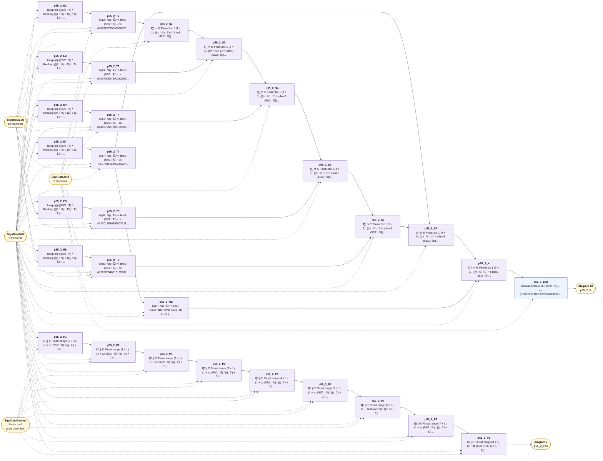
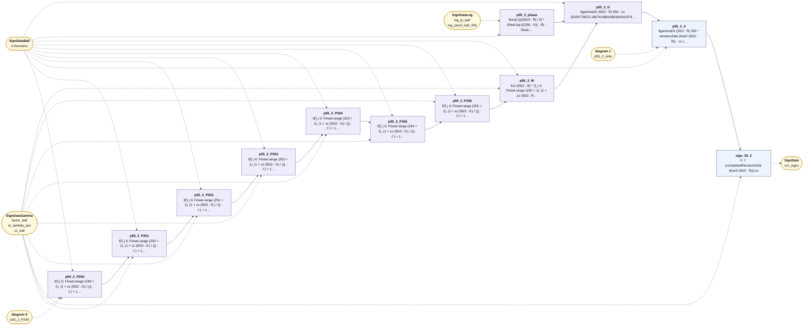

# `lean_stage3/Stage3/SignDataPt55_2.lean`

> **Read from the source text.** This file changed after the last `python3 utilities/lean_map.py --dump`, so the arrows on this page are names occurring in each proof and have not been confirmed by Lean.

SignDataPt55_2 — block S14 of `lean_stage3/design/stencil.md`, Turing's sign data: the sign of `Re Λ(1/2 + it)` at `t = 27.5`. 2026-11-25. Generated by `lean_stage3/checks/signdata/gen_signdata.py`; do not edit by hand.

282 theorems, 0 definitions, 1442 lines. 

**Imports:** [`SignDataGamma`](../lean_stage3/SignDataGamma.md), [`SignDataLog`](../lean_stage3/SignDataLog.md)  
**Imported by:** [`SignData`](../lean_stage3/SignData.md)

## The picture

### Diagram 1 of 10: `p55_2_E2` to `p55_2_P9`



### Diagram 2 of 10: `p55_2_P10` to `p55_2_P39`

```mermaid
flowchart LR
  n0["<b>p55_2_P10</b><br/>‖∏ j ∈ Finset.range (9 + 1), (1 + zz (55/2 : ℝ) / ((j : ℂ) + 1))…"]:::shp
  n1["<b>p55_2_P11</b><br/>‖∏ j ∈ Finset.range (10 + 1), (1 + zz (55/2 : ℝ) / ((j : ℂ) + 1)…"]:::shp
  n2["<b>p55_2_P12</b><br/>‖∏ j ∈ Finset.range (11 + 1), (1 + zz (55/2 : ℝ) / ((j : ℂ) + 1)…"]:::shp
  n3["<b>p55_2_P13</b><br/>‖∏ j ∈ Finset.range (12 + 1), (1 + zz (55/2 : ℝ) / ((j : ℂ) + 1)…"]:::shp
  n4["<b>p55_2_P14</b><br/>‖∏ j ∈ Finset.range (13 + 1), (1 + zz (55/2 : ℝ) / ((j : ℂ) + 1)…"]:::shp
  n5["<b>p55_2_P15</b><br/>‖∏ j ∈ Finset.range (14 + 1), (1 + zz (55/2 : ℝ) / ((j : ℂ) + 1)…"]:::shp
  n6["<b>p55_2_P16</b><br/>‖∏ j ∈ Finset.range (15 + 1), (1 + zz (55/2 : ℝ) / ((j : ℂ) + 1)…"]:::shp
  n7["<b>p55_2_P17</b><br/>‖∏ j ∈ Finset.range (16 + 1), (1 + zz (55/2 : ℝ) / ((j : ℂ) + 1)…"]:::shp
  n8["<b>p55_2_P18</b><br/>‖∏ j ∈ Finset.range (17 + 1), (1 + zz (55/2 : ℝ) / ((j : ℂ) + 1)…"]:::shp
  n9["<b>p55_2_P19</b><br/>‖∏ j ∈ Finset.range (18 + 1), (1 + zz (55/2 : ℝ) / ((j : ℂ) + 1)…"]:::shp
  n10["<b>p55_2_P20</b><br/>‖∏ j ∈ Finset.range (19 + 1), (1 + zz (55/2 : ℝ) / ((j : ℂ) + 1)…"]:::shp
  n11["<b>p55_2_P21</b><br/>‖∏ j ∈ Finset.range (20 + 1), (1 + zz (55/2 : ℝ) / ((j : ℂ) + 1)…"]:::shp
  n12["<b>p55_2_P22</b><br/>‖∏ j ∈ Finset.range (21 + 1), (1 + zz (55/2 : ℝ) / ((j : ℂ) + 1)…"]:::shp
  n13["<b>p55_2_P23</b><br/>‖∏ j ∈ Finset.range (22 + 1), (1 + zz (55/2 : ℝ) / ((j : ℂ) + 1)…"]:::shp
  n14["<b>p55_2_P24</b><br/>‖∏ j ∈ Finset.range (23 + 1), (1 + zz (55/2 : ℝ) / ((j : ℂ) + 1)…"]:::shp
  n15["<b>p55_2_P25</b><br/>‖∏ j ∈ Finset.range (24 + 1), (1 + zz (55/2 : ℝ) / ((j : ℂ) + 1)…"]:::shp
  n16["<b>p55_2_P26</b><br/>‖∏ j ∈ Finset.range (25 + 1), (1 + zz (55/2 : ℝ) / ((j : ℂ) + 1)…"]:::shp
  n17["<b>p55_2_P27</b><br/>‖∏ j ∈ Finset.range (26 + 1), (1 + zz (55/2 : ℝ) / ((j : ℂ) + 1)…"]:::shp
  n18["<b>p55_2_P28</b><br/>‖∏ j ∈ Finset.range (27 + 1), (1 + zz (55/2 : ℝ) / ((j : ℂ) + 1)…"]:::shp
  n19["<b>p55_2_P29</b><br/>‖∏ j ∈ Finset.range (28 + 1), (1 + zz (55/2 : ℝ) / ((j : ℂ) + 1)…"]:::shp
  n20["<b>p55_2_P30</b><br/>‖∏ j ∈ Finset.range (29 + 1), (1 + zz (55/2 : ℝ) / ((j : ℂ) + 1)…"]:::shp
  n21["<b>p55_2_P31</b><br/>‖∏ j ∈ Finset.range (30 + 1), (1 + zz (55/2 : ℝ) / ((j : ℂ) + 1)…"]:::shp
  n22["<b>p55_2_P32</b><br/>‖∏ j ∈ Finset.range (31 + 1), (1 + zz (55/2 : ℝ) / ((j : ℂ) + 1)…"]:::shp
  n23["<b>p55_2_P33</b><br/>‖∏ j ∈ Finset.range (32 + 1), (1 + zz (55/2 : ℝ) / ((j : ℂ) + 1)…"]:::shp
  n24["<b>p55_2_P34</b><br/>‖∏ j ∈ Finset.range (33 + 1), (1 + zz (55/2 : ℝ) / ((j : ℂ) + 1)…"]:::shp
  n25["<b>p55_2_P35</b><br/>‖∏ j ∈ Finset.range (34 + 1), (1 + zz (55/2 : ℝ) / ((j : ℂ) + 1)…"]:::shp
  n26["<b>p55_2_P36</b><br/>‖∏ j ∈ Finset.range (35 + 1), (1 + zz (55/2 : ℝ) / ((j : ℂ) + 1)…"]:::shp
  n27["<b>p55_2_P37</b><br/>‖∏ j ∈ Finset.range (36 + 1), (1 + zz (55/2 : ℝ) / ((j : ℂ) + 1)…"]:::shp
  n28["<b>p55_2_P38</b><br/>‖∏ j ∈ Finset.range (37 + 1), (1 + zz (55/2 : ℝ) / ((j : ℂ) + 1)…"]:::shp
  n29["<b>p55_2_P39</b><br/>‖∏ j ∈ Finset.range (38 + 1), (1 + zz (55/2 : ℝ) / ((j : ℂ) + 1)…"]:::shp
  x0(["<b>SignDataBall</b><br/>ball_mul"]):::ext
  x1(["<b>SignDataGamma</b><br/>factor_ball"]):::ext
  x2(["<b>diagram 1</b><br/>p55_2_P9"]):::ext
  x3(["<b>diagram 3</b><br/>p55_2_P40"]):::ext
  n0 --> n1
  n1 --> n2
  n10 --> n11
  n11 --> n12
  n12 --> n13
  n13 --> n14
  n14 --> n15
  n15 --> n16
  n16 --> n17
  n17 --> n18
  n18 --> n19
  n19 --> n20
  n2 --> n3
  n20 --> n21
  n21 --> n22
  n22 --> n23
  n23 --> n24
  n24 --> n25
  n25 --> n26
  n26 --> n27
  n27 --> n28
  n28 --> n29
  n3 --> n4
  n4 --> n5
  n5 --> n6
  n6 --> n7
  n7 --> n8
  n8 --> n9
  n9 --> n10
  n29 -.-> x3
  x0 -.-> n0
  x0 -.-> n1
  x0 -.-> n10
  x0 -.-> n11
  x0 -.-> n12
  x0 -.-> n13
  x0 -.-> n14
  x0 -.-> n15
  x0 -.-> n16
  x0 -.-> n17
  x0 -.-> n18
  x0 -.-> n19
  x0 -.-> n2
  x0 -.-> n20
  x0 -.-> n21
  x0 -.-> n22
  x0 -.-> n23
  x0 -.-> n24
  x0 -.-> n25
  x0 -.-> n26
  x0 -.-> n27
  x0 -.-> n28
  x0 -.-> n29
  x0 -.-> n3
  x0 -.-> n4
  x0 -.-> n5
  x0 -.-> n6
  x0 -.-> n7
  x0 -.-> n8
  x0 -.-> n9
  x1 -.-> n0
  x1 -.-> n1
  x1 -.-> n10
  x1 -.-> n11
  x1 -.-> n12
  x1 -.-> n13
  x1 -.-> n14
  x1 -.-> n15
  x1 -.-> n16
  x1 -.-> n17
  x1 -.-> n18
  x1 -.-> n19
  x1 -.-> n2
  x1 -.-> n20
  x1 -.-> n21
  x1 -.-> n22
  x1 -.-> n23
  x1 -.-> n24
  x1 -.-> n25
  x1 -.-> n26
  x1 -.-> n27
  x1 -.-> n28
  x1 -.-> n29
  x1 -.-> n3
  x1 -.-> n4
  x1 -.-> n5
  x1 -.-> n6
  x1 -.-> n7
  x1 -.-> n8
  x1 -.-> n9
  x2 -.-> n0
  classDef cnt fill:#dff5ec,stroke:#17694a,color:#111
  classDef shp fill:#f1ecfb,stroke:#5b3fa0,color:#111
  classDef rh fill:#ffe5e5,stroke:#c22,color:#111,stroke-width:2px
  classDef thm fill:#eef4ff,stroke:#335,color:#111
  classDef end_ fill:#e7f7e7,stroke:#2a7,color:#111,stroke-width:2px
  classDef lone fill:#fff,stroke:#999,color:#111,stroke-dasharray:4 3
  classDef bad fill:#ffe5e5,stroke:#c22,color:#111,stroke-width:2px
  classDef ext fill:#fff8e1,stroke:#b80,color:#111
```



### Diagram 3 of 10: `p55_2_P40` to `p55_2_P69`


### Diagram 4 of 10: `p55_2_P70` to `p55_2_P99`


### Diagram 5 of 10: `p55_2_P100` to `p55_2_P129`


### Diagram 6 of 10: `p55_2_P130` to `p55_2_P159`


### Diagram 7 of 10: `p55_2_P160` to `p55_2_P189`

```mermaid
flowchart LR
  n0["<b>p55_2_P160</b><br/>‖∏ j ∈ Finset.range (159 + 1), (1 + zz (55/2 : ℝ) / ((j : ℂ) + 1…"]:::shp
  n1["<b>p55_2_P161</b><br/>‖∏ j ∈ Finset.range (160 + 1), (1 + zz (55/2 : ℝ) / ((j : ℂ) + 1…"]:::shp
  n2["<b>p55_2_P162</b><br/>‖∏ j ∈ Finset.range (161 + 1), (1 + zz (55/2 : ℝ) / ((j : ℂ) + 1…"]:::shp
  n3["<b>p55_2_P163</b><br/>‖∏ j ∈ Finset.range (162 + 1), (1 + zz (55/2 : ℝ) / ((j : ℂ) + 1…"]:::shp
  n4["<b>p55_2_P164</b><br/>‖∏ j ∈ Finset.range (163 + 1), (1 + zz (55/2 : ℝ) / ((j : ℂ) + 1…"]:::shp
  n5["<b>p55_2_P165</b><br/>‖∏ j ∈ Finset.range (164 + 1), (1 + zz (55/2 : ℝ) / ((j : ℂ) + 1…"]:::shp
  n6["<b>p55_2_P166</b><br/>‖∏ j ∈ Finset.range (165 + 1), (1 + zz (55/2 : ℝ) / ((j : ℂ) + 1…"]:::shp
  n7["<b>p55_2_P167</b><br/>‖∏ j ∈ Finset.range (166 + 1), (1 + zz (55/2 : ℝ) / ((j : ℂ) + 1…"]:::shp
  n8["<b>p55_2_P168</b><br/>‖∏ j ∈ Finset.range (167 + 1), (1 + zz (55/2 : ℝ) / ((j : ℂ) + 1…"]:::shp
  n9["<b>p55_2_P169</b><br/>‖∏ j ∈ Finset.range (168 + 1), (1 + zz (55/2 : ℝ) / ((j : ℂ) + 1…"]:::shp
  n10["<b>p55_2_P170</b><br/>‖∏ j ∈ Finset.range (169 + 1), (1 + zz (55/2 : ℝ) / ((j : ℂ) + 1…"]:::shp
  n11["<b>p55_2_P171</b><br/>‖∏ j ∈ Finset.range (170 + 1), (1 + zz (55/2 : ℝ) / ((j : ℂ) + 1…"]:::shp
  n12["<b>p55_2_P172</b><br/>‖∏ j ∈ Finset.range (171 + 1), (1 + zz (55/2 : ℝ) / ((j : ℂ) + 1…"]:::shp
  n13["<b>p55_2_P173</b><br/>‖∏ j ∈ Finset.range (172 + 1), (1 + zz (55/2 : ℝ) / ((j : ℂ) + 1…"]:::shp
  n14["<b>p55_2_P174</b><br/>‖∏ j ∈ Finset.range (173 + 1), (1 + zz (55/2 : ℝ) / ((j : ℂ) + 1…"]:::shp
  n15["<b>p55_2_P175</b><br/>‖∏ j ∈ Finset.range (174 + 1), (1 + zz (55/2 : ℝ) / ((j : ℂ) + 1…"]:::shp
  n16["<b>p55_2_P176</b><br/>‖∏ j ∈ Finset.range (175 + 1), (1 + zz (55/2 : ℝ) / ((j : ℂ) + 1…"]:::shp
  n17["<b>p55_2_P177</b><br/>‖∏ j ∈ Finset.range (176 + 1), (1 + zz (55/2 : ℝ) / ((j : ℂ) + 1…"]:::shp
  n18["<b>p55_2_P178</b><br/>‖∏ j ∈ Finset.range (177 + 1), (1 + zz (55/2 : ℝ) / ((j : ℂ) + 1…"]:::shp
  n19["<b>p55_2_P179</b><br/>‖∏ j ∈ Finset.range (178 + 1), (1 + zz (55/2 : ℝ) / ((j : ℂ) + 1…"]:::shp
  n20["<b>p55_2_P180</b><br/>‖∏ j ∈ Finset.range (179 + 1), (1 + zz (55/2 : ℝ) / ((j : ℂ) + 1…"]:::shp
  n21["<b>p55_2_P181</b><br/>‖∏ j ∈ Finset.range (180 + 1), (1 + zz (55/2 : ℝ) / ((j : ℂ) + 1…"]:::shp
  n22["<b>p55_2_P182</b><br/>‖∏ j ∈ Finset.range (181 + 1), (1 + zz (55/2 : ℝ) / ((j : ℂ) + 1…"]:::shp
  n23["<b>p55_2_P183</b><br/>‖∏ j ∈ Finset.range (182 + 1), (1 + zz (55/2 : ℝ) / ((j : ℂ) + 1…"]:::shp
  n24["<b>p55_2_P184</b><br/>‖∏ j ∈ Finset.range (183 + 1), (1 + zz (55/2 : ℝ) / ((j : ℂ) + 1…"]:::shp
  n25["<b>p55_2_P185</b><br/>‖∏ j ∈ Finset.range (184 + 1), (1 + zz (55/2 : ℝ) / ((j : ℂ) + 1…"]:::shp
  n26["<b>p55_2_P186</b><br/>‖∏ j ∈ Finset.range (185 + 1), (1 + zz (55/2 : ℝ) / ((j : ℂ) + 1…"]:::shp
  n27["<b>p55_2_P187</b><br/>‖∏ j ∈ Finset.range (186 + 1), (1 + zz (55/2 : ℝ) / ((j : ℂ) + 1…"]:::shp
  n28["<b>p55_2_P188</b><br/>‖∏ j ∈ Finset.range (187 + 1), (1 + zz (55/2 : ℝ) / ((j : ℂ) + 1…"]:::shp
  n29["<b>p55_2_P189</b><br/>‖∏ j ∈ Finset.range (188 + 1), (1 + zz (55/2 : ℝ) / ((j : ℂ) + 1…"]:::shp
  x0(["<b>SignDataBall</b><br/>ball_mul"]):::ext
  x1(["<b>SignDataGamma</b><br/>factor_ball"]):::ext
  x2(["<b>diagram 6</b><br/>p55_2_P159"]):::ext
  x3(["<b>diagram 8</b><br/>p55_2_P190"]):::ext
  n0 --> n1
  n1 --> n2
  n10 --> n11
  n11 --> n12
  n12 --> n13
  n13 --> n14
  n14 --> n15
  n15 --> n16
  n16 --> n17
  n17 --> n18
  n18 --> n19
  n19 --> n20
  n2 --> n3
  n20 --> n21
  n21 --> n22
  n22 --> n23
  n23 --> n24
  n24 --> n25
  n25 --> n26
  n26 --> n27
  n27 --> n28
  n28 --> n29
  n3 --> n4
  n4 --> n5
  n5 --> n6
  n6 --> n7
  n7 --> n8
  n8 --> n9
  n9 --> n10
  n29 -.-> x3
  x0 -.-> n0
  x0 -.-> n1
  x0 -.-> n10
  x0 -.-> n11
  x0 -.-> n12
  x0 -.-> n13
  x0 -.-> n14
  x0 -.-> n15
  x0 -.-> n16
  x0 -.-> n17
  x0 -.-> n18
  x0 -.-> n19
  x0 -.-> n2
  x0 -.-> n20
  x0 -.-> n21
  x0 -.-> n22
  x0 -.-> n23
  x0 -.-> n24
  x0 -.-> n25
  x0 -.-> n26
  x0 -.-> n27
  x0 -.-> n28
  x0 -.-> n29
  x0 -.-> n3
  x0 -.-> n4
  x0 -.-> n5
  x0 -.-> n6
  x0 -.-> n7
  x0 -.-> n8
  x0 -.-> n9
  x1 -.-> n0
  x1 -.-> n1
  x1 -.-> n10
  x1 -.-> n11
  x1 -.-> n12
  x1 -.-> n13
  x1 -.-> n14
  x1 -.-> n15
  x1 -.-> n16
  x1 -.-> n17
  x1 -.-> n18
  x1 -.-> n19
  x1 -.-> n2
  x1 -.-> n20
  x1 -.-> n21
  x1 -.-> n22
  x1 -.-> n23
  x1 -.-> n24
  x1 -.-> n25
  x1 -.-> n26
  x1 -.-> n27
  x1 -.-> n28
  x1 -.-> n29
  x1 -.-> n3
  x1 -.-> n4
  x1 -.-> n5
  x1 -.-> n6
  x1 -.-> n7
  x1 -.-> n8
  x1 -.-> n9
  x2 -.-> n0
  classDef cnt fill:#dff5ec,stroke:#17694a,color:#111
  classDef shp fill:#f1ecfb,stroke:#5b3fa0,color:#111
  classDef rh fill:#ffe5e5,stroke:#c22,color:#111,stroke-width:2px
  classDef thm fill:#eef4ff,stroke:#335,color:#111
  classDef end_ fill:#e7f7e7,stroke:#2a7,color:#111,stroke-width:2px
  classDef lone fill:#fff,stroke:#999,color:#111,stroke-dasharray:4 3
  classDef bad fill:#ffe5e5,stroke:#c22,color:#111,stroke-width:2px
  classDef ext fill:#fff8e1,stroke:#b80,color:#111
```



### Diagram 8 of 10: `p55_2_P190` to `p55_2_P219`


### Diagram 9 of 10: `p55_2_P220` to `p55_2_P249`


### Diagram 10 of 10: `p55_2_P250` to `sign_55_2`



An arrow A → B reads "A is used in the proof of B". Green: counting, integers only. Violet: shape, analysis with no ζ. Blue: reads ζ. A name ending in ■ is an end: nothing else uses it. Red: contains `sorry`. Yellow: theorems in another file, counted; a dotted arrow crosses files. Definitions are not drawn; they are listed below the diagram.

## Theorems

<a name="SignData-p55_2_E2"></a>
### `SignData.p55_2_E2`

line 31 · arrows read from text

**Shape.** Uses real or complex analysis; nothing in it or beneath it reads ζ.

**Proves**

```lean
‖cexp ((((-((55/2 : ℝ) * Real.log (((2 : ℕ)) : ℝ))) : ℝ) : ℂ) * Complex.I) - cx (0.977613818467166943782778721833) (-0.210407276352423602850609864343)‖ ≤ (0.000000006875000000060000000001)
```

**Fed by** (3 theorems its proof uses)

  - [`SignData.exp_ball0`](../lean_stage3/SignDataBall.md#SignData-exp_ball0) (SignDataBall) — `` ‖cexp ((x : ℂ) * I) - cx e f‖ ≤ R ``
  - [`SignData.neg_mul_ball`](../lean_stage3/SignDataBall.md#SignData-neg_mul_ball) (SignDataBall) — `` |-(t * x) - -(t * a)| ≤ |t| * e ``
  - [`SignData.log_ball_2`](../lean_stage3/SignDataLog.md#SignData-log_ball_2) (SignDataLog) — `` |Real.log ((2 : ℕ) : ℝ) - (0.69314718055)| ≤ (0.00000000025) ``

**Definitions its proof touches:** [`SignData.cosP`](../lean_stage3/SignDataBall.md#SignData-cosP), [`SignData.cx`](../lean_stage3/SignDataBall.md#SignData-cx), [`SignData.sinP`](../lean_stage3/SignDataBall.md#SignData-sinP)

**Feeds** (1 that use it)

  - [`SignData.p55_2_T2`](#SignData-p55_2_T2) — `` ‖(((2 : ℕ)) : ℂ) ^ (-lineS (55/2 : ℝ)) - cx (0.691277360419808209462955081335) (-0.148780411919790631879586110045)‖ ≤ (0.00000000486135912069994063713… ``

<a name="SignData-p55_2_T2"></a>
### `SignData.p55_2_T2`

line 37 · arrows read from text

**Shape.** Uses real or complex analysis; nothing in it or beneath it reads ζ.

**Proves**

```lean
‖(((2 : ℕ)) : ℂ) ^ (-lineS (55/2 : ℝ)) - cx (0.691277360419808209462955081335) (-0.148780411919790631879586110045)‖ ≤ (0.00000000486135912069994063713)
```

**Fed by** (5 theorems its proof uses)

  - [`SignData.ball_mul`](../lean_stage3/SignDataBall.md#SignData-ball_mul) (SignDataBall) — `` ‖z * w - cx e f‖ ≤ R ``
  - [`SignData.ball_ofReal`](../lean_stage3/SignDataBall.md#SignData-ball_ofReal) (SignDataBall) — `` ‖(x : ℂ) - cx c 0‖ ≤ e ``
  - [`SignData.isqrt_ball_2`](../lean_stage3/SignDataLog.md#SignData-isqrt_ball_2) (SignDataLog) — `` |(Real.sqrt (((2 : ℕ)) : ℝ))⁻¹ - (0.707106781186547524400844362104)| ≤ (0.000000000000000000000000000001) ``
  - [`SignData.p55_2_E2`](#SignData-p55_2_E2) — `` ‖cexp ((((-((55/2 : ℝ) * Real.log (((2 : ℕ)) : ℝ))) : ℝ) : ℂ) * Complex.I) - cx (0.977613818467166943782778721833) (-0.210407276352423602850609864343)… ``
  - [`SignData.natCast_cpow_line`](../lean_stage3/SignDataZeta.md#SignData-natCast_cpow_line) (SignDataZeta) — `` (m : ℂ) ^ (-lineS t) = (((Real.sqrt m)⁻¹ : ℝ) : ℂ) * cexp (((-(t * Real.log m)) : ℝ) * I) ``

**Definitions its proof touches:** [`SignData.cx`](../lean_stage3/SignDataBall.md#SignData-cx), [`SignData.lineS`](../lean_stage3/SignDataZeta.md#SignData-lineS)

**Feeds** (1 that use it)

  - [`SignData.p55_2_S2`](#SignData-p55_2_S2) — `` ‖∑ m ∈ Finset.Icc 1 (1 + 1), ((m : ℕ) : ℂ) ^ (-lineS (55/2 : ℝ)) - cx (1.691277360419808209462955081335) (-0.148780411919790631879586110045)‖ ≤ (0.000… ``

<a name="SignData-p55_2_E3"></a>
### `SignData.p55_2_E3`

line 41 · arrows read from text

**Shape.** Uses real or complex analysis; nothing in it or beneath it reads ζ.

**Proves**

```lean
‖cexp ((((-((55/2 : ℝ) * Real.log (((3 : ℕ)) : ℝ))) : ℝ) : ℂ) * Complex.I) - cx (-(-0.358544003442452455420244945517)) (0.933512826690377426758841068033)‖ ≤ (0.000000006875200348696202687281)
```

**Fed by** (3 theorems its proof uses)

  - [`SignData.exp_ball1`](../lean_stage3/SignDataBall.md#SignData-exp_ball1) (SignDataBall) — `` ‖cexp ((x : ℂ) * I) - cx (-f) e‖ ≤ R ``
  - [`SignData.neg_mul_ball`](../lean_stage3/SignDataBall.md#SignData-neg_mul_ball) (SignDataBall) — `` |-(t * x) - -(t * a)| ≤ |t| * e ``
  - [`SignData.log_ball_3`](../lean_stage3/SignDataLog.md#SignData-log_ball_3) (SignDataLog) — `` |Real.log (((3 : ℕ)) : ℝ) - (1.098612288658164142930964760306)| ≤ (0.000000000250007285403624428292) ``

**Definitions its proof touches:** [`SignData.cosP`](../lean_stage3/SignDataBall.md#SignData-cosP), [`SignData.cx`](../lean_stage3/SignDataBall.md#SignData-cx), [`SignData.sinP`](../lean_stage3/SignDataBall.md#SignData-sinP)

**Feeds** (1 that use it)

  - [`SignData.p55_2_T3`](#SignData-p55_2_T3) — `` ‖(((3 : ℕ)) : ℂ) ^ (-lineS (55/2 : ℝ)) - cx (0.207005476903826031919534846342) (0.538963881781657870491004017047)‖ ≤ (0.000000003969398772052361543057… ``

<a name="SignData-p55_2_T3"></a>
### `SignData.p55_2_T3`

line 47 · arrows read from text

**Shape.** Uses real or complex analysis; nothing in it or beneath it reads ζ.

**Proves**

```lean
‖(((3 : ℕ)) : ℂ) ^ (-lineS (55/2 : ℝ)) - cx (0.207005476903826031919534846342) (0.538963881781657870491004017047)‖ ≤ (0.000000003969398772052361543057)
```

**Fed by** (5 theorems its proof uses)

  - [`SignData.ball_mul`](../lean_stage3/SignDataBall.md#SignData-ball_mul) (SignDataBall) — `` ‖z * w - cx e f‖ ≤ R ``
  - [`SignData.ball_ofReal`](../lean_stage3/SignDataBall.md#SignData-ball_ofReal) (SignDataBall) — `` ‖(x : ℂ) - cx c 0‖ ≤ e ``
  - [`SignData.isqrt_ball_3`](../lean_stage3/SignDataLog.md#SignData-isqrt_ball_3) (SignDataLog) — `` |(Real.sqrt (((3 : ℕ)) : ℝ))⁻¹ - (0.577350269189625764509148780502)| ≤ (0.000000000000000000000000000001) ``
  - [`SignData.p55_2_E3`](#SignData-p55_2_E3) — `` ‖cexp ((((-((55/2 : ℝ) * Real.log (((3 : ℕ)) : ℝ))) : ℝ) : ℂ) * Complex.I) - cx (-(-0.358544003442452455420244945517)) (0.9335128266903774267588410680… ``
  - [`SignData.natCast_cpow_line`](../lean_stage3/SignDataZeta.md#SignData-natCast_cpow_line) (SignDataZeta) — `` (m : ℂ) ^ (-lineS t) = (((Real.sqrt m)⁻¹ : ℝ) : ℂ) * cexp (((-(t * Real.log m)) : ℝ) * I) ``

**Definitions its proof touches:** [`SignData.cx`](../lean_stage3/SignDataBall.md#SignData-cx), [`SignData.lineS`](../lean_stage3/SignDataZeta.md#SignData-lineS)

**Feeds** (1 that use it)

  - [`SignData.p55_2_S3`](#SignData-p55_2_S3) — `` ‖∑ m ∈ Finset.Icc 1 (2 + 1), ((m : ℕ) : ℂ) ^ (-lineS (55/2 : ℝ)) - cx (1.898282837323634241382489927677) (0.390183469861867238611417907002)‖ ≤ (0.0000… ``

<a name="SignData-p55_2_E4"></a>
### `SignData.p55_2_E4`

line 51 · arrows read from text

**Shape.** Uses real or complex analysis; nothing in it or beneath it reads ζ.

**Proves**

```lean
‖cexp ((((-((55/2 : ℝ) * Real.log (((4 : ℕ)) : ℝ))) : ℝ) : ℂ) * Complex.I) - cx (0.911457556003399944544216690754) (-0.411394121985607681713749324234)‖ ≤ (0.000000006875330614891020023426)
```

**Fed by** (3 theorems its proof uses)

  - [`SignData.exp_ball0`](../lean_stage3/SignDataBall.md#SignData-exp_ball0) (SignDataBall) — `` ‖cexp ((x : ℂ) * I) - cx e f‖ ≤ R ``
  - [`SignData.neg_mul_ball`](../lean_stage3/SignDataBall.md#SignData-neg_mul_ball) (SignDataBall) — `` |-(t * x) - -(t * a)| ≤ |t| * e ``
  - [`SignData.log_ball_4`](../lean_stage3/SignDataLog.md#SignData-log_ball_4) (SignDataLog) — `` |Real.log (((4 : ℕ)) : ℝ) - (1.386294361109944875563750019823)| ≤ (0.000000000250012022355196162294) ``

**Definitions its proof touches:** [`SignData.cosP`](../lean_stage3/SignDataBall.md#SignData-cosP), [`SignData.cx`](../lean_stage3/SignDataBall.md#SignData-cx), [`SignData.sinP`](../lean_stage3/SignDataBall.md#SignData-sinP)

**Feeds** (1 that use it)

  - [`SignData.p55_2_T4`](#SignData-p55_2_T4) — `` ‖(((4 : ℕ)) : ℂ) ^ (-lineS (55/2 : ℝ)) - cx (0.455728778001699972272108345377) (-0.205697060992803840856874662117)‖ ≤ (0.00000000343766530744551001171… ``

<a name="SignData-p55_2_T4"></a>
### `SignData.p55_2_T4`

line 57 · arrows read from text

**Shape.** Uses real or complex analysis; nothing in it or beneath it reads ζ.

**Proves**

```lean
‖(((4 : ℕ)) : ℂ) ^ (-lineS (55/2 : ℝ)) - cx (0.455728778001699972272108345377) (-0.205697060992803840856874662117)‖ ≤ (0.000000003437665307445510011715)
```

**Fed by** (5 theorems its proof uses)

  - [`SignData.ball_mul`](../lean_stage3/SignDataBall.md#SignData-ball_mul) (SignDataBall) — `` ‖z * w - cx e f‖ ≤ R ``
  - [`SignData.ball_ofReal`](../lean_stage3/SignDataBall.md#SignData-ball_ofReal) (SignDataBall) — `` ‖(x : ℂ) - cx c 0‖ ≤ e ``
  - [`SignData.isqrt_ball_4`](../lean_stage3/SignDataLog.md#SignData-isqrt_ball_4) (SignDataLog) — `` |(Real.sqrt (((4 : ℕ)) : ℝ))⁻¹ - (0.5)| ≤ (0.000000000000000000000000000001) ``
  - [`SignData.p55_2_E4`](#SignData-p55_2_E4) — `` ‖cexp ((((-((55/2 : ℝ) * Real.log (((4 : ℕ)) : ℝ))) : ℝ) : ℂ) * Complex.I) - cx (0.911457556003399944544216690754) (-0.411394121985607681713749324234)… ``
  - [`SignData.natCast_cpow_line`](../lean_stage3/SignDataZeta.md#SignData-natCast_cpow_line) (SignDataZeta) — `` (m : ℂ) ^ (-lineS t) = (((Real.sqrt m)⁻¹ : ℝ) : ℂ) * cexp (((-(t * Real.log m)) : ℝ) * I) ``

**Definitions its proof touches:** [`SignData.cx`](../lean_stage3/SignDataBall.md#SignData-cx), [`SignData.lineS`](../lean_stage3/SignDataZeta.md#SignData-lineS)

**Feeds** (1 that use it)

  - [`SignData.p55_2_S4`](#SignData-p55_2_S4) — `` ‖∑ m ∈ Finset.Icc 1 (3 + 1), ((m : ℕ) : ℂ) ^ (-lineS (55/2 : ℝ)) - cx (2.354011615325334213654598273054) (0.184486408869063397754543244885)‖ ≤ (0.0000… ``

<a name="SignData-p55_2_E5"></a>
### `SignData.p55_2_E5`

line 61 · arrows read from text

**Shape.** Uses real or complex analysis; nothing in it or beneath it reads ζ.

**Proves**

```lean
‖cexp ((((-((55/2 : ℝ) * Real.log (((5 : ℕ)) : ℝ))) : ℝ) : ℂ) * Complex.I) - cx (0.961813029128074808553648430004) (-0.273707319959618763346933483926)‖ ≤ (0.000000006875402704512769197724)
```

**Fed by** (3 theorems its proof uses)

  - [`SignData.exp_ball0`](../lean_stage3/SignDataBall.md#SignData-exp_ball0) (SignDataBall) — `` ‖cexp ((x : ℂ) * I) - cx e f‖ ≤ R ``
  - [`SignData.neg_mul_ball`](../lean_stage3/SignDataBall.md#SignData-neg_mul_ball) (SignDataBall) — `` |-(t * x) - -(t * a)| ≤ |t| * e ``
  - [`SignData.log_ball_5`](../lean_stage3/SignDataLog.md#SignData-log_ball_5) (SignDataLog) — `` |Real.log (((5 : ℕ)) : ℝ) - (1.609437912424154507888186373287)| ≤ (0.000000000250014643795196162295) ``

**Definitions its proof touches:** [`SignData.cosP`](../lean_stage3/SignDataBall.md#SignData-cosP), [`SignData.cx`](../lean_stage3/SignDataBall.md#SignData-cx), [`SignData.sinP`](../lean_stage3/SignDataBall.md#SignData-sinP)

**Feeds** (1 that use it)

  - [`SignData.p55_2_T5`](#SignData-p55_2_T5) — `` ‖(((5 : ℕ)) : ℂ) ^ (-lineS (55/2 : ℝ)) - cx (0.430135862955072110579505432048) (-0.122405634673798509639201145366)‖ ≤ (0.00000000307477356399529040420… ``

<a name="SignData-p55_2_T5"></a>
### `SignData.p55_2_T5`

line 67 · arrows read from text

**Shape.** Uses real or complex analysis; nothing in it or beneath it reads ζ.

**Proves**

```lean
‖(((5 : ℕ)) : ℂ) ^ (-lineS (55/2 : ℝ)) - cx (0.430135862955072110579505432048) (-0.122405634673798509639201145366)‖ ≤ (0.000000003074773563995290404203)
```

**Fed by** (5 theorems its proof uses)

  - [`SignData.ball_mul`](../lean_stage3/SignDataBall.md#SignData-ball_mul) (SignDataBall) — `` ‖z * w - cx e f‖ ≤ R ``
  - [`SignData.ball_ofReal`](../lean_stage3/SignDataBall.md#SignData-ball_ofReal) (SignDataBall) — `` ‖(x : ℂ) - cx c 0‖ ≤ e ``
  - [`SignData.isqrt_ball_5`](../lean_stage3/SignDataLog.md#SignData-isqrt_ball_5) (SignDataLog) — `` |(Real.sqrt (((5 : ℕ)) : ℝ))⁻¹ - (0.447213595499957939281834733746)| ≤ (0.000000000000000000000000000001) ``
  - [`SignData.p55_2_E5`](#SignData-p55_2_E5) — `` ‖cexp ((((-((55/2 : ℝ) * Real.log (((5 : ℕ)) : ℝ))) : ℝ) : ℂ) * Complex.I) - cx (0.961813029128074808553648430004) (-0.273707319959618763346933483926)… ``
  - [`SignData.natCast_cpow_line`](../lean_stage3/SignDataZeta.md#SignData-natCast_cpow_line) (SignDataZeta) — `` (m : ℂ) ^ (-lineS t) = (((Real.sqrt m)⁻¹ : ℝ) : ℂ) * cexp (((-(t * Real.log m)) : ℝ) * I) ``

**Definitions its proof touches:** [`SignData.cx`](../lean_stage3/SignDataBall.md#SignData-cx), [`SignData.lineS`](../lean_stage3/SignDataZeta.md#SignData-lineS)

**Feeds** (1 that use it)

  - [`SignData.p55_2_S5`](#SignData-p55_2_S5) — `` ‖∑ m ∈ Finset.Icc 1 (4 + 1), ((m : ℕ) : ℂ) ^ (-lineS (55/2 : ℝ)) - cx (2.784147478280406324234103705102) (0.062080774195264888115342099519)‖ ≤ (0.0000… ``

<a name="SignData-p55_2_E6"></a>
### `SignData.p55_2_E6`

line 71 · arrows read from text

**Shape.** Uses real or complex analysis; nothing in it or beneath it reads ζ.

**Proves**

```lean
‖cexp ((((-((55/2 : ℝ) * Real.log (((6 : ℕ)) : ℝ))) : ℝ) : ℂ) * Complex.I) - cx (-(-0.546935463826809627328058233329)) (0.837174771722459764690739432477)‖ ≤ (0.000000006875456859727506387161)
```

**Fed by** (3 theorems its proof uses)

  - [`SignData.exp_ball1`](../lean_stage3/SignDataBall.md#SignData-exp_ball1) (SignDataBall) — `` ‖cexp ((x : ℂ) * I) - cx (-f) e‖ ≤ R ``
  - [`SignData.neg_mul_ball`](../lean_stage3/SignDataBall.md#SignData-neg_mul_ball) (SignDataBall) — `` |-(t * x) - -(t * a)| ≤ |t| * e ``
  - [`SignData.log_ball_6`](../lean_stage3/SignDataLog.md#SignData-log_ball_6) (SignDataLog) — `` |Real.log (((6 : ℕ)) : ℝ) - (1.791759469218109031470825672761)| ≤ (0.000000000250016613075280171998) ``

**Definitions its proof touches:** [`SignData.cosP`](../lean_stage3/SignDataBall.md#SignData-cosP), [`SignData.cx`](../lean_stage3/SignDataBall.md#SignData-cx), [`SignData.sinP`](../lean_stage3/SignDataBall.md#SignData-sinP)

**Feeds** (1 that use it)

  - [`SignData.p55_2_T6`](#SignData-p55_2_T6) — `` ‖(((6 : ℕ)) : ℂ) ^ (-lineS (55/2 : ℝ)) - cx (0.223285468101355020520575288926) (0.341775169375168968365673585807)‖ ≤ (0.000000002806893509141794506374… ``

<a name="SignData-p55_2_T6"></a>
### `SignData.p55_2_T6`

line 77 · arrows read from text

**Shape.** Uses real or complex analysis; nothing in it or beneath it reads ζ.

**Proves**

```lean
‖(((6 : ℕ)) : ℂ) ^ (-lineS (55/2 : ℝ)) - cx (0.223285468101355020520575288926) (0.341775169375168968365673585807)‖ ≤ (0.000000002806893509141794506374)
```

**Fed by** (5 theorems its proof uses)

  - [`SignData.ball_mul`](../lean_stage3/SignDataBall.md#SignData-ball_mul) (SignDataBall) — `` ‖z * w - cx e f‖ ≤ R ``
  - [`SignData.ball_ofReal`](../lean_stage3/SignDataBall.md#SignData-ball_ofReal) (SignDataBall) — `` ‖(x : ℂ) - cx c 0‖ ≤ e ``
  - [`SignData.isqrt_ball_6`](../lean_stage3/SignDataLog.md#SignData-isqrt_ball_6) (SignDataLog) — `` |(Real.sqrt (((6 : ℕ)) : ℝ))⁻¹ - (0.40824829046386301636621401245)| ≤ (0.000000000000000000000000000001) ``
  - [`SignData.p55_2_E6`](#SignData-p55_2_E6) — `` ‖cexp ((((-((55/2 : ℝ) * Real.log (((6 : ℕ)) : ℝ))) : ℝ) : ℂ) * Complex.I) - cx (-(-0.546935463826809627328058233329)) (0.8371747717224597646907394324… ``
  - [`SignData.natCast_cpow_line`](../lean_stage3/SignDataZeta.md#SignData-natCast_cpow_line) (SignDataZeta) — `` (m : ℂ) ^ (-lineS t) = (((Real.sqrt m)⁻¹ : ℝ) : ℂ) * cexp (((-(t * Real.log m)) : ℝ) * I) ``

**Definitions its proof touches:** [`SignData.cx`](../lean_stage3/SignDataBall.md#SignData-cx), [`SignData.lineS`](../lean_stage3/SignDataZeta.md#SignData-lineS)

**Feeds** (1 that use it)

  - [`SignData.p55_2_S6`](#SignData-p55_2_S6) — `` ‖∑ m ∈ Finset.Icc 1 (5 + 1), ((m : ℕ) : ℂ) ^ (-lineS (55/2 : ℝ)) - cx (3.007432946381761344754678994028) (0.403855943570433856481015685326)‖ ≤ (0.0000… ``

<a name="SignData-p55_2_E7"></a>
### `SignData.p55_2_E7`

line 81 · arrows read from text

**Shape.** Uses real or complex analysis; nothing in it or beneath it reads ζ.

**Proves**

```lean
‖cexp ((((-((55/2 : ℝ) * Real.log (((7 : ℕ)) : ℝ))) : ℝ) : ℂ) * Complex.I) - cx (-(0.994444879097530489168354563331)) (-(-0.105258645424962447551098501849))‖ ≤ (0.000000006875594775154726344984)
```

**Fed by** (3 theorems its proof uses)

  - [`SignData.exp_ball2`](../lean_stage3/SignDataBall.md#SignData-exp_ball2) (SignDataBall) — `` ‖cexp ((x : ℂ) * I) - cx (-e) (-f)‖ ≤ R ``
  - [`SignData.neg_mul_ball`](../lean_stage3/SignDataBall.md#SignData-neg_mul_ball) (SignDataBall) — `` |-(t * x) - -(t * a)| ≤ |t| * e ``
  - [`SignData.log_ball_7`](../lean_stage3/SignDataLog.md#SignData-log_ball_7) (SignDataLog) — `` |Real.log (((7 : ℕ)) : ℝ) - (1.945910149045367043442249594592)| ≤ (0.000000000250021628181194999771) ``

**Definitions its proof touches:** [`SignData.cosP`](../lean_stage3/SignDataBall.md#SignData-cosP), [`SignData.cx`](../lean_stage3/SignDataBall.md#SignData-cx), [`SignData.sinP`](../lean_stage3/SignDataBall.md#SignData-sinP)

**Feeds** (1 that use it)

  - [`SignData.p55_2_T7`](#SignData-p55_2_T7) — `` ‖(((7 : ℕ)) : ℂ) ^ (-lineS (55/2 : ℝ)) - cx (-0.375864834664822795791694680709) (0.039784028447711037971069445818)‖ ≤ (0.00000000259873055581635231166… ``

<a name="SignData-p55_2_T7"></a>
### `SignData.p55_2_T7`

line 87 · arrows read from text

**Shape.** Uses real or complex analysis; nothing in it or beneath it reads ζ.

**Proves**

```lean
‖(((7 : ℕ)) : ℂ) ^ (-lineS (55/2 : ℝ)) - cx (-0.375864834664822795791694680709) (0.039784028447711037971069445818)‖ ≤ (0.000000002598730555816352311668)
```

**Fed by** (5 theorems its proof uses)

  - [`SignData.ball_mul`](../lean_stage3/SignDataBall.md#SignData-ball_mul) (SignDataBall) — `` ‖z * w - cx e f‖ ≤ R ``
  - [`SignData.ball_ofReal`](../lean_stage3/SignDataBall.md#SignData-ball_ofReal) (SignDataBall) — `` ‖(x : ℂ) - cx c 0‖ ≤ e ``
  - [`SignData.isqrt_ball_7`](../lean_stage3/SignDataLog.md#SignData-isqrt_ball_7) (SignDataLog) — `` |(Real.sqrt (((7 : ℕ)) : ℝ))⁻¹ - (0.377964473009227227214516536234)| ≤ (0.000000000000000000000000000001) ``
  - [`SignData.p55_2_E7`](#SignData-p55_2_E7) — `` ‖cexp ((((-((55/2 : ℝ) * Real.log (((7 : ℕ)) : ℝ))) : ℝ) : ℂ) * Complex.I) - cx (-(0.994444879097530489168354563331)) (-(-0.10525864542496244755109850… ``
  - [`SignData.natCast_cpow_line`](../lean_stage3/SignDataZeta.md#SignData-natCast_cpow_line) (SignDataZeta) — `` (m : ℂ) ^ (-lineS t) = (((Real.sqrt m)⁻¹ : ℝ) : ℂ) * cexp (((-(t * Real.log m)) : ℝ) * I) ``

**Definitions its proof touches:** [`SignData.cx`](../lean_stage3/SignDataBall.md#SignData-cx), [`SignData.lineS`](../lean_stage3/SignDataZeta.md#SignData-lineS)

**Feeds** (2 that use it)

  - [`SignData.p55_2_NB`](#SignData-p55_2_NB) — `` ‖(((7 : ℕ)) : ℂ) ^ (-lineS (55/2 : ℝ)) * emB (55/2 : ℝ) 7 - cx (0.176031666960284200105681476898) (-0.078110748622932837988127592591)‖ ≤ (0.0000000016… ``
  - [`SignData.p55_2_S7`](#SignData-p55_2_S7) — `` ‖∑ m ∈ Finset.Icc 1 (6 + 1), ((m : ℕ) : ℂ) ^ (-lineS (55/2 : ℝ)) - cx (2.631568111716938548962984313319) (0.443639972018144894452085131144)‖ ≤ (0.0000… ``

<a name="SignData-p55_2_S2"></a>
### `SignData.p55_2_S2`

line 91 · arrows read from text

**Shape.** Uses real or complex analysis; nothing in it or beneath it reads ζ.

**Proves**

```lean
‖∑ m ∈ Finset.Icc 1 (1 + 1), ((m : ℕ) : ℂ) ^ (-lineS (55/2 : ℝ)) - cx (1.691277360419808209462955081335) (-0.148780411919790631879586110045)‖ ≤ (0.00000000486135912069994063713)
```

**Fed by** (3 theorems its proof uses)

  - [`SignData.ball_add`](../lean_stage3/SignDataBall.md#SignData-ball_add) (SignDataBall) — `` ‖z + w - cx e f‖ ≤ R ``
  - [`SignData.p55_2_T2`](#SignData-p55_2_T2) — `` ‖(((2 : ℕ)) : ℂ) ^ (-lineS (55/2 : ℝ)) - cx (0.691277360419808209462955081335) (-0.148780411919790631879586110045)‖ ≤ (0.00000000486135912069994063713… ``
  - [`SignData.sum_one_ball`](../lean_stage3/SignDataZeta.md#SignData-sum_one_ball) (SignDataZeta) — `` ‖∑ m ∈ Finset.Icc 1 1, ((m : ℕ) : ℂ) ^ (-lineS t) - cx 1 0‖ ≤ 0 ``

**Definitions its proof touches:** [`SignData.cx`](../lean_stage3/SignDataBall.md#SignData-cx), [`SignData.lineS`](../lean_stage3/SignDataZeta.md#SignData-lineS)

**Feeds** (1 that use it)

  - [`SignData.p55_2_S3`](#SignData-p55_2_S3) — `` ‖∑ m ∈ Finset.Icc 1 (2 + 1), ((m : ℕ) : ℂ) ^ (-lineS (55/2 : ℝ)) - cx (1.898282837323634241382489927677) (0.390183469861867238611417907002)‖ ≤ (0.0000… ``

<a name="SignData-p55_2_S3"></a>
### `SignData.p55_2_S3`

line 96 · arrows read from text

**Shape.** Uses real or complex analysis; nothing in it or beneath it reads ζ.

**Proves**

```lean
‖∑ m ∈ Finset.Icc 1 (2 + 1), ((m : ℕ) : ℂ) ^ (-lineS (55/2 : ℝ)) - cx (1.898282837323634241382489927677) (0.390183469861867238611417907002)‖ ≤ (0.000000008830757892752302180187)
```

**Fed by** (3 theorems its proof uses)

  - [`SignData.ball_add`](../lean_stage3/SignDataBall.md#SignData-ball_add) (SignDataBall) — `` ‖z + w - cx e f‖ ≤ R ``
  - [`SignData.p55_2_S2`](#SignData-p55_2_S2) — `` ‖∑ m ∈ Finset.Icc 1 (1 + 1), ((m : ℕ) : ℂ) ^ (-lineS (55/2 : ℝ)) - cx (1.691277360419808209462955081335) (-0.148780411919790631879586110045)‖ ≤ (0.000… ``
  - [`SignData.p55_2_T3`](#SignData-p55_2_T3) — `` ‖(((3 : ℕ)) : ℂ) ^ (-lineS (55/2 : ℝ)) - cx (0.207005476903826031919534846342) (0.538963881781657870491004017047)‖ ≤ (0.000000003969398772052361543057… ``

**Definitions its proof touches:** [`SignData.cx`](../lean_stage3/SignDataBall.md#SignData-cx), [`SignData.lineS`](../lean_stage3/SignDataZeta.md#SignData-lineS)

**Feeds** (1 that use it)

  - [`SignData.p55_2_S4`](#SignData-p55_2_S4) — `` ‖∑ m ∈ Finset.Icc 1 (3 + 1), ((m : ℕ) : ℂ) ^ (-lineS (55/2 : ℝ)) - cx (2.354011615325334213654598273054) (0.184486408869063397754543244885)‖ ≤ (0.0000… ``

<a name="SignData-p55_2_S4"></a>
### `SignData.p55_2_S4`

line 101 · arrows read from text

**Shape.** Uses real or complex analysis; nothing in it or beneath it reads ζ.

**Proves**

```lean
‖∑ m ∈ Finset.Icc 1 (3 + 1), ((m : ℕ) : ℂ) ^ (-lineS (55/2 : ℝ)) - cx (2.354011615325334213654598273054) (0.184486408869063397754543244885)‖ ≤ (0.000000012268423200197812191902)
```

**Fed by** (3 theorems its proof uses)

  - [`SignData.ball_add`](../lean_stage3/SignDataBall.md#SignData-ball_add) (SignDataBall) — `` ‖z + w - cx e f‖ ≤ R ``
  - [`SignData.p55_2_S3`](#SignData-p55_2_S3) — `` ‖∑ m ∈ Finset.Icc 1 (2 + 1), ((m : ℕ) : ℂ) ^ (-lineS (55/2 : ℝ)) - cx (1.898282837323634241382489927677) (0.390183469861867238611417907002)‖ ≤ (0.0000… ``
  - [`SignData.p55_2_T4`](#SignData-p55_2_T4) — `` ‖(((4 : ℕ)) : ℂ) ^ (-lineS (55/2 : ℝ)) - cx (0.455728778001699972272108345377) (-0.205697060992803840856874662117)‖ ≤ (0.00000000343766530744551001171… ``

**Definitions its proof touches:** [`SignData.cx`](../lean_stage3/SignDataBall.md#SignData-cx), [`SignData.lineS`](../lean_stage3/SignDataZeta.md#SignData-lineS)

**Feeds** (1 that use it)

  - [`SignData.p55_2_S5`](#SignData-p55_2_S5) — `` ‖∑ m ∈ Finset.Icc 1 (4 + 1), ((m : ℕ) : ℂ) ^ (-lineS (55/2 : ℝ)) - cx (2.784147478280406324234103705102) (0.062080774195264888115342099519)‖ ≤ (0.0000… ``

<a name="SignData-p55_2_S5"></a>
### `SignData.p55_2_S5`

line 106 · arrows read from text

**Shape.** Uses real or complex analysis; nothing in it or beneath it reads ζ.

**Proves**

```lean
‖∑ m ∈ Finset.Icc 1 (4 + 1), ((m : ℕ) : ℂ) ^ (-lineS (55/2 : ℝ)) - cx (2.784147478280406324234103705102) (0.062080774195264888115342099519)‖ ≤ (0.000000015343196764193102596105)
```

**Fed by** (3 theorems its proof uses)

  - [`SignData.ball_add`](../lean_stage3/SignDataBall.md#SignData-ball_add) (SignDataBall) — `` ‖z + w - cx e f‖ ≤ R ``
  - [`SignData.p55_2_S4`](#SignData-p55_2_S4) — `` ‖∑ m ∈ Finset.Icc 1 (3 + 1), ((m : ℕ) : ℂ) ^ (-lineS (55/2 : ℝ)) - cx (2.354011615325334213654598273054) (0.184486408869063397754543244885)‖ ≤ (0.0000… ``
  - [`SignData.p55_2_T5`](#SignData-p55_2_T5) — `` ‖(((5 : ℕ)) : ℂ) ^ (-lineS (55/2 : ℝ)) - cx (0.430135862955072110579505432048) (-0.122405634673798509639201145366)‖ ≤ (0.00000000307477356399529040420… ``

**Definitions its proof touches:** [`SignData.cx`](../lean_stage3/SignDataBall.md#SignData-cx), [`SignData.lineS`](../lean_stage3/SignDataZeta.md#SignData-lineS)

**Feeds** (1 that use it)

  - [`SignData.p55_2_S6`](#SignData-p55_2_S6) — `` ‖∑ m ∈ Finset.Icc 1 (5 + 1), ((m : ℕ) : ℂ) ^ (-lineS (55/2 : ℝ)) - cx (3.007432946381761344754678994028) (0.403855943570433856481015685326)‖ ≤ (0.0000… ``

<a name="SignData-p55_2_S6"></a>
### `SignData.p55_2_S6`

line 111 · arrows read from text

**Shape.** Uses real or complex analysis; nothing in it or beneath it reads ζ.

**Proves**

```lean
‖∑ m ∈ Finset.Icc 1 (5 + 1), ((m : ℕ) : ℂ) ^ (-lineS (55/2 : ℝ)) - cx (3.007432946381761344754678994028) (0.403855943570433856481015685326)‖ ≤ (0.000000018150090273334897102479)
```

**Fed by** (3 theorems its proof uses)

  - [`SignData.ball_add`](../lean_stage3/SignDataBall.md#SignData-ball_add) (SignDataBall) — `` ‖z + w - cx e f‖ ≤ R ``
  - [`SignData.p55_2_S5`](#SignData-p55_2_S5) — `` ‖∑ m ∈ Finset.Icc 1 (4 + 1), ((m : ℕ) : ℂ) ^ (-lineS (55/2 : ℝ)) - cx (2.784147478280406324234103705102) (0.062080774195264888115342099519)‖ ≤ (0.0000… ``
  - [`SignData.p55_2_T6`](#SignData-p55_2_T6) — `` ‖(((6 : ℕ)) : ℂ) ^ (-lineS (55/2 : ℝ)) - cx (0.223285468101355020520575288926) (0.341775169375168968365673585807)‖ ≤ (0.000000002806893509141794506374… ``

**Definitions its proof touches:** [`SignData.cx`](../lean_stage3/SignDataBall.md#SignData-cx), [`SignData.lineS`](../lean_stage3/SignDataZeta.md#SignData-lineS)

**Feeds** (1 that use it)

  - [`SignData.p55_2_S7`](#SignData-p55_2_S7) — `` ‖∑ m ∈ Finset.Icc 1 (6 + 1), ((m : ℕ) : ℂ) ^ (-lineS (55/2 : ℝ)) - cx (2.631568111716938548962984313319) (0.443639972018144894452085131144)‖ ≤ (0.0000… ``

<a name="SignData-p55_2_S7"></a>
### `SignData.p55_2_S7`

line 116 · arrows read from text

**Shape.** Uses real or complex analysis; nothing in it or beneath it reads ζ.

**Proves**

```lean
‖∑ m ∈ Finset.Icc 1 (6 + 1), ((m : ℕ) : ℂ) ^ (-lineS (55/2 : ℝ)) - cx (2.631568111716938548962984313319) (0.443639972018144894452085131144)‖ ≤ (0.000000020748820829151249414147)
```

**Fed by** (3 theorems its proof uses)

  - [`SignData.ball_add`](../lean_stage3/SignDataBall.md#SignData-ball_add) (SignDataBall) — `` ‖z + w - cx e f‖ ≤ R ``
  - [`SignData.p55_2_S6`](#SignData-p55_2_S6) — `` ‖∑ m ∈ Finset.Icc 1 (5 + 1), ((m : ℕ) : ℂ) ^ (-lineS (55/2 : ℝ)) - cx (3.007432946381761344754678994028) (0.403855943570433856481015685326)‖ ≤ (0.0000… ``
  - [`SignData.p55_2_T7`](#SignData-p55_2_T7) — `` ‖(((7 : ℕ)) : ℂ) ^ (-lineS (55/2 : ℝ)) - cx (-0.375864834664822795791694680709) (0.039784028447711037971069445818)‖ ≤ (0.00000000259873055581635231166… ``

**Definitions its proof touches:** [`SignData.cx`](../lean_stage3/SignDataBall.md#SignData-cx), [`SignData.lineS`](../lean_stage3/SignDataZeta.md#SignData-lineS)

**Feeds** (1 that use it)

  - [`SignData.p55_2_Y`](#SignData-p55_2_Y) — `` ‖(∑ m ∈ Finset.Icc 1 (6 + 1), ((m : ℕ) : ℂ) ^ (-lineS (55/2 : ℝ)) + (((6 + 1 : ℕ)) : ℂ) ^ (-lineS (55/2 : ℝ)) * emB (55/2 : ℝ) (6 + 1)) - cx (2.807599… ``

<a name="SignData-p55_2_NB"></a>
### `SignData.p55_2_NB`

line 121 · arrows read from text

**Shape.** Uses real or complex analysis; nothing in it or beneath it reads ζ.

**Proves**

```lean
‖(((7 : ℕ)) : ℂ) ^ (-lineS (55/2 : ℝ)) * emB (55/2 : ℝ) 7 - cx (0.176031666960284200105681476898) (-0.078110748622932837988127592591)‖ ≤ (0.000000001666806441076840213159)
```

**Fed by** (3 theorems its proof uses)

  - [`SignData.ball_mul`](../lean_stage3/SignDataBall.md#SignData-ball_mul) (SignDataBall) — `` ‖z * w - cx e f‖ ≤ R ``
  - [`SignData.p55_2_T7`](#SignData-p55_2_T7) — `` ‖(((7 : ℕ)) : ℂ) ^ (-lineS (55/2 : ℝ)) - cx (-0.375864834664822795791694680709) (0.039784028447711037971069445818)‖ ≤ (0.00000000259873055581635231166… ``
  - [`SignData.emB_ball`](../lean_stage3/SignDataZeta.md#SignData-emB_ball) (SignDataZeta) — `` ‖emB t N - cx (Bre t N) (Bim t N)‖ ≤ 0 ``

**Definitions its proof touches:** [`SignData.cx`](../lean_stage3/SignDataBall.md#SignData-cx), [`SignData.Bim`](../lean_stage3/SignDataZeta.md#SignData-Bim), [`SignData.Bre`](../lean_stage3/SignDataZeta.md#SignData-Bre), [`SignData.emB`](../lean_stage3/SignDataZeta.md#SignData-emB), [`SignData.lineS`](../lean_stage3/SignDataZeta.md#SignData-lineS)

**Feeds** (1 that use it)

  - [`SignData.p55_2_Y`](#SignData-p55_2_Y) — `` ‖(∑ m ∈ Finset.Icc 1 (6 + 1), ((m : ℕ) : ℂ) ^ (-lineS (55/2 : ℝ)) + (((6 + 1 : ℕ)) : ℂ) ^ (-lineS (55/2 : ℝ)) * emB (55/2 : ℝ) (6 + 1)) - cx (2.807599… ``

<a name="SignData-p55_2_Y"></a>
### `SignData.p55_2_Y`

line 124 · arrows read from text

**Shape.** Uses real or complex analysis; nothing in it or beneath it reads ζ.

**Proves**

```lean
‖(∑ m ∈ Finset.Icc 1 (6 + 1), ((m : ℕ) : ℂ) ^ (-lineS (55/2 : ℝ)) + (((6 + 1 : ℕ)) : ℂ) ^ (-lineS (55/2 : ℝ)) * emB (55/2 : ℝ) (6 + 1)) - cx (2.807599778677222749068665790217) (0.365529223395212056463957538553)‖ ≤ (0.000000022415627270228089627306)
```

**Fed by** (3 theorems its proof uses)

  - [`SignData.ball_add`](../lean_stage3/SignDataBall.md#SignData-ball_add) (SignDataBall) — `` ‖z + w - cx e f‖ ≤ R ``
  - [`SignData.p55_2_NB`](#SignData-p55_2_NB) — `` ‖(((7 : ℕ)) : ℂ) ^ (-lineS (55/2 : ℝ)) * emB (55/2 : ℝ) 7 - cx (0.176031666960284200105681476898) (-0.078110748622932837988127592591)‖ ≤ (0.0000000016… ``
  - [`SignData.p55_2_S7`](#SignData-p55_2_S7) — `` ‖∑ m ∈ Finset.Icc 1 (6 + 1), ((m : ℕ) : ℂ) ^ (-lineS (55/2 : ℝ)) - cx (2.631568111716938548962984313319) (0.443639972018144894452085131144)‖ ≤ (0.0000… ``

**Definitions its proof touches:** [`SignData.cx`](../lean_stage3/SignDataBall.md#SignData-cx), [`SignData.emB`](../lean_stage3/SignDataZeta.md#SignData-emB), [`SignData.lineS`](../lean_stage3/SignDataZeta.md#SignData-lineS)

**Feeds** (1 that use it)

  - [`SignData.p55_2_zeta`](#SignData-p55_2_zeta) — `` ‖riemannZeta (lineS (55/2 : ℝ)) - cx (2.807599778677222749068665790217) (0.365529223395212056463957538553)‖ ≤ (0.253559844189895670491212890792) ``

<a name="SignData-p55_2_zeta"></a>
### `SignData.p55_2_zeta`

line 128 · arrows read from text

**Reads ζ.** It, or something it rests on, uses the zeta function, its zeros or the Riemann hypothesis.

**Proves**

```lean
‖riemannZeta (lineS (55/2 : ℝ)) - cx (2.807599778677222749068665790217) (0.365529223395212056463957538553)‖ ≤ (0.253559844189895670491212890792)
```

**Fed by** (3 theorems its proof uses)

  - [`SignData.p55_2_Y`](#SignData-p55_2_Y) — `` ‖(∑ m ∈ Finset.Icc 1 (6 + 1), ((m : ℕ) : ℂ) ^ (-lineS (55/2 : ℝ)) + (((6 + 1 : ℕ)) : ℂ) ^ (-lineS (55/2 : ℝ)) * emB (55/2 : ℝ) (6 + 1)) - cx (2.807599… ``
  - [`SignData.rem_le`](../lean_stage3/SignDataZeta.md#SignData-rem_le) (SignDataZeta) — `` (∏ i ∈ Finset.range 4, ‖lineS t + i‖) / 24 * ((1 / 30) * ((N : ℝ) ^ (-(7 / 2) : ℝ) / (7 / 2))) ≤ Q ``
  - [`SignData.zeta_ball`](../lean_stage3/SignDataZeta.md#SignData-zeta_ball) (SignDataZeta) — `` ‖riemannZeta (lineS t) - cx a b‖ ≤ R ``

**Definitions its proof touches:** [`SignData.cx`](../lean_stage3/SignDataBall.md#SignData-cx), [`SignData.lineS`](../lean_stage3/SignDataZeta.md#SignData-lineS)

**Feeds** (1 that use it)

  - [`SignData.p55_2_X`](#SignData-p55_2_X) — `` ‖gammaDir (55/2 : ℝ) 256 * riemannZeta (lineS (55/2 : ℝ)) - cx (14442276787.085228447181641367836635391299) (-624500042.757561679759322969432067313171… ``

<a name="SignData-p55_2_P1"></a>
### `SignData.p55_2_P1`

line 135 · arrows read from text

**Shape.** Uses real or complex analysis; nothing in it or beneath it reads ζ.

**Proves**

```lean
‖∏ j ∈ Finset.range (0 + 1), (1 + zz (55/2 : ℝ) / ((j : ℂ) + 1)) - cx (1.25) (13.75)‖ ≤ (0)
```

**Fed by** (3 theorems its proof uses)

  - [`SignData.ball_mul`](../lean_stage3/SignDataBall.md#SignData-ball_mul) (SignDataBall) — `` ‖z * w - cx e f‖ ≤ R ``
  - [`SignData.factor_ball`](../lean_stage3/SignDataGamma.md#SignData-factor_ball) (SignDataGamma) — `` ‖(1 + zz t / ((j : ℂ) + 1)) - cx (1 + 1 / (4 * ((j : ℝ) + 1))) (t / (2 * ((j : ℝ) + 1)))‖ ≤ 0 ``
  - [`SignData.prod_zero_ball`](../lean_stage3/SignDataGamma.md#SignData-prod_zero_ball) (SignDataGamma) — `` ‖∏ j ∈ Finset.range 0, (1 + zz t / ((j : ℂ) + 1)) - cx 1 0‖ ≤ 0 ``

**Definitions its proof touches:** [`SignData.cx`](../lean_stage3/SignDataBall.md#SignData-cx), [`SignData.zz`](../lean_stage3/SignDataGamma.md#SignData-zz)

**Feeds** (1 that use it)

  - [`SignData.p55_2_P2`](#SignData-p55_2_P2) — `` ‖∏ j ∈ Finset.range (1 + 1), (1 + zz (55/2 : ℝ) / ((j : ℂ) + 1)) - cx (-93.125) (24.0625)‖ ≤ (0) ``

<a name="SignData-p55_2_P2"></a>
### `SignData.p55_2_P2`

line 140 · arrows read from text

**Shape.** Uses real or complex analysis; nothing in it or beneath it reads ζ.

**Proves**

```lean
‖∏ j ∈ Finset.range (1 + 1), (1 + zz (55/2 : ℝ) / ((j : ℂ) + 1)) - cx (-93.125) (24.0625)‖ ≤ (0)
```

**Fed by** (3 theorems its proof uses)

  - [`SignData.ball_mul`](../lean_stage3/SignDataBall.md#SignData-ball_mul) (SignDataBall) — `` ‖z * w - cx e f‖ ≤ R ``
  - [`SignData.factor_ball`](../lean_stage3/SignDataGamma.md#SignData-factor_ball) (SignDataGamma) — `` ‖(1 + zz t / ((j : ℂ) + 1)) - cx (1 + 1 / (4 * ((j : ℝ) + 1))) (t / (2 * ((j : ℝ) + 1)))‖ ≤ 0 ``
  - [`SignData.p55_2_P1`](#SignData-p55_2_P1) — `` ‖∏ j ∈ Finset.range (0 + 1), (1 + zz (55/2 : ℝ) / ((j : ℂ) + 1)) - cx (1.25) (13.75)‖ ≤ (0) ``

**Definitions its proof touches:** [`SignData.cx`](../lean_stage3/SignDataBall.md#SignData-cx), [`SignData.zz`](../lean_stage3/SignDataGamma.md#SignData-zz)

**Feeds** (1 that use it)

  - [`SignData.p55_2_P3`](#SignData-p55_2_P3) — `` ‖∏ j ∈ Finset.range (2 + 1), (1 + zz (55/2 : ℝ) / ((j : ℂ) + 1)) - cx (-211.171875) (-400.755208333333333333333333333333)‖ ≤ (0.0000000000000000000000… ``

<a name="SignData-p55_2_P3"></a>
### `SignData.p55_2_P3`

line 145 · arrows read from text

**Shape.** Uses real or complex analysis; nothing in it or beneath it reads ζ.

**Proves**

```lean
‖∏ j ∈ Finset.range (2 + 1), (1 + zz (55/2 : ℝ) / ((j : ℂ) + 1)) - cx (-211.171875) (-400.755208333333333333333333333333)‖ ≤ (0.000000000000000000000000000001)
```

**Fed by** (3 theorems its proof uses)

  - [`SignData.ball_mul`](../lean_stage3/SignDataBall.md#SignData-ball_mul) (SignDataBall) — `` ‖z * w - cx e f‖ ≤ R ``
  - [`SignData.factor_ball`](../lean_stage3/SignDataGamma.md#SignData-factor_ball) (SignDataGamma) — `` ‖(1 + zz t / ((j : ℂ) + 1)) - cx (1 + 1 / (4 * ((j : ℝ) + 1))) (t / (2 * ((j : ℝ) + 1)))‖ ≤ 0 ``
  - [`SignData.p55_2_P2`](#SignData-p55_2_P2) — `` ‖∏ j ∈ Finset.range (1 + 1), (1 + zz (55/2 : ℝ) / ((j : ℂ) + 1)) - cx (-93.125) (24.0625)‖ ≤ (0) ``

**Definitions its proof touches:** [`SignData.cx`](../lean_stage3/SignDataBall.md#SignData-cx), [`SignData.zz`](../lean_stage3/SignDataGamma.md#SignData-zz)

**Feeds** (1 that use it)

  - [`SignData.p55_2_P4`](#SignData-p55_2_P4) — `` ‖∏ j ∈ Finset.range (3 + 1), (1 + zz (55/2 : ℝ) / ((j : ℂ) + 1)) - cx (1153.225911458333333333333333333332) (-1151.705729166666666666666666666666)‖ ≤ … ``

<a name="SignData-p55_2_P4"></a>
### `SignData.p55_2_P4`

line 150 · arrows read from text

**Shape.** Uses real or complex analysis; nothing in it or beneath it reads ζ.

**Proves**

```lean
‖∏ j ∈ Finset.range (3 + 1), (1 + zz (55/2 : ℝ) / ((j : ℂ) + 1)) - cx (1153.225911458333333333333333333332) (-1151.705729166666666666666666666666)‖ ≤ (0.000000000000000000000000000005)
```

**Fed by** (3 theorems its proof uses)

  - [`SignData.ball_mul`](../lean_stage3/SignDataBall.md#SignData-ball_mul) (SignDataBall) — `` ‖z * w - cx e f‖ ≤ R ``
  - [`SignData.factor_ball`](../lean_stage3/SignDataGamma.md#SignData-factor_ball) (SignDataGamma) — `` ‖(1 + zz t / ((j : ℂ) + 1)) - cx (1 + 1 / (4 * ((j : ℝ) + 1))) (t / (2 * ((j : ℝ) + 1)))‖ ≤ 0 ``
  - [`SignData.p55_2_P3`](#SignData-p55_2_P3) — `` ‖∏ j ∈ Finset.range (2 + 1), (1 + zz (55/2 : ℝ) / ((j : ℂ) + 1)) - cx (-211.171875) (-400.755208333333333333333333333333)‖ ≤ (0.0000000000000000000000… ``

**Definitions its proof touches:** [`SignData.cx`](../lean_stage3/SignDataBall.md#SignData-cx), [`SignData.zz`](../lean_stage3/SignDataGamma.md#SignData-zz)

**Feeds** (1 that use it)

  - [`SignData.p55_2_P5`](#SignData-p55_2_P5) — `` ‖∏ j ∈ Finset.range (4 + 1), (1 + zz (55/2 : ℝ) / ((j : ℂ) + 1)) - cx (4378.07796223958333333333333333333) (1962.080240885416666666666666666664)‖ ≤ (0… ``

<a name="SignData-p55_2_P5"></a>
### `SignData.p55_2_P5`

line 155 · arrows read from text

**Shape.** Uses real or complex analysis; nothing in it or beneath it reads ζ.

**Proves**

```lean
‖∏ j ∈ Finset.range (4 + 1), (1 + zz (55/2 : ℝ) / ((j : ℂ) + 1)) - cx (4378.07796223958333333333333333333) (1962.080240885416666666666666666664)‖ ≤ (0.00000000000000000000000000002)
```

**Fed by** (3 theorems its proof uses)

  - [`SignData.ball_mul`](../lean_stage3/SignDataBall.md#SignData-ball_mul) (SignDataBall) — `` ‖z * w - cx e f‖ ≤ R ``
  - [`SignData.factor_ball`](../lean_stage3/SignDataGamma.md#SignData-factor_ball) (SignDataGamma) — `` ‖(1 + zz t / ((j : ℂ) + 1)) - cx (1 + 1 / (4 * ((j : ℝ) + 1))) (t / (2 * ((j : ℝ) + 1)))‖ ≤ 0 ``
  - [`SignData.p55_2_P4`](#SignData-p55_2_P4) — `` ‖∏ j ∈ Finset.range (3 + 1), (1 + zz (55/2 : ℝ) / ((j : ℂ) + 1)) - cx (1153.225911458333333333333333333332) (-1151.705729166666666666666666666666)‖ ≤ … ``

**Definitions its proof touches:** [`SignData.cx`](../lean_stage3/SignDataBall.md#SignData-cx), [`SignData.zz`](../lean_stage3/SignDataGamma.md#SignData-zz)

**Feeds** (1 that use it)

  - [`SignData.p55_2_P6`](#SignData-p55_2_P6) — `` ‖∏ j ∈ Finset.range (5 + 1), (1 + zz (55/2 : ℝ) / ((j : ℂ) + 1)) - cx (64.063991970486111111111111111114) (12076.928914388020833333333333333323)‖ ≤ (0… ``

<a name="SignData-p55_2_P6"></a>
### `SignData.p55_2_P6`

line 160 · arrows read from text

**Shape.** Uses real or complex analysis; nothing in it or beneath it reads ζ.

**Proves**

```lean
‖∏ j ∈ Finset.range (5 + 1), (1 + zz (55/2 : ℝ) / ((j : ℂ) + 1)) - cx (64.063991970486111111111111111114) (12076.928914388020833333333333333323)‖ ≤ (0.000000000000000000000000000067)
```

**Fed by** (3 theorems its proof uses)

  - [`SignData.ball_mul`](../lean_stage3/SignDataBall.md#SignData-ball_mul) (SignDataBall) — `` ‖z * w - cx e f‖ ≤ R ``
  - [`SignData.factor_ball`](../lean_stage3/SignDataGamma.md#SignData-factor_ball) (SignDataGamma) — `` ‖(1 + zz t / ((j : ℂ) + 1)) - cx (1 + 1 / (4 * ((j : ℝ) + 1))) (t / (2 * ((j : ℝ) + 1)))‖ ≤ 0 ``
  - [`SignData.p55_2_P5`](#SignData-p55_2_P5) — `` ‖∏ j ∈ Finset.range (4 + 1), (1 + zz (55/2 : ℝ) / ((j : ℂ) + 1)) - cx (4378.07796223958333333333333333333) (1962.080240885416666666666666666664)‖ ≤ (0… ``

**Definitions its proof touches:** [`SignData.cx`](../lean_stage3/SignDataBall.md#SignData-cx), [`SignData.zz`](../lean_stage3/SignDataGamma.md#SignData-zz)

**Feeds** (1 that use it)

  - [`SignData.p55_2_P7`](#SignData-p55_2_P7) — `` ‖∏ j ∈ Finset.range (6 + 1), (1 + zz (55/2 : ℝ) / ((j : ℂ) + 1)) - cx (-23656.186947292751736111111111111088) (12634.087788415333581349206349206344)‖ … ``

<a name="SignData-p55_2_P7"></a>
### `SignData.p55_2_P7`

line 165 · arrows read from text

**Shape.** Uses real or complex analysis; nothing in it or beneath it reads ζ.

**Proves**

```lean
‖∏ j ∈ Finset.range (6 + 1), (1 + zz (55/2 : ℝ) / ((j : ℂ) + 1)) - cx (-23656.186947292751736111111111111088) (12634.087788415333581349206349206344)‖ ≤ (0.000000000000000000000000000202)
```

**Fed by** (3 theorems its proof uses)

  - [`SignData.ball_mul`](../lean_stage3/SignDataBall.md#SignData-ball_mul) (SignDataBall) — `` ‖z * w - cx e f‖ ≤ R ``
  - [`SignData.factor_ball`](../lean_stage3/SignDataGamma.md#SignData-factor_ball) (SignDataGamma) — `` ‖(1 + zz t / ((j : ℂ) + 1)) - cx (1 + 1 / (4 * ((j : ℝ) + 1))) (t / (2 * ((j : ℝ) + 1)))‖ ≤ 0 ``
  - [`SignData.p55_2_P6`](#SignData-p55_2_P6) — `` ‖∏ j ∈ Finset.range (5 + 1), (1 + zz (55/2 : ℝ) / ((j : ℂ) + 1)) - cx (64.063991970486111111111111111114) (12076.928914388020833333333333333323)‖ ≤ (0… ``

**Definitions its proof touches:** [`SignData.cx`](../lean_stage3/SignDataBall.md#SignData-cx), [`SignData.zz`](../lean_stage3/SignDataGamma.md#SignData-zz)

**Feeds** (1 that use it)

  - [`SignData.p55_2_P8`](#SignData-p55_2_P8) — `` ‖∏ j ∈ Finset.range (7 + 1), (1 + zz (55/2 : ℝ) / ((j : ℂ) + 1)) - cx (-46110.281175734504820808531746031713) (-27630.16828385610429067460317460314)‖ … ``

<a name="SignData-p55_2_P8"></a>
### `SignData.p55_2_P8`

line 170 · arrows read from text

**Shape.** Uses real or complex analysis; nothing in it or beneath it reads ζ.

**Proves**

```lean
‖∏ j ∈ Finset.range (7 + 1), (1 + zz (55/2 : ℝ) / ((j : ℂ) + 1)) - cx (-46110.281175734504820808531746031713) (-27630.16828385610429067460317460314)‖ ≤ (0.000000000000000000000000000556)
```

**Fed by** (3 theorems its proof uses)

  - [`SignData.ball_mul`](../lean_stage3/SignDataBall.md#SignData-ball_mul) (SignDataBall) — `` ‖z * w - cx e f‖ ≤ R ``
  - [`SignData.factor_ball`](../lean_stage3/SignDataGamma.md#SignData-factor_ball) (SignDataGamma) — `` ‖(1 + zz t / ((j : ℂ) + 1)) - cx (1 + 1 / (4 * ((j : ℝ) + 1))) (t / (2 * ((j : ℝ) + 1)))‖ ≤ 0 ``
  - [`SignData.p55_2_P7`](#SignData-p55_2_P7) — `` ‖∏ j ∈ Finset.range (6 + 1), (1 + zz (55/2 : ℝ) / ((j : ℂ) + 1)) - cx (-23656.186947292751736111111111111088) (12634.087788415333581349206349206344)‖ … ``

**Definitions its proof touches:** [`SignData.cx`](../lean_stage3/SignDataBall.md#SignData-cx), [`SignData.zz`](../lean_stage3/SignDataGamma.md#SignData-zz)

**Feeds** (1 that use it)

  - [`SignData.p55_2_P9`](#SignData-p55_2_P9) — `` ‖∏ j ∈ Finset.range (8 + 1), (1 + zz (55/2 : ℝ) / ((j : ℂ) + 1)) - cx (-5178.365219169192843967013888888908) (-98843.935865779822886095265652557233)‖ … ``

<a name="SignData-p55_2_P9"></a>
### `SignData.p55_2_P9`

line 175 · arrows read from text

**Shape.** Uses real or complex analysis; nothing in it or beneath it reads ζ.

**Proves**

```lean
‖∏ j ∈ Finset.range (8 + 1), (1 + zz (55/2 : ℝ) / ((j : ℂ) + 1)) - cx (-5178.365219169192843967013888888908) (-98843.935865779822886095265652557233)‖ ≤ (0.000000000000000000000000001422)
```

**Fed by** (3 theorems its proof uses)

  - [`SignData.ball_mul`](../lean_stage3/SignDataBall.md#SignData-ball_mul) (SignDataBall) — `` ‖z * w - cx e f‖ ≤ R ``
  - [`SignData.factor_ball`](../lean_stage3/SignDataGamma.md#SignData-factor_ball) (SignDataGamma) — `` ‖(1 + zz t / ((j : ℂ) + 1)) - cx (1 + 1 / (4 * ((j : ℝ) + 1))) (t / (2 * ((j : ℝ) + 1)))‖ ≤ 0 ``
  - [`SignData.p55_2_P8`](#SignData-p55_2_P8) — `` ‖∏ j ∈ Finset.range (7 + 1), (1 + zz (55/2 : ℝ) / ((j : ℂ) + 1)) - cx (-46110.281175734504820808531746031713) (-27630.16828385610429067460317460314)‖ … ``

**Definitions its proof touches:** [`SignData.cx`](../lean_stage3/SignDataBall.md#SignData-cx), [`SignData.zz`](../lean_stage3/SignDataGamma.md#SignData-zz)

**Feeds** (1 that use it)

  - [`SignData.p55_2_P10`](#SignData-p55_2_P10) — `` ‖∏ j ∈ Finset.range (9 + 1), (1 + zz (55/2 : ℝ) / ((j : ℂ) + 1)) - cx (130602.587465798833803314801036155065) (-108435.286438781958618702291391093412)… ``

<a name="SignData-p55_2_P10"></a>
### `SignData.p55_2_P10`

line 180 · arrows read from text

**Shape.** Uses real or complex analysis; nothing in it or beneath it reads ζ.

**Proves**

```lean
‖∏ j ∈ Finset.range (9 + 1), (1 + zz (55/2 : ℝ) / ((j : ℂ) + 1)) - cx (130602.587465798833803314801036155065) (-108435.286438781958618702291391093412)‖ ≤ (0.000000000000000000000000003414)
```

**Fed by** (3 theorems its proof uses)

  - [`SignData.ball_mul`](../lean_stage3/SignDataBall.md#SignData-ball_mul) (SignDataBall) — `` ‖z * w - cx e f‖ ≤ R ``
  - [`SignData.factor_ball`](../lean_stage3/SignDataGamma.md#SignData-factor_ball) (SignDataGamma) — `` ‖(1 + zz t / ((j : ℂ) + 1)) - cx (1 + 1 / (4 * ((j : ℝ) + 1))) (t / (2 * ((j : ℝ) + 1)))‖ ≤ 0 ``
  - [`SignData.p55_2_P9`](#SignData-p55_2_P9) — `` ‖∏ j ∈ Finset.range (8 + 1), (1 + zz (55/2 : ℝ) / ((j : ℂ) + 1)) - cx (-5178.365219169192843967013888888908) (-98843.935865779822886095265652557233)‖ … ``

**Definitions its proof touches:** [`SignData.cx`](../lean_stage3/SignDataBall.md#SignData-cx), [`SignData.zz`](../lean_stage3/SignDataGamma.md#SignData-zz)

**Feeds** (1 that use it)

  - [`SignData.p55_2_P11`](#SignData-p55_2_P11) — `` ‖∏ j ∈ Finset.range (10 + 1), (1 + zz (55/2 : ℝ) / ((j : ℂ) + 1)) - cx (269114.936138498982844949819844025354) (52353.509565312448212288885099757387)‖… ``

<a name="SignData-p55_2_P11"></a>
### `SignData.p55_2_P11`

line 185 · arrows read from text

**Shape.** Uses real or complex analysis; nothing in it or beneath it reads ζ.

**Proves**

```lean
‖∏ j ∈ Finset.range (10 + 1), (1 + zz (55/2 : ℝ) / ((j : ℂ) + 1)) - cx (269114.936138498982844949819844025354) (52353.509565312448212288885099757387)‖ ≤ (0.00000000000000000000000000776)
```

**Fed by** (3 theorems its proof uses)

  - [`SignData.ball_mul`](../lean_stage3/SignDataBall.md#SignData-ball_mul) (SignDataBall) — `` ‖z * w - cx e f‖ ≤ R ``
  - [`SignData.factor_ball`](../lean_stage3/SignDataGamma.md#SignData-factor_ball) (SignDataGamma) — `` ‖(1 + zz t / ((j : ℂ) + 1)) - cx (1 + 1 / (4 * ((j : ℝ) + 1))) (t / (2 * ((j : ℝ) + 1)))‖ ≤ 0 ``
  - [`SignData.p55_2_P10`](#SignData-p55_2_P10) — `` ‖∏ j ∈ Finset.range (9 + 1), (1 + zz (55/2 : ℝ) / ((j : ℂ) + 1)) - cx (130602.587465798833803314801036155065) (-108435.286438781958618702291391093412)… ``

**Definitions its proof touches:** [`SignData.cx`](../lean_stage3/SignDataBall.md#SignData-cx), [`SignData.zz`](../lean_stage3/SignDataGamma.md#SignData-zz)

**Feeds** (1 that use it)

  - [`SignData.p55_2_P12`](#SignData-p55_2_P12) — `` ‖∏ j ∈ Finset.range (11 + 1), (1 + zz (55/2 : ℝ) / ((j : ℂ) + 1)) - cx (214733.100931130531410971926913970543) (361805.072006619875393216572110614717)… ``

<a name="SignData-p55_2_P12"></a>
### `SignData.p55_2_P12`

line 190 · arrows read from text

**Shape.** Uses real or complex analysis; nothing in it or beneath it reads ζ.

**Proves**

```lean
‖∏ j ∈ Finset.range (11 + 1), (1 + zz (55/2 : ℝ) / ((j : ℂ) + 1)) - cx (214733.100931130531410971926913970543) (361805.072006619875393216572110614717)‖ ≤ (0.000000000000000000000000016814)
```

**Fed by** (3 theorems its proof uses)

  - [`SignData.ball_mul`](../lean_stage3/SignDataBall.md#SignData-ball_mul) (SignDataBall) — `` ‖z * w - cx e f‖ ≤ R ``
  - [`SignData.factor_ball`](../lean_stage3/SignDataGamma.md#SignData-factor_ball) (SignDataGamma) — `` ‖(1 + zz t / ((j : ℂ) + 1)) - cx (1 + 1 / (4 * ((j : ℝ) + 1))) (t / (2 * ((j : ℝ) + 1)))‖ ≤ 0 ``
  - [`SignData.p55_2_P11`](#SignData-p55_2_P11) — `` ‖∏ j ∈ Finset.range (10 + 1), (1 + zz (55/2 : ℝ) / ((j : ℂ) + 1)) - cx (269114.936138498982844949819844025354) (52353.509565312448212288885099757387)‖… ``

**Definitions its proof touches:** [`SignData.cx`](../lean_stage3/SignDataBall.md#SignData-cx), [`SignData.zz`](../lean_stage3/SignDataGamma.md#SignData-zz)

**Feeds** (1 that use it)

  - [`SignData.p55_2_P13`](#SignData-p55_2_P13) — `` ‖∏ j ∈ Finset.range (12 + 1), (1 + zz (55/2 : ℝ) / ((j : ℂ) + 1)) - cx (-163815.857904118749650873064223910974) (595884.410914673704296998736579441536… ``

<a name="SignData-p55_2_P13"></a>
### `SignData.p55_2_P13`

line 195 · arrows read from text

**Shape.** Uses real or complex analysis; nothing in it or beneath it reads ζ.

**Proves**

```lean
‖∏ j ∈ Finset.range (12 + 1), (1 + zz (55/2 : ℝ) / ((j : ℂ) + 1)) - cx (-163815.857904118749650873064223910974) (595884.410914673704296998736579441536)‖ ≤ (0.000000000000000000000000034922)
```

**Fed by** (3 theorems its proof uses)

  - [`SignData.ball_mul`](../lean_stage3/SignDataBall.md#SignData-ball_mul) (SignDataBall) — `` ‖z * w - cx e f‖ ≤ R ``
  - [`SignData.factor_ball`](../lean_stage3/SignDataGamma.md#SignData-factor_ball) (SignDataGamma) — `` ‖(1 + zz t / ((j : ℂ) + 1)) - cx (1 + 1 / (4 * ((j : ℝ) + 1))) (t / (2 * ((j : ℝ) + 1)))‖ ≤ 0 ``
  - [`SignData.p55_2_P12`](#SignData-p55_2_P12) — `` ‖∏ j ∈ Finset.range (11 + 1), (1 + zz (55/2 : ℝ) / ((j : ℂ) + 1)) - cx (214733.100931130531410971926913970543) (361805.072006619875393216572110614717)… ``

**Definitions its proof touches:** [`SignData.cx`](../lean_stage3/SignDataBall.md#SignData-cx), [`SignData.zz`](../lean_stage3/SignDataGamma.md#SignData-zz)

**Feeds** (1 that use it)

  - [`SignData.p55_2_P14`](#SignData-p55_2_P14) — `` ‖∏ j ∈ Finset.range (13 + 1), (1 + zz (55/2 : ℝ) / ((j : ℂ) + 1)) - cx (-751984.758943603972614905270939860893) (445634.629239461962752337668798447571… ``

<a name="SignData-p55_2_P14"></a>
### `SignData.p55_2_P14`

line 200 · arrows read from text

**Shape.** Uses real or complex analysis; nothing in it or beneath it reads ζ.

**Proves**

```lean
‖∏ j ∈ Finset.range (13 + 1), (1 + zz (55/2 : ℝ) / ((j : ℂ) + 1)) - cx (-751984.758943603972614905270939860893) (445634.629239461962752337668798447571)‖ ≤ (0.000000000000000000000000069845)
```

**Fed by** (3 theorems its proof uses)

  - [`SignData.ball_mul`](../lean_stage3/SignDataBall.md#SignData-ball_mul) (SignDataBall) — `` ‖z * w - cx e f‖ ≤ R ``
  - [`SignData.factor_ball`](../lean_stage3/SignDataGamma.md#SignData-factor_ball) (SignDataGamma) — `` ‖(1 + zz t / ((j : ℂ) + 1)) - cx (1 + 1 / (4 * ((j : ℝ) + 1))) (t / (2 * ((j : ℝ) + 1)))‖ ≤ 0 ``
  - [`SignData.p55_2_P13`](#SignData-p55_2_P13) — `` ‖∏ j ∈ Finset.range (12 + 1), (1 + zz (55/2 : ℝ) / ((j : ℂ) + 1)) - cx (-163815.857904118749650873064223910974) (595884.410914673704296998736579441536… ``

**Definitions its proof touches:** [`SignData.cx`](../lean_stage3/SignDataBall.md#SignData-cx), [`SignData.zz`](../lean_stage3/SignDataGamma.md#SignData-zz)

**Feeds** (1 that use it)

  - [`SignData.p55_2_P15`](#SignData-p55_2_P15) — `` ‖∏ j ∈ Finset.range (14 + 1), (1 + zz (55/2 : ℝ) / ((j : ℂ) + 1)) - cx (-1173016.248395504171348129888520768848) (-236257.4893048506460987865350831174… ``

<a name="SignData-p55_2_P15"></a>
### `SignData.p55_2_P15`

line 205 · arrows read from text

**Shape.** Uses real or complex analysis; nothing in it or beneath it reads ζ.

**Proves**

```lean
‖∏ j ∈ Finset.range (14 + 1), (1 + zz (55/2 : ℝ) / ((j : ℂ) + 1)) - cx (-1173016.248395504171348129888520768848) (-236257.489304850646098786535083117455)‖ ≤ (0.000000000000000000000000135034)
```

**Fed by** (3 theorems its proof uses)

  - [`SignData.ball_mul`](../lean_stage3/SignDataBall.md#SignData-ball_mul) (SignDataBall) — `` ‖z * w - cx e f‖ ≤ R ``
  - [`SignData.factor_ball`](../lean_stage3/SignDataGamma.md#SignData-factor_ball) (SignDataGamma) — `` ‖(1 + zz t / ((j : ℂ) + 1)) - cx (1 + 1 / (4 * ((j : ℝ) + 1))) (t / (2 * ((j : ℝ) + 1)))‖ ≤ 0 ``
  - [`SignData.p55_2_P14`](#SignData-p55_2_P14) — `` ‖∏ j ∈ Finset.range (13 + 1), (1 + zz (55/2 : ℝ) / ((j : ℂ) + 1)) - cx (-751984.758943603972614905270939860893) (445634.629239461962752337668798447571… ``

**Definitions its proof touches:** [`SignData.cx`](../lean_stage3/SignDataBall.md#SignData-cx), [`SignData.zz`](../lean_stage3/SignDataGamma.md#SignData-zz)

**Feeds** (1 that use it)

  - [`SignData.p55_2_P16`](#SignData-p55_2_P16) — `` ‖∏ j ∈ Finset.range (15 + 1), (1 + zz (55/2 : ℝ) / ((j : ℂ) + 1)) - cx (-988310.847405327900034299739441851798) (-1248009.8510401253346963791976413268… ``

<a name="SignData-p55_2_P16"></a>
### `SignData.p55_2_P16`

line 210 · arrows read from text

**Shape.** Uses real or complex analysis; nothing in it or beneath it reads ζ.

**Proves**

```lean
‖∏ j ∈ Finset.range (15 + 1), (1 + zz (55/2 : ℝ) / ((j : ℂ) + 1)) - cx (-988310.847405327900034299739441851798) (-1248009.851040125334696379197641326894)‖ ≤ (0.00000000000000000000000025319)
```

**Fed by** (3 theorems its proof uses)

  - [`SignData.ball_mul`](../lean_stage3/SignDataBall.md#SignData-ball_mul) (SignDataBall) — `` ‖z * w - cx e f‖ ≤ R ``
  - [`SignData.factor_ball`](../lean_stage3/SignDataGamma.md#SignData-factor_ball) (SignDataGamma) — `` ‖(1 + zz t / ((j : ℂ) + 1)) - cx (1 + 1 / (4 * ((j : ℝ) + 1))) (t / (2 * ((j : ℝ) + 1)))‖ ≤ 0 ``
  - [`SignData.p55_2_P15`](#SignData-p55_2_P15) — `` ‖∏ j ∈ Finset.range (14 + 1), (1 + zz (55/2 : ℝ) / ((j : ℂ) + 1)) - cx (-1173016.248395504171348129888520768848) (-236257.4893048506460987865350831174… ``

**Definitions its proof touches:** [`SignData.cx`](../lean_stage3/SignDataBall.md#SignData-cx), [`SignData.zz`](../lean_stage3/SignDataGamma.md#SignData-zz)

**Feeds** (1 that use it)

  - [`SignData.p55_2_P17`](#SignData-p55_2_P17) — `` ‖∏ j ∈ Finset.range (16 + 1), (1 + zz (55/2 : ℝ) / ((j : ℂ) + 1)) - cx (6574.902003518651557855497776253016) (-2065732.004839142391116715445684608891)… ``

<a name="SignData-p55_2_P17"></a>
### `SignData.p55_2_P17`

line 215 · arrows read from text

**Shape.** Uses real or complex analysis; nothing in it or beneath it reads ζ.

**Proves**

```lean
‖∏ j ∈ Finset.range (16 + 1), (1 + zz (55/2 : ℝ) / ((j : ℂ) + 1)) - cx (6574.902003518651557855497776253016) (-2065732.004839142391116715445684608891)‖ ≤ (0.0000000000000000000000004617)
```

**Fed by** (3 theorems its proof uses)

  - [`SignData.ball_mul`](../lean_stage3/SignDataBall.md#SignData-ball_mul) (SignDataBall) — `` ‖z * w - cx e f‖ ≤ R ``
  - [`SignData.factor_ball`](../lean_stage3/SignDataGamma.md#SignData-factor_ball) (SignDataGamma) — `` ‖(1 + zz t / ((j : ℂ) + 1)) - cx (1 + 1 / (4 * ((j : ℝ) + 1))) (t / (2 * ((j : ℝ) + 1)))‖ ≤ 0 ``
  - [`SignData.p55_2_P16`](#SignData-p55_2_P16) — `` ‖∏ j ∈ Finset.range (15 + 1), (1 + zz (55/2 : ℝ) / ((j : ℂ) + 1)) - cx (-988310.847405327900034299739441851798) (-1248009.8510401253346963791976413268… ``

**Definitions its proof touches:** [`SignData.cx`](../lean_stage3/SignDataBall.md#SignData-cx), [`SignData.zz`](../lean_stage3/SignDataGamma.md#SignData-zz)

**Feeds** (1 that use it)

  - [`SignData.p55_2_P18`](#SignData-p55_2_P18) — `` ‖∏ j ∈ Finset.range (17 + 1), (1 + zz (55/2 : ℝ) / ((j : ℂ) + 1)) - cx (1584655.946005690181599205567365554989) (-2089400.2325425537321644190994067018… ``

<a name="SignData-p55_2_P18"></a>
### `SignData.p55_2_P18`

line 220 · arrows read from text

**Shape.** Uses real or complex analysis; nothing in it or beneath it reads ζ.

**Proves**

```lean
‖∏ j ∈ Finset.range (17 + 1), (1 + zz (55/2 : ℝ) / ((j : ℂ) + 1)) - cx (1584655.946005690181599205567365554989) (-2089400.232542553732164419099406701849)‖ ≤ (0.000000000000000000000000820801)
```

**Fed by** (3 theorems its proof uses)

  - [`SignData.ball_mul`](../lean_stage3/SignDataBall.md#SignData-ball_mul) (SignDataBall) — `` ‖z * w - cx e f‖ ≤ R ``
  - [`SignData.factor_ball`](../lean_stage3/SignDataGamma.md#SignData-factor_ball) (SignDataGamma) — `` ‖(1 + zz t / ((j : ℂ) + 1)) - cx (1 + 1 / (4 * ((j : ℝ) + 1))) (t / (2 * ((j : ℝ) + 1)))‖ ≤ 0 ``
  - [`SignData.p55_2_P17`](#SignData-p55_2_P17) — `` ‖∏ j ∈ Finset.range (16 + 1), (1 + zz (55/2 : ℝ) / ((j : ℂ) + 1)) - cx (6574.902003518651557855497776253016) (-2065732.004839142391116715445684608891)… ``

**Definitions its proof touches:** [`SignData.cx`](../lean_stage3/SignDataBall.md#SignData-cx), [`SignData.zz`](../lean_stage3/SignDataGamma.md#SignData-zz)

**Feeds** (1 that use it)

  - [`SignData.p55_2_P19`](#SignData-p55_2_P19) — `` ‖∏ j ∈ Finset.range (18 + 1), (1 + zz (55/2 : ℝ) / ((j : ℂ) + 1)) - cx (3117572.639898402621739235252033109682) (-970101.85362452207090399953222645418… ``

<a name="SignData-p55_2_P19"></a>
### `SignData.p55_2_P19`

line 225 · arrows read from text

**Shape.** Uses real or complex analysis; nothing in it or beneath it reads ζ.

**Proves**

```lean
‖∏ j ∈ Finset.range (18 + 1), (1 + zz (55/2 : ℝ) / ((j : ℂ) + 1)) - cx (3117572.639898402621739235252033109682) (-970101.853624522070903999532226454184)‖ ≤ (0.000000000000000000000001425603)
```

**Fed by** (3 theorems its proof uses)

  - [`SignData.ball_mul`](../lean_stage3/SignDataBall.md#SignData-ball_mul) (SignDataBall) — `` ‖z * w - cx e f‖ ≤ R ``
  - [`SignData.factor_ball`](../lean_stage3/SignDataGamma.md#SignData-factor_ball) (SignDataGamma) — `` ‖(1 + zz t / ((j : ℂ) + 1)) - cx (1 + 1 / (4 * ((j : ℝ) + 1))) (t / (2 * ((j : ℝ) + 1)))‖ ≤ 0 ``
  - [`SignData.p55_2_P18`](#SignData-p55_2_P18) — `` ‖∏ j ∈ Finset.range (17 + 1), (1 + zz (55/2 : ℝ) / ((j : ℂ) + 1)) - cx (1584655.946005690181599205567365554989) (-2089400.2325425537321644190994067018… ``

**Definitions its proof touches:** [`SignData.cx`](../lean_stage3/SignDataBall.md#SignData-cx), [`SignData.zz`](../lean_stage3/SignDataGamma.md#SignData-zz)

**Feeds** (1 that use it)

  - [`SignData.p55_2_P20`](#SignData-p55_2_P20) — `` ‖∏ j ∈ Finset.range (19 + 1), (1 + zz (55/2 : ℝ) / ((j : ℂ) + 1)) - cx (3823487.322263991578257475371089210805) (1161103.06313532320565542470939347804… ``

<a name="SignData-p55_2_P20"></a>
### `SignData.p55_2_P20`

line 230 · arrows read from text

**Shape.** Uses real or complex analysis; nothing in it or beneath it reads ζ.

**Proves**

```lean
‖∏ j ∈ Finset.range (19 + 1), (1 + zz (55/2 : ℝ) / ((j : ℂ) + 1)) - cx (3823487.322263991578257475371089210805) (1161103.063135323205655424709393478045)‖ ≤ (0.000000000000000000000002423526)
```

**Fed by** (3 theorems its proof uses)

  - [`SignData.ball_mul`](../lean_stage3/SignDataBall.md#SignData-ball_mul) (SignDataBall) — `` ‖z * w - cx e f‖ ≤ R ``
  - [`SignData.factor_ball`](../lean_stage3/SignDataGamma.md#SignData-factor_ball) (SignDataGamma) — `` ‖(1 + zz t / ((j : ℂ) + 1)) - cx (1 + 1 / (4 * ((j : ℝ) + 1))) (t / (2 * ((j : ℝ) + 1)))‖ ≤ 0 ``
  - [`SignData.p55_2_P19`](#SignData-p55_2_P19) — `` ‖∏ j ∈ Finset.range (18 + 1), (1 + zz (55/2 : ℝ) / ((j : ℂ) + 1)) - cx (3117572.639898402621739235252033109682) (-970101.85362452207090399953222645418… ``

**Definitions its proof touches:** [`SignData.cx`](../lean_stage3/SignDataBall.md#SignData-cx), [`SignData.zz`](../lean_stage3/SignDataGamma.md#SignData-zz)

**Feeds** (1 that use it)

  - [`SignData.p55_2_P21`](#SignData-p55_2_P21) — `` ‖∏ j ∈ Finset.range (20 + 1), (1 + zz (55/2 : ℝ) / ((j : ℂ) + 1)) - cx (3108758.975238053664771869613404066976) (3678399.56060740487243895530605181223… ``

<a name="SignData-p55_2_P21"></a>
### `SignData.p55_2_P21`

line 235 · arrows read from text

**Shape.** Uses real or complex analysis; nothing in it or beneath it reads ζ.

**Proves**

```lean
‖∏ j ∈ Finset.range (20 + 1), (1 + zz (55/2 : ℝ) / ((j : ℂ) + 1)) - cx (3108758.975238053664771869613404066976) (3678399.560607404872438955306051812239)‖ ≤ (0.000000000000000000000004039211)
```

**Fed by** (3 theorems its proof uses)

  - [`SignData.ball_mul`](../lean_stage3/SignDataBall.md#SignData-ball_mul) (SignDataBall) — `` ‖z * w - cx e f‖ ≤ R ``
  - [`SignData.factor_ball`](../lean_stage3/SignDataGamma.md#SignData-factor_ball) (SignDataGamma) — `` ‖(1 + zz t / ((j : ℂ) + 1)) - cx (1 + 1 / (4 * ((j : ℝ) + 1))) (t / (2 * ((j : ℝ) + 1)))‖ ≤ 0 ``
  - [`SignData.p55_2_P20`](#SignData-p55_2_P20) — `` ‖∏ j ∈ Finset.range (19 + 1), (1 + zz (55/2 : ℝ) / ((j : ℂ) + 1)) - cx (3823487.322263991578257475371089210805) (1161103.06313532320565542470939347804… ``

**Definitions its proof touches:** [`SignData.cx`](../lean_stage3/SignDataBall.md#SignData-cx), [`SignData.zz`](../lean_stage3/SignDataGamma.md#SignData-zz)

**Feeds** (1 that use it)

  - [`SignData.p55_2_P22`](#SignData-p55_2_P22) — `` ‖∏ j ∈ Finset.range (21 + 1), (1 + zz (55/2 : ℝ) / ((j : ℂ) + 1)) - cx (845086.05639522168386993015636491236) (5663173.915138090741017271033816306511)… ``

<a name="SignData-p55_2_P22"></a>
### `SignData.p55_2_P22`

line 240 · arrows read from text

**Shape.** Uses real or complex analysis; nothing in it or beneath it reads ζ.

**Proves**

```lean
‖∏ j ∈ Finset.range (21 + 1), (1 + zz (55/2 : ℝ) / ((j : ℂ) + 1)) - cx (845086.05639522168386993015636491236) (5663173.915138090741017271033816306511)‖ ≤ (0.000000000000000000000006609619)
```

**Fed by** (3 theorems its proof uses)

  - [`SignData.ball_mul`](../lean_stage3/SignDataBall.md#SignData-ball_mul) (SignDataBall) — `` ‖z * w - cx e f‖ ≤ R ``
  - [`SignData.factor_ball`](../lean_stage3/SignDataGamma.md#SignData-factor_ball) (SignDataGamma) — `` ‖(1 + zz t / ((j : ℂ) + 1)) - cx (1 + 1 / (4 * ((j : ℝ) + 1))) (t / (2 * ((j : ℝ) + 1)))‖ ≤ 0 ``
  - [`SignData.p55_2_P21`](#SignData-p55_2_P21) — `` ‖∏ j ∈ Finset.range (20 + 1), (1 + zz (55/2 : ℝ) / ((j : ℂ) + 1)) - cx (3108758.975238053664771869613404066976) (3678399.56060740487243895530605181223… ``

**Definitions its proof touches:** [`SignData.cx`](../lean_stage3/SignDataBall.md#SignData-cx), [`SignData.zz`](../lean_stage3/SignDataGamma.md#SignData-zz)

**Feeds** (1 that use it)

  - [`SignData.p55_2_P23`](#SignData-p55_2_P23) — `` ‖∏ j ∈ Finset.range (22 + 1), (1 + zz (55/2 : ℝ) / ((j : ℂ) + 1)) - cx (-2531321.327041732327783113068673478355) (6229944.6435823872992114387472281161… ``

<a name="SignData-p55_2_P23"></a>
### `SignData.p55_2_P23`

line 245 · arrows read from text

**Shape.** Uses real or complex analysis; nothing in it or beneath it reads ζ.

**Proves**

```lean
‖∏ j ∈ Finset.range (22 + 1), (1 + zz (55/2 : ℝ) / ((j : ℂ) + 1)) - cx (-2531321.327041732327783113068673478355) (6229944.643582387299211438747228116145)‖ ≤ (0.000000000000000000000010632866)
```

**Fed by** (3 theorems its proof uses)

  - [`SignData.ball_mul`](../lean_stage3/SignDataBall.md#SignData-ball_mul) (SignDataBall) — `` ‖z * w - cx e f‖ ≤ R ``
  - [`SignData.factor_ball`](../lean_stage3/SignDataGamma.md#SignData-factor_ball) (SignDataGamma) — `` ‖(1 + zz t / ((j : ℂ) + 1)) - cx (1 + 1 / (4 * ((j : ℝ) + 1))) (t / (2 * ((j : ℝ) + 1)))‖ ≤ 0 ``
  - [`SignData.p55_2_P22`](#SignData-p55_2_P22) — `` ‖∏ j ∈ Finset.range (21 + 1), (1 + zz (55/2 : ℝ) / ((j : ℂ) + 1)) - cx (845086.05639522168386993015636491236) (5663173.915138090741017271033816306511)… ``

**Definitions its proof touches:** [`SignData.cx`](../lean_stage3/SignDataBall.md#SignData-cx), [`SignData.zz`](../lean_stage3/SignDataGamma.md#SignData-zz)

**Feeds** (1 that use it)

  - [`SignData.p55_2_P24`](#SignData-p55_2_P24) — `` ‖∏ j ∈ Finset.range (23 + 1), (1 + zz (55/2 : ℝ) / ((j : ℂ) + 1)) - cx (-6126928.376250826429704073945404935296) (4844603.7233353780207858160385842287… ``

<a name="SignData-p55_2_P24"></a>
### `SignData.p55_2_P24`

line 250 · arrows read from text

**Shape.** Uses real or complex analysis; nothing in it or beneath it reads ζ.

**Proves**

```lean
‖∏ j ∈ Finset.range (23 + 1), (1 + zz (55/2 : ℝ) / ((j : ℂ) + 1)) - cx (-6126928.376250826429704073945404935296) (4844603.723335378020785816038584228714)‖ ≤ (0.000000000000000000000016835372)
```

**Fed by** (3 theorems its proof uses)

  - [`SignData.ball_mul`](../lean_stage3/SignDataBall.md#SignData-ball_mul) (SignDataBall) — `` ‖z * w - cx e f‖ ≤ R ``
  - [`SignData.factor_ball`](../lean_stage3/SignDataGamma.md#SignData-factor_ball) (SignDataGamma) — `` ‖(1 + zz t / ((j : ℂ) + 1)) - cx (1 + 1 / (4 * ((j : ℝ) + 1))) (t / (2 * ((j : ℝ) + 1)))‖ ≤ 0 ``
  - [`SignData.p55_2_P23`](#SignData-p55_2_P23) — `` ‖∏ j ∈ Finset.range (22 + 1), (1 + zz (55/2 : ℝ) / ((j : ℂ) + 1)) - cx (-2531321.327041732327783113068673478355) (6229944.6435823872992114387472281161… ``

**Definitions its proof touches:** [`SignData.cx`](../lean_stage3/SignDataBall.md#SignData-cx), [`SignData.zz`](../lean_stage3/SignDataGamma.md#SignData-zz)

**Feeds** (1 that use it)

  - [`SignData.p55_2_P25`](#SignData-p55_2_P25) — `` ‖∏ j ∈ Finset.range (24 + 1), (1 + zz (55/2 : ℝ) / ((j : ℂ) + 1)) - cx (-8852729.707847792605433313506080310442) (1523239.1536307772646564335289973565… ``

<a name="SignData-p55_2_P25"></a>
### `SignData.p55_2_P25`

line 255 · arrows read from text

**Shape.** Uses real or complex analysis; nothing in it or beneath it reads ζ.

**Proves**

```lean
‖∏ j ∈ Finset.range (24 + 1), (1 + zz (55/2 : ℝ) / ((j : ℂ) + 1)) - cx (-8852729.707847792605433313506080310442) (1523239.153630777264656433528997356588)‖ ≤ (0.000000000000000000000026263181)
```

**Fed by** (3 theorems its proof uses)

  - [`SignData.ball_mul`](../lean_stage3/SignDataBall.md#SignData-ball_mul) (SignDataBall) — `` ‖z * w - cx e f‖ ≤ R ``
  - [`SignData.factor_ball`](../lean_stage3/SignDataGamma.md#SignData-factor_ball) (SignDataGamma) — `` ‖(1 + zz t / ((j : ℂ) + 1)) - cx (1 + 1 / (4 * ((j : ℝ) + 1))) (t / (2 * ((j : ℝ) + 1)))‖ ≤ 0 ``
  - [`SignData.p55_2_P24`](#SignData-p55_2_P24) — `` ‖∏ j ∈ Finset.range (23 + 1), (1 + zz (55/2 : ℝ) / ((j : ℂ) + 1)) - cx (-6126928.376250826429704073945404935296) (4844603.7233353780207858160385842287… ``

**Definitions its proof touches:** [`SignData.cx`](../lean_stage3/SignDataBall.md#SignData-cx), [`SignData.zz`](../lean_stage3/SignDataGamma.md#SignData-zz)

**Feeds** (1 that use it)

  - [`SignData.p55_2_P26`](#SignData-p55_2_P26) — `` ‖∏ j ∈ Finset.range (25 + 1), (1 + zz (55/2 : ℝ) / ((j : ℂ) + 1)) - cx (-9743411.276670297818525016944550838546) (-3143846.373080740197210641560477833… ``

<a name="SignData-p55_2_P26"></a>
### `SignData.p55_2_P26`

line 260 · arrows read from text

**Shape.** Uses real or complex analysis; nothing in it or beneath it reads ζ.

**Proves**

```lean
‖∏ j ∈ Finset.range (25 + 1), (1 + zz (55/2 : ℝ) / ((j : ℂ) + 1)) - cx (-9743411.276670297818525016944550838546) (-3143846.373080740197210641560477833005)‖ ≤ (0.000000000000000000000040404895)
```

**Fed by** (3 theorems its proof uses)

  - [`SignData.ball_mul`](../lean_stage3/SignDataBall.md#SignData-ball_mul) (SignDataBall) — `` ‖z * w - cx e f‖ ≤ R ``
  - [`SignData.factor_ball`](../lean_stage3/SignDataGamma.md#SignData-factor_ball) (SignDataGamma) — `` ‖(1 + zz t / ((j : ℂ) + 1)) - cx (1 + 1 / (4 * ((j : ℝ) + 1))) (t / (2 * ((j : ℝ) + 1)))‖ ≤ 0 ``
  - [`SignData.p55_2_P25`](#SignData-p55_2_P25) — `` ‖∏ j ∈ Finset.range (24 + 1), (1 + zz (55/2 : ℝ) / ((j : ℂ) + 1)) - cx (-8852729.707847792605433313506080310442) (1523239.1536307772646564335289973565… ``

**Definitions its proof touches:** [`SignData.cx`](../lean_stage3/SignDataBall.md#SignData-cx), [`SignData.zz`](../lean_stage3/SignDataGamma.md#SignData-zz)

**Feeds** (1 that use it)

  - [`SignData.p55_2_P27`](#SignData-p55_2_P27) — `` ‖∏ j ∈ Finset.range (26 + 1), (1 + zz (55/2 : ℝ) / ((j : ℂ) + 1)) - cx (-8232595.172570571771968903343794079502) (-8134878.471135806125137369092984999… ``

<a name="SignData-p55_2_P27"></a>
### `SignData.p55_2_P27`

line 265 · arrows read from text

**Shape.** Uses real or complex analysis; nothing in it or beneath it reads ζ.

**Proves**

```lean
‖∏ j ∈ Finset.range (26 + 1), (1 + zz (55/2 : ℝ) / ((j : ℂ) + 1)) - cx (-8232595.172570571771968903343794079502) (-8134878.471135806125137369092984999237)‖ ≤ (0.000000000000000000000061355582)
```

**Fed by** (3 theorems its proof uses)

  - [`SignData.ball_mul`](../lean_stage3/SignDataBall.md#SignData-ball_mul) (SignDataBall) — `` ‖z * w - cx e f‖ ≤ R ``
  - [`SignData.factor_ball`](../lean_stage3/SignDataGamma.md#SignData-factor_ball) (SignDataGamma) — `` ‖(1 + zz t / ((j : ℂ) + 1)) - cx (1 + 1 / (4 * ((j : ℝ) + 1))) (t / (2 * ((j : ℝ) + 1)))‖ ≤ 0 ``
  - [`SignData.p55_2_P26`](#SignData-p55_2_P26) — `` ‖∏ j ∈ Finset.range (25 + 1), (1 + zz (55/2 : ℝ) / ((j : ℂ) + 1)) - cx (-9743411.276670297818525016944550838546) (-3143846.373080740197210641560477833… ``

**Definitions its proof touches:** [`SignData.cx`](../lean_stage3/SignDataBall.md#SignData-cx), [`SignData.zz`](../lean_stage3/SignDataGamma.md#SignData-zz)

**Feeds** (1 that use it)

  - [`SignData.p55_2_P28`](#SignData-p55_2_P28) — `` ‖∏ j ∈ Finset.range (27 + 1), (1 + zz (55/2 : ℝ) / ((j : ℂ) + 1)) - cx (-4311294.094535761369195810515487107372) (-12250303.58687256731784653920907124… ``

<a name="SignData-p55_2_P28"></a>
### `SignData.p55_2_P28`

line 270 · arrows read from text

**Shape.** Uses real or complex analysis; nothing in it or beneath it reads ζ.

**Proves**

```lean
‖∏ j ∈ Finset.range (27 + 1), (1 + zz (55/2 : ℝ) / ((j : ℂ) + 1)) - cx (-4311294.094535761369195810515487107372) (-12250303.586872567317846539209071243628)‖ ≤ (0.000000000000000000000092033374)
```

**Fed by** (3 theorems its proof uses)

  - [`SignData.ball_mul`](../lean_stage3/SignDataBall.md#SignData-ball_mul) (SignDataBall) — `` ‖z * w - cx e f‖ ≤ R ``
  - [`SignData.factor_ball`](../lean_stage3/SignDataGamma.md#SignData-factor_ball) (SignDataGamma) — `` ‖(1 + zz t / ((j : ℂ) + 1)) - cx (1 + 1 / (4 * ((j : ℝ) + 1))) (t / (2 * ((j : ℝ) + 1)))‖ ≤ 0 ``
  - [`SignData.p55_2_P27`](#SignData-p55_2_P27) — `` ‖∏ j ∈ Finset.range (26 + 1), (1 + zz (55/2 : ℝ) / ((j : ℂ) + 1)) - cx (-8232595.172570571771968903343794079502) (-8134878.471135806125137369092984999… ``

**Definitions its proof touches:** [`SignData.cx`](../lean_stage3/SignDataBall.md#SignData-cx), [`SignData.zz`](../lean_stage3/SignDataGamma.md#SignData-zz)

**Feeds** (1 that use it)

  - [`SignData.p55_2_P29`](#SignData-p55_2_P29) — `` ‖∏ j ∈ Finset.range (28 + 1), (1 + zz (55/2 : ℝ) / ((j : ℂ) + 1)) - cx (1459873.17428713036453146401885281756) (-14400057.7143410107887397816018372966… ``

<a name="SignData-p55_2_P29"></a>
### `SignData.p55_2_P29`

line 275 · arrows read from text

**Shape.** Uses real or complex analysis; nothing in it or beneath it reads ζ.

**Proves**

```lean
‖∏ j ∈ Finset.range (28 + 1), (1 + zz (55/2 : ℝ) / ((j : ℂ) + 1)) - cx (1459873.17428713036453146401885281756) (-14400057.714341010788739781601837296637)‖ ≤ (0.00000000000000000000013646328)
```

**Fed by** (3 theorems its proof uses)

  - [`SignData.ball_mul`](../lean_stage3/SignDataBall.md#SignData-ball_mul) (SignDataBall) — `` ‖z * w - cx e f‖ ≤ R ``
  - [`SignData.factor_ball`](../lean_stage3/SignDataGamma.md#SignData-factor_ball) (SignDataGamma) — `` ‖(1 + zz t / ((j : ℂ) + 1)) - cx (1 + 1 / (4 * ((j : ℝ) + 1))) (t / (2 * ((j : ℝ) + 1)))‖ ≤ 0 ``
  - [`SignData.p55_2_P28`](#SignData-p55_2_P28) — `` ‖∏ j ∈ Finset.range (27 + 1), (1 + zz (55/2 : ℝ) / ((j : ℂ) + 1)) - cx (-4311294.094535761369195810515487107372) (-12250303.58687256731784653920907124… ``

**Definitions its proof touches:** [`SignData.cx`](../lean_stage3/SignDataBall.md#SignData-cx), [`SignData.zz`](../lean_stage3/SignDataGamma.md#SignData-zz)

**Feeds** (1 that use it)

  - [`SignData.p55_2_P30`](#SignData-p55_2_P30) — `` ‖∏ j ∈ Finset.range (29 + 1), (1 + zz (55/2 : ℝ) / ((j : ℂ) + 1)) - cx (8072065.236479153062408292786518685332) (-13850949.657078917794902358773211732… ``

<a name="SignData-p55_2_P30"></a>
### `SignData.p55_2_P30`

line 280 · arrows read from text

**Shape.** Uses real or complex analysis; nothing in it or beneath it reads ζ.

**Proves**

```lean
‖∏ j ∈ Finset.range (29 + 1), (1 + zz (55/2 : ℝ) / ((j : ℂ) + 1)) - cx (8072065.236479153062408292786518685332) (-13850949.657078917794902358773211732727)‖ ≤ (0.000000000000000000000200146145)
```

**Fed by** (3 theorems its proof uses)

  - [`SignData.ball_mul`](../lean_stage3/SignDataBall.md#SignData-ball_mul) (SignDataBall) — `` ‖z * w - cx e f‖ ≤ R ``
  - [`SignData.factor_ball`](../lean_stage3/SignDataGamma.md#SignData-factor_ball) (SignDataGamma) — `` ‖(1 + zz t / ((j : ℂ) + 1)) - cx (1 + 1 / (4 * ((j : ℝ) + 1))) (t / (2 * ((j : ℝ) + 1)))‖ ≤ 0 ``
  - [`SignData.p55_2_P29`](#SignData-p55_2_P29) — `` ‖∏ j ∈ Finset.range (28 + 1), (1 + zz (55/2 : ℝ) / ((j : ℂ) + 1)) - cx (1459873.17428713036453146401885281756) (-14400057.7143410107887397816018372966… ``

**Definitions its proof touches:** [`SignData.cx`](../lean_stage3/SignDataBall.md#SignData-cx), [`SignData.zz`](../lean_stage3/SignDataGamma.md#SignData-zz)

**Feeds** (1 that use it)

  - [`SignData.p55_2_P31`](#SignData-p55_2_P31) — `` ‖∏ j ∈ Finset.range (30 + 1), (1 + zz (55/2 : ℝ) / ((j : ℂ) + 1)) - cx (14280728.916929311383231180087431298117) (-10382299.34781057504782531244671724… ``

<a name="SignData-p55_2_P31"></a>
### `SignData.p55_2_P31`

line 285 · arrows read from text

**Shape.** Uses real or complex analysis; nothing in it or beneath it reads ζ.

**Proves**

```lean
‖∏ j ∈ Finset.range (30 + 1), (1 + zz (55/2 : ℝ) / ((j : ℂ) + 1)) - cx (14280728.916929311383231180087431298117) (-10382299.347810575047825312446717249174)‖ ≤ (0.000000000000000000000290534728)
```

**Fed by** (3 theorems its proof uses)

  - [`SignData.ball_mul`](../lean_stage3/SignDataBall.md#SignData-ball_mul) (SignDataBall) — `` ‖z * w - cx e f‖ ≤ R ``
  - [`SignData.factor_ball`](../lean_stage3/SignDataGamma.md#SignData-factor_ball) (SignDataGamma) — `` ‖(1 + zz t / ((j : ℂ) + 1)) - cx (1 + 1 / (4 * ((j : ℝ) + 1))) (t / (2 * ((j : ℝ) + 1)))‖ ≤ 0 ``
  - [`SignData.p55_2_P30`](#SignData-p55_2_P30) — `` ‖∏ j ∈ Finset.range (29 + 1), (1 + zz (55/2 : ℝ) / ((j : ℂ) + 1)) - cx (8072065.236479153062408292786518685332) (-13850949.657078917794902358773211732… ``

**Definitions its proof touches:** [`SignData.cx`](../lean_stage3/SignDataBall.md#SignData-cx), [`SignData.zz`](../lean_stage3/SignDataGamma.md#SignData-zz)

**Feeds** (1 that use it)

  - [`SignData.p55_2_P32`](#SignData-p55_2_P32) — `` ‖∏ j ∈ Finset.range (31 + 1), (1 + zz (55/2 : ℝ) / ((j : ℂ) + 1)) - cx (18853441.362605178094275112623813173138) (-4327160.354972281680404300006389091… ``

<a name="SignData-p55_2_P32"></a>
### `SignData.p55_2_P32`

line 290 · arrows read from text

**Shape.** Uses real or complex analysis; nothing in it or beneath it reads ζ.

**Proves**

```lean
‖∏ j ∈ Finset.range (31 + 1), (1 + zz (55/2 : ℝ) / ((j : ℂ) + 1)) - cx (18853441.362605178094275112623813173138) (-4327160.354972281680404300006389091774)‖ ≤ (0.000000000000000000000417643672)
```

**Fed by** (3 theorems its proof uses)

  - [`SignData.ball_mul`](../lean_stage3/SignDataBall.md#SignData-ball_mul) (SignDataBall) — `` ‖z * w - cx e f‖ ≤ R ``
  - [`SignData.factor_ball`](../lean_stage3/SignDataGamma.md#SignData-factor_ball) (SignDataGamma) — `` ‖(1 + zz t / ((j : ℂ) + 1)) - cx (1 + 1 / (4 * ((j : ℝ) + 1))) (t / (2 * ((j : ℝ) + 1)))‖ ≤ 0 ``
  - [`SignData.p55_2_P31`](#SignData-p55_2_P31) — `` ‖∏ j ∈ Finset.range (30 + 1), (1 + zz (55/2 : ℝ) / ((j : ℂ) + 1)) - cx (14280728.916929311383231180087431298117) (-10382299.34781057504782531244671724… ``

**Definitions its proof touches:** [`SignData.cx`](../lean_stage3/SignDataBall.md#SignData-cx), [`SignData.zz`](../lean_stage3/SignDataGamma.md#SignData-zz)

**Feeds** (1 that use it)

  - [`SignData.p55_2_P33`](#SignData-p55_2_P33) — `` ‖∏ j ∈ Finset.range (32 + 1), (1 + zz (55/2 : ℝ) / ((j : ℂ) + 1)) - cx (20799253.945075486204248685449382970265) (3495658.6949391767552375704049998130… ``

<a name="SignData-p55_2_P33"></a>
### `SignData.p55_2_P33`

line 295 · arrows read from text

**Shape.** Uses real or complex analysis; nothing in it or beneath it reads ζ.

**Proves**

```lean
‖∏ j ∈ Finset.range (32 + 1), (1 + zz (55/2 : ℝ) / ((j : ℂ) + 1)) - cx (20799253.945075486204248685449382970265) (3495658.694939176755237570404999813005)‖ ≤ (0.000000000000000000000594825837)
```

**Fed by** (3 theorems its proof uses)

  - [`SignData.ball_mul`](../lean_stage3/SignDataBall.md#SignData-ball_mul) (SignDataBall) — `` ‖z * w - cx e f‖ ≤ R ``
  - [`SignData.factor_ball`](../lean_stage3/SignDataGamma.md#SignData-factor_ball) (SignDataGamma) — `` ‖(1 + zz t / ((j : ℂ) + 1)) - cx (1 + 1 / (4 * ((j : ℝ) + 1))) (t / (2 * ((j : ℝ) + 1)))‖ ≤ 0 ``
  - [`SignData.p55_2_P32`](#SignData-p55_2_P32) — `` ‖∏ j ∈ Finset.range (31 + 1), (1 + zz (55/2 : ℝ) / ((j : ℂ) + 1)) - cx (18853441.362605178094275112623813173138) (-4327160.354972281680404300006389091… ``

**Definitions its proof touches:** [`SignData.cx`](../lean_stage3/SignDataBall.md#SignData-cx), [`SignData.zz`](../lean_stage3/SignDataGamma.md#SignData-zz)

**Feeds** (1 that use it)

  - [`SignData.p55_2_P34`](#SignData-p55_2_P34) — `` ‖∏ j ∈ Finset.range (33 + 1), (1 + zz (55/2 : ℝ) / ((j : ℂ) + 1)) - cx (19538504.134218285944441202458018214787) (11932825.060189845269861947391184101… ``

<a name="SignData-p55_2_P34"></a>
### `SignData.p55_2_P34`

line 300 · arrows read from text

**Shape.** Uses real or complex analysis; nothing in it or beneath it reads ζ.

**Proves**

```lean
‖∏ j ∈ Finset.range (33 + 1), (1 + zz (55/2 : ℝ) / ((j : ℂ) + 1)) - cx (19538504.134218285944441202458018214787) (11932825.060189845269861947391184101075)‖ ≤ (0.000000000000000000000839754124)
```

**Fed by** (3 theorems its proof uses)

  - [`SignData.ball_mul`](../lean_stage3/SignDataBall.md#SignData-ball_mul) (SignDataBall) — `` ‖z * w - cx e f‖ ≤ R ``
  - [`SignData.factor_ball`](../lean_stage3/SignDataGamma.md#SignData-factor_ball) (SignDataGamma) — `` ‖(1 + zz t / ((j : ℂ) + 1)) - cx (1 + 1 / (4 * ((j : ℝ) + 1))) (t / (2 * ((j : ℝ) + 1)))‖ ≤ 0 ``
  - [`SignData.p55_2_P33`](#SignData-p55_2_P33) — `` ‖∏ j ∈ Finset.range (32 + 1), (1 + zz (55/2 : ℝ) / ((j : ℂ) + 1)) - cx (20799253.945075486204248685449382970265) (3495658.6949391767552375704049998130… ``

**Definitions its proof touches:** [`SignData.cx`](../lean_stage3/SignDataBall.md#SignData-cx), [`SignData.zz`](../lean_stage3/SignDataGamma.md#SignData-zz)

**Feeds** (1 that use it)

  - [`SignData.p55_2_P35`](#SignData-p55_2_P35) — `` ‖∏ j ∈ Finset.range (34 + 1), (1 + zz (55/2 : ℝ) / ((j : ℂ) + 1)) - cx (14990169.318673834488027160286181733756) (19693900.434776956499962862266771143… ``

<a name="SignData-p55_2_P35"></a>
### `SignData.p55_2_P35`

line 305 · arrows read from text

**Shape.** Uses real or complex analysis; nothing in it or beneath it reads ζ.

**Proves**

```lean
‖∏ j ∈ Finset.range (34 + 1), (1 + zz (55/2 : ℝ) / ((j : ℂ) + 1)) - cx (14990169.318673834488027160286181733756) (19693900.43477695649996286226677114332)‖ ≤ (0.000000000000000000001175655775)
```

**Fed by** (3 theorems its proof uses)

  - [`SignData.ball_mul`](../lean_stage3/SignDataBall.md#SignData-ball_mul) (SignDataBall) — `` ‖z * w - cx e f‖ ≤ R ``
  - [`SignData.factor_ball`](../lean_stage3/SignDataGamma.md#SignData-factor_ball) (SignDataGamma) — `` ‖(1 + zz t / ((j : ℂ) + 1)) - cx (1 + 1 / (4 * ((j : ℝ) + 1))) (t / (2 * ((j : ℝ) + 1)))‖ ≤ 0 ``
  - [`SignData.p55_2_P34`](#SignData-p55_2_P34) — `` ‖∏ j ∈ Finset.range (33 + 1), (1 + zz (55/2 : ℝ) / ((j : ℂ) + 1)) - cx (19538504.134218285944441202458018214787) (11932825.060189845269861947391184101… ``

**Definitions its proof touches:** [`SignData.cx`](../lean_stage3/SignDataBall.md#SignData-cx), [`SignData.zz`](../lean_stage3/SignDataGamma.md#SignData-zz)

**Feeds** (1 that use it)

  - [`SignData.p55_2_P36`](#SignData-p55_2_P36) — `` ‖∏ j ∈ Finset.range (35 + 1), (1 + zz (55/2 : ℝ) / ((j : ℂ) + 1)) - cx (7572291.856215093008791533450166239667) (25556075.5247897193703896447529292440… ``

<a name="SignData-p55_2_P36"></a>
### `SignData.p55_2_P36`

line 310 · arrows read from text

**Shape.** Uses real or complex analysis; nothing in it or beneath it reads ζ.

**Proves**

```lean
‖∏ j ∈ Finset.range (35 + 1), (1 + zz (55/2 : ℝ) / ((j : ℂ) + 1)) - cx (7572291.856215093008791533450166239667) (25556075.524789719370389644752929244014)‖ ≤ (0.000000000000000000001632855244)
```

**Fed by** (3 theorems its proof uses)

  - [`SignData.ball_mul`](../lean_stage3/SignDataBall.md#SignData-ball_mul) (SignDataBall) — `` ‖z * w - cx e f‖ ≤ R ``
  - [`SignData.factor_ball`](../lean_stage3/SignDataGamma.md#SignData-factor_ball) (SignDataGamma) — `` ‖(1 + zz t / ((j : ℂ) + 1)) - cx (1 + 1 / (4 * ((j : ℝ) + 1))) (t / (2 * ((j : ℝ) + 1)))‖ ≤ 0 ``
  - [`SignData.p55_2_P35`](#SignData-p55_2_P35) — `` ‖∏ j ∈ Finset.range (34 + 1), (1 + zz (55/2 : ℝ) / ((j : ℂ) + 1)) - cx (14990169.318673834488027160286181733756) (19693900.434776956499962862266771143… ``

**Definitions its proof touches:** [`SignData.cx`](../lean_stage3/SignDataBall.md#SignData-cx), [`SignData.zz`](../lean_stage3/SignDataGamma.md#SignData-zz)

**Feeds** (1 that use it)

  - [`SignData.p55_2_P37`](#SignData-p55_2_P37) — `` ‖∏ j ∈ Finset.range (36 + 1), (1 + zz (55/2 : ℝ) / ((j : ℂ) + 1)) - cx (-1873734.238428281804469540387407693989) (28542779.089766880416699941945578382… ``

<a name="SignData-p55_2_P37"></a>
### `SignData.p55_2_P37`

line 315 · arrows read from text

**Shape.** Uses real or complex analysis; nothing in it or beneath it reads ζ.

**Proves**

```lean
‖∏ j ∈ Finset.range (36 + 1), (1 + zz (55/2 : ℝ) / ((j : ℂ) + 1)) - cx (-1873734.238428281804469540387407693989) (28542779.089766880416699941945578382025)‖ ≤ (0.000000000000000000002250692364)
```

**Fed by** (3 theorems its proof uses)

  - [`SignData.ball_mul`](../lean_stage3/SignDataBall.md#SignData-ball_mul) (SignDataBall) — `` ‖z * w - cx e f‖ ≤ R ``
  - [`SignData.factor_ball`](../lean_stage3/SignDataGamma.md#SignData-factor_ball) (SignDataGamma) — `` ‖(1 + zz t / ((j : ℂ) + 1)) - cx (1 + 1 / (4 * ((j : ℝ) + 1))) (t / (2 * ((j : ℝ) + 1)))‖ ≤ 0 ``
  - [`SignData.p55_2_P36`](#SignData-p55_2_P36) — `` ‖∏ j ∈ Finset.range (35 + 1), (1 + zz (55/2 : ℝ) / ((j : ℂ) + 1)) - cx (7572291.856215093008791533450166239667) (25556075.5247897193703896447529292440… ``

**Definitions its proof touches:** [`SignData.cx`](../lean_stage3/SignDataBall.md#SignData-cx), [`SignData.zz`](../lean_stage3/SignDataGamma.md#SignData-zz)

**Feeds** (1 that use it)

  - [`SignData.p55_2_P38`](#SignData-p55_2_P38) — `` ‖∏ j ∈ Finset.range (37 + 1), (1 + zz (55/2 : ℝ) / ((j : ℂ) + 1)) - cx (-12214040.713267799598699582146580185472) (28052564.58961037634545569997609256… ``

<a name="SignData-p55_2_P38"></a>
### `SignData.p55_2_P38`

line 320 · arrows read from text

**Shape.** Uses real or complex analysis; nothing in it or beneath it reads ζ.

**Proves**

```lean
‖∏ j ∈ Finset.range (37 + 1), (1 + zz (55/2 : ℝ) / ((j : ℂ) + 1)) - cx (-12214040.713267799598699582146580185472) (28052564.589610376345455699976092561055)‖ ≤ (0.000000000000000000003079894815)
```

**Fed by** (3 theorems its proof uses)

  - [`SignData.ball_mul`](../lean_stage3/SignDataBall.md#SignData-ball_mul) (SignDataBall) — `` ‖z * w - cx e f‖ ≤ R ``
  - [`SignData.factor_ball`](../lean_stage3/SignDataGamma.md#SignData-factor_ball) (SignDataGamma) — `` ‖(1 + zz t / ((j : ℂ) + 1)) - cx (1 + 1 / (4 * ((j : ℝ) + 1))) (t / (2 * ((j : ℝ) + 1)))‖ ≤ 0 ``
  - [`SignData.p55_2_P37`](#SignData-p55_2_P37) — `` ‖∏ j ∈ Finset.range (36 + 1), (1 + zz (55/2 : ℝ) / ((j : ℂ) + 1)) - cx (-1873734.238428281804469540387407693989) (28542779.089766880416699941945578382… ``

**Definitions its proof touches:** [`SignData.cx`](../lean_stage3/SignDataBall.md#SignData-cx), [`SignData.zz`](../lean_stage3/SignDataGamma.md#SignData-zz)

**Feeds** (1 that use it)

  - [`SignData.p55_2_P39`](#SignData-p55_2_P39) — `` ‖∏ j ∈ Finset.range (38 + 1), (1 + zz (55/2 : ℝ) / ((j : ℂ) + 1)) - cx (-22182663.105202661769204473690372948571) (23926156.41884038530966710178323475… ``

<a name="SignData-p55_2_P39"></a>
### `SignData.p55_2_P39`

line 325 · arrows read from text

**Shape.** Uses real or complex analysis; nothing in it or beneath it reads ζ.

**Proves**

```lean
‖∏ j ∈ Finset.range (38 + 1), (1 + zz (55/2 : ℝ) / ((j : ℂ) + 1)) - cx (-22182663.105202661769204473690372948571) (23926156.418840385309667101783234755671)‖ ≤ (0.000000000000000000004185498083)
```

**Fed by** (3 theorems its proof uses)

  - [`SignData.ball_mul`](../lean_stage3/SignDataBall.md#SignData-ball_mul) (SignDataBall) — `` ‖z * w - cx e f‖ ≤ R ``
  - [`SignData.factor_ball`](../lean_stage3/SignDataGamma.md#SignData-factor_ball) (SignDataGamma) — `` ‖(1 + zz t / ((j : ℂ) + 1)) - cx (1 + 1 / (4 * ((j : ℝ) + 1))) (t / (2 * ((j : ℝ) + 1)))‖ ≤ 0 ``
  - [`SignData.p55_2_P38`](#SignData-p55_2_P38) — `` ‖∏ j ∈ Finset.range (37 + 1), (1 + zz (55/2 : ℝ) / ((j : ℂ) + 1)) - cx (-12214040.713267799598699582146580185472) (28052564.58961037634545569997609256… ``

**Definitions its proof touches:** [`SignData.cx`](../lean_stage3/SignDataBall.md#SignData-cx), [`SignData.zz`](../lean_stage3/SignDataGamma.md#SignData-zz)

**Feeds** (1 that use it)

  - [`SignData.p55_2_P40`](#SignData-p55_2_P40) — `` ‖∏ j ∈ Finset.range (39 + 1), (1 + zz (55/2 : ℝ) / ((j : ℂ) + 1)) - cx (-30545921.018586560855460067888924726761) (16450404.45404472273468848333831427… ``

<a name="SignData-p55_2_P40"></a>
### `SignData.p55_2_P40`

line 330 · arrows read from text

**Shape.** Uses real or complex analysis; nothing in it or beneath it reads ζ.

**Proves**

```lean
‖∏ j ∈ Finset.range (39 + 1), (1 + zz (55/2 : ℝ) / ((j : ℂ) + 1)) - cx (-30545921.018586560855460067888924726761) (16450404.454044722734688483338314271823)‖ ≤ (0.000000000000000000005650422413)
```

**Fed by** (3 theorems its proof uses)

  - [`SignData.ball_mul`](../lean_stage3/SignDataBall.md#SignData-ball_mul) (SignDataBall) — `` ‖z * w - cx e f‖ ≤ R ``
  - [`SignData.factor_ball`](../lean_stage3/SignDataGamma.md#SignData-factor_ball) (SignDataGamma) — `` ‖(1 + zz t / ((j : ℂ) + 1)) - cx (1 + 1 / (4 * ((j : ℝ) + 1))) (t / (2 * ((j : ℝ) + 1)))‖ ≤ 0 ``
  - [`SignData.p55_2_P39`](#SignData-p55_2_P39) — `` ‖∏ j ∈ Finset.range (38 + 1), (1 + zz (55/2 : ℝ) / ((j : ℂ) + 1)) - cx (-22182663.105202661769204473690372948571) (23926156.41884038530966710178323475… ``

**Definitions its proof touches:** [`SignData.cx`](../lean_stage3/SignDataBall.md#SignData-cx), [`SignData.zz`](../lean_stage3/SignDataGamma.md#SignData-zz)

**Feeds** (1 that use it)

  - [`SignData.p55_2_P41`](#SignData-p55_2_P41) — `` ‖∏ j ∈ Finset.range (40 + 1), (1 + zz (55/2 : ℝ) / ((j : ℂ) + 1)) - cx (-36249080.567312452997309620641950395523) (6306652.920092185391300585469091432… ``

<a name="SignData-p55_2_P41"></a>
### `SignData.p55_2_P41`

line 335 · arrows read from text

**Shape.** Uses real or complex analysis; nothing in it or beneath it reads ζ.

**Proves**

```lean
‖∏ j ∈ Finset.range (40 + 1), (1 + zz (55/2 : ℝ) / ((j : ℂ) + 1)) - cx (-36249080.567312452997309620641950395523) (6306652.920092185391300585469091432189)‖ ≤ (0.000000000000000000007579834945)
```

**Fed by** (3 theorems its proof uses)

  - [`SignData.ball_mul`](../lean_stage3/SignDataBall.md#SignData-ball_mul) (SignDataBall) — `` ‖z * w - cx e f‖ ≤ R ``
  - [`SignData.factor_ball`](../lean_stage3/SignDataGamma.md#SignData-factor_ball) (SignDataGamma) — `` ‖(1 + zz t / ((j : ℂ) + 1)) - cx (1 + 1 / (4 * ((j : ℝ) + 1))) (t / (2 * ((j : ℝ) + 1)))‖ ≤ 0 ``
  - [`SignData.p55_2_P40`](#SignData-p55_2_P40) — `` ‖∏ j ∈ Finset.range (39 + 1), (1 + zz (55/2 : ℝ) / ((j : ℂ) + 1)) - cx (-30545921.018586560855460067888924726761) (16450404.45404472273468848333831427… ``

**Definitions its proof touches:** [`SignData.cx`](../lean_stage3/SignDataBall.md#SignData-cx), [`SignData.zz`](../lean_stage3/SignDataGamma.md#SignData-zz)

**Feeds** (1 that use it)

  - [`SignData.p55_2_P42`](#SignData-p55_2_P42) — `` ‖∏ j ∈ Finset.range (41 + 1), (1 + zz (55/2 : ℝ) / ((j : ℂ) + 1)) - cx (-38529526.943338540196826536245771700082) (-5523065.99825360466501327494661202… ``

<a name="SignData-p55_2_P42"></a>
### `SignData.p55_2_P42`

line 340 · arrows read from text

**Shape.** Uses real or complex analysis; nothing in it or beneath it reads ζ.

**Proves**

```lean
‖∏ j ∈ Finset.range (41 + 1), (1 + zz (55/2 : ℝ) / ((j : ℂ) + 1)) - cx (-38529526.943338540196826536245771700082) (-5523065.998253604665013274946612022106)‖ ≤ (0.000000000000000000010106446594)
```

**Fed by** (3 theorems its proof uses)

  - [`SignData.ball_mul`](../lean_stage3/SignDataBall.md#SignData-ball_mul) (SignDataBall) — `` ‖z * w - cx e f‖ ≤ R ``
  - [`SignData.factor_ball`](../lean_stage3/SignDataGamma.md#SignData-factor_ball) (SignDataGamma) — `` ‖(1 + zz t / ((j : ℂ) + 1)) - cx (1 + 1 / (4 * ((j : ℝ) + 1))) (t / (2 * ((j : ℝ) + 1)))‖ ≤ 0 ``
  - [`SignData.p55_2_P41`](#SignData-p55_2_P41) — `` ‖∏ j ∈ Finset.range (40 + 1), (1 + zz (55/2 : ℝ) / ((j : ℂ) + 1)) - cx (-36249080.567312452997309620641950395523) (6306652.920092185391300585469091432… ``

**Definitions its proof touches:** [`SignData.cx`](../lean_stage3/SignDataBall.md#SignData-cx), [`SignData.zz`](../lean_stage3/SignDataGamma.md#SignData-zz)

**Feeds** (1 that use it)

  - [`SignData.p55_2_P43`](#SignData-p55_2_P43) — `` ‖∏ j ∈ Finset.range (42 + 1), (1 + zz (55/2 : ℝ) / ((j : ℂ) + 1)) - cx (-36987439.1354280185899724456305514122) (-17875665.113845891382981139879542577… ``

<a name="SignData-p55_2_P43"></a>
### `SignData.p55_2_P43`

line 345 · arrows read from text

**Shape.** Uses real or complex analysis; nothing in it or beneath it reads ζ.

**Proves**

```lean
‖∏ j ∈ Finset.range (42 + 1), (1 + zz (55/2 : ℝ) / ((j : ℂ) + 1)) - cx (-36987439.1354280185899724456305514122) (-17875665.113845891382981139879542577493)‖ ≤ (0.000000000000000000013396917579)
```

**Fed by** (3 theorems its proof uses)

  - [`SignData.ball_mul`](../lean_stage3/SignDataBall.md#SignData-ball_mul) (SignDataBall) — `` ‖z * w - cx e f‖ ≤ R ``
  - [`SignData.factor_ball`](../lean_stage3/SignDataGamma.md#SignData-factor_ball) (SignDataGamma) — `` ‖(1 + zz t / ((j : ℂ) + 1)) - cx (1 + 1 / (4 * ((j : ℝ) + 1))) (t / (2 * ((j : ℝ) + 1)))‖ ≤ 0 ``
  - [`SignData.p55_2_P42`](#SignData-p55_2_P42) — `` ‖∏ j ∈ Finset.range (41 + 1), (1 + zz (55/2 : ℝ) / ((j : ℂ) + 1)) - cx (-38529526.943338540196826536245771700082) (-5523065.99825360466501327494661202… ``

**Definitions its proof touches:** [`SignData.cx`](../lean_stage3/SignDataBall.md#SignData-cx), [`SignData.zz`](../lean_stage3/SignDataGamma.md#SignData-zz)

**Feeds** (1 that use it)

  - [`SignData.p55_2_P44`](#SignData-p55_2_P44) — `` ‖∏ j ∈ Finset.range (43 + 1), (1 + zz (55/2 : ℝ) / ((j : ℂ) + 1)) - cx (-31611449.691529745820233864677458853394) (-29535806.1227230897570235583429509… ``

<a name="SignData-p55_2_P44"></a>
### `SignData.p55_2_P44`

line 350 · arrows read from text

**Shape.** Uses real or complex analysis; nothing in it or beneath it reads ζ.

**Proves**

```lean
‖∏ j ∈ Finset.range (43 + 1), (1 + zz (55/2 : ℝ) / ((j : ℂ) + 1)) - cx (-31611449.691529745820233864677458853394) (-29535806.122723089757023558342950931178)‖ ≤ (0.000000000000000000017659573174)
```

**Fed by** (3 theorems its proof uses)

  - [`SignData.ball_mul`](../lean_stage3/SignDataBall.md#SignData-ball_mul) (SignDataBall) — `` ‖z * w - cx e f‖ ≤ R ``
  - [`SignData.factor_ball`](../lean_stage3/SignDataGamma.md#SignData-factor_ball) (SignDataGamma) — `` ‖(1 + zz t / ((j : ℂ) + 1)) - cx (1 + 1 / (4 * ((j : ℝ) + 1))) (t / (2 * ((j : ℝ) + 1)))‖ ≤ 0 ``
  - [`SignData.p55_2_P43`](#SignData-p55_2_P43) — `` ‖∏ j ∈ Finset.range (42 + 1), (1 + zz (55/2 : ℝ) / ((j : ℂ) + 1)) - cx (-36987439.1354280185899724456305514122) (-17875665.113845891382981139879542577… ``

**Definitions its proof touches:** [`SignData.cx`](../lean_stage3/SignDataBall.md#SignData-cx), [`SignData.zz`](../lean_stage3/SignDataGamma.md#SignData-zz)

**Feeds** (1 that use it)

  - [`SignData.p55_2_P45`](#SignData-p55_2_P45) — `` ‖∏ j ∈ Finset.range (44 + 1), (1 + zz (55/2 : ℝ) / ((j : ℂ) + 1)) - cx (-22762239.207872855871255743320876395831) (-39358948.0069278625896340367629686… ``

<a name="SignData-p55_2_P45"></a>
### `SignData.p55_2_P45`

line 355 · arrows read from text

**Shape.** Uses real or complex analysis; nothing in it or beneath it reads ζ.

**Proves**

```lean
‖∏ j ∈ Finset.range (44 + 1), (1 + zz (55/2 : ℝ) / ((j : ℂ) + 1)) - cx (-22762239.207872855871255743320876395831) (-39358948.006927862589634036762968641555)‖ ≤ (0.000000000000000000023153662607)
```

**Fed by** (3 theorems its proof uses)

  - [`SignData.ball_mul`](../lean_stage3/SignDataBall.md#SignData-ball_mul) (SignDataBall) — `` ‖z * w - cx e f‖ ≤ R ``
  - [`SignData.factor_ball`](../lean_stage3/SignDataGamma.md#SignData-factor_ball) (SignDataGamma) — `` ‖(1 + zz t / ((j : ℂ) + 1)) - cx (1 + 1 / (4 * ((j : ℝ) + 1))) (t / (2 * ((j : ℝ) + 1)))‖ ≤ 0 ``
  - [`SignData.p55_2_P44`](#SignData-p55_2_P44) — `` ‖∏ j ∈ Finset.range (43 + 1), (1 + zz (55/2 : ℝ) / ((j : ℂ) + 1)) - cx (-31611449.691529745820233864677458853394) (-29535806.1227230897570235583429509… ``

**Definitions its proof touches:** [`SignData.cx`](../lean_stage3/SignDataBall.md#SignData-cx), [`SignData.zz`](../lean_stage3/SignDataGamma.md#SignData-zz)

**Feeds** (1 that use it)

  - [`SignData.p55_2_P46`](#SignData-p55_2_P46) — `` ‖∏ j ∈ Finset.range (45 + 1), (1 + zz (55/2 : ℝ) / ((j : ℂ) + 1)) - cx (-11121044.092801336379089350502167706213) (-46376785.5310579437608769711075945… ``

<a name="SignData-p55_2_P46"></a>
### `SignData.p55_2_P46`

line 360 · arrows read from text

**Shape.** Uses real or complex analysis; nothing in it or beneath it reads ζ.

**Proves**

```lean
‖∏ j ∈ Finset.range (45 + 1), (1 + zz (55/2 : ℝ) / ((j : ℂ) + 1)) - cx (-11121044.092801336379089350502167706213) (-46376785.531057943760876971107594567709)‖ ≤ (0.000000000000000000030200429488)
```

**Fed by** (3 theorems its proof uses)

  - [`SignData.ball_mul`](../lean_stage3/SignDataBall.md#SignData-ball_mul) (SignDataBall) — `` ‖z * w - cx e f‖ ≤ R ``
  - [`SignData.factor_ball`](../lean_stage3/SignDataGamma.md#SignData-factor_ball) (SignDataGamma) — `` ‖(1 + zz t / ((j : ℂ) + 1)) - cx (1 + 1 / (4 * ((j : ℝ) + 1))) (t / (2 * ((j : ℝ) + 1)))‖ ≤ 0 ``
  - [`SignData.p55_2_P45`](#SignData-p55_2_P45) — `` ‖∏ j ∈ Finset.range (44 + 1), (1 + zz (55/2 : ℝ) / ((j : ℂ) + 1)) - cx (-22762239.207872855871255743320876395831) (-39358948.0069278625896340367629686… ``

**Definitions its proof touches:** [`SignData.cx`](../lean_stage3/SignDataBall.md#SignData-cx), [`SignData.zz`](../lean_stage3/SignDataGamma.md#SignData-zz)

**Feeds** (1 that use it)

  - [`SignData.p55_2_P47`](#SignData-p55_2_P47) — `` ‖∏ j ∈ Finset.range (46 + 1), (1 + zz (55/2 : ℝ) / ((j : ℂ) + 1)) - cx (2387478.035471991123406096627702152924) (-49876967.502521408891785435196567006… ``

<a name="SignData-p55_2_P47"></a>
### `SignData.p55_2_P47`

line 365 · arrows read from text

**Shape.** Uses real or complex analysis; nothing in it or beneath it reads ζ.

**Proves**

```lean
‖∏ j ∈ Finset.range (46 + 1), (1 + zz (55/2 : ℝ) / ((j : ℂ) + 1)) - cx (2387478.035471991123406096627702152924) (-49876967.502521408891785435196567006057)‖ ≤ (0.000000000000000000039196302102)
```

**Fed by** (3 theorems its proof uses)

  - [`SignData.ball_mul`](../lean_stage3/SignDataBall.md#SignData-ball_mul) (SignDataBall) — `` ‖z * w - cx e f‖ ≤ R ``
  - [`SignData.factor_ball`](../lean_stage3/SignDataGamma.md#SignData-factor_ball) (SignDataGamma) — `` ‖(1 + zz t / ((j : ℂ) + 1)) - cx (1 + 1 / (4 * ((j : ℝ) + 1))) (t / (2 * ((j : ℝ) + 1)))‖ ≤ 0 ``
  - [`SignData.p55_2_P46`](#SignData-p55_2_P46) — `` ‖∏ j ∈ Finset.range (45 + 1), (1 + zz (55/2 : ℝ) / ((j : ℂ) + 1)) - cx (-11121044.092801336379089350502167706213) (-46376785.5310579437608769711075945… ``

**Definitions its proof touches:** [`SignData.cx`](../lean_stage3/SignDataBall.md#SignData-cx), [`SignData.zz`](../lean_stage3/SignDataGamma.md#SignData-zz)

**Feeds** (1 that use it)

  - [`SignData.p55_2_P48`](#SignData-p55_2_P48) — `` ‖∏ j ∈ Finset.range (47 + 1), (1 + zz (55/2 : ℝ) / ((j : ℂ) + 1)) - cx (16687585.799399852999299872838321358581) (-49452830.39601912710587111290840527… ``

<a name="SignData-p55_2_P48"></a>
### `SignData.p55_2_P48`

line 370 · arrows read from text

**Shape.** Uses real or complex analysis; nothing in it or beneath it reads ζ.

**Proves**

```lean
‖∏ j ∈ Finset.range (47 + 1), (1 + zz (55/2 : ℝ) / ((j : ℂ) + 1)) - cx (16687585.799399852999299872838321358581) (-49452830.396019127105871112908405279991)‖ ≤ (0.000000000000000000050628556883)
```

**Fed by** (3 theorems its proof uses)

  - [`SignData.ball_mul`](../lean_stage3/SignDataBall.md#SignData-ball_mul) (SignDataBall) — `` ‖z * w - cx e f‖ ≤ R ``
  - [`SignData.factor_ball`](../lean_stage3/SignDataGamma.md#SignData-factor_ball) (SignDataGamma) — `` ‖(1 + zz t / ((j : ℂ) + 1)) - cx (1 + 1 / (4 * ((j : ℝ) + 1))) (t / (2 * ((j : ℝ) + 1)))‖ ≤ 0 ``
  - [`SignData.p55_2_P47`](#SignData-p55_2_P47) — `` ‖∏ j ∈ Finset.range (46 + 1), (1 + zz (55/2 : ℝ) / ((j : ℂ) + 1)) - cx (2387478.035471991123406096627702152924) (-49876967.502521408891785435196567006… ``

**Definitions its proof touches:** [`SignData.cx`](../lean_stage3/SignDataBall.md#SignData-cx), [`SignData.zz`](../lean_stage3/SignDataGamma.md#SignData-zz)

**Feeds** (1 that use it)

  - [`SignData.p55_2_P49`](#SignData-p55_2_P49) — `` ‖∏ j ∈ Finset.range (48 + 1), (1 + zz (55/2 : ℝ) / ((j : ℂ) + 1)) - cx (30649796.297259301182066255913834683877) (-45022399.84208559247395467467779676… ``

<a name="SignData-p55_2_P49"></a>
### `SignData.p55_2_P49`

line 375 · arrows read from text

**Shape.** Uses real or complex analysis; nothing in it or beneath it reads ζ.

**Proves**

```lean
‖∏ j ∈ Finset.range (48 + 1), (1 + zz (55/2 : ℝ) / ((j : ℂ) + 1)) - cx (30649796.297259301182066255913834683877) (-45022399.84208559247395467467779676243)‖ ≤ (0.00000000000000000006509385885)
```

**Fed by** (3 theorems its proof uses)

  - [`SignData.ball_mul`](../lean_stage3/SignDataBall.md#SignData-ball_mul) (SignDataBall) — `` ‖z * w - cx e f‖ ≤ R ``
  - [`SignData.factor_ball`](../lean_stage3/SignDataGamma.md#SignData-factor_ball) (SignDataGamma) — `` ‖(1 + zz t / ((j : ℂ) + 1)) - cx (1 + 1 / (4 * ((j : ℝ) + 1))) (t / (2 * ((j : ℝ) + 1)))‖ ≤ 0 ``
  - [`SignData.p55_2_P48`](#SignData-p55_2_P48) — `` ‖∏ j ∈ Finset.range (47 + 1), (1 + zz (55/2 : ℝ) / ((j : ℂ) + 1)) - cx (16687585.799399852999299872838321358581) (-49452830.39601912710587111290840527… ``

**Definitions its proof touches:** [`SignData.cx`](../lean_stage3/SignDataBall.md#SignData-cx), [`SignData.zz`](../lean_stage3/SignDataGamma.md#SignData-zz)

**Feeds** (1 that use it)

  - [`SignData.p55_2_P50`](#SignData-p55_2_P50) — `` ‖∏ j ∈ Finset.range (49 + 1), (1 + zz (55/2 : ℝ) / ((j : ℂ) + 1)) - cx (43184205.235319135618314122729797966965) (-36818817.85954971261125622767488120… ``

<a name="SignData-p55_2_P50"></a>
### `SignData.p55_2_P50`

line 380 · arrows read from text

**Shape.** Uses real or complex analysis; nothing in it or beneath it reads ζ.

**Proves**

```lean
‖∏ j ∈ Finset.range (49 + 1), (1 + zz (55/2 : ℝ) / ((j : ℂ) + 1)) - cx (43184205.235319135618314122729797966965) (-36818817.859549712611256227674881208176)‖ ≤ (0.000000000000000000083320139329)
```

**Fed by** (3 theorems its proof uses)

  - [`SignData.ball_mul`](../lean_stage3/SignDataBall.md#SignData-ball_mul) (SignDataBall) — `` ‖z * w - cx e f‖ ≤ R ``
  - [`SignData.factor_ball`](../lean_stage3/SignDataGamma.md#SignData-factor_ball) (SignDataGamma) — `` ‖(1 + zz t / ((j : ℂ) + 1)) - cx (1 + 1 / (4 * ((j : ℝ) + 1))) (t / (2 * ((j : ℝ) + 1)))‖ ≤ 0 ``
  - [`SignData.p55_2_P49`](#SignData-p55_2_P49) — `` ‖∏ j ∈ Finset.range (48 + 1), (1 + zz (55/2 : ℝ) / ((j : ℂ) + 1)) - cx (30649796.297259301182066255913834683877) (-45022399.84208559247395467467779676… ``

**Definitions its proof touches:** [`SignData.cx`](../lean_stage3/SignDataBall.md#SignData-cx), [`SignData.zz`](../lean_stage3/SignDataGamma.md#SignData-zz)

**Feeds** (1 that use it)

  - [`SignData.p55_2_P51`](#SignData-p55_2_P51) — `` ‖∏ j ∈ Finset.range (50 + 1), (1 + zz (55/2 : ℝ) / ((j : ℂ) + 1)) - cx (53322534.585861063702811214126112988615) (-25356501.82973107169755024472162627… ``

<a name="SignData-p55_2_P51"></a>
### `SignData.p55_2_P51`

line 385 · arrows read from text

**Shape.** Uses real or complex analysis; nothing in it or beneath it reads ζ.

**Proves**

```lean
‖∏ j ∈ Finset.range (50 + 1), (1 + zz (55/2 : ℝ) / ((j : ℂ) + 1)) - cx (53322534.585861063702811214126112988615) (-25356501.829731071697550244721626272025)‖ ≤ (0.00000000000000000010619233444)
```

**Fed by** (3 theorems its proof uses)

  - [`SignData.ball_mul`](../lean_stage3/SignDataBall.md#SignData-ball_mul) (SignDataBall) — `` ‖z * w - cx e f‖ ≤ R ``
  - [`SignData.factor_ball`](../lean_stage3/SignDataGamma.md#SignData-factor_ball) (SignDataGamma) — `` ‖(1 + zz t / ((j : ℂ) + 1)) - cx (1 + 1 / (4 * ((j : ℝ) + 1))) (t / (2 * ((j : ℝ) + 1)))‖ ≤ 0 ``
  - [`SignData.p55_2_P50`](#SignData-p55_2_P50) — `` ‖∏ j ∈ Finset.range (49 + 1), (1 + zz (55/2 : ℝ) / ((j : ℂ) + 1)) - cx (43184205.235319135618314122729797966965) (-36818817.85954971261125622767488120… ``

**Definitions its proof touches:** [`SignData.cx`](../lean_stage3/SignDataBall.md#SignData-cx), [`SignData.zz`](../lean_stage3/SignDataGamma.md#SignData-zz)

**Feeds** (1 that use it)

  - [`SignData.p55_2_P52`](#SignData-p55_2_P52) — `` ‖∏ j ∈ Finset.range (51 + 1), (1 + zz (55/2 : ℝ) / ((j : ℂ) + 1)) - cx (60283737.159039284890638496211764709528) (-11378699.42399728596698742485520998… ``

<a name="SignData-p55_2_P52"></a>
### `SignData.p55_2_P52`

line 390 · arrows read from text

**Shape.** Uses real or complex analysis; nothing in it or beneath it reads ζ.

**Proves**

```lean
‖∏ j ∈ Finset.range (51 + 1), (1 + zz (55/2 : ℝ) / ((j : ℂ) + 1)) - cx (60283737.159039284890638496211764709528) (-11378699.423997285966987424855209983074)‖ ≤ (0.000000000000000000134782578329)
```

**Fed by** (3 theorems its proof uses)

  - [`SignData.ball_mul`](../lean_stage3/SignDataBall.md#SignData-ball_mul) (SignDataBall) — `` ‖z * w - cx e f‖ ≤ R ``
  - [`SignData.factor_ball`](../lean_stage3/SignDataGamma.md#SignData-factor_ball) (SignDataGamma) — `` ‖(1 + zz t / ((j : ℂ) + 1)) - cx (1 + 1 / (4 * ((j : ℝ) + 1))) (t / (2 * ((j : ℝ) + 1)))‖ ≤ 0 ``
  - [`SignData.p55_2_P51`](#SignData-p55_2_P51) — `` ‖∏ j ∈ Finset.range (50 + 1), (1 + zz (55/2 : ℝ) / ((j : ℂ) + 1)) - cx (53322534.585861063702811214126112988615) (-25356501.82973107169755024472162627… ``

**Definitions its proof touches:** [`SignData.cx`](../lean_stage3/SignDataBall.md#SignData-cx), [`SignData.zz`](../lean_stage3/SignDataGamma.md#SignData-zz)

**Feeds** (1 that use it)

  - [`SignData.p55_2_P53`](#SignData-p55_2_P53) — `` ‖∏ j ∈ Finset.range (52 + 1), (1 + zz (55/2 : ℝ) / ((j : ℂ) + 1)) - cx (63520115.486769898159859943679917133012) (4207276.2567723526321546971579591161… ``

<a name="SignData-p55_2_P53"></a>
### `SignData.p55_2_P53`

line 395 · arrows read from text

**Shape.** Uses real or complex analysis; nothing in it or beneath it reads ζ.

**Proves**

```lean
‖∏ j ∈ Finset.range (52 + 1), (1 + zz (55/2 : ℝ) / ((j : ℂ) + 1)) - cx (63520115.486769898159859943679917133012) (4207276.256772352632154697157959116176)‖ ≤ (0.000000000000000000170385523549)
```

**Fed by** (3 theorems its proof uses)

  - [`SignData.ball_mul`](../lean_stage3/SignDataBall.md#SignData-ball_mul) (SignDataBall) — `` ‖z * w - cx e f‖ ≤ R ``
  - [`SignData.factor_ball`](../lean_stage3/SignDataGamma.md#SignData-factor_ball) (SignDataGamma) — `` ‖(1 + zz t / ((j : ℂ) + 1)) - cx (1 + 1 / (4 * ((j : ℝ) + 1))) (t / (2 * ((j : ℝ) + 1)))‖ ≤ 0 ``
  - [`SignData.p55_2_P52`](#SignData-p55_2_P52) — `` ‖∏ j ∈ Finset.range (51 + 1), (1 + zz (55/2 : ℝ) / ((j : ℂ) + 1)) - cx (60283737.159039284890638496211764709528) (-11378699.42399728596698742485520998… ``

**Definitions its proof touches:** [`SignData.cx`](../lean_stage3/SignDataBall.md#SignData-cx), [`SignData.zz`](../lean_stage3/SignDataGamma.md#SignData-zz)

**Feeds** (1 that use it)

  - [`SignData.p55_2_P54`](#SignData-p55_2_P54) — `` ‖∏ j ∈ Finset.range (53 + 1), (1 + zz (55/2 : ℝ) / ((j : ℂ) + 1)) - cx (62742892.900493465305190275161362344787) (20400857.868018263518379010118854493… ``

<a name="SignData-p55_2_P54"></a>
### `SignData.p55_2_P54`

line 400 · arrows read from text

**Shape.** Uses real or complex analysis; nothing in it or beneath it reads ζ.

**Proves**

```lean
‖∏ j ∈ Finset.range (53 + 1), (1 + zz (55/2 : ℝ) / ((j : ℂ) + 1)) - cx (62742892.900493465305190275161362344787) (20400857.868018263518379010118854493175)‖ ≤ (0.000000000000000000214559548174)
```

**Fed by** (3 theorems its proof uses)

  - [`SignData.ball_mul`](../lean_stage3/SignDataBall.md#SignData-ball_mul) (SignDataBall) — `` ‖z * w - cx e f‖ ≤ R ``
  - [`SignData.factor_ball`](../lean_stage3/SignDataGamma.md#SignData-factor_ball) (SignDataGamma) — `` ‖(1 + zz t / ((j : ℂ) + 1)) - cx (1 + 1 / (4 * ((j : ℝ) + 1))) (t / (2 * ((j : ℝ) + 1)))‖ ≤ 0 ``
  - [`SignData.p55_2_P53`](#SignData-p55_2_P53) — `` ‖∏ j ∈ Finset.range (52 + 1), (1 + zz (55/2 : ℝ) / ((j : ℂ) + 1)) - cx (63520115.486769898159859943679917133012) (4207276.2567723526321546971579591161… ``

**Definitions its proof touches:** [`SignData.cx`](../lean_stage3/SignDataBall.md#SignData-cx), [`SignData.zz`](../lean_stage3/SignDataGamma.md#SignData-zz)

**Feeds** (1 that use it)

  - [`SignData.p55_2_P55`](#SignData-p55_2_P55) — `` ‖∏ j ∈ Finset.range (54 + 1), (1 + zz (55/2 : ℝ) / ((j : ℂ) + 1)) - cx (57927873.401218415176982751155109459424) (36179312.265268985587941938046098963… ``

<a name="SignData-p55_2_P55"></a>
### `SignData.p55_2_P55`

line 405 · arrows read from text

**Shape.** Uses real or complex analysis; nothing in it or beneath it reads ζ.

**Proves**

```lean
‖∏ j ∈ Finset.range (54 + 1), (1 + zz (55/2 : ℝ) / ((j : ℂ) + 1)) - cx (57927873.401218415176982751155109459424) (36179312.265268985587941938046098963432)‖ ≤ (0.000000000000000000269174705892)
```

**Fed by** (3 theorems its proof uses)

  - [`SignData.ball_mul`](../lean_stage3/SignDataBall.md#SignData-ball_mul) (SignDataBall) — `` ‖z * w - cx e f‖ ≤ R ``
  - [`SignData.factor_ball`](../lean_stage3/SignDataGamma.md#SignData-factor_ball) (SignDataGamma) — `` ‖(1 + zz t / ((j : ℂ) + 1)) - cx (1 + 1 / (4 * ((j : ℝ) + 1))) (t / (2 * ((j : ℝ) + 1)))‖ ≤ 0 ``
  - [`SignData.p55_2_P54`](#SignData-p55_2_P54) — `` ‖∏ j ∈ Finset.range (53 + 1), (1 + zz (55/2 : ℝ) / ((j : ℂ) + 1)) - cx (62742892.900493465305190275161362344787) (20400857.868018263518379010118854493… ``

**Definitions its proof touches:** [`SignData.cx`](../lean_stage3/SignDataBall.md#SignData-cx), [`SignData.zz`](../lean_stage3/SignDataGamma.md#SignData-zz)

**Feeds** (1 that use it)

  - [`SignData.p55_2_P56`](#SignData-p55_2_P56) — `` ‖∏ j ∈ Finset.range (55 + 1), (1 + zz (55/2 : ℝ) / ((j : ℂ) + 1)) - cx (49303166.699483701819126394720375827597) (50564188.824788100857236550776353960… ``

<a name="SignData-p55_2_P56"></a>
### `SignData.p55_2_P56`

line 410 · arrows read from text

**Shape.** Uses real or complex analysis; nothing in it or beneath it reads ζ.

**Proves**

```lean
‖∏ j ∈ Finset.range (55 + 1), (1 + zz (55/2 : ℝ) / ((j : ℂ) + 1)) - cx (49303166.699483701819126394720375827597) (50564188.824788100857236550776353960002)‖ ≤ (0.000000000000000000336468382366)
```

**Fed by** (3 theorems its proof uses)

  - [`SignData.ball_mul`](../lean_stage3/SignDataBall.md#SignData-ball_mul) (SignDataBall) — `` ‖z * w - cx e f‖ ≤ R ``
  - [`SignData.factor_ball`](../lean_stage3/SignDataGamma.md#SignData-factor_ball) (SignDataGamma) — `` ‖(1 + zz t / ((j : ℂ) + 1)) - cx (1 + 1 / (4 * ((j : ℝ) + 1))) (t / (2 * ((j : ℝ) + 1)))‖ ≤ 0 ``
  - [`SignData.p55_2_P55`](#SignData-p55_2_P55) — `` ‖∏ j ∈ Finset.range (54 + 1), (1 + zz (55/2 : ℝ) / ((j : ℂ) + 1)) - cx (57927873.401218415176982751155109459424) (36179312.265268985587941938046098963… ``

**Definitions its proof touches:** [`SignData.cx`](../lean_stage3/SignDataBall.md#SignData-cx), [`SignData.zz`](../lean_stage3/SignDataGamma.md#SignData-zz)

**Feeds** (1 that use it)

  - [`SignData.p55_2_P57`](#SignData-p55_2_P57) — `` ‖∏ j ∈ Finset.range (56 + 1), (1 + zz (55/2 : ℝ) / ((j : ℂ) + 1)) - cx (37321906.968501851620315500430993845261) (62679269.339245959194557551918446172… ``

<a name="SignData-p55_2_P57"></a>
### `SignData.p55_2_P57`

line 415 · arrows read from text

**Shape.** Uses real or complex analysis; nothing in it or beneath it reads ζ.

**Proves**

```lean
‖∏ j ∈ Finset.range (56 + 1), (1 + zz (55/2 : ℝ) / ((j : ℂ) + 1)) - cx (37321906.968501851620315500430993845261) (62679269.339245959194557551918446172624)‖ ≤ (0.000000000000000000419109739439)
```

**Fed by** (3 theorems its proof uses)

  - [`SignData.ball_mul`](../lean_stage3/SignDataBall.md#SignData-ball_mul) (SignDataBall) — `` ‖z * w - cx e f‖ ≤ R ``
  - [`SignData.factor_ball`](../lean_stage3/SignDataGamma.md#SignData-factor_ball) (SignDataGamma) — `` ‖(1 + zz t / ((j : ℂ) + 1)) - cx (1 + 1 / (4 * ((j : ℝ) + 1))) (t / (2 * ((j : ℝ) + 1)))‖ ≤ 0 ``
  - [`SignData.p55_2_P56`](#SignData-p55_2_P56) — `` ‖∏ j ∈ Finset.range (55 + 1), (1 + zz (55/2 : ℝ) / ((j : ℂ) + 1)) - cx (49303166.699483701819126394720375827597) (50564188.824788100857236550776353960… ``

**Definitions its proof touches:** [`SignData.cx`](../lean_stage3/SignDataBall.md#SignData-cx), [`SignData.zz`](../lean_stage3/SignDataGamma.md#SignData-zz)

**Feeds** (1 that use it)

  - [`SignData.p55_2_P58`](#SignData-p55_2_P58) — `` ‖∏ j ∈ Finset.range (57 + 1), (1 + zz (55/2 : ℝ) / ((j : ℂ) + 1)) - cx (22623467.71552760203376226829701304505) (71797304.4797927169459019918995802573… ``

<a name="SignData-p55_2_P58"></a>
### `SignData.p55_2_P58`

line 420 · arrows read from text

**Shape.** Uses real or complex analysis; nothing in it or beneath it reads ζ.

**Proves**

```lean
‖∏ j ∈ Finset.range (57 + 1), (1 + zz (55/2 : ℝ) / ((j : ℂ) + 1)) - cx (22623467.71552760203376226829701304505) (71797304.479792716945901991899580257374)‖ ≤ (0.000000000000000000520274159305)
```

**Fed by** (3 theorems its proof uses)

  - [`SignData.ball_mul`](../lean_stage3/SignDataBall.md#SignData-ball_mul) (SignDataBall) — `` ‖z * w - cx e f‖ ≤ R ``
  - [`SignData.factor_ball`](../lean_stage3/SignDataGamma.md#SignData-factor_ball) (SignDataGamma) — `` ‖(1 + zz t / ((j : ℂ) + 1)) - cx (1 + 1 / (4 * ((j : ℝ) + 1))) (t / (2 * ((j : ℝ) + 1)))‖ ≤ 0 ``
  - [`SignData.p55_2_P57`](#SignData-p55_2_P57) — `` ‖∏ j ∈ Finset.range (56 + 1), (1 + zz (55/2 : ℝ) / ((j : ℂ) + 1)) - cx (37321906.968501851620315500430993845261) (62679269.339245959194557551918446172… ``

**Definitions its proof touches:** [`SignData.cx`](../lean_stage3/SignDataBall.md#SignData-cx), [`SignData.zz`](../lean_stage3/SignDataGamma.md#SignData-zz)

**Feeds** (1 that use it)

  - [`SignData.p55_2_P59`](#SignData-p55_2_P59) — `` ‖∏ j ∈ Finset.range (58 + 1), (1 + zz (55/2 : ℝ) / ((j : ℂ) + 1)) - cx (5986907.212675602754140034033538887802) (77373948.6697664916442190543921027054… ``

<a name="SignData-p55_2_P59"></a>
### `SignData.p55_2_P59`

line 425 · arrows read from text

**Shape.** Uses real or complex analysis; nothing in it or beneath it reads ζ.

**Proves**

```lean
‖∏ j ∈ Finset.range (58 + 1), (1 + zz (55/2 : ℝ) / ((j : ℂ) + 1)) - cx (5986907.212675602754140034033538887802) (77373948.669766491644219054392102705404)‖ ≤ (0.000000000000000000643729044565)
```

**Fed by** (3 theorems its proof uses)

  - [`SignData.ball_mul`](../lean_stage3/SignDataBall.md#SignData-ball_mul) (SignDataBall) — `` ‖z * w - cx e f‖ ≤ R ``
  - [`SignData.factor_ball`](../lean_stage3/SignDataGamma.md#SignData-factor_ball) (SignDataGamma) — `` ‖(1 + zz t / ((j : ℂ) + 1)) - cx (1 + 1 / (4 * ((j : ℝ) + 1))) (t / (2 * ((j : ℝ) + 1)))‖ ≤ 0 ``
  - [`SignData.p55_2_P58`](#SignData-p55_2_P58) — `` ‖∏ j ∈ Finset.range (57 + 1), (1 + zz (55/2 : ℝ) / ((j : ℂ) + 1)) - cx (22623467.71552760203376226829701304505) (71797304.4797927169459019918995802573… ``

**Definitions its proof touches:** [`SignData.cx`](../lean_stage3/SignDataBall.md#SignData-cx), [`SignData.zz`](../lean_stage3/SignDataGamma.md#SignData-zz)

**Feeds** (1 that use it)

  - [`SignData.p55_2_P60`](#SignData-p55_2_P60) — `` ‖∏ j ∈ Finset.range (59 + 1), (1 + zz (55/2 : ℝ) / ((j : ℂ) + 1)) - cx (-11719677.244093069902851249122844903487) (79068339.69212867765722705825142246… ``

<a name="SignData-p55_2_P60"></a>
### `SignData.p55_2_P60`

line 430 · arrows read from text

**Shape.** Uses real or complex analysis; nothing in it or beneath it reads ζ.

**Proves**

```lean
‖∏ j ∈ Finset.range (59 + 1), (1 + zz (55/2 : ℝ) / ((j : ℂ) + 1)) - cx (-11719677.244093069902851249122844903487) (79068339.692128677657227058251422461798)‖ ≤ (0.000000000000000000793932488298)
```

**Fed by** (3 theorems its proof uses)

  - [`SignData.ball_mul`](../lean_stage3/SignDataBall.md#SignData-ball_mul) (SignDataBall) — `` ‖z * w - cx e f‖ ≤ R ``
  - [`SignData.factor_ball`](../lean_stage3/SignDataGamma.md#SignData-factor_ball) (SignDataGamma) — `` ‖(1 + zz t / ((j : ℂ) + 1)) - cx (1 + 1 / (4 * ((j : ℝ) + 1))) (t / (2 * ((j : ℝ) + 1)))‖ ≤ 0 ``
  - [`SignData.p55_2_P59`](#SignData-p55_2_P59) — `` ‖∏ j ∈ Finset.range (58 + 1), (1 + zz (55/2 : ℝ) / ((j : ℂ) + 1)) - cx (5986907.212675602754140034033538887802) (77373948.6697664916442190543921027054… ``

**Definitions its proof touches:** [`SignData.cx`](../lean_stage3/SignDataBall.md#SignData-cx), [`SignData.zz`](../lean_stage3/SignDataGamma.md#SignData-zz)

**Feeds** (1 that use it)

  - [`SignData.p55_2_P61`](#SignData-p55_2_P61) — `` ‖∏ j ∈ Finset.range (60 + 1), (1 + zz (55/2 : ℝ) / ((j : ℂ) + 1)) - cx (-29590490.196188030316991984585759167021) (76750659.73830494746460578102394276… ``

<a name="SignData-p55_2_P61"></a>
### `SignData.p55_2_P61`

line 435 · arrows read from text

**Shape.** Uses real or complex analysis; nothing in it or beneath it reads ζ.

**Proves**

```lean
‖∏ j ∈ Finset.range (60 + 1), (1 + zz (55/2 : ℝ) / ((j : ℂ) + 1)) - cx (-29590490.196188030316991984585759167021) (76750659.738304947464605781023942760036)‖ ≤ (0.000000000000000000976146502007)
```

**Fed by** (3 theorems its proof uses)

  - [`SignData.ball_mul`](../lean_stage3/SignDataBall.md#SignData-ball_mul) (SignDataBall) — `` ‖z * w - cx e f‖ ≤ R ``
  - [`SignData.factor_ball`](../lean_stage3/SignDataGamma.md#SignData-factor_ball) (SignDataGamma) — `` ‖(1 + zz t / ((j : ℂ) + 1)) - cx (1 + 1 / (4 * ((j : ℝ) + 1))) (t / (2 * ((j : ℝ) + 1)))‖ ≤ 0 ``
  - [`SignData.p55_2_P60`](#SignData-p55_2_P60) — `` ‖∏ j ∈ Finset.range (59 + 1), (1 + zz (55/2 : ℝ) / ((j : ℂ) + 1)) - cx (-11719677.244093069902851249122844903487) (79068339.69212867765722705825142246… ``

**Definitions its proof touches:** [`SignData.cx`](../lean_stage3/SignDataBall.md#SignData-cx), [`SignData.zz`](../lean_stage3/SignDataGamma.md#SignData-zz)

**Feeds** (1 that use it)

  - [`SignData.p55_2_P62`](#SignData-p55_2_P62) — `` ‖∏ j ∈ Finset.range (61 + 1), (1 + zz (55/2 : ℝ) / ((j : ℂ) + 1)) - cx (-46731122.356683837336630331121656791896) (70497731.10503060585182371097881045… ``

<a name="SignData-p55_2_P62"></a>
### `SignData.p55_2_P62`

line 440 · arrows read from text

**Shape.** Uses real or complex analysis; nothing in it or beneath it reads ζ.

**Proves**

```lean
‖∏ j ∈ Finset.range (61 + 1), (1 + zz (55/2 : ℝ) / ((j : ℂ) + 1)) - cx (-46731122.356683837336630331121656791896) (70497731.105030605851823710978810455898)‖ ≤ (0.00000000000000000119656667988)
```

**Fed by** (3 theorems its proof uses)

  - [`SignData.ball_mul`](../lean_stage3/SignDataBall.md#SignData-ball_mul) (SignDataBall) — `` ‖z * w - cx e f‖ ≤ R ``
  - [`SignData.factor_ball`](../lean_stage3/SignDataGamma.md#SignData-factor_ball) (SignDataGamma) — `` ‖(1 + zz t / ((j : ℂ) + 1)) - cx (1 + 1 / (4 * ((j : ℝ) + 1))) (t / (2 * ((j : ℝ) + 1)))‖ ≤ 0 ``
  - [`SignData.p55_2_P61`](#SignData-p55_2_P61) — `` ‖∏ j ∈ Finset.range (60 + 1), (1 + zz (55/2 : ℝ) / ((j : ℂ) + 1)) - cx (-29590490.196188030316991984585759167021) (76750659.73830494746460578102394276… ``

**Definitions its proof touches:** [`SignData.cx`](../lean_stage3/SignDataBall.md#SignData-cx), [`SignData.zz`](../lean_stage3/SignDataGamma.md#SignData-zz)

**Feeds** (1 that use it)

  - [`SignData.p55_2_P63`](#SignData-p55_2_P63) — `` ‖∏ j ∈ Finset.range (62 + 1), (1 + zz (55/2 : ℝ) / ((j : ℂ) + 1)) - cx (-62302972.884990849873086420149260886603) (60578231.11093306439284416930931714… ``

<a name="SignData-p55_2_P63"></a>
### `SignData.p55_2_P63`

line 445 · arrows read from text

**Shape.** Uses real or complex analysis; nothing in it or beneath it reads ζ.

**Proves**

```lean
‖∏ j ∈ Finset.range (62 + 1), (1 + zz (55/2 : ℝ) / ((j : ℂ) + 1)) - cx (-62302972.884990849873086420149260886603) (60578231.110933064392844169309317149952)‖ ≤ (0.000000000000000001462470386521)
```

**Fed by** (3 theorems its proof uses)

  - [`SignData.ball_mul`](../lean_stage3/SignDataBall.md#SignData-ball_mul) (SignDataBall) — `` ‖z * w - cx e f‖ ≤ R ``
  - [`SignData.factor_ball`](../lean_stage3/SignDataGamma.md#SignData-factor_ball) (SignDataGamma) — `` ‖(1 + zz t / ((j : ℂ) + 1)) - cx (1 + 1 / (4 * ((j : ℝ) + 1))) (t / (2 * ((j : ℝ) + 1)))‖ ≤ 0 ``
  - [`SignData.p55_2_P62`](#SignData-p55_2_P62) — `` ‖∏ j ∈ Finset.range (61 + 1), (1 + zz (55/2 : ℝ) / ((j : ℂ) + 1)) - cx (-46731122.356683837336630331121656791896) (70497731.10503060585182371097881045… ``

**Definitions its proof touches:** [`SignData.cx`](../lean_stage3/SignDataBall.md#SignData-cx), [`SignData.zz`](../lean_stage3/SignDataGamma.md#SignData-zz)

**Feeds** (1 that use it)

  - [`SignData.p55_2_P64`](#SignData-p55_2_P64) — `` ‖∏ j ∈ Finset.range (63 + 1), (1 + zz (55/2 : ℝ) / ((j : ℂ) + 1)) - cx (-75561198.213062370933553278478017543376) (47429460.49545039377320780626673890… ``

<a name="SignData-p55_2_P64"></a>
### `SignData.p55_2_P64`

line 450 · arrows read from text

**Shape.** Uses real or complex analysis; nothing in it or beneath it reads ζ.

**Proves**

```lean
‖∏ j ∈ Finset.range (63 + 1), (1 + zz (55/2 : ℝ) / ((j : ℂ) + 1)) - cx (-75561198.213062370933553278478017543376) (47429460.495450393773207806266738901463)‖ ≤ (0.000000000000000001782385783573)
```

**Fed by** (3 theorems its proof uses)

  - [`SignData.ball_mul`](../lean_stage3/SignDataBall.md#SignData-ball_mul) (SignDataBall) — `` ‖z * w - cx e f‖ ≤ R ``
  - [`SignData.factor_ball`](../lean_stage3/SignDataGamma.md#SignData-factor_ball) (SignDataGamma) — `` ‖(1 + zz t / ((j : ℂ) + 1)) - cx (1 + 1 / (4 * ((j : ℝ) + 1))) (t / (2 * ((j : ℝ) + 1)))‖ ≤ 0 ``
  - [`SignData.p55_2_P63`](#SignData-p55_2_P63) — `` ‖∏ j ∈ Finset.range (62 + 1), (1 + zz (55/2 : ℝ) / ((j : ℂ) + 1)) - cx (-62302972.884990849873086420149260886603) (60578231.11093306439284416930931714… ``

**Definitions its proof touches:** [`SignData.cx`](../lean_stage3/SignDataBall.md#SignData-cx), [`SignData.zz`](../lean_stage3/SignDataGamma.md#SignData-zz)

**Feeds** (1 that use it)

  - [`SignData.p55_2_P65`](#SignData-p55_2_P65) — `` ‖∏ j ∈ Finset.range (64 + 1), (1 + zz (55/2 : ℝ) / ((j : ℂ) + 1)) - cx (-85884973.310996347966091673182435455391) (31627781.87536200912869925815126110… ``

<a name="SignData-p55_2_P65"></a>
### `SignData.p55_2_P65`

line 455 · arrows read from text

**Shape.** Uses real or complex analysis; nothing in it or beneath it reads ζ.

**Proves**

```lean
‖∏ j ∈ Finset.range (64 + 1), (1 + zz (55/2 : ℝ) / ((j : ℂ) + 1)) - cx (-85884973.310996347966091673182435455391) (31627781.875362009128699258151261109216)‖ ≤ (0.000000000000000002166284260036)
```

**Fed by** (3 theorems its proof uses)

  - [`SignData.ball_mul`](../lean_stage3/SignDataBall.md#SignData-ball_mul) (SignDataBall) — `` ‖z * w - cx e f‖ ≤ R ``
  - [`SignData.factor_ball`](../lean_stage3/SignDataGamma.md#SignData-factor_ball) (SignDataGamma) — `` ‖(1 + zz t / ((j : ℂ) + 1)) - cx (1 + 1 / (4 * ((j : ℝ) + 1))) (t / (2 * ((j : ℝ) + 1)))‖ ≤ 0 ``
  - [`SignData.p55_2_P64`](#SignData-p55_2_P64) — `` ‖∏ j ∈ Finset.range (63 + 1), (1 + zz (55/2 : ℝ) / ((j : ℂ) + 1)) - cx (-75561198.213062370933553278478017543376) (47429460.49545039377320780626673890… ``

**Definitions its proof touches:** [`SignData.cx`](../lean_stage3/SignDataBall.md#SignData-cx), [`SignData.zz`](../lean_stage3/SignDataGamma.md#SignData-zz)

**Feeds** (1 that use it)

  - [`SignData.p55_2_P66`](#SignData-p55_2_P66) — `` ‖∏ j ∈ Finset.range (65 + 1), (1 + zz (55/2 : ℝ) / ((j : ℂ) + 1)) - cx (-92799416.403632358761714971938124078354) (13854881.30631111091276614161003880… ``

<a name="SignData-p55_2_P66"></a>
### `SignData.p55_2_P66`

line 460 · arrows read from text

**Shape.** Uses real or complex analysis; nothing in it or beneath it reads ζ.

**Proves**

```lean
‖∏ j ∈ Finset.range (65 + 1), (1 + zz (55/2 : ℝ) / ((j : ℂ) + 1)) - cx (-92799416.403632358761714971938124078354) (13854881.306311110912766141610038802635)‖ ≤ (0.000000000000000002625799103075)
```

**Fed by** (3 theorems its proof uses)

  - [`SignData.ball_mul`](../lean_stage3/SignDataBall.md#SignData-ball_mul) (SignDataBall) — `` ‖z * w - cx e f‖ ≤ R ``
  - [`SignData.factor_ball`](../lean_stage3/SignDataGamma.md#SignData-factor_ball) (SignDataGamma) — `` ‖(1 + zz t / ((j : ℂ) + 1)) - cx (1 + 1 / (4 * ((j : ℝ) + 1))) (t / (2 * ((j : ℝ) + 1)))‖ ≤ 0 ``
  - [`SignData.p55_2_P65`](#SignData-p55_2_P65) — `` ‖∏ j ∈ Finset.range (64 + 1), (1 + zz (55/2 : ℝ) / ((j : ℂ) + 1)) - cx (-85884973.310996347966091673182435455391) (31627781.87536200912869925815126110… ``

**Definitions its proof touches:** [`SignData.cx`](../lean_stage3/SignDataBall.md#SignData-cx), [`SignData.zz`](../lean_stage3/SignDataGamma.md#SignData-zz)

**Feeds** (1 that use it)

  - [`SignData.p55_2_P67`](#SignData-p55_2_P67) — `` ‖∏ j ∈ Finset.range (66 + 1), (1 + zz (55/2 : ℝ) / ((j : ℂ) + 1)) - cx (-95989035.389642595548893527014580265754) (-5138077.72687347349388146031155368… ``

<a name="SignData-p55_2_P67"></a>
### `SignData.p55_2_P67`

line 465 · arrows read from text

**Shape.** Uses real or complex analysis; nothing in it or beneath it reads ζ.

**Proves**

```lean
‖∏ j ∈ Finset.range (66 + 1), (1 + zz (55/2 : ℝ) / ((j : ℂ) + 1)) - cx (-95989035.389642595548893527014580265754) (-5138077.726873473493881460311553680599)‖ ≤ (0.000000000000000003174473542525)
```

**Fed by** (3 theorems its proof uses)

  - [`SignData.ball_mul`](../lean_stage3/SignDataBall.md#SignData-ball_mul) (SignDataBall) — `` ‖z * w - cx e f‖ ≤ R ``
  - [`SignData.factor_ball`](../lean_stage3/SignDataGamma.md#SignData-factor_ball) (SignDataGamma) — `` ‖(1 + zz t / ((j : ℂ) + 1)) - cx (1 + 1 / (4 * ((j : ℝ) + 1))) (t / (2 * ((j : ℝ) + 1)))‖ ≤ 0 ``
  - [`SignData.p55_2_P66`](#SignData-p55_2_P66) — `` ‖∏ j ∈ Finset.range (65 + 1), (1 + zz (55/2 : ℝ) / ((j : ℂ) + 1)) - cx (-92799416.403632358761714971938124078354) (13854881.30631111091276614161003880… ``

**Definitions its proof touches:** [`SignData.cx`](../lean_stage3/SignDataBall.md#SignData-cx), [`SignData.zz`](../lean_stage3/SignDataGamma.md#SignData-zz)

**Feeds** (1 that use it)

  - [`SignData.p55_2_P68`](#SignData-p55_2_P68) — `` ‖∏ j ∈ Finset.range (67 + 1), (1 + zz (55/2 : ℝ) / ((j : ℂ) + 1)) - cx (-95302986.714685248318692840286194706316) (-24566515.3156867684522749362163826… ``

<a name="SignData-p55_2_P68"></a>
### `SignData.p55_2_P68`

line 470 · arrows read from text

**Shape.** Uses real or complex analysis; nothing in it or beneath it reads ζ.

**Proves**

```lean
‖∏ j ∈ Finset.range (67 + 1), (1 + zz (55/2 : ℝ) / ((j : ℂ) + 1)) - cx (-95302986.714685248318692840286194706316) (-24566515.315686768452274936216382608162)‖ ≤ (0.000000000000000003828041624811)
```

**Fed by** (3 theorems its proof uses)

  - [`SignData.ball_mul`](../lean_stage3/SignDataBall.md#SignData-ball_mul) (SignDataBall) — `` ‖z * w - cx e f‖ ≤ R ``
  - [`SignData.factor_ball`](../lean_stage3/SignDataGamma.md#SignData-factor_ball) (SignDataGamma) — `` ‖(1 + zz t / ((j : ℂ) + 1)) - cx (1 + 1 / (4 * ((j : ℝ) + 1))) (t / (2 * ((j : ℝ) + 1)))‖ ≤ 0 ``
  - [`SignData.p55_2_P67`](#SignData-p55_2_P67) — `` ‖∏ j ∈ Finset.range (66 + 1), (1 + zz (55/2 : ℝ) / ((j : ℂ) + 1)) - cx (-95989035.389642595548893527014580265754) (-5138077.72687347349388146031155368… ``

**Definitions its proof touches:** [`SignData.cx`](../lean_stage3/SignDataBall.md#SignData-cx), [`SignData.zz`](../lean_stage3/SignDataGamma.md#SignData-zz)

**Feeds** (1 that use it)

  - [`SignData.p55_2_P69`](#SignData-p55_2_P69) — `` ‖∏ j ∈ Finset.range (68 + 1), (1 + zz (55/2 : ℝ) / ((j : ℂ) + 1)) - cx (-90752786.150742904055807229229619167394) (-43647061.6367859547782908099553575… ``

<a name="SignData-p55_2_P69"></a>
### `SignData.p55_2_P69`

line 475 · arrows read from text

**Shape.** Uses real or complex analysis; nothing in it or beneath it reads ζ.

**Proves**

```lean
‖∏ j ∈ Finset.range (68 + 1), (1 + zz (55/2 : ℝ) / ((j : ℂ) + 1)) - cx (-90752786.150742904055807229229619167394) (-43647061.636785954778290809955357577204)‖ ≤ (0.0000000000000000046047457226)
```

**Fed by** (3 theorems its proof uses)

  - [`SignData.ball_mul`](../lean_stage3/SignDataBall.md#SignData-ball_mul) (SignDataBall) — `` ‖z * w - cx e f‖ ≤ R ``
  - [`SignData.factor_ball`](../lean_stage3/SignDataGamma.md#SignData-factor_ball) (SignDataGamma) — `` ‖(1 + zz t / ((j : ℂ) + 1)) - cx (1 + 1 / (4 * ((j : ℝ) + 1))) (t / (2 * ((j : ℝ) + 1)))‖ ≤ 0 ``
  - [`SignData.p55_2_P68`](#SignData-p55_2_P68) — `` ‖∏ j ∈ Finset.range (67 + 1), (1 + zz (55/2 : ℝ) / ((j : ℂ) + 1)) - cx (-95302986.714685248318692840286194706316) (-24566515.3156867684522749362163826… ``

**Definitions its proof touches:** [`SignData.cx`](../lean_stage3/SignDataBall.md#SignData-cx), [`SignData.zz`](../lean_stage3/SignDataGamma.md#SignData-zz)

**Feeds** (1 that use it)

  - [`SignData.p55_2_P70`](#SignData-p55_2_P70) — `` ‖∏ j ∈ Finset.range (69 + 1), (1 + zz (55/2 : ℝ) / ((j : ℂ) + 1)) - cx (-82503373.279769744738842274521351140327) (-61629384.1365275464848896971610161… ``

<a name="SignData-p55_2_P70"></a>
### `SignData.p55_2_P70`

line 480 · arrows read from text

**Shape.** Uses real or complex analysis; nothing in it or beneath it reads ζ.

**Proves**

```lean
‖∏ j ∈ Finset.range (69 + 1), (1 + zz (55/2 : ℝ) / ((j : ℂ) + 1)) - cx (-82503373.279769744738842274521351140327) (-61629384.136527546484889697161016190718)‖ ≤ (0.000000000000000005525694867121)
```

**Fed by** (3 theorems its proof uses)

  - [`SignData.ball_mul`](../lean_stage3/SignDataBall.md#SignData-ball_mul) (SignDataBall) — `` ‖z * w - cx e f‖ ≤ R ``
  - [`SignData.factor_ball`](../lean_stage3/SignDataGamma.md#SignData-factor_ball) (SignDataGamma) — `` ‖(1 + zz t / ((j : ℂ) + 1)) - cx (1 + 1 / (4 * ((j : ℝ) + 1))) (t / (2 * ((j : ℝ) + 1)))‖ ≤ 0 ``
  - [`SignData.p55_2_P69`](#SignData-p55_2_P69) — `` ‖∏ j ∈ Finset.range (68 + 1), (1 + zz (55/2 : ℝ) / ((j : ℂ) + 1)) - cx (-90752786.150742904055807229229619167394) (-43647061.6367859547782908099553575… ``

**Definitions its proof touches:** [`SignData.cx`](../lean_stage3/SignDataBall.md#SignData-cx), [`SignData.zz`](../lean_stage3/SignDataGamma.md#SignData-zz)

**Feeds** (1 that use it)

  - [`SignData.p55_2_P71`](#SignData-p55_2_P71) — `` ‖∏ j ∈ Finset.range (70 + 1), (1 + zz (55/2 : ℝ) / ((j : ℂ) + 1)) - cx (-70858610.060652683781341953854680227126) (-77824154.9623157982705277774280419… ``

<a name="SignData-p55_2_P71"></a>
### `SignData.p55_2_P71`

line 485 · arrows read from text

**Shape.** Uses real or complex analysis; nothing in it or beneath it reads ζ.

**Proves**

```lean
‖∏ j ∈ Finset.range (70 + 1), (1 + zz (55/2 : ℝ) / ((j : ℂ) + 1)) - cx (-70858610.060652683781341953854680227126) (-77824154.962315798270527777428041996735)‖ ≤ (0.000000000000000006615268502893)
```

**Fed by** (3 theorems its proof uses)

  - [`SignData.ball_mul`](../lean_stage3/SignDataBall.md#SignData-ball_mul) (SignDataBall) — `` ‖z * w - cx e f‖ ≤ R ``
  - [`SignData.factor_ball`](../lean_stage3/SignDataGamma.md#SignData-factor_ball) (SignDataGamma) — `` ‖(1 + zz t / ((j : ℂ) + 1)) - cx (1 + 1 / (4 * ((j : ℝ) + 1))) (t / (2 * ((j : ℝ) + 1)))‖ ≤ 0 ``
  - [`SignData.p55_2_P70`](#SignData-p55_2_P70) — `` ‖∏ j ∈ Finset.range (69 + 1), (1 + zz (55/2 : ℝ) / ((j : ℂ) + 1)) - cx (-82503373.279769744738842274521351140327) (-61629384.1365275464848896971610161… ``

**Definitions its proof touches:** [`SignData.cx`](../lean_stage3/SignDataBall.md#SignData-cx), [`SignData.zz`](../lean_stage3/SignDataGamma.md#SignData-zz)

**Feeds** (1 that use it)

  - [`SignData.p55_2_P72`](#SignData-p55_2_P72) — `` ‖∏ j ∈ Finset.range (71 + 1), (1 + zz (55/2 : ℝ) / ((j : ℂ) + 1)) - cx (-56242395.085421030235863878143959291038) (-91626403.9494623725977650525649706… ``

<a name="SignData-p55_2_P72"></a>
### `SignData.p55_2_P72`

line 490 · arrows read from text

**Shape.** Uses real or complex analysis; nothing in it or beneath it reads ζ.

**Proves**

```lean
‖∏ j ∈ Finset.range (71 + 1), (1 + zz (55/2 : ℝ) / ((j : ℂ) + 1)) - cx (-56242395.085421030235863878143959291038) (-91626403.949462372597765052564970658154)‖ ≤ (0.00000000000000000790157071179)
```

**Fed by** (3 theorems its proof uses)

  - [`SignData.ball_mul`](../lean_stage3/SignDataBall.md#SignData-ball_mul) (SignDataBall) — `` ‖z * w - cx e f‖ ≤ R ``
  - [`SignData.factor_ball`](../lean_stage3/SignDataGamma.md#SignData-factor_ball) (SignDataGamma) — `` ‖(1 + zz t / ((j : ℂ) + 1)) - cx (1 + 1 / (4 * ((j : ℝ) + 1))) (t / (2 * ((j : ℝ) + 1)))‖ ≤ 0 ``
  - [`SignData.p55_2_P71`](#SignData-p55_2_P71) — `` ‖∏ j ∈ Finset.range (70 + 1), (1 + zz (55/2 : ℝ) / ((j : ℂ) + 1)) - cx (-70858610.060652683781341953854680227126) (-77824154.9623157982705277774280419… ``

**Definitions its proof touches:** [`SignData.cx`](../lean_stage3/SignDataBall.md#SignData-cx), [`SignData.zz`](../lean_stage3/SignDataGamma.md#SignData-zz)

**Feeds** (1 that use it)

  - [`SignData.p55_2_P73`](#SignData-p55_2_P73) — `` ‖∏ j ∈ Finset.range (72 + 1), (1 + zz (55/2 : ℝ) / ((j : ℂ) + 1)) - cx (-39176608.023314833445996706866803719437) (-102533794.818118602171635868833747… ``

<a name="SignData-p55_2_P73"></a>
### `SignData.p55_2_P73`

line 495 · arrows read from text

**Shape.** Uses real or complex analysis; nothing in it or beneath it reads ζ.

**Proves**

```lean
‖∏ j ∈ Finset.range (72 + 1), (1 + zz (55/2 : ℝ) / ((j : ℂ) + 1)) - cx (-39176608.023314833445996706866803719437) (-102533794.81811860217163586883374713646)‖ ≤ (0.00000000000000000941694043734)
```

**Fed by** (3 theorems its proof uses)

  - [`SignData.ball_mul`](../lean_stage3/SignDataBall.md#SignData-ball_mul) (SignDataBall) — `` ‖z * w - cx e f‖ ≤ R ``
  - [`SignData.factor_ball`](../lean_stage3/SignDataGamma.md#SignData-factor_ball) (SignDataGamma) — `` ‖(1 + zz t / ((j : ℂ) + 1)) - cx (1 + 1 / (4 * ((j : ℝ) + 1))) (t / (2 * ((j : ℝ) + 1)))‖ ≤ 0 ``
  - [`SignData.p55_2_P72`](#SignData-p55_2_P72) — `` ‖∏ j ∈ Finset.range (71 + 1), (1 + zz (55/2 : ℝ) / ((j : ℂ) + 1)) - cx (-56242395.085421030235863878143959291038) (-91626403.9494623725977650525649706… ``

**Definitions its proof touches:** [`SignData.cx`](../lean_stage3/SignDataBall.md#SignData-cx), [`SignData.zz`](../lean_stage3/SignDataGamma.md#SignData-zz)

**Feeds** (1 that use it)

  - [`SignData.p55_2_P74`](#SignData-p55_2_P74) — `` ‖∏ j ∈ Finset.range (73 + 1), (1 + zz (55/2 : ℝ) / ((j : ℂ) + 1)) - cx (-20257073.878135075723044084978326392458) (-110159630.075214664474681324058436… ``

<a name="SignData-p55_2_P74"></a>
### `SignData.p55_2_P74`

line 500 · arrows read from text

**Shape.** Uses real or complex analysis; nothing in it or beneath it reads ζ.

**Proves**

```lean
‖∏ j ∈ Finset.range (73 + 1), (1 + zz (55/2 : ℝ) / ((j : ℂ) + 1)) - cx (-20257073.878135075723044084978326392458) (-110159630.075214664474681324058436162492)‖ ≤ (0.000000000000000011198523763324)
```

**Fed by** (3 theorems its proof uses)

  - [`SignData.ball_mul`](../lean_stage3/SignDataBall.md#SignData-ball_mul) (SignDataBall) — `` ‖z * w - cx e f‖ ≤ R ``
  - [`SignData.factor_ball`](../lean_stage3/SignDataGamma.md#SignData-factor_ball) (SignDataGamma) — `` ‖(1 + zz t / ((j : ℂ) + 1)) - cx (1 + 1 / (4 * ((j : ℝ) + 1))) (t / (2 * ((j : ℝ) + 1)))‖ ≤ 0 ``
  - [`SignData.p55_2_P73`](#SignData-p55_2_P73) — `` ‖∏ j ∈ Finset.range (72 + 1), (1 + zz (55/2 : ℝ) / ((j : ℂ) + 1)) - cx (-39176608.023314833445996706866803719437) (-102533794.818118602171635868833747… ``

**Definitions its proof touches:** [`SignData.cx`](../lean_stage3/SignDataBall.md#SignData-cx), [`SignData.zz`](../lean_stage3/SignDataGamma.md#SignData-zz)

**Feeds** (1 that use it)

  - [`SignData.p55_2_P75`](#SignData-p55_2_P75) — `` ‖∏ j ∈ Finset.range (74 + 1), (1 + zz (55/2 : ℝ) / ((j : ℂ) + 1)) - cx (-128665.277272837488429322517540850643) (-114240625.71979014390548834405132412… ``

<a name="SignData-p55_2_P75"></a>
### `SignData.p55_2_P75`

line 505 · arrows read from text

**Shape.** Uses real or complex analysis; nothing in it or beneath it reads ζ.

**Proves**

```lean
‖∏ j ∈ Finset.range (74 + 1), (1 + zz (55/2 : ℝ) / ((j : ℂ) + 1)) - cx (-128665.277272837488429322517540850643) (-114240625.719790143905488344051324121651)‖ ≤ (0.000000000000000013288914865812)
```

**Fed by** (3 theorems its proof uses)

  - [`SignData.ball_mul`](../lean_stage3/SignDataBall.md#SignData-ball_mul) (SignDataBall) — `` ‖z * w - cx e f‖ ≤ R ``
  - [`SignData.factor_ball`](../lean_stage3/SignDataGamma.md#SignData-factor_ball) (SignDataGamma) — `` ‖(1 + zz t / ((j : ℂ) + 1)) - cx (1 + 1 / (4 * ((j : ℝ) + 1))) (t / (2 * ((j : ℝ) + 1)))‖ ≤ 0 ``
  - [`SignData.p55_2_P74`](#SignData-p55_2_P74) — `` ‖∏ j ∈ Finset.range (73 + 1), (1 + zz (55/2 : ℝ) / ((j : ℂ) + 1)) - cx (-20257073.878135075723044084978326392458) (-110159630.075214664474681324058436… ``

**Definitions its proof touches:** [`SignData.cx`](../lean_stage3/SignDataBall.md#SignData-cx), [`SignData.zz`](../lean_stage3/SignDataGamma.md#SignData-zz)

**Feeds** (1 that use it)

  - [`SignData.p55_2_P76`](#SignData-p55_2_P76) — `` ‖∏ j ∈ Finset.range (75 + 1), (1 + zz (55/2 : ℝ) / ((j : ℂ) + 1)) - cx (20539445.740198166055364853799252852779) (-114639695.5091644735297288081385480… ``

<a name="SignData-p55_2_P76"></a>
### `SignData.p55_2_P76`

line 510 · arrows read from text

**Shape.** Uses real or complex analysis; nothing in it or beneath it reads ζ.

**Proves**

```lean
‖∏ j ∈ Finset.range (75 + 1), (1 + zz (55/2 : ℝ) / ((j : ℂ) + 1)) - cx (20539445.740198166055364853799252852779) (-114639695.509164473529728808138548039108)‖ ≤ (0.00000000000000001573687286741)
```

**Fed by** (3 theorems its proof uses)

  - [`SignData.ball_mul`](../lean_stage3/SignDataBall.md#SignData-ball_mul) (SignDataBall) — `` ‖z * w - cx e f‖ ≤ R ``
  - [`SignData.factor_ball`](../lean_stage3/SignDataGamma.md#SignData-factor_ball) (SignDataGamma) — `` ‖(1 + zz t / ((j : ℂ) + 1)) - cx (1 + 1 / (4 * ((j : ℝ) + 1))) (t / (2 * ((j : ℝ) + 1)))‖ ≤ 0 ``
  - [`SignData.p55_2_P75`](#SignData-p55_2_P75) — `` ‖∏ j ∈ Finset.range (74 + 1), (1 + zz (55/2 : ℝ) / ((j : ℂ) + 1)) - cx (-128665.277272837488429322517540850643) (-114240625.71979014390548834405132412… ``

**Definitions its proof touches:** [`SignData.cx`](../lean_stage3/SignDataBall.md#SignData-cx), [`SignData.zz`](../lean_stage3/SignDataGamma.md#SignData-zz)

**Feeds** (1 that use it)

  - [`SignData.p55_2_P77`](#SignData-p55_2_P77) — `` ‖∏ j ∈ Finset.range (76 + 1), (1 + zz (55/2 : ℝ) / ((j : ℂ) + 1)) - cx (41077506.45040675115338579308957556383) (-111344144.14487312723260108686965077… ``

<a name="SignData-p55_2_P77"></a>
### `SignData.p55_2_P77`

line 515 · arrows read from text

**Shape.** Uses real or complex analysis; nothing in it or beneath it reads ζ.

**Proves**

```lean
‖∏ j ∈ Finset.range (76 + 1), (1 + zz (55/2 : ℝ) / ((j : ℂ) + 1)) - cx (41077506.45040675115338579308957556383) (-111344144.14487312723260108686965077007)‖ ≤ (0.000000000000000018598122479667)
```

**Fed by** (3 theorems its proof uses)

  - [`SignData.ball_mul`](../lean_stage3/SignDataBall.md#SignData-ball_mul) (SignDataBall) — `` ‖z * w - cx e f‖ ≤ R ``
  - [`SignData.factor_ball`](../lean_stage3/SignDataGamma.md#SignData-factor_ball) (SignDataGamma) — `` ‖(1 + zz t / ((j : ℂ) + 1)) - cx (1 + 1 / (4 * ((j : ℝ) + 1))) (t / (2 * ((j : ℝ) + 1)))‖ ≤ 0 ``
  - [`SignData.p55_2_P76`](#SignData-p55_2_P76) — `` ‖∏ j ∈ Finset.range (75 + 1), (1 + zz (55/2 : ℝ) / ((j : ℂ) + 1)) - cx (20539445.740198166055364853799252852779) (-114639695.5091644735297288081385480… ``

**Definitions its proof touches:** [`SignData.cx`](../lean_stage3/SignDataBall.md#SignData-cx), [`SignData.zz`](../lean_stage3/SignDataGamma.md#SignData-zz)

**Feeds** (1 that use it)

  - [`SignData.p55_2_P78`](#SignData-p55_2_P78) — `` ‖∏ j ∈ Finset.range (77 + 1), (1 + zz (55/2 : ℝ) / ((j : ℂ) + 1)) - cx (60837139.253029920220521836586115204592) (-104459789.3031183253537433383662629… ``

<a name="SignData-p55_2_P78"></a>
### `SignData.p55_2_P78`

line 520 · arrows read from text

**Shape.** Uses real or complex analysis; nothing in it or beneath it reads ζ.

**Proves**

```lean
‖∏ j ∈ Finset.range (77 + 1), (1 + zz (55/2 : ℝ) / ((j : ℂ) + 1)) - cx (60837139.253029920220521836586115204592) (-104459789.30311832535374333836626293276)‖ ≤ (0.000000000000000021936247027301)
```

**Fed by** (3 theorems its proof uses)

  - [`SignData.ball_mul`](../lean_stage3/SignDataBall.md#SignData-ball_mul) (SignDataBall) — `` ‖z * w - cx e f‖ ≤ R ``
  - [`SignData.factor_ball`](../lean_stage3/SignDataGamma.md#SignData-factor_ball) (SignDataGamma) — `` ‖(1 + zz t / ((j : ℂ) + 1)) - cx (1 + 1 / (4 * ((j : ℝ) + 1))) (t / (2 * ((j : ℝ) + 1)))‖ ≤ 0 ``
  - [`SignData.p55_2_P77`](#SignData-p55_2_P77) — `` ‖∏ j ∈ Finset.range (76 + 1), (1 + zz (55/2 : ℝ) / ((j : ℂ) + 1)) - cx (41077506.45040675115338579308957556383) (-111344144.14487312723260108686965077… ``

**Definitions its proof touches:** [`SignData.cx`](../lean_stage3/SignDataBall.md#SignData-cx), [`SignData.zz`](../lean_stage3/SignDataGamma.md#SignData-zz)

**Feeds** (1 that use it)

  - [`SignData.p55_2_P79`](#SignData-p55_2_P79) — `` ‖∏ j ∈ Finset.range (78 + 1), (1 + zz (55/2 : ℝ) / ((j : ℂ) + 1)) - cx (79210954.287601242418864891797287915055) (-94201615.66510083393989853560085130… ``

<a name="SignData-p55_2_P79"></a>
### `SignData.p55_2_P79`

line 525 · arrows read from text

**Shape.** Uses real or complex analysis; nothing in it or beneath it reads ζ.

**Proves**

```lean
‖∏ j ∈ Finset.range (78 + 1), (1 + zz (55/2 : ℝ) / ((j : ℂ) + 1)) - cx (79210954.287601242418864891797287915055) (-94201615.66510083393989853560085130833)‖ ≤ (0.000000000000000025823683209355)
```

**Fed by** (3 theorems its proof uses)

  - [`SignData.ball_mul`](../lean_stage3/SignDataBall.md#SignData-ball_mul) (SignDataBall) — `` ‖z * w - cx e f‖ ≤ R ``
  - [`SignData.factor_ball`](../lean_stage3/SignDataGamma.md#SignData-factor_ball) (SignDataGamma) — `` ‖(1 + zz t / ((j : ℂ) + 1)) - cx (1 + 1 / (4 * ((j : ℝ) + 1))) (t / (2 * ((j : ℝ) + 1)))‖ ≤ 0 ``
  - [`SignData.p55_2_P78`](#SignData-p55_2_P78) — `` ‖∏ j ∈ Finset.range (77 + 1), (1 + zz (55/2 : ℝ) / ((j : ℂ) + 1)) - cx (60837139.253029920220521836586115204592) (-104459789.3031183253537433383662629… ``

**Definitions its proof touches:** [`SignData.cx`](../lean_stage3/SignDataBall.md#SignData-cx), [`SignData.zz`](../lean_stage3/SignDataGamma.md#SignData-zz)

**Feeds** (1 that use it)

  - [`SignData.p55_2_P80`](#SignData-p55_2_P80) — `` ‖∏ j ∈ Finset.range (79 + 1), (1 + zz (55/2 : ℝ) / ((j : ℂ) + 1)) - cx (95649391.212189202134843905390550758409) (-80881612.94587281050521831524694510… ``

<a name="SignData-p55_2_P80"></a>
### `SignData.p55_2_P80`

line 530 · arrows read from text

**Shape.** Uses real or complex analysis; nothing in it or beneath it reads ζ.

**Proves**

```lean
‖∏ j ∈ Finset.range (79 + 1), (1 + zz (55/2 : ℝ) / ((j : ℂ) + 1)) - cx (95649391.212189202134843905390550758409) (-80881612.945872810505218315246945108268)‖ ≤ (0.000000000000000030342827770993)
```

**Fed by** (3 theorems its proof uses)

  - [`SignData.ball_mul`](../lean_stage3/SignDataBall.md#SignData-ball_mul) (SignDataBall) — `` ‖z * w - cx e f‖ ≤ R ``
  - [`SignData.factor_ball`](../lean_stage3/SignDataGamma.md#SignData-factor_ball) (SignDataGamma) — `` ‖(1 + zz t / ((j : ℂ) + 1)) - cx (1 + 1 / (4 * ((j : ℝ) + 1))) (t / (2 * ((j : ℝ) + 1)))‖ ≤ 0 ``
  - [`SignData.p55_2_P79`](#SignData-p55_2_P79) — `` ‖∏ j ∈ Finset.range (78 + 1), (1 + zz (55/2 : ℝ) / ((j : ℂ) + 1)) - cx (79210954.287601242418864891797287915055) (-94201615.66510083393989853560085130… ``

**Definitions its proof touches:** [`SignData.cx`](../lean_stage3/SignDataBall.md#SignData-cx), [`SignData.zz`](../lean_stage3/SignDataGamma.md#SignData-zz)

**Feeds** (1 that use it)

  - [`SignData.p55_2_P81`](#SignData-p55_2_P81) — `` ‖∏ j ∈ Finset.range (80 + 1), (1 + zz (55/2 : ℝ) / ((j : ℂ) + 1)) - cx (109674508.814766960714849619106515362462) (-64894468.1812909175826528940085705… ``

<a name="SignData-p55_2_P81"></a>
### `SignData.p55_2_P81`

line 535 · arrows read from text

**Shape.** Uses real or complex analysis; nothing in it or beneath it reads ζ.

**Proves**

```lean
‖∏ j ∈ Finset.range (80 + 1), (1 + zz (55/2 : ℝ) / ((j : ℂ) + 1)) - cx (109674508.814766960714849619106515362462) (-64894468.181290917582652894008570581712)‖ ≤ (0.00000000000000003558726713882)
```

**Fed by** (3 theorems its proof uses)

  - [`SignData.ball_mul`](../lean_stage3/SignDataBall.md#SignData-ball_mul) (SignDataBall) — `` ‖z * w - cx e f‖ ≤ R ``
  - [`SignData.factor_ball`](../lean_stage3/SignDataGamma.md#SignData-factor_ball) (SignDataGamma) — `` ‖(1 + zz t / ((j : ℂ) + 1)) - cx (1 + 1 / (4 * ((j : ℝ) + 1))) (t / (2 * ((j : ℝ) + 1)))‖ ≤ 0 ``
  - [`SignData.p55_2_P80`](#SignData-p55_2_P80) — `` ‖∏ j ∈ Finset.range (79 + 1), (1 + zz (55/2 : ℝ) / ((j : ℂ) + 1)) - cx (95649391.212189202134843905390550758409) (-80881612.94587281050521831524694510… ``

**Definitions its proof touches:** [`SignData.cx`](../lean_stage3/SignDataBall.md#SignData-cx), [`SignData.zz`](../lean_stage3/SignDataGamma.md#SignData-zz)

**Feeds** (1 that use it)

  - [`SignData.p55_2_P82`](#SignData-p55_2_P82) — `` ‖∏ j ∈ Finset.range (81 + 1), (1 + zz (55/2 : ℝ) / ((j : ℂ) + 1)) - cx (120890576.676918690677534859318643098305) (-46701774.5330260031871221740181749… ``

<a name="SignData-p55_2_P82"></a>
### `SignData.p55_2_P82`

line 540 · arrows read from text

**Shape.** Uses real or complex analysis; nothing in it or beneath it reads ζ.

**Proves**

```lean
‖∏ j ∈ Finset.range (81 + 1), (1 + zz (55/2 : ℝ) / ((j : ℂ) + 1)) - cx (120890576.676918690677534859318643098305) (-46701774.533026003187122174018174928195)‖ ≤ (0.000000000000000041663142016181)
```

**Fed by** (3 theorems its proof uses)

  - [`SignData.ball_mul`](../lean_stage3/SignDataBall.md#SignData-ball_mul) (SignDataBall) — `` ‖z * w - cx e f‖ ≤ R ``
  - [`SignData.factor_ball`](../lean_stage3/SignDataGamma.md#SignData-factor_ball) (SignDataGamma) — `` ‖(1 + zz t / ((j : ℂ) + 1)) - cx (1 + 1 / (4 * ((j : ℝ) + 1))) (t / (2 * ((j : ℝ) + 1)))‖ ≤ 0 ``
  - [`SignData.p55_2_P81`](#SignData-p55_2_P81) — `` ‖∏ j ∈ Finset.range (80 + 1), (1 + zz (55/2 : ℝ) / ((j : ℂ) + 1)) - cx (109674508.814766960714849619106515362462) (-64894468.1812909175826528940085705… ``

**Definitions its proof touches:** [`SignData.cx`](../lean_stage3/SignDataBall.md#SignData-cx), [`SignData.zz`](../lean_stage3/SignDataGamma.md#SignData-zz)

**Feeds** (1 that use it)

  - [`SignData.p55_2_P83`](#SignData-p55_2_P83) — `` ‖∏ j ∈ Finset.range (82 + 1), (1 + zz (55/2 : ℝ) / ((j : ℂ) + 1)) - cx (128991444.676898657141297673867794496344) (-26815389.1634552140784556225467677… ``

<a name="SignData-p55_2_P83"></a>
### `SignData.p55_2_P83`

line 545 · arrows read from text

**Shape.** Uses real or complex analysis; nothing in it or beneath it reads ζ.

**Proves**

```lean
‖∏ j ∈ Finset.range (82 + 1), (1 + zz (55/2 : ℝ) / ((j : ℂ) + 1)) - cx (128991444.676898657141297673867794496344) (-26815389.163455214078455622546767712898)‖ ≤ (0.000000000000000048690659946622)
```

**Fed by** (3 theorems its proof uses)

  - [`SignData.ball_mul`](../lean_stage3/SignDataBall.md#SignData-ball_mul) (SignDataBall) — `` ‖z * w - cx e f‖ ≤ R ``
  - [`SignData.factor_ball`](../lean_stage3/SignDataGamma.md#SignData-factor_ball) (SignDataGamma) — `` ‖(1 + zz t / ((j : ℂ) + 1)) - cx (1 + 1 / (4 * ((j : ℝ) + 1))) (t / (2 * ((j : ℝ) + 1)))‖ ≤ 0 ``
  - [`SignData.p55_2_P82`](#SignData-p55_2_P82) — `` ‖∏ j ∈ Finset.range (81 + 1), (1 + zz (55/2 : ℝ) / ((j : ℂ) + 1)) - cx (120890576.676918690677534859318643098305) (-46701774.5330260031871221740181749… ``

**Definitions its proof touches:** [`SignData.cx`](../lean_stage3/SignDataBall.md#SignData-cx), [`SignData.zz`](../lean_stage3/SignDataGamma.md#SignData-zz)

**Feeds** (1 that use it)

  - [`SignData.p55_2_P84`](#SignData-p55_2_P84) — `` ‖∏ j ∈ Finset.range (83 + 1), (1 + zz (55/2 : ℝ) / ((j : ℂ) + 1)) - cx (133764771.60745501259206064087356836154) (-5780525.865639824409726704570035779… ``

<a name="SignData-p55_2_P84"></a>
### `SignData.p55_2_P84`

line 550 · arrows read from text

**Shape.** Uses real or complex analysis; nothing in it or beneath it reads ζ.

**Proves**

```lean
‖∏ j ∈ Finset.range (83 + 1), (1 + zz (55/2 : ℝ) / ((j : ℂ) + 1)) - cx (133764771.60745501259206064087356836154) (-5780525.865639824409726704570035779606)‖ ≤ (0.000000000000000056805769937727)
```

**Fed by** (3 theorems its proof uses)

  - [`SignData.ball_mul`](../lean_stage3/SignDataBall.md#SignData-ball_mul) (SignDataBall) — `` ‖z * w - cx e f‖ ≤ R ``
  - [`SignData.factor_ball`](../lean_stage3/SignDataGamma.md#SignData-factor_ball) (SignDataGamma) — `` ‖(1 + zz t / ((j : ℂ) + 1)) - cx (1 + 1 / (4 * ((j : ℝ) + 1))) (t / (2 * ((j : ℝ) + 1)))‖ ≤ 0 ``
  - [`SignData.p55_2_P83`](#SignData-p55_2_P83) — `` ‖∏ j ∈ Finset.range (82 + 1), (1 + zz (55/2 : ℝ) / ((j : ℂ) + 1)) - cx (128991444.676898657141297673867794496344) (-26815389.1634552140784556225467677… ``

**Definitions its proof touches:** [`SignData.cx`](../lean_stage3/SignDataBall.md#SignData-cx), [`SignData.zz`](../lean_stage3/SignDataGamma.md#SignData-zz)

**Feeds** (1 that use it)

  - [`SignData.p55_2_P85`](#SignData-p55_2_P85) — `` ‖∏ j ∈ Finset.range (84 + 1), (1 + zz (55/2 : ℝ) / ((j : ℂ) + 1)) - cx (135093282.472801028342434256733055232834) (15840891.52419660461425449702842370… ``

<a name="SignData-p55_2_P85"></a>
### `SignData.p55_2_P85`

line 555 · arrows read from text

**Shape.** Uses real or complex analysis; nothing in it or beneath it reads ζ.

**Proves**

```lean
‖∏ j ∈ Finset.range (84 + 1), (1 + zz (55/2 : ℝ) / ((j : ℂ) + 1)) - cx (135093282.472801028342434256733055232834) (15840891.524196604614254497028423703056)‖ ≤ (0.000000000000000066162014398059)
```

**Fed by** (3 theorems its proof uses)

  - [`SignData.ball_mul`](../lean_stage3/SignDataBall.md#SignData-ball_mul) (SignDataBall) — `` ‖z * w - cx e f‖ ≤ R ``
  - [`SignData.factor_ball`](../lean_stage3/SignDataGamma.md#SignData-factor_ball) (SignDataGamma) — `` ‖(1 + zz t / ((j : ℂ) + 1)) - cx (1 + 1 / (4 * ((j : ℝ) + 1))) (t / (2 * ((j : ℝ) + 1)))‖ ≤ 0 ``
  - [`SignData.p55_2_P84`](#SignData-p55_2_P84) — `` ‖∏ j ∈ Finset.range (83 + 1), (1 + zz (55/2 : ℝ) / ((j : ℂ) + 1)) - cx (133764771.60745501259206064087356836154) (-5780525.865639824409726704570035779… ``

**Definitions its proof touches:** [`SignData.cx`](../lean_stage3/SignDataBall.md#SignData-cx), [`SignData.zz`](../lean_stage3/SignDataGamma.md#SignData-zz)

**Feeds** (1 that use it)

  - [`SignData.p55_2_P86`](#SignData-p55_2_P86) — `` ‖∏ j ∈ Finset.range (85 + 1), (1 + zz (55/2 : ℝ) / ((j : ℂ) + 1)) - cx (132953294.823504481175452968710292882732) (37486157.30189501497311536510210527… ``

<a name="SignData-p55_2_P86"></a>
### `SignData.p55_2_P86`

line 560 · arrows read from text

**Shape.** Uses real or complex analysis; nothing in it or beneath it reads ζ.

**Proves**

```lean
‖∏ j ∈ Finset.range (85 + 1), (1 + zz (55/2 : ℝ) / ((j : ℂ) + 1)) - cx (132953294.823504481175452968710292882732) (37486157.30189501497311536510210527721)‖ ≤ (0.000000000000000076932574881465)
```

**Fed by** (3 theorems its proof uses)

  - [`SignData.ball_mul`](../lean_stage3/SignDataBall.md#SignData-ball_mul) (SignDataBall) — `` ‖z * w - cx e f‖ ≤ R ``
  - [`SignData.factor_ball`](../lean_stage3/SignDataGamma.md#SignData-factor_ball) (SignDataGamma) — `` ‖(1 + zz t / ((j : ℂ) + 1)) - cx (1 + 1 / (4 * ((j : ℝ) + 1))) (t / (2 * ((j : ℝ) + 1)))‖ ≤ 0 ``
  - [`SignData.p55_2_P85`](#SignData-p55_2_P85) — `` ‖∏ j ∈ Finset.range (84 + 1), (1 + zz (55/2 : ℝ) / ((j : ℂ) + 1)) - cx (135093282.472801028342434256733055232834) (15840891.52419660461425449702842370… ``

**Definitions its proof touches:** [`SignData.cx`](../lean_stage3/SignDataBall.md#SignData-cx), [`SignData.zz`](../lean_stage3/SignDataGamma.md#SignData-zz)

**Feeds** (1 that use it)

  - [`SignData.p55_2_P87`](#SignData-p55_2_P87) — `` ‖∏ j ∈ Finset.range (86 + 1), (1 + zz (55/2 : ℝ) / ((j : ℂ) + 1)) - cx (127410808.166088615249171669538150648928) (58606609.52199455945479073476925531… ``

<a name="SignData-p55_2_P87"></a>
### `SignData.p55_2_P87`

line 565 · arrows read from text

**Shape.** Uses real or complex analysis; nothing in it or beneath it reads ζ.

**Proves**

```lean
‖∏ j ∈ Finset.range (86 + 1), (1 + zz (55/2 : ℝ) / ((j : ℂ) + 1)) - cx (127410808.166088615249171669538150648928) (58606609.521994559454790734769255316944)‖ ≤ (0.000000000000000089312529460092)
```

**Fed by** (3 theorems its proof uses)

  - [`SignData.ball_mul`](../lean_stage3/SignDataBall.md#SignData-ball_mul) (SignDataBall) — `` ‖z * w - cx e f‖ ≤ R ``
  - [`SignData.factor_ball`](../lean_stage3/SignDataGamma.md#SignData-factor_ball) (SignDataGamma) — `` ‖(1 + zz t / ((j : ℂ) + 1)) - cx (1 + 1 / (4 * ((j : ℝ) + 1))) (t / (2 * ((j : ℝ) + 1)))‖ ≤ 0 ``
  - [`SignData.p55_2_P86`](#SignData-p55_2_P86) — `` ‖∏ j ∈ Finset.range (85 + 1), (1 + zz (55/2 : ℝ) / ((j : ℂ) + 1)) - cx (132953294.823504481175452968710292882732) (37486157.30189501497311536510210527… ``

**Definitions its proof touches:** [`SignData.cx`](../lean_stage3/SignDataBall.md#SignData-cx), [`SignData.zz`](../lean_stage3/SignDataGamma.md#SignData-zz)

**Feeds** (1 that use it)

  - [`SignData.p55_2_P88`](#SignData-p55_2_P88) — `` ‖∏ j ∈ Finset.range (87 + 1), (1 + zz (55/2 : ℝ) / ((j : ℂ) + 1)) - cx (118615487.951476080718591218564369706363) (78681044.34772429922228855454018583… ``

<a name="SignData-p55_2_P88"></a>
### `SignData.p55_2_P88`

line 570 · arrows read from text

**Shape.** Uses real or complex analysis; nothing in it or beneath it reads ζ.

**Proves**

```lean
‖∏ j ∈ Finset.range (87 + 1), (1 + zz (55/2 : ℝ) / ((j : ℂ) + 1)) - cx (118615487.951476080718591218564369706363) (78681044.347724299222288554540185831171)‖ ≤ (0.000000000000000103521340965108)
```

**Fed by** (3 theorems its proof uses)

  - [`SignData.ball_mul`](../lean_stage3/SignDataBall.md#SignData-ball_mul) (SignDataBall) — `` ‖z * w - cx e f‖ ≤ R ``
  - [`SignData.factor_ball`](../lean_stage3/SignDataGamma.md#SignData-factor_ball) (SignDataGamma) — `` ‖(1 + zz t / ((j : ℂ) + 1)) - cx (1 + 1 / (4 * ((j : ℝ) + 1))) (t / (2 * ((j : ℝ) + 1)))‖ ≤ 0 ``
  - [`SignData.p55_2_P87`](#SignData-p55_2_P87) — `` ‖∏ j ∈ Finset.range (86 + 1), (1 + zz (55/2 : ℝ) / ((j : ℂ) + 1)) - cx (127410808.166088615249171669538150648928) (58606609.52199455945479073476925531… ``

**Definitions its proof touches:** [`SignData.cx`](../lean_stage3/SignDataBall.md#SignData-cx), [`SignData.zz`](../lean_stage3/SignDataGamma.md#SignData-zz)

**Feeds** (1 that use it)

  - [`SignData.p55_2_P89`](#SignData-p55_2_P89) — `` ‖∏ j ∈ Finset.range (88 + 1), (1 + zz (55/2 : ℝ) / ((j : ℂ) + 1)) - cx (106792898.20098911336885167002182518106) (97227485.026597638376066098291816504… ``

<a name="SignData-p55_2_P89"></a>
### `SignData.p55_2_P89`

line 575 · arrows read from text

**Shape.** Uses real or complex analysis; nothing in it or beneath it reads ζ.

**Proves**

```lean
‖∏ j ∈ Finset.range (88 + 1), (1 + zz (55/2 : ℝ) / ((j : ℂ) + 1)) - cx (106792898.20098911336885167002182518106) (97227485.026597638376066098291816504433)‖ ≤ (0.000000000000000119805596847261)
```

**Fed by** (3 theorems its proof uses)

  - [`SignData.ball_mul`](../lean_stage3/SignDataBall.md#SignData-ball_mul) (SignDataBall) — `` ‖z * w - cx e f‖ ≤ R ``
  - [`SignData.factor_ball`](../lean_stage3/SignDataGamma.md#SignData-factor_ball) (SignDataGamma) — `` ‖(1 + zz t / ((j : ℂ) + 1)) - cx (1 + 1 / (4 * ((j : ℝ) + 1))) (t / (2 * ((j : ℝ) + 1)))‖ ≤ 0 ``
  - [`SignData.p55_2_P88`](#SignData-p55_2_P88) — `` ‖∏ j ∈ Finset.range (87 + 1), (1 + zz (55/2 : ℝ) / ((j : ℂ) + 1)) - cx (118615487.951476080718591218564369706363) (78681044.34772429922228855454018583… ``

**Definitions its proof touches:** [`SignData.cx`](../lean_stage3/SignDataBall.md#SignData-cx), [`SignData.zz`](../lean_stage3/SignDataGamma.md#SignData-zz)

**Feeds** (1 that use it)

  - [`SignData.p55_2_P90`](#SignData-p55_2_P90) — `` ‖∏ j ∈ Finset.range (89 + 1), (1 + zz (55/2 : ℝ) / ((j : ℂ) + 1)) - cx (92235346.039150555042977270755080507275) (113813143.04348930191401862037373928… ``

<a name="SignData-p55_2_P90"></a>
### `SignData.p55_2_P90`

line 580 · arrows read from text

**Shape.** Uses real or complex analysis; nothing in it or beneath it reads ζ.

**Proves**

```lean
‖∏ j ∈ Finset.range (89 + 1), (1 + zz (55/2 : ℝ) / ((j : ℂ) + 1)) - cx (92235346.039150555042977270755080507275) (113813143.043489301914018620373739286274)‖ ≤ (0.000000000000000138442023023503)
```

**Fed by** (3 theorems its proof uses)

  - [`SignData.ball_mul`](../lean_stage3/SignDataBall.md#SignData-ball_mul) (SignDataBall) — `` ‖z * w - cx e f‖ ≤ R ``
  - [`SignData.factor_ball`](../lean_stage3/SignDataGamma.md#SignData-factor_ball) (SignDataGamma) — `` ‖(1 + zz t / ((j : ℂ) + 1)) - cx (1 + 1 / (4 * ((j : ℝ) + 1))) (t / (2 * ((j : ℝ) + 1)))‖ ≤ 0 ``
  - [`SignData.p55_2_P89`](#SignData-p55_2_P89) — `` ‖∏ j ∈ Finset.range (88 + 1), (1 + zz (55/2 : ℝ) / ((j : ℂ) + 1)) - cx (106792898.20098911336885167002182518106) (97227485.026597638376066098291816504… ``

**Definitions its proof touches:** [`SignData.cx`](../lean_stage3/SignDataBall.md#SignData-cx), [`SignData.zz`](../lean_stage3/SignDataGamma.md#SignData-zz)

**Feeds** (1 that use it)

  - [`SignData.p55_2_P91`](#SignData-p55_2_P91) — `` ‖∏ j ∈ Finset.range (90 + 1), (1 + zz (55/2 : ℝ) / ((j : ℂ) + 1)) - cx (75291699.002467145564328790398485506622) (128062475.94238152671972677562622051… ``

<a name="SignData-p55_2_P91"></a>
### `SignData.p55_2_P91`

line 585 · arrows read from text

**Shape.** Uses real or complex analysis; nothing in it or beneath it reads ζ.

**Proves**

```lean
‖∏ j ∈ Finset.range (90 + 1), (1 + zz (55/2 : ℝ) / ((j : ℂ) + 1)) - cx (75291699.002467145564328790398485506622) (128062475.942381526719726775626220514808)‖ ≤ (0.00000000000000015974079579635)
```

**Fed by** (3 theorems its proof uses)

  - [`SignData.ball_mul`](../lean_stage3/SignDataBall.md#SignData-ball_mul) (SignDataBall) — `` ‖z * w - cx e f‖ ≤ R ``
  - [`SignData.factor_ball`](../lean_stage3/SignDataGamma.md#SignData-factor_ball) (SignDataGamma) — `` ‖(1 + zz t / ((j : ℂ) + 1)) - cx (1 + 1 / (4 * ((j : ℝ) + 1))) (t / (2 * ((j : ℝ) + 1)))‖ ≤ 0 ``
  - [`SignData.p55_2_P90`](#SignData-p55_2_P90) — `` ‖∏ j ∈ Finset.range (89 + 1), (1 + zz (55/2 : ℝ) / ((j : ℂ) + 1)) - cx (92235346.039150555042977270755080507275) (113813143.04348930191401862037373928… ``

**Definitions its proof touches:** [`SignData.cx`](../lean_stage3/SignDataBall.md#SignData-cx), [`SignData.zz`](../lean_stage3/SignDataGamma.md#SignData-zz)

**Feeds** (1 that use it)

  - [`SignData.p55_2_P92`](#SignData-p55_2_P92) — `` ‖∏ j ∈ Finset.range (91 + 1), (1 + zz (55/2 : ℝ) / ((j : ℂ) + 1)) - cx (56356523.790976610716446605971736477253) (139663307.24965890316743821651628280… ``

<a name="SignData-p55_2_P92"></a>
### `SignData.p55_2_P92`

line 590 · arrows read from text

**Shape.** Uses real or complex analysis; nothing in it or beneath it reads ζ.

**Proves**

```lean
‖∏ j ∈ Finset.range (91 + 1), (1 + zz (55/2 : ℝ) / ((j : ℂ) + 1)) - cx (56356523.790976610716446605971736477253) (139663307.249658903167438216516282806599)‖ ≤ (0.000000000000000184049177765361)
```

**Fed by** (3 theorems its proof uses)

  - [`SignData.ball_mul`](../lean_stage3/SignDataBall.md#SignData-ball_mul) (SignDataBall) — `` ‖z * w - cx e f‖ ≤ R ``
  - [`SignData.factor_ball`](../lean_stage3/SignDataGamma.md#SignData-factor_ball) (SignDataGamma) — `` ‖(1 + zz t / ((j : ℂ) + 1)) - cx (1 + 1 / (4 * ((j : ℝ) + 1))) (t / (2 * ((j : ℝ) + 1)))‖ ≤ 0 ``
  - [`SignData.p55_2_P91`](#SignData-p55_2_P91) — `` ‖∏ j ∈ Finset.range (90 + 1), (1 + zz (55/2 : ℝ) / ((j : ℂ) + 1)) - cx (75291699.002467145564328790398485506622) (128062475.94238152671972677562622051… ``

**Definitions its proof touches:** [`SignData.cx`](../lean_stage3/SignDataBall.md#SignData-cx), [`SignData.zz`](../lean_stage3/SignDataGamma.md#SignData-zz)

**Feeds** (1 that use it)

  - [`SignData.p55_2_P93`](#SignData-p55_2_P93) — `` ‖∏ j ∈ Finset.range (92 + 1), (1 + zz (55/2 : ℝ) / ((j : ℂ) + 1)) - cx (35858874.933610312158670650857693956055) (148371027.99093140986790058626080374… ``

<a name="SignData-p55_2_P93"></a>
### `SignData.p55_2_P93`

line 595 · arrows read from text

**Shape.** Uses real or complex analysis; nothing in it or beneath it reads ζ.

**Proves**

```lean
‖∏ j ∈ Finset.range (92 + 1), (1 + zz (55/2 : ℝ) / ((j : ℂ) + 1)) - cx (35858874.933610312158670650857693956055) (148371027.99093140986790058626080374492)‖ ≤ (0.000000000000000211755505601008)
```

**Fed by** (3 theorems its proof uses)

  - [`SignData.ball_mul`](../lean_stage3/SignDataBall.md#SignData-ball_mul) (SignDataBall) — `` ‖z * w - cx e f‖ ≤ R ``
  - [`SignData.factor_ball`](../lean_stage3/SignDataGamma.md#SignData-factor_ball) (SignDataGamma) — `` ‖(1 + zz t / ((j : ℂ) + 1)) - cx (1 + 1 / (4 * ((j : ℝ) + 1))) (t / (2 * ((j : ℝ) + 1)))‖ ≤ 0 ``
  - [`SignData.p55_2_P92`](#SignData-p55_2_P92) — `` ‖∏ j ∈ Finset.range (91 + 1), (1 + zz (55/2 : ℝ) / ((j : ℂ) + 1)) - cx (56356523.790976610716446605971736477253) (139663307.24965890316743821651628280… ``

**Definitions its proof touches:** [`SignData.cx`](../lean_stage3/SignDataBall.md#SignData-cx), [`SignData.zz`](../lean_stage3/SignDataGamma.md#SignData-zz)

**Feeds** (1 that use it)

  - [`SignData.p55_2_P94`](#SignData-p55_2_P94) — `` ‖∏ j ∈ Finset.range (93 + 1), (1 + zz (55/2 : ℝ) / ((j : ℂ) + 1)) - cx (14251035.400185798247564635981400041123) (154010945.94130241672586544366355366… ``

<a name="SignData-p55_2_P94"></a>
### `SignData.p55_2_P94`

line 600 · arrows read from text

**Shape.** Uses real or complex analysis; nothing in it or beneath it reads ζ.

**Proves**

```lean
‖∏ j ∈ Finset.range (93 + 1), (1 + zz (55/2 : ℝ) / ((j : ℂ) + 1)) - cx (14251035.400185798247564635981400041123) (154010945.941302416725865443663553668665)‖ ≤ (0.000000000000000243293559626691)
```

**Fed by** (3 theorems its proof uses)

  - [`SignData.ball_mul`](../lean_stage3/SignDataBall.md#SignData-ball_mul) (SignDataBall) — `` ‖z * w - cx e f‖ ≤ R ``
  - [`SignData.factor_ball`](../lean_stage3/SignDataGamma.md#SignData-factor_ball) (SignDataGamma) — `` ‖(1 + zz t / ((j : ℂ) + 1)) - cx (1 + 1 / (4 * ((j : ℝ) + 1))) (t / (2 * ((j : ℝ) + 1)))‖ ≤ 0 ``
  - [`SignData.p55_2_P93`](#SignData-p55_2_P93) — `` ‖∏ j ∈ Finset.range (92 + 1), (1 + zz (55/2 : ℝ) / ((j : ℂ) + 1)) - cx (35858874.933610312158670650857693956055) (148371027.99093140986790058626080374… ``

**Definitions its proof touches:** [`SignData.cx`](../lean_stage3/SignDataBall.md#SignData-cx), [`SignData.zz`](../lean_stage3/SignDataGamma.md#SignData-zz)

**Feeds** (1 that use it)

  - [`SignData.p55_2_P95`](#SignData-p55_2_P95) — `` ‖∏ j ∈ Finset.range (94 + 1), (1 + zz (55/2 : ℝ) / ((j : ℂ) + 1)) - cx (-8002519.84026537838842229761205798976) (156478887.764859051779396813196818289… ``

<a name="SignData-p55_2_P95"></a>
### `SignData.p55_2_P95`

line 605 · arrows read from text

**Shape.** Uses real or complex analysis; nothing in it or beneath it reads ζ.

**Proves**

```lean
‖∏ j ∈ Finset.range (94 + 1), (1 + zz (55/2 : ℝ) / ((j : ℂ) + 1)) - cx (-8002519.84026537838842229761205798976) (156478887.764859051779396813196818289535)‖ ≤ (0.000000000000000279147347361152)
```

**Fed by** (3 theorems its proof uses)

  - [`SignData.ball_mul`](../lean_stage3/SignDataBall.md#SignData-ball_mul) (SignDataBall) — `` ‖z * w - cx e f‖ ≤ R ``
  - [`SignData.factor_ball`](../lean_stage3/SignDataGamma.md#SignData-factor_ball) (SignDataGamma) — `` ‖(1 + zz t / ((j : ℂ) + 1)) - cx (1 + 1 / (4 * ((j : ℝ) + 1))) (t / (2 * ((j : ℝ) + 1)))‖ ≤ 0 ``
  - [`SignData.p55_2_P94`](#SignData-p55_2_P94) — `` ‖∏ j ∈ Finset.range (93 + 1), (1 + zz (55/2 : ℝ) / ((j : ℂ) + 1)) - cx (14251035.400185798247564635981400041123) (154010945.94130241672586544366355366… ``

**Definitions its proof touches:** [`SignData.cx`](../lean_stage3/SignDataBall.md#SignData-cx), [`SignData.zz`](../lean_stage3/SignDataGamma.md#SignData-zz)

**Feeds** (1 that use it)

  - [`SignData.p55_2_P96`](#SignData-p55_2_P96) — `` ‖∏ j ∈ Finset.range (95 + 1), (1 + zz (55/2 : ℝ) / ((j : ℂ) + 1)) - cx (-30435700.431170360748462003402258677037) (155740190.6204586956346472570627912… ``

<a name="SignData-p55_2_P96"></a>
### `SignData.p55_2_P96`

line 610 · arrows read from text

**Shape.** Uses real or complex analysis; nothing in it or beneath it reads ζ.

**Proves**

```lean
‖∏ j ∈ Finset.range (95 + 1), (1 + zz (55/2 : ℝ) / ((j : ℂ) + 1)) - cx (-30435700.431170360748462003402258677037) (155740190.620458695634647257062791281339)‖ ≤ (0.000000000000000319856335517988)
```

**Fed by** (3 theorems its proof uses)

  - [`SignData.ball_mul`](../lean_stage3/SignDataBall.md#SignData-ball_mul) (SignDataBall) — `` ‖z * w - cx e f‖ ≤ R ``
  - [`SignData.factor_ball`](../lean_stage3/SignDataGamma.md#SignData-factor_ball) (SignDataGamma) — `` ‖(1 + zz t / ((j : ℂ) + 1)) - cx (1 + 1 / (4 * ((j : ℝ) + 1))) (t / (2 * ((j : ℝ) + 1)))‖ ≤ 0 ``
  - [`SignData.p55_2_P95`](#SignData-p55_2_P95) — `` ‖∏ j ∈ Finset.range (94 + 1), (1 + zz (55/2 : ℝ) / ((j : ℂ) + 1)) - cx (-8002519.84026537838842229761205798976) (156478887.764859051779396813196818289… ``

**Definitions its proof touches:** [`SignData.cx`](../lean_stage3/SignDataBall.md#SignData-cx), [`SignData.zz`](../lean_stage3/SignDataGamma.md#SignData-zz)

**Feeds** (1 that use it)

  - [`SignData.p55_2_P97`](#SignData-p55_2_P97) — `` ‖∏ j ∈ Finset.range (96 + 1), (1 + zz (55/2 : ℝ) / ((j : ℂ) + 1)) - cx (-52590716.370748707708910614592608623302) (151827243.8856805741255473526038700… ``

<a name="SignData-p55_2_P97"></a>
### `SignData.p55_2_P97`

line 615 · arrows read from text

**Shape.** Uses real or complex analysis; nothing in it or beneath it reads ζ.

**Proves**

```lean
‖∏ j ∈ Finset.range (96 + 1), (1 + zz (55/2 : ℝ) / ((j : ℂ) + 1)) - cx (-52590716.370748707708910614592608623302) (151827243.885680574125547352603870054649)‖ ≤ (0.00000000000000036602116744842)
```

**Fed by** (3 theorems its proof uses)

  - [`SignData.ball_mul`](../lean_stage3/SignDataBall.md#SignData-ball_mul) (SignDataBall) — `` ‖z * w - cx e f‖ ≤ R ``
  - [`SignData.factor_ball`](../lean_stage3/SignDataGamma.md#SignData-factor_ball) (SignDataGamma) — `` ‖(1 + zz t / ((j : ℂ) + 1)) - cx (1 + 1 / (4 * ((j : ℝ) + 1))) (t / (2 * ((j : ℝ) + 1)))‖ ≤ 0 ``
  - [`SignData.p55_2_P96`](#SignData-p55_2_P96) — `` ‖∏ j ∈ Finset.range (95 + 1), (1 + zz (55/2 : ℝ) / ((j : ℂ) + 1)) - cx (-30435700.431170360748462003402258677037) (155740190.6204586956346472570627912… ``

**Definitions its proof touches:** [`SignData.cx`](../lean_stage3/SignDataBall.md#SignData-cx), [`SignData.zz`](../lean_stage3/SignDataGamma.md#SignData-zz)

**Feeds** (1 that use it)

  - [`SignData.p55_2_P98`](#SignData-p55_2_P98) — `` ‖∏ j ∈ Finset.range (97 + 1), (1 + zz (55/2 : ℝ) / ((j : ℂ) + 1)) - cx (-74027168.233205800271701469204357249907) (144835758.7925543028248725147212435… ``

<a name="SignData-p55_2_P98"></a>
### `SignData.p55_2_P98`

line 620 · arrows read from text

**Shape.** Uses real or complex analysis; nothing in it or beneath it reads ζ.

**Proves**

```lean
‖∏ j ∈ Finset.range (97 + 1), (1 + zz (55/2 : ℝ) / ((j : ℂ) + 1)) - cx (-74027168.233205800271701469204357249907) (144835758.792554302824872514721243513254)‖ ≤ (0.000000000000000418309905655338)
```

**Fed by** (3 theorems its proof uses)

  - [`SignData.ball_mul`](../lean_stage3/SignDataBall.md#SignData-ball_mul) (SignDataBall) — `` ‖z * w - cx e f‖ ≤ R ``
  - [`SignData.factor_ball`](../lean_stage3/SignDataGamma.md#SignData-factor_ball) (SignDataGamma) — `` ‖(1 + zz t / ((j : ℂ) + 1)) - cx (1 + 1 / (4 * ((j : ℝ) + 1))) (t / (2 * ((j : ℝ) + 1)))‖ ≤ 0 ``
  - [`SignData.p55_2_P97`](#SignData-p55_2_P97) — `` ‖∏ j ∈ Finset.range (96 + 1), (1 + zz (55/2 : ℝ) / ((j : ℂ) + 1)) - cx (-52590716.370748707708910614592608623302) (151827243.8856805741255473526038700… ``

**Definitions its proof touches:** [`SignData.cx`](../lean_stage3/SignDataBall.md#SignData-cx), [`SignData.zz`](../lean_stage3/SignDataGamma.md#SignData-zz)

**Feeds** (1 that use it)

  - [`SignData.p55_2_P99`](#SignData-p55_2_P99) — `` ‖∏ j ∈ Finset.range (98 + 1), (1 + zz (55/2 : ℝ) / ((j : ℂ) + 1)) - cx (-94330183.136800983240488564605551064248) (134919954.5146912606225525442881162… ``

<a name="SignData-p55_2_P99"></a>
### `SignData.p55_2_P99`

line 625 · arrows read from text

**Shape.** Uses real or complex analysis; nothing in it or beneath it reads ζ.

**Proves**

```lean
‖∏ j ∈ Finset.range (98 + 1), (1 + zz (55/2 : ℝ) / ((j : ℂ) + 1)) - cx (-94330183.136800983240488564605551064248) (134919954.514691260622552544288116227316)‖ ≤ (0.000000000000000477464841808619)
```

**Fed by** (3 theorems its proof uses)

  - [`SignData.ball_mul`](../lean_stage3/SignDataBall.md#SignData-ball_mul) (SignDataBall) — `` ‖z * w - cx e f‖ ≤ R ``
  - [`SignData.factor_ball`](../lean_stage3/SignDataGamma.md#SignData-factor_ball) (SignDataGamma) — `` ‖(1 + zz t / ((j : ℂ) + 1)) - cx (1 + 1 / (4 * ((j : ℝ) + 1))) (t / (2 * ((j : ℝ) + 1)))‖ ≤ 0 ``
  - [`SignData.p55_2_P98`](#SignData-p55_2_P98) — `` ‖∏ j ∈ Finset.range (97 + 1), (1 + zz (55/2 : ℝ) / ((j : ℂ) + 1)) - cx (-74027168.233205800271701469204357249907) (144835758.7925543028248725147212435… ``

**Definitions its proof touches:** [`SignData.cx`](../lean_stage3/SignDataBall.md#SignData-cx), [`SignData.zz`](../lean_stage3/SignDataGamma.md#SignData-zz)

**Feeds** (1 that use it)

  - [`SignData.p55_2_P100`](#SignData-p55_2_P100) — `` ‖∏ j ∈ Finset.range (99 + 1), (1 + zz (55/2 : ℝ) / ((j : ℂ) + 1)) - cx (-113117502.340413034034190760856680923165) (122286854.219667853578541748015573… ``

<a name="SignData-p55_2_P100"></a>
### `SignData.p55_2_P100`

line 630 · arrows read from text

**Shape.** Uses real or complex analysis; nothing in it or beneath it reads ζ.

**Proves**

```lean
‖∏ j ∈ Finset.range (99 + 1), (1 + zz (55/2 : ℝ) / ((j : ℂ) + 1)) - cx (-113117502.340413034034190760856680923165) (122286854.21966785357854174801557324655)‖ ≤ (0.000000000000000544309919661827)
```

**Fed by** (3 theorems its proof uses)

  - [`SignData.ball_mul`](../lean_stage3/SignDataBall.md#SignData-ball_mul) (SignDataBall) — `` ‖z * w - cx e f‖ ≤ R ``
  - [`SignData.factor_ball`](../lean_stage3/SignDataGamma.md#SignData-factor_ball) (SignDataGamma) — `` ‖(1 + zz t / ((j : ℂ) + 1)) - cx (1 + 1 / (4 * ((j : ℝ) + 1))) (t / (2 * ((j : ℝ) + 1)))‖ ≤ 0 ``
  - [`SignData.p55_2_P99`](#SignData-p55_2_P99) — `` ‖∏ j ∈ Finset.range (98 + 1), (1 + zz (55/2 : ℝ) / ((j : ℂ) + 1)) - cx (-94330183.136800983240488564605551064248) (134919954.5146912606225525442881162… ``

**Definitions its proof touches:** [`SignData.cx`](../lean_stage3/SignDataBall.md#SignData-cx), [`SignData.zz`](../lean_stage3/SignDataGamma.md#SignData-zz)

**Feeds** (1 that use it)

  - [`SignData.p55_2_P101`](#SignData-p55_2_P101) — `` ‖∏ j ∈ Finset.range (100 + 1), (1 + zz (55/2 : ℝ) / ((j : ℂ) + 1)) - cx (-130045458.98502230378877983734607005555) (107189884.480798920364923059651459… ``

<a name="SignData-p55_2_P101"></a>
### `SignData.p55_2_P101`

line 635 · arrows read from text

**Shape.** Uses real or complex analysis; nothing in it or beneath it reads ζ.

**Proves**

```lean
‖∏ j ∈ Finset.range (100 + 1), (1 + zz (55/2 : ℝ) / ((j : ℂ) + 1)) - cx (-130045458.98502230378877983734607005555) (107189884.480798920364923059651459688314)‖ ≤ (0.000000000000000619758819416933)
```

**Fed by** (3 theorems its proof uses)

  - [`SignData.ball_mul`](../lean_stage3/SignDataBall.md#SignData-ball_mul) (SignDataBall) — `` ‖z * w - cx e f‖ ≤ R ``
  - [`SignData.factor_ball`](../lean_stage3/SignDataGamma.md#SignData-factor_ball) (SignDataGamma) — `` ‖(1 + zz t / ((j : ℂ) + 1)) - cx (1 + 1 / (4 * ((j : ℝ) + 1))) (t / (2 * ((j : ℝ) + 1)))‖ ≤ 0 ``
  - [`SignData.p55_2_P100`](#SignData-p55_2_P100) — `` ‖∏ j ∈ Finset.range (99 + 1), (1 + zz (55/2 : ℝ) / ((j : ℂ) + 1)) - cx (-113117502.340413034034190760856680923165) (122286854.219667853578541748015573… ``

**Definitions its proof touches:** [`SignData.cx`](../lean_stage3/SignDataBall.md#SignData-cx), [`SignData.zz`](../lean_stage3/SignDataGamma.md#SignData-zz)

**Feeds** (1 that use it)

  - [`SignData.p55_2_P102`](#SignData-p55_2_P102) — `` ‖∏ j ∈ Finset.range (101 + 1), (1 + zz (55/2 : ℝ) / ((j : ℂ) + 1)) - cx (-144813814.635583487425690494498463077395) (89921966.932525813041349608684836… ``

<a name="SignData-p55_2_P102"></a>
### `SignData.p55_2_P102`

line 640 · arrows read from text

**Shape.** Uses real or complex analysis; nothing in it or beneath it reads ζ.

**Proves**

```lean
‖∏ j ∈ Finset.range (101 + 1), (1 + zz (55/2 : ℝ) / ((j : ℂ) + 1)) - cx (-144813814.635583487425690494498463077395) (89921966.93252581304134960868483617516)‖ ≤ (0.000000000000000704823755415336)
```

**Fed by** (3 theorems its proof uses)

  - [`SignData.ball_mul`](../lean_stage3/SignDataBall.md#SignData-ball_mul) (SignDataBall) — `` ‖z * w - cx e f‖ ≤ R ``
  - [`SignData.factor_ball`](../lean_stage3/SignDataGamma.md#SignData-factor_ball) (SignDataGamma) — `` ‖(1 + zz t / ((j : ℂ) + 1)) - cx (1 + 1 / (4 * ((j : ℝ) + 1))) (t / (2 * ((j : ℝ) + 1)))‖ ≤ 0 ``
  - [`SignData.p55_2_P101`](#SignData-p55_2_P101) — `` ‖∏ j ∈ Finset.range (100 + 1), (1 + zz (55/2 : ℝ) / ((j : ℂ) + 1)) - cx (-130045458.98502230378877983734607005555) (107189884.480798920364923059651459… ``

**Definitions its proof touches:** [`SignData.cx`](../lean_stage3/SignDataBall.md#SignData-cx), [`SignData.zz`](../lean_stage3/SignDataGamma.md#SignData-zz)

**Feeds** (1 that use it)

  - [`SignData.p55_2_P103`](#SignData-p55_2_P103) — `` ‖∏ j ∈ Finset.range (102 + 1), (1 + zz (55/2 : ℝ) / ((j : ℂ) + 1)) - cx (-157169450.548021602000204860935755438345) (70808282.859650652858408765022868… ``

<a name="SignData-p55_2_P103"></a>
### `SignData.p55_2_P103`

line 645 · arrows read from text

**Shape.** Uses real or complex analysis; nothing in it or beneath it reads ζ.

**Proves**

```lean
‖∏ j ∈ Finset.range (102 + 1), (1 + zz (55/2 : ℝ) / ((j : ℂ) + 1)) - cx (-157169450.548021602000204860935755438345) (70808282.859650652858408765022868619137)‖ ≤ (0.000000000000000800625042559169)
```

**Fed by** (3 theorems its proof uses)

  - [`SignData.ball_mul`](../lean_stage3/SignDataBall.md#SignData-ball_mul) (SignDataBall) — `` ‖z * w - cx e f‖ ≤ R ``
  - [`SignData.factor_ball`](../lean_stage3/SignDataGamma.md#SignData-factor_ball) (SignDataGamma) — `` ‖(1 + zz t / ((j : ℂ) + 1)) - cx (1 + 1 / (4 * ((j : ℝ) + 1))) (t / (2 * ((j : ℝ) + 1)))‖ ≤ 0 ``
  - [`SignData.p55_2_P102`](#SignData-p55_2_P102) — `` ‖∏ j ∈ Finset.range (101 + 1), (1 + zz (55/2 : ℝ) / ((j : ℂ) + 1)) - cx (-144813814.635583487425690494498463077395) (89921966.932525813041349608684836… ``

**Definitions its proof touches:** [`SignData.cx`](../lean_stage3/SignDataBall.md#SignData-cx), [`SignData.zz`](../lean_stage3/SignDataGamma.md#SignData-zz)

**Feeds** (1 that use it)

  - [`SignData.p55_2_P104`](#SignData-p55_2_P104) — `` ‖∏ j ∈ Finset.range (103 + 1), (1 + zz (55/2 : ℝ) / ((j : ℂ) + 1)) - cx (-166908933.739917773897350742996316807313) (50198880.221954649355637470343917… ``

<a name="SignData-p55_2_P104"></a>
### `SignData.p55_2_P104`

line 650 · arrows read from text

**Shape.** Uses real or complex analysis; nothing in it or beneath it reads ζ.

**Proves**

```lean
‖∏ j ∈ Finset.range (103 + 1), (1 + zz (55/2 : ℝ) / ((j : ℂ) + 1)) - cx (-166908933.739917773897350742996316807313) (50198880.221954649355637470343917464113)‖ ≤ (0.000000000000000908401490595982)
```

**Fed by** (3 theorems its proof uses)

  - [`SignData.ball_mul`](../lean_stage3/SignDataBall.md#SignData-ball_mul) (SignDataBall) — `` ‖z * w - cx e f‖ ≤ R ``
  - [`SignData.factor_ball`](../lean_stage3/SignDataGamma.md#SignData-factor_ball) (SignDataGamma) — `` ‖(1 + zz t / ((j : ℂ) + 1)) - cx (1 + 1 / (4 * ((j : ℝ) + 1))) (t / (2 * ((j : ℝ) + 1)))‖ ≤ 0 ``
  - [`SignData.p55_2_P103`](#SignData-p55_2_P103) — `` ‖∏ j ∈ Finset.range (102 + 1), (1 + zz (55/2 : ℝ) / ((j : ℂ) + 1)) - cx (-157169450.548021602000204860935755438345) (70808282.859650652858408765022868… ``

**Definitions its proof touches:** [`SignData.cx`](../lean_stage3/SignDataBall.md#SignData-cx), [`SignData.zz`](../lean_stage3/SignDataGamma.md#SignData-zz)

**Feeds** (1 that use it)

  - [`SignData.p55_2_P105`](#SignData-p55_2_P105) — `` ‖∏ j ∈ Finset.range (104 + 1), (1 + zz (55/2 : ℝ) / ((j : ℂ) + 1)) - cx (-173879998.849316401250820770643725800964) (28461279.089874832891354962261885… ``

<a name="SignData-p55_2_P105"></a>
### `SignData.p55_2_P105`

line 655 · arrows read from text

**Shape.** Uses real or complex analysis; nothing in it or beneath it reads ζ.

**Proves**

```lean
‖∏ j ∈ Finset.range (104 + 1), (1 + zz (55/2 : ℝ) / ((j : ℂ) + 1)) - cx (-173879998.849316401250820770643725800964) (28461279.089874832891354962261885304737)‖ ≤ (0.000000000000001029521689342114)
```

**Fed by** (3 theorems its proof uses)

  - [`SignData.ball_mul`](../lean_stage3/SignDataBall.md#SignData-ball_mul) (SignDataBall) — `` ‖z * w - cx e f‖ ≤ R ``
  - [`SignData.factor_ball`](../lean_stage3/SignDataGamma.md#SignData-factor_ball) (SignDataGamma) — `` ‖(1 + zz t / ((j : ℂ) + 1)) - cx (1 + 1 / (4 * ((j : ℝ) + 1))) (t / (2 * ((j : ℝ) + 1)))‖ ≤ 0 ``
  - [`SignData.p55_2_P104`](#SignData-p55_2_P104) — `` ‖∏ j ∈ Finset.range (103 + 1), (1 + zz (55/2 : ℝ) / ((j : ℂ) + 1)) - cx (-166908933.739917773897350742996316807313) (50198880.221954649355637470343917… ``

**Definitions its proof touches:** [`SignData.cx`](../lean_stage3/SignDataBall.md#SignData-cx), [`SignData.zz`](../lean_stage3/SignDataGamma.md#SignData-zz)

**Feeds** (1 that use it)

  - [`SignData.p55_2_P106`](#SignData-p55_2_P106) — `` ‖∏ j ∈ Finset.range (105 + 1), (1 + zz (55/2 : ℝ) / ((j : ℂ) + 1)) - cx (-177982004.388921194199583373698082917854) (5973216.2181235894104498032450385… ``

<a name="SignData-p55_2_P106"></a>
### `SignData.p55_2_P106`

line 660 · arrows read from text

**Shape.** Uses real or complex analysis; nothing in it or beneath it reads ζ.

**Proves**

```lean
‖∏ j ∈ Finset.range (105 + 1), (1 + zz (55/2 : ℝ) / ((j : ℂ) + 1)) - cx (-177982004.388921194199583373698082917854) (5973216.218123589410449803245038527029)‖ ≤ (0.000000000000001165496252085413)
```

**Fed by** (3 theorems its proof uses)

  - [`SignData.ball_mul`](../lean_stage3/SignDataBall.md#SignData-ball_mul) (SignDataBall) — `` ‖z * w - cx e f‖ ≤ R ``
  - [`SignData.factor_ball`](../lean_stage3/SignDataGamma.md#SignData-factor_ball) (SignDataGamma) — `` ‖(1 + zz t / ((j : ℂ) + 1)) - cx (1 + 1 / (4 * ((j : ℝ) + 1))) (t / (2 * ((j : ℝ) + 1)))‖ ≤ 0 ``
  - [`SignData.p55_2_P105`](#SignData-p55_2_P105) — `` ‖∏ j ∈ Finset.range (104 + 1), (1 + zz (55/2 : ℝ) / ((j : ℂ) + 1)) - cx (-173879998.849316401250820770643725800964) (28461279.089874832891354962261885… ``

**Definitions its proof touches:** [`SignData.cx`](../lean_stage3/SignDataBall.md#SignData-cx), [`SignData.zz`](../lean_stage3/SignDataGamma.md#SignData-zz)

**Feeds** (1 that use it)

  - [`SignData.p55_2_P107`](#SignData-p55_2_P107) — `` ‖∏ j ∈ Finset.range (106 + 1), (1 + zz (55/2 : ℝ) / ((j : ℂ) + 1)) - cx (-179165436.389822405909336463773258623238) (-16884346.92480291080349093448895… ``

<a name="SignData-p55_2_P107"></a>
### `SignData.p55_2_P107`

line 665 · arrows read from text

**Shape.** Uses real or complex analysis; nothing in it or beneath it reads ζ.

**Proves**

```lean
‖∏ j ∈ Finset.range (106 + 1), (1 + zz (55/2 : ℝ) / ((j : ℂ) + 1)) - cx (-179165436.389822405909336463773258623238) (-16884346.924802910803490934488955683146)‖ ≤ (0.00000000000000131799108880687)
```

**Fed by** (3 theorems its proof uses)

  - [`SignData.ball_mul`](../lean_stage3/SignDataBall.md#SignData-ball_mul) (SignDataBall) — `` ‖z * w - cx e f‖ ≤ R ``
  - [`SignData.factor_ball`](../lean_stage3/SignDataGamma.md#SignData-factor_ball) (SignDataGamma) — `` ‖(1 + zz t / ((j : ℂ) + 1)) - cx (1 + 1 / (4 * ((j : ℝ) + 1))) (t / (2 * ((j : ℝ) + 1)))‖ ≤ 0 ``
  - [`SignData.p55_2_P106`](#SignData-p55_2_P106) — `` ‖∏ j ∈ Finset.range (105 + 1), (1 + zz (55/2 : ℝ) / ((j : ℂ) + 1)) - cx (-177982004.388921194199583373698082917854) (5973216.2181235894104498032450385… ``

**Definitions its proof touches:** [`SignData.cx`](../lean_stage3/SignDataBall.md#SignData-cx), [`SignData.zz`](../lean_stage3/SignDataGamma.md#SignData-zz)

**Feeds** (1 that use it)

  - [`SignData.p55_2_P108`](#SignData-p55_2_P108) — `` ‖∏ j ∈ Finset.range (107 + 1), (1 + zz (55/2 : ℝ) / ((j : ℂ) + 1)) - cx (-177430543.694279957556830294946593567799) (-39733845.41638864051603027810473… ``

<a name="SignData-p55_2_P108"></a>
### `SignData.p55_2_P108`

line 670 · arrows read from text

**Shape.** Uses real or complex analysis; nothing in it or beneath it reads ζ.

**Proves**

```lean
‖∏ j ∈ Finset.range (107 + 1), (1 + zz (55/2 : ℝ) / ((j : ℂ) + 1)) - cx (-177430543.694279957556830294946593567799) (-39733845.41638864051603027810473850713)‖ ≤ (0.000000000000001488841785504058)
```

**Fed by** (3 theorems its proof uses)

  - [`SignData.ball_mul`](../lean_stage3/SignDataBall.md#SignData-ball_mul) (SignDataBall) — `` ‖z * w - cx e f‖ ≤ R ``
  - [`SignData.factor_ball`](../lean_stage3/SignDataGamma.md#SignData-factor_ball) (SignDataGamma) — `` ‖(1 + zz t / ((j : ℂ) + 1)) - cx (1 + 1 / (4 * ((j : ℝ) + 1))) (t / (2 * ((j : ℝ) + 1)))‖ ≤ 0 ``
  - [`SignData.p55_2_P107`](#SignData-p55_2_P107) — `` ‖∏ j ∈ Finset.range (106 + 1), (1 + zz (55/2 : ℝ) / ((j : ℂ) + 1)) - cx (-179165436.389822405909336463773258623238) (-16884346.92480291080349093448895… ``

**Definitions its proof touches:** [`SignData.cx`](../lean_stage3/SignDataBall.md#SignData-cx), [`SignData.zz`](../lean_stage3/SignDataGamma.md#SignData-zz)

**Feeds** (1 that use it)

  - [`SignData.p55_2_P109`](#SignData-p55_2_P109) — `` ‖∏ j ∈ Finset.range (108 + 1), (1 + zz (55/2 : ℝ) / ((j : ℂ) + 1)) - cx (-172825197.469034326201727462375919200083) (-62207271.44529182011727270127026… ``

<a name="SignData-p55_2_P109"></a>
### `SignData.p55_2_P109`

line 675 · arrows read from text

**Shape.** Uses real or complex analysis; nothing in it or beneath it reads ζ.

**Proves**

```lean
‖∏ j ∈ Finset.range (108 + 1), (1 + zz (55/2 : ℝ) / ((j : ℂ) + 1)) - cx (-172825197.469034326201727462375919200083) (-62207271.445291820117272701270260031754)‖ ≤ (0.000000000000001680069170798158)
```

**Fed by** (3 theorems its proof uses)

  - [`SignData.ball_mul`](../lean_stage3/SignDataBall.md#SignData-ball_mul) (SignDataBall) — `` ‖z * w - cx e f‖ ≤ R ``
  - [`SignData.factor_ball`](../lean_stage3/SignDataGamma.md#SignData-factor_ball) (SignDataGamma) — `` ‖(1 + zz t / ((j : ℂ) + 1)) - cx (1 + 1 / (4 * ((j : ℝ) + 1))) (t / (2 * ((j : ℝ) + 1)))‖ ≤ 0 ``
  - [`SignData.p55_2_P108`](#SignData-p55_2_P108) — `` ‖∏ j ∈ Finset.range (107 + 1), (1 + zz (55/2 : ℝ) / ((j : ℂ) + 1)) - cx (-177430543.694279957556830294946593567799) (-39733845.41638864051603027810473… ``

**Definitions its proof touches:** [`SignData.cx`](../lean_stage3/SignDataBall.md#SignData-cx), [`SignData.zz`](../lean_stage3/SignDataGamma.md#SignData-zz)

**Feeds** (1 that use it)

  - [`SignData.p55_2_P110`](#SignData-p55_2_P110) — `` ‖∏ j ∈ Finset.range (109 + 1), (1 + zz (55/2 : ℝ) / ((j : ℂ) + 1)) - cx (-165442073.078075199428435937131627421568) (-83951801.29129677412002789020650… ``

<a name="SignData-p55_2_P110"></a>
### `SignData.p55_2_P110`

line 680 · arrows read from text

**Shape.** Uses real or complex analysis; nothing in it or beneath it reads ζ.

**Proves**

```lean
‖∏ j ∈ Finset.range (109 + 1), (1 + zz (55/2 : ℝ) / ((j : ℂ) + 1)) - cx (-165442073.078075199428435937131627421568) (-83951801.291296774120027890206500522746)‖ ≤ (0.00000000000000189389615617247)
```

**Fed by** (3 theorems its proof uses)

  - [`SignData.ball_mul`](../lean_stage3/SignDataBall.md#SignData-ball_mul) (SignDataBall) — `` ‖z * w - cx e f‖ ≤ R ``
  - [`SignData.factor_ball`](../lean_stage3/SignDataGamma.md#SignData-factor_ball) (SignDataGamma) — `` ‖(1 + zz t / ((j : ℂ) + 1)) - cx (1 + 1 / (4 * ((j : ℝ) + 1))) (t / (2 * ((j : ℝ) + 1)))‖ ≤ 0 ``
  - [`SignData.p55_2_P109`](#SignData-p55_2_P109) — `` ‖∏ j ∈ Finset.range (108 + 1), (1 + zz (55/2 : ℝ) / ((j : ℂ) + 1)) - cx (-172825197.469034326201727462375919200083) (-62207271.44529182011727270127026… ``

**Definitions its proof touches:** [`SignData.cx`](../lean_stage3/SignDataBall.md#SignData-cx), [`SignData.zz`](../lean_stage3/SignDataGamma.md#SignData-zz)

**Feeds** (1 that use it)

  - [`SignData.p55_2_P111`](#SignData-p55_2_P111) — `` ‖∏ j ∈ Finset.range (110 + 1), (1 + zz (55/2 : ℝ) / ((j : ℂ) + 1)) - cx (-155415255.515139957587955986626614130285) (-104634832.4187414424594062785678… ``

<a name="SignData-p55_2_P111"></a>
### `SignData.p55_2_P111`

line 685 · arrows read from text

**Shape.** Uses real or complex analysis; nothing in it or beneath it reads ζ.

**Proves**

```lean
‖∏ j ∈ Finset.range (110 + 1), (1 + zz (55/2 : ℝ) / ((j : ℂ) + 1)) - cx (-155415255.515139957587955986626614130285) (-104634832.418741442459406278567865407226)‖ ≤ (0.000000000000002132765941635666)
```

**Fed by** (3 theorems its proof uses)

  - [`SignData.ball_mul`](../lean_stage3/SignDataBall.md#SignData-ball_mul) (SignDataBall) — `` ‖z * w - cx e f‖ ≤ R ``
  - [`SignData.factor_ball`](../lean_stage3/SignDataGamma.md#SignData-factor_ball) (SignDataGamma) — `` ‖(1 + zz t / ((j : ℂ) + 1)) - cx (1 + 1 / (4 * ((j : ℝ) + 1))) (t / (2 * ((j : ℝ) + 1)))‖ ≤ 0 ``
  - [`SignData.p55_2_P110`](#SignData-p55_2_P110) — `` ‖∏ j ∈ Finset.range (109 + 1), (1 + zz (55/2 : ℝ) / ((j : ℂ) + 1)) - cx (-165442073.078075199428435937131627421568) (-83951801.29129677412002789020650… ``

**Definitions its proof touches:** [`SignData.cx`](../lean_stage3/SignDataBall.md#SignData-cx), [`SignData.zz`](../lean_stage3/SignDataGamma.md#SignData-zz)

**Feeds** (1 that use it)

  - [`SignData.p55_2_P112`](#SignData-p55_2_P112) — `` ‖∏ j ∈ Finset.range (111 + 1), (1 + zz (55/2 : ℝ) / ((j : ℂ) + 1)) - cx (-142916370.409078262548493064004725774778) (-123948390.1994366190437745498692… ``

<a name="SignData-p55_2_P112"></a>
### `SignData.p55_2_P112`

line 690 · arrows read from text

**Shape.** Uses real or complex analysis; nothing in it or beneath it reads ζ.

**Proves**

```lean
‖∏ j ∈ Finset.range (111 + 1), (1 + zz (55/2 : ℝ) / ((j : ℂ) + 1)) - cx (-142916370.409078262548493064004725774778) (-123948390.199436619043774549869275323683)‖ ≤ (0.000000000000002399361684340125)
```

**Fed by** (3 theorems its proof uses)

  - [`SignData.ball_mul`](../lean_stage3/SignDataBall.md#SignData-ball_mul) (SignDataBall) — `` ‖z * w - cx e f‖ ≤ R ``
  - [`SignData.factor_ball`](../lean_stage3/SignDataGamma.md#SignData-factor_ball) (SignDataGamma) — `` ‖(1 + zz t / ((j : ℂ) + 1)) - cx (1 + 1 / (4 * ((j : ℝ) + 1))) (t / (2 * ((j : ℝ) + 1)))‖ ≤ 0 ``
  - [`SignData.p55_2_P111`](#SignData-p55_2_P111) — `` ‖∏ j ∈ Finset.range (110 + 1), (1 + zz (55/2 : ℝ) / ((j : ℂ) + 1)) - cx (-155415255.515139957587955986626614130285) (-104634832.4187414424594062785678… ``

**Definitions its proof touches:** [`SignData.cx`](../lean_stage3/SignDataBall.md#SignData-cx), [`SignData.zz`](../lean_stage3/SignDataGamma.md#SignData-zz)

**Feeds** (1 that use it)

  - [`SignData.p55_2_P113`](#SignData-p55_2_P113) — `` ‖∏ j ∈ Finset.range (112 + 1), (1 + zz (55/2 : ℝ) / ((j : ℂ) + 1)) - cx (-128150341.447662475413849021573740338876) (-141612878.6124869311216747557766… ``

<a name="SignData-p55_2_P113"></a>
### `SignData.p55_2_P113`

line 695 · arrows read from text

**Shape.** Uses real or complex analysis; nothing in it or beneath it reads ζ.

**Proves**

```lean
‖∏ j ∈ Finset.range (112 + 1), (1 + zz (55/2 : ℝ) / ((j : ℂ) + 1)) - cx (-128150341.447662475413849021573740338876) (-141612878.612486931121674755776640794781)‖ ≤ (0.000000000000002696627733727398)
```

**Fed by** (3 theorems its proof uses)

  - [`SignData.ball_mul`](../lean_stage3/SignDataBall.md#SignData-ball_mul) (SignDataBall) — `` ‖z * w - cx e f‖ ≤ R ``
  - [`SignData.factor_ball`](../lean_stage3/SignDataGamma.md#SignData-factor_ball) (SignDataGamma) — `` ‖(1 + zz t / ((j : ℂ) + 1)) - cx (1 + 1 / (4 * ((j : ℝ) + 1))) (t / (2 * ((j : ℝ) + 1)))‖ ≤ 0 ``
  - [`SignData.p55_2_P112`](#SignData-p55_2_P112) — `` ‖∏ j ∈ Finset.range (111 + 1), (1 + zz (55/2 : ℝ) / ((j : ℂ) + 1)) - cx (-142916370.409078262548493064004725774778) (-123948390.1994366190437745498692… ``

**Definitions its proof touches:** [`SignData.cx`](../lean_stage3/SignDataBall.md#SignData-cx), [`SignData.zz`](../lean_stage3/SignDataGamma.md#SignData-zz)

**Feeds** (1 that use it)

  - [`SignData.p55_2_P114`](#SignData-p55_2_P114) — `` ‖∏ j ∈ Finset.range (113 + 1), (1 + zz (55/2 : ℝ) / ((j : ℂ) + 1)) - cx (-111350872.188366162395694937042728270073) (-157380162.9507192185753663587203… ``

<a name="SignData-p55_2_P114"></a>
### `SignData.p55_2_P114`

line 700 · arrows read from text

**Shape.** Uses real or complex analysis; nothing in it or beneath it reads ζ.

**Proves**

```lean
‖∏ j ∈ Finset.range (113 + 1), (1 + zz (55/2 : ℝ) / ((j : ℂ) + 1)) - cx (-111350872.188366162395694937042728270073) (-157380162.950719218575366358720352109327)‖ ≤ (0.000000000000003027792543132518)
```

**Fed by** (3 theorems its proof uses)

  - [`SignData.ball_mul`](../lean_stage3/SignDataBall.md#SignData-ball_mul) (SignDataBall) — `` ‖z * w - cx e f‖ ≤ R ``
  - [`SignData.factor_ball`](../lean_stage3/SignDataGamma.md#SignData-factor_ball) (SignDataGamma) — `` ‖(1 + zz t / ((j : ℂ) + 1)) - cx (1 + 1 / (4 * ((j : ℝ) + 1))) (t / (2 * ((j : ℝ) + 1)))‖ ≤ 0 ``
  - [`SignData.p55_2_P113`](#SignData-p55_2_P113) — `` ‖∏ j ∈ Finset.range (112 + 1), (1 + zz (55/2 : ℝ) / ((j : ℂ) + 1)) - cx (-128150341.447662475413849021573740338876) (-141612878.6124869311216747557766… ``

**Definitions its proof touches:** [`SignData.cx`](../lean_stage3/SignDataBall.md#SignData-cx), [`SignData.zz`](../lean_stage3/SignDataGamma.md#SignData-zz)

**Feeds** (1 that use it)

  - [`SignData.p55_2_P115`](#SignData-p55_2_P115) — `` ‖∏ j ∈ Finset.range (114 + 1), (1 + zz (55/2 : ℝ) / ((j : ℂ) + 1)) - cx (-92775745.905537486614717861406692101067) (-171035984.97965586672827633240746… ``

<a name="SignData-p55_2_P115"></a>
### `SignData.p55_2_P115`

line 705 · arrows read from text

**Shape.** Uses real or complex analysis; nothing in it or beneath it reads ζ.

**Proves**

```lean
‖∏ j ∈ Finset.range (114 + 1), (1 + zz (55/2 : ℝ) / ((j : ℂ) + 1)) - cx (-92775745.905537486614717861406692101067) (-171035984.979655866728276332407461689682)‖ ≤ (0.000000000000003396393374470391)
```

**Fed by** (3 theorems its proof uses)

  - [`SignData.ball_mul`](../lean_stage3/SignDataBall.md#SignData-ball_mul) (SignDataBall) — `` ‖z * w - cx e f‖ ≤ R ``
  - [`SignData.factor_ball`](../lean_stage3/SignDataGamma.md#SignData-factor_ball) (SignDataGamma) — `` ‖(1 + zz t / ((j : ℂ) + 1)) - cx (1 + 1 / (4 * ((j : ℝ) + 1))) (t / (2 * ((j : ℝ) + 1)))‖ ≤ 0 ``
  - [`SignData.p55_2_P114`](#SignData-p55_2_P114) — `` ‖∏ j ∈ Finset.range (113 + 1), (1 + zz (55/2 : ℝ) / ((j : ℂ) + 1)) - cx (-111350872.188366162395694937042728270073) (-157380162.9507192185753663587203… ``

**Definitions its proof touches:** [`SignData.cx`](../lean_stage3/SignDataBall.md#SignData-cx), [`SignData.zz`](../lean_stage3/SignDataGamma.md#SignData-zz)

**Feeds** (1 that use it)

  - [`SignData.p55_2_P116`](#SignData-p55_2_P116) — `` ‖∏ j ∈ Finset.range (115 + 1), (1 + zz (55/2 : ℝ) / ((j : ℂ) + 1)) - cx (-72702031.621107453891785791533839297551) (-182401722.06970805989753874341990… ``

<a name="SignData-p55_2_P116"></a>
### `SignData.p55_2_P116`

line 710 · arrows read from text

**Shape.** Uses real or complex analysis; nothing in it or beneath it reads ζ.

**Proves**

```lean
‖∏ j ∈ Finset.range (115 + 1), (1 + zz (55/2 : ℝ) / ((j : ℂ) + 1)) - cx (-72702031.621107453891785791533839297551) (-182401722.069708059897538743419908946683)‖ ≤ (0.000000000000003806302919665094)
```

**Fed by** (3 theorems its proof uses)

  - [`SignData.ball_mul`](../lean_stage3/SignDataBall.md#SignData-ball_mul) (SignDataBall) — `` ‖z * w - cx e f‖ ≤ R ``
  - [`SignData.factor_ball`](../lean_stage3/SignDataGamma.md#SignData-factor_ball) (SignDataGamma) — `` ‖(1 + zz t / ((j : ℂ) + 1)) - cx (1 + 1 / (4 * ((j : ℝ) + 1))) (t / (2 * ((j : ℝ) + 1)))‖ ≤ 0 ``
  - [`SignData.p55_2_P115`](#SignData-p55_2_P115) — `` ‖∏ j ∈ Finset.range (114 + 1), (1 + zz (55/2 : ℝ) / ((j : ℂ) + 1)) - cx (-92775745.905537486614717861406692101067) (-171035984.97965586672827633240746… ``

**Definitions its proof touches:** [`SignData.cx`](../lean_stage3/SignDataBall.md#SignData-cx), [`SignData.zz`](../lean_stage3/SignDataGamma.md#SignData-zz)

**Feeds** (1 that use it)

  - [`SignData.p55_2_P117`](#SignData-p55_2_P117) — `` ‖∏ j ∈ Finset.range (116 + 1), (1 + zz (55/2 : ℝ) / ((j : ℂ) + 1)) - cx (-51421278.026635582437783985771956492487) (-191335511.51678203003417497691944… ``

<a name="SignData-p55_2_P117"></a>
### `SignData.p55_2_P117`

line 715 · arrows read from text

**Shape.** Uses real or complex analysis; nothing in it or beneath it reads ζ.

**Proves**

```lean
‖∏ j ∈ Finset.range (116 + 1), (1 + zz (55/2 : ℝ) / ((j : ℂ) + 1)) - cx (-51421278.026635582437783985771956492487) (-191335511.516782030034174976919441148204)‖ ≤ (0.000000000000004261757969881431)
```

**Fed by** (3 theorems its proof uses)

  - [`SignData.ball_mul`](../lean_stage3/SignDataBall.md#SignData-ball_mul) (SignDataBall) — `` ‖z * w - cx e f‖ ≤ R ``
  - [`SignData.factor_ball`](../lean_stage3/SignDataGamma.md#SignData-factor_ball) (SignDataGamma) — `` ‖(1 + zz t / ((j : ℂ) + 1)) - cx (1 + 1 / (4 * ((j : ℝ) + 1))) (t / (2 * ((j : ℝ) + 1)))‖ ≤ 0 ``
  - [`SignData.p55_2_P116`](#SignData-p55_2_P116) — `` ‖∏ j ∈ Finset.range (115 + 1), (1 + zz (55/2 : ℝ) / ((j : ℂ) + 1)) - cx (-72702031.621107453891785791533839297551) (-182401722.06970805989753874341990… ``

**Definitions its proof touches:** [`SignData.cx`](../lean_stage3/SignDataBall.md#SignData-cx), [`SignData.zz`](../lean_stage3/SignDataGamma.md#SignData-zz)

**Feeds** (1 that use it)

  - [`SignData.p55_2_P118`](#SignData-p55_2_P118) — `` ‖∏ j ∈ Finset.range (117 + 1), (1 + zz (55/2 : ℝ) / ((j : ℂ) + 1)) - cx (-29234769.858422921273712291397385927532) (-197732769.57394673144119254936515… ``

<a name="SignData-p55_2_P118"></a>
### `SignData.p55_2_P118`

line 720 · arrows read from text

**Shape.** Uses real or complex analysis; nothing in it or beneath it reads ζ.

**Proves**

```lean
‖∏ j ∈ Finset.range (117 + 1), (1 + zz (55/2 : ℝ) / ((j : ℂ) + 1)) - cx (-29234769.858422921273712291397385927532) (-197732769.573946731441192549365155233448)‖ ≤ (0.000000000000004767390271392788)
```

**Fed by** (3 theorems its proof uses)

  - [`SignData.ball_mul`](../lean_stage3/SignDataBall.md#SignData-ball_mul) (SignDataBall) — `` ‖z * w - cx e f‖ ≤ R ``
  - [`SignData.factor_ball`](../lean_stage3/SignDataGamma.md#SignData-factor_ball) (SignDataGamma) — `` ‖(1 + zz t / ((j : ℂ) + 1)) - cx (1 + 1 / (4 * ((j : ℝ) + 1))) (t / (2 * ((j : ℝ) + 1)))‖ ≤ 0 ``
  - [`SignData.p55_2_P117`](#SignData-p55_2_P117) — `` ‖∏ j ∈ Finset.range (116 + 1), (1 + zz (55/2 : ℝ) / ((j : ℂ) + 1)) - cx (-51421278.026635582437783985771956492487) (-191335511.51678203003417497691944… ``

**Definitions its proof touches:** [`SignData.cx`](../lean_stage3/SignDataBall.md#SignData-cx), [`SignData.zz`](../lean_stage3/SignDataGamma.md#SignData-zz)

**Feeds** (1 that use it)

  - [`SignData.p55_2_P119`](#SignData-p55_2_P119) — `` ‖∏ j ∈ Finset.range (118 + 1), (1 + zz (55/2 : ℝ) / ((j : ℂ) + 1)) - cx (-6448913.646850132811544480633339389902) (-201526141.657533301612401306878225… ``

<a name="SignData-p55_2_P119"></a>
### `SignData.p55_2_P119`

line 725 · arrows read from text

**Shape.** Uses real or complex analysis; nothing in it or beneath it reads ζ.

**Proves**

```lean
‖∏ j ∈ Finset.range (118 + 1), (1 + zz (55/2 : ℝ) / ((j : ℂ) + 1)) - cx (-6448913.646850132811544480633339389902) (-201526141.65753330161240130687822536212)‖ ≤ (0.000000000000005328259715086058)
```

**Fed by** (3 theorems its proof uses)

  - [`SignData.ball_mul`](../lean_stage3/SignDataBall.md#SignData-ball_mul) (SignDataBall) — `` ‖z * w - cx e f‖ ≤ R ``
  - [`SignData.factor_ball`](../lean_stage3/SignDataGamma.md#SignData-factor_ball) (SignDataGamma) — `` ‖(1 + zz t / ((j : ℂ) + 1)) - cx (1 + 1 / (4 * ((j : ℝ) + 1))) (t / (2 * ((j : ℝ) + 1)))‖ ≤ 0 ``
  - [`SignData.p55_2_P118`](#SignData-p55_2_P118) — `` ‖∏ j ∈ Finset.range (117 + 1), (1 + zz (55/2 : ℝ) / ((j : ℂ) + 1)) - cx (-29234769.858422921273712291397385927532) (-197732769.57394673144119254936515… ``

**Definitions its proof touches:** [`SignData.cx`](../lean_stage3/SignDataBall.md#SignData-cx), [`SignData.zz`](../lean_stage3/SignDataGamma.md#SignData-zz)

**Feeds** (1 that use it)

  - [`SignData.p55_2_P120`](#SignData-p55_2_P120) — `` ‖∏ j ∈ Finset.range (119 + 1), (1 + zz (55/2 : ℝ) / ((j : ℂ) + 1)) - cx (16629188.181311286888185784778471142445) (-202684925.808021407042083281340125… ``

<a name="SignData-p55_2_P120"></a>
### `SignData.p55_2_P120`

line 730 · arrows read from text

**Shape.** Uses real or complex analysis; nothing in it or beneath it reads ζ.

**Proves**

```lean
‖∏ j ∈ Finset.range (119 + 1), (1 + zz (55/2 : ℝ) / ((j : ℂ) + 1)) - cx (16629188.181311286888185784778471142445) (-202684925.808021407042083281340125136717)‖ ≤ (0.000000000000005949890015179433)
```

**Fed by** (3 theorems its proof uses)

  - [`SignData.ball_mul`](../lean_stage3/SignDataBall.md#SignData-ball_mul) (SignDataBall) — `` ‖z * w - cx e f‖ ≤ R ``
  - [`SignData.factor_ball`](../lean_stage3/SignDataGamma.md#SignData-factor_ball) (SignDataGamma) — `` ‖(1 + zz t / ((j : ℂ) + 1)) - cx (1 + 1 / (4 * ((j : ℝ) + 1))) (t / (2 * ((j : ℝ) + 1)))‖ ≤ 0 ``
  - [`SignData.p55_2_P119`](#SignData-p55_2_P119) — `` ‖∏ j ∈ Finset.range (118 + 1), (1 + zz (55/2 : ℝ) / ((j : ℂ) + 1)) - cx (-6448913.646850132811544480633339389902) (-201526141.657533301612401306878225… ``

**Definitions its proof touches:** [`SignData.cx`](../lean_stage3/SignDataBall.md#SignData-cx), [`SignData.zz`](../lean_stage3/SignDataGamma.md#SignData-zz)

**Feeds** (1 that use it)

  - [`SignData.p55_2_P121`](#SignData-p55_2_P121) — `` ‖∏ j ∈ Finset.range (120 + 1), (1 + zz (55/2 : ℝ) / ((j : ℂ) + 1)) - cx (39695923.940861883322489020849721873151) (-201214015.840740209992892920014761… ``

<a name="SignData-p55_2_P121"></a>
### `SignData.p55_2_P121`

line 735 · arrows read from text

**Shape.** Uses real or complex analysis; nothing in it or beneath it reads ζ.

**Proves**

```lean
‖∏ j ∈ Finset.range (120 + 1), (1 + zz (55/2 : ℝ) / ((j : ℂ) + 1)) - cx (39695923.940861883322489020849721873151) (-201214015.840740209992892920014761938994)‖ ≤ (0.000000000000006638307041729121)
```

**Fed by** (3 theorems its proof uses)

  - [`SignData.ball_mul`](../lean_stage3/SignDataBall.md#SignData-ball_mul) (SignDataBall) — `` ‖z * w - cx e f‖ ≤ R ``
  - [`SignData.factor_ball`](../lean_stage3/SignDataGamma.md#SignData-factor_ball) (SignDataGamma) — `` ‖(1 + zz t / ((j : ℂ) + 1)) - cx (1 + 1 / (4 * ((j : ℝ) + 1))) (t / (2 * ((j : ℝ) + 1)))‖ ≤ 0 ``
  - [`SignData.p55_2_P120`](#SignData-p55_2_P120) — `` ‖∏ j ∈ Finset.range (119 + 1), (1 + zz (55/2 : ℝ) / ((j : ℂ) + 1)) - cx (16629188.181311286888185784778471142445) (-202684925.808021407042083281340125… ``

**Definitions its proof touches:** [`SignData.cx`](../lean_stage3/SignDataBall.md#SignData-cx), [`SignData.zz`](../lean_stage3/SignDataGamma.md#SignData-zz)

**Feeds** (1 that use it)

  - [`SignData.p55_2_P122`](#SignData-p55_2_P122) — `` ‖∏ j ∈ Finset.range (121 + 1), (1 + zz (55/2 : ℝ) / ((j : ℂ) + 1)) - cx (62455077.209676582980135741385913734868) (-197152413.789701965376614224878040… ``

<a name="SignData-p55_2_P122"></a>
### `SignData.p55_2_P122`

line 740 · arrows read from text

**Shape.** Uses real or complex analysis; nothing in it or beneath it reads ζ.

**Proves**

```lean
‖∏ j ∈ Finset.range (121 + 1), (1 + zz (55/2 : ℝ) / ((j : ℂ) + 1)) - cx (62455077.209676582980135741385913734868) (-197152413.789701965376614224878040748247)‖ ≤ (0.000000000000007400079980943939)
```

**Fed by** (3 theorems its proof uses)

  - [`SignData.ball_mul`](../lean_stage3/SignDataBall.md#SignData-ball_mul) (SignDataBall) — `` ‖z * w - cx e f‖ ≤ R ``
  - [`SignData.factor_ball`](../lean_stage3/SignDataGamma.md#SignData-factor_ball) (SignDataGamma) — `` ‖(1 + zz t / ((j : ℂ) + 1)) - cx (1 + 1 / (4 * ((j : ℝ) + 1))) (t / (2 * ((j : ℝ) + 1)))‖ ≤ 0 ``
  - [`SignData.p55_2_P121`](#SignData-p55_2_P121) — `` ‖∏ j ∈ Finset.range (120 + 1), (1 + zz (55/2 : ℝ) / ((j : ℂ) + 1)) - cx (39695923.940861883322489020849721873151) (-201214015.840740209992892920014761… ``

**Definitions its proof touches:** [`SignData.cx`](../lean_stage3/SignDataBall.md#SignData-cx), [`SignData.zz`](../lean_stage3/SignDataGamma.md#SignData-zz)

**Feeds** (1 that use it)

  - [`SignData.p55_2_P123`](#SignData-p55_2_P123) — `` ‖∏ j ∈ Finset.range (122 + 1), (1 + zz (55/2 : ℝ) / ((j : ℂ) + 1)) - cx (84621414.273992202245773786324283968381) (-190571363.316648083062527128228961… ``

<a name="SignData-p55_2_P123"></a>
### `SignData.p55_2_P123`

line 745 · arrows read from text

**Shape.** Uses real or complex analysis; nothing in it or beneath it reads ζ.

**Proves**

```lean
‖∏ j ∈ Finset.range (122 + 1), (1 + zz (55/2 : ℝ) / ((j : ℂ) + 1)) - cx (84621414.273992202245773786324283968381) (-190571363.316648083062527128228961043634)‖ ≤ (0.000000000000008242365507230242)
```

**Fed by** (3 theorems its proof uses)

  - [`SignData.ball_mul`](../lean_stage3/SignDataBall.md#SignData-ball_mul) (SignDataBall) — `` ‖z * w - cx e f‖ ≤ R ``
  - [`SignData.factor_ball`](../lean_stage3/SignDataGamma.md#SignData-factor_ball) (SignDataGamma) — `` ‖(1 + zz t / ((j : ℂ) + 1)) - cx (1 + 1 / (4 * ((j : ℝ) + 1))) (t / (2 * ((j : ℝ) + 1)))‖ ≤ 0 ``
  - [`SignData.p55_2_P122`](#SignData-p55_2_P122) — `` ‖∏ j ∈ Finset.range (121 + 1), (1 + zz (55/2 : ℝ) / ((j : ℂ) + 1)) - cx (62455077.209676582980135741385913734868) (-197152413.789701965376614224878040… ``

**Definitions its proof touches:** [`SignData.cx`](../lean_stage3/SignDataBall.md#SignData-cx), [`SignData.zz`](../lean_stage3/SignDataGamma.md#SignData-zz)

**Feeds** (1 that use it)

  - [`SignData.p55_2_P124`](#SignData-p55_2_P124) — `` ‖∏ j ∈ Finset.range (123 + 1), (1 + zz (55/2 : ℝ) / ((j : ℂ) + 1)) - cx (105923927.170543889283444685193068527591) (-181572156.82117848015838392032652… ``

<a name="SignData-p55_2_P124"></a>
### `SignData.p55_2_P124`

line 750 · arrows read from text

**Shape.** Uses real or complex analysis; nothing in it or beneath it reads ζ.

**Proves**

```lean
‖∏ j ∈ Finset.range (123 + 1), (1 + zz (55/2 : ℝ) / ((j : ℂ) + 1)) - cx (105923927.170543889283444685193068527591) (-181572156.821178480158383920326528266986)‖ ≤ (0.000000000000009172955161272367)
```

**Fed by** (3 theorems its proof uses)

  - [`SignData.ball_mul`](../lean_stage3/SignDataBall.md#SignData-ball_mul) (SignDataBall) — `` ‖z * w - cx e f‖ ≤ R ``
  - [`SignData.factor_ball`](../lean_stage3/SignDataGamma.md#SignData-factor_ball) (SignDataGamma) — `` ‖(1 + zz t / ((j : ℂ) + 1)) - cx (1 + 1 / (4 * ((j : ℝ) + 1))) (t / (2 * ((j : ℝ) + 1)))‖ ≤ 0 ``
  - [`SignData.p55_2_P123`](#SignData-p55_2_P123) — `` ‖∏ j ∈ Finset.range (122 + 1), (1 + zz (55/2 : ℝ) / ((j : ℂ) + 1)) - cx (84621414.273992202245773786324283968381) (-190571363.316648083062527128228961… ``

**Definitions its proof touches:** [`SignData.cx`](../lean_stage3/SignDataBall.md#SignData-cx), [`SignData.zz`](../lean_stage3/SignDataGamma.md#SignData-zz)

**Feeds** (1 that use it)

  - [`SignData.p55_2_P125`](#SignData-p55_2_P125) — `` ‖∏ j ∈ Finset.range (124 + 1), (1 + zz (55/2 : ℝ) / ((j : ℂ) + 1)) - cx (126108712.275214609879433805799372774015) (-170283669.14606100929752177279594… ``

<a name="SignData-p55_2_P125"></a>
### `SignData.p55_2_P125`

line 755 · arrows read from text

**Shape.** Uses real or complex analysis; nothing in it or beneath it reads ζ.

**Proves**

```lean
‖∏ j ∈ Finset.range (124 + 1), (1 + zz (55/2 : ℝ) / ((j : ℂ) + 1)) - cx (126108712.275214609879433805799372774015) (-170283669.146061009297521772795943785485)‖ ≤ (0.000000000000010200326139334873)
```

**Fed by** (3 theorems its proof uses)

  - [`SignData.ball_mul`](../lean_stage3/SignDataBall.md#SignData-ball_mul) (SignDataBall) — `` ‖z * w - cx e f‖ ≤ R ``
  - [`SignData.factor_ball`](../lean_stage3/SignDataGamma.md#SignData-factor_ball) (SignDataGamma) — `` ‖(1 + zz t / ((j : ℂ) + 1)) - cx (1 + 1 / (4 * ((j : ℝ) + 1))) (t / (2 * ((j : ℝ) + 1)))‖ ≤ 0 ``
  - [`SignData.p55_2_P124`](#SignData-p55_2_P124) — `` ‖∏ j ∈ Finset.range (123 + 1), (1 + zz (55/2 : ℝ) / ((j : ℂ) + 1)) - cx (105923927.170543889283444685193068527591) (-181572156.82117848015838392032652… ``

**Definitions its proof touches:** [`SignData.cx`](../lean_stage3/SignDataBall.md#SignData-cx), [`SignData.zz`](../lean_stage3/SignDataGamma.md#SignData-zz)

**Feeds** (1 that use it)

  - [`SignData.p55_2_P126`](#SignData-p55_2_P126) — `` ‖∏ j ∈ Finset.range (125 + 1), (1 + zz (55/2 : ℝ) / ((j : ℂ) + 1)) - cx (144941471.234160185516820971096151109284) (-156859670.12623810744420562687100… ``

<a name="SignData-p55_2_P126"></a>
### `SignData.p55_2_P126`

line 760 · arrows read from text

**Shape.** Uses real or complex analysis; nothing in it or beneath it reads ζ.

**Proves**

```lean
‖∏ j ∈ Finset.range (125 + 1), (1 + zz (55/2 : ℝ) / ((j : ℂ) + 1)) - cx (144941471.234160185516820971096151109284) (-156859670.12623810744420562687100418472)‖ ≤ (0.000000000000011333695710372082)
```

**Fed by** (3 theorems its proof uses)

  - [`SignData.ball_mul`](../lean_stage3/SignDataBall.md#SignData-ball_mul) (SignDataBall) — `` ‖z * w - cx e f‖ ≤ R ``
  - [`SignData.factor_ball`](../lean_stage3/SignDataGamma.md#SignData-factor_ball) (SignDataGamma) — `` ‖(1 + zz t / ((j : ℂ) + 1)) - cx (1 + 1 / (4 * ((j : ℝ) + 1))) (t / (2 * ((j : ℝ) + 1)))‖ ≤ 0 ``
  - [`SignData.p55_2_P125`](#SignData-p55_2_P125) — `` ‖∏ j ∈ Finset.range (124 + 1), (1 + zz (55/2 : ℝ) / ((j : ℂ) + 1)) - cx (126108712.275214609879433805799372774015) (-170283669.14606100929752177279594… ``

**Definitions its proof touches:** [`SignData.cx`](../lean_stage3/SignDataBall.md#SignData-cx), [`SignData.zz`](../lean_stage3/SignDataGamma.md#SignData-zz)

**Feeds** (1 that use it)

  - [`SignData.p55_2_P127`](#SignData-p55_2_P127) — `` ‖∏ j ∈ Finset.range (126 + 1), (1 + zz (55/2 : ℝ) / ((j : ℂ) + 1)) - cx (162209627.391989429798214928672925481861) (-141475966.88263068205841635958081… ``

<a name="SignData-p55_2_P127"></a>
### `SignData.p55_2_P127`

line 765 · arrows read from text

**Shape.** Uses real or complex analysis; nothing in it or beneath it reads ζ.

**Proves**

```lean
‖∏ j ∈ Finset.range (126 + 1), (1 + zz (55/2 : ℝ) / ((j : ℂ) + 1)) - cx (162209627.391989429798214928672925481861) (-141475966.88263068205841635958081263585)‖ ≤ (0.000000000000012583079489468218)
```

**Fed by** (3 theorems its proof uses)

  - [`SignData.ball_mul`](../lean_stage3/SignDataBall.md#SignData-ball_mul) (SignDataBall) — `` ‖z * w - cx e f‖ ≤ R ``
  - [`SignData.factor_ball`](../lean_stage3/SignDataGamma.md#SignData-factor_ball) (SignDataGamma) — `` ‖(1 + zz t / ((j : ℂ) + 1)) - cx (1 + 1 / (4 * ((j : ℝ) + 1))) (t / (2 * ((j : ℝ) + 1)))‖ ≤ 0 ``
  - [`SignData.p55_2_P126`](#SignData-p55_2_P126) — `` ‖∏ j ∈ Finset.range (125 + 1), (1 + zz (55/2 : ℝ) / ((j : ℂ) + 1)) - cx (144941471.234160185516820971096151109284) (-156859670.12623810744420562687100… ``

**Definitions its proof touches:** [`SignData.cx`](../lean_stage3/SignDataBall.md#SignData-cx), [`SignData.zz`](../lean_stage3/SignDataGamma.md#SignData-zz)

**Feeds** (1 that use it)

  - [`SignData.p55_2_P128`](#SignData-p55_2_P128) — `` ‖∏ j ∈ Finset.range (127 + 1), (1 + zz (55/2 : ℝ) / ((j : ℂ) + 1)) - cx (177724056.700459501952533512082334896809) (-124327424.81294945558020658474208… ``

<a name="SignData-p55_2_P128"></a>
### `SignData.p55_2_P128`

line 770 · arrows read from text

**Shape.** Uses real or complex analysis; nothing in it or beneath it reads ζ.

**Proves**

```lean
‖∏ j ∈ Finset.range (127 + 1), (1 + zz (55/2 : ℝ) / ((j : ℂ) + 1)) - cx (177724056.700459501952533512082334896809) (-124327424.812949455580206584742081993533)‖ ≤ (0.000000000000013959353808628806)
```

**Fed by** (3 theorems its proof uses)

  - [`SignData.ball_mul`](../lean_stage3/SignDataBall.md#SignData-ball_mul) (SignDataBall) — `` ‖z * w - cx e f‖ ≤ R ``
  - [`SignData.factor_ball`](../lean_stage3/SignDataGamma.md#SignData-factor_ball) (SignDataGamma) — `` ‖(1 + zz t / ((j : ℂ) + 1)) - cx (1 + 1 / (4 * ((j : ℝ) + 1))) (t / (2 * ((j : ℝ) + 1)))‖ ≤ 0 ``
  - [`SignData.p55_2_P127`](#SignData-p55_2_P127) — `` ‖∏ j ∈ Finset.range (126 + 1), (1 + zz (55/2 : ℝ) / ((j : ℂ) + 1)) - cx (162209627.391989429798214928672925481861) (-141475966.88263068205841635958081… ``

**Definitions its proof touches:** [`SignData.cx`](../lean_stage3/SignDataBall.md#SignData-cx), [`SignData.zz`](../lean_stage3/SignDataGamma.md#SignData-zz)

**Feeds** (1 that use it)

  - [`SignData.p55_2_P129`](#SignData-p55_2_P129) — `` ‖∏ j ∈ Finset.range (128 + 1), (1 + zz (55/2 : ℝ) / ((j : ℂ) + 1)) - cx (191320437.362111981717773619975545835842) (-105624913.77862324792166174640916… ``

<a name="SignData-p55_2_P129"></a>
### `SignData.p55_2_P129`

line 775 · arrows read from text

**Shape.** Uses real or complex analysis; nothing in it or beneath it reads ζ.

**Proves**

```lean
‖∏ j ∈ Finset.range (128 + 1), (1 + zz (55/2 : ℝ) / ((j : ℂ) + 1)) - cx (191320437.362111981717773619975545835842) (-105624913.77862324792166174640916273514)‖ ≤ (0.000000000000015474322439022631)
```

**Fed by** (3 theorems its proof uses)

  - [`SignData.ball_mul`](../lean_stage3/SignDataBall.md#SignData-ball_mul) (SignDataBall) — `` ‖z * w - cx e f‖ ≤ R ``
  - [`SignData.factor_ball`](../lean_stage3/SignDataGamma.md#SignData-factor_ball) (SignDataGamma) — `` ‖(1 + zz t / ((j : ℂ) + 1)) - cx (1 + 1 / (4 * ((j : ℝ) + 1))) (t / (2 * ((j : ℝ) + 1)))‖ ≤ 0 ``
  - [`SignData.p55_2_P128`](#SignData-p55_2_P128) — `` ‖∏ j ∈ Finset.range (127 + 1), (1 + zz (55/2 : ℝ) / ((j : ℂ) + 1)) - cx (177724056.700459501952533512082334896809) (-124327424.81294945558020658474208… ``

**Definitions its proof touches:** [`SignData.cx`](../lean_stage3/SignDataBall.md#SignData-cx), [`SignData.zz`](../lean_stage3/SignDataGamma.md#SignData-zz)

**Feeds** (1 that use it)

  - [`SignData.p55_2_P130`](#SignData-p55_2_P130) — `` ‖∏ j ∈ Finset.range (129 + 1), (1 + zz (55/2 : ℝ) / ((j : ℂ) + 1)) - cx (202860227.160547348289714330884160251743) (-85592223.122589525332131193808689… ``

<a name="SignData-p55_2_P130"></a>
### `SignData.p55_2_P130`

line 780 · arrows read from text

**Shape.** Uses real or complex analysis; nothing in it or beneath it reads ζ.

**Proves**

```lean
‖∏ j ∈ Finset.range (129 + 1), (1 + zz (55/2 : ℝ) / ((j : ℂ) + 1)) - cx (202860227.160547348289714330884160251743) (-85592223.12258952533213119380868993084)‖ ≤ (0.000000000000017140787932455838)
```

**Fed by** (3 theorems its proof uses)

  - [`SignData.ball_mul`](../lean_stage3/SignDataBall.md#SignData-ball_mul) (SignDataBall) — `` ‖z * w - cx e f‖ ≤ R ``
  - [`SignData.factor_ball`](../lean_stage3/SignDataGamma.md#SignData-factor_ball) (SignDataGamma) — `` ‖(1 + zz t / ((j : ℂ) + 1)) - cx (1 + 1 / (4 * ((j : ℝ) + 1))) (t / (2 * ((j : ℝ) + 1)))‖ ≤ 0 ``
  - [`SignData.p55_2_P129`](#SignData-p55_2_P129) — `` ‖∏ j ∈ Finset.range (128 + 1), (1 + zz (55/2 : ℝ) / ((j : ℂ) + 1)) - cx (191320437.362111981717773619975545835842) (-105624913.77862324792166174640916… ``

**Definitions its proof touches:** [`SignData.cx`](../lean_stage3/SignDataBall.md#SignData-cx), [`SignData.zz`](../lean_stage3/SignDataGamma.md#SignData-zz)

**Feeds** (1 that use it)

  - [`SignData.p55_2_P131`](#SignData-p55_2_P131) — `` ‖∏ j ∈ Finset.range (130 + 1), (1 + zz (55/2 : ℝ) / ((j : ℂ) + 1)) - cx (212231281.547766759056044349949736790766) (-64462985.964750756953119443799491… ``

<a name="SignData-p55_2_P131"></a>
### `SignData.p55_2_P131`

line 785 · arrows read from text

**Shape.** Uses real or complex analysis; nothing in it or beneath it reads ζ.

**Proves**

```lean
‖∏ j ∈ Finset.range (130 + 1), (1 + zz (55/2 : ℝ) / ((j : ℂ) + 1)) - cx (212231281.547766759056044349949736790766) (-64462985.964750756953119443799491221079)‖ ≤ (0.000000000000018972627864168677)
```

**Fed by** (3 theorems its proof uses)

  - [`SignData.ball_mul`](../lean_stage3/SignDataBall.md#SignData-ball_mul) (SignDataBall) — `` ‖z * w - cx e f‖ ≤ R ``
  - [`SignData.factor_ball`](../lean_stage3/SignDataGamma.md#SignData-factor_ball) (SignDataGamma) — `` ‖(1 + zz t / ((j : ℂ) + 1)) - cx (1 + 1 / (4 * ((j : ℝ) + 1))) (t / (2 * ((j : ℝ) + 1)))‖ ≤ 0 ``
  - [`SignData.p55_2_P130`](#SignData-p55_2_P130) — `` ‖∏ j ∈ Finset.range (129 + 1), (1 + zz (55/2 : ℝ) / ((j : ℂ) + 1)) - cx (202860227.160547348289714330884160251743) (-85592223.122589525332131193808689… ``

**Definitions its proof touches:** [`SignData.cx`](../lean_stage3/SignDataBall.md#SignData-cx), [`SignData.zz`](../lean_stage3/SignDataGamma.md#SignData-zz)

**Feeds** (1 that use it)

  - [`SignData.p55_2_P132`](#SignData-p55_2_P132) — `` ‖∏ j ∈ Finset.range (131 + 1), (1 + zz (55/2 : ℝ) / ((j : ℂ) + 1)) - cx (219348129.103844521161115588129512839914) (-42477649.792094656591132095686922… ``

<a name="SignData-p55_2_P132"></a>
### `SignData.p55_2_P132`

line 790 · arrows read from text

**Shape.** Uses real or complex analysis; nothing in it or beneath it reads ζ.

**Proves**

```lean
‖∏ j ∈ Finset.range (131 + 1), (1 + zz (55/2 : ℝ) / ((j : ℂ) + 1)) - cx (219348129.103844521161115588129512839914) (-42477649.792094656591132095686922978141)‖ ≤ (0.00000000000002098487627400475)
```

**Fed by** (3 theorems its proof uses)

  - [`SignData.ball_mul`](../lean_stage3/SignDataBall.md#SignData-ball_mul) (SignDataBall) — `` ‖z * w - cx e f‖ ≤ R ``
  - [`SignData.factor_ball`](../lean_stage3/SignDataGamma.md#SignData-factor_ball) (SignDataGamma) — `` ‖(1 + zz t / ((j : ℂ) + 1)) - cx (1 + 1 / (4 * ((j : ℝ) + 1))) (t / (2 * ((j : ℝ) + 1)))‖ ≤ 0 ``
  - [`SignData.p55_2_P131`](#SignData-p55_2_P131) — `` ‖∏ j ∈ Finset.range (130 + 1), (1 + zz (55/2 : ℝ) / ((j : ℂ) + 1)) - cx (212231281.547766759056044349949736790766) (-64462985.964750756953119443799491… ``

**Definitions its proof touches:** [`SignData.cx`](../lean_stage3/SignDataBall.md#SignData-cx), [`SignData.zz`](../lean_stage3/SignDataGamma.md#SignData-zz)

**Feeds** (1 that use it)

  - [`SignData.p55_2_P133`](#SignData-p55_2_P133) — `` ‖∏ j ∈ Finset.range (132 + 1), (1 + zz (55/2 : ℝ) / ((j : ℂ) + 1)) - cx (224151923.967884090021403897999644938857) (-19880526.764050758081225657244373… ``

<a name="SignData-p55_2_P133"></a>
### `SignData.p55_2_P133`

line 795 · arrows read from text

**Shape.** Uses real or complex analysis; nothing in it or beneath it reads ζ.

**Proves**

```lean
‖∏ j ∈ Finset.range (132 + 1), (1 + zz (55/2 : ℝ) / ((j : ℂ) + 1)) - cx (224151923.967884090021403897999644938857) (-19880526.764050758081225657244373573598)‖ ≤ (0.00000000000002319381061863683)
```

**Fed by** (3 theorems its proof uses)

  - [`SignData.ball_mul`](../lean_stage3/SignDataBall.md#SignData-ball_mul) (SignDataBall) — `` ‖z * w - cx e f‖ ≤ R ``
  - [`SignData.factor_ball`](../lean_stage3/SignDataGamma.md#SignData-factor_ball) (SignDataGamma) — `` ‖(1 + zz t / ((j : ℂ) + 1)) - cx (1 + 1 / (4 * ((j : ℝ) + 1))) (t / (2 * ((j : ℝ) + 1)))‖ ≤ 0 ``
  - [`SignData.p55_2_P132`](#SignData-p55_2_P132) — `` ‖∏ j ∈ Finset.range (131 + 1), (1 + zz (55/2 : ℝ) / ((j : ℂ) + 1)) - cx (219348129.103844521161115588129512839914) (-42477649.792094656591132095686922… ``

**Definitions its proof touches:** [`SignData.cx`](../lean_stage3/SignDataBall.md#SignData-cx), [`SignData.zz`](../lean_stage3/SignDataGamma.md#SignData-zz)

**Feeds** (1 that use it)

  - [`SignData.p55_2_P134`](#SignData-p55_2_P134) — `` ‖∏ j ∈ Finset.range (133 + 1), (1 + zz (55/2 : ℝ) / ((j : ℂ) + 1)) - cx (226610097.281299529917838254429570669243) (3083046.54092979078649073964505944… ``

<a name="SignData-p55_2_P134"></a>
### `SignData.p55_2_P134`

line 800 · arrows read from text

**Shape.** Uses real or complex analysis; nothing in it or beneath it reads ζ.

**Proves**

```lean
‖∏ j ∈ Finset.range (133 + 1), (1 + zz (55/2 : ℝ) / ((j : ℂ) + 1)) - cx (226610097.281299529917838254429570669243) (3083046.540929790786490739645059445177)‖ ≤ (0.000000000000025617044563867545)
```

**Fed by** (3 theorems its proof uses)

  - [`SignData.ball_mul`](../lean_stage3/SignDataBall.md#SignData-ball_mul) (SignDataBall) — `` ‖z * w - cx e f‖ ≤ R ``
  - [`SignData.factor_ball`](../lean_stage3/SignDataGamma.md#SignData-factor_ball) (SignDataGamma) — `` ‖(1 + zz t / ((j : ℂ) + 1)) - cx (1 + 1 / (4 * ((j : ℝ) + 1))) (t / (2 * ((j : ℝ) + 1)))‖ ≤ 0 ``
  - [`SignData.p55_2_P133`](#SignData-p55_2_P133) — `` ‖∏ j ∈ Finset.range (132 + 1), (1 + zz (55/2 : ℝ) / ((j : ℂ) + 1)) - cx (224151923.967884090021403897999644938857) (-19880526.764050758081225657244373… ``

**Definitions its proof touches:** [`SignData.cx`](../lean_stage3/SignDataBall.md#SignData-cx), [`SignData.zz`](../lean_stage3/SignDataGamma.md#SignData-zz)

**Feeds** (1 that use it)

  - [`SignData.p55_2_P135`](#SignData-p55_2_P135) — `` ‖∏ j ∈ Finset.range (134 + 1), (1 + zz (55/2 : ℝ) / ((j : ℂ) + 1)) - cx (226715731.610059087393136120307258264029) (26169413.9428046128906899891511176… ``

<a name="SignData-p55_2_P135"></a>
### `SignData.p55_2_P135`

line 805 · arrows read from text

**Shape.** Uses real or complex analysis; nothing in it or beneath it reads ζ.

**Proves**

```lean
‖∏ j ∈ Finset.range (134 + 1), (1 + zz (55/2 : ℝ) / ((j : ℂ) + 1)) - cx (226715731.610059087393136120307258264029) (26169413.94280461289068998915111767898)‖ ≤ (0.000000000000028273626963083439)
```

**Fed by** (3 theorems its proof uses)

  - [`SignData.ball_mul`](../lean_stage3/SignDataBall.md#SignData-ball_mul) (SignDataBall) — `` ‖z * w - cx e f‖ ≤ R ``
  - [`SignData.factor_ball`](../lean_stage3/SignDataGamma.md#SignData-factor_ball) (SignDataGamma) — `` ‖(1 + zz t / ((j : ℂ) + 1)) - cx (1 + 1 / (4 * ((j : ℝ) + 1))) (t / (2 * ((j : ℝ) + 1)))‖ ≤ 0 ``
  - [`SignData.p55_2_P134`](#SignData-p55_2_P134) — `` ‖∏ j ∈ Finset.range (133 + 1), (1 + zz (55/2 : ℝ) / ((j : ℂ) + 1)) - cx (226610097.281299529917838254429570669243) (3083046.54092979078649073964505944… ``

**Definitions its proof touches:** [`SignData.cx`](../lean_stage3/SignDataBall.md#SignData-cx), [`SignData.zz`](../lean_stage3/SignDataGamma.md#SignData-zz)

**Feeds** (1 that use it)

  - [`SignData.p55_2_P136`](#SignData-p55_2_P136) — `` ‖∏ j ∈ Finset.range (135 + 1), (1 + zz (55/2 : ℝ) / ((j : ℂ) + 1)) - cx (224486683.751154317868145654713500517559) (49139146.7598929482206774461475337… ``

<a name="SignData-p55_2_P136"></a>
### `SignData.p55_2_P136`

line 810 · arrows read from text

**Shape.** Uses real or complex analysis; nothing in it or beneath it reads ζ.

**Proves**

```lean
‖∏ j ∈ Finset.range (135 + 1), (1 + zz (55/2 : ℝ) / ((j : ℂ) + 1)) - cx (224486683.751154317868145654713500517559) (49139146.759892948220677446147533712437)‖ ≤ (0.000000000000031184147385753794)
```

**Fed by** (3 theorems its proof uses)

  - [`SignData.ball_mul`](../lean_stage3/SignDataBall.md#SignData-ball_mul) (SignDataBall) — `` ‖z * w - cx e f‖ ≤ R ``
  - [`SignData.factor_ball`](../lean_stage3/SignDataGamma.md#SignData-factor_ball) (SignDataGamma) — `` ‖(1 + zz t / ((j : ℂ) + 1)) - cx (1 + 1 / (4 * ((j : ℝ) + 1))) (t / (2 * ((j : ℝ) + 1)))‖ ≤ 0 ``
  - [`SignData.p55_2_P135`](#SignData-p55_2_P135) — `` ‖∏ j ∈ Finset.range (134 + 1), (1 + zz (55/2 : ℝ) / ((j : ℂ) + 1)) - cx (226715731.610059087393136120307258264029) (26169413.9428046128906899891511176… ``

**Definitions its proof touches:** [`SignData.cx`](../lean_stage3/SignDataBall.md#SignData-cx), [`SignData.zz`](../lean_stage3/SignDataGamma.md#SignData-zz)

**Feeds** (1 that use it)

  - [`SignData.p55_2_P137`](#SignData-p55_2_P137) — `` ‖∏ j ∈ Finset.range (136 + 1), (1 + zz (55/2 : ℝ) / ((j : ℂ) + 1)) - cx (219964482.313119723280063330108754434226) (71759414.5574721095910582644967856… ``

<a name="SignData-p55_2_P137"></a>
### `SignData.p55_2_P137`

line 815 · arrows read from text

**Shape.** Uses real or complex analysis; nothing in it or beneath it reads ζ.

**Proves**

```lean
‖∏ j ∈ Finset.range (136 + 1), (1 + zz (55/2 : ℝ) / ((j : ℂ) + 1)) - cx (219964482.313119723280063330108754434226) (71759414.557472109591058264496785650718)‖ ≤ (0.000000000000034370848578458562)
```

**Fed by** (3 theorems its proof uses)

  - [`SignData.ball_mul`](../lean_stage3/SignDataBall.md#SignData-ball_mul) (SignDataBall) — `` ‖z * w - cx e f‖ ≤ R ``
  - [`SignData.factor_ball`](../lean_stage3/SignDataGamma.md#SignData-factor_ball) (SignDataGamma) — `` ‖(1 + zz t / ((j : ℂ) + 1)) - cx (1 + 1 / (4 * ((j : ℝ) + 1))) (t / (2 * ((j : ℝ) + 1)))‖ ≤ 0 ``
  - [`SignData.p55_2_P136`](#SignData-p55_2_P136) — `` ‖∏ j ∈ Finset.range (135 + 1), (1 + zz (55/2 : ℝ) / ((j : ℂ) + 1)) - cx (224486683.751154317868145654713500517559) (49139146.7598929482206774461475337… ``

**Definitions its proof touches:** [`SignData.cx`](../lean_stage3/SignDataBall.md#SignData-cx), [`SignData.zz`](../lean_stage3/SignDataGamma.md#SignData-zz)

**Feeds** (1 that use it)

  - [`SignData.p55_2_P138`](#SignData-p55_2_P138) — `` ‖∏ j ∈ Finset.range (137 + 1), (1 + zz (55/2 : ℝ) / ((j : ℂ) + 1)) - cx (213213027.026257682873852929352931143727) (93806164.4519993865656860569251883… ``

<a name="SignData-p55_2_P138"></a>
### `SignData.p55_2_P138`

line 820 · arrows read from text

**Shape.** Uses real or complex analysis; nothing in it or beneath it reads ζ.

**Proves**

```lean
‖∏ j ∈ Finset.range (137 + 1), (1 + zz (55/2 : ℝ) / ((j : ℂ) + 1)) - cx (213213027.026257682873852929352931143727) (93806164.451999386565686056925188331032)‖ ≤ (0.000000000000037857746260331171)
```

**Fed by** (3 theorems its proof uses)

  - [`SignData.ball_mul`](../lean_stage3/SignDataBall.md#SignData-ball_mul) (SignDataBall) — `` ‖z * w - cx e f‖ ≤ R ``
  - [`SignData.factor_ball`](../lean_stage3/SignDataGamma.md#SignData-factor_ball) (SignDataGamma) — `` ‖(1 + zz t / ((j : ℂ) + 1)) - cx (1 + 1 / (4 * ((j : ℝ) + 1))) (t / (2 * ((j : ℝ) + 1)))‖ ≤ 0 ``
  - [`SignData.p55_2_P137`](#SignData-p55_2_P137) — `` ‖∏ j ∈ Finset.range (136 + 1), (1 + zz (55/2 : ℝ) / ((j : ℂ) + 1)) - cx (219964482.313119723280063330108754434226) (71759414.5574721095910582644967856… ``

**Definitions its proof touches:** [`SignData.cx`](../lean_stage3/SignDataBall.md#SignData-cx), [`SignData.zz`](../lean_stage3/SignDataGamma.md#SignData-zz)

**Feeds** (1 that use it)

  - [`SignData.p55_2_P139`](#SignData-p55_2_P139) — `` ‖∏ j ∈ Finset.range (138 + 1), (1 + zz (55/2 : ℝ) / ((j : ℂ) + 1)) - cx (204317116.922240221402200267119959152606) (115066097.277352213804224900758527… ``

<a name="SignData-p55_2_P139"></a>
### `SignData.p55_2_P139`

line 825 · arrows read from text

**Shape.** Uses real or complex analysis; nothing in it or beneath it reads ζ.

**Proves**

```lean
‖∏ j ∈ Finset.range (138 + 1), (1 + zz (55/2 : ℝ) / ((j : ℂ) + 1)) - cx (204317116.922240221402200267119959152606) (115066097.277352213804224900758527182176)‖ ≤ (0.000000000000041670756675040786)
```

**Fed by** (3 theorems its proof uses)

  - [`SignData.ball_mul`](../lean_stage3/SignDataBall.md#SignData-ball_mul) (SignDataBall) — `` ‖z * w - cx e f‖ ≤ R ``
  - [`SignData.factor_ball`](../lean_stage3/SignDataGamma.md#SignData-factor_ball) (SignDataGamma) — `` ‖(1 + zz t / ((j : ℂ) + 1)) - cx (1 + 1 / (4 * ((j : ℝ) + 1))) (t / (2 * ((j : ℝ) + 1)))‖ ≤ 0 ``
  - [`SignData.p55_2_P138`](#SignData-p55_2_P138) — `` ‖∏ j ∈ Finset.range (137 + 1), (1 + zz (55/2 : ℝ) / ((j : ℂ) + 1)) - cx (213213027.026257682873852929352931143727) (93806164.4519993865656860569251883… ``

**Definitions its proof touches:** [`SignData.cx`](../lean_stage3/SignDataBall.md#SignData-cx), [`SignData.zz`](../lean_stage3/SignDataGamma.md#SignData-zz)

**Feeds** (1 that use it)

  - [`SignData.p55_2_P140`](#SignData-p55_2_P140) — `` ‖∏ j ∈ Finset.range (139 + 1), (1 + zz (55/2 : ℝ) / ((j : ℂ) + 1)) - cx (193380834.362718557941789250558175159986) (135338432.148781793073734257173449… ``

<a name="SignData-p55_2_P140"></a>
### `SignData.p55_2_P140`

line 830 · arrows read from text

**Shape.** Uses real or complex analysis; nothing in it or beneath it reads ζ.

**Proves**

```lean
‖∏ j ∈ Finset.range (139 + 1), (1 + zz (55/2 : ℝ) / ((j : ℂ) + 1)) - cx (193380834.362718557941789250558175159986) (135338432.148781793073734257173449111775)‖ ≤ (0.000000000000045837832342544865)
```

**Fed by** (3 theorems its proof uses)

  - [`SignData.ball_mul`](../lean_stage3/SignDataBall.md#SignData-ball_mul) (SignDataBall) — `` ‖z * w - cx e f‖ ≤ R ``
  - [`SignData.factor_ball`](../lean_stage3/SignDataGamma.md#SignData-factor_ball) (SignDataGamma) — `` ‖(1 + zz t / ((j : ℂ) + 1)) - cx (1 + 1 / (4 * ((j : ℝ) + 1))) (t / (2 * ((j : ℝ) + 1)))‖ ≤ 0 ``
  - [`SignData.p55_2_P139`](#SignData-p55_2_P139) — `` ‖∏ j ∈ Finset.range (138 + 1), (1 + zz (55/2 : ℝ) / ((j : ℂ) + 1)) - cx (204317116.922240221402200267119959152606) (115066097.277352213804224900758527… ``

**Definitions its proof touches:** [`SignData.cx`](../lean_stage3/SignDataBall.md#SignData-cx), [`SignData.zz`](../lean_stage3/SignDataGamma.md#SignData-zz)

**Feeds** (1 that use it)

  - [`SignData.p55_2_P141`](#SignData-p55_2_P141) — `` ‖∏ j ∈ Finset.range (140 + 1), (1 + zz (55/2 : ℝ) / ((j : ℂ) + 1)) - cx (180525811.430413096840524011384449050079) (154436453.996473818747266425680316… ``

<a name="SignData-p55_2_P141"></a>
### `SignData.p55_2_P141`

line 835 · arrows read from text

**Shape.** Uses real or complex analysis; nothing in it or beneath it reads ζ.

**Proves**

```lean
‖∏ j ∈ Finset.range (140 + 1), (1 + zz (55/2 : ℝ) / ((j : ℂ) + 1)) - cx (180525811.430413096840524011384449050079) (154436453.996473818747266425680316280057)‖ ≤ (0.000000000000050389106475847193)
```

**Fed by** (3 theorems its proof uses)

  - [`SignData.ball_mul`](../lean_stage3/SignDataBall.md#SignData-ball_mul) (SignDataBall) — `` ‖z * w - cx e f‖ ≤ R ``
  - [`SignData.factor_ball`](../lean_stage3/SignDataGamma.md#SignData-factor_ball) (SignDataGamma) — `` ‖(1 + zz t / ((j : ℂ) + 1)) - cx (1 + 1 / (4 * ((j : ℝ) + 1))) (t / (2 * ((j : ℝ) + 1)))‖ ≤ 0 ``
  - [`SignData.p55_2_P140`](#SignData-p55_2_P140) — `` ‖∏ j ∈ Finset.range (139 + 1), (1 + zz (55/2 : ℝ) / ((j : ℂ) + 1)) - cx (193380834.362718557941789250558175159986) (135338432.148781793073734257173449… ``

**Definitions its proof touches:** [`SignData.cx`](../lean_stage3/SignDataBall.md#SignData-cx), [`SignData.zz`](../lean_stage3/SignDataGamma.md#SignData-zz)

**Feeds** (1 that use it)

  - [`SignData.p55_2_P142`](#SignData-p55_2_P142) — `` ‖∏ j ∈ Finset.range (141 + 1), (1 + zz (55/2 : ℝ) / ((j : ℂ) + 1)) - cx (165889404.461441887449222727227700905091) (172188841.465961836608139818377191… ``

<a name="SignData-p55_2_P142"></a>
### `SignData.p55_2_P142`

line 840 · arrows read from text

**Shape.** Uses real or complex analysis; nothing in it or beneath it reads ζ.

**Proves**

```lean
‖∏ j ∈ Finset.range (141 + 1), (1 + zz (55/2 : ℝ) / ((j : ℂ) + 1)) - cx (165889404.461441887449222727227700905091) (172188841.465961836608139818377191304765)‖ ≤ (0.00000000000005535704655093072)
```

**Fed by** (3 theorems its proof uses)

  - [`SignData.ball_mul`](../lean_stage3/SignDataBall.md#SignData-ball_mul) (SignDataBall) — `` ‖z * w - cx e f‖ ≤ R ``
  - [`SignData.factor_ball`](../lean_stage3/SignDataGamma.md#SignData-factor_ball) (SignDataGamma) — `` ‖(1 + zz t / ((j : ℂ) + 1)) - cx (1 + 1 / (4 * ((j : ℝ) + 1))) (t / (2 * ((j : ℝ) + 1)))‖ ≤ 0 ``
  - [`SignData.p55_2_P141`](#SignData-p55_2_P141) — `` ‖∏ j ∈ Finset.range (140 + 1), (1 + zz (55/2 : ℝ) / ((j : ℂ) + 1)) - cx (180525811.430413096840524011384449050079) (154436453.996473818747266425680316… ``

**Definitions its proof touches:** [`SignData.cx`](../lean_stage3/SignDataBall.md#SignData-cx), [`SignData.zz`](../lean_stage3/SignDataGamma.md#SignData-zz)

**Feeds** (1 that use it)

  - [`SignData.p55_2_P143`](#SignData-p55_2_P143) — `` ‖∏ j ∈ Finset.range (142 + 1), (1 + zz (55/2 : ℝ) / ((j : ℂ) + 1)) - cx (149622801.531080944921253378829942477019) (188440775.184222790535264625747647… ``

<a name="SignData-p55_2_P143"></a>
### `SignData.p55_2_P143`

line 845 · arrows read from text

**Shape.** Uses real or complex analysis; nothing in it or beneath it reads ζ.

**Proves**

```lean
‖∏ j ∈ Finset.range (142 + 1), (1 + zz (55/2 : ℝ) / ((j : ℂ) + 1)) - cx (149622801.531080944921253378829942477019) (188440775.184222790535264625747647145822)‖ ≤ (0.000000000000060776617541930931)
```

**Fed by** (3 theorems its proof uses)

  - [`SignData.ball_mul`](../lean_stage3/SignDataBall.md#SignData-ball_mul) (SignDataBall) — `` ‖z * w - cx e f‖ ≤ R ``
  - [`SignData.factor_ball`](../lean_stage3/SignDataGamma.md#SignData-factor_ball) (SignDataGamma) — `` ‖(1 + zz t / ((j : ℂ) + 1)) - cx (1 + 1 / (4 * ((j : ℝ) + 1))) (t / (2 * ((j : ℝ) + 1)))‖ ≤ 0 ``
  - [`SignData.p55_2_P142`](#SignData-p55_2_P142) — `` ‖∏ j ∈ Finset.range (141 + 1), (1 + zz (55/2 : ℝ) / ((j : ℂ) + 1)) - cx (165889404.461441887449222727227700905091) (172188841.465961836608139818377191… ``

**Definitions its proof touches:** [`SignData.cx`](../lean_stage3/SignDataBall.md#SignData-cx), [`SignData.zz`](../lean_stage3/SignDataGamma.md#SignData-zz)

**Feeds** (1 that use it)

  - [`SignData.p55_2_P144`](#SignData-p55_2_P144) — `` ‖∏ j ∈ Finset.range (143 + 1), (1 + zz (55/2 : ℝ) / ((j : ℂ) + 1)) - cx (131889086.542190020382159106195757319826) (203054828.759559031440133029326457… ``

<a name="SignData-p55_2_P144"></a>
### `SignData.p55_2_P144`

line 850 · arrows read from text

**Shape.** Uses real or complex analysis; nothing in it or beneath it reads ζ.

**Proves**

```lean
‖∏ j ∈ Finset.range (143 + 1), (1 + zz (55/2 : ℝ) / ((j : ℂ) + 1)) - cx (131889086.542190020382159106195757319826) (203054828.759559031440133029326457012804)‖ ≤ (0.00000000000006668545535850755)
```

**Fed by** (3 theorems its proof uses)

  - [`SignData.ball_mul`](../lean_stage3/SignDataBall.md#SignData-ball_mul) (SignDataBall) — `` ‖z * w - cx e f‖ ≤ R ``
  - [`SignData.factor_ball`](../lean_stage3/SignDataGamma.md#SignData-factor_ball) (SignDataGamma) — `` ‖(1 + zz t / ((j : ℂ) + 1)) - cx (1 + 1 / (4 * ((j : ℝ) + 1))) (t / (2 * ((j : ℝ) + 1)))‖ ≤ 0 ``
  - [`SignData.p55_2_P143`](#SignData-p55_2_P143) — `` ‖∏ j ∈ Finset.range (142 + 1), (1 + zz (55/2 : ℝ) / ((j : ℂ) + 1)) - cx (149622801.531080944921253378829942477019) (188440775.184222790535264625747647… ``

**Definitions its proof touches:** [`SignData.cx`](../lean_stage3/SignDataBall.md#SignData-cx), [`SignData.zz`](../lean_stage3/SignDataGamma.md#SignData-zz)

**Feeds** (1 that use it)

  - [`SignData.p55_2_P145`](#SignData-p55_2_P145) — `` ‖∏ j ∈ Finset.range (144 + 1), (1 + zz (55/2 : ℝ) / ((j : ℂ) + 1)) - cx (112861282.240063198470391593253068736405) (215911647.015731462737475932550755… ``

<a name="SignData-p55_2_P145"></a>
### `SignData.p55_2_P145`

line 855 · arrows read from text

**Shape.** Uses real or complex analysis; nothing in it or beneath it reads ζ.

**Proves**

```lean
‖∏ j ∈ Finset.range (144 + 1), (1 + zz (55/2 : ℝ) / ((j : ℂ) + 1)) - cx (112861282.240063198470391593253068736405) (215911647.015731462737475932550755477637)‖ ≤ (0.000000000000073124051048294487)
```

**Fed by** (3 theorems its proof uses)

  - [`SignData.ball_mul`](../lean_stage3/SignDataBall.md#SignData-ball_mul) (SignDataBall) — `` ‖z * w - cx e f‖ ≤ R ``
  - [`SignData.factor_ball`](../lean_stage3/SignDataGamma.md#SignData-factor_ball) (SignDataGamma) — `` ‖(1 + zz t / ((j : ℂ) + 1)) - cx (1 + 1 / (4 * ((j : ℝ) + 1))) (t / (2 * ((j : ℝ) + 1)))‖ ≤ 0 ``
  - [`SignData.p55_2_P144`](#SignData-p55_2_P144) — `` ‖∏ j ∈ Finset.range (143 + 1), (1 + zz (55/2 : ℝ) / ((j : ℂ) + 1)) - cx (131889086.542190020382159106195757319826) (203054828.759559031440133029326457… ``

**Definitions its proof touches:** [`SignData.cx`](../lean_stage3/SignDataBall.md#SignData-cx), [`SignData.zz`](../lean_stage3/SignDataGamma.md#SignData-zz)

**Feeds** (1 that use it)

  - [`SignData.p55_2_P146`](#SignData-p55_2_P146) — `` ‖∏ j ∈ Finset.range (145 + 1), (1 + zz (55/2 : ℝ) / ((j : ℂ) + 1)) - cx (92720393.021526953175715592059509690971) (226910417.8551479137282447913888882… ``

<a name="SignData-p55_2_P146"></a>
### `SignData.p55_2_P146`

line 860 · arrows read from text

**Shape.** Uses real or complex analysis; nothing in it or beneath it reads ζ.

**Proves**

```lean
‖∏ j ∈ Finset.range (145 + 1), (1 + zz (55/2 : ℝ) / ((j : ℂ) + 1)) - cx (92720393.021526953175715592059509690971) (226910417.855147913728244791388888244726)‖ ≤ (0.000000000000080135946354295329)
```

**Fed by** (3 theorems its proof uses)

  - [`SignData.ball_mul`](../lean_stage3/SignDataBall.md#SignData-ball_mul) (SignDataBall) — `` ‖z * w - cx e f‖ ≤ R ``
  - [`SignData.factor_ball`](../lean_stage3/SignDataGamma.md#SignData-factor_ball) (SignDataGamma) — `` ‖(1 + zz t / ((j : ℂ) + 1)) - cx (1 + 1 / (4 * ((j : ℝ) + 1))) (t / (2 * ((j : ℝ) + 1)))‖ ≤ 0 ``
  - [`SignData.p55_2_P145`](#SignData-p55_2_P145) — `` ‖∏ j ∈ Finset.range (144 + 1), (1 + zz (55/2 : ℝ) / ((j : ℂ) + 1)) - cx (112861282.240063198470391593253068736405) (215911647.015731462737475932550755… ``

**Definitions its proof touches:** [`SignData.cx`](../lean_stage3/SignDataBall.md#SignData-cx), [`SignData.zz`](../lean_stage3/SignDataGamma.md#SignData-zz)

**Feeds** (1 that use it)

  - [`SignData.p55_2_P147`](#SignData-p55_2_P147) — `` ‖∏ j ∈ Finset.range (146 + 1), (1 + zz (55/2 : ℝ) / ((j : ℂ) + 1)) - cx (71653466.849738503682726224824255704969) (235969145.8041940537595247273662044… ``

<a name="SignData-p55_2_P147"></a>
### `SignData.p55_2_P147`

line 865 · arrows read from text

**Shape.** Uses real or complex analysis; nothing in it or beneath it reads ζ.

**Proves**

```lean
‖∏ j ∈ Finset.range (146 + 1), (1 + zz (55/2 : ℝ) / ((j : ℂ) + 1)) - cx (71653466.849738503682726224824255704969) (235969145.804194053759524727366204437325)‖ ≤ (0.000000000000087767941245180599)
```

**Fed by** (3 theorems its proof uses)

  - [`SignData.ball_mul`](../lean_stage3/SignDataBall.md#SignData-ball_mul) (SignDataBall) — `` ‖z * w - cx e f‖ ≤ R ``
  - [`SignData.factor_ball`](../lean_stage3/SignDataGamma.md#SignData-factor_ball) (SignDataGamma) — `` ‖(1 + zz t / ((j : ℂ) + 1)) - cx (1 + 1 / (4 * ((j : ℝ) + 1))) (t / (2 * ((j : ℝ) + 1)))‖ ≤ 0 ``
  - [`SignData.p55_2_P146`](#SignData-p55_2_P146) — `` ‖∏ j ∈ Finset.range (145 + 1), (1 + zz (55/2 : ℝ) / ((j : ℂ) + 1)) - cx (92720393.021526953175715592059509690971) (226910417.8551479137282447913888882… ``

**Definitions its proof touches:** [`SignData.cx`](../lean_stage3/SignDataBall.md#SignData-cx), [`SignData.zz`](../lean_stage3/SignDataGamma.md#SignData-zz)

**Feeds** (1 that use it)

  - [`SignData.p55_2_P148`](#SignData-p55_2_P148) — `` ‖∏ j ∈ Finset.range (147 + 1), (1 + zz (55/2 : ℝ) / ((j : ℂ) + 1)) - cx (49851693.957203141430883093438585116543) (243024736.7206464384830204488065765… ``

<a name="SignData-p55_2_P148"></a>
### `SignData.p55_2_P148`

line 870 · arrows read from text

**Shape.** Uses real or complex analysis; nothing in it or beneath it reads ζ.

**Proves**

```lean
‖∏ j ∈ Finset.range (147 + 1), (1 + zz (55/2 : ℝ) / ((j : ℂ) + 1)) - cx (49851693.957203141430883093438585116543) (243024736.720646438483020448806576512005)‖ ≤ (0.000000000000096070314065670657)
```

**Fed by** (3 theorems its proof uses)

  - [`SignData.ball_mul`](../lean_stage3/SignDataBall.md#SignData-ball_mul) (SignDataBall) — `` ‖z * w - cx e f‖ ≤ R ``
  - [`SignData.factor_ball`](../lean_stage3/SignDataGamma.md#SignData-factor_ball) (SignDataGamma) — `` ‖(1 + zz t / ((j : ℂ) + 1)) - cx (1 + 1 / (4 * ((j : ℝ) + 1))) (t / (2 * ((j : ℝ) + 1)))‖ ≤ 0 ``
  - [`SignData.p55_2_P147`](#SignData-p55_2_P147) — `` ‖∏ j ∈ Finset.range (146 + 1), (1 + zz (55/2 : ℝ) / ((j : ℂ) + 1)) - cx (71653466.849738503682726224824255704969) (235969145.8041940537595247273662044… ``

**Definitions its proof touches:** [`SignData.cx`](../lean_stage3/SignDataBall.md#SignData-cx), [`SignData.zz`](../lean_stage3/SignDataGamma.md#SignData-zz)

**Feeds** (1 that use it)

  - [`SignData.p55_2_P149`](#SignData-p55_2_P149) — `` ‖∏ j ∈ Finset.range (148 + 1), (1 + zz (55/2 : ℝ) / ((j : ℂ) + 1)) - cx (27508558.34364886127126020486321074902) (248032904.34542298079372781556484624… ``

<a name="SignData-p55_2_P149"></a>
### `SignData.p55_2_P149`

line 875 · arrows read from text

**Shape.** Uses real or complex analysis; nothing in it or beneath it reads ζ.

**Proves**

```lean
‖∏ j ∈ Finset.range (148 + 1), (1 + zz (55/2 : ℝ) / ((j : ℂ) + 1)) - cx (27508558.34364886127126020486321074902) (248032904.345422980793727815564846240062)‖ ≤ (0.000000000000105097054984592733)
```

**Fed by** (3 theorems its proof uses)

  - [`SignData.ball_mul`](../lean_stage3/SignDataBall.md#SignData-ball_mul) (SignDataBall) — `` ‖z * w - cx e f‖ ≤ R ``
  - [`SignData.factor_ball`](../lean_stage3/SignDataGamma.md#SignData-factor_ball) (SignDataGamma) — `` ‖(1 + zz t / ((j : ℂ) + 1)) - cx (1 + 1 / (4 * ((j : ℝ) + 1))) (t / (2 * ((j : ℝ) + 1)))‖ ≤ 0 ``
  - [`SignData.p55_2_P148`](#SignData-p55_2_P148) — `` ‖∏ j ∈ Finset.range (147 + 1), (1 + zz (55/2 : ℝ) / ((j : ℂ) + 1)) - cx (49851693.957203141430883093438585116543) (243024736.7206464384830204488065765… ``

**Definitions its proof touches:** [`SignData.cx`](../lean_stage3/SignDataBall.md#SignData-cx), [`SignData.zz`](../lean_stage3/SignDataGamma.md#SignData-zz)

**Feeds** (1 that use it)

  - [`SignData.p55_2_P150`](#SignData-p55_2_P150) — `` ‖∏ j ∈ Finset.range (149 + 1), (1 + zz (55/2 : ℝ) / ((j : ℂ) + 1)) - cx (4818056.375891169467287255444538528263) (250967910.36749983137824954736991530… ``

<a name="SignData-p55_2_P150"></a>
### `SignData.p55_2_P150`

line 880 · arrows read from text

**Shape.** Uses real or complex analysis; nothing in it or beneath it reads ζ.

**Proves**

```lean
‖∏ j ∈ Finset.range (149 + 1), (1 + zz (55/2 : ℝ) / ((j : ℂ) + 1)) - cx (4818056.375891169467287255444538528263) (250967910.367499831378249547369915302456)‖ ≤ (0.000000000000114906113449821389)
```

**Fed by** (3 theorems its proof uses)

  - [`SignData.ball_mul`](../lean_stage3/SignDataBall.md#SignData-ball_mul) (SignDataBall) — `` ‖z * w - cx e f‖ ≤ R ``
  - [`SignData.factor_ball`](../lean_stage3/SignDataGamma.md#SignData-factor_ball) (SignDataGamma) — `` ‖(1 + zz t / ((j : ℂ) + 1)) - cx (1 + 1 / (4 * ((j : ℝ) + 1))) (t / (2 * ((j : ℝ) + 1)))‖ ≤ 0 ``
  - [`SignData.p55_2_P149`](#SignData-p55_2_P149) — `` ‖∏ j ∈ Finset.range (148 + 1), (1 + zz (55/2 : ℝ) / ((j : ℂ) + 1)) - cx (27508558.34364886127126020486321074902) (248032904.34542298079372781556484624… ``

**Definitions its proof touches:** [`SignData.cx`](../lean_stage3/SignDataBall.md#SignData-cx), [`SignData.zz`](../lean_stage3/SignDataGamma.md#SignData-zz)

**Feeds** (1 that use it)

  - [`SignData.p55_2_P151`](#SignData-p55_2_P151) — `` ‖∏ j ∈ Finset.range (150 + 1), (1 + zz (55/2 : ℝ) / ((j : ℂ) + 1)) - cx (-18027004.905295253639230025763906509993) (251822150.452005649510830753656040… ``

<a name="SignData-p55_2_P151"></a>
### `SignData.p55_2_P151`

line 885 · arrows read from text

**Shape.** Uses real or complex analysis; nothing in it or beneath it reads ζ.

**Proves**

```lean
‖∏ j ∈ Finset.range (150 + 1), (1 + zz (55/2 : ℝ) / ((j : ℂ) + 1)) - cx (-18027004.905295253639230025763906509993) (251822150.452005649510830753656040359338)‖ ≤ (0.000000000000125559660392188936)
```

**Fed by** (3 theorems its proof uses)

  - [`SignData.ball_mul`](../lean_stage3/SignDataBall.md#SignData-ball_mul) (SignDataBall) — `` ‖z * w - cx e f‖ ≤ R ``
  - [`SignData.factor_ball`](../lean_stage3/SignDataGamma.md#SignData-factor_ball) (SignDataGamma) — `` ‖(1 + zz t / ((j : ℂ) + 1)) - cx (1 + 1 / (4 * ((j : ℝ) + 1))) (t / (2 * ((j : ℝ) + 1)))‖ ≤ 0 ``
  - [`SignData.p55_2_P150`](#SignData-p55_2_P150) — `` ‖∏ j ∈ Finset.range (149 + 1), (1 + zz (55/2 : ℝ) / ((j : ℂ) + 1)) - cx (4818056.375891169467287255444538528263) (250967910.36749983137824954736991530… ``

**Definitions its proof touches:** [`SignData.cx`](../lean_stage3/SignDataBall.md#SignData-cx), [`SignData.zz`](../lean_stage3/SignDataGamma.md#SignData-zz)

**Feeds** (1 that use it)

  - [`SignData.p55_2_P152`](#SignData-p55_2_P152) — `` ‖∏ j ∈ Finset.range (151 + 1), (1 + zz (55/2 : ℝ) / ((j : ℂ) + 1)) - cx (-40836618.852278158206228251877140270311) (250605599.268881910529503745986042… ``

<a name="SignData-p55_2_P152"></a>
### `SignData.p55_2_P152`

line 890 · arrows read from text

**Shape.** Uses real or complex analysis; nothing in it or beneath it reads ζ.

**Proves**

```lean
‖∏ j ∈ Finset.range (151 + 1), (1 + zz (55/2 : ℝ) / ((j : ℂ) + 1)) - cx (-40836618.852278158206228251877140270311) (250605599.268881910529503745986042303926)‖ ≤ (0.000000000000137124365954627392)
```

**Fed by** (3 theorems its proof uses)

  - [`SignData.ball_mul`](../lean_stage3/SignDataBall.md#SignData-ball_mul) (SignDataBall) — `` ‖z * w - cx e f‖ ≤ R ``
  - [`SignData.factor_ball`](../lean_stage3/SignDataGamma.md#SignData-factor_ball) (SignDataGamma) — `` ‖(1 + zz t / ((j : ℂ) + 1)) - cx (1 + 1 / (4 * ((j : ℝ) + 1))) (t / (2 * ((j : ℝ) + 1)))‖ ≤ 0 ``
  - [`SignData.p55_2_P151`](#SignData-p55_2_P151) — `` ‖∏ j ∈ Finset.range (150 + 1), (1 + zz (55/2 : ℝ) / ((j : ℂ) + 1)) - cx (-18027004.905295253639230025763906509993) (251822150.452005649510830753656040… ``

**Definitions its proof touches:** [`SignData.cx`](../lean_stage3/SignDataBall.md#SignData-cx), [`SignData.zz`](../lean_stage3/SignDataGamma.md#SignData-zz)

**Feeds** (1 that use it)

  - [`SignData.p55_2_P153`](#SignData-p55_2_P153) — `` ‖∏ j ∈ Finset.range (152 + 1), (1 + zz (55/2 : ℝ) / ((j : ℂ) + 1)) - cx (-63425090.38600492820186376540836488957) (247345127.9656034517209856902552307… ``

<a name="SignData-p55_2_P153"></a>
### `SignData.p55_2_P153`

line 895 · arrows read from text

**Shape.** Uses real or complex analysis; nothing in it or beneath it reads ζ.

**Proves**

```lean
‖∏ j ∈ Finset.range (152 + 1), (1 + zz (55/2 : ℝ) / ((j : ℂ) + 1)) - cx (-63425090.38600492820186376540836488957) (247345127.96560345172098569025523074745)‖ ≤ (0.000000000000149671693558318788)
```

**Fed by** (3 theorems its proof uses)

  - [`SignData.ball_mul`](../lean_stage3/SignDataBall.md#SignData-ball_mul) (SignDataBall) — `` ‖z * w - cx e f‖ ≤ R ``
  - [`SignData.factor_ball`](../lean_stage3/SignDataGamma.md#SignData-factor_ball) (SignDataGamma) — `` ‖(1 + zz t / ((j : ℂ) + 1)) - cx (1 + 1 / (4 * ((j : ℝ) + 1))) (t / (2 * ((j : ℝ) + 1)))‖ ≤ 0 ``
  - [`SignData.p55_2_P152`](#SignData-p55_2_P152) — `` ‖∏ j ∈ Finset.range (151 + 1), (1 + zz (55/2 : ℝ) / ((j : ℂ) + 1)) - cx (-40836618.852278158206228251877140270311) (250605599.268881910529503745986042… ``

**Definitions its proof touches:** [`SignData.cx`](../lean_stage3/SignDataBall.md#SignData-cx), [`SignData.zz`](../lean_stage3/SignDataGamma.md#SignData-zz)

**Feeds** (1 that use it)

  - [`SignData.p55_2_P154`](#SignData-p55_2_P154) — `` ‖∏ j ∈ Finset.range (153 + 1), (1 + zz (55/2 : ℝ) / ((j : ℂ) + 1)) - cx (-85612439.620573426209747006852270824634) (242083707.765498471851859843814963… ``

<a name="SignData-p55_2_P154"></a>
### `SignData.p55_2_P154`

line 900 · arrows read from text

**Shape.** Uses real or complex analysis; nothing in it or beneath it reads ζ.

**Proves**

```lean
‖∏ j ∈ Finset.range (153 + 1), (1 + zz (55/2 : ℝ) / ((j : ℂ) + 1)) - cx (-85612439.620573426209747006852270824634) (242083707.765498471851859843814963153004)‖ ≤ (0.000000000000163278211154529588)
```

**Fed by** (3 theorems its proof uses)

  - [`SignData.ball_mul`](../lean_stage3/SignDataBall.md#SignData-ball_mul) (SignDataBall) — `` ‖z * w - cx e f‖ ≤ R ``
  - [`SignData.factor_ball`](../lean_stage3/SignDataGamma.md#SignData-factor_ball) (SignDataGamma) — `` ‖(1 + zz t / ((j : ℂ) + 1)) - cx (1 + 1 / (4 * ((j : ℝ) + 1))) (t / (2 * ((j : ℝ) + 1)))‖ ≤ 0 ``
  - [`SignData.p55_2_P153`](#SignData-p55_2_P153) — `` ‖∏ j ∈ Finset.range (152 + 1), (1 + zz (55/2 : ℝ) / ((j : ℂ) + 1)) - cx (-63425090.38600492820186376540836488957) (247345127.9656034517209856902552307… ``

**Definitions its proof touches:** [`SignData.cx`](../lean_stage3/SignDataBall.md#SignData-cx), [`SignData.zz`](../lean_stage3/SignDataGamma.md#SignData-zz)

**Feeds** (1 that use it)

  - [`SignData.p55_2_P155`](#SignData-p55_2_P155) — `` ‖∏ j ∈ Finset.range (154 + 1), (1 + zz (55/2 : ℝ) / ((j : ℂ) + 1)) - cx (-107225691.82496534456145997204045670244) (234879513.456843568674949802632608… ``

<a name="SignData-p55_2_P155"></a>
### `SignData.p55_2_P155`

line 905 · arrows read from text

**Shape.** Uses real or complex analysis; nothing in it or beneath it reads ζ.

**Proves**

```lean
‖∏ j ∈ Finset.range (154 + 1), (1 + zz (55/2 : ℝ) / ((j : ℂ) + 1)) - cx (-107225691.82496534456145997204045670244) (234879513.456843568674949802632608423646)‖ ≤ (0.000000000000178025920549132261)
```

**Fed by** (3 theorems its proof uses)

  - [`SignData.ball_mul`](../lean_stage3/SignDataBall.md#SignData-ball_mul) (SignDataBall) — `` ‖z * w - cx e f‖ ≤ R ``
  - [`SignData.factor_ball`](../lean_stage3/SignDataGamma.md#SignData-factor_ball) (SignDataGamma) — `` ‖(1 + zz t / ((j : ℂ) + 1)) - cx (1 + 1 / (4 * ((j : ℝ) + 1))) (t / (2 * ((j : ℝ) + 1)))‖ ≤ 0 ``
  - [`SignData.p55_2_P154`](#SignData-p55_2_P154) — `` ‖∏ j ∈ Finset.range (153 + 1), (1 + zz (55/2 : ℝ) / ((j : ℂ) + 1)) - cx (-85612439.620573426209747006852270824634) (242083707.765498471851859843814963… ``

**Definitions its proof touches:** [`SignData.cx`](../lean_stage3/SignDataBall.md#SignData-cx), [`SignData.zz`](../lean_stage3/SignDataGamma.md#SignData-zz)

**Feeds** (1 that use it)

  - [`SignData.p55_2_P156`](#SignData-p55_2_P156) — `` ‖∏ j ∈ Finset.range (155 + 1), (1 + zz (55/2 : ℝ) / ((j : ℂ) + 1)) - cx (-128100049.08770791126287615652256234347) (225804940.481016244344492513114030… ``

<a name="SignData-p55_2_P156"></a>
### `SignData.p55_2_P156`

line 910 · arrows read from text

**Shape.** Uses real or complex analysis; nothing in it or beneath it reads ζ.

**Proves**

```lean
‖∏ j ∈ Finset.range (155 + 1), (1 + zz (55/2 : ℝ) / ((j : ℂ) + 1)) - cx (-128100049.08770791126287615652256234347) (225804940.481016244344492513114030682924)‖ ≤ (0.00000000000019400260572661849)
```

**Fed by** (3 theorems its proof uses)

  - [`SignData.ball_mul`](../lean_stage3/SignDataBall.md#SignData-ball_mul) (SignDataBall) — `` ‖z * w - cx e f‖ ≤ R ``
  - [`SignData.factor_ball`](../lean_stage3/SignDataGamma.md#SignData-factor_ball) (SignDataGamma) — `` ‖(1 + zz t / ((j : ℂ) + 1)) - cx (1 + 1 / (4 * ((j : ℝ) + 1))) (t / (2 * ((j : ℝ) + 1)))‖ ≤ 0 ``
  - [`SignData.p55_2_P155`](#SignData-p55_2_P155) — `` ‖∏ j ∈ Finset.range (154 + 1), (1 + zz (55/2 : ℝ) / ((j : ℂ) + 1)) - cx (-107225691.82496534456145997204045670244) (234879513.456843568674949802632608… ``

**Definitions its proof touches:** [`SignData.cx`](../lean_stage3/SignDataBall.md#SignData-cx), [`SignData.zz`](../lean_stage3/SignDataGamma.md#SignData-zz)

**Feeds** (1 that use it)

  - [`SignData.p55_2_P157`](#SignData-p55_2_P157) — `` ‖∏ j ∈ Finset.range (156 + 1), (1 + zz (55/2 : ℝ) / ((j : ℂ) + 1)) - cx (-148079940.450038486661299666678285671343) (214945549.14448293403380191423564… ``

<a name="SignData-p55_2_P157"></a>
### `SignData.p55_2_P157`

line 915 · arrows read from text

**Shape.** Uses real or complex analysis; nothing in it or beneath it reads ζ.

**Proves**

```lean
‖∏ j ∈ Finset.range (156 + 1), (1 + zz (55/2 : ℝ) / ((j : ℂ) + 1)) - cx (-148079940.450038486661299666678285671343) (214945549.144482934033801914235643902338)‖ ≤ (0.000000000000211302201141730968)
```

**Fed by** (3 theorems its proof uses)

  - [`SignData.ball_mul`](../lean_stage3/SignDataBall.md#SignData-ball_mul) (SignDataBall) — `` ‖z * w - cx e f‖ ≤ R ``
  - [`SignData.factor_ball`](../lean_stage3/SignDataGamma.md#SignData-factor_ball) (SignDataGamma) — `` ‖(1 + zz t / ((j : ℂ) + 1)) - cx (1 + 1 / (4 * ((j : ℝ) + 1))) (t / (2 * ((j : ℝ) + 1)))‖ ≤ 0 ``
  - [`SignData.p55_2_P156`](#SignData-p55_2_P156) — `` ‖∏ j ∈ Finset.range (155 + 1), (1 + zz (55/2 : ℝ) / ((j : ℂ) + 1)) - cx (-128100049.08770791126287615652256234347) (225804940.481016244344492513114030… ``

**Definitions its proof touches:** [`SignData.cx`](../lean_stage3/SignDataBall.md#SignData-cx), [`SignData.zz`](../lean_stage3/SignDataGamma.md#SignData-zz)

**Feeds** (1 that use it)

  - [`SignData.p55_2_P158`](#SignData-p55_2_P158) — `` ‖∏ j ∈ Finset.range (157 + 1), (1 + zz (55/2 : ℝ) / ((j : ℂ) + 1)) - cx (-167019948.588324245931110434003663361691) (202398949.18307845012187520576559… ``

<a name="SignData-p55_2_P158"></a>
### `SignData.p55_2_P158`

line 920 · arrows read from text

**Shape.** Uses real or complex analysis; nothing in it or beneath it reads ζ.

**Proves**

```lean
‖∏ j ∈ Finset.range (157 + 1), (1 + zz (55/2 : ℝ) / ((j : ℂ) + 1)) - cx (-167019948.588324245931110434003663361691) (202398949.183078450121875205765596326355)‖ ≤ (0.000000000000230025180989732447)
```

**Fed by** (3 theorems its proof uses)

  - [`SignData.ball_mul`](../lean_stage3/SignDataBall.md#SignData-ball_mul) (SignDataBall) — `` ‖z * w - cx e f‖ ≤ R ``
  - [`SignData.factor_ball`](../lean_stage3/SignDataGamma.md#SignData-factor_ball) (SignDataGamma) — `` ‖(1 + zz t / ((j : ℂ) + 1)) - cx (1 + 1 / (4 * ((j : ℝ) + 1))) (t / (2 * ((j : ℝ) + 1)))‖ ≤ 0 ``
  - [`SignData.p55_2_P157`](#SignData-p55_2_P157) — `` ‖∏ j ∈ Finset.range (156 + 1), (1 + zz (55/2 : ℝ) / ((j : ℂ) + 1)) - cx (-148079940.450038486661299666678285671343) (214945549.14448293403380191423564… ``

**Definitions its proof touches:** [`SignData.cx`](../lean_stage3/SignDataBall.md#SignData-cx), [`SignData.zz`](../lean_stage3/SignDataGamma.md#SignData-zz)

**Feeds** (1 that use it)

  - [`SignData.p55_2_P159`](#SignData-p55_2_P159) — `` ‖∏ j ∈ Finset.range (158 + 1), (1 + zz (55/2 : ℝ) / ((j : ℂ) + 1)) - cx (-184785612.351936885872359249650065030419) (188273637.51142003019091734623031… ``

<a name="SignData-p55_2_P159"></a>
### `SignData.p55_2_P159`

line 925 · arrows read from text

**Shape.** Uses real or complex analysis; nothing in it or beneath it reads ζ.

**Proves**

```lean
‖∏ j ∈ Finset.range (158 + 1), (1 + zz (55/2 : ℝ) / ((j : ℂ) + 1)) - cx (-184785612.351936885872359249650065030419) (188273637.511420030190917346230319772005)‖ ≤ (0.000000000000250278970510840965)
```

**Fed by** (3 theorems its proof uses)

  - [`SignData.ball_mul`](../lean_stage3/SignDataBall.md#SignData-ball_mul) (SignDataBall) — `` ‖z * w - cx e f‖ ≤ R ``
  - [`SignData.factor_ball`](../lean_stage3/SignDataGamma.md#SignData-factor_ball) (SignDataGamma) — `` ‖(1 + zz t / ((j : ℂ) + 1)) - cx (1 + 1 / (4 * ((j : ℝ) + 1))) (t / (2 * ((j : ℝ) + 1)))‖ ≤ 0 ``
  - [`SignData.p55_2_P158`](#SignData-p55_2_P158) — `` ‖∏ j ∈ Finset.range (157 + 1), (1 + zz (55/2 : ℝ) / ((j : ℂ) + 1)) - cx (-167019948.588324245931110434003663361691) (202398949.18307845012187520576559… ``

**Definitions its proof touches:** [`SignData.cx`](../lean_stage3/SignDataBall.md#SignData-cx), [`SignData.zz`](../lean_stage3/SignDataGamma.md#SignData-zz)

**Feeds** (1 that use it)

  - [`SignData.p55_2_P160`](#SignData-p55_2_P160) — `` ‖∏ j ∈ Finset.range (159 + 1), (1 + zz (55/2 : ℝ) / ((j : ℂ) + 1)) - cx (-201254105.594874446101066770419311362436) (172687801.50853704785843478156700… ``

<a name="SignData-p55_2_P160"></a>
### `SignData.p55_2_P160`

line 930 · arrows read from text

**Shape.** Uses real or complex analysis; nothing in it or beneath it reads ζ.

**Proves**

```lean
‖∏ j ∈ Finset.range (159 + 1), (1 + zz (55/2 : ℝ) / ((j : ℂ) + 1)) - cx (-201254105.594874446101066770419311362436) (172687801.508537047858434781567002183097)‖ ≤ (0.00000000000027217838043053955)
```

**Fed by** (3 theorems its proof uses)

  - [`SignData.ball_mul`](../lean_stage3/SignDataBall.md#SignData-ball_mul) (SignDataBall) — `` ‖z * w - cx e f‖ ≤ R ``
  - [`SignData.factor_ball`](../lean_stage3/SignDataGamma.md#SignData-factor_ball) (SignDataGamma) — `` ‖(1 + zz t / ((j : ℂ) + 1)) - cx (1 + 1 / (4 * ((j : ℝ) + 1))) (t / (2 * ((j : ℝ) + 1)))‖ ≤ 0 ``
  - [`SignData.p55_2_P159`](#SignData-p55_2_P159) — `` ‖∏ j ∈ Finset.range (158 + 1), (1 + zz (55/2 : ℝ) / ((j : ℂ) + 1)) - cx (-184785612.351936885872359249650065030419) (188273637.51142003019091734623031… ``

**Definitions its proof touches:** [`SignData.cx`](../lean_stage3/SignDataBall.md#SignData-cx), [`SignData.zz`](../lean_stage3/SignDataGamma.md#SignData-zz)

**Feeds** (1 that use it)

  - [`SignData.p55_2_P161`](#SignData-p55_2_P161) — `` ‖∏ j ∈ Finset.range (160 + 1), (1 + zz (55/2 : ℝ) / ((j : ℂ) + 1)) - cx (-216314793.77587508597422667687366606963) (155768099.635540840579397145555363… ``

<a name="SignData-p55_2_P161"></a>
### `SignData.p55_2_P161`

line 935 · arrows read from text

**Shape.** Uses real or complex analysis; nothing in it or beneath it reads ζ.

**Proves**

```lean
‖∏ j ∈ Finset.range (160 + 1), (1 + zz (55/2 : ℝ) / ((j : ℂ) + 1)) - cx (-216314793.77587508597422667687366606963) (155768099.635540840579397145555363793732)‖ ≤ (0.000000000000295846065685369077)
```

**Fed by** (3 theorems its proof uses)

  - [`SignData.ball_mul`](../lean_stage3/SignDataBall.md#SignData-ball_mul) (SignDataBall) — `` ‖z * w - cx e f‖ ≤ R ``
  - [`SignData.factor_ball`](../lean_stage3/SignDataGamma.md#SignData-factor_ball) (SignDataGamma) — `` ‖(1 + zz t / ((j : ℂ) + 1)) - cx (1 + 1 / (4 * ((j : ℝ) + 1))) (t / (2 * ((j : ℝ) + 1)))‖ ≤ 0 ``
  - [`SignData.p55_2_P160`](#SignData-p55_2_P160) — `` ‖∏ j ∈ Finset.range (159 + 1), (1 + zz (55/2 : ℝ) / ((j : ℂ) + 1)) - cx (-201254105.594874446101066770419311362436) (172687801.50853704785843478156700… ``

**Definitions its proof touches:** [`SignData.cx`](../lean_stage3/SignDataBall.md#SignData-cx), [`SignData.zz`](../lean_stage3/SignDataGamma.md#SignData-zz)

**Feeds** (1 that use it)

  - [`SignData.p55_2_P162`](#SignData-p55_2_P162) — `` ‖∏ j ∈ Finset.range (161 + 1), (1 + zz (55/2 : ℝ) / ((j : ℂ) + 1)) - cx (-229869670.741508760847438204161349209638) (137648430.56449517871519487690953… ``

<a name="SignData-p55_2_P162"></a>
### `SignData.p55_2_P162`

line 940 · arrows read from text

**Shape.** Uses real or complex analysis; nothing in it or beneath it reads ζ.

**Proves**

```lean
‖∏ j ∈ Finset.range (161 + 1), (1 + zz (55/2 : ℝ) / ((j : ℂ) + 1)) - cx (-229869670.741508760847438204161349209638) (137648430.564495178715194876909536216516)‖ ≤ (0.000000000000321413009633487393)
```

**Fed by** (3 theorems its proof uses)

  - [`SignData.ball_mul`](../lean_stage3/SignDataBall.md#SignData-ball_mul) (SignDataBall) — `` ‖z * w - cx e f‖ ≤ R ``
  - [`SignData.factor_ball`](../lean_stage3/SignDataGamma.md#SignData-factor_ball) (SignDataGamma) — `` ‖(1 + zz t / ((j : ℂ) + 1)) - cx (1 + 1 / (4 * ((j : ℝ) + 1))) (t / (2 * ((j : ℝ) + 1)))‖ ≤ 0 ``
  - [`SignData.p55_2_P161`](#SignData-p55_2_P161) — `` ‖∏ j ∈ Finset.range (160 + 1), (1 + zz (55/2 : ℝ) / ((j : ℂ) + 1)) - cx (-216314793.77587508597422667687366606963) (155768099.635540840579397145555363… ``

**Definitions its proof touches:** [`SignData.cx`](../lean_stage3/SignDataBall.md#SignData-cx), [`SignData.zz`](../lean_stage3/SignDataGamma.md#SignData-zz)

**Feeds** (1 that use it)

  - [`SignData.p55_2_P163`](#SignData-p55_2_P163) — `` ‖∏ j ∈ Finset.range (162 + 1), (1 + zz (55/2 : ℝ) / ((j : ℂ) + 1)) - cx (-241833678.949773705004160836729118904604) (118468701.33103124210799563403842… ``

<a name="SignData-p55_2_P163"></a>
### `SignData.p55_2_P163`

line 945 · arrows read from text

**Shape.** Uses real or complex analysis; nothing in it or beneath it reads ζ.

**Proves**

```lean
‖∏ j ∈ Finset.range (162 + 1), (1 + zz (55/2 : ℝ) / ((j : ℂ) + 1)) - cx (-241833678.949773705004160836729118904604) (118468701.33103124210799563403842475898)‖ ≤ (0.00000000000034901903500078079)
```

**Fed by** (3 theorems its proof uses)

  - [`SignData.ball_mul`](../lean_stage3/SignDataBall.md#SignData-ball_mul) (SignDataBall) — `` ‖z * w - cx e f‖ ≤ R ``
  - [`SignData.factor_ball`](../lean_stage3/SignDataGamma.md#SignData-factor_ball) (SignDataGamma) — `` ‖(1 + zz t / ((j : ℂ) + 1)) - cx (1 + 1 / (4 * ((j : ℝ) + 1))) (t / (2 * ((j : ℝ) + 1)))‖ ≤ 0 ``
  - [`SignData.p55_2_P162`](#SignData-p55_2_P162) — `` ‖∏ j ∈ Finset.range (161 + 1), (1 + zz (55/2 : ℝ) / ((j : ℂ) + 1)) - cx (-229869670.741508760847438204161349209638) (137648430.56449517871519487690953… ``

**Definitions its proof touches:** [`SignData.cx`](../lean_stage3/SignDataBall.md#SignData-cx), [`SignData.zz`](../lean_stage3/SignDataGamma.md#SignData-zz)

**Feeds** (1 that use it)

  - [`SignData.p55_2_P164`](#SignData-p55_2_P164) — `` ‖∏ j ∈ Finset.range (163 + 1), (1 + zz (55/2 : ℝ) / ((j : ℂ) + 1)) - cx (-252134917.139036650158038764638939759251) (98373604.317454226051408971864548… ``

<a name="SignData-p55_2_P164"></a>
### `SignData.p55_2_P164`

line 950 · arrows read from text

**Shape.** Uses real or complex analysis; nothing in it or beneath it reads ζ.

**Proves**

```lean
‖∏ j ∈ Finset.range (163 + 1), (1 + zz (55/2 : ℝ) / ((j : ℂ) + 1)) - cx (-252134917.139036650158038764638939759251) (98373604.317454226051408971864548059294)‖ ≤ (0.000000000000378813342866701102)
```

**Fed by** (3 theorems its proof uses)

  - [`SignData.ball_mul`](../lean_stage3/SignDataBall.md#SignData-ball_mul) (SignDataBall) — `` ‖z * w - cx e f‖ ≤ R ``
  - [`SignData.factor_ball`](../lean_stage3/SignDataGamma.md#SignData-factor_ball) (SignDataGamma) — `` ‖(1 + zz t / ((j : ℂ) + 1)) - cx (1 + 1 / (4 * ((j : ℝ) + 1))) (t / (2 * ((j : ℝ) + 1)))‖ ≤ 0 ``
  - [`SignData.p55_2_P163`](#SignData-p55_2_P163) — `` ‖∏ j ∈ Finset.range (162 + 1), (1 + zz (55/2 : ℝ) / ((j : ℂ) + 1)) - cx (-241833678.949773705004160836729118904604) (118468701.33103124210799563403842… ``

**Definitions its proof touches:** [`SignData.cx`](../lean_stage3/SignDataBall.md#SignData-cx), [`SignData.zz`](../lean_stage3/SignDataGamma.md#SignData-zz)

**Feeds** (1 that use it)

  - [`SignData.p55_2_P165`](#SignData-p55_2_P165) — `` ‖∏ j ∈ Finset.range (164 + 1), (1 + zz (55/2 : ℝ) / ((j : ℂ) + 1)) - cx (-260714740.10055031543528957102862018807) (77511412.1381670116080139368898857… ``

<a name="SignData-p55_2_P165"></a>
### `SignData.p55_2_P165`

line 955 · arrows read from text

**Shape.** Uses real or complex analysis; nothing in it or beneath it reads ζ.

**Proves**

```lean
‖∏ j ∈ Finset.range (164 + 1), (1 + zz (55/2 : ℝ) / ((j : ℂ) + 1)) - cx (-260714740.10055031543528957102862018807) (77511412.138167011608013936889885727931)‖ ≤ (0.000000000000410955081049330287)
```

**Fed by** (3 theorems its proof uses)

  - [`SignData.ball_mul`](../lean_stage3/SignDataBall.md#SignData-ball_mul) (SignDataBall) — `` ‖z * w - cx e f‖ ≤ R ``
  - [`SignData.factor_ball`](../lean_stage3/SignDataGamma.md#SignData-factor_ball) (SignDataGamma) — `` ‖(1 + zz t / ((j : ℂ) + 1)) - cx (1 + 1 / (4 * ((j : ℝ) + 1))) (t / (2 * ((j : ℝ) + 1)))‖ ≤ 0 ``
  - [`SignData.p55_2_P164`](#SignData-p55_2_P164) — `` ‖∏ j ∈ Finset.range (163 + 1), (1 + zz (55/2 : ℝ) / ((j : ℂ) + 1)) - cx (-252134917.139036650158038764638939759251) (98373604.317454226051408971864548… ``

**Definitions its proof touches:** [`SignData.cx`](../lean_stage3/SignDataBall.md#SignData-cx), [`SignData.zz`](../lean_stage3/SignDataGamma.md#SignData-zz)

**Feeds** (1 that use it)

  - [`SignData.p55_2_P166`](#SignData-p55_2_P166) — `` ‖∏ j ∈ Finset.range (165 + 1), (1 + zz (55/2 : ℝ) / ((j : ℂ) + 1)) - cx (-267527755.774796905727271583227373704974) (56032798.744504209895163165098192… ``

<a name="SignData-p55_2_P166"></a>
### `SignData.p55_2_P166`

line 960 · arrows read from text

**Shape.** Uses real or complex analysis; nothing in it or beneath it reads ζ.

**Proves**

```lean
‖∏ j ∈ Finset.range (165 + 1), (1 + zz (55/2 : ℝ) / ((j : ℂ) + 1)) - cx (-267527755.774796905727271583227373704974) (56032798.74450420989516316509819261857)‖ ≤ (0.000000000000445613943306502722)
```

**Fed by** (3 theorems its proof uses)

  - [`SignData.ball_mul`](../lean_stage3/SignDataBall.md#SignData-ball_mul) (SignDataBall) — `` ‖z * w - cx e f‖ ≤ R ``
  - [`SignData.factor_ball`](../lean_stage3/SignDataGamma.md#SignData-factor_ball) (SignDataGamma) — `` ‖(1 + zz t / ((j : ℂ) + 1)) - cx (1 + 1 / (4 * ((j : ℝ) + 1))) (t / (2 * ((j : ℝ) + 1)))‖ ≤ 0 ``
  - [`SignData.p55_2_P165`](#SignData-p55_2_P165) — `` ‖∏ j ∈ Finset.range (164 + 1), (1 + zz (55/2 : ℝ) / ((j : ℂ) + 1)) - cx (-260714740.10055031543528957102862018807) (77511412.1381670116080139368898857… ``

**Definitions its proof touches:** [`SignData.cx`](../lean_stage3/SignDataBall.md#SignData-cx), [`SignData.zz`](../lean_stage3/SignDataGamma.md#SignData-zz)

**Feeds** (1 that use it)

  - [`SignData.p55_2_P167`](#SignData-p55_2_P167) — `` ‖∏ j ∈ Finset.range (166 + 1), (1 + zz (55/2 : ℝ) / ((j : ℂ) + 1)) - cx (-272541725.365698894424818358172924554864) (34089694.300089051803688952654469… ``

<a name="SignData-p55_2_P167"></a>
### `SignData.p55_2_P167`

line 965 · arrows read from text

**Shape.** Uses real or complex analysis; nothing in it or beneath it reads ζ.

**Proves**

```lean
‖∏ j ∈ Finset.range (166 + 1), (1 + zz (55/2 : ℝ) / ((j : ℂ) + 1)) - cx (-272541725.365698894424818358172924554864) (34089694.300089051803688952654469024027)‖ ≤ (0.00000000000048297080082920355)
```

**Fed by** (3 theorems its proof uses)

  - [`SignData.ball_mul`](../lean_stage3/SignDataBall.md#SignData-ball_mul) (SignDataBall) — `` ‖z * w - cx e f‖ ≤ R ``
  - [`SignData.factor_ball`](../lean_stage3/SignDataGamma.md#SignData-factor_ball) (SignDataGamma) — `` ‖(1 + zz t / ((j : ℂ) + 1)) - cx (1 + 1 / (4 * ((j : ℝ) + 1))) (t / (2 * ((j : ℝ) + 1)))‖ ≤ 0 ``
  - [`SignData.p55_2_P166`](#SignData-p55_2_P166) — `` ‖∏ j ∈ Finset.range (165 + 1), (1 + zz (55/2 : ℝ) / ((j : ℂ) + 1)) - cx (-267527755.774796905727271583227373704974) (56032798.744504209895163165098192… ``

**Definitions its proof touches:** [`SignData.cx`](../lean_stage3/SignDataBall.md#SignData-cx), [`SignData.zz`](../lean_stage3/SignDataGamma.md#SignData-zz)

**Feeds** (1 that use it)

  - [`SignData.p55_2_P168`](#SignData-p55_2_P168) — `` ‖∏ j ∈ Finset.range (167 + 1), (1 + zz (55/2 : ℝ) / ((j : ℂ) + 1)) - cx (-275737372.555982520531407213461866103787) (11834180.608402518854936987257361… ``

<a name="SignData-p55_2_P168"></a>
### `SignData.p55_2_P168`

line 970 · arrows read from text

**Shape.** Uses real or complex analysis; nothing in it or beneath it reads ζ.

**Proves**

```lean
‖∏ j ∈ Finset.range (167 + 1), (1 + zz (55/2 : ℝ) / ((j : ℂ) + 1)) - cx (-275737372.555982520531407213461866103787) (11834180.608402518854936987257361313471)‖ ≤ (0.000000000000523218367564970513)
```

**Fed by** (3 theorems its proof uses)

  - [`SignData.ball_mul`](../lean_stage3/SignDataBall.md#SignData-ball_mul) (SignDataBall) — `` ‖z * w - cx e f‖ ≤ R ``
  - [`SignData.factor_ball`](../lean_stage3/SignDataGamma.md#SignData-factor_ball) (SignDataGamma) — `` ‖(1 + zz t / ((j : ℂ) + 1)) - cx (1 + 1 / (4 * ((j : ℝ) + 1))) (t / (2 * ((j : ℝ) + 1)))‖ ≤ 0 ``
  - [`SignData.p55_2_P167`](#SignData-p55_2_P167) — `` ‖∏ j ∈ Finset.range (166 + 1), (1 + zz (55/2 : ℝ) / ((j : ℂ) + 1)) - cx (-272541725.365698894424818358172924554864) (34089694.300089051803688952654469… ``

**Definitions its proof touches:** [`SignData.cx`](../lean_stage3/SignDataBall.md#SignData-cx), [`SignData.zz`](../lean_stage3/SignDataGamma.md#SignData-zz)

**Feeds** (1 that use it)

  - [`SignData.p55_2_P169`](#SignData-p55_2_P169) — `` ‖∏ j ∈ Finset.range (168 + 1), (1 + zz (55/2 : ℝ) / ((j : ℂ) + 1)) - cx (-277108108.215772640439029908007157136841) (-10582566.89155404343851339699285… ``

<a name="SignData-p55_2_P169"></a>
### `SignData.p55_2_P169`

line 975 · arrows read from text

**Shape.** Uses real or complex analysis; nothing in it or beneath it reads ζ.

**Proves**

```lean
‖∏ j ∈ Finset.range (168 + 1), (1 + zz (55/2 : ℝ) / ((j : ℂ) + 1)) - cx (-277108108.215772640439029908007157136841) (-10582566.89155404343851339699285358948)‖ ≤ (0.00000000000056656190097271955)
```

**Fed by** (3 theorems its proof uses)

  - [`SignData.ball_mul`](../lean_stage3/SignDataBall.md#SignData-ball_mul) (SignDataBall) — `` ‖z * w - cx e f‖ ≤ R ``
  - [`SignData.factor_ball`](../lean_stage3/SignDataGamma.md#SignData-factor_ball) (SignDataGamma) — `` ‖(1 + zz t / ((j : ℂ) + 1)) - cx (1 + 1 / (4 * ((j : ℝ) + 1))) (t / (2 * ((j : ℝ) + 1)))‖ ≤ 0 ``
  - [`SignData.p55_2_P168`](#SignData-p55_2_P168) — `` ‖∏ j ∈ Finset.range (167 + 1), (1 + zz (55/2 : ℝ) / ((j : ℂ) + 1)) - cx (-275737372.555982520531407213461866103787) (11834180.608402518854936987257361… ``

**Definitions its proof touches:** [`SignData.cx`](../lean_stage3/SignDataBall.md#SignData-cx), [`SignData.zz`](../lean_stage3/SignDataGamma.md#SignData-zz)

**Feeds** (1 that use it)

  - [`SignData.p55_2_P170`](#SignData-p55_2_P170) — `` ‖∏ j ∈ Finset.range (169 + 1), (1 + zz (55/2 : ℝ) / ((j : ℂ) + 1)) - cx (-276659677.229273081985089897820980974658) (-33011285.30149382177319745337136… ``

<a name="SignData-p55_2_P170"></a>
### `SignData.p55_2_P170`

line 980 · arrows read from text

**Shape.** Uses real or complex analysis; nothing in it or beneath it reads ζ.

**Proves**

```lean
‖∏ j ∈ Finset.range (169 + 1), (1 + zz (55/2 : ℝ) / ((j : ℂ) + 1)) - cx (-276659677.229273081985089897820980974658) (-33011285.301493821773197453371363142591)‖ ≤ (0.000000000000613219939876355279)
```

**Fed by** (3 theorems its proof uses)

  - [`SignData.ball_mul`](../lean_stage3/SignDataBall.md#SignData-ball_mul) (SignDataBall) — `` ‖z * w - cx e f‖ ≤ R ``
  - [`SignData.factor_ball`](../lean_stage3/SignDataGamma.md#SignData-factor_ball) (SignDataGamma) — `` ‖(1 + zz t / ((j : ℂ) + 1)) - cx (1 + 1 / (4 * ((j : ℝ) + 1))) (t / (2 * ((j : ℝ) + 1)))‖ ≤ 0 ``
  - [`SignData.p55_2_P169`](#SignData-p55_2_P169) — `` ‖∏ j ∈ Finset.range (168 + 1), (1 + zz (55/2 : ℝ) / ((j : ℂ) + 1)) - cx (-277108108.215772640439029908007157136841) (-10582566.89155404343851339699285… ``

**Definitions its proof touches:** [`SignData.cx`](../lean_stage3/SignDataBall.md#SignData-cx), [`SignData.zz`](../lean_stage3/SignDataGamma.md#SignData-zz)

**Feeds** (1 that use it)

  - [`SignData.p55_2_P171`](#SignData-p55_2_P171) — `` ‖∏ j ∈ Finset.range (170 + 1), (1 + zz (55/2 : ℝ) / ((j : ℂ) + 1)) - cx (-274409734.225833188541316842210448822804) (-55305574.09230012781260263149055… ``

<a name="SignData-p55_2_P171"></a>
### `SignData.p55_2_P171`

line 985 · arrows read from text

**Shape.** Uses real or complex analysis; nothing in it or beneath it reads ζ.

**Proves**

```lean
‖∏ j ∈ Finset.range (170 + 1), (1 + zz (55/2 : ℝ) / ((j : ℂ) + 1)) - cx (-274409734.225833188541316842210448822804) (-55305574.092300127812602631490552202165)‖ ≤ (0.000000000000663425081152782028)
```

**Fed by** (3 theorems its proof uses)

  - [`SignData.ball_mul`](../lean_stage3/SignDataBall.md#SignData-ball_mul) (SignDataBall) — `` ‖z * w - cx e f‖ ≤ R ``
  - [`SignData.factor_ball`](../lean_stage3/SignDataGamma.md#SignData-factor_ball) (SignDataGamma) — `` ‖(1 + zz t / ((j : ℂ) + 1)) - cx (1 + 1 / (4 * ((j : ℝ) + 1))) (t / (2 * ((j : ℝ) + 1)))‖ ≤ 0 ``
  - [`SignData.p55_2_P170`](#SignData-p55_2_P170) — `` ‖∏ j ∈ Finset.range (169 + 1), (1 + zz (55/2 : ℝ) / ((j : ℂ) + 1)) - cx (-276659677.229273081985089897820980974658) (-33011285.30149382177319745337136… ``

**Definitions its proof touches:** [`SignData.cx`](../lean_stage3/SignDataBall.md#SignData-cx), [`SignData.zz`](../lean_stage3/SignDataGamma.md#SignData-zz)

**Feeds** (1 that use it)

  - [`SignData.p55_2_P172`](#SignData-p55_2_P172) — `` ‖∏ j ∈ Finset.range (171 + 1), (1 + zz (55/2 : ℝ) / ((j : ℂ) + 1)) - cx (-270387355.096689767260572906324155331094) (-77322784.78490641487304598752698… ``

<a name="SignData-p55_2_P172"></a>
### `SignData.p55_2_P172`

line 990 · arrows read from text

**Shape.** Uses real or complex analysis; nothing in it or beneath it reads ζ.

**Proves**

```lean
‖∏ j ∈ Finset.range (171 + 1), (1 + zz (55/2 : ℝ) / ((j : ℂ) + 1)) - cx (-270387355.096689767260572906324155331094) (-77322784.784906414873045987526984233352)‖ ≤ (0.000000000000717424797060566613)
```

**Fed by** (3 theorems its proof uses)

  - [`SignData.ball_mul`](../lean_stage3/SignDataBall.md#SignData-ball_mul) (SignDataBall) — `` ‖z * w - cx e f‖ ≤ R ``
  - [`SignData.factor_ball`](../lean_stage3/SignDataGamma.md#SignData-factor_ball) (SignDataGamma) — `` ‖(1 + zz t / ((j : ℂ) + 1)) - cx (1 + 1 / (4 * ((j : ℝ) + 1))) (t / (2 * ((j : ℝ) + 1)))‖ ≤ 0 ``
  - [`SignData.p55_2_P171`](#SignData-p55_2_P171) — `` ‖∏ j ∈ Finset.range (170 + 1), (1 + zz (55/2 : ℝ) / ((j : ℂ) + 1)) - cx (-274409734.225833188541316842210448822804) (-55305574.09230012781260263149055… ``

**Definitions its proof touches:** [`SignData.cx`](../lean_stage3/SignDataBall.md#SignData-cx), [`SignData.zz`](../lean_stage3/SignDataGamma.md#SignData-zz)

**Feeds** (1 that use it)

  - [`SignData.p55_2_P173`](#SignData-p55_2_P173) — `` ‖∏ j ∈ Finset.range (172 + 1), (1 + zz (55/2 : ℝ) / ((j : ℂ) + 1)) - cx (-264632491.212190976724796957758172704644) (-98924847.37898566865079823584397… ``

<a name="SignData-p55_2_P173"></a>
### `SignData.p55_2_P173`

line 995 · arrows read from text

**Shape.** Uses real or complex analysis; nothing in it or beneath it reads ζ.

**Proves**

```lean
‖∏ j ∈ Finset.range (172 + 1), (1 + zz (55/2 : ℝ) / ((j : ℂ) + 1)) - cx (-264632491.212190976724796957758172704644) (-98924847.378985668650798235843971989773)‖ ≤ (0.000000000000775482295088589346)
```

**Fed by** (3 theorems its proof uses)

  - [`SignData.ball_mul`](../lean_stage3/SignDataBall.md#SignData-ball_mul) (SignDataBall) — `` ‖z * w - cx e f‖ ≤ R ``
  - [`SignData.factor_ball`](../lean_stage3/SignDataGamma.md#SignData-factor_ball) (SignDataGamma) — `` ‖(1 + zz t / ((j : ℂ) + 1)) - cx (1 + 1 / (4 * ((j : ℝ) + 1))) (t / (2 * ((j : ℝ) + 1)))‖ ≤ 0 ``
  - [`SignData.p55_2_P172`](#SignData-p55_2_P172) — `` ‖∏ j ∈ Finset.range (171 + 1), (1 + zz (55/2 : ℝ) / ((j : ℂ) + 1)) - cx (-270387355.096689767260572906324155331094) (-77322784.78490641487304598752698… ``

**Definitions its proof touches:** [`SignData.cx`](../lean_stage3/SignDataBall.md#SignData-cx), [`SignData.zz`](../lean_stage3/SignDataGamma.md#SignData-zz)

**Feeds** (1 that use it)

  - [`SignData.p55_2_P174`](#SignData-p55_2_P174) — `` ‖∏ j ∈ Finset.range (173 + 1), (1 + zz (55/2 : ℝ) / ((j : ℂ) + 1)) - cx (-257195373.231397843392801115784522867384) (-119979031.0917004522549859239367… ``

<a name="SignData-p55_2_P174"></a>
### `SignData.p55_2_P174`

line 1000 · arrows read from text

**Shape.** Uses real or complex analysis; nothing in it or beneath it reads ζ.

**Proves**

```lean
‖∏ j ∈ Finset.range (173 + 1), (1 + zz (55/2 : ℝ) / ((j : ℂ) + 1)) - cx (-257195373.231397843392801115784522867384) (-119979031.091700452254985923936706861533)‖ ≤ (0.000000000000837877422279625271)
```

**Fed by** (3 theorems its proof uses)

  - [`SignData.ball_mul`](../lean_stage3/SignDataBall.md#SignData-ball_mul) (SignDataBall) — `` ‖z * w - cx e f‖ ≤ R ``
  - [`SignData.factor_ball`](../lean_stage3/SignDataGamma.md#SignData-factor_ball) (SignDataGamma) — `` ‖(1 + zz t / ((j : ℂ) + 1)) - cx (1 + 1 / (4 * ((j : ℝ) + 1))) (t / (2 * ((j : ℝ) + 1)))‖ ≤ 0 ``
  - [`SignData.p55_2_P173`](#SignData-p55_2_P173) — `` ‖∏ j ∈ Finset.range (172 + 1), (1 + zz (55/2 : ℝ) / ((j : ℂ) + 1)) - cx (-264632491.212190976724796957758172704644) (-98924847.37898566865079823584397… ``

**Definitions its proof touches:** [`SignData.cx`](../lean_stage3/SignDataBall.md#SignData-cx), [`SignData.zz`](../lean_stage3/SignDataGamma.md#SignData-zz)

**Feeds** (1 that use it)

  - [`SignData.p55_2_P175`](#SignData-p55_2_P175) — `` ‖∏ j ∈ Finset.range (174 + 1), (1 + zz (55/2 : ℝ) / ((j : ℂ) + 1)) - cx (-248135871.321666233349041937640616646646) (-140358637.6042984263104988486396… ``

<a name="SignData-p55_2_P175"></a>
### `SignData.p55_2_P175`

line 1005 · arrows read from text

**Shape.** Uses real or complex analysis; nothing in it or beneath it reads ζ.

**Proves**

```lean
‖∏ j ∈ Finset.range (174 + 1), (1 + zz (55/2 : ℝ) / ((j : ℂ) + 1)) - cx (-248135871.321666233349041937640616646646) (-140358637.60429842631049884863968609663)‖ ≤ (0.000000000000904907616061995294)
```

**Fed by** (3 theorems its proof uses)

  - [`SignData.ball_mul`](../lean_stage3/SignDataBall.md#SignData-ball_mul) (SignDataBall) — `` ‖z * w - cx e f‖ ≤ R ``
  - [`SignData.factor_ball`](../lean_stage3/SignDataGamma.md#SignData-factor_ball) (SignDataGamma) — `` ‖(1 + zz t / ((j : ℂ) + 1)) - cx (1 + 1 / (4 * ((j : ℝ) + 1))) (t / (2 * ((j : ℝ) + 1)))‖ ≤ 0 ``
  - [`SignData.p55_2_P174`](#SignData-p55_2_P174) — `` ‖∏ j ∈ Finset.range (173 + 1), (1 + zz (55/2 : ℝ) / ((j : ℂ) + 1)) - cx (-257195373.231397843392801115784522867384) (-119979031.0917004522549859239367… ``

**Definitions its proof touches:** [`SignData.cx`](../lean_stage3/SignDataBall.md#SignData-cx), [`SignData.zz`](../lean_stage3/SignDataGamma.md#SignData-zz)

**Feeds** (1 that use it)

  - [`SignData.p55_2_P176`](#SignData-p55_2_P176) — `` ‖∏ j ∈ Finset.range (175 + 1), (1 + zz (55/2 : ℝ) / ((j : ℂ) + 1)) - cx (-237522818.485139603784086831479335228083) (-159943625.6160824337828110722460… ``

<a name="SignData-p55_2_P176"></a>
### `SignData.p55_2_P176`

line 1010 · arrows read from text

**Shape.** Uses real or complex analysis; nothing in it or beneath it reads ζ.

**Proves**

```lean
‖∏ j ∈ Finset.range (175 + 1), (1 + zz (55/2 : ℝ) / ((j : ℂ) + 1)) - cx (-237522818.485139603784086831479335228083) (-159943625.616082433782811072246040644446)‖ ≤ (0.000000000000976888903703290376)
```

**Fed by** (3 theorems its proof uses)

  - [`SignData.ball_mul`](../lean_stage3/SignDataBall.md#SignData-ball_mul) (SignDataBall) — `` ‖z * w - cx e f‖ ≤ R ``
  - [`SignData.factor_ball`](../lean_stage3/SignDataGamma.md#SignData-factor_ball) (SignDataGamma) — `` ‖(1 + zz t / ((j : ℂ) + 1)) - cx (1 + 1 / (4 * ((j : ℝ) + 1))) (t / (2 * ((j : ℝ) + 1)))‖ ≤ 0 ``
  - [`SignData.p55_2_P175`](#SignData-p55_2_P175) — `` ‖∏ j ∈ Finset.range (174 + 1), (1 + zz (55/2 : ℝ) / ((j : ℂ) + 1)) - cx (-248135871.321666233349041937640616646646) (-140358637.6042984263104988486396… ``

**Definitions its proof touches:** [`SignData.cx`](../lean_stage3/SignDataBall.md#SignData-cx), [`SignData.zz`](../lean_stage3/SignDataGamma.md#SignData-zz)

**Feeds** (1 that use it)

  - [`SignData.p55_2_P177`](#SignData-p55_2_P177) — `` ‖∏ j ∈ Finset.range (176 + 1), (1 + zz (55/2 : ℝ) / ((j : ℂ) + 1)) - cx (-225433303.526948368961670839753271809698) (-178621166.0713066719775957993697… ``

<a name="SignData-p55_2_P177"></a>
### `SignData.p55_2_P177`

line 1015 · arrows read from text

**Shape.** Uses real or complex analysis; nothing in it or beneath it reads ζ.

**Proves**

```lean
‖∏ j ∈ Finset.range (176 + 1), (1 + zz (55/2 : ℝ) / ((j : ℂ) + 1)) - cx (-225433303.526948368961670839753271809698) (-178621166.071306671977595799369782845278)‖ ≤ (0.000000000001054156952583776621)
```

**Fed by** (3 theorems its proof uses)

  - [`SignData.ball_mul`](../lean_stage3/SignDataBall.md#SignData-ball_mul) (SignDataBall) — `` ‖z * w - cx e f‖ ≤ R ``
  - [`SignData.factor_ball`](../lean_stage3/SignDataGamma.md#SignData-factor_ball) (SignDataGamma) — `` ‖(1 + zz t / ((j : ℂ) + 1)) - cx (1 + 1 / (4 * ((j : ℝ) + 1))) (t / (2 * ((j : ℝ) + 1)))‖ ≤ 0 ``
  - [`SignData.p55_2_P176`](#SignData-p55_2_P176) — `` ‖∏ j ∈ Finset.range (175 + 1), (1 + zz (55/2 : ℝ) / ((j : ℂ) + 1)) - cx (-237522818.485139603784086831479335228083) (-159943625.6160824337828110722460… ``

**Definitions its proof touches:** [`SignData.cx`](../lean_stage3/SignDataBall.md#SignData-cx), [`SignData.zz`](../lean_stage3/SignDataGamma.md#SignData-zz)

**Feeds** (1 that use it)

  - [`SignData.p55_2_P178`](#SignData-p55_2_P178) — `` ‖∏ j ∈ Finset.range (177 + 1), (1 + zz (55/2 : ℝ) / ((j : ℂ) + 1)) - cx (-211951940.00111280914452744350947295481) (-196286127.95340423793949115328242… ``

<a name="SignData-p55_2_P178"></a>
### `SignData.p55_2_P178`

line 1020 · arrows read from text

**Shape.** Uses real or complex analysis; nothing in it or beneath it reads ζ.

**Proves**

```lean
‖∏ j ∈ Finset.range (177 + 1), (1 + zz (55/2 : ℝ) / ((j : ℂ) + 1)) - cx (-211951940.00111280914452744350947295481) (-196286127.953404237939491153282422918844)‖ ≤ (0.000000000001137068173573511862)
```

**Fed by** (3 theorems its proof uses)

  - [`SignData.ball_mul`](../lean_stage3/SignDataBall.md#SignData-ball_mul) (SignDataBall) — `` ‖z * w - cx e f‖ ≤ R ``
  - [`SignData.factor_ball`](../lean_stage3/SignDataGamma.md#SignData-factor_ball) (SignDataGamma) — `` ‖(1 + zz t / ((j : ℂ) + 1)) - cx (1 + 1 / (4 * ((j : ℝ) + 1))) (t / (2 * ((j : ℝ) + 1)))‖ ≤ 0 ``
  - [`SignData.p55_2_P177`](#SignData-p55_2_P177) — `` ‖∏ j ∈ Finset.range (176 + 1), (1 + zz (55/2 : ℝ) / ((j : ℂ) + 1)) - cx (-225433303.526948368961670839753271809698) (-178621166.0713066719775957993697… ``

**Definitions its proof touches:** [`SignData.cx`](../lean_stage3/SignDataBall.md#SignData-cx), [`SignData.zz`](../lean_stage3/SignDataGamma.md#SignData-zz)

**Feeds** (1 that use it)

  - [`SignData.p55_2_P179`](#SignData-p55_2_P179) — `` ‖∏ j ∈ Finset.range (178 + 1), (1 + zz (55/2 : ℝ) / ((j : ℂ) + 1)) - cx (-197170117.239330518254125926767819620199) (-212841495.0316369317116817965035… ``

<a name="SignData-p55_2_P179"></a>
### `SignData.p55_2_P179`

line 1025 · arrows read from text

**Shape.** Uses real or complex analysis; nothing in it or beneath it reads ζ.

**Proves**

```lean
‖∏ j ∈ Finset.range (178 + 1), (1 + zz (55/2 : ℝ) / ((j : ℂ) + 1)) - cx (-197170117.239330518254125926767819620199) (-212841495.03163693171168179650351710241)‖ ≤ (0.000000000001226000879886523964)
```

**Fed by** (3 theorems its proof uses)

  - [`SignData.ball_mul`](../lean_stage3/SignDataBall.md#SignData-ball_mul) (SignDataBall) — `` ‖z * w - cx e f‖ ≤ R ``
  - [`SignData.factor_ball`](../lean_stage3/SignDataGamma.md#SignData-factor_ball) (SignDataGamma) — `` ‖(1 + zz t / ((j : ℂ) + 1)) - cx (1 + 1 / (4 * ((j : ℝ) + 1))) (t / (2 * ((j : ℝ) + 1)))‖ ≤ 0 ``
  - [`SignData.p55_2_P178`](#SignData-p55_2_P178) — `` ‖∏ j ∈ Finset.range (177 + 1), (1 + zz (55/2 : ℝ) / ((j : ℂ) + 1)) - cx (-211951940.00111280914452744350947295481) (-196286127.95340423793949115328242… ``

**Definitions its proof touches:** [`SignData.cx`](../lean_stage3/SignDataBall.md#SignData-cx), [`SignData.zz`](../lean_stage3/SignDataGamma.md#SignData-zz)

**Feeds** (1 that use it)

  - [`SignData.p55_2_P180`](#SignData-p55_2_P180) — `` ‖∏ j ∈ Finset.range (179 + 1), (1 + zz (55/2 : ℝ) / ((j : ℂ) + 1)) - cx (-181185239.30946843391261429776653403546) (-228198714.39718528648347152951564… ``

<a name="SignData-p55_2_P180"></a>
### `SignData.p55_2_P180`

line 1030 · arrows read from text

**Shape.** Uses real or complex analysis; nothing in it or beneath it reads ζ.

**Proves**

```lean
‖∏ j ∈ Finset.range (179 + 1), (1 + zz (55/2 : ℝ) / ((j : ℂ) + 1)) - cx (-181185239.30946843391261429776653403546) (-228198714.397185286483471529515647097151)‖ ≤ (0.000000000001321356503877698051)
```

**Fed by** (3 theorems its proof uses)

  - [`SignData.ball_mul`](../lean_stage3/SignDataBall.md#SignData-ball_mul) (SignDataBall) — `` ‖z * w - cx e f‖ ≤ R ``
  - [`SignData.factor_ball`](../lean_stage3/SignDataGamma.md#SignData-factor_ball) (SignDataGamma) — `` ‖(1 + zz t / ((j : ℂ) + 1)) - cx (1 + 1 / (4 * ((j : ℝ) + 1))) (t / (2 * ((j : ℝ) + 1)))‖ ≤ 0 ``
  - [`SignData.p55_2_P179`](#SignData-p55_2_P179) — `` ‖∏ j ∈ Finset.range (178 + 1), (1 + zz (55/2 : ℝ) / ((j : ℂ) + 1)) - cx (-197170117.239330518254125926767819620199) (-212841495.0316369317116817965035… ``

**Definitions its proof touches:** [`SignData.cx`](../lean_stage3/SignDataBall.md#SignData-cx), [`SignData.zz`](../lean_stage3/SignDataGamma.md#SignData-zz)

**Feeds** (1 that use it)

  - [`SignData.p55_2_P181`](#SignData-p55_2_P181) — `` ‖∏ j ∈ Finset.range (180 + 1), (1 + zz (55/2 : ℝ) / ((j : ℂ) + 1)) - cx (-164099957.468949480428251977565437272604) (-242277978.0386465422178323829779… ``

<a name="SignData-p55_2_P181"></a>
### `SignData.p55_2_P181`

line 1035 · arrows read from text

**Shape.** Uses real or complex analysis; nothing in it or beneath it reads ζ.

**Proves**

```lean
‖∏ j ∈ Finset.range (180 + 1), (1 + zz (55/2 : ℝ) / ((j : ℂ) + 1)) - cx (-164099957.468949480428251977565437272604) (-242277978.038646542217832382977905410752)‖ ≤ (0.000000000001423560874343376354)
```

**Fed by** (3 theorems its proof uses)

  - [`SignData.ball_mul`](../lean_stage3/SignDataBall.md#SignData-ball_mul) (SignDataBall) — `` ‖z * w - cx e f‖ ≤ R ``
  - [`SignData.factor_ball`](../lean_stage3/SignDataGamma.md#SignData-factor_ball) (SignDataGamma) — `` ‖(1 + zz t / ((j : ℂ) + 1)) - cx (1 + 1 / (4 * ((j : ℝ) + 1))) (t / (2 * ((j : ℝ) + 1)))‖ ≤ 0 ``
  - [`SignData.p55_2_P180`](#SignData-p55_2_P180) — `` ‖∏ j ∈ Finset.range (179 + 1), (1 + zz (55/2 : ℝ) / ((j : ℂ) + 1)) - cx (-181185239.30946843391261429776653403546) (-228198714.39718528648347152951564… ``

**Definitions its proof touches:** [`SignData.cx`](../lean_stage3/SignDataBall.md#SignData-cx), [`SignData.zz`](../lean_stage3/SignDataGamma.md#SignData-zz)

**Feeds** (1 that use it)

  - [`SignData.p55_2_P182`](#SignData-p55_2_P182) — `` ‖∏ j ∈ Finset.range (181 + 1), (1 + zz (55/2 : ℝ) / ((j : ℂ) + 1)) - cx (-146021401.377388202486558943106344744694) (-255008439.0809966355774088818090… ``

<a name="SignData-p55_2_P182"></a>
### `SignData.p55_2_P182`

line 1040 · arrows read from text

**Shape.** Uses real or complex analysis; nothing in it or beneath it reads ζ.

**Proves**

```lean
‖∏ j ∈ Finset.range (181 + 1), (1 + zz (55/2 : ℝ) / ((j : ℂ) + 1)) - cx (-146021401.377388202486558943106344744694) (-255008439.080996635577408881809055074768)‖ ≤ (0.000000000001533065556985174536)
```

**Fed by** (3 theorems its proof uses)

  - [`SignData.ball_mul`](../lean_stage3/SignDataBall.md#SignData-ball_mul) (SignDataBall) — `` ‖z * w - cx e f‖ ≤ R ``
  - [`SignData.factor_ball`](../lean_stage3/SignDataGamma.md#SignData-factor_ball) (SignDataGamma) — `` ‖(1 + zz t / ((j : ℂ) + 1)) - cx (1 + 1 / (4 * ((j : ℝ) + 1))) (t / (2 * ((j : ℝ) + 1)))‖ ≤ 0 ``
  - [`SignData.p55_2_P181`](#SignData-p55_2_P181) — `` ‖∏ j ∈ Finset.range (180 + 1), (1 + zz (55/2 : ℝ) / ((j : ℂ) + 1)) - cx (-164099957.468949480428251977565437272604) (-242277978.0386465422178323829779… ``

**Definitions its proof touches:** [`SignData.cx`](../lean_stage3/SignDataBall.md#SignData-cx), [`SignData.zz`](../lean_stage3/SignDataGamma.md#SignData-zz)

**Feeds** (1 that use it)

  - [`SignData.p55_2_P183`](#SignData-p55_2_P183) — `` ‖∏ j ∈ Finset.range (182 + 1), (1 + zz (55/2 : ℝ) / ((j : ℂ) + 1)) - cx (-127060414.016626690527172427318924410859) (-266328364.6477143237909855904875… ``

<a name="SignData-p55_2_P183"></a>
### `SignData.p55_2_P183`

line 1045 · arrows read from text

**Shape.** Uses real or complex analysis; nothing in it or beneath it reads ζ.

**Proves**

```lean
‖∏ j ∈ Finset.range (182 + 1), (1 + zz (55/2 : ℝ) / ((j : ℂ) + 1)) - cx (-127060414.016626690527172427318924410859) (-266328364.64771432379098559048754963219)‖ ≤ (0.000000000001650349260798247999)
```

**Fed by** (3 theorems its proof uses)

  - [`SignData.ball_mul`](../lean_stage3/SignDataBall.md#SignData-ball_mul) (SignDataBall) — `` ‖z * w - cx e f‖ ≤ R ``
  - [`SignData.factor_ball`](../lean_stage3/SignDataGamma.md#SignData-factor_ball) (SignDataGamma) — `` ‖(1 + zz t / ((j : ℂ) + 1)) - cx (1 + 1 / (4 * ((j : ℝ) + 1))) (t / (2 * ((j : ℝ) + 1)))‖ ≤ 0 ``
  - [`SignData.p55_2_P182`](#SignData-p55_2_P182) — `` ‖∏ j ∈ Finset.range (181 + 1), (1 + zz (55/2 : ℝ) / ((j : ℂ) + 1)) - cx (-146021401.377388202486558943106344744694) (-255008439.0809966355774088818090… ``

**Definitions its proof touches:** [`SignData.cx`](../lean_stage3/SignDataBall.md#SignData-cx), [`SignData.zz`](../lean_stage3/SignDataGamma.md#SignData-zz)

**Feeds** (1 that use it)

  - [`SignData.p55_2_P184`](#SignData-p55_2_P184) — `` ‖∏ j ∈ Finset.range (183 + 1), (1 + zz (55/2 : ℝ) / ((j : ℂ) + 1)) - cx (-107330794.938355411834268847088630517707) (-276185227.6036412019197701952335… ``

<a name="SignData-p55_2_P184"></a>
### `SignData.p55_2_P184`

line 1050 · arrows read from text

**Shape.** Uses real or complex analysis; nothing in it or beneath it reads ζ.

**Proves**

```lean
‖∏ j ∈ Finset.range (183 + 1), (1 + zz (55/2 : ℝ) / ((j : ℂ) + 1)) - cx (-107330794.938355411834268847088630517707) (-276185227.603641201919770195233512121632)‖ ≤ (0.000000000001775919313250288609)
```

**Fed by** (3 theorems its proof uses)

  - [`SignData.ball_mul`](../lean_stage3/SignDataBall.md#SignData-ball_mul) (SignDataBall) — `` ‖z * w - cx e f‖ ≤ R ``
  - [`SignData.factor_ball`](../lean_stage3/SignDataGamma.md#SignData-factor_ball) (SignDataGamma) — `` ‖(1 + zz t / ((j : ℂ) + 1)) - cx (1 + 1 / (4 * ((j : ℝ) + 1))) (t / (2 * ((j : ℝ) + 1)))‖ ≤ 0 ``
  - [`SignData.p55_2_P183`](#SignData-p55_2_P183) — `` ‖∏ j ∈ Finset.range (182 + 1), (1 + zz (55/2 : ℝ) / ((j : ℂ) + 1)) - cx (-127060414.016626690527172427318924410859) (-266328364.6477143237909855904875… ``

**Definitions its proof touches:** [`SignData.cx`](../lean_stage3/SignDataBall.md#SignData-cx), [`SignData.zz`](../lean_stage3/SignDataGamma.md#SignData-zz)

**Feeds** (1 that use it)

  - [`SignData.p55_2_P185`](#SignData-p55_2_P185) — `` ‖∏ j ∈ Finset.range (184 + 1), (1 + zz (55/2 : ℝ) / ((j : ℂ) + 1)) - cx (-86948556.123136613599467371560583847204) (-284535739.69717253820734392061879… ``

<a name="SignData-p55_2_P185"></a>
### `SignData.p55_2_P185`

line 1055 · arrows read from text

**Shape.** Uses real or complex analysis; nothing in it or beneath it reads ζ.

**Proves**

```lean
‖∏ j ∈ Finset.range (184 + 1), (1 + zz (55/2 : ℝ) / ((j : ℂ) + 1)) - cx (-86948556.123136613599467371560583847204) (-284535739.697172538207343920618793460275)‖ ≤ (0.000000000001910313207225986126)
```

**Fed by** (3 theorems its proof uses)

  - [`SignData.ball_mul`](../lean_stage3/SignDataBall.md#SignData-ball_mul) (SignDataBall) — `` ‖z * w - cx e f‖ ≤ R ``
  - [`SignData.factor_ball`](../lean_stage3/SignDataGamma.md#SignData-factor_ball) (SignDataGamma) — `` ‖(1 + zz t / ((j : ℂ) + 1)) - cx (1 + 1 / (4 * ((j : ℝ) + 1))) (t / (2 * ((j : ℝ) + 1)))‖ ≤ 0 ``
  - [`SignData.p55_2_P184`](#SignData-p55_2_P184) — `` ‖∏ j ∈ Finset.range (183 + 1), (1 + zz (55/2 : ℝ) / ((j : ℂ) + 1)) - cx (-107330794.938355411834268847088630517707) (-276185227.6036412019197701952335… ``

**Definitions its proof touches:** [`SignData.cx`](../lean_stage3/SignDataBall.md#SignData-cx), [`SignData.zz`](../lean_stage3/SignDataGamma.md#SignData-zz)

**Feeds** (1 that use it)

  - [`SignData.p55_2_P186`](#SignData-p55_2_P186) — `` ‖∏ j ∈ Finset.range (185 + 1), (1 + zz (55/2 : ℝ) / ((j : ℂ) + 1)) - cx (-66031194.39300038646532160776693726593) (-291345828.845653299344680008463485… ``

<a name="SignData-p55_2_P186"></a>
### `SignData.p55_2_P186`

line 1060 · arrows read from text

**Shape.** Uses real or complex analysis; nothing in it or beneath it reads ζ.

**Proves**

```lean
‖∏ j ∈ Finset.range (185 + 1), (1 + zz (55/2 : ℝ) / ((j : ℂ) + 1)) - cx (-66031194.39300038646532160776693726593) (-291345828.845653299344680008463485536964)‖ ≤ (0.000000000002054100222823640996)
```

**Fed by** (3 theorems its proof uses)

  - [`SignData.ball_mul`](../lean_stage3/SignDataBall.md#SignData-ball_mul) (SignDataBall) — `` ‖z * w - cx e f‖ ≤ R ``
  - [`SignData.factor_ball`](../lean_stage3/SignDataGamma.md#SignData-factor_ball) (SignDataGamma) — `` ‖(1 + zz t / ((j : ℂ) + 1)) - cx (1 + 1 / (4 * ((j : ℝ) + 1))) (t / (2 * ((j : ℝ) + 1)))‖ ≤ 0 ``
  - [`SignData.p55_2_P185`](#SignData-p55_2_P185) — `` ‖∏ j ∈ Finset.range (184 + 1), (1 + zz (55/2 : ℝ) / ((j : ℂ) + 1)) - cx (-86948556.123136613599467371560583847204) (-284535739.69717253820734392061879… ``

**Definitions its proof touches:** [`SignData.cx`](../lean_stage3/SignDataBall.md#SignData-cx), [`SignData.zz`](../lean_stage3/SignDataGamma.md#SignData-zz)

**Feeds** (1 that use it)

  - [`SignData.p55_2_P187`](#SignData-p55_2_P187) — `` ‖∏ j ∈ Finset.range (186 + 1), (1 + zz (55/2 : ℝ) / ((j : ℂ) + 1)) - cx (-44696983.975730425131776047796716988835) (-296590563.49867559153042515343092… ``

<a name="SignData-p55_2_P187"></a>
### `SignData.p55_2_P187`

line 1065 · arrows read from text

**Shape.** Uses real or complex analysis; nothing in it or beneath it reads ζ.

**Proves**

```lean
‖∏ j ∈ Finset.range (186 + 1), (1 + zz (55/2 : ℝ) / ((j : ℂ) + 1)) - cx (-44696983.975730425131776047796716988835) (-296590563.498675591530425153430925423546)‖ ≤ (0.000000000002207883127206159574)
```

**Fed by** (3 theorems its proof uses)

  - [`SignData.ball_mul`](../lean_stage3/SignDataBall.md#SignData-ball_mul) (SignDataBall) — `` ‖z * w - cx e f‖ ≤ R ``
  - [`SignData.factor_ball`](../lean_stage3/SignDataGamma.md#SignData-factor_ball) (SignDataGamma) — `` ‖(1 + zz t / ((j : ℂ) + 1)) - cx (1 + 1 / (4 * ((j : ℝ) + 1))) (t / (2 * ((j : ℝ) + 1)))‖ ≤ 0 ``
  - [`SignData.p55_2_P186`](#SignData-p55_2_P186) — `` ‖∏ j ∈ Finset.range (185 + 1), (1 + zz (55/2 : ℝ) / ((j : ℂ) + 1)) - cx (-66031194.39300038646532160776693726593) (-291345828.845653299344680008463485… ``

**Definitions its proof touches:** [`SignData.cx`](../lean_stage3/SignDataBall.md#SignData-cx), [`SignData.zz`](../lean_stage3/SignDataGamma.md#SignData-zz)

**Feeds** (1 that use it)

  - [`SignData.p55_2_P188`](#SignData-p55_2_P188) — `` ‖∏ j ∈ Finset.range (187 + 1), (1 + zz (55/2 : ℝ) / ((j : ℂ) + 1)) - cx (-23064292.475130123125071782649238024332) (-300254027.17176581622959816909881… ``

<a name="SignData-p55_2_P188"></a>
### `SignData.p55_2_P188`

line 1070 · arrows read from text

**Shape.** Uses real or complex analysis; nothing in it or beneath it reads ζ.

**Proves**

```lean
‖∏ j ∈ Finset.range (187 + 1), (1 + zz (55/2 : ℝ) / ((j : ℂ) + 1)) - cx (-23064292.475130123125071782649238024332) (-300254027.171765816229598169098811540314)‖ ≤ (0.000000000002372299955827894862)
```

**Fed by** (3 theorems its proof uses)

  - [`SignData.ball_mul`](../lean_stage3/SignDataBall.md#SignData-ball_mul) (SignDataBall) — `` ‖z * w - cx e f‖ ≤ R ``
  - [`SignData.factor_ball`](../lean_stage3/SignDataGamma.md#SignData-factor_ball) (SignDataGamma) — `` ‖(1 + zz t / ((j : ℂ) + 1)) - cx (1 + 1 / (4 * ((j : ℝ) + 1))) (t / (2 * ((j : ℝ) + 1)))‖ ≤ 0 ``
  - [`SignData.p55_2_P187`](#SignData-p55_2_P187) — `` ‖∏ j ∈ Finset.range (186 + 1), (1 + zz (55/2 : ℝ) / ((j : ℂ) + 1)) - cx (-44696983.975730425131776047796716988835) (-296590563.49867559153042515343092… ``

**Definitions its proof touches:** [`SignData.cx`](../lean_stage3/SignDataBall.md#SignData-cx), [`SignData.zz`](../lean_stage3/SignDataGamma.md#SignData-zz)

**Feeds** (1 that use it)

  - [`SignData.p55_2_P189`](#SignData-p55_2_P189) — `` ‖∏ j ∈ Finset.range (188 + 1), (1 + zz (55/2 : ℝ) / ((j : ℂ) + 1)) - cx (-1250923.160352358879697672175976917595) (-302329146.369257777324979843986122… ``

<a name="SignData-p55_2_P189"></a>
### `SignData.p55_2_P189`

line 1075 · arrows read from text

**Shape.** Uses real or complex analysis; nothing in it or beneath it reads ζ.

**Proves**

```lean
‖∏ j ∈ Finset.range (188 + 1), (1 + zz (55/2 : ℝ) / ((j : ℂ) + 1)) - cx (-1250923.160352358879697672175976917595) (-302329146.369257777324979843986122258407)‖ ≤ (0.000000000002548025878481813001)
```

**Fed by** (3 theorems its proof uses)

  - [`SignData.ball_mul`](../lean_stage3/SignDataBall.md#SignData-ball_mul) (SignDataBall) — `` ‖z * w - cx e f‖ ≤ R ``
  - [`SignData.factor_ball`](../lean_stage3/SignDataGamma.md#SignData-factor_ball) (SignDataGamma) — `` ‖(1 + zz t / ((j : ℂ) + 1)) - cx (1 + 1 / (4 * ((j : ℝ) + 1))) (t / (2 * ((j : ℝ) + 1)))‖ ≤ 0 ``
  - [`SignData.p55_2_P188`](#SignData-p55_2_P188) — `` ‖∏ j ∈ Finset.range (187 + 1), (1 + zz (55/2 : ℝ) / ((j : ℂ) + 1)) - cx (-23064292.475130123125071782649238024332) (-300254027.17176581622959816909881… ``

**Definitions its proof touches:** [`SignData.cx`](../lean_stage3/SignDataBall.md#SignData-cx), [`SignData.zz`](../lean_stage3/SignDataGamma.md#SignData-zz)

**Feeds** (1 that use it)

  - [`SignData.p55_2_P190`](#SignData-p55_2_P190) — `` ‖∏ j ∈ Finset.range (189 + 1), (1 + zz (55/2 : ℝ) / ((j : ℂ) + 1)) - cx (20626513.84905399032292626696489248674) (-302817475.2116112477403855700567339… ``

<a name="SignData-p55_2_P190"></a>
### `SignData.p55_2_P190`

line 1080 · arrows read from text

**Shape.** Uses real or complex analysis; nothing in it or beneath it reads ζ.

**Proves**

```lean
‖∏ j ∈ Finset.range (189 + 1), (1 + zz (55/2 : ℝ) / ((j : ℂ) + 1)) - cx (20626513.84905399032292626696489248674) (-302817475.211611247740385570056733906731)‖ ≤ (0.000000000002735775153738367644)
```

**Fed by** (3 theorems its proof uses)

  - [`SignData.ball_mul`](../lean_stage3/SignDataBall.md#SignData-ball_mul) (SignDataBall) — `` ‖z * w - cx e f‖ ≤ R ``
  - [`SignData.factor_ball`](../lean_stage3/SignDataGamma.md#SignData-factor_ball) (SignDataGamma) — `` ‖(1 + zz t / ((j : ℂ) + 1)) - cx (1 + 1 / (4 * ((j : ℝ) + 1))) (t / (2 * ((j : ℝ) + 1)))‖ ≤ 0 ``
  - [`SignData.p55_2_P189`](#SignData-p55_2_P189) — `` ‖∏ j ∈ Finset.range (188 + 1), (1 + zz (55/2 : ℝ) / ((j : ℂ) + 1)) - cx (-1250923.160352358879697672175976917595) (-302329146.369257777324979843986122… ``

**Definitions its proof touches:** [`SignData.cx`](../lean_stage3/SignDataBall.md#SignData-cx), [`SignData.zz`](../lean_stage3/SignDataGamma.md#SignData-zz)

**Feeds** (1 that use it)

  - [`SignData.p55_2_P191`](#SignData-p55_2_P191) — `` ‖∏ j ∈ Finset.range (190 + 1), (1 + zz (55/2 : ℝ) / ((j : ℂ) + 1)) - cx (42453199.255451467569057330603747535637) (-301728940.150765229127793215196770… ``

<a name="SignData-p55_2_P191"></a>
### `SignData.p55_2_P191`

line 1085 · arrows read from text

**Shape.** Uses real or complex analysis; nothing in it or beneath it reads ζ.

**Proves**

```lean
‖∏ j ∈ Finset.range (190 + 1), (1 + zz (55/2 : ℝ) / ((j : ℂ) + 1)) - cx (42453199.255451467569057330603747535637) (-301728940.150765229127793215196770094082)‖ ≤ (0.000000000002936303175478352708)
```

**Fed by** (3 theorems its proof uses)

  - [`SignData.ball_mul`](../lean_stage3/SignDataBall.md#SignData-ball_mul) (SignDataBall) — `` ‖z * w - cx e f‖ ≤ R ``
  - [`SignData.factor_ball`](../lean_stage3/SignDataGamma.md#SignData-factor_ball) (SignDataGamma) — `` ‖(1 + zz t / ((j : ℂ) + 1)) - cx (1 + 1 / (4 * ((j : ℝ) + 1))) (t / (2 * ((j : ℝ) + 1)))‖ ≤ 0 ``
  - [`SignData.p55_2_P190`](#SignData-p55_2_P190) — `` ‖∏ j ∈ Finset.range (189 + 1), (1 + zz (55/2 : ℝ) / ((j : ℂ) + 1)) - cx (20626513.84905399032292626696489248674) (-302817475.2116112477403855700567339… ``

**Definitions its proof touches:** [`SignData.cx`](../lean_stage3/SignDataBall.md#SignData-cx), [`SignData.zz`](../lean_stage3/SignDataGamma.md#SignData-zz)

**Feeds** (1 that use it)

  - [`SignData.p55_2_P192`](#SignData-p55_2_P192) — `` ‖∏ j ∈ Finset.range (191 + 1), (1 + zz (55/2 : ℝ) / ((j : ℂ) + 1)) - cx (64116669.187153992399262648528781523541) (-299081548.199073737608040142321757… ``

<a name="SignData-p55_2_P192"></a>
### `SignData.p55_2_P192`

line 1090 · arrows read from text

**Shape.** Uses real or complex analysis; nothing in it or beneath it reads ζ.

**Proves**

```lean
‖∏ j ∈ Finset.range (191 + 1), (1 + zz (55/2 : ℝ) / ((j : ℂ) + 1)) - cx (64116669.187153992399262648528781523541) (-299081548.199073737608040142321757926939)‖ ≤ (0.000000000003150408615356982594)
```

**Fed by** (3 theorems its proof uses)

  - [`SignData.ball_mul`](../lean_stage3/SignDataBall.md#SignData-ball_mul) (SignDataBall) — `` ‖z * w - cx e f‖ ≤ R ``
  - [`SignData.factor_ball`](../lean_stage3/SignDataGamma.md#SignData-factor_ball) (SignDataGamma) — `` ‖(1 + zz t / ((j : ℂ) + 1)) - cx (1 + 1 / (4 * ((j : ℝ) + 1))) (t / (2 * ((j : ℝ) + 1)))‖ ≤ 0 ``
  - [`SignData.p55_2_P191`](#SignData-p55_2_P191) — `` ‖∏ j ∈ Finset.range (190 + 1), (1 + zz (55/2 : ℝ) / ((j : ℂ) + 1)) - cx (42453199.255451467569057330603747535637) (-301728940.150765229127793215196770… ``

**Definitions its proof touches:** [`SignData.cx`](../lean_stage3/SignDataBall.md#SignData-cx), [`SignData.zz`](../lean_stage3/SignDataGamma.md#SignData-zz)

**Feeds** (1 that use it)

  - [`SignData.p55_2_P193`](#SignData-p55_2_P193) — `` ‖∏ j ∈ Finset.range (192 + 1), (1 + zz (55/2 : ℝ) / ((j : ℂ) + 1)) - cx (85507345.119972916700870770907311921864) (-294901062.114754572006548684385538… ``

<a name="SignData-p55_2_P193"></a>
### `SignData.p55_2_P193`

line 1095 · arrows read from text

**Shape.** Uses real or complex analysis; nothing in it or beneath it reads ζ.

**Proves**

```lean
‖∏ j ∈ Finset.range (192 + 1), (1 + zz (55/2 : ℝ) / ((j : ℂ) + 1)) - cx (85507345.119972916700870770907311921864) (-294901062.114754572006548684385538722447)‖ ≤ (0.000000000003378935665175623819)
```

**Fed by** (3 theorems its proof uses)

  - [`SignData.ball_mul`](../lean_stage3/SignDataBall.md#SignData-ball_mul) (SignDataBall) — `` ‖z * w - cx e f‖ ≤ R ``
  - [`SignData.factor_ball`](../lean_stage3/SignDataGamma.md#SignData-factor_ball) (SignDataGamma) — `` ‖(1 + zz t / ((j : ℂ) + 1)) - cx (1 + 1 / (4 * ((j : ℝ) + 1))) (t / (2 * ((j : ℝ) + 1)))‖ ≤ 0 ``
  - [`SignData.p55_2_P192`](#SignData-p55_2_P192) — `` ‖∏ j ∈ Finset.range (191 + 1), (1 + zz (55/2 : ℝ) / ((j : ℂ) + 1)) - cx (64116669.187153992399262648528781523541) (-299081548.199073737608040142321757… ``

**Definitions its proof touches:** [`SignData.cx`](../lean_stage3/SignDataBall.md#SignData-cx), [`SignData.zz`](../lean_stage3/SignDataGamma.md#SignData-zz)

**Feeds** (1 that use it)

  - [`SignData.p55_2_P194`](#SignData-p55_2_P194) — `` ‖∏ j ∈ Finset.range (193 + 1), (1 + zz (55/2 : ℝ) / ((j : ℂ) + 1)) - cx (106519027.802229971310485524015703599256) (-289220645.98139921653420159196863… ``

<a name="SignData-p55_2_P194"></a>
### `SignData.p55_2_P194`

line 1100 · arrows read from text

**Shape.** Uses real or complex analysis; nothing in it or beneath it reads ζ.

**Proves**

```lean
‖∏ j ∈ Finset.range (193 + 1), (1 + zz (55/2 : ℝ) / ((j : ℂ) + 1)) - cx (106519027.802229971310485524015703599256) (-289220645.981399216534201591968635865514)‖ ≤ (0.000000000003622776383281081209)
```

**Fed by** (3 theorems its proof uses)

  - [`SignData.ball_mul`](../lean_stage3/SignDataBall.md#SignData-ball_mul) (SignDataBall) — `` ‖z * w - cx e f‖ ≤ R ``
  - [`SignData.factor_ball`](../lean_stage3/SignDataGamma.md#SignData-factor_ball) (SignDataGamma) — `` ‖(1 + zz t / ((j : ℂ) + 1)) - cx (1 + 1 / (4 * ((j : ℝ) + 1))) (t / (2 * ((j : ℝ) + 1)))‖ ≤ 0 ``
  - [`SignData.p55_2_P193`](#SignData-p55_2_P193) — `` ‖∏ j ∈ Finset.range (192 + 1), (1 + zz (55/2 : ℝ) / ((j : ℂ) + 1)) - cx (85507345.119972916700870770907311921864) (-294901062.114754572006548684385538… ``

**Definitions its proof touches:** [`SignData.cx`](../lean_stage3/SignDataBall.md#SignData-cx), [`SignData.zz`](../lean_stage3/SignDataGamma.md#SignData-zz)

**Feeds** (1 that use it)

  - [`SignData.p55_2_P195`](#SignData-p55_2_P195) — `` ‖∏ j ∈ Finset.range (194 + 1), (1 + zz (55/2 : ℝ) / ((j : ℂ) + 1)) - cx (127049354.157075082695987540787871132849) (-282080484.59275658934760864039312… ``

<a name="SignData-p55_2_P195"></a>
### `SignData.p55_2_P195`

line 1105 · arrows read from text

**Shape.** Uses real or complex analysis; nothing in it or beneath it reads ζ.

**Proves**

```lean
‖∏ j ∈ Finset.range (194 + 1), (1 + zz (55/2 : ℝ) / ((j : ℂ) + 1)) - cx (127049354.157075082695987540787871132849) (-282080484.59275658934760864039312937565)‖ ≤ (0.000000000003882873149260235758)
```

**Fed by** (3 theorems its proof uses)

  - [`SignData.ball_mul`](../lean_stage3/SignDataBall.md#SignData-ball_mul) (SignDataBall) — `` ‖z * w - cx e f‖ ≤ R ``
  - [`SignData.factor_ball`](../lean_stage3/SignDataGamma.md#SignData-factor_ball) (SignDataGamma) — `` ‖(1 + zz t / ((j : ℂ) + 1)) - cx (1 + 1 / (4 * ((j : ℝ) + 1))) (t / (2 * ((j : ℝ) + 1)))‖ ≤ 0 ``
  - [`SignData.p55_2_P194`](#SignData-p55_2_P194) — `` ‖∏ j ∈ Finset.range (193 + 1), (1 + zz (55/2 : ℝ) / ((j : ℂ) + 1)) - cx (106519027.802229971310485524015703599256) (-289220645.98139921653420159196863… ``

**Definitions its proof touches:** [`SignData.cx`](../lean_stage3/SignDataBall.md#SignData-cx), [`SignData.zz`](../lean_stage3/SignDataGamma.md#SignData-zz)

**Feeds** (1 that use it)

  - [`SignData.p55_2_P196`](#SignData-p55_2_P196) — `` ‖∏ j ∈ Finset.range (195 + 1), (1 + zz (55/2 : ℝ) / ((j : ℂ) + 1)) - cx (147000216.410593816748046804515434891514) (-273527380.00851376669591003566999… ``

<a name="SignData-p55_2_P196"></a>
### `SignData.p55_2_P196`

line 1110 · arrows read from text

**Shape.** Uses real or complex analysis; nothing in it or beneath it reads ζ.

**Proves**

```lean
‖∏ j ∈ Finset.range (195 + 1), (1 + zz (55/2 : ℝ) / ((j : ℂ) + 1)) - cx (147000216.410593816748046804515434891514) (-273527380.008513766695910035669991897422)‖ ≤ (0.000000000004160221231350252599)
```

**Fed by** (3 theorems its proof uses)

  - [`SignData.ball_mul`](../lean_stage3/SignDataBall.md#SignData-ball_mul) (SignDataBall) — `` ‖z * w - cx e f‖ ≤ R ``
  - [`SignData.factor_ball`](../lean_stage3/SignDataGamma.md#SignData-factor_ball) (SignDataGamma) — `` ‖(1 + zz t / ((j : ℂ) + 1)) - cx (1 + 1 / (4 * ((j : ℝ) + 1))) (t / (2 * ((j : ℝ) + 1)))‖ ≤ 0 ``
  - [`SignData.p55_2_P195`](#SignData-p55_2_P195) — `` ‖∏ j ∈ Finset.range (194 + 1), (1 + zz (55/2 : ℝ) / ((j : ℂ) + 1)) - cx (127049354.157075082695987540787871132849) (-282080484.59275658934760864039312… ``

**Definitions its proof touches:** [`SignData.cx`](../lean_stage3/SignDataBall.md#SignData-cx), [`SignData.zz`](../lean_stage3/SignDataGamma.md#SignData-zz)

**Feeds** (1 that use it)

  - [`SignData.p55_2_P197`](#SignData-p55_2_P197) — `` ‖∏ j ∈ Finset.range (196 + 1), (1 + zz (55/2 : ℝ) / ((j : ℂ) + 1)) - cx (166278142.954856317998076117670720410866) (-263614328.58392728680448025875034… ``

<a name="SignData-p55_2_P197"></a>
### `SignData.p55_2_P197`

line 1115 · arrows read from text

**Shape.** Uses real or complex analysis; nothing in it or beneath it reads ζ.

**Proves**

```lean
‖∏ j ∈ Finset.range (196 + 1), (1 + zz (55/2 : ℝ) / ((j : ℂ) + 1)) - cx (166278142.954856317998076117670720410866) (-263614328.583927286804480258750348588874)‖ ≤ (0.00000000000445587147114164111)
```

**Fed by** (3 theorems its proof uses)

  - [`SignData.ball_mul`](../lean_stage3/SignDataBall.md#SignData-ball_mul) (SignDataBall) — `` ‖z * w - cx e f‖ ≤ R ``
  - [`SignData.factor_ball`](../lean_stage3/SignDataGamma.md#SignData-factor_ball) (SignDataGamma) — `` ‖(1 + zz t / ((j : ℂ) + 1)) - cx (1 + 1 / (4 * ((j : ℝ) + 1))) (t / (2 * ((j : ℝ) + 1)))‖ ≤ 0 ``
  - [`SignData.p55_2_P196`](#SignData-p55_2_P196) — `` ‖∏ j ∈ Finset.range (195 + 1), (1 + zz (55/2 : ℝ) / ((j : ℂ) + 1)) - cx (147000216.410593816748046804515434891514) (-273527380.00851376669591003566999… ``

**Definitions its proof touches:** [`SignData.cx`](../lean_stage3/SignDataBall.md#SignData-cx), [`SignData.zz`](../lean_stage3/SignDataGamma.md#SignData-zz)

**Feeds** (1 that use it)

  - [`SignData.p55_2_P198`](#SignData-p55_2_P198) — `` ‖∏ j ∈ Finset.range (197 + 1), (1 + zz (55/2 : ℝ) / ((j : ℂ) + 1)) - cx (184794640.701157905235758554979987952279) (-252400081.69764803149754881151153… ``

<a name="SignData-p55_2_P198"></a>
### `SignData.p55_2_P198`

line 1120 · arrows read from text

**Shape.** Uses real or complex analysis; nothing in it or beneath it reads ζ.

**Proves**

```lean
‖∏ j ∈ Finset.range (197 + 1), (1 + zz (55/2 : ℝ) / ((j : ℂ) + 1)) - cx (184794640.701157905235758554979987952279) (-252400081.697648031497548811511536374216)‖ ≤ (0.000000000004770933090313272301)
```

**Fed by** (3 theorems its proof uses)

  - [`SignData.ball_mul`](../lean_stage3/SignDataBall.md#SignData-ball_mul) (SignDataBall) — `` ‖z * w - cx e f‖ ≤ R ``
  - [`SignData.factor_ball`](../lean_stage3/SignDataGamma.md#SignData-factor_ball) (SignDataGamma) — `` ‖(1 + zz t / ((j : ℂ) + 1)) - cx (1 + 1 / (4 * ((j : ℝ) + 1))) (t / (2 * ((j : ℝ) + 1)))‖ ≤ 0 ``
  - [`SignData.p55_2_P197`](#SignData-p55_2_P197) — `` ‖∏ j ∈ Finset.range (196 + 1), (1 + zz (55/2 : ℝ) / ((j : ℂ) + 1)) - cx (166278142.954856317998076117670720410866) (-263614328.58392728680448025875034… ``

**Definitions its proof touches:** [`SignData.cx`](../lean_stage3/SignDataBall.md#SignData-cx), [`SignData.zz`](../lean_stage3/SignDataGamma.md#SignData-zz)

**Feeds** (1 that use it)

  - [`SignData.p55_2_P199`](#SignData-p55_2_P199) — `` ‖∏ j ∈ Finset.range (198 + 1), (1 + zz (55/2 : ℝ) / ((j : ℂ) + 1)) - cx (202466498.909790819353347679588171983101) (-239948693.30962537225575336966180… ``

<a name="SignData-p55_2_P199"></a>
### `SignData.p55_2_P199`

line 1125 · arrows read from text

**Shape.** Uses real or complex analysis; nothing in it or beneath it reads ζ.

**Proves**

```lean
‖∏ j ∈ Finset.range (198 + 1), (1 + zz (55/2 : ℝ) / ((j : ℂ) + 1)) - cx (202466498.909790819353347679588171983101) (-239948693.309625372255753369661802955873)‖ ≤ (0.000000000005106576624305160805)
```

**Fed by** (3 theorems its proof uses)

  - [`SignData.ball_mul`](../lean_stage3/SignDataBall.md#SignData-ball_mul) (SignDataBall) — `` ‖z * w - cx e f‖ ≤ R ``
  - [`SignData.factor_ball`](../lean_stage3/SignDataGamma.md#SignData-factor_ball) (SignDataGamma) — `` ‖(1 + zz t / ((j : ℂ) + 1)) - cx (1 + 1 / (4 * ((j : ℝ) + 1))) (t / (2 * ((j : ℝ) + 1)))‖ ≤ 0 ``
  - [`SignData.p55_2_P198`](#SignData-p55_2_P198) — `` ‖∏ j ∈ Finset.range (197 + 1), (1 + zz (55/2 : ℝ) / ((j : ℂ) + 1)) - cx (184794640.701157905235758554979987952279) (-252400081.69764803149754881151153… ``

**Definitions its proof touches:** [`SignData.cx`](../lean_stage3/SignDataBall.md#SignData-cx), [`SignData.zz`](../lean_stage3/SignDataGamma.md#SignData-zz)

**Feeds** (1 that use it)

  - [`SignData.p55_2_P200`](#SignData-p55_2_P200) — `` ‖∏ j ∈ Finset.range (199 + 1), (1 + zz (55/2 : ℝ) / ((j : ℂ) + 1)) - cx (219216054.698464802220122408351906151296) (-226329057.37621428514053040840219… ``

<a name="SignData-p55_2_P200"></a>
### `SignData.p55_2_P200`

line 1130 · arrows read from text

**Shape.** Uses real or complex analysis; nothing in it or beneath it reads ζ.

**Proves**

```lean
‖∏ j ∈ Finset.range (199 + 1), (1 + zz (55/2 : ℝ) / ((j : ℂ) + 1)) - cx (219216054.698464802220122408351906151296) (-226329057.37621428514053040840219338573)‖ ≤ (0.000000000005464036988006522062)
```

**Fed by** (3 theorems its proof uses)

  - [`SignData.ball_mul`](../lean_stage3/SignDataBall.md#SignData-ball_mul) (SignDataBall) — `` ‖z * w - cx e f‖ ≤ R ``
  - [`SignData.factor_ball`](../lean_stage3/SignDataGamma.md#SignData-factor_ball) (SignDataGamma) — `` ‖(1 + zz t / ((j : ℂ) + 1)) - cx (1 + 1 / (4 * ((j : ℝ) + 1))) (t / (2 * ((j : ℝ) + 1)))‖ ≤ 0 ``
  - [`SignData.p55_2_P199`](#SignData-p55_2_P199) — `` ‖∏ j ∈ Finset.range (198 + 1), (1 + zz (55/2 : ℝ) / ((j : ℂ) + 1)) - cx (202466498.909790819353347679588171983101) (-239948693.30962537225575336966180… ``

**Definitions its proof touches:** [`SignData.cx`](../lean_stage3/SignDataBall.md#SignData-cx), [`SignData.zz`](../lean_stage3/SignDataGamma.md#SignData-zz)

**Feeds** (1 that use it)

  - [`SignData.p55_2_P201`](#SignData-p55_2_P201) — `` ‖∏ j ∈ Finset.range (200 + 1), (1 + zz (55/2 : ℝ) / ((j : ℂ) + 1)) - cx (234971420.631786009290954864658464039811) (-211614438.03412554156221423669702… ``

<a name="SignData-p55_2_P201"></a>
### `SignData.p55_2_P201`

line 1135 · arrows read from text

**Shape.** Uses real or complex analysis; nothing in it or beneath it reads ζ.

**Proves**

```lean
‖∏ j ∈ Finset.range (200 + 1), (1 + zz (55/2 : ℝ) / ((j : ℂ) + 1)) - cx (234971420.631786009290954864658464039811) (-211614438.034125541562214236697028404467)‖ ≤ (0.000000000005844616678713443998)
```

**Fed by** (3 theorems its proof uses)

  - [`SignData.ball_mul`](../lean_stage3/SignDataBall.md#SignData-ball_mul) (SignDataBall) — `` ‖z * w - cx e f‖ ≤ R ``
  - [`SignData.factor_ball`](../lean_stage3/SignDataGamma.md#SignData-factor_ball) (SignDataGamma) — `` ‖(1 + zz t / ((j : ℂ) + 1)) - cx (1 + 1 / (4 * ((j : ℝ) + 1))) (t / (2 * ((j : ℝ) + 1)))‖ ≤ 0 ``
  - [`SignData.p55_2_P200`](#SignData-p55_2_P200) — `` ‖∏ j ∈ Finset.range (199 + 1), (1 + zz (55/2 : ℝ) / ((j : ℂ) + 1)) - cx (219216054.698464802220122408351906151296) (-226329057.37621428514053040840219… ``

**Definitions its proof touches:** [`SignData.cx`](../lean_stage3/SignDataBall.md#SignData-cx), [`SignData.zz`](../lean_stage3/SignDataGamma.md#SignData-zz)

**Feeds** (1 that use it)

  - [`SignData.p55_2_P202`](#SignData-p55_2_P202) — `` ‖∏ j ∈ Finset.range (201 + 1), (1 + zz (55/2 : ℝ) / ((j : ℂ) + 1)) - cx (249666674.978950230572158748177022240659) (-195881995.34017244135251089100455… ``

<a name="SignData-p55_2_P202"></a>
### `SignData.p55_2_P202`

line 1140 · arrows read from text

**Shape.** Uses real or complex analysis; nothing in it or beneath it reads ζ.

**Proves**

```lean
‖∏ j ∈ Finset.range (201 + 1), (1 + zz (55/2 : ℝ) / ((j : ℂ) + 1)) - cx (249666674.978950230572158748177022240659) (-195881995.34017244135251089100455502107)‖ ≤ (0.000000000006249689121792593583)
```

**Fed by** (3 theorems its proof uses)

  - [`SignData.ball_mul`](../lean_stage3/SignDataBall.md#SignData-ball_mul) (SignDataBall) — `` ‖z * w - cx e f‖ ≤ R ``
  - [`SignData.factor_ball`](../lean_stage3/SignDataGamma.md#SignData-factor_ball) (SignDataGamma) — `` ‖(1 + zz t / ((j : ℂ) + 1)) - cx (1 + 1 / (4 * ((j : ℝ) + 1))) (t / (2 * ((j : ℝ) + 1)))‖ ≤ 0 ``
  - [`SignData.p55_2_P201`](#SignData-p55_2_P201) — `` ‖∏ j ∈ Finset.range (200 + 1), (1 + zz (55/2 : ℝ) / ((j : ℂ) + 1)) - cx (234971420.631786009290954864658464039811) (-211614438.03412554156221423669702… ``

**Definitions its proof touches:** [`SignData.cx`](../lean_stage3/SignDataBall.md#SignData-cx), [`SignData.zz`](../lean_stage3/SignDataGamma.md#SignData-zz)

**Feeds** (1 that use it)

  - [`SignData.p55_2_P203`](#SignData-p55_2_P203) — `` ‖∏ j ∈ Finset.range (202 + 1), (1 + zz (55/2 : ℝ) / ((j : ℂ) + 1)) - cx (263242015.396054213952651676444790157407) (-179212309.22132750263315593994700… ``

<a name="SignData-p55_2_P203"></a>
### `SignData.p55_2_P203`

line 1145 · arrows read from text

**Shape.** Uses real or complex analysis; nothing in it or beneath it reads ζ.

**Proves**

```lean
‖∏ j ∈ Finset.range (202 + 1), (1 + zz (55/2 : ℝ) / ((j : ℂ) + 1)) - cx (263242015.396054213952651676444790157407) (-179212309.221327502633155939947003705534)‖ ≤ (0.000000000006680702164674841417)
```

**Fed by** (3 theorems its proof uses)

  - [`SignData.ball_mul`](../lean_stage3/SignDataBall.md#SignData-ball_mul) (SignDataBall) — `` ‖z * w - cx e f‖ ≤ R ``
  - [`SignData.factor_ball`](../lean_stage3/SignDataGamma.md#SignData-factor_ball) (SignDataGamma) — `` ‖(1 + zz t / ((j : ℂ) + 1)) - cx (1 + 1 / (4 * ((j : ℝ) + 1))) (t / (2 * ((j : ℝ) + 1)))‖ ≤ 0 ``
  - [`SignData.p55_2_P202`](#SignData-p55_2_P202) — `` ‖∏ j ∈ Finset.range (201 + 1), (1 + zz (55/2 : ℝ) / ((j : ℂ) + 1)) - cx (249666674.978950230572158748177022240659) (-195881995.34017244135251089100455… ``

**Definitions its proof touches:** [`SignData.cx`](../lean_stage3/SignDataBall.md#SignData-cx), [`SignData.zz`](../lean_stage3/SignDataGamma.md#SignData-zz)

**Feeds** (1 that use it)

  - [`SignData.p55_2_P204`](#SignData-p55_2_P204) — `` ‖∏ j ∈ Finset.range (203 + 1), (1 + zz (55/2 : ℝ) / ((j : ℂ) + 1)) - cx (275643876.943320227259975485726076914713) (-161688904.15078625966163304011303… ``

<a name="SignData-p55_2_P204"></a>
### `SignData.p55_2_P204`

line 1150 · arrows read from text

**Shape.** Uses real or complex analysis; nothing in it or beneath it reads ζ.

**Proves**

```lean
‖∏ j ∈ Finset.range (203 + 1), (1 + zz (55/2 : ℝ) / ((j : ℂ) + 1)) - cx (275643876.943320227259975485726076914713) (-161688904.15078625966163304011303746172)‖ ≤ (0.000000000007139181724995663868)
```

**Fed by** (3 theorems its proof uses)

  - [`SignData.ball_mul`](../lean_stage3/SignDataBall.md#SignData-ball_mul) (SignDataBall) — `` ‖z * w - cx e f‖ ≤ R ``
  - [`SignData.factor_ball`](../lean_stage3/SignDataGamma.md#SignData-factor_ball) (SignDataGamma) — `` ‖(1 + zz t / ((j : ℂ) + 1)) - cx (1 + 1 / (4 * ((j : ℝ) + 1))) (t / (2 * ((j : ℝ) + 1)))‖ ≤ 0 ``
  - [`SignData.p55_2_P203`](#SignData-p55_2_P203) — `` ‖∏ j ∈ Finset.range (202 + 1), (1 + zz (55/2 : ℝ) / ((j : ℂ) + 1)) - cx (263242015.396054213952651676444790157407) (-179212309.22132750263315593994700… ``

**Definitions its proof touches:** [`SignData.cx`](../lean_stage3/SignDataBall.md#SignData-cx), [`SignData.zz`](../lean_stage3/SignDataGamma.md#SignData-zz)

**Feeds** (1 that use it)

  - [`SignData.p55_2_P205`](#SignData-p55_2_P205) — `` ‖∏ j ∈ Finset.range (204 + 1), (1 + zz (55/2 : ℝ) / ((j : ℂ) + 1)) - cx (286825015.486291647392475232911373423627) (-143397776.92184500814988057831447… ``

<a name="SignData-p55_2_P205"></a>
### `SignData.p55_2_P205`

line 1155 · arrows read from text

**Shape.** Uses real or complex analysis; nothing in it or beneath it reads ζ.

**Proves**

```lean
‖∏ j ∈ Finset.range (204 + 1), (1 + zz (55/2 : ℝ) / ((j : ℂ) + 1)) - cx (286825015.486291647392475232911373423627) (-143397776.921845008149880578314475031418)‖ ≤ (0.000000000007626735598897806767)
```

**Fed by** (3 theorems its proof uses)

  - [`SignData.ball_mul`](../lean_stage3/SignDataBall.md#SignData-ball_mul) (SignDataBall) — `` ‖z * w - cx e f‖ ≤ R ``
  - [`SignData.factor_ball`](../lean_stage3/SignDataGamma.md#SignData-factor_ball) (SignDataGamma) — `` ‖(1 + zz t / ((j : ℂ) + 1)) - cx (1 + 1 / (4 * ((j : ℝ) + 1))) (t / (2 * ((j : ℝ) + 1)))‖ ≤ 0 ``
  - [`SignData.p55_2_P204`](#SignData-p55_2_P204) — `` ‖∏ j ∈ Finset.range (203 + 1), (1 + zz (55/2 : ℝ) / ((j : ℂ) + 1)) - cx (275643876.943320227259975485726076914713) (-161688904.15078625966163304011303… ``

**Definitions its proof touches:** [`SignData.cx`](../lean_stage3/SignDataBall.md#SignData-cx), [`SignData.zz`](../lean_stage3/SignDataGamma.md#SignData-zz)

**Feeds** (1 that use it)

  - [`SignData.p55_2_P206`](#SignData-p55_2_P206) — `` ‖∏ j ∈ Finset.range (205 + 1), (1 + zz (55/2 : ℝ) / ((j : ℂ) + 1)) - cx (296744557.65399524823669356669803301119) (-124426929.743660304753720071965189… ``

<a name="SignData-p55_2_P206"></a>
### `SignData.p55_2_P206`

line 1160 · arrows read from text

**Shape.** Uses real or complex analysis; nothing in it or beneath it reads ζ.

**Proves**

```lean
‖∏ j ∈ Finset.range (205 + 1), (1 + zz (55/2 : ℝ) / ((j : ℂ) + 1)) - cx (296744557.65399524823669356669803301119) (-124426929.743660304753720071965189760462)‖ ≤ (0.000000000008145057435716104316)
```

**Fed by** (3 theorems its proof uses)

  - [`SignData.ball_mul`](../lean_stage3/SignDataBall.md#SignData-ball_mul) (SignDataBall) — `` ‖z * w - cx e f‖ ≤ R ``
  - [`SignData.factor_ball`](../lean_stage3/SignDataGamma.md#SignData-factor_ball) (SignDataGamma) — `` ‖(1 + zz t / ((j : ℂ) + 1)) - cx (1 + 1 / (4 * ((j : ℝ) + 1))) (t / (2 * ((j : ℝ) + 1)))‖ ≤ 0 ``
  - [`SignData.p55_2_P205`](#SignData-p55_2_P205) — `` ‖∏ j ∈ Finset.range (204 + 1), (1 + zz (55/2 : ℝ) / ((j : ℂ) + 1)) - cx (286825015.486291647392475232911373423627) (-143397776.92184500814988057831447… ``

**Definitions its proof touches:** [`SignData.cx`](../lean_stage3/SignDataBall.md#SignData-cx), [`SignData.zz`](../lean_stage3/SignDataGamma.md#SignData-zz)

**Feeds** (1 that use it)

  - [`SignData.p55_2_P207`](#SignData-p55_2_P207) — `` ‖∏ j ∈ Finset.range (206 + 1), (1 + zz (55/2 : ℝ) / ((j : ℂ) + 1)) - cx (305368018.636549972886079191727964738046) (-104865910.73251769805291762498882… ``

<a name="SignData-p55_2_P207"></a>
### `SignData.p55_2_P207`

line 1165 · arrows read from text

**Shape.** Uses real or complex analysis; nothing in it or beneath it reads ζ.

**Proves**

```lean
‖∏ j ∈ Finset.range (206 + 1), (1 + zz (55/2 : ℝ) / ((j : ℂ) + 1)) - cx (305368018.636549972886079191727964738046) (-104865910.732517698052917624988829101217)‖ ≤ (0.00000000000869593088547468142)
```

**Fed by** (3 theorems its proof uses)

  - [`SignData.ball_mul`](../lean_stage3/SignDataBall.md#SignData-ball_mul) (SignDataBall) — `` ‖z * w - cx e f‖ ≤ R ``
  - [`SignData.factor_ball`](../lean_stage3/SignDataGamma.md#SignData-factor_ball) (SignDataGamma) — `` ‖(1 + zz t / ((j : ℂ) + 1)) - cx (1 + 1 / (4 * ((j : ℝ) + 1))) (t / (2 * ((j : ℝ) + 1)))‖ ≤ 0 ``
  - [`SignData.p55_2_P206`](#SignData-p55_2_P206) — `` ‖∏ j ∈ Finset.range (205 + 1), (1 + zz (55/2 : ℝ) / ((j : ℂ) + 1)) - cx (296744557.65399524823669356669803301119) (-124426929.743660304753720071965189… ``

**Definitions its proof touches:** [`SignData.cx`](../lean_stage3/SignDataBall.md#SignData-cx), [`SignData.zz`](../lean_stage3/SignDataGamma.md#SignData-zz)

**Feeds** (1 that use it)

  - [`SignData.p55_2_P208`](#SignData-p55_2_P208) — `` ‖∏ j ∈ Finset.range (207 + 1), (1 + zz (55/2 : ℝ) / ((j : ℂ) + 1)) - cx (312667289.200161779816123120293005080961) (-84805363.720164656213156281334923… ``

<a name="SignData-p55_2_P208"></a>
### `SignData.p55_2_P208`

line 1170 · arrows read from text

**Shape.** Uses real or complex analysis; nothing in it or beneath it reads ζ.

**Proves**

```lean
‖∏ j ∈ Finset.range (207 + 1), (1 + zz (55/2 : ℝ) / ((j : ℂ) + 1)) - cx (312667289.200161779816123120293005080961) (-84805363.720164656213156281334923774905)‖ ≤ (0.000000000009281233925843169594)
```

**Fed by** (3 theorems its proof uses)

  - [`SignData.ball_mul`](../lean_stage3/SignDataBall.md#SignData-ball_mul) (SignDataBall) — `` ‖z * w - cx e f‖ ≤ R ``
  - [`SignData.factor_ball`](../lean_stage3/SignDataGamma.md#SignData-factor_ball) (SignDataGamma) — `` ‖(1 + zz t / ((j : ℂ) + 1)) - cx (1 + 1 / (4 * ((j : ℝ) + 1))) (t / (2 * ((j : ℝ) + 1)))‖ ≤ 0 ``
  - [`SignData.p55_2_P207`](#SignData-p55_2_P207) — `` ‖∏ j ∈ Finset.range (206 + 1), (1 + zz (55/2 : ℝ) / ((j : ℂ) + 1)) - cx (305368018.636549972886079191727964738046) (-104865910.73251769805291762498882… ``

**Definitions its proof touches:** [`SignData.cx`](../lean_stage3/SignDataBall.md#SignData-cx), [`SignData.zz`](../lean_stage3/SignDataGamma.md#SignData-zz)

**Feeds** (1 that use it)

  - [`SignData.p55_2_P209`](#SignData-p55_2_P209) — `` ‖∏ j ∈ Finset.range (208 + 1), (1 + zz (55/2 : ℝ) / ((j : ℂ) + 1)) - cx (318620593.379359408849065367414672321034) (-64336589.148048946603498846723942… ``

<a name="SignData-p55_2_P209"></a>
### `SignData.p55_2_P209`

line 1175 · arrows read from text

**Shape.** Uses real or complex analysis; nothing in it or beneath it reads ζ.

**Proves**

```lean
‖∏ j ∈ Finset.range (208 + 1), (1 + zz (55/2 : ℝ) / ((j : ℂ) + 1)) - cx (318620593.379359408849065367414672321034) (-64336589.148048946603498846723942488209)‖ ≤ (0.000000000009902943375421180955)
```

**Fed by** (3 theorems its proof uses)

  - [`SignData.ball_mul`](../lean_stage3/SignDataBall.md#SignData-ball_mul) (SignDataBall) — `` ‖z * w - cx e f‖ ≤ R ``
  - [`SignData.factor_ball`](../lean_stage3/SignDataGamma.md#SignData-factor_ball) (SignDataGamma) — `` ‖(1 + zz t / ((j : ℂ) + 1)) - cx (1 + 1 / (4 * ((j : ℝ) + 1))) (t / (2 * ((j : ℝ) + 1)))‖ ≤ 0 ``
  - [`SignData.p55_2_P208`](#SignData-p55_2_P208) — `` ‖∏ j ∈ Finset.range (207 + 1), (1 + zz (55/2 : ℝ) / ((j : ℂ) + 1)) - cx (312667289.200161779816123120293005080961) (-84805363.720164656213156281334923… ``

**Definitions its proof touches:** [`SignData.cx`](../lean_stage3/SignDataBall.md#SignData-cx), [`SignData.zz`](../lean_stage3/SignDataGamma.md#SignData-zz)

**Feeds** (1 that use it)

  - [`SignData.p55_2_P210`](#SignData-p55_2_P210) — `` ‖∏ j ∈ Finset.range (209 + 1), (1 + zz (55/2 : ℝ) / ((j : ℂ) + 1)) - cx (323212418.375218993934829060197090784335) (-43551117.663862376912909446294081… ``

<a name="SignData-p55_2_P210"></a>
### `SignData.p55_2_P210`

line 1180 · arrows read from text

**Shape.** Uses real or complex analysis; nothing in it or beneath it reads ζ.

**Proves**

```lean
‖∏ j ∈ Finset.range (209 + 1), (1 + zz (55/2 : ℝ) / ((j : ℂ) + 1)) - cx (323212418.375218993934829060197090784335) (-43551117.663862376912909446294081732056)‖ ≤ (0.000000000010563139600449259686)
```

**Fed by** (3 theorems its proof uses)

  - [`SignData.ball_mul`](../lean_stage3/SignDataBall.md#SignData-ball_mul) (SignDataBall) — `` ‖z * w - cx e f‖ ≤ R ``
  - [`SignData.factor_ball`](../lean_stage3/SignDataGamma.md#SignData-factor_ball) (SignDataGamma) — `` ‖(1 + zz t / ((j : ℂ) + 1)) - cx (1 + 1 / (4 * ((j : ℝ) + 1))) (t / (2 * ((j : ℝ) + 1)))‖ ≤ 0 ``
  - [`SignData.p55_2_P209`](#SignData-p55_2_P209) — `` ‖∏ j ∈ Finset.range (208 + 1), (1 + zz (55/2 : ℝ) / ((j : ℂ) + 1)) - cx (318620593.379359408849065367414672321034) (-64336589.148048946603498846723942… ``

**Definitions its proof touches:** [`SignData.cx`](../lean_stage3/SignDataBall.md#SignData-cx), [`SignData.zz`](../lean_stage3/SignDataGamma.md#SignData-zz)

**Feeds** (1 that use it)

  - [`SignData.p55_2_P211`](#SignData-p55_2_P211) — `` ‖∏ j ∈ Finset.range (210 + 1), (1 + zz (55/2 : ℝ) / ((j : ℂ) + 1)) - cx (326433418.244754123939740018261512094818) (-22540297.885458132494067397876373… ``

<a name="SignData-p55_2_P211"></a>
### `SignData.p55_2_P211`

line 1185 · arrows read from text

**Shape.** Uses real or complex analysis; nothing in it or beneath it reads ζ.

**Proves**

```lean
‖∏ j ∈ Finset.range (210 + 1), (1 + zz (55/2 : ℝ) / ((j : ℂ) + 1)) - cx (326433418.244754123939740018261512094818) (-22540297.885458132494067397876373306219)‖ ≤ (0.000000000011264011422280016254)
```

**Fed by** (3 theorems its proof uses)

  - [`SignData.ball_mul`](../lean_stage3/SignDataBall.md#SignData-ball_mul) (SignDataBall) — `` ‖z * w - cx e f‖ ≤ R ``
  - [`SignData.factor_ball`](../lean_stage3/SignDataGamma.md#SignData-factor_ball) (SignDataGamma) — `` ‖(1 + zz t / ((j : ℂ) + 1)) - cx (1 + 1 / (4 * ((j : ℝ) + 1))) (t / (2 * ((j : ℝ) + 1)))‖ ≤ 0 ``
  - [`SignData.p55_2_P210`](#SignData-p55_2_P210) — `` ‖∏ j ∈ Finset.range (209 + 1), (1 + zz (55/2 : ℝ) / ((j : ℂ) + 1)) - cx (323212418.375218993934829060197090784335) (-43551117.663862376912909446294081… ``

**Definitions its proof touches:** [`SignData.cx`](../lean_stage3/SignDataBall.md#SignData-cx), [`SignData.zz`](../lean_stage3/SignDataGamma.md#SignData-zz)

**Feeds** (1 that use it)

  - [`SignData.p55_2_P212`](#SignData-p55_2_P212) — `` ‖∏ j ∈ Finset.range (211 + 1), (1 + zz (55/2 : ℝ) / ((j : ℂ) + 1)) - cx (328280293.011198642113222856588707901347) (-1394899.6477505632910112261705869… ``

<a name="SignData-p55_2_P212"></a>
### `SignData.p55_2_P212`

line 1190 · arrows read from text

**Shape.** Uses real or complex analysis; nothing in it or beneath it reads ζ.

**Proves**

```lean
‖∏ j ∈ Finset.range (211 + 1), (1 + zz (55/2 : ℝ) / ((j : ℂ) + 1)) - cx (328280293.011198642113222856588707901347) (-1394899.647750563291011226170586995006)‖ ≤ (0.000000000012007861233185300347)
```

**Fed by** (3 theorems its proof uses)

  - [`SignData.ball_mul`](../lean_stage3/SignDataBall.md#SignData-ball_mul) (SignDataBall) — `` ‖z * w - cx e f‖ ≤ R ``
  - [`SignData.factor_ball`](../lean_stage3/SignDataGamma.md#SignData-factor_ball) (SignDataGamma) — `` ‖(1 + zz t / ((j : ℂ) + 1)) - cx (1 + 1 / (4 * ((j : ℝ) + 1))) (t / (2 * ((j : ℝ) + 1)))‖ ≤ 0 ``
  - [`SignData.p55_2_P211`](#SignData-p55_2_P211) — `` ‖∏ j ∈ Finset.range (210 + 1), (1 + zz (55/2 : ℝ) / ((j : ℂ) + 1)) - cx (326433418.244754123939740018261512094818) (-22540297.885458132494067397876373… ``

**Definitions its proof touches:** [`SignData.cx`](../lean_stage3/SignDataBall.md#SignData-cx), [`SignData.zz`](../lean_stage3/SignDataGamma.md#SignData-zz)

**Feeds** (1 that use it)

  - [`SignData.p55_2_P213`](#SignData-p55_2_P213) — `` ‖∏ j ∈ Finset.range (212 + 1), (1 + zz (55/2 : ℝ) / ((j : ℂ) + 1)) - cx (328755644.858190989088714453180223150909) (19795266.0986909563720594849634603… ``

<a name="SignData-p55_2_P213"></a>
### `SignData.p55_2_P213`

line 1195 · arrows read from text

**Shape.** Uses real or complex analysis; nothing in it or beneath it reads ζ.

**Proves**

```lean
‖∏ j ∈ Finset.range (212 + 1), (1 + zz (55/2 : ℝ) / ((j : ℂ) + 1)) - cx (328755644.858190989088714453180223150909) (19795266.098690956372059484963460361307)‖ ≤ (0.000000000012797110328324240277)
```

**Fed by** (3 theorems its proof uses)

  - [`SignData.ball_mul`](../lean_stage3/SignDataBall.md#SignData-ball_mul) (SignDataBall) — `` ‖z * w - cx e f‖ ≤ R ``
  - [`SignData.factor_ball`](../lean_stage3/SignDataGamma.md#SignData-factor_ball) (SignDataGamma) — `` ‖(1 + zz t / ((j : ℂ) + 1)) - cx (1 + 1 / (4 * ((j : ℝ) + 1))) (t / (2 * ((j : ℝ) + 1)))‖ ≤ 0 ``
  - [`SignData.p55_2_P212`](#SignData-p55_2_P212) — `` ‖∏ j ∈ Finset.range (211 + 1), (1 + zz (55/2 : ℝ) / ((j : ℂ) + 1)) - cx (328280293.011198642113222856588707901347) (-1394899.6477505632910112261705869… ``

**Definitions its proof touches:** [`SignData.cx`](../lean_stage3/SignDataBall.md#SignData-cx), [`SignData.zz`](../lean_stage3/SignDataGamma.md#SignData-zz)

**Feeds** (1 that use it)

  - [`SignData.p55_2_P214`](#SignData-p55_2_P214) — `` ‖∏ j ∈ Finset.range (213 + 1), (1 + zz (55/2 : ℝ) / ((j : ℂ) + 1)) - cx (327867813.093506629729632026521566495861) (40941709.7123582406667456466572404… ``

<a name="SignData-p55_2_P214"></a>
### `SignData.p55_2_P214`

line 1200 · arrows read from text

**Shape.** Uses real or complex analysis; nothing in it or beneath it reads ζ.

**Proves**

```lean
‖∏ j ∈ Finset.range (213 + 1), (1 + zz (55/2 : ℝ) / ((j : ℂ) + 1)) - cx (327867813.093506629729632026521566495861) (40941709.712358240666745646657240423995)‖ ≤ (0.000000000013634304461952928894)
```

**Fed by** (3 theorems its proof uses)

  - [`SignData.ball_mul`](../lean_stage3/SignDataBall.md#SignData-ball_mul) (SignDataBall) — `` ‖z * w - cx e f‖ ≤ R ``
  - [`SignData.factor_ball`](../lean_stage3/SignDataGamma.md#SignData-factor_ball) (SignDataGamma) — `` ‖(1 + zz t / ((j : ℂ) + 1)) - cx (1 + 1 / (4 * ((j : ℝ) + 1))) (t / (2 * ((j : ℝ) + 1)))‖ ≤ 0 ``
  - [`SignData.p55_2_P213`](#SignData-p55_2_P213) — `` ‖∏ j ∈ Finset.range (212 + 1), (1 + zz (55/2 : ℝ) / ((j : ℂ) + 1)) - cx (328755644.858190989088714453180223150909) (19795266.0986909563720594849634603… ``

**Definitions its proof touches:** [`SignData.cx`](../lean_stage3/SignDataBall.md#SignData-cx), [`SignData.zz`](../lean_stage3/SignDataGamma.md#SignData-zz)

**Feeds** (1 that use it)

  - [`SignData.p55_2_P215`](#SignData-p55_2_P215) — `` ‖∏ j ∈ Finset.range (214 + 1), (1 + zz (55/2 : ℝ) / ((j : ℂ) + 1)) - cx (325630689.580615703442490888684791313508) (61957606.7238178021502299572448490… ``

<a name="SignData-p55_2_P215"></a>
### `SignData.p55_2_P215`

line 1205 · arrows read from text

**Shape.** Uses real or complex analysis; nothing in it or beneath it reads ζ.

**Proves**

```lean
‖∏ j ∈ Finset.range (214 + 1), (1 + zz (55/2 : ℝ) / ((j : ℂ) + 1)) - cx (325630689.580615703442490888684791313508) (61957606.723817802150229957244849025968)‖ ≤ (0.000000000014522119636219631242)
```

**Fed by** (3 theorems its proof uses)

  - [`SignData.ball_mul`](../lean_stage3/SignDataBall.md#SignData-ball_mul) (SignDataBall) — `` ‖z * w - cx e f‖ ≤ R ``
  - [`SignData.factor_ball`](../lean_stage3/SignDataGamma.md#SignData-factor_ball) (SignDataGamma) — `` ‖(1 + zz t / ((j : ℂ) + 1)) - cx (1 + 1 / (4 * ((j : ℝ) + 1))) (t / (2 * ((j : ℝ) + 1)))‖ ≤ 0 ``
  - [`SignData.p55_2_P214`](#SignData-p55_2_P214) — `` ‖∏ j ∈ Finset.range (213 + 1), (1 + zz (55/2 : ℝ) / ((j : ℂ) + 1)) - cx (327867813.093506629729632026521566495861) (40941709.7123582406667456466572404… ``

**Definitions its proof touches:** [`SignData.cx`](../lean_stage3/SignDataBall.md#SignData-cx), [`SignData.zz`](../lean_stage3/SignDataGamma.md#SignData-zz)

**Feeds** (1 that use it)

  - [`SignData.p55_2_P216`](#SignData-p55_2_P216) — `` ‖∏ j ∈ Finset.range (215 + 1), (1 + zz (55/2 : ℝ) / ((j : ℂ) + 1)) - cx (322063516.339609495786449040583191886292) (82758122.3877734520246364721000670… ``

<a name="SignData-p55_2_P216"></a>
### `SignData.p55_2_P216`

line 1210 · arrows read from text

**Shape.** Uses real or complex analysis; nothing in it or beneath it reads ζ.

**Proves**

```lean
‖∏ j ∈ Finset.range (215 + 1), (1 + zz (55/2 : ℝ) / ((j : ℂ) + 1)) - cx (322063516.339609495786449040583191886292) (82758122.38777345202463647210006704827)‖ ≤ (0.000000000015463368131159792527)
```

**Fed by** (3 theorems its proof uses)

  - [`SignData.ball_mul`](../lean_stage3/SignDataBall.md#SignData-ball_mul) (SignDataBall) — `` ‖z * w - cx e f‖ ≤ R ``
  - [`SignData.factor_ball`](../lean_stage3/SignDataGamma.md#SignData-factor_ball) (SignDataGamma) — `` ‖(1 + zz t / ((j : ℂ) + 1)) - cx (1 + 1 / (4 * ((j : ℝ) + 1))) (t / (2 * ((j : ℝ) + 1)))‖ ≤ 0 ``
  - [`SignData.p55_2_P215`](#SignData-p55_2_P215) — `` ‖∏ j ∈ Finset.range (214 + 1), (1 + zz (55/2 : ℝ) / ((j : ℂ) + 1)) - cx (325630689.580615703442490888684791313508) (61957606.7238178021502299572448490… ``

**Definitions its proof touches:** [`SignData.cx`](../lean_stage3/SignDataBall.md#SignData-cx), [`SignData.zz`](../lean_stage3/SignDataGamma.md#SignData-zz)

**Feeds** (1 that use it)

  - [`SignData.p55_2_P217`](#SignData-p55_2_P217) — `` ‖∏ j ∈ Finset.range (216 + 1), (1 + zz (55/2 : ℝ) / ((j : ℂ) + 1)) - cx (317190667.013586534535794021084435554761) (103260716.306052594559520497104877… ``

<a name="SignData-p55_2_P217"></a>
### `SignData.p55_2_P217`

line 1215 · arrows read from text

**Shape.** Uses real or complex analysis; nothing in it or beneath it reads ζ.

**Proves**

```lean
‖∏ j ∈ Finset.range (216 + 1), (1 + zz (55/2 : ℝ) / ((j : ℂ) + 1)) - cx (317190667.013586534535794021084435554761) (103260716.306052594559520497104877671305)‖ ≤ (0.000000000016461004784783004949)
```

**Fed by** (3 theorems its proof uses)

  - [`SignData.ball_mul`](../lean_stage3/SignDataBall.md#SignData-ball_mul) (SignDataBall) — `` ‖z * w - cx e f‖ ≤ R ``
  - [`SignData.factor_ball`](../lean_stage3/SignDataGamma.md#SignData-factor_ball) (SignDataGamma) — `` ‖(1 + zz t / ((j : ℂ) + 1)) - cx (1 + 1 / (4 * ((j : ℝ) + 1))) (t / (2 * ((j : ℝ) + 1)))‖ ≤ 0 ``
  - [`SignData.p55_2_P216`](#SignData-p55_2_P216) — `` ‖∏ j ∈ Finset.range (215 + 1), (1 + zz (55/2 : ℝ) / ((j : ℂ) + 1)) - cx (322063516.339609495786449040583191886292) (82758122.3877734520246364721000670… ``

**Definitions its proof touches:** [`SignData.cx`](../lean_stage3/SignDataBall.md#SignData-cx), [`SignData.zz`](../lean_stage3/SignDataGamma.md#SignData-zz)

**Feeds** (1 that use it)

  - [`SignData.p55_2_P218`](#SignData-p55_2_P218) — `` ‖∏ j ∈ Finset.range (217 + 1), (1 + zz (55/2 : ℝ) / ((j : ℂ) + 1)) - cx (311041413.883059807280934120488467852505) (123385426.629508227580195028821332… ``

<a name="SignData-p55_2_P218"></a>
### `SignData.p55_2_P218`

line 1220 · arrows read from text

**Shape.** Uses real or complex analysis; nothing in it or beneath it reads ζ.

**Proves**

```lean
‖∏ j ∈ Finset.range (217 + 1), (1 + zz (55/2 : ℝ) / ((j : ℂ) + 1)) - cx (311041413.883059807280934120488467852505) (123385426.629508227580195028821332755231)‖ ≤ (0.000000000017518133532429619947)
```

**Fed by** (3 theorems its proof uses)

  - [`SignData.ball_mul`](../lean_stage3/SignDataBall.md#SignData-ball_mul) (SignDataBall) — `` ‖z * w - cx e f‖ ≤ R ``
  - [`SignData.factor_ball`](../lean_stage3/SignDataGamma.md#SignData-factor_ball) (SignDataGamma) — `` ‖(1 + zz t / ((j : ℂ) + 1)) - cx (1 + 1 / (4 * ((j : ℝ) + 1))) (t / (2 * ((j : ℝ) + 1)))‖ ≤ 0 ``
  - [`SignData.p55_2_P217`](#SignData-p55_2_P217) — `` ‖∏ j ∈ Finset.range (216 + 1), (1 + zz (55/2 : ℝ) / ((j : ℂ) + 1)) - cx (317190667.013586534535794021084435554761) (103260716.306052594559520497104877… ``

**Definitions its proof touches:** [`SignData.cx`](../lean_stage3/SignDataBall.md#SignData-cx), [`SignData.zz`](../lean_stage3/SignDataGamma.md#SignData-zz)

**Feeds** (1 that use it)

  - [`SignData.p55_2_P219`](#SignData-p55_2_P219) — `` ‖∏ j ∈ Finset.range (218 + 1), (1 + zz (55/2 : ℝ) / ((j : ℂ) + 1)) - cx (303649682.089977737977703763793622151951) (143055133.467633567338221937104080… ``

<a name="SignData-p55_2_P219"></a>
### `SignData.p55_2_P219`

line 1225 · arrows read from text

**Shape.** Uses real or complex analysis; nothing in it or beneath it reads ζ.

**Proves**

```lean
‖∏ j ∈ Finset.range (218 + 1), (1 + zz (55/2 : ℝ) / ((j : ℂ) + 1)) - cx (303649682.089977737977703763793622151951) (143055133.467633567338221937104080545919)‖ ≤ (0.000000000018638014214868043141)
```

**Fed by** (3 theorems its proof uses)

  - [`SignData.ball_mul`](../lean_stage3/SignDataBall.md#SignData-ball_mul) (SignDataBall) — `` ‖z * w - cx e f‖ ≤ R ``
  - [`SignData.factor_ball`](../lean_stage3/SignDataGamma.md#SignData-factor_ball) (SignDataGamma) — `` ‖(1 + zz t / ((j : ℂ) + 1)) - cx (1 + 1 / (4 * ((j : ℝ) + 1))) (t / (2 * ((j : ℝ) + 1)))‖ ≤ 0 ``
  - [`SignData.p55_2_P218`](#SignData-p55_2_P218) — `` ‖∏ j ∈ Finset.range (217 + 1), (1 + zz (55/2 : ℝ) / ((j : ℂ) + 1)) - cx (311041413.883059807280934120488467852505) (123385426.629508227580195028821332… ``

**Definitions its proof touches:** [`SignData.cx`](../lean_stage3/SignDataBall.md#SignData-cx), [`SignData.zz`](../lean_stage3/SignDataGamma.md#SignData-zz)

**Feeds** (1 that use it)

  - [`SignData.p55_2_P220`](#SignData-p55_2_P220) — `` ‖∏ j ∈ Finset.range (219 + 1), (1 + zz (55/2 : ℝ) / ((j : ℂ) + 1)) - cx (295053792.705171069266766828819837143004) (162195801.249924941379258219996982… ``

<a name="SignData-p55_2_P220"></a>
### `SignData.p55_2_P220`

line 1230 · arrows read from text

**Shape.** Uses real or complex analysis; nothing in it or beneath it reads ζ.

**Proves**

```lean
‖∏ j ∈ Finset.range (219 + 1), (1 + zz (55/2 : ℝ) / ((j : ℂ) + 1)) - cx (295053792.705171069266766828819837143004) (162195801.249924941379258219996982021945)‖ ≤ (0.000000000019824069664905100433)
```

**Fed by** (3 theorems its proof uses)

  - [`SignData.ball_mul`](../lean_stage3/SignDataBall.md#SignData-ball_mul) (SignDataBall) — `` ‖z * w - cx e f‖ ≤ R ``
  - [`SignData.factor_ball`](../lean_stage3/SignDataGamma.md#SignData-factor_ball) (SignDataGamma) — `` ‖(1 + zz t / ((j : ℂ) + 1)) - cx (1 + 1 / (4 * ((j : ℝ) + 1))) (t / (2 * ((j : ℝ) + 1)))‖ ≤ 0 ``
  - [`SignData.p55_2_P219`](#SignData-p55_2_P219) — `` ‖∏ j ∈ Finset.range (218 + 1), (1 + zz (55/2 : ℝ) / ((j : ℂ) + 1)) - cx (303649682.089977737977703763793622151951) (143055133.467633567338221937104080… ``

**Definitions its proof touches:** [`SignData.cx`](../lean_stage3/SignDataBall.md#SignData-cx), [`SignData.zz`](../lean_stage3/SignDataGamma.md#SignData-zz)

**Feeds** (1 that use it)

  - [`SignData.p55_2_P221`](#SignData-p55_2_P221) — `` ‖∏ j ∈ Finset.range (220 + 1), (1 + zz (55/2 : ℝ) / ((j : ℂ) + 1)) - cx (285296196.239061679327182626024572240217) (180736699.892497717115741742400927… ``

<a name="SignData-p55_2_P221"></a>
### `SignData.p55_2_P221`

line 1235 · arrows read from text

**Shape.** Uses real or complex analysis; nothing in it or beneath it reads ζ.

**Proves**

```lean
‖∏ j ∈ Finset.range (220 + 1), (1 + zz (55/2 : ℝ) / ((j : ℂ) + 1)) - cx (285296196.239061679327182626024572240217) (180736699.892497717115741742400927751455)‖ ≤ (0.000000000021079893082591396389)
```

**Fed by** (3 theorems its proof uses)

  - [`SignData.ball_mul`](../lean_stage3/SignDataBall.md#SignData-ball_mul) (SignDataBall) — `` ‖z * w - cx e f‖ ≤ R ``
  - [`SignData.factor_ball`](../lean_stage3/SignDataGamma.md#SignData-factor_ball) (SignDataGamma) — `` ‖(1 + zz t / ((j : ℂ) + 1)) - cx (1 + 1 / (4 * ((j : ℝ) + 1))) (t / (2 * ((j : ℝ) + 1)))‖ ≤ 0 ``
  - [`SignData.p55_2_P220`](#SignData-p55_2_P220) — `` ‖∏ j ∈ Finset.range (219 + 1), (1 + zz (55/2 : ℝ) / ((j : ℂ) + 1)) - cx (295053792.705171069266766828819837143004) (162195801.249924941379258219996982… ``

**Definitions its proof touches:** [`SignData.cx`](../lean_stage3/SignDataBall.md#SignData-cx), [`SignData.zz`](../lean_stage3/SignDataGamma.md#SignData-zz)

**Feeds** (1 that use it)

  - [`SignData.p55_2_P222`](#SignData-p55_2_P222) — `` ‖∏ j ∈ Finset.range (221 + 1), (1 + zz (55/2 : ℝ) / ((j : ℂ) + 1)) - cx (274423198.155899164955517521062830737864) (198610604.727003223962713348452450… ``

<a name="SignData-p55_2_P222"></a>
### `SignData.p55_2_P222`

line 1240 · arrows read from text

**Shape.** Uses real or complex analysis; nothing in it or beneath it reads ζ.

**Proves**

```lean
‖∏ j ∈ Finset.range (221 + 1), (1 + zz (55/2 : ℝ) / ((j : ℂ) + 1)) - cx (274423198.155899164955517521062830737864) (198610604.727003223962713348452450725513)‖ ≤ (0.000000000022409255709421484451)
```

**Fed by** (3 theorems its proof uses)

  - [`SignData.ball_mul`](../lean_stage3/SignDataBall.md#SignData-ball_mul) (SignDataBall) — `` ‖z * w - cx e f‖ ≤ R ``
  - [`SignData.factor_ball`](../lean_stage3/SignDataGamma.md#SignData-factor_ball) (SignDataGamma) — `` ‖(1 + zz t / ((j : ℂ) + 1)) - cx (1 + 1 / (4 * ((j : ℝ) + 1))) (t / (2 * ((j : ℝ) + 1)))‖ ≤ 0 ``
  - [`SignData.p55_2_P221`](#SignData-p55_2_P221) — `` ‖∏ j ∈ Finset.range (220 + 1), (1 + zz (55/2 : ℝ) / ((j : ℂ) + 1)) - cx (285296196.239061679327182626024572240217) (180736699.892497717115741742400927… ``

**Definitions its proof touches:** [`SignData.cx`](../lean_stage3/SignDataBall.md#SignData-cx), [`SignData.zz`](../lean_stage3/SignDataGamma.md#SignData-zz)

**Feeds** (1 that use it)

  - [`SignData.p55_2_P223`](#SignData-p55_2_P223) — `` ‖∏ j ∈ Finset.range (222 + 1), (1 + zz (55/2 : ℝ) / ((j : ℂ) + 1)) - cx (262484677.907211633393865372358994460773) (215753975.246399476537283053617145… ``

<a name="SignData-p55_2_P223"></a>
### `SignData.p55_2_P223`

line 1245 · arrows read from text

**Shape.** Uses real or complex analysis; nothing in it or beneath it reads ζ.

**Proves**

```lean
‖∏ j ∈ Finset.range (222 + 1), (1 + zz (55/2 : ℝ) / ((j : ℂ) + 1)) - cx (262484677.907211633393865372358994460773) (215753975.246399476537283053617145951195)‖ ≤ (0.000000000023816114812255120247)
```

**Fed by** (3 theorems its proof uses)

  - [`SignData.ball_mul`](../lean_stage3/SignDataBall.md#SignData-ball_mul) (SignDataBall) — `` ‖z * w - cx e f‖ ≤ R ``
  - [`SignData.factor_ball`](../lean_stage3/SignDataGamma.md#SignData-factor_ball) (SignDataGamma) — `` ‖(1 + zz t / ((j : ℂ) + 1)) - cx (1 + 1 / (4 * ((j : ℝ) + 1))) (t / (2 * ((j : ℝ) + 1)))‖ ≤ 0 ``
  - [`SignData.p55_2_P222`](#SignData-p55_2_P222) — `` ‖∏ j ∈ Finset.range (221 + 1), (1 + zz (55/2 : ℝ) / ((j : ℂ) + 1)) - cx (274423198.155899164955517521062830737864) (198610604.727003223962713348452450… ``

**Definitions its proof touches:** [`SignData.cx`](../lean_stage3/SignDataBall.md#SignData-cx), [`SignData.zz`](../lean_stage3/SignDataGamma.md#SignData-zz)

**Feeds** (1 that use it)

  - [`SignData.p55_2_P224`](#SignData-p55_2_P224) — `` ‖∏ j ∈ Finset.range (223 + 1), (1 + zz (55/2 : ℝ) / ((j : ℂ) + 1)) - cx (249533802.951134892795476195376199781247) (232107112.813523404342193632337415… ``

<a name="SignData-p55_2_P224"></a>
### `SignData.p55_2_P224`

line 1250 · arrows read from text

**Shape.** Uses real or complex analysis; nothing in it or beneath it reads ζ.

**Proves**

```lean
‖∏ j ∈ Finset.range (223 + 1), (1 + zz (55/2 : ℝ) / ((j : ℂ) + 1)) - cx (249533802.951134892795476195376199781247) (232107112.813523404342193632337415863353)‖ ≤ (0.000000000025304621988021065263)
```

**Fed by** (3 theorems its proof uses)

  - [`SignData.ball_mul`](../lean_stage3/SignDataBall.md#SignData-ball_mul) (SignDataBall) — `` ‖z * w - cx e f‖ ≤ R ``
  - [`SignData.factor_ball`](../lean_stage3/SignDataGamma.md#SignData-factor_ball) (SignDataGamma) — `` ‖(1 + zz t / ((j : ℂ) + 1)) - cx (1 + 1 / (4 * ((j : ℝ) + 1))) (t / (2 * ((j : ℝ) + 1)))‖ ≤ 0 ``
  - [`SignData.p55_2_P223`](#SignData-p55_2_P223) — `` ‖∏ j ∈ Finset.range (222 + 1), (1 + zz (55/2 : ℝ) / ((j : ℂ) + 1)) - cx (262484677.907211633393865372358994460773) (215753975.246399476537283053617145… ``

**Definitions its proof touches:** [`SignData.cx`](../lean_stage3/SignDataBall.md#SignData-cx), [`SignData.zz`](../lean_stage3/SignDataGamma.md#SignData-zz)

**Feeds** (1 that use it)

  - [`SignData.p55_2_P225`](#SignData-p55_2_P225) — `` ‖∏ j ∈ Finset.range (224 + 1), (1 + zz (55/2 : ℝ) / ((j : ℂ) + 1)) - cx (235626739.171365279077670446950442367132) (247614297.563663340462297392757447… ``

<a name="SignData-p55_2_P225"></a>
### `SignData.p55_2_P225`

line 1255 · arrows read from text

**Shape.** Uses real or complex analysis; nothing in it or beneath it reads ζ.

**Proves**

```lean
‖∏ j ∈ Finset.range (224 + 1), (1 + zz (55/2 : ℝ) / ((j : ℂ) + 1)) - cx (235626739.171365279077670446950442367132) (247614297.563663340462297392757447423166)‖ ≤ (0.000000000026879131800609042658)
```

**Fed by** (3 theorems its proof uses)

  - [`SignData.ball_mul`](../lean_stage3/SignDataBall.md#SignData-ball_mul) (SignDataBall) — `` ‖z * w - cx e f‖ ≤ R ``
  - [`SignData.factor_ball`](../lean_stage3/SignDataGamma.md#SignData-factor_ball) (SignDataGamma) — `` ‖(1 + zz t / ((j : ℂ) + 1)) - cx (1 + 1 / (4 * ((j : ℝ) + 1))) (t / (2 * ((j : ℝ) + 1)))‖ ≤ 0 ``
  - [`SignData.p55_2_P224`](#SignData-p55_2_P224) — `` ‖∏ j ∈ Finset.range (223 + 1), (1 + zz (55/2 : ℝ) / ((j : ℂ) + 1)) - cx (249533802.951134892795476195376199781247) (232107112.813523404342193632337415… ``

**Definitions its proof touches:** [`SignData.cx`](../lean_stage3/SignDataBall.md#SignData-cx), [`SignData.zz`](../lean_stage3/SignDataGamma.md#SignData-zz)

**Feeds** (1 that use it)

  - [`SignData.p55_2_P226`](#SignData-p55_2_P226) — `` ‖∏ j ∈ Finset.range (225 + 1), (1 + zz (55/2 : ℝ) / ((j : ℂ) + 1)) - cx (220822359.053190369291886502089038422545) (262223904.811438510473065282110358… ``

<a name="SignData-p55_2_P226"></a>
### `SignData.p55_2_P226`

line 1260 · arrows read from text

**Shape.** Uses real or complex analysis; nothing in it or beneath it reads ζ.

**Proves**

```lean
‖∏ j ∈ Finset.range (225 + 1), (1 + zz (55/2 : ℝ) / ((j : ℂ) + 1)) - cx (220822359.053190369291886502089038422545) (262223904.81143851047306528211035868159)‖ ≤ (0.000000000028544210761708717868)
```

**Fed by** (3 theorems its proof uses)

  - [`SignData.ball_mul`](../lean_stage3/SignDataBall.md#SignData-ball_mul) (SignDataBall) — `` ‖z * w - cx e f‖ ≤ R ``
  - [`SignData.factor_ball`](../lean_stage3/SignDataGamma.md#SignData-factor_ball) (SignDataGamma) — `` ‖(1 + zz t / ((j : ℂ) + 1)) - cx (1 + 1 / (4 * ((j : ℝ) + 1))) (t / (2 * ((j : ℝ) + 1)))‖ ≤ 0 ``
  - [`SignData.p55_2_P225`](#SignData-p55_2_P225) — `` ‖∏ j ∈ Finset.range (224 + 1), (1 + zz (55/2 : ℝ) / ((j : ℂ) + 1)) - cx (235626739.171365279077670446950442367132) (247614297.563663340462297392757447… ``

**Definitions its proof touches:** [`SignData.cx`](../lean_stage3/SignDataBall.md#SignData-cx), [`SignData.zz`](../lean_stage3/SignDataGamma.md#SignData-zz)

**Feeds** (1 that use it)

  - [`SignData.p55_2_P227`](#SignData-p55_2_P227) — `` ‖∏ j ∈ Finset.range (226 + 1), (1 + zz (55/2 : ℝ) / ((j : ℂ) + 1)) - cx (205181948.914890889438663259782892289214) (275888501.345289731642147686181952… ``

<a name="SignData-p55_2_P227"></a>
### `SignData.p55_2_P227`

line 1265 · arrows read from text

**Shape.** Uses real or complex analysis; nothing in it or beneath it reads ζ.

**Proves**

```lean
‖∏ j ∈ Finset.range (226 + 1), (1 + zz (55/2 : ℝ) / ((j : ℂ) + 1)) - cx (205181948.914890889438663259782892289214) (275888501.345289731642147686181952813662)‖ ≤ (0.00000000003030464666771718505)
```

**Fed by** (3 theorems its proof uses)

  - [`SignData.ball_mul`](../lean_stage3/SignDataBall.md#SignData-ball_mul) (SignDataBall) — `` ‖z * w - cx e f‖ ≤ R ``
  - [`SignData.factor_ball`](../lean_stage3/SignDataGamma.md#SignData-factor_ball) (SignDataGamma) — `` ‖(1 + zz t / ((j : ℂ) + 1)) - cx (1 + 1 / (4 * ((j : ℝ) + 1))) (t / (2 * ((j : ℝ) + 1)))‖ ≤ 0 ``
  - [`SignData.p55_2_P226`](#SignData-p55_2_P226) — `` ‖∏ j ∈ Finset.range (225 + 1), (1 + zz (55/2 : ℝ) / ((j : ℂ) + 1)) - cx (220822359.053190369291886502089038422545) (262223904.811438510473065282110358… ``

**Definitions its proof touches:** [`SignData.cx`](../lean_stage3/SignDataBall.md#SignData-cx), [`SignData.zz`](../lean_stage3/SignDataGamma.md#SignData-zz)

**Feeds** (1 that use it)

  - [`SignData.p55_2_P228`](#SignData-p55_2_P228) — `` ‖∏ j ∈ Finset.range (227 + 1), (1 + zz (55/2 : ℝ) / ((j : ℂ) + 1)) - cx (188768916.431254875896032273510716288707) (288564922.059833907794306268390550… ``

<a name="SignData-p55_2_P228"></a>
### `SignData.p55_2_P228`

line 1270 · arrows read from text

**Shape.** Uses real or complex analysis; nothing in it or beneath it reads ζ.

**Proves**

```lean
‖∏ j ∈ Finset.range (227 + 1), (1 + zz (55/2 : ℝ) / ((j : ℂ) + 1)) - cx (188768916.431254875896032273510716288707) (288564922.059833907794306268390550432873)‖ ≤ (0.00000000003216545830520859115)
```

**Fed by** (3 theorems its proof uses)

  - [`SignData.ball_mul`](../lean_stage3/SignDataBall.md#SignData-ball_mul) (SignDataBall) — `` ‖z * w - cx e f‖ ≤ R ``
  - [`SignData.factor_ball`](../lean_stage3/SignDataGamma.md#SignData-factor_ball) (SignDataGamma) — `` ‖(1 + zz t / ((j : ℂ) + 1)) - cx (1 + 1 / (4 * ((j : ℝ) + 1))) (t / (2 * ((j : ℝ) + 1)))‖ ≤ 0 ``
  - [`SignData.p55_2_P227`](#SignData-p55_2_P227) — `` ‖∏ j ∈ Finset.range (226 + 1), (1 + zz (55/2 : ℝ) / ((j : ℂ) + 1)) - cx (205181948.914890889438663259782892289214) (275888501.345289731642147686181952… ``

**Definitions its proof touches:** [`SignData.cx`](../lean_stage3/SignDataBall.md#SignData-cx), [`SignData.zz`](../lean_stage3/SignDataGamma.md#SignData-zz)

**Feeds** (1 that use it)

  - [`SignData.p55_2_P229`](#SignData-p55_2_P229) — `` ‖∏ j ∈ Finset.range (228 + 1), (1 + zz (55/2 : ℝ) / ((j : ℂ) + 1)) - cx (171648499.622456174965037936733456946437) (300214327.437321737578232121350681… ``

<a name="SignData-p55_2_P229"></a>
### `SignData.p55_2_P229`

line 1275 · arrows read from text

**Shape.** Uses real or complex analysis; nothing in it or beneath it reads ζ.

**Proves**

```lean
‖∏ j ∈ Finset.range (228 + 1), (1 + zz (55/2 : ℝ) / ((j : ℂ) + 1)) - cx (171648499.622456174965037936733456946437) (300214327.437321737578232121350681378628)‖ ≤ (0.000000000034131905537841430784)
```

**Fed by** (3 theorems its proof uses)

  - [`SignData.ball_mul`](../lean_stage3/SignDataBall.md#SignData-ball_mul) (SignDataBall) — `` ‖z * w - cx e f‖ ≤ R ``
  - [`SignData.factor_ball`](../lean_stage3/SignDataGamma.md#SignData-factor_ball) (SignDataGamma) — `` ‖(1 + zz t / ((j : ℂ) + 1)) - cx (1 + 1 / (4 * ((j : ℝ) + 1))) (t / (2 * ((j : ℝ) + 1)))‖ ≤ 0 ``
  - [`SignData.p55_2_P228`](#SignData-p55_2_P228) — `` ‖∏ j ∈ Finset.range (227 + 1), (1 + zz (55/2 : ℝ) / ((j : ℂ) + 1)) - cx (188768916.431254875896032273510716288707) (288564922.059833907794306268390550… ``

**Definitions its proof touches:** [`SignData.cx`](../lean_stage3/SignDataBall.md#SignData-cx), [`SignData.zz`](../lean_stage3/SignDataGamma.md#SignData-zz)

**Feeds** (1 that use it)

  - [`SignData.p55_2_P230`](#SignData-p55_2_P230) — `` ‖∏ j ∈ Finset.range (229 + 1), (1 + zz (55/2 : ℝ) / ((j : ℂ) + 1)) - cx (153887478.416553740843475188105680838961) (310802242.444574358622422685091649… ``

<a name="SignData-p55_2_P230"></a>
### `SignData.p55_2_P230`

line 1280 · arrows read from text

**Shape.** Uses real or complex analysis; nothing in it or beneath it reads ζ.

**Proves**

```lean
‖∏ j ∈ Finset.range (229 + 1), (1 + zz (55/2 : ℝ) / ((j : ℂ) + 1)) - cx (153887478.416553740843475188105680838961) (310802242.444574358622422685091649654098)‖ ≤ (0.000000000036209499787970909181)
```

**Fed by** (3 theorems its proof uses)

  - [`SignData.ball_mul`](../lean_stage3/SignDataBall.md#SignData-ball_mul) (SignDataBall) — `` ‖z * w - cx e f‖ ≤ R ``
  - [`SignData.factor_ball`](../lean_stage3/SignDataGamma.md#SignData-factor_ball) (SignDataGamma) — `` ‖(1 + zz t / ((j : ℂ) + 1)) - cx (1 + 1 / (4 * ((j : ℝ) + 1))) (t / (2 * ((j : ℝ) + 1)))‖ ≤ 0 ``
  - [`SignData.p55_2_P229`](#SignData-p55_2_P229) — `` ‖∏ j ∈ Finset.range (228 + 1), (1 + zz (55/2 : ℝ) / ((j : ℂ) + 1)) - cx (171648499.622456174965037936733456946437) (300214327.437321737578232121350681… ``

**Definitions its proof touches:** [`SignData.cx`](../lean_stage3/SignDataBall.md#SignData-cx), [`SignData.zz`](../lean_stage3/SignDataGamma.md#SignData-zz)

**Feeds** (1 that use it)

  - [`SignData.p55_2_P231`](#SignData-p55_2_P231) — `` ‖∏ j ∈ Finset.range (230 + 1), (1 + zz (55/2 : ℝ) / ((j : ℂ) + 1)) - cx (135553889.827771234367945131296227321497) (320298577.461192356571571557419467… ``

<a name="SignData-p55_2_P231"></a>
### `SignData.p55_2_P231`

line 1285 · arrows read from text

**Shape.** Uses real or complex analysis; nothing in it or beneath it reads ζ.

**Proves**

```lean
‖∏ j ∈ Finset.range (230 + 1), (1 + zz (55/2 : ℝ) / ((j : ℂ) + 1)) - cx (135553889.827771234367945131296227321497) (320298577.461192356571571557419467939593)‖ ≤ (0.000000000038404014926635812769)
```

**Fed by** (3 theorems its proof uses)

  - [`SignData.ball_mul`](../lean_stage3/SignDataBall.md#SignData-ball_mul) (SignDataBall) — `` ‖z * w - cx e f‖ ≤ R ``
  - [`SignData.factor_ball`](../lean_stage3/SignDataGamma.md#SignData-factor_ball) (SignDataGamma) — `` ‖(1 + zz t / ((j : ℂ) + 1)) - cx (1 + 1 / (4 * ((j : ℝ) + 1))) (t / (2 * ((j : ℝ) + 1)))‖ ≤ 0 ``
  - [`SignData.p55_2_P230`](#SignData-p55_2_P230) — `` ‖∏ j ∈ Finset.range (229 + 1), (1 + zz (55/2 : ℝ) / ((j : ℂ) + 1)) - cx (153887478.416553740843475188105680838961) (310802242.444574358622422685091649… ``

**Definitions its proof touches:** [`SignData.cx`](../lean_stage3/SignDataBall.md#SignData-cx), [`SignData.zz`](../lean_stage3/SignDataGamma.md#SignData-zz)

**Feeds** (1 that use it)

  - [`SignData.p55_2_P232`](#SignData-p55_2_P232) — `` ‖∏ j ∈ Finset.range (231 + 1), (1 + zz (55/2 : ℝ) / ((j : ℂ) + 1)) - cx (116716747.725898596030586844090651341587) (328677631.898680083130632498991355… ``

<a name="SignData-p55_2_P232"></a>
### `SignData.p55_2_P232`

line 1290 · arrows read from text

**Shape.** Uses real or complex analysis; nothing in it or beneath it reads ζ.

**Proves**

```lean
‖∏ j ∈ Finset.range (231 + 1), (1 + zz (55/2 : ℝ) / ((j : ℂ) + 1)) - cx (116716747.725898596030586844090651341587) (328677631.89868008313063249899135583897)‖ ≤ (0.000000000040721498586001766989)
```

**Fed by** (3 theorems its proof uses)

  - [`SignData.ball_mul`](../lean_stage3/SignDataBall.md#SignData-ball_mul) (SignDataBall) — `` ‖z * w - cx e f‖ ≤ R ``
  - [`SignData.factor_ball`](../lean_stage3/SignDataGamma.md#SignData-factor_ball) (SignDataGamma) — `` ‖(1 + zz t / ((j : ℂ) + 1)) - cx (1 + 1 / (4 * ((j : ℝ) + 1))) (t / (2 * ((j : ℝ) + 1)))‖ ≤ 0 ``
  - [`SignData.p55_2_P231`](#SignData-p55_2_P231) — `` ‖∏ j ∈ Finset.range (230 + 1), (1 + zz (55/2 : ℝ) / ((j : ℂ) + 1)) - cx (135553889.827771234367945131296227321497) (320298577.461192356571571557419467… ``

**Definitions its proof touches:** [`SignData.cx`](../lean_stage3/SignDataBall.md#SignData-cx), [`SignData.zz`](../lean_stage3/SignDataGamma.md#SignData-zz)

**Feeds** (1 that use it)

  - [`SignData.p55_2_P233`](#SignData-p55_2_P233) — `` ‖∏ j ∈ Finset.range (232 + 1), (1 + zz (55/2 : ℝ) / ((j : ℂ) + 1)) - cx (97445768.104974233395228259755421813903) (335918081.2085761162473845471930480… ``

<a name="SignData-p55_2_P233"></a>
### `SignData.p55_2_P233`

line 1295 · arrows read from text

**Shape.** Uses real or complex analysis; nothing in it or beneath it reads ζ.

**Proves**

```lean
‖∏ j ∈ Finset.range (232 + 1), (1 + zz (55/2 : ℝ) / ((j : ℂ) + 1)) - cx (97445768.104974233395228259755421813903) (335918081.208576116247384547193048091788)‖ ≤ (0.000000000043168283908765821659)
```

**Fed by** (3 theorems its proof uses)

  - [`SignData.ball_mul`](../lean_stage3/SignDataBall.md#SignData-ball_mul) (SignDataBall) — `` ‖z * w - cx e f‖ ≤ R ``
  - [`SignData.factor_ball`](../lean_stage3/SignDataGamma.md#SignData-factor_ball) (SignDataGamma) — `` ‖(1 + zz t / ((j : ℂ) + 1)) - cx (1 + 1 / (4 * ((j : ℝ) + 1))) (t / (2 * ((j : ℝ) + 1)))‖ ≤ 0 ``
  - [`SignData.p55_2_P232`](#SignData-p55_2_P232) — `` ‖∏ j ∈ Finset.range (231 + 1), (1 + zz (55/2 : ℝ) / ((j : ℂ) + 1)) - cx (116716747.725898596030586844090651341587) (328677631.898680083130632498991355… ``

**Definitions its proof touches:** [`SignData.cx`](../lean_stage3/SignDataBall.md#SignData-cx), [`SignData.zz`](../lean_stage3/SignDataGamma.md#SignData-zz)

**Feeds** (1 that use it)

  - [`SignData.p55_2_P234`](#SignData-p55_2_P234) — `` ‖∏ j ∈ Finset.range (233 + 1), (1 + zz (55/2 : ℝ) / ((j : ℂ) + 1)) - cx (77811100.692189284506114027024799780533) (342002948.0109074826501462339812331… ``

<a name="SignData-p55_2_P234"></a>
### `SignData.p55_2_P234`

line 1300 · arrows read from text

**Shape.** Uses real or complex analysis; nothing in it or beneath it reads ζ.

**Proves**

```lean
‖∏ j ∈ Finset.range (233 + 1), (1 + zz (55/2 : ℝ) / ((j : ℂ) + 1)) - cx (77811100.692189284506114027024799780533) (342002948.010907482650146233981233185652)‖ ≤ (0.000000000045751001749461212699)
```

**Fed by** (3 theorems its proof uses)

  - [`SignData.ball_mul`](../lean_stage3/SignDataBall.md#SignData-ball_mul) (SignDataBall) — `` ‖z * w - cx e f‖ ≤ R ``
  - [`SignData.factor_ball`](../lean_stage3/SignDataGamma.md#SignData-factor_ball) (SignDataGamma) — `` ‖(1 + zz t / ((j : ℂ) + 1)) - cx (1 + 1 / (4 * ((j : ℝ) + 1))) (t / (2 * ((j : ℝ) + 1)))‖ ≤ 0 ``
  - [`SignData.p55_2_P233`](#SignData-p55_2_P233) — `` ‖∏ j ∈ Finset.range (232 + 1), (1 + zz (55/2 : ℝ) / ((j : ℂ) + 1)) - cx (97445768.104974233395228259755421813903) (335918081.2085761162473845471930480… ``

**Definitions its proof touches:** [`SignData.cx`](../lean_stage3/SignDataBall.md#SignData-cx), [`SignData.zz`](../lean_stage3/SignDataGamma.md#SignData-zz)

**Feeds** (1 that use it)

  - [`SignData.p55_2_P235`](#SignData-p55_2_P235) — `` ‖∏ j ∈ Finset.range (234 + 1), (1 + zz (55/2 : ℝ) / ((j : ℂ) + 1)) - cx (57883067.671010856568611975065285923692) (346919558.1024833530017275294284089… ``

<a name="SignData-p55_2_P235"></a>
### `SignData.p55_2_P235`

line 1305 · arrows read from text

**Shape.** Uses real or complex analysis; nothing in it or beneath it reads ζ.

**Proves**

```lean
‖∏ j ∈ Finset.range (234 + 1), (1 + zz (55/2 : ℝ) / ((j : ℂ) + 1)) - cx (57883067.671010856568611975065285923692) (346919558.102483353001727529428408952796)‖ ≤ (0.00000000004847659334304613601)
```

**Fed by** (3 theorems its proof uses)

  - [`SignData.ball_mul`](../lean_stage3/SignDataBall.md#SignData-ball_mul) (SignDataBall) — `` ‖z * w - cx e f‖ ≤ R ``
  - [`SignData.factor_ball`](../lean_stage3/SignDataGamma.md#SignData-factor_ball) (SignDataGamma) — `` ‖(1 + zz t / ((j : ℂ) + 1)) - cx (1 + 1 / (4 * ((j : ℝ) + 1))) (t / (2 * ((j : ℝ) + 1)))‖ ≤ 0 ``
  - [`SignData.p55_2_P234`](#SignData-p55_2_P234) — `` ‖∏ j ∈ Finset.range (233 + 1), (1 + zz (55/2 : ℝ) / ((j : ℂ) + 1)) - cx (77811100.692189284506114027024799780533) (342002948.0109074826501462339812331… ``

**Definitions its proof touches:** [`SignData.cx`](../lean_stage3/SignDataBall.md#SignData-cx), [`SignData.zz`](../lean_stage3/SignDataGamma.md#SignData-zz)

**Feeds** (1 that use it)

  - [`SignData.p55_2_P236`](#SignData-p55_2_P236) — `` ‖∏ j ∈ Finset.range (235 + 1), (1 + zz (55/2 : ℝ) / ((j : ℂ) + 1)) - cx (37731910.226132071019325532116666001573) (350659482.1279156416291378961212258… ``

<a name="SignData-p55_2_P236"></a>
### `SignData.p55_2_P236`

line 1310 · arrows read from text

**Shape.** Uses real or complex analysis; nothing in it or beneath it reads ζ.

**Proves**

```lean
‖∏ j ∈ Finset.range (235 + 1), (1 + zz (55/2 : ℝ) / ((j : ℂ) + 1)) - cx (37731910.226132071019325532116666001573) (350659482.127915641629137896121225832834)‖ ≤ (0.000000000051352323456616669503)
```

**Fed by** (3 theorems its proof uses)

  - [`SignData.ball_mul`](../lean_stage3/SignDataBall.md#SignData-ball_mul) (SignDataBall) — `` ‖z * w - cx e f‖ ≤ R ``
  - [`SignData.factor_ball`](../lean_stage3/SignDataGamma.md#SignData-factor_ball) (SignDataGamma) — `` ‖(1 + zz t / ((j : ℂ) + 1)) - cx (1 + 1 / (4 * ((j : ℝ) + 1))) (t / (2 * ((j : ℝ) + 1)))‖ ≤ 0 ``
  - [`SignData.p55_2_P235`](#SignData-p55_2_P235) — `` ‖∏ j ∈ Finset.range (234 + 1), (1 + zz (55/2 : ℝ) / ((j : ℂ) + 1)) - cx (57883067.671010856568611975065285923692) (346919558.1024833530017275294284089… ``

**Definitions its proof touches:** [`SignData.cx`](../lean_stage3/SignDataBall.md#SignData-cx), [`SignData.zz`](../lean_stage3/SignDataGamma.md#SignData-zz)

**Feeds** (1 that use it)

  - [`SignData.p55_2_P237`](#SignData-p55_2_P237) — `` ‖∏ j ∈ Finset.range (236 + 1), (1 + zz (55/2 : ℝ) / ((j : ℂ) + 1)) - cx (17427543.552282674164279900519038623087) (353218463.7150097128819776030437341… ``

<a name="SignData-p55_2_P237"></a>
### `SignData.p55_2_P237`

line 1315 · arrows read from text

**Shape.** Uses real or complex analysis; nothing in it or beneath it reads ζ.

**Proves**

```lean
‖∏ j ∈ Finset.range (236 + 1), (1 + zz (55/2 : ℝ) / ((j : ℂ) + 1)) - cx (17427543.552282674164279900519038623087) (353218463.715009712881977603043734119669)‖ ≤ (0.000000000054385794040551831416)
```

**Fed by** (3 theorems its proof uses)

  - [`SignData.ball_mul`](../lean_stage3/SignDataBall.md#SignData-ball_mul) (SignDataBall) — `` ‖z * w - cx e f‖ ≤ R ``
  - [`SignData.factor_ball`](../lean_stage3/SignDataGamma.md#SignData-factor_ball) (SignDataGamma) — `` ‖(1 + zz t / ((j : ℂ) + 1)) - cx (1 + 1 / (4 * ((j : ℝ) + 1))) (t / (2 * ((j : ℝ) + 1)))‖ ≤ 0 ``
  - [`SignData.p55_2_P236`](#SignData-p55_2_P236) — `` ‖∏ j ∈ Finset.range (235 + 1), (1 + zz (55/2 : ℝ) / ((j : ℂ) + 1)) - cx (37731910.226132071019325532116666001573) (350659482.1279156416291378961212258… ``

**Definitions its proof touches:** [`SignData.cx`](../lean_stage3/SignDataBall.md#SignData-cx), [`SignData.zz`](../lean_stage3/SignDataGamma.md#SignData-zz)

**Feeds** (1 that use it)

  - [`SignData.p55_2_P238`](#SignData-p55_2_P238) — `` ‖∏ j ∈ Finset.range (237 + 1), (1 + zz (55/2 : ℝ) / ((j : ℂ) + 1)) - cx (-2960679.095588388371796242618447026029) (354596334.8905250036297899687281782… ``

<a name="SignData-p55_2_P238"></a>
### `SignData.p55_2_P238`

line 1320 · arrows read from text

**Shape.** Uses real or complex analysis; nothing in it or beneath it reads ζ.

**Proves**

```lean
‖∏ j ∈ Finset.range (237 + 1), (1 + zz (55/2 : ℝ) / ((j : ℂ) + 1)) - cx (-2960679.095588388371796242618447026029) (354596334.89052500362978996872817829865)‖ ≤ (0.000000000057584958395878409736)
```

**Fed by** (3 theorems its proof uses)

  - [`SignData.ball_mul`](../lean_stage3/SignDataBall.md#SignData-ball_mul) (SignDataBall) — `` ‖z * w - cx e f‖ ≤ R ``
  - [`SignData.factor_ball`](../lean_stage3/SignDataGamma.md#SignData-factor_ball) (SignDataGamma) — `` ‖(1 + zz t / ((j : ℂ) + 1)) - cx (1 + 1 / (4 * ((j : ℝ) + 1))) (t / (2 * ((j : ℝ) + 1)))‖ ≤ 0 ``
  - [`SignData.p55_2_P237`](#SignData-p55_2_P237) — `` ‖∏ j ∈ Finset.range (236 + 1), (1 + zz (55/2 : ℝ) / ((j : ℂ) + 1)) - cx (17427543.552282674164279900519038623087) (353218463.7150097128819776030437341… ``

**Definitions its proof touches:** [`SignData.cx`](../lean_stage3/SignDataBall.md#SignData-cx), [`SignData.zz`](../lean_stage3/SignDataGamma.md#SignData-zz)

**Feeds** (1 that use it)

  - [`SignData.p55_2_P239`](#SignData-p55_2_P239) — `` ‖∏ j ∈ Finset.range (238 + 1), (1 + zz (55/2 : ℝ) / ((j : ℂ) + 1)) - cx (-23364192.796503099237915745257221349723) (354796919.602484379825585990302146… ``

<a name="SignData-p55_2_P239"></a>
### `SignData.p55_2_P239`

line 1325 · arrows read from text

**Shape.** Uses real or complex analysis; nothing in it or beneath it reads ζ.

**Proves**

```lean
‖∏ j ∈ Finset.range (238 + 1), (1 + zz (55/2 : ℝ) / ((j : ℂ) + 1)) - cx (-23364192.796503099237915745257221349723) (354796919.60248437982558599030214649098)‖ ≤ (0.000000000060958135875134885621)
```

**Fed by** (3 theorems its proof uses)

  - [`SignData.ball_mul`](../lean_stage3/SignDataBall.md#SignData-ball_mul) (SignDataBall) — `` ‖z * w - cx e f‖ ≤ R ``
  - [`SignData.factor_ball`](../lean_stage3/SignDataGamma.md#SignData-factor_ball) (SignDataGamma) — `` ‖(1 + zz t / ((j : ℂ) + 1)) - cx (1 + 1 / (4 * ((j : ℝ) + 1))) (t / (2 * ((j : ℝ) + 1)))‖ ≤ 0 ``
  - [`SignData.p55_2_P238`](#SignData-p55_2_P238) — `` ‖∏ j ∈ Finset.range (237 + 1), (1 + zz (55/2 : ℝ) / ((j : ℂ) + 1)) - cx (-2960679.095588388371796242618447026029) (354596334.8905250036297899687281782… ``

**Definitions its proof touches:** [`SignData.cx`](../lean_stage3/SignDataBall.md#SignData-cx), [`SignData.zz`](../lean_stage3/SignDataGamma.md#SignData-zz)

**Feeds** (1 that use it)

  - [`SignData.p55_2_P240`](#SignData-p55_2_P240) — `` ‖∏ j ∈ Finset.range (239 + 1), (1 + zz (55/2 : ℝ) / ((j : ℂ) + 1)) - cx (-43715437.349558457560462771519591431341) (353827926.181437310994065386136682… ``

<a name="SignData-p55_2_P240"></a>
### `SignData.p55_2_P240`

line 1330 · arrows read from text

**Shape.** Uses real or complex analysis; nothing in it or beneath it reads ζ.

**Proves**

```lean
‖∏ j ∈ Finset.range (239 + 1), (1 + zz (55/2 : ℝ) / ((j : ℂ) + 1)) - cx (-43715437.349558457560462771519591431341) (353827926.181437310994065386136682920414)‖ ≤ (0.00000000006451402713451775395)
```

**Fed by** (3 theorems its proof uses)

  - [`SignData.ball_mul`](../lean_stage3/SignDataBall.md#SignData-ball_mul) (SignDataBall) — `` ‖z * w - cx e f‖ ≤ R ``
  - [`SignData.factor_ball`](../lean_stage3/SignDataGamma.md#SignData-factor_ball) (SignDataGamma) — `` ‖(1 + zz t / ((j : ℂ) + 1)) - cx (1 + 1 / (4 * ((j : ℝ) + 1))) (t / (2 * ((j : ℝ) + 1)))‖ ≤ 0 ``
  - [`SignData.p55_2_P239`](#SignData-p55_2_P239) — `` ‖∏ j ∈ Finset.range (238 + 1), (1 + zz (55/2 : ℝ) / ((j : ℂ) + 1)) - cx (-23364192.796503099237915745257221349723) (354796919.602484379825585990302146… ``

**Definitions its proof touches:** [`SignData.cx`](../lean_stage3/SignDataBall.md#SignData-cx), [`SignData.zz`](../lean_stage3/SignDataGamma.md#SignData-zz)

**Feeds** (1 that use it)

  - [`SignData.p55_2_P241`](#SignData-p55_2_P241) — `` ‖∏ j ∈ Finset.range (240 + 1), (1 + zz (55/2 : ℝ) / ((j : ℂ) + 1)) - cx (-63948063.259650377230830052649298020609) (351700829.575582250978680129863404… ``

<a name="SignData-p55_2_P241"></a>
### `SignData.p55_2_P241`

line 1335 · arrows read from text

**Shape.** Uses real or complex analysis; nothing in it or beneath it reads ζ.

**Proves**

```lean
‖∏ j ∈ Finset.range (240 + 1), (1 + zz (55/2 : ℝ) / ((j : ℂ) + 1)) - cx (-63948063.259650377230830052649298020609) (351700829.575582250978680129863404034726)‖ ≤ (0.000000000068261729955610071608)
```

**Fed by** (3 theorems its proof uses)

  - [`SignData.ball_mul`](../lean_stage3/SignDataBall.md#SignData-ball_mul) (SignDataBall) — `` ‖z * w - cx e f‖ ≤ R ``
  - [`SignData.factor_ball`](../lean_stage3/SignDataGamma.md#SignData-factor_ball) (SignDataGamma) — `` ‖(1 + zz t / ((j : ℂ) + 1)) - cx (1 + 1 / (4 * ((j : ℝ) + 1))) (t / (2 * ((j : ℝ) + 1)))‖ ≤ 0 ``
  - [`SignData.p55_2_P240`](#SignData-p55_2_P240) — `` ‖∏ j ∈ Finset.range (239 + 1), (1 + zz (55/2 : ℝ) / ((j : ℂ) + 1)) - cx (-43715437.349558457560462771519591431341) (353827926.181437310994065386136682… ``

**Definitions its proof touches:** [`SignData.cx`](../lean_stage3/SignDataBall.md#SignData-cx), [`SignData.zz`](../lean_stage3/SignDataGamma.md#SignData-zz)

**Feeds** (1 that use it)

  - [`SignData.p55_2_P242`](#SignData-p55_2_P242) — `` ‖∏ j ∈ Finset.range (241 + 1), (1 + zz (55/2 : ℝ) / ((j : ℂ) + 1)) - cx (-83997126.988903139814567900991381202355) (348430744.193655403358104744774718… ``

<a name="SignData-p55_2_P242"></a>
### `SignData.p55_2_P242`

line 1340 · arrows read from text

**Shape.** Uses real or complex analysis; nothing in it or beneath it reads ζ.

**Proves**

```lean
‖∏ j ∈ Finset.range (241 + 1), (1 + zz (55/2 : ℝ) / ((j : ℂ) + 1)) - cx (-83997126.988903139814567900991381202355) (348430744.19365540335810474477471809764)‖ ≤ (0.000000000072210755655521398066)
```

**Fed by** (3 theorems its proof uses)

  - [`SignData.ball_mul`](../lean_stage3/SignDataBall.md#SignData-ball_mul) (SignDataBall) — `` ‖z * w - cx e f‖ ≤ R ``
  - [`SignData.factor_ball`](../lean_stage3/SignDataGamma.md#SignData-factor_ball) (SignDataGamma) — `` ‖(1 + zz t / ((j : ℂ) + 1)) - cx (1 + 1 / (4 * ((j : ℝ) + 1))) (t / (2 * ((j : ℝ) + 1)))‖ ≤ 0 ``
  - [`SignData.p55_2_P241`](#SignData-p55_2_P241) — `` ‖∏ j ∈ Finset.range (240 + 1), (1 + zz (55/2 : ℝ) / ((j : ℂ) + 1)) - cx (-63948063.259650377230830052649298020609) (351700829.575582250978680129863404… ``

**Definitions its proof touches:** [`SignData.cx`](../lean_stage3/SignDataBall.md#SignData-cx), [`SignData.zz`](../lean_stage3/SignDataGamma.md#SignData-zz)

**Feeds** (1 that use it)

  - [`SignData.p55_2_P243`](#SignData-p55_2_P243) — `` ‖∏ j ∈ Finset.range (242 + 1), (1 + zz (55/2 : ℝ) / ((j : ℂ) + 1)) - cx (-103799275.196351648378878938916896507471) (344036288.18522328680826613385933… ``

<a name="SignData-p55_2_P243"></a>
### `SignData.p55_2_P243`

line 1345 · arrows read from text

**Shape.** Uses real or complex analysis; nothing in it or beneath it reads ζ.

**Proves**

```lean
‖∏ j ∈ Finset.range (242 + 1), (1 + zz (55/2 : ℝ) / ((j : ℂ) + 1)) - cx (-103799275.196351648378878938916896507471) (344036288.18522328680826613385933615522)‖ ≤ (0.000000000076371046104810696721)
```

**Fed by** (3 theorems its proof uses)

  - [`SignData.ball_mul`](../lean_stage3/SignDataBall.md#SignData-ball_mul) (SignDataBall) — `` ‖z * w - cx e f‖ ≤ R ``
  - [`SignData.factor_ball`](../lean_stage3/SignDataGamma.md#SignData-factor_ball) (SignDataGamma) — `` ‖(1 + zz t / ((j : ℂ) + 1)) - cx (1 + 1 / (4 * ((j : ℝ) + 1))) (t / (2 * ((j : ℝ) + 1)))‖ ≤ 0 ``
  - [`SignData.p55_2_P242`](#SignData-p55_2_P242) — `` ‖∏ j ∈ Finset.range (241 + 1), (1 + zz (55/2 : ℝ) / ((j : ℂ) + 1)) - cx (-83997126.988903139814567900991381202355) (348430744.193655403358104744774718… ``

**Definitions its proof touches:** [`SignData.cx`](../lean_stage3/SignDataBall.md#SignData-cx), [`SignData.zz`](../lean_stage3/SignDataGamma.md#SignData-zz)

**Feeds** (1 that use it)

  - [`SignData.p55_2_P244`](#SignData-p55_2_P244) — `` ‖∏ j ∈ Finset.range (243 + 1), (1 + zz (55/2 : ℝ) / ((j : ℂ) + 1)) - cx (-123292917.742851271762929672832040344607) (338539439.98070062556438285977473… ``

<a name="SignData-p55_2_P244"></a>
### `SignData.p55_2_P244`

line 1350 · arrows read from text

**Shape.** Uses real or complex analysis; nothing in it or beneath it reads ζ.

**Proves**

```lean
‖∏ j ∈ Finset.range (243 + 1), (1 + zz (55/2 : ℝ) / ((j : ℂ) + 1)) - cx (-123292917.742851271762929672832040344607) (338539439.980700625564382859774735774323)‖ ≤ (0.000000000080752991373119507189)
```

**Fed by** (3 theorems its proof uses)

  - [`SignData.ball_mul`](../lean_stage3/SignDataBall.md#SignData-ball_mul) (SignDataBall) — `` ‖z * w - cx e f‖ ≤ R ``
  - [`SignData.factor_ball`](../lean_stage3/SignDataGamma.md#SignData-factor_ball) (SignDataGamma) — `` ‖(1 + zz t / ((j : ℂ) + 1)) - cx (1 + 1 / (4 * ((j : ℝ) + 1))) (t / (2 * ((j : ℝ) + 1)))‖ ≤ 0 ``
  - [`SignData.p55_2_P243`](#SignData-p55_2_P243) — `` ‖∏ j ∈ Finset.range (242 + 1), (1 + zz (55/2 : ℝ) / ((j : ℂ) + 1)) - cx (-103799275.196351648378878938916896507471) (344036288.18522328680826613385933… ``

**Definitions its proof touches:** [`SignData.cx`](../lean_stage3/SignDataBall.md#SignData-cx), [`SignData.zz`](../lean_stage3/SignDataGamma.md#SignData-zz)

**Feeds** (1 that use it)

  - [`SignData.p55_2_P245`](#SignData-p55_2_P245) — `` ‖∏ j ∈ Finset.range (244 + 1), (1 + zz (55/2 : ℝ) / ((j : ℂ) + 1)) - cx (-142418389.290485338781097006465144944538) (331965387.90327601401193719738087… ``

<a name="SignData-p55_2_P245"></a>
### `SignData.p55_2_P245`

line 1355 · arrows read from text

**Shape.** Uses real or complex analysis; nothing in it or beneath it reads ζ.

**Proves**

```lean
‖∏ j ∈ Finset.range (244 + 1), (1 + zz (55/2 : ℝ) / ((j : ℂ) + 1)) - cx (-142418389.290485338781097006465144944538) (331965387.903276014011937197380870995569)‖ ≤ (0.000000000085367448023012050458)
```

**Fed by** (3 theorems its proof uses)

  - [`SignData.ball_mul`](../lean_stage3/SignDataBall.md#SignData-ball_mul) (SignDataBall) — `` ‖z * w - cx e f‖ ≤ R ``
  - [`SignData.factor_ball`](../lean_stage3/SignDataGamma.md#SignData-factor_ball) (SignDataGamma) — `` ‖(1 + zz t / ((j : ℂ) + 1)) - cx (1 + 1 / (4 * ((j : ℝ) + 1))) (t / (2 * ((j : ℝ) + 1)))‖ ≤ 0 ``
  - [`SignData.p55_2_P244`](#SignData-p55_2_P244) — `` ‖∏ j ∈ Finset.range (243 + 1), (1 + zz (55/2 : ℝ) / ((j : ℂ) + 1)) - cx (-123292917.742851271762929672832040344607) (338539439.98070062556438285977473… ``

**Definitions its proof touches:** [`SignData.cx`](../lean_stage3/SignDataBall.md#SignData-cx), [`SignData.zz`](../lean_stage3/SignDataGamma.md#SignData-zz)

**Feeds** (1 that use it)

  - [`SignData.p55_2_P246`](#SignData-p55_2_P246) — `` ‖∏ j ∈ Finset.range (245 + 1), (1 + zz (55/2 : ℝ) / ((j : ℂ) + 1)) - cx (-161118099.375821381575240952463532190169) (324342373.65218514244796524803310… ``

<a name="SignData-p55_2_P246"></a>
### `SignData.p55_2_P246`

line 1360 · arrows read from text

**Shape.** Uses real or complex analysis; nothing in it or beneath it reads ζ.

**Proves**

```lean
‖∏ j ∈ Finset.range (245 + 1), (1 + zz (55/2 : ℝ) / ((j : ℂ) + 1)) - cx (-161118099.375821381575240952463532190169) (324342373.652185142447965248033104632811)‖ ≤ (0.000000000090225758073102167151)
```

**Fed by** (3 theorems its proof uses)

  - [`SignData.ball_mul`](../lean_stage3/SignDataBall.md#SignData-ball_mul) (SignDataBall) — `` ‖z * w - cx e f‖ ≤ R ``
  - [`SignData.factor_ball`](../lean_stage3/SignDataGamma.md#SignData-factor_ball) (SignDataGamma) — `` ‖(1 + zz t / ((j : ℂ) + 1)) - cx (1 + 1 / (4 * ((j : ℝ) + 1))) (t / (2 * ((j : ℝ) + 1)))‖ ≤ 0 ``
  - [`SignData.p55_2_P245`](#SignData-p55_2_P245) — `` ‖∏ j ∈ Finset.range (244 + 1), (1 + zz (55/2 : ℝ) / ((j : ℂ) + 1)) - cx (-142418389.290485338781097006465144944538) (331965387.90327601401193719738087… ``

**Definitions its proof touches:** [`SignData.cx`](../lean_stage3/SignDataBall.md#SignData-cx), [`SignData.zz`](../lean_stage3/SignDataGamma.md#SignData-zz)

**Feeds** (1 that use it)

  - [`SignData.p55_2_P247`](#SignData-p55_2_P247) — `` ‖∏ j ∈ Finset.range (246 + 1), (1 + zz (55/2 : ℝ) / ((j : ℂ) + 1)) - cx (-179336670.884167539688817196992160011014) (315701530.44164061730202366186158… ``

<a name="SignData-p55_2_P247"></a>
### `SignData.p55_2_P247`

line 1365 · arrows read from text

**Shape.** Uses real or complex analysis; nothing in it or beneath it reads ζ.

**Proves**

```lean
‖∏ j ∈ Finset.range (246 + 1), (1 + zz (55/2 : ℝ) / ((j : ℂ) + 1)) - cx (-179336670.884167539688817196992160011014) (315701530.441640617302023661861585234201)‖ ≤ (0.000000000095339768652144395249)
```

**Fed by** (3 theorems its proof uses)

  - [`SignData.ball_mul`](../lean_stage3/SignDataBall.md#SignData-ball_mul) (SignDataBall) — `` ‖z * w - cx e f‖ ≤ R ``
  - [`SignData.factor_ball`](../lean_stage3/SignDataGamma.md#SignData-factor_ball) (SignDataGamma) — `` ‖(1 + zz t / ((j : ℂ) + 1)) - cx (1 + 1 / (4 * ((j : ℝ) + 1))) (t / (2 * ((j : ℝ) + 1)))‖ ≤ 0 ``
  - [`SignData.p55_2_P246`](#SignData-p55_2_P246) — `` ‖∏ j ∈ Finset.range (245 + 1), (1 + zz (55/2 : ℝ) / ((j : ℂ) + 1)) - cx (-161118099.375821381575240952463532190169) (324342373.65218514244796524803310… ``

**Definitions its proof touches:** [`SignData.cx`](../lean_stage3/SignDataBall.md#SignData-cx), [`SignData.zz`](../lean_stage3/SignDataGamma.md#SignData-zz)

**Feeds** (1 that use it)

  - [`SignData.p55_2_P248`](#SignData-p55_2_P248) — `` ‖∏ j ∈ Finset.range (247 + 1), (1 + zz (55/2 : ℝ) / ((j : ℂ) + 1)) - cx (-197021066.897448186353434252031856934292) (306076716.56241927247784732902619… ``

<a name="SignData-p55_2_P248"></a>
### `SignData.p55_2_P248`

line 1370 · arrows read from text

**Shape.** Uses real or complex analysis; nothing in it or beneath it reads ζ.

**Proves**

```lean
‖∏ j ∈ Finset.range (247 + 1), (1 + zz (55/2 : ℝ) / ((j : ℂ) + 1)) - cx (-197021066.897448186353434252031856934292) (306076716.562419272477847329026194896125)‖ ≤ (0.000000000100721852366378353046)
```

**Fed by** (3 theorems its proof uses)

  - [`SignData.ball_mul`](../lean_stage3/SignDataBall.md#SignData-ball_mul) (SignDataBall) — `` ‖z * w - cx e f‖ ≤ R ``
  - [`SignData.factor_ball`](../lean_stage3/SignDataGamma.md#SignData-factor_ball) (SignDataGamma) — `` ‖(1 + zz t / ((j : ℂ) + 1)) - cx (1 + 1 / (4 * ((j : ℝ) + 1))) (t / (2 * ((j : ℝ) + 1)))‖ ≤ 0 ``
  - [`SignData.p55_2_P247`](#SignData-p55_2_P247) — `` ‖∏ j ∈ Finset.range (246 + 1), (1 + zz (55/2 : ℝ) / ((j : ℂ) + 1)) - cx (-179336670.884167539688817196992160011014) (315701530.44164061730202366186158… ``

**Definitions its proof touches:** [`SignData.cx`](../lean_stage3/SignDataBall.md#SignData-cx), [`SignData.zz`](../lean_stage3/SignDataGamma.md#SignData-zz)

**Feeds** (1 that use it)

  - [`SignData.p55_2_P249`](#SignData-p55_2_P249) — `` ‖∏ j ∈ Finset.range (248 + 1), (1 + zz (55/2 : ℝ) / ((j : ℂ) + 1)) - cx (-214120705.931414560020738506397793255799) (295504345.11382767511142058551944… ``

<a name="SignData-p55_2_P249"></a>
### `SignData.p55_2_P249`

line 1375 · arrows read from text

**Shape.** Uses real or complex analysis; nothing in it or beneath it reads ζ.

**Proves**

```lean
‖∏ j ∈ Finset.range (248 + 1), (1 + zz (55/2 : ℝ) / ((j : ℂ) + 1)) - cx (-214120705.931414560020738506397793255799) (295504345.113827675111420585519441947842)‖ ≤ (0.00000000010638492840304219619)
```

**Fed by** (3 theorems its proof uses)

  - [`SignData.ball_mul`](../lean_stage3/SignDataBall.md#SignData-ball_mul) (SignDataBall) — `` ‖z * w - cx e f‖ ≤ R ``
  - [`SignData.factor_ball`](../lean_stage3/SignDataGamma.md#SignData-factor_ball) (SignDataGamma) — `` ‖(1 + zz t / ((j : ℂ) + 1)) - cx (1 + 1 / (4 * ((j : ℝ) + 1))) (t / (2 * ((j : ℝ) + 1)))‖ ≤ 0 ``
  - [`SignData.p55_2_P248`](#SignData-p55_2_P248) — `` ‖∏ j ∈ Finset.range (247 + 1), (1 + zz (55/2 : ℝ) / ((j : ℂ) + 1)) - cx (-197021066.897448186353434252031856934292) (306076716.56241927247784732902619… ``

**Definitions its proof touches:** [`SignData.cx`](../lean_stage3/SignDataBall.md#SignData-cx), [`SignData.zz`](../lean_stage3/SignDataGamma.md#SignData-zz)

**Feeds** (1 that use it)

  - [`SignData.p55_2_P250`](#SignData-p55_2_P250) — `` ‖∏ j ∈ Finset.range (249 + 1), (1 + zz (55/2 : ℝ) / ((j : ℂ) + 1)) - cx (-230587565.618606496711887377107760356186) (284023210.63271370198539138825308… ``

<a name="SignData-p55_2_P250"></a>
### `SignData.p55_2_P250`

line 1380 · arrows read from text

**Shape.** Uses real or complex analysis; nothing in it or beneath it reads ζ.

**Proves**

```lean
‖∏ j ∈ Finset.range (249 + 1), (1 + zz (55/2 : ℝ) / ((j : ℂ) + 1)) - cx (-230587565.618606496711887377107760356186) (284023210.632713701985391388253082760721)‖ ≤ (0.000000000112342484393612559177)
```

**Fed by** (3 theorems its proof uses)

  - [`SignData.ball_mul`](../lean_stage3/SignDataBall.md#SignData-ball_mul) (SignDataBall) — `` ‖z * w - cx e f‖ ≤ R ``
  - [`SignData.factor_ball`](../lean_stage3/SignDataGamma.md#SignData-factor_ball) (SignDataGamma) — `` ‖(1 + zz t / ((j : ℂ) + 1)) - cx (1 + 1 / (4 * ((j : ℝ) + 1))) (t / (2 * ((j : ℝ) + 1)))‖ ≤ 0 ``
  - [`SignData.p55_2_P249`](#SignData-p55_2_P249) — `` ‖∏ j ∈ Finset.range (248 + 1), (1 + zz (55/2 : ℝ) / ((j : ℂ) + 1)) - cx (-214120705.931414560020738506397793255799) (295504345.11382767511142058551944… ``

**Definitions its proof touches:** [`SignData.cx`](../lean_stage3/SignDataBall.md#SignData-cx), [`SignData.zz`](../lean_stage3/SignDataGamma.md#SignData-zz)

**Feeds** (1 that use it)

  - [`SignData.p55_2_P251`](#SignData-p55_2_P251) — `` ‖∏ j ∈ Finset.range (250 + 1), (1 + zz (55/2 : ℝ) / ((j : ℂ) + 1)) - cx (-246376274.931771696020561095963365248811) (271674313.32355967447825153332014… ``

<a name="SignData-p55_2_P251"></a>
### `SignData.p55_2_P251`

line 1385 · arrows read from text

**Shape.** Uses real or complex analysis; nothing in it or beneath it reads ζ.

**Proves**

```lean
‖∏ j ∈ Finset.range (250 + 1), (1 + zz (55/2 : ℝ) / ((j : ℂ) + 1)) - cx (-246376274.931771696020561095963365248811) (271674313.323559674478251533320140791767)‖ ≤ (0.000000000118608599060985371244)
```

**Fed by** (3 theorems its proof uses)

  - [`SignData.ball_mul`](../lean_stage3/SignDataBall.md#SignData-ball_mul) (SignDataBall) — `` ‖z * w - cx e f‖ ≤ R ``
  - [`SignData.factor_ball`](../lean_stage3/SignDataGamma.md#SignData-factor_ball) (SignDataGamma) — `` ‖(1 + zz t / ((j : ℂ) + 1)) - cx (1 + 1 / (4 * ((j : ℝ) + 1))) (t / (2 * ((j : ℝ) + 1)))‖ ≤ 0 ``
  - [`SignData.p55_2_P250`](#SignData-p55_2_P250) — `` ‖∏ j ∈ Finset.range (249 + 1), (1 + zz (55/2 : ℝ) / ((j : ℂ) + 1)) - cx (-230587565.618606496711887377107760356186) (284023210.63271370198539138825308… ``

**Definitions its proof touches:** [`SignData.cx`](../lean_stage3/SignDataBall.md#SignData-cx), [`SignData.zz`](../lean_stage3/SignDataGamma.md#SignData-zz)

**Feeds** (1 that use it)

  - [`SignData.p55_2_P252`](#SignData-p55_2_P252) — `` ‖∏ j ∈ Finset.range (251 + 1), (1 + zz (55/2 : ℝ) / ((j : ℂ) + 1)) - cx (-261444195.078326808909771805713931824998) (258500681.56966693280498505639090… ``

<a name="SignData-p55_2_P252"></a>
### `SignData.p55_2_P252`

line 1390 · arrows read from text

**Shape.** Uses real or complex analysis; nothing in it or beneath it reads ζ.

**Proves**

```lean
‖∏ j ∈ Finset.range (251 + 1), (1 + zz (55/2 : ℝ) / ((j : ℂ) + 1)) - cx (-261444195.078326808909771805713931824998) (258500681.569666932804985056390909692667)‖ ≤ (0.000000000125197965675484558536)
```

**Fed by** (3 theorems its proof uses)

  - [`SignData.ball_mul`](../lean_stage3/SignDataBall.md#SignData-ball_mul) (SignDataBall) — `` ‖z * w - cx e f‖ ≤ R ``
  - [`SignData.factor_ball`](../lean_stage3/SignDataGamma.md#SignData-factor_ball) (SignDataGamma) — `` ‖(1 + zz t / ((j : ℂ) + 1)) - cx (1 + 1 / (4 * ((j : ℝ) + 1))) (t / (2 * ((j : ℝ) + 1)))‖ ≤ 0 ``
  - [`SignData.p55_2_P251`](#SignData-p55_2_P251) — `` ‖∏ j ∈ Finset.range (250 + 1), (1 + zz (55/2 : ℝ) / ((j : ℂ) + 1)) - cx (-246376274.931771696020561095963365248811) (271674313.32355967447825153332014… ``

**Definitions its proof touches:** [`SignData.cx`](../lean_stage3/SignDataBall.md#SignData-cx), [`SignData.zz`](../lean_stage3/SignDataGamma.md#SignData-zz)

**Feeds** (1 that use it)

  - [`SignData.p55_2_P253`](#SignData-p55_2_P253) — `` ‖∏ j ∈ Finset.range (252 + 1), (1 + zz (55/2 : ℝ) / ((j : ℂ) + 1)) - cx (-275751489.229917726017661084278372501798) (244547193.38020220201720594151158… ``

<a name="SignData-p55_2_P253"></a>
### `SignData.p55_2_P253`

line 1395 · arrows read from text

**Shape.** Uses real or complex analysis; nothing in it or beneath it reads ζ.

**Proves**

```lean
‖∏ j ∈ Finset.range (252 + 1), (1 + zz (55/2 : ℝ) / ((j : ℂ) + 1)) - cx (-275751489.229917726017661084278372501798) (244547193.380202202017205941511586233495)‖ ≤ (0.000000000132125916345274217902)
```

**Fed by** (3 theorems its proof uses)

  - [`SignData.ball_mul`](../lean_stage3/SignDataBall.md#SignData-ball_mul) (SignDataBall) — `` ‖z * w - cx e f‖ ≤ R ``
  - [`SignData.factor_ball`](../lean_stage3/SignDataGamma.md#SignData-factor_ball) (SignDataGamma) — `` ‖(1 + zz t / ((j : ℂ) + 1)) - cx (1 + 1 / (4 * ((j : ℝ) + 1))) (t / (2 * ((j : ℝ) + 1)))‖ ≤ 0 ``
  - [`SignData.p55_2_P252`](#SignData-p55_2_P252) — `` ‖∏ j ∈ Finset.range (251 + 1), (1 + zz (55/2 : ℝ) / ((j : ℂ) + 1)) - cx (-261444195.078326808909771805713931824998) (258500681.56966693280498505639090… ``

**Definitions its proof touches:** [`SignData.cx`](../lean_stage3/SignDataBall.md#SignData-cx), [`SignData.zz`](../lean_stage3/SignDataGamma.md#SignData-zz)

**Feeds** (1 that use it)

  - [`SignData.p55_2_P254`](#SignData-p55_2_P254) — `` ‖∏ j ∈ Finset.range (253 + 1), (1 + zz (55/2 : ℝ) / ((j : ℂ) + 1)) - cx (-289261181.282221898101287056588820942097) (229860397.40159465011862901858461… ``

<a name="SignData-p55_2_P254"></a>
### `SignData.p55_2_P254`

line 1400 · arrows read from text

**Shape.** Uses real or complex analysis; nothing in it or beneath it reads ζ.

**Proves**

```lean
‖∏ j ∈ Finset.range (253 + 1), (1 + zz (55/2 : ℝ) / ((j : ℂ) + 1)) - cx (-289261181.282221898101287056588820942097) (229860397.401594650118629018584618810891)‖ ≤ (0.000000000139408447167454686606)
```

**Fed by** (3 theorems its proof uses)

  - [`SignData.ball_mul`](../lean_stage3/SignDataBall.md#SignData-ball_mul) (SignDataBall) — `` ‖z * w - cx e f‖ ≤ R ``
  - [`SignData.factor_ball`](../lean_stage3/SignDataGamma.md#SignData-factor_ball) (SignDataGamma) — `` ‖(1 + zz t / ((j : ℂ) + 1)) - cx (1 + 1 / (4 * ((j : ℝ) + 1))) (t / (2 * ((j : ℝ) + 1)))‖ ≤ 0 ``
  - [`SignData.p55_2_P253`](#SignData-p55_2_P253) — `` ‖∏ j ∈ Finset.range (252 + 1), (1 + zz (55/2 : ℝ) / ((j : ℂ) + 1)) - cx (-275751489.229917726017661084278372501798) (244547193.38020220201720594151158… ``

**Definitions its proof touches:** [`SignData.cx`](../lean_stage3/SignDataBall.md#SignData-cx), [`SignData.zz`](../lean_stage3/SignDataGamma.md#SignData-zz)

**Feeds** (1 that use it)

  - [`SignData.p55_2_P255`](#SignData-p55_2_P255) — `` ‖∏ j ∈ Finset.range (254 + 1), (1 + zz (55/2 : ℝ) / ((j : ℂ) + 1)) - cx (-301939203.86885908207641047137190217302) (214488334.094613660172107293982853… ``

<a name="SignData-p55_2_P255"></a>
### `SignData.p55_2_P255`

line 1405 · arrows read from text

**Shape.** Uses real or complex analysis; nothing in it or beneath it reads ζ.

**Proves**

```lean
‖∏ j ∈ Finset.range (254 + 1), (1 + zz (55/2 : ℝ) / ((j : ℂ) + 1)) - cx (-301939203.86885908207641047137190217302) (214488334.094613660172107293982853582455)‖ ≤ (0.000000000147062244266844355676)
```

**Fed by** (3 theorems its proof uses)

  - [`SignData.ball_mul`](../lean_stage3/SignDataBall.md#SignData-ball_mul) (SignDataBall) — `` ‖z * w - cx e f‖ ≤ R ``
  - [`SignData.factor_ball`](../lean_stage3/SignDataGamma.md#SignData-factor_ball) (SignDataGamma) — `` ‖(1 + zz t / ((j : ℂ) + 1)) - cx (1 + 1 / (4 * ((j : ℝ) + 1))) (t / (2 * ((j : ℝ) + 1)))‖ ≤ 0 ``
  - [`SignData.p55_2_P254`](#SignData-p55_2_P254) — `` ‖∏ j ∈ Finset.range (253 + 1), (1 + zz (55/2 : ℝ) / ((j : ℂ) + 1)) - cx (-289261181.282221898101287056588820942097) (229860397.40159465011862901858461… ``

**Definitions its proof touches:** [`SignData.cx`](../lean_stage3/SignDataBall.md#SignData-cx), [`SignData.zz`](../lean_stage3/SignDataGamma.md#SignData-zz)

**Feeds** (1 that use it)

  - [`SignData.p55_2_P256`](#SignData-p55_2_P256) — `` ‖∏ j ∈ Finset.range (255 + 1), (1 + zz (55/2 : ℝ) / ((j : ℂ) + 1)) - cx (-313754435.879672178161901010083258471075) (198480357.65057788297090566445993… ``

<a name="SignData-p55_2_P256"></a>
### `SignData.p55_2_P256`

line 1410 · arrows read from text

**Shape.** Uses real or complex analysis; nothing in it or beneath it reads ζ.

**Proves**

```lean
‖∏ j ∈ Finset.range (255 + 1), (1 + zz (55/2 : ℝ) / ((j : ℂ) + 1)) - cx (-313754435.879672178161901010083258471075) (198480357.650577882970905664459931936035)‖ ≤ (0.000000000155104710750187406378)
```

**Fed by** (3 theorems its proof uses)

  - [`SignData.ball_mul`](../lean_stage3/SignDataBall.md#SignData-ball_mul) (SignDataBall) — `` ‖z * w - cx e f‖ ≤ R ``
  - [`SignData.factor_ball`](../lean_stage3/SignDataGamma.md#SignData-factor_ball) (SignDataGamma) — `` ‖(1 + zz t / ((j : ℂ) + 1)) - cx (1 + 1 / (4 * ((j : ℝ) + 1))) (t / (2 * ((j : ℝ) + 1)))‖ ≤ 0 ``
  - [`SignData.p55_2_P255`](#SignData-p55_2_P255) — `` ‖∏ j ∈ Finset.range (254 + 1), (1 + zz (55/2 : ℝ) / ((j : ℂ) + 1)) - cx (-301939203.86885908207641047137190217302) (214488334.094613660172107293982853… ``

**Definitions its proof touches:** [`SignData.cx`](../lean_stage3/SignDataBall.md#SignData-cx), [`SignData.zz`](../lean_stage3/SignDataGamma.md#SignData-zz)

**Feeds** (1 that use it)

  - [`SignData.p55_2_W`](#SignData-p55_2_W) — `` ‖zz (55/2 : ℝ) * ∏ j ∈ Finset.range (255 + 1), (1 + zz (55/2 : ℝ) / ((j : ℂ) + 1)) - cx (-2807543526.66536393539042813884487873825) (-4264503403.93284… ``

<a name="SignData-p55_2_W"></a>
### `SignData.p55_2_W`

line 1415 · arrows read from text

**Shape.** Uses real or complex analysis; nothing in it or beneath it reads ζ.

**Proves**

```lean
‖zz (55/2 : ℝ) * ∏ j ∈ Finset.range (255 + 1), (1 + zz (55/2 : ℝ) / ((j : ℂ) + 1)) - cx (-2807543526.66536393539042813884487873825) (-4264503403.932847978983412472529820993272)‖ ≤ (0.000000002171465950502623689293)
```

**Fed by** (3 theorems its proof uses)

  - [`SignData.ball_mul`](../lean_stage3/SignDataBall.md#SignData-ball_mul) (SignDataBall) — `` ‖z * w - cx e f‖ ≤ R ``
  - [`SignData.zz_ball`](../lean_stage3/SignDataGamma.md#SignData-zz_ball) (SignDataGamma) — `` ‖zz t - cx (1 / 4) (t / 2)‖ ≤ 0 ``
  - [`SignData.p55_2_P256`](#SignData-p55_2_P256) — `` ‖∏ j ∈ Finset.range (255 + 1), (1 + zz (55/2 : ℝ) / ((j : ℂ) + 1)) - cx (-313754435.879672178161901010083258471075) (198480357.65057788297090566445993… ``

**Definitions its proof touches:** [`SignData.cx`](../lean_stage3/SignDataBall.md#SignData-cx), [`SignData.zz`](../lean_stage3/SignDataGamma.md#SignData-zz)

**Feeds** (1 that use it)

  - [`SignData.p55_2_G`](#SignData-p55_2_G) — `` ‖gammaDir (55/2 : ℝ) 256 - cx (5029779522.18574168643663545419746989029) (-877272987.431169181540207114866605853007)‖ ≤ (218.7924245741868539172031247… ``

<a name="SignData-p55_2_phase"></a>
### `SignData.p55_2_phase`

line 1419 · arrows read from text

**Shape.** Uses real or complex analysis; nothing in it or beneath it reads ζ.

**Proves**

```lean
‖cexp (((((55/2 : ℝ) / 2) * (Real.log (((256 : ℕ)) : ℝ) - Real.log Real.pi) : ℝ) : ℂ) * Complex.I) - cx (-0.685217888200965880868050328667) (-(0.728338139664131980612495361072))‖ ≤ (0.000000030937637535248949725256)
```

**Fed by** (4 theorems its proof uses)

  - [`SignData.exp_ball3`](../lean_stage3/SignDataBall.md#SignData-exp_ball3) (SignDataBall) — `` ‖cexp ((x : ℂ) * I) - cx f (-e)‖ ≤ R ``
  - [`SignData.phase_ball`](../lean_stage3/SignDataBall.md#SignData-phase_ball) (SignDataBall) — `` |(t / 2) * (x - y) - (t / 2) * (a - b)| ≤ |t / 2| * (e₁ + e₂) ``
  - [`SignData.log_pi_ball'`](../lean_stage3/SignDataLog.md#SignData-log_pi_ball-) (SignDataLog) — `` |Real.log Real.pi - (1.144729885839454400081836469865)| ≤ (0.000000000250010002548919421399) ``
  - [`SignData.log_pow2_ball_256`](../lean_stage3/SignDataLog.md#SignData-log_pow2_ball_256) (SignDataLog) — `` |Real.log (((256 : ℕ)) : ℝ) - (5.5451774444)| ≤ (0.000000002) ``

**Definitions its proof touches:** [`SignData.cosP`](../lean_stage3/SignDataBall.md#SignData-cosP), [`SignData.cx`](../lean_stage3/SignDataBall.md#SignData-cx), [`SignData.sinP`](../lean_stage3/SignDataBall.md#SignData-sinP)

**Feeds** (1 that use it)

  - [`SignData.p55_2_G`](#SignData-p55_2_G) — `` ‖gammaDir (55/2 : ℝ) 256 - cx (5029779522.18574168643663545419746989029) (-877272987.431169181540207114866605853007)‖ ≤ (218.7924245741868539172031247… ``

<a name="SignData-p55_2_G"></a>
### `SignData.p55_2_G`

line 1425 · arrows read from text

**Shape.** Uses real or complex analysis; nothing in it or beneath it reads ζ.

**Proves**

```lean
‖gammaDir (55/2 : ℝ) 256 - cx (5029779522.18574168643663545419746989029) (-877272987.431169181540207114866605853007)‖ ≤ (218.792424574186853917203124718538)
```

**Fed by** (4 theorems its proof uses)

  - [`SignData.ball_conj`](../lean_stage3/SignDataBall.md#SignData-ball_conj) (SignDataBall) — `` ‖(starRingEnd ℂ) z - cx a (-b)‖ ≤ r ``
  - [`SignData.ball_mul`](../lean_stage3/SignDataBall.md#SignData-ball_mul) (SignDataBall) — `` ‖z * w - cx e f‖ ≤ R ``
  - [`SignData.p55_2_W`](#SignData-p55_2_W) — `` ‖zz (55/2 : ℝ) * ∏ j ∈ Finset.range (255 + 1), (1 + zz (55/2 : ℝ) / ((j : ℂ) + 1)) - cx (-2807543526.66536393539042813884487873825) (-4264503403.93284… ``
  - [`SignData.p55_2_phase`](#SignData-p55_2_phase) — `` ‖cexp (((((55/2 : ℝ) / 2) * (Real.log (((256 : ℕ)) : ℝ) - Real.log Real.pi) : ℝ) : ℂ) * Complex.I) - cx (-0.685217888200965880868050328667) (-(0.72833… ``

**Definitions its proof touches:** [`SignData.cx`](../lean_stage3/SignDataBall.md#SignData-cx), [`SignData.gammaDir`](../lean_stage3/SignDataGamma.md#SignData-gammaDir)

**Feeds** (1 that use it)

  - [`SignData.p55_2_X`](#SignData-p55_2_X) — `` ‖gammaDir (55/2 : ℝ) 256 * riemannZeta (lineS (55/2 : ℝ)) - cx (14442276787.085228447181641367836635391299) (-624500042.757561679759322969432067313171… ``

<a name="SignData-p55_2_X"></a>
### `SignData.p55_2_X`

line 1428 · arrows read from text

**Reads ζ.** It, or something it rests on, uses the zeta function, its zeros or the Riemann hypothesis.

**Proves**

```lean
‖gammaDir (55/2 : ℝ) 256 * riemannZeta (lineS (55/2 : ℝ)) - cx (14442276787.085228447181641367836635391299) (-624500042.757561679759322969432067313171)‖ ≤ (1497792063.693557051444930596205325464617)
```

**Fed by** (3 theorems its proof uses)

  - [`SignData.ball_mul`](../lean_stage3/SignDataBall.md#SignData-ball_mul) (SignDataBall) — `` ‖z * w - cx e f‖ ≤ R ``
  - [`SignData.p55_2_G`](#SignData-p55_2_G) — `` ‖gammaDir (55/2 : ℝ) 256 - cx (5029779522.18574168643663545419746989029) (-877272987.431169181540207114866605853007)‖ ≤ (218.7924245741868539172031247… ``
  - [`SignData.p55_2_zeta`](#SignData-p55_2_zeta) — `` ‖riemannZeta (lineS (55/2 : ℝ)) - cx (2.807599778677222749068665790217) (0.365529223395212056463957538553)‖ ≤ (0.253559844189895670491212890792) ``

**Definitions its proof touches:** [`SignData.cx`](../lean_stage3/SignDataBall.md#SignData-cx), [`SignData.gammaDir`](../lean_stage3/SignDataGamma.md#SignData-gammaDir), [`SignData.lineS`](../lean_stage3/SignDataZeta.md#SignData-lineS)

**Feeds** (1 that use it)

  - [`SignData.sign_55_2`](#SignData-sign_55_2) — `` 0 < (completedRiemannZeta (lineS (55/2 : ℝ))).re ``

<a name="SignData-sign_55_2"></a>
### `SignData.sign_55_2`

line 1432 · arrows read from text

**Reads ζ.** It, or something it rests on, uses the zeta function, its zeros or the Riemann hypothesis.

**Why.** The sign at `t = 27.5`: `Re Λ(1/2 + it) > 0`.

**Proves**

```lean
0 < (completedRiemannZeta (lineS (55/2 : ℝ))).re
```

**Fed by** (2 theorems its proof uses)

  - [`SignData.re_lambda_pos`](../lean_stage3/SignDataGamma.md#SignData-re_lambda_pos) (SignDataGamma) — `` 0 < (completedRiemannZeta (lineS t)).re ``
  - [`SignData.p55_2_X`](#SignData-p55_2_X) — `` ‖gammaDir (55/2 : ℝ) 256 * riemannZeta (lineS (55/2 : ℝ)) - cx (14442276787.085228447181641367836635391299) (-624500042.757561679759322969432067313171… ``

**Definitions its proof touches:** [`SignData.lineS`](../lean_stage3/SignDataZeta.md#SignData-lineS)

**Feeds** (1 that use it)

  - [`SignData.run_signs`](../lean_stage3/SignData.md#SignData-run_signs) (SignData) — `` Turing.StmtSignData 9 ![14, 18, 23, 55 / 2, 63 / 2, 71 / 2, 39, 42, 91 / 2, 49] ``

