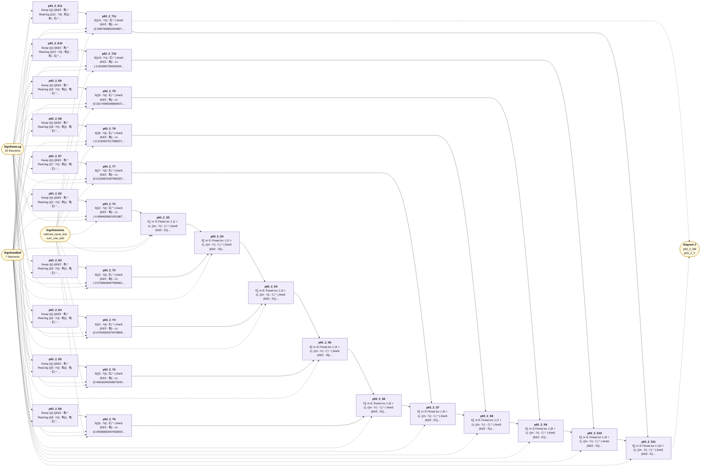

# `lean_stage3/Stage3/SignDataPt63_2.lean`

> **Read from the source text.** This file changed after the last `python3 utilities/lean_map.py --dump`, so the arrows on this page are names occurring in each proof and have not been confirmed by Lean.

SignDataPt63_2 — block S14 of `lean_stage3/design/stencil.md`, Turing's sign data: the sign of `Re Λ(1/2 + it)` at `t = 31.5`. 2026-11-25. Generated by `lean_stage3/checks/signdata/gen_signdata.py`; do not edit by hand.

294 theorems, 0 definitions, 1502 lines. 

**Imports:** [`SignDataGamma`](../lean_stage3/SignDataGamma.md), [`SignDataLog`](../lean_stage3/SignDataLog.md)  
**Imported by:** [`SignData`](../lean_stage3/SignData.md)

## The picture

### Diagram 1 of 10: `p63_2_E2` to `p63_2_S11`



### Diagram 2 of 10: `p63_2_NB` to `p63_2_P27`

```mermaid
flowchart LR
  n0["<b>p63_2_NB</b><br/>‖(((11 : ℕ)) : ℂ) ^ (-lineS (63/2 : ℝ)) * emB (63/2 : ℝ) 11 - cx…"]:::shp
  n1["<b>p63_2_Y</b><br/>‖(∑ m ∈ Finset.Icc 1 (10 + 1), ((m : ℕ) : ℂ) ^ (-lineS (63/2 : ℝ…"]:::shp
  n2["<b>p63_2_zeta</b><br/>‖riemannZeta (lineS (63/2 : ℝ)) - cx (0.885166278530337204284842…"]:::thm
  n3["<b>p63_2_P1</b><br/>‖∏ j ∈ Finset.range (0 + 1), (1 + zz (63/2 : ℝ) / ((j : ℂ) + 1))…"]:::shp
  n4["<b>p63_2_P2</b><br/>‖∏ j ∈ Finset.range (1 + 1), (1 + zz (63/2 : ℝ) / ((j : ℂ) + 1))…"]:::shp
  n5["<b>p63_2_P3</b><br/>‖∏ j ∈ Finset.range (2 + 1), (1 + zz (63/2 : ℝ) / ((j : ℂ) + 1))…"]:::shp
  n6["<b>p63_2_P4</b><br/>‖∏ j ∈ Finset.range (3 + 1), (1 + zz (63/2 : ℝ) / ((j : ℂ) + 1))…"]:::shp
  n7["<b>p63_2_P5</b><br/>‖∏ j ∈ Finset.range (4 + 1), (1 + zz (63/2 : ℝ) / ((j : ℂ) + 1))…"]:::shp
  n8["<b>p63_2_P6</b><br/>‖∏ j ∈ Finset.range (5 + 1), (1 + zz (63/2 : ℝ) / ((j : ℂ) + 1))…"]:::shp
  n9["<b>p63_2_P7</b><br/>‖∏ j ∈ Finset.range (6 + 1), (1 + zz (63/2 : ℝ) / ((j : ℂ) + 1))…"]:::shp
  n10["<b>p63_2_P8</b><br/>‖∏ j ∈ Finset.range (7 + 1), (1 + zz (63/2 : ℝ) / ((j : ℂ) + 1))…"]:::shp
  n11["<b>p63_2_P9</b><br/>‖∏ j ∈ Finset.range (8 + 1), (1 + zz (63/2 : ℝ) / ((j : ℂ) + 1))…"]:::shp
  n12["<b>p63_2_P10</b><br/>‖∏ j ∈ Finset.range (9 + 1), (1 + zz (63/2 : ℝ) / ((j : ℂ) + 1))…"]:::shp
  n13["<b>p63_2_P11</b><br/>‖∏ j ∈ Finset.range (10 + 1), (1 + zz (63/2 : ℝ) / ((j : ℂ) + 1)…"]:::shp
  n14["<b>p63_2_P12</b><br/>‖∏ j ∈ Finset.range (11 + 1), (1 + zz (63/2 : ℝ) / ((j : ℂ) + 1)…"]:::shp
  n15["<b>p63_2_P13</b><br/>‖∏ j ∈ Finset.range (12 + 1), (1 + zz (63/2 : ℝ) / ((j : ℂ) + 1)…"]:::shp
  n16["<b>p63_2_P14</b><br/>‖∏ j ∈ Finset.range (13 + 1), (1 + zz (63/2 : ℝ) / ((j : ℂ) + 1)…"]:::shp
  n17["<b>p63_2_P15</b><br/>‖∏ j ∈ Finset.range (14 + 1), (1 + zz (63/2 : ℝ) / ((j : ℂ) + 1)…"]:::shp
  n18["<b>p63_2_P16</b><br/>‖∏ j ∈ Finset.range (15 + 1), (1 + zz (63/2 : ℝ) / ((j : ℂ) + 1)…"]:::shp
  n19["<b>p63_2_P17</b><br/>‖∏ j ∈ Finset.range (16 + 1), (1 + zz (63/2 : ℝ) / ((j : ℂ) + 1)…"]:::shp
  n20["<b>p63_2_P18</b><br/>‖∏ j ∈ Finset.range (17 + 1), (1 + zz (63/2 : ℝ) / ((j : ℂ) + 1)…"]:::shp
  n21["<b>p63_2_P19</b><br/>‖∏ j ∈ Finset.range (18 + 1), (1 + zz (63/2 : ℝ) / ((j : ℂ) + 1)…"]:::shp
  n22["<b>p63_2_P20</b><br/>‖∏ j ∈ Finset.range (19 + 1), (1 + zz (63/2 : ℝ) / ((j : ℂ) + 1)…"]:::shp
  n23["<b>p63_2_P21</b><br/>‖∏ j ∈ Finset.range (20 + 1), (1 + zz (63/2 : ℝ) / ((j : ℂ) + 1)…"]:::shp
  n24["<b>p63_2_P22</b><br/>‖∏ j ∈ Finset.range (21 + 1), (1 + zz (63/2 : ℝ) / ((j : ℂ) + 1)…"]:::shp
  n25["<b>p63_2_P23</b><br/>‖∏ j ∈ Finset.range (22 + 1), (1 + zz (63/2 : ℝ) / ((j : ℂ) + 1)…"]:::shp
  n26["<b>p63_2_P24</b><br/>‖∏ j ∈ Finset.range (23 + 1), (1 + zz (63/2 : ℝ) / ((j : ℂ) + 1)…"]:::shp
  n27["<b>p63_2_P25</b><br/>‖∏ j ∈ Finset.range (24 + 1), (1 + zz (63/2 : ℝ) / ((j : ℂ) + 1)…"]:::shp
  n28["<b>p63_2_P26</b><br/>‖∏ j ∈ Finset.range (25 + 1), (1 + zz (63/2 : ℝ) / ((j : ℂ) + 1)…"]:::shp
  n29["<b>p63_2_P27</b><br/>‖∏ j ∈ Finset.range (26 + 1), (1 + zz (63/2 : ℝ) / ((j : ℂ) + 1)…"]:::shp
  x0(["<b>SignDataBall</b><br/>ball_add<br/>ball_mul"]):::ext
  x1(["<b>diagram 1</b><br/>p63_2_S11<br/>p63_2_T11"]):::ext
  x2(["<b>SignDataZeta</b><br/>emB_ball<br/>rem_le<br/>zeta_ball"]):::ext
  x3(["<b>diagram 10</b><br/>p63_2_X"]):::ext
  x4(["<b>SignDataGamma</b><br/>factor_ball<br/>prod_zero_ball"]):::ext
  x5(["<b>diagram 3</b><br/>p63_2_P28"]):::ext
  n0 --> n1
  n1 --> n2
  n10 --> n11
  n11 --> n12
  n12 --> n13
  n13 --> n14
  n14 --> n15
  n15 --> n16
  n16 --> n17
  n17 --> n18
  n18 --> n19
  n19 --> n20
  n20 --> n21
  n21 --> n22
  n22 --> n23
  n23 --> n24
  n24 --> n25
  n25 --> n26
  n26 --> n27
  n27 --> n28
  n28 --> n29
  n3 --> n4
  n4 --> n5
  n5 --> n6
  n6 --> n7
  n7 --> n8
  n8 --> n9
  n9 --> n10
  n2 -.-> x3
  n29 -.-> x5
  x0 -.-> n0
  x0 -.-> n1
  x0 -.-> n10
  x0 -.-> n11
  x0 -.-> n12
  x0 -.-> n13
  x0 -.-> n14
  x0 -.-> n15
  x0 -.-> n16
  x0 -.-> n17
  x0 -.-> n18
  x0 -.-> n19
  x0 -.-> n20
  x0 -.-> n21
  x0 -.-> n22
  x0 -.-> n23
  x0 -.-> n24
  x0 -.-> n25
  x0 -.-> n26
  x0 -.-> n27
  x0 -.-> n28
  x0 -.-> n29
  x0 -.-> n3
  x0 -.-> n4
  x0 -.-> n5
  x0 -.-> n6
  x0 -.-> n7
  x0 -.-> n8
  x0 -.-> n9
  x1 -.-> n0
  x1 -.-> n1
  x2 -.-> n0
  x2 -.-> n2
  x4 -.-> n10
  x4 -.-> n11
  x4 -.-> n12
  x4 -.-> n13
  x4 -.-> n14
  x4 -.-> n15
  x4 -.-> n16
  x4 -.-> n17
  x4 -.-> n18
  x4 -.-> n19
  x4 -.-> n20
  x4 -.-> n21
  x4 -.-> n22
  x4 -.-> n23
  x4 -.-> n24
  x4 -.-> n25
  x4 -.-> n26
  x4 -.-> n27
  x4 -.-> n28
  x4 -.-> n29
  x4 -.-> n3
  x4 -.-> n4
  x4 -.-> n5
  x4 -.-> n6
  x4 -.-> n7
  x4 -.-> n8
  x4 -.-> n9
  classDef cnt fill:#dff5ec,stroke:#17694a,color:#111
  classDef shp fill:#f1ecfb,stroke:#5b3fa0,color:#111
  classDef rh fill:#ffe5e5,stroke:#c22,color:#111,stroke-width:2px
  classDef thm fill:#eef4ff,stroke:#335,color:#111
  classDef end_ fill:#e7f7e7,stroke:#2a7,color:#111,stroke-width:2px
  classDef lone fill:#fff,stroke:#999,color:#111,stroke-dasharray:4 3
  classDef bad fill:#ffe5e5,stroke:#c22,color:#111,stroke-width:2px
  classDef ext fill:#fff8e1,stroke:#b80,color:#111
```



### Diagram 3 of 10: `p63_2_P28` to `p63_2_P57`

```mermaid
flowchart LR
  n0["<b>p63_2_P28</b><br/>‖∏ j ∈ Finset.range (27 + 1), (1 + zz (63/2 : ℝ) / ((j : ℂ) + 1)…"]:::shp
  n1["<b>p63_2_P29</b><br/>‖∏ j ∈ Finset.range (28 + 1), (1 + zz (63/2 : ℝ) / ((j : ℂ) + 1)…"]:::shp
  n2["<b>p63_2_P30</b><br/>‖∏ j ∈ Finset.range (29 + 1), (1 + zz (63/2 : ℝ) / ((j : ℂ) + 1)…"]:::shp
  n3["<b>p63_2_P31</b><br/>‖∏ j ∈ Finset.range (30 + 1), (1 + zz (63/2 : ℝ) / ((j : ℂ) + 1)…"]:::shp
  n4["<b>p63_2_P32</b><br/>‖∏ j ∈ Finset.range (31 + 1), (1 + zz (63/2 : ℝ) / ((j : ℂ) + 1)…"]:::shp
  n5["<b>p63_2_P33</b><br/>‖∏ j ∈ Finset.range (32 + 1), (1 + zz (63/2 : ℝ) / ((j : ℂ) + 1)…"]:::shp
  n6["<b>p63_2_P34</b><br/>‖∏ j ∈ Finset.range (33 + 1), (1 + zz (63/2 : ℝ) / ((j : ℂ) + 1)…"]:::shp
  n7["<b>p63_2_P35</b><br/>‖∏ j ∈ Finset.range (34 + 1), (1 + zz (63/2 : ℝ) / ((j : ℂ) + 1)…"]:::shp
  n8["<b>p63_2_P36</b><br/>‖∏ j ∈ Finset.range (35 + 1), (1 + zz (63/2 : ℝ) / ((j : ℂ) + 1)…"]:::shp
  n9["<b>p63_2_P37</b><br/>‖∏ j ∈ Finset.range (36 + 1), (1 + zz (63/2 : ℝ) / ((j : ℂ) + 1)…"]:::shp
  n10["<b>p63_2_P38</b><br/>‖∏ j ∈ Finset.range (37 + 1), (1 + zz (63/2 : ℝ) / ((j : ℂ) + 1)…"]:::shp
  n11["<b>p63_2_P39</b><br/>‖∏ j ∈ Finset.range (38 + 1), (1 + zz (63/2 : ℝ) / ((j : ℂ) + 1)…"]:::shp
  n12["<b>p63_2_P40</b><br/>‖∏ j ∈ Finset.range (39 + 1), (1 + zz (63/2 : ℝ) / ((j : ℂ) + 1)…"]:::shp
  n13["<b>p63_2_P41</b><br/>‖∏ j ∈ Finset.range (40 + 1), (1 + zz (63/2 : ℝ) / ((j : ℂ) + 1)…"]:::shp
  n14["<b>p63_2_P42</b><br/>‖∏ j ∈ Finset.range (41 + 1), (1 + zz (63/2 : ℝ) / ((j : ℂ) + 1)…"]:::shp
  n15["<b>p63_2_P43</b><br/>‖∏ j ∈ Finset.range (42 + 1), (1 + zz (63/2 : ℝ) / ((j : ℂ) + 1)…"]:::shp
  n16["<b>p63_2_P44</b><br/>‖∏ j ∈ Finset.range (43 + 1), (1 + zz (63/2 : ℝ) / ((j : ℂ) + 1)…"]:::shp
  n17["<b>p63_2_P45</b><br/>‖∏ j ∈ Finset.range (44 + 1), (1 + zz (63/2 : ℝ) / ((j : ℂ) + 1)…"]:::shp
  n18["<b>p63_2_P46</b><br/>‖∏ j ∈ Finset.range (45 + 1), (1 + zz (63/2 : ℝ) / ((j : ℂ) + 1)…"]:::shp
  n19["<b>p63_2_P47</b><br/>‖∏ j ∈ Finset.range (46 + 1), (1 + zz (63/2 : ℝ) / ((j : ℂ) + 1)…"]:::shp
  n20["<b>p63_2_P48</b><br/>‖∏ j ∈ Finset.range (47 + 1), (1 + zz (63/2 : ℝ) / ((j : ℂ) + 1)…"]:::shp
  n21["<b>p63_2_P49</b><br/>‖∏ j ∈ Finset.range (48 + 1), (1 + zz (63/2 : ℝ) / ((j : ℂ) + 1)…"]:::shp
  n22["<b>p63_2_P50</b><br/>‖∏ j ∈ Finset.range (49 + 1), (1 + zz (63/2 : ℝ) / ((j : ℂ) + 1)…"]:::shp
  n23["<b>p63_2_P51</b><br/>‖∏ j ∈ Finset.range (50 + 1), (1 + zz (63/2 : ℝ) / ((j : ℂ) + 1)…"]:::shp
  n24["<b>p63_2_P52</b><br/>‖∏ j ∈ Finset.range (51 + 1), (1 + zz (63/2 : ℝ) / ((j : ℂ) + 1)…"]:::shp
  n25["<b>p63_2_P53</b><br/>‖∏ j ∈ Finset.range (52 + 1), (1 + zz (63/2 : ℝ) / ((j : ℂ) + 1)…"]:::shp
  n26["<b>p63_2_P54</b><br/>‖∏ j ∈ Finset.range (53 + 1), (1 + zz (63/2 : ℝ) / ((j : ℂ) + 1)…"]:::shp
  n27["<b>p63_2_P55</b><br/>‖∏ j ∈ Finset.range (54 + 1), (1 + zz (63/2 : ℝ) / ((j : ℂ) + 1)…"]:::shp
  n28["<b>p63_2_P56</b><br/>‖∏ j ∈ Finset.range (55 + 1), (1 + zz (63/2 : ℝ) / ((j : ℂ) + 1)…"]:::shp
  n29["<b>p63_2_P57</b><br/>‖∏ j ∈ Finset.range (56 + 1), (1 + zz (63/2 : ℝ) / ((j : ℂ) + 1)…"]:::shp
  x0(["<b>SignDataBall</b><br/>ball_mul"]):::ext
  x1(["<b>SignDataGamma</b><br/>factor_ball"]):::ext
  x2(["<b>diagram 2</b><br/>p63_2_P27"]):::ext
  x3(["<b>diagram 4</b><br/>p63_2_P58"]):::ext
  n0 --> n1
  n1 --> n2
  n10 --> n11
  n11 --> n12
  n12 --> n13
  n13 --> n14
  n14 --> n15
  n15 --> n16
  n16 --> n17
  n17 --> n18
  n18 --> n19
  n19 --> n20
  n2 --> n3
  n20 --> n21
  n21 --> n22
  n22 --> n23
  n23 --> n24
  n24 --> n25
  n25 --> n26
  n26 --> n27
  n27 --> n28
  n28 --> n29
  n3 --> n4
  n4 --> n5
  n5 --> n6
  n6 --> n7
  n7 --> n8
  n8 --> n9
  n9 --> n10
  n29 -.-> x3
  x0 -.-> n0
  x0 -.-> n1
  x0 -.-> n10
  x0 -.-> n11
  x0 -.-> n12
  x0 -.-> n13
  x0 -.-> n14
  x0 -.-> n15
  x0 -.-> n16
  x0 -.-> n17
  x0 -.-> n18
  x0 -.-> n19
  x0 -.-> n2
  x0 -.-> n20
  x0 -.-> n21
  x0 -.-> n22
  x0 -.-> n23
  x0 -.-> n24
  x0 -.-> n25
  x0 -.-> n26
  x0 -.-> n27
  x0 -.-> n28
  x0 -.-> n29
  x0 -.-> n3
  x0 -.-> n4
  x0 -.-> n5
  x0 -.-> n6
  x0 -.-> n7
  x0 -.-> n8
  x0 -.-> n9
  x1 -.-> n0
  x1 -.-> n1
  x1 -.-> n10
  x1 -.-> n11
  x1 -.-> n12
  x1 -.-> n13
  x1 -.-> n14
  x1 -.-> n15
  x1 -.-> n16
  x1 -.-> n17
  x1 -.-> n18
  x1 -.-> n19
  x1 -.-> n2
  x1 -.-> n20
  x1 -.-> n21
  x1 -.-> n22
  x1 -.-> n23
  x1 -.-> n24
  x1 -.-> n25
  x1 -.-> n26
  x1 -.-> n27
  x1 -.-> n28
  x1 -.-> n29
  x1 -.-> n3
  x1 -.-> n4
  x1 -.-> n5
  x1 -.-> n6
  x1 -.-> n7
  x1 -.-> n8
  x1 -.-> n9
  x2 -.-> n0
  classDef cnt fill:#dff5ec,stroke:#17694a,color:#111
  classDef shp fill:#f1ecfb,stroke:#5b3fa0,color:#111
  classDef rh fill:#ffe5e5,stroke:#c22,color:#111,stroke-width:2px
  classDef thm fill:#eef4ff,stroke:#335,color:#111
  classDef end_ fill:#e7f7e7,stroke:#2a7,color:#111,stroke-width:2px
  classDef lone fill:#fff,stroke:#999,color:#111,stroke-dasharray:4 3
  classDef bad fill:#ffe5e5,stroke:#c22,color:#111,stroke-width:2px
  classDef ext fill:#fff8e1,stroke:#b80,color:#111
```



### Diagram 4 of 10: `p63_2_P58` to `p63_2_P87`


### Diagram 5 of 10: `p63_2_P88` to `p63_2_P117`


### Diagram 6 of 10: `p63_2_P118` to `p63_2_P147`


### Diagram 7 of 10: `p63_2_P148` to `p63_2_P177`

```mermaid
flowchart LR
  n0["<b>p63_2_P148</b><br/>‖∏ j ∈ Finset.range (147 + 1), (1 + zz (63/2 : ℝ) / ((j : ℂ) + 1…"]:::shp
  n1["<b>p63_2_P149</b><br/>‖∏ j ∈ Finset.range (148 + 1), (1 + zz (63/2 : ℝ) / ((j : ℂ) + 1…"]:::shp
  n2["<b>p63_2_P150</b><br/>‖∏ j ∈ Finset.range (149 + 1), (1 + zz (63/2 : ℝ) / ((j : ℂ) + 1…"]:::shp
  n3["<b>p63_2_P151</b><br/>‖∏ j ∈ Finset.range (150 + 1), (1 + zz (63/2 : ℝ) / ((j : ℂ) + 1…"]:::shp
  n4["<b>p63_2_P152</b><br/>‖∏ j ∈ Finset.range (151 + 1), (1 + zz (63/2 : ℝ) / ((j : ℂ) + 1…"]:::shp
  n5["<b>p63_2_P153</b><br/>‖∏ j ∈ Finset.range (152 + 1), (1 + zz (63/2 : ℝ) / ((j : ℂ) + 1…"]:::shp
  n6["<b>p63_2_P154</b><br/>‖∏ j ∈ Finset.range (153 + 1), (1 + zz (63/2 : ℝ) / ((j : ℂ) + 1…"]:::shp
  n7["<b>p63_2_P155</b><br/>‖∏ j ∈ Finset.range (154 + 1), (1 + zz (63/2 : ℝ) / ((j : ℂ) + 1…"]:::shp
  n8["<b>p63_2_P156</b><br/>‖∏ j ∈ Finset.range (155 + 1), (1 + zz (63/2 : ℝ) / ((j : ℂ) + 1…"]:::shp
  n9["<b>p63_2_P157</b><br/>‖∏ j ∈ Finset.range (156 + 1), (1 + zz (63/2 : ℝ) / ((j : ℂ) + 1…"]:::shp
  n10["<b>p63_2_P158</b><br/>‖∏ j ∈ Finset.range (157 + 1), (1 + zz (63/2 : ℝ) / ((j : ℂ) + 1…"]:::shp
  n11["<b>p63_2_P159</b><br/>‖∏ j ∈ Finset.range (158 + 1), (1 + zz (63/2 : ℝ) / ((j : ℂ) + 1…"]:::shp
  n12["<b>p63_2_P160</b><br/>‖∏ j ∈ Finset.range (159 + 1), (1 + zz (63/2 : ℝ) / ((j : ℂ) + 1…"]:::shp
  n13["<b>p63_2_P161</b><br/>‖∏ j ∈ Finset.range (160 + 1), (1 + zz (63/2 : ℝ) / ((j : ℂ) + 1…"]:::shp
  n14["<b>p63_2_P162</b><br/>‖∏ j ∈ Finset.range (161 + 1), (1 + zz (63/2 : ℝ) / ((j : ℂ) + 1…"]:::shp
  n15["<b>p63_2_P163</b><br/>‖∏ j ∈ Finset.range (162 + 1), (1 + zz (63/2 : ℝ) / ((j : ℂ) + 1…"]:::shp
  n16["<b>p63_2_P164</b><br/>‖∏ j ∈ Finset.range (163 + 1), (1 + zz (63/2 : ℝ) / ((j : ℂ) + 1…"]:::shp
  n17["<b>p63_2_P165</b><br/>‖∏ j ∈ Finset.range (164 + 1), (1 + zz (63/2 : ℝ) / ((j : ℂ) + 1…"]:::shp
  n18["<b>p63_2_P166</b><br/>‖∏ j ∈ Finset.range (165 + 1), (1 + zz (63/2 : ℝ) / ((j : ℂ) + 1…"]:::shp
  n19["<b>p63_2_P167</b><br/>‖∏ j ∈ Finset.range (166 + 1), (1 + zz (63/2 : ℝ) / ((j : ℂ) + 1…"]:::shp
  n20["<b>p63_2_P168</b><br/>‖∏ j ∈ Finset.range (167 + 1), (1 + zz (63/2 : ℝ) / ((j : ℂ) + 1…"]:::shp
  n21["<b>p63_2_P169</b><br/>‖∏ j ∈ Finset.range (168 + 1), (1 + zz (63/2 : ℝ) / ((j : ℂ) + 1…"]:::shp
  n22["<b>p63_2_P170</b><br/>‖∏ j ∈ Finset.range (169 + 1), (1 + zz (63/2 : ℝ) / ((j : ℂ) + 1…"]:::shp
  n23["<b>p63_2_P171</b><br/>‖∏ j ∈ Finset.range (170 + 1), (1 + zz (63/2 : ℝ) / ((j : ℂ) + 1…"]:::shp
  n24["<b>p63_2_P172</b><br/>‖∏ j ∈ Finset.range (171 + 1), (1 + zz (63/2 : ℝ) / ((j : ℂ) + 1…"]:::shp
  n25["<b>p63_2_P173</b><br/>‖∏ j ∈ Finset.range (172 + 1), (1 + zz (63/2 : ℝ) / ((j : ℂ) + 1…"]:::shp
  n26["<b>p63_2_P174</b><br/>‖∏ j ∈ Finset.range (173 + 1), (1 + zz (63/2 : ℝ) / ((j : ℂ) + 1…"]:::shp
  n27["<b>p63_2_P175</b><br/>‖∏ j ∈ Finset.range (174 + 1), (1 + zz (63/2 : ℝ) / ((j : ℂ) + 1…"]:::shp
  n28["<b>p63_2_P176</b><br/>‖∏ j ∈ Finset.range (175 + 1), (1 + zz (63/2 : ℝ) / ((j : ℂ) + 1…"]:::shp
  n29["<b>p63_2_P177</b><br/>‖∏ j ∈ Finset.range (176 + 1), (1 + zz (63/2 : ℝ) / ((j : ℂ) + 1…"]:::shp
  x0(["<b>SignDataBall</b><br/>ball_mul"]):::ext
  x1(["<b>SignDataGamma</b><br/>factor_ball"]):::ext
  x2(["<b>diagram 6</b><br/>p63_2_P147"]):::ext
  x3(["<b>diagram 8</b><br/>p63_2_P178"]):::ext
  n0 --> n1
  n1 --> n2
  n10 --> n11
  n11 --> n12
  n12 --> n13
  n13 --> n14
  n14 --> n15
  n15 --> n16
  n16 --> n17
  n17 --> n18
  n18 --> n19
  n19 --> n20
  n2 --> n3
  n20 --> n21
  n21 --> n22
  n22 --> n23
  n23 --> n24
  n24 --> n25
  n25 --> n26
  n26 --> n27
  n27 --> n28
  n28 --> n29
  n3 --> n4
  n4 --> n5
  n5 --> n6
  n6 --> n7
  n7 --> n8
  n8 --> n9
  n9 --> n10
  n29 -.-> x3
  x0 -.-> n0
  x0 -.-> n1
  x0 -.-> n10
  x0 -.-> n11
  x0 -.-> n12
  x0 -.-> n13
  x0 -.-> n14
  x0 -.-> n15
  x0 -.-> n16
  x0 -.-> n17
  x0 -.-> n18
  x0 -.-> n19
  x0 -.-> n2
  x0 -.-> n20
  x0 -.-> n21
  x0 -.-> n22
  x0 -.-> n23
  x0 -.-> n24
  x0 -.-> n25
  x0 -.-> n26
  x0 -.-> n27
  x0 -.-> n28
  x0 -.-> n29
  x0 -.-> n3
  x0 -.-> n4
  x0 -.-> n5
  x0 -.-> n6
  x0 -.-> n7
  x0 -.-> n8
  x0 -.-> n9
  x1 -.-> n0
  x1 -.-> n1
  x1 -.-> n10
  x1 -.-> n11
  x1 -.-> n12
  x1 -.-> n13
  x1 -.-> n14
  x1 -.-> n15
  x1 -.-> n16
  x1 -.-> n17
  x1 -.-> n18
  x1 -.-> n19
  x1 -.-> n2
  x1 -.-> n20
  x1 -.-> n21
  x1 -.-> n22
  x1 -.-> n23
  x1 -.-> n24
  x1 -.-> n25
  x1 -.-> n26
  x1 -.-> n27
  x1 -.-> n28
  x1 -.-> n29
  x1 -.-> n3
  x1 -.-> n4
  x1 -.-> n5
  x1 -.-> n6
  x1 -.-> n7
  x1 -.-> n8
  x1 -.-> n9
  x2 -.-> n0
  classDef cnt fill:#dff5ec,stroke:#17694a,color:#111
  classDef shp fill:#f1ecfb,stroke:#5b3fa0,color:#111
  classDef rh fill:#ffe5e5,stroke:#c22,color:#111,stroke-width:2px
  classDef thm fill:#eef4ff,stroke:#335,color:#111
  classDef end_ fill:#e7f7e7,stroke:#2a7,color:#111,stroke-width:2px
  classDef lone fill:#fff,stroke:#999,color:#111,stroke-dasharray:4 3
  classDef bad fill:#ffe5e5,stroke:#c22,color:#111,stroke-width:2px
  classDef ext fill:#fff8e1,stroke:#b80,color:#111
```



### Diagram 8 of 10: `p63_2_P178` to `p63_2_P207`


### Diagram 9 of 10: `p63_2_P208` to `p63_2_P237`


### Diagram 10 of 10: `p63_2_P238` to `sign_63_2`

```mermaid
flowchart LR
  n0["<b>p63_2_P238</b><br/>‖∏ j ∈ Finset.range (237 + 1), (1 + zz (63/2 : ℝ) / ((j : ℂ) + 1…"]:::shp
  n1["<b>p63_2_P239</b><br/>‖∏ j ∈ Finset.range (238 + 1), (1 + zz (63/2 : ℝ) / ((j : ℂ) + 1…"]:::shp
  n2["<b>p63_2_P240</b><br/>‖∏ j ∈ Finset.range (239 + 1), (1 + zz (63/2 : ℝ) / ((j : ℂ) + 1…"]:::shp
  n3["<b>p63_2_P241</b><br/>‖∏ j ∈ Finset.range (240 + 1), (1 + zz (63/2 : ℝ) / ((j : ℂ) + 1…"]:::shp
  n4["<b>p63_2_P242</b><br/>‖∏ j ∈ Finset.range (241 + 1), (1 + zz (63/2 : ℝ) / ((j : ℂ) + 1…"]:::shp
  n5["<b>p63_2_P243</b><br/>‖∏ j ∈ Finset.range (242 + 1), (1 + zz (63/2 : ℝ) / ((j : ℂ) + 1…"]:::shp
  n6["<b>p63_2_P244</b><br/>‖∏ j ∈ Finset.range (243 + 1), (1 + zz (63/2 : ℝ) / ((j : ℂ) + 1…"]:::shp
  n7["<b>p63_2_P245</b><br/>‖∏ j ∈ Finset.range (244 + 1), (1 + zz (63/2 : ℝ) / ((j : ℂ) + 1…"]:::shp
  n8["<b>p63_2_P246</b><br/>‖∏ j ∈ Finset.range (245 + 1), (1 + zz (63/2 : ℝ) / ((j : ℂ) + 1…"]:::shp
  n9["<b>p63_2_P247</b><br/>‖∏ j ∈ Finset.range (246 + 1), (1 + zz (63/2 : ℝ) / ((j : ℂ) + 1…"]:::shp
  n10["<b>p63_2_P248</b><br/>‖∏ j ∈ Finset.range (247 + 1), (1 + zz (63/2 : ℝ) / ((j : ℂ) + 1…"]:::shp
  n11["<b>p63_2_P249</b><br/>‖∏ j ∈ Finset.range (248 + 1), (1 + zz (63/2 : ℝ) / ((j : ℂ) + 1…"]:::shp
  n12["<b>p63_2_P250</b><br/>‖∏ j ∈ Finset.range (249 + 1), (1 + zz (63/2 : ℝ) / ((j : ℂ) + 1…"]:::shp
  n13["<b>p63_2_P251</b><br/>‖∏ j ∈ Finset.range (250 + 1), (1 + zz (63/2 : ℝ) / ((j : ℂ) + 1…"]:::shp
  n14["<b>p63_2_P252</b><br/>‖∏ j ∈ Finset.range (251 + 1), (1 + zz (63/2 : ℝ) / ((j : ℂ) + 1…"]:::shp
  n15["<b>p63_2_P253</b><br/>‖∏ j ∈ Finset.range (252 + 1), (1 + zz (63/2 : ℝ) / ((j : ℂ) + 1…"]:::shp
  n16["<b>p63_2_P254</b><br/>‖∏ j ∈ Finset.range (253 + 1), (1 + zz (63/2 : ℝ) / ((j : ℂ) + 1…"]:::shp
  n17["<b>p63_2_P255</b><br/>‖∏ j ∈ Finset.range (254 + 1), (1 + zz (63/2 : ℝ) / ((j : ℂ) + 1…"]:::shp
  n18["<b>p63_2_P256</b><br/>‖∏ j ∈ Finset.range (255 + 1), (1 + zz (63/2 : ℝ) / ((j : ℂ) + 1…"]:::shp
  n19["<b>p63_2_W</b><br/>‖zz (63/2 : ℝ) * ∏ j ∈ Finset.range (255 + 1), (1 + zz (63/2 : ℝ…"]:::shp
  n20["<b>p63_2_phase</b><br/>‖cexp (((((63/2 : ℝ) / 2) * (Real.log (((256 : ℕ)) : ℝ) - Real.l…"]:::shp
  n21["<b>p63_2_G</b><br/>‖gammaDir (63/2 : ℝ) 256 - cx (-106057178948.2236576010085085177…"]:::shp
  n22["<b>p63_2_X</b><br/>‖gammaDir (63/2 : ℝ) 256 * riemannZeta (lineS (63/2 : ℝ)) - cx (…"]:::thm
  n23["<b>sign_63_2</b><br/>(completedRiemannZeta (lineS (63/2 : ℝ))).re ＜ 0"]:::thm
  x0(["<b>SignDataBall</b><br/>4 theorems"]):::ext
  x1(["<b>SignDataGamma</b><br/>factor_ball<br/>re_lambda_neg<br/>zz_ball"]):::ext
  x2(["<b>diagram 9</b><br/>p63_2_P237"]):::ext
  x3(["<b>SignDataLog</b><br/>log_pi_ball'<br/>log_pow2_ball_256"]):::ext
  x4(["<b>diagram 2</b><br/>p63_2_zeta"]):::ext
  x5(["<b>SignData</b><br/>run_signs"]):::ext
  n0 --> n1
  n1 --> n2
  n10 --> n11
  n11 --> n12
  n12 --> n13
  n13 --> n14
  n14 --> n15
  n15 --> n16
  n16 --> n17
  n17 --> n18
  n18 --> n19
  n19 --> n21
  n2 --> n3
  n20 --> n21
  n21 --> n22
  n22 --> n23
  n3 --> n4
  n4 --> n5
  n5 --> n6
  n6 --> n7
  n7 --> n8
  n8 --> n9
  n9 --> n10
  n23 -.-> x5
  x0 -.-> n0
  x0 -.-> n1
  x0 -.-> n10
  x0 -.-> n11
  x0 -.-> n12
  x0 -.-> n13
  x0 -.-> n14
  x0 -.-> n15
  x0 -.-> n16
  x0 -.-> n17
  x0 -.-> n18
  x0 -.-> n19
  x0 -.-> n2
  x0 -.-> n20
  x0 -.-> n21
  x0 -.-> n22
  x0 -.-> n3
  x0 -.-> n4
  x0 -.-> n5
  x0 -.-> n6
  x0 -.-> n7
  x0 -.-> n8
  x0 -.-> n9
  x1 -.-> n0
  x1 -.-> n1
  x1 -.-> n10
  x1 -.-> n11
  x1 -.-> n12
  x1 -.-> n13
  x1 -.-> n14
  x1 -.-> n15
  x1 -.-> n16
  x1 -.-> n17
  x1 -.-> n18
  x1 -.-> n19
  x1 -.-> n2
  x1 -.-> n23
  x1 -.-> n3
  x1 -.-> n4
  x1 -.-> n5
  x1 -.-> n6
  x1 -.-> n7
  x1 -.-> n8
  x1 -.-> n9
  x2 -.-> n0
  x3 -.-> n20
  x4 -.-> n22
  classDef cnt fill:#dff5ec,stroke:#17694a,color:#111
  classDef shp fill:#f1ecfb,stroke:#5b3fa0,color:#111
  classDef rh fill:#ffe5e5,stroke:#c22,color:#111,stroke-width:2px
  classDef thm fill:#eef4ff,stroke:#335,color:#111
  classDef end_ fill:#e7f7e7,stroke:#2a7,color:#111,stroke-width:2px
  classDef lone fill:#fff,stroke:#999,color:#111,stroke-dasharray:4 3
  classDef bad fill:#ffe5e5,stroke:#c22,color:#111,stroke-width:2px
  classDef ext fill:#fff8e1,stroke:#b80,color:#111
```



An arrow A → B reads "A is used in the proof of B". Green: counting, integers only. Violet: shape, analysis with no ζ. Blue: reads ζ. A name ending in ■ is an end: nothing else uses it. Red: contains `sorry`. Yellow: theorems in another file, counted; a dotted arrow crosses files. Definitions are not drawn; they are listed below the diagram.

## Theorems

<a name="SignData-p63_2_E2"></a>
### `SignData.p63_2_E2`

line 31 · arrows read from text

**Shape.** Uses real or complex analysis; nothing in it or beneath it reads ζ.

**Proves**

```lean
‖cexp ((((-((63/2 : ℝ) * Real.log (((2 : ℕ)) : ℝ))) : ℝ) : ℂ) * Complex.I) - cx (-(0.987698857778222911592159765792)) (-(0.156368047706664771330863712727))‖ ≤ (0.000000007875000000070000000001)
```

**Fed by** (3 theorems its proof uses)

  - [`SignData.exp_ball2`](../lean_stage3/SignDataBall.md#SignData-exp_ball2) (SignDataBall) — `` ‖cexp ((x : ℂ) * I) - cx (-e) (-f)‖ ≤ R ``
  - [`SignData.neg_mul_ball`](../lean_stage3/SignDataBall.md#SignData-neg_mul_ball) (SignDataBall) — `` |-(t * x) - -(t * a)| ≤ |t| * e ``
  - [`SignData.log_ball_2`](../lean_stage3/SignDataLog.md#SignData-log_ball_2) (SignDataLog) — `` |Real.log ((2 : ℕ) : ℝ) - (0.69314718055)| ≤ (0.00000000025) ``

**Definitions its proof touches:** [`SignData.cosP`](../lean_stage3/SignDataBall.md#SignData-cosP), [`SignData.cx`](../lean_stage3/SignDataBall.md#SignData-cx), [`SignData.sinP`](../lean_stage3/SignDataBall.md#SignData-sinP)

**Feeds** (1 that use it)

  - [`SignData.p63_2_T2`](#SignData-p63_2_T2) — `` ‖(((2 : ℕ)) : ℂ) ^ (-lineS (63/2 : ℝ)) - cx (-0.698408560105188791688448820701) (-0.110568906894284230896939567582)‖ ≤ (0.0000000055684659018935592293… ``

<a name="SignData-p63_2_T2"></a>
### `SignData.p63_2_T2`

line 37 · arrows read from text

**Shape.** Uses real or complex analysis; nothing in it or beneath it reads ζ.

**Proves**

```lean
‖(((2 : ℕ)) : ℂ) ^ (-lineS (63/2 : ℝ)) - cx (-0.698408560105188791688448820701) (-0.110568906894284230896939567582)‖ ≤ (0.000000005568465901893559229343)
```

**Fed by** (5 theorems its proof uses)

  - [`SignData.ball_mul`](../lean_stage3/SignDataBall.md#SignData-ball_mul) (SignDataBall) — `` ‖z * w - cx e f‖ ≤ R ``
  - [`SignData.ball_ofReal`](../lean_stage3/SignDataBall.md#SignData-ball_ofReal) (SignDataBall) — `` ‖(x : ℂ) - cx c 0‖ ≤ e ``
  - [`SignData.isqrt_ball_2`](../lean_stage3/SignDataLog.md#SignData-isqrt_ball_2) (SignDataLog) — `` |(Real.sqrt (((2 : ℕ)) : ℝ))⁻¹ - (0.707106781186547524400844362104)| ≤ (0.000000000000000000000000000001) ``
  - [`SignData.p63_2_E2`](#SignData-p63_2_E2) — `` ‖cexp ((((-((63/2 : ℝ) * Real.log (((2 : ℕ)) : ℝ))) : ℝ) : ℂ) * Complex.I) - cx (-(0.987698857778222911592159765792)) (-(0.156368047706664771330863712… ``
  - [`SignData.natCast_cpow_line`](../lean_stage3/SignDataZeta.md#SignData-natCast_cpow_line) (SignDataZeta) — `` (m : ℂ) ^ (-lineS t) = (((Real.sqrt m)⁻¹ : ℝ) : ℂ) * cexp (((-(t * Real.log m)) : ℝ) * I) ``

**Definitions its proof touches:** [`SignData.cx`](../lean_stage3/SignDataBall.md#SignData-cx), [`SignData.lineS`](../lean_stage3/SignDataZeta.md#SignData-lineS)

**Feeds** (1 that use it)

  - [`SignData.p63_2_S2`](#SignData-p63_2_S2) — `` ‖∑ m ∈ Finset.Icc 1 (1 + 1), ((m : ℕ) : ℂ) ^ (-lineS (63/2 : ℝ)) - cx (0.301591439894811208311551179299) (-0.110568906894284230896939567582)‖ ≤ (0.000… ``

<a name="SignData-p63_2_E3"></a>
### `SignData.p63_2_E3`

line 41 · arrows read from text

**Shape.** Uses real or complex analysis; nothing in it or beneath it reads ζ.

**Proves**

```lean
‖cexp ((((-((63/2 : ℝ) * Real.log (((3 : ℕ)) : ℝ))) : ℝ) : ℂ) * Complex.I) - cx (-(0.998811081469169557695102555835)) (-(-0.048748574690835142327980997527))‖ ≤ (0.00000000787522949032877954156)
```

**Fed by** (3 theorems its proof uses)

  - [`SignData.exp_ball2`](../lean_stage3/SignDataBall.md#SignData-exp_ball2) (SignDataBall) — `` ‖cexp ((x : ℂ) * I) - cx (-e) (-f)‖ ≤ R ``
  - [`SignData.neg_mul_ball`](../lean_stage3/SignDataBall.md#SignData-neg_mul_ball) (SignDataBall) — `` |-(t * x) - -(t * a)| ≤ |t| * e ``
  - [`SignData.log_ball_3`](../lean_stage3/SignDataLog.md#SignData-log_ball_3) (SignDataLog) — `` |Real.log (((3 : ℕ)) : ℝ) - (1.098612288658164142930964760306)| ≤ (0.000000000250007285403624428292) ``

**Definitions its proof touches:** [`SignData.cosP`](../lean_stage3/SignDataBall.md#SignData-cosP), [`SignData.cx`](../lean_stage3/SignDataBall.md#SignData-cx), [`SignData.sinP`](../lean_stage3/SignDataBall.md#SignData-sinP)

**Feeds** (1 that use it)

  - [`SignData.p63_2_T3`](#SignData-p63_2_T3) — `` ‖(((3 : ℕ)) : ℂ) ^ (-lineS (63/2 : ℝ)) - cx (-0.576663846755806274265679444499) (0.028145002720364247002194070166)‖ ≤ (0.00000000454676586617140017955… ``

<a name="SignData-p63_2_T3"></a>
### `SignData.p63_2_T3`

line 47 · arrows read from text

**Shape.** Uses real or complex analysis; nothing in it or beneath it reads ζ.

**Proves**

```lean
‖(((3 : ℕ)) : ℂ) ^ (-lineS (63/2 : ℝ)) - cx (-0.576663846755806274265679444499) (0.028145002720364247002194070166)‖ ≤ (0.000000004546765866171400179552)
```

**Fed by** (5 theorems its proof uses)

  - [`SignData.ball_mul`](../lean_stage3/SignDataBall.md#SignData-ball_mul) (SignDataBall) — `` ‖z * w - cx e f‖ ≤ R ``
  - [`SignData.ball_ofReal`](../lean_stage3/SignDataBall.md#SignData-ball_ofReal) (SignDataBall) — `` ‖(x : ℂ) - cx c 0‖ ≤ e ``
  - [`SignData.isqrt_ball_3`](../lean_stage3/SignDataLog.md#SignData-isqrt_ball_3) (SignDataLog) — `` |(Real.sqrt (((3 : ℕ)) : ℝ))⁻¹ - (0.577350269189625764509148780502)| ≤ (0.000000000000000000000000000001) ``
  - [`SignData.p63_2_E3`](#SignData-p63_2_E3) — `` ‖cexp ((((-((63/2 : ℝ) * Real.log (((3 : ℕ)) : ℝ))) : ℝ) : ℂ) * Complex.I) - cx (-(0.998811081469169557695102555835)) (-(-0.04874857469083514232798099… ``
  - [`SignData.natCast_cpow_line`](../lean_stage3/SignDataZeta.md#SignData-natCast_cpow_line) (SignDataZeta) — `` (m : ℂ) ^ (-lineS t) = (((Real.sqrt m)⁻¹ : ℝ) : ℂ) * cexp (((-(t * Real.log m)) : ℝ) * I) ``

**Definitions its proof touches:** [`SignData.cx`](../lean_stage3/SignDataBall.md#SignData-cx), [`SignData.lineS`](../lean_stage3/SignDataZeta.md#SignData-lineS)

**Feeds** (1 that use it)

  - [`SignData.p63_2_S3`](#SignData-p63_2_S3) — `` ‖∑ m ∈ Finset.Icc 1 (2 + 1), ((m : ℕ) : ℂ) ^ (-lineS (63/2 : ℝ)) - cx (-0.2750724068609950659541282652) (-0.082423904173919983894745497416)‖ ≤ (0.0000… ``

<a name="SignData-p63_2_E4"></a>
### `SignData.p63_2_E4`

line 51 · arrows read from text

**Shape.** Uses real or complex analysis; nothing in it or beneath it reads ζ.

**Proves**

```lean
‖cexp ((((-((63/2 : ℝ) * Real.log (((4 : ℕ)) : ℝ))) : ℝ) : ℂ) * Complex.I) - cx (0.951098067409576120675543678621) (0.30888908392782254082391134591)‖ ≤ (0.000000007875378704330553487876)
```

**Fed by** (3 theorems its proof uses)

  - [`SignData.exp_ball0`](../lean_stage3/SignDataBall.md#SignData-exp_ball0) (SignDataBall) — `` ‖cexp ((x : ℂ) * I) - cx e f‖ ≤ R ``
  - [`SignData.neg_mul_ball`](../lean_stage3/SignDataBall.md#SignData-neg_mul_ball) (SignDataBall) — `` |-(t * x) - -(t * a)| ≤ |t| * e ``
  - [`SignData.log_ball_4`](../lean_stage3/SignDataLog.md#SignData-log_ball_4) (SignDataLog) — `` |Real.log (((4 : ℕ)) : ℝ) - (1.386294361109944875563750019823)| ≤ (0.000000000250012022355196162294) ``

**Definitions its proof touches:** [`SignData.cosP`](../lean_stage3/SignDataBall.md#SignData-cosP), [`SignData.cx`](../lean_stage3/SignDataBall.md#SignData-cx), [`SignData.sinP`](../lean_stage3/SignDataBall.md#SignData-sinP)

**Feeds** (1 that use it)

  - [`SignData.p63_2_T4`](#SignData-p63_2_T4) — `` ‖(((4 : ℕ)) : ℂ) ^ (-lineS (63/2 : ℝ)) - cx (0.47554903370478806033777183931) (0.154444541963911270411955672955)‖ ≤ (0.00000000393768935216527674394) ``

<a name="SignData-p63_2_T4"></a>
### `SignData.p63_2_T4`

line 57 · arrows read from text

**Shape.** Uses real or complex analysis; nothing in it or beneath it reads ζ.

**Proves**

```lean
‖(((4 : ℕ)) : ℂ) ^ (-lineS (63/2 : ℝ)) - cx (0.47554903370478806033777183931) (0.154444541963911270411955672955)‖ ≤ (0.00000000393768935216527674394)
```

**Fed by** (5 theorems its proof uses)

  - [`SignData.ball_mul`](../lean_stage3/SignDataBall.md#SignData-ball_mul) (SignDataBall) — `` ‖z * w - cx e f‖ ≤ R ``
  - [`SignData.ball_ofReal`](../lean_stage3/SignDataBall.md#SignData-ball_ofReal) (SignDataBall) — `` ‖(x : ℂ) - cx c 0‖ ≤ e ``
  - [`SignData.isqrt_ball_4`](../lean_stage3/SignDataLog.md#SignData-isqrt_ball_4) (SignDataLog) — `` |(Real.sqrt (((4 : ℕ)) : ℝ))⁻¹ - (0.5)| ≤ (0.000000000000000000000000000001) ``
  - [`SignData.p63_2_E4`](#SignData-p63_2_E4) — `` ‖cexp ((((-((63/2 : ℝ) * Real.log (((4 : ℕ)) : ℝ))) : ℝ) : ℂ) * Complex.I) - cx (0.951098067409576120675543678621) (0.30888908392782254082391134591)‖ … ``
  - [`SignData.natCast_cpow_line`](../lean_stage3/SignDataZeta.md#SignData-natCast_cpow_line) (SignDataZeta) — `` (m : ℂ) ^ (-lineS t) = (((Real.sqrt m)⁻¹ : ℝ) : ℂ) * cexp (((-(t * Real.log m)) : ℝ) * I) ``

**Definitions its proof touches:** [`SignData.cx`](../lean_stage3/SignDataBall.md#SignData-cx), [`SignData.lineS`](../lean_stage3/SignDataZeta.md#SignData-lineS)

**Feeds** (1 that use it)

  - [`SignData.p63_2_S4`](#SignData-p63_2_S4) — `` ‖∑ m ∈ Finset.Icc 1 (3 + 1), ((m : ℕ) : ℂ) ^ (-lineS (63/2 : ℝ)) - cx (0.20047662684379299438364357411) (0.072020637789991286517210175539)‖ ≤ (0.00000… ``

<a name="SignData-p63_2_E5"></a>
### `SignData.p63_2_E5`

line 61 · arrows read from text

**Shape.** Uses real or complex analysis; nothing in it or beneath it reads ζ.

**Proves**

```lean
‖cexp ((((-((63/2 : ℝ) * Real.log (((5 : ℕ)) : ℝ))) : ℝ) : ℂ) * Complex.I) - cx (0.908208978402447965136397275808) (-0.418516966859387679960953377083)‖ ≤ (0.000000007875461279710808375679)
```

**Fed by** (3 theorems its proof uses)

  - [`SignData.exp_ball0`](../lean_stage3/SignDataBall.md#SignData-exp_ball0) (SignDataBall) — `` ‖cexp ((x : ℂ) * I) - cx e f‖ ≤ R ``
  - [`SignData.neg_mul_ball`](../lean_stage3/SignDataBall.md#SignData-neg_mul_ball) (SignDataBall) — `` |-(t * x) - -(t * a)| ≤ |t| * e ``
  - [`SignData.log_ball_5`](../lean_stage3/SignDataLog.md#SignData-log_ball_5) (SignDataLog) — `` |Real.log (((5 : ℕ)) : ℝ) - (1.609437912424154507888186373287)| ≤ (0.000000000250014643795196162295) ``

**Definitions its proof touches:** [`SignData.cosP`](../lean_stage3/SignDataBall.md#SignData-cosP), [`SignData.cx`](../lean_stage3/SignDataBall.md#SignData-cx), [`SignData.sinP`](../lean_stage3/SignDataBall.md#SignData-sinP)

**Feeds** (1 that use it)

  - [`SignData.p63_2_T5`](#SignData-p63_2_T5) — `` ‖(((5 : ℕ)) : ℂ) ^ (-lineS (63/2 : ℝ)) - cx (0.40616340269670240056843112388) (-0.187166477526923504159550804591)‖ ≤ (0.000000003522013355120170566344… ``

<a name="SignData-p63_2_T5"></a>
### `SignData.p63_2_T5`

line 67 · arrows read from text

**Shape.** Uses real or complex analysis; nothing in it or beneath it reads ζ.

**Proves**

```lean
‖(((5 : ℕ)) : ℂ) ^ (-lineS (63/2 : ℝ)) - cx (0.40616340269670240056843112388) (-0.187166477526923504159550804591)‖ ≤ (0.000000003522013355120170566344)
```

**Fed by** (5 theorems its proof uses)

  - [`SignData.ball_mul`](../lean_stage3/SignDataBall.md#SignData-ball_mul) (SignDataBall) — `` ‖z * w - cx e f‖ ≤ R ``
  - [`SignData.ball_ofReal`](../lean_stage3/SignDataBall.md#SignData-ball_ofReal) (SignDataBall) — `` ‖(x : ℂ) - cx c 0‖ ≤ e ``
  - [`SignData.isqrt_ball_5`](../lean_stage3/SignDataLog.md#SignData-isqrt_ball_5) (SignDataLog) — `` |(Real.sqrt (((5 : ℕ)) : ℝ))⁻¹ - (0.447213595499957939281834733746)| ≤ (0.000000000000000000000000000001) ``
  - [`SignData.p63_2_E5`](#SignData-p63_2_E5) — `` ‖cexp ((((-((63/2 : ℝ) * Real.log (((5 : ℕ)) : ℝ))) : ℝ) : ℂ) * Complex.I) - cx (0.908208978402447965136397275808) (-0.418516966859387679960953377083)… ``
  - [`SignData.natCast_cpow_line`](../lean_stage3/SignDataZeta.md#SignData-natCast_cpow_line) (SignDataZeta) — `` (m : ℂ) ^ (-lineS t) = (((Real.sqrt m)⁻¹ : ℝ) : ℂ) * cexp (((-(t * Real.log m)) : ℝ) * I) ``

**Definitions its proof touches:** [`SignData.cx`](../lean_stage3/SignDataBall.md#SignData-cx), [`SignData.lineS`](../lean_stage3/SignDataZeta.md#SignData-lineS)

**Feeds** (1 that use it)

  - [`SignData.p63_2_S5`](#SignData-p63_2_S5) — `` ‖∑ m ∈ Finset.Icc 1 (4 + 1), ((m : ℕ) : ℂ) ^ (-lineS (63/2 : ℝ)) - cx (0.60664002954049539495207469799) (-0.115145839736932217642340629052)‖ ≤ (0.0000… ``

<a name="SignData-p63_2_E6"></a>
### `SignData.p63_2_E6`

line 71 · arrows read from text

**Shape.** Uses real or complex analysis; nothing in it or beneath it reads ζ.

**Proves**

```lean
‖cexp ((((-((63/2 : ℝ) * Real.log (((6 : ℕ)) : ℝ))) : ℝ) : ℂ) * Complex.I) - cx (0.994147283790061660896213468875) (0.108033226985231738984842785025)‖ ≤ (0.00000000787552331205233410991)
```

**Fed by** (3 theorems its proof uses)

  - [`SignData.exp_ball0`](../lean_stage3/SignDataBall.md#SignData-exp_ball0) (SignDataBall) — `` ‖cexp ((x : ℂ) * I) - cx e f‖ ≤ R ``
  - [`SignData.neg_mul_ball`](../lean_stage3/SignDataBall.md#SignData-neg_mul_ball) (SignDataBall) — `` |-(t * x) - -(t * a)| ≤ |t| * e ``
  - [`SignData.log_ball_6`](../lean_stage3/SignDataLog.md#SignData-log_ball_6) (SignDataLog) — `` |Real.log (((6 : ℕ)) : ℝ) - (1.791759469218109031470825672761)| ≤ (0.000000000250016613075280171998) ``

**Definitions its proof touches:** [`SignData.cosP`](../lean_stage3/SignDataBall.md#SignData-cosP), [`SignData.cx`](../lean_stage3/SignDataBall.md#SignData-cx), [`SignData.sinP`](../lean_stage3/SignDataBall.md#SignData-sinP)

**Feeds** (1 that use it)

  - [`SignData.p63_2_T6`](#SignData-p63_2_T6) — `` ‖(((6 : ℕ)) : ℂ) ^ (-lineS (63/2 : ℝ)) - cx (0.405858929076585549826575594756) (0.044104380230015331231433866342)‖ ≤ (0.000000003215168928653665789873… ``

<a name="SignData-p63_2_T6"></a>
### `SignData.p63_2_T6`

line 77 · arrows read from text

**Shape.** Uses real or complex analysis; nothing in it or beneath it reads ζ.

**Proves**

```lean
‖(((6 : ℕ)) : ℂ) ^ (-lineS (63/2 : ℝ)) - cx (0.405858929076585549826575594756) (0.044104380230015331231433866342)‖ ≤ (0.000000003215168928653665789873)
```

**Fed by** (5 theorems its proof uses)

  - [`SignData.ball_mul`](../lean_stage3/SignDataBall.md#SignData-ball_mul) (SignDataBall) — `` ‖z * w - cx e f‖ ≤ R ``
  - [`SignData.ball_ofReal`](../lean_stage3/SignDataBall.md#SignData-ball_ofReal) (SignDataBall) — `` ‖(x : ℂ) - cx c 0‖ ≤ e ``
  - [`SignData.isqrt_ball_6`](../lean_stage3/SignDataLog.md#SignData-isqrt_ball_6) (SignDataLog) — `` |(Real.sqrt (((6 : ℕ)) : ℝ))⁻¹ - (0.40824829046386301636621401245)| ≤ (0.000000000000000000000000000001) ``
  - [`SignData.p63_2_E6`](#SignData-p63_2_E6) — `` ‖cexp ((((-((63/2 : ℝ) * Real.log (((6 : ℕ)) : ℝ))) : ℝ) : ℂ) * Complex.I) - cx (0.994147283790061660896213468875) (0.108033226985231738984842785025)‖… ``
  - [`SignData.natCast_cpow_line`](../lean_stage3/SignDataZeta.md#SignData-natCast_cpow_line) (SignDataZeta) — `` (m : ℂ) ^ (-lineS t) = (((Real.sqrt m)⁻¹ : ℝ) : ℂ) * cexp (((-(t * Real.log m)) : ℝ) * I) ``

**Definitions its proof touches:** [`SignData.cx`](../lean_stage3/SignDataBall.md#SignData-cx), [`SignData.lineS`](../lean_stage3/SignDataZeta.md#SignData-lineS)

**Feeds** (1 that use it)

  - [`SignData.p63_2_S6`](#SignData-p63_2_S6) — `` ‖∑ m ∈ Finset.Icc 1 (5 + 1), ((m : ℕ) : ℂ) ^ (-lineS (63/2 : ℝ)) - cx (1.012498958617080944778650292746) (-0.07104145950691688641090676271)‖ ≤ (0.0000… ``

<a name="SignData-p63_2_E7"></a>
### `SignData.p63_2_E7`

line 81 · arrows read from text

**Shape.** Uses real or complex analysis; nothing in it or beneath it reads ζ.

**Proves**

```lean
‖cexp ((((-((63/2 : ℝ) * Real.log (((7 : ℕ)) : ℝ))) : ℝ) : ℂ) * Complex.I) - cx (-(-0.035105735134207031316291331562)) (0.9993836037081491472736622479)‖ ≤ (0.000000007875681287903504722436)
```

**Fed by** (3 theorems its proof uses)

  - [`SignData.exp_ball1`](../lean_stage3/SignDataBall.md#SignData-exp_ball1) (SignDataBall) — `` ‖cexp ((x : ℂ) * I) - cx (-f) e‖ ≤ R ``
  - [`SignData.neg_mul_ball`](../lean_stage3/SignDataBall.md#SignData-neg_mul_ball) (SignDataBall) — `` |-(t * x) - -(t * a)| ≤ |t| * e ``
  - [`SignData.log_ball_7`](../lean_stage3/SignDataLog.md#SignData-log_ball_7) (SignDataLog) — `` |Real.log (((7 : ℕ)) : ℝ) - (1.945910149045367043442249594592)| ≤ (0.000000000250021628181194999771) ``

**Definitions its proof touches:** [`SignData.cosP`](../lean_stage3/SignDataBall.md#SignData-cosP), [`SignData.cx`](../lean_stage3/SignDataBall.md#SignData-cx), [`SignData.sinP`](../lean_stage3/SignDataBall.md#SignData-sinP)

**Feeds** (1 that use it)

  - [`SignData.p63_2_T7`](#SignData-p63_2_T7) — `` ‖(((7 : ℕ)) : ℂ) ^ (-lineS (63/2 : ℝ)) - cx (0.013268720679602073458972513894) (0.377731497109612977840566581276)‖ ≤ (0.000000002976727727571080137983… ``

<a name="SignData-p63_2_T7"></a>
### `SignData.p63_2_T7`

line 87 · arrows read from text

**Shape.** Uses real or complex analysis; nothing in it or beneath it reads ζ.

**Proves**

```lean
‖(((7 : ℕ)) : ℂ) ^ (-lineS (63/2 : ℝ)) - cx (0.013268720679602073458972513894) (0.377731497109612977840566581276)‖ ≤ (0.000000002976727727571080137983)
```

**Fed by** (5 theorems its proof uses)

  - [`SignData.ball_mul`](../lean_stage3/SignDataBall.md#SignData-ball_mul) (SignDataBall) — `` ‖z * w - cx e f‖ ≤ R ``
  - [`SignData.ball_ofReal`](../lean_stage3/SignDataBall.md#SignData-ball_ofReal) (SignDataBall) — `` ‖(x : ℂ) - cx c 0‖ ≤ e ``
  - [`SignData.isqrt_ball_7`](../lean_stage3/SignDataLog.md#SignData-isqrt_ball_7) (SignDataLog) — `` |(Real.sqrt (((7 : ℕ)) : ℝ))⁻¹ - (0.377964473009227227214516536234)| ≤ (0.000000000000000000000000000001) ``
  - [`SignData.p63_2_E7`](#SignData-p63_2_E7) — `` ‖cexp ((((-((63/2 : ℝ) * Real.log (((7 : ℕ)) : ℝ))) : ℝ) : ℂ) * Complex.I) - cx (-(-0.035105735134207031316291331562)) (0.9993836037081491472736622479… ``
  - [`SignData.natCast_cpow_line`](../lean_stage3/SignDataZeta.md#SignData-natCast_cpow_line) (SignDataZeta) — `` (m : ℂ) ^ (-lineS t) = (((Real.sqrt m)⁻¹ : ℝ) : ℂ) * cexp (((-(t * Real.log m)) : ℝ) * I) ``

**Definitions its proof touches:** [`SignData.cx`](../lean_stage3/SignDataBall.md#SignData-cx), [`SignData.lineS`](../lean_stage3/SignDataZeta.md#SignData-lineS)

**Feeds** (1 that use it)

  - [`SignData.p63_2_S7`](#SignData-p63_2_S7) — `` ‖∑ m ∈ Finset.Icc 1 (6 + 1), ((m : ℕ) : ℂ) ^ (-lineS (63/2 : ℝ)) - cx (1.02576767929668301823762280664) (0.306690037602696091429659818566)‖ ≤ (0.00000… ``

<a name="SignData-p63_2_E8"></a>
### `SignData.p63_2_E8`

line 91 · arrows read from text

**Shape.** Uses real or complex analysis; nothing in it or beneath it reads ζ.

**Proves**

```lean
‖cexp ((((-((63/2 : ℝ) * Real.log (((8 : ℕ)) : ℝ))) : ℝ) : ℂ) * Complex.I) - cx (-(0.89109809194597743106306398457)) (-(0.453810743074950080237245658096))‖ ≤ (0.000000007875809185614867373727)
```

**Fed by** (3 theorems its proof uses)

  - [`SignData.exp_ball2`](../lean_stage3/SignDataBall.md#SignData-exp_ball2) (SignDataBall) — `` ‖cexp ((x : ℂ) * I) - cx (-e) (-f)‖ ≤ R ``
  - [`SignData.neg_mul_ball`](../lean_stage3/SignDataBall.md#SignData-neg_mul_ball) (SignDataBall) — `` |-(t * x) - -(t * a)| ≤ |t| * e ``
  - [`SignData.log_ball_8`](../lean_stage3/SignDataLog.md#SignData-log_ball_8) (SignDataLog) — `` |Real.log (((8 : ℕ)) : ℝ) - (2.079441541669889414922705144822)| ≤ (0.000000000250025688425399343201) ``

**Definitions its proof touches:** [`SignData.cosP`](../lean_stage3/SignDataBall.md#SignData-cosP), [`SignData.cx`](../lean_stage3/SignDataBall.md#SignData-cx), [`SignData.sinP`](../lean_stage3/SignDataBall.md#SignData-sinP)

**Feeds** (1 that use it)

  - [`SignData.p63_2_T8`](#SignData-p63_2_T8) — `` ‖(((8 : ℕ)) : ℂ) ^ (-lineS (63/2 : ℝ)) - cx (-0.315050751758697135114245329945) (-0.160446326901801631819695027659)‖ ≤ (0.0000000027845190412397865403… ``

<a name="SignData-p63_2_T8"></a>
### `SignData.p63_2_T8`

line 97 · arrows read from text

**Shape.** Uses real or complex analysis; nothing in it or beneath it reads ζ.

**Proves**

```lean
‖(((8 : ℕ)) : ℂ) ^ (-lineS (63/2 : ℝ)) - cx (-0.315050751758697135114245329945) (-0.160446326901801631819695027659)‖ ≤ (0.000000002784519041239786540306)
```

**Fed by** (5 theorems its proof uses)

  - [`SignData.ball_mul`](../lean_stage3/SignDataBall.md#SignData-ball_mul) (SignDataBall) — `` ‖z * w - cx e f‖ ≤ R ``
  - [`SignData.ball_ofReal`](../lean_stage3/SignDataBall.md#SignData-ball_ofReal) (SignDataBall) — `` ‖(x : ℂ) - cx c 0‖ ≤ e ``
  - [`SignData.isqrt_ball_8`](../lean_stage3/SignDataLog.md#SignData-isqrt_ball_8) (SignDataLog) — `` |(Real.sqrt (((8 : ℕ)) : ℝ))⁻¹ - (0.353553390593273762200422181052)| ≤ (0.000000000000000000000000000001) ``
  - [`SignData.p63_2_E8`](#SignData-p63_2_E8) — `` ‖cexp ((((-((63/2 : ℝ) * Real.log (((8 : ℕ)) : ℝ))) : ℝ) : ℂ) * Complex.I) - cx (-(0.89109809194597743106306398457)) (-(0.4538107430749500802372456580… ``
  - [`SignData.natCast_cpow_line`](../lean_stage3/SignDataZeta.md#SignData-natCast_cpow_line) (SignDataZeta) — `` (m : ℂ) ^ (-lineS t) = (((Real.sqrt m)⁻¹ : ℝ) : ℂ) * cexp (((-(t * Real.log m)) : ℝ) * I) ``

**Definitions its proof touches:** [`SignData.cx`](../lean_stage3/SignDataBall.md#SignData-cx), [`SignData.lineS`](../lean_stage3/SignDataZeta.md#SignData-lineS)

**Feeds** (1 that use it)

  - [`SignData.p63_2_S8`](#SignData-p63_2_S8) — `` ‖∑ m ∈ Finset.Icc 1 (7 + 1), ((m : ℕ) : ℂ) ^ (-lineS (63/2 : ℝ)) - cx (0.710716927537985883123377476695) (0.146243710700894459609964790907)‖ ≤ (0.0000… ``

<a name="SignData-p63_2_E9"></a>
### `SignData.p63_2_E9`

line 101 · arrows read from text

**Shape.** Uses real or complex analysis; nothing in it or beneath it reads ζ.

**Proves**

```lean
‖cexp ((((-((63/2 : ℝ) * Real.log (((9 : ℕ)) : ℝ))) : ℝ) : ℂ) * Complex.I) - cx (0.995247152900720145401407499874) (-0.097381233525821474208801478449)‖ ≤ (0.000000007875981303281112938668)
```

**Fed by** (3 theorems its proof uses)

  - [`SignData.exp_ball0`](../lean_stage3/SignDataBall.md#SignData-exp_ball0) (SignDataBall) — `` ‖cexp ((x : ℂ) * I) - cx e f‖ ≤ R ``
  - [`SignData.neg_mul_ball`](../lean_stage3/SignDataBall.md#SignData-neg_mul_ball) (SignDataBall) — `` |-(t * x) - -(t * a)| ≤ |t| * e ``
  - [`SignData.log_ball_9`](../lean_stage3/SignDataLog.md#SignData-log_ball_9) (SignDataLog) — `` |Real.log (((9 : ℕ)) : ℝ) - (2.19722457732627250799617757113)| ≤ (0.000000000250031152478117664421) ``

**Definitions its proof touches:** [`SignData.cosP`](../lean_stage3/SignDataBall.md#SignData-cosP), [`SignData.cx`](../lean_stage3/SignDataBall.md#SignData-cx), [`SignData.sinP`](../lean_stage3/SignDataBall.md#SignData-sinP)

**Feeds** (1 that use it)

  - [`SignData.p63_2_T9`](#SignData-p63_2_T9) — `` ‖(((9 : ℕ)) : ℂ) ^ (-lineS (63/2 : ℝ)) - cx (0.331749050966906715133802499959) (-0.032460411175273824736267159483)‖ ≤ (0.00000000262532710109370431289… ``

<a name="SignData-p63_2_T9"></a>
### `SignData.p63_2_T9`

line 107 · arrows read from text

**Shape.** Uses real or complex analysis; nothing in it or beneath it reads ζ.

**Proves**

```lean
‖(((9 : ℕ)) : ℂ) ^ (-lineS (63/2 : ℝ)) - cx (0.331749050966906715133802499959) (-0.032460411175273824736267159483)‖ ≤ (0.000000002625327101093704312891)
```

**Fed by** (5 theorems its proof uses)

  - [`SignData.ball_mul`](../lean_stage3/SignDataBall.md#SignData-ball_mul) (SignDataBall) — `` ‖z * w - cx e f‖ ≤ R ``
  - [`SignData.ball_ofReal`](../lean_stage3/SignDataBall.md#SignData-ball_ofReal) (SignDataBall) — `` ‖(x : ℂ) - cx c 0‖ ≤ e ``
  - [`SignData.isqrt_ball_9`](../lean_stage3/SignDataLog.md#SignData-isqrt_ball_9) (SignDataLog) — `` |(Real.sqrt (((9 : ℕ)) : ℝ))⁻¹ - (0.333333333333333333333333333334)| ≤ (0.000000000000000000000000000001) ``
  - [`SignData.p63_2_E9`](#SignData-p63_2_E9) — `` ‖cexp ((((-((63/2 : ℝ) * Real.log (((9 : ℕ)) : ℝ))) : ℝ) : ℂ) * Complex.I) - cx (0.995247152900720145401407499874) (-0.097381233525821474208801478449)… ``
  - [`SignData.natCast_cpow_line`](../lean_stage3/SignDataZeta.md#SignData-natCast_cpow_line) (SignDataZeta) — `` (m : ℂ) ^ (-lineS t) = (((Real.sqrt m)⁻¹ : ℝ) : ℂ) * cexp (((-(t * Real.log m)) : ℝ) * I) ``

**Definitions its proof touches:** [`SignData.cx`](../lean_stage3/SignDataBall.md#SignData-cx), [`SignData.lineS`](../lean_stage3/SignDataZeta.md#SignData-lineS)

**Feeds** (1 that use it)

  - [`SignData.p63_2_S9`](#SignData-p63_2_S9) — `` ‖∑ m ∈ Finset.Icc 1 (8 + 1), ((m : ℕ) : ℂ) ^ (-lineS (63/2 : ℝ)) - cx (1.042465978504892598257179976654) (0.113783299525620634873697631424)‖ ≤ (0.0000… ``

<a name="SignData-p63_2_E10"></a>
### `SignData.p63_2_E10`

line 111 · arrows read from text

**Shape.** Uses real or complex analysis; nothing in it or beneath it reads ζ.

**Proves**

```lean
‖cexp ((((-((63/2 : ℝ) * Real.log (((10 : ℕ)) : ℝ))) : ℝ) : ℂ) * Complex.I) - cx (-(0.962479651546942202210620118392)) (-(-0.271353865566858507023342933339))‖ ≤ (0.000000007876016303292441610016)
```

**Fed by** (3 theorems its proof uses)

  - [`SignData.exp_ball2`](../lean_stage3/SignDataBall.md#SignData-exp_ball2) (SignDataBall) — `` ‖cexp ((x : ℂ) * I) - cx (-e) (-f)‖ ≤ R ``
  - [`SignData.neg_mul_ball`](../lean_stage3/SignDataBall.md#SignData-neg_mul_ball) (SignDataBall) — `` |-(t * x) - -(t * a)| ≤ |t| * e ``
  - [`SignData.log_ball_10`](../lean_stage3/SignDataLog.md#SignData-log_ball_10) (SignDataLog) — `` |Real.log (((10 : ℕ)) : ℝ) - (2.302585092984098735657405232358)| ≤ (0.000000000250032263589228775533) ``

**Definitions its proof touches:** [`SignData.cosP`](../lean_stage3/SignDataBall.md#SignData-cosP), [`SignData.cx`](../lean_stage3/SignDataBall.md#SignData-cx), [`SignData.sinP`](../lean_stage3/SignDataBall.md#SignData-sinP)

**Feeds** (1 that use it)

  - [`SignData.p63_2_T10`](#SignData-p63_2_T10) — `` ‖(((10 : ℕ)) : ℂ) ^ (-lineS (63/2 : ℝ)) - cx (-0.304362790045354144815184856883) (0.085809626708241027576033565237)‖ ≤ (0.0000000024906150407023630914… ``

<a name="SignData-p63_2_T10"></a>
### `SignData.p63_2_T10`

line 117 · arrows read from text

**Shape.** Uses real or complex analysis; nothing in it or beneath it reads ζ.

**Proves**

```lean
‖(((10 : ℕ)) : ℂ) ^ (-lineS (63/2 : ℝ)) - cx (-0.304362790045354144815184856883) (0.085809626708241027576033565237)‖ ≤ (0.000000002490615040702363091419)
```

**Fed by** (5 theorems its proof uses)

  - [`SignData.ball_mul`](../lean_stage3/SignDataBall.md#SignData-ball_mul) (SignDataBall) — `` ‖z * w - cx e f‖ ≤ R ``
  - [`SignData.ball_ofReal`](../lean_stage3/SignDataBall.md#SignData-ball_ofReal) (SignDataBall) — `` ‖(x : ℂ) - cx c 0‖ ≤ e ``
  - [`SignData.isqrt_ball_10`](../lean_stage3/SignDataLog.md#SignData-isqrt_ball_10) (SignDataLog) — `` |(Real.sqrt (((10 : ℕ)) : ℝ))⁻¹ - (0.316227766016837933199889354444)| ≤ (0.000000000000000000000000000001) ``
  - [`SignData.p63_2_E10`](#SignData-p63_2_E10) — `` ‖cexp ((((-((63/2 : ℝ) * Real.log (((10 : ℕ)) : ℝ))) : ℝ) : ℂ) * Complex.I) - cx (-(0.962479651546942202210620118392)) (-(-0.2713538655668585070233429… ``
  - [`SignData.natCast_cpow_line`](../lean_stage3/SignDataZeta.md#SignData-natCast_cpow_line) (SignDataZeta) — `` (m : ℂ) ^ (-lineS t) = (((Real.sqrt m)⁻¹ : ℝ) : ℂ) * cexp (((-(t * Real.log m)) : ℝ) * I) ``

**Definitions its proof touches:** [`SignData.cx`](../lean_stage3/SignDataBall.md#SignData-cx), [`SignData.lineS`](../lean_stage3/SignDataZeta.md#SignData-lineS)

**Feeds** (1 that use it)

  - [`SignData.p63_2_S10`](#SignData-p63_2_S10) — `` ‖∑ m ∈ Finset.Icc 1 (9 + 1), ((m : ℕ) : ℂ) ^ (-lineS (63/2 : ℝ)) - cx (0.738103188459538453441995119771) (0.199592926233861662449731196661)‖ ≤ (0.0000… ``

<a name="SignData-p63_2_E11"></a>
### `SignData.p63_2_E11`

line 121 · arrows read from text

**Shape.** Uses real or complex analysis; nothing in it or beneath it reads ζ.

**Proves**

```lean
‖cexp ((((-((63/2 : ℝ) * Real.log (((11 : ℕ)) : ℝ))) : ℝ) : ℂ) * Complex.I) - cx (0.990836963971714526489686808895) (-0.13506335856669376262131880847)‖ ≤ (0.000000007876107547580449298525)
```

**Fed by** (3 theorems its proof uses)

  - [`SignData.exp_ball0`](../lean_stage3/SignDataBall.md#SignData-exp_ball0) (SignDataBall) — `` ‖cexp ((x : ℂ) * I) - cx e f‖ ≤ R ``
  - [`SignData.neg_mul_ball`](../lean_stage3/SignDataBall.md#SignData-neg_mul_ball) (SignDataBall) — `` |-(t * x) - -(t * a)| ≤ |t| * e ``
  - [`SignData.log_ball_11`](../lean_stage3/SignDataLog.md#SignData-log_ball_11) (SignDataLog) — `` |Real.log (((11 : ℕ)) : ℝ) - (2.397895272788423390160638914682)| ≤ (0.000000000250035160233026142414) ``

**Definitions its proof touches:** [`SignData.cosP`](../lean_stage3/SignDataBall.md#SignData-cosP), [`SignData.cx`](../lean_stage3/SignDataBall.md#SignData-cx), [`SignData.sinP`](../lean_stage3/SignDataBall.md#SignData-sinP)

**Feeds** (1 that use it)

  - [`SignData.p63_2_T11`](#SignData-p63_2_T11) — `` ‖(((11 : ℕ)) : ℂ) ^ (-lineS (63/2 : ℝ)) - cx (0.298748585264460778622895666961) (-0.040723134844632445336709123978)‖ ≤ (0.0000000023747357767100536451… ``

<a name="SignData-p63_2_T11"></a>
### `SignData.p63_2_T11`

line 127 · arrows read from text

**Shape.** Uses real or complex analysis; nothing in it or beneath it reads ζ.

**Proves**

```lean
‖(((11 : ℕ)) : ℂ) ^ (-lineS (63/2 : ℝ)) - cx (0.298748585264460778622895666961) (-0.040723134844632445336709123978)‖ ≤ (0.000000002374735776710053645171)
```

**Fed by** (5 theorems its proof uses)

  - [`SignData.ball_mul`](../lean_stage3/SignDataBall.md#SignData-ball_mul) (SignDataBall) — `` ‖z * w - cx e f‖ ≤ R ``
  - [`SignData.ball_ofReal`](../lean_stage3/SignDataBall.md#SignData-ball_ofReal) (SignDataBall) — `` ‖(x : ℂ) - cx c 0‖ ≤ e ``
  - [`SignData.isqrt_ball_11`](../lean_stage3/SignDataLog.md#SignData-isqrt_ball_11) (SignDataLog) — `` |(Real.sqrt (((11 : ℕ)) : ℝ))⁻¹ - (0.30151134457776362264681206697)| ≤ (0.000000000000000000000000000001) ``
  - [`SignData.p63_2_E11`](#SignData-p63_2_E11) — `` ‖cexp ((((-((63/2 : ℝ) * Real.log (((11 : ℕ)) : ℝ))) : ℝ) : ℂ) * Complex.I) - cx (0.990836963971714526489686808895) (-0.13506335856669376262131880847)… ``
  - [`SignData.natCast_cpow_line`](../lean_stage3/SignDataZeta.md#SignData-natCast_cpow_line) (SignDataZeta) — `` (m : ℂ) ^ (-lineS t) = (((Real.sqrt m)⁻¹ : ℝ) : ℂ) * cexp (((-(t * Real.log m)) : ℝ) * I) ``

**Definitions its proof touches:** [`SignData.cx`](../lean_stage3/SignDataBall.md#SignData-cx), [`SignData.lineS`](../lean_stage3/SignDataZeta.md#SignData-lineS)

**Feeds** (2 that use it)

  - [`SignData.p63_2_NB`](#SignData-p63_2_NB) — `` ‖(((11 : ℕ)) : ℂ) ^ (-lineS (63/2 : ℝ)) * emB (63/2 : ℝ) 11 - cx (-0.151685495193662027780047831677) (-0.00307572378251140778329469221)‖ ≤ (0.00000000… ``
  - [`SignData.p63_2_S11`](#SignData-p63_2_S11) — `` ‖∑ m ∈ Finset.Icc 1 (10 + 1), ((m : ℕ) : ℂ) ^ (-lineS (63/2 : ℝ)) - cx (1.036851773723999232064890786732) (0.158869791389229217113022072683)‖ ≤ (0.000… ``

<a name="SignData-p63_2_S2"></a>
### `SignData.p63_2_S2`

line 131 · arrows read from text

**Shape.** Uses real or complex analysis; nothing in it or beneath it reads ζ.

**Proves**

```lean
‖∑ m ∈ Finset.Icc 1 (1 + 1), ((m : ℕ) : ℂ) ^ (-lineS (63/2 : ℝ)) - cx (0.301591439894811208311551179299) (-0.110568906894284230896939567582)‖ ≤ (0.000000005568465901893559229343)
```

**Fed by** (3 theorems its proof uses)

  - [`SignData.ball_add`](../lean_stage3/SignDataBall.md#SignData-ball_add) (SignDataBall) — `` ‖z + w - cx e f‖ ≤ R ``
  - [`SignData.p63_2_T2`](#SignData-p63_2_T2) — `` ‖(((2 : ℕ)) : ℂ) ^ (-lineS (63/2 : ℝ)) - cx (-0.698408560105188791688448820701) (-0.110568906894284230896939567582)‖ ≤ (0.0000000055684659018935592293… ``
  - [`SignData.sum_one_ball`](../lean_stage3/SignDataZeta.md#SignData-sum_one_ball) (SignDataZeta) — `` ‖∑ m ∈ Finset.Icc 1 1, ((m : ℕ) : ℂ) ^ (-lineS t) - cx 1 0‖ ≤ 0 ``

**Definitions its proof touches:** [`SignData.cx`](../lean_stage3/SignDataBall.md#SignData-cx), [`SignData.lineS`](../lean_stage3/SignDataZeta.md#SignData-lineS)

**Feeds** (1 that use it)

  - [`SignData.p63_2_S3`](#SignData-p63_2_S3) — `` ‖∑ m ∈ Finset.Icc 1 (2 + 1), ((m : ℕ) : ℂ) ^ (-lineS (63/2 : ℝ)) - cx (-0.2750724068609950659541282652) (-0.082423904173919983894745497416)‖ ≤ (0.0000… ``

<a name="SignData-p63_2_S3"></a>
### `SignData.p63_2_S3`

line 136 · arrows read from text

**Shape.** Uses real or complex analysis; nothing in it or beneath it reads ζ.

**Proves**

```lean
‖∑ m ∈ Finset.Icc 1 (2 + 1), ((m : ℕ) : ℂ) ^ (-lineS (63/2 : ℝ)) - cx (-0.2750724068609950659541282652) (-0.082423904173919983894745497416)‖ ≤ (0.000000010115231768064959408895)
```

**Fed by** (3 theorems its proof uses)

  - [`SignData.ball_add`](../lean_stage3/SignDataBall.md#SignData-ball_add) (SignDataBall) — `` ‖z + w - cx e f‖ ≤ R ``
  - [`SignData.p63_2_S2`](#SignData-p63_2_S2) — `` ‖∑ m ∈ Finset.Icc 1 (1 + 1), ((m : ℕ) : ℂ) ^ (-lineS (63/2 : ℝ)) - cx (0.301591439894811208311551179299) (-0.110568906894284230896939567582)‖ ≤ (0.000… ``
  - [`SignData.p63_2_T3`](#SignData-p63_2_T3) — `` ‖(((3 : ℕ)) : ℂ) ^ (-lineS (63/2 : ℝ)) - cx (-0.576663846755806274265679444499) (0.028145002720364247002194070166)‖ ≤ (0.00000000454676586617140017955… ``

**Definitions its proof touches:** [`SignData.cx`](../lean_stage3/SignDataBall.md#SignData-cx), [`SignData.lineS`](../lean_stage3/SignDataZeta.md#SignData-lineS)

**Feeds** (1 that use it)

  - [`SignData.p63_2_S4`](#SignData-p63_2_S4) — `` ‖∑ m ∈ Finset.Icc 1 (3 + 1), ((m : ℕ) : ℂ) ^ (-lineS (63/2 : ℝ)) - cx (0.20047662684379299438364357411) (0.072020637789991286517210175539)‖ ≤ (0.00000… ``

<a name="SignData-p63_2_S4"></a>
### `SignData.p63_2_S4`

line 141 · arrows read from text

**Shape.** Uses real or complex analysis; nothing in it or beneath it reads ζ.

**Proves**

```lean
‖∑ m ∈ Finset.Icc 1 (3 + 1), ((m : ℕ) : ℂ) ^ (-lineS (63/2 : ℝ)) - cx (0.20047662684379299438364357411) (0.072020637789991286517210175539)‖ ≤ (0.000000014052921120230236152835)
```

**Fed by** (3 theorems its proof uses)

  - [`SignData.ball_add`](../lean_stage3/SignDataBall.md#SignData-ball_add) (SignDataBall) — `` ‖z + w - cx e f‖ ≤ R ``
  - [`SignData.p63_2_S3`](#SignData-p63_2_S3) — `` ‖∑ m ∈ Finset.Icc 1 (2 + 1), ((m : ℕ) : ℂ) ^ (-lineS (63/2 : ℝ)) - cx (-0.2750724068609950659541282652) (-0.082423904173919983894745497416)‖ ≤ (0.0000… ``
  - [`SignData.p63_2_T4`](#SignData-p63_2_T4) — `` ‖(((4 : ℕ)) : ℂ) ^ (-lineS (63/2 : ℝ)) - cx (0.47554903370478806033777183931) (0.154444541963911270411955672955)‖ ≤ (0.00000000393768935216527674394) ``

**Definitions its proof touches:** [`SignData.cx`](../lean_stage3/SignDataBall.md#SignData-cx), [`SignData.lineS`](../lean_stage3/SignDataZeta.md#SignData-lineS)

**Feeds** (1 that use it)

  - [`SignData.p63_2_S5`](#SignData-p63_2_S5) — `` ‖∑ m ∈ Finset.Icc 1 (4 + 1), ((m : ℕ) : ℂ) ^ (-lineS (63/2 : ℝ)) - cx (0.60664002954049539495207469799) (-0.115145839736932217642340629052)‖ ≤ (0.0000… ``

<a name="SignData-p63_2_S5"></a>
### `SignData.p63_2_S5`

line 146 · arrows read from text

**Shape.** Uses real or complex analysis; nothing in it or beneath it reads ζ.

**Proves**

```lean
‖∑ m ∈ Finset.Icc 1 (4 + 1), ((m : ℕ) : ℂ) ^ (-lineS (63/2 : ℝ)) - cx (0.60664002954049539495207469799) (-0.115145839736932217642340629052)‖ ≤ (0.000000017574934475350406719179)
```

**Fed by** (3 theorems its proof uses)

  - [`SignData.ball_add`](../lean_stage3/SignDataBall.md#SignData-ball_add) (SignDataBall) — `` ‖z + w - cx e f‖ ≤ R ``
  - [`SignData.p63_2_S4`](#SignData-p63_2_S4) — `` ‖∑ m ∈ Finset.Icc 1 (3 + 1), ((m : ℕ) : ℂ) ^ (-lineS (63/2 : ℝ)) - cx (0.20047662684379299438364357411) (0.072020637789991286517210175539)‖ ≤ (0.00000… ``
  - [`SignData.p63_2_T5`](#SignData-p63_2_T5) — `` ‖(((5 : ℕ)) : ℂ) ^ (-lineS (63/2 : ℝ)) - cx (0.40616340269670240056843112388) (-0.187166477526923504159550804591)‖ ≤ (0.000000003522013355120170566344… ``

**Definitions its proof touches:** [`SignData.cx`](../lean_stage3/SignDataBall.md#SignData-cx), [`SignData.lineS`](../lean_stage3/SignDataZeta.md#SignData-lineS)

**Feeds** (1 that use it)

  - [`SignData.p63_2_S6`](#SignData-p63_2_S6) — `` ‖∑ m ∈ Finset.Icc 1 (5 + 1), ((m : ℕ) : ℂ) ^ (-lineS (63/2 : ℝ)) - cx (1.012498958617080944778650292746) (-0.07104145950691688641090676271)‖ ≤ (0.0000… ``

<a name="SignData-p63_2_S6"></a>
### `SignData.p63_2_S6`

line 151 · arrows read from text

**Shape.** Uses real or complex analysis; nothing in it or beneath it reads ζ.

**Proves**

```lean
‖∑ m ∈ Finset.Icc 1 (5 + 1), ((m : ℕ) : ℂ) ^ (-lineS (63/2 : ℝ)) - cx (1.012498958617080944778650292746) (-0.07104145950691688641090676271)‖ ≤ (0.000000020790103404004072509052)
```

**Fed by** (3 theorems its proof uses)

  - [`SignData.ball_add`](../lean_stage3/SignDataBall.md#SignData-ball_add) (SignDataBall) — `` ‖z + w - cx e f‖ ≤ R ``
  - [`SignData.p63_2_S5`](#SignData-p63_2_S5) — `` ‖∑ m ∈ Finset.Icc 1 (4 + 1), ((m : ℕ) : ℂ) ^ (-lineS (63/2 : ℝ)) - cx (0.60664002954049539495207469799) (-0.115145839736932217642340629052)‖ ≤ (0.0000… ``
  - [`SignData.p63_2_T6`](#SignData-p63_2_T6) — `` ‖(((6 : ℕ)) : ℂ) ^ (-lineS (63/2 : ℝ)) - cx (0.405858929076585549826575594756) (0.044104380230015331231433866342)‖ ≤ (0.000000003215168928653665789873… ``

**Definitions its proof touches:** [`SignData.cx`](../lean_stage3/SignDataBall.md#SignData-cx), [`SignData.lineS`](../lean_stage3/SignDataZeta.md#SignData-lineS)

**Feeds** (1 that use it)

  - [`SignData.p63_2_S7`](#SignData-p63_2_S7) — `` ‖∑ m ∈ Finset.Icc 1 (6 + 1), ((m : ℕ) : ℂ) ^ (-lineS (63/2 : ℝ)) - cx (1.02576767929668301823762280664) (0.306690037602696091429659818566)‖ ≤ (0.00000… ``

<a name="SignData-p63_2_S7"></a>
### `SignData.p63_2_S7`

line 156 · arrows read from text

**Shape.** Uses real or complex analysis; nothing in it or beneath it reads ζ.

**Proves**

```lean
‖∑ m ∈ Finset.Icc 1 (6 + 1), ((m : ℕ) : ℂ) ^ (-lineS (63/2 : ℝ)) - cx (1.02576767929668301823762280664) (0.306690037602696091429659818566)‖ ≤ (0.000000023766831131575152647035)
```

**Fed by** (3 theorems its proof uses)

  - [`SignData.ball_add`](../lean_stage3/SignDataBall.md#SignData-ball_add) (SignDataBall) — `` ‖z + w - cx e f‖ ≤ R ``
  - [`SignData.p63_2_S6`](#SignData-p63_2_S6) — `` ‖∑ m ∈ Finset.Icc 1 (5 + 1), ((m : ℕ) : ℂ) ^ (-lineS (63/2 : ℝ)) - cx (1.012498958617080944778650292746) (-0.07104145950691688641090676271)‖ ≤ (0.0000… ``
  - [`SignData.p63_2_T7`](#SignData-p63_2_T7) — `` ‖(((7 : ℕ)) : ℂ) ^ (-lineS (63/2 : ℝ)) - cx (0.013268720679602073458972513894) (0.377731497109612977840566581276)‖ ≤ (0.000000002976727727571080137983… ``

**Definitions its proof touches:** [`SignData.cx`](../lean_stage3/SignDataBall.md#SignData-cx), [`SignData.lineS`](../lean_stage3/SignDataZeta.md#SignData-lineS)

**Feeds** (1 that use it)

  - [`SignData.p63_2_S8`](#SignData-p63_2_S8) — `` ‖∑ m ∈ Finset.Icc 1 (7 + 1), ((m : ℕ) : ℂ) ^ (-lineS (63/2 : ℝ)) - cx (0.710716927537985883123377476695) (0.146243710700894459609964790907)‖ ≤ (0.0000… ``

<a name="SignData-p63_2_S8"></a>
### `SignData.p63_2_S8`

line 161 · arrows read from text

**Shape.** Uses real or complex analysis; nothing in it or beneath it reads ζ.

**Proves**

```lean
‖∑ m ∈ Finset.Icc 1 (7 + 1), ((m : ℕ) : ℂ) ^ (-lineS (63/2 : ℝ)) - cx (0.710716927537985883123377476695) (0.146243710700894459609964790907)‖ ≤ (0.000000026551350172814939187341)
```

**Fed by** (3 theorems its proof uses)

  - [`SignData.ball_add`](../lean_stage3/SignDataBall.md#SignData-ball_add) (SignDataBall) — `` ‖z + w - cx e f‖ ≤ R ``
  - [`SignData.p63_2_S7`](#SignData-p63_2_S7) — `` ‖∑ m ∈ Finset.Icc 1 (6 + 1), ((m : ℕ) : ℂ) ^ (-lineS (63/2 : ℝ)) - cx (1.02576767929668301823762280664) (0.306690037602696091429659818566)‖ ≤ (0.00000… ``
  - [`SignData.p63_2_T8`](#SignData-p63_2_T8) — `` ‖(((8 : ℕ)) : ℂ) ^ (-lineS (63/2 : ℝ)) - cx (-0.315050751758697135114245329945) (-0.160446326901801631819695027659)‖ ≤ (0.0000000027845190412397865403… ``

**Definitions its proof touches:** [`SignData.cx`](../lean_stage3/SignDataBall.md#SignData-cx), [`SignData.lineS`](../lean_stage3/SignDataZeta.md#SignData-lineS)

**Feeds** (1 that use it)

  - [`SignData.p63_2_S9`](#SignData-p63_2_S9) — `` ‖∑ m ∈ Finset.Icc 1 (8 + 1), ((m : ℕ) : ℂ) ^ (-lineS (63/2 : ℝ)) - cx (1.042465978504892598257179976654) (0.113783299525620634873697631424)‖ ≤ (0.0000… ``

<a name="SignData-p63_2_S9"></a>
### `SignData.p63_2_S9`

line 166 · arrows read from text

**Shape.** Uses real or complex analysis; nothing in it or beneath it reads ζ.

**Proves**

```lean
‖∑ m ∈ Finset.Icc 1 (8 + 1), ((m : ℕ) : ℂ) ^ (-lineS (63/2 : ℝ)) - cx (1.042465978504892598257179976654) (0.113783299525620634873697631424)‖ ≤ (0.000000029176677273908643500232)
```

**Fed by** (3 theorems its proof uses)

  - [`SignData.ball_add`](../lean_stage3/SignDataBall.md#SignData-ball_add) (SignDataBall) — `` ‖z + w - cx e f‖ ≤ R ``
  - [`SignData.p63_2_S8`](#SignData-p63_2_S8) — `` ‖∑ m ∈ Finset.Icc 1 (7 + 1), ((m : ℕ) : ℂ) ^ (-lineS (63/2 : ℝ)) - cx (0.710716927537985883123377476695) (0.146243710700894459609964790907)‖ ≤ (0.0000… ``
  - [`SignData.p63_2_T9`](#SignData-p63_2_T9) — `` ‖(((9 : ℕ)) : ℂ) ^ (-lineS (63/2 : ℝ)) - cx (0.331749050966906715133802499959) (-0.032460411175273824736267159483)‖ ≤ (0.00000000262532710109370431289… ``

**Definitions its proof touches:** [`SignData.cx`](../lean_stage3/SignDataBall.md#SignData-cx), [`SignData.lineS`](../lean_stage3/SignDataZeta.md#SignData-lineS)

**Feeds** (1 that use it)

  - [`SignData.p63_2_S10`](#SignData-p63_2_S10) — `` ‖∑ m ∈ Finset.Icc 1 (9 + 1), ((m : ℕ) : ℂ) ^ (-lineS (63/2 : ℝ)) - cx (0.738103188459538453441995119771) (0.199592926233861662449731196661)‖ ≤ (0.0000… ``

<a name="SignData-p63_2_S10"></a>
### `SignData.p63_2_S10`

line 171 · arrows read from text

**Shape.** Uses real or complex analysis; nothing in it or beneath it reads ζ.

**Proves**

```lean
‖∑ m ∈ Finset.Icc 1 (9 + 1), ((m : ℕ) : ℂ) ^ (-lineS (63/2 : ℝ)) - cx (0.738103188459538453441995119771) (0.199592926233861662449731196661)‖ ≤ (0.000000031667292314611006591651)
```

**Fed by** (3 theorems its proof uses)

  - [`SignData.ball_add`](../lean_stage3/SignDataBall.md#SignData-ball_add) (SignDataBall) — `` ‖z + w - cx e f‖ ≤ R ``
  - [`SignData.p63_2_S9`](#SignData-p63_2_S9) — `` ‖∑ m ∈ Finset.Icc 1 (8 + 1), ((m : ℕ) : ℂ) ^ (-lineS (63/2 : ℝ)) - cx (1.042465978504892598257179976654) (0.113783299525620634873697631424)‖ ≤ (0.0000… ``
  - [`SignData.p63_2_T10`](#SignData-p63_2_T10) — `` ‖(((10 : ℕ)) : ℂ) ^ (-lineS (63/2 : ℝ)) - cx (-0.304362790045354144815184856883) (0.085809626708241027576033565237)‖ ≤ (0.0000000024906150407023630914… ``

**Definitions its proof touches:** [`SignData.cx`](../lean_stage3/SignDataBall.md#SignData-cx), [`SignData.lineS`](../lean_stage3/SignDataZeta.md#SignData-lineS)

**Feeds** (1 that use it)

  - [`SignData.p63_2_S11`](#SignData-p63_2_S11) — `` ‖∑ m ∈ Finset.Icc 1 (10 + 1), ((m : ℕ) : ℂ) ^ (-lineS (63/2 : ℝ)) - cx (1.036851773723999232064890786732) (0.158869791389229217113022072683)‖ ≤ (0.000… ``

<a name="SignData-p63_2_S11"></a>
### `SignData.p63_2_S11`

line 176 · arrows read from text

**Shape.** Uses real or complex analysis; nothing in it or beneath it reads ζ.

**Proves**

```lean
‖∑ m ∈ Finset.Icc 1 (10 + 1), ((m : ℕ) : ℂ) ^ (-lineS (63/2 : ℝ)) - cx (1.036851773723999232064890786732) (0.158869791389229217113022072683)‖ ≤ (0.000000034042028091321060236822)
```

**Fed by** (3 theorems its proof uses)

  - [`SignData.ball_add`](../lean_stage3/SignDataBall.md#SignData-ball_add) (SignDataBall) — `` ‖z + w - cx e f‖ ≤ R ``
  - [`SignData.p63_2_S10`](#SignData-p63_2_S10) — `` ‖∑ m ∈ Finset.Icc 1 (9 + 1), ((m : ℕ) : ℂ) ^ (-lineS (63/2 : ℝ)) - cx (0.738103188459538453441995119771) (0.199592926233861662449731196661)‖ ≤ (0.0000… ``
  - [`SignData.p63_2_T11`](#SignData-p63_2_T11) — `` ‖(((11 : ℕ)) : ℂ) ^ (-lineS (63/2 : ℝ)) - cx (0.298748585264460778622895666961) (-0.040723134844632445336709123978)‖ ≤ (0.0000000023747357767100536451… ``

**Definitions its proof touches:** [`SignData.cx`](../lean_stage3/SignDataBall.md#SignData-cx), [`SignData.lineS`](../lean_stage3/SignDataZeta.md#SignData-lineS)

**Feeds** (1 that use it)

  - [`SignData.p63_2_Y`](#SignData-p63_2_Y) — `` ‖(∑ m ∈ Finset.Icc 1 (10 + 1), ((m : ℕ) : ℂ) ^ (-lineS (63/2 : ℝ)) + (((10 + 1 : ℕ)) : ℂ) ^ (-lineS (63/2 : ℝ)) * emB (63/2 : ℝ) (10 + 1)) - cx (0.885… ``

<a name="SignData-p63_2_NB"></a>
### `SignData.p63_2_NB`

line 181 · arrows read from text

**Shape.** Uses real or complex analysis; nothing in it or beneath it reads ζ.

**Proves**

```lean
‖(((11 : ℕ)) : ℂ) ^ (-lineS (63/2 : ℝ)) * emB (63/2 : ℝ) 11 - cx (-0.151685495193662027780047831677) (-0.00307572378251140778329469221)‖ ≤ (0.000000001365834175870068923745)
```

**Fed by** (3 theorems its proof uses)

  - [`SignData.ball_mul`](../lean_stage3/SignDataBall.md#SignData-ball_mul) (SignDataBall) — `` ‖z * w - cx e f‖ ≤ R ``
  - [`SignData.p63_2_T11`](#SignData-p63_2_T11) — `` ‖(((11 : ℕ)) : ℂ) ^ (-lineS (63/2 : ℝ)) - cx (0.298748585264460778622895666961) (-0.040723134844632445336709123978)‖ ≤ (0.0000000023747357767100536451… ``
  - [`SignData.emB_ball`](../lean_stage3/SignDataZeta.md#SignData-emB_ball) (SignDataZeta) — `` ‖emB t N - cx (Bre t N) (Bim t N)‖ ≤ 0 ``

**Definitions its proof touches:** [`SignData.cx`](../lean_stage3/SignDataBall.md#SignData-cx), [`SignData.Bim`](../lean_stage3/SignDataZeta.md#SignData-Bim), [`SignData.Bre`](../lean_stage3/SignDataZeta.md#SignData-Bre), [`SignData.emB`](../lean_stage3/SignDataZeta.md#SignData-emB), [`SignData.lineS`](../lean_stage3/SignDataZeta.md#SignData-lineS)

**Feeds** (1 that use it)

  - [`SignData.p63_2_Y`](#SignData-p63_2_Y) — `` ‖(∑ m ∈ Finset.Icc 1 (10 + 1), ((m : ℕ) : ℂ) ^ (-lineS (63/2 : ℝ)) + (((10 + 1 : ℕ)) : ℂ) ^ (-lineS (63/2 : ℝ)) * emB (63/2 : ℝ) (10 + 1)) - cx (0.885… ``

<a name="SignData-p63_2_Y"></a>
### `SignData.p63_2_Y`

line 184 · arrows read from text

**Shape.** Uses real or complex analysis; nothing in it or beneath it reads ζ.

**Proves**

```lean
‖(∑ m ∈ Finset.Icc 1 (10 + 1), ((m : ℕ) : ℂ) ^ (-lineS (63/2 : ℝ)) + (((10 + 1 : ℕ)) : ℂ) ^ (-lineS (63/2 : ℝ)) * emB (63/2 : ℝ) (10 + 1)) - cx (0.885166278530337204284842955055) (0.155794067606717809329727380473)‖ ≤ (0.000000035407862267191129160567)
```

**Fed by** (3 theorems its proof uses)

  - [`SignData.ball_add`](../lean_stage3/SignDataBall.md#SignData-ball_add) (SignDataBall) — `` ‖z + w - cx e f‖ ≤ R ``
  - [`SignData.p63_2_NB`](#SignData-p63_2_NB) — `` ‖(((11 : ℕ)) : ℂ) ^ (-lineS (63/2 : ℝ)) * emB (63/2 : ℝ) 11 - cx (-0.151685495193662027780047831677) (-0.00307572378251140778329469221)‖ ≤ (0.00000000… ``
  - [`SignData.p63_2_S11`](#SignData-p63_2_S11) — `` ‖∑ m ∈ Finset.Icc 1 (10 + 1), ((m : ℕ) : ℂ) ^ (-lineS (63/2 : ℝ)) - cx (1.036851773723999232064890786732) (0.158869791389229217113022072683)‖ ≤ (0.000… ``

**Definitions its proof touches:** [`SignData.cx`](../lean_stage3/SignDataBall.md#SignData-cx), [`SignData.emB`](../lean_stage3/SignDataZeta.md#SignData-emB), [`SignData.lineS`](../lean_stage3/SignDataZeta.md#SignData-lineS)

**Feeds** (1 that use it)

  - [`SignData.p63_2_zeta`](#SignData-p63_2_zeta) — `` ‖riemannZeta (lineS (63/2 : ℝ)) - cx (0.885166278530337204284842955055) (0.155794067606717809329727380473)‖ ≤ (0.089442079873898592238317248591) ``

<a name="SignData-p63_2_zeta"></a>
### `SignData.p63_2_zeta`

line 188 · arrows read from text

**Reads ζ.** It, or something it rests on, uses the zeta function, its zeros or the Riemann hypothesis.

**Proves**

```lean
‖riemannZeta (lineS (63/2 : ℝ)) - cx (0.885166278530337204284842955055) (0.155794067606717809329727380473)‖ ≤ (0.089442079873898592238317248591)
```

**Fed by** (3 theorems its proof uses)

  - [`SignData.p63_2_Y`](#SignData-p63_2_Y) — `` ‖(∑ m ∈ Finset.Icc 1 (10 + 1), ((m : ℕ) : ℂ) ^ (-lineS (63/2 : ℝ)) + (((10 + 1 : ℕ)) : ℂ) ^ (-lineS (63/2 : ℝ)) * emB (63/2 : ℝ) (10 + 1)) - cx (0.885… ``
  - [`SignData.rem_le`](../lean_stage3/SignDataZeta.md#SignData-rem_le) (SignDataZeta) — `` (∏ i ∈ Finset.range 4, ‖lineS t + i‖) / 24 * ((1 / 30) * ((N : ℝ) ^ (-(7 / 2) : ℝ) / (7 / 2))) ≤ Q ``
  - [`SignData.zeta_ball`](../lean_stage3/SignDataZeta.md#SignData-zeta_ball) (SignDataZeta) — `` ‖riemannZeta (lineS t) - cx a b‖ ≤ R ``

**Definitions its proof touches:** [`SignData.cx`](../lean_stage3/SignDataBall.md#SignData-cx), [`SignData.lineS`](../lean_stage3/SignDataZeta.md#SignData-lineS)

**Feeds** (1 that use it)

  - [`SignData.p63_2_X`](#SignData-p63_2_X) — `` ‖gammaDir (63/2 : ℝ) 256 * riemannZeta (lineS (63/2 : ℝ)) - cx (-97782361619.73272585284364713960660740765) (5658755171.537441060072878385532505991653… ``

<a name="SignData-p63_2_P1"></a>
### `SignData.p63_2_P1`

line 195 · arrows read from text

**Shape.** Uses real or complex analysis; nothing in it or beneath it reads ζ.

**Proves**

```lean
‖∏ j ∈ Finset.range (0 + 1), (1 + zz (63/2 : ℝ) / ((j : ℂ) + 1)) - cx (1.25) (15.75)‖ ≤ (0)
```

**Fed by** (3 theorems its proof uses)

  - [`SignData.ball_mul`](../lean_stage3/SignDataBall.md#SignData-ball_mul) (SignDataBall) — `` ‖z * w - cx e f‖ ≤ R ``
  - [`SignData.factor_ball`](../lean_stage3/SignDataGamma.md#SignData-factor_ball) (SignDataGamma) — `` ‖(1 + zz t / ((j : ℂ) + 1)) - cx (1 + 1 / (4 * ((j : ℝ) + 1))) (t / (2 * ((j : ℝ) + 1)))‖ ≤ 0 ``
  - [`SignData.prod_zero_ball`](../lean_stage3/SignDataGamma.md#SignData-prod_zero_ball) (SignDataGamma) — `` ‖∏ j ∈ Finset.range 0, (1 + zz t / ((j : ℂ) + 1)) - cx 1 0‖ ≤ 0 ``

**Definitions its proof touches:** [`SignData.cx`](../lean_stage3/SignDataBall.md#SignData-cx), [`SignData.zz`](../lean_stage3/SignDataGamma.md#SignData-zz)

**Feeds** (1 that use it)

  - [`SignData.p63_2_P2`](#SignData-p63_2_P2) — `` ‖∏ j ∈ Finset.range (1 + 1), (1 + zz (63/2 : ℝ) / ((j : ℂ) + 1)) - cx (-122.625) (27.5625)‖ ≤ (0) ``

<a name="SignData-p63_2_P2"></a>
### `SignData.p63_2_P2`

line 200 · arrows read from text

**Shape.** Uses real or complex analysis; nothing in it or beneath it reads ζ.

**Proves**

```lean
‖∏ j ∈ Finset.range (1 + 1), (1 + zz (63/2 : ℝ) / ((j : ℂ) + 1)) - cx (-122.625) (27.5625)‖ ≤ (0)
```

**Fed by** (3 theorems its proof uses)

  - [`SignData.ball_mul`](../lean_stage3/SignDataBall.md#SignData-ball_mul) (SignDataBall) — `` ‖z * w - cx e f‖ ≤ R ``
  - [`SignData.factor_ball`](../lean_stage3/SignDataGamma.md#SignData-factor_ball) (SignDataGamma) — `` ‖(1 + zz t / ((j : ℂ) + 1)) - cx (1 + 1 / (4 * ((j : ℝ) + 1))) (t / (2 * ((j : ℝ) + 1)))‖ ≤ 0 ``
  - [`SignData.p63_2_P1`](#SignData-p63_2_P1) — `` ‖∏ j ∈ Finset.range (0 + 1), (1 + zz (63/2 : ℝ) / ((j : ℂ) + 1)) - cx (1.25) (15.75)‖ ≤ (0) ``

**Definitions its proof touches:** [`SignData.cx`](../lean_stage3/SignDataBall.md#SignData-cx), [`SignData.zz`](../lean_stage3/SignDataGamma.md#SignData-zz)

**Feeds** (1 that use it)

  - [`SignData.p63_2_P3`](#SignData-p63_2_P3) — `` ‖∏ j ∈ Finset.range (2 + 1), (1 + zz (63/2 : ℝ) / ((j : ℂ) + 1)) - cx (-277.546875) (-613.921875)‖ ≤ (0) ``

<a name="SignData-p63_2_P3"></a>
### `SignData.p63_2_P3`

line 205 · arrows read from text

**Shape.** Uses real or complex analysis; nothing in it or beneath it reads ζ.

**Proves**

```lean
‖∏ j ∈ Finset.range (2 + 1), (1 + zz (63/2 : ℝ) / ((j : ℂ) + 1)) - cx (-277.546875) (-613.921875)‖ ≤ (0)
```

**Fed by** (3 theorems its proof uses)

  - [`SignData.ball_mul`](../lean_stage3/SignDataBall.md#SignData-ball_mul) (SignDataBall) — `` ‖z * w - cx e f‖ ≤ R ``
  - [`SignData.factor_ball`](../lean_stage3/SignDataGamma.md#SignData-factor_ball) (SignDataGamma) — `` ‖(1 + zz t / ((j : ℂ) + 1)) - cx (1 + 1 / (4 * ((j : ℝ) + 1))) (t / (2 * ((j : ℝ) + 1)))‖ ≤ 0 ``
  - [`SignData.p63_2_P2`](#SignData-p63_2_P2) — `` ‖∏ j ∈ Finset.range (1 + 1), (1 + zz (63/2 : ℝ) / ((j : ℂ) + 1)) - cx (-122.625) (27.5625)‖ ≤ (0) ``

**Definitions its proof touches:** [`SignData.cx`](../lean_stage3/SignDataBall.md#SignData-cx), [`SignData.zz`](../lean_stage3/SignDataGamma.md#SignData-zz)

**Feeds** (1 that use it)

  - [`SignData.p63_2_P4`](#SignData-p63_2_P4) — `` ‖∏ j ∈ Finset.range (3 + 1), (1 + zz (63/2 : ℝ) / ((j : ℂ) + 1)) - cx (2122.423828125) (-1745.1328125)‖ ≤ (0) ``

<a name="SignData-p63_2_P4"></a>
### `SignData.p63_2_P4`

line 210 · arrows read from text

**Shape.** Uses real or complex analysis; nothing in it or beneath it reads ζ.

**Proves**

```lean
‖∏ j ∈ Finset.range (3 + 1), (1 + zz (63/2 : ℝ) / ((j : ℂ) + 1)) - cx (2122.423828125) (-1745.1328125)‖ ≤ (0)
```

**Fed by** (3 theorems its proof uses)

  - [`SignData.ball_mul`](../lean_stage3/SignDataBall.md#SignData-ball_mul) (SignDataBall) — `` ‖z * w - cx e f‖ ≤ R ``
  - [`SignData.factor_ball`](../lean_stage3/SignDataGamma.md#SignData-factor_ball) (SignDataGamma) — `` ‖(1 + zz t / ((j : ℂ) + 1)) - cx (1 + 1 / (4 * ((j : ℝ) + 1))) (t / (2 * ((j : ℝ) + 1)))‖ ≤ 0 ``
  - [`SignData.p63_2_P3`](#SignData-p63_2_P3) — `` ‖∏ j ∈ Finset.range (2 + 1), (1 + zz (63/2 : ℝ) / ((j : ℂ) + 1)) - cx (-277.546875) (-613.921875)‖ ≤ (0) ``

**Definitions its proof touches:** [`SignData.cx`](../lean_stage3/SignDataBall.md#SignData-cx), [`SignData.zz`](../lean_stage3/SignDataGamma.md#SignData-zz)

**Feeds** (1 that use it)

  - [`SignData.p63_2_P5`](#SignData-p63_2_P5) — `` ‖∏ j ∈ Finset.range (4 + 1), (1 + zz (63/2 : ℝ) / ((j : ℂ) + 1)) - cx (7725.71337890625) (4853.24560546875)‖ ≤ (0) ``

<a name="SignData-p63_2_P5"></a>
### `SignData.p63_2_P5`

line 215 · arrows read from text

**Shape.** Uses real or complex analysis; nothing in it or beneath it reads ζ.

**Proves**

```lean
‖∏ j ∈ Finset.range (4 + 1), (1 + zz (63/2 : ℝ) / ((j : ℂ) + 1)) - cx (7725.71337890625) (4853.24560546875)‖ ≤ (0)
```

**Fed by** (3 theorems its proof uses)

  - [`SignData.ball_mul`](../lean_stage3/SignDataBall.md#SignData-ball_mul) (SignDataBall) — `` ‖z * w - cx e f‖ ≤ R ``
  - [`SignData.factor_ball`](../lean_stage3/SignDataGamma.md#SignData-factor_ball) (SignDataGamma) — `` ‖(1 + zz t / ((j : ℂ) + 1)) - cx (1 + 1 / (4 * ((j : ℝ) + 1))) (t / (2 * ((j : ℝ) + 1)))‖ ≤ 0 ``
  - [`SignData.p63_2_P4`](#SignData-p63_2_P4) — `` ‖∏ j ∈ Finset.range (3 + 1), (1 + zz (63/2 : ℝ) / ((j : ℂ) + 1)) - cx (2122.423828125) (-1745.1328125)‖ ≤ (0) ``

**Definitions its proof touches:** [`SignData.cx`](../lean_stage3/SignDataBall.md#SignData-cx), [`SignData.zz`](../lean_stage3/SignDataGamma.md#SignData-zz)

**Feeds** (1 that use it)

  - [`SignData.p63_2_P6`](#SignData-p63_2_P6) — `` ‖∏ j ∈ Finset.range (5 + 1), (1 + zz (63/2 : ℝ) / ((j : ℂ) + 1)) - cx (-4692.151611328125) (25335.4617919921875)‖ ≤ (0) ``

<a name="SignData-p63_2_P6"></a>
### `SignData.p63_2_P6`

line 220 · arrows read from text

**Shape.** Uses real or complex analysis; nothing in it or beneath it reads ζ.

**Proves**

```lean
‖∏ j ∈ Finset.range (5 + 1), (1 + zz (63/2 : ℝ) / ((j : ℂ) + 1)) - cx (-4692.151611328125) (25335.4617919921875)‖ ≤ (0)
```

**Fed by** (3 theorems its proof uses)

  - [`SignData.ball_mul`](../lean_stage3/SignDataBall.md#SignData-ball_mul) (SignDataBall) — `` ‖z * w - cx e f‖ ≤ R ``
  - [`SignData.factor_ball`](../lean_stage3/SignDataGamma.md#SignData-factor_ball) (SignDataGamma) — `` ‖(1 + zz t / ((j : ℂ) + 1)) - cx (1 + 1 / (4 * ((j : ℝ) + 1))) (t / (2 * ((j : ℝ) + 1)))‖ ≤ 0 ``
  - [`SignData.p63_2_P5`](#SignData-p63_2_P5) — `` ‖∏ j ∈ Finset.range (4 + 1), (1 + zz (63/2 : ℝ) / ((j : ℂ) + 1)) - cx (7725.71337890625) (4853.24560546875)‖ ≤ (0) ``

**Definitions its proof touches:** [`SignData.cx`](../lean_stage3/SignDataBall.md#SignData-cx), [`SignData.zz`](../lean_stage3/SignDataGamma.md#SignData-zz)

**Feeds** (1 that use it)

  - [`SignData.p63_2_P7`](#SignData-p63_2_P7) — `` ‖∏ j ∈ Finset.range (6 + 1), (1 + zz (63/2 : ℝ) / ((j : ℂ) + 1)) - cx (-61864.517486572265625) (15682.958587646484375)‖ ≤ (0) ``

<a name="SignData-p63_2_P7"></a>
### `SignData.p63_2_P7`

line 225 · arrows read from text

**Shape.** Uses real or complex analysis; nothing in it or beneath it reads ζ.

**Proves**

```lean
‖∏ j ∈ Finset.range (6 + 1), (1 + zz (63/2 : ℝ) / ((j : ℂ) + 1)) - cx (-61864.517486572265625) (15682.958587646484375)‖ ≤ (0)
```

**Fed by** (3 theorems its proof uses)

  - [`SignData.ball_mul`](../lean_stage3/SignDataBall.md#SignData-ball_mul) (SignDataBall) — `` ‖z * w - cx e f‖ ≤ R ``
  - [`SignData.factor_ball`](../lean_stage3/SignDataGamma.md#SignData-factor_ball) (SignDataGamma) — `` ‖(1 + zz t / ((j : ℂ) + 1)) - cx (1 + 1 / (4 * ((j : ℝ) + 1))) (t / (2 * ((j : ℝ) + 1)))‖ ≤ 0 ``
  - [`SignData.p63_2_P6`](#SignData-p63_2_P6) — `` ‖∏ j ∈ Finset.range (5 + 1), (1 + zz (63/2 : ℝ) / ((j : ℂ) + 1)) - cx (-4692.151611328125) (25335.4617919921875)‖ ≤ (0) ``

**Definitions its proof touches:** [`SignData.cx`](../lean_stage3/SignDataBall.md#SignData-cx), [`SignData.zz`](../lean_stage3/SignDataGamma.md#SignData-zz)

**Feeds** (1 that use it)

  - [`SignData.p63_2_P8`](#SignData-p63_2_P8) — `` ‖∏ j ∈ Finset.range (7 + 1), (1 + zz (63/2 : ℝ) / ((j : ℂ) + 1)) - cx (-94673.6083774566650390625) (-105622.7177581787109375)‖ ≤ (0) ``

<a name="SignData-p63_2_P8"></a>
### `SignData.p63_2_P8`

line 230 · arrows read from text

**Shape.** Uses real or complex analysis; nothing in it or beneath it reads ζ.

**Proves**

```lean
‖∏ j ∈ Finset.range (7 + 1), (1 + zz (63/2 : ℝ) / ((j : ℂ) + 1)) - cx (-94673.6083774566650390625) (-105622.7177581787109375)‖ ≤ (0)
```

**Fed by** (3 theorems its proof uses)

  - [`SignData.ball_mul`](../lean_stage3/SignDataBall.md#SignData-ball_mul) (SignDataBall) — `` ‖z * w - cx e f‖ ≤ R ``
  - [`SignData.factor_ball`](../lean_stage3/SignDataGamma.md#SignData-factor_ball) (SignDataGamma) — `` ‖(1 + zz t / ((j : ℂ) + 1)) - cx (1 + 1 / (4 * ((j : ℝ) + 1))) (t / (2 * ((j : ℝ) + 1)))‖ ≤ 0 ``
  - [`SignData.p63_2_P7`](#SignData-p63_2_P7) — `` ‖∏ j ∈ Finset.range (6 + 1), (1 + zz (63/2 : ℝ) / ((j : ℂ) + 1)) - cx (-61864.517486572265625) (15682.958587646484375)‖ ≤ (0) ``

**Definitions its proof touches:** [`SignData.cx`](../lean_stage3/SignDataBall.md#SignData-cx), [`SignData.zz`](../lean_stage3/SignDataGamma.md#SignData-zz)

**Feeds** (1 that use it)

  - [`SignData.p63_2_P9`](#SignData-p63_2_P9) — `` ‖∏ j ∈ Finset.range (8 + 1), (1 + zz (63/2 : ℝ) / ((j : ℂ) + 1)) - cx (87536.325244426727294921875) (-274235.496800899505615234375)‖ ≤ (0) ``

<a name="SignData-p63_2_P9"></a>
### `SignData.p63_2_P9`

line 235 · arrows read from text

**Shape.** Uses real or complex analysis; nothing in it or beneath it reads ζ.

**Proves**

```lean
‖∏ j ∈ Finset.range (8 + 1), (1 + zz (63/2 : ℝ) / ((j : ℂ) + 1)) - cx (87536.325244426727294921875) (-274235.496800899505615234375)‖ ≤ (0)
```

**Fed by** (3 theorems its proof uses)

  - [`SignData.ball_mul`](../lean_stage3/SignDataBall.md#SignData-ball_mul) (SignDataBall) — `` ‖z * w - cx e f‖ ≤ R ``
  - [`SignData.factor_ball`](../lean_stage3/SignDataGamma.md#SignData-factor_ball) (SignDataGamma) — `` ‖(1 + zz t / ((j : ℂ) + 1)) - cx (1 + 1 / (4 * ((j : ℝ) + 1))) (t / (2 * ((j : ℝ) + 1)))‖ ≤ 0 ``
  - [`SignData.p63_2_P8`](#SignData-p63_2_P8) — `` ‖∏ j ∈ Finset.range (7 + 1), (1 + zz (63/2 : ℝ) / ((j : ℂ) + 1)) - cx (-94673.6083774566650390625) (-105622.7177581787109375)‖ ≤ (0) ``

**Definitions its proof touches:** [`SignData.cx`](../lean_stage3/SignDataBall.md#SignData-cx), [`SignData.zz`](../lean_stage3/SignDataGamma.md#SignData-zz)

**Feeds** (1 that use it)

  - [`SignData.p63_2_P10`](#SignData-p63_2_P10) — `` ‖∏ j ∈ Finset.range (9 + 1), (1 + zz (63/2 : ℝ) / ((j : ℂ) + 1)) - cx (521645.6408369541168212890625) (-143221.67196094989776611328125)‖ ≤ (0) ``

<a name="SignData-p63_2_P10"></a>
### `SignData.p63_2_P10`

line 240 · arrows read from text

**Shape.** Uses real or complex analysis; nothing in it or beneath it reads ζ.

**Proves**

```lean
‖∏ j ∈ Finset.range (9 + 1), (1 + zz (63/2 : ℝ) / ((j : ℂ) + 1)) - cx (521645.6408369541168212890625) (-143221.67196094989776611328125)‖ ≤ (0)
```

**Fed by** (3 theorems its proof uses)

  - [`SignData.ball_mul`](../lean_stage3/SignDataBall.md#SignData-ball_mul) (SignDataBall) — `` ‖z * w - cx e f‖ ≤ R ``
  - [`SignData.factor_ball`](../lean_stage3/SignDataGamma.md#SignData-factor_ball) (SignDataGamma) — `` ‖(1 + zz t / ((j : ℂ) + 1)) - cx (1 + 1 / (4 * ((j : ℝ) + 1))) (t / (2 * ((j : ℝ) + 1)))‖ ≤ 0 ``
  - [`SignData.p63_2_P9`](#SignData-p63_2_P9) — `` ‖∏ j ∈ Finset.range (8 + 1), (1 + zz (63/2 : ℝ) / ((j : ℂ) + 1)) - cx (87536.325244426727294921875) (-274235.496800899505615234375)‖ ≤ (0) ``

**Definitions its proof touches:** [`SignData.cx`](../lean_stage3/SignDataBall.md#SignData-cx), [`SignData.zz`](../lean_stage3/SignDataGamma.md#SignData-zz)

**Feeds** (1 that use it)

  - [`SignData.p63_2_P11`](#SignData-p63_2_P11) — `` ‖∏ j ∈ Finset.range (10 + 1), (1 + zz (63/2 : ℝ) / ((j : ℂ) + 1)) - cx (738568.6175273358821868896484375) (600425.003056485544551502574573863636)‖ ≤ (… ``

<a name="SignData-p63_2_P11"></a>
### `SignData.p63_2_P11`

line 245 · arrows read from text

**Shape.** Uses real or complex analysis; nothing in it or beneath it reads ζ.

**Proves**

```lean
‖∏ j ∈ Finset.range (10 + 1), (1 + zz (63/2 : ℝ) / ((j : ℂ) + 1)) - cx (738568.6175273358821868896484375) (600425.003056485544551502574573863636)‖ ≤ (0.000000000000000000000000000001)
```

**Fed by** (3 theorems its proof uses)

  - [`SignData.ball_mul`](../lean_stage3/SignDataBall.md#SignData-ball_mul) (SignDataBall) — `` ‖z * w - cx e f‖ ≤ R ``
  - [`SignData.factor_ball`](../lean_stage3/SignDataGamma.md#SignData-factor_ball) (SignDataGamma) — `` ‖(1 + zz t / ((j : ℂ) + 1)) - cx (1 + 1 / (4 * ((j : ℝ) + 1))) (t / (2 * ((j : ℝ) + 1)))‖ ≤ 0 ``
  - [`SignData.p63_2_P10`](#SignData-p63_2_P10) — `` ‖∏ j ∈ Finset.range (9 + 1), (1 + zz (63/2 : ℝ) / ((j : ℂ) + 1)) - cx (521645.6408369541168212890625) (-143221.67196094989776611328125)‖ ≤ (0) ``

**Definitions its proof touches:** [`SignData.cx`](../lean_stage3/SignDataBall.md#SignData-cx), [`SignData.zz`](../lean_stage3/SignDataGamma.md#SignData-zz)

**Feeds** (1 that use it)

  - [`SignData.p63_2_P12`](#SignData-p63_2_P12) — `` ‖∏ j ∈ Finset.range (11 + 1), (1 + zz (63/2 : ℝ) / ((j : ℂ) + 1)) - cx (-34102.352785815230824730613014914772) (1582305.167791457338766618208451704545… ``

<a name="SignData-p63_2_P12"></a>
### `SignData.p63_2_P12`

line 250 · arrows read from text

**Shape.** Uses real or complex analysis; nothing in it or beneath it reads ζ.

**Proves**

```lean
‖∏ j ∈ Finset.range (11 + 1), (1 + zz (63/2 : ℝ) / ((j : ℂ) + 1)) - cx (-34102.352785815230824730613014914772) (1582305.167791457338766618208451704545)‖ ≤ (0.000000000000000000000000000003)
```

**Fed by** (3 theorems its proof uses)

  - [`SignData.ball_mul`](../lean_stage3/SignDataBall.md#SignData-ball_mul) (SignDataBall) — `` ‖z * w - cx e f‖ ≤ R ``
  - [`SignData.factor_ball`](../lean_stage3/SignDataGamma.md#SignData-factor_ball) (SignDataGamma) — `` ‖(1 + zz t / ((j : ℂ) + 1)) - cx (1 + 1 / (4 * ((j : ℝ) + 1))) (t / (2 * ((j : ℝ) + 1)))‖ ≤ 0 ``
  - [`SignData.p63_2_P11`](#SignData-p63_2_P11) — `` ‖∏ j ∈ Finset.range (10 + 1), (1 + zz (63/2 : ℝ) / ((j : ℂ) + 1)) - cx (738568.6175273358821868896484375) (600425.003056485544551502574573863636)‖ ≤ (… ``

**Definitions its proof touches:** [`SignData.cx`](../lean_stage3/SignDataBall.md#SignData-cx), [`SignData.zz`](../lean_stage3/SignDataGamma.md#SignData-zz)

**Feeds** (1 that use it)

  - [`SignData.p63_2_P13`](#SignData-p63_2_P13) — `` ‖∏ j ∈ Finset.range (12 + 1), (1 + zz (63/2 : ℝ) / ((j : ℂ) + 1)) - cx (-1951781.735932884991846301338889382101) (1571417.8012969399887052449313077059… ``

<a name="SignData-p63_2_P13"></a>
### `SignData.p63_2_P13`

line 255 · arrows read from text

**Shape.** Uses real or complex analysis; nothing in it or beneath it reads ζ.

**Proves**

```lean
‖∏ j ∈ Finset.range (12 + 1), (1 + zz (63/2 : ℝ) / ((j : ℂ) + 1)) - cx (-1951781.735932884991846301338889382101) (1571417.801296939988705244931307705966)‖ ≤ (0.000000000000000000000000000008)
```

**Fed by** (3 theorems its proof uses)

  - [`SignData.ball_mul`](../lean_stage3/SignDataBall.md#SignData-ball_mul) (SignDataBall) — `` ‖z * w - cx e f‖ ≤ R ``
  - [`SignData.factor_ball`](../lean_stage3/SignDataGamma.md#SignData-factor_ball) (SignDataGamma) — `` ‖(1 + zz t / ((j : ℂ) + 1)) - cx (1 + 1 / (4 * ((j : ℝ) + 1))) (t / (2 * ((j : ℝ) + 1)))‖ ≤ 0 ``
  - [`SignData.p63_2_P12`](#SignData-p63_2_P12) — `` ‖∏ j ∈ Finset.range (11 + 1), (1 + zz (63/2 : ℝ) / ((j : ℂ) + 1)) - cx (-34102.352785815230824730613014914772) (1582305.167791457338766618208451704545… ``

**Definitions its proof touches:** [`SignData.cx`](../lean_stage3/SignDataBall.md#SignData-cx), [`SignData.zz`](../lean_stage3/SignDataGamma.md#SignData-zz)

**Feeds** (1 that use it)

  - [`SignData.p63_2_P14`](#SignData-p63_2_P14) — `` ‖∏ j ∈ Finset.range (13 + 1), (1 + zz (63/2 : ℝ) / ((j : ℂ) + 1)) - cx (-3754480.007676458282565528696233575993) (-596275.6194615388416092504154552112… ``

<a name="SignData-p63_2_P14"></a>
### `SignData.p63_2_P14`

line 260 · arrows read from text

**Shape.** Uses real or complex analysis; nothing in it or beneath it reads ζ.

**Proves**

```lean
‖∏ j ∈ Finset.range (13 + 1), (1 + zz (63/2 : ℝ) / ((j : ℂ) + 1)) - cx (-3754480.007676458282565528696233575993) (-596275.619461538841609250415455211291)‖ ≤ (0.000000000000000000000000000018)
```

**Fed by** (3 theorems its proof uses)

  - [`SignData.ball_mul`](../lean_stage3/SignDataBall.md#SignData-ball_mul) (SignDataBall) — `` ‖z * w - cx e f‖ ≤ R ``
  - [`SignData.factor_ball`](../lean_stage3/SignDataGamma.md#SignData-factor_ball) (SignDataGamma) — `` ‖(1 + zz t / ((j : ℂ) + 1)) - cx (1 + 1 / (4 * ((j : ℝ) + 1))) (t / (2 * ((j : ℝ) + 1)))‖ ≤ 0 ``
  - [`SignData.p63_2_P13`](#SignData-p63_2_P13) — `` ‖∏ j ∈ Finset.range (12 + 1), (1 + zz (63/2 : ℝ) / ((j : ℂ) + 1)) - cx (-1951781.735932884991846301338889382101) (1571417.8012969399887052449313077059… ``

**Definitions its proof touches:** [`SignData.cx`](../lean_stage3/SignDataBall.md#SignData-cx), [`SignData.zz`](../lean_stage3/SignDataGamma.md#SignData-zz)

**Feeds** (1 that use it)

  - [`SignData.p63_2_P15`](#SignData-p63_2_P15) — `` ‖∏ j ∈ Finset.range (14 + 1), (1 + zz (63/2 : ℝ) / ((j : ℂ) + 1)) - cx (-3190965.274036450136918574571609497071) (-4548417.554512845685663209720091386… ``

<a name="SignData-p63_2_P15"></a>
### `SignData.p63_2_P15`

line 265 · arrows read from text

**Shape.** Uses real or complex analysis; nothing in it or beneath it reads ζ.

**Proves**

```lean
‖∏ j ∈ Finset.range (14 + 1), (1 + zz (63/2 : ℝ) / ((j : ℂ) + 1)) - cx (-3190965.274036450136918574571609497071) (-4548417.554512845685663209720091386272)‖ ≤ (0.000000000000000000000000000038)
```

**Fed by** (3 theorems its proof uses)

  - [`SignData.ball_mul`](../lean_stage3/SignDataBall.md#SignData-ball_mul) (SignDataBall) — `` ‖z * w - cx e f‖ ≤ R ``
  - [`SignData.factor_ball`](../lean_stage3/SignDataGamma.md#SignData-factor_ball) (SignDataGamma) — `` ‖(1 + zz t / ((j : ℂ) + 1)) - cx (1 + 1 / (4 * ((j : ℝ) + 1))) (t / (2 * ((j : ℝ) + 1)))‖ ≤ 0 ``
  - [`SignData.p63_2_P14`](#SignData-p63_2_P14) — `` ‖∏ j ∈ Finset.range (13 + 1), (1 + zz (63/2 : ℝ) / ((j : ℂ) + 1)) - cx (-3754480.007676458282565528696233575993) (-596275.6194615388416092504154552112… ``

**Definitions its proof touches:** [`SignData.cx`](../lean_stage3/SignDataBall.md#SignData-cx), [`SignData.zz`](../lean_stage3/SignDataGamma.md#SignData-zz)

**Feeds** (1 that use it)

  - [`SignData.p63_2_P16`](#SignData-p63_2_P16) — `` ‖∏ j ∈ Finset.range (15 + 1), (1 + zz (63/2 : ℝ) / ((j : ℂ) + 1)) - cx (1236524.423780312801516794768924062899) (-7760593.0204317395030309192158959128… ``

<a name="SignData-p63_2_P16"></a>
### `SignData.p63_2_P16`

line 270 · arrows read from text

**Shape.** Uses real or complex analysis; nothing in it or beneath it reads ζ.

**Proves**

```lean
‖∏ j ∈ Finset.range (15 + 1), (1 + zz (63/2 : ℝ) / ((j : ℂ) + 1)) - cx (1236524.423780312801516794768924062899) (-7760593.020431739503030919215895912862)‖ ≤ (0.000000000000000000000000000077)
```

**Fed by** (3 theorems its proof uses)

  - [`SignData.ball_mul`](../lean_stage3/SignDataBall.md#SignData-ball_mul) (SignDataBall) — `` ‖z * w - cx e f‖ ≤ R ``
  - [`SignData.factor_ball`](../lean_stage3/SignDataGamma.md#SignData-factor_ball) (SignDataGamma) — `` ‖(1 + zz t / ((j : ℂ) + 1)) - cx (1 + 1 / (4 * ((j : ℝ) + 1))) (t / (2 * ((j : ℝ) + 1)))‖ ≤ 0 ``
  - [`SignData.p63_2_P15`](#SignData-p63_2_P15) — `` ‖∏ j ∈ Finset.range (14 + 1), (1 + zz (63/2 : ℝ) / ((j : ℂ) + 1)) - cx (-3190965.274036450136918574571609497071) (-4548417.554512845685663209720091386… ``

**Definitions its proof touches:** [`SignData.cx`](../lean_stage3/SignDataBall.md#SignData-cx), [`SignData.zz`](../lean_stage3/SignDataGamma.md#SignData-zz)

**Feeds** (1 that use it)

  - [`SignData.p63_2_P17`](#SignData-p63_2_P17) — `` ‖∏ j ∈ Finset.range (16 + 1), (1 + zz (63/2 : ℝ) / ((j : ℂ) + 1)) - cx (8444669.787177076058758922789076512505) (-6729115.8781122105766702258155088533… ``

<a name="SignData-p63_2_P17"></a>
### `SignData.p63_2_P17`

line 275 · arrows read from text

**Shape.** Uses real or complex analysis; nothing in it or beneath it reads ζ.

**Proves**

```lean
‖∏ j ∈ Finset.range (16 + 1), (1 + zz (63/2 : ℝ) / ((j : ℂ) + 1)) - cx (8444669.787177076058758922789076512505) (-6729115.878112210576670225815508853306)‖ ≤ (0.00000000000000000000000000015)
```

**Fed by** (3 theorems its proof uses)

  - [`SignData.ball_mul`](../lean_stage3/SignDataBall.md#SignData-ball_mul) (SignDataBall) — `` ‖z * w - cx e f‖ ≤ R ``
  - [`SignData.factor_ball`](../lean_stage3/SignDataGamma.md#SignData-factor_ball) (SignDataGamma) — `` ‖(1 + zz t / ((j : ℂ) + 1)) - cx (1 + 1 / (4 * ((j : ℝ) + 1))) (t / (2 * ((j : ℝ) + 1)))‖ ≤ 0 ``
  - [`SignData.p63_2_P16`](#SignData-p63_2_P16) — `` ‖∏ j ∈ Finset.range (15 + 1), (1 + zz (63/2 : ℝ) / ((j : ℂ) + 1)) - cx (1236524.423780312801516794768924062899) (-7760593.0204317395030309192158959128… ``

**Definitions its proof touches:** [`SignData.cx`](../lean_stage3/SignDataBall.md#SignData-cx), [`SignData.zz`](../lean_stage3/SignDataGamma.md#SignData-zz)

**Feeds** (1 that use it)

  - [`SignData.p63_2_P18`](#SignData-p63_2_P18) — `` ‖∏ j ∈ Finset.range (17 + 1), (1 + zz (63/2 : ℝ) / ((j : ℂ) + 1)) - cx (14449933.260902719703050355416383932933) (566510.24291617249451230071082880550… ``

<a name="SignData-p63_2_P18"></a>
### `SignData.p63_2_P18`

line 280 · arrows read from text

**Shape.** Uses real or complex analysis; nothing in it or beneath it reads ζ.

**Proves**

```lean
‖∏ j ∈ Finset.range (17 + 1), (1 + zz (63/2 : ℝ) / ((j : ℂ) + 1)) - cx (14449933.260902719703050355416383932933) (566510.242916172494512300710828805507)‖ ≤ (0.000000000000000000000000000285)
```

**Fed by** (3 theorems its proof uses)

  - [`SignData.ball_mul`](../lean_stage3/SignDataBall.md#SignData-ball_mul) (SignDataBall) — `` ‖z * w - cx e f‖ ≤ R ``
  - [`SignData.factor_ball`](../lean_stage3/SignDataGamma.md#SignData-factor_ball) (SignDataGamma) — `` ‖(1 + zz t / ((j : ℂ) + 1)) - cx (1 + 1 / (4 * ((j : ℝ) + 1))) (t / (2 * ((j : ℝ) + 1)))‖ ≤ 0 ``
  - [`SignData.p63_2_P17`](#SignData-p63_2_P17) — `` ‖∏ j ∈ Finset.range (16 + 1), (1 + zz (63/2 : ℝ) / ((j : ℂ) + 1)) - cx (8444669.787177076058758922789076512505) (-6729115.8781122105766702258155088533… ``

**Definitions its proof touches:** [`SignData.cx`](../lean_stage3/SignDataBall.md#SignData-cx), [`SignData.zz`](../lean_stage3/SignDataGamma.md#SignData-zz)

**Feeds** (1 that use it)

  - [`SignData.p63_2_P19`](#SignData-p63_2_P19) — `` ‖∏ j ∈ Finset.range (18 + 1), (1 + zz (63/2 : ℝ) / ((j : ℂ) + 1)) - cx (14170456.786655138815534242398412474854) (12552198.475544955570652888762710602… ``

<a name="SignData-p63_2_P19"></a>
### `SignData.p63_2_P19`

line 285 · arrows read from text

**Shape.** Uses real or complex analysis; nothing in it or beneath it reads ζ.

**Proves**

```lean
‖∏ j ∈ Finset.range (18 + 1), (1 + zz (63/2 : ℝ) / ((j : ℂ) + 1)) - cx (14170456.786655138815534242398412474854) (12552198.475544955570652888762710602616)‖ ≤ (0.000000000000000000000000000526)
```

**Fed by** (3 theorems its proof uses)

  - [`SignData.ball_mul`](../lean_stage3/SignDataBall.md#SignData-ball_mul) (SignDataBall) — `` ‖z * w - cx e f‖ ≤ R ``
  - [`SignData.factor_ball`](../lean_stage3/SignDataGamma.md#SignData-factor_ball) (SignDataGamma) — `` ‖(1 + zz t / ((j : ℂ) + 1)) - cx (1 + 1 / (4 * ((j : ℝ) + 1))) (t / (2 * ((j : ℝ) + 1)))‖ ≤ 0 ``
  - [`SignData.p63_2_P18`](#SignData-p63_2_P18) — `` ‖∏ j ∈ Finset.range (17 + 1), (1 + zz (63/2 : ℝ) / ((j : ℂ) + 1)) - cx (14449933.260902719703050355416383932933) (566510.24291617249451230071082880550… ``

**Definitions its proof touches:** [`SignData.cx`](../lean_stage3/SignDataBall.md#SignData-cx), [`SignData.zz`](../lean_stage3/SignDataGamma.md#SignData-zz)

**Feeds** (1 that use it)

  - [`SignData.p63_2_P20`](#SignData-p63_2_P20) — `` ‖∏ j ∈ Finset.range (19 + 1), (1 + zz (63/2 : ℝ) / ((j : ℂ) + 1)) - cx (4462731.19699667553883927052775803123) (23868335.67598018933251926576099430909… ``

<a name="SignData-p63_2_P20"></a>
### `SignData.p63_2_P20`

line 290 · arrows read from text

**Shape.** Uses real or complex analysis; nothing in it or beneath it reads ζ.

**Proves**

```lean
‖∏ j ∈ Finset.range (19 + 1), (1 + zz (63/2 : ℝ) / ((j : ℂ) + 1)) - cx (4462731.19699667553883927052775803123) (23868335.675980189332519265760994309096)‖ ≤ (0.000000000000000000000000000948)
```

**Fed by** (3 theorems its proof uses)

  - [`SignData.ball_mul`](../lean_stage3/SignDataBall.md#SignData-ball_mul) (SignDataBall) — `` ‖z * w - cx e f‖ ≤ R ``
  - [`SignData.factor_ball`](../lean_stage3/SignDataGamma.md#SignData-factor_ball) (SignDataGamma) — `` ‖(1 + zz t / ((j : ℂ) + 1)) - cx (1 + 1 / (4 * ((j : ℝ) + 1))) (t / (2 * ((j : ℝ) + 1)))‖ ≤ 0 ``
  - [`SignData.p63_2_P19`](#SignData-p63_2_P19) — `` ‖∏ j ∈ Finset.range (18 + 1), (1 + zz (63/2 : ℝ) / ((j : ℂ) + 1)) - cx (14170456.786655138815534242398412474854) (12552198.475544955570652888762710602… ``

**Definitions its proof touches:** [`SignData.cx`](../lean_stage3/SignDataBall.md#SignData-cx), [`SignData.zz`](../lean_stage3/SignDataGamma.md#SignData-zz)

**Feeds** (1 that use it)

  - [`SignData.p63_2_P21`](#SignData-p63_2_P21) — `` ‖∏ j ∈ Finset.range (20 + 1), (1 + zz (63/2 : ℝ) / ((j : ℂ) + 1)) - cx (-13385392.807643267942230663667657247839) (27499530.92701317443108347182063419… ``

<a name="SignData-p63_2_P21"></a>
### `SignData.p63_2_P21`

line 295 · arrows read from text

**Shape.** Uses real or complex analysis; nothing in it or beneath it reads ζ.

**Proves**

```lean
‖∏ j ∈ Finset.range (20 + 1), (1 + zz (63/2 : ℝ) / ((j : ℂ) + 1)) - cx (-13385392.807643267942230663667657247839) (27499530.927013174431083471820634193341)‖ ≤ (0.000000000000000000000000001671)
```

**Fed by** (3 theorems its proof uses)

  - [`SignData.ball_mul`](../lean_stage3/SignDataBall.md#SignData-ball_mul) (SignDataBall) — `` ‖z * w - cx e f‖ ≤ R ``
  - [`SignData.factor_ball`](../lean_stage3/SignDataGamma.md#SignData-factor_ball) (SignDataGamma) — `` ‖(1 + zz t / ((j : ℂ) + 1)) - cx (1 + 1 / (4 * ((j : ℝ) + 1))) (t / (2 * ((j : ℝ) + 1)))‖ ≤ 0 ``
  - [`SignData.p63_2_P20`](#SignData-p63_2_P20) — `` ‖∏ j ∈ Finset.range (19 + 1), (1 + zz (63/2 : ℝ) / ((j : ℂ) + 1)) - cx (4462731.19699667553883927052775803123) (23868335.67598018933251926576099430909… ``

**Definitions its proof touches:** [`SignData.cx`](../lean_stage3/SignDataBall.md#SignData-cx), [`SignData.zz`](../lean_stage3/SignDataGamma.md#SignData-zz)

**Feeds** (1 that use it)

  - [`SignData.p63_2_P22`](#SignData-p63_2_P22) — `` ‖∏ j ∈ Finset.range (21 + 1), (1 + zz (63/2 : ℝ) / ((j : ℂ) + 1)) - cx (-33224663.73047819131837258853547101407) (18229301.200257348227339740692886779… ``

<a name="SignData-p63_2_P22"></a>
### `SignData.p63_2_P22`

line 300 · arrows read from text

**Shape.** Uses real or complex analysis; nothing in it or beneath it reads ζ.

**Proves**

```lean
‖∏ j ∈ Finset.range (21 + 1), (1 + zz (63/2 : ℝ) / ((j : ℂ) + 1)) - cx (-33224663.73047819131837258853547101407) (18229301.200257348227339740692886779472)‖ ≤ (0.000000000000000000000000002887)
```

**Fed by** (3 theorems its proof uses)

  - [`SignData.ball_mul`](../lean_stage3/SignDataBall.md#SignData-ball_mul) (SignDataBall) — `` ‖z * w - cx e f‖ ≤ R ``
  - [`SignData.factor_ball`](../lean_stage3/SignDataGamma.md#SignData-factor_ball) (SignDataGamma) — `` ‖(1 + zz t / ((j : ℂ) + 1)) - cx (1 + 1 / (4 * ((j : ℝ) + 1))) (t / (2 * ((j : ℝ) + 1)))‖ ≤ 0 ``
  - [`SignData.p63_2_P21`](#SignData-p63_2_P21) — `` ‖∏ j ∈ Finset.range (20 + 1), (1 + zz (63/2 : ℝ) / ((j : ℂ) + 1)) - cx (-13385392.807643267942230663667657247839) (27499530.92701317443108347182063419… ``

**Definitions its proof touches:** [`SignData.cx`](../lean_stage3/SignDataBall.md#SignData-cx), [`SignData.zz`](../lean_stage3/SignDataGamma.md#SignData-zz)

**Feeds** (1 that use it)

  - [`SignData.p63_2_P23`](#SignData-p63_2_P23) — `` ‖∏ j ∈ Finset.range (22 + 1), (1 + zz (63/2 : ℝ) / ((j : ℂ) + 1)) - cx (-46068909.810333529684033199972289906687) (-4324226.12387165943385736079669786… ``

<a name="SignData-p63_2_P23"></a>
### `SignData.p63_2_P23`

line 305 · arrows read from text

**Shape.** Uses real or complex analysis; nothing in it or beneath it reads ζ.

**Proves**

```lean
‖∏ j ∈ Finset.range (22 + 1), (1 + zz (63/2 : ℝ) / ((j : ℂ) + 1)) - cx (-46068909.810333529684033199972289906687) (-4324226.123871659433857360796697862995)‖ ≤ (0.000000000000000000000000004897)
```

**Fed by** (3 theorems its proof uses)

  - [`SignData.ball_mul`](../lean_stage3/SignDataBall.md#SignData-ball_mul) (SignDataBall) — `` ‖z * w - cx e f‖ ≤ R ``
  - [`SignData.factor_ball`](../lean_stage3/SignDataGamma.md#SignData-factor_ball) (SignDataGamma) — `` ‖(1 + zz t / ((j : ℂ) + 1)) - cx (1 + 1 / (4 * ((j : ℝ) + 1))) (t / (2 * ((j : ℝ) + 1)))‖ ≤ 0 ``
  - [`SignData.p63_2_P22`](#SignData-p63_2_P22) — `` ‖∏ j ∈ Finset.range (21 + 1), (1 + zz (63/2 : ℝ) / ((j : ℂ) + 1)) - cx (-33224663.73047819131837258853547101407) (18229301.200257348227339740692886779… ``

**Definitions its proof touches:** [`SignData.cx`](../lean_stage3/SignDataBall.md#SignData-cx), [`SignData.zz`](../lean_stage3/SignDataGamma.md#SignData-zz)

**Feeds** (1 that use it)

  - [`SignData.p63_2_P24`](#SignData-p63_2_P24) — `` ‖∏ j ∈ Finset.range (23 + 1), (1 + zz (63/2 : ℝ) / ((j : ℂ) + 1)) - cx (-43711020.893733727448106319449168287291) (-34601992.2090267014081068291201453… ``

<a name="SignData-p63_2_P24"></a>
### `SignData.p63_2_P24`

line 310 · arrows read from text

**Shape.** Uses real or complex analysis; nothing in it or beneath it reads ζ.

**Proves**

```lean
‖∏ j ∈ Finset.range (23 + 1), (1 + zz (63/2 : ℝ) / ((j : ℂ) + 1)) - cx (-43711020.893733727448106319449168287291) (-34601992.209026701408106829120145383665)‖ ≤ (0.000000000000000000000000008163)
```

**Fed by** (3 theorems its proof uses)

  - [`SignData.ball_mul`](../lean_stage3/SignDataBall.md#SignData-ball_mul) (SignDataBall) — `` ‖z * w - cx e f‖ ≤ R ``
  - [`SignData.factor_ball`](../lean_stage3/SignDataGamma.md#SignData-factor_ball) (SignDataGamma) — `` ‖(1 + zz t / ((j : ℂ) + 1)) - cx (1 + 1 / (4 * ((j : ℝ) + 1))) (t / (2 * ((j : ℝ) + 1)))‖ ≤ 0 ``
  - [`SignData.p63_2_P23`](#SignData-p63_2_P23) — `` ‖∏ j ∈ Finset.range (22 + 1), (1 + zz (63/2 : ℝ) / ((j : ℂ) + 1)) - cx (-46068909.810333529684033199972289906687) (-4324226.12387165943385736079669786… ``

**Definitions its proof touches:** [`SignData.cx`](../lean_stage3/SignDataBall.md#SignData-cx), [`SignData.zz`](../lean_stage3/SignDataGamma.md#SignData-zz)

**Feeds** (1 that use it)

  - [`SignData.p63_2_P25`](#SignData-p63_2_P25) — `` ‖∏ j ∈ Finset.range (24 + 1), (1 + zz (63/2 : ℝ) / ((j : ℂ) + 1)) - cx (-22348876.010984242835480080297968378455) (-62485955.2941692167144948786643228… ``

<a name="SignData-p63_2_P25"></a>
### `SignData.p63_2_P25`

line 315 · arrows read from text

**Shape.** Uses real or complex analysis; nothing in it or beneath it reads ζ.

**Proves**

```lean
‖∏ j ∈ Finset.range (24 + 1), (1 + zz (63/2 : ℝ) / ((j : ℂ) + 1)) - cx (-22348876.010984242835480080297968378455) (-62485955.294169216714494878664322858495)‖ ≤ (0.000000000000000000000000013388)
```

**Fed by** (3 theorems its proof uses)

  - [`SignData.ball_mul`](../lean_stage3/SignDataBall.md#SignData-ball_mul) (SignDataBall) — `` ‖z * w - cx e f‖ ≤ R ``
  - [`SignData.factor_ball`](../lean_stage3/SignDataGamma.md#SignData-factor_ball) (SignDataGamma) — `` ‖(1 + zz t / ((j : ℂ) + 1)) - cx (1 + 1 / (4 * ((j : ℝ) + 1))) (t / (2 * ((j : ℝ) + 1)))‖ ≤ 0 ``
  - [`SignData.p63_2_P24`](#SignData-p63_2_P24) — `` ‖∏ j ∈ Finset.range (23 + 1), (1 + zz (63/2 : ℝ) / ((j : ℂ) + 1)) - cx (-43711020.893733727448106319449168287291) (-34601992.2090267014081068291201453… ``

**Definitions its proof touches:** [`SignData.cx`](../lean_stage3/SignDataBall.md#SignData-cx), [`SignData.zz`](../lean_stage3/SignDataGamma.md#SignData-zz)

**Feeds** (1 that use it)

  - [`SignData.p63_2_P26`](#SignData-p63_2_P26) — `` ‖∏ j ∈ Finset.range (25 + 1), (1 + zz (63/2 : ℝ) / ((j : ℂ) + 1)) - cx (15288300.022878030339305470428515964879) (-76625043.21711322166978083960121065… ``

<a name="SignData-p63_2_P26"></a>
### `SignData.p63_2_P26`

line 320 · arrows read from text

**Shape.** Uses real or complex analysis; nothing in it or beneath it reads ζ.

**Proves**

```lean
‖∏ j ∈ Finset.range (25 + 1), (1 + zz (63/2 : ℝ) / ((j : ℂ) + 1)) - cx (15288300.022878030339305470428515964879) (-76625043.217113221669780839601210653698)‖ ≤ (0.000000000000000000000000021628)
```

**Fed by** (3 theorems its proof uses)

  - [`SignData.ball_mul`](../lean_stage3/SignDataBall.md#SignData-ball_mul) (SignDataBall) — `` ‖z * w - cx e f‖ ≤ R ``
  - [`SignData.factor_ball`](../lean_stage3/SignDataGamma.md#SignData-factor_ball) (SignDataGamma) — `` ‖(1 + zz t / ((j : ℂ) + 1)) - cx (1 + 1 / (4 * ((j : ℝ) + 1))) (t / (2 * ((j : ℝ) + 1)))‖ ≤ 0 ``
  - [`SignData.p63_2_P25`](#SignData-p63_2_P25) — `` ‖∏ j ∈ Finset.range (24 + 1), (1 + zz (63/2 : ℝ) / ((j : ℂ) + 1)) - cx (-22348876.010984242835480080297968378455) (-62485955.2941692167144948786643228… ``

**Definitions its proof touches:** [`SignData.cx`](../lean_stage3/SignDataBall.md#SignData-cx), [`SignData.zz`](../lean_stage3/SignDataGamma.md#SignData-zz)

**Feeds** (1 that use it)

  - [`SignData.p63_2_P27`](#SignData-p63_2_P27) — `` ‖∏ j ∈ Finset.range (26 + 1), (1 + zz (63/2 : ℝ) / ((j : ℂ) + 1)) - cx (60127800.233072576594263788625782512544) (-68416359.34466690046879506369940236… ``

<a name="SignData-p63_2_P27"></a>
### `SignData.p63_2_P27`

line 325 · arrows read from text

**Shape.** Uses real or complex analysis; nothing in it or beneath it reads ζ.

**Proves**

```lean
‖∏ j ∈ Finset.range (26 + 1), (1 + zz (63/2 : ℝ) / ((j : ℂ) + 1)) - cx (60127800.233072576594263788625782512544) (-68416359.344666900468795063699402365423)‖ ≤ (0.000000000000000000000000034446)
```

**Fed by** (3 theorems its proof uses)

  - [`SignData.ball_mul`](../lean_stage3/SignDataBall.md#SignData-ball_mul) (SignDataBall) — `` ‖z * w - cx e f‖ ≤ R ``
  - [`SignData.factor_ball`](../lean_stage3/SignDataGamma.md#SignData-factor_ball) (SignDataGamma) — `` ‖(1 + zz t / ((j : ℂ) + 1)) - cx (1 + 1 / (4 * ((j : ℝ) + 1))) (t / (2 * ((j : ℝ) + 1)))‖ ≤ 0 ``
  - [`SignData.p63_2_P26`](#SignData-p63_2_P26) — `` ‖∏ j ∈ Finset.range (25 + 1), (1 + zz (63/2 : ℝ) / ((j : ℂ) + 1)) - cx (15288300.022878030339305470428515964879) (-76625043.21711322166978083960121065… ``

**Definitions its proof touches:** [`SignData.cx`](../lean_stage3/SignDataBall.md#SignData-cx), [`SignData.zz`](../lean_stage3/SignDataGamma.md#SignData-zz)

**Feeds** (1 that use it)

  - [`SignData.p63_2_P28`](#SignData-p63_2_P28) — `` ‖∏ j ∈ Finset.range (27 + 1), (1 + zz (63/2 : ℝ) / ((j : ℂ) + 1)) - cx (99148857.723671570398981224355140829814) (-35205332.06485524488870735280900150… ``

<a name="SignData-p63_2_P28"></a>
### `SignData.p63_2_P28`

line 330 · arrows read from text

**Shape.** Uses real or complex analysis; nothing in it or beneath it reads ζ.

**Proves**

```lean
‖∏ j ∈ Finset.range (27 + 1), (1 + zz (63/2 : ℝ) / ((j : ℂ) + 1)) - cx (99148857.723671570398981224355140829814) (-35205332.064855244888707352809001508951)‖ ≤ (0.00000000000000000000000005413)
```

**Fed by** (3 theorems its proof uses)

  - [`SignData.ball_mul`](../lean_stage3/SignDataBall.md#SignData-ball_mul) (SignDataBall) — `` ‖z * w - cx e f‖ ≤ R ``
  - [`SignData.factor_ball`](../lean_stage3/SignDataGamma.md#SignData-factor_ball) (SignDataGamma) — `` ‖(1 + zz t / ((j : ℂ) + 1)) - cx (1 + 1 / (4 * ((j : ℝ) + 1))) (t / (2 * ((j : ℝ) + 1)))‖ ≤ 0 ``
  - [`SignData.p63_2_P27`](#SignData-p63_2_P27) — `` ‖∏ j ∈ Finset.range (26 + 1), (1 + zz (63/2 : ℝ) / ((j : ℂ) + 1)) - cx (60127800.233072576594263788625782512544) (-68416359.34466690046879506369940236… ``

**Definitions its proof touches:** [`SignData.cx`](../lean_stage3/SignDataBall.md#SignData-cx), [`SignData.zz`](../lean_stage3/SignDataGamma.md#SignData-zz)

**Feeds** (1 that use it)

  - [`SignData.p63_2_P29`](#SignData-p63_2_P29) — `` ‖∏ j ∈ Finset.range (28 + 1), (1 + zz (63/2 : ℝ) / ((j : ℂ) + 1)) - cx (119123726.497891846247149711004470449588) (18339260.21554521795825049013552323… ``

<a name="SignData-p63_2_P29"></a>
### `SignData.p63_2_P29`

line 335 · arrows read from text

**Shape.** Uses real or complex analysis; nothing in it or beneath it reads ζ.

**Proves**

```lean
‖∏ j ∈ Finset.range (28 + 1), (1 + zz (63/2 : ℝ) / ((j : ℂ) + 1)) - cx (119123726.497891846247149711004470449588) (18339260.21554521795825049013552323906)‖ ≤ (0.000000000000000000000000083996)
```

**Fed by** (3 theorems its proof uses)

  - [`SignData.ball_mul`](../lean_stage3/SignDataBall.md#SignData-ball_mul) (SignDataBall) — `` ‖z * w - cx e f‖ ≤ R ``
  - [`SignData.factor_ball`](../lean_stage3/SignDataGamma.md#SignData-factor_ball) (SignDataGamma) — `` ‖(1 + zz t / ((j : ℂ) + 1)) - cx (1 + 1 / (4 * ((j : ℝ) + 1))) (t / (2 * ((j : ℝ) + 1)))‖ ≤ 0 ``
  - [`SignData.p63_2_P28`](#SignData-p63_2_P28) — `` ‖∏ j ∈ Finset.range (27 + 1), (1 + zz (63/2 : ℝ) / ((j : ℂ) + 1)) - cx (99148857.723671570398981224355140829814) (-35205332.06485524488870735280900150… ``

**Definitions its proof touches:** [`SignData.cx`](../lean_stage3/SignDataBall.md#SignData-cx), [`SignData.zz`](../lean_stage3/SignDataGamma.md#SignData-zz)

**Feeds** (1 that use it)

  - [`SignData.p63_2_P30`](#SignData-p63_2_P30) — `` ‖∏ j ∈ Finset.range (29 + 1), (1 + zz (63/2 : ℝ) / ((j : ℂ) + 1)) - cx (110488312.605546372204461117941691336161) (81032043.79540131405432284249733291… ``

<a name="SignData-p63_2_P30"></a>
### `SignData.p63_2_P30`

line 340 · arrows read from text

**Shape.** Uses real or complex analysis; nothing in it or beneath it reads ζ.

**Proves**

```lean
‖∏ j ∈ Finset.range (29 + 1), (1 + zz (63/2 : ℝ) / ((j : ℂ) + 1)) - cx (110488312.605546372204461117941691336161) (81032043.795401314054322842497332918753)‖ ≤ (0.000000000000000000000000128795)
```

**Fed by** (3 theorems its proof uses)

  - [`SignData.ball_mul`](../lean_stage3/SignDataBall.md#SignData-ball_mul) (SignDataBall) — `` ‖z * w - cx e f‖ ≤ R ``
  - [`SignData.factor_ball`](../lean_stage3/SignDataGamma.md#SignData-factor_ball) (SignDataGamma) — `` ‖(1 + zz t / ((j : ℂ) + 1)) - cx (1 + 1 / (4 * ((j : ℝ) + 1))) (t / (2 * ((j : ℝ) + 1)))‖ ≤ 0 ``
  - [`SignData.p63_2_P29`](#SignData-p63_2_P29) — `` ‖∏ j ∈ Finset.range (28 + 1), (1 + zz (63/2 : ℝ) / ((j : ℂ) + 1)) - cx (119123726.497891846247149711004470449588) (18339260.21554521795825049013552323… ``

**Definitions its proof touches:** [`SignData.cx`](../lean_stage3/SignDataBall.md#SignData-cx), [`SignData.zz`](../lean_stage3/SignDataGamma.md#SignData-zz)

**Feeds** (1 that use it)

  - [`SignData.p63_2_P31`](#SignData-p63_2_P31) — `` ‖∏ j ∈ Finset.range (30 + 1), (1 + zz (63/2 : ℝ) / ((j : ℂ) + 1)) - cx (70209841.262766239839800811817576154344) (137820719.10140794923928553018139652… ``

<a name="SignData-p63_2_P31"></a>
### `SignData.p63_2_P31`

line 345 · arrows read from text

**Shape.** Uses real or complex analysis; nothing in it or beneath it reads ζ.

**Proves**

```lean
‖∏ j ∈ Finset.range (30 + 1), (1 + zz (63/2 : ℝ) / ((j : ℂ) + 1)) - cx (70209841.262766239839800811817576154344) (137820719.101407949239285530181396524373)‖ ≤ (0.000000000000000000000000195271)
```

**Fed by** (3 theorems its proof uses)

  - [`SignData.ball_mul`](../lean_stage3/SignDataBall.md#SignData-ball_mul) (SignDataBall) — `` ‖z * w - cx e f‖ ≤ R ``
  - [`SignData.factor_ball`](../lean_stage3/SignDataGamma.md#SignData-factor_ball) (SignDataGamma) — `` ‖(1 + zz t / ((j : ℂ) + 1)) - cx (1 + 1 / (4 * ((j : ℝ) + 1))) (t / (2 * ((j : ℝ) + 1)))‖ ≤ 0 ``
  - [`SignData.p63_2_P30`](#SignData-p63_2_P30) — `` ‖∏ j ∈ Finset.range (29 + 1), (1 + zz (63/2 : ℝ) / ((j : ℂ) + 1)) - cx (110488312.605546372204461117941691336161) (81032043.79540131405432284249733291… ``

**Definitions its proof touches:** [`SignData.cx`](../lean_stage3/SignDataBall.md#SignData-cx), [`SignData.zz`](../lean_stage3/SignDataGamma.md#SignData-zz)

**Feeds** (1 that use it)

  - [`SignData.p63_2_P32`](#SignData-p63_2_P32) — `` ‖∏ j ∈ Finset.range (31 + 1), (1 + zz (63/2 : ℝ) / ((j : ℂ) + 1)) - cx (2924720.46490737607233840877374486621) (173453849.7159054575138694104524019481… ``

<a name="SignData-p63_2_P32"></a>
### `SignData.p63_2_P32`

line 350 · arrows read from text

**Shape.** Uses real or complex analysis; nothing in it or beneath it reads ζ.

**Proves**

```lean
‖∏ j ∈ Finset.range (31 + 1), (1 + zz (63/2 : ℝ) / ((j : ℂ) + 1)) - cx (2924720.46490737607233840877374486621) (173453849.715905457513869410452401948186)‖ ≤ (0.000000000000000000000000292907)
```

**Fed by** (3 theorems its proof uses)

  - [`SignData.ball_mul`](../lean_stage3/SignDataBall.md#SignData-ball_mul) (SignDataBall) — `` ‖z * w - cx e f‖ ≤ R ``
  - [`SignData.factor_ball`](../lean_stage3/SignDataGamma.md#SignData-factor_ball) (SignDataGamma) — `` ‖(1 + zz t / ((j : ℂ) + 1)) - cx (1 + 1 / (4 * ((j : ℝ) + 1))) (t / (2 * ((j : ℝ) + 1)))‖ ≤ 0 ``
  - [`SignData.p63_2_P31`](#SignData-p63_2_P31) — `` ‖∏ j ∈ Finset.range (30 + 1), (1 + zz (63/2 : ℝ) / ((j : ℂ) + 1)) - cx (70209841.262766239839800811817576154344) (137820719.10140794923928553018139652… ``

**Definitions its proof touches:** [`SignData.cx`](../lean_stage3/SignDataBall.md#SignData-cx), [`SignData.zz`](../lean_stage3/SignDataGamma.md#SignData-zz)

**Feeds** (1 that use it)

  - [`SignData.p63_2_P33`](#SignData-p63_2_P33) — `` ‖∏ j ∈ Finset.range (32 + 1), (1 + zz (63/2 : ℝ) / ((j : ℂ) + 1)) - cx (-79837914.471737597013278518875706481286) (176163783.3447317465295602374463286… ``

<a name="SignData-p63_2_P33"></a>
### `SignData.p63_2_P33`

line 355 · arrows read from text

**Shape.** Uses real or complex analysis; nothing in it or beneath it reads ζ.

**Proves**

```lean
‖∏ j ∈ Finset.range (32 + 1), (1 + zz (63/2 : ℝ) / ((j : ℂ) + 1)) - cx (-79837914.471737597013278518875706481286) (176163783.344731746529560237446328679394)‖ ≤ (0.000000000000000000000000434924)
```

**Fed by** (3 theorems its proof uses)

  - [`SignData.ball_mul`](../lean_stage3/SignDataBall.md#SignData-ball_mul) (SignDataBall) — `` ‖z * w - cx e f‖ ≤ R ``
  - [`SignData.factor_ball`](../lean_stage3/SignDataGamma.md#SignData-factor_ball) (SignDataGamma) — `` ‖(1 + zz t / ((j : ℂ) + 1)) - cx (1 + 1 / (4 * ((j : ℝ) + 1))) (t / (2 * ((j : ℝ) + 1)))‖ ≤ 0 ``
  - [`SignData.p63_2_P32`](#SignData-p63_2_P32) — `` ‖∏ j ∈ Finset.range (31 + 1), (1 + zz (63/2 : ℝ) / ((j : ℂ) + 1)) - cx (2924720.46490737607233840877374486621) (173453849.7159054575138694104524019481… ``

**Definitions its proof touches:** [`SignData.cx`](../lean_stage3/SignDataBall.md#SignData-cx), [`SignData.zz`](../lean_stage3/SignDataGamma.md#SignData-zz)

**Feeds** (1 that use it)

  - [`SignData.p63_2_P34`](#SignData-p63_2_P34) — `` ‖∏ j ∈ Finset.range (33 + 1), (1 + zz (63/2 : ℝ) / ((j : ℂ) + 1)) - cx (-162030239.951074638398393029743312461309) (140475365.489035151931714748830717… ``

<a name="SignData-p63_2_P34"></a>
### `SignData.p63_2_P34`

line 360 · arrows read from text

**Shape.** Uses real or complex analysis; nothing in it or beneath it reads ζ.

**Proves**

```lean
‖∏ j ∈ Finset.range (33 + 1), (1 + zz (63/2 : ℝ) / ((j : ℂ) + 1)) - cx (-162030239.951074638398393029743312461309) (140475365.489035151931714748830717064382)‖ ≤ (0.000000000000000000000000639595)
```

**Fed by** (3 theorems its proof uses)

  - [`SignData.ball_mul`](../lean_stage3/SignDataBall.md#SignData-ball_mul) (SignDataBall) — `` ‖z * w - cx e f‖ ≤ R ``
  - [`SignData.factor_ball`](../lean_stage3/SignDataGamma.md#SignData-factor_ball) (SignDataGamma) — `` ‖(1 + zz t / ((j : ℂ) + 1)) - cx (1 + 1 / (4 * ((j : ℝ) + 1))) (t / (2 * ((j : ℝ) + 1)))‖ ≤ 0 ``
  - [`SignData.p63_2_P33`](#SignData-p63_2_P33) — `` ‖∏ j ∈ Finset.range (32 + 1), (1 + zz (63/2 : ℝ) / ((j : ℂ) + 1)) - cx (-79837914.471737597013278518875706481286) (176163783.3447317465295602374463286… ``

**Definitions its proof touches:** [`SignData.cx`](../lean_stage3/SignDataBall.md#SignData-cx), [`SignData.zz`](../lean_stage3/SignDataGamma.md#SignData-zz)

**Feeds** (1 that use it)

  - [`SignData.p63_2_P35`](#SignData-p63_2_P35) — `` ‖∏ j ∈ Finset.range (34 + 1), (1 + zz (63/2 : ℝ) / ((j : ℂ) + 1)) - cx (-226401513.277933847041938902643873086433) (68565152.9788303871662358479378744… ``

<a name="SignData-p63_2_P35"></a>
### `SignData.p63_2_P35`

line 365 · arrows read from text

**Shape.** Uses real or complex analysis; nothing in it or beneath it reads ζ.

**Proves**

```lean
‖∏ j ∈ Finset.range (34 + 1), (1 + zz (63/2 : ℝ) / ((j : ℂ) + 1)) - cx (-226401513.277933847041938902643873086433) (68565152.978830387166235847937874435824)‖ ≤ (0.000000000000000000000000931982)
```

**Fed by** (3 theorems its proof uses)

  - [`SignData.ball_mul`](../lean_stage3/SignDataBall.md#SignData-ball_mul) (SignDataBall) — `` ‖z * w - cx e f‖ ≤ R ``
  - [`SignData.factor_ball`](../lean_stage3/SignDataGamma.md#SignData-factor_ball) (SignDataGamma) — `` ‖(1 + zz t / ((j : ℂ) + 1)) - cx (1 + 1 / (4 * ((j : ℝ) + 1))) (t / (2 * ((j : ℝ) + 1)))‖ ≤ 0 ``
  - [`SignData.p63_2_P34`](#SignData-p63_2_P34) — `` ‖∏ j ∈ Finset.range (33 + 1), (1 + zz (63/2 : ℝ) / ((j : ℂ) + 1)) - cx (-162030239.951074638398393029743312461309) (140475365.489035151931714748830717… ``

**Definitions its proof touches:** [`SignData.cx`](../lean_stage3/SignDataBall.md#SignData-cx), [`SignData.zz`](../lean_stage3/SignDataGamma.md#SignData-zz)

**Feeds** (1 that use it)

  - [`SignData.p63_2_P36`](#SignData-p63_2_P36) — `` ‖∏ j ∈ Finset.range (35 + 1), (1 + zz (63/2 : ℝ) / ((j : ℂ) + 1)) - cx (-257971000.437268904253847217385053381873) (-30009362.184579348781513561913695… ``

<a name="SignData-p63_2_P36"></a>
### `SignData.p63_2_P36`

line 370 · arrows read from text

**Shape.** Uses real or complex analysis; nothing in it or beneath it reads ζ.

**Proves**

```lean
‖∏ j ∈ Finset.range (35 + 1), (1 + zz (63/2 : ℝ) / ((j : ℂ) + 1)) - cx (-257971000.437268904253847217385053381873) (-30009362.184579348781513561913695911464)‖ ≤ (0.000000000000000000000001346197)
```

**Fed by** (3 theorems its proof uses)

  - [`SignData.ball_mul`](../lean_stage3/SignDataBall.md#SignData-ball_mul) (SignDataBall) — `` ‖z * w - cx e f‖ ≤ R ``
  - [`SignData.factor_ball`](../lean_stage3/SignDataGamma.md#SignData-factor_ball) (SignDataGamma) — `` ‖(1 + zz t / ((j : ℂ) + 1)) - cx (1 + 1 / (4 * ((j : ℝ) + 1))) (t / (2 * ((j : ℝ) + 1)))‖ ≤ 0 ``
  - [`SignData.p63_2_P35`](#SignData-p63_2_P35) — `` ‖∏ j ∈ Finset.range (34 + 1), (1 + zz (63/2 : ℝ) / ((j : ℂ) + 1)) - cx (-226401513.277933847041938902643873086433) (68565152.9788303871662358479378744… ``

**Definitions its proof touches:** [`SignData.cx`](../lean_stage3/SignDataBall.md#SignData-cx), [`SignData.zz`](../lean_stage3/SignDataGamma.md#SignData-zz)

**Feeds** (1 that use it)

  - [`SignData.p63_2_P37`](#SignData-p63_2_P37) — `` ‖∏ j ∈ Finset.range (36 + 1), (1 + zz (63/2 : ℝ) / ((j : ℂ) + 1)) - cx (-246939792.213003836220188385066284537006) (-140024108.06115043200295875284053… ``

<a name="SignData-p63_2_P37"></a>
### `SignData.p63_2_P37`

line 375 · arrows read from text

**Shape.** Uses real or complex analysis; nothing in it or beneath it reads ζ.

**Proves**

```lean
‖∏ j ∈ Finset.range (36 + 1), (1 + zz (63/2 : ℝ) / ((j : ℂ) + 1)) - cx (-246939792.213003836220188385066284537006) (-140024108.061150432002958752840534147744)‖ ≤ (0.000000000000000000000001928337)
```

**Fed by** (3 theorems its proof uses)

  - [`SignData.ball_mul`](../lean_stage3/SignDataBall.md#SignData-ball_mul) (SignDataBall) — `` ‖z * w - cx e f‖ ≤ R ``
  - [`SignData.factor_ball`](../lean_stage3/SignDataGamma.md#SignData-factor_ball) (SignDataGamma) — `` ‖(1 + zz t / ((j : ℂ) + 1)) - cx (1 + 1 / (4 * ((j : ℝ) + 1))) (t / (2 * ((j : ℝ) + 1)))‖ ≤ 0 ``
  - [`SignData.p63_2_P36`](#SignData-p63_2_P36) — `` ‖∏ j ∈ Finset.range (35 + 1), (1 + zz (63/2 : ℝ) / ((j : ℂ) + 1)) - cx (-257971000.437268904253847217385053381873) (-30009362.184579348781513561913695… ``

**Definitions its proof touches:** [`SignData.cx`](../lean_stage3/SignDataBall.md#SignData-cx), [`SignData.zz`](../lean_stage3/SignDataGamma.md#SignData-zz)

**Feeds** (1 that use it)

  - [`SignData.p63_2_P38`](#SignData-p63_2_P38) — `` ‖∏ j ∈ Finset.range (37 + 1), (1 + zz (63/2 : ℝ) / ((j : ℂ) + 1)) - cx (-190528088.162744142930936983461762387198) (-243295364.75510038012055629897222… ``

<a name="SignData-p63_2_P38"></a>
### `SignData.p63_2_P38`

line 380 · arrows read from text

**Shape.** Uses real or complex analysis; nothing in it or beneath it reads ζ.

**Proves**

```lean
‖∏ j ∈ Finset.range (37 + 1), (1 + zz (63/2 : ℝ) / ((j : ℂ) + 1)) - cx (-190528088.162744142930936983461762387198) (-243295364.755100380120556298972221384449)‖ ≤ (0.000000000000000000000002740269)
```

**Fed by** (3 theorems its proof uses)

  - [`SignData.ball_mul`](../lean_stage3/SignDataBall.md#SignData-ball_mul) (SignDataBall) — `` ‖z * w - cx e f‖ ≤ R ``
  - [`SignData.factor_ball`](../lean_stage3/SignDataGamma.md#SignData-factor_ball) (SignDataGamma) — `` ‖(1 + zz t / ((j : ℂ) + 1)) - cx (1 + 1 / (4 * ((j : ℝ) + 1))) (t / (2 * ((j : ℝ) + 1)))‖ ≤ 0 ``
  - [`SignData.p63_2_P37`](#SignData-p63_2_P37) — `` ‖∏ j ∈ Finset.range (36 + 1), (1 + zz (63/2 : ℝ) / ((j : ℂ) + 1)) - cx (-246939792.213003836220188385066284537006) (-140024108.06115043200295875284053… ``

**Definitions its proof touches:** [`SignData.cx`](../lean_stage3/SignDataBall.md#SignData-cx), [`SignData.zz`](../lean_stage3/SignDataGamma.md#SignData-zz)

**Feeds** (1 that use it)

  - [`SignData.p63_2_P39`](#SignData-p63_2_P39) — `` ‖∏ j ∈ Finset.range (38 + 1), (1 + zz (63/2 : ℝ) / ((j : ℂ) + 1)) - cx (-93495524.756278887772833715181068894678) (-321798986.030792568484463903184165… ``

<a name="SignData-p63_2_P39"></a>
### `SignData.p63_2_P39`

line 385 · arrows read from text

**Shape.** Uses real or complex analysis; nothing in it or beneath it reads ζ.

**Proves**

```lean
‖∏ j ∈ Finset.range (38 + 1), (1 + zz (63/2 : ℝ) / ((j : ℂ) + 1)) - cx (-93495524.756278887772833715181068894678) (-321798986.030792568484463903184165306102)‖ ≤ (0.000000000000000000000003864483)
```

**Fed by** (3 theorems its proof uses)

  - [`SignData.ball_mul`](../lean_stage3/SignDataBall.md#SignData-ball_mul) (SignDataBall) — `` ‖z * w - cx e f‖ ≤ R ``
  - [`SignData.factor_ball`](../lean_stage3/SignDataGamma.md#SignData-factor_ball) (SignDataGamma) — `` ‖(1 + zz t / ((j : ℂ) + 1)) - cx (1 + 1 / (4 * ((j : ℝ) + 1))) (t / (2 * ((j : ℝ) + 1)))‖ ≤ 0 ``
  - [`SignData.p63_2_P38`](#SignData-p63_2_P38) — `` ‖∏ j ∈ Finset.range (37 + 1), (1 + zz (63/2 : ℝ) / ((j : ℂ) + 1)) - cx (-190528088.162744142930936983461762387198) (-243295364.75510038012055629897222… ``

**Definitions its proof touches:** [`SignData.cx`](../lean_stage3/SignDataBall.md#SignData-cx), [`SignData.zz`](../lean_stage3/SignDataGamma.md#SignData-zz)

**Feeds** (1 that use it)

  - [`SignData.p63_2_P40`](#SignData-p63_2_P40) — `` ‖∏ j ∈ Finset.range (39 + 1), (1 + zz (63/2 : ℝ) / ((j : ℂ) + 1)) - cx (32628478.963618943019343735977814514008) (-360624092.5662698340980450779316122… ``

<a name="SignData-p63_2_P40"></a>
### `SignData.p63_2_P40`

line 390 · arrows read from text

**Shape.** Uses real or complex analysis; nothing in it or beneath it reads ζ.

**Proves**

```lean
‖∏ j ∈ Finset.range (39 + 1), (1 + zz (63/2 : ℝ) / ((j : ℂ) + 1)) - cx (32628478.963618943019343735977814514008) (-360624092.566269834098045077931612216545)‖ ≤ (0.000000000000000000000005410277)
```

**Fed by** (3 theorems its proof uses)

  - [`SignData.ball_mul`](../lean_stage3/SignDataBall.md#SignData-ball_mul) (SignDataBall) — `` ‖z * w - cx e f‖ ≤ R ``
  - [`SignData.factor_ball`](../lean_stage3/SignDataGamma.md#SignData-factor_ball) (SignDataGamma) — `` ‖(1 + zz t / ((j : ℂ) + 1)) - cx (1 + 1 / (4 * ((j : ℝ) + 1))) (t / (2 * ((j : ℝ) + 1)))‖ ≤ 0 ``
  - [`SignData.p63_2_P39`](#SignData-p63_2_P39) — `` ‖∏ j ∈ Finset.range (38 + 1), (1 + zz (63/2 : ℝ) / ((j : ℂ) + 1)) - cx (-93495524.756278887772833715181068894678) (-321798986.030792568484463903184165… ``

**Definitions its proof touches:** [`SignData.cx`](../lean_stage3/SignDataBall.md#SignData-cx), [`SignData.zz`](../lean_stage3/SignDataGamma.md#SignData-zz)

**Feeds** (1 that use it)

  - [`SignData.p63_2_P41`](#SignData-p63_2_P41) — `` ‖∏ j ∈ Finset.range (40 + 1), (1 + zz (63/2 : ℝ) / ((j : ℂ) + 1)) - cx (171359858.906537348453466806987993685693) (-350288909.138576397658285259098254… ``

<a name="SignData-p63_2_P41"></a>
### `SignData.p63_2_P41`

line 395 · arrows read from text

**Shape.** Uses real or complex analysis; nothing in it or beneath it reads ζ.

**Proves**

```lean
‖∏ j ∈ Finset.range (40 + 1), (1 + zz (63/2 : ℝ) / ((j : ℂ) + 1)) - cx (171359858.906537348453466806987993685693) (-350288909.138576397658285259098254276509)‖ ≤ (0.000000000000000000000007521605)
```

**Fed by** (3 theorems its proof uses)

  - [`SignData.ball_mul`](../lean_stage3/SignDataBall.md#SignData-ball_mul) (SignDataBall) — `` ‖z * w - cx e f‖ ≤ R ``
  - [`SignData.factor_ball`](../lean_stage3/SignDataGamma.md#SignData-factor_ball) (SignDataGamma) — `` ‖(1 + zz t / ((j : ℂ) + 1)) - cx (1 + 1 / (4 * ((j : ℝ) + 1))) (t / (2 * ((j : ℝ) + 1)))‖ ≤ 0 ``
  - [`SignData.p63_2_P40`](#SignData-p63_2_P40) — `` ‖∏ j ∈ Finset.range (39 + 1), (1 + zz (63/2 : ℝ) / ((j : ℂ) + 1)) - cx (32628478.963618943019343735977814514008) (-360624092.5662698340980450779316122… ``

**Definitions its proof touches:** [`SignData.cx`](../lean_stage3/SignDataBall.md#SignData-cx), [`SignData.zz`](../lean_stage3/SignDataGamma.md#SignData-zz)

**Feeds** (1 that use it)

  - [`SignData.p63_2_P42`](#SignData-p63_2_P42) — `` ‖∏ j ∈ Finset.range (41 + 1), (1 + zz (63/2 : ℝ) / ((j : ℂ) + 1)) - cx (303738198.993661457982784891096196144656) (-288114015.079211656260010713972389… ``

<a name="SignData-p63_2_P42"></a>
### `SignData.p63_2_P42`

line 400 · arrows read from text

**Shape.** Uses real or complex analysis; nothing in it or beneath it reads ζ.

**Proves**

```lean
‖∏ j ∈ Finset.range (41 + 1), (1 + zz (63/2 : ℝ) / ((j : ℂ) + 1)) - cx (303738198.993661457982784891096196144656) (-288114015.079211656260010713972389110306)‖ ≤ (0.000000000000000000000010386979)
```

**Fed by** (3 theorems its proof uses)

  - [`SignData.ball_mul`](../lean_stage3/SignDataBall.md#SignData-ball_mul) (SignDataBall) — `` ‖z * w - cx e f‖ ≤ R ``
  - [`SignData.factor_ball`](../lean_stage3/SignDataGamma.md#SignData-factor_ball) (SignDataGamma) — `` ‖(1 + zz t / ((j : ℂ) + 1)) - cx (1 + 1 / (4 * ((j : ℝ) + 1))) (t / (2 * ((j : ℝ) + 1)))‖ ≤ 0 ``
  - [`SignData.p63_2_P41`](#SignData-p63_2_P41) — `` ‖∏ j ∈ Finset.range (40 + 1), (1 + zz (63/2 : ℝ) / ((j : ℂ) + 1)) - cx (171359858.906537348453466806987993685693) (-350288909.138576397658285259098254… ``

**Definitions its proof touches:** [`SignData.cx`](../lean_stage3/SignDataBall.md#SignData-cx), [`SignData.zz`](../lean_stage3/SignDataGamma.md#SignData-zz)

**Feeds** (1 that use it)

  - [`SignData.p63_2_P43`](#SignData-p63_2_P43) — `` ‖∏ j ∈ Finset.range (42 + 1), (1 + zz (63/2 : ℝ) / ((j : ℂ) + 1)) - cx (411034252.185428875438386401976177017295) (-178536151.581993864418990728942807… ``

<a name="SignData-p63_2_P43"></a>
### `SignData.p63_2_P43`

line 405 · arrows read from text

**Shape.** Uses real or complex analysis; nothing in it or beneath it reads ζ.

**Proves**

```lean
‖∏ j ∈ Finset.range (42 + 1), (1 + zz (63/2 : ℝ) / ((j : ℂ) + 1)) - cx (411034252.185428875438386401976177017295) (-178536151.581993864418990728942807900986)‖ ≤ (0.000000000000000000000014251902)
```

**Fed by** (3 theorems its proof uses)

  - [`SignData.ball_mul`](../lean_stage3/SignDataBall.md#SignData-ball_mul) (SignDataBall) — `` ‖z * w - cx e f‖ ≤ R ``
  - [`SignData.factor_ball`](../lean_stage3/SignDataGamma.md#SignData-factor_ball) (SignDataGamma) — `` ‖(1 + zz t / ((j : ℂ) + 1)) - cx (1 + 1 / (4 * ((j : ℝ) + 1))) (t / (2 * ((j : ℝ) + 1)))‖ ≤ 0 ``
  - [`SignData.p63_2_P42`](#SignData-p63_2_P42) — `` ‖∏ j ∈ Finset.range (41 + 1), (1 + zz (63/2 : ℝ) / ((j : ℂ) + 1)) - cx (303738198.993661457982784891096196144656) (-288114015.079211656260010713972389… ``

**Definitions its proof touches:** [`SignData.cx`](../lean_stage3/SignDataBall.md#SignData-cx), [`SignData.zz`](../lean_stage3/SignDataGamma.md#SignData-zz)

**Feeds** (1 that use it)

  - [`SignData.p63_2_P44`](#SignData-p63_2_P44) — `` ‖∏ j ∈ Finset.range (43 + 1), (1 + zz (63/2 : ℝ) / ((j : ℂ) + 1)) - cx (477277501.059582525062447778824887669451) (-32418982.6268800843724034982862377… ``

<a name="SignData-p63_2_P44"></a>
### `SignData.p63_2_P44`

line 410 · arrows read from text

**Shape.** Uses real or complex analysis; nothing in it or beneath it reads ζ.

**Proves**

```lean
‖∏ j ∈ Finset.range (43 + 1), (1 + zz (63/2 : ℝ) / ((j : ℂ) + 1)) - cx (477277501.059582525062447778824887669451) (-32418982.626880084372403498286237763551)‖ ≤ (0.000000000000000000000019434413)
```

**Fed by** (3 theorems its proof uses)

  - [`SignData.ball_mul`](../lean_stage3/SignDataBall.md#SignData-ball_mul) (SignDataBall) — `` ‖z * w - cx e f‖ ≤ R ``
  - [`SignData.factor_ball`](../lean_stage3/SignDataGamma.md#SignData-factor_ball) (SignDataGamma) — `` ‖(1 + zz t / ((j : ℂ) + 1)) - cx (1 + 1 / (4 * ((j : ℝ) + 1))) (t / (2 * ((j : ℝ) + 1)))‖ ≤ 0 ``
  - [`SignData.p63_2_P43`](#SignData-p63_2_P43) — `` ‖∏ j ∈ Finset.range (42 + 1), (1 + zz (63/2 : ℝ) / ((j : ℂ) + 1)) - cx (411034252.185428875438386401976177017295) (-178536151.581993864418990728942807… ``

**Definitions its proof touches:** [`SignData.cx`](../lean_stage3/SignDataBall.md#SignData-cx), [`SignData.zz`](../lean_stage3/SignDataGamma.md#SignData-zz)

**Feeds** (1 that use it)

  - [`SignData.p63_2_P45`](#SignData-p63_2_P45) — `` ‖∏ j ∈ Finset.range (44 + 1), (1 + zz (63/2 : ℝ) / ((j : ℂ) + 1)) - cx (491275686.651543790843135935329653595969) (134448037.2849355767084954270897715… ``

<a name="SignData-p63_2_P45"></a>
### `SignData.p63_2_P45`

line 415 · arrows read from text

**Shape.** Uses real or complex analysis; nothing in it or beneath it reads ζ.

**Proves**

```lean
‖∏ j ∈ Finset.range (44 + 1), (1 + zz (63/2 : ℝ) / ((j : ℂ) + 1)) - cx (491275686.651543790843135935329653595969) (134448037.284935576708495427089771599848)‖ ≤ (0.000000000000000000000026344428)
```

**Fed by** (3 theorems its proof uses)

  - [`SignData.ball_mul`](../lean_stage3/SignDataBall.md#SignData-ball_mul) (SignDataBall) — `` ‖z * w - cx e f‖ ≤ R ``
  - [`SignData.factor_ball`](../lean_stage3/SignDataGamma.md#SignData-factor_ball) (SignDataGamma) — `` ‖(1 + zz t / ((j : ℂ) + 1)) - cx (1 + 1 / (4 * ((j : ℝ) + 1))) (t / (2 * ((j : ℝ) + 1)))‖ ≤ 0 ``
  - [`SignData.p63_2_P44`](#SignData-p63_2_P44) — `` ‖∏ j ∈ Finset.range (43 + 1), (1 + zz (63/2 : ℝ) / ((j : ℂ) + 1)) - cx (477277501.059582525062447778824887669451) (-32418982.6268800843724034982862377… ``

**Definitions its proof touches:** [`SignData.cx`](../lean_stage3/SignDataBall.md#SignData-cx), [`SignData.zz`](../lean_stage3/SignDataGamma.md#SignData-zz)

**Feeds** (1 that use it)

  - [`SignData.p63_2_P46`](#SignData-p63_2_P46) — `` ‖∏ j ∈ Finset.range (45 + 1), (1 + zz (63/2 : ℝ) / ((j : ℂ) + 1)) - cx (447911824.356438369420352913746360350347) (303387256.2867409810553761844422604… ``

<a name="SignData-p63_2_P46"></a>
### `SignData.p63_2_P46`

line 420 · arrows read from text

**Shape.** Uses real or complex analysis; nothing in it or beneath it reads ζ.

**Proves**

```lean
‖∏ j ∈ Finset.range (45 + 1), (1 + zz (63/2 : ℝ) / ((j : ℂ) + 1)) - cx (447911824.356438369420352913746360350347) (303387256.286740981055376184442260448467)‖ ≤ (0.000000000000000000000035507708)
```

**Fed by** (3 theorems its proof uses)

  - [`SignData.ball_mul`](../lean_stage3/SignDataBall.md#SignData-ball_mul) (SignDataBall) — `` ‖z * w - cx e f‖ ≤ R ``
  - [`SignData.factor_ball`](../lean_stage3/SignDataGamma.md#SignData-factor_ball) (SignDataGamma) — `` ‖(1 + zz t / ((j : ℂ) + 1)) - cx (1 + 1 / (4 * ((j : ℝ) + 1))) (t / (2 * ((j : ℝ) + 1)))‖ ≤ 0 ``
  - [`SignData.p63_2_P45`](#SignData-p63_2_P45) — `` ‖∏ j ∈ Finset.range (44 + 1), (1 + zz (63/2 : ℝ) / ((j : ℂ) + 1)) - cx (491275686.651543790843135935329653595969) (134448037.2849355767084954270897715… ``

**Definitions its proof touches:** [`SignData.cx`](../lean_stage3/SignDataBall.md#SignData-cx), [`SignData.zz`](../lean_stage3/SignDataGamma.md#SignData-zz)

**Feeds** (1 that use it)

  - [`SignData.p63_2_P47`](#SignData-p63_2_P47) — `` ‖∏ j ∈ Finset.range (46 + 1), (1 + zz (63/2 : ℝ) / ((j : ℂ) + 1)) - cx (348627327.964373244755095750415955840224) (455099129.6417535249624911299234464… ``

<a name="SignData-p63_2_P47"></a>
### `SignData.p63_2_P47`

line 425 · arrows read from text

**Shape.** Uses real or complex analysis; nothing in it or beneath it reads ζ.

**Proves**

```lean
‖∏ j ∈ Finset.range (46 + 1), (1 + zz (63/2 : ℝ) / ((j : ℂ) + 1)) - cx (348627327.964373244755095750415955840224) (455099129.64175352496249112992344641932)‖ ≤ (0.000000000000000000000047595439)
```

**Fed by** (3 theorems its proof uses)

  - [`SignData.ball_mul`](../lean_stage3/SignDataBall.md#SignData-ball_mul) (SignDataBall) — `` ‖z * w - cx e f‖ ≤ R ``
  - [`SignData.factor_ball`](../lean_stage3/SignDataGamma.md#SignData-factor_ball) (SignDataGamma) — `` ‖(1 + zz t / ((j : ℂ) + 1)) - cx (1 + 1 / (4 * ((j : ℝ) + 1))) (t / (2 * ((j : ℝ) + 1)))‖ ≤ 0 ``
  - [`SignData.p63_2_P46`](#SignData-p63_2_P46) — `` ‖∏ j ∈ Finset.range (45 + 1), (1 + zz (63/2 : ℝ) / ((j : ℂ) + 1)) - cx (447911824.356438369420352913746360350347) (303387256.2867409810553761844422604… ``

**Definitions its proof touches:** [`SignData.cx`](../lean_stage3/SignDataBall.md#SignData-cx), [`SignData.zz`](../lean_stage3/SignDataGamma.md#SignData-zz)

**Feeds** (1 that use it)

  - [`SignData.p63_2_P48`](#SignData-p63_2_P48) — `` ‖∏ j ∈ Finset.range (47 + 1), (1 + zz (63/2 : ℝ) / ((j : ℂ) + 1)) - cx (201113693.383820646693211138776574753886) (571862779.5969476288402698976636998… ``

<a name="SignData-p63_2_P48"></a>
### `SignData.p63_2_P48`

line 430 · arrows read from text

**Shape.** Uses real or complex analysis; nothing in it or beneath it reads ζ.

**Proves**

```lean
‖∏ j ∈ Finset.range (47 + 1), (1 + zz (63/2 : ℝ) / ((j : ℂ) + 1)) - cx (201113693.383820646693211138776574753886) (571862779.596947628840269897663699879494)‖ ≤ (0.000000000000000000000063460586)
```

**Fed by** (3 theorems its proof uses)

  - [`SignData.ball_mul`](../lean_stage3/SignDataBall.md#SignData-ball_mul) (SignDataBall) — `` ‖z * w - cx e f‖ ≤ R ``
  - [`SignData.factor_ball`](../lean_stage3/SignDataGamma.md#SignData-factor_ball) (SignDataGamma) — `` ‖(1 + zz t / ((j : ℂ) + 1)) - cx (1 + 1 / (4 * ((j : ℝ) + 1))) (t / (2 * ((j : ℝ) + 1)))‖ ≤ 0 ``
  - [`SignData.p63_2_P47`](#SignData-p63_2_P47) — `` ‖∏ j ∈ Finset.range (46 + 1), (1 + zz (63/2 : ℝ) / ((j : ℂ) + 1)) - cx (348627327.964373244755095750415955840224) (455099129.6417535249624911299234464… ``

**Definitions its proof touches:** [`SignData.cx`](../lean_stage3/SignDataBall.md#SignData-cx), [`SignData.zz`](../lean_stage3/SignDataGamma.md#SignData-zz)

**Feeds** (1 that use it)

  - [`SignData.p63_2_P49`](#SignData-p63_2_P49) — `` ‖∏ j ∈ Finset.range (48 + 1), (1 + zz (63/2 : ℝ) / ((j : ℂ) + 1)) - cx (18326747.35716819786543668768455170463) (639424133.998874406240844242768740233… ``

<a name="SignData-p63_2_P49"></a>
### `SignData.p63_2_P49`

line 435 · arrows read from text

**Shape.** Uses real or complex analysis; nothing in it or beneath it reads ζ.

**Proves**

```lean
‖∏ j ∈ Finset.range (48 + 1), (1 + zz (63/2 : ℝ) / ((j : ℂ) + 1)) - cx (18326747.35716819786543668768455170463) (639424133.998874406240844242768740233445)‖ ≤ (0.000000000000000000000084182411)
```

**Fed by** (3 theorems its proof uses)

  - [`SignData.ball_mul`](../lean_stage3/SignDataBall.md#SignData-ball_mul) (SignDataBall) — `` ‖z * w - cx e f‖ ≤ R ``
  - [`SignData.factor_ball`](../lean_stage3/SignDataGamma.md#SignData-factor_ball) (SignDataGamma) — `` ‖(1 + zz t / ((j : ℂ) + 1)) - cx (1 + 1 / (4 * ((j : ℝ) + 1))) (t / (2 * ((j : ℝ) + 1)))‖ ≤ 0 ``
  - [`SignData.p63_2_P48`](#SignData-p63_2_P48) — `` ‖∏ j ∈ Finset.range (47 + 1), (1 + zz (63/2 : ℝ) / ((j : ℂ) + 1)) - cx (201113693.383820646693211138776574753886) (571862779.5969476288402698976636998… ``

**Definitions its proof touches:** [`SignData.cx`](../lean_stage3/SignDataBall.md#SignData-cx), [`SignData.zz`](../lean_stage3/SignDataGamma.md#SignData-zz)

**Feeds** (1 that use it)

  - [`SignData.p63_2_P50`](#SignData-p63_2_P50) — `` ‖∏ j ∈ Finset.range (49 + 1), (1 + zz (63/2 : ℝ) / ((j : ℂ) + 1)) - cx (-183000221.115691399111102065349178710382) (648394180.086376760599661020603217… ``

<a name="SignData-p63_2_P50"></a>
### `SignData.p63_2_P50`

line 440 · arrows read from text

**Shape.** Uses real or complex analysis; nothing in it or beneath it reads ζ.

**Proves**

```lean
‖∏ j ∈ Finset.range (49 + 1), (1 + zz (63/2 : ℝ) / ((j : ℂ) + 1)) - cx (-183000221.115691399111102065349178710382) (648394180.086376760599661020603217721571)‖ ≤ (0.000000000000000000000111120783)
```

**Fed by** (3 theorems its proof uses)

  - [`SignData.ball_mul`](../lean_stage3/SignDataBall.md#SignData-ball_mul) (SignDataBall) — `` ‖z * w - cx e f‖ ≤ R ``
  - [`SignData.factor_ball`](../lean_stage3/SignDataGamma.md#SignData-factor_ball) (SignDataGamma) — `` ‖(1 + zz t / ((j : ℂ) + 1)) - cx (1 + 1 / (4 * ((j : ℝ) + 1))) (t / (2 * ((j : ℝ) + 1)))‖ ≤ 0 ``
  - [`SignData.p63_2_P49`](#SignData-p63_2_P49) — `` ‖∏ j ∈ Finset.range (48 + 1), (1 + zz (63/2 : ℝ) / ((j : ℂ) + 1)) - cx (18326747.35716819786543668768455170463) (639424133.998874406240844242768740233… ``

**Definitions its proof touches:** [`SignData.cx`](../lean_stage3/SignDataBall.md#SignData-cx), [`SignData.zz`](../lean_stage3/SignDataGamma.md#SignData-zz)

**Feeds** (1 that use it)

  - [`SignData.p63_2_P51`](#SignData-p63_2_P51) — `` ‖∏ j ∈ Finset.range (50 + 1), (1 + zz (63/2 : ℝ) / ((j : ℂ) + 1)) - cx (-384136660.167443493801738076934237020036) (595057808.761856263622211172091477… ``

<a name="SignData-p63_2_P51"></a>
### `SignData.p63_2_P51`

line 445 · arrows read from text

**Shape.** Uses real or complex analysis; nothing in it or beneath it reads ζ.

**Proves**

```lean
‖∏ j ∈ Finset.range (50 + 1), (1 + zz (63/2 : ℝ) / ((j : ℂ) + 1)) - cx (-384136660.167443493801738076934237020036) (595057808.761856263622211172091477324353)‖ ≤ (0.000000000000000000000145982206)
```

**Fed by** (3 theorems its proof uses)

  - [`SignData.ball_mul`](../lean_stage3/SignDataBall.md#SignData-ball_mul) (SignDataBall) — `` ‖z * w - cx e f‖ ≤ R ``
  - [`SignData.factor_ball`](../lean_stage3/SignDataGamma.md#SignData-factor_ball) (SignDataGamma) — `` ‖(1 + zz t / ((j : ℂ) + 1)) - cx (1 + 1 / (4 * ((j : ℝ) + 1))) (t / (2 * ((j : ℝ) + 1)))‖ ≤ 0 ``
  - [`SignData.p63_2_P50`](#SignData-p63_2_P50) — `` ‖∏ j ∈ Finset.range (49 + 1), (1 + zz (63/2 : ℝ) / ((j : ℂ) + 1)) - cx (-183000221.115691399111102065349178710382) (648394180.086376760599661020603217… ``

**Definitions its proof touches:** [`SignData.cx`](../lean_stage3/SignDataBall.md#SignData-cx), [`SignData.zz`](../lean_stage3/SignDataGamma.md#SignData-zz)

**Feeds** (1 that use it)

  - [`SignData.p63_2_P52`](#SignData-p63_2_P52) — `` ‖∏ j ∈ Finset.range (51 + 1), (1 + zz (63/2 : ℝ) / ((j : ℂ) + 1)) - cx (-566217326.572079975061358470774127926066) (481569579.041726052824676135193566… ``

<a name="SignData-p63_2_P52"></a>
### `SignData.p63_2_P52`

line 450 · arrows read from text

**Shape.** Uses real or complex analysis; nothing in it or beneath it reads ζ.

**Proves**

```lean
‖∏ j ∈ Finset.range (51 + 1), (1 + zz (63/2 : ℝ) / ((j : ℂ) + 1)) - cx (-566217326.572079975061358470774127926066) (481569579.041726052824676135193566483305)‖ ≤ (0.000000000000000000000190899809)
```

**Fed by** (3 theorems its proof uses)

  - [`SignData.ball_mul`](../lean_stage3/SignDataBall.md#SignData-ball_mul) (SignDataBall) — `` ‖z * w - cx e f‖ ≤ R ``
  - [`SignData.factor_ball`](../lean_stage3/SignDataGamma.md#SignData-factor_ball) (SignDataGamma) — `` ‖(1 + zz t / ((j : ℂ) + 1)) - cx (1 + 1 / (4 * ((j : ℝ) + 1))) (t / (2 * ((j : ℝ) + 1)))‖ ≤ 0 ``
  - [`SignData.p63_2_P51`](#SignData-p63_2_P51) — `` ‖∏ j ∈ Finset.range (50 + 1), (1 + zz (63/2 : ℝ) / ((j : ℂ) + 1)) - cx (-384136660.167443493801738076934237020036) (595057808.761856263622211172091477… ``

**Definitions its proof touches:** [`SignData.cx`](../lean_stage3/SignDataBall.md#SignData-cx), [`SignData.zz`](../lean_stage3/SignDataGamma.md#SignData-zz)

**Feeds** (1 that use it)

  - [`SignData.p63_2_P53`](#SignData-p63_2_P53) — `` ‖∏ j ∈ Finset.range (52 + 1), (1 + zz (63/2 : ℝ) / ((j : ℂ) + 1)) - cx (-711996103.959819698188792220717377059907) (315578437.555880239730143552535186… ``

<a name="SignData-p63_2_P53"></a>
### `SignData.p63_2_P53`

line 455 · arrows read from text

**Shape.** Uses real or complex analysis; nothing in it or beneath it reads ζ.

**Proves**

```lean
‖∏ j ∈ Finset.range (52 + 1), (1 + zz (63/2 : ℝ) / ((j : ℂ) + 1)) - cx (-711996103.959819698188792220717377059907) (315578437.555880239730143552535186800009)‖ ≤ (0.000000000000000000000248529941)
```

**Fed by** (3 theorems its proof uses)

  - [`SignData.ball_mul`](../lean_stage3/SignDataBall.md#SignData-ball_mul) (SignDataBall) — `` ‖z * w - cx e f‖ ≤ R ``
  - [`SignData.factor_ball`](../lean_stage3/SignDataGamma.md#SignData-factor_ball) (SignDataGamma) — `` ‖(1 + zz t / ((j : ℂ) + 1)) - cx (1 + 1 / (4 * ((j : ℝ) + 1))) (t / (2 * ((j : ℝ) + 1)))‖ ≤ 0 ``
  - [`SignData.p63_2_P52`](#SignData-p63_2_P52) — `` ‖∏ j ∈ Finset.range (51 + 1), (1 + zz (63/2 : ℝ) / ((j : ℂ) + 1)) - cx (-566217326.572079975061358470774127926066) (481569579.041726052824676135193566… ``

**Definitions its proof touches:** [`SignData.cx`](../lean_stage3/SignDataBall.md#SignData-cx), [`SignData.zz`](../lean_stage3/SignDataGamma.md#SignData-zz)

**Feeds** (1 that use it)

  - [`SignData.p63_2_P54`](#SignData-p63_2_P54) — `` ‖∏ j ∈ Finset.range (53 + 1), (1 + zz (63/2 : ℝ) / ((j : ℂ) + 1)) - cx (-807336093.172691340786884054191609214817) (109373918.519247088127533523124725… ``

<a name="SignData-p63_2_P54"></a>
### `SignData.p63_2_P54`

line 460 · arrows read from text

**Shape.** Uses real or complex analysis; nothing in it or beneath it reads ζ.

**Proves**

```lean
‖∏ j ∈ Finset.range (53 + 1), (1 + zz (63/2 : ℝ) / ((j : ℂ) + 1)) - cx (-807336093.172691340786884054191609214817) (109373918.519247088127533523124725837166)‖ ≤ (0.000000000000000000000322168443)
```

**Fed by** (3 theorems its proof uses)

  - [`SignData.ball_mul`](../lean_stage3/SignDataBall.md#SignData-ball_mul) (SignDataBall) — `` ‖z * w - cx e f‖ ≤ R ``
  - [`SignData.factor_ball`](../lean_stage3/SignDataGamma.md#SignData-factor_ball) (SignDataGamma) — `` ‖(1 + zz t / ((j : ℂ) + 1)) - cx (1 + 1 / (4 * ((j : ℝ) + 1))) (t / (2 * ((j : ℝ) + 1)))‖ ≤ 0 ``
  - [`SignData.p63_2_P53`](#SignData-p63_2_P53) — `` ‖∏ j ∈ Finset.range (52 + 1), (1 + zz (63/2 : ℝ) / ((j : ℂ) + 1)) - cx (-711996103.959819698188792220717377059907) (315578437.555880239730143552535186… ``

**Definitions its proof touches:** [`SignData.cx`](../lean_stage3/SignDataBall.md#SignData-cx), [`SignData.zz`](../lean_stage3/SignDataGamma.md#SignData-zz)

**Feeds** (1 that use it)

  - [`SignData.p63_2_P55`](#SignData-p63_2_P55) — `` ‖∏ j ∈ Finset.range (54 + 1), (1 + zz (63/2 : ℝ) / ((j : ℂ) + 1)) - cx (-842326515.7176243312087999451509243828) (-121320626.7142088545154035763795771… ``

<a name="SignData-p63_2_P55"></a>
### `SignData.p63_2_P55`

line 465 · arrows read from text

**Shape.** Uses real or complex analysis; nothing in it or beneath it reads ζ.

**Proves**

```lean
‖∏ j ∈ Finset.range (54 + 1), (1 + zz (63/2 : ℝ) / ((j : ℂ) + 1)) - cx (-842326515.7176243312087999451509243828) (-121320626.714208854515403576379577138726)‖ ≤ (0.000000000000000000000415890173)
```

**Fed by** (3 theorems its proof uses)

  - [`SignData.ball_mul`](../lean_stage3/SignDataBall.md#SignData-ball_mul) (SignDataBall) — `` ‖z * w - cx e f‖ ≤ R ``
  - [`SignData.factor_ball`](../lean_stage3/SignDataGamma.md#SignData-factor_ball) (SignDataGamma) — `` ‖(1 + zz t / ((j : ℂ) + 1)) - cx (1 + 1 / (4 * ((j : ℝ) + 1))) (t / (2 * ((j : ℝ) + 1)))‖ ≤ 0 ``
  - [`SignData.p63_2_P54`](#SignData-p63_2_P54) — `` ‖∏ j ∈ Finset.range (53 + 1), (1 + zz (63/2 : ℝ) / ((j : ℂ) + 1)) - cx (-807336093.172691340786884054191609214817) (109373918.519247088127533523124725… ``

**Definitions its proof touches:** [`SignData.cx`](../lean_stage3/SignDataBall.md#SignData-cx), [`SignData.zz`](../lean_stage3/SignDataGamma.md#SignData-zz)

**Feeds** (1 that use it)

  - [`SignData.p63_2_P56`](#SignData-p63_2_P56) — `` ‖∏ j ∈ Finset.range (55 + 1), (1 + zz (63/2 : ℝ) / ((j : ℂ) + 1)) - cx (-811965475.685135342354953403335020653528) (-358766569.20047913005410804120496… ``

<a name="SignData-p63_2_P56"></a>
### `SignData.p63_2_P56`

line 470 · arrows read from text

**Shape.** Uses real or complex analysis; nothing in it or beneath it reads ζ.

**Proves**

```lean
‖∏ j ∈ Finset.range (55 + 1), (1 + zz (63/2 : ℝ) / ((j : ℂ) + 1)) - cx (-811965475.685135342354953403335020653528) (-358766569.200479130054108041204969162186)‖ ≤ (0.000000000000000000000534715938)
```

**Fed by** (3 theorems its proof uses)

  - [`SignData.ball_mul`](../lean_stage3/SignDataBall.md#SignData-ball_mul) (SignDataBall) — `` ‖z * w - cx e f‖ ≤ R ``
  - [`SignData.factor_ball`](../lean_stage3/SignDataGamma.md#SignData-factor_ball) (SignDataGamma) — `` ‖(1 + zz t / ((j : ℂ) + 1)) - cx (1 + 1 / (4 * ((j : ℝ) + 1))) (t / (2 * ((j : ℝ) + 1)))‖ ≤ 0 ``
  - [`SignData.p63_2_P55`](#SignData-p63_2_P55) — `` ‖∏ j ∈ Finset.range (54 + 1), (1 + zz (63/2 : ℝ) / ((j : ℂ) + 1)) - cx (-842326515.7176243312087999451509243828) (-121320626.7142088545154035763795771… ``

**Definitions its proof touches:** [`SignData.cx`](../lean_stage3/SignDataBall.md#SignData-cx), [`SignData.zz`](../lean_stage3/SignDataGamma.md#SignData-zz)

**Feeds** (1 that use it)

  - [`SignData.p63_2_P57`](#SignData-p63_2_P57) — `` ‖∏ j ∈ Finset.range (56 + 1), (1 + zz (63/2 : ℝ) / ((j : ℂ) + 1)) - cx (-716393859.966078106166120713893888914211) (-584698988.22400547083663511335984… ``

<a name="SignData-p63_2_P57"></a>
### `SignData.p63_2_P57`

line 475 · arrows read from text

**Shape.** Uses real or complex analysis; nothing in it or beneath it reads ζ.

**Proves**

```lean
‖∏ j ∈ Finset.range (56 + 1), (1 + zz (63/2 : ℝ) / ((j : ℂ) + 1)) - cx (-716393859.966078106166120713893888914211) (-584698988.224005470836635113359843154881)‖ ≤ (0.000000000000000000000684811641)
```

**Fed by** (3 theorems its proof uses)

  - [`SignData.ball_mul`](../lean_stage3/SignDataBall.md#SignData-ball_mul) (SignDataBall) — `` ‖z * w - cx e f‖ ≤ R ``
  - [`SignData.factor_ball`](../lean_stage3/SignDataGamma.md#SignData-factor_ball) (SignDataGamma) — `` ‖(1 + zz t / ((j : ℂ) + 1)) - cx (1 + 1 / (4 * ((j : ℝ) + 1))) (t / (2 * ((j : ℝ) + 1)))‖ ≤ 0 ``
  - [`SignData.p63_2_P56`](#SignData-p63_2_P56) — `` ‖∏ j ∈ Finset.range (55 + 1), (1 + zz (63/2 : ℝ) / ((j : ℂ) + 1)) - cx (-811965475.685135342354953403335020653528) (-358766569.20047913005410804120496… ``

**Definitions its proof touches:** [`SignData.cx`](../lean_stage3/SignDataBall.md#SignData-cx), [`SignData.zz`](../lean_stage3/SignDataGamma.md#SignData-zz)

**Feeds** (1 that use it)

  - [`SignData.p63_2_P58`](#SignData-p63_2_P58) — `` ‖∏ j ∈ Finset.range (57 + 1), (1 + zz (63/2 : ℝ) / ((j : ℂ) + 1)) - cx (-560705746.180964888249991871532784475231) (-781757230.31920773876466201029378… ``

<a name="SignData-p63_2_P58"></a>
### `SignData.p63_2_P58`

line 480 · arrows read from text

**Shape.** Uses real or complex analysis; nothing in it or beneath it reads ζ.

**Proves**

```lean
‖∏ j ∈ Finset.range (57 + 1), (1 + zz (63/2 : ℝ) / ((j : ℂ) + 1)) - cx (-560705746.180964888249991871532784475231) (-781757230.319207738764662010293786451218)‖ ≤ (0.000000000000000000000873725198)
```

**Fed by** (3 theorems its proof uses)

  - [`SignData.ball_mul`](../lean_stage3/SignDataBall.md#SignData-ball_mul) (SignDataBall) — `` ‖z * w - cx e f‖ ≤ R ``
  - [`SignData.factor_ball`](../lean_stage3/SignDataGamma.md#SignData-factor_ball) (SignDataGamma) — `` ‖(1 + zz t / ((j : ℂ) + 1)) - cx (1 + 1 / (4 * ((j : ℝ) + 1))) (t / (2 * ((j : ℝ) + 1)))‖ ≤ 0 ``
  - [`SignData.p63_2_P57`](#SignData-p63_2_P57) — `` ‖∏ j ∈ Finset.range (56 + 1), (1 + zz (63/2 : ℝ) / ((j : ℂ) + 1)) - cx (-716393859.966078106166120713893888914211) (-584698988.22400547083663511335984… ``

**Definitions its proof touches:** [`SignData.cx`](../lean_stage3/SignDataBall.md#SignData-cx), [`SignData.zz`](../lean_stage3/SignDataGamma.md#SignData-zz)

**Feeds** (1 that use it)

  - [`SignData.p63_2_P59`](#SignData-p63_2_P59) — `` ‖∏ j ∈ Finset.range (58 + 1), (1 + zz (63/2 : ℝ) / ((j : ℂ) + 1)) - cx (-354392187.859231317682518503833734636453) (-934749684.72480094087701010316183… ``

<a name="SignData-p63_2_P59"></a>
### `SignData.p63_2_P59`

line 485 · arrows read from text

**Shape.** Uses real or complex analysis; nothing in it or beneath it reads ζ.

**Proves**

```lean
‖∏ j ∈ Finset.range (58 + 1), (1 + zz (63/2 : ℝ) / ((j : ℂ) + 1)) - cx (-354392187.859231317682518503833734636453) (-934749684.724800940877010103161833944399)‖ ≤ (0.000000000000000000001110667626)
```

**Fed by** (3 theorems its proof uses)

  - [`SignData.ball_mul`](../lean_stage3/SignDataBall.md#SignData-ball_mul) (SignDataBall) — `` ‖z * w - cx e f‖ ≤ R ``
  - [`SignData.factor_ball`](../lean_stage3/SignDataGamma.md#SignData-factor_ball) (SignDataGamma) — `` ‖(1 + zz t / ((j : ℂ) + 1)) - cx (1 + 1 / (4 * ((j : ℝ) + 1))) (t / (2 * ((j : ℝ) + 1)))‖ ≤ 0 ``
  - [`SignData.p63_2_P58`](#SignData-p63_2_P58) — `` ‖∏ j ∈ Finset.range (57 + 1), (1 + zz (63/2 : ℝ) / ((j : ℂ) + 1)) - cx (-560705746.180964888249991871532784475231) (-781757230.31920773876466201029378… ``

**Definitions its proof touches:** [`SignData.cx`](../lean_stage3/SignDataBall.md#SignData-cx), [`SignData.zz`](../lean_stage3/SignDataGamma.md#SignData-zz)

**Feeds** (1 that use it)

  - [`SignData.p63_2_P60`](#SignData-p63_2_P60) — `` ‖∏ j ∈ Finset.range (59 + 1), (1 + zz (63/2 : ℝ) / ((j : ℂ) + 1)) - cx (-110497029.7350512011926471788530604537) (-1031672424.390869165688992085848030… ``

<a name="SignData-p63_2_P60"></a>
### `SignData.p63_2_P60`

line 490 · arrows read from text

**Shape.** Uses real or complex analysis; nothing in it or beneath it reads ζ.

**Proves**

```lean
‖∏ j ∈ Finset.range (59 + 1), (1 + zz (63/2 : ℝ) / ((j : ℂ) + 1)) - cx (-110497029.7350512011926471788530604537) (-1031672424.390869165688992085848030261236)‖ ≤ (0.00000000000000000000140684566)
```

**Fed by** (3 theorems its proof uses)

  - [`SignData.ball_mul`](../lean_stage3/SignDataBall.md#SignData-ball_mul) (SignDataBall) — `` ‖z * w - cx e f‖ ≤ R ``
  - [`SignData.factor_ball`](../lean_stage3/SignDataGamma.md#SignData-factor_ball) (SignDataGamma) — `` ‖(1 + zz t / ((j : ℂ) + 1)) - cx (1 + 1 / (4 * ((j : ℝ) + 1))) (t / (2 * ((j : ℝ) + 1)))‖ ≤ 0 ``
  - [`SignData.p63_2_P59`](#SignData-p63_2_P59) — `` ‖∏ j ∈ Finset.range (58 + 1), (1 + zz (63/2 : ℝ) / ((j : ℂ) + 1)) - cx (-354392187.859231317682518503833734636453) (-934749684.72480094087701010316183… ``

**Definitions its proof touches:** [`SignData.cx`](../lean_stage3/SignDataBall.md#SignData-cx), [`SignData.zz`](../lean_stage3/SignDataGamma.md#SignData-zz)

**Feeds** (1 that use it)

  - [`SignData.p63_2_P61`](#SignData-p63_2_P61) — `` ‖∏ j ∈ Finset.range (60 + 1), (1 + zz (63/2 : ℝ) / ((j : ℂ) + 1)) - cx (155424551.030890217812327633563221702055) (-1064430560.85684906257762226762504… ``

<a name="SignData-p63_2_P61"></a>
### `SignData.p63_2_P61`

line 495 · arrows read from text

**Shape.** Uses real or complex analysis; nothing in it or beneath it reads ζ.

**Proves**

```lean
‖∏ j ∈ Finset.range (60 + 1), (1 + zz (63/2 : ℝ) / ((j : ℂ) + 1)) - cx (155424551.030890217812327633563221702055) (-1064430560.856849062577622267625041895844)‖ ≤ (0.000000000000000000001775854358)
```

**Fed by** (3 theorems its proof uses)

  - [`SignData.ball_mul`](../lean_stage3/SignDataBall.md#SignData-ball_mul) (SignDataBall) — `` ‖z * w - cx e f‖ ≤ R ``
  - [`SignData.factor_ball`](../lean_stage3/SignDataGamma.md#SignData-factor_ball) (SignDataGamma) — `` ‖(1 + zz t / ((j : ℂ) + 1)) - cx (1 + 1 / (4 * ((j : ℝ) + 1))) (t / (2 * ((j : ℝ) + 1)))‖ ≤ 0 ``
  - [`SignData.p63_2_P60`](#SignData-p63_2_P60) — `` ‖∏ j ∈ Finset.range (59 + 1), (1 + zz (63/2 : ℝ) / ((j : ℂ) + 1)) - cx (-110497029.7350512011926471788530604537) (-1031672424.390869165688992085848030… ``

**Definitions its proof touches:** [`SignData.cx`](../lean_stage3/SignDataBall.md#SignData-cx), [`SignData.zz`](../lean_stage3/SignDataGamma.md#SignData-zz)

**Feeds** (1 that use it)

  - [`SignData.p63_2_P62`](#SignData-p63_2_P62) — `` ‖∏ j ∈ Finset.range (61 + 1), (1 + zz (63/2 : ℝ) / ((j : ℂ) + 1)) - cx (426450961.857553045071208804909757432459) (-1029239769.91294085830504557953287… ``

<a name="SignData-p63_2_P62"></a>
### `SignData.p63_2_P62`

line 500 · arrows read from text

**Shape.** Uses real or complex analysis; nothing in it or beneath it reads ζ.

**Proves**

```lean
‖∏ j ∈ Finset.range (61 + 1), (1 + zz (63/2 : ℝ) / ((j : ℂ) + 1)) - cx (426450961.857553045071208804909757432459) (-1029239769.912940858305045579532872842079)‖ ≤ (0.000000000000000000002234139355)
```

**Fed by** (3 theorems its proof uses)

  - [`SignData.ball_mul`](../lean_stage3/SignDataBall.md#SignData-ball_mul) (SignDataBall) — `` ‖z * w - cx e f‖ ≤ R ``
  - [`SignData.factor_ball`](../lean_stage3/SignDataGamma.md#SignData-factor_ball) (SignDataGamma) — `` ‖(1 + zz t / ((j : ℂ) + 1)) - cx (1 + 1 / (4 * ((j : ℝ) + 1))) (t / (2 * ((j : ℝ) + 1)))‖ ≤ 0 ``
  - [`SignData.p63_2_P61`](#SignData-p63_2_P61) — `` ‖∏ j ∈ Finset.range (60 + 1), (1 + zz (63/2 : ℝ) / ((j : ℂ) + 1)) - cx (155424551.030890217812327633563221702055) (-1064430560.85684906257762226762504… ``

**Definitions its proof touches:** [`SignData.cx`](../lean_stage3/SignDataBall.md#SignData-cx), [`SignData.zz`](../lean_stage3/SignDataGamma.md#SignData-zz)

**Feeds** (1 that use it)

  - [`SignData.p63_2_P63`](#SignData-p63_2_P63) — `` ‖∏ j ∈ Finset.range (62 + 1), (1 + zz (63/2 : ℝ) / ((j : ℂ) + 1)) - cx (685453170.057445216175530552193411188346) (-926711314.249794425840041178224214… ``

<a name="SignData-p63_2_P63"></a>
### `SignData.p63_2_P63`

line 505 · arrows read from text

**Shape.** Uses real or complex analysis; nothing in it or beneath it reads ζ.

**Proves**

```lean
‖∏ j ∈ Finset.range (62 + 1), (1 + zz (63/2 : ℝ) / ((j : ℂ) + 1)) - cx (685453170.057445216175530552193411188346) (-926711314.249794425840041178224214725401)‖ ≤ (0.000000000000000000002801539827)
```

**Fed by** (3 theorems its proof uses)

  - [`SignData.ball_mul`](../lean_stage3/SignDataBall.md#SignData-ball_mul) (SignDataBall) — `` ‖z * w - cx e f‖ ≤ R ``
  - [`SignData.factor_ball`](../lean_stage3/SignDataGamma.md#SignData-factor_ball) (SignDataGamma) — `` ‖(1 + zz t / ((j : ℂ) + 1)) - cx (1 + 1 / (4 * ((j : ℝ) + 1))) (t / (2 * ((j : ℝ) + 1)))‖ ≤ 0 ``
  - [`SignData.p63_2_P62`](#SignData-p63_2_P62) — `` ‖∏ j ∈ Finset.range (61 + 1), (1 + zz (63/2 : ℝ) / ((j : ℂ) + 1)) - cx (426450961.857553045071208804909757432459) (-1029239769.91294085830504557953287… ``

**Definitions its proof touches:** [`SignData.cx`](../lean_stage3/SignDataBall.md#SignData-cx), [`SignData.zz`](../lean_stage3/SignDataGamma.md#SignData-zz)

**Feeds** (1 that use it)

  - [`SignData.p63_2_P64`](#SignData-p63_2_P64) — `` ‖∏ j ∈ Finset.range (63 + 1), (1 + zz (63/2 : ℝ) / ((j : ℂ) + 1)) - cx (916188583.99414245853528885211653204338) (-761645539.2522582766477818672478057… ``

<a name="SignData-p63_2_P64"></a>
### `SignData.p63_2_P64`

line 510 · arrows read from text

**Shape.** Uses real or complex analysis; nothing in it or beneath it reads ζ.

**Proves**

```lean
‖∏ j ∈ Finset.range (63 + 1), (1 + zz (63/2 : ℝ) / ((j : ℂ) + 1)) - cx (916188583.99414245853528885211653204338) (-761645539.25225827664778186724780577954)‖ ≤ (0.000000000000000000003501924785)
```

**Fed by** (3 theorems its proof uses)

  - [`SignData.ball_mul`](../lean_stage3/SignDataBall.md#SignData-ball_mul) (SignDataBall) — `` ‖z * w - cx e f‖ ≤ R ``
  - [`SignData.factor_ball`](../lean_stage3/SignDataGamma.md#SignData-factor_ball) (SignDataGamma) — `` ‖(1 + zz t / ((j : ℂ) + 1)) - cx (1 + 1 / (4 * ((j : ℝ) + 1))) (t / (2 * ((j : ℝ) + 1)))‖ ≤ 0 ``
  - [`SignData.p63_2_P63`](#SignData-p63_2_P63) — `` ‖∏ j ∈ Finset.range (62 + 1), (1 + zz (63/2 : ℝ) / ((j : ℂ) + 1)) - cx (685453170.057445216175530552193411188346) (-926711314.249794425840041178224214… ``

**Definitions its proof touches:** [`SignData.cx`](../lean_stage3/SignDataBall.md#SignData-cx), [`SignData.zz`](../lean_stage3/SignDataGamma.md#SignData-zz)

**Feeds** (1 that use it)

  - [`SignData.p63_2_P65`](#SignData-p63_2_P65) — `` ‖∏ j ∈ Finset.range (64 + 1), (1 + zz (63/2 : ℝ) / ((j : ℂ) + 1)) - cx (1104264959.212936358102002492457794720897) (-542575403.66618628968210719103206… ``

<a name="SignData-p63_2_P65"></a>
### `SignData.p63_2_P65`

line 515 · arrows read from text

**Shape.** Uses real or complex analysis; nothing in it or beneath it reads ζ.

**Proves**

```lean
‖∏ j ∈ Finset.range (64 + 1), (1 + zz (63/2 : ℝ) / ((j : ℂ) + 1)) - cx (1104264959.212936358102002492457794720897) (-542575403.666186289682107191032060729719)‖ ≤ (0.000000000000000000004363937041)
```

**Fed by** (3 theorems its proof uses)

  - [`SignData.ball_mul`](../lean_stage3/SignDataBall.md#SignData-ball_mul) (SignDataBall) — `` ‖z * w - cx e f‖ ≤ R ``
  - [`SignData.factor_ball`](../lean_stage3/SignDataGamma.md#SignData-factor_ball) (SignDataGamma) — `` ‖(1 + zz t / ((j : ℂ) + 1)) - cx (1 + 1 / (4 * ((j : ℝ) + 1))) (t / (2 * ((j : ℝ) + 1)))‖ ≤ 0 ``
  - [`SignData.p63_2_P64`](#SignData-p63_2_P64) — `` ‖∏ j ∈ Finset.range (63 + 1), (1 + zz (63/2 : ℝ) / ((j : ℂ) + 1)) - cx (916188583.99414245853528885211653204338) (-761645539.2522582766477818672478057… ``

**Definitions its proof touches:** [`SignData.cx`](../lean_stage3/SignDataBall.md#SignData-cx), [`SignData.zz`](../lean_stage3/SignDataGamma.md#SignData-zz)

**Feeds** (1 that use it)

  - [`SignData.p63_2_P66`](#SignData-p63_2_P66) — `` ‖∏ j ∈ Finset.range (65 + 1), (1 + zz (63/2 : ℝ) / ((j : ℂ) + 1)) - cx (1237926002.357567693738649293698240253826) (-281112839.17092566744444033560096… ``

<a name="SignData-p63_2_P66"></a>
### `SignData.p63_2_P66`

line 520 · arrows read from text

**Shape.** Uses real or complex analysis; nothing in it or beneath it reads ζ.

**Proves**

```lean
‖∏ j ∈ Finset.range (65 + 1), (1 + zz (63/2 : ℝ) / ((j : ℂ) + 1)) - cx (1237926002.357567693738649293698240253826) (-281112839.170925667444440335600966007421)‖ ≤ (0.000000000000000000005421861173)
```

**Fed by** (3 theorems its proof uses)

  - [`SignData.ball_mul`](../lean_stage3/SignDataBall.md#SignData-ball_mul) (SignDataBall) — `` ‖z * w - cx e f‖ ≤ R ``
  - [`SignData.factor_ball`](../lean_stage3/SignDataGamma.md#SignData-factor_ball) (SignDataGamma) — `` ‖(1 + zz t / ((j : ℂ) + 1)) - cx (1 + 1 / (4 * ((j : ℝ) + 1))) (t / (2 * ((j : ℝ) + 1)))‖ ≤ 0 ``
  - [`SignData.p63_2_P65`](#SignData-p63_2_P65) — `` ‖∏ j ∈ Finset.range (64 + 1), (1 + zz (63/2 : ℝ) / ((j : ℂ) + 1)) - cx (1104264959.212936358102002492457794720897) (-542575403.66618628968210719103206… ``

**Definitions its proof touches:** [`SignData.cx`](../lean_stage3/SignDataBall.md#SignData-cx), [`SignData.zz`](../lean_stage3/SignDataGamma.md#SignData-zz)

**Feeds** (1 that use it)

  - [`SignData.p63_2_P67`](#SignData-p63_2_P67) — `` ‖∏ j ∈ Finset.range (66 + 1), (1 + zz (63/2 : ℝ) / ((j : ℂ) + 1)) - cx (1308627625.007291144271255228163013010249) (8843225.41622298568276289263555701… ``

<a name="SignData-p63_2_P67"></a>
### `SignData.p63_2_P67`

line 525 · arrows read from text

**Shape.** Uses real or complex analysis; nothing in it or beneath it reads ζ.

**Proves**

```lean
‖∏ j ∈ Finset.range (66 + 1), (1 + zz (63/2 : ℝ) / ((j : ℂ) + 1)) - cx (1308627625.007291144271255228163013010249) (8843225.416222985682762892635557014906)‖ ≤ (0.000000000000000000006716633991)
```

**Fed by** (3 theorems its proof uses)

  - [`SignData.ball_mul`](../lean_stage3/SignDataBall.md#SignData-ball_mul) (SignDataBall) — `` ‖z * w - cx e f‖ ≤ R ``
  - [`SignData.factor_ball`](../lean_stage3/SignDataGamma.md#SignData-factor_ball) (SignDataGamma) — `` ‖(1 + zz t / ((j : ℂ) + 1)) - cx (1 + 1 / (4 * ((j : ℝ) + 1))) (t / (2 * ((j : ℝ) + 1)))‖ ≤ 0 ``
  - [`SignData.p63_2_P66`](#SignData-p63_2_P66) — `` ‖∏ j ∈ Finset.range (65 + 1), (1 + zz (63/2 : ℝ) / ((j : ℂ) + 1)) - cx (1237926002.357567693738649293698240253826) (-281112839.17092566744444033560096… ``

**Definitions its proof touches:** [`SignData.cx`](../lean_stage3/SignDataBall.md#SignData-cx), [`SignData.zz`](../lean_stage3/SignDataGamma.md#SignData-zz)

**Feeds** (1 that use it)

  - [`SignData.p63_2_P68`](#SignData-p63_2_P68) — `` ‖∏ j ∈ Finset.range (67 + 1), (1 + zz (63/2 : ℝ) / ((j : ℂ) + 1)) - cx (1311390508.918266302529553731810523749481) (311976988.654736092575306430381532… ``

<a name="SignData-p63_2_P68"></a>
### `SignData.p63_2_P68`

line 530 · arrows read from text

**Shape.** Uses real or complex analysis; nothing in it or beneath it reads ζ.

**Proves**

```lean
‖∏ j ∈ Finset.range (67 + 1), (1 + zz (63/2 : ℝ) / ((j : ℂ) + 1)) - cx (1311390508.918266302529553731810523749481) (311976988.654736092575306430381532664393)‖ ≤ (0.000000000000000000008297018461)
```

**Fed by** (3 theorems its proof uses)

  - [`SignData.ball_mul`](../lean_stage3/SignDataBall.md#SignData-ball_mul) (SignDataBall) — `` ‖z * w - cx e f‖ ≤ R ``
  - [`SignData.factor_ball`](../lean_stage3/SignDataGamma.md#SignData-factor_ball) (SignDataGamma) — `` ‖(1 + zz t / ((j : ℂ) + 1)) - cx (1 + 1 / (4 * ((j : ℝ) + 1))) (t / (2 * ((j : ℝ) + 1)))‖ ≤ 0 ``
  - [`SignData.p63_2_P67`](#SignData-p63_2_P67) — `` ‖∏ j ∈ Finset.range (66 + 1), (1 + zz (63/2 : ℝ) / ((j : ℂ) + 1)) - cx (1308627625.007291144271255228163013010249) (8843225.41622298568276289263555701… ``

**Definitions its proof touches:** [`SignData.cx`](../lean_stage3/SignDataBall.md#SignData-cx), [`SignData.zz`](../lean_stage3/SignDataGamma.md#SignData-zz)

**Feeds** (1 that use it)

  - [`SignData.p63_2_P69`](#SignData-p63_2_P69) — `` ‖∏ j ∈ Finset.range (68 + 1), (1 + zz (63/2 : ℝ) / ((j : ℂ) + 1)) - cx (1244929785.09098330423348579201984971286) (612446477.9681618648649339359411142… ``

<a name="SignData-p63_2_P69"></a>
### `SignData.p63_2_P69`

line 535 · arrows read from text

**Shape.** Uses real or complex analysis; nothing in it or beneath it reads ζ.

**Proves**

```lean
‖∏ j ∈ Finset.range (68 + 1), (1 + zz (63/2 : ℝ) / ((j : ℂ) + 1)) - cx (1244929785.09098330423348579201984971286) (612446477.968161864864933935941114290776)‖ ≤ (0.000000000000000000010220964772)
```

**Fed by** (3 theorems its proof uses)

  - [`SignData.ball_mul`](../lean_stage3/SignDataBall.md#SignData-ball_mul) (SignDataBall) — `` ‖z * w - cx e f‖ ≤ R ``
  - [`SignData.factor_ball`](../lean_stage3/SignDataGamma.md#SignData-factor_ball) (SignDataGamma) — `` ‖(1 + zz t / ((j : ℂ) + 1)) - cx (1 + 1 / (4 * ((j : ℝ) + 1))) (t / (2 * ((j : ℝ) + 1)))‖ ≤ 0 ``
  - [`SignData.p63_2_P68`](#SignData-p63_2_P68) — `` ‖∏ j ∈ Finset.range (67 + 1), (1 + zz (63/2 : ℝ) / ((j : ℂ) + 1)) - cx (1311390508.918266302529553731810523749481) (311976988.654736092575306430381532… ``

**Definitions its proof touches:** [`SignData.cx`](../lean_stage3/SignDataBall.md#SignData-cx), [`SignData.zz`](../lean_stage3/SignDataGamma.md#SignData-zz)

**Feeds** (1 that use it)

  - [`SignData.p63_2_P70`](#SignData-p63_2_P70) — `` ‖∏ j ∈ Finset.range (69 + 1), (1 + zz (63/2 : ℝ) / ((j : ℂ) + 1)) - cx (1111575505.352043253582566677118884174981) (894742988.463519400691985860345370… ``

<a name="SignData-p63_2_P70"></a>
### `SignData.p63_2_P70`

line 540 · arrows read from text

**Shape.** Uses real or complex analysis; nothing in it or beneath it reads ζ.

**Proves**

```lean
‖∏ j ∈ Finset.range (69 + 1), (1 + zz (63/2 : ℝ) / ((j : ℂ) + 1)) - cx (1111575505.352043253582566677118884174981) (894742988.463519400691985860345370170065)‖ ≤ (0.000000000000000000012557185292)
```

**Fed by** (3 theorems its proof uses)

  - [`SignData.ball_mul`](../lean_stage3/SignDataBall.md#SignData-ball_mul) (SignDataBall) — `` ‖z * w - cx e f‖ ≤ R ``
  - [`SignData.factor_ball`](../lean_stage3/SignDataGamma.md#SignData-factor_ball) (SignDataGamma) — `` ‖(1 + zz t / ((j : ℂ) + 1)) - cx (1 + 1 / (4 * ((j : ℝ) + 1))) (t / (2 * ((j : ℝ) + 1)))‖ ≤ 0 ``
  - [`SignData.p63_2_P69`](#SignData-p63_2_P69) — `` ‖∏ j ∈ Finset.range (68 + 1), (1 + zz (63/2 : ℝ) / ((j : ℂ) + 1)) - cx (1244929785.09098330423348579201984971286) (612446477.9681618648649339359411142… ``

**Definitions its proof touches:** [`SignData.cx`](../lean_stage3/SignDataBall.md#SignData-cx), [`SignData.zz`](../lean_stage3/SignDataGamma.md#SignData-zz)

**Feeds** (1 that use it)

  - [`SignData.p63_2_P71`](#SignData-p63_2_P71) — `` ‖∏ j ∈ Finset.range (70 + 1), (1 + zz (63/2 : ℝ) / ((j : ℂ) + 1)) - cx (917007784.338488045871254907665928412519) (1144475382.215780824552527010059578… ``

<a name="SignData-p63_2_P71"></a>
### `SignData.p63_2_P71`

line 545 · arrows read from text

**Shape.** Uses real or complex analysis; nothing in it or beneath it reads ζ.

**Proves**

```lean
‖∏ j ∈ Finset.range (70 + 1), (1 + zz (63/2 : ℝ) / ((j : ℂ) + 1)) - cx (917007784.338488045871254907665928412519) (1144475382.215780824552527010059578174269)‖ ≤ (0.000000000000000000015386973528)
```

**Fed by** (3 theorems its proof uses)

  - [`SignData.ball_mul`](../lean_stage3/SignDataBall.md#SignData-ball_mul) (SignDataBall) — `` ‖z * w - cx e f‖ ≤ R ``
  - [`SignData.factor_ball`](../lean_stage3/SignDataGamma.md#SignData-factor_ball) (SignDataGamma) — `` ‖(1 + zz t / ((j : ℂ) + 1)) - cx (1 + 1 / (4 * ((j : ℝ) + 1))) (t / (2 * ((j : ℝ) + 1)))‖ ≤ 0 ``
  - [`SignData.p63_2_P70`](#SignData-p63_2_P70) — `` ‖∏ j ∈ Finset.range (69 + 1), (1 + zz (63/2 : ℝ) / ((j : ℂ) + 1)) - cx (1111575505.352043253582566677118884174981) (894742988.463519400691985860345370… ``

**Definitions its proof touches:** [`SignData.cx`](../lean_stage3/SignDataBall.md#SignData-cx), [`SignData.zz`](../lean_stage3/SignDataGamma.md#SignData-zz)

**Feeds** (1 that use it)

  - [`SignData.p63_2_P72`](#SignData-p63_2_P72) — `` ‖∏ j ∈ Finset.range (71 + 1), (1 + zz (63/2 : ℝ) / ((j : ℂ) + 1)) - cx (669837849.285516851770775925978124604997) (1349044707.894740990227671406563095… ``

<a name="SignData-p63_2_P72"></a>
### `SignData.p63_2_P72`

line 550 · arrows read from text

**Shape.** Uses real or complex analysis; nothing in it or beneath it reads ζ.

**Proves**

```lean
‖∏ j ∈ Finset.range (71 + 1), (1 + zz (63/2 : ℝ) / ((j : ℂ) + 1)) - cx (669837849.285516851770775925978124604997) (1349044707.894740990227671406563095772057)‖ ≤ (0.00000000000000000001880630098)
```

**Fed by** (3 theorems its proof uses)

  - [`SignData.ball_mul`](../lean_stage3/SignDataBall.md#SignData-ball_mul) (SignDataBall) — `` ‖z * w - cx e f‖ ≤ R ``
  - [`SignData.factor_ball`](../lean_stage3/SignDataGamma.md#SignData-factor_ball) (SignDataGamma) — `` ‖(1 + zz t / ((j : ℂ) + 1)) - cx (1 + 1 / (4 * ((j : ℝ) + 1))) (t / (2 * ((j : ℝ) + 1)))‖ ≤ 0 ``
  - [`SignData.p63_2_P71`](#SignData-p63_2_P71) — `` ‖∏ j ∈ Finset.range (70 + 1), (1 + zz (63/2 : ℝ) / ((j : ℂ) + 1)) - cx (917007784.338488045871254907665928412519) (1144475382.215780824552527010059578… ``

**Definitions its proof touches:** [`SignData.cx`](../lean_stage3/SignDataBall.md#SignData-cx), [`SignData.zz`](../lean_stage3/SignDataGamma.md#SignData-zz)

**Feeds** (1 that use it)

  - [`SignData.p63_2_P73`](#SignData-p63_2_P73) — `` ‖∏ j ∈ Finset.range (72 + 1), (1 + zz (63/2 : ℝ) / ((j : ℂ) + 1)) - cx (381070798.778382723234568656500395464468) (1498184533.966255725336529470752085… ``

<a name="SignData-p63_2_P73"></a>
### `SignData.p63_2_P73`

line 555 · arrows read from text

**Shape.** Uses real or complex analysis; nothing in it or beneath it reads ζ.

**Proves**

```lean
‖∏ j ∈ Finset.range (72 + 1), (1 + zz (63/2 : ℝ) / ((j : ℂ) + 1)) - cx (381070798.778382723234568656500395464468) (1498184533.966255725336529470752085312765)‖ ≤ (0.000000000000000000022928229963)
```

**Fed by** (3 theorems its proof uses)

  - [`SignData.ball_mul`](../lean_stage3/SignDataBall.md#SignData-ball_mul) (SignDataBall) — `` ‖z * w - cx e f‖ ≤ R ``
  - [`SignData.factor_ball`](../lean_stage3/SignDataGamma.md#SignData-factor_ball) (SignDataGamma) — `` ‖(1 + zz t / ((j : ℂ) + 1)) - cx (1 + 1 / (4 * ((j : ℝ) + 1))) (t / (2 * ((j : ℝ) + 1)))‖ ≤ 0 ``
  - [`SignData.p63_2_P72`](#SignData-p63_2_P72) — `` ‖∏ j ∈ Finset.range (71 + 1), (1 + zz (63/2 : ℝ) / ((j : ℂ) + 1)) - cx (669837849.285516851770775925978124604997) (1349044707.894740990227671406563095… ``

**Definitions its proof touches:** [`SignData.cx`](../lean_stage3/SignDataBall.md#SignData-cx), [`SignData.zz`](../lean_stage3/SignDataGamma.md#SignData-zz)

**Feeds** (1 that use it)

  - [`SignData.p63_2_P74`](#SignData-p63_2_P74) — `` ‖∏ j ∈ Finset.range (73 + 1), (1 + zz (63/2 : ℝ) / ((j : ℂ) + 1)) - cx (63487843.234140399001572751092013777847) (1584352253.0777569661781320208543724… ``

<a name="SignData-p63_2_P74"></a>
### `SignData.p63_2_P74`

line 560 · arrows read from text

**Shape.** Uses real or complex analysis; nothing in it or beneath it reads ζ.

**Proves**

```lean
‖∏ j ∈ Finset.range (73 + 1), (1 + zz (63/2 : ℝ) / ((j : ℂ) + 1)) - cx (63487843.234140399001572751092013777847) (1584352253.077756966178132020854372473489)‖ ≤ (0.000000000000000000027885685091)
```

**Fed by** (3 theorems its proof uses)

  - [`SignData.ball_mul`](../lean_stage3/SignDataBall.md#SignData-ball_mul) (SignDataBall) — `` ‖z * w - cx e f‖ ≤ R ``
  - [`SignData.factor_ball`](../lean_stage3/SignDataGamma.md#SignData-factor_ball) (SignDataGamma) — `` ‖(1 + zz t / ((j : ℂ) + 1)) - cx (1 + 1 / (4 * ((j : ℝ) + 1))) (t / (2 * ((j : ℝ) + 1)))‖ ≤ 0 ``
  - [`SignData.p63_2_P73`](#SignData-p63_2_P73) — `` ‖∏ j ∈ Finset.range (72 + 1), (1 + zz (63/2 : ℝ) / ((j : ℂ) + 1)) - cx (381070798.778382723234568656500395464468) (1498184533.966255725336529470752085… ``

**Definitions its proof touches:** [`SignData.cx`](../lean_stage3/SignDataBall.md#SignData-cx), [`SignData.zz`](../lean_stage3/SignDataGamma.md#SignData-zz)

**Feeds** (1 that use it)

  - [`SignData.p63_2_P75`](#SignData-p63_2_P75) — `` ‖∏ j ∈ Finset.range (74 + 1), (1 + zz (63/2 : ℝ) / ((j : ℂ) + 1)) - cx (-269014503.76807476256582973078376439566) (1602965874.333852306522389405319876… ``

<a name="SignData-p63_2_P75"></a>
### `SignData.p63_2_P75`

line 565 · arrows read from text

**Shape.** Uses real or complex analysis; nothing in it or beneath it reads ζ.

**Proves**

```lean
‖∏ j ∈ Finset.range (74 + 1), (1 + zz (63/2 : ℝ) / ((j : ℂ) + 1)) - cx (-269014503.76807476256582973078376439566) (1602965874.333852306522389405319876608415)‖ ≤ (0.000000000000000000033834631245)
```

**Fed by** (3 theorems its proof uses)

  - [`SignData.ball_mul`](../lean_stage3/SignDataBall.md#SignData-ball_mul) (SignDataBall) — `` ‖z * w - cx e f‖ ≤ R ``
  - [`SignData.factor_ball`](../lean_stage3/SignDataGamma.md#SignData-factor_ball) (SignDataGamma) — `` ‖(1 + zz t / ((j : ℂ) + 1)) - cx (1 + 1 / (4 * ((j : ℝ) + 1))) (t / (2 * ((j : ℝ) + 1)))‖ ≤ 0 ``
  - [`SignData.p63_2_P74`](#SignData-p63_2_P74) — `` ‖∏ j ∈ Finset.range (73 + 1), (1 + zz (63/2 : ℝ) / ((j : ℂ) + 1)) - cx (63487843.234140399001572751092013777847) (1584352253.0777569661781320208543724… ``

**Definitions its proof touches:** [`SignData.cx`](../lean_stage3/SignDataBall.md#SignData-cx), [`SignData.zz`](../lean_stage3/SignDataGamma.md#SignData-zz)

**Feeds** (1 that use it)

  - [`SignData.p63_2_P76`](#SignData-p63_2_P76) — `` ‖∏ j ∈ Finset.range (75 + 1), (1 + zz (63/2 : ℝ) / ((j : ℂ) + 1)) - cx (-602093005.698340453597001975079606470416) (1552489072.15275080081474176178679… ``

<a name="SignData-p63_2_P76"></a>
### `SignData.p63_2_P76`

line 570 · arrows read from text

**Shape.** Uses real or complex analysis; nothing in it or beneath it reads ζ.

**Proves**

```lean
‖∏ j ∈ Finset.range (75 + 1), (1 + zz (63/2 : ℝ) / ((j : ℂ) + 1)) - cx (-602093005.698340453597001975079606470416) (1552489072.152750800814741761786793449474)‖ ≤ (0.000000000000000000040957711508)
```

**Fed by** (3 theorems its proof uses)

  - [`SignData.ball_mul`](../lean_stage3/SignDataBall.md#SignData-ball_mul) (SignDataBall) — `` ‖z * w - cx e f‖ ≤ R ``
  - [`SignData.factor_ball`](../lean_stage3/SignDataGamma.md#SignData-factor_ball) (SignDataGamma) — `` ‖(1 + zz t / ((j : ℂ) + 1)) - cx (1 + 1 / (4 * ((j : ℝ) + 1))) (t / (2 * ((j : ℝ) + 1)))‖ ≤ 0 ``
  - [`SignData.p63_2_P75`](#SignData-p63_2_P75) — `` ‖∏ j ∈ Finset.range (74 + 1), (1 + zz (63/2 : ℝ) / ((j : ℂ) + 1)) - cx (-269014503.76807476256582973078376439566) (1602965874.333852306522389405319876… ``

**Definitions its proof touches:** [`SignData.cx`](../lean_stage3/SignDataBall.md#SignData-cx), [`SignData.zz`](../lean_stage3/SignDataGamma.md#SignData-zz)

**Feeds** (1 that use it)

  - [`SignData.p63_2_P77`](#SignData-p63_2_P77) — `` ‖∏ j ∈ Finset.range (76 + 1), (1 + zz (63/2 : ℝ) / ((j : ℂ) + 1)) - cx (-921602436.05977435263896864055898177492) (1434374233.559105678166052207669168… ``

<a name="SignData-p63_2_P77"></a>
### `SignData.p63_2_P77`

line 575 · arrows read from text

**Shape.** Uses real or complex analysis; nothing in it or beneath it reads ζ.

**Proves**

```lean
‖∏ j ∈ Finset.range (76 + 1), (1 + zz (63/2 : ℝ) / ((j : ℂ) + 1)) - cx (-921602436.05977435263896864055898177492) (1434374233.559105678166052207669168728088)‖ ≤ (0.00000000000000000004946840481)
```

**Fed by** (3 theorems its proof uses)

  - [`SignData.ball_mul`](../lean_stage3/SignDataBall.md#SignData-ball_mul) (SignDataBall) — `` ‖z * w - cx e f‖ ≤ R ``
  - [`SignData.factor_ball`](../lean_stage3/SignDataGamma.md#SignData-factor_ball) (SignDataGamma) — `` ‖(1 + zz t / ((j : ℂ) + 1)) - cx (1 + 1 / (4 * ((j : ℝ) + 1))) (t / (2 * ((j : ℝ) + 1)))‖ ≤ 0 ``
  - [`SignData.p63_2_P76`](#SignData-p63_2_P76) — `` ‖∏ j ∈ Finset.range (75 + 1), (1 + zz (63/2 : ℝ) / ((j : ℂ) + 1)) - cx (-602093005.698340453597001975079606470416) (1552489072.15275080081474176178679… ``

**Definitions its proof touches:** [`SignData.cx`](../lean_stage3/SignDataBall.md#SignData-cx), [`SignData.zz`](../lean_stage3/SignDataGamma.md#SignData-zz)

**Feeds** (1 that use it)

  - [`SignData.p63_2_P78`](#SignData-p63_2_P78) — `` ‖∏ j ∈ Finset.range (77 + 1), (1 + zz (63/2 : ℝ) / ((j : ℂ) + 1)) - cx (-1214189548.720939199039931005058073478909) (1252878787.2828022213132029379654… ``

<a name="SignData-p63_2_P78"></a>
### `SignData.p63_2_P78`

line 580 · arrows read from text

**Shape.** Uses real or complex analysis; nothing in it or beneath it reads ζ.

**Proves**

```lean
‖∏ j ∈ Finset.range (77 + 1), (1 + zz (63/2 : ℝ) / ((j : ℂ) + 1)) - cx (-1214189548.720939199039931005058073478909) (1252878787.282802221313202937965493461768)‖ ≤ (0.0000000000000000000596157699)
```

**Fed by** (3 theorems its proof uses)

  - [`SignData.ball_mul`](../lean_stage3/SignDataBall.md#SignData-ball_mul) (SignDataBall) — `` ‖z * w - cx e f‖ ≤ R ``
  - [`SignData.factor_ball`](../lean_stage3/SignDataGamma.md#SignData-factor_ball) (SignDataGamma) — `` ‖(1 + zz t / ((j : ℂ) + 1)) - cx (1 + 1 / (4 * ((j : ℝ) + 1))) (t / (2 * ((j : ℝ) + 1)))‖ ≤ 0 ``
  - [`SignData.p63_2_P77`](#SignData-p63_2_P77) — `` ‖∏ j ∈ Finset.range (76 + 1), (1 + zz (63/2 : ℝ) / ((j : ℂ) + 1)) - cx (-921602436.05977435263896864055898177492) (1434374233.559105678166052207669168… ``

**Definitions its proof touches:** [`SignData.cx`](../lean_stage3/SignDataBall.md#SignData-cx), [`SignData.zz`](../lean_stage3/SignDataGamma.md#SignData-zz)

**Feeds** (1 that use it)

  - [`SignData.p63_2_P79`](#SignData-p63_2_P79) — `` ‖∏ j ∈ Finset.range (78 + 1), (1 + zz (63/2 : ℝ) / ((j : ℂ) + 1)) - cx (-1467814716.909348943159461752200111964891) (1014774158.2254086538505369557481… ``

<a name="SignData-p63_2_P79"></a>
### `SignData.p63_2_P79`

line 585 · arrows read from text

**Shape.** Uses real or complex analysis; nothing in it or beneath it reads ζ.

**Proves**

```lean
‖∏ j ∈ Finset.range (78 + 1), (1 + zz (63/2 : ℝ) / ((j : ℂ) + 1)) - cx (-1467814716.909348943159461752200111964891) (1014774158.225408653850536955748110120915)‖ ≤ (0.00000000000000000007168984988)
```

**Fed by** (3 theorems its proof uses)

  - [`SignData.ball_mul`](../lean_stage3/SignDataBall.md#SignData-ball_mul) (SignDataBall) — `` ‖z * w - cx e f‖ ≤ R ``
  - [`SignData.factor_ball`](../lean_stage3/SignDataGamma.md#SignData-factor_ball) (SignDataGamma) — `` ‖(1 + zz t / ((j : ℂ) + 1)) - cx (1 + 1 / (4 * ((j : ℝ) + 1))) (t / (2 * ((j : ℝ) + 1)))‖ ≤ 0 ``
  - [`SignData.p63_2_P78`](#SignData-p63_2_P78) — `` ‖∏ j ∈ Finset.range (77 + 1), (1 + zz (63/2 : ℝ) / ((j : ℂ) + 1)) - cx (-1214189548.720939199039931005058073478909) (1252878787.2828022213132029379654… ``

**Definitions its proof touches:** [`SignData.cx`](../lean_stage3/SignDataBall.md#SignData-cx), [`SignData.zz`](../lean_stage3/SignDataGamma.md#SignData-zz)

**Feeds** (1 that use it)

  - [`SignData.p63_2_P80`](#SignData-p63_2_P80) — `` ‖∏ j ∈ Finset.range (79 + 1), (1 + zz (63/2 : ℝ) / ((j : ℂ) + 1)) - cx (-1672185300.300317987333659533338646494836) (728969305.07833498270930085127042… ``

<a name="SignData-p63_2_P80"></a>
### `SignData.p63_2_P80`

line 590 · arrows read from text

**Shape.** Uses real or complex analysis; nothing in it or beneath it reads ζ.

**Proves**

```lean
‖∏ j ∈ Finset.range (79 + 1), (1 + zz (63/2 : ℝ) / ((j : ℂ) + 1)) - cx (-1672185300.300317987333659533338646494836) (728969305.078334982709300851270425921955)‖ ≤ (0.000000000000000000086027819857)
```

**Fed by** (3 theorems its proof uses)

  - [`SignData.ball_mul`](../lean_stage3/SignDataBall.md#SignData-ball_mul) (SignDataBall) — `` ‖z * w - cx e f‖ ≤ R ``
  - [`SignData.factor_ball`](../lean_stage3/SignDataGamma.md#SignData-factor_ball) (SignDataGamma) — `` ‖(1 + zz t / ((j : ℂ) + 1)) - cx (1 + 1 / (4 * ((j : ℝ) + 1))) (t / (2 * ((j : ℝ) + 1)))‖ ≤ 0 ``
  - [`SignData.p63_2_P79`](#SignData-p63_2_P79) — `` ‖∏ j ∈ Finset.range (78 + 1), (1 + zz (63/2 : ℝ) / ((j : ℂ) + 1)) - cx (-1467814716.909348943159461752200111964891) (1014774158.2254086538505369557481… ``

**Definitions its proof touches:** [`SignData.cx`](../lean_stage3/SignDataBall.md#SignData-cx), [`SignData.zz`](../lean_stage3/SignDataGamma.md#SignData-zz)

**Feeds** (1 that use it)

  - [`SignData.p63_2_P81`](#SignData-p63_2_P81) — `` ‖∏ j ∈ Finset.range (80 + 1), (1 + zz (63/2 : ℝ) / ((j : ℂ) + 1)) - cx (-1819090397.584995215413966981373755999706) (406072068.61586060548920440142763… ``

<a name="SignData-p63_2_P81"></a>
### `SignData.p63_2_P81`

line 595 · arrows read from text

**Shape.** Uses real or complex analysis; nothing in it or beneath it reads ζ.

**Proves**

```lean
‖∏ j ∈ Finset.range (80 + 1), (1 + zz (63/2 : ℝ) / ((j : ℂ) + 1)) - cx (-1819090397.584995215413966981373755999706) (406072068.615860605489204401427634862533)‖ ≤ (0.000000000000000000103020969459)
```

**Fed by** (3 theorems its proof uses)

  - [`SignData.ball_mul`](../lean_stage3/SignDataBall.md#SignData-ball_mul) (SignDataBall) — `` ‖z * w - cx e f‖ ≤ R ``
  - [`SignData.factor_ball`](../lean_stage3/SignDataGamma.md#SignData-factor_ball) (SignDataGamma) — `` ‖(1 + zz t / ((j : ℂ) + 1)) - cx (1 + 1 / (4 * ((j : ℝ) + 1))) (t / (2 * ((j : ℝ) + 1)))‖ ≤ 0 ``
  - [`SignData.p63_2_P80`](#SignData-p63_2_P80) — `` ‖∏ j ∈ Finset.range (79 + 1), (1 + zz (63/2 : ℝ) / ((j : ℂ) + 1)) - cx (-1672185300.300317987333659533338646494836) (728969305.07833498270930085127042… ``

**Definitions its proof touches:** [`SignData.cx`](../lean_stage3/SignDataBall.md#SignData-cx), [`SignData.zz`](../lean_stage3/SignDataGamma.md#SignData-zz)

**Feeds** (1 that use it)

  - [`SignData.p63_2_P82`](#SignData-p63_2_P82) — `` ‖∏ j ∈ Finset.range (81 + 1), (1 + zz (63/2 : ℝ) / ((j : ℂ) + 1)) - cx (-1902631954.659337329320167726103374147082) (57911632.703547075106305878790076… ``

<a name="SignData-p63_2_P82"></a>
### `SignData.p63_2_P82`

line 600 · arrows read from text

**Shape.** Uses real or complex analysis; nothing in it or beneath it reads ζ.

**Proves**

```lean
‖∏ j ∈ Finset.range (81 + 1), (1 + zz (63/2 : ℝ) / ((j : ℂ) + 1)) - cx (-1902631954.659337329320167726103374147082) (57911632.703547075106305878790076956683)‖ ≤ (0.000000000000000000123122622037)
```

**Fed by** (3 theorems its proof uses)

  - [`SignData.ball_mul`](../lean_stage3/SignDataBall.md#SignData-ball_mul) (SignDataBall) — `` ‖z * w - cx e f‖ ≤ R ``
  - [`SignData.factor_ball`](../lean_stage3/SignDataGamma.md#SignData-factor_ball) (SignDataGamma) — `` ‖(1 + zz t / ((j : ℂ) + 1)) - cx (1 + 1 / (4 * ((j : ℝ) + 1))) (t / (2 * ((j : ℝ) + 1)))‖ ≤ 0 ``
  - [`SignData.p63_2_P81`](#SignData-p63_2_P81) — `` ‖∏ j ∈ Finset.range (80 + 1), (1 + zz (63/2 : ℝ) / ((j : ℂ) + 1)) - cx (-1819090397.584995215413966981373755999706) (406072068.61586060548920440142763… ``

**Definitions its proof touches:** [`SignData.cx`](../lean_stage3/SignDataBall.md#SignData-cx), [`SignData.zz`](../lean_stage3/SignDataGamma.md#SignData-zz)

**Feeds** (1 that use it)

  - [`SignData.p63_2_P83`](#SignData-p63_2_P83) — `` ‖∏ j ∈ Finset.range (82 + 1), (1 + zz (63/2 : ℝ) / ((j : ℂ) + 1)) - cx (-1919352029.403261434925641937217465178462) (-302955540.5218586618577430997211… ``

<a name="SignData-p63_2_P83"></a>
### `SignData.p63_2_P83`

line 605 · arrows read from text

**Shape.** Uses real or complex analysis; nothing in it or beneath it reads ζ.

**Proves**

```lean
‖∏ j ∈ Finset.range (82 + 1), (1 + zz (63/2 : ℝ) / ((j : ℂ) + 1)) - cx (-1919352029.403261434925641937217465178462) (-302955540.521858661857743099721135375574)‖ ≤ (0.000000000000000000146857103395)
```

**Fed by** (3 theorems its proof uses)

  - [`SignData.ball_mul`](../lean_stage3/SignDataBall.md#SignData-ball_mul) (SignDataBall) — `` ‖z * w - cx e f‖ ≤ R ``
  - [`SignData.factor_ball`](../lean_stage3/SignDataGamma.md#SignData-factor_ball) (SignDataGamma) — `` ‖(1 + zz t / ((j : ℂ) + 1)) - cx (1 + 1 / (4 * ((j : ℝ) + 1))) (t / (2 * ((j : ℝ) + 1)))‖ ≤ 0 ``
  - [`SignData.p63_2_P82`](#SignData-p63_2_P82) — `` ‖∏ j ∈ Finset.range (81 + 1), (1 + zz (63/2 : ℝ) / ((j : ℂ) + 1)) - cx (-1902631954.659337329320167726103374147082) (57911632.703547075106305878790076… ``

**Definitions its proof touches:** [`SignData.cx`](../lean_stage3/SignDataBall.md#SignData-cx), [`SignData.zz`](../lean_stage3/SignDataGamma.md#SignData-zz)

**Feeds** (1 that use it)

  - [`SignData.p63_2_P84`](#SignData-p63_2_P84) — `` ‖∏ j ∈ Finset.range (83 + 1), (1 + zz (63/2 : ℝ) / ((j : ℂ) + 1)) - cx (-1868260222.785779785336022373690042370478) (-663735699.4293804745427823412223… ``

<a name="SignData-p63_2_P84"></a>
### `SignData.p63_2_P84`

line 610 · arrows read from text

**Shape.** Uses real or complex analysis; nothing in it or beneath it reads ζ.

**Proves**

```lean
‖∏ j ∈ Finset.range (83 + 1), (1 + zz (63/2 : ℝ) / ((j : ℂ) + 1)) - cx (-1868260222.785779785336022373690042370478) (-663735699.429380474542782341222389666106)‖ ≤ (0.000000000000000000174829884995)
```

**Fed by** (3 theorems its proof uses)

  - [`SignData.ball_mul`](../lean_stage3/SignDataBall.md#SignData-ball_mul) (SignDataBall) — `` ‖z * w - cx e f‖ ≤ R ``
  - [`SignData.factor_ball`](../lean_stage3/SignDataGamma.md#SignData-factor_ball) (SignDataGamma) — `` ‖(1 + zz t / ((j : ℂ) + 1)) - cx (1 + 1 / (4 * ((j : ℝ) + 1))) (t / (2 * ((j : ℝ) + 1)))‖ ≤ 0 ``
  - [`SignData.p63_2_P83`](#SignData-p63_2_P83) — `` ‖∏ j ∈ Finset.range (82 + 1), (1 + zz (63/2 : ℝ) / ((j : ℂ) + 1)) - cx (-1919352029.403261434925641937217465178462) (-302955540.5218586618577430997211… ``

**Definitions its proof touches:** [`SignData.cx`](../lean_stage3/SignDataBall.md#SignData-cx), [`SignData.zz`](../lean_stage3/SignDataGamma.md#SignData-zz)

**Feeds** (1 that use it)

  - [`SignData.p63_2_P85`](#SignData-p63_2_P85) — `` ‖∏ j ∈ Finset.range (84 + 1), (1 + zz (63/2 : ℝ) / ((j : ℂ) + 1)) - cx (-1750768785.017352755598201005680276174613) (-1011865492.767420200868406434997… ``

<a name="SignData-p63_2_P85"></a>
### `SignData.p63_2_P85`

line 615 · arrows read from text

**Shape.** Uses real or complex analysis; nothing in it or beneath it reads ζ.

**Proves**

```lean
‖∏ j ∈ Finset.range (84 + 1), (1 + zz (63/2 : ℝ) / ((j : ℂ) + 1)) - cx (-1750768785.017352755598201005680276174613) (-1011865492.767420200868406434997963369065)‖ ≤ (0.000000000000000000207739039819)
```

**Fed by** (3 theorems its proof uses)

  - [`SignData.ball_mul`](../lean_stage3/SignDataBall.md#SignData-ball_mul) (SignDataBall) — `` ‖z * w - cx e f‖ ≤ R ``
  - [`SignData.factor_ball`](../lean_stage3/SignDataGamma.md#SignData-factor_ball) (SignDataGamma) — `` ‖(1 + zz t / ((j : ℂ) + 1)) - cx (1 + 1 / (4 * ((j : ℝ) + 1))) (t / (2 * ((j : ℝ) + 1)))‖ ≤ 0 ``
  - [`SignData.p63_2_P84`](#SignData-p63_2_P84) — `` ‖∏ j ∈ Finset.range (83 + 1), (1 + zz (63/2 : ℝ) / ((j : ℂ) + 1)) - cx (-1868260222.785779785336022373690042370478) (-663735699.4293804745427823412223… ``

**Definitions its proof touches:** [`SignData.cx`](../lean_stage3/SignDataBall.md#SignData-cx), [`SignData.zz`](../lean_stage3/SignDataGamma.md#SignData-zz)

**Feeds** (1 that use it)

  - [`SignData.p63_2_P86`](#SignData-p63_2_P86) — `` ‖∏ j ∈ Finset.range (85 + 1), (1 + zz (63/2 : ℝ) / ((j : ℂ) + 1)) - cx (-1570545653.449532639612412039403556941833) (-1335441943.200154630529903730907… ``

<a name="SignData-p63_2_P86"></a>
### `SignData.p63_2_P86`

line 620 · arrows read from text

**Shape.** Uses real or complex analysis; nothing in it or beneath it reads ζ.

**Proves**

```lean
‖∏ j ∈ Finset.range (85 + 1), (1 + zz (63/2 : ℝ) / ((j : ℂ) + 1)) - cx (-1570545653.449532639612412039403556941833) (-1335441943.200154630529903730907426631768)‖ ≤ (0.000000000000000000246388163508)
```

**Fed by** (3 theorems its proof uses)

  - [`SignData.ball_mul`](../lean_stage3/SignDataBall.md#SignData-ball_mul) (SignDataBall) — `` ‖z * w - cx e f‖ ≤ R ``
  - [`SignData.factor_ball`](../lean_stage3/SignDataGamma.md#SignData-factor_ball) (SignDataGamma) — `` ‖(1 + zz t / ((j : ℂ) + 1)) - cx (1 + 1 / (4 * ((j : ℝ) + 1))) (t / (2 * ((j : ℝ) + 1)))‖ ≤ 0 ``
  - [`SignData.p63_2_P85`](#SignData-p63_2_P85) — `` ‖∏ j ∈ Finset.range (84 + 1), (1 + zz (63/2 : ℝ) / ((j : ℂ) + 1)) - cx (-1750768785.017352755598201005680276174613) (-1011865492.767420200868406434997… ``

**Definitions its proof touches:** [`SignData.cx`](../lean_stage3/SignDataBall.md#SignData-cx), [`SignData.zz`](../lean_stage3/SignDataGamma.md#SignData-zz)

**Feeds** (1 that use it)

  - [`SignData.p63_2_P87`](#SignData-p63_2_P87) — `` ‖∏ j ∈ Finset.range (86 + 1), (1 + zz (63/2 : ℝ) / ((j : ℂ) + 1)) - cx (-1333297674.23068146408433295030078590488) (-1623602340.0694670182486159786468… ``

<a name="SignData-p63_2_P87"></a>
### `SignData.p63_2_P87`

line 625 · arrows read from text

**Shape.** Uses real or complex analysis; nothing in it or beneath it reads ζ.

**Proves**

```lean
‖∏ j ∈ Finset.range (86 + 1), (1 + zz (63/2 : ℝ) / ((j : ℂ) + 1)) - cx (-1333297674.23068146408433295030078590488) (-1623602340.069467018248615978646885005237)‖ ≤ (0.000000000000000000291700929211)
```

**Fed by** (3 theorems its proof uses)

  - [`SignData.ball_mul`](../lean_stage3/SignDataBall.md#SignData-ball_mul) (SignDataBall) — `` ‖z * w - cx e f‖ ≤ R ``
  - [`SignData.factor_ball`](../lean_stage3/SignDataGamma.md#SignData-factor_ball) (SignDataGamma) — `` ‖(1 + zz t / ((j : ℂ) + 1)) - cx (1 + 1 / (4 * ((j : ℝ) + 1))) (t / (2 * ((j : ℝ) + 1)))‖ ≤ 0 ``
  - [`SignData.p63_2_P86`](#SignData-p63_2_P86) — `` ‖∏ j ∈ Finset.range (85 + 1), (1 + zz (63/2 : ℝ) / ((j : ℂ) + 1)) - cx (-1570545653.449532639612412039403556941833) (-1335441943.200154630529903730907… ``

**Definitions its proof touches:** [`SignData.cx`](../lean_stage3/SignDataBall.md#SignData-cx), [`SignData.zz`](../lean_stage3/SignDataGamma.md#SignData-zz)

**Feeds** (1 that use it)

  - [`SignData.p63_2_P88`](#SignData-p63_2_P88) — `` ‖∏ j ∈ Finset.range (87 + 1), (1 + zz (63/2 : ℝ) / ((j : ℂ) + 1)) - cx (-1046497532.895040155318485013640408150832) (-1866844828.184814743406461410032… ``

<a name="SignData-p63_2_P88"></a>
### `SignData.p63_2_P88`

line 630 · arrows read from text

**Shape.** Uses real or complex analysis; nothing in it or beneath it reads ζ.

**Proves**

```lean
‖∏ j ∈ Finset.range (87 + 1), (1 + zz (63/2 : ℝ) / ((j : ℂ) + 1)) - cx (-1046497532.895040155318485013640408150832) (-1866844828.184814743406461410032102042205)‖ ≤ (0.000000000000000000344737461796)
```

**Fed by** (3 theorems its proof uses)

  - [`SignData.ball_mul`](../lean_stage3/SignDataBall.md#SignData-ball_mul) (SignDataBall) — `` ‖z * w - cx e f‖ ≤ R ``
  - [`SignData.factor_ball`](../lean_stage3/SignDataGamma.md#SignData-factor_ball) (SignDataGamma) — `` ‖(1 + zz t / ((j : ℂ) + 1)) - cx (1 + 1 / (4 * ((j : ℝ) + 1))) (t / (2 * ((j : ℝ) + 1)))‖ ≤ 0 ``
  - [`SignData.p63_2_P87`](#SignData-p63_2_P87) — `` ‖∏ j ∈ Finset.range (86 + 1), (1 + zz (63/2 : ℝ) / ((j : ℂ) + 1)) - cx (-1333297674.23068146408433295030078590488) (-1623602340.0694670182486159786468… ``

**Definitions its proof touches:** [`SignData.cx`](../lean_stage3/SignDataBall.md#SignData-cx), [`SignData.zz`](../lean_stage3/SignDataGamma.md#SignData-zz)

**Feeds** (1 that use it)

  - [`SignData.p63_2_P89`](#SignData-p63_2_P89) — `` ‖∏ j ∈ Finset.range (88 + 1), (1 + zz (63/2 : ℝ) / ((j : ℂ) + 1)) - cx (-719068525.471589906219359778195514834798) (-2057283562.4560853741044137057326… ``

<a name="SignData-p63_2_P89"></a>
### `SignData.p63_2_P89`

line 635 · arrows read from text

**Shape.** Uses real or complex analysis; nothing in it or beneath it reads ζ.

**Proves**

```lean
‖∏ j ∈ Finset.range (88 + 1), (1 + zz (63/2 : ℝ) / ((j : ℂ) + 1)) - cx (-719068525.471589906219359778195514834798) (-2057283562.456085374104413705732601524072)‖ ≤ (0.000000000000000000406712735827)
```

**Fed by** (3 theorems its proof uses)

  - [`SignData.ball_mul`](../lean_stage3/SignDataBall.md#SignData-ball_mul) (SignDataBall) — `` ‖z * w - cx e f‖ ≤ R ``
  - [`SignData.factor_ball`](../lean_stage3/SignDataGamma.md#SignData-factor_ball) (SignDataGamma) — `` ‖(1 + zz t / ((j : ℂ) + 1)) - cx (1 + 1 / (4 * ((j : ℝ) + 1))) (t / (2 * ((j : ℝ) + 1)))‖ ≤ 0 ``
  - [`SignData.p63_2_P88`](#SignData-p63_2_P88) — `` ‖∏ j ∈ Finset.range (87 + 1), (1 + zz (63/2 : ℝ) / ((j : ℂ) + 1)) - cx (-1046497532.895040155318485013640408150832) (-1866844828.184814743406461410032… ``

**Definitions its proof touches:** [`SignData.cx`](../lean_stage3/SignDataBall.md#SignData-cx), [`SignData.zz`](../lean_stage3/SignDataGamma.md#SignData-zz)

**Feeds** (1 that use it)

  - [`SignData.p63_2_P90`](#SignData-p63_2_P90) — `` ‖∏ j ∈ Finset.range (89 + 1), (1 + zz (63/2 : ℝ) / ((j : ℂ) + 1)) - cx (-361041314.612529382157252267965074887071) (-2188835230.9759916226208694827660… ``

<a name="SignData-p63_2_P90"></a>
### `SignData.p63_2_P90`

line 640 · arrows read from text

**Shape.** Uses real or complex analysis; nothing in it or beneath it reads ζ.

**Proves**

```lean
‖∏ j ∈ Finset.range (89 + 1), (1 + zz (63/2 : ℝ) / ((j : ℂ) + 1)) - cx (-361041314.612529382157252267965074887071) (-2188835230.975991622620869482766073846617)‖ ≤ (0.000000000000000000479017222197)
```

**Fed by** (3 theorems its proof uses)

  - [`SignData.ball_mul`](../lean_stage3/SignDataBall.md#SignData-ball_mul) (SignDataBall) — `` ‖z * w - cx e f‖ ≤ R ``
  - [`SignData.factor_ball`](../lean_stage3/SignDataGamma.md#SignData-factor_ball) (SignDataGamma) — `` ‖(1 + zz t / ((j : ℂ) + 1)) - cx (1 + 1 / (4 * ((j : ℝ) + 1))) (t / (2 * ((j : ℝ) + 1)))‖ ≤ 0 ``
  - [`SignData.p63_2_P89`](#SignData-p63_2_P89) — `` ‖∏ j ∈ Finset.range (88 + 1), (1 + zz (63/2 : ℝ) / ((j : ℂ) + 1)) - cx (-719068525.471589906219359778195514834798) (-2057283562.4560853741044137057326… ``

**Definitions its proof touches:** [`SignData.cx`](../lean_stage3/SignDataBall.md#SignData-cx), [`SignData.zz`](../lean_stage3/SignDataGamma.md#SignData-zz)

**Feeds** (1 that use it)

  - [`SignData.p63_2_P91`](#SignData-p63_2_P91) — `` ‖∏ j ∈ Finset.range (90 + 1), (1 + zz (63/2 : ℝ) / ((j : ℂ) + 1)) - cx (16803680.54372046081790576815112724878) (-2257336434.4143579487157259727786172… ``

<a name="SignData-p63_2_P91"></a>
### `SignData.p63_2_P91`

line 645 · arrows read from text

**Shape.** Uses real or complex analysis; nothing in it or beneath it reads ζ.

**Proves**

```lean
‖∏ j ∈ Finset.range (90 + 1), (1 + zz (63/2 : ℝ) / ((j : ℂ) + 1)) - cx (16803680.54372046081790576815112724878) (-2257336434.414357948715725972778617230496)‖ ≤ (0.000000000000000000563240030496)
```

**Fed by** (3 theorems its proof uses)

  - [`SignData.ball_mul`](../lean_stage3/SignDataBall.md#SignData-ball_mul) (SignDataBall) — `` ‖z * w - cx e f‖ ≤ R ``
  - [`SignData.factor_ball`](../lean_stage3/SignDataGamma.md#SignData-factor_ball) (SignDataGamma) — `` ‖(1 + zz t / ((j : ℂ) + 1)) - cx (1 + 1 / (4 * ((j : ℝ) + 1))) (t / (2 * ((j : ℝ) + 1)))‖ ≤ 0 ``
  - [`SignData.p63_2_P90`](#SignData-p63_2_P90) — `` ‖∏ j ∈ Finset.range (89 + 1), (1 + zz (63/2 : ℝ) / ((j : ℂ) + 1)) - cx (-361041314.612529382157252267965074887071) (-2188835230.9759916226208694827660… ``

**Definitions its proof touches:** [`SignData.cx`](../lean_stage3/SignDataBall.md#SignData-cx), [`SignData.zz`](../lean_stage3/SignDataGamma.md#SignData-zz)

**Feeds** (1 that use it)

  - [`SignData.p63_2_P92`](#SignData-p63_2_P92) — `` ‖∏ j ∈ Finset.range (91 + 1), (1 + zz (63/2 : ℝ) / ((j : ℂ) + 1)) - cx (403295525.78461250220352707807831206609) (-2260593783.762618733816779403700512… ``

<a name="SignData-p63_2_P92"></a>
### `SignData.p63_2_P92`

line 650 · arrows read from text

**Shape.** Uses real or complex analysis; nothing in it or beneath it reads ζ.

**Proves**

```lean
‖∏ j ∈ Finset.range (91 + 1), (1 + zz (63/2 : ℝ) / ((j : ℂ) + 1)) - cx (403295525.78461250220352707807831206609) (-2260593783.762618733816779403700512884184)‖ ≤ (0.000000000000000000661194818409)
```

**Fed by** (3 theorems its proof uses)

  - [`SignData.ball_mul`](../lean_stage3/SignDataBall.md#SignData-ball_mul) (SignDataBall) — `` ‖z * w - cx e f‖ ≤ R ``
  - [`SignData.factor_ball`](../lean_stage3/SignDataGamma.md#SignData-factor_ball) (SignDataGamma) — `` ‖(1 + zz t / ((j : ℂ) + 1)) - cx (1 + 1 / (4 * ((j : ℝ) + 1))) (t / (2 * ((j : ℝ) + 1)))‖ ≤ 0 ``
  - [`SignData.p63_2_P91`](#SignData-p63_2_P91) — `` ‖∏ j ∈ Finset.range (90 + 1), (1 + zz (63/2 : ℝ) / ((j : ℂ) + 1)) - cx (16803680.54372046081790576815112724878) (-2257336434.4143579487157259727786172… ``

**Definitions its proof touches:** [`SignData.cx`](../lean_stage3/SignDataBall.md#SignData-cx), [`SignData.zz`](../lean_stage3/SignDataGamma.md#SignData-zz)

**Feeds** (1 that use it)

  - [`SignData.p63_2_P93`](#SignData-p63_2_P93) — `` ‖∏ j ∈ Finset.range (92 + 1), (1 + zz (63/2 : ℝ) / ((j : ℂ) + 1)) - cx (787222149.179315708474120168162211592353) (-2198370600.05114569912590460124020… ``

<a name="SignData-p63_2_P93"></a>
### `SignData.p63_2_P93`

line 655 · arrows read from text

**Shape.** Uses real or complex analysis; nothing in it or beneath it reads ζ.

**Proves**

```lean
‖∏ j ∈ Finset.range (92 + 1), (1 + zz (63/2 : ℝ) / ((j : ℂ) + 1)) - cx (787222149.179315708474120168162211592353) (-2198370600.051145699125904601240208724831)‖ ≤ (0.000000000000000000774948765664)
```

**Fed by** (3 theorems its proof uses)

  - [`SignData.ball_mul`](../lean_stage3/SignDataBall.md#SignData-ball_mul) (SignDataBall) — `` ‖z * w - cx e f‖ ≤ R ``
  - [`SignData.factor_ball`](../lean_stage3/SignDataGamma.md#SignData-factor_ball) (SignDataGamma) — `` ‖(1 + zz t / ((j : ℂ) + 1)) - cx (1 + 1 / (4 * ((j : ℝ) + 1))) (t / (2 * ((j : ℝ) + 1)))‖ ≤ 0 ``
  - [`SignData.p63_2_P92`](#SignData-p63_2_P92) — `` ‖∏ j ∈ Finset.range (91 + 1), (1 + zz (63/2 : ℝ) / ((j : ℂ) + 1)) - cx (403295525.78461250220352707807831206609) (-2260593783.762618733816779403700512… ``

**Definitions its proof touches:** [`SignData.cx`](../lean_stage3/SignDataBall.md#SignData-cx), [`SignData.zz`](../lean_stage3/SignDataGamma.md#SignData-zz)

**Feeds** (1 that use it)

  - [`SignData.p63_2_P94`](#SignData-p63_2_P94) — `` ‖∏ j ∈ Finset.range (93 + 1), (1 + zz (63/2 : ℝ) / ((j : ℂ) + 1)) - cx (1157659835.222936705158710886370443936121) (-2072315746.8643219120654161278546… ``

<a name="SignData-p63_2_P94"></a>
### `SignData.p63_2_P94`

line 660 · arrows read from text

**Shape.** Uses real or complex analysis; nothing in it or beneath it reads ζ.

**Proves**

```lean
‖∏ j ∈ Finset.range (93 + 1), (1 + zz (63/2 : ℝ) / ((j : ℂ) + 1)) - cx (1157659835.222936705158710886370443936121) (-2072315746.864321912065416127854625954636)‖ ≤ (0.000000000000000000906854938544)
```

**Fed by** (3 theorems its proof uses)

  - [`SignData.ball_mul`](../lean_stage3/SignDataBall.md#SignData-ball_mul) (SignDataBall) — `` ‖z * w - cx e f‖ ≤ R ``
  - [`SignData.factor_ball`](../lean_stage3/SignDataGamma.md#SignData-factor_ball) (SignDataGamma) — `` ‖(1 + zz t / ((j : ℂ) + 1)) - cx (1 + 1 / (4 * ((j : ℝ) + 1))) (t / (2 * ((j : ℝ) + 1)))‖ ≤ 0 ``
  - [`SignData.p63_2_P93`](#SignData-p63_2_P93) — `` ‖∏ j ∈ Finset.range (92 + 1), (1 + zz (63/2 : ℝ) / ((j : ℂ) + 1)) - cx (787222149.179315708474120168162211592353) (-2198370600.05114569912590460124020… ``

**Definitions its proof touches:** [`SignData.cx`](../lean_stage3/SignDataBall.md#SignData-cx), [`SignData.zz`](../lean_stage3/SignDataGamma.md#SignData-zz)

**Feeds** (1 that use it)

  - [`SignData.p63_2_P95`](#SignData-p63_2_P95) — `` ‖∏ j ∈ Finset.range (94 + 1), (1 + zz (63/2 : ℝ) / ((j : ℂ) + 1)) - cx (1504274445.453660960856815957268369933695) (-1885841394.5691095686103283128191… ``

<a name="SignData-p63_2_P95"></a>
### `SignData.p63_2_P95`

line 665 · arrows read from text

**Shape.** Uses real or complex analysis; nothing in it or beneath it reads ζ.

**Proves**

```lean
‖∏ j ∈ Finset.range (94 + 1), (1 + zz (63/2 : ℝ) / ((j : ℂ) + 1)) - cx (1504274445.453660960856815957268369933695) (-1885841394.569109568610328312819143475633)‖ ≤ (0.000000000000000001059588401879)
```

**Fed by** (3 theorems its proof uses)

  - [`SignData.ball_mul`](../lean_stage3/SignDataBall.md#SignData-ball_mul) (SignDataBall) — `` ‖z * w - cx e f‖ ≤ R ``
  - [`SignData.factor_ball`](../lean_stage3/SignDataGamma.md#SignData-factor_ball) (SignDataGamma) — `` ‖(1 + zz t / ((j : ℂ) + 1)) - cx (1 + 1 / (4 * ((j : ℝ) + 1))) (t / (2 * ((j : ℝ) + 1)))‖ ≤ 0 ``
  - [`SignData.p63_2_P94`](#SignData-p63_2_P94) — `` ‖∏ j ∈ Finset.range (93 + 1), (1 + zz (63/2 : ℝ) / ((j : ℂ) + 1)) - cx (1157659835.222936705158710886370443936121) (-2072315746.8643219120654161278546… ``

**Definitions its proof touches:** [`SignData.cx`](../lean_stage3/SignDataBall.md#SignData-cx), [`SignData.zz`](../lean_stage3/SignDataGamma.md#SignData-zz)

**Feeds** (1 that use it)

  - [`SignData.p63_2_P96`](#SignData-p63_2_P96) — `` ‖∏ j ∈ Finset.range (95 + 1), (1 + zz (63/2 : ℝ) / ((j : ℂ) + 1)) - cx (1817587680.618524408209179237645647040202) (-1643957413.6602253733880130081444… ``

<a name="SignData-p63_2_P96"></a>
### `SignData.p63_2_P96`

line 670 · arrows read from text

**Shape.** Uses real or complex analysis; nothing in it or beneath it reads ζ.

**Proves**

```lean
‖∏ j ∈ Finset.range (95 + 1), (1 + zz (63/2 : ℝ) / ((j : ℂ) + 1)) - cx (1817587680.618524408209179237645647040202) (-1643957413.660225373388013008144434719521)‖ ≤ (0.00000000000000000123618646886)
```

**Fed by** (3 theorems its proof uses)

  - [`SignData.ball_mul`](../lean_stage3/SignDataBall.md#SignData-ball_mul) (SignDataBall) — `` ‖z * w - cx e f‖ ≤ R ``
  - [`SignData.factor_ball`](../lean_stage3/SignDataGamma.md#SignData-factor_ball) (SignDataGamma) — `` ‖(1 + zz t / ((j : ℂ) + 1)) - cx (1 + 1 / (4 * ((j : ℝ) + 1))) (t / (2 * ((j : ℝ) + 1)))‖ ≤ 0 ``
  - [`SignData.p63_2_P95`](#SignData-p63_2_P95) — `` ‖∏ j ∈ Finset.range (94 + 1), (1 + zz (63/2 : ℝ) / ((j : ℂ) + 1)) - cx (1504274445.453660960856815957268369933695) (-1885841394.5691095686103283128191… ``

**Definitions its proof touches:** [`SignData.cx`](../lean_stage3/SignDataBall.md#SignData-cx), [`SignData.zz`](../lean_stage3/SignDataGamma.md#SignData-zz)

**Feeds** (1 that use it)

  - [`SignData.p63_2_P97`](#SignData-p63_2_P97) — `` ‖∏ j ∈ Finset.range (96 + 1), (1 + zz (63/2 : ℝ) / ((j : ℂ) + 1)) - cx (2089203414.48762936421859676019911362363) (-1353070644.41974389827515146442399… ``

<a name="SignData-p63_2_P97"></a>
### `SignData.p63_2_P97`

line 675 · arrows read from text

**Shape.** Uses real or complex analysis; nothing in it or beneath it reads ζ.

**Proves**

```lean
‖∏ j ∈ Finset.range (96 + 1), (1 + zz (63/2 : ℝ) / ((j : ℂ) + 1)) - cx (2089203414.48762936421859676019911362363) (-1353070644.419743898275151464423993150415)‖ ≤ (0.000000000000000001440093515271)
```

**Fed by** (3 theorems its proof uses)

  - [`SignData.ball_mul`](../lean_stage3/SignDataBall.md#SignData-ball_mul) (SignDataBall) — `` ‖z * w - cx e f‖ ≤ R ``
  - [`SignData.factor_ball`](../lean_stage3/SignDataGamma.md#SignData-factor_ball) (SignDataGamma) — `` ‖(1 + zz t / ((j : ℂ) + 1)) - cx (1 + 1 / (4 * ((j : ℝ) + 1))) (t / (2 * ((j : ℝ) + 1)))‖ ≤ 0 ``
  - [`SignData.p63_2_P96`](#SignData-p63_2_P96) — `` ‖∏ j ∈ Finset.range (95 + 1), (1 + zz (63/2 : ℝ) / ((j : ℂ) + 1)) - cx (1817587680.618524408209179237645647040202) (-1643957413.6602253733880130081444… ``

**Definitions its proof touches:** [`SignData.cx`](../lean_stage3/SignDataBall.md#SignData-cx), [`SignData.zz`](../lean_stage3/SignDataGamma.md#SignData-zz)

**Feeds** (1 that use it)

  - [`SignData.p63_2_P98`](#SignData-p63_2_P98) — `` ‖∏ j ∈ Finset.range (97 + 1), (1 + zz (63/2 : ℝ) / ((j : ℂ) + 1)) - cx (2311990797.173679096248069053614702098374) (-1020757520.7761191379499054327196… ``

<a name="SignData-p63_2_P98"></a>
### `SignData.p63_2_P98`

line 680 · arrows read from text

**Shape.** Uses real or complex analysis; nothing in it or beneath it reads ζ.

**Proves**

```lean
‖∏ j ∈ Finset.range (97 + 1), (1 + zz (63/2 : ℝ) / ((j : ℂ) + 1)) - cx (2311990797.173679096248069053614702098374) (-1020757520.776119137949905432719604974042)‖ ≤ (0.000000000000000001675210823888)
```

**Fed by** (3 theorems its proof uses)

  - [`SignData.ball_mul`](../lean_stage3/SignDataBall.md#SignData-ball_mul) (SignDataBall) — `` ‖z * w - cx e f‖ ≤ R ``
  - [`SignData.factor_ball`](../lean_stage3/SignDataGamma.md#SignData-factor_ball) (SignDataGamma) — `` ‖(1 + zz t / ((j : ℂ) + 1)) - cx (1 + 1 / (4 * ((j : ℝ) + 1))) (t / (2 * ((j : ℝ) + 1)))‖ ≤ 0 ``
  - [`SignData.p63_2_P97`](#SignData-p63_2_P97) — `` ‖∏ j ∈ Finset.range (96 + 1), (1 + zz (63/2 : ℝ) / ((j : ℂ) + 1)) - cx (2089203414.48762936421859676019911362363) (-1353070644.41974389827515146442399… ``

**Definitions its proof touches:** [`SignData.cx`](../lean_stage3/SignDataBall.md#SignData-cx), [`SignData.zz`](../lean_stage3/SignDataGamma.md#SignData-zz)

**Feeds** (1 that use it)

  - [`SignData.p63_2_P99`](#SignData-p63_2_P99) — `` ‖∏ j ∈ Finset.range (98 + 1), (1 + zz (63/2 : ℝ) / ((j : ℂ) + 1)) - cx (2480222399.714257845710422870066595571765) (-655518473.55095331995576794548473… ``

<a name="SignData-p63_2_P99"></a>
### `SignData.p63_2_P99`

line 685 · arrows read from text

**Shape.** Uses real or complex analysis; nothing in it or beneath it reads ζ.

**Proves**

```lean
‖∏ j ∈ Finset.range (98 + 1), (1 + zz (63/2 : ℝ) / ((j : ℂ) + 1)) - cx (2480222399.714257845710422870066595571765) (-655518473.550953319955767945484739753781)‖ ≤ (0.000000000000000001945951967144)
```

**Fed by** (3 theorems its proof uses)

  - [`SignData.ball_mul`](../lean_stage3/SignDataBall.md#SignData-ball_mul) (SignDataBall) — `` ‖z * w - cx e f‖ ≤ R ``
  - [`SignData.factor_ball`](../lean_stage3/SignDataGamma.md#SignData-factor_ball) (SignDataGamma) — `` ‖(1 + zz t / ((j : ℂ) + 1)) - cx (1 + 1 / (4 * ((j : ℝ) + 1))) (t / (2 * ((j : ℝ) + 1)))‖ ≤ 0 ``
  - [`SignData.p63_2_P98`](#SignData-p63_2_P98) — `` ‖∏ j ∈ Finset.range (97 + 1), (1 + zz (63/2 : ℝ) / ((j : ℂ) + 1)) - cx (2311990797.173679096248069053614702098374) (-1020757520.7761191379499054327196… ``

**Definitions its proof touches:** [`SignData.cx`](../lean_stage3/SignDataBall.md#SignData-cx), [`SignData.zz`](../lean_stage3/SignDataGamma.md#SignData-zz)

**Feeds** (1 that use it)

  - [`SignData.p63_2_P100`](#SignData-p63_2_P100) — `` ‖∏ j ∈ Finset.range (99 + 1), (1 + zz (63/2 : ℝ) / ((j : ℂ) + 1)) - cx (2589667115.297818638217732378655608571915) (-266522241.77983509255626576331296… ``

<a name="SignData-p63_2_P100"></a>
### `SignData.p63_2_P100`

line 690 · arrows read from text

**Shape.** Uses real or complex analysis; nothing in it or beneath it reads ζ.

**Proves**

```lean
‖∏ j ∈ Finset.range (99 + 1), (1 + zz (63/2 : ℝ) / ((j : ℂ) + 1)) - cx (2589667115.297818638217732378655608571915) (-266522241.779835092556265763312962800612)‖ ≤ (0.000000000000000002257304281888)
```

**Fed by** (3 theorems its proof uses)

  - [`SignData.ball_mul`](../lean_stage3/SignDataBall.md#SignData-ball_mul) (SignDataBall) — `` ‖z * w - cx e f‖ ≤ R ``
  - [`SignData.factor_ball`](../lean_stage3/SignDataGamma.md#SignData-factor_ball) (SignDataGamma) — `` ‖(1 + zz t / ((j : ℂ) + 1)) - cx (1 + 1 / (4 * ((j : ℝ) + 1))) (t / (2 * ((j : ℝ) + 1)))‖ ≤ 0 ``
  - [`SignData.p63_2_P99`](#SignData-p63_2_P99) — `` ‖∏ j ∈ Finset.range (98 + 1), (1 + zz (63/2 : ℝ) / ((j : ℂ) + 1)) - cx (2480222399.714257845710422870066595571765) (-655518473.55095331995576794548473… ``

**Definitions its proof touches:** [`SignData.cx`](../lean_stage3/SignDataBall.md#SignData-cx), [`SignData.zz`](../lean_stage3/SignDataGamma.md#SignData-zz)

**Feeds** (1 that use it)

  - [`SignData.p63_2_P101`](#SignData-p63_2_P101) — `` ‖∏ j ∈ Finset.range (100 + 1), (1 + zz (63/2 : ℝ) / ((j : ℂ) + 1)) - cx (2637638819.128084552745609793178807247683) (136652278.07655782604561758839988… ``

<a name="SignData-p63_2_P101"></a>
### `SignData.p63_2_P101`

line 695 · arrows read from text

**Shape.** Uses real or complex analysis; nothing in it or beneath it reads ζ.

**Proves**

```lean
‖∏ j ∈ Finset.range (100 + 1), (1 + zz (63/2 : ℝ) / ((j : ℂ) + 1)) - cx (2637638819.128084552745609793178807247683) (136652278.076557826045617588399884667779)‖ ≤ (0.000000000000000002614897039416)
```

**Fed by** (3 theorems its proof uses)

  - [`SignData.ball_mul`](../lean_stage3/SignDataBall.md#SignData-ball_mul) (SignDataBall) — `` ‖z * w - cx e f‖ ≤ R ``
  - [`SignData.factor_ball`](../lean_stage3/SignDataGamma.md#SignData-factor_ball) (SignDataGamma) — `` ‖(1 + zz t / ((j : ℂ) + 1)) - cx (1 + 1 / (4 * ((j : ℝ) + 1))) (t / (2 * ((j : ℝ) + 1)))‖ ≤ 0 ``
  - [`SignData.p63_2_P100`](#SignData-p63_2_P100) — `` ‖∏ j ∈ Finset.range (99 + 1), (1 + zz (63/2 : ℝ) / ((j : ℂ) + 1)) - cx (2589667115.297818638217732378655608571915) (-266522241.77983509255626576331296… ``

**Definitions its proof touches:** [`SignData.cx`](../lean_stage3/SignDataBall.md#SignData-cx), [`SignData.zz`](../lean_stage3/SignDataGamma.md#SignData-zz)

**Feeds** (1 that use it)

  - [`SignData.p63_2_P102`](#SignData-p63_2_P102) — `` ‖∏ j ∈ Finset.range (101 + 1), (1 + zz (63/2 : ℝ) / ((j : ℂ) + 1)) - cx (2623002900.746479017235491415051322132922) (544269674.84897420998929169271033… ``

<a name="SignData-p63_2_P102"></a>
### `SignData.p63_2_P102`

line 700 · arrows read from text

**Shape.** Uses real or complex analysis; nothing in it or beneath it reads ζ.

**Proves**

```lean
‖∏ j ∈ Finset.range (101 + 1), (1 + zz (63/2 : ℝ) / ((j : ℂ) + 1)) - cx (2623002900.746479017235491415051322132922) (544269674.848974209989291692710337465014)‖ ≤ (0.000000000000000003025076967168)
```

**Fed by** (3 theorems its proof uses)

  - [`SignData.ball_mul`](../lean_stage3/SignDataBall.md#SignData-ball_mul) (SignDataBall) — `` ‖z * w - cx e f‖ ≤ R ``
  - [`SignData.factor_ball`](../lean_stage3/SignDataGamma.md#SignData-factor_ball) (SignDataGamma) — `` ‖(1 + zz t / ((j : ℂ) + 1)) - cx (1 + 1 / (4 * ((j : ℝ) + 1))) (t / (2 * ((j : ℝ) + 1)))‖ ≤ 0 ``
  - [`SignData.p63_2_P101`](#SignData-p63_2_P101) — `` ‖∏ j ∈ Finset.range (100 + 1), (1 + zz (63/2 : ℝ) / ((j : ℂ) + 1)) - cx (2637638819.128084552745609793178807247683) (136652278.07655782604561758839988… ``

**Definitions its proof touches:** [`SignData.cx`](../lean_stage3/SignDataBall.md#SignData-cx), [`SignData.zz`](../lean_stage3/SignDataGamma.md#SignData-zz)

**Feeds** (1 that use it)

  - [`SignData.p63_2_P103`](#SignData-p63_2_P103) — `` ‖∏ j ∈ Finset.range (102 + 1), (1 + zz (63/2 : ℝ) / ((j : ℂ) + 1)) - cx (2546143709.934005968177020819843312574274) (946680967.13508380294032385494563… ``

<a name="SignData-p63_2_P103"></a>
### `SignData.p63_2_P103`

line 705 · arrows read from text

**Shape.** Uses real or complex analysis; nothing in it or beneath it reads ζ.

**Proves**

```lean
‖∏ j ∈ Finset.range (102 + 1), (1 + zz (63/2 : ℝ) / ((j : ℂ) + 1)) - cx (2546143709.934005968177020819843312574274) (946680967.135083802940323854945637542293)‖ ≤ (0.000000000000000003494991835855)
```

**Fed by** (3 theorems its proof uses)

  - [`SignData.ball_mul`](../lean_stage3/SignDataBall.md#SignData-ball_mul) (SignDataBall) — `` ‖z * w - cx e f‖ ≤ R ``
  - [`SignData.factor_ball`](../lean_stage3/SignDataGamma.md#SignData-factor_ball) (SignDataGamma) — `` ‖(1 + zz t / ((j : ℂ) + 1)) - cx (1 + 1 / (4 * ((j : ℝ) + 1))) (t / (2 * ((j : ℝ) + 1)))‖ ≤ 0 ``
  - [`SignData.p63_2_P102`](#SignData-p63_2_P102) — `` ‖∏ j ∈ Finset.range (101 + 1), (1 + zz (63/2 : ℝ) / ((j : ℂ) + 1)) - cx (2623002900.746479017235491415051322132922) (544269674.84897420998929169271033… ``

**Definitions its proof touches:** [`SignData.cx`](../lean_stage3/SignDataBall.md#SignData-cx), [`SignData.zz`](../lean_stage3/SignDataGamma.md#SignData-zz)

**Feeds** (1 that use it)

  - [`SignData.p63_2_P104`](#SignData-p63_2_P104) — `` ‖∏ j ∈ Finset.range (103 + 1), (1 + zz (63/2 : ℝ) / ((j : ℂ) + 1)) - cx (2408896697.386947618136003074550687928625) (1334550521.6855103889934311518328… ``

<a name="SignData-p63_2_P104"></a>
### `SignData.p63_2_P104`

line 710 · arrows read from text

**Shape.** Uses real or complex analysis; nothing in it or beneath it reads ζ.

**Proves**

```lean
‖∏ j ∈ Finset.range (103 + 1), (1 + zz (63/2 : ℝ) / ((j : ℂ) + 1)) - cx (2408896697.386947618136003074550687928625) (1334550521.685510388993431151832835450278)‖ ≤ (0.000000000000000004032682887526)
```

**Fed by** (3 theorems its proof uses)

  - [`SignData.ball_mul`](../lean_stage3/SignDataBall.md#SignData-ball_mul) (SignDataBall) — `` ‖z * w - cx e f‖ ≤ R ``
  - [`SignData.factor_ball`](../lean_stage3/SignDataGamma.md#SignData-factor_ball) (SignDataGamma) — `` ‖(1 + zz t / ((j : ℂ) + 1)) - cx (1 + 1 / (4 * ((j : ℝ) + 1))) (t / (2 * ((j : ℝ) + 1)))‖ ≤ 0 ``
  - [`SignData.p63_2_P103`](#SignData-p63_2_P103) — `` ‖∏ j ∈ Finset.range (102 + 1), (1 + zz (63/2 : ℝ) / ((j : ℂ) + 1)) - cx (2546143709.934005968177020819843312574274) (946680967.13508380294032385494563… ``

**Definitions its proof touches:** [`SignData.cx`](../lean_stage3/SignDataBall.md#SignData-cx), [`SignData.zz`](../lean_stage3/SignDataGamma.md#SignData-zz)

**Feeds** (1 that use it)

  - [`SignData.p63_2_P105`](#SignData-p63_2_P105) — `` ‖∏ j ∈ Finset.range (104 + 1), (1 + zz (63/2 : ℝ) / ((j : ℂ) + 1)) - cx (2214449587.461232839830169361477073772818) (1699062527.5356608897828635919483… ``

<a name="SignData-p63_2_P105"></a>
### `SignData.p63_2_P105`

line 715 · arrows read from text

**Shape.** Uses real or complex analysis; nothing in it or beneath it reads ζ.

**Proves**

```lean
‖∏ j ∈ Finset.range (104 + 1), (1 + zz (63/2 : ℝ) / ((j : ℂ) + 1)) - cx (2214449587.461232839830169361477073772818) (1699062527.535660889782863591948373962072)‖ ≤ (0.000000000000000004647186946579)
```

**Fed by** (3 theorems its proof uses)

  - [`SignData.ball_mul`](../lean_stage3/SignDataBall.md#SignData-ball_mul) (SignDataBall) — `` ‖z * w - cx e f‖ ≤ R ``
  - [`SignData.factor_ball`](../lean_stage3/SignDataGamma.md#SignData-factor_ball) (SignDataGamma) — `` ‖(1 + zz t / ((j : ℂ) + 1)) - cx (1 + 1 / (4 * ((j : ℝ) + 1))) (t / (2 * ((j : ℝ) + 1)))‖ ≤ 0 ``
  - [`SignData.p63_2_P104`](#SignData-p63_2_P104) — `` ‖∏ j ∈ Finset.range (103 + 1), (1 + zz (63/2 : ℝ) / ((j : ℂ) + 1)) - cx (2408896697.386947618136003074550687928625) (1334550521.6855103889934311518328… ``

**Definitions its proof touches:** [`SignData.cx`](../lean_stage3/SignDataBall.md#SignData-cx), [`SignData.zz`](../lean_stage3/SignDataGamma.md#SignData-zz)

**Feeds** (1 that use it)

  - [`SignData.p63_2_P106`](#SignData-p63_2_P106) — `` ‖∏ j ∈ Finset.range (105 + 1), (1 + zz (63/2 : ℝ) / ((j : ℂ) + 1)) - cx (1967217300.557257832244107481922190551503) (2032103533.5205508185542870196960… ``

<a name="SignData-p63_2_P106"></a>
### `SignData.p63_2_P106`

line 720 · arrows read from text

**Shape.** Uses real or complex analysis; nothing in it or beneath it reads ζ.

**Proves**

```lean
‖∏ j ∈ Finset.range (105 + 1), (1 + zz (63/2 : ℝ) / ((j : ℂ) + 1)) - cx (1967217300.557257832244107481922190551503) (2032103533.520550818554287019696024956529)‖ ≤ (0.000000000000000005348649127196)
```

**Fed by** (3 theorems its proof uses)

  - [`SignData.ball_mul`](../lean_stage3/SignDataBall.md#SignData-ball_mul) (SignDataBall) — `` ‖z * w - cx e f‖ ≤ R ``
  - [`SignData.factor_ball`](../lean_stage3/SignDataGamma.md#SignData-factor_ball) (SignDataGamma) — `` ‖(1 + zz t / ((j : ℂ) + 1)) - cx (1 + 1 / (4 * ((j : ℝ) + 1))) (t / (2 * ((j : ℝ) + 1)))‖ ≤ 0 ``
  - [`SignData.p63_2_P105`](#SignData-p63_2_P105) — `` ‖∏ j ∈ Finset.range (104 + 1), (1 + zz (63/2 : ℝ) / ((j : ℂ) + 1)) - cx (2214449587.461232839830169361477073772818) (1699062527.5356608897828635919483… ``

**Definitions its proof touches:** [`SignData.cx`](../lean_stage3/SignDataBall.md#SignData-cx), [`SignData.zz`](../lean_stage3/SignDataGamma.md#SignData-zz)

**Feeds** (1 that use it)

  - [`SignData.p63_2_P107`](#SignData-p63_2_P107) — `` ‖∏ j ∈ Finset.range (106 + 1), (1 + zz (63/2 : ℝ) / ((j : ℂ) + 1)) - cx (1672695559.175861935663088849307874239097) (2326418471.5313634219419810813333… ``

<a name="SignData-p63_2_P107"></a>
### `SignData.p63_2_P107`

line 725 · arrows read from text

**Shape.** Uses real or complex analysis; nothing in it or beneath it reads ζ.

**Proves**

```lean
‖∏ j ∈ Finset.range (106 + 1), (1 + zz (63/2 : ℝ) / ((j : ℂ) + 1)) - cx (1672695559.175861935663088849307874239097) (2326418471.531363421941981081333394184803)‖ ≤ (0.000000000000000006148447127525)
```

**Fed by** (3 theorems its proof uses)

  - [`SignData.ball_mul`](../lean_stage3/SignDataBall.md#SignData-ball_mul) (SignDataBall) — `` ‖z * w - cx e f‖ ≤ R ``
  - [`SignData.factor_ball`](../lean_stage3/SignDataGamma.md#SignData-factor_ball) (SignDataGamma) — `` ‖(1 + zz t / ((j : ℂ) + 1)) - cx (1 + 1 / (4 * ((j : ℝ) + 1))) (t / (2 * ((j : ℝ) + 1)))‖ ≤ 0 ``
  - [`SignData.p63_2_P106`](#SignData-p63_2_P106) — `` ‖∏ j ∈ Finset.range (105 + 1), (1 + zz (63/2 : ℝ) / ((j : ℂ) + 1)) - cx (1967217300.557257832244107481922190551503) (2032103533.5205508185542870196960… ``

**Definitions its proof touches:** [`SignData.cx`](../lean_stage3/SignDataBall.md#SignData-cx), [`SignData.zz`](../lean_stage3/SignDataGamma.md#SignData-zz)

**Feeds** (1 that use it)

  - [`SignData.p63_2_P108`](#SignData-p63_2_P108) — `` ‖∏ j ∈ Finset.range (107 + 1), (1 + zz (63/2 : ℝ) / ((j : ℂ) + 1)) - cx (1337298179.205260005925399684320152110848) (2575738468.5212029251103064947309… ``

<a name="SignData-p63_2_P108"></a>
### `SignData.p63_2_P108`

line 730 · arrows read from text

**Shape.** Uses real or complex analysis; nothing in it or beneath it reads ζ.

**Proves**

```lean
‖∏ j ∈ Finset.range (107 + 1), (1 + zz (63/2 : ℝ) / ((j : ℂ) + 1)) - cx (1337298179.205260005925399684320152110848) (2575738468.521202925110306494730916108988)‖ ≤ (0.000000000000000007059328183455)
```

**Fed by** (3 theorems its proof uses)

  - [`SignData.ball_mul`](../lean_stage3/SignDataBall.md#SignData-ball_mul) (SignDataBall) — `` ‖z * w - cx e f‖ ≤ R ``
  - [`SignData.factor_ball`](../lean_stage3/SignDataGamma.md#SignData-factor_ball) (SignDataGamma) — `` ‖(1 + zz t / ((j : ℂ) + 1)) - cx (1 + 1 / (4 * ((j : ℝ) + 1))) (t / (2 * ((j : ℝ) + 1)))‖ ≤ 0 ``
  - [`SignData.p63_2_P107`](#SignData-p63_2_P107) — `` ‖∏ j ∈ Finset.range (106 + 1), (1 + zz (63/2 : ℝ) / ((j : ℂ) + 1)) - cx (1672695559.175861935663088849307874239097) (2326418471.5313634219419810813333… ``

**Definitions its proof touches:** [`SignData.cx`](../lean_stage3/SignDataBall.md#SignData-cx), [`SignData.zz`](../lean_stage3/SignDataGamma.md#SignData-zz)

**Feeds** (1 that use it)

  - [`SignData.p63_2_P109`](#SignData-p63_2_P109) — `` ‖∏ j ∈ Finset.range (108 + 1), (1 + zz (63/2 : ℝ) / ((j : ℂ) + 1)) - cx (968182983.476749629145528332293254031134) (2774879578.05893820790482595942564… ``

<a name="SignData-p63_2_P109"></a>
### `SignData.p63_2_P109`

line 735 · arrows read from text

**Shape.** Uses real or complex analysis; nothing in it or beneath it reads ζ.

**Proves**

```lean
‖∏ j ∈ Finset.range (108 + 1), (1 + zz (63/2 : ℝ) / ((j : ℂ) + 1)) - cx (968182983.476749629145528332293254031134) (2774879578.058938207904825959425642024338)‖ ≤ (0.000000000000000008095559843413)
```

**Fed by** (3 theorems its proof uses)

  - [`SignData.ball_mul`](../lean_stage3/SignDataBall.md#SignData-ball_mul) (SignDataBall) — `` ‖z * w - cx e f‖ ≤ R ``
  - [`SignData.factor_ball`](../lean_stage3/SignDataGamma.md#SignData-factor_ball) (SignDataGamma) — `` ‖(1 + zz t / ((j : ℂ) + 1)) - cx (1 + 1 / (4 * ((j : ℝ) + 1))) (t / (2 * ((j : ℝ) + 1)))‖ ≤ 0 ``
  - [`SignData.p63_2_P108`](#SignData-p63_2_P108) — `` ‖∏ j ∈ Finset.range (107 + 1), (1 + zz (63/2 : ℝ) / ((j : ℂ) + 1)) - cx (1337298179.205260005925399684320152110848) (2575738468.5212029251103064947309… ``

**Definitions its proof touches:** [`SignData.cx`](../lean_stage3/SignDataBall.md#SignData-cx), [`SignData.zz`](../lean_stage3/SignDataGamma.md#SignData-zz)

**Feeds** (1 that use it)

  - [`SignData.p63_2_P110`](#SignData-p63_2_P110) — `` ‖∏ j ∈ Finset.range (109 + 1), (1 + zz (63/2 : ℝ) / ((j : ℂ) + 1)) - cx (573071096.126212453079940816130703591356) (2919812322.46142494618681030236632… ``

<a name="SignData-p63_2_P110"></a>
### `SignData.p63_2_P110`

line 740 · arrows read from text

**Shape.** Uses real or complex analysis; nothing in it or beneath it reads ζ.

**Proves**

```lean
‖∏ j ∈ Finset.range (109 + 1), (1 + zz (63/2 : ℝ) / ((j : ℂ) + 1)) - cx (573071096.126212453079940816130703591356) (2919812322.461424946186810302366325310669)‖ ≤ (0.000000000000000009273095820638)
```

**Fed by** (3 theorems its proof uses)

  - [`SignData.ball_mul`](../lean_stage3/SignDataBall.md#SignData-ball_mul) (SignDataBall) — `` ‖z * w - cx e f‖ ≤ R ``
  - [`SignData.factor_ball`](../lean_stage3/SignDataGamma.md#SignData-factor_ball) (SignDataGamma) — `` ‖(1 + zz t / ((j : ℂ) + 1)) - cx (1 + 1 / (4 * ((j : ℝ) + 1))) (t / (2 * ((j : ℝ) + 1)))‖ ≤ 0 ``
  - [`SignData.p63_2_P109`](#SignData-p63_2_P109) — `` ‖∏ j ∈ Finset.range (108 + 1), (1 + zz (63/2 : ℝ) / ((j : ℂ) + 1)) - cx (968182983.476749629145528332293254031134) (2774879578.05893820790482595942564… ``

**Definitions its proof touches:** [`SignData.cx`](../lean_stage3/SignDataBall.md#SignData-cx), [`SignData.zz`](../lean_stage3/SignDataGamma.md#SignData-zz)

**Feeds** (1 that use it)

  - [`SignData.p63_2_P111`](#SignData-p63_2_P111) — `` ‖∏ j ∈ Finset.range (110 + 1), (1 + zz (63/2 : ℝ) / ((j : ℂ) + 1)) - cx (160064102.389853085609920302092532890949) (3007702618.35875109368731273866947… ``

<a name="SignData-p63_2_P111"></a>
### `SignData.p63_2_P111`

line 745 · arrows read from text

**Shape.** Uses real or complex analysis; nothing in it or beneath it reads ζ.

**Proves**

```lean
‖∏ j ∈ Finset.range (110 + 1), (1 + zz (63/2 : ℝ) / ((j : ℂ) + 1)) - cx (160064102.389853085609920302092532890949) (3007702618.358751093687312738669479931313)‖ ≤ (0.000000000000000010609758281272)
```

**Fed by** (3 theorems its proof uses)

  - [`SignData.ball_mul`](../lean_stage3/SignDataBall.md#SignData-ball_mul) (SignDataBall) — `` ‖z * w - cx e f‖ ≤ R ``
  - [`SignData.factor_ball`](../lean_stage3/SignDataGamma.md#SignData-factor_ball) (SignDataGamma) — `` ‖(1 + zz t / ((j : ℂ) + 1)) - cx (1 + 1 / (4 * ((j : ℝ) + 1))) (t / (2 * ((j : ℝ) + 1)))‖ ≤ 0 ``
  - [`SignData.p63_2_P110`](#SignData-p63_2_P110) — `` ‖∏ j ∈ Finset.range (109 + 1), (1 + zz (63/2 : ℝ) / ((j : ℂ) + 1)) - cx (573071096.126212453079940816130703591356) (2919812322.46142494618681030236632… ``

**Definitions its proof touches:** [`SignData.cx`](../lean_stage3/SignDataBall.md#SignData-cx), [`SignData.zz`](../lean_stage3/SignDataGamma.md#SignData-zz)

**Feeds** (1 that use it)

  - [`SignData.p63_2_P112`](#SignData-p63_2_P112) — `` ‖∏ j ∈ Finset.range (111 + 1), (1 + zz (63/2 : ℝ) / ((j : ℂ) + 1)) - cx (-262536792.374011793445193051108549034903) (3036925254.6733035389710455328000… ``

<a name="SignData-p63_2_P112"></a>
### `SignData.p63_2_P112`

line 750 · arrows read from text

**Shape.** Uses real or complex analysis; nothing in it or beneath it reads ζ.

**Proves**

```lean
‖∏ j ∈ Finset.range (111 + 1), (1 + zz (63/2 : ℝ) / ((j : ℂ) + 1)) - cx (-262536792.374011793445193051108549034903) (3036925254.673303538971045532800058172521)‖ ≤ (0.00000000000000001212543803574)
```

**Fed by** (3 theorems its proof uses)

  - [`SignData.ball_mul`](../lean_stage3/SignDataBall.md#SignData-ball_mul) (SignDataBall) — `` ‖z * w - cx e f‖ ≤ R ``
  - [`SignData.factor_ball`](../lean_stage3/SignDataGamma.md#SignData-factor_ball) (SignDataGamma) — `` ‖(1 + zz t / ((j : ℂ) + 1)) - cx (1 + 1 / (4 * ((j : ℝ) + 1))) (t / (2 * ((j : ℝ) + 1)))‖ ≤ 0 ``
  - [`SignData.p63_2_P111`](#SignData-p63_2_P111) — `` ‖∏ j ∈ Finset.range (110 + 1), (1 + zz (63/2 : ℝ) / ((j : ℂ) + 1)) - cx (160064102.389853085609920302092532890949) (3007702618.35875109368731273866947… ``

**Definitions its proof touches:** [`SignData.cx`](../lean_stage3/SignDataBall.md#SignData-cx), [`SignData.zz`](../lean_stage3/SignDataGamma.md#SignData-zz)

**Feeds** (1 that use it)

  - [`SignData.p63_2_P113`](#SignData-p63_2_P113) — `` ‖∏ j ∈ Finset.range (112 + 1), (1 + zz (63/2 : ℝ) / ((j : ℂ) + 1)) - cx (-686405880.508507666782850267076496410796) (3007051598.3350525667407886374747… ``

<a name="SignData-p63_2_P113"></a>
### `SignData.p63_2_P113`

line 755 · arrows read from text

**Shape.** Uses real or complex analysis; nothing in it or beneath it reads ζ.

**Proves**

```lean
‖∏ j ∈ Finset.range (112 + 1), (1 + zz (63/2 : ℝ) / ((j : ℂ) + 1)) - cx (-686405880.508507666782850267076496410796) (3007051598.335052566740788637474751687949)‖ ≤ (0.000000000000000013842314217793)
```

**Fed by** (3 theorems its proof uses)

  - [`SignData.ball_mul`](../lean_stage3/SignDataBall.md#SignData-ball_mul) (SignDataBall) — `` ‖z * w - cx e f‖ ≤ R ``
  - [`SignData.factor_ball`](../lean_stage3/SignDataGamma.md#SignData-factor_ball) (SignDataGamma) — `` ‖(1 + zz t / ((j : ℂ) + 1)) - cx (1 + 1 / (4 * ((j : ℝ) + 1))) (t / (2 * ((j : ℝ) + 1)))‖ ≤ 0 ``
  - [`SignData.p63_2_P112`](#SignData-p63_2_P112) — `` ‖∏ j ∈ Finset.range (111 + 1), (1 + zz (63/2 : ℝ) / ((j : ℂ) + 1)) - cx (-262536792.374011793445193051108549034903) (3036925254.6733035389710455328000… ``

**Definitions its proof touches:** [`SignData.cx`](../lean_stage3/SignDataBall.md#SignData-cx), [`SignData.zz`](../lean_stage3/SignDataGamma.md#SignData-zz)

**Feeds** (1 that use it)

  - [`SignData.p63_2_P114`](#SignData-p63_2_P114) — `` ‖∏ j ∈ Finset.range (113 + 1), (1 + zz (63/2 : ℝ) / ((j : ℂ) + 1)) - cx (-1103359074.753281393474632140822079421216) (2918813618.348866315774607106359… ``

<a name="SignData-p63_2_P114"></a>
### `SignData.p63_2_P114`

line 760 · arrows read from text

**Shape.** Uses real or complex analysis; nothing in it or beneath it reads ζ.

**Proves**

```lean
‖∏ j ∈ Finset.range (113 + 1), (1 + zz (63/2 : ℝ) / ((j : ℂ) + 1)) - cx (-1103359074.753281393474632140822079421216) (2918813618.348866315774607106359961069106)‖ ≤ (0.000000000000000015785095160642)
```

**Fed by** (3 theorems its proof uses)

  - [`SignData.ball_mul`](../lean_stage3/SignDataBall.md#SignData-ball_mul) (SignDataBall) — `` ‖z * w - cx e f‖ ≤ R ``
  - [`SignData.factor_ball`](../lean_stage3/SignDataGamma.md#SignData-factor_ball) (SignDataGamma) — `` ‖(1 + zz t / ((j : ℂ) + 1)) - cx (1 + 1 / (4 * ((j : ℝ) + 1))) (t / (2 * ((j : ℝ) + 1)))‖ ≤ 0 ``
  - [`SignData.p63_2_P113`](#SignData-p63_2_P113) — `` ‖∏ j ∈ Finset.range (112 + 1), (1 + zz (63/2 : ℝ) / ((j : ℂ) + 1)) - cx (-686405880.508507666782850267076496410796) (3007051598.3350525667407886374747… ``

**Definitions its proof touches:** [`SignData.cx`](../lean_stage3/SignDataBall.md#SignData-cx), [`SignData.zz`](../lean_stage3/SignDataGamma.md#SignData-zz)

**Feeds** (1 that use it)

  - [`SignData.p63_2_P115`](#SignData-p63_2_P115) — `` ‖∏ j ∈ Finset.range (114 + 1), (1 + zz (63/2 : ℝ) / ((j : ℂ) + 1)) - cx (-1505508242.211394131055664488303600348988) (2774046644.237762269093895763391… ``

<a name="SignData-p63_2_P115"></a>
### `SignData.p63_2_P115`

line 765 · arrows read from text

**Shape.** Uses real or complex analysis; nothing in it or beneath it reads ζ.

**Proves**

```lean
‖∏ j ∈ Finset.range (114 + 1), (1 + zz (63/2 : ℝ) / ((j : ℂ) + 1)) - cx (-1505508242.211394131055664488303600348988) (2774046644.237762269093895763391632715916)‖ ≤ (0.000000000000000017981282313428)
```

**Fed by** (3 theorems its proof uses)

  - [`SignData.ball_mul`](../lean_stage3/SignDataBall.md#SignData-ball_mul) (SignDataBall) — `` ‖z * w - cx e f‖ ≤ R ``
  - [`SignData.factor_ball`](../lean_stage3/SignDataGamma.md#SignData-factor_ball) (SignDataGamma) — `` ‖(1 + zz t / ((j : ℂ) + 1)) - cx (1 + 1 / (4 * ((j : ℝ) + 1))) (t / (2 * ((j : ℝ) + 1)))‖ ≤ 0 ``
  - [`SignData.p63_2_P114`](#SignData-p63_2_P114) — `` ‖∏ j ∈ Finset.range (113 + 1), (1 + zz (63/2 : ℝ) / ((j : ℂ) + 1)) - cx (-1103359074.753281393474632140822079421216) (2918813618.348866315774607106359… ``

**Definitions its proof touches:** [`SignData.cx`](../lean_stage3/SignDataBall.md#SignData-cx), [`SignData.zz`](../lean_stage3/SignDataGamma.md#SignData-zz)

**Feeds** (1 that use it)

  - [`SignData.p63_2_P116`](#SignData-p63_2_P116) — `` ‖∏ j ∈ Finset.range (115 + 1), (1 + zz (63/2 : ℝ) / ((j : ℂ) + 1)) - cx (-1885401446.58464934028836081929923927453) (2575613513.6018138467072298862370… ``

<a name="SignData-p63_2_P116"></a>
### `SignData.p63_2_P116`

line 770 · arrows read from text

**Shape.** Uses real or complex analysis; nothing in it or beneath it reads ζ.

**Proves**

```lean
‖∏ j ∈ Finset.range (115 + 1), (1 + zz (63/2 : ℝ) / ((j : ℂ) + 1)) - cx (-1885401446.58464934028836081929923927453) (2575613513.601813846707229886237031014902)‖ ≤ (0.000000000000000020461459184247)
```

**Fed by** (3 theorems its proof uses)

  - [`SignData.ball_mul`](../lean_stage3/SignDataBall.md#SignData-ball_mul) (SignDataBall) — `` ‖z * w - cx e f‖ ≤ R ``
  - [`SignData.factor_ball`](../lean_stage3/SignDataGamma.md#SignData-factor_ball) (SignDataGamma) — `` ‖(1 + zz t / ((j : ℂ) + 1)) - cx (1 + 1 / (4 * ((j : ℝ) + 1))) (t / (2 * ((j : ℝ) + 1)))‖ ≤ 0 ``
  - [`SignData.p63_2_P115`](#SignData-p63_2_P115) — `` ‖∏ j ∈ Finset.range (114 + 1), (1 + zz (63/2 : ℝ) / ((j : ℂ) + 1)) - cx (-1505508242.211394131055664488303600348988) (2774046644.237762269093895763391… ``

**Definitions its proof touches:** [`SignData.cx`](../lean_stage3/SignDataBall.md#SignData-cx), [`SignData.zz`](../lean_stage3/SignDataGamma.md#SignData-zz)

**Feeds** (1 that use it)

  - [`SignData.p63_2_P117`](#SignData-p63_2_P117) — `` ‖∏ j ∈ Finset.range (116 + 1), (1 + zz (63/2 : ℝ) / ((j : ℂ) + 1)) - cx (-2236147285.90836498490982202368435079849) (2327312920.3940550975801796688660… ``

<a name="SignData-p63_2_P117"></a>
### `SignData.p63_2_P117`

line 775 · arrows read from text

**Shape.** Uses real or complex analysis; nothing in it or beneath it reads ζ.

**Proves**

```lean
‖∏ j ∈ Finset.range (116 + 1), (1 + zz (63/2 : ℝ) / ((j : ℂ) + 1)) - cx (-2236147285.90836498490982202368435079849) (2327312920.3940550975801796688660587002)‖ ≤ (0.00000000000000002325960744876)
```

**Fed by** (3 theorems its proof uses)

  - [`SignData.ball_mul`](../lean_stage3/SignDataBall.md#SignData-ball_mul) (SignDataBall) — `` ‖z * w - cx e f‖ ≤ R ``
  - [`SignData.factor_ball`](../lean_stage3/SignDataGamma.md#SignData-factor_ball) (SignDataGamma) — `` ‖(1 + zz t / ((j : ℂ) + 1)) - cx (1 + 1 / (4 * ((j : ℝ) + 1))) (t / (2 * ((j : ℝ) + 1)))‖ ≤ 0 ``
  - [`SignData.p63_2_P116`](#SignData-p63_2_P116) — `` ‖∏ j ∈ Finset.range (115 + 1), (1 + zz (63/2 : ℝ) / ((j : ℂ) + 1)) - cx (-1885401446.58464934028836081929923927453) (2575613513.6018138467072298862370… ``

**Definitions its proof touches:** [`SignData.cx`](../lean_stage3/SignDataBall.md#SignData-cx), [`SignData.zz`](../lean_stage3/SignDataGamma.md#SignData-zz)

**Feeds** (1 that use it)

  - [`SignData.p63_2_P118`](#SignData-p63_2_P118) — `` ‖∏ j ∈ Finset.range (117 + 1), (1 + zz (63/2 : ℝ) / ((j : ℂ) + 1)) - cx (-2551521991.990428197054866814282329715675) (2033774856.640171752343445330257… ``

<a name="SignData-p63_2_P118"></a>
### `SignData.p63_2_P118`

line 780 · arrows read from text

**Shape.** Uses real or complex analysis; nothing in it or beneath it reads ζ.

**Proves**

```lean
‖∏ j ∈ Finset.range (117 + 1), (1 + zz (63/2 : ℝ) / ((j : ℂ) + 1)) - cx (-2551521991.990428197054866814282329715675) (2033774856.640171752343445330257482340868)‖ ≤ (0.000000000000000026413452526559)
```

**Fed by** (3 theorems its proof uses)

  - [`SignData.ball_mul`](../lean_stage3/SignDataBall.md#SignData-ball_mul) (SignDataBall) — `` ‖z * w - cx e f‖ ≤ R ``
  - [`SignData.factor_ball`](../lean_stage3/SignDataGamma.md#SignData-factor_ball) (SignDataGamma) — `` ‖(1 + zz t / ((j : ℂ) + 1)) - cx (1 + 1 / (4 * ((j : ℝ) + 1))) (t / (2 * ((j : ℝ) + 1)))‖ ≤ 0 ``
  - [`SignData.p63_2_P117`](#SignData-p63_2_P117) — `` ‖∏ j ∈ Finset.range (116 + 1), (1 + zz (63/2 : ℝ) / ((j : ℂ) + 1)) - cx (-2236147285.90836498490982202368435079849) (2327312920.3940550975801796688660… ``

**Definitions its proof touches:** [`SignData.cx`](../lean_stage3/SignDataBall.md#SignData-cx), [`SignData.zz`](../lean_stage3/SignDataGamma.md#SignData-zz)

**Feeds** (1 that use it)

  - [`SignData.p63_2_P119`](#SignData-p63_2_P119) — `` ‖∏ j ∈ Finset.range (118 + 1), (1 + zz (63/2 : ℝ) / ((j : ℂ) + 1)) - cx (-2826058416.276817374774807828190950970277) (1700346052.777237288767577338724… ``

<a name="SignData-p63_2_P119"></a>
### `SignData.p63_2_P119`

line 785 · arrows read from text

**Shape.** Uses real or complex analysis; nothing in it or beneath it reads ζ.

**Proves**

```lean
‖∏ j ∈ Finset.range (118 + 1), (1 + zz (63/2 : ℝ) / ((j : ℂ) + 1)) - cx (-2826058416.276817374774807828190950970277) (1700346052.777237288767577338724857782577)‖ ≤ (0.00000000000000002996484110156)
```

**Fed by** (3 theorems its proof uses)

  - [`SignData.ball_mul`](../lean_stage3/SignDataBall.md#SignData-ball_mul) (SignDataBall) — `` ‖z * w - cx e f‖ ≤ R ``
  - [`SignData.factor_ball`](../lean_stage3/SignDataGamma.md#SignData-factor_ball) (SignDataGamma) — `` ‖(1 + zz t / ((j : ℂ) + 1)) - cx (1 + 1 / (4 * ((j : ℝ) + 1))) (t / (2 * ((j : ℝ) + 1)))‖ ≤ 0 ``
  - [`SignData.p63_2_P118`](#SignData-p63_2_P118) — `` ‖∏ j ∈ Finset.range (117 + 1), (1 + zz (63/2 : ℝ) / ((j : ℂ) + 1)) - cx (-2551521991.990428197054866814282329715675) (2033774856.640171752343445330257… ``

**Definitions its proof touches:** [`SignData.cx`](../lean_stage3/SignDataBall.md#SignData-cx), [`SignData.zz`](../lean_stage3/SignDataGamma.md#SignData-zz)

**Feeds** (1 that use it)

  - [`SignData.p63_2_P120`](#SignData-p63_2_P120) — `` ‖∏ j ∈ Finset.range (119 + 1), (1 + zz (63/2 : ℝ) / ((j : ℂ) + 1)) - cx (-3055116457.404406471789666536873986368762) (1332968273.250857586013316264063… ``

<a name="SignData-p63_2_P120"></a>
### `SignData.p63_2_P120`

line 790 · arrows read from text

**Shape.** Uses real or complex analysis; nothing in it or beneath it reads ζ.

**Proves**

```lean
‖∏ j ∈ Finset.range (119 + 1), (1 + zz (63/2 : ℝ) / ((j : ℂ) + 1)) - cx (-3055116457.404406471789666536873986368762) (1332968273.250857586013316264063805588109)‖ ≤ (0.000000000000000033960153248436)
```

**Fed by** (3 theorems its proof uses)

  - [`SignData.ball_mul`](../lean_stage3/SignDataBall.md#SignData-ball_mul) (SignDataBall) — `` ‖z * w - cx e f‖ ≤ R ``
  - [`SignData.factor_ball`](../lean_stage3/SignDataGamma.md#SignData-factor_ball) (SignDataGamma) — `` ‖(1 + zz t / ((j : ℂ) + 1)) - cx (1 + 1 / (4 * ((j : ℝ) + 1))) (t / (2 * ((j : ℝ) + 1)))‖ ≤ 0 ``
  - [`SignData.p63_2_P119`](#SignData-p63_2_P119) — `` ‖∏ j ∈ Finset.range (118 + 1), (1 + zz (63/2 : ℝ) / ((j : ℂ) + 1)) - cx (-2826058416.276817374774807828190950970277) (1700346052.777237288767577338724… ``

**Definitions its proof touches:** [`SignData.cx`](../lean_stage3/SignDataBall.md#SignData-cx), [`SignData.zz`](../lean_stage3/SignDataGamma.md#SignData-zz)

**Feeds** (1 that use it)

  - [`SignData.p63_2_P121`](#SignData-p63_2_P121) — `` ‖∏ j ∈ Finset.range (120 + 1), (1 + zz (63/2 : ℝ) / ((j : ℂ) + 1)) - cx (-3234934882.346985881687659493842775084505) (938052222.5417114080448541244791… ``

<a name="SignData-p63_2_P121"></a>
### `SignData.p63_2_P121`

line 795 · arrows read from text

**Shape.** Uses real or complex analysis; nothing in it or beneath it reads ζ.

**Proves**

```lean
‖∏ j ∈ Finset.range (120 + 1), (1 + zz (63/2 : ℝ) / ((j : ℂ) + 1)) - cx (-3234934882.346985881687659493842775084505) (938052222.541711408044854124479100349175)‖ ≤ (0.00000000000000003845075202509)
```

**Fed by** (3 theorems its proof uses)

  - [`SignData.ball_mul`](../lean_stage3/SignDataBall.md#SignData-ball_mul) (SignDataBall) — `` ‖z * w - cx e f‖ ≤ R ``
  - [`SignData.factor_ball`](../lean_stage3/SignDataGamma.md#SignData-factor_ball) (SignDataGamma) — `` ‖(1 + zz t / ((j : ℂ) + 1)) - cx (1 + 1 / (4 * ((j : ℝ) + 1))) (t / (2 * ((j : ℝ) + 1)))‖ ≤ 0 ``
  - [`SignData.p63_2_P120`](#SignData-p63_2_P120) — `` ‖∏ j ∈ Finset.range (119 + 1), (1 + zz (63/2 : ℝ) / ((j : ℂ) + 1)) - cx (-3055116457.404406471789666536873986368762) (1332968273.250857586013316264063… ``

**Definitions its proof touches:** [`SignData.cx`](../lean_stage3/SignDataBall.md#SignData-cx), [`SignData.zz`](../lean_stage3/SignDataGamma.md#SignData-zz)

**Feeds** (1 that use it)

  - [`SignData.p63_2_P122`](#SignData-p63_2_P122) — `` ‖∏ j ∈ Finset.range (121 + 1), (1 + zz (63/2 : ℝ) / ((j : ℂ) + 1)) - cx (-3362664851.409434251746088734285451512953) (522349670.5635999344008424564716… ``

<a name="SignData-p63_2_P122"></a>
### `SignData.p63_2_P122`

line 800 · arrows read from text

**Shape.** Uses real or complex analysis; nothing in it or beneath it reads ζ.

**Proves**

```lean
‖∏ j ∈ Finset.range (121 + 1), (1 + zz (63/2 : ℝ) / ((j : ℂ) + 1)) - cx (-3362664851.409434251746088734285451512953) (522349670.56359993440084245647169106644)‖ ≤ (0.000000000000000043493473602152)
```

**Fed by** (3 theorems its proof uses)

  - [`SignData.ball_mul`](../lean_stage3/SignDataBall.md#SignData-ball_mul) (SignDataBall) — `` ‖z * w - cx e f‖ ≤ R ``
  - [`SignData.factor_ball`](../lean_stage3/SignDataGamma.md#SignData-factor_ball) (SignDataGamma) — `` ‖(1 + zz t / ((j : ℂ) + 1)) - cx (1 + 1 / (4 * ((j : ℝ) + 1))) (t / (2 * ((j : ℝ) + 1)))‖ ≤ 0 ``
  - [`SignData.p63_2_P121`](#SignData-p63_2_P121) — `` ‖∏ j ∈ Finset.range (120 + 1), (1 + zz (63/2 : ℝ) / ((j : ℂ) + 1)) - cx (-3234934882.346985881687659493842775084505) (938052222.5417114080448541244791… ``

**Definitions its proof touches:** [`SignData.cx`](../lean_stage3/SignDataBall.md#SignData-cx), [`SignData.zz`](../lean_stage3/SignDataGamma.md#SignData-zz)

**Feeds** (1 that use it)

  - [`SignData.p63_2_P123`](#SignData-p63_2_P123) — `` ‖∏ j ∈ Finset.range (122 + 1), (1 + zz (63/2 : ℝ) / ((j : ℂ) + 1)) - cx (-3436385774.370646101581452887724479945267) (92826223.47370001991791004223691… ``

<a name="SignData-p63_2_P123"></a>
### `SignData.p63_2_P123`

line 805 · arrows read from text

**Shape.** Uses real or complex analysis; nothing in it or beneath it reads ζ.

**Proves**

```lean
‖∏ j ∈ Finset.range (122 + 1), (1 + zz (63/2 : ℝ) / ((j : ℂ) + 1)) - cx (-3436385774.370646101581452887724479945267) (92826223.473700019917910042236911078128)‖ ≤ (0.000000000000000049151161225197)
```

**Fed by** (3 theorems its proof uses)

  - [`SignData.ball_mul`](../lean_stage3/SignDataBall.md#SignData-ball_mul) (SignDataBall) — `` ‖z * w - cx e f‖ ≤ R ``
  - [`SignData.factor_ball`](../lean_stage3/SignDataGamma.md#SignData-factor_ball) (SignDataGamma) — `` ‖(1 + zz t / ((j : ℂ) + 1)) - cx (1 + 1 / (4 * ((j : ℝ) + 1))) (t / (2 * ((j : ℝ) + 1)))‖ ≤ 0 ``
  - [`SignData.p63_2_P122`](#SignData-p63_2_P122) — `` ‖∏ j ∈ Finset.range (121 + 1), (1 + zz (63/2 : ℝ) / ((j : ℂ) + 1)) - cx (-3362664851.409434251746088734285451512953) (522349670.5635999344008424564716… ``

**Definitions its proof touches:** [`SignData.cx`](../lean_stage3/SignDataBall.md#SignData-cx), [`SignData.zz`](../lean_stage3/SignDataGamma.md#SignData-zz)

**Feeds** (1 that use it)

  - [`SignData.p63_2_P124`](#SignData-p63_2_P124) — `` ‖∏ j ∈ Finset.range (123 + 1), (1 + zz (63/2 : ℝ) / ((j : ℂ) + 1)) - cx (-3455104399.074706076090343584395145021612) (-343463045.804277811492802905110… ``

<a name="SignData-p63_2_P124"></a>
### `SignData.p63_2_P124`

line 810 · arrows read from text

**Shape.** Uses real or complex analysis; nothing in it or beneath it reads ζ.

**Proves**

```lean
‖∏ j ∈ Finset.range (123 + 1), (1 + zz (63/2 : ℝ) / ((j : ℂ) + 1)) - cx (-3455104399.074706076090343584395145021612) (-343463045.804277811492802905110680303875)‖ ≤ (0.000000000000000055493246544579)
```

**Fed by** (3 theorems its proof uses)

  - [`SignData.ball_mul`](../lean_stage3/SignDataBall.md#SignData-ball_mul) (SignDataBall) — `` ‖z * w - cx e f‖ ≤ R ``
  - [`SignData.factor_ball`](../lean_stage3/SignDataGamma.md#SignData-factor_ball) (SignDataGamma) — `` ‖(1 + zz t / ((j : ℂ) + 1)) - cx (1 + 1 / (4 * ((j : ℝ) + 1))) (t / (2 * ((j : ℝ) + 1)))‖ ≤ 0 ``
  - [`SignData.p63_2_P123`](#SignData-p63_2_P123) — `` ‖∏ j ∈ Finset.range (122 + 1), (1 + zz (63/2 : ℝ) / ((j : ℂ) + 1)) - cx (-3436385774.370646101581452887724479945267) (92826223.47370001991791004223691… ``

**Definitions its proof touches:** [`SignData.cx`](../lean_stage3/SignDataBall.md#SignData-cx), [`SignData.zz`](../lean_stage3/SignDataGamma.md#SignData-zz)

**Feeds** (1 that use it)

  - [`SignData.p63_2_P125`](#SignData-p63_2_P125) — `` ‖∏ j ∈ Finset.range (124 + 1), (1 + zz (63/2 : ℝ) / ((j : ℂ) + 1)) - cx (-3418738264.101516483994431105519989593367) (-779493126.179299332703171802554… ``

<a name="SignData-p63_2_P125"></a>
### `SignData.p63_2_P125`

line 815 · arrows read from text

**Shape.** Uses real or complex analysis; nothing in it or beneath it reads ζ.

**Proves**

```lean
‖∏ j ∈ Finset.range (124 + 1), (1 + zz (63/2 : ℝ) / ((j : ℂ) + 1)) - cx (-3418738264.101516483994431105519989593367) (-779493126.179299332703171802554689937206)‖ ≤ (0.000000000000000062596382102286)
```

**Fed by** (3 theorems its proof uses)

  - [`SignData.ball_mul`](../lean_stage3/SignDataBall.md#SignData-ball_mul) (SignDataBall) — `` ‖z * w - cx e f‖ ≤ R ``
  - [`SignData.factor_ball`](../lean_stage3/SignDataGamma.md#SignData-factor_ball) (SignDataGamma) — `` ‖(1 + zz t / ((j : ℂ) + 1)) - cx (1 + 1 / (4 * ((j : ℝ) + 1))) (t / (2 * ((j : ℝ) + 1)))‖ ≤ 0 ``
  - [`SignData.p63_2_P124`](#SignData-p63_2_P124) — `` ‖∏ j ∈ Finset.range (123 + 1), (1 + zz (63/2 : ℝ) / ((j : ℂ) + 1)) - cx (-3455104399.074706076090343584395145021612) (-343463045.804277811492802905110… ``

**Definitions its proof touches:** [`SignData.cx`](../lean_stage3/SignDataBall.md#SignData-cx), [`SignData.zz`](../lean_stage3/SignDataGamma.md#SignData-zz)

**Feeds** (1 that use it)

  - [`SignData.p63_2_P126`](#SignData-p63_2_P126) — `` ‖∏ j ∈ Finset.range (125 + 1), (1 + zz (63/2 : ℝ) / ((j : ℂ) + 1)) - cx (-3328084834.170575330271602945886208886124) (-1208382022.53758274108482325384… ``

<a name="SignData-p63_2_P126"></a>
### `SignData.p63_2_P126`

line 820 · arrows read from text

**Shape.** Uses real or complex analysis; nothing in it or beneath it reads ζ.

**Proves**

```lean
‖∏ j ∈ Finset.range (125 + 1), (1 + zz (63/2 : ℝ) / ((j : ℂ) + 1)) - cx (-3328084834.170575330271602945886208886124) (-1208382022.537582741084823253844995560855)‖ ≤ (0.000000000000000070545129035911)
```

**Fed by** (3 theorems its proof uses)

  - [`SignData.ball_mul`](../lean_stage3/SignDataBall.md#SignData-ball_mul) (SignDataBall) — `` ‖z * w - cx e f‖ ≤ R ``
  - [`SignData.factor_ball`](../lean_stage3/SignDataGamma.md#SignData-factor_ball) (SignDataGamma) — `` ‖(1 + zz t / ((j : ℂ) + 1)) - cx (1 + 1 / (4 * ((j : ℝ) + 1))) (t / (2 * ((j : ℝ) + 1)))‖ ≤ 0 ``
  - [`SignData.p63_2_P125`](#SignData-p63_2_P125) — `` ‖∏ j ∈ Finset.range (124 + 1), (1 + zz (63/2 : ℝ) / ((j : ℂ) + 1)) - cx (-3418738264.101516483994431105519989593367) (-779493126.179299332703171802554… ``

**Definitions its proof touches:** [`SignData.cx`](../lean_stage3/SignDataBall.md#SignData-cx), [`SignData.zz`](../lean_stage3/SignDataGamma.md#SignData-zz)

**Feeds** (1 that use it)

  - [`SignData.p63_2_P127`](#SignData-p63_2_P127) — `` ‖∏ j ∈ Finset.range (126 + 1), (1 + zz (63/2 : ℝ) / ((j : ℂ) + 1)) - cx (-3184777781.836525847283271721385522839967) (-1623495657.52829893901434256259… ``

<a name="SignData-p63_2_P127"></a>
### `SignData.p63_2_P127`

line 825 · arrows read from text

**Shape.** Uses real or complex analysis; nothing in it or beneath it reads ζ.

**Proves**

```lean
‖∏ j ∈ Finset.range (126 + 1), (1 + zz (63/2 : ℝ) / ((j : ℂ) + 1)) - cx (-3184777781.836525847283271721385522839967) (-1623495657.528298939014342562594358071459)‖ ≤ (0.000000000000000079432704347523)
```

**Fed by** (3 theorems its proof uses)

  - [`SignData.ball_mul`](../lean_stage3/SignDataBall.md#SignData-ball_mul) (SignDataBall) — `` ‖z * w - cx e f‖ ≤ R ``
  - [`SignData.factor_ball`](../lean_stage3/SignDataGamma.md#SignData-factor_ball) (SignDataGamma) — `` ‖(1 + zz t / ((j : ℂ) + 1)) - cx (1 + 1 / (4 * ((j : ℝ) + 1))) (t / (2 * ((j : ℝ) + 1)))‖ ≤ 0 ``
  - [`SignData.p63_2_P126`](#SignData-p63_2_P126) — `` ‖∏ j ∈ Finset.range (125 + 1), (1 + zz (63/2 : ℝ) / ((j : ℂ) + 1)) - cx (-3328084834.170575330271602945886208886124) (-1208382022.53758274108482325384… ``

**Definitions its proof touches:** [`SignData.cx`](../lean_stage3/SignDataBall.md#SignData-cx), [`SignData.zz`](../lean_stage3/SignDataGamma.md#SignData-zz)

**Feeds** (1 that use it)

  - [`SignData.p63_2_P128`](#SignData-p63_2_P128) — `` ‖∏ j ∈ Finset.range (127 + 1), (1 + zz (63/2 : ℝ) / ((j : ℂ) + 1)) - cx (-2991231983.70674790331721642895962628594) (-2018543501.108825164244538775504… ``

<a name="SignData-p63_2_P128"></a>
### `SignData.p63_2_P128`

line 830 · arrows read from text

**Shape.** Uses real or complex analysis; nothing in it or beneath it reads ζ.

**Proves**

```lean
‖∏ j ∈ Finset.range (127 + 1), (1 + zz (63/2 : ℝ) / ((j : ℂ) + 1)) - cx (-2991231983.70674790331721642895962628594) (-2018543501.108825164244538775504284432766)‖ ≤ (0.000000000000000089361792390965)
```

**Fed by** (3 theorems its proof uses)

  - [`SignData.ball_mul`](../lean_stage3/SignDataBall.md#SignData-ball_mul) (SignDataBall) — `` ‖z * w - cx e f‖ ≤ R ``
  - [`SignData.factor_ball`](../lean_stage3/SignDataGamma.md#SignData-factor_ball) (SignDataGamma) — `` ‖(1 + zz t / ((j : ℂ) + 1)) - cx (1 + 1 / (4 * ((j : ℝ) + 1))) (t / (2 * ((j : ℝ) + 1)))‖ ≤ 0 ``
  - [`SignData.p63_2_P127`](#SignData-p63_2_P127) — `` ‖∏ j ∈ Finset.range (126 + 1), (1 + zz (63/2 : ℝ) / ((j : ℂ) + 1)) - cx (-3184777781.836525847283271721385522839967) (-1623495657.52829893901434256259… ``

**Definitions its proof touches:** [`SignData.cx`](../lean_stage3/SignDataBall.md#SignData-cx), [`SignData.zz`](../lean_stage3/SignDataGamma.md#SignData-zz)

**Feeds** (1 that use it)

  - [`SignData.p63_2_P129`](#SignData-p63_2_P129) — `` ‖∏ j ∈ Finset.range (128 + 1), (1 + zz (63/2 : ℝ) / ((j : ℂ) + 1)) - cx (-2750578866.291730001293788664564645097998) (-2387663963.26896846477405267821… ``

<a name="SignData-p63_2_P129"></a>
### `SignData.p63_2_P129`

line 835 · arrows read from text

**Shape.** Uses real or complex analysis; nothing in it or beneath it reads ζ.

**Proves**

```lean
‖∏ j ∈ Finset.range (128 + 1), (1 + zz (63/2 : ℝ) / ((j : ℂ) + 1)) - cx (-2750578866.291730001293788664564645097998) (-2387663963.268968464774052678217386642935)‖ ≤ (0.000000000000000100445425555737)
```

**Fed by** (3 theorems its proof uses)

  - [`SignData.ball_mul`](../lean_stage3/SignDataBall.md#SignData-ball_mul) (SignDataBall) — `` ‖z * w - cx e f‖ ≤ R ``
  - [`SignData.factor_ball`](../lean_stage3/SignDataGamma.md#SignData-factor_ball) (SignDataGamma) — `` ‖(1 + zz t / ((j : ℂ) + 1)) - cx (1 + 1 / (4 * ((j : ℝ) + 1))) (t / (2 * ((j : ℝ) + 1)))‖ ≤ 0 ``
  - [`SignData.p63_2_P128`](#SignData-p63_2_P128) — `` ‖∏ j ∈ Finset.range (127 + 1), (1 + zz (63/2 : ℝ) / ((j : ℂ) + 1)) - cx (-2991231983.70674790331721642895962628594) (-2018543501.108825164244538775504… ``

**Definitions its proof touches:** [`SignData.cx`](../lean_stage3/SignDataBall.md#SignData-cx), [`SignData.zz`](../lean_stage3/SignDataGamma.md#SignData-zz)

**Feeds** (1 that use it)

  - [`SignData.p63_2_P130`](#SignData-p63_2_P130) — `` ‖∏ j ∈ Finset.range (129 + 1), (1 + zz (63/2 : ℝ) / ((j : ℂ) + 1)) - cx (-2466593768.5616275334486511067509321876) (-2725498833.5375222312092117908054… ``

<a name="SignData-p63_2_P130"></a>
### `SignData.p63_2_P130`

line 840 · arrows read from text

**Shape.** Uses real or complex analysis; nothing in it or beneath it reads ζ.

**Proves**

```lean
‖∏ j ∈ Finset.range (129 + 1), (1 + zz (63/2 : ℝ) / ((j : ℂ) + 1)) - cx (-2466593768.5616275334486511067509321876) (-2725498833.537522231209211790805444388737)‖ ≤ (0.00000000000000011280793947029)
```

**Fed by** (3 theorems its proof uses)

  - [`SignData.ball_mul`](../lean_stage3/SignDataBall.md#SignData-ball_mul) (SignDataBall) — `` ‖z * w - cx e f‖ ≤ R ``
  - [`SignData.factor_ball`](../lean_stage3/SignDataGamma.md#SignData-factor_ball) (SignDataGamma) — `` ‖(1 + zz t / ((j : ℂ) + 1)) - cx (1 + 1 / (4 * ((j : ℝ) + 1))) (t / (2 * ((j : ℝ) + 1)))‖ ≤ 0 ``
  - [`SignData.p63_2_P129`](#SignData-p63_2_P129) — `` ‖∏ j ∈ Finset.range (128 + 1), (1 + zz (63/2 : ℝ) / ((j : ℂ) + 1)) - cx (-2750578866.291730001293788664564645097998) (-2387663963.26896846477405267821… ``

**Definitions its proof touches:** [`SignData.cx`](../lean_stage3/SignDataBall.md#SignData-cx), [`SignData.zz`](../lean_stage3/SignDataGamma.md#SignData-zz)

**Feeds** (1 that use it)

  - [`SignData.p63_2_P131`](#SignData-p63_2_P131) — `` ‖∏ j ∈ Finset.range (130 + 1), (1 + zz (63/2 : ℝ) / ((j : ℂ) + 1)) - cx (-2143616988.515249149798399786686061835877) (-3027256288.21866737784752139293… ``

<a name="SignData-p63_2_P131"></a>
### `SignData.p63_2_P131`

line 845 · arrows read from text

**Shape.** Uses real or complex analysis; nothing in it or beneath it reads ζ.

**Proves**

```lean
‖∏ j ∈ Finset.range (130 + 1), (1 + zz (63/2 : ℝ) / ((j : ℂ) + 1)) - cx (-2143616988.515249149798399786686061835877) (-3027256288.218667377847521392935433266996)‖ ≤ (0.000000000000000126586008413227)
```

**Fed by** (3 theorems its proof uses)

  - [`SignData.ball_mul`](../lean_stage3/SignDataBall.md#SignData-ball_mul) (SignDataBall) — `` ‖z * w - cx e f‖ ≤ R ``
  - [`SignData.factor_ball`](../lean_stage3/SignDataGamma.md#SignData-factor_ball) (SignDataGamma) — `` ‖(1 + zz t / ((j : ℂ) + 1)) - cx (1 + 1 / (4 * ((j : ℝ) + 1))) (t / (2 * ((j : ℝ) + 1)))‖ ≤ 0 ``
  - [`SignData.p63_2_P130`](#SignData-p63_2_P130) — `` ‖∏ j ∈ Finset.range (129 + 1), (1 + zz (63/2 : ℝ) / ((j : ℂ) + 1)) - cx (-2466593768.5616275334486511067509321876) (-2725498833.5375222312092117908054… ``

**Definitions its proof touches:** [`SignData.cx`](../lean_stage3/SignDataBall.md#SignData-cx), [`SignData.zz`](../lean_stage3/SignDataGamma.md#SignData-zz)

**Feeds** (1 that use it)

  - [`SignData.p63_2_P132`](#SignData-p63_2_P132) — `` ‖∏ j ∈ Finset.range (131 + 1), (1 + zz (63/2 : ℝ) / ((j : ℂ) + 1)) - cx (-1786470152.96740673378590840795832275636) (-3288762209.742681324467117430727… ``

<a name="SignData-p63_2_P132"></a>
### `SignData.p63_2_P132`

line 850 · arrows read from text

**Shape.** Uses real or complex analysis; nothing in it or beneath it reads ζ.

**Proves**

```lean
‖∏ j ∈ Finset.range (131 + 1), (1 + zz (63/2 : ℝ) / ((j : ℂ) + 1)) - cx (-1786470152.96740673378590840795832275636) (-3288762209.742681324467117430727397905116)‖ ≤ (0.000000000000000141929767008771)
```

**Fed by** (3 theorems its proof uses)

  - [`SignData.ball_mul`](../lean_stage3/SignDataBall.md#SignData-ball_mul) (SignDataBall) — `` ‖z * w - cx e f‖ ≤ R ``
  - [`SignData.factor_ball`](../lean_stage3/SignDataGamma.md#SignData-factor_ball) (SignDataGamma) — `` ‖(1 + zz t / ((j : ℂ) + 1)) - cx (1 + 1 / (4 * ((j : ℝ) + 1))) (t / (2 * ((j : ℝ) + 1)))‖ ≤ 0 ``
  - [`SignData.p63_2_P131`](#SignData-p63_2_P131) — `` ‖∏ j ∈ Finset.range (130 + 1), (1 + zz (63/2 : ℝ) / ((j : ℂ) + 1)) - cx (-2143616988.515249149798399786686061835877) (-3027256288.21866737784752139293… ``

**Definitions its proof touches:** [`SignData.cx`](../lean_stage3/SignDataBall.md#SignData-cx), [`SignData.zz`](../lean_stage3/SignDataGamma.md#SignData-zz)

**Feeds** (1 that use it)

  - [`SignData.p63_2_P133`](#SignData-p63_2_P133) — `` ‖∏ j ∈ Finset.range (132 + 1), (1 + zz (63/2 : ℝ) / ((j : ℂ) + 1)) - cx (-1400369496.838042980576054103958571355484) (-3506499769.60487926723587560202… ``

<a name="SignData-p63_2_P133"></a>
### `SignData.p63_2_P133`

line 855 · arrows read from text

**Shape.** Uses real or complex analysis; nothing in it or beneath it reads ζ.

**Proves**

```lean
‖∏ j ∈ Finset.range (132 + 1), (1 + zz (63/2 : ℝ) / ((j : ℂ) + 1)) - cx (-1400369496.838042980576054103958571355484) (-3506499769.604879267235875602028341009544)‖ ≤ (0.000000000000000159004024694038)
```

**Fed by** (3 theorems its proof uses)

  - [`SignData.ball_mul`](../lean_stage3/SignDataBall.md#SignData-ball_mul) (SignDataBall) — `` ‖z * w - cx e f‖ ≤ R ``
  - [`SignData.factor_ball`](../lean_stage3/SignDataGamma.md#SignData-factor_ball) (SignDataGamma) — `` ‖(1 + zz t / ((j : ℂ) + 1)) - cx (1 + 1 / (4 * ((j : ℝ) + 1))) (t / (2 * ((j : ℝ) + 1)))‖ ≤ 0 ``
  - [`SignData.p63_2_P132`](#SignData-p63_2_P132) — `` ‖∏ j ∈ Finset.range (131 + 1), (1 + zz (63/2 : ℝ) / ((j : ℂ) + 1)) - cx (-1786470152.96740673378590840795832275636) (-3288762209.742681324467117430727… ``

**Definitions its proof touches:** [`SignData.cx`](../lean_stage3/SignDataBall.md#SignData-cx), [`SignData.zz`](../lean_stage3/SignDataGamma.md#SignData-zz)

**Feeds** (1 that use it)

  - [`SignData.p63_2_P134`](#SignData-p63_2_P134) — `` ‖∏ j ∈ Finset.range (133 + 1), (1 + zz (63/2 : ℝ) / ((j : ℂ) + 1)) - cx (-990837564.024107624502762856152924131145) (-3677637415.258613571421560833654… ``

<a name="SignData-p63_2_P134"></a>
### `SignData.p63_2_P134`

line 860 · arrows read from text

**Shape.** Uses real or complex analysis; nothing in it or beneath it reads ζ.

**Proves**

```lean
‖∏ j ∈ Finset.range (133 + 1), (1 + zz (63/2 : ℝ) / ((j : ℂ) + 1)) - cx (-990837564.024107624502762856152924131145) (-3677637415.258613571421560833654121487912)‖ ≤ (0.000000000000000177989579881387)
```

**Fed by** (3 theorems its proof uses)

  - [`SignData.ball_mul`](../lean_stage3/SignDataBall.md#SignData-ball_mul) (SignDataBall) — `` ‖z * w - cx e f‖ ≤ R ``
  - [`SignData.factor_ball`](../lean_stage3/SignDataGamma.md#SignData-factor_ball) (SignDataGamma) — `` ‖(1 + zz t / ((j : ℂ) + 1)) - cx (1 + 1 / (4 * ((j : ℝ) + 1))) (t / (2 * ((j : ℝ) + 1)))‖ ≤ 0 ``
  - [`SignData.p63_2_P133`](#SignData-p63_2_P133) — `` ‖∏ j ∈ Finset.range (132 + 1), (1 + zz (63/2 : ℝ) / ((j : ℂ) + 1)) - cx (-1400369496.838042980576054103958571355484) (-3506499769.60487926723587560202… ``

**Definitions its proof touches:** [`SignData.cx`](../lean_stage3/SignDataBall.md#SignData-cx), [`SignData.zz`](../lean_stage3/SignDataGamma.md#SignData-zz)

**Feeds** (1 that use it)

  - [`SignData.p63_2_P135`](#SignData-p63_2_P135) — `` ‖∏ j ∈ Finset.range (134 + 1), (1 + zz (63/2 : ℝ) / ((j : ℂ) + 1)) - cx (-563614749.955091796030437727145411668909) (-3800045570.719312449042108279526… ``

<a name="SignData-p63_2_P135"></a>
### `SignData.p63_2_P135`

line 865 · arrows read from text

**Shape.** Uses real or complex analysis; nothing in it or beneath it reads ζ.

**Proves**

```lean
‖∏ j ∈ Finset.range (134 + 1), (1 + zz (63/2 : ℝ) / ((j : ℂ) + 1)) - cx (-563614749.955091796030437727145411668909) (-3800045570.719312449042108279526877676338)‖ ≤ (0.000000000000000199084641200663)
```

**Fed by** (3 theorems its proof uses)

  - [`SignData.ball_mul`](../lean_stage3/SignDataBall.md#SignData-ball_mul) (SignDataBall) — `` ‖z * w - cx e f‖ ≤ R ``
  - [`SignData.factor_ball`](../lean_stage3/SignDataGamma.md#SignData-factor_ball) (SignDataGamma) — `` ‖(1 + zz t / ((j : ℂ) + 1)) - cx (1 + 1 / (4 * ((j : ℝ) + 1))) (t / (2 * ((j : ℝ) + 1)))‖ ≤ 0 ``
  - [`SignData.p63_2_P134`](#SignData-p63_2_P134) — `` ‖∏ j ∈ Finset.range (133 + 1), (1 + zz (63/2 : ℝ) / ((j : ℂ) + 1)) - cx (-990837564.024107624502762856152924131145) (-3677637415.258613571421560833654… ``

**Definitions its proof touches:** [`SignData.cx`](../lean_stage3/SignDataBall.md#SignData-cx), [`SignData.zz`](../lean_stage3/SignDataGamma.md#SignData-zz)

**Feeds** (1 that use it)

  - [`SignData.p63_2_P136`](#SignData-p63_2_P136) — `` ‖∏ j ∈ Finset.range (135 + 1), (1 + zz (63/2 : ℝ) / ((j : ℂ) + 1)) - cx (-124571999.577588868652455403830985415342) (-3872302509.722786889481372406529… ``

<a name="SignData-p63_2_P136"></a>
### `SignData.p63_2_P136`

line 870 · arrows read from text

**Shape.** Uses real or complex analysis; nothing in it or beneath it reads ζ.

**Proves**

```lean
‖∏ j ∈ Finset.range (135 + 1), (1 + zz (63/2 : ℝ) / ((j : ℂ) + 1)) - cx (-124571999.577588868652455403830985415342) (-3872302509.722786889481372406529980273429)‖ ≤ (0.000000000000000222506363694859)
```

**Fed by** (3 theorems its proof uses)

  - [`SignData.ball_mul`](../lean_stage3/SignDataBall.md#SignData-ball_mul) (SignDataBall) — `` ‖z * w - cx e f‖ ≤ R ``
  - [`SignData.factor_ball`](../lean_stage3/SignDataGamma.md#SignData-factor_ball) (SignDataGamma) — `` ‖(1 + zz t / ((j : ℂ) + 1)) - cx (1 + 1 / (4 * ((j : ℝ) + 1))) (t / (2 * ((j : ℝ) + 1)))‖ ≤ 0 ``
  - [`SignData.p63_2_P135`](#SignData-p63_2_P135) — `` ‖∏ j ∈ Finset.range (134 + 1), (1 + zz (63/2 : ℝ) / ((j : ℂ) + 1)) - cx (-563614749.955091796030437727145411668909) (-3800045570.719312449042108279526… ``

**Definitions its proof touches:** [`SignData.cx`](../lean_stage3/SignDataBall.md#SignData-cx), [`SignData.zz`](../lean_stage3/SignDataGamma.md#SignData-zz)

**Feeds** (1 that use it)

  - [`SignData.p63_2_P137`](#SignData-p63_2_P137) — `` ‖∏ j ∈ Finset.range (136 + 1), (1 + zz (63/2 : ℝ) / ((j : ℂ) + 1)) - cx (320374142.964305264867022709686455774094) (-3893689988.7065658778291571927487… ``

<a name="SignData-p63_2_P137"></a>
### `SignData.p63_2_P137`

line 875 · arrows read from text

**Shape.** Uses real or complex analysis; nothing in it or beneath it reads ζ.

**Proves**

```lean
‖∏ j ∈ Finset.range (136 + 1), (1 + zz (63/2 : ℝ) / ((j : ℂ) + 1)) - cx (320374142.964305264867022709686455774094) (-3893689988.706565877829157192748743159268)‖ ≤ (0.000000000000000248492508359953)
```

**Fed by** (3 theorems its proof uses)

  - [`SignData.ball_mul`](../lean_stage3/SignDataBall.md#SignData-ball_mul) (SignDataBall) — `` ‖z * w - cx e f‖ ≤ R ``
  - [`SignData.factor_ball`](../lean_stage3/SignDataGamma.md#SignData-factor_ball) (SignDataGamma) — `` ‖(1 + zz t / ((j : ℂ) + 1)) - cx (1 + 1 / (4 * ((j : ℝ) + 1))) (t / (2 * ((j : ℝ) + 1)))‖ ≤ 0 ``
  - [`SignData.p63_2_P136`](#SignData-p63_2_P136) — `` ‖∏ j ∈ Finset.range (135 + 1), (1 + zz (63/2 : ℝ) / ((j : ℂ) + 1)) - cx (-124571999.577588868652455403830985415342) (-3872302509.722786889481372406529… ``

**Definitions its proof touches:** [`SignData.cx`](../lean_stage3/SignDataBall.md#SignData-cx), [`SignData.zz`](../lean_stage3/SignDataGamma.md#SignData-zz)

**Feeds** (1 that use it)

  - [`SignData.p63_2_P138`](#SignData-p63_2_P138) — `` ‖∏ j ∈ Finset.range (137 + 1), (1 + zz (63/2 : ℝ) / ((j : ℂ) + 1)) - cx (765343062.22422909741793561884018272121) (-3864179334.68836901947989401608660… ``

<a name="SignData-p63_2_P138"></a>
### `SignData.p63_2_P138`

line 880 · arrows read from text

**Shape.** Uses real or complex analysis; nothing in it or beneath it reads ζ.

**Proves**

```lean
‖∏ j ∈ Finset.range (137 + 1), (1 + zz (63/2 : ℝ) / ((j : ℂ) + 1)) - cx (765343062.22422909741793561884018272121) (-3864179334.688369019479894016086609154542)‖ ≤ (0.000000000000000277303233966905)
```

**Fed by** (3 theorems its proof uses)

  - [`SignData.ball_mul`](../lean_stage3/SignDataBall.md#SignData-ball_mul) (SignDataBall) — `` ‖z * w - cx e f‖ ≤ R ``
  - [`SignData.factor_ball`](../lean_stage3/SignDataGamma.md#SignData-factor_ball) (SignDataGamma) — `` ‖(1 + zz t / ((j : ℂ) + 1)) - cx (1 + 1 / (4 * ((j : ℝ) + 1))) (t / (2 * ((j : ℝ) + 1)))‖ ≤ 0 ``
  - [`SignData.p63_2_P137`](#SignData-p63_2_P137) — `` ‖∏ j ∈ Finset.range (136 + 1), (1 + zz (63/2 : ℝ) / ((j : ℂ) + 1)) - cx (320374142.964305264867022709686455774094) (-3893689988.7065658778291571927487… ``

**Definitions its proof touches:** [`SignData.cx`](../lean_stage3/SignDataBall.md#SignData-cx), [`SignData.zz`](../lean_stage3/SignDataGamma.md#SignData-zz)

**Feeds** (1 that use it)

  - [`SignData.p63_2_P139`](#SignData-p63_2_P139) — `` ‖∏ j ∈ Finset.range (138 + 1), (1 + zz (63/2 : ℝ) / ((j : ℂ) + 1)) - cx (1204567236.950113049440689681128485885702) (-3784408770.685782573224768026930… ``

<a name="SignData-p63_2_P139"></a>
### `SignData.p63_2_P139`

line 885 · arrows read from text

**Shape.** Uses real or complex analysis; nothing in it or beneath it reads ζ.

**Proves**

```lean
‖∏ j ∈ Finset.range (138 + 1), (1 + zz (63/2 : ℝ) / ((j : ℂ) + 1)) - cx (1204567236.950113049440689681128485885702) (-3784408770.685782573224768026930413287129)‖ ≤ (0.000000000000000309223030682521)
```

**Fed by** (3 theorems its proof uses)

  - [`SignData.ball_mul`](../lean_stage3/SignDataBall.md#SignData-ball_mul) (SignDataBall) — `` ‖z * w - cx e f‖ ≤ R ``
  - [`SignData.factor_ball`](../lean_stage3/SignDataGamma.md#SignData-factor_ball) (SignDataGamma) — `` ‖(1 + zz t / ((j : ℂ) + 1)) - cx (1 + 1 / (4 * ((j : ℝ) + 1))) (t / (2 * ((j : ℝ) + 1)))‖ ≤ 0 ``
  - [`SignData.p63_2_P138`](#SignData-p63_2_P138) — `` ‖∏ j ∈ Finset.range (137 + 1), (1 + zz (63/2 : ℝ) / ((j : ℂ) + 1)) - cx (765343062.22422909741793561884018272121) (-3864179334.68836901947989401608660… ``

**Definitions its proof touches:** [`SignData.cx`](../lean_stage3/SignDataBall.md#SignData-cx), [`SignData.zz`](../lean_stage3/SignDataGamma.md#SignData-zz)

**Feeds** (1 that use it)

  - [`SignData.p63_2_P140`](#SignData-p63_2_P140) — `` ‖∏ j ∈ Finset.range (139 + 1), (1 + zz (63/2 : ℝ) / ((j : ℂ) + 1)) - cx (1632464236.5753887908024773157316011053) (-3655652829.33369089547202038070869… ``

<a name="SignData-p63_2_P140"></a>
### `SignData.p63_2_P140`

line 890 · arrows read from text

**Shape.** Uses real or complex analysis; nothing in it or beneath it reads ζ.

**Proves**

```lean
‖∏ j ∈ Finset.range (139 + 1), (1 + zz (63/2 : ℝ) / ((j : ℂ) + 1)) - cx (1632464236.5753887908024773157316011053) (-3655652829.333690895472020380708691505857)‖ ≤ (0.000000000000000344562805617667)
```

**Fed by** (3 theorems its proof uses)

  - [`SignData.ball_mul`](../lean_stage3/SignDataBall.md#SignData-ball_mul) (SignDataBall) — `` ‖z * w - cx e f‖ ≤ R ``
  - [`SignData.factor_ball`](../lean_stage3/SignDataGamma.md#SignData-factor_ball) (SignDataGamma) — `` ‖(1 + zz t / ((j : ℂ) + 1)) - cx (1 + 1 / (4 * ((j : ℝ) + 1))) (t / (2 * ((j : ℝ) + 1)))‖ ≤ 0 ``
  - [`SignData.p63_2_P139`](#SignData-p63_2_P139) — `` ‖∏ j ∈ Finset.range (138 + 1), (1 + zz (63/2 : ℝ) / ((j : ℂ) + 1)) - cx (1204567236.950113049440689681128485885702) (-3784408770.685782573224768026930… ``

**Definitions its proof touches:** [`SignData.cx`](../lean_stage3/SignDataBall.md#SignData-cx), [`SignData.zz`](../lean_stage3/SignDataGamma.md#SignData-zz)

**Feeds** (1 that use it)

  - [`SignData.p63_2_P141`](#SignData-p63_2_P141) — `` ‖∏ j ∈ Finset.range (140 + 1), (1 + zz (63/2 : ℝ) / ((j : ℂ) + 1)) - cx (2043702875.732477292939959162008869130077) (-3479784754.732776351278608943633… ``

<a name="SignData-p63_2_P141"></a>
### `SignData.p63_2_P141`

line 895 · arrows read from text

**Shape.** Uses real or complex analysis; nothing in it or beneath it reads ζ.

**Proves**

```lean
‖∏ j ∈ Finset.range (140 + 1), (1 + zz (63/2 : ℝ) / ((j : ℂ) + 1)) - cx (2043702875.732477292939959162008869130077) (-3479784754.732776351278608943633545799956)‖ ≤ (0.000000000000000383662131077829)
```

**Fed by** (3 theorems its proof uses)

  - [`SignData.ball_mul`](../lean_stage3/SignDataBall.md#SignData-ball_mul) (SignDataBall) — `` ‖z * w - cx e f‖ ≤ R ``
  - [`SignData.factor_ball`](../lean_stage3/SignDataGamma.md#SignData-factor_ball) (SignDataGamma) — `` ‖(1 + zz t / ((j : ℂ) + 1)) - cx (1 + 1 / (4 * ((j : ℝ) + 1))) (t / (2 * ((j : ℝ) + 1)))‖ ≤ 0 ``
  - [`SignData.p63_2_P140`](#SignData-p63_2_P140) — `` ‖∏ j ∈ Finset.range (139 + 1), (1 + zz (63/2 : ℝ) / ((j : ℂ) + 1)) - cx (1632464236.5753887908024773157316011053) (-3655652829.33369089547202038070869… ``

**Definitions its proof touches:** [`SignData.cx`](../lean_stage3/SignDataBall.md#SignData-cx), [`SignData.zz`](../lean_stage3/SignDataGamma.md#SignData-zz)

**Feeds** (1 that use it)

  - [`SignData.p63_2_P142`](#SignData-p63_2_P142) — `` ‖∏ j ∈ Finset.range (141 + 1), (1 + zz (63/2 : ℝ) / ((j : ℂ) + 1)) - cx (2433262985.633705087699628744070351972555) (-3259232824.422189567644913841057… ``

<a name="SignData-p63_2_P142"></a>
### `SignData.p63_2_P142`

line 900 · arrows read from text

**Shape.** Uses real or complex analysis; nothing in it or beneath it reads ζ.

**Proves**

```lean
‖∏ j ∈ Finset.range (141 + 1), (1 + zz (63/2 : ℝ) / ((j : ℂ) + 1)) - cx (2433262985.633705087699628744070351972555) (-3259232824.422189567644913841057973248204)‖ ≤ (0.000000000000000426891666973924)
```

**Fed by** (3 theorems its proof uses)

  - [`SignData.ball_mul`](../lean_stage3/SignDataBall.md#SignData-ball_mul) (SignDataBall) — `` ‖z * w - cx e f‖ ≤ R ``
  - [`SignData.factor_ball`](../lean_stage3/SignDataGamma.md#SignData-factor_ball) (SignDataGamma) — `` ‖(1 + zz t / ((j : ℂ) + 1)) - cx (1 + 1 / (4 * ((j : ℝ) + 1))) (t / (2 * ((j : ℝ) + 1)))‖ ≤ 0 ``
  - [`SignData.p63_2_P141`](#SignData-p63_2_P141) — `` ‖∏ j ∈ Finset.range (140 + 1), (1 + zz (63/2 : ℝ) / ((j : ℂ) + 1)) - cx (2043702875.732477292939959162008869130077) (-3479784754.732776351278608943633… ``

**Definitions its proof touches:** [`SignData.cx`](../lean_stage3/SignDataBall.md#SignData-cx), [`SignData.zz`](../lean_stage3/SignDataGamma.md#SignData-zz)

**Feeds** (1 that use it)

  - [`SignData.p63_2_P143`](#SignData-p63_2_P143) — `` ‖∏ j ∈ Finset.range (142 + 1), (1 + zz (63/2 : ℝ) / ((j : ℂ) + 1)) - cx (2796488389.34739677974391056352965733376) (-2996931538.9842503526843689161709… ``

<a name="SignData-p63_2_P143"></a>
### `SignData.p63_2_P143`

line 905 · arrows read from text

**Shape.** Uses real or complex analysis; nothing in it or beneath it reads ζ.

**Proves**

```lean
‖∏ j ∈ Finset.range (142 + 1), (1 + zz (63/2 : ℝ) / ((j : ℂ) + 1)) - cx (2796488389.34739677974391056352965733376) (-2996931538.984250352684368916170955414248)‖ ≤ (0.000000000000000474655769572406)
```

**Fed by** (3 theorems its proof uses)

  - [`SignData.ball_mul`](../lean_stage3/SignDataBall.md#SignData-ball_mul) (SignDataBall) — `` ‖z * w - cx e f‖ ≤ R ``
  - [`SignData.factor_ball`](../lean_stage3/SignDataGamma.md#SignData-factor_ball) (SignDataGamma) — `` ‖(1 + zz t / ((j : ℂ) + 1)) - cx (1 + 1 / (4 * ((j : ℝ) + 1))) (t / (2 * ((j : ℝ) + 1)))‖ ≤ 0 ``
  - [`SignData.p63_2_P142`](#SignData-p63_2_P142) — `` ‖∏ j ∈ Finset.range (141 + 1), (1 + zz (63/2 : ℝ) / ((j : ℂ) + 1)) - cx (2433262985.633705087699628744070351972555) (-3259232824.422189567644913841057… ``

**Definitions its proof touches:** [`SignData.cx`](../lean_stage3/SignDataBall.md#SignData-cx), [`SignData.zz`](../lean_stage3/SignDataGamma.md#SignData-zz)

**Feeds** (1 that use it)

  - [`SignData.p63_2_P144`](#SignData-p63_2_P144) — `` ‖∏ j ∈ Finset.range (143 + 1), (1 + zz (63/2 : ℝ) / ((j : ℂ) + 1)) - cx (3129132790.98863839258915214735309457062) (-2696268627.5434487089844001720976… ``

<a name="SignData-p63_2_P144"></a>
### `SignData.p63_2_P144`

line 910 · arrows read from text

**Shape.** Uses real or complex analysis; nothing in it or beneath it reads ζ.

**Proves**

```lean
‖∏ j ∈ Finset.range (143 + 1), (1 + zz (63/2 : ℝ) / ((j : ℂ) + 1)) - cx (3129132790.98863839258915214735309457062) (-2696268627.543448708984400172097695940962)‖ ≤ (0.000000000000000527395299524896)
```

**Fed by** (3 theorems its proof uses)

  - [`SignData.ball_mul`](../lean_stage3/SignDataBall.md#SignData-ball_mul) (SignDataBall) — `` ‖z * w - cx e f‖ ≤ R ``
  - [`SignData.factor_ball`](../lean_stage3/SignDataGamma.md#SignData-factor_ball) (SignDataGamma) — `` ‖(1 + zz t / ((j : ℂ) + 1)) - cx (1 + 1 / (4 * ((j : ℝ) + 1))) (t / (2 * ((j : ℝ) + 1)))‖ ≤ 0 ``
  - [`SignData.p63_2_P143`](#SignData-p63_2_P143) — `` ‖∏ j ∈ Finset.range (142 + 1), (1 + zz (63/2 : ℝ) / ((j : ℂ) + 1)) - cx (2796488389.34739677974391056352965733376) (-2996931538.9842503526843689161709… ``

**Definitions its proof touches:** [`SignData.cx`](../lean_stage3/SignDataBall.md#SignData-cx), [`SignData.zz`](../lean_stage3/SignDataGamma.md#SignData-zz)

**Feeds** (1 that use it)

  - [`SignData.p63_2_P145`](#SignData-p63_2_P145) — `` ‖∏ j ∈ Finset.range (144 + 1), (1 + zz (63/2 : ℝ) / ((j : ℂ) + 1)) - cx (3427398405.344200301310887255955694465191) (-2361028804.776654277908310197768… ``

<a name="SignData-p63_2_P145"></a>
### `SignData.p63_2_P145`

line 915 · arrows read from text

**Shape.** Uses real or complex analysis; nothing in it or beneath it reads ζ.

**Proves**

```lean
‖∏ j ∈ Finset.range (144 + 1), (1 + zz (63/2 : ℝ) / ((j : ℂ) + 1)) - cx (3427398405.344200301310887255955694465191) (-2361028804.77665427790831019776813169612)‖ ≤ (0.000000000000000585590642920748)
```

**Fed by** (3 theorems its proof uses)

  - [`SignData.ball_mul`](../lean_stage3/SignDataBall.md#SignData-ball_mul) (SignDataBall) — `` ‖z * w - cx e f‖ ≤ R ``
  - [`SignData.factor_ball`](../lean_stage3/SignDataGamma.md#SignData-factor_ball) (SignDataGamma) — `` ‖(1 + zz t / ((j : ℂ) + 1)) - cx (1 + 1 / (4 * ((j : ℝ) + 1))) (t / (2 * ((j : ℝ) + 1)))‖ ≤ 0 ``
  - [`SignData.p63_2_P144`](#SignData-p63_2_P144) — `` ‖∏ j ∈ Finset.range (143 + 1), (1 + zz (63/2 : ℝ) / ((j : ℂ) + 1)) - cx (3129132790.98863839258915214735309457062) (-2696268627.5434487089844001720976… ``

**Definitions its proof touches:** [`SignData.cx`](../lean_stage3/SignDataBall.md#SignData-cx), [`SignData.zz`](../lean_stage3/SignDataGamma.md#SignData-zz)

**Feeds** (1 that use it)

  - [`SignData.p63_2_P146`](#SignData-p63_2_P146) — `` ‖∏ j ∈ Finset.range (145 + 1), (1 + zz (63/2 : ℝ) / ((j : ℂ) + 1)) - cx (3687967263.402887663998446210947728696905) (-1995335190.509688584920848576317… ``

<a name="SignData-p63_2_P146"></a>
### `SignData.p63_2_P146`

line 920 · arrows read from text

**Shape.** Uses real or complex analysis; nothing in it or beneath it reads ζ.

**Proves**

```lean
‖∏ j ∈ Finset.range (145 + 1), (1 + zz (63/2 : ℝ) / ((j : ℂ) + 1)) - cx (3687967263.402887663998446210947728696905) (-1995335190.509688584920848576317034744731)‖ ≤ (0.00000000000000064976495995316)
```

**Fed by** (3 theorems its proof uses)

  - [`SignData.ball_mul`](../lean_stage3/SignDataBall.md#SignData-ball_mul) (SignDataBall) — `` ‖z * w - cx e f‖ ≤ R ``
  - [`SignData.factor_ball`](../lean_stage3/SignDataGamma.md#SignData-factor_ball) (SignDataGamma) — `` ‖(1 + zz t / ((j : ℂ) + 1)) - cx (1 + 1 / (4 * ((j : ℝ) + 1))) (t / (2 * ((j : ℝ) + 1)))‖ ≤ 0 ``
  - [`SignData.p63_2_P145`](#SignData-p63_2_P145) — `` ‖∏ j ∈ Finset.range (144 + 1), (1 + zz (63/2 : ℝ) / ((j : ℂ) + 1)) - cx (3427398405.344200301310887255955694465191) (-2361028804.776654277908310197768… ``

**Definitions its proof touches:** [`SignData.cx`](../lean_stage3/SignDataBall.md#SignData-cx), [`SignData.zz`](../lean_stage3/SignDataGamma.md#SignData-zz)

**Feeds** (1 that use it)

  - [`SignData.p63_2_P147`](#SignData-p63_2_P147) — `` ‖∏ j ∈ Finset.range (146 + 1), (1 + zz (63/2 : ℝ) / ((j : ℂ) + 1)) - cx (3908025229.840835399566493671013920733665) (-1603589268.054123560691288605716… ``

<a name="SignData-p63_2_P147"></a>
### `SignData.p63_2_P147`

line 925 · arrows read from text

**Shape.** Uses real or complex analysis; nothing in it or beneath it reads ζ.

**Proves**

```lean
‖∏ j ∈ Finset.range (146 + 1), (1 + zz (63/2 : ℝ) / ((j : ℂ) + 1)) - cx (3908025229.840835399566493671013920733665) (-1603589268.054123560691288605716031559084)‖ ≤ (0.000000000000000720487676682757)
```

**Fed by** (3 theorems its proof uses)

  - [`SignData.ball_mul`](../lean_stage3/SignDataBall.md#SignData-ball_mul) (SignDataBall) — `` ‖z * w - cx e f‖ ≤ R ``
  - [`SignData.factor_ball`](../lean_stage3/SignDataGamma.md#SignData-factor_ball) (SignDataGamma) — `` ‖(1 + zz t / ((j : ℂ) + 1)) - cx (1 + 1 / (4 * ((j : ℝ) + 1))) (t / (2 * ((j : ℝ) + 1)))‖ ≤ 0 ``
  - [`SignData.p63_2_P146`](#SignData-p63_2_P146) — `` ‖∏ j ∈ Finset.range (145 + 1), (1 + zz (63/2 : ℝ) / ((j : ℂ) + 1)) - cx (3687967263.402887663998446210947728696905) (-1995335190.509688584920848576317… ``

**Definitions its proof touches:** [`SignData.cx`](../lean_stage3/SignDataBall.md#SignData-cx), [`SignData.zz`](../lean_stage3/SignDataGamma.md#SignData-zz)

**Feeds** (1 that use it)

  - [`SignData.p63_2_P148`](#SignData-p63_2_P148) — `` ‖∏ j ∈ Finset.range (147 + 1), (1 + zz (63/2 : ℝ) / ((j : ℂ) + 1)) - cx (4085278860.10646144639608433964757598528) (-1190410213.6420990562791301383711… ``

<a name="SignData-p63_2_P148"></a>
### `SignData.p63_2_P148`

line 930 · arrows read from text

**Shape.** Uses real or complex analysis; nothing in it or beneath it reads ζ.

**Proves**

```lean
‖∏ j ∈ Finset.range (147 + 1), (1 + zz (63/2 : ℝ) / ((j : ℂ) + 1)) - cx (4085278860.10646144639608433964757598528) (-1190410213.642099056279130138371165047831)‖ ≤ (0.000000000000000798378236324137)
```

**Fed by** (3 theorems its proof uses)

  - [`SignData.ball_mul`](../lean_stage3/SignDataBall.md#SignData-ball_mul) (SignDataBall) — `` ‖z * w - cx e f‖ ≤ R ``
  - [`SignData.factor_ball`](../lean_stage3/SignDataGamma.md#SignData-factor_ball) (SignDataGamma) — `` ‖(1 + zz t / ((j : ℂ) + 1)) - cx (1 + 1 / (4 * ((j : ℝ) + 1))) (t / (2 * ((j : ℝ) + 1)))‖ ≤ 0 ``
  - [`SignData.p63_2_P147`](#SignData-p63_2_P147) — `` ‖∏ j ∈ Finset.range (146 + 1), (1 + zz (63/2 : ℝ) / ((j : ℂ) + 1)) - cx (3908025229.840835399566493671013920733665) (-1603589268.054123560691288605716… ``

**Definitions its proof touches:** [`SignData.cx`](../lean_stage3/SignDataBall.md#SignData-cx), [`SignData.zz`](../lean_stage3/SignDataGamma.md#SignData-zz)

**Feeds** (1 that use it)

  - [`SignData.p63_2_P149`](#SignData-p63_2_P149) — `` ‖∏ j ∈ Finset.range (148 + 1), (1 + zz (63/2 : ℝ) / ((j : ℂ) + 1)) - cx (4217965306.951358597389341525984876277224) (-760574378.1168222575095425825667… ``

<a name="SignData-p63_2_P149"></a>
### `SignData.p63_2_P149`

line 935 · arrows read from text

**Shape.** Uses real or complex analysis; nothing in it or beneath it reads ζ.

**Proves**

```lean
‖∏ j ∈ Finset.range (148 + 1), (1 + zz (63/2 : ℝ) / ((j : ℂ) + 1)) - cx (4217965306.951358597389341525984876277224) (-760574378.116822257509542582566758802823)‖ ≤ (0.000000000000000884110127473038)
```

**Fed by** (3 theorems its proof uses)

  - [`SignData.ball_mul`](../lean_stage3/SignDataBall.md#SignData-ball_mul) (SignDataBall) — `` ‖z * w - cx e f‖ ≤ R ``
  - [`SignData.factor_ball`](../lean_stage3/SignDataGamma.md#SignData-factor_ball) (SignDataGamma) — `` ‖(1 + zz t / ((j : ℂ) + 1)) - cx (1 + 1 / (4 * ((j : ℝ) + 1))) (t / (2 * ((j : ℝ) + 1)))‖ ≤ 0 ``
  - [`SignData.p63_2_P148`](#SignData-p63_2_P148) — `` ‖∏ j ∈ Finset.range (147 + 1), (1 + zz (63/2 : ℝ) / ((j : ℂ) + 1)) - cx (4085278860.10646144639608433964757598528) (-1190410213.6420990562791301383711… ``

**Definitions its proof touches:** [`SignData.cx`](../lean_stage3/SignDataBall.md#SignData-cx), [`SignData.zz`](../lean_stage3/SignDataGamma.md#SignData-zz)

**Feeds** (1 that use it)

  - [`SignData.p63_2_P150`](#SignData-p63_2_P150) — `` ‖∏ j ∈ Finset.range (149 + 1), (1 + zz (63/2 : ℝ) / ((j : ℂ) + 1)) - cx (4304855558.831877198756825733031027411982) (-318955644.8504576418795109599759… ``

<a name="SignData-p63_2_P150"></a>
### `SignData.p63_2_P150`

line 940 · arrows read from text

**Shape.** Uses real or complex analysis; nothing in it or beneath it reads ζ.

**Proves**

```lean
‖∏ j ∈ Finset.range (149 + 1), (1 + zz (63/2 : ℝ) / ((j : ℂ) + 1)) - cx (4304855558.831877198756825733031027411982) (-318955644.850457641879510959975958058386)‖ ≤ (0.00000000000000097841520773683)
```

**Fed by** (3 theorems its proof uses)

  - [`SignData.ball_mul`](../lean_stage3/SignDataBall.md#SignData-ball_mul) (SignDataBall) — `` ‖z * w - cx e f‖ ≤ R ``
  - [`SignData.factor_ball`](../lean_stage3/SignDataGamma.md#SignData-factor_ball) (SignDataGamma) — `` ‖(1 + zz t / ((j : ℂ) + 1)) - cx (1 + 1 / (4 * ((j : ℝ) + 1))) (t / (2 * ((j : ℝ) + 1)))‖ ≤ 0 ``
  - [`SignData.p63_2_P149`](#SignData-p63_2_P149) — `` ‖∏ j ∈ Finset.range (148 + 1), (1 + zz (63/2 : ℝ) / ((j : ℂ) + 1)) - cx (4217965306.951358597389341525984876277224) (-760574378.1168222575095425825667… ``

**Definitions its proof touches:** [`SignData.cx`](../lean_stage3/SignDataBall.md#SignData-cx), [`SignData.zz`](../lean_stage3/SignDataGamma.md#SignData-zz)

**Feeds** (1 that use it)

  - [`SignData.p63_2_P151`](#SignData-p63_2_P151) — `` ‖∏ j ∈ Finset.range (150 + 1), (1 + zz (63/2 : ℝ) / ((j : ℂ) + 1)) - cx (4345251355.494808835573325759871286327694) (129532673.96006852679565544767466… ``

<a name="SignData-p63_2_P151"></a>
### `SignData.p63_2_P151`

line 945 · arrows read from text

**Shape.** Uses real or complex analysis; nothing in it or beneath it reads ζ.

**Proves**

```lean
‖∏ j ∈ Finset.range (150 + 1), (1 + zz (63/2 : ℝ) / ((j : ℂ) + 1)) - cx (4345251355.494808835573325759871286327694) (129532673.960068526795655447674669042436)‖ ≤ (0.000000000000001082088342331462)
```

**Fed by** (3 theorems its proof uses)

  - [`SignData.ball_mul`](../lean_stage3/SignDataBall.md#SignData-ball_mul) (SignDataBall) — `` ‖z * w - cx e f‖ ≤ R ``
  - [`SignData.factor_ball`](../lean_stage3/SignDataGamma.md#SignData-factor_ball) (SignDataGamma) — `` ‖(1 + zz t / ((j : ℂ) + 1)) - cx (1 + 1 / (4 * ((j : ℝ) + 1))) (t / (2 * ((j : ℝ) + 1)))‖ ≤ 0 ``
  - [`SignData.p63_2_P150`](#SignData-p63_2_P150) — `` ‖∏ j ∈ Finset.range (149 + 1), (1 + zz (63/2 : ℝ) / ((j : ℂ) + 1)) - cx (4304855558.831877198756825733031027411982) (-318955644.8504576418795109599759… ``

**Definitions its proof touches:** [`SignData.cx`](../lean_stage3/SignDataBall.md#SignData-cx), [`SignData.zz`](../lean_stage3/SignDataGamma.md#SignData-zz)

**Feeds** (1 that use it)

  - [`SignData.p63_2_P152`](#SignData-p63_2_P152) — `` ‖∏ j ∈ Finset.range (151 + 1), (1 + zz (63/2 : ℝ) / ((j : ℂ) + 1)) - cx (4338976179.336931354730311010786363855086) (579993805.65436626555867383306869… ``

<a name="SignData-p63_2_P152"></a>
### `SignData.p63_2_P152`

line 950 · arrows read from text

**Shape.** Uses real or complex analysis; nothing in it or beneath it reads ζ.

**Proves**

```lean
‖∏ j ∈ Finset.range (151 + 1), (1 + zz (63/2 : ℝ) / ((j : ℂ) + 1)) - cx (4338976179.336931354730311010786363855086) (579993805.654366265558673833068691587974)‖ ≤ (0.000000000000001195992378366354)
```

**Fed by** (3 theorems its proof uses)

  - [`SignData.ball_mul`](../lean_stage3/SignDataBall.md#SignData-ball_mul) (SignDataBall) — `` ‖z * w - cx e f‖ ≤ R ``
  - [`SignData.factor_ball`](../lean_stage3/SignDataGamma.md#SignData-factor_ball) (SignDataGamma) — `` ‖(1 + zz t / ((j : ℂ) + 1)) - cx (1 + 1 / (4 * ((j : ℝ) + 1))) (t / (2 * ((j : ℝ) + 1)))‖ ≤ 0 ``
  - [`SignData.p63_2_P151`](#SignData-p63_2_P151) — `` ‖∏ j ∈ Finset.range (150 + 1), (1 + zz (63/2 : ℝ) / ((j : ℂ) + 1)) - cx (4345251355.494808835573325759871286327694) (129532673.96006852679565544767466… ``

**Definitions its proof touches:** [`SignData.cx`](../lean_stage3/SignDataBall.md#SignData-cx), [`SignData.zz`](../lean_stage3/SignDataGamma.md#SignData-zz)

**Feeds** (1 that use it)

  - [`SignData.p63_2_P153`](#SignData-p63_2_P153) — `` ‖∏ j ∈ Finset.range (152 + 1), (1 + zz (63/2 : ℝ) / ((j : ℂ) + 1)) - cx (4286360764.99561085901876502962208083844) (1027600820.52998888257430825710890… ``

<a name="SignData-p63_2_P153"></a>
### `SignData.p63_2_P153`

line 955 · arrows read from text

**Shape.** Uses real or complex analysis; nothing in it or beneath it reads ζ.

**Proves**

```lean
‖∏ j ∈ Finset.range (152 + 1), (1 + zz (63/2 : ℝ) / ((j : ℂ) + 1)) - cx (4286360764.99561085901876502962208083844) (1027600820.529988882574308257108903376305)‖ ≤ (0.000000000000001321063476757608)
```

**Fed by** (3 theorems its proof uses)

  - [`SignData.ball_mul`](../lean_stage3/SignDataBall.md#SignData-ball_mul) (SignDataBall) — `` ‖z * w - cx e f‖ ≤ R ``
  - [`SignData.factor_ball`](../lean_stage3/SignDataGamma.md#SignData-factor_ball) (SignDataGamma) — `` ‖(1 + zz t / ((j : ℂ) + 1)) - cx (1 + 1 / (4 * ((j : ℝ) + 1))) (t / (2 * ((j : ℝ) + 1)))‖ ≤ 0 ``
  - [`SignData.p63_2_P152`](#SignData-p63_2_P152) — `` ‖∏ j ∈ Finset.range (151 + 1), (1 + zz (63/2 : ℝ) / ((j : ℂ) + 1)) - cx (4338976179.336931354730311010786363855086) (579993805.65436626555867383306869… ``

**Definitions its proof touches:** [`SignData.cx`](../lean_stage3/SignDataBall.md#SignData-cx), [`SignData.zz`](../lean_stage3/SignDataGamma.md#SignData-zz)

**Feeds** (1 that use it)

  - [`SignData.p63_2_P154`](#SignData-p63_2_P154) — `` ‖∏ j ∈ Finset.range (153 + 1), (1 + zz (63/2 : ℝ) / ((j : ℂ) + 1)) - cx (4188223604.397569156513630849154160656835) (1467646809.1911146504326792069843… ``

<a name="SignData-p63_2_P154"></a>
### `SignData.p63_2_P154`

line 960 · arrows read from text

**Shape.** Uses real or complex analysis; nothing in it or beneath it reads ζ.

**Proves**

```lean
‖∏ j ∈ Finset.range (153 + 1), (1 + zz (63/2 : ℝ) / ((j : ℂ) + 1)) - cx (4188223604.397569156513630849154160656835) (1467646809.19111465043267920698439038312)‖ ≤ (0.000000000000001458316824992165)
```

**Fed by** (3 theorems its proof uses)

  - [`SignData.ball_mul`](../lean_stage3/SignDataBall.md#SignData-ball_mul) (SignDataBall) — `` ‖z * w - cx e f‖ ≤ R ``
  - [`SignData.factor_ball`](../lean_stage3/SignDataGamma.md#SignData-factor_ball) (SignDataGamma) — `` ‖(1 + zz t / ((j : ℂ) + 1)) - cx (1 + 1 / (4 * ((j : ℝ) + 1))) (t / (2 * ((j : ℝ) + 1)))‖ ≤ 0 ``
  - [`SignData.p63_2_P153`](#SignData-p63_2_P153) — `` ‖∏ j ∈ Finset.range (152 + 1), (1 + zz (63/2 : ℝ) / ((j : ℂ) + 1)) - cx (4286360764.99561085901876502962208083844) (1027600820.52998888257430825710890… ``

**Definitions its proof touches:** [`SignData.cx`](../lean_stage3/SignDataBall.md#SignData-cx), [`SignData.zz`](../lean_stage3/SignDataGamma.md#SignData-zz)

**Feeds** (1 that use it)

  - [`SignData.p63_2_P155`](#SignData-p63_2_P155) — `` ‖∏ j ∈ Finset.range (154 + 1), (1 + zz (63/2 : ℝ) / ((j : ℂ) + 1)) - cx (4045846950.567500360028558011749543828642) (1895591541.2656920238371815016677… ``

<a name="SignData-p63_2_P155"></a>
### `SignData.p63_2_P155`

line 965 · arrows read from text

**Shape.** Uses real or complex analysis; nothing in it or beneath it reads ζ.

**Proves**

```lean
‖∏ j ∈ Finset.range (154 + 1), (1 + zz (63/2 : ℝ) / ((j : ℂ) + 1)) - cx (4045846950.567500360028558011749543828642) (1895591541.265692023837181501667771853707)‖ ≤ (0.000000000000001608852755313938)
```

**Fed by** (3 theorems its proof uses)

  - [`SignData.ball_mul`](../lean_stage3/SignDataBall.md#SignData-ball_mul) (SignDataBall) — `` ‖z * w - cx e f‖ ≤ R ``
  - [`SignData.factor_ball`](../lean_stage3/SignDataGamma.md#SignData-factor_ball) (SignDataGamma) — `` ‖(1 + zz t / ((j : ℂ) + 1)) - cx (1 + 1 / (4 * ((j : ℝ) + 1))) (t / (2 * ((j : ℝ) + 1)))‖ ≤ 0 ``
  - [`SignData.p63_2_P154`](#SignData-p63_2_P154) — `` ‖∏ j ∈ Finset.range (153 + 1), (1 + zz (63/2 : ℝ) / ((j : ℂ) + 1)) - cx (4188223604.397569156513630849154160656835) (1467646809.1911146504326792069843… ``

**Definitions its proof touches:** [`SignData.cx`](../lean_stage3/SignDataBall.md#SignData-cx), [`SignData.zz`](../lean_stage3/SignDataGamma.md#SignData-zz)

**Feeds** (1 that use it)

  - [`SignData.p63_2_P156`](#SignData-p63_2_P156) — `` ‖∏ j ∈ Finset.range (155 + 1), (1 + zz (63/2 : ℝ) / ((j : ℂ) + 1)) - cx (3860948841.354085140250170389003838567496) (2307104280.7320673679167269123118… ``

<a name="SignData-p63_2_P156"></a>
### `SignData.p63_2_P156`

line 970 · arrows read from text

**Shape.** Uses real or complex analysis; nothing in it or beneath it reads ζ.

**Proves**

```lean
‖∏ j ∈ Finset.range (155 + 1), (1 + zz (63/2 : ℝ) / ((j : ℂ) + 1)) - cx (3860948841.354085140250170389003838567496) (2307104280.7320673679167269123118247913)‖ ≤ (0.000000000000001773863294320497)
```

**Fed by** (3 theorems its proof uses)

  - [`SignData.ball_mul`](../lean_stage3/SignDataBall.md#SignData-ball_mul) (SignDataBall) — `` ‖z * w - cx e f‖ ≤ R ``
  - [`SignData.factor_ball`](../lean_stage3/SignDataGamma.md#SignData-factor_ball) (SignDataGamma) — `` ‖(1 + zz t / ((j : ℂ) + 1)) - cx (1 + 1 / (4 * ((j : ℝ) + 1))) (t / (2 * ((j : ℝ) + 1)))‖ ≤ 0 ``
  - [`SignData.p63_2_P155`](#SignData-p63_2_P155) — `` ‖∏ j ∈ Finset.range (154 + 1), (1 + zz (63/2 : ℝ) / ((j : ℂ) + 1)) - cx (4045846950.567500360028558011749543828642) (1895591541.2656920238371815016677… ``

**Definitions its proof touches:** [`SignData.cx`](../lean_stage3/SignDataBall.md#SignData-cx), [`SignData.zz`](../lean_stage3/SignDataGamma.md#SignData-zz)

**Feeds** (1 that use it)

  - [`SignData.p63_2_P157`](#SignData-p63_2_P157) — `` ‖∏ j ∈ Finset.range (156 + 1), (1 + zz (63/2 : ℝ) / ((j : ℂ) + 1)) - cx (3635651674.403820555793954425490078817043) (2698102499.3404104112346846534257… ``

<a name="SignData-p63_2_P157"></a>
### `SignData.p63_2_P157`

line 975 · arrows read from text

**Shape.** Uses real or complex analysis; nothing in it or beneath it reads ζ.

**Proves**

```lean
‖∏ j ∈ Finset.range (156 + 1), (1 + zz (63/2 : ℝ) / ((j : ℂ) + 1)) - cx (3635651674.403820555793954425490078817043) (2698102499.340410411234684653425763731656)‖ ≤ (0.000000000000001954639171448701)
```

**Fed by** (3 theorems its proof uses)

  - [`SignData.ball_mul`](../lean_stage3/SignDataBall.md#SignData-ball_mul) (SignDataBall) — `` ‖z * w - cx e f‖ ≤ R ``
  - [`SignData.factor_ball`](../lean_stage3/SignDataGamma.md#SignData-factor_ball) (SignDataGamma) — `` ‖(1 + zz t / ((j : ℂ) + 1)) - cx (1 + 1 / (4 * ((j : ℝ) + 1))) (t / (2 * ((j : ℝ) + 1)))‖ ≤ 0 ``
  - [`SignData.p63_2_P156`](#SignData-p63_2_P156) — `` ‖∏ j ∈ Finset.range (155 + 1), (1 + zz (63/2 : ℝ) / ((j : ℂ) + 1)) - cx (3860948841.354085140250170389003838567496) (2307104280.7320673679167269123118… ``

**Definitions its proof touches:** [`SignData.cx`](../lean_stage3/SignDataBall.md#SignData-cx), [`SignData.zz`](../lean_stage3/SignDataGamma.md#SignData-zz)

**Feeds** (1 that use it)

  - [`SignData.p63_2_P158`](#SignData-p63_2_P158) — `` ‖∏ j ∈ Finset.range (157 + 1), (1 + zz (63/2 : ℝ) / ((j : ℂ) + 1)) - cx (3372447867.783500879604094965457906291288) (3064786293.6232919071623014468740… ``

<a name="SignData-p63_2_P158"></a>
### `SignData.p63_2_P158`

line 980 · arrows read from text

**Shape.** Uses real or complex analysis; nothing in it or beneath it reads ζ.

**Proves**

```lean
‖∏ j ∈ Finset.range (157 + 1), (1 + zz (63/2 : ℝ) / ((j : ℂ) + 1)) - cx (3372447867.783500879604094965457906291288) (3064786293.623291907162301446874024379133)‖ ≤ (0.000000000000002152577315392874)
```

**Fed by** (3 theorems its proof uses)

  - [`SignData.ball_mul`](../lean_stage3/SignDataBall.md#SignData-ball_mul) (SignDataBall) — `` ‖z * w - cx e f‖ ≤ R ``
  - [`SignData.factor_ball`](../lean_stage3/SignDataGamma.md#SignData-factor_ball) (SignDataGamma) — `` ‖(1 + zz t / ((j : ℂ) + 1)) - cx (1 + 1 / (4 * ((j : ℝ) + 1))) (t / (2 * ((j : ℝ) + 1)))‖ ≤ 0 ``
  - [`SignData.p63_2_P157`](#SignData-p63_2_P157) — `` ‖∏ j ∈ Finset.range (156 + 1), (1 + zz (63/2 : ℝ) / ((j : ℂ) + 1)) - cx (3635651674.403820555793954425490078817043) (2698102499.3404104112346846534257… ``

**Definitions its proof touches:** [`SignData.cx`](../lean_stage3/SignDataBall.md#SignData-cx), [`SignData.zz`](../lean_stage3/SignDataGamma.md#SignData-zz)

**Feeds** (1 that use it)

  - [`SignData.p63_2_P159`](#SignData-p63_2_P159) — `` ‖∏ j ∈ Finset.range (158 + 1), (1 + zz (63/2 : ℝ) / ((j : ℂ) + 1)) - cx (3074163137.232425582007206763905067251046) (3403668372.1830149375431509504443… ``

<a name="SignData-p63_2_P159"></a>
### `SignData.p63_2_P159`

line 985 · arrows read from text

**Shape.** Uses real or complex analysis; nothing in it or beneath it reads ζ.

**Proves**

```lean
‖∏ j ∈ Finset.range (158 + 1), (1 + zz (63/2 : ℝ) / ((j : ℂ) + 1)) - cx (3074163137.232425582007206763905067251046) (3403668372.183014937543150950444342179023)‖ ≤ (0.000000000000002369188869143101)
```

**Fed by** (3 theorems its proof uses)

  - [`SignData.ball_mul`](../lean_stage3/SignDataBall.md#SignData-ball_mul) (SignDataBall) — `` ‖z * w - cx e f‖ ≤ R ``
  - [`SignData.factor_ball`](../lean_stage3/SignDataGamma.md#SignData-factor_ball) (SignDataGamma) — `` ‖(1 + zz t / ((j : ℂ) + 1)) - cx (1 + 1 / (4 * ((j : ℝ) + 1))) (t / (2 * ((j : ℝ) + 1)))‖ ≤ 0 ``
  - [`SignData.p63_2_P158`](#SignData-p63_2_P158) — `` ‖∏ j ∈ Finset.range (157 + 1), (1 + zz (63/2 : ℝ) / ((j : ℂ) + 1)) - cx (3372447867.783500879604094965457906291288) (3064786293.6232919071623014468740… ``

**Definitions its proof touches:** [`SignData.cx`](../lean_stage3/SignDataBall.md#SignData-cx), [`SignData.zz`](../lean_stage3/SignDataGamma.md#SignData-zz)

**Feeds** (1 that use it)

  - [`SignData.p63_2_P160`](#SignData-p63_2_P160) — `` ‖∏ j ∈ Finset.range (159 + 1), (1 + zz (63/2 : ℝ) / ((j : ℂ) + 1)) - cx (2743917911.747585714064689102789303985378) (3711599537.8358677916118965396263… ``

<a name="SignData-p63_2_P160"></a>
### `SignData.p63_2_P160`

line 990 · arrows read from text

**Shape.** Uses real or complex analysis; nothing in it or beneath it reads ζ.

**Proves**

```lean
‖∏ j ∈ Finset.range (159 + 1), (1 + zz (63/2 : ℝ) / ((j : ℂ) + 1)) - cx (2743917911.747585714064689102789303985378) (3711599537.835867791611896539626316521203)‖ ≤ (0.000000000000002606107756057412)
```

**Fed by** (3 theorems its proof uses)

  - [`SignData.ball_mul`](../lean_stage3/SignDataBall.md#SignData-ball_mul) (SignDataBall) — `` ‖z * w - cx e f‖ ≤ R ``
  - [`SignData.factor_ball`](../lean_stage3/SignDataGamma.md#SignData-factor_ball) (SignDataGamma) — `` ‖(1 + zz t / ((j : ℂ) + 1)) - cx (1 + 1 / (4 * ((j : ℝ) + 1))) (t / (2 * ((j : ℝ) + 1)))‖ ≤ 0 ``
  - [`SignData.p63_2_P159`](#SignData-p63_2_P159) — `` ‖∏ j ∈ Finset.range (158 + 1), (1 + zz (63/2 : ℝ) / ((j : ℂ) + 1)) - cx (3074163137.232425582007206763905067251046) (3403668372.1830149375431509504443… ``

**Definitions its proof touches:** [`SignData.cx`](../lean_stage3/SignDataBall.md#SignData-cx), [`SignData.zz`](../lean_stage3/SignDataGamma.md#SignData-zz)

**Feeds** (1 that use it)

  - [`SignData.p63_2_P161`](#SignData-p63_2_P161) — `` ‖∏ j ∈ Finset.range (160 + 1), (1 + zz (63/2 : ℝ) / ((j : ℂ) + 1)) - cx (2385087394.710455147049961163513421008902) (3985789643.3916655676642060272277… ``

<a name="SignData-p63_2_P161"></a>
### `SignData.p63_2_P161`

line 995 · arrows read from text

**Shape.** Uses real or complex analysis; nothing in it or beneath it reads ζ.

**Proves**

```lean
‖∏ j ∈ Finset.range (160 + 1), (1 + zz (63/2 : ℝ) / ((j : ℂ) + 1)) - cx (2385087394.710455147049961163513421008902) (3985789643.39166556766420602722779550816)‖ ≤ (0.000000000000002865099831193553)
```

**Fed by** (3 theorems its proof uses)

  - [`SignData.ball_mul`](../lean_stage3/SignDataBall.md#SignData-ball_mul) (SignDataBall) — `` ‖z * w - cx e f‖ ≤ R ``
  - [`SignData.factor_ball`](../lean_stage3/SignDataGamma.md#SignData-factor_ball) (SignDataGamma) — `` ‖(1 + zz t / ((j : ℂ) + 1)) - cx (1 + 1 / (4 * ((j : ℝ) + 1))) (t / (2 * ((j : ℝ) + 1)))‖ ≤ 0 ``
  - [`SignData.p63_2_P160`](#SignData-p63_2_P160) — `` ‖∏ j ∈ Finset.range (159 + 1), (1 + zz (63/2 : ℝ) / ((j : ℂ) + 1)) - cx (2743917911.747585714064689102789303985378) (3711599537.8358677916118965396263… ``

**Definitions its proof touches:** [`SignData.cx`](../lean_stage3/SignDataBall.md#SignData-cx), [`SignData.zz`](../lean_stage3/SignDataGamma.md#SignData-zz)

**Feeds** (1 that use it)

  - [`SignData.p63_2_P162`](#SignData-p63_2_P162) — `` ‖∏ j ∈ Finset.range (161 + 1), (1 + zz (63/2 : ℝ) / ((j : ℂ) + 1)) - cx (2001260758.693534659988549097847004811363) (4223824050.0431321414787303471792… ``

<a name="SignData-p63_2_P162"></a>
### `SignData.p63_2_P162`

line 1000 · arrows read from text

**Shape.** Uses real or complex analysis; nothing in it or beneath it reads ζ.

**Proves**

```lean
‖∏ j ∈ Finset.range (161 + 1), (1 + zz (63/2 : ℝ) / ((j : ℂ) + 1)) - cx (2001260758.693534659988549097847004811363) (4223824050.04313214147873034717929754376)‖ ≤ (0.000000000000003148072654027485)
```

**Fed by** (3 theorems its proof uses)

  - [`SignData.ball_mul`](../lean_stage3/SignDataBall.md#SignData-ball_mul) (SignDataBall) — `` ‖z * w - cx e f‖ ≤ R ``
  - [`SignData.factor_ball`](../lean_stage3/SignDataGamma.md#SignData-factor_ball) (SignDataGamma) — `` ‖(1 + zz t / ((j : ℂ) + 1)) - cx (1 + 1 / (4 * ((j : ℝ) + 1))) (t / (2 * ((j : ℝ) + 1)))‖ ≤ 0 ``
  - [`SignData.p63_2_P161`](#SignData-p63_2_P161) — `` ‖∏ j ∈ Finset.range (160 + 1), (1 + zz (63/2 : ℝ) / ((j : ℂ) + 1)) - cx (2385087394.710455147049961163513421008902) (3985789643.3916655676642060272277… ``

**Definitions its proof touches:** [`SignData.cx`](../lean_stage3/SignDataBall.md#SignData-cx), [`SignData.zz`](../lean_stage3/SignDataGamma.md#SignData-zz)

**Feeds** (1 that use it)

  - [`SignData.p63_2_P163`](#SignData-p63_2_P163) — `` ‖∏ j ∈ Finset.range (162 + 1), (1 + zz (63/2 : ℝ) / ((j : ℂ) + 1)) - cx (1596199939.070798785367120473959813491661) (4423675663.3065306318479900458166… ``

<a name="SignData-p63_2_P163"></a>
### `SignData.p63_2_P163`

line 1005 · arrows read from text

**Shape.** Uses real or complex analysis; nothing in it or beneath it reads ζ.

**Proves**

```lean
‖∏ j ∈ Finset.range (162 + 1), (1 + zz (63/2 : ℝ) / ((j : ℂ) + 1)) - cx (1596199939.070798785367120473959813491661) (4423675663.306530631847990045816629753361)‖ ≤ (0.000000000000003457085920680491)
```

**Fed by** (3 theorems its proof uses)

  - [`SignData.ball_mul`](../lean_stage3/SignDataBall.md#SignData-ball_mul) (SignDataBall) — `` ‖z * w - cx e f‖ ≤ R ``
  - [`SignData.factor_ball`](../lean_stage3/SignDataGamma.md#SignData-factor_ball) (SignDataGamma) — `` ‖(1 + zz t / ((j : ℂ) + 1)) - cx (1 + 1 / (4 * ((j : ℝ) + 1))) (t / (2 * ((j : ℝ) + 1)))‖ ≤ 0 ``
  - [`SignData.p63_2_P162`](#SignData-p63_2_P162) — `` ‖∏ j ∈ Finset.range (161 + 1), (1 + zz (63/2 : ℝ) / ((j : ℂ) + 1)) - cx (2001260758.693534659988549097847004811363) (4223824050.0431321414787303471792… ``

**Definitions its proof touches:** [`SignData.cx`](../lean_stage3/SignDataBall.md#SignData-cx), [`SignData.zz`](../lean_stage3/SignDataGamma.md#SignData-zz)

**Feeds** (1 that use it)

  - [`SignData.p63_2_P164`](#SignData-p63_2_P164) — `` ‖∏ j ∈ Finset.range (163 + 1), (1 + zz (63/2 : ℝ) / ((j : ℂ) + 1)) - cx (1173798465.215249042956973747721264923109) (4583712663.0394069338449055639649… ``

<a name="SignData-p63_2_P164"></a>
### `SignData.p63_2_P164`

line 1010 · arrows read from text

**Shape.** Uses real or complex analysis; nothing in it or beneath it reads ζ.

**Proves**

```lean
‖∏ j ∈ Finset.range (163 + 1), (1 + zz (63/2 : ℝ) / ((j : ℂ) + 1)) - cx (1173798465.215249042956973747721264923109) (4583712663.039406933844905563964929874898)‖ ≤ (0.000000000000003794362595868833)
```

**Fed by** (3 theorems its proof uses)

  - [`SignData.ball_mul`](../lean_stage3/SignDataBall.md#SignData-ball_mul) (SignDataBall) — `` ‖z * w - cx e f‖ ≤ R ``
  - [`SignData.factor_ball`](../lean_stage3/SignDataGamma.md#SignData-factor_ball) (SignDataGamma) — `` ‖(1 + zz t / ((j : ℂ) + 1)) - cx (1 + 1 / (4 * ((j : ℝ) + 1))) (t / (2 * ((j : ℝ) + 1)))‖ ≤ 0 ``
  - [`SignData.p63_2_P163`](#SignData-p63_2_P163) — `` ‖∏ j ∈ Finset.range (162 + 1), (1 + zz (63/2 : ℝ) / ((j : ℂ) + 1)) - cx (1596199939.070798785367120473959813491661) (4423675663.3065306318479900458166… ``

**Definitions its proof touches:** [`SignData.cx`](../lean_stage3/SignDataBall.md#SignData-cx), [`SignData.zz`](../lean_stage3/SignDataGamma.md#SignData-zz)

**Feeds** (1 that use it)

  - [`SignData.p63_2_P165`](#SignData-p63_2_P165) — `` ‖∏ j ∈ Finset.range (164 + 1), (1 + zz (63/2 : ℝ) / ((j : ℂ) + 1)) - cx (738040738.993631788730803934415099290995) (4702702081.17819495905723018770796… ``

<a name="SignData-p63_2_P165"></a>
### `SignData.p63_2_P165`

line 1015 · arrows read from text

**Shape.** Uses real or complex analysis; nothing in it or beneath it reads ζ.

**Proves**

```lean
‖∏ j ∈ Finset.range (164 + 1), (1 + zz (63/2 : ℝ) / ((j : ℂ) + 1)) - cx (738040738.993631788730803934415099290995) (4702702081.178194959057230187707967177975)‖ ≤ (0.000000000000004162300786983387)
```

**Fed by** (3 theorems its proof uses)

  - [`SignData.ball_mul`](../lean_stage3/SignDataBall.md#SignData-ball_mul) (SignDataBall) — `` ‖z * w - cx e f‖ ≤ R ``
  - [`SignData.factor_ball`](../lean_stage3/SignDataGamma.md#SignData-factor_ball) (SignDataGamma) — `` ‖(1 + zz t / ((j : ℂ) + 1)) - cx (1 + 1 / (4 * ((j : ℝ) + 1))) (t / (2 * ((j : ℝ) + 1)))‖ ≤ 0 ``
  - [`SignData.p63_2_P164`](#SignData-p63_2_P164) — `` ‖∏ j ∈ Finset.range (163 + 1), (1 + zz (63/2 : ℝ) / ((j : ℂ) + 1)) - cx (1173798465.215249042956973747721264923109) (4583712663.0394069338449055639649… ``

**Definitions its proof touches:** [`SignData.cx`](../lean_stage3/SignDataBall.md#SignData-cx), [`SignData.zz`](../lean_stage3/SignDataGamma.md#SignData-zz)

**Feeds** (1 that use it)

  - [`SignData.p63_2_P166`](#SignData-p63_2_P166) — `` ‖∏ j ∈ Finset.range (165 + 1), (1 + zz (63/2 : ℝ) / ((j : ℂ) + 1)) - cx (292962139.030932013682799871325962494427) (4779809413.46400369045647397996076… ``

<a name="SignData-p63_2_P166"></a>
### `SignData.p63_2_P166`

line 1020 · arrows read from text

**Shape.** Uses real or complex analysis; nothing in it or beneath it reads ζ.

**Proves**

```lean
‖∏ j ∈ Finset.range (165 + 1), (1 + zz (63/2 : ℝ) / ((j : ℂ) + 1)) - cx (292962139.030932013682799871325962494427) (4779809413.464003690456473979960767211877)‖ ≤ (0.000000000000004563486405005883)
```

**Fed by** (3 theorems its proof uses)

  - [`SignData.ball_mul`](../lean_stage3/SignDataBall.md#SignData-ball_mul) (SignDataBall) — `` ‖z * w - cx e f‖ ≤ R ``
  - [`SignData.factor_ball`](../lean_stage3/SignDataGamma.md#SignData-factor_ball) (SignDataGamma) — `` ‖(1 + zz t / ((j : ℂ) + 1)) - cx (1 + 1 / (4 * ((j : ℝ) + 1))) (t / (2 * ((j : ℝ) + 1)))‖ ≤ 0 ``
  - [`SignData.p63_2_P165`](#SignData-p63_2_P165) — `` ‖∏ j ∈ Finset.range (164 + 1), (1 + zz (63/2 : ℝ) / ((j : ℂ) + 1)) - cx (738040738.993631788730803934415099290995) (4702702081.17819495905723018770796… ``

**Definitions its proof touches:** [`SignData.cx`](../lean_stage3/SignDataBall.md#SignData-cx), [`SignData.zz`](../lean_stage3/SignDataGamma.md#SignData-zz)

**Feeds** (1 that use it)

  - [`SignData.p63_2_P167`](#SignData-p63_2_P167) — `` ‖∏ j ∈ Finset.range (166 + 1), (1 + zz (63/2 : ℝ) / ((j : ℂ) + 1)) - cx (-157389703.647513046923599920389909319725) (4814594479.5903700385889183899510… ``

<a name="SignData-p63_2_P167"></a>
### `SignData.p63_2_P167`

line 1025 · arrows read from text

**Shape.** Uses real or complex analysis; nothing in it or beneath it reads ζ.

**Proves**

```lean
‖∏ j ∈ Finset.range (166 + 1), (1 + zz (63/2 : ℝ) / ((j : ℂ) + 1)) - cx (-157389703.647513046923599920389909319725) (4814594479.590370038588918389951031290261)‖ ≤ (0.000000000000005000706659377705)
```

**Fed by** (3 theorems its proof uses)

  - [`SignData.ball_mul`](../lean_stage3/SignDataBall.md#SignData-ball_mul) (SignDataBall) — `` ‖z * w - cx e f‖ ≤ R ``
  - [`SignData.factor_ball`](../lean_stage3/SignDataGamma.md#SignData-factor_ball) (SignDataGamma) — `` ‖(1 + zz t / ((j : ℂ) + 1)) - cx (1 + 1 / (4 * ((j : ℝ) + 1))) (t / (2 * ((j : ℝ) + 1)))‖ ≤ 0 ``
  - [`SignData.p63_2_P166`](#SignData-p63_2_P166) — `` ‖∏ j ∈ Finset.range (165 + 1), (1 + zz (63/2 : ℝ) / ((j : ℂ) + 1)) - cx (292962139.030932013682799871325962494427) (4779809413.46400369045647397996076… ``

**Definitions its proof touches:** [`SignData.cx`](../lean_stage3/SignDataBall.md#SignData-cx), [`SignData.zz`](../lean_stage3/SignDataGamma.md#SignData-zz)

**Feeds** (1 that use it)

  - [`SignData.p63_2_P168`](#SignData-p63_2_P168) — `` ‖∏ j ∈ Finset.range (167 + 1), (1 + zz (63/2 : ℝ) / ((j : ℂ) + 1)) - cx (-608992146.977633322932566376472208249198) (4807003769.9918537410924929783519… ``

<a name="SignData-p63_2_P168"></a>
### `SignData.p63_2_P168`

line 1030 · arrows read from text

**Shape.** Uses real or complex analysis; nothing in it or beneath it reads ζ.

**Proves**

```lean
‖∏ j ∈ Finset.range (167 + 1), (1 + zz (63/2 : ℝ) / ((j : ℂ) + 1)) - cx (-608992146.977633322932566376472208249198) (4807003769.991853741092492978351904421433)‖ ≤ (0.000000000000005476964436461297)
```

**Fed by** (3 theorems its proof uses)

  - [`SignData.ball_mul`](../lean_stage3/SignDataBall.md#SignData-ball_mul) (SignDataBall) — `` ‖z * w - cx e f‖ ≤ R ``
  - [`SignData.factor_ball`](../lean_stage3/SignDataGamma.md#SignData-factor_ball) (SignDataGamma) — `` ‖(1 + zz t / ((j : ℂ) + 1)) - cx (1 + 1 / (4 * ((j : ℝ) + 1))) (t / (2 * ((j : ℝ) + 1)))‖ ≤ 0 ``
  - [`SignData.p63_2_P167`](#SignData-p63_2_P167) — `` ‖∏ j ∈ Finset.range (166 + 1), (1 + zz (63/2 : ℝ) / ((j : ℂ) + 1)) - cx (-157389703.647513046923599920389909319725) (4814594479.5903700385889183899510… ``

**Definitions its proof touches:** [`SignData.cx`](../lean_stage3/SignDataBall.md#SignData-cx), [`SignData.zz`](../lean_stage3/SignDataGamma.md#SignData-zz)

**Feeds** (1 that use it)

  - [`SignData.p63_2_P169`](#SignData-p63_2_P169) — `` ‖∏ j ∈ Finset.range (168 + 1), (1 + zz (63/2 : ℝ) / ((j : ℂ) + 1)) - cx (-1057883019.250509682417417891283809117245) (4757359537.019074087832642107435… ``

<a name="SignData-p63_2_P169"></a>
### `SignData.p63_2_P169`

line 1035 · arrows read from text

**Shape.** Uses real or complex analysis; nothing in it or beneath it reads ζ.

**Proves**

```lean
‖∏ j ∈ Finset.range (168 + 1), (1 + zz (63/2 : ℝ) / ((j : ℂ) + 1)) - cx (-1057883019.250509682417417891283809117245) (4757359537.019074087832642107435636351495)‖ ≤ (0.000000000000005995493613877752)
```

**Fed by** (3 theorems its proof uses)

  - [`SignData.ball_mul`](../lean_stage3/SignDataBall.md#SignData-ball_mul) (SignDataBall) — `` ‖z * w - cx e f‖ ≤ R ``
  - [`SignData.factor_ball`](../lean_stage3/SignDataGamma.md#SignData-factor_ball) (SignDataGamma) — `` ‖(1 + zz t / ((j : ℂ) + 1)) - cx (1 + 1 / (4 * ((j : ℝ) + 1))) (t / (2 * ((j : ℝ) + 1)))‖ ≤ 0 ``
  - [`SignData.p63_2_P168`](#SignData-p63_2_P168) — `` ‖∏ j ∈ Finset.range (167 + 1), (1 + zz (63/2 : ℝ) / ((j : ℂ) + 1)) - cx (-608992146.977633322932566376472208249198) (4807003769.9918537410924929783519… ``

**Definitions its proof touches:** [`SignData.cx`](../lean_stage3/SignDataBall.md#SignData-cx), [`SignData.zz`](../lean_stage3/SignDataGamma.md#SignData-zz)

**Feeds** (1 that use it)

  - [`SignData.p63_2_P170`](#SignData-p63_2_P170) — `` ‖∏ j ∈ Finset.range (169 + 1), (1 + zz (63/2 : ℝ) / ((j : ℂ) + 1)) - cx (-1500194098.443821707734879465783410439688) (4666345903.672363740914311688254… ``

<a name="SignData-p63_2_P170"></a>
### `SignData.p63_2_P170`

line 1040 · arrows read from text

**Shape.** Uses real or complex analysis; nothing in it or beneath it reads ζ.

**Proves**

```lean
‖∏ j ∈ Finset.range (169 + 1), (1 + zz (63/2 : ℝ) / ((j : ℂ) + 1)) - cx (-1500194098.443821707734879465783410439688) (4666345903.672363740914311688254100560267)‖ ≤ (0.00000000000000655977536577213)
```

**Fed by** (3 theorems its proof uses)

  - [`SignData.ball_mul`](../lean_stage3/SignDataBall.md#SignData-ball_mul) (SignDataBall) — `` ‖z * w - cx e f‖ ≤ R ``
  - [`SignData.factor_ball`](../lean_stage3/SignDataGamma.md#SignData-factor_ball) (SignDataGamma) — `` ‖(1 + zz t / ((j : ℂ) + 1)) - cx (1 + 1 / (4 * ((j : ℝ) + 1))) (t / (2 * ((j : ℝ) + 1)))‖ ≤ 0 ``
  - [`SignData.p63_2_P169`](#SignData-p63_2_P169) — `` ‖∏ j ∈ Finset.range (168 + 1), (1 + zz (63/2 : ℝ) / ((j : ℂ) + 1)) - cx (-1057883019.250509682417417891283809117245) (4757359537.019074087832642107435… ``

**Definitions its proof touches:** [`SignData.cx`](../lean_stage3/SignDataBall.md#SignData-cx), [`SignData.zz`](../lean_stage3/SignDataGamma.md#SignData-zz)

**Feeds** (1 that use it)

  - [`SignData.p63_2_P171`](#SignData-p63_2_P171) — `` ‖∏ j ∈ Finset.range (170 + 1), (1 + zz (63/2 : ℝ) / ((j : ℂ) + 1)) - cx (-1932182382.113123955374260336873749249244) (4534992274.581298823010242836417… ``

<a name="SignData-p63_2_P171"></a>
### `SignData.p63_2_P171`

line 1045 · arrows read from text

**Shape.** Uses real or complex analysis; nothing in it or beneath it reads ζ.

**Proves**

```lean
‖∏ j ∈ Finset.range (170 + 1), (1 + zz (63/2 : ℝ) / ((j : ℂ) + 1)) - cx (-1932182382.113123955374260336873749249244) (4534992274.581298823010242836417695944565)‖ ≤ (0.000000000000007173555516955488)
```

**Fed by** (3 theorems its proof uses)

  - [`SignData.ball_mul`](../lean_stage3/SignDataBall.md#SignData-ball_mul) (SignDataBall) — `` ‖z * w - cx e f‖ ≤ R ``
  - [`SignData.factor_ball`](../lean_stage3/SignDataGamma.md#SignData-factor_ball) (SignDataGamma) — `` ‖(1 + zz t / ((j : ℂ) + 1)) - cx (1 + 1 / (4 * ((j : ℝ) + 1))) (t / (2 * ((j : ℝ) + 1)))‖ ≤ 0 ``
  - [`SignData.p63_2_P170`](#SignData-p63_2_P170) — `` ‖∏ j ∈ Finset.range (169 + 1), (1 + zz (63/2 : ℝ) / ((j : ℂ) + 1)) - cx (-1500194098.443821707734879465783410439688) (4666345903.672363740914311688254… ``

**Definitions its proof touches:** [`SignData.cx`](../lean_stage3/SignDataBall.md#SignData-cx), [`SignData.zz`](../lean_stage3/SignDataGamma.md#SignData-zz)

**Feeds** (1 that use it)

  - [`SignData.p63_2_P172`](#SignData-p63_2_P172) — `` ‖∏ j ∈ Finset.range (171 + 1), (1 + zz (63/2 : ℝ) / ((j : ℂ) + 1)) - cx (-2350258974.672331731253649230814430344821) (4364654341.734575697478893768995… ``

<a name="SignData-p63_2_P172"></a>
### `SignData.p63_2_P172`

line 1050 · arrows read from text

**Shape.** Uses real or complex analysis; nothing in it or beneath it reads ζ.

**Proves**

```lean
‖∏ j ∈ Finset.range (171 + 1), (1 + zz (63/2 : ℝ) / ((j : ℂ) + 1)) - cx (-2350258974.672331731253649230814430344821) (4364654341.734575697478893768995270789394)‖ ≤ (0.000000000000007840863006904837)
```

**Fed by** (3 theorems its proof uses)

  - [`SignData.ball_mul`](../lean_stage3/SignDataBall.md#SignData-ball_mul) (SignDataBall) — `` ‖z * w - cx e f‖ ≤ R ``
  - [`SignData.factor_ball`](../lean_stage3/SignDataGamma.md#SignData-factor_ball) (SignDataGamma) — `` ‖(1 + zz t / ((j : ℂ) + 1)) - cx (1 + 1 / (4 * ((j : ℝ) + 1))) (t / (2 * ((j : ℝ) + 1)))‖ ≤ 0 ``
  - [`SignData.p63_2_P171`](#SignData-p63_2_P171) — `` ‖∏ j ∈ Finset.range (170 + 1), (1 + zz (63/2 : ℝ) / ((j : ℂ) + 1)) - cx (-1932182382.113123955374260336873749249244) (4534992274.581298823010242836417… ``

**Definitions its proof touches:** [`SignData.cx`](../lean_stage3/SignDataBall.md#SignData-cx), [`SignData.zz`](../lean_stage3/SignDataGamma.md#SignData-zz)

**Feeds** (1 that use it)

  - [`SignData.p63_2_P173`](#SignData-p63_2_P173) — `` ‖∏ j ∈ Finset.range (172 + 1), (1 + zz (63/2 : ℝ) / ((j : ℂ) + 1)) - cx (-2751015452.279196761127094254914887700423) (4156992981.817491415150135087243… ``

<a name="SignData-p63_2_P173"></a>
### `SignData.p63_2_P173`

line 1055 · arrows read from text

**Shape.** Uses real or complex analysis; nothing in it or beneath it reads ζ.

**Proves**

```lean
‖∏ j ∈ Finset.range (172 + 1), (1 + zz (63/2 : ℝ) / ((j : ℂ) + 1)) - cx (-2751015452.279196761127094254914887700423) (4156992981.817491415150135087243372175327)‖ ≤ (0.000000000000008566029527774649)
```

**Fed by** (3 theorems its proof uses)

  - [`SignData.ball_mul`](../lean_stage3/SignDataBall.md#SignData-ball_mul) (SignDataBall) — `` ‖z * w - cx e f‖ ≤ R ``
  - [`SignData.factor_ball`](../lean_stage3/SignDataGamma.md#SignData-factor_ball) (SignDataGamma) — `` ‖(1 + zz t / ((j : ℂ) + 1)) - cx (1 + 1 / (4 * ((j : ℝ) + 1))) (t / (2 * ((j : ℝ) + 1)))‖ ≤ 0 ``
  - [`SignData.p63_2_P172`](#SignData-p63_2_P172) — `` ‖∏ j ∈ Finset.range (171 + 1), (1 + zz (63/2 : ℝ) / ((j : ℂ) + 1)) - cx (-2350258974.672331731253649230814430344821) (4364654341.734575697478893768995… ``

**Definitions its proof touches:** [`SignData.cx`](../lean_stage3/SignDataBall.md#SignData-cx), [`SignData.zz`](../lean_stage3/SignDataGamma.md#SignData-zz)

**Feeds** (1 that use it)

  - [`SignData.p63_2_P174`](#SignData-p63_2_P174) — `` ‖∏ j ∈ Finset.range (173 + 1), (1 + zz (63/2 : ℝ) / ((j : ℂ) + 1)) - cx (-3131247597.834916812729947135304610882529) (3913951343.151152471851490255386… ``

<a name="SignData-p63_2_P174"></a>
### `SignData.p63_2_P174`

line 1060 · arrows read from text

**Shape.** Uses real or complex analysis; nothing in it or beneath it reads ζ.

**Proves**

```lean
‖∏ j ∈ Finset.range (173 + 1), (1 + zz (63/2 : ℝ) / ((j : ℂ) + 1)) - cx (-3131247597.834916812729947135304610882529) (3913951343.151152471851490255386483449822)‖ ≤ (0.000000000000009353710403891859)
```

**Fed by** (3 theorems its proof uses)

  - [`SignData.ball_mul`](../lean_stage3/SignDataBall.md#SignData-ball_mul) (SignDataBall) — `` ‖z * w - cx e f‖ ≤ R ``
  - [`SignData.factor_ball`](../lean_stage3/SignDataGamma.md#SignData-factor_ball) (SignDataGamma) — `` ‖(1 + zz t / ((j : ℂ) + 1)) - cx (1 + 1 / (4 * ((j : ℝ) + 1))) (t / (2 * ((j : ℝ) + 1)))‖ ≤ 0 ``
  - [`SignData.p63_2_P173`](#SignData-p63_2_P173) — `` ‖∏ j ∈ Finset.range (172 + 1), (1 + zz (63/2 : ℝ) / ((j : ℂ) + 1)) - cx (-2751015452.279196761127094254914887700423) (4156992981.817491415150135087243… ``

**Definitions its proof touches:** [`SignData.cx`](../lean_stage3/SignDataBall.md#SignData-cx), [`SignData.zz`](../lean_stage3/SignDataGamma.md#SignData-zz)

**Feeds** (1 that use it)

  - [`SignData.p63_2_P175`](#SignData-p63_2_P175) — `` ‖∏ j ∈ Finset.range (174 + 1), (1 + zz (63/2 : ℝ) / ((j : ℂ) + 1)) - cx (-3487976429.572570416357624039911258122845) (3637730418.407654462237011427859… ``

<a name="SignData-p63_2_P175"></a>
### `SignData.p63_2_P175`

line 1065 · arrows read from text

**Shape.** Uses real or complex analysis; nothing in it or beneath it reads ζ.

**Proves**

```lean
‖∏ j ∈ Finset.range (174 + 1), (1 + zz (63/2 : ℝ) / ((j : ℂ) + 1)) - cx (-3487976429.572570416357624039911258122845) (3637730418.407654462237011427859620589608)‖ ≤ (0.000000000000010208906783676259)
```

**Fed by** (3 theorems its proof uses)

  - [`SignData.ball_mul`](../lean_stage3/SignDataBall.md#SignData-ball_mul) (SignDataBall) — `` ‖z * w - cx e f‖ ≤ R ``
  - [`SignData.factor_ball`](../lean_stage3/SignDataGamma.md#SignData-factor_ball) (SignDataGamma) — `` ‖(1 + zz t / ((j : ℂ) + 1)) - cx (1 + 1 / (4 * ((j : ℝ) + 1))) (t / (2 * ((j : ℝ) + 1)))‖ ≤ 0 ``
  - [`SignData.p63_2_P174`](#SignData-p63_2_P174) — `` ‖∏ j ∈ Finset.range (173 + 1), (1 + zz (63/2 : ℝ) / ((j : ℂ) + 1)) - cx (-3131247597.834916812729947135304610882529) (3913951343.151152471851490255386… ``

**Definitions its proof touches:** [`SignData.cx`](../lean_stage3/SignDataBall.md#SignData-cx), [`SignData.zz`](../lean_stage3/SignDataGamma.md#SignData-zz)

**Feeds** (1 that use it)

  - [`SignData.p63_2_P176`](#SignData-p63_2_P176) — `` ‖∏ j ∈ Finset.range (175 + 1), (1 + zz (63/2 : ℝ) / ((j : ℂ) + 1)) - cx (-3818466476.148216441268546403540615161578) (3330763394.764665425634322076884… ``

<a name="SignData-p63_2_P176"></a>
### `SignData.p63_2_P176`

line 1070 · arrows read from text

**Shape.** Uses real or complex analysis; nothing in it or beneath it reads ζ.

**Proves**

```lean
‖∏ j ∈ Finset.range (175 + 1), (1 + zz (63/2 : ℝ) / ((j : ℂ) + 1)) - cx (-3818466476.148216441268546403540615161578) (3330763394.764665425634322076884408031157)‖ ≤ (0.00000000000001113698921855592)
```

**Fed by** (3 theorems its proof uses)

  - [`SignData.ball_mul`](../lean_stage3/SignDataBall.md#SignData-ball_mul) (SignDataBall) — `` ‖z * w - cx e f‖ ≤ R ``
  - [`SignData.factor_ball`](../lean_stage3/SignDataGamma.md#SignData-factor_ball) (SignDataGamma) — `` ‖(1 + zz t / ((j : ℂ) + 1)) - cx (1 + 1 / (4 * ((j : ℝ) + 1))) (t / (2 * ((j : ℝ) + 1)))‖ ≤ 0 ``
  - [`SignData.p63_2_P175`](#SignData-p63_2_P175) — `` ‖∏ j ∈ Finset.range (174 + 1), (1 + zz (63/2 : ℝ) / ((j : ℂ) + 1)) - cx (-3487976429.572570416357624039911258122845) (3637730418.407654462237011427859… ``

**Definitions its proof touches:** [`SignData.cx`](../lean_stage3/SignDataBall.md#SignData-cx), [`SignData.zz`](../lean_stage3/SignDataGamma.md#SignData-zz)

**Feeds** (1 that use it)

  - [`SignData.p63_2_P177`](#SignData-p63_2_P177) — `` ‖∏ j ∈ Finset.range (176 + 1), (1 + zz (63/2 : ℝ) / ((j : ℂ) + 1)) - cx (-4120241278.89725900942706453524578228181) (2995689066.2299578403599095043615… ``

<a name="SignData-p63_2_P177"></a>
### `SignData.p63_2_P177`

line 1075 · arrows read from text

**Shape.** Uses real or complex analysis; nothing in it or beneath it reads ζ.

**Proves**

```lean
‖∏ j ∈ Finset.range (176 + 1), (1 + zz (63/2 : ℝ) / ((j : ℂ) + 1)) - cx (-4120241278.89725900942706453524578228181) (2995689066.229957840359909504361562908066)‖ ≤ (0.000000000000012143722707238942)
```

**Fed by** (3 theorems its proof uses)

  - [`SignData.ball_mul`](../lean_stage3/SignDataBall.md#SignData-ball_mul) (SignDataBall) — `` ‖z * w - cx e f‖ ≤ R ``
  - [`SignData.factor_ball`](../lean_stage3/SignDataGamma.md#SignData-factor_ball) (SignDataGamma) — `` ‖(1 + zz t / ((j : ℂ) + 1)) - cx (1 + 1 / (4 * ((j : ℝ) + 1))) (t / (2 * ((j : ℝ) + 1)))‖ ≤ 0 ``
  - [`SignData.p63_2_P176`](#SignData-p63_2_P176) — `` ‖∏ j ∈ Finset.range (175 + 1), (1 + zz (63/2 : ℝ) / ((j : ℂ) + 1)) - cx (-3818466476.148216441268546403540615161578) (3330763394.764665425634322076884… ``

**Definitions its proof touches:** [`SignData.cx`](../lean_stage3/SignDataBall.md#SignData-cx), [`SignData.zz`](../lean_stage3/SignDataGamma.md#SignData-zz)

**Feeds** (1 that use it)

  - [`SignData.p63_2_P178`](#SignData-p63_2_P178) — `` ‖∏ j ∈ Finset.range (177 + 1), (1 + zz (63/2 : ℝ) / ((j : ℂ) + 1)) - cx (-4391096127.845832889977768697198063525476) (2635324583.780101998009424734395… ``

<a name="SignData-p63_2_P178"></a>
### `SignData.p63_2_P178`

line 1080 · arrows read from text

**Shape.** Uses real or complex analysis; nothing in it or beneath it reads ζ.

**Proves**

```lean
‖∏ j ∈ Finset.range (177 + 1), (1 + zz (63/2 : ℝ) / ((j : ℂ) + 1)) - cx (-4391096127.845832889977768697198063525476) (2635324583.780101998009424734395098412496)‖ ≤ (0.000000000000013235293287664915)
```

**Fed by** (3 theorems its proof uses)

  - [`SignData.ball_mul`](../lean_stage3/SignDataBall.md#SignData-ball_mul) (SignDataBall) — `` ‖z * w - cx e f‖ ≤ R ``
  - [`SignData.factor_ball`](../lean_stage3/SignDataGamma.md#SignData-factor_ball) (SignDataGamma) — `` ‖(1 + zz t / ((j : ℂ) + 1)) - cx (1 + 1 / (4 * ((j : ℝ) + 1))) (t / (2 * ((j : ℝ) + 1)))‖ ≤ 0 ``
  - [`SignData.p63_2_P177`](#SignData-p63_2_P177) — `` ‖∏ j ∈ Finset.range (176 + 1), (1 + zz (63/2 : ℝ) / ((j : ℂ) + 1)) - cx (-4120241278.89725900942706453524578228181) (2995689066.2299578403599095043615… ``

**Definitions its proof touches:** [`SignData.cx`](../lean_stage3/SignDataBall.md#SignData-cx), [`SignData.zz`](../lean_stage3/SignDataGamma.md#SignData-zz)

**Feeds** (1 that use it)

  - [`SignData.p63_2_P179`](#SignData-p63_2_P179) — `` ‖∏ j ∈ Finset.range (178 + 1), (1 + zz (63/2 : ℝ) / ((j : ℂ) + 1)) - cx (-4629108062.072079061436667477874165848818) (2252637807.983303995117539255080… ``

<a name="SignData-p63_2_P179"></a>
### `SignData.p63_2_P179`

line 1085 · arrows read from text

**Shape.** Uses real or complex analysis; nothing in it or beneath it reads ζ.

**Proves**

```lean
‖∏ j ∈ Finset.range (178 + 1), (1 + zz (63/2 : ℝ) / ((j : ℂ) + 1)) - cx (-4629108062.072079061436667477874165848818) (2252637807.98330399511753925508073681516)‖ ≤ (0.000000000000014418336263098651)
```

**Fed by** (3 theorems its proof uses)

  - [`SignData.ball_mul`](../lean_stage3/SignDataBall.md#SignData-ball_mul) (SignDataBall) — `` ‖z * w - cx e f‖ ≤ R ``
  - [`SignData.factor_ball`](../lean_stage3/SignDataGamma.md#SignData-factor_ball) (SignDataGamma) — `` ‖(1 + zz t / ((j : ℂ) + 1)) - cx (1 + 1 / (4 * ((j : ℝ) + 1))) (t / (2 * ((j : ℝ) + 1)))‖ ≤ 0 ``
  - [`SignData.p63_2_P178`](#SignData-p63_2_P178) — `` ‖∏ j ∈ Finset.range (177 + 1), (1 + zz (63/2 : ℝ) / ((j : ℂ) + 1)) - cx (-4391096127.845832889977768697198063525476) (2635324583.780101998009424734395… ``

**Definitions its proof touches:** [`SignData.cx`](../lean_stage3/SignDataBall.md#SignData-cx), [`SignData.zz`](../lean_stage3/SignDataGamma.md#SignData-zz)

**Feeds** (1 that use it)

  - [`SignData.p63_2_P180`](#SignData-p63_2_P180) — `` ‖∏ j ∈ Finset.range (179 + 1), (1 + zz (63/2 : ℝ) / ((j : ℂ) + 1)) - cx (-4832643187.023496048594780867524111106046) (1850719516.174196110568382988621… ``

<a name="SignData-p63_2_P180"></a>
### `SignData.p63_2_P180`

line 1090 · arrows read from text

**Shape.** Uses real or complex analysis; nothing in it or beneath it reads ζ.

**Proves**

```lean
‖∏ j ∈ Finset.range (179 + 1), (1 + zz (63/2 : ℝ) / ((j : ℂ) + 1)) - cx (-4832643187.023496048594780867524111106046) (1850719516.174196110568382988621026104521)‖ ≤ (0.000000000000015699966153151866)
```

**Fed by** (3 theorems its proof uses)

  - [`SignData.ball_mul`](../lean_stage3/SignDataBall.md#SignData-ball_mul) (SignDataBall) — `` ‖z * w - cx e f‖ ≤ R ``
  - [`SignData.factor_ball`](../lean_stage3/SignDataGamma.md#SignData-factor_ball) (SignDataGamma) — `` ‖(1 + zz t / ((j : ℂ) + 1)) - cx (1 + 1 / (4 * ((j : ℝ) + 1))) (t / (2 * ((j : ℝ) + 1)))‖ ≤ 0 ``
  - [`SignData.p63_2_P179`](#SignData-p63_2_P179) — `` ‖∏ j ∈ Finset.range (178 + 1), (1 + zz (63/2 : ℝ) / ((j : ℂ) + 1)) - cx (-4629108062.072079061436667477874165848818) (2252637807.983303995117539255080… ``

**Definitions its proof touches:** [`SignData.cx`](../lean_stage3/SignDataBall.md#SignData-cx), [`SignData.zz`](../lean_stage3/SignDataGamma.md#SignData-zz)

**Feeds** (1 that use it)

  - [`SignData.p63_2_P181`](#SignData-p63_2_P181) — `` ‖∏ j ∈ Finset.range (180 + 1), (1 + zz (63/2 : ℝ) / ((j : ℂ) + 1)) - cx (-5000361381.368796947785945106682465740978) (1432755702.270458465608572475271… ``

<a name="SignData-p63_2_P181"></a>
### `SignData.p63_2_P181`

line 1095 · arrows read from text

**Shape.** Uses real or complex analysis; nothing in it or beneath it reads ζ.

**Proves**

```lean
‖∏ j ∈ Finset.range (180 + 1), (1 + zz (63/2 : ℝ) / ((j : ℂ) + 1)) - cx (-5000361381.368796947785945106682465740978) (1432755702.270458465608572475271028903449)‖ ≤ (0.000000000000017087808465032695)
```

**Fed by** (3 theorems its proof uses)

  - [`SignData.ball_mul`](../lean_stage3/SignDataBall.md#SignData-ball_mul) (SignDataBall) — `` ‖z * w - cx e f‖ ≤ R ``
  - [`SignData.factor_ball`](../lean_stage3/SignDataGamma.md#SignData-factor_ball) (SignDataGamma) — `` ‖(1 + zz t / ((j : ℂ) + 1)) - cx (1 + 1 / (4 * ((j : ℝ) + 1))) (t / (2 * ((j : ℝ) + 1)))‖ ≤ 0 ``
  - [`SignData.p63_2_P180`](#SignData-p63_2_P180) — `` ‖∏ j ∈ Finset.range (179 + 1), (1 + zz (63/2 : ℝ) / ((j : ℂ) + 1)) - cx (-4832643187.023496048594780867524111106046) (1850719516.174196110568382988621… ``

**Definitions its proof touches:** [`SignData.cx`](../lean_stage3/SignDataBall.md#SignData-cx), [`SignData.zz`](../lean_stage3/SignDataGamma.md#SignData-zz)

**Feeds** (1 that use it)

  - [`SignData.p63_2_P182`](#SignData-p63_2_P182) — `` ‖∏ j ∈ Finset.range (181 + 1), (1 + zz (63/2 : ℝ) / ((j : ℂ) + 1)) - cx (-5131218483.874851453666612704276912563311) (1002000192.210068700162273066966… ``

<a name="SignData-p63_2_P182"></a>
### `SignData.p63_2_P182`

line 1100 · arrows read from text

**Shape.** Uses real or complex analysis; nothing in it or beneath it reads ζ.

**Proves**

```lean
‖∏ j ∈ Finset.range (181 + 1), (1 + zz (63/2 : ℝ) / ((j : ℂ) + 1)) - cx (-5131218483.874851453666612704276912563311) (1002000192.210068700162273066966462539743)‖ ≤ (0.00000000000001859003338503557)
```

**Fed by** (3 theorems its proof uses)

  - [`SignData.ball_mul`](../lean_stage3/SignDataBall.md#SignData-ball_mul) (SignDataBall) — `` ‖z * w - cx e f‖ ≤ R ``
  - [`SignData.factor_ball`](../lean_stage3/SignDataGamma.md#SignData-factor_ball) (SignDataGamma) — `` ‖(1 + zz t / ((j : ℂ) + 1)) - cx (1 + 1 / (4 * ((j : ℝ) + 1))) (t / (2 * ((j : ℝ) + 1)))‖ ≤ 0 ``
  - [`SignData.p63_2_P181`](#SignData-p63_2_P181) — `` ‖∏ j ∈ Finset.range (180 + 1), (1 + zz (63/2 : ℝ) / ((j : ℂ) + 1)) - cx (-5000361381.368796947785945106682465740978) (1432755702.270458465608572475271… ``

**Definitions its proof touches:** [`SignData.cx`](../lean_stage3/SignDataBall.md#SignData-cx), [`SignData.zz`](../lean_stage3/SignDataGamma.md#SignData-zz)

**Feeds** (1 that use it)

  - [`SignData.p63_2_P183`](#SignData-p63_2_P183) — `` ‖∏ j ∈ Finset.range (182 + 1), (1 + zz (63/2 : ℝ) / ((j : ℂ) + 1)) - cx (-5224466066.652323010447882944609103891955) (561747781.9752250213633190679193… ``

<a name="SignData-p63_2_P183"></a>
### `SignData.p63_2_P183`

line 1105 · arrows read from text

**Shape.** Uses real or complex analysis; nothing in it or beneath it reads ζ.

**Proves**

```lean
‖∏ j ∈ Finset.range (182 + 1), (1 + zz (63/2 : ℝ) / ((j : ℂ) + 1)) - cx (-5224466066.652323010447882944609103891955) (561747781.975225021363319067919360041179)‖ ≤ (0.000000000000020215391495202615)
```

**Fed by** (3 theorems its proof uses)

  - [`SignData.ball_mul`](../lean_stage3/SignDataBall.md#SignData-ball_mul) (SignDataBall) — `` ‖z * w - cx e f‖ ≤ R ``
  - [`SignData.factor_ball`](../lean_stage3/SignDataGamma.md#SignData-factor_ball) (SignDataGamma) — `` ‖(1 + zz t / ((j : ℂ) + 1)) - cx (1 + 1 / (4 * ((j : ℝ) + 1))) (t / (2 * ((j : ℝ) + 1)))‖ ≤ 0 ``
  - [`SignData.p63_2_P182`](#SignData-p63_2_P182) — `` ‖∏ j ∈ Finset.range (181 + 1), (1 + zz (63/2 : ℝ) / ((j : ℂ) + 1)) - cx (-5131218483.874851453666612704276912563311) (1002000192.210068700162273066966… ``

**Definitions its proof touches:** [`SignData.cx`](../lean_stage3/SignDataBall.md#SignData-cx), [`SignData.zz`](../lean_stage3/SignDataGamma.md#SignData-zz)

**Feeds** (1 that use it)

  - [`SignData.p63_2_P184`](#SignData-p63_2_P184) — `` ‖∏ j ∈ Finset.range (183 + 1), (1 + zz (63/2 : ℝ) / ((j : ℂ) + 1)) - cx (-5279648914.928262547616819064478028873594) (115308088.4737017541936814232964… ``

<a name="SignData-p63_2_P184"></a>
### `SignData.p63_2_P184`

line 1110 · arrows read from text

**Shape.** Uses real or complex analysis; nothing in it or beneath it reads ζ.

**Proves**

```lean
‖∏ j ∈ Finset.range (183 + 1), (1 + zz (63/2 : ℝ) / ((j : ℂ) + 1)) - cx (-5279648914.928262547616819064478028873594) (115308088.473701754193681423296460333092)‖ ≤ (0.000000000000021973251625220234)
```

**Fed by** (3 theorems its proof uses)

  - [`SignData.ball_mul`](../lean_stage3/SignDataBall.md#SignData-ball_mul) (SignDataBall) — `` ‖z * w - cx e f‖ ≤ R ``
  - [`SignData.factor_ball`](../lean_stage3/SignDataGamma.md#SignData-factor_ball) (SignDataGamma) — `` ‖(1 + zz t / ((j : ℂ) + 1)) - cx (1 + 1 / (4 * ((j : ℝ) + 1))) (t / (2 * ((j : ℝ) + 1)))‖ ≤ 0 ``
  - [`SignData.p63_2_P183`](#SignData-p63_2_P183) — `` ‖∏ j ∈ Finset.range (182 + 1), (1 + zz (63/2 : ℝ) / ((j : ℂ) + 1)) - cx (-5224466066.652323010447882944609103891955) (561747781.9752250213633190679193… ``

**Definitions its proof touches:** [`SignData.cx`](../lean_stage3/SignDataBall.md#SignData-cx), [`SignData.zz`](../lean_stage3/SignDataGamma.md#SignData-zz)

**Feeds** (1 that use it)

  - [`SignData.p63_2_P185`](#SignData-p63_2_P185) — `` ‖∏ j ∈ Finset.range (184 + 1), (1 + zz (63/2 : ℝ) / ((j : ℂ) + 1)) - cx (-5296600345.318494267970628184386346481511) (-334019713.623604784651813062701… ``

<a name="SignData-p63_2_P185"></a>
### `SignData.p63_2_P185`

line 1115 · arrows read from text

**Shape.** Uses real or complex analysis; nothing in it or beneath it reads ζ.

**Proves**

```lean
‖∏ j ∈ Finset.range (184 + 1), (1 + zz (63/2 : ℝ) / ((j : ℂ) + 1)) - cx (-5296600345.318494267970628184386346481511) (-334019713.623604784651813062701944205696)‖ ≤ (0.000000000000023873640954969012)
```

**Fed by** (3 theorems its proof uses)

  - [`SignData.ball_mul`](../lean_stage3/SignDataBall.md#SignData-ball_mul) (SignDataBall) — `` ‖z * w - cx e f‖ ≤ R ``
  - [`SignData.factor_ball`](../lean_stage3/SignDataGamma.md#SignData-factor_ball) (SignDataGamma) — `` ‖(1 + zz t / ((j : ℂ) + 1)) - cx (1 + 1 / (4 * ((j : ℝ) + 1))) (t / (2 * ((j : ℝ) + 1)))‖ ≤ 0 ``
  - [`SignData.p63_2_P184`](#SignData-p63_2_P184) — `` ‖∏ j ∈ Finset.range (183 + 1), (1 + zz (63/2 : ℝ) / ((j : ℂ) + 1)) - cx (-5279648914.928262547616819064478028873594) (115308088.4737017541936814232964… ``

**Definitions its proof touches:** [`SignData.cx`](../lean_stage3/SignDataBall.md#SignData-cx), [`SignData.zz`](../lean_stage3/SignDataGamma.md#SignData-zz)

**Feeds** (1 that use it)

  - [`SignData.p63_2_P186`](#SignData-p63_2_P186) — `` ‖∏ j ∈ Finset.range (185 + 1), (1 + zz (63/2 : ℝ) / ((j : ℂ) + 1)) - cx (-5275435504.440848290598190557012910811515) (-782971113.447111160548051488345… ``

<a name="SignData-p63_2_P186"></a>
### `SignData.p63_2_P186`

line 1120 · arrows read from text

**Shape.** Uses real or complex analysis; nothing in it or beneath it reads ζ.

**Proves**

```lean
‖∏ j ∈ Finset.range (185 + 1), (1 + zz (63/2 : ℝ) / ((j : ℂ) + 1)) - cx (-5275435504.440848290598190557012910811515) (-782971113.447111160548051488345817555885)‖ ≤ (0.000000000000025927287488729789)
```

**Fed by** (3 theorems its proof uses)

  - [`SignData.ball_mul`](../lean_stage3/SignDataBall.md#SignData-ball_mul) (SignDataBall) — `` ‖z * w - cx e f‖ ≤ R ``
  - [`SignData.factor_ball`](../lean_stage3/SignDataGamma.md#SignData-factor_ball) (SignDataGamma) — `` ‖(1 + zz t / ((j : ℂ) + 1)) - cx (1 + 1 / (4 * ((j : ℝ) + 1))) (t / (2 * ((j : ℝ) + 1)))‖ ≤ 0 ``
  - [`SignData.p63_2_P185`](#SignData-p63_2_P185) — `` ‖∏ j ∈ Finset.range (184 + 1), (1 + zz (63/2 : ℝ) / ((j : ℂ) + 1)) - cx (-5296600345.318494267970628184386346481511) (-334019713.623604784651813062701… ``

**Definitions its proof touches:** [`SignData.cx`](../lean_stage3/SignDataBall.md#SignData-cx), [`SignData.zz`](../lean_stage3/SignDataGamma.md#SignData-zz)

**Feeds** (1 that use it)

  - [`SignData.p63_2_P187`](#SignData-p63_2_P187) — `` ‖∏ j ∈ Finset.range (186 + 1), (1 + zz (63/2 : ℝ) / ((j : ℂ) + 1)) - cx (-5216542797.699234447250691822776582475674) (-1228339305.81772687374087776719… ``

<a name="SignData-p63_2_P187"></a>
### `SignData.p63_2_P187`

line 1125 · arrows read from text

**Shape.** Uses real or complex analysis; nothing in it or beneath it reads ζ.

**Proves**

```lean
‖∏ j ∈ Finset.range (186 + 1), (1 + zz (63/2 : ℝ) / ((j : ℂ) + 1)) - cx (-5216542797.699234447250691822776582475674) (-1228339305.817726873740877767196297768026)‖ ≤ (0.000000000000028145665027872446)
```

**Fed by** (3 theorems its proof uses)

  - [`SignData.ball_mul`](../lean_stage3/SignDataBall.md#SignData-ball_mul) (SignDataBall) — `` ‖z * w - cx e f‖ ≤ R ``
  - [`SignData.factor_ball`](../lean_stage3/SignDataGamma.md#SignData-factor_ball) (SignDataGamma) — `` ‖(1 + zz t / ((j : ℂ) + 1)) - cx (1 + 1 / (4 * ((j : ℝ) + 1))) (t / (2 * ((j : ℝ) + 1)))‖ ≤ 0 ``
  - [`SignData.p63_2_P186`](#SignData-p63_2_P186) — `` ‖∏ j ∈ Finset.range (185 + 1), (1 + zz (63/2 : ℝ) / ((j : ℂ) + 1)) - cx (-5275435504.440848290598190557012910811515) (-782971113.447111160548051488345… ``

**Definitions its proof touches:** [`SignData.cx`](../lean_stage3/SignDataBall.md#SignData-cx), [`SignData.zz`](../lean_stage3/SignDataGamma.md#SignData-zz)

**Feeds** (1 that use it)

  - [`SignData.p63_2_P188`](#SignData-p63_2_P188) — `` ‖∏ j ∈ Finset.range (187 + 1), (1 + zz (63/2 : ℝ) / ((j : ℂ) + 1)) - cx (-5120573604.256657906561297397895478517017) (-1666996932.89335120492509912703… ``

<a name="SignData-p63_2_P188"></a>
### `SignData.p63_2_P188`

line 1130 · arrows read from text

**Shape.** Uses real or complex analysis; nothing in it or beneath it reads ζ.

**Proves**

```lean
‖∏ j ∈ Finset.range (187 + 1), (1 + zz (63/2 : ℝ) / ((j : ℂ) + 1)) - cx (-5120573604.256657906561297397895478517017) (-1666996932.893351204925099127039543770334)‖ ≤ (0.000000000000030541040774925421)
```

**Fed by** (3 theorems its proof uses)

  - [`SignData.ball_mul`](../lean_stage3/SignDataBall.md#SignData-ball_mul) (SignDataBall) — `` ‖z * w - cx e f‖ ≤ R ``
  - [`SignData.factor_ball`](../lean_stage3/SignDataGamma.md#SignData-factor_ball) (SignDataGamma) — `` ‖(1 + zz t / ((j : ℂ) + 1)) - cx (1 + 1 / (4 * ((j : ℝ) + 1))) (t / (2 * ((j : ℝ) + 1)))‖ ≤ 0 ``
  - [`SignData.p63_2_P187`](#SignData-p63_2_P187) — `` ‖∏ j ∈ Finset.range (186 + 1), (1 + zz (63/2 : ℝ) / ((j : ℂ) + 1)) - cx (-5216542797.699234447250691822776582475674) (-1228339305.81772687374087776719… ``

**Definitions its proof touches:** [`SignData.cx`](../lean_stage3/SignDataBall.md#SignData-cx), [`SignData.zz`](../lean_stage3/SignDataGamma.md#SignData-zz)

**Feeds** (1 that use it)

  - [`SignData.p63_2_P189`](#SignData-p63_2_P189) — `` ‖∏ j ∈ Finset.range (188 + 1), (1 + zz (63/2 : ℝ) / ((j : ℂ) + 1)) - cx (-4988430438.690487975339445615348394153242) (-2095916422.31274644211860023179… ``

<a name="SignData-p63_2_P189"></a>
### `SignData.p63_2_P189`

line 1135 · arrows read from text

**Shape.** Uses real or complex analysis; nothing in it or beneath it reads ζ.

**Proves**

```lean
‖∏ j ∈ Finset.range (188 + 1), (1 + zz (63/2 : ℝ) / ((j : ℂ) + 1)) - cx (-4988430438.690487975339445615348394153242) (-2095916422.312746442118600231794113466554)‖ ≤ (0.000000000000033126525708252442)
```

**Fed by** (3 theorems its proof uses)

  - [`SignData.ball_mul`](../lean_stage3/SignDataBall.md#SignData-ball_mul) (SignDataBall) — `` ‖z * w - cx e f‖ ≤ R ``
  - [`SignData.factor_ball`](../lean_stage3/SignDataGamma.md#SignData-factor_ball) (SignDataGamma) — `` ‖(1 + zz t / ((j : ℂ) + 1)) - cx (1 + 1 / (4 * ((j : ℝ) + 1))) (t / (2 * ((j : ℝ) + 1)))‖ ≤ 0 ``
  - [`SignData.p63_2_P188`](#SignData-p63_2_P188) — `` ‖∏ j ∈ Finset.range (187 + 1), (1 + zz (63/2 : ℝ) / ((j : ℂ) + 1)) - cx (-5120573604.256657906561297397895478517017) (-1666996932.89335120492509912703… ``

**Definitions its proof touches:** [`SignData.cx`](../lean_stage3/SignDataBall.md#SignData-cx), [`SignData.zz`](../lean_stage3/SignDataGamma.md#SignData-zz)

**Feeds** (1 that use it)

  - [`SignData.p63_2_P190`](#SignData-p63_2_P190) — `` ‖∏ j ∈ Finset.range (189 + 1), (1 + zz (63/2 : ℝ) / ((j : ℂ) + 1)) - cx (-4821253722.6812609518155872351014457924) (-2512188835.5493431380245261186345… ``

<a name="SignData-p63_2_P190"></a>
### `SignData.p63_2_P190`

line 1140 · arrows read from text

**Shape.** Uses real or complex analysis; nothing in it or beneath it reads ζ.

**Proves**

```lean
‖∏ j ∈ Finset.range (189 + 1), (1 + zz (63/2 : ℝ) / ((j : ℂ) + 1)) - cx (-4821253722.6812609518155872351014457924) (-2512188835.549343138024526118634564710134)‖ ≤ (0.000000000000035916127873157912)
```

**Fed by** (3 theorems its proof uses)

  - [`SignData.ball_mul`](../lean_stage3/SignDataBall.md#SignData-ball_mul) (SignDataBall) — `` ‖z * w - cx e f‖ ≤ R ``
  - [`SignData.factor_ball`](../lean_stage3/SignDataGamma.md#SignData-factor_ball) (SignDataGamma) — `` ‖(1 + zz t / ((j : ℂ) + 1)) - cx (1 + 1 / (4 * ((j : ℝ) + 1))) (t / (2 * ((j : ℝ) + 1)))‖ ≤ 0 ``
  - [`SignData.p63_2_P189`](#SignData-p63_2_P189) — `` ‖∏ j ∈ Finset.range (188 + 1), (1 + zz (63/2 : ℝ) / ((j : ℂ) + 1)) - cx (-4988430438.690487975339445615348394153242) (-2095916422.31274644211860023179… ``

**Definitions its proof touches:** [`SignData.cx`](../lean_stage3/SignDataBall.md#SignData-cx), [`SignData.zz`](../lean_stage3/SignDataGamma.md#SignData-zz)

**Feeds** (1 that use it)

  - [`SignData.p63_2_P191`](#SignData-p63_2_P191) — `` ‖∏ j ∈ Finset.range (190 + 1), (1 + zz (63/2 : ℝ) / ((j : ℂ) + 1)) - cx (-4620407331.428738233564632315940613160272) (-2913041156.70702479129992732534… ``

<a name="SignData-p63_2_P191"></a>
### `SignData.p63_2_P191`

line 1145 · arrows read from text

**Shape.** Uses real or complex analysis; nothing in it or beneath it reads ζ.

**Proves**

```lean
‖∏ j ∈ Finset.range (190 + 1), (1 + zz (63/2 : ℝ) / ((j : ℂ) + 1)) - cx (-4620407331.428738233564632315940613160272) (-2913041156.707024791299927325349257968814)‖ ≤ (0.00000000000003892480874211355)
```

**Fed by** (3 theorems its proof uses)

  - [`SignData.ball_mul`](../lean_stage3/SignDataBall.md#SignData-ball_mul) (SignDataBall) — `` ‖z * w - cx e f‖ ≤ R ``
  - [`SignData.factor_ball`](../lean_stage3/SignDataGamma.md#SignData-factor_ball) (SignDataGamma) — `` ‖(1 + zz t / ((j : ℂ) + 1)) - cx (1 + 1 / (4 * ((j : ℝ) + 1))) (t / (2 * ((j : ℝ) + 1)))‖ ≤ 0 ``
  - [`SignData.p63_2_P190`](#SignData-p63_2_P190) — `` ‖∏ j ∈ Finset.range (189 + 1), (1 + zz (63/2 : ℝ) / ((j : ℂ) + 1)) - cx (-4821253722.6812609518155872351014457924) (-2512188835.5493431380245261186345… ``

**Definitions its proof touches:** [`SignData.cx`](../lean_stage3/SignDataBall.md#SignData-cx), [`SignData.zz`](../lean_stage3/SignDataGamma.md#SignData-zz)

**Feeds** (1 that use it)

  - [`SignData.p63_2_P192`](#SignData-p63_2_P192) — `` ‖∏ j ∈ Finset.range (191 + 1), (1 + zz (63/2 : ℝ) / ((j : ℂ) + 1)) - cx (-4387463079.422079609061597434194437849237) (-3295851967.95275074638569785038… ``

<a name="SignData-p63_2_P192"></a>
### `SignData.p63_2_P192`

line 1150 · arrows read from text

**Shape.** Uses real or complex analysis; nothing in it or beneath it reads ζ.

**Proves**

```lean
‖∏ j ∈ Finset.range (191 + 1), (1 + zz (63/2 : ℝ) / ((j : ℂ) + 1)) - cx (-4387463079.422079609061597434194437849237) (-3295851967.952750746385697850387809905098)‖ ≤ (0.000000000000042168542803956347)
```

**Fed by** (3 theorems its proof uses)

  - [`SignData.ball_mul`](../lean_stage3/SignDataBall.md#SignData-ball_mul) (SignDataBall) — `` ‖z * w - cx e f‖ ≤ R ``
  - [`SignData.factor_ball`](../lean_stage3/SignDataGamma.md#SignData-factor_ball) (SignDataGamma) — `` ‖(1 + zz t / ((j : ℂ) + 1)) - cx (1 + 1 / (4 * ((j : ℝ) + 1))) (t / (2 * ((j : ℝ) + 1)))‖ ≤ 0 ``
  - [`SignData.p63_2_P191`](#SignData-p63_2_P191) — `` ‖∏ j ∈ Finset.range (190 + 1), (1 + zz (63/2 : ℝ) / ((j : ℂ) + 1)) - cx (-4620407331.428738233564632315940613160272) (-2913041156.70702479129992732534… ``

**Definitions its proof touches:** [`SignData.cx`](../lean_stage3/SignDataBall.md#SignData-cx), [`SignData.zz`](../lean_stage3/SignDataGamma.md#SignData-zz)

**Feeds** (1 that use it)

  - [`SignData.p63_2_P193`](#SignData-p63_2_P193) — `` ‖∏ j ∈ Finset.range (192 + 1), (1 + zz (63/2 : ℝ) / ((j : ℂ) + 1)) - cx (-4124184308.824150570961549031163042012227) (-3658165473.09723749006091331179… ``

<a name="SignData-p63_2_P193"></a>
### `SignData.p63_2_P193`

line 1155 · arrows read from text

**Shape.** Uses real or complex analysis; nothing in it or beneath it reads ζ.

**Proves**

```lean
‖∏ j ∈ Finset.range (192 + 1), (1 + zz (63/2 : ℝ) / ((j : ℂ) + 1)) - cx (-4124184308.824150570961549031163042012227) (-3658165473.097237490060913311792780623242)‖ ≤ (0.000000000000045664380549362055)
```

**Fed by** (3 theorems its proof uses)

  - [`SignData.ball_mul`](../lean_stage3/SignDataBall.md#SignData-ball_mul) (SignDataBall) — `` ‖z * w - cx e f‖ ≤ R ``
  - [`SignData.factor_ball`](../lean_stage3/SignDataGamma.md#SignData-factor_ball) (SignDataGamma) — `` ‖(1 + zz t / ((j : ℂ) + 1)) - cx (1 + 1 / (4 * ((j : ℝ) + 1))) (t / (2 * ((j : ℝ) + 1)))‖ ≤ 0 ``
  - [`SignData.p63_2_P192`](#SignData-p63_2_P192) — `` ‖∏ j ∈ Finset.range (191 + 1), (1 + zz (63/2 : ℝ) / ((j : ℂ) + 1)) - cx (-4387463079.422079609061597434194437849237) (-3295851967.95275074638569785038… ``

**Definitions its proof touches:** [`SignData.cx`](../lean_stage3/SignDataBall.md#SignData-cx), [`SignData.zz`](../lean_stage3/SignDataGamma.md#SignData-zz)

**Feeds** (1 that use it)

  - [`SignData.p63_2_P194`](#SignData-p63_2_P194) — `` ‖∏ j ∈ Finset.range (193 + 1), (1 + zz (63/2 : ℝ) / ((j : ℂ) + 1)) - cx (-3832508741.174277102787739766199405237418) (-3997703845.42844718524214849513… ``

<a name="SignData-p63_2_P194"></a>
### `SignData.p63_2_P194`

line 1160 · arrows read from text

**Shape.** Uses real or complex analysis; nothing in it or beneath it reads ζ.

**Proves**

```lean
‖∏ j ∈ Finset.range (193 + 1), (1 + zz (63/2 : ℝ) / ((j : ℂ) + 1)) - cx (-3832508741.174277102787739766199405237418) (-3997703845.428447185242148495136935813182)‖ ≤ (0.000000000000049430515027659957)
```

**Fed by** (3 theorems its proof uses)

  - [`SignData.ball_mul`](../lean_stage3/SignDataBall.md#SignData-ball_mul) (SignDataBall) — `` ‖z * w - cx e f‖ ≤ R ``
  - [`SignData.factor_ball`](../lean_stage3/SignDataGamma.md#SignData-factor_ball) (SignDataGamma) — `` ‖(1 + zz t / ((j : ℂ) + 1)) - cx (1 + 1 / (4 * ((j : ℝ) + 1))) (t / (2 * ((j : ℝ) + 1)))‖ ≤ 0 ``
  - [`SignData.p63_2_P193`](#SignData-p63_2_P193) — `` ‖∏ j ∈ Finset.range (192 + 1), (1 + zz (63/2 : ℝ) / ((j : ℂ) + 1)) - cx (-4124184308.824150570961549031163042012227) (-3658165473.09723749006091331179… ``

**Definitions its proof touches:** [`SignData.cx`](../lean_stage3/SignDataBall.md#SignData-cx), [`SignData.zz`](../lean_stage3/SignDataGamma.md#SignData-zz)

**Feeds** (1 that use it)

  - [`SignData.p63_2_P195`](#SignData-p63_2_P195) — `` ‖∏ j ∈ Finset.range (194 + 1), (1 + zz (63/2 : ℝ) / ((j : ℂ) + 1)) - cx (-3514530749.480920826419191541292446838709) (-4312377889.70973937070480202560… ``

<a name="SignData-p63_2_P195"></a>
### `SignData.p63_2_P195`

line 1165 · arrows read from text

**Shape.** Uses real or complex analysis; nothing in it or beneath it reads ζ.

**Proves**

```lean
‖∏ j ∈ Finset.range (194 + 1), (1 + zz (63/2 : ℝ) / ((j : ℂ) + 1)) - cx (-3514530749.480920826419191541292446838709) (-4312377889.709739370704802025605781282119)‖ ≤ (0.000000000000053486352158134621)
```

**Fed by** (3 theorems its proof uses)

  - [`SignData.ball_mul`](../lean_stage3/SignDataBall.md#SignData-ball_mul) (SignDataBall) — `` ‖z * w - cx e f‖ ≤ R ``
  - [`SignData.factor_ball`](../lean_stage3/SignDataGamma.md#SignData-factor_ball) (SignDataGamma) — `` ‖(1 + zz t / ((j : ℂ) + 1)) - cx (1 + 1 / (4 * ((j : ℝ) + 1))) (t / (2 * ((j : ℝ) + 1)))‖ ≤ 0 ``
  - [`SignData.p63_2_P194`](#SignData-p63_2_P194) — `` ‖∏ j ∈ Finset.range (193 + 1), (1 + zz (63/2 : ℝ) / ((j : ℂ) + 1)) - cx (-3832508741.174277102787739766199405237418) (-3997703845.42844718524214849513… ``

**Definitions its proof touches:** [`SignData.cx`](../lean_stage3/SignDataBall.md#SignData-cx), [`SignData.zz`](../lean_stage3/SignDataGamma.md#SignData-zz)

**Feeds** (1 that use it)

  - [`SignData.p63_2_P196`](#SignData-p63_2_P196) — `` ‖∏ j ∈ Finset.range (195 + 1), (1 + zz (63/2 : ℝ) / ((j : ℂ) + 1)) - cx (-3172483203.17705263824574340854771243318) (-4600296021.223779869984284001533… ``

<a name="SignData-p63_2_P196"></a>
### `SignData.p63_2_P196`

line 1170 · arrows read from text

**Shape.** Uses real or complex analysis; nothing in it or beneath it reads ζ.

**Proves**

```lean
‖∏ j ∈ Finset.range (195 + 1), (1 + zz (63/2 : ℝ) / ((j : ℂ) + 1)) - cx (-3172483203.17705263824574340854771243318) (-4600296021.223779869984284001533115379212)‖ ≤ (0.000000000000057852584987370101)
```

**Fed by** (3 theorems its proof uses)

  - [`SignData.ball_mul`](../lean_stage3/SignDataBall.md#SignData-ball_mul) (SignDataBall) — `` ‖z * w - cx e f‖ ≤ R ``
  - [`SignData.factor_ball`](../lean_stage3/SignDataGamma.md#SignData-factor_ball) (SignDataGamma) — `` ‖(1 + zz t / ((j : ℂ) + 1)) - cx (1 + 1 / (4 * ((j : ℝ) + 1))) (t / (2 * ((j : ℝ) + 1)))‖ ≤ 0 ``
  - [`SignData.p63_2_P195`](#SignData-p63_2_P195) — `` ‖∏ j ∈ Finset.range (194 + 1), (1 + zz (63/2 : ℝ) / ((j : ℂ) + 1)) - cx (-3514530749.480920826419191541292446838709) (-4312377889.70973937070480202560… ``

**Definitions its proof touches:** [`SignData.cx`](../lean_stage3/SignDataBall.md#SignData-cx), [`SignData.zz`](../lean_stage3/SignDataGamma.md#SignData-zz)

**Feeds** (1 that use it)

  - [`SignData.p63_2_P197`](#SignData-p63_2_P197) — `` ‖∏ j ∈ Finset.range (196 + 1), (1 + zz (63/2 : ℝ) / ((j : ℂ) + 1)) - cx (-2808719032.956340608841220377217714265087) (-4859771576.83466577871457095424… ``

<a name="SignData-p63_2_P197"></a>
### `SignData.p63_2_P197`

line 1175 · arrows read from text

**Shape.** Uses real or complex analysis; nothing in it or beneath it reads ζ.

**Proves**

```lean
‖∏ j ∈ Finset.range (196 + 1), (1 + zz (63/2 : ℝ) / ((j : ℂ) + 1)) - cx (-2808719032.956340608841220377217714265087) (-4859771576.834665778714570954248900910519)‖ ≤ (0.000000000000062551272092943308)
```

**Fed by** (3 theorems its proof uses)

  - [`SignData.ball_mul`](../lean_stage3/SignDataBall.md#SignData-ball_mul) (SignDataBall) — `` ‖z * w - cx e f‖ ≤ R ``
  - [`SignData.factor_ball`](../lean_stage3/SignDataGamma.md#SignData-factor_ball) (SignDataGamma) — `` ‖(1 + zz t / ((j : ℂ) + 1)) - cx (1 + 1 / (4 * ((j : ℝ) + 1))) (t / (2 * ((j : ℝ) + 1)))‖ ≤ 0 ``
  - [`SignData.p63_2_P196`](#SignData-p63_2_P196) — `` ‖∏ j ∈ Finset.range (195 + 1), (1 + zz (63/2 : ℝ) / ((j : ℂ) + 1)) - cx (-3172483203.17705263824574340854771243318) (-4600296021.223779869984284001533… ``

**Definitions its proof touches:** [`SignData.cx`](../lean_stage3/SignDataBall.md#SignData-cx), [`SignData.zz`](../lean_stage3/SignDataGamma.md#SignData-zz)

**Feeds** (1 that use it)

  - [`SignData.p63_2_P198`](#SignData-p63_2_P198) — `` ‖∏ j ∈ Finset.range (197 + 1), (1 + zz (63/2 : ℝ) / ((j : ℂ) + 1)) - cx (-2425692656.305295654989987107343392240974) (-5089328484.22492351120915612434… ``

<a name="SignData-p63_2_P198"></a>
### `SignData.p63_2_P198`

line 1180 · arrows read from text

**Shape.** Uses real or complex analysis; nothing in it or beneath it reads ζ.

**Proves**

```lean
‖∏ j ∈ Finset.range (197 + 1), (1 + zz (63/2 : ℝ) / ((j : ℂ) + 1)) - cx (-2425692656.305295654989987107343392240974) (-5089328484.224923511209156124348604066593)‖ ≤ (0.000000000000067605920342878122)
```

**Fed by** (3 theorems its proof uses)

  - [`SignData.ball_mul`](../lean_stage3/SignDataBall.md#SignData-ball_mul) (SignDataBall) — `` ‖z * w - cx e f‖ ≤ R ``
  - [`SignData.factor_ball`](../lean_stage3/SignDataGamma.md#SignData-factor_ball) (SignDataGamma) — `` ‖(1 + zz t / ((j : ℂ) + 1)) - cx (1 + 1 / (4 * ((j : ℝ) + 1))) (t / (2 * ((j : ℝ) + 1)))‖ ≤ 0 ``
  - [`SignData.p63_2_P197`](#SignData-p63_2_P197) — `` ‖∏ j ∈ Finset.range (196 + 1), (1 + zz (63/2 : ℝ) / ((j : ℂ) + 1)) - cx (-2808719032.956340608841220377217714265087) (-4859771576.83466577871457095424… ``

**Definitions its proof touches:** [`SignData.cx`](../lean_stage3/SignDataBall.md#SignData-cx), [`SignData.zz`](../lean_stage3/SignDataGamma.md#SignData-zz)

**Feeds** (1 that use it)

  - [`SignData.p63_2_P199`](#SignData-p63_2_P199) — `` ‖∏ j ∈ Finset.range (198 + 1), (1 + zz (63/2 : ℝ) / ((j : ℂ) + 1)) - cx (-2025941397.699937758568898101405429095303) (-5287705325.72173073454530982269… ``

<a name="SignData-p63_2_P199"></a>
### `SignData.p63_2_P199`

line 1185 · arrows read from text

**Shape.** Uses real or complex analysis; nothing in it or beneath it reads ζ.

**Proves**

```lean
‖∏ j ∈ Finset.range (198 + 1), (1 + zz (63/2 : ℝ) / ((j : ℂ) + 1)) - cx (-2025941397.699937758568898101405429095303) (-5287705325.721730734545309822699084362131)‖ ≤ (0.000000000000073041572229742696)
```

**Fed by** (3 theorems its proof uses)

  - [`SignData.ball_mul`](../lean_stage3/SignDataBall.md#SignData-ball_mul) (SignDataBall) — `` ‖z * w - cx e f‖ ≤ R ``
  - [`SignData.factor_ball`](../lean_stage3/SignDataGamma.md#SignData-factor_ball) (SignDataGamma) — `` ‖(1 + zz t / ((j : ℂ) + 1)) - cx (1 + 1 / (4 * ((j : ℝ) + 1))) (t / (2 * ((j : ℝ) + 1)))‖ ≤ 0 ``
  - [`SignData.p63_2_P198`](#SignData-p63_2_P198) — `` ‖∏ j ∈ Finset.range (197 + 1), (1 + zz (63/2 : ℝ) / ((j : ℂ) + 1)) - cx (-2425692656.305295654989987107343392240974) (-5089328484.22492351120915612434… ``

**Definitions its proof touches:** [`SignData.cx`](../lean_stage3/SignDataBall.md#SignData-cx), [`SignData.zz`](../lean_stage3/SignDataGamma.md#SignData-zz)

**Feeds** (1 that use it)

  - [`SignData.p63_2_P200`](#SignData-p63_2_P200) — `` ‖∏ j ∈ Finset.range (199 + 1), (1 + zz (63/2 : ℝ) / ((j : ℂ) + 1)) - cx (-1612067030.046476385421666075494632988154) (-5453857842.44775299645079218546… ``

<a name="SignData-p63_2_P200"></a>
### `SignData.p63_2_P200`

line 1190 · arrows read from text

**Shape.** Uses real or complex analysis; nothing in it or beneath it reads ζ.

**Proves**

```lean
‖∏ j ∈ Finset.range (199 + 1), (1 + zz (63/2 : ℝ) / ((j : ℂ) + 1)) - cx (-1612067030.046476385421666075494632988154) (-5453857842.447752996450792185463135758839)‖ ≤ (0.000000000000078884898008122113)
```

**Fed by** (3 theorems its proof uses)

  - [`SignData.ball_mul`](../lean_stage3/SignDataBall.md#SignData-ball_mul) (SignDataBall) — `` ‖z * w - cx e f‖ ≤ R ``
  - [`SignData.factor_ball`](../lean_stage3/SignDataGamma.md#SignData-factor_ball) (SignDataGamma) — `` ‖(1 + zz t / ((j : ℂ) + 1)) - cx (1 + 1 / (4 * ((j : ℝ) + 1))) (t / (2 * ((j : ℝ) + 1)))‖ ≤ 0 ``
  - [`SignData.p63_2_P199`](#SignData-p63_2_P199) — `` ‖∏ j ∈ Finset.range (198 + 1), (1 + zz (63/2 : ℝ) / ((j : ℂ) + 1)) - cx (-2025941397.699937758568898101405429095303) (-5287705325.72173073454530982269… ``

**Definitions its proof touches:** [`SignData.cx`](../lean_stage3/SignDataBall.md#SignData-cx), [`SignData.zz`](../lean_stage3/SignDataGamma.md#SignData-zz)

**Feeds** (1 that use it)

  - [`SignData.p63_2_P201`](#SignData-p63_2_P201) — `` ‖∏ j ∈ Finset.range (200 + 1), (1 + zz (63/2 : ℝ) / ((j : ℂ) + 1)) - cx (-1186717556.110951556577165774986320898827) (-5586959932.91463827664732919409… ``

<a name="SignData-p63_2_P201"></a>
### `SignData.p63_2_P201`

line 1195 · arrows read from text

**Shape.** Uses real or complex analysis; nothing in it or beneath it reads ζ.

**Proves**

```lean
‖∏ j ∈ Finset.range (200 + 1), (1 + zz (63/2 : ℝ) / ((j : ℂ) + 1)) - cx (-1186717556.110951556577165774986320898827) (-5586959932.914638276647329194096997716566)‖ ≤ (0.000000000000085164292874440292)
```

**Fed by** (3 theorems its proof uses)

  - [`SignData.ball_mul`](../lean_stage3/SignDataBall.md#SignData-ball_mul) (SignDataBall) — `` ‖z * w - cx e f‖ ≤ R ``
  - [`SignData.factor_ball`](../lean_stage3/SignDataGamma.md#SignData-factor_ball) (SignDataGamma) — `` ‖(1 + zz t / ((j : ℂ) + 1)) - cx (1 + 1 / (4 * ((j : ℝ) + 1))) (t / (2 * ((j : ℝ) + 1)))‖ ≤ 0 ``
  - [`SignData.p63_2_P200`](#SignData-p63_2_P200) — `` ‖∏ j ∈ Finset.range (199 + 1), (1 + zz (63/2 : ℝ) / ((j : ℂ) + 1)) - cx (-1612067030.046476385421666075494632988154) (-5453857842.44775299645079218546… ``

**Definitions its proof touches:** [`SignData.cx`](../lean_stage3/SignDataBall.md#SignData-cx), [`SignData.zz`](../lean_stage3/SignDataGamma.md#SignData-zz)

**Feeds** (1 that use it)

  - [`SignData.p63_2_P202`](#SignData-p63_2_P202) — `` ‖∏ j ∈ Finset.range (201 + 1), (1 + zz (63/2 : ℝ) / ((j : ℂ) + 1)) - cx (-752569340.4952197993095858573463152859) (-5686403207.62739147756441925971362… ``

<a name="SignData-p63_2_P202"></a>
### `SignData.p63_2_P202`

line 1200 · arrows read from text

**Shape.** Uses real or complex analysis; nothing in it or beneath it reads ζ.

**Proves**

```lean
‖∏ j ∈ Finset.range (201 + 1), (1 + zz (63/2 : ℝ) / ((j : ℂ) + 1)) - cx (-752569340.4952197993095858573463152859) (-5686403207.627391477564419259713625457089)‖ ≤ (0.000000000000091909979438752395)
```

**Fed by** (3 theorems its proof uses)

  - [`SignData.ball_mul`](../lean_stage3/SignDataBall.md#SignData-ball_mul) (SignDataBall) — `` ‖z * w - cx e f‖ ≤ R ``
  - [`SignData.factor_ball`](../lean_stage3/SignDataGamma.md#SignData-factor_ball) (SignDataGamma) — `` ‖(1 + zz t / ((j : ℂ) + 1)) - cx (1 + 1 / (4 * ((j : ℝ) + 1))) (t / (2 * ((j : ℝ) + 1)))‖ ≤ 0 ``
  - [`SignData.p63_2_P201`](#SignData-p63_2_P201) — `` ‖∏ j ∈ Finset.range (200 + 1), (1 + zz (63/2 : ℝ) / ((j : ℂ) + 1)) - cx (-1186717556.110951556577165774986320898827) (-5586959932.91463827664732919409… ``

**Definitions its proof touches:** [`SignData.cx`](../lean_stage3/SignDataBall.md#SignData-cx), [`SignData.zz`](../lean_stage3/SignDataGamma.md#SignData-zz)

**Feeds** (1 that use it)

  - [`SignData.p63_2_P203`](#SignData-p63_2_P203) — `` ‖∏ j ∈ Finset.range (202 + 1), (1 + zz (63/2 : ℝ) / ((j : ℂ) + 1)) - cx (-312309694.263655213980461685542605817291) (-5751795167.798359751990611782216… ``

<a name="SignData-p63_2_P203"></a>
### `SignData.p63_2_P203`

line 1205 · arrows read from text

**Shape.** Uses real or complex analysis; nothing in it or beneath it reads ζ.

**Proves**

```lean
‖∏ j ∈ Finset.range (202 + 1), (1 + zz (63/2 : ℝ) / ((j : ℂ) + 1)) - cx (-312309694.263655213980461685542605817291) (-5751795167.798359751990611782216743053725)‖ ≤ (0.000000000000099154115749195935)
```

**Fed by** (3 theorems its proof uses)

  - [`SignData.ball_mul`](../lean_stage3/SignDataBall.md#SignData-ball_mul) (SignDataBall) — `` ‖z * w - cx e f‖ ≤ R ``
  - [`SignData.factor_ball`](../lean_stage3/SignDataGamma.md#SignData-factor_ball) (SignDataGamma) — `` ‖(1 + zz t / ((j : ℂ) + 1)) - cx (1 + 1 / (4 * ((j : ℝ) + 1))) (t / (2 * ((j : ℝ) + 1)))‖ ≤ 0 ``
  - [`SignData.p63_2_P202`](#SignData-p63_2_P202) — `` ‖∏ j ∈ Finset.range (201 + 1), (1 + zz (63/2 : ℝ) / ((j : ℂ) + 1)) - cx (-752569340.4952197993095858573463152859) (-5686403207.62739147756441925971362… ``

**Definitions its proof touches:** [`SignData.cx`](../lean_stage3/SignDataBall.md#SignData-cx), [`SignData.zz`](../lean_stage3/SignDataGamma.md#SignData-zz)

**Feeds** (1 that use it)

  - [`SignData.p63_2_P204`](#SignData-p63_2_P204) — `` ‖∏ j ∈ Finset.range (203 + 1), (1 + zz (63/2 : ℝ) / ((j : ℂ) + 1)) - cx (131379994.311140140384033511263904239777) (-5782956081.8993507302170329807111… ``

<a name="SignData-p63_2_P204"></a>
### `SignData.p63_2_P204`

line 1210 · arrows read from text

**Shape.** Uses real or complex analysis; nothing in it or beneath it reads ζ.

**Proves**

```lean
‖∏ j ∈ Finset.range (203 + 1), (1 + zz (63/2 : ℝ) / ((j : ℂ) + 1)) - cx (131379994.311140140384033511263904239777) (-5782956081.899350730217032980711106913459)‖ ≤ (0.000000000000106930909141289735)
```

**Fed by** (3 theorems its proof uses)

  - [`SignData.ball_mul`](../lean_stage3/SignDataBall.md#SignData-ball_mul) (SignDataBall) — `` ‖z * w - cx e f‖ ≤ R ``
  - [`SignData.factor_ball`](../lean_stage3/SignDataGamma.md#SignData-factor_ball) (SignDataGamma) — `` ‖(1 + zz t / ((j : ℂ) + 1)) - cx (1 + 1 / (4 * ((j : ℝ) + 1))) (t / (2 * ((j : ℝ) + 1)))‖ ≤ 0 ``
  - [`SignData.p63_2_P203`](#SignData-p63_2_P203) — `` ‖∏ j ∈ Finset.range (202 + 1), (1 + zz (63/2 : ℝ) / ((j : ℂ) + 1)) - cx (-312309694.263655213980461685542605817291) (-5751795167.798359751990611782216… ``

**Definitions its proof touches:** [`SignData.cx`](../lean_stage3/SignDataBall.md#SignData-cx), [`SignData.zz`](../lean_stage3/SignDataGamma.md#SignData-zz)

**Feeds** (1 that use it)

  - [`SignData.p63_2_P205`](#SignData-p63_2_P205) — `` ‖∏ j ∈ Finset.range (204 + 1), (1 + zz (63/2 : ℝ) / ((j : ℂ) + 1)) - cx (575840498.157445306413371451868859898055) (-5779914638.5338599032487682511636… ``

<a name="SignData-p63_2_P205"></a>
### `SignData.p63_2_P205`

line 1215 · arrows read from text

**Shape.** Uses real or complex analysis; nothing in it or beneath it reads ζ.

**Proves**

```lean
‖∏ j ∈ Finset.range (204 + 1), (1 + zz (63/2 : ℝ) / ((j : ℂ) + 1)) - cx (575840498.157445306413371451868859898055) (-5779914638.533859903248768251163649766883)‖ ≤ (0.000000000000115276736196219667)
```

**Fed by** (3 theorems its proof uses)

  - [`SignData.ball_mul`](../lean_stage3/SignDataBall.md#SignData-ball_mul) (SignDataBall) — `` ‖z * w - cx e f‖ ≤ R ``
  - [`SignData.factor_ball`](../lean_stage3/SignDataGamma.md#SignData-factor_ball) (SignDataGamma) — `` ‖(1 + zz t / ((j : ℂ) + 1)) - cx (1 + 1 / (4 * ((j : ℝ) + 1))) (t / (2 * ((j : ℝ) + 1)))‖ ≤ 0 ``
  - [`SignData.p63_2_P204`](#SignData-p63_2_P204) — `` ‖∏ j ∈ Finset.range (203 + 1), (1 + zz (63/2 : ℝ) / ((j : ℂ) + 1)) - cx (131379994.311140140384033511263904239777) (-5782956081.8993507302170329807111… ``

**Definitions its proof touches:** [`SignData.cx`](../lean_stage3/SignDataBall.md#SignData-cx), [`SignData.zz`](../lean_stage3/SignDataGamma.md#SignData-zz)

**Feeds** (1 that use it)

  - [`SignData.p63_2_P206`](#SignData-p63_2_P206) — `` ‖∏ j ∈ Finset.range (205 + 1), (1 + zz (63/2 : ℝ) / ((j : ℂ) + 1)) - cx (1018450283.018841688951096902445533193215) (-5742902458.017615735286640055512… ``

<a name="SignData-p63_2_P206"></a>
### `SignData.p63_2_P206`

line 1220 · arrows read from text

**Shape.** Uses real or complex analysis; nothing in it or beneath it reads ζ.

**Proves**

```lean
‖∏ j ∈ Finset.range (205 + 1), (1 + zz (63/2 : ℝ) / ((j : ℂ) + 1)) - cx (1018450283.018841688951096902445533193215) (-5742902458.017615735286640055512467092356)‖ ≤ (0.000000000000124230269104663914)
```

**Fed by** (3 theorems its proof uses)

  - [`SignData.ball_mul`](../lean_stage3/SignDataBall.md#SignData-ball_mul) (SignDataBall) — `` ‖z * w - cx e f‖ ≤ R ``
  - [`SignData.factor_ball`](../lean_stage3/SignDataGamma.md#SignData-factor_ball) (SignDataGamma) — `` ‖(1 + zz t / ((j : ℂ) + 1)) - cx (1 + 1 / (4 * ((j : ℝ) + 1))) (t / (2 * ((j : ℝ) + 1)))‖ ≤ 0 ``
  - [`SignData.p63_2_P205`](#SignData-p63_2_P205) — `` ‖∏ j ∈ Finset.range (204 + 1), (1 + zz (63/2 : ℝ) / ((j : ℂ) + 1)) - cx (575840498.157445306413371451868859898055) (-5779914638.5338599032487682511636… ``

**Definitions its proof touches:** [`SignData.cx`](../lean_stage3/SignDataBall.md#SignData-cx), [`SignData.zz`](../lean_stage3/SignDataGamma.md#SignData-zz)

**Feeds** (1 that use it)

  - [`SignData.p63_2_P207`](#SignData-p63_2_P207) — `` ‖∏ j ∈ Finset.range (206 + 1), (1 + zz (63/2 : ℝ) / ((j : ℂ) + 1)) - cx (1456640265.069721680511494753169845946852) (-5672347548.147845915638533213968… ``

<a name="SignData-p63_2_P207"></a>
### `SignData.p63_2_P207`

line 1225 · arrows read from text

**Shape.** Uses real or complex analysis; nothing in it or beneath it reads ζ.

**Proves**

```lean
‖∏ j ∈ Finset.range (206 + 1), (1 + zz (63/2 : ℝ) / ((j : ℂ) + 1)) - cx (1456640265.069721680511494753169845946852) (-5672347548.147845915638533213968317184047)‖ ≤ (0.000000000000133832608745604121)
```

**Fed by** (3 theorems its proof uses)

  - [`SignData.ball_mul`](../lean_stage3/SignDataBall.md#SignData-ball_mul) (SignDataBall) — `` ‖z * w - cx e f‖ ≤ R ``
  - [`SignData.factor_ball`](../lean_stage3/SignDataGamma.md#SignData-factor_ball) (SignDataGamma) — `` ‖(1 + zz t / ((j : ℂ) + 1)) - cx (1 + 1 / (4 * ((j : ℝ) + 1))) (t / (2 * ((j : ℝ) + 1)))‖ ≤ 0 ``
  - [`SignData.p63_2_P206`](#SignData-p63_2_P206) — `` ‖∏ j ∈ Finset.range (205 + 1), (1 + zz (63/2 : ℝ) / ((j : ℂ) + 1)) - cx (1018450283.018841688951096902445533193215) (-5742902458.017615735286640055512… ``

**Definitions its proof touches:** [`SignData.cx`](../lean_stage3/SignDataBall.md#SignData-cx), [`SignData.zz`](../lean_stage3/SignDataGamma.md#SignData-zz)

**Feeds** (1 that use it)

  - [`SignData.p63_2_P208`](#SignData-p63_2_P208) — `` ‖∏ j ∈ Finset.range (207 + 1), (1 + zz (63/2 : ℝ) / ((j : ℂ) + 1)) - cx (1887907735.981240928547238848402026029234) (-5568866791.956446132036867785800… ``

<a name="SignData-p63_2_P208"></a>
### `SignData.p63_2_P208`

line 1230 · arrows read from text

**Shape.** Uses real or complex analysis; nothing in it or beneath it reads ζ.

**Proves**

```lean
‖∏ j ∈ Finset.range (207 + 1), (1 + zz (63/2 : ℝ) / ((j : ℂ) + 1)) - cx (1887907735.981240928547238848402026029234) (-5568866791.956446132036867785800370095745)‖ ≤ (0.000000000000144127424802958285)
```

**Fed by** (3 theorems its proof uses)

  - [`SignData.ball_mul`](../lean_stage3/SignDataBall.md#SignData-ball_mul) (SignDataBall) — `` ‖z * w - cx e f‖ ≤ R ``
  - [`SignData.factor_ball`](../lean_stage3/SignDataGamma.md#SignData-factor_ball) (SignDataGamma) — `` ‖(1 + zz t / ((j : ℂ) + 1)) - cx (1 + 1 / (4 * ((j : ℝ) + 1))) (t / (2 * ((j : ℝ) + 1)))‖ ≤ 0 ``
  - [`SignData.p63_2_P207`](#SignData-p63_2_P207) — `` ‖∏ j ∈ Finset.range (206 + 1), (1 + zz (63/2 : ℝ) / ((j : ℂ) + 1)) - cx (1456640265.069721680511494753169845946852) (-5672347548.147845915638533213968… ``

**Definitions its proof touches:** [`SignData.cx`](../lean_stage3/SignDataBall.md#SignData-cx), [`SignData.zz`](../lean_stage3/SignDataGamma.md#SignData-zz)

**Feeds** (1 that use it)

  - [`SignData.p63_2_P209`](#SignData-p63_2_P209) — `` ‖∏ j ∈ Finset.range (208 + 1), (1 + zz (63/2 : ℝ) / ((j : ℂ) + 1)) - cx (2309829405.394204262574595199303730983853) (-5433257556.819051715330600824480… ``

<a name="SignData-p63_2_P209"></a>
### `SignData.p63_2_P209`

line 1235 · arrows read from text

**Shape.** Uses real or complex analysis; nothing in it or beneath it reads ζ.

**Proves**

```lean
‖∏ j ∈ Finset.range (208 + 1), (1 + zz (63/2 : ℝ) / ((j : ℂ) + 1)) - cx (2309829405.394204262574595199303730983853) (-5433257556.819051715330600824480361399877)‖ ≤ (0.000000000000155161103256773275)
```

**Fed by** (3 theorems its proof uses)

  - [`SignData.ball_mul`](../lean_stage3/SignDataBall.md#SignData-ball_mul) (SignDataBall) — `` ‖z * w - cx e f‖ ≤ R ``
  - [`SignData.factor_ball`](../lean_stage3/SignDataGamma.md#SignData-factor_ball) (SignDataGamma) — `` ‖(1 + zz t / ((j : ℂ) + 1)) - cx (1 + 1 / (4 * ((j : ℝ) + 1))) (t / (2 * ((j : ℝ) + 1)))‖ ≤ 0 ``
  - [`SignData.p63_2_P208`](#SignData-p63_2_P208) — `` ‖∏ j ∈ Finset.range (207 + 1), (1 + zz (63/2 : ℝ) / ((j : ℂ) + 1)) - cx (1887907735.981240928547238848402026029234) (-5568866791.956446132036867785800… ``

**Definitions its proof touches:** [`SignData.cx`](../lean_stage3/SignDataBall.md#SignData-cx), [`SignData.zz`](../lean_stage3/SignDataGamma.md#SignData-zz)

**Feeds** (1 that use it)

  - [`SignData.p63_2_P210`](#SignData-p63_2_P210) — `` ‖∏ j ∈ Finset.range (209 + 1), (1 + zz (63/2 : ℝ) / ((j : ℂ) + 1)) - cx (2720073519.066816717727455255424643482872) (-5266488515.172604314346233090276… ``

<a name="SignData-p63_2_P210"></a>
### `SignData.p63_2_P210`

line 1240 · arrows read from text

**Shape.** Uses real or complex analysis; nothing in it or beneath it reads ζ.

**Proves**

```lean
‖∏ j ∈ Finset.range (209 + 1), (1 + zz (63/2 : ℝ) / ((j : ℂ) + 1)) - cx (2720073519.066816717727455255424643482872) (-5266488515.172604314346233090276010577755)‖ ≤ (0.000000000000166982901600146478)
```

**Fed by** (3 theorems its proof uses)

  - [`SignData.ball_mul`](../lean_stage3/SignDataBall.md#SignData-ball_mul) (SignDataBall) — `` ‖z * w - cx e f‖ ≤ R ``
  - [`SignData.factor_ball`](../lean_stage3/SignDataGamma.md#SignData-factor_ball) (SignDataGamma) — `` ‖(1 + zz t / ((j : ℂ) + 1)) - cx (1 + 1 / (4 * ((j : ℝ) + 1))) (t / (2 * ((j : ℝ) + 1)))‖ ≤ 0 ``
  - [`SignData.p63_2_P209`](#SignData-p63_2_P209) — `` ‖∏ j ∈ Finset.range (208 + 1), (1 + zz (63/2 : ℝ) / ((j : ℂ) + 1)) - cx (2309829405.394204262574595199303730983853) (-5433257556.819051715330600824480… ``

**Definitions its proof touches:** [`SignData.cx`](../lean_stage3/SignDataBall.md#SignData-cx), [`SignData.zz`](../lean_stage3/SignDataGamma.md#SignData-zz)

**Feeds** (1 that use it)

  - [`SignData.p63_2_P211`](#SignData-p63_2_P211) — `` ‖∏ j ∈ Finset.range (210 + 1), (1 + zz (63/2 : ℝ) / ((j : ℂ) + 1)) - cx (3116411019.037125827350133146352147404532) (-5069689767.321849754035233744302… ``

<a name="SignData-p63_2_P211"></a>
### `SignData.p63_2_P211`

line 1245 · arrows read from text

**Shape.** Uses real or complex analysis; nothing in it or beneath it reads ζ.

**Proves**

```lean
‖∏ j ∈ Finset.range (210 + 1), (1 + zz (63/2 : ℝ) / ((j : ℂ) + 1)) - cx (3116411019.037125827350133146352147404532) (-5069689767.321849754035233744302697154955)‖ ≤ (0.000000000000179645112148024885)
```

**Fed by** (3 theorems its proof uses)

  - [`SignData.ball_mul`](../lean_stage3/SignDataBall.md#SignData-ball_mul) (SignDataBall) — `` ‖z * w - cx e f‖ ≤ R ``
  - [`SignData.factor_ball`](../lean_stage3/SignDataGamma.md#SignData-factor_ball) (SignDataGamma) — `` ‖(1 + zz t / ((j : ℂ) + 1)) - cx (1 + 1 / (4 * ((j : ℝ) + 1))) (t / (2 * ((j : ℝ) + 1)))‖ ≤ 0 ``
  - [`SignData.p63_2_P210`](#SignData-p63_2_P210) — `` ‖∏ j ∈ Finset.range (209 + 1), (1 + zz (63/2 : ℝ) / ((j : ℂ) + 1)) - cx (2720073519.066816717727455255424643482872) (-5266488515.172604314346233090276… ``

**Definitions its proof touches:** [`SignData.cx`](../lean_stage3/SignDataBall.md#SignData-cx), [`SignData.zz`](../lean_stage3/SignDataGamma.md#SignData-zz)

**Feeds** (1 that use it)

  - [`SignData.p63_2_P212`](#SignData-p63_2_P212) — `` ‖∏ j ∈ Finset.range (211 + 1), (1 + zz (63/2 : ℝ) / ((j : ℂ) + 1)) - cx (3496725719.933722124910946659367975315106) (-4844142356.435037162798178137609… ``

<a name="SignData-p63_2_P212"></a>
### `SignData.p63_2_P212`

line 1250 · arrows read from text

**Shape.** Uses real or complex analysis; nothing in it or beneath it reads ζ.

**Proves**

```lean
‖∏ j ∈ Finset.range (211 + 1), (1 + zz (63/2 : ℝ) / ((j : ℂ) + 1)) - cx (3496725719.933722124910946659367975315106) (-4844142356.435037162798178137609439384518)‖ ≤ (0.000000000000193203233819573934)
```

**Fed by** (3 theorems its proof uses)

  - [`SignData.ball_mul`](../lean_stage3/SignDataBall.md#SignData-ball_mul) (SignDataBall) — `` ‖z * w - cx e f‖ ≤ R ``
  - [`SignData.factor_ball`](../lean_stage3/SignDataGamma.md#SignData-factor_ball) (SignDataGamma) — `` ‖(1 + zz t / ((j : ℂ) + 1)) - cx (1 + 1 / (4 * ((j : ℝ) + 1))) (t / (2 * ((j : ℝ) + 1)))‖ ≤ 0 ``
  - [`SignData.p63_2_P211`](#SignData-p63_2_P211) — `` ‖∏ j ∈ Finset.range (210 + 1), (1 + zz (63/2 : ℝ) / ((j : ℂ) + 1)) - cx (3116411019.037125827350133146352147404532) (-5069689767.321849754035233744302… ``

**Definitions its proof touches:** [`SignData.cx`](../lean_stage3/SignDataBall.md#SignData-cx), [`SignData.zz`](../lean_stage3/SignDataGamma.md#SignData-zz)

**Feeds** (1 that use it)

  - [`SignData.p63_2_P213`](#SignData-p63_2_P213) — `` ‖∏ j ∈ Finset.range (212 + 1), (1 + zz (63/2 : ℝ) / ((j : ℂ) + 1)) - cx (3859023483.050319617142397562336006602124) (-4591267264.886457988259925248639… ``

<a name="SignData-p63_2_P213"></a>
### `SignData.p63_2_P213`

line 1255 · arrows read from text

**Shape.** Uses real or complex analysis; nothing in it or beneath it reads ζ.

**Proves**

```lean
‖∏ j ∈ Finset.range (212 + 1), (1 + zz (63/2 : ℝ) / ((j : ℂ) + 1)) - cx (3859023483.050319617142397562336006602124) (-4591267264.886457988259925248639283274815)‖ ≤ (0.000000000000207716152791936296)
```

**Fed by** (3 theorems its proof uses)

  - [`SignData.ball_mul`](../lean_stage3/SignDataBall.md#SignData-ball_mul) (SignDataBall) — `` ‖z * w - cx e f‖ ≤ R ``
  - [`SignData.factor_ball`](../lean_stage3/SignDataGamma.md#SignData-factor_ball) (SignDataGamma) — `` ‖(1 + zz t / ((j : ℂ) + 1)) - cx (1 + 1 / (4 * ((j : ℝ) + 1))) (t / (2 * ((j : ℝ) + 1)))‖ ≤ 0 ``
  - [`SignData.p63_2_P212`](#SignData-p63_2_P212) — `` ‖∏ j ∈ Finset.range (211 + 1), (1 + zz (63/2 : ℝ) / ((j : ℂ) + 1)) - cx (3496725719.933722124910946659367975315106) (-4844142356.435037162798178137609… ``

**Definitions its proof touches:** [`SignData.cx`](../lean_stage3/SignDataBall.md#SignData-cx), [`SignData.zz`](../lean_stage3/SignDataGamma.md#SignData-zz)

**Feeds** (1 that use it)

  - [`SignData.p63_2_P214`](#SignData-p63_2_P214) — `` ‖∏ j ∈ Finset.range (213 + 1), (1 + zz (63/2 : ℝ) / ((j : ℂ) + 1)) - cx (4201440376.941554632186226637367094047119) (-4312613979.644304158947178611748… ``

<a name="SignData-p63_2_P214"></a>
### `SignData.p63_2_P214`

line 1260 · arrows read from text

**Shape.** Uses real or complex analysis; nothing in it or beneath it reads ζ.

**Proves**

```lean
‖∏ j ∈ Finset.range (213 + 1), (1 + zz (63/2 : ℝ) / ((j : ℂ) + 1)) - cx (4201440376.941554632186226637367094047119) (-4312613979.644304158947178611748478213297)‖ ≤ (0.000000000000223246332439931534)
```

**Fed by** (3 theorems its proof uses)

  - [`SignData.ball_mul`](../lean_stage3/SignDataBall.md#SignData-ball_mul) (SignDataBall) — `` ‖z * w - cx e f‖ ≤ R ``
  - [`SignData.factor_ball`](../lean_stage3/SignDataGamma.md#SignData-factor_ball) (SignDataGamma) — `` ‖(1 + zz t / ((j : ℂ) + 1)) - cx (1 + 1 / (4 * ((j : ℝ) + 1))) (t / (2 * ((j : ℝ) + 1)))‖ ≤ 0 ``
  - [`SignData.p63_2_P213`](#SignData-p63_2_P213) — `` ‖∏ j ∈ Finset.range (212 + 1), (1 + zz (63/2 : ℝ) / ((j : ℂ) + 1)) - cx (3859023483.050319617142397562336006602124) (-4591267264.886457988259925248639… ``

**Definitions its proof touches:** [`SignData.cx`](../lean_stage3/SignDataBall.md#SignData-cx), [`SignData.zz`](../lean_stage3/SignDataGamma.md#SignData-zz)

**Feeds** (1 that use it)

  - [`SignData.p63_2_P215`](#SignData-p63_2_P215) — `` ‖∏ j ∈ Finset.range (214 + 1), (1 + zz (63/2 : ℝ) / ((j : ℂ) + 1)) - cx (4522249820.074732209681410915480490816287) (-4009848712.472590626774172682048… ``

<a name="SignData-p63_2_P215"></a>
### `SignData.p63_2_P215`

line 1265 · arrows read from text

**Shape.** Uses real or complex analysis; nothing in it or beneath it reads ζ.

**Proves**

```lean
‖∏ j ∈ Finset.range (214 + 1), (1 + zz (63/2 : ℝ) / ((j : ℂ) + 1)) - cx (4522249820.074732209681410915480490816287) (-4009848712.47259062677417268204803815893)‖ ≤ (0.000000000000239860012993600859)
```

**Fed by** (3 theorems its proof uses)

  - [`SignData.ball_mul`](../lean_stage3/SignDataBall.md#SignData-ball_mul) (SignDataBall) — `` ‖z * w - cx e f‖ ≤ R ``
  - [`SignData.factor_ball`](../lean_stage3/SignDataGamma.md#SignData-factor_ball) (SignDataGamma) — `` ‖(1 + zz t / ((j : ℂ) + 1)) - cx (1 + 1 / (4 * ((j : ℝ) + 1))) (t / (2 * ((j : ℝ) + 1)))‖ ≤ 0 ``
  - [`SignData.p63_2_P214`](#SignData-p63_2_P214) — `` ‖∏ j ∈ Finset.range (213 + 1), (1 + zz (63/2 : ℝ) / ((j : ℂ) + 1)) - cx (4201440376.941554632186226637367094047119) (-4312613979.644304158947178611748… ``

**Definitions its proof touches:** [`SignData.cx`](../lean_stage3/SignDataBall.md#SignData-cx), [`SignData.zz`](../lean_stage3/SignDataGamma.md#SignData-zz)

**Feeds** (1 that use it)

  - [`SignData.p63_2_P216`](#SignData-p63_2_P216) — `` ‖∏ j ∈ Finset.range (215 + 1), (1 + zz (63/2 : ℝ) / ((j : ℂ) + 1)) - cx (4819868707.465759919978233010254225648265) (-3684742358.361206901562188058213… ``

<a name="SignData-p63_2_P216"></a>
### `SignData.p63_2_P216`

line 1270 · arrows read from text

**Shape.** Uses real or complex analysis; nothing in it or beneath it reads ζ.

**Proves**

```lean
‖∏ j ∈ Finset.range (215 + 1), (1 + zz (63/2 : ℝ) / ((j : ℂ) + 1)) - cx (4819868707.465759919978233010254225648265) (-3684742358.361206901562188058213289451445)‖ ≤ (0.00000000000025762742136349722)
```

**Fed by** (3 theorems its proof uses)

  - [`SignData.ball_mul`](../lean_stage3/SignDataBall.md#SignData-ball_mul) (SignDataBall) — `` ‖z * w - cx e f‖ ≤ R ``
  - [`SignData.factor_ball`](../lean_stage3/SignDataGamma.md#SignData-factor_ball) (SignDataGamma) — `` ‖(1 + zz t / ((j : ℂ) + 1)) - cx (1 + 1 / (4 * ((j : ℝ) + 1))) (t / (2 * ((j : ℝ) + 1)))‖ ≤ 0 ``
  - [`SignData.p63_2_P215`](#SignData-p63_2_P215) — `` ‖∏ j ∈ Finset.range (214 + 1), (1 + zz (63/2 : ℝ) / ((j : ℂ) + 1)) - cx (4522249820.074732209681410915480490816287) (-4009848712.472590626774172682048… ``

**Definitions its proof touches:** [`SignData.cx`](../lean_stage3/SignDataBall.md#SignData-cx), [`SignData.zz`](../lean_stage3/SignDataGamma.md#SignData-zz)

**Feeds** (1 that use it)

  - [`SignData.p63_2_P217`](#SignData-p63_2_P217) — `` ‖∏ j ∈ Finset.range (216 + 1), (1 + zz (63/2 : ℝ) / ((j : ℂ) + 1)) - cx (5092862529.221775812510947388915160511271) (-3339158272.863532168777549243019… ``

<a name="SignData-p63_2_P217"></a>
### `SignData.p63_2_P217`

line 1275 · arrows read from text

**Shape.** Uses real or complex analysis; nothing in it or beneath it reads ζ.

**Proves**

```lean
‖∏ j ∈ Finset.range (216 + 1), (1 + zz (63/2 : ℝ) / ((j : ℂ) + 1)) - cx (5092862529.221775812510947388915160511271) (-3339158272.863532168777549243019968107679)‖ ≤ (0.000000000000276622991602280426)
```

**Fed by** (3 theorems its proof uses)

  - [`SignData.ball_mul`](../lean_stage3/SignDataBall.md#SignData-ball_mul) (SignDataBall) — `` ‖z * w - cx e f‖ ≤ R ``
  - [`SignData.factor_ball`](../lean_stage3/SignDataGamma.md#SignData-factor_ball) (SignDataGamma) — `` ‖(1 + zz t / ((j : ℂ) + 1)) - cx (1 + 1 / (4 * ((j : ℝ) + 1))) (t / (2 * ((j : ℝ) + 1)))‖ ≤ 0 ``
  - [`SignData.p63_2_P216`](#SignData-p63_2_P216) — `` ‖∏ j ∈ Finset.range (215 + 1), (1 + zz (63/2 : ℝ) / ((j : ℂ) + 1)) - cx (4819868707.465759919978233010254225648265) (-3684742358.361206901562188058213… ``

**Definitions its proof touches:** [`SignData.cx`](../lean_stage3/SignDataBall.md#SignData-cx), [`SignData.zz`](../lean_stage3/SignDataGamma.md#SignData-zz)

**Feeds** (1 that use it)

  - [`SignData.p63_2_P218`](#SignData-p63_2_P218) — `` ‖∏ j ∈ Finset.range (217 + 1), (1 + zz (63/2 : ℝ) / ((j : ℂ) + 1)) - cx (5339949494.49657432448972783581788201505) (-2975039945.9505638843516178940995… ``

<a name="SignData-p63_2_P218"></a>
### `SignData.p63_2_P218`

line 1280 · arrows read from text

**Shape.** Uses real or complex analysis; nothing in it or beneath it reads ζ.

**Proves**

```lean
‖∏ j ∈ Finset.range (217 + 1), (1 + zz (63/2 : ℝ) / ((j : ℂ) + 1)) - cx (5339949494.49657432448972783581788201505) (-2975039945.950563884351617894099514960773)‖ ≤ (0.000000000000296925596490521192)
```

**Fed by** (3 theorems its proof uses)

  - [`SignData.ball_mul`](../lean_stage3/SignDataBall.md#SignData-ball_mul) (SignDataBall) — `` ‖z * w - cx e f‖ ≤ R ``
  - [`SignData.factor_ball`](../lean_stage3/SignDataGamma.md#SignData-factor_ball) (SignDataGamma) — `` ‖(1 + zz t / ((j : ℂ) + 1)) - cx (1 + 1 / (4 * ((j : ℝ) + 1))) (t / (2 * ((j : ℝ) + 1)))‖ ≤ 0 ``
  - [`SignData.p63_2_P217`](#SignData-p63_2_P217) — `` ‖∏ j ∈ Finset.range (216 + 1), (1 + zz (63/2 : ℝ) / ((j : ℂ) + 1)) - cx (5092862529.221775812510947388915160511271) (-3339158272.863532168777549243019… ``

**Definitions its proof touches:** [`SignData.cx`](../lean_stage3/SignDataBall.md#SignData-cx), [`SignData.zz`](../lean_stage3/SignDataGamma.md#SignData-zz)

**Feeds** (1 that use it)

  - [`SignData.p63_2_P219`](#SignData-p63_2_P219) — `` ‖∏ j ∈ Finset.range (218 + 1), (1 + zz (63/2 : ℝ) / ((j : ℂ) + 1)) - cx (5560003679.53011553343794890335679448599) (-2594398646.6271236805177123738227… ``

<a name="SignData-p63_2_P219"></a>
### `SignData.p63_2_P219`

line 1285 · arrows read from text

**Shape.** Uses real or complex analysis; nothing in it or beneath it reads ζ.

**Proves**

```lean
‖∏ j ∈ Finset.range (218 + 1), (1 + zz (63/2 : ℝ) / ((j : ℂ) + 1)) - cx (5560003679.53011553343794890335679448599) (-2594398646.627123680517712373822771750742)‖ ≤ (0.00000000000031861879075466886)
```

**Fed by** (3 theorems its proof uses)

  - [`SignData.ball_mul`](../lean_stage3/SignDataBall.md#SignData-ball_mul) (SignDataBall) — `` ‖z * w - cx e f‖ ≤ R ``
  - [`SignData.factor_ball`](../lean_stage3/SignDataGamma.md#SignData-factor_ball) (SignDataGamma) — `` ‖(1 + zz t / ((j : ℂ) + 1)) - cx (1 + 1 / (4 * ((j : ℝ) + 1))) (t / (2 * ((j : ℝ) + 1)))‖ ≤ 0 ``
  - [`SignData.p63_2_P218`](#SignData-p63_2_P218) — `` ‖∏ j ∈ Finset.range (217 + 1), (1 + zz (63/2 : ℝ) / ((j : ℂ) + 1)) - cx (5339949494.49657432448972783581788201505) (-2975039945.9505638843516178940995… ``

**Definitions its proof touches:** [`SignData.cx`](../lean_stage3/SignDataBall.md#SignData-cx), [`SignData.zz`](../lean_stage3/SignDataGamma.md#SignData-zz)

**Feeds** (1 that use it)

  - [`SignData.p63_2_P220`](#SignData-p63_2_P220) — `` ‖∏ j ∈ Finset.range (219 + 1), (1 + zz (63/2 : ℝ) / ((j : ℂ) + 1)) - cx (5752057223.185841564581191890236557457334) (-2199301108.941021231738083886848… ``

<a name="SignData-p63_2_P220"></a>
### `SignData.p63_2_P220`

line 1290 · arrows read from text

**Shape.** Uses real or complex analysis; nothing in it or beneath it reads ζ.

**Proves**

```lean
‖∏ j ∈ Finset.range (219 + 1), (1 + zz (63/2 : ℝ) / ((j : ℂ) + 1)) - cx (5752057223.185841564581191890236557457334) (-2199301108.94102123173808388684816347703)‖ ≤ (0.000000000000341791066445917505)
```

**Fed by** (3 theorems its proof uses)

  - [`SignData.ball_mul`](../lean_stage3/SignDataBall.md#SignData-ball_mul) (SignDataBall) — `` ‖z * w - cx e f‖ ≤ R ``
  - [`SignData.factor_ball`](../lean_stage3/SignDataGamma.md#SignData-factor_ball) (SignDataGamma) — `` ‖(1 + zz t / ((j : ℂ) + 1)) - cx (1 + 1 / (4 * ((j : ℝ) + 1))) (t / (2 * ((j : ℝ) + 1)))‖ ≤ 0 ``
  - [`SignData.p63_2_P219`](#SignData-p63_2_P219) — `` ‖∏ j ∈ Finset.range (218 + 1), (1 + zz (63/2 : ℝ) / ((j : ℂ) + 1)) - cx (5560003679.53011553343794890335679448599) (-2594398646.6271236805177123738227… ``

**Definitions its proof touches:** [`SignData.cx`](../lean_stage3/SignDataBall.md#SignData-cx), [`SignData.zz`](../lean_stage3/SignDataGamma.md#SignData-zz)

**Feeds** (1 that use it)

  - [`SignData.p63_2_P221`](#SignData-p63_2_P221) — `` ‖∏ j ∈ Finset.range (220 + 1), (1 + zz (63/2 : ℝ) / ((j : ℂ) + 1)) - cx (5915301597.718047649608432248564239421712) (-1791857326.190153587691842930741… ``

<a name="SignData-p63_2_P221"></a>
### `SignData.p63_2_P221`

line 1295 · arrows read from text

**Shape.** Uses real or complex analysis; nothing in it or beneath it reads ζ.

**Proves**

```lean
‖∏ j ∈ Finset.range (220 + 1), (1 + zz (63/2 : ℝ) / ((j : ℂ) + 1)) - cx (5915301597.718047649608432248564239421712) (-1791857326.190153587691842930741766467601)‖ ≤ (0.000000000000366536121030237325)
```

**Fed by** (3 theorems its proof uses)

  - [`SignData.ball_mul`](../lean_stage3/SignDataBall.md#SignData-ball_mul) (SignDataBall) — `` ‖z * w - cx e f‖ ≤ R ``
  - [`SignData.factor_ball`](../lean_stage3/SignDataGamma.md#SignData-factor_ball) (SignDataGamma) — `` ‖(1 + zz t / ((j : ℂ) + 1)) - cx (1 + 1 / (4 * ((j : ℝ) + 1))) (t / (2 * ((j : ℝ) + 1)))‖ ≤ 0 ``
  - [`SignData.p63_2_P220`](#SignData-p63_2_P220) — `` ‖∏ j ∈ Finset.range (219 + 1), (1 + zz (63/2 : ℝ) / ((j : ℂ) + 1)) - cx (5752057223.185841564581191890236557457334) (-2199301108.941021231738083886848… ``

**Definitions its proof touches:** [`SignData.cx`](../lean_stage3/SignDataBall.md#SignData-cx), [`SignData.zz`](../lean_stage3/SignDataGamma.md#SignData-zz)

**Feeds** (1 that use it)

  - [`SignData.p63_2_P222`](#SignData-p63_2_P222) — `` ‖∏ j ∈ Finset.range (221 + 1), (1 + zz (63/2 : ℝ) / ((j : ℂ) + 1)) - cx (6049087986.397887428520813483795428078109) (-1374208516.133794524248555330821… ``

<a name="SignData-p63_2_P222"></a>
### `SignData.p63_2_P222`

line 1300 · arrows read from text

**Shape.** Uses real or complex analysis; nothing in it or beneath it reads ζ.

**Proves**

```lean
‖∏ j ∈ Finset.range (221 + 1), (1 + zz (63/2 : ℝ) / ((j : ℂ) + 1)) - cx (6049087986.397887428520813483795428078109) (-1374208516.133794524248555330821940660056)‖ ≤ (0.000000000000392953138762146322)
```

**Fed by** (3 theorems its proof uses)

  - [`SignData.ball_mul`](../lean_stage3/SignDataBall.md#SignData-ball_mul) (SignDataBall) — `` ‖z * w - cx e f‖ ≤ R ``
  - [`SignData.factor_ball`](../lean_stage3/SignDataGamma.md#SignData-factor_ball) (SignDataGamma) — `` ‖(1 + zz t / ((j : ℂ) + 1)) - cx (1 + 1 / (4 * ((j : ℝ) + 1))) (t / (2 * ((j : ℝ) + 1)))‖ ≤ 0 ``
  - [`SignData.p63_2_P221`](#SignData-p63_2_P221) — `` ‖∏ j ∈ Finset.range (220 + 1), (1 + zz (63/2 : ℝ) / ((j : ℂ) + 1)) - cx (5915301597.718047649608432248564239421712) (-1791857326.190153587691842930741… ``

**Definitions its proof touches:** [`SignData.cx`](../lean_stage3/SignDataBall.md#SignData-cx), [`SignData.zz`](../lean_stage3/SignDataGamma.md#SignData-zz)

**Feeds** (1 that use it)

  - [`SignData.p63_2_P223`](#SignData-p63_2_P223) — `` ‖∏ j ∈ Finset.range (222 + 1), (1 + zz (63/2 : ℝ) / ((j : ℂ) + 1)) - cx (6152926803.105092520960476935954147461138) (-948515315.8793852042120500683238… ``

<a name="SignData-p63_2_P223"></a>
### `SignData.p63_2_P223`

line 1305 · arrows read from text

**Shape.** Uses real or complex analysis; nothing in it or beneath it reads ζ.

**Proves**

```lean
‖∏ j ∈ Finset.range (222 + 1), (1 + zz (63/2 : ℝ) / ((j : ℂ) + 1)) - cx (6152926803.105092520960476935954147461138) (-948515315.879385204212050068323857668732)‖ ≤ (0.0000000000004211470859379057)
```

**Fed by** (3 theorems its proof uses)

  - [`SignData.ball_mul`](../lean_stage3/SignDataBall.md#SignData-ball_mul) (SignDataBall) — `` ‖z * w - cx e f‖ ≤ R ``
  - [`SignData.factor_ball`](../lean_stage3/SignDataGamma.md#SignData-factor_ball) (SignDataGamma) — `` ‖(1 + zz t / ((j : ℂ) + 1)) - cx (1 + 1 / (4 * ((j : ℝ) + 1))) (t / (2 * ((j : ℝ) + 1)))‖ ≤ 0 ``
  - [`SignData.p63_2_P222`](#SignData-p63_2_P222) — `` ‖∏ j ∈ Finset.range (221 + 1), (1 + zz (63/2 : ℝ) / ((j : ℂ) + 1)) - cx (6049087986.397887428520813483795428078109) (-1374208516.133794524248555330821… ``

**Definitions its proof touches:** [`SignData.cx`](../lean_stage3/SignDataBall.md#SignData-cx), [`SignData.zz`](../lean_stage3/SignDataGamma.md#SignData-zz)

**Feeds** (1 that use it)

  - [`SignData.p63_2_P224`](#SignData-p63_2_P224) — `` ‖∏ j ∈ Finset.range (223 + 1), (1 + zz (63/2 : ℝ) / ((j : ℂ) + 1)) - cx (6226486392.059898726748780095820617528762) (-516946260.8796737716045746253586… ``

<a name="SignData-p63_2_P224"></a>
### `SignData.p63_2_P224`

line 1310 · arrows read from text

**Shape.** Uses real or complex analysis; nothing in it or beneath it reads ζ.

**Proves**

```lean
‖∏ j ∈ Finset.range (223 + 1), (1 + zz (63/2 : ℝ) / ((j : ℂ) + 1)) - cx (6226486392.059898726748780095820617528762) (-516946260.879673771604574625358693123662)‖ ≤ (0.000000000000451229020647756108)
```

**Fed by** (3 theorems its proof uses)

  - [`SignData.ball_mul`](../lean_stage3/SignDataBall.md#SignData-ball_mul) (SignDataBall) — `` ‖z * w - cx e f‖ ≤ R ``
  - [`SignData.factor_ball`](../lean_stage3/SignDataGamma.md#SignData-factor_ball) (SignDataGamma) — `` ‖(1 + zz t / ((j : ℂ) + 1)) - cx (1 + 1 / (4 * ((j : ℝ) + 1))) (t / (2 * ((j : ℝ) + 1)))‖ ≤ 0 ``
  - [`SignData.p63_2_P223`](#SignData-p63_2_P223) — `` ‖∏ j ∈ Finset.range (222 + 1), (1 + zz (63/2 : ℝ) / ((j : ℂ) + 1)) - cx (6152926803.105092520960476935954147461138) (-948515315.8793852042120500683238… ``

**Definitions its proof touches:** [`SignData.cx`](../lean_stage3/SignDataBall.md#SignData-cx), [`SignData.zz`](../lean_stage3/SignDataGamma.md#SignData-zz)

**Feeds** (1 that use it)

  - [`SignData.p63_2_P225`](#SignData-p63_2_P225) — `` ‖∏ j ∈ Finset.range (224 + 1), (1 + zz (63/2 : ℝ) / ((j : ℂ) + 1)) - cx (6269590948.534875778235265630813304511339) (-81666598.16979160936727621267942… ``

<a name="SignData-p63_2_P225"></a>
### `SignData.p63_2_P225`

line 1315 · arrows read from text

**Shape.** Uses real or complex analysis; nothing in it or beneath it reads ζ.

**Proves**

```lean
‖∏ j ∈ Finset.range (224 + 1), (1 + zz (63/2 : ℝ) / ((j : ℂ) + 1)) - cx (6269590948.534875778235265630813304511339) (-81666598.169791609367276212679426222342)‖ ≤ (0.000000000000483316417671596543)
```

**Fed by** (3 theorems its proof uses)

  - [`SignData.ball_mul`](../lean_stage3/SignDataBall.md#SignData-ball_mul) (SignDataBall) — `` ‖z * w - cx e f‖ ≤ R ``
  - [`SignData.factor_ball`](../lean_stage3/SignDataGamma.md#SignData-factor_ball) (SignDataGamma) — `` ‖(1 + zz t / ((j : ℂ) + 1)) - cx (1 + 1 / (4 * ((j : ℝ) + 1))) (t / (2 * ((j : ℝ) + 1)))‖ ≤ 0 ``
  - [`SignData.p63_2_P224`](#SignData-p63_2_P224) — `` ‖∏ j ∈ Finset.range (223 + 1), (1 + zz (63/2 : ℝ) / ((j : ℂ) + 1)) - cx (6226486392.059898726748780095820617528762) (-516946260.8796737716045746253586… ``

**Definitions its proof touches:** [`SignData.cx`](../lean_stage3/SignDataBall.md#SignData-cx), [`SignData.zz`](../lean_stage3/SignDataGamma.md#SignData-zz)

**Feeds** (1 that use it)

  - [`SignData.p63_2_P226`](#SignData-p63_2_P226) — `` ‖∏ j ∈ Finset.range (225 + 1), (1 + zz (63/2 : ℝ) / ((j : ℂ) + 1)) - cx (6282217703.660132135722404643014208445541) (355172520.36950859242415571047163… ``

<a name="SignData-p63_2_P226"></a>
### `SignData.p63_2_P226`

line 1320 · arrows read from text

**Shape.** Uses real or complex analysis; nothing in it or beneath it reads ζ.

**Proves**

```lean
‖∏ j ∈ Finset.range (225 + 1), (1 + zz (63/2 : ℝ) / ((j : ℂ) + 1)) - cx (6282217703.660132135722404643014208445541) (355172520.369508592424155710471634350658)‖ ≤ (0.00000000000051753350918816975)
```

**Fed by** (3 theorems its proof uses)

  - [`SignData.ball_mul`](../lean_stage3/SignDataBall.md#SignData-ball_mul) (SignDataBall) — `` ‖z * w - cx e f‖ ≤ R ``
  - [`SignData.factor_ball`](../lean_stage3/SignDataGamma.md#SignData-factor_ball) (SignDataGamma) — `` ‖(1 + zz t / ((j : ℂ) + 1)) - cx (1 + 1 / (4 * ((j : ℝ) + 1))) (t / (2 * ((j : ℝ) + 1)))‖ ≤ 0 ``
  - [`SignData.p63_2_P225`](#SignData-p63_2_P225) — `` ‖∏ j ∈ Finset.range (224 + 1), (1 + zz (63/2 : ℝ) / ((j : ℂ) + 1)) - cx (6269590948.534875778235265630813304511339) (-81666598.16979160936727621267942… ``

**Definitions its proof touches:** [`SignData.cx`](../lean_stage3/SignDataBall.md#SignData-cx), [`SignData.zz`](../lean_stage3/SignDataGamma.md#SignData-zz)

**Feeds** (1 that use it)

  - [`SignData.p63_2_P227`](#SignData-p63_2_P227) — `` ‖∏ j ∈ Finset.range (226 + 1), (1 + zz (63/2 : ℝ) / ((j : ℂ) + 1)) - cx (6264493418.330155363490026443546478538442) (791444423.28906567738333593978921… ``

<a name="SignData-p63_2_P227"></a>
### `SignData.p63_2_P227`

line 1325 · arrows read from text

**Shape.** Uses real or complex analysis; nothing in it or beneath it reads ζ.

**Proves**

```lean
‖∏ j ∈ Finset.range (226 + 1), (1 + zz (63/2 : ℝ) / ((j : ℂ) + 1)) - cx (6264493418.330155363490026443546478538442) (791444423.289065677383335939789218895173)‖ ≤ (0.000000000000554011641994384359)
```

**Fed by** (3 theorems its proof uses)

  - [`SignData.ball_mul`](../lean_stage3/SignDataBall.md#SignData-ball_mul) (SignDataBall) — `` ‖z * w - cx e f‖ ≤ R ``
  - [`SignData.factor_ball`](../lean_stage3/SignDataGamma.md#SignData-factor_ball) (SignDataGamma) — `` ‖(1 + zz t / ((j : ℂ) + 1)) - cx (1 + 1 / (4 * ((j : ℝ) + 1))) (t / (2 * ((j : ℝ) + 1)))‖ ≤ 0 ``
  - [`SignData.p63_2_P226`](#SignData-p63_2_P226) — `` ‖∏ j ∈ Finset.range (225 + 1), (1 + zz (63/2 : ℝ) / ((j : ℂ) + 1)) - cx (6282217703.660132135722404643014208445541) (355172520.36950859242415571047163… ``

**Definitions its proof touches:** [`SignData.cx`](../lean_stage3/SignDataBall.md#SignData-cx), [`SignData.zz`](../lean_stage3/SignDataGamma.md#SignData-zz)

**Feeds** (1 that use it)

  - [`SignData.p63_2_P228`](#SignData-p63_2_P228) — `` ‖∏ j ∈ Finset.range (227 + 1), (1 + zz (63/2 : ℝ) / ((j : ℂ) + 1)) - cx (6216690232.750242005692153485472822494739) (1225056846.2913560870075190558892… ``

<a name="SignData-p63_2_P228"></a>
### `SignData.p63_2_P228`

line 1330 · arrows read from text

**Shape.** Uses real or complex analysis; nothing in it or beneath it reads ζ.

**Proves**

```lean
‖∏ j ∈ Finset.range (227 + 1), (1 + zz (63/2 : ℝ) / ((j : ℂ) + 1)) - cx (6216690232.750242005692153485472822494739) (1225056846.291356087007519055889237937736)‖ ≤ (0.000000000000592889651958902561)
```

**Fed by** (3 theorems its proof uses)

  - [`SignData.ball_mul`](../lean_stage3/SignDataBall.md#SignData-ball_mul) (SignDataBall) — `` ‖z * w - cx e f‖ ≤ R ``
  - [`SignData.factor_ball`](../lean_stage3/SignDataGamma.md#SignData-factor_ball) (SignDataGamma) — `` ‖(1 + zz t / ((j : ℂ) + 1)) - cx (1 + 1 / (4 * ((j : ℝ) + 1))) (t / (2 * ((j : ℝ) + 1)))‖ ≤ 0 ``
  - [`SignData.p63_2_P227`](#SignData-p63_2_P227) — `` ‖∏ j ∈ Finset.range (226 + 1), (1 + zz (63/2 : ℝ) / ((j : ℂ) + 1)) - cx (6264493418.330155363490026443546478538442) (791444423.28906567738333593978921… ``

**Definitions its proof touches:** [`SignData.cx`](../lean_stage3/SignDataBall.md#SignData-cx), [`SignData.zz`](../lean_stage3/SignDataGamma.md#SignData-zz)

**Feeds** (1 that use it)

  - [`SignData.p63_2_P229`](#SignData-p63_2_P229) — `` ‖∏ j ∈ Finset.range (228 + 1), (1 + zz (63/2 : ℝ) / ((j : ℂ) + 1)) - cx (6139220919.340192670019902888272441307422) (1653961367.5899986660966164234008… ``

<a name="SignData-p63_2_P229"></a>
### `SignData.p63_2_P229`

line 1335 · arrows read from text

**Shape.** Uses real or complex analysis; nothing in it or beneath it reads ζ.

**Proves**

```lean
‖∏ j ∈ Finset.range (228 + 1), (1 + zz (63/2 : ℝ) / ((j : ℂ) + 1)) - cx (6139220919.340192670019902888272441307422) (1653961367.589998666096616423400894111433)‖ ≤ (0.000000000000634314256462581344)
```

**Fed by** (3 theorems its proof uses)

  - [`SignData.ball_mul`](../lean_stage3/SignDataBall.md#SignData-ball_mul) (SignDataBall) — `` ‖z * w - cx e f‖ ≤ R ``
  - [`SignData.factor_ball`](../lean_stage3/SignDataGamma.md#SignData-factor_ball) (SignDataGamma) — `` ‖(1 + zz t / ((j : ℂ) + 1)) - cx (1 + 1 / (4 * ((j : ℝ) + 1))) (t / (2 * ((j : ℝ) + 1)))‖ ≤ 0 ``
  - [`SignData.p63_2_P228`](#SignData-p63_2_P228) — `` ‖∏ j ∈ Finset.range (227 + 1), (1 + zz (63/2 : ℝ) / ((j : ℂ) + 1)) - cx (6216690232.750242005692153485472822494739) (1225056846.2913560870075190558892… ``

**Definitions its proof touches:** [`SignData.cx`](../lean_stage3/SignDataBall.md#SignData-cx), [`SignData.zz`](../lean_stage3/SignDataGamma.md#SignData-zz)

**Feeds** (1 that use it)

  - [`SignData.p63_2_P230`](#SignData-p63_2_P230) — `` ‖∏ j ∈ Finset.range (229 + 1), (1 + zz (63/2 : ℝ) / ((j : ℂ) + 1)) - cx (6032633587.558856014265482310244197951212) (2076162323.3356749018328669651232… ``

<a name="SignData-p63_2_P230"></a>
### `SignData.p63_2_P230`

line 1340 · arrows read from text

**Shape.** Uses real or complex analysis; nothing in it or beneath it reads ζ.

**Proves**

```lean
‖∏ j ∈ Finset.range (229 + 1), (1 + zz (63/2 : ℝ) / ((j : ℂ) + 1)) - cx (6032633587.558856014265482310244197951212) (2076162323.335674901832866965123247042388)‖ ≤ (0.000000000000678440465607804395)
```

**Fed by** (3 theorems its proof uses)

  - [`SignData.ball_mul`](../lean_stage3/SignDataBall.md#SignData-ball_mul) (SignDataBall) — `` ‖z * w - cx e f‖ ≤ R ``
  - [`SignData.factor_ball`](../lean_stage3/SignDataGamma.md#SignData-factor_ball) (SignDataGamma) — `` ‖(1 + zz t / ((j : ℂ) + 1)) - cx (1 + 1 / (4 * ((j : ℝ) + 1))) (t / (2 * ((j : ℝ) + 1)))‖ ≤ 0 ``
  - [`SignData.p63_2_P229`](#SignData-p63_2_P229) — `` ‖∏ j ∈ Finset.range (228 + 1), (1 + zz (63/2 : ℝ) / ((j : ℂ) + 1)) - cx (6139220919.340192670019902888272441307422) (1653961367.5899986660966164234008… ``

**Definitions its proof touches:** [`SignData.cx`](../lean_stage3/SignDataBall.md#SignData-cx), [`SignData.zz`](../lean_stage3/SignDataGamma.md#SignData-zz)

**Feeds** (1 that use it)

  - [`SignData.p63_2_P231`](#SignData-p63_2_P231) — `` ‖∏ j ∈ Finset.range (230 + 1), (1 + zz (63/2 : ℝ) / ((j : ℂ) + 1)) - cx (5897605889.742201617294481080273937815152) (2489725178.6815013128724321734679… ``

<a name="SignData-p63_2_P231"></a>
### `SignData.p63_2_P231`

line 1345 · arrows read from text

**Shape.** Uses real or complex analysis; nothing in it or beneath it reads ζ.

**Proves**

```lean
‖∏ j ∈ Finset.range (230 + 1), (1 + zz (63/2 : ℝ) / ((j : ℂ) + 1)) - cx (5897605889.742201617294481080273937815152) (2489725178.681501312872432173467952364865)‖ ≤ (0.000000000000725432013009210761)
```

**Fed by** (3 theorems its proof uses)

  - [`SignData.ball_mul`](../lean_stage3/SignDataBall.md#SignData-ball_mul) (SignDataBall) — `` ‖z * w - cx e f‖ ≤ R ``
  - [`SignData.factor_ball`](../lean_stage3/SignDataGamma.md#SignData-factor_ball) (SignDataGamma) — `` ‖(1 + zz t / ((j : ℂ) + 1)) - cx (1 + 1 / (4 * ((j : ℝ) + 1))) (t / (2 * ((j : ℝ) + 1)))‖ ≤ 0 ``
  - [`SignData.p63_2_P230`](#SignData-p63_2_P230) — `` ‖∏ j ∈ Finset.range (229 + 1), (1 + zz (63/2 : ℝ) / ((j : ℂ) + 1)) - cx (6032633587.558856014265482310244197951212) (2076162323.3356749018328669651232… ``

**Definitions its proof touches:** [`SignData.cx`](../lean_stage3/SignDataBall.md#SignData-cx), [`SignData.zz`](../lean_stage3/SignDataGamma.md#SignData-zz)

**Feeds** (1 that use it)

  - [`SignData.p63_2_P232`](#SignData-p63_2_P232) — `` ‖∏ j ∈ Finset.range (231 + 1), (1 + zz (63/2 : ℝ) / ((j : ℂ) + 1)) - cx (5734938777.277554654909062173109921585442) (2892784334.1043894628750450400958… ``

<a name="SignData-p63_2_P232"></a>
### `SignData.p63_2_P232`

line 1350 · arrows read from text

**Shape.** Uses real or complex analysis; nothing in it or beneath it reads ζ.

**Proves**

```lean
‖∏ j ∈ Finset.range (231 + 1), (1 + zz (63/2 : ℝ) / ((j : ℂ) + 1)) - cx (5734938777.277554654909062173109921585442) (2892784334.104389462875045040095889902278)‖ ≤ (0.000000000000775461807009845987)
```

**Fed by** (3 theorems its proof uses)

  - [`SignData.ball_mul`](../lean_stage3/SignDataBall.md#SignData-ball_mul) (SignDataBall) — `` ‖z * w - cx e f‖ ≤ R ``
  - [`SignData.factor_ball`](../lean_stage3/SignDataGamma.md#SignData-factor_ball) (SignDataGamma) — `` ‖(1 + zz t / ((j : ℂ) + 1)) - cx (1 + 1 / (4 * ((j : ℝ) + 1))) (t / (2 * ((j : ℝ) + 1)))‖ ≤ 0 ``
  - [`SignData.p63_2_P231`](#SignData-p63_2_P231) — `` ‖∏ j ∈ Finset.range (230 + 1), (1 + zz (63/2 : ℝ) / ((j : ℂ) + 1)) - cx (5897605889.742201617294481080273937815152) (2489725178.6815013128724321734679… ``

**Definitions its proof touches:** [`SignData.cx`](../lean_stage3/SignDataBall.md#SignData-cx), [`SignData.zz`](../lean_stage3/SignDataGamma.md#SignData-zz)

**Feeds** (1 that use it)

  - [`SignData.p63_2_P233`](#SignData-p63_2_P233) — `` ‖∏ j ∈ Finset.range (232 + 1), (1 + zz (63/2 : ℝ) / ((j : ℂ) + 1)) - cx (5545549856.385602958013977650199051261131) (3283550350.5234778027056737546302… ``

<a name="SignData-p63_2_P233"></a>
### `SignData.p63_2_P233`

line 1355 · arrows read from text

**Shape.** Uses real or complex analysis; nothing in it or beneath it reads ζ.

**Proves**

```lean
‖∏ j ∈ Finset.range (232 + 1), (1 + zz (63/2 : ℝ) / ((j : ℂ) + 1)) - cx (5545549856.385602958013977650199051261131) (3283550350.523477802705673754630247144537)‖ ≤ (0.000000000000828712403199363309)
```

**Fed by** (3 theorems its proof uses)

  - [`SignData.ball_mul`](../lean_stage3/SignDataBall.md#SignData-ball_mul) (SignDataBall) — `` ‖z * w - cx e f‖ ≤ R ``
  - [`SignData.factor_ball`](../lean_stage3/SignDataGamma.md#SignData-factor_ball) (SignDataGamma) — `` ‖(1 + zz t / ((j : ℂ) + 1)) - cx (1 + 1 / (4 * ((j : ℝ) + 1))) (t / (2 * ((j : ℝ) + 1)))‖ ≤ 0 ``
  - [`SignData.p63_2_P232`](#SignData-p63_2_P232) — `` ‖∏ j ∈ Finset.range (231 + 1), (1 + zz (63/2 : ℝ) / ((j : ℂ) + 1)) - cx (5734938777.277554654909062173109921585442) (2892784334.1043894628750450400958… ``

**Definitions its proof touches:** [`SignData.cx`](../lean_stage3/SignDataBall.md#SignData-cx), [`SignData.zz`](../lean_stage3/SignDataGamma.md#SignData-zz)

**Feeds** (1 that use it)

  - [`SignData.p63_2_P234`](#SignData-p63_2_P234) — `` ‖∏ j ∈ Finset.range (233 + 1), (1 + zz (63/2 : ℝ) / ((j : ℂ) + 1)) - cx (5330466392.468302211633161978306416091425) (3660316580.5478543669765992521913… ``

<a name="SignData-p63_2_P234"></a>
### `SignData.p63_2_P234`

line 1360 · arrows read from text

**Shape.** Uses real or complex analysis; nothing in it or beneath it reads ζ.

**Proves**

```lean
‖∏ j ∈ Finset.range (233 + 1), (1 + zz (63/2 : ℝ) / ((j : ℂ) + 1)) - cx (5330466392.468302211633161978306416091425) (3660316580.54785436697659925219132671355)‖ ≤ (0.000000000000885376499144618921)
```

**Fed by** (3 theorems its proof uses)

  - [`SignData.ball_mul`](../lean_stage3/SignDataBall.md#SignData-ball_mul) (SignDataBall) — `` ‖z * w - cx e f‖ ≤ R ``
  - [`SignData.factor_ball`](../lean_stage3/SignDataGamma.md#SignData-factor_ball) (SignDataGamma) — `` ‖(1 + zz t / ((j : ℂ) + 1)) - cx (1 + 1 / (4 * ((j : ℝ) + 1))) (t / (2 * ((j : ℝ) + 1)))‖ ≤ 0 ``
  - [`SignData.p63_2_P233`](#SignData-p63_2_P233) — `` ‖∏ j ∈ Finset.range (232 + 1), (1 + zz (63/2 : ℝ) / ((j : ℂ) + 1)) - cx (5545549856.385602958013977650199051261131) (3283550350.5234778027056737546302… ``

**Definitions its proof touches:** [`SignData.cx`](../lean_stage3/SignDataBall.md#SignData-cx), [`SignData.zz`](../lean_stage3/SignDataGamma.md#SignData-zz)

**Feeds** (1 that use it)

  - [`SignData.p63_2_P235`](#SignData-p63_2_P235) — `` ‖∏ j ∈ Finset.range (234 + 1), (1 + zz (63/2 : ℝ) / ((j : ℂ) + 1)) - cx (5090818011.423571868114127307125833999018) (4021465196.8308872326147543627078… ``

<a name="SignData-p63_2_P235"></a>
### `SignData.p63_2_P235`

line 1365 · arrows read from text

**Shape.** Uses real or complex analysis; nothing in it or beneath it reads ζ.

**Proves**

```lean
‖∏ j ∈ Finset.range (234 + 1), (1 + zz (63/2 : ℝ) / ((j : ℂ) + 1)) - cx (5090818011.423571868114127307125833999018) (4021465196.830887232614754362707811331075)‖ ≤ (0.000000000000945657452277869572)
```

**Fed by** (3 theorems its proof uses)

  - [`SignData.ball_mul`](../lean_stage3/SignDataBall.md#SignData-ball_mul) (SignDataBall) — `` ‖z * w - cx e f‖ ≤ R ``
  - [`SignData.factor_ball`](../lean_stage3/SignDataGamma.md#SignData-factor_ball) (SignDataGamma) — `` ‖(1 + zz t / ((j : ℂ) + 1)) - cx (1 + 1 / (4 * ((j : ℝ) + 1))) (t / (2 * ((j : ℝ) + 1)))‖ ≤ 0 ``
  - [`SignData.p63_2_P234`](#SignData-p63_2_P234) — `` ‖∏ j ∈ Finset.range (233 + 1), (1 + zz (63/2 : ℝ) / ((j : ℂ) + 1)) - cx (5330466392.468302211633161978306416091425) (3660316580.5478543669765992521913… ``

**Definitions its proof touches:** [`SignData.cx`](../lean_stage3/SignDataBall.md#SignData-cx), [`SignData.zz`](../lean_stage3/SignDataGamma.md#SignData-zz)

**Feeds** (1 that use it)

  - [`SignData.p63_2_P236`](#SignData-p63_2_P236) — `` ‖∏ j ∈ Finset.range (235 + 1), (1 + zz (63/2 : ℝ) / ((j : ℂ) + 1)) - cx (4827829145.545476186136780487694195990693) (4365472611.9966879899492933189701… ``

<a name="SignData-p63_2_P236"></a>
### `SignData.p63_2_P236`

line 1370 · arrows read from text

**Shape.** Uses real or complex analysis; nothing in it or beneath it reads ζ.

**Proves**

```lean
‖∏ j ∈ Finset.range (235 + 1), (1 + zz (63/2 : ℝ) / ((j : ℂ) + 1)) - cx (4827829145.545476186136780487694195990693) (4365472611.996687989949293318970136917165)‖ ≤ (0.000000000001009769821923826832)
```

**Fed by** (3 theorems its proof uses)

  - [`SignData.ball_mul`](../lean_stage3/SignDataBall.md#SignData-ball_mul) (SignDataBall) — `` ‖z * w - cx e f‖ ≤ R ``
  - [`SignData.factor_ball`](../lean_stage3/SignDataGamma.md#SignData-factor_ball) (SignDataGamma) — `` ‖(1 + zz t / ((j : ℂ) + 1)) - cx (1 + 1 / (4 * ((j : ℝ) + 1))) (t / (2 * ((j : ℝ) + 1)))‖ ≤ 0 ``
  - [`SignData.p63_2_P235`](#SignData-p63_2_P235) — `` ‖∏ j ∈ Finset.range (234 + 1), (1 + zz (63/2 : ℝ) / ((j : ℂ) + 1)) - cx (5090818011.423571868114127307125833999018) (4021465196.8308872326147543627078… ``

**Definitions its proof touches:** [`SignData.cx`](../lean_stage3/SignDataBall.md#SignData-cx), [`SignData.zz`](../lean_stage3/SignDataGamma.md#SignData-zz)

**Feeds** (1 that use it)

  - [`SignData.p63_2_P237`](#SignData-p63_2_P237) — `` ‖∏ j ∈ Finset.range (236 + 1), (1 + zz (63/2 : ℝ) / ((j : ℂ) + 1)) - cx (4542811270.640153541431433759205351655471) (4690914287.9263944115912410658516… ``

<a name="SignData-p63_2_P237"></a>
### `SignData.p63_2_P237`

line 1375 · arrows read from text

**Shape.** Uses real or complex analysis; nothing in it or beneath it reads ζ.

**Proves**

```lean
‖∏ j ∈ Finset.range (236 + 1), (1 + zz (63/2 : ℝ) / ((j : ℂ) + 1)) - cx (4542811270.640153541431433759205351655471) (4690914287.92639441159124106585168173186)‖ ≤ (0.000000000001077939936484085184)
```

**Fed by** (3 theorems its proof uses)

  - [`SignData.ball_mul`](../lean_stage3/SignDataBall.md#SignData-ball_mul) (SignDataBall) — `` ‖z * w - cx e f‖ ≤ R ``
  - [`SignData.factor_ball`](../lean_stage3/SignDataGamma.md#SignData-factor_ball) (SignDataGamma) — `` ‖(1 + zz t / ((j : ℂ) + 1)) - cx (1 + 1 / (4 * ((j : ℝ) + 1))) (t / (2 * ((j : ℝ) + 1)))‖ ≤ 0 ``
  - [`SignData.p63_2_P236`](#SignData-p63_2_P236) — `` ‖∏ j ∈ Finset.range (235 + 1), (1 + zz (63/2 : ℝ) / ((j : ℂ) + 1)) - cx (4827829145.545476186136780487694195990693) (4365472611.9966879899492933189701… ``

**Definitions its proof touches:** [`SignData.cx`](../lean_stage3/SignDataBall.md#SignData-cx), [`SignData.zz`](../lean_stage3/SignDataGamma.md#SignData-zz)

**Feeds** (1 that use it)

  - [`SignData.p63_2_P238`](#SignData-p63_2_P238) — `` ‖∏ j ∈ Finset.range (237 + 1), (1 + zz (63/2 : ℝ) / ((j : ℂ) + 1)) - cx (4237154979.811663316233096833376096826215) (4996468935.3405289362989843094396… ``

<a name="SignData-p63_2_P238"></a>
### `SignData.p63_2_P238`

line 1380 · arrows read from text

**Shape.** Uses real or complex analysis; nothing in it or beneath it reads ζ.

**Proves**

```lean
‖∏ j ∈ Finset.range (237 + 1), (1 + zz (63/2 : ℝ) / ((j : ℂ) + 1)) - cx (4237154979.811663316233096833376096826215) (4996468935.340528936298984309439695215081)‖ ≤ (0.000000000001150406486835956458)
```

**Fed by** (3 theorems its proof uses)

  - [`SignData.ball_mul`](../lean_stage3/SignDataBall.md#SignData-ball_mul) (SignDataBall) — `` ‖z * w - cx e f‖ ≤ R ``
  - [`SignData.factor_ball`](../lean_stage3/SignDataGamma.md#SignData-factor_ball) (SignDataGamma) — `` ‖(1 + zz t / ((j : ℂ) + 1)) - cx (1 + 1 / (4 * ((j : ℝ) + 1))) (t / (2 * ((j : ℝ) + 1)))‖ ≤ 0 ``
  - [`SignData.p63_2_P237`](#SignData-p63_2_P237) — `` ‖∏ j ∈ Finset.range (236 + 1), (1 + zz (63/2 : ℝ) / ((j : ℂ) + 1)) - cx (4542811270.640153541431433759205351655471) (4690914287.9263944115912410658516… ``

**Definitions its proof touches:** [`SignData.cx`](../lean_stage3/SignDataBall.md#SignData-cx), [`SignData.zz`](../lean_stage3/SignDataGamma.md#SignData-zz)

**Feeds** (1 that use it)

  - [`SignData.p63_2_P239`](#SignData-p63_2_P239) — `` ‖∏ j ∈ Finset.range (238 + 1), (1 + zz (63/2 : ℝ) / ((j : ℂ) + 1)) - cx (3912321938.026473295657152361973037514788) (5280922107.5826579298753274943896… ``

<a name="SignData-p63_2_P239"></a>
### `SignData.p63_2_P239`

line 1385 · arrows read from text

**Shape.** Uses real or complex analysis; nothing in it or beneath it reads ζ.

**Proves**

```lean
‖∏ j ∈ Finset.range (238 + 1), (1 + zz (63/2 : ℝ) / ((j : ℂ) + 1)) - cx (3912321938.026473295657152361973037514788) (5280922107.582657929875327494389625963268)‖ ≤ (0.000000000001227421147042547686)
```

**Fed by** (3 theorems its proof uses)

  - [`SignData.ball_mul`](../lean_stage3/SignDataBall.md#SignData-ball_mul) (SignDataBall) — `` ‖z * w - cx e f‖ ≤ R ``
  - [`SignData.factor_ball`](../lean_stage3/SignDataGamma.md#SignData-factor_ball) (SignDataGamma) — `` ‖(1 + zz t / ((j : ℂ) + 1)) - cx (1 + 1 / (4 * ((j : ℝ) + 1))) (t / (2 * ((j : ℝ) + 1)))‖ ≤ 0 ``
  - [`SignData.p63_2_P238`](#SignData-p63_2_P238) — `` ‖∏ j ∈ Finset.range (237 + 1), (1 + zz (63/2 : ℝ) / ((j : ℂ) + 1)) - cx (4237154979.811663316233096833376096826215) (4996468935.3405289362989843094396… ``

**Definitions its proof touches:** [`SignData.cx`](../lean_stage3/SignDataBall.md#SignData-cx), [`SignData.zz`](../lean_stage3/SignDataGamma.md#SignData-zz)

**Feeds** (1 that use it)

  - [`SignData.p63_2_P240`](#SignData-p63_2_P240) — `` ‖∏ j ∈ Finset.range (239 + 1), (1 + zz (63/2 : ℝ) / ((j : ℂ) + 1)) - cx (3569836760.06847227869206019553077355836) (5543169195.29437717524644825095076… ``

<a name="SignData-p63_2_P240"></a>
### `SignData.p63_2_P240`

line 1390 · arrows read from text

**Shape.** Uses real or complex analysis; nothing in it or beneath it reads ζ.

**Proves**

```lean
‖∏ j ∈ Finset.range (239 + 1), (1 + zz (63/2 : ℝ) / ((j : ℂ) + 1)) - cx (3569836760.06847227869206019553077355836) (5543169195.294377175246448250950762410554)‖ ≤ (0.000000000001309249223512050866)
```

**Fed by** (3 theorems its proof uses)

  - [`SignData.ball_mul`](../lean_stage3/SignDataBall.md#SignData-ball_mul) (SignDataBall) — `` ‖z * w - cx e f‖ ≤ R ``
  - [`SignData.factor_ball`](../lean_stage3/SignDataGamma.md#SignData-factor_ball) (SignDataGamma) — `` ‖(1 + zz t / ((j : ℂ) + 1)) - cx (1 + 1 / (4 * ((j : ℝ) + 1))) (t / (2 * ((j : ℝ) + 1)))‖ ≤ 0 ``
  - [`SignData.p63_2_P239`](#SignData-p63_2_P239) — `` ‖∏ j ∈ Finset.range (238 + 1), (1 + zz (63/2 : ℝ) / ((j : ℂ) + 1)) - cx (3912321938.026473295657152361973037514788) (5280922107.5826579298753274943896… ``

**Definitions its proof touches:** [`SignData.cx`](../lean_stage3/SignDataBall.md#SignData-cx), [`SignData.zz`](../lean_stage3/SignDataGamma.md#SignData-zz)

**Feeds** (1 that use it)

  - [`SignData.p63_2_P241`](#SignData-p63_2_P241) — `` ‖∏ j ∈ Finset.range (240 + 1), (1 + zz (63/2 : ℝ) / ((j : ℂ) + 1)) - cx (3211278852.8656950071548878100386913402) (5782217831.269074406297118624985398… ``

<a name="SignData-p63_2_P241"></a>
### `SignData.p63_2_P241`

line 1395 · arrows read from text

**Shape.** Uses real or complex analysis; nothing in it or beneath it reads ζ.

**Proves**

```lean
‖∏ j ∈ Finset.range (240 + 1), (1 + zz (63/2 : ℝ) / ((j : ℂ) + 1)) - cx (3211278852.8656950071548878100386913402) (5782217831.269074406297118624985398817802)‖ ≤ (0.000000000001396170333786709846)
```

**Fed by** (3 theorems its proof uses)

  - [`SignData.ball_mul`](../lean_stage3/SignDataBall.md#SignData-ball_mul) (SignDataBall) — `` ‖z * w - cx e f‖ ≤ R ``
  - [`SignData.factor_ball`](../lean_stage3/SignDataGamma.md#SignData-factor_ball) (SignDataGamma) — `` ‖(1 + zz t / ((j : ℂ) + 1)) - cx (1 + 1 / (4 * ((j : ℝ) + 1))) (t / (2 * ((j : ℝ) + 1)))‖ ≤ 0 ``
  - [`SignData.p63_2_P240`](#SignData-p63_2_P240) — `` ‖∏ j ∈ Finset.range (239 + 1), (1 + zz (63/2 : ℝ) / ((j : ℂ) + 1)) - cx (3569836760.06847227869206019553077355836) (5543169195.29437717524644825095076… ``

**Definitions its proof touches:** [`SignData.cx`](../lean_stage3/SignDataBall.md#SignData-cx), [`SignData.zz`](../lean_stage3/SignDataGamma.md#SignData-zz)

**Feeds** (1 that use it)

  - [`SignData.p63_2_P242`](#SignData-p63_2_P242) — `` ‖∏ j ∈ Finset.range (241 + 1), (1 + zz (63/2 : ℝ) / ((j : ℂ) + 1)) - cx (2838274261.422424353653272535695673329682) (5997189717.1800329392072994624414… ``

<a name="SignData-p63_2_P242"></a>
### `SignData.p63_2_P242`

line 1400 · arrows read from text

**Shape.** Uses real or complex analysis; nothing in it or beneath it reads ζ.

**Proves**

```lean
‖∏ j ∈ Finset.range (241 + 1), (1 + zz (63/2 : ℝ) / ((j : ℂ) + 1)) - cx (2838274261.422424353653272535695673329682) (5997189717.180032939207299462441414265375)‖ ≤ (0.000000000001488479116185831159)
```

**Fed by** (3 theorems its proof uses)

  - [`SignData.ball_mul`](../lean_stage3/SignDataBall.md#SignData-ball_mul) (SignDataBall) — `` ‖z * w - cx e f‖ ≤ R ``
  - [`SignData.factor_ball`](../lean_stage3/SignDataGamma.md#SignData-factor_ball) (SignDataGamma) — `` ‖(1 + zz t / ((j : ℂ) + 1)) - cx (1 + 1 / (4 * ((j : ℝ) + 1))) (t / (2 * ((j : ℝ) + 1)))‖ ≤ 0 ``
  - [`SignData.p63_2_P241`](#SignData-p63_2_P241) — `` ‖∏ j ∈ Finset.range (240 + 1), (1 + zz (63/2 : ℝ) / ((j : ℂ) + 1)) - cx (3211278852.8656950071548878100386913402) (5782217831.269074406297118624985398… ``

**Definitions its proof touches:** [`SignData.cx`](../lean_stage3/SignDataBall.md#SignData-cx), [`SignData.zz`](../lean_stage3/SignDataGamma.md#SignData-zz)

**Feeds** (1 that use it)

  - [`SignData.p63_2_P243`](#SignData-p63_2_P243) — `` ‖∏ j ∈ Finset.range (242 + 1), (1 + zz (63/2 : ℝ) / ((j : ℂ) + 1)) - cx (2452487555.742465865159027069030947583397) (6187321886.0964864034247515912595… ``

<a name="SignData-p63_2_P243"></a>
### `SignData.p63_2_P243`

line 1405 · arrows read from text

**Shape.** Uses real or complex analysis; nothing in it or beneath it reads ζ.

**Proves**

```lean
‖∏ j ∈ Finset.range (242 + 1), (1 + zz (63/2 : ℝ) / ((j : ℂ) + 1)) - cx (2452487555.742465865159027069030947583397) (6187321886.096486403424751591259592078169)‖ ≤ (0.000000000001586485971572552553)
```

**Fed by** (3 theorems its proof uses)

  - [`SignData.ball_mul`](../lean_stage3/SignDataBall.md#SignData-ball_mul) (SignDataBall) — `` ‖z * w - cx e f‖ ≤ R ``
  - [`SignData.factor_ball`](../lean_stage3/SignDataGamma.md#SignData-factor_ball) (SignDataGamma) — `` ‖(1 + zz t / ((j : ℂ) + 1)) - cx (1 + 1 / (4 * ((j : ℝ) + 1))) (t / (2 * ((j : ℝ) + 1)))‖ ≤ 0 ``
  - [`SignData.p63_2_P242`](#SignData-p63_2_P242) — `` ‖∏ j ∈ Finset.range (241 + 1), (1 + zz (63/2 : ℝ) / ((j : ℂ) + 1)) - cx (2838274261.422424353653272535695673329682) (5997189717.1800329392072994624414… ``

**Definitions its proof touches:** [`SignData.cx`](../lean_stage3/SignDataBall.md#SignData-cx), [`SignData.zz`](../lean_stage3/SignDataGamma.md#SignData-zz)

**Feeds** (1 that use it)

  - [`SignData.p63_2_P244`](#SignData-p63_2_P244) — `` ‖∏ j ∈ Finset.range (243 + 1), (1 + zz (63/2 : ℝ) / ((j : ℂ) + 1)) - cx (2055613794.197039453734231655936353983662) (6351967416.7295518090686485758294… ``

<a name="SignData-p63_2_P244"></a>
### `SignData.p63_2_P244`

line 1410 · arrows read from text

**Shape.** Uses real or complex analysis; nothing in it or beneath it reads ζ.

**Proves**

```lean
‖∏ j ∈ Finset.range (243 + 1), (1 + zz (63/2 : ℝ) / ((j : ℂ) + 1)) - cx (2055613794.197039453734231655936353983662) (6351967416.72955180906864857582947864562)‖ ≤ (0.000000000001690517838560916655)
```

**Fed by** (3 theorems its proof uses)

  - [`SignData.ball_mul`](../lean_stage3/SignDataBall.md#SignData-ball_mul) (SignDataBall) — `` ‖z * w - cx e f‖ ≤ R ``
  - [`SignData.factor_ball`](../lean_stage3/SignDataGamma.md#SignData-factor_ball) (SignDataGamma) — `` ‖(1 + zz t / ((j : ℂ) + 1)) - cx (1 + 1 / (4 * ((j : ℝ) + 1))) (t / (2 * ((j : ℝ) + 1)))‖ ≤ 0 ``
  - [`SignData.p63_2_P243`](#SignData-p63_2_P243) — `` ‖∏ j ∈ Finset.range (242 + 1), (1 + zz (63/2 : ℝ) / ((j : ℂ) + 1)) - cx (2452487555.742465865159027069030947583397) (6187321886.0964864034247515912595… ``

**Definitions its proof touches:** [`SignData.cx`](../lean_stage3/SignDataBall.md#SignData-cx), [`SignData.zz`](../lean_stage3/SignDataGamma.md#SignData-zz)

**Feeds** (1 that use it)

  - [`SignData.p63_2_P245`](#SignData-p63_2_P245) — `` ‖∏ j ∈ Finset.range (244 + 1), (1 + zz (63/2 : ℝ) / ((j : ℂ) + 1)) - cx (1649370596.789116265450975912445210309488) (6490595617.1899018472261233134823… ``

<a name="SignData-p63_2_P245"></a>
### `SignData.p63_2_P245`

line 1415 · arrows read from text

**Shape.** Uses real or complex analysis; nothing in it or beneath it reads ζ.

**Proves**

```lean
‖∏ j ∈ Finset.range (244 + 1), (1 + zz (63/2 : ℝ) / ((j : ℂ) + 1)) - cx (1649370596.789116265450975912445210309488) (6490595617.189901847226123313482355971759)‖ ≤ (0.000000000001800919003528160192)
```

**Fed by** (3 theorems its proof uses)

  - [`SignData.ball_mul`](../lean_stage3/SignDataBall.md#SignData-ball_mul) (SignDataBall) — `` ‖z * w - cx e f‖ ≤ R ``
  - [`SignData.factor_ball`](../lean_stage3/SignDataGamma.md#SignData-factor_ball) (SignDataGamma) — `` ‖(1 + zz t / ((j : ℂ) + 1)) - cx (1 + 1 / (4 * ((j : ℝ) + 1))) (t / (2 * ((j : ℝ) + 1)))‖ ≤ 0 ``
  - [`SignData.p63_2_P244`](#SignData-p63_2_P244) — `` ‖∏ j ∈ Finset.range (243 + 1), (1 + zz (63/2 : ℝ) / ((j : ℂ) + 1)) - cx (2055613794.197039453734231655936353983662) (6351967416.7295518090686485758294… ``

**Definitions its proof touches:** [`SignData.cx`](../lean_stage3/SignDataBall.md#SignData-cx), [`SignData.zz`](../lean_stage3/SignDataGamma.md#SignData-zz)

**Feeds** (1 that use it)

  - [`SignData.p63_2_P246`](#SignData-p63_2_P246) — `` ‖∏ j ∈ Finset.range (245 + 1), (1 + zz (63/2 : ℝ) / ((j : ℂ) + 1)) - cx (1235490359.709670432006062505090593220147) (6602791697.6928532969930314494554… ``

<a name="SignData-p63_2_P246"></a>
### `SignData.p63_2_P246`

line 1420 · arrows read from text

**Shape.** Uses real or complex analysis; nothing in it or beneath it reads ζ.

**Proves**

```lean
‖∏ j ∈ Finset.range (245 + 1), (1 + zz (63/2 : ℝ) / ((j : ℂ) + 1)) - cx (1235490359.709670432006062505090593220147) (6602791697.692853296993031449455456180569)‖ ≤ (0.000000000001918051946847064921)
```

**Fed by** (3 theorems its proof uses)

  - [`SignData.ball_mul`](../lean_stage3/SignDataBall.md#SignData-ball_mul) (SignDataBall) — `` ‖z * w - cx e f‖ ≤ R ``
  - [`SignData.factor_ball`](../lean_stage3/SignDataGamma.md#SignData-factor_ball) (SignDataGamma) — `` ‖(1 + zz t / ((j : ℂ) + 1)) - cx (1 + 1 / (4 * ((j : ℝ) + 1))) (t / (2 * ((j : ℝ) + 1)))‖ ≤ 0 ``
  - [`SignData.p63_2_P245`](#SignData-p63_2_P245) — `` ‖∏ j ∈ Finset.range (244 + 1), (1 + zz (63/2 : ℝ) / ((j : ℂ) + 1)) - cx (1649370596.789116265450975912445210309488) (6490595617.1899018472261233134823… ``

**Definitions its proof touches:** [`SignData.cx`](../lean_stage3/SignDataBall.md#SignData-cx), [`SignData.zz`](../lean_stage3/SignDataGamma.md#SignData-zz)

**Feeds** (1 that use it)

  - [`SignData.p63_2_P247`](#SignData-p63_2_P247) — `` ‖∏ j ∈ Finset.range (246 + 1), (1 + zz (63/2 : ℝ) / ((j : ℂ) + 1)) - cx (815712640.484022570388091939492816756427) (6688255953.11734934002276319972890… ``

<a name="SignData-p63_2_P247"></a>
### `SignData.p63_2_P247`

line 1425 · arrows read from text

**Shape.** Uses real or complex analysis; nothing in it or beneath it reads ζ.

**Proves**

```lean
‖∏ j ∈ Finset.range (246 + 1), (1 + zz (63/2 : ℝ) / ((j : ℂ) + 1)) - cx (815712640.484022570388091939492816756427) (6688255953.117349340022763199728900339526)‖ ≤ (0.000000000002042298226804769532)
```

**Fed by** (3 theorems its proof uses)

  - [`SignData.ball_mul`](../lean_stage3/SignDataBall.md#SignData-ball_mul) (SignDataBall) — `` ‖z * w - cx e f‖ ≤ R ``
  - [`SignData.factor_ball`](../lean_stage3/SignDataGamma.md#SignData-factor_ball) (SignDataGamma) — `` ‖(1 + zz t / ((j : ℂ) + 1)) - cx (1 + 1 / (4 * ((j : ℝ) + 1))) (t / (2 * ((j : ℝ) + 1)))‖ ≤ 0 ``
  - [`SignData.p63_2_P246`](#SignData-p63_2_P246) — `` ‖∏ j ∈ Finset.range (245 + 1), (1 + zz (63/2 : ℝ) / ((j : ℂ) + 1)) - cx (1235490359.709670432006062505090593220147) (6602791697.6928532969930314494554… ``

**Definitions its proof touches:** [`SignData.cx`](../lean_stage3/SignDataBall.md#SignData-cx), [`SignData.zz`](../lean_stage3/SignDataGamma.md#SignData-zz)

**Feeds** (1 that use it)

  - [`SignData.p63_2_P248`](#SignData-p63_2_P248) — `` ‖∏ j ∈ Finset.range (247 + 1), (1 + zz (63/2 : ℝ) / ((j : ℂ) + 1)) - cx (391776740.881291737876956869287748304175) (6746802477.61695697235590085636980… ``

<a name="SignData-p63_2_P248"></a>
### `SignData.p63_2_P248`

line 1430 · arrows read from text

**Shape.** Uses real or complex analysis; nothing in it or beneath it reads ζ.

**Proves**

```lean
‖∏ j ∈ Finset.range (247 + 1), (1 + zz (63/2 : ℝ) / ((j : ℂ) + 1)) - cx (391776740.881291737876956869287748304175) (6746802477.616956972355900856369803924198)‖ ≤ (0.00000000000217405940272765789)
```

**Fed by** (3 theorems its proof uses)

  - [`SignData.ball_mul`](../lean_stage3/SignDataBall.md#SignData-ball_mul) (SignDataBall) — `` ‖z * w - cx e f‖ ≤ R ``
  - [`SignData.factor_ball`](../lean_stage3/SignDataGamma.md#SignData-factor_ball) (SignDataGamma) — `` ‖(1 + zz t / ((j : ℂ) + 1)) - cx (1 + 1 / (4 * ((j : ℝ) + 1))) (t / (2 * ((j : ℝ) + 1)))‖ ≤ 0 ``
  - [`SignData.p63_2_P247`](#SignData-p63_2_P247) — `` ‖∏ j ∈ Finset.range (246 + 1), (1 + zz (63/2 : ℝ) / ((j : ℂ) + 1)) - cx (815712640.484022570388091939492816756427) (6688255953.11734934002276319972890… ``

**Definitions its proof touches:** [`SignData.cx`](../lean_stage3/SignDataBall.md#SignData-cx), [`SignData.zz`](../lean_stage3/SignDataGamma.md#SignData-zz)

**Feeds** (1 that use it)

  - [`SignData.p63_2_P249`](#SignData-p63_2_P249) — `` ‖∏ j ∈ Finset.range (248 + 1), (1 + zz (63/2 : ℝ) / ((j : ℂ) + 1)) - cx (-34585487.38074340019587927236085601201) (6778357434.598019559161728349965685… ``

<a name="SignData-p63_2_P249"></a>
### `SignData.p63_2_P249`

line 1435 · arrows read from text

**Shape.** Uses real or complex analysis; nothing in it or beneath it reads ζ.

**Proves**

```lean
‖∏ j ∈ Finset.range (248 + 1), (1 + zz (63/2 : ℝ) / ((j : ℂ) + 1)) - cx (-34585487.38074340019587927236085601201) (6778357434.598019559161728349965685397177)‖ ≤ (0.000000000002313757998886864823)
```

**Fed by** (3 theorems its proof uses)

  - [`SignData.ball_mul`](../lean_stage3/SignDataBall.md#SignData-ball_mul) (SignDataBall) — `` ‖z * w - cx e f‖ ≤ R ``
  - [`SignData.factor_ball`](../lean_stage3/SignDataGamma.md#SignData-factor_ball) (SignDataGamma) — `` ‖(1 + zz t / ((j : ℂ) + 1)) - cx (1 + 1 / (4 * ((j : ℝ) + 1))) (t / (2 * ((j : ℝ) + 1)))‖ ≤ 0 ``
  - [`SignData.p63_2_P248`](#SignData-p63_2_P248) — `` ‖∏ j ∈ Finset.range (247 + 1), (1 + zz (63/2 : ℝ) / ((j : ℂ) + 1)) - cx (391776740.881291737876956869287748304175) (6746802477.61695697235590085636980… ``

**Definitions its proof touches:** [`SignData.cx`](../lean_stage3/SignDataBall.md#SignData-cx), [`SignData.zz`](../lean_stage3/SignDataGamma.md#SignData-zz)

**Feeds** (1 that use it)

  - [`SignData.p63_2_P250`](#SignData-p63_2_P250) — `` ‖∏ j ∈ Finset.range (249 + 1), (1 + zz (63/2 : ℝ) / ((j : ℂ) + 1)) - cx (-461656591.247799375823264037681055048044) (6782956906.3276307445085496841569… ``

<a name="SignData-p63_2_P250"></a>
### `SignData.p63_2_P250`

line 1440 · arrows read from text

**Shape.** Uses real or complex analysis; nothing in it or beneath it reads ζ.

**Proves**

```lean
‖∏ j ∈ Finset.range (249 + 1), (1 + zz (63/2 : ℝ) / ((j : ℂ) + 1)) - cx (-461656591.247799375823264037681055048044) (6782956906.327630744508549684156917153818)‖ ≤ (0.000000000002461838510815624173)
```

**Fed by** (3 theorems its proof uses)

  - [`SignData.ball_mul`](../lean_stage3/SignDataBall.md#SignData-ball_mul) (SignDataBall) — `` ‖z * w - cx e f‖ ≤ R ``
  - [`SignData.factor_ball`](../lean_stage3/SignDataGamma.md#SignData-factor_ball) (SignDataGamma) — `` ‖(1 + zz t / ((j : ℂ) + 1)) - cx (1 + 1 / (4 * ((j : ℝ) + 1))) (t / (2 * ((j : ℝ) + 1)))‖ ≤ 0 ``
  - [`SignData.p63_2_P249`](#SignData-p63_2_P249) — `` ‖∏ j ∈ Finset.range (248 + 1), (1 + zz (63/2 : ℝ) / ((j : ℂ) + 1)) - cx (-34585487.38074340019587927236085601201) (6778357434.598019559161728349965685… ``

**Definitions its proof touches:** [`SignData.cx`](../lean_stage3/SignDataBall.md#SignData-cx), [`SignData.zz`](../lean_stage3/SignDataGamma.md#SignData-zz)

**Feeds** (1 that use it)

  - [`SignData.p63_2_P251`](#SignData-p63_2_P251) — `` ‖∏ j ∈ Finset.range (250 + 1), (1 + zz (63/2 : ℝ) / ((j : ℂ) + 1)) - cx (-887740198.508644531480496999971460262923) (6760744348.2177863919862816715177… ``

<a name="SignData-p63_2_P251"></a>
### `SignData.p63_2_P251`

line 1445 · arrows read from text

**Shape.** Uses real or complex analysis; nothing in it or beneath it reads ζ.

**Proves**

```lean
‖∏ j ∈ Finset.range (250 + 1), (1 + zz (63/2 : ℝ) / ((j : ℂ) + 1)) - cx (-887740198.508644531480496999971460262923) (6760744348.217786391986281671517724374064)‖ ≤ (0.000000000002618768455728173922)
```

**Fed by** (3 theorems its proof uses)

  - [`SignData.ball_mul`](../lean_stage3/SignDataBall.md#SignData-ball_mul) (SignDataBall) — `` ‖z * w - cx e f‖ ≤ R ``
  - [`SignData.factor_ball`](../lean_stage3/SignDataGamma.md#SignData-factor_ball) (SignDataGamma) — `` ‖(1 + zz t / ((j : ℂ) + 1)) - cx (1 + 1 / (4 * ((j : ℝ) + 1))) (t / (2 * ((j : ℝ) + 1)))‖ ≤ 0 ``
  - [`SignData.p63_2_P250`](#SignData-p63_2_P250) — `` ‖∏ j ∈ Finset.range (249 + 1), (1 + zz (63/2 : ℝ) / ((j : ℂ) + 1)) - cx (-461656591.247799375823264037681055048044) (6782956906.3276307445085496841569… ``

**Definitions its proof touches:** [`SignData.cx`](../lean_stage3/SignDataBall.md#SignData-cx), [`SignData.zz`](../lean_stage3/SignDataGamma.md#SignData-zz)

**Feeds** (1 that use it)

  - [`SignData.p63_2_P252`](#SignData-p63_2_P252) — `` ‖∏ j ∈ Finset.range (251 + 1), (1 + zz (63/2 : ℝ) / ((j : ℂ) + 1)) - cx (-1311167414.913633804522775018131765913547) (6711967673.458037563522705253534… ``

<a name="SignData-p63_2_P252"></a>
### `SignData.p63_2_P252`

line 1450 · arrows read from text

**Shape.** Uses real or complex analysis; nothing in it or beneath it reads ζ.

**Proves**

```lean
‖∏ j ∈ Finset.range (251 + 1), (1 + zz (63/2 : ℝ) / ((j : ℂ) + 1)) - cx (-1311167414.913633804522775018131765913547) (6711967673.458037563522705253534902675463)‖ ≤ (0.000000000002785039468790280204)
```

**Fed by** (3 theorems its proof uses)

  - [`SignData.ball_mul`](../lean_stage3/SignDataBall.md#SignData-ball_mul) (SignDataBall) — `` ‖z * w - cx e f‖ ≤ R ``
  - [`SignData.factor_ball`](../lean_stage3/SignDataGamma.md#SignData-factor_ball) (SignDataGamma) — `` ‖(1 + zz t / ((j : ℂ) + 1)) - cx (1 + 1 / (4 * ((j : ℝ) + 1))) (t / (2 * ((j : ℝ) + 1)))‖ ≤ 0 ``
  - [`SignData.p63_2_P251`](#SignData-p63_2_P251) — `` ‖∏ j ∈ Finset.range (250 + 1), (1 + zz (63/2 : ℝ) / ((j : ℂ) + 1)) - cx (-887740198.508644531480496999971460262923) (6760744348.2177863919862816715177… ``

**Definitions its proof touches:** [`SignData.cx`](../lean_stage3/SignDataBall.md#SignData-cx), [`SignData.zz`](../lean_stage3/SignDataGamma.md#SignData-zz)

**Feeds** (1 that use it)

  - [`SignData.p63_2_P253`](#SignData-p63_2_P253) — `` ‖∏ j ∈ Finset.range (252 + 1), (1 + zz (63/2 : ℝ) / ((j : ℂ) + 1)) - cx (-1730302919.698979654627965933142468121519) (6636975994.143708618738701181510… ``

<a name="SignData-p63_2_P253"></a>
### `SignData.p63_2_P253`

line 1455 · arrows read from text

**Shape.** Uses real or complex analysis; nothing in it or beneath it reads ζ.

**Proves**

```lean
‖∏ j ∈ Finset.range (252 + 1), (1 + zz (63/2 : ℝ) / ((j : ℂ) + 1)) - cx (-1730302919.698979654627965933142468121519) (6636975994.143708618738701181510429997718)‖ ≤ (0.000000000002961168447053697135)
```

**Fed by** (3 theorems its proof uses)

  - [`SignData.ball_mul`](../lean_stage3/SignDataBall.md#SignData-ball_mul) (SignDataBall) — `` ‖z * w - cx e f‖ ≤ R ``
  - [`SignData.factor_ball`](../lean_stage3/SignDataGamma.md#SignData-factor_ball) (SignDataGamma) — `` ‖(1 + zz t / ((j : ℂ) + 1)) - cx (1 + 1 / (4 * ((j : ℝ) + 1))) (t / (2 * ((j : ℝ) + 1)))‖ ≤ 0 ``
  - [`SignData.p63_2_P252`](#SignData-p63_2_P252) — `` ‖∏ j ∈ Finset.range (251 + 1), (1 + zz (63/2 : ℝ) / ((j : ℂ) + 1)) - cx (-1311167414.913633804522775018131765913547) (6711967673.458037563522705253534… ``

**Definitions its proof touches:** [`SignData.cx`](../lean_stage3/SignDataBall.md#SignData-cx), [`SignData.zz`](../lean_stage3/SignDataGamma.md#SignData-zz)

**Feeds** (1 that use it)

  - [`SignData.p63_2_P254`](#SignData-p63_2_P254) — `` ‖∏ j ∈ Finset.range (253 + 1), (1 + zz (63/2 : ℝ) / ((j : ℂ) + 1)) - cx (-2143550745.044208613914546779961660599844) (6536216045.377082625015450047055… ``

<a name="SignData-p63_2_P254"></a>
### `SignData.p63_2_P254`

line 1460 · arrows read from text

**Shape.** Uses real or complex analysis; nothing in it or beneath it reads ζ.

**Proves**

```lean
‖∏ j ∈ Finset.range (253 + 1), (1 + zz (63/2 : ℝ) / ((j : ℂ) + 1)) - cx (-2143550745.044208613914546779961660599844) (6536216045.377082625015450047055247850417)‖ ≤ (0.000000000003147698742931095381)
```

**Fed by** (3 theorems its proof uses)

  - [`SignData.ball_mul`](../lean_stage3/SignDataBall.md#SignData-ball_mul) (SignDataBall) — `` ‖z * w - cx e f‖ ≤ R ``
  - [`SignData.factor_ball`](../lean_stage3/SignDataGamma.md#SignData-factor_ball) (SignDataGamma) — `` ‖(1 + zz t / ((j : ℂ) + 1)) - cx (1 + 1 / (4 * ((j : ℝ) + 1))) (t / (2 * ((j : ℝ) + 1)))‖ ≤ 0 ``
  - [`SignData.p63_2_P253`](#SignData-p63_2_P253) — `` ‖∏ j ∈ Finset.range (252 + 1), (1 + zz (63/2 : ℝ) / ((j : ℂ) + 1)) - cx (-1730302919.698979654627965933142468121519) (6636975994.143708618738701181510… ``

**Definitions its proof touches:** [`SignData.cx`](../lean_stage3/SignDataBall.md#SignData-cx), [`SignData.zz`](../lean_stage3/SignDataGamma.md#SignData-zz)

**Feeds** (1 that use it)

  - [`SignData.p63_2_P255`](#SignData-p63_2_P255) — `` ‖∏ j ∈ Finset.range (254 + 1), (1 + zz (63/2 : ℝ) / ((j : ℂ) + 1)) - cx (-2549359727.008718823708554524809153026487) (6410228319.011976683788390245986… ``

<a name="SignData-p63_2_P255"></a>
### `SignData.p63_2_P255`

line 1465 · arrows read from text

**Shape.** Uses real or complex analysis; nothing in it or beneath it reads ζ.

**Proves**

```lean
‖∏ j ∈ Finset.range (254 + 1), (1 + zz (63/2 : ℝ) / ((j : ℂ) + 1)) - cx (-2549359727.008718823708554524809153026487) (6410228319.0119766837883902459861014093)‖ ≤ (0.000000000003345201409154222935)
```

**Fed by** (3 theorems its proof uses)

  - [`SignData.ball_mul`](../lean_stage3/SignDataBall.md#SignData-ball_mul) (SignDataBall) — `` ‖z * w - cx e f‖ ≤ R ``
  - [`SignData.factor_ball`](../lean_stage3/SignDataGamma.md#SignData-factor_ball) (SignDataGamma) — `` ‖(1 + zz t / ((j : ℂ) + 1)) - cx (1 + 1 / (4 * ((j : ℝ) + 1))) (t / (2 * ((j : ℝ) + 1)))‖ ≤ 0 ``
  - [`SignData.p63_2_P254`](#SignData-p63_2_P254) — `` ‖∏ j ∈ Finset.range (253 + 1), (1 + zz (63/2 : ℝ) / ((j : ℂ) + 1)) - cx (-2143550745.044208613914546779961660599844) (6536216045.377082625015450047055… ``

**Definitions its proof touches:** [`SignData.cx`](../lean_stage3/SignDataBall.md#SignData-cx), [`SignData.zz`](../lean_stage3/SignDataGamma.md#SignData-zz)

**Feeds** (1 that use it)

  - [`SignData.p63_2_P256`](#SignData-p63_2_P256) — `` ‖∏ j ∈ Finset.range (255 + 1), (1 + zz (63/2 : ℝ) / ((j : ℂ) + 1)) - cx (-2946228617.462589184941344700611822500913) (6259642933.775123842763145573313… ``

<a name="SignData-p63_2_P256"></a>
### `SignData.p63_2_P256`

line 1470 · arrows read from text

**Shape.** Uses real or complex analysis; nothing in it or beneath it reads ζ.

**Proves**

```lean
‖∏ j ∈ Finset.range (255 + 1), (1 + zz (63/2 : ℝ) / ((j : ℂ) + 1)) - cx (-2946228617.462589184941344700611822500913) (6259642933.775123842763145573313259085805)‖ ≤ (0.00000000000355427649722636187)
```

**Fed by** (3 theorems its proof uses)

  - [`SignData.ball_mul`](../lean_stage3/SignDataBall.md#SignData-ball_mul) (SignDataBall) — `` ‖z * w - cx e f‖ ≤ R ``
  - [`SignData.factor_ball`](../lean_stage3/SignDataGamma.md#SignData-factor_ball) (SignDataGamma) — `` ‖(1 + zz t / ((j : ℂ) + 1)) - cx (1 + 1 / (4 * ((j : ℝ) + 1))) (t / (2 * ((j : ℝ) + 1)))‖ ≤ 0 ``
  - [`SignData.p63_2_P255`](#SignData-p63_2_P255) — `` ‖∏ j ∈ Finset.range (254 + 1), (1 + zz (63/2 : ℝ) / ((j : ℂ) + 1)) - cx (-2549359727.008718823708554524809153026487) (6410228319.011976683788390245986… ``

**Definitions its proof touches:** [`SignData.cx`](../lean_stage3/SignDataBall.md#SignData-cx), [`SignData.zz`](../lean_stage3/SignDataGamma.md#SignData-zz)

**Feeds** (1 that use it)

  - [`SignData.p63_2_W`](#SignData-p63_2_W) — `` ‖zz (63/2 : ℝ) * ∏ j ∈ Finset.range (255 + 1), (1 + zz (63/2 : ℝ) / ((j : ℂ) + 1)) - cx (-99325933361.323847819754878954836786226657) (-44838189991.59… ``

<a name="SignData-p63_2_W"></a>
### `SignData.p63_2_W`

line 1475 · arrows read from text

**Shape.** Uses real or complex analysis; nothing in it or beneath it reads ζ.

**Proves**

```lean
‖zz (63/2 : ℝ) * ∏ j ∈ Finset.range (255 + 1), (1 + zz (63/2 : ℝ) / ((j : ℂ) + 1)) - cx (-99325933361.323847819754878954836786226657) (-44838189991.591998702135392641307889617928)‖ ≤ (0.000000000056868423955621789921)
```

**Fed by** (3 theorems its proof uses)

  - [`SignData.ball_mul`](../lean_stage3/SignDataBall.md#SignData-ball_mul) (SignDataBall) — `` ‖z * w - cx e f‖ ≤ R ``
  - [`SignData.zz_ball`](../lean_stage3/SignDataGamma.md#SignData-zz_ball) (SignDataGamma) — `` ‖zz t - cx (1 / 4) (t / 2)‖ ≤ 0 ``
  - [`SignData.p63_2_P256`](#SignData-p63_2_P256) — `` ‖∏ j ∈ Finset.range (255 + 1), (1 + zz (63/2 : ℝ) / ((j : ℂ) + 1)) - cx (-2946228617.462589184941344700611822500913) (6259642933.775123842763145573313… ``

**Definitions its proof touches:** [`SignData.cx`](../lean_stage3/SignDataBall.md#SignData-cx), [`SignData.zz`](../lean_stage3/SignDataGamma.md#SignData-zz)

**Feeds** (1 that use it)

  - [`SignData.p63_2_G`](#SignData-p63_2_G) — `` ‖gammaDir (63/2 : ℝ) 256 - cx (-106057178948.223657601008508517760101415248) (25059511435.076128310532259455288455892631)‖ ≤ (5108.8388329878592997401… ``

<a name="SignData-p63_2_phase"></a>
### `SignData.p63_2_phase`

line 1479 · arrows read from text

**Shape.** Uses real or complex analysis; nothing in it or beneath it reads ζ.

**Proves**

```lean
‖cexp (((((63/2 : ℝ) / 2) * (Real.log (((256 : ℕ)) : ℝ) - Real.log Real.pi) : ℝ) : ℂ) * Complex.I) - cx (0.981622517753374462253459104409) (0.190832996726263350556641759189)‖ ≤ (0.000000035437657540366556486662)
```

**Fed by** (4 theorems its proof uses)

  - [`SignData.exp_ball0`](../lean_stage3/SignDataBall.md#SignData-exp_ball0) (SignDataBall) — `` ‖cexp ((x : ℂ) * I) - cx e f‖ ≤ R ``
  - [`SignData.phase_ball`](../lean_stage3/SignDataBall.md#SignData-phase_ball) (SignDataBall) — `` |(t / 2) * (x - y) - (t / 2) * (a - b)| ≤ |t / 2| * (e₁ + e₂) ``
  - [`SignData.log_pi_ball'`](../lean_stage3/SignDataLog.md#SignData-log_pi_ball-) (SignDataLog) — `` |Real.log Real.pi - (1.144729885839454400081836469865)| ≤ (0.000000000250010002548919421399) ``
  - [`SignData.log_pow2_ball_256`](../lean_stage3/SignDataLog.md#SignData-log_pow2_ball_256) (SignDataLog) — `` |Real.log (((256 : ℕ)) : ℝ) - (5.5451774444)| ≤ (0.000000002) ``

**Definitions its proof touches:** [`SignData.cosP`](../lean_stage3/SignDataBall.md#SignData-cosP), [`SignData.cx`](../lean_stage3/SignDataBall.md#SignData-cx), [`SignData.sinP`](../lean_stage3/SignDataBall.md#SignData-sinP)

**Feeds** (1 that use it)

  - [`SignData.p63_2_G`](#SignData-p63_2_G) — `` ‖gammaDir (63/2 : ℝ) 256 - cx (-106057178948.223657601008508517760101415248) (25059511435.076128310532259455288455892631)‖ ≤ (5108.8388329878592997401… ``

<a name="SignData-p63_2_G"></a>
### `SignData.p63_2_G`

line 1485 · arrows read from text

**Shape.** Uses real or complex analysis; nothing in it or beneath it reads ζ.

**Proves**

```lean
‖gammaDir (63/2 : ℝ) 256 - cx (-106057178948.223657601008508517760101415248) (25059511435.076128310532259455288455892631)‖ ≤ (5108.83883298785929974018139693455)
```

**Fed by** (4 theorems its proof uses)

  - [`SignData.ball_conj`](../lean_stage3/SignDataBall.md#SignData-ball_conj) (SignDataBall) — `` ‖(starRingEnd ℂ) z - cx a (-b)‖ ≤ r ``
  - [`SignData.ball_mul`](../lean_stage3/SignDataBall.md#SignData-ball_mul) (SignDataBall) — `` ‖z * w - cx e f‖ ≤ R ``
  - [`SignData.p63_2_W`](#SignData-p63_2_W) — `` ‖zz (63/2 : ℝ) * ∏ j ∈ Finset.range (255 + 1), (1 + zz (63/2 : ℝ) / ((j : ℂ) + 1)) - cx (-99325933361.323847819754878954836786226657) (-44838189991.59… ``
  - [`SignData.p63_2_phase`](#SignData-p63_2_phase) — `` ‖cexp (((((63/2 : ℝ) / 2) * (Real.log (((256 : ℕ)) : ℝ) - Real.log Real.pi) : ℝ) : ℂ) * Complex.I) - cx (0.981622517753374462253459104409) (0.19083299… ``

**Definitions its proof touches:** [`SignData.cx`](../lean_stage3/SignDataBall.md#SignData-cx), [`SignData.gammaDir`](../lean_stage3/SignDataGamma.md#SignData-gammaDir)

**Feeds** (1 that use it)

  - [`SignData.p63_2_X`](#SignData-p63_2_X) — `` ‖gammaDir (63/2 : ℝ) 256 * riemannZeta (lineS (63/2 : ℝ)) - cx (-97782361619.73272585284364713960660740765) (5658755171.537441060072878385532505991653… ``

<a name="SignData-p63_2_X"></a>
### `SignData.p63_2_X`

line 1488 · arrows read from text

**Reads ζ.** It, or something it rests on, uses the zeta function, its zeros or the Riemann hypothesis.

**Proves**

```lean
‖gammaDir (63/2 : ℝ) 256 * riemannZeta (lineS (63/2 : ℝ)) - cx (-97782361619.73272585284364713960660740765) (5658755171.537441060072878385532505991653)‖ ≤ (11727355269.108141785541296414706438029934)
```

**Fed by** (3 theorems its proof uses)

  - [`SignData.ball_mul`](../lean_stage3/SignDataBall.md#SignData-ball_mul) (SignDataBall) — `` ‖z * w - cx e f‖ ≤ R ``
  - [`SignData.p63_2_G`](#SignData-p63_2_G) — `` ‖gammaDir (63/2 : ℝ) 256 - cx (-106057178948.223657601008508517760101415248) (25059511435.076128310532259455288455892631)‖ ≤ (5108.8388329878592997401… ``
  - [`SignData.p63_2_zeta`](#SignData-p63_2_zeta) — `` ‖riemannZeta (lineS (63/2 : ℝ)) - cx (0.885166278530337204284842955055) (0.155794067606717809329727380473)‖ ≤ (0.089442079873898592238317248591) ``

**Definitions its proof touches:** [`SignData.cx`](../lean_stage3/SignDataBall.md#SignData-cx), [`SignData.gammaDir`](../lean_stage3/SignDataGamma.md#SignData-gammaDir), [`SignData.lineS`](../lean_stage3/SignDataZeta.md#SignData-lineS)

**Feeds** (1 that use it)

  - [`SignData.sign_63_2`](#SignData-sign_63_2) — `` (completedRiemannZeta (lineS (63/2 : ℝ))).re < 0 ``

<a name="SignData-sign_63_2"></a>
### `SignData.sign_63_2`

line 1492 · arrows read from text

**Reads ζ.** It, or something it rests on, uses the zeta function, its zeros or the Riemann hypothesis.

**Why.** The sign at `t = 31.5`: `Re Λ(1/2 + it) < 0`.

**Proves**

```lean
(completedRiemannZeta (lineS (63/2 : ℝ))).re < 0
```

**Fed by** (2 theorems its proof uses)

  - [`SignData.re_lambda_neg`](../lean_stage3/SignDataGamma.md#SignData-re_lambda_neg) (SignDataGamma) — `` (completedRiemannZeta (lineS t)).re < 0 ``
  - [`SignData.p63_2_X`](#SignData-p63_2_X) — `` ‖gammaDir (63/2 : ℝ) 256 * riemannZeta (lineS (63/2 : ℝ)) - cx (-97782361619.73272585284364713960660740765) (5658755171.537441060072878385532505991653… ``

**Definitions its proof touches:** [`SignData.lineS`](../lean_stage3/SignDataZeta.md#SignData-lineS)

**Feeds** (1 that use it)

  - [`SignData.run_signs`](../lean_stage3/SignData.md#SignData-run_signs) (SignData) — `` Turing.StmtSignData 9 ![14, 18, 23, 55 / 2, 63 / 2, 71 / 2, 39, 42, 91 / 2, 49] ``

