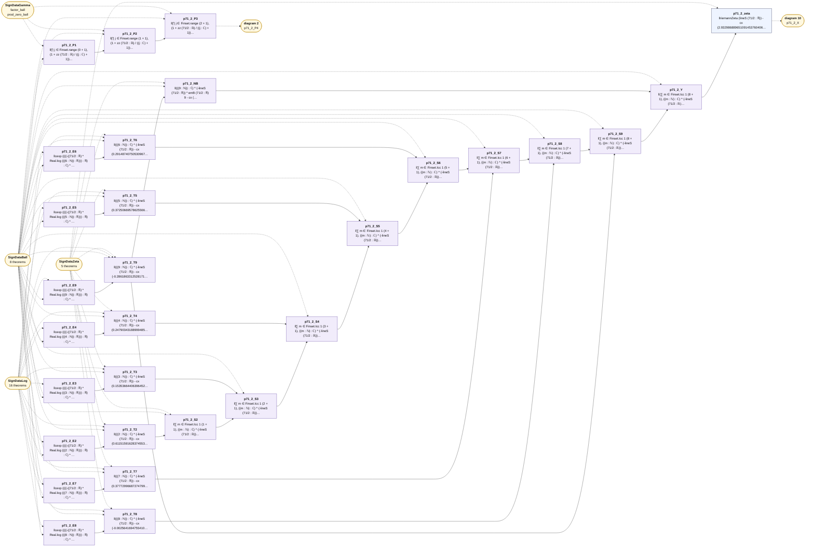

# `lean_stage3/Stage3/SignDataPt71_2.lean`

> **Read from the source text.** This file changed after the last `python3 utilities/lean_map.py --dump`, so the arrows on this page are names occurring in each proof and have not been confirmed by Lean.

SignDataPt71_2 — block S14 of `lean_stage3/design/stencil.md`, Turing's sign data: the sign of `Re Λ(1/2 + it)` at `t = 35.5`. 2026-11-25. Generated by `lean_stage3/checks/signdata/gen_signdata.py`; do not edit by hand.

288 theorems, 0 definitions, 1472 lines. 

**Imports:** [`SignDataGamma`](../lean_stage3/SignDataGamma.md), [`SignDataLog`](../lean_stage3/SignDataLog.md)  
**Imported by:** [`SignData`](../lean_stage3/SignData.md)

## The picture

### Diagram 1 of 10: `p71_2_E2` to `p71_2_P3`



### Diagram 2 of 10: `p71_2_P4` to `p71_2_P33`


### Diagram 3 of 10: `p71_2_P34` to `p71_2_P63`


### Diagram 4 of 10: `p71_2_P64` to `p71_2_P93`


### Diagram 5 of 10: `p71_2_P94` to `p71_2_P123`

```mermaid
flowchart LR
  n0["<b>p71_2_P94</b><br/>‖∏ j ∈ Finset.range (93 + 1), (1 + zz (71/2 : ℝ) / ((j : ℂ) + 1)…"]:::shp
  n1["<b>p71_2_P95</b><br/>‖∏ j ∈ Finset.range (94 + 1), (1 + zz (71/2 : ℝ) / ((j : ℂ) + 1)…"]:::shp
  n2["<b>p71_2_P96</b><br/>‖∏ j ∈ Finset.range (95 + 1), (1 + zz (71/2 : ℝ) / ((j : ℂ) + 1)…"]:::shp
  n3["<b>p71_2_P97</b><br/>‖∏ j ∈ Finset.range (96 + 1), (1 + zz (71/2 : ℝ) / ((j : ℂ) + 1)…"]:::shp
  n4["<b>p71_2_P98</b><br/>‖∏ j ∈ Finset.range (97 + 1), (1 + zz (71/2 : ℝ) / ((j : ℂ) + 1)…"]:::shp
  n5["<b>p71_2_P99</b><br/>‖∏ j ∈ Finset.range (98 + 1), (1 + zz (71/2 : ℝ) / ((j : ℂ) + 1)…"]:::shp
  n6["<b>p71_2_P100</b><br/>‖∏ j ∈ Finset.range (99 + 1), (1 + zz (71/2 : ℝ) / ((j : ℂ) + 1)…"]:::shp
  n7["<b>p71_2_P101</b><br/>‖∏ j ∈ Finset.range (100 + 1), (1 + zz (71/2 : ℝ) / ((j : ℂ) + 1…"]:::shp
  n8["<b>p71_2_P102</b><br/>‖∏ j ∈ Finset.range (101 + 1), (1 + zz (71/2 : ℝ) / ((j : ℂ) + 1…"]:::shp
  n9["<b>p71_2_P103</b><br/>‖∏ j ∈ Finset.range (102 + 1), (1 + zz (71/2 : ℝ) / ((j : ℂ) + 1…"]:::shp
  n10["<b>p71_2_P104</b><br/>‖∏ j ∈ Finset.range (103 + 1), (1 + zz (71/2 : ℝ) / ((j : ℂ) + 1…"]:::shp
  n11["<b>p71_2_P105</b><br/>‖∏ j ∈ Finset.range (104 + 1), (1 + zz (71/2 : ℝ) / ((j : ℂ) + 1…"]:::shp
  n12["<b>p71_2_P106</b><br/>‖∏ j ∈ Finset.range (105 + 1), (1 + zz (71/2 : ℝ) / ((j : ℂ) + 1…"]:::shp
  n13["<b>p71_2_P107</b><br/>‖∏ j ∈ Finset.range (106 + 1), (1 + zz (71/2 : ℝ) / ((j : ℂ) + 1…"]:::shp
  n14["<b>p71_2_P108</b><br/>‖∏ j ∈ Finset.range (107 + 1), (1 + zz (71/2 : ℝ) / ((j : ℂ) + 1…"]:::shp
  n15["<b>p71_2_P109</b><br/>‖∏ j ∈ Finset.range (108 + 1), (1 + zz (71/2 : ℝ) / ((j : ℂ) + 1…"]:::shp
  n16["<b>p71_2_P110</b><br/>‖∏ j ∈ Finset.range (109 + 1), (1 + zz (71/2 : ℝ) / ((j : ℂ) + 1…"]:::shp
  n17["<b>p71_2_P111</b><br/>‖∏ j ∈ Finset.range (110 + 1), (1 + zz (71/2 : ℝ) / ((j : ℂ) + 1…"]:::shp
  n18["<b>p71_2_P112</b><br/>‖∏ j ∈ Finset.range (111 + 1), (1 + zz (71/2 : ℝ) / ((j : ℂ) + 1…"]:::shp
  n19["<b>p71_2_P113</b><br/>‖∏ j ∈ Finset.range (112 + 1), (1 + zz (71/2 : ℝ) / ((j : ℂ) + 1…"]:::shp
  n20["<b>p71_2_P114</b><br/>‖∏ j ∈ Finset.range (113 + 1), (1 + zz (71/2 : ℝ) / ((j : ℂ) + 1…"]:::shp
  n21["<b>p71_2_P115</b><br/>‖∏ j ∈ Finset.range (114 + 1), (1 + zz (71/2 : ℝ) / ((j : ℂ) + 1…"]:::shp
  n22["<b>p71_2_P116</b><br/>‖∏ j ∈ Finset.range (115 + 1), (1 + zz (71/2 : ℝ) / ((j : ℂ) + 1…"]:::shp
  n23["<b>p71_2_P117</b><br/>‖∏ j ∈ Finset.range (116 + 1), (1 + zz (71/2 : ℝ) / ((j : ℂ) + 1…"]:::shp
  n24["<b>p71_2_P118</b><br/>‖∏ j ∈ Finset.range (117 + 1), (1 + zz (71/2 : ℝ) / ((j : ℂ) + 1…"]:::shp
  n25["<b>p71_2_P119</b><br/>‖∏ j ∈ Finset.range (118 + 1), (1 + zz (71/2 : ℝ) / ((j : ℂ) + 1…"]:::shp
  n26["<b>p71_2_P120</b><br/>‖∏ j ∈ Finset.range (119 + 1), (1 + zz (71/2 : ℝ) / ((j : ℂ) + 1…"]:::shp
  n27["<b>p71_2_P121</b><br/>‖∏ j ∈ Finset.range (120 + 1), (1 + zz (71/2 : ℝ) / ((j : ℂ) + 1…"]:::shp
  n28["<b>p71_2_P122</b><br/>‖∏ j ∈ Finset.range (121 + 1), (1 + zz (71/2 : ℝ) / ((j : ℂ) + 1…"]:::shp
  n29["<b>p71_2_P123</b><br/>‖∏ j ∈ Finset.range (122 + 1), (1 + zz (71/2 : ℝ) / ((j : ℂ) + 1…"]:::shp
  x0(["<b>SignDataBall</b><br/>ball_mul"]):::ext
  x1(["<b>SignDataGamma</b><br/>factor_ball"]):::ext
  x2(["<b>diagram 4</b><br/>p71_2_P93"]):::ext
  x3(["<b>diagram 6</b><br/>p71_2_P124"]):::ext
  n0 --> n1
  n1 --> n2
  n10 --> n11
  n11 --> n12
  n12 --> n13
  n13 --> n14
  n14 --> n15
  n15 --> n16
  n16 --> n17
  n17 --> n18
  n18 --> n19
  n19 --> n20
  n2 --> n3
  n20 --> n21
  n21 --> n22
  n22 --> n23
  n23 --> n24
  n24 --> n25
  n25 --> n26
  n26 --> n27
  n27 --> n28
  n28 --> n29
  n3 --> n4
  n4 --> n5
  n5 --> n6
  n6 --> n7
  n7 --> n8
  n8 --> n9
  n9 --> n10
  n29 -.-> x3
  x0 -.-> n0
  x0 -.-> n1
  x0 -.-> n10
  x0 -.-> n11
  x0 -.-> n12
  x0 -.-> n13
  x0 -.-> n14
  x0 -.-> n15
  x0 -.-> n16
  x0 -.-> n17
  x0 -.-> n18
  x0 -.-> n19
  x0 -.-> n2
  x0 -.-> n20
  x0 -.-> n21
  x0 -.-> n22
  x0 -.-> n23
  x0 -.-> n24
  x0 -.-> n25
  x0 -.-> n26
  x0 -.-> n27
  x0 -.-> n28
  x0 -.-> n29
  x0 -.-> n3
  x0 -.-> n4
  x0 -.-> n5
  x0 -.-> n6
  x0 -.-> n7
  x0 -.-> n8
  x0 -.-> n9
  x1 -.-> n0
  x1 -.-> n1
  x1 -.-> n10
  x1 -.-> n11
  x1 -.-> n12
  x1 -.-> n13
  x1 -.-> n14
  x1 -.-> n15
  x1 -.-> n16
  x1 -.-> n17
  x1 -.-> n18
  x1 -.-> n19
  x1 -.-> n2
  x1 -.-> n20
  x1 -.-> n21
  x1 -.-> n22
  x1 -.-> n23
  x1 -.-> n24
  x1 -.-> n25
  x1 -.-> n26
  x1 -.-> n27
  x1 -.-> n28
  x1 -.-> n29
  x1 -.-> n3
  x1 -.-> n4
  x1 -.-> n5
  x1 -.-> n6
  x1 -.-> n7
  x1 -.-> n8
  x1 -.-> n9
  x2 -.-> n0
  classDef cnt fill:#dff5ec,stroke:#17694a,color:#111
  classDef shp fill:#f1ecfb,stroke:#5b3fa0,color:#111
  classDef rh fill:#ffe5e5,stroke:#c22,color:#111,stroke-width:2px
  classDef thm fill:#eef4ff,stroke:#335,color:#111
  classDef end_ fill:#e7f7e7,stroke:#2a7,color:#111,stroke-width:2px
  classDef lone fill:#fff,stroke:#999,color:#111,stroke-dasharray:4 3
  classDef bad fill:#ffe5e5,stroke:#c22,color:#111,stroke-width:2px
  classDef ext fill:#fff8e1,stroke:#b80,color:#111
```



### Diagram 6 of 10: `p71_2_P124` to `p71_2_P153`


### Diagram 7 of 10: `p71_2_P154` to `p71_2_P183`

```mermaid
flowchart LR
  n0["<b>p71_2_P154</b><br/>‖∏ j ∈ Finset.range (153 + 1), (1 + zz (71/2 : ℝ) / ((j : ℂ) + 1…"]:::shp
  n1["<b>p71_2_P155</b><br/>‖∏ j ∈ Finset.range (154 + 1), (1 + zz (71/2 : ℝ) / ((j : ℂ) + 1…"]:::shp
  n2["<b>p71_2_P156</b><br/>‖∏ j ∈ Finset.range (155 + 1), (1 + zz (71/2 : ℝ) / ((j : ℂ) + 1…"]:::shp
  n3["<b>p71_2_P157</b><br/>‖∏ j ∈ Finset.range (156 + 1), (1 + zz (71/2 : ℝ) / ((j : ℂ) + 1…"]:::shp
  n4["<b>p71_2_P158</b><br/>‖∏ j ∈ Finset.range (157 + 1), (1 + zz (71/2 : ℝ) / ((j : ℂ) + 1…"]:::shp
  n5["<b>p71_2_P159</b><br/>‖∏ j ∈ Finset.range (158 + 1), (1 + zz (71/2 : ℝ) / ((j : ℂ) + 1…"]:::shp
  n6["<b>p71_2_P160</b><br/>‖∏ j ∈ Finset.range (159 + 1), (1 + zz (71/2 : ℝ) / ((j : ℂ) + 1…"]:::shp
  n7["<b>p71_2_P161</b><br/>‖∏ j ∈ Finset.range (160 + 1), (1 + zz (71/2 : ℝ) / ((j : ℂ) + 1…"]:::shp
  n8["<b>p71_2_P162</b><br/>‖∏ j ∈ Finset.range (161 + 1), (1 + zz (71/2 : ℝ) / ((j : ℂ) + 1…"]:::shp
  n9["<b>p71_2_P163</b><br/>‖∏ j ∈ Finset.range (162 + 1), (1 + zz (71/2 : ℝ) / ((j : ℂ) + 1…"]:::shp
  n10["<b>p71_2_P164</b><br/>‖∏ j ∈ Finset.range (163 + 1), (1 + zz (71/2 : ℝ) / ((j : ℂ) + 1…"]:::shp
  n11["<b>p71_2_P165</b><br/>‖∏ j ∈ Finset.range (164 + 1), (1 + zz (71/2 : ℝ) / ((j : ℂ) + 1…"]:::shp
  n12["<b>p71_2_P166</b><br/>‖∏ j ∈ Finset.range (165 + 1), (1 + zz (71/2 : ℝ) / ((j : ℂ) + 1…"]:::shp
  n13["<b>p71_2_P167</b><br/>‖∏ j ∈ Finset.range (166 + 1), (1 + zz (71/2 : ℝ) / ((j : ℂ) + 1…"]:::shp
  n14["<b>p71_2_P168</b><br/>‖∏ j ∈ Finset.range (167 + 1), (1 + zz (71/2 : ℝ) / ((j : ℂ) + 1…"]:::shp
  n15["<b>p71_2_P169</b><br/>‖∏ j ∈ Finset.range (168 + 1), (1 + zz (71/2 : ℝ) / ((j : ℂ) + 1…"]:::shp
  n16["<b>p71_2_P170</b><br/>‖∏ j ∈ Finset.range (169 + 1), (1 + zz (71/2 : ℝ) / ((j : ℂ) + 1…"]:::shp
  n17["<b>p71_2_P171</b><br/>‖∏ j ∈ Finset.range (170 + 1), (1 + zz (71/2 : ℝ) / ((j : ℂ) + 1…"]:::shp
  n18["<b>p71_2_P172</b><br/>‖∏ j ∈ Finset.range (171 + 1), (1 + zz (71/2 : ℝ) / ((j : ℂ) + 1…"]:::shp
  n19["<b>p71_2_P173</b><br/>‖∏ j ∈ Finset.range (172 + 1), (1 + zz (71/2 : ℝ) / ((j : ℂ) + 1…"]:::shp
  n20["<b>p71_2_P174</b><br/>‖∏ j ∈ Finset.range (173 + 1), (1 + zz (71/2 : ℝ) / ((j : ℂ) + 1…"]:::shp
  n21["<b>p71_2_P175</b><br/>‖∏ j ∈ Finset.range (174 + 1), (1 + zz (71/2 : ℝ) / ((j : ℂ) + 1…"]:::shp
  n22["<b>p71_2_P176</b><br/>‖∏ j ∈ Finset.range (175 + 1), (1 + zz (71/2 : ℝ) / ((j : ℂ) + 1…"]:::shp
  n23["<b>p71_2_P177</b><br/>‖∏ j ∈ Finset.range (176 + 1), (1 + zz (71/2 : ℝ) / ((j : ℂ) + 1…"]:::shp
  n24["<b>p71_2_P178</b><br/>‖∏ j ∈ Finset.range (177 + 1), (1 + zz (71/2 : ℝ) / ((j : ℂ) + 1…"]:::shp
  n25["<b>p71_2_P179</b><br/>‖∏ j ∈ Finset.range (178 + 1), (1 + zz (71/2 : ℝ) / ((j : ℂ) + 1…"]:::shp
  n26["<b>p71_2_P180</b><br/>‖∏ j ∈ Finset.range (179 + 1), (1 + zz (71/2 : ℝ) / ((j : ℂ) + 1…"]:::shp
  n27["<b>p71_2_P181</b><br/>‖∏ j ∈ Finset.range (180 + 1), (1 + zz (71/2 : ℝ) / ((j : ℂ) + 1…"]:::shp
  n28["<b>p71_2_P182</b><br/>‖∏ j ∈ Finset.range (181 + 1), (1 + zz (71/2 : ℝ) / ((j : ℂ) + 1…"]:::shp
  n29["<b>p71_2_P183</b><br/>‖∏ j ∈ Finset.range (182 + 1), (1 + zz (71/2 : ℝ) / ((j : ℂ) + 1…"]:::shp
  x0(["<b>SignDataBall</b><br/>ball_mul"]):::ext
  x1(["<b>SignDataGamma</b><br/>factor_ball"]):::ext
  x2(["<b>diagram 6</b><br/>p71_2_P153"]):::ext
  x3(["<b>diagram 8</b><br/>p71_2_P184"]):::ext
  n0 --> n1
  n1 --> n2
  n10 --> n11
  n11 --> n12
  n12 --> n13
  n13 --> n14
  n14 --> n15
  n15 --> n16
  n16 --> n17
  n17 --> n18
  n18 --> n19
  n19 --> n20
  n2 --> n3
  n20 --> n21
  n21 --> n22
  n22 --> n23
  n23 --> n24
  n24 --> n25
  n25 --> n26
  n26 --> n27
  n27 --> n28
  n28 --> n29
  n3 --> n4
  n4 --> n5
  n5 --> n6
  n6 --> n7
  n7 --> n8
  n8 --> n9
  n9 --> n10
  n29 -.-> x3
  x0 -.-> n0
  x0 -.-> n1
  x0 -.-> n10
  x0 -.-> n11
  x0 -.-> n12
  x0 -.-> n13
  x0 -.-> n14
  x0 -.-> n15
  x0 -.-> n16
  x0 -.-> n17
  x0 -.-> n18
  x0 -.-> n19
  x0 -.-> n2
  x0 -.-> n20
  x0 -.-> n21
  x0 -.-> n22
  x0 -.-> n23
  x0 -.-> n24
  x0 -.-> n25
  x0 -.-> n26
  x0 -.-> n27
  x0 -.-> n28
  x0 -.-> n29
  x0 -.-> n3
  x0 -.-> n4
  x0 -.-> n5
  x0 -.-> n6
  x0 -.-> n7
  x0 -.-> n8
  x0 -.-> n9
  x1 -.-> n0
  x1 -.-> n1
  x1 -.-> n10
  x1 -.-> n11
  x1 -.-> n12
  x1 -.-> n13
  x1 -.-> n14
  x1 -.-> n15
  x1 -.-> n16
  x1 -.-> n17
  x1 -.-> n18
  x1 -.-> n19
  x1 -.-> n2
  x1 -.-> n20
  x1 -.-> n21
  x1 -.-> n22
  x1 -.-> n23
  x1 -.-> n24
  x1 -.-> n25
  x1 -.-> n26
  x1 -.-> n27
  x1 -.-> n28
  x1 -.-> n29
  x1 -.-> n3
  x1 -.-> n4
  x1 -.-> n5
  x1 -.-> n6
  x1 -.-> n7
  x1 -.-> n8
  x1 -.-> n9
  x2 -.-> n0
  classDef cnt fill:#dff5ec,stroke:#17694a,color:#111
  classDef shp fill:#f1ecfb,stroke:#5b3fa0,color:#111
  classDef rh fill:#ffe5e5,stroke:#c22,color:#111,stroke-width:2px
  classDef thm fill:#eef4ff,stroke:#335,color:#111
  classDef end_ fill:#e7f7e7,stroke:#2a7,color:#111,stroke-width:2px
  classDef lone fill:#fff,stroke:#999,color:#111,stroke-dasharray:4 3
  classDef bad fill:#ffe5e5,stroke:#c22,color:#111,stroke-width:2px
  classDef ext fill:#fff8e1,stroke:#b80,color:#111
```



### Diagram 8 of 10: `p71_2_P184` to `p71_2_P213`


### Diagram 9 of 10: `p71_2_P214` to `p71_2_P243`


### Diagram 10 of 10: `p71_2_P244` to `sign_71_2`

```mermaid
flowchart LR
  n0["<b>p71_2_P244</b><br/>‖∏ j ∈ Finset.range (243 + 1), (1 + zz (71/2 : ℝ) / ((j : ℂ) + 1…"]:::shp
  n1["<b>p71_2_P245</b><br/>‖∏ j ∈ Finset.range (244 + 1), (1 + zz (71/2 : ℝ) / ((j : ℂ) + 1…"]:::shp
  n2["<b>p71_2_P246</b><br/>‖∏ j ∈ Finset.range (245 + 1), (1 + zz (71/2 : ℝ) / ((j : ℂ) + 1…"]:::shp
  n3["<b>p71_2_P247</b><br/>‖∏ j ∈ Finset.range (246 + 1), (1 + zz (71/2 : ℝ) / ((j : ℂ) + 1…"]:::shp
  n4["<b>p71_2_P248</b><br/>‖∏ j ∈ Finset.range (247 + 1), (1 + zz (71/2 : ℝ) / ((j : ℂ) + 1…"]:::shp
  n5["<b>p71_2_P249</b><br/>‖∏ j ∈ Finset.range (248 + 1), (1 + zz (71/2 : ℝ) / ((j : ℂ) + 1…"]:::shp
  n6["<b>p71_2_P250</b><br/>‖∏ j ∈ Finset.range (249 + 1), (1 + zz (71/2 : ℝ) / ((j : ℂ) + 1…"]:::shp
  n7["<b>p71_2_P251</b><br/>‖∏ j ∈ Finset.range (250 + 1), (1 + zz (71/2 : ℝ) / ((j : ℂ) + 1…"]:::shp
  n8["<b>p71_2_P252</b><br/>‖∏ j ∈ Finset.range (251 + 1), (1 + zz (71/2 : ℝ) / ((j : ℂ) + 1…"]:::shp
  n9["<b>p71_2_P253</b><br/>‖∏ j ∈ Finset.range (252 + 1), (1 + zz (71/2 : ℝ) / ((j : ℂ) + 1…"]:::shp
  n10["<b>p71_2_P254</b><br/>‖∏ j ∈ Finset.range (253 + 1), (1 + zz (71/2 : ℝ) / ((j : ℂ) + 1…"]:::shp
  n11["<b>p71_2_P255</b><br/>‖∏ j ∈ Finset.range (254 + 1), (1 + zz (71/2 : ℝ) / ((j : ℂ) + 1…"]:::shp
  n12["<b>p71_2_P256</b><br/>‖∏ j ∈ Finset.range (255 + 1), (1 + zz (71/2 : ℝ) / ((j : ℂ) + 1…"]:::shp
  n13["<b>p71_2_W</b><br/>‖zz (71/2 : ℝ) * ∏ j ∈ Finset.range (255 + 1), (1 + zz (71/2 : ℝ…"]:::shp
  n14["<b>p71_2_phase</b><br/>‖cexp (((((71/2 : ℝ) / 2) * (Real.log (((256 : ℕ)) : ℝ) - Real.l…"]:::shp
  n15["<b>p71_2_G</b><br/>‖gammaDir (71/2 : ℝ) 256 - cx (2279307187096.8775776600038646726…"]:::shp
  n16["<b>p71_2_X</b><br/>‖gammaDir (71/2 : ℝ) 256 * riemannZeta (lineS (71/2 : ℝ)) - cx (…"]:::thm
  n17["<b>sign_71_2</b><br/>0 ＜ (completedRiemannZeta (lineS (71/2 : ℝ))).re"]:::thm
  x0(["<b>SignDataBall</b><br/>4 theorems"]):::ext
  x1(["<b>SignDataGamma</b><br/>factor_ball<br/>re_lambda_pos<br/>zz_ball"]):::ext
  x2(["<b>diagram 9</b><br/>p71_2_P243"]):::ext
  x3(["<b>SignDataLog</b><br/>log_pi_ball'<br/>log_pow2_ball_256"]):::ext
  x4(["<b>diagram 1</b><br/>p71_2_zeta"]):::ext
  x5(["<b>SignData</b><br/>run_signs"]):::ext
  n0 --> n1
  n1 --> n2
  n10 --> n11
  n11 --> n12
  n12 --> n13
  n13 --> n15
  n14 --> n15
  n15 --> n16
  n16 --> n17
  n2 --> n3
  n3 --> n4
  n4 --> n5
  n5 --> n6
  n6 --> n7
  n7 --> n8
  n8 --> n9
  n9 --> n10
  n17 -.-> x5
  x0 -.-> n0
  x0 -.-> n1
  x0 -.-> n10
  x0 -.-> n11
  x0 -.-> n12
  x0 -.-> n13
  x0 -.-> n14
  x0 -.-> n15
  x0 -.-> n16
  x0 -.-> n2
  x0 -.-> n3
  x0 -.-> n4
  x0 -.-> n5
  x0 -.-> n6
  x0 -.-> n7
  x0 -.-> n8
  x0 -.-> n9
  x1 -.-> n0
  x1 -.-> n1
  x1 -.-> n10
  x1 -.-> n11
  x1 -.-> n12
  x1 -.-> n13
  x1 -.-> n17
  x1 -.-> n2
  x1 -.-> n3
  x1 -.-> n4
  x1 -.-> n5
  x1 -.-> n6
  x1 -.-> n7
  x1 -.-> n8
  x1 -.-> n9
  x2 -.-> n0
  x3 -.-> n14
  x4 -.-> n16
  classDef cnt fill:#dff5ec,stroke:#17694a,color:#111
  classDef shp fill:#f1ecfb,stroke:#5b3fa0,color:#111
  classDef rh fill:#ffe5e5,stroke:#c22,color:#111,stroke-width:2px
  classDef thm fill:#eef4ff,stroke:#335,color:#111
  classDef end_ fill:#e7f7e7,stroke:#2a7,color:#111,stroke-width:2px
  classDef lone fill:#fff,stroke:#999,color:#111,stroke-dasharray:4 3
  classDef bad fill:#ffe5e5,stroke:#c22,color:#111,stroke-width:2px
  classDef ext fill:#fff8e1,stroke:#b80,color:#111
```



An arrow A → B reads "A is used in the proof of B". Green: counting, integers only. Violet: shape, analysis with no ζ. Blue: reads ζ. A name ending in ■ is an end: nothing else uses it. Red: contains `sorry`. Yellow: theorems in another file, counted; a dotted arrow crosses files. Definitions are not drawn; they are listed below the diagram.

## Theorems

<a name="SignData-p71_2_E2"></a>
### `SignData.p71_2_E2`

line 31 · arrows read from text

**Shape.** Uses real or complex analysis; nothing in it or beneath it reads ζ.

**Proves**

```lean
‖cexp ((((-((71/2 : ℝ) * Real.log (((2 : ℕ)) : ℝ))) : ℝ) : ℂ) * Complex.I) - cx (0.864814102415483135888607366638) (0.502092191000121257321120086426)‖ ≤ (0.00000000887500000008000113514)
```

**Fed by** (3 theorems its proof uses)

  - [`SignData.exp_ball0`](../lean_stage3/SignDataBall.md#SignData-exp_ball0) (SignDataBall) — `` ‖cexp ((x : ℂ) * I) - cx e f‖ ≤ R ``
  - [`SignData.neg_mul_ball`](../lean_stage3/SignDataBall.md#SignData-neg_mul_ball) (SignDataBall) — `` |-(t * x) - -(t * a)| ≤ |t| * e ``
  - [`SignData.log_ball_2`](../lean_stage3/SignDataLog.md#SignData-log_ball_2) (SignDataLog) — `` |Real.log ((2 : ℕ) : ℝ) - (0.69314718055)| ≤ (0.00000000025) ``

**Definitions its proof touches:** [`SignData.cosP`](../lean_stage3/SignDataBall.md#SignData-cosP), [`SignData.cx`](../lean_stage3/SignDataBall.md#SignData-cx), [`SignData.sinP`](../lean_stage3/SignDataBall.md#SignData-sinP)

**Feeds** (1 that use it)

  - [`SignData.p71_2_T2`](#SignData-p71_2_T2) — `` ‖(((2 : ℕ)) : ℂ) ^ (-lineS (71/2 : ℝ)) - cx (0.611515916283745534650525385081) (0.355032793036996968126078435899)‖ ≤ (0.00000000627557268308717862422) ``

<a name="SignData-p71_2_T2"></a>
### `SignData.p71_2_T2`

line 37 · arrows read from text

**Shape.** Uses real or complex analysis; nothing in it or beneath it reads ζ.

**Proves**

```lean
‖(((2 : ℕ)) : ℂ) ^ (-lineS (71/2 : ℝ)) - cx (0.611515916283745534650525385081) (0.355032793036996968126078435899)‖ ≤ (0.00000000627557268308717862422)
```

**Fed by** (5 theorems its proof uses)

  - [`SignData.ball_mul`](../lean_stage3/SignDataBall.md#SignData-ball_mul) (SignDataBall) — `` ‖z * w - cx e f‖ ≤ R ``
  - [`SignData.ball_ofReal`](../lean_stage3/SignDataBall.md#SignData-ball_ofReal) (SignDataBall) — `` ‖(x : ℂ) - cx c 0‖ ≤ e ``
  - [`SignData.isqrt_ball_2`](../lean_stage3/SignDataLog.md#SignData-isqrt_ball_2) (SignDataLog) — `` |(Real.sqrt (((2 : ℕ)) : ℝ))⁻¹ - (0.707106781186547524400844362104)| ≤ (0.000000000000000000000000000001) ``
  - [`SignData.p71_2_E2`](#SignData-p71_2_E2) — `` ‖cexp ((((-((71/2 : ℝ) * Real.log (((2 : ℕ)) : ℝ))) : ℝ) : ℂ) * Complex.I) - cx (0.864814102415483135888607366638) (0.502092191000121257321120086426)‖… ``
  - [`SignData.natCast_cpow_line`](../lean_stage3/SignDataZeta.md#SignData-natCast_cpow_line) (SignDataZeta) — `` (m : ℂ) ^ (-lineS t) = (((Real.sqrt m)⁻¹ : ℝ) : ℂ) * cexp (((-(t * Real.log m)) : ℝ) * I) ``

**Definitions its proof touches:** [`SignData.cx`](../lean_stage3/SignDataBall.md#SignData-cx), [`SignData.lineS`](../lean_stage3/SignDataZeta.md#SignData-lineS)

**Feeds** (1 that use it)

  - [`SignData.p71_2_S2`](#SignData-p71_2_S2) — `` ‖∑ m ∈ Finset.Icc 1 (1 + 1), ((m : ℕ) : ℂ) ^ (-lineS (71/2 : ℝ)) - cx (1.611515916283745534650525385081) (0.355032793036996968126078435899)‖ ≤ (0.0000… ``

<a name="SignData-p71_2_E3"></a>
### `SignData.p71_2_E3`

line 41 · arrows read from text

**Shape.** Uses real or complex analysis; nothing in it or beneath it reads ζ.

**Proves**

```lean
‖cexp ((((-((71/2 : ℝ) * Real.log (((3 : ℕ)) : ℝ))) : ℝ) : ℂ) * Complex.I) - cx (0.265933268342405023336551989178) (-(0.963991440205112195897546931753))‖ ≤ (0.000000008875258631954418213506)
```

**Fed by** (3 theorems its proof uses)

  - [`SignData.exp_ball3`](../lean_stage3/SignDataBall.md#SignData-exp_ball3) (SignDataBall) — `` ‖cexp ((x : ℂ) * I) - cx f (-e)‖ ≤ R ``
  - [`SignData.neg_mul_ball`](../lean_stage3/SignDataBall.md#SignData-neg_mul_ball) (SignDataBall) — `` |-(t * x) - -(t * a)| ≤ |t| * e ``
  - [`SignData.log_ball_3`](../lean_stage3/SignDataLog.md#SignData-log_ball_3) (SignDataLog) — `` |Real.log (((3 : ℕ)) : ℝ) - (1.098612288658164142930964760306)| ≤ (0.000000000250007285403624428292) ``

**Definitions its proof touches:** [`SignData.cosP`](../lean_stage3/SignDataBall.md#SignData-cosP), [`SignData.cx`](../lean_stage3/SignDataBall.md#SignData-cx), [`SignData.sinP`](../lean_stage3/SignDataBall.md#SignData-sinP)

**Feeds** (1 that use it)

  - [`SignData.p71_2_T3`](#SignData-p71_2_T3) — `` ‖(((3 : ℕ)) : ℂ) ^ (-lineS (71/2 : ℝ)) - cx (0.153536644063964523648154733903) (-0.556560717498916555305799200535)‖ ≤ (0.00000000512413296028643305460… ``

<a name="SignData-p71_2_T3"></a>
### `SignData.p71_2_T3`

line 47 · arrows read from text

**Shape.** Uses real or complex analysis; nothing in it or beneath it reads ζ.

**Proves**

```lean
‖(((3 : ℕ)) : ℂ) ^ (-lineS (71/2 : ℝ)) - cx (0.153536644063964523648154733903) (-0.556560717498916555305799200535)‖ ≤ (0.000000005124132960286433054609)
```

**Fed by** (5 theorems its proof uses)

  - [`SignData.ball_mul`](../lean_stage3/SignDataBall.md#SignData-ball_mul) (SignDataBall) — `` ‖z * w - cx e f‖ ≤ R ``
  - [`SignData.ball_ofReal`](../lean_stage3/SignDataBall.md#SignData-ball_ofReal) (SignDataBall) — `` ‖(x : ℂ) - cx c 0‖ ≤ e ``
  - [`SignData.isqrt_ball_3`](../lean_stage3/SignDataLog.md#SignData-isqrt_ball_3) (SignDataLog) — `` |(Real.sqrt (((3 : ℕ)) : ℝ))⁻¹ - (0.577350269189625764509148780502)| ≤ (0.000000000000000000000000000001) ``
  - [`SignData.p71_2_E3`](#SignData-p71_2_E3) — `` ‖cexp ((((-((71/2 : ℝ) * Real.log (((3 : ℕ)) : ℝ))) : ℝ) : ℂ) * Complex.I) - cx (0.265933268342405023336551989178) (-(0.963991440205112195897546931753… ``
  - [`SignData.natCast_cpow_line`](../lean_stage3/SignDataZeta.md#SignData-natCast_cpow_line) (SignDataZeta) — `` (m : ℂ) ^ (-lineS t) = (((Real.sqrt m)⁻¹ : ℝ) : ℂ) * cexp (((-(t * Real.log m)) : ℝ) * I) ``

**Definitions its proof touches:** [`SignData.cx`](../lean_stage3/SignDataBall.md#SignData-cx), [`SignData.lineS`](../lean_stage3/SignDataZeta.md#SignData-lineS)

**Feeds** (1 that use it)

  - [`SignData.p71_2_S3`](#SignData-p71_2_S3) — `` ‖∑ m ∈ Finset.Icc 1 (2 + 1), ((m : ℕ) : ℂ) ^ (-lineS (71/2 : ℝ)) - cx (1.765052560347710058298680118984) (-0.201527924461919587179720764636)‖ ≤ (0.000… ``

<a name="SignData-p71_2_E4"></a>
### `SignData.p71_2_E4`

line 51 · arrows read from text

**Shape.** Uses real or complex analysis; nothing in it or beneath it reads ζ.

**Proves**

```lean
‖cexp ((((-((71/2 : ℝ) * Real.log (((4 : ℕ)) : ℝ))) : ℝ) : ℂ) * Complex.I) - cx (-(-0.495806863779989706504898114671)) (0.868432814804145186662647617387)‖ ≤ (0.000000008875426793767590325071)
```

**Fed by** (3 theorems its proof uses)

  - [`SignData.exp_ball1`](../lean_stage3/SignDataBall.md#SignData-exp_ball1) (SignDataBall) — `` ‖cexp ((x : ℂ) * I) - cx (-f) e‖ ≤ R ``
  - [`SignData.neg_mul_ball`](../lean_stage3/SignDataBall.md#SignData-neg_mul_ball) (SignDataBall) — `` |-(t * x) - -(t * a)| ≤ |t| * e ``
  - [`SignData.log_ball_4`](../lean_stage3/SignDataLog.md#SignData-log_ball_4) (SignDataLog) — `` |Real.log (((4 : ℕ)) : ℝ) - (1.386294361109944875563750019823)| ≤ (0.000000000250012022355196162294) ``

**Definitions its proof touches:** [`SignData.cosP`](../lean_stage3/SignDataBall.md#SignData-cosP), [`SignData.cx`](../lean_stage3/SignDataBall.md#SignData-cx), [`SignData.sinP`](../lean_stage3/SignDataBall.md#SignData-sinP)

**Feeds** (1 that use it)

  - [`SignData.p71_2_T4`](#SignData-p71_2_T4) — `` ‖(((4 : ℕ)) : ℂ) ^ (-lineS (71/2 : ℝ)) - cx (0.247903431889994853252449057336) (0.434216407402072593331323808694)‖ ≤ (0.000000004437713396883795162538… ``

<a name="SignData-p71_2_T4"></a>
### `SignData.p71_2_T4`

line 57 · arrows read from text

**Shape.** Uses real or complex analysis; nothing in it or beneath it reads ζ.

**Proves**

```lean
‖(((4 : ℕ)) : ℂ) ^ (-lineS (71/2 : ℝ)) - cx (0.247903431889994853252449057336) (0.434216407402072593331323808694)‖ ≤ (0.000000004437713396883795162538)
```

**Fed by** (5 theorems its proof uses)

  - [`SignData.ball_mul`](../lean_stage3/SignDataBall.md#SignData-ball_mul) (SignDataBall) — `` ‖z * w - cx e f‖ ≤ R ``
  - [`SignData.ball_ofReal`](../lean_stage3/SignDataBall.md#SignData-ball_ofReal) (SignDataBall) — `` ‖(x : ℂ) - cx c 0‖ ≤ e ``
  - [`SignData.isqrt_ball_4`](../lean_stage3/SignDataLog.md#SignData-isqrt_ball_4) (SignDataLog) — `` |(Real.sqrt (((4 : ℕ)) : ℝ))⁻¹ - (0.5)| ≤ (0.000000000000000000000000000001) ``
  - [`SignData.p71_2_E4`](#SignData-p71_2_E4) — `` ‖cexp ((((-((71/2 : ℝ) * Real.log (((4 : ℕ)) : ℝ))) : ℝ) : ℂ) * Complex.I) - cx (-(-0.495806863779989706504898114671)) (0.8684328148041451866626476173… ``
  - [`SignData.natCast_cpow_line`](../lean_stage3/SignDataZeta.md#SignData-natCast_cpow_line) (SignDataZeta) — `` (m : ℂ) ^ (-lineS t) = (((Real.sqrt m)⁻¹ : ℝ) : ℂ) * cexp (((-(t * Real.log m)) : ℝ) * I) ``

**Definitions its proof touches:** [`SignData.cx`](../lean_stage3/SignDataBall.md#SignData-cx), [`SignData.lineS`](../lean_stage3/SignDataZeta.md#SignData-lineS)

**Feeds** (1 that use it)

  - [`SignData.p71_2_S4`](#SignData-p71_2_S4) — `` ‖∑ m ∈ Finset.Icc 1 (3 + 1), ((m : ℕ) : ℂ) ^ (-lineS (71/2 : ℝ)) - cx (2.01295599223770491155112917632) (0.232688482940153006151603044058)‖ ≤ (0.00000… ``

<a name="SignData-p71_2_E5"></a>
### `SignData.p71_2_E5`

line 61 · arrows read from text

**Shape.** Uses real or complex analysis; nothing in it or beneath it reads ζ.

**Proves**

```lean
‖cexp ((((-((71/2 : ℝ) * Real.log (((5 : ℕ)) : ℝ))) : ℝ) : ℂ) * Complex.I) - cx (0.832950293851902143069880029751) (-0.55334781825903124357524843098)‖ ≤ (0.000000008875519854910089981435)
```

**Fed by** (3 theorems its proof uses)

  - [`SignData.exp_ball0`](../lean_stage3/SignDataBall.md#SignData-exp_ball0) (SignDataBall) — `` ‖cexp ((x : ℂ) * I) - cx e f‖ ≤ R ``
  - [`SignData.neg_mul_ball`](../lean_stage3/SignDataBall.md#SignData-neg_mul_ball) (SignDataBall) — `` |-(t * x) - -(t * a)| ≤ |t| * e ``
  - [`SignData.log_ball_5`](../lean_stage3/SignDataLog.md#SignData-log_ball_5) (SignDataLog) — `` |Real.log (((5 : ℕ)) : ℝ) - (1.609437912424154507888186373287)| ≤ (0.000000000250014643795196162295) ``

**Definitions its proof touches:** [`SignData.cosP`](../lean_stage3/SignDataBall.md#SignData-cosP), [`SignData.cx`](../lean_stage3/SignDataBall.md#SignData-cx), [`SignData.sinP`](../lean_stage3/SignDataBall.md#SignData-sinP)

**Feeds** (1 that use it)

  - [`SignData.p71_2_T5`](#SignData-p71_2_T5) — `` ‖(((5 : ℕ)) : ℂ) ^ (-lineS (71/2 : ℝ)) - cx (0.372506695786255667428881075294) (-0.247464667365678638579491967539)‖ ≤ (0.00000000396925314624560635908… ``

<a name="SignData-p71_2_T5"></a>
### `SignData.p71_2_T5`

line 67 · arrows read from text

**Shape.** Uses real or complex analysis; nothing in it or beneath it reads ζ.

**Proves**

```lean
‖(((5 : ℕ)) : ℂ) ^ (-lineS (71/2 : ℝ)) - cx (0.372506695786255667428881075294) (-0.247464667365678638579491967539)‖ ≤ (0.000000003969253146245606359089)
```

**Fed by** (5 theorems its proof uses)

  - [`SignData.ball_mul`](../lean_stage3/SignDataBall.md#SignData-ball_mul) (SignDataBall) — `` ‖z * w - cx e f‖ ≤ R ``
  - [`SignData.ball_ofReal`](../lean_stage3/SignDataBall.md#SignData-ball_ofReal) (SignDataBall) — `` ‖(x : ℂ) - cx c 0‖ ≤ e ``
  - [`SignData.isqrt_ball_5`](../lean_stage3/SignDataLog.md#SignData-isqrt_ball_5) (SignDataLog) — `` |(Real.sqrt (((5 : ℕ)) : ℝ))⁻¹ - (0.447213595499957939281834733746)| ≤ (0.000000000000000000000000000001) ``
  - [`SignData.p71_2_E5`](#SignData-p71_2_E5) — `` ‖cexp ((((-((71/2 : ℝ) * Real.log (((5 : ℕ)) : ℝ))) : ℝ) : ℂ) * Complex.I) - cx (0.832950293851902143069880029751) (-0.55334781825903124357524843098)‖… ``
  - [`SignData.natCast_cpow_line`](../lean_stage3/SignDataZeta.md#SignData-natCast_cpow_line) (SignDataZeta) — `` (m : ℂ) ^ (-lineS t) = (((Real.sqrt m)⁻¹ : ℝ) : ℂ) * cexp (((-(t * Real.log m)) : ℝ) * I) ``

**Definitions its proof touches:** [`SignData.cx`](../lean_stage3/SignDataBall.md#SignData-cx), [`SignData.lineS`](../lean_stage3/SignDataZeta.md#SignData-lineS)

**Feeds** (1 that use it)

  - [`SignData.p71_2_S5`](#SignData-p71_2_S5) — `` ‖∑ m ∈ Finset.Icc 1 (4 + 1), ((m : ℕ) : ℂ) ^ (-lineS (71/2 : ℝ)) - cx (2.385462688023960578980010251614) (-0.014776184425525632427888923481)‖ ≤ (0.000… ``

<a name="SignData-p71_2_E6"></a>
### `SignData.p71_2_E6`

line 71 · arrows read from text

**Shape.** Uses real or complex analysis; nothing in it or beneath it reads ζ.

**Proves**

```lean
‖cexp ((((-((71/2 : ℝ) * Real.log (((6 : ℕ)) : ℝ))) : ℝ) : ℂ) * Complex.I) - cx (0.713995414834716410816259329178) (-0.700150374987403134414247492392)‖ ≤ (0.000000008875589764379436109754)
```

**Fed by** (3 theorems its proof uses)

  - [`SignData.exp_ball0`](../lean_stage3/SignDataBall.md#SignData-exp_ball0) (SignDataBall) — `` ‖cexp ((x : ℂ) * I) - cx e f‖ ≤ R ``
  - [`SignData.neg_mul_ball`](../lean_stage3/SignDataBall.md#SignData-neg_mul_ball) (SignDataBall) — `` |-(t * x) - -(t * a)| ≤ |t| * e ``
  - [`SignData.log_ball_6`](../lean_stage3/SignDataLog.md#SignData-log_ball_6) (SignDataLog) — `` |Real.log (((6 : ℕ)) : ℝ) - (1.791759469218109031470825672761)| ≤ (0.000000000250016613075280171998) ``

**Definitions its proof touches:** [`SignData.cosP`](../lean_stage3/SignDataBall.md#SignData-cosP), [`SignData.cx`](../lean_stage3/SignDataBall.md#SignData-cx), [`SignData.sinP`](../lean_stage3/SignDataBall.md#SignData-sinP)

**Feeds** (1 that use it)

  - [`SignData.p71_2_T6`](#SignData-p71_2_T6) — `` ‖(((6 : ℕ)) : ℂ) ^ (-lineS (71/2 : ℝ)) - cx (0.291487407505309674147553196897) (-0.285835193656239966016849348486)‖ ≤ (0.00000000362344434816646554310… ``

<a name="SignData-p71_2_T6"></a>
### `SignData.p71_2_T6`

line 77 · arrows read from text

**Shape.** Uses real or complex analysis; nothing in it or beneath it reads ζ.

**Proves**

```lean
‖(((6 : ℕ)) : ℂ) ^ (-lineS (71/2 : ℝ)) - cx (0.291487407505309674147553196897) (-0.285835193656239966016849348486)‖ ≤ (0.000000003623444348166465543108)
```

**Fed by** (5 theorems its proof uses)

  - [`SignData.ball_mul`](../lean_stage3/SignDataBall.md#SignData-ball_mul) (SignDataBall) — `` ‖z * w - cx e f‖ ≤ R ``
  - [`SignData.ball_ofReal`](../lean_stage3/SignDataBall.md#SignData-ball_ofReal) (SignDataBall) — `` ‖(x : ℂ) - cx c 0‖ ≤ e ``
  - [`SignData.isqrt_ball_6`](../lean_stage3/SignDataLog.md#SignData-isqrt_ball_6) (SignDataLog) — `` |(Real.sqrt (((6 : ℕ)) : ℝ))⁻¹ - (0.40824829046386301636621401245)| ≤ (0.000000000000000000000000000001) ``
  - [`SignData.p71_2_E6`](#SignData-p71_2_E6) — `` ‖cexp ((((-((71/2 : ℝ) * Real.log (((6 : ℕ)) : ℝ))) : ℝ) : ℂ) * Complex.I) - cx (0.713995414834716410816259329178) (-0.700150374987403134414247492392)… ``
  - [`SignData.natCast_cpow_line`](../lean_stage3/SignDataZeta.md#SignData-natCast_cpow_line) (SignDataZeta) — `` (m : ℂ) ^ (-lineS t) = (((Real.sqrt m)⁻¹ : ℝ) : ℂ) * cexp (((-(t * Real.log m)) : ℝ) * I) ``

**Definitions its proof touches:** [`SignData.cx`](../lean_stage3/SignDataBall.md#SignData-cx), [`SignData.lineS`](../lean_stage3/SignDataZeta.md#SignData-lineS)

**Feeds** (1 that use it)

  - [`SignData.p71_2_S6`](#SignData-p71_2_S6) — `` ‖∑ m ∈ Finset.Icc 1 (5 + 1), ((m : ℕ) : ℂ) ^ (-lineS (71/2 : ℝ)) - cx (2.676950095529270253127563448511) (-0.300611378081765598444738271967)‖ ≤ (0.000… ``

<a name="SignData-p71_2_E7"></a>
### `SignData.p71_2_E7`

line 81 · arrows read from text

**Shape.** Uses real or complex analysis; nothing in it or beneath it reads ζ.

**Proves**

```lean
‖cexp ((((-((71/2 : ℝ) * Real.log (((7 : ℕ)) : ℝ))) : ℝ) : ℂ) * Complex.I) - cx (0.999379555081957376086764896069) (0.035220801867489089127021590243)‖ ≤ (0.000000008875767800652561883856)
```

**Fed by** (3 theorems its proof uses)

  - [`SignData.exp_ball0`](../lean_stage3/SignDataBall.md#SignData-exp_ball0) (SignDataBall) — `` ‖cexp ((x : ℂ) * I) - cx e f‖ ≤ R ``
  - [`SignData.neg_mul_ball`](../lean_stage3/SignDataBall.md#SignData-neg_mul_ball) (SignDataBall) — `` |-(t * x) - -(t * a)| ≤ |t| * e ``
  - [`SignData.log_ball_7`](../lean_stage3/SignDataLog.md#SignData-log_ball_7) (SignDataLog) — `` |Real.log (((7 : ℕ)) : ℝ) - (1.945910149045367043442249594592)| ≤ (0.000000000250021628181194999771) ``

**Definitions its proof touches:** [`SignData.cosP`](../lean_stage3/SignDataBall.md#SignData-cosP), [`SignData.cx`](../lean_stage3/SignDataBall.md#SignData-cx), [`SignData.sinP`](../lean_stage3/SignDataBall.md#SignData-sinP)

**Feeds** (1 that use it)

  - [`SignData.p71_2_T7`](#SignData-p71_2_T7) — `` ‖(((7 : ℕ)) : ℂ) ^ (-lineS (71/2 : ℝ)) - cx (0.37772996687274799368938056107) (0.013312211816807919746653535581)‖ ≤ (0.000000003354724899325913334734) ``

<a name="SignData-p71_2_T7"></a>
### `SignData.p71_2_T7`

line 87 · arrows read from text

**Shape.** Uses real or complex analysis; nothing in it or beneath it reads ζ.

**Proves**

```lean
‖(((7 : ℕ)) : ℂ) ^ (-lineS (71/2 : ℝ)) - cx (0.37772996687274799368938056107) (0.013312211816807919746653535581)‖ ≤ (0.000000003354724899325913334734)
```

**Fed by** (5 theorems its proof uses)

  - [`SignData.ball_mul`](../lean_stage3/SignDataBall.md#SignData-ball_mul) (SignDataBall) — `` ‖z * w - cx e f‖ ≤ R ``
  - [`SignData.ball_ofReal`](../lean_stage3/SignDataBall.md#SignData-ball_ofReal) (SignDataBall) — `` ‖(x : ℂ) - cx c 0‖ ≤ e ``
  - [`SignData.isqrt_ball_7`](../lean_stage3/SignDataLog.md#SignData-isqrt_ball_7) (SignDataLog) — `` |(Real.sqrt (((7 : ℕ)) : ℝ))⁻¹ - (0.377964473009227227214516536234)| ≤ (0.000000000000000000000000000001) ``
  - [`SignData.p71_2_E7`](#SignData-p71_2_E7) — `` ‖cexp ((((-((71/2 : ℝ) * Real.log (((7 : ℕ)) : ℝ))) : ℝ) : ℂ) * Complex.I) - cx (0.999379555081957376086764896069) (0.035220801867489089127021590243)‖… ``
  - [`SignData.natCast_cpow_line`](../lean_stage3/SignDataZeta.md#SignData-natCast_cpow_line) (SignDataZeta) — `` (m : ℂ) ^ (-lineS t) = (((Real.sqrt m)⁻¹ : ℝ) : ℂ) * cexp (((-(t * Real.log m)) : ℝ) * I) ``

**Definitions its proof touches:** [`SignData.cx`](../lean_stage3/SignDataBall.md#SignData-cx), [`SignData.lineS`](../lean_stage3/SignDataZeta.md#SignData-lineS)

**Feeds** (1 that use it)

  - [`SignData.p71_2_S7`](#SignData-p71_2_S7) — `` ‖∑ m ∈ Finset.Icc 1 (6 + 1), ((m : ℕ) : ℂ) ^ (-lineS (71/2 : ℝ)) - cx (3.054680062402018246816944009581) (-0.287299166264957678698084736386)‖ ≤ (0.000… ``

<a name="SignData-p71_2_E8"></a>
### `SignData.p71_2_E8`

line 91 · arrows read from text

**Shape.** Uses real or complex analysis; nothing in it or beneath it reads ζ.

**Proves**

```lean
‖cexp ((((-((71/2 : ℝ) * Real.log (((8 : ℕ)) : ℝ))) : ℝ) : ℂ) * Complex.I) - cx (-(0.007252566497066419874002253859)) (0.999973699793752390526544383997)‖ ≤ (0.000000008875911939340644042456)
```

**Fed by** (3 theorems its proof uses)

  - [`SignData.exp_ball1`](../lean_stage3/SignDataBall.md#SignData-exp_ball1) (SignDataBall) — `` ‖cexp ((x : ℂ) * I) - cx (-f) e‖ ≤ R ``
  - [`SignData.neg_mul_ball`](../lean_stage3/SignDataBall.md#SignData-neg_mul_ball) (SignDataBall) — `` |-(t * x) - -(t * a)| ≤ |t| * e ``
  - [`SignData.log_ball_8`](../lean_stage3/SignDataLog.md#SignData-log_ball_8) (SignDataLog) — `` |Real.log (((8 : ℕ)) : ℝ) - (2.079441541669889414922705144822)| ≤ (0.000000000250025688425399343201) ``

**Definitions its proof touches:** [`SignData.cosP`](../lean_stage3/SignDataBall.md#SignData-cosP), [`SignData.cx`](../lean_stage3/SignDataBall.md#SignData-cx), [`SignData.sinP`](../lean_stage3/SignDataBall.md#SignData-sinP)

**Feeds** (1 that use it)

  - [`SignData.p71_2_T8`](#SignData-p71_2_T8) — `` ‖(((8 : ℕ)) : ℂ) ^ (-lineS (71/2 : ℝ)) - cx (-0.002564169475541015212940201798) (0.353544092066181617469378666679)‖ ≤ (0.00000000313810876076120473520… ``

<a name="SignData-p71_2_T8"></a>
### `SignData.p71_2_T8`

line 97 · arrows read from text

**Shape.** Uses real or complex analysis; nothing in it or beneath it reads ζ.

**Proves**

```lean
‖(((8 : ℕ)) : ℂ) ^ (-lineS (71/2 : ℝ)) - cx (-0.002564169475541015212940201798) (0.353544092066181617469378666679)‖ ≤ (0.000000003138108760761204735208)
```

**Fed by** (5 theorems its proof uses)

  - [`SignData.ball_mul`](../lean_stage3/SignDataBall.md#SignData-ball_mul) (SignDataBall) — `` ‖z * w - cx e f‖ ≤ R ``
  - [`SignData.ball_ofReal`](../lean_stage3/SignDataBall.md#SignData-ball_ofReal) (SignDataBall) — `` ‖(x : ℂ) - cx c 0‖ ≤ e ``
  - [`SignData.isqrt_ball_8`](../lean_stage3/SignDataLog.md#SignData-isqrt_ball_8) (SignDataLog) — `` |(Real.sqrt (((8 : ℕ)) : ℝ))⁻¹ - (0.353553390593273762200422181052)| ≤ (0.000000000000000000000000000001) ``
  - [`SignData.p71_2_E8`](#SignData-p71_2_E8) — `` ‖cexp ((((-((71/2 : ℝ) * Real.log (((8 : ℕ)) : ℝ))) : ℝ) : ℂ) * Complex.I) - cx (-(0.007252566497066419874002253859)) (0.99997369979375239052654438399… ``
  - [`SignData.natCast_cpow_line`](../lean_stage3/SignDataZeta.md#SignData-natCast_cpow_line) (SignDataZeta) — `` (m : ℂ) ^ (-lineS t) = (((Real.sqrt m)⁻¹ : ℝ) : ℂ) * cexp (((-(t * Real.log m)) : ℝ) * I) ``

**Definitions its proof touches:** [`SignData.cx`](../lean_stage3/SignDataBall.md#SignData-cx), [`SignData.lineS`](../lean_stage3/SignDataZeta.md#SignData-lineS)

**Feeds** (1 that use it)

  - [`SignData.p71_2_S8`](#SignData-p71_2_S8) — `` ‖∑ m ∈ Finset.Icc 1 (7 + 1), ((m : ℕ) : ℂ) ^ (-lineS (71/2 : ℝ)) - cx (3.052115892926477231604003807783) (0.066244925801223938771293930293)‖ ≤ (0.0000… ``

<a name="SignData-p71_2_E9"></a>
### `SignData.p71_2_E9`

line 101 · arrows read from text

**Shape.** Uses real or complex analysis; nothing in it or beneath it reads ζ.

**Proves**

```lean
‖cexp ((((-((71/2 : ℝ) * Real.log (((9 : ℕ)) : ℝ))) : ℝ) : ℂ) * Complex.I) - cx (-(0.858558993758451320502812480285)) (-(0.512714788392606778419836258812))‖ ≤ (0.000000008876105913227482666158)
```

**Fed by** (3 theorems its proof uses)

  - [`SignData.exp_ball2`](../lean_stage3/SignDataBall.md#SignData-exp_ball2) (SignDataBall) — `` ‖cexp ((x : ℂ) * I) - cx (-e) (-f)‖ ≤ R ``
  - [`SignData.neg_mul_ball`](../lean_stage3/SignDataBall.md#SignData-neg_mul_ball) (SignDataBall) — `` |-(t * x) - -(t * a)| ≤ |t| * e ``
  - [`SignData.log_ball_9`](../lean_stage3/SignDataLog.md#SignData-log_ball_9) (SignDataLog) — `` |Real.log (((9 : ℕ)) : ℝ) - (2.19722457732627250799617757113)| ≤ (0.000000000250031152478117664421) ``

**Definitions its proof touches:** [`SignData.cosP`](../lean_stage3/SignDataBall.md#SignData-cosP), [`SignData.cx`](../lean_stage3/SignDataBall.md#SignData-cx), [`SignData.sinP`](../lean_stage3/SignDataBall.md#SignData-sinP)

**Feeds** (1 that use it)

  - [`SignData.p71_2_T9`](#SignData-p71_2_T9) — `` ‖(((9 : ℕ)) : ℂ) ^ (-lineS (71/2 : ℝ)) - cx (-0.286186331252817106834270826762) (-0.170904929464202259473278752938)‖ ≤ (0.0000000029587019710758275553… ``

<a name="SignData-p71_2_T9"></a>
### `SignData.p71_2_T9`

line 107 · arrows read from text

**Shape.** Uses real or complex analysis; nothing in it or beneath it reads ζ.

**Proves**

```lean
‖(((9 : ℕ)) : ℂ) ^ (-lineS (71/2 : ℝ)) - cx (-0.286186331252817106834270826762) (-0.170904929464202259473278752938)‖ ≤ (0.000000002958701971075827555388)
```

**Fed by** (5 theorems its proof uses)

  - [`SignData.ball_mul`](../lean_stage3/SignDataBall.md#SignData-ball_mul) (SignDataBall) — `` ‖z * w - cx e f‖ ≤ R ``
  - [`SignData.ball_ofReal`](../lean_stage3/SignDataBall.md#SignData-ball_ofReal) (SignDataBall) — `` ‖(x : ℂ) - cx c 0‖ ≤ e ``
  - [`SignData.isqrt_ball_9`](../lean_stage3/SignDataLog.md#SignData-isqrt_ball_9) (SignDataLog) — `` |(Real.sqrt (((9 : ℕ)) : ℝ))⁻¹ - (0.333333333333333333333333333334)| ≤ (0.000000000000000000000000000001) ``
  - [`SignData.p71_2_E9`](#SignData-p71_2_E9) — `` ‖cexp ((((-((71/2 : ℝ) * Real.log (((9 : ℕ)) : ℝ))) : ℝ) : ℂ) * Complex.I) - cx (-(0.858558993758451320502812480285)) (-(0.512714788392606778419836258… ``
  - [`SignData.natCast_cpow_line`](../lean_stage3/SignDataZeta.md#SignData-natCast_cpow_line) (SignDataZeta) — `` (m : ℂ) ^ (-lineS t) = (((Real.sqrt m)⁻¹ : ℝ) : ℂ) * cexp (((-(t * Real.log m)) : ℝ) * I) ``

**Definitions its proof touches:** [`SignData.cx`](../lean_stage3/SignDataBall.md#SignData-cx), [`SignData.lineS`](../lean_stage3/SignDataZeta.md#SignData-lineS)

**Feeds** (2 that use it)

  - [`SignData.p71_2_NB`](#SignData-p71_2_NB) — `` ‖(((9 : ℕ)) : ℂ) ^ (-lineS (71/2 : ℝ)) * emB (71/2 : ℝ) 9 - cx (0.167057327977431328990673911412) (0.037612612390330512537128265655)‖ ≤ (0.00000000191… ``
  - [`SignData.p71_2_S9`](#SignData-p71_2_S9) — `` ‖∑ m ∈ Finset.Icc 1 (8 + 1), ((m : ℕ) : ℂ) ^ (-lineS (71/2 : ℝ)) - cx (2.765929561673660124769732981021) (-0.104660003662978320701984822645)‖ ≤ (0.000… ``

<a name="SignData-p71_2_S2"></a>
### `SignData.p71_2_S2`

line 111 · arrows read from text

**Shape.** Uses real or complex analysis; nothing in it or beneath it reads ζ.

**Proves**

```lean
‖∑ m ∈ Finset.Icc 1 (1 + 1), ((m : ℕ) : ℂ) ^ (-lineS (71/2 : ℝ)) - cx (1.611515916283745534650525385081) (0.355032793036996968126078435899)‖ ≤ (0.00000000627557268308717862422)
```

**Fed by** (3 theorems its proof uses)

  - [`SignData.ball_add`](../lean_stage3/SignDataBall.md#SignData-ball_add) (SignDataBall) — `` ‖z + w - cx e f‖ ≤ R ``
  - [`SignData.p71_2_T2`](#SignData-p71_2_T2) — `` ‖(((2 : ℕ)) : ℂ) ^ (-lineS (71/2 : ℝ)) - cx (0.611515916283745534650525385081) (0.355032793036996968126078435899)‖ ≤ (0.00000000627557268308717862422) ``
  - [`SignData.sum_one_ball`](../lean_stage3/SignDataZeta.md#SignData-sum_one_ball) (SignDataZeta) — `` ‖∑ m ∈ Finset.Icc 1 1, ((m : ℕ) : ℂ) ^ (-lineS t) - cx 1 0‖ ≤ 0 ``

**Definitions its proof touches:** [`SignData.cx`](../lean_stage3/SignDataBall.md#SignData-cx), [`SignData.lineS`](../lean_stage3/SignDataZeta.md#SignData-lineS)

**Feeds** (1 that use it)

  - [`SignData.p71_2_S3`](#SignData-p71_2_S3) — `` ‖∑ m ∈ Finset.Icc 1 (2 + 1), ((m : ℕ) : ℂ) ^ (-lineS (71/2 : ℝ)) - cx (1.765052560347710058298680118984) (-0.201527924461919587179720764636)‖ ≤ (0.000… ``

<a name="SignData-p71_2_S3"></a>
### `SignData.p71_2_S3`

line 116 · arrows read from text

**Shape.** Uses real or complex analysis; nothing in it or beneath it reads ζ.

**Proves**

```lean
‖∑ m ∈ Finset.Icc 1 (2 + 1), ((m : ℕ) : ℂ) ^ (-lineS (71/2 : ℝ)) - cx (1.765052560347710058298680118984) (-0.201527924461919587179720764636)‖ ≤ (0.000000011399705643373611678829)
```

**Fed by** (3 theorems its proof uses)

  - [`SignData.ball_add`](../lean_stage3/SignDataBall.md#SignData-ball_add) (SignDataBall) — `` ‖z + w - cx e f‖ ≤ R ``
  - [`SignData.p71_2_S2`](#SignData-p71_2_S2) — `` ‖∑ m ∈ Finset.Icc 1 (1 + 1), ((m : ℕ) : ℂ) ^ (-lineS (71/2 : ℝ)) - cx (1.611515916283745534650525385081) (0.355032793036996968126078435899)‖ ≤ (0.0000… ``
  - [`SignData.p71_2_T3`](#SignData-p71_2_T3) — `` ‖(((3 : ℕ)) : ℂ) ^ (-lineS (71/2 : ℝ)) - cx (0.153536644063964523648154733903) (-0.556560717498916555305799200535)‖ ≤ (0.00000000512413296028643305460… ``

**Definitions its proof touches:** [`SignData.cx`](../lean_stage3/SignDataBall.md#SignData-cx), [`SignData.lineS`](../lean_stage3/SignDataZeta.md#SignData-lineS)

**Feeds** (1 that use it)

  - [`SignData.p71_2_S4`](#SignData-p71_2_S4) — `` ‖∑ m ∈ Finset.Icc 1 (3 + 1), ((m : ℕ) : ℂ) ^ (-lineS (71/2 : ℝ)) - cx (2.01295599223770491155112917632) (0.232688482940153006151603044058)‖ ≤ (0.00000… ``

<a name="SignData-p71_2_S4"></a>
### `SignData.p71_2_S4`

line 121 · arrows read from text

**Shape.** Uses real or complex analysis; nothing in it or beneath it reads ζ.

**Proves**

```lean
‖∑ m ∈ Finset.Icc 1 (3 + 1), ((m : ℕ) : ℂ) ^ (-lineS (71/2 : ℝ)) - cx (2.01295599223770491155112917632) (0.232688482940153006151603044058)‖ ≤ (0.000000015837419040257406841367)
```

**Fed by** (3 theorems its proof uses)

  - [`SignData.ball_add`](../lean_stage3/SignDataBall.md#SignData-ball_add) (SignDataBall) — `` ‖z + w - cx e f‖ ≤ R ``
  - [`SignData.p71_2_S3`](#SignData-p71_2_S3) — `` ‖∑ m ∈ Finset.Icc 1 (2 + 1), ((m : ℕ) : ℂ) ^ (-lineS (71/2 : ℝ)) - cx (1.765052560347710058298680118984) (-0.201527924461919587179720764636)‖ ≤ (0.000… ``
  - [`SignData.p71_2_T4`](#SignData-p71_2_T4) — `` ‖(((4 : ℕ)) : ℂ) ^ (-lineS (71/2 : ℝ)) - cx (0.247903431889994853252449057336) (0.434216407402072593331323808694)‖ ≤ (0.000000004437713396883795162538… ``

**Definitions its proof touches:** [`SignData.cx`](../lean_stage3/SignDataBall.md#SignData-cx), [`SignData.lineS`](../lean_stage3/SignDataZeta.md#SignData-lineS)

**Feeds** (1 that use it)

  - [`SignData.p71_2_S5`](#SignData-p71_2_S5) — `` ‖∑ m ∈ Finset.Icc 1 (4 + 1), ((m : ℕ) : ℂ) ^ (-lineS (71/2 : ℝ)) - cx (2.385462688023960578980010251614) (-0.014776184425525632427888923481)‖ ≤ (0.000… ``

<a name="SignData-p71_2_S5"></a>
### `SignData.p71_2_S5`

line 126 · arrows read from text

**Shape.** Uses real or complex analysis; nothing in it or beneath it reads ζ.

**Proves**

```lean
‖∑ m ∈ Finset.Icc 1 (4 + 1), ((m : ℕ) : ℂ) ^ (-lineS (71/2 : ℝ)) - cx (2.385462688023960578980010251614) (-0.014776184425525632427888923481)‖ ≤ (0.000000019806672186503013200456)
```

**Fed by** (3 theorems its proof uses)

  - [`SignData.ball_add`](../lean_stage3/SignDataBall.md#SignData-ball_add) (SignDataBall) — `` ‖z + w - cx e f‖ ≤ R ``
  - [`SignData.p71_2_S4`](#SignData-p71_2_S4) — `` ‖∑ m ∈ Finset.Icc 1 (3 + 1), ((m : ℕ) : ℂ) ^ (-lineS (71/2 : ℝ)) - cx (2.01295599223770491155112917632) (0.232688482940153006151603044058)‖ ≤ (0.00000… ``
  - [`SignData.p71_2_T5`](#SignData-p71_2_T5) — `` ‖(((5 : ℕ)) : ℂ) ^ (-lineS (71/2 : ℝ)) - cx (0.372506695786255667428881075294) (-0.247464667365678638579491967539)‖ ≤ (0.00000000396925314624560635908… ``

**Definitions its proof touches:** [`SignData.cx`](../lean_stage3/SignDataBall.md#SignData-cx), [`SignData.lineS`](../lean_stage3/SignDataZeta.md#SignData-lineS)

**Feeds** (1 that use it)

  - [`SignData.p71_2_S6`](#SignData-p71_2_S6) — `` ‖∑ m ∈ Finset.Icc 1 (5 + 1), ((m : ℕ) : ℂ) ^ (-lineS (71/2 : ℝ)) - cx (2.676950095529270253127563448511) (-0.300611378081765598444738271967)‖ ≤ (0.000… ``

<a name="SignData-p71_2_S6"></a>
### `SignData.p71_2_S6`

line 131 · arrows read from text

**Shape.** Uses real or complex analysis; nothing in it or beneath it reads ζ.

**Proves**

```lean
‖∑ m ∈ Finset.Icc 1 (5 + 1), ((m : ℕ) : ℂ) ^ (-lineS (71/2 : ℝ)) - cx (2.676950095529270253127563448511) (-0.300611378081765598444738271967)‖ ≤ (0.000000023430116534669478743564)
```

**Fed by** (3 theorems its proof uses)

  - [`SignData.ball_add`](../lean_stage3/SignDataBall.md#SignData-ball_add) (SignDataBall) — `` ‖z + w - cx e f‖ ≤ R ``
  - [`SignData.p71_2_S5`](#SignData-p71_2_S5) — `` ‖∑ m ∈ Finset.Icc 1 (4 + 1), ((m : ℕ) : ℂ) ^ (-lineS (71/2 : ℝ)) - cx (2.385462688023960578980010251614) (-0.014776184425525632427888923481)‖ ≤ (0.000… ``
  - [`SignData.p71_2_T6`](#SignData-p71_2_T6) — `` ‖(((6 : ℕ)) : ℂ) ^ (-lineS (71/2 : ℝ)) - cx (0.291487407505309674147553196897) (-0.285835193656239966016849348486)‖ ≤ (0.00000000362344434816646554310… ``

**Definitions its proof touches:** [`SignData.cx`](../lean_stage3/SignDataBall.md#SignData-cx), [`SignData.lineS`](../lean_stage3/SignDataZeta.md#SignData-lineS)

**Feeds** (1 that use it)

  - [`SignData.p71_2_S7`](#SignData-p71_2_S7) — `` ‖∑ m ∈ Finset.Icc 1 (6 + 1), ((m : ℕ) : ℂ) ^ (-lineS (71/2 : ℝ)) - cx (3.054680062402018246816944009581) (-0.287299166264957678698084736386)‖ ≤ (0.000… ``

<a name="SignData-p71_2_S7"></a>
### `SignData.p71_2_S7`

line 136 · arrows read from text

**Shape.** Uses real or complex analysis; nothing in it or beneath it reads ζ.

**Proves**

```lean
‖∑ m ∈ Finset.Icc 1 (6 + 1), ((m : ℕ) : ℂ) ^ (-lineS (71/2 : ℝ)) - cx (3.054680062402018246816944009581) (-0.287299166264957678698084736386)‖ ≤ (0.000000026784841433995392078298)
```

**Fed by** (3 theorems its proof uses)

  - [`SignData.ball_add`](../lean_stage3/SignDataBall.md#SignData-ball_add) (SignDataBall) — `` ‖z + w - cx e f‖ ≤ R ``
  - [`SignData.p71_2_S6`](#SignData-p71_2_S6) — `` ‖∑ m ∈ Finset.Icc 1 (5 + 1), ((m : ℕ) : ℂ) ^ (-lineS (71/2 : ℝ)) - cx (2.676950095529270253127563448511) (-0.300611378081765598444738271967)‖ ≤ (0.000… ``
  - [`SignData.p71_2_T7`](#SignData-p71_2_T7) — `` ‖(((7 : ℕ)) : ℂ) ^ (-lineS (71/2 : ℝ)) - cx (0.37772996687274799368938056107) (0.013312211816807919746653535581)‖ ≤ (0.000000003354724899325913334734) ``

**Definitions its proof touches:** [`SignData.cx`](../lean_stage3/SignDataBall.md#SignData-cx), [`SignData.lineS`](../lean_stage3/SignDataZeta.md#SignData-lineS)

**Feeds** (1 that use it)

  - [`SignData.p71_2_S8`](#SignData-p71_2_S8) — `` ‖∑ m ∈ Finset.Icc 1 (7 + 1), ((m : ℕ) : ℂ) ^ (-lineS (71/2 : ℝ)) - cx (3.052115892926477231604003807783) (0.066244925801223938771293930293)‖ ≤ (0.0000… ``

<a name="SignData-p71_2_S8"></a>
### `SignData.p71_2_S8`

line 141 · arrows read from text

**Shape.** Uses real or complex analysis; nothing in it or beneath it reads ζ.

**Proves**

```lean
‖∑ m ∈ Finset.Icc 1 (7 + 1), ((m : ℕ) : ℂ) ^ (-lineS (71/2 : ℝ)) - cx (3.052115892926477231604003807783) (0.066244925801223938771293930293)‖ ≤ (0.000000029922950194756596813506)
```

**Fed by** (3 theorems its proof uses)

  - [`SignData.ball_add`](../lean_stage3/SignDataBall.md#SignData-ball_add) (SignDataBall) — `` ‖z + w - cx e f‖ ≤ R ``
  - [`SignData.p71_2_S7`](#SignData-p71_2_S7) — `` ‖∑ m ∈ Finset.Icc 1 (6 + 1), ((m : ℕ) : ℂ) ^ (-lineS (71/2 : ℝ)) - cx (3.054680062402018246816944009581) (-0.287299166264957678698084736386)‖ ≤ (0.000… ``
  - [`SignData.p71_2_T8`](#SignData-p71_2_T8) — `` ‖(((8 : ℕ)) : ℂ) ^ (-lineS (71/2 : ℝ)) - cx (-0.002564169475541015212940201798) (0.353544092066181617469378666679)‖ ≤ (0.00000000313810876076120473520… ``

**Definitions its proof touches:** [`SignData.cx`](../lean_stage3/SignDataBall.md#SignData-cx), [`SignData.lineS`](../lean_stage3/SignDataZeta.md#SignData-lineS)

**Feeds** (1 that use it)

  - [`SignData.p71_2_S9`](#SignData-p71_2_S9) — `` ‖∑ m ∈ Finset.Icc 1 (8 + 1), ((m : ℕ) : ℂ) ^ (-lineS (71/2 : ℝ)) - cx (2.765929561673660124769732981021) (-0.104660003662978320701984822645)‖ ≤ (0.000… ``

<a name="SignData-p71_2_S9"></a>
### `SignData.p71_2_S9`

line 146 · arrows read from text

**Shape.** Uses real or complex analysis; nothing in it or beneath it reads ζ.

**Proves**

```lean
‖∑ m ∈ Finset.Icc 1 (8 + 1), ((m : ℕ) : ℂ) ^ (-lineS (71/2 : ℝ)) - cx (2.765929561673660124769732981021) (-0.104660003662978320701984822645)‖ ≤ (0.000000032881652165832424368894)
```

**Fed by** (3 theorems its proof uses)

  - [`SignData.ball_add`](../lean_stage3/SignDataBall.md#SignData-ball_add) (SignDataBall) — `` ‖z + w - cx e f‖ ≤ R ``
  - [`SignData.p71_2_S8`](#SignData-p71_2_S8) — `` ‖∑ m ∈ Finset.Icc 1 (7 + 1), ((m : ℕ) : ℂ) ^ (-lineS (71/2 : ℝ)) - cx (3.052115892926477231604003807783) (0.066244925801223938771293930293)‖ ≤ (0.0000… ``
  - [`SignData.p71_2_T9`](#SignData-p71_2_T9) — `` ‖(((9 : ℕ)) : ℂ) ^ (-lineS (71/2 : ℝ)) - cx (-0.286186331252817106834270826762) (-0.170904929464202259473278752938)‖ ≤ (0.0000000029587019710758275553… ``

**Definitions its proof touches:** [`SignData.cx`](../lean_stage3/SignDataBall.md#SignData-cx), [`SignData.lineS`](../lean_stage3/SignDataZeta.md#SignData-lineS)

**Feeds** (1 that use it)

  - [`SignData.p71_2_Y`](#SignData-p71_2_Y) — `` ‖(∑ m ∈ Finset.Icc 1 (8 + 1), ((m : ℕ) : ℂ) ^ (-lineS (71/2 : ℝ)) + (((8 + 1 : ℕ)) : ℂ) ^ (-lineS (71/2 : ℝ)) * emB (71/2 : ℝ) (8 + 1)) - cx (2.932986… ``

<a name="SignData-p71_2_NB"></a>
### `SignData.p71_2_NB`

line 151 · arrows read from text

**Shape.** Uses real or complex analysis; nothing in it or beneath it reads ζ.

**Proves**

```lean
‖(((9 : ℕ)) : ℂ) ^ (-lineS (71/2 : ℝ)) * emB (71/2 : ℝ) 9 - cx (0.167057327977431328990673911412) (0.037612612390330512537128265655)‖ ≤ (0.000000001917888873852259630469)
```

**Fed by** (3 theorems its proof uses)

  - [`SignData.ball_mul`](../lean_stage3/SignDataBall.md#SignData-ball_mul) (SignDataBall) — `` ‖z * w - cx e f‖ ≤ R ``
  - [`SignData.p71_2_T9`](#SignData-p71_2_T9) — `` ‖(((9 : ℕ)) : ℂ) ^ (-lineS (71/2 : ℝ)) - cx (-0.286186331252817106834270826762) (-0.170904929464202259473278752938)‖ ≤ (0.0000000029587019710758275553… ``
  - [`SignData.emB_ball`](../lean_stage3/SignDataZeta.md#SignData-emB_ball) (SignDataZeta) — `` ‖emB t N - cx (Bre t N) (Bim t N)‖ ≤ 0 ``

**Definitions its proof touches:** [`SignData.cx`](../lean_stage3/SignDataBall.md#SignData-cx), [`SignData.Bim`](../lean_stage3/SignDataZeta.md#SignData-Bim), [`SignData.Bre`](../lean_stage3/SignDataZeta.md#SignData-Bre), [`SignData.emB`](../lean_stage3/SignDataZeta.md#SignData-emB), [`SignData.lineS`](../lean_stage3/SignDataZeta.md#SignData-lineS)

**Feeds** (1 that use it)

  - [`SignData.p71_2_Y`](#SignData-p71_2_Y) — `` ‖(∑ m ∈ Finset.Icc 1 (8 + 1), ((m : ℕ) : ℂ) ^ (-lineS (71/2 : ℝ)) + (((8 + 1 : ℕ)) : ℂ) ^ (-lineS (71/2 : ℝ)) * emB (71/2 : ℝ) (8 + 1)) - cx (2.932986… ``

<a name="SignData-p71_2_Y"></a>
### `SignData.p71_2_Y`

line 154 · arrows read from text

**Shape.** Uses real or complex analysis; nothing in it or beneath it reads ζ.

**Proves**

```lean
‖(∑ m ∈ Finset.Icc 1 (8 + 1), ((m : ℕ) : ℂ) ^ (-lineS (71/2 : ℝ)) + (((8 + 1 : ℕ)) : ℂ) ^ (-lineS (71/2 : ℝ)) * emB (71/2 : ℝ) (8 + 1)) - cx (2.932986889651091453760406892433) (-0.06704739127264780816485655699)‖ ≤ (0.000000034799541039684683999363)
```

**Fed by** (3 theorems its proof uses)

  - [`SignData.ball_add`](../lean_stage3/SignDataBall.md#SignData-ball_add) (SignDataBall) — `` ‖z + w - cx e f‖ ≤ R ``
  - [`SignData.p71_2_NB`](#SignData-p71_2_NB) — `` ‖(((9 : ℕ)) : ℂ) ^ (-lineS (71/2 : ℝ)) * emB (71/2 : ℝ) 9 - cx (0.167057327977431328990673911412) (0.037612612390330512537128265655)‖ ≤ (0.00000000191… ``
  - [`SignData.p71_2_S9`](#SignData-p71_2_S9) — `` ‖∑ m ∈ Finset.Icc 1 (8 + 1), ((m : ℕ) : ℂ) ^ (-lineS (71/2 : ℝ)) - cx (2.765929561673660124769732981021) (-0.104660003662978320701984822645)‖ ≤ (0.000… ``

**Definitions its proof touches:** [`SignData.cx`](../lean_stage3/SignDataBall.md#SignData-cx), [`SignData.emB`](../lean_stage3/SignDataZeta.md#SignData-emB), [`SignData.lineS`](../lean_stage3/SignDataZeta.md#SignData-lineS)

**Feeds** (1 that use it)

  - [`SignData.p71_2_zeta`](#SignData-p71_2_zeta) — `` ‖riemannZeta (lineS (71/2 : ℝ)) - cx (2.932986889651091453760406892433) (-0.06704739127264780816485655699)‖ ≤ (0.290582421917855155982739649679) ``

<a name="SignData-p71_2_zeta"></a>
### `SignData.p71_2_zeta`

line 158 · arrows read from text

**Reads ζ.** It, or something it rests on, uses the zeta function, its zeros or the Riemann hypothesis.

**Proves**

```lean
‖riemannZeta (lineS (71/2 : ℝ)) - cx (2.932986889651091453760406892433) (-0.06704739127264780816485655699)‖ ≤ (0.290582421917855155982739649679)
```

**Fed by** (3 theorems its proof uses)

  - [`SignData.p71_2_Y`](#SignData-p71_2_Y) — `` ‖(∑ m ∈ Finset.Icc 1 (8 + 1), ((m : ℕ) : ℂ) ^ (-lineS (71/2 : ℝ)) + (((8 + 1 : ℕ)) : ℂ) ^ (-lineS (71/2 : ℝ)) * emB (71/2 : ℝ) (8 + 1)) - cx (2.932986… ``
  - [`SignData.rem_le`](../lean_stage3/SignDataZeta.md#SignData-rem_le) (SignDataZeta) — `` (∏ i ∈ Finset.range 4, ‖lineS t + i‖) / 24 * ((1 / 30) * ((N : ℝ) ^ (-(7 / 2) : ℝ) / (7 / 2))) ≤ Q ``
  - [`SignData.zeta_ball`](../lean_stage3/SignDataZeta.md#SignData-zeta_ball) (SignDataZeta) — `` ‖riemannZeta (lineS t) - cx a b‖ ≤ R ``

**Definitions its proof touches:** [`SignData.cx`](../lean_stage3/SignDataBall.md#SignData-cx), [`SignData.lineS`](../lean_stage3/SignDataZeta.md#SignData-lineS)

**Feeds** (1 that use it)

  - [`SignData.p71_2_X`](#SignData-p71_2_X) — `` ‖gammaDir (71/2 : ℝ) 256 * riemannZeta (lineS (71/2 : ℝ)) - cx (6679421431783.510027518712878073113193168788) (-404646824713.0516035161170832086598041… ``

<a name="SignData-p71_2_P1"></a>
### `SignData.p71_2_P1`

line 165 · arrows read from text

**Shape.** Uses real or complex analysis; nothing in it or beneath it reads ζ.

**Proves**

```lean
‖∏ j ∈ Finset.range (0 + 1), (1 + zz (71/2 : ℝ) / ((j : ℂ) + 1)) - cx (1.25) (17.75)‖ ≤ (0)
```

**Fed by** (3 theorems its proof uses)

  - [`SignData.ball_mul`](../lean_stage3/SignDataBall.md#SignData-ball_mul) (SignDataBall) — `` ‖z * w - cx e f‖ ≤ R ``
  - [`SignData.factor_ball`](../lean_stage3/SignDataGamma.md#SignData-factor_ball) (SignDataGamma) — `` ‖(1 + zz t / ((j : ℂ) + 1)) - cx (1 + 1 / (4 * ((j : ℝ) + 1))) (t / (2 * ((j : ℝ) + 1)))‖ ≤ 0 ``
  - [`SignData.prod_zero_ball`](../lean_stage3/SignDataGamma.md#SignData-prod_zero_ball) (SignDataGamma) — `` ‖∏ j ∈ Finset.range 0, (1 + zz t / ((j : ℂ) + 1)) - cx 1 0‖ ≤ 0 ``

**Definitions its proof touches:** [`SignData.cx`](../lean_stage3/SignDataBall.md#SignData-cx), [`SignData.zz`](../lean_stage3/SignDataGamma.md#SignData-zz)

**Feeds** (1 that use it)

  - [`SignData.p71_2_P2`](#SignData-p71_2_P2) — `` ‖∏ j ∈ Finset.range (1 + 1), (1 + zz (71/2 : ℝ) / ((j : ℂ) + 1)) - cx (-156.125) (31.0625)‖ ≤ (0) ``

<a name="SignData-p71_2_P2"></a>
### `SignData.p71_2_P2`

line 170 · arrows read from text

**Shape.** Uses real or complex analysis; nothing in it or beneath it reads ζ.

**Proves**

```lean
‖∏ j ∈ Finset.range (1 + 1), (1 + zz (71/2 : ℝ) / ((j : ℂ) + 1)) - cx (-156.125) (31.0625)‖ ≤ (0)
```

**Fed by** (3 theorems its proof uses)

  - [`SignData.ball_mul`](../lean_stage3/SignDataBall.md#SignData-ball_mul) (SignDataBall) — `` ‖z * w - cx e f‖ ≤ R ``
  - [`SignData.factor_ball`](../lean_stage3/SignDataGamma.md#SignData-factor_ball) (SignDataGamma) — `` ‖(1 + zz t / ((j : ℂ) + 1)) - cx (1 + 1 / (4 * ((j : ℝ) + 1))) (t / (2 * ((j : ℝ) + 1)))‖ ≤ 0 ``
  - [`SignData.p71_2_P1`](#SignData-p71_2_P1) — `` ‖∏ j ∈ Finset.range (0 + 1), (1 + zz (71/2 : ℝ) / ((j : ℂ) + 1)) - cx (1.25) (17.75)‖ ≤ (0) ``

**Definitions its proof touches:** [`SignData.cx`](../lean_stage3/SignDataBall.md#SignData-cx), [`SignData.zz`](../lean_stage3/SignDataGamma.md#SignData-zz)

**Feeds** (1 that use it)

  - [`SignData.p71_2_P3`](#SignData-p71_2_P3) — `` ‖∏ j ∈ Finset.range (2 + 1), (1 + zz (71/2 : ℝ) / ((j : ℂ) + 1)) - cx (-352.921875) (-890.088541666666666666666666666667)‖ ≤ (0.0000000000000000000000… ``

<a name="SignData-p71_2_P3"></a>
### `SignData.p71_2_P3`

line 175 · arrows read from text

**Shape.** Uses real or complex analysis; nothing in it or beneath it reads ζ.

**Proves**

```lean
‖∏ j ∈ Finset.range (2 + 1), (1 + zz (71/2 : ℝ) / ((j : ℂ) + 1)) - cx (-352.921875) (-890.088541666666666666666666666667)‖ ≤ (0.000000000000000000000000000001)
```

**Fed by** (3 theorems its proof uses)

  - [`SignData.ball_mul`](../lean_stage3/SignDataBall.md#SignData-ball_mul) (SignDataBall) — `` ‖z * w - cx e f‖ ≤ R ``
  - [`SignData.factor_ball`](../lean_stage3/SignDataGamma.md#SignData-factor_ball) (SignDataGamma) — `` ‖(1 + zz t / ((j : ℂ) + 1)) - cx (1 + 1 / (4 * ((j : ℝ) + 1))) (t / (2 * ((j : ℝ) + 1)))‖ ≤ 0 ``
  - [`SignData.p71_2_P2`](#SignData-p71_2_P2) — `` ‖∏ j ∈ Finset.range (1 + 1), (1 + zz (71/2 : ℝ) / ((j : ℂ) + 1)) - cx (-156.125) (31.0625)‖ ≤ (0) ``

**Definitions its proof touches:** [`SignData.cx`](../lean_stage3/SignDataBall.md#SignData-cx), [`SignData.zz`](../lean_stage3/SignDataGamma.md#SignData-zz)

**Feeds** (1 that use it)

  - [`SignData.p71_2_P4`](#SignData-p71_2_P4) — `` ‖∏ j ∈ Finset.range (3 + 1), (1 + zz (71/2 : ℝ) / ((j : ℂ) + 1)) - cx (3574.788411458333333333333333333335) (-2511.809895833333333333333333333334)‖ ≤ … ``

<a name="SignData-p71_2_P4"></a>
### `SignData.p71_2_P4`

line 180 · arrows read from text

**Shape.** Uses real or complex analysis; nothing in it or beneath it reads ζ.

**Proves**

```lean
‖∏ j ∈ Finset.range (3 + 1), (1 + zz (71/2 : ℝ) / ((j : ℂ) + 1)) - cx (3574.788411458333333333333333333335) (-2511.809895833333333333333333333334)‖ ≤ (0.000000000000000000000000000006)
```

**Fed by** (3 theorems its proof uses)

  - [`SignData.ball_mul`](../lean_stage3/SignDataBall.md#SignData-ball_mul) (SignDataBall) — `` ‖z * w - cx e f‖ ≤ R ``
  - [`SignData.factor_ball`](../lean_stage3/SignDataGamma.md#SignData-factor_ball) (SignDataGamma) — `` ‖(1 + zz t / ((j : ℂ) + 1)) - cx (1 + 1 / (4 * ((j : ℝ) + 1))) (t / (2 * ((j : ℝ) + 1)))‖ ≤ 0 ``
  - [`SignData.p71_2_P3`](#SignData-p71_2_P3) — `` ‖∏ j ∈ Finset.range (2 + 1), (1 + zz (71/2 : ℝ) / ((j : ℂ) + 1)) - cx (-352.921875) (-890.088541666666666666666666666667)‖ ≤ (0.0000000000000000000000… ``

**Definitions its proof touches:** [`SignData.cx`](../lean_stage3/SignDataBall.md#SignData-cx), [`SignData.zz`](../lean_stage3/SignDataGamma.md#SignData-zz)

**Feeds** (1 that use it)

  - [`SignData.p71_2_P5`](#SignData-p71_2_P5) — `` ‖∏ j ∈ Finset.range (4 + 1), (1 + zz (71/2 : ℝ) / ((j : ℂ) + 1)) - cx (12670.452962239583333333333333333337) (10053.098470052083333333333333333339)‖ ≤… ``

<a name="SignData-p71_2_P5"></a>
### `SignData.p71_2_P5`

line 185 · arrows read from text

**Shape.** Uses real or complex analysis; nothing in it or beneath it reads ζ.

**Proves**

```lean
‖∏ j ∈ Finset.range (4 + 1), (1 + zz (71/2 : ℝ) / ((j : ℂ) + 1)) - cx (12670.452962239583333333333333333337) (10053.098470052083333333333333333339)‖ ≤ (0.000000000000000000000000000029)
```

**Fed by** (3 theorems its proof uses)

  - [`SignData.ball_mul`](../lean_stage3/SignDataBall.md#SignData-ball_mul) (SignDataBall) — `` ‖z * w - cx e f‖ ≤ R ``
  - [`SignData.factor_ball`](../lean_stage3/SignDataGamma.md#SignData-factor_ball) (SignDataGamma) — `` ‖(1 + zz t / ((j : ℂ) + 1)) - cx (1 + 1 / (4 * ((j : ℝ) + 1))) (t / (2 * ((j : ℝ) + 1)))‖ ≤ 0 ``
  - [`SignData.p71_2_P4`](#SignData-p71_2_P4) — `` ‖∏ j ∈ Finset.range (3 + 1), (1 + zz (71/2 : ℝ) / ((j : ℂ) + 1)) - cx (3574.788411458333333333333333333335) (-2511.809895833333333333333333333334)‖ ≤ … ``

**Definitions its proof touches:** [`SignData.cx`](../lean_stage3/SignDataBall.md#SignData-cx), [`SignData.zz`](../lean_stage3/SignDataGamma.md#SignData-zz)

**Feeds** (1 that use it)

  - [`SignData.p71_2_P6`](#SignData-p71_2_P6) — `` ‖∏ j ∈ Finset.range (5 + 1), (1 + zz (71/2 : ℝ) / ((j : ℂ) + 1)) - cx (-16542.027804904513888888888888888902) (47955.400919596354166666666666666683)‖ … ``

<a name="SignData-p71_2_P6"></a>
### `SignData.p71_2_P6`

line 190 · arrows read from text

**Shape.** Uses real or complex analysis; nothing in it or beneath it reads ζ.

**Proves**

```lean
‖∏ j ∈ Finset.range (5 + 1), (1 + zz (71/2 : ℝ) / ((j : ℂ) + 1)) - cx (-16542.027804904513888888888888888902) (47955.400919596354166666666666666683)‖ ≤ (0.000000000000000000000000000117)
```

**Fed by** (3 theorems its proof uses)

  - [`SignData.ball_mul`](../lean_stage3/SignDataBall.md#SignData-ball_mul) (SignDataBall) — `` ‖z * w - cx e f‖ ≤ R ``
  - [`SignData.factor_ball`](../lean_stage3/SignDataGamma.md#SignData-factor_ball) (SignDataGamma) — `` ‖(1 + zz t / ((j : ℂ) + 1)) - cx (1 + 1 / (4 * ((j : ℝ) + 1))) (t / (2 * ((j : ℝ) + 1)))‖ ≤ 0 ``
  - [`SignData.p71_2_P5`](#SignData-p71_2_P5) — `` ‖∏ j ∈ Finset.range (4 + 1), (1 + zz (71/2 : ℝ) / ((j : ℂ) + 1)) - cx (12670.452962239583333333333333333337) (10053.098470052083333333333333333339)‖ ≤… ``

**Definitions its proof touches:** [`SignData.cx`](../lean_stage3/SignDataBall.md#SignData-cx), [`SignData.zz`](../lean_stage3/SignDataGamma.md#SignData-zz)

**Feeds** (1 that use it)

  - [`SignData.p71_2_P7`](#SignData-p71_2_P7) — `` ‖∏ j ∈ Finset.range (6 + 1), (1 + zz (71/2 : ℝ) / ((j : ℂ) + 1)) - cx (-138734.009701199001736111111111111166) (7722.237590002635168650793650793634)‖ … ``

<a name="SignData-p71_2_P7"></a>
### `SignData.p71_2_P7`

line 195 · arrows read from text

**Shape.** Uses real or complex analysis; nothing in it or beneath it reads ζ.

**Proves**

```lean
‖∏ j ∈ Finset.range (6 + 1), (1 + zz (71/2 : ℝ) / ((j : ℂ) + 1)) - cx (-138734.009701199001736111111111111166) (7722.237590002635168650793650793634)‖ ≤ (0.000000000000000000000000000419)
```

**Fed by** (3 theorems its proof uses)

  - [`SignData.ball_mul`](../lean_stage3/SignDataBall.md#SignData-ball_mul) (SignDataBall) — `` ‖z * w - cx e f‖ ≤ R ``
  - [`SignData.factor_ball`](../lean_stage3/SignDataGamma.md#SignData-factor_ball) (SignDataGamma) — `` ‖(1 + zz t / ((j : ℂ) + 1)) - cx (1 + 1 / (4 * ((j : ℝ) + 1))) (t / (2 * ((j : ℝ) + 1)))‖ ≤ 0 ``
  - [`SignData.p71_2_P6`](#SignData-p71_2_P6) — `` ‖∏ j ∈ Finset.range (5 + 1), (1 + zz (71/2 : ℝ) / ((j : ℂ) + 1)) - cx (-16542.027804904513888888888888888902) (47955.400919596354166666666666666683)‖ … ``

**Definitions its proof touches:** [`SignData.cx`](../lean_stage3/SignDataBall.md#SignData-cx), [`SignData.zz`](../lean_stage3/SignDataGamma.md#SignData-zz)

**Feeds** (1 that use it)

  - [`SignData.p71_2_P8`](#SignData-p71_2_P8) — `` ‖∏ j ∈ Finset.range (7 + 1), (1 + zz (71/2 : ℝ) / ((j : ℂ) + 1)) - cx (-160203.162157179817320808531746031765) (-299852.526509845067584325396825396964… ``

<a name="SignData-p71_2_P8"></a>
### `SignData.p71_2_P8`

line 200 · arrows read from text

**Shape.** Uses real or complex analysis; nothing in it or beneath it reads ζ.

**Proves**

```lean
‖∏ j ∈ Finset.range (7 + 1), (1 + zz (71/2 : ℝ) / ((j : ℂ) + 1)) - cx (-160203.162157179817320808531746031765) (-299852.526509845067584325396825396964)‖ ≤ (0.000000000000000000000000001363)
```

**Fed by** (3 theorems its proof uses)

  - [`SignData.ball_mul`](../lean_stage3/SignDataBall.md#SignData-ball_mul) (SignDataBall) — `` ‖z * w - cx e f‖ ≤ R ``
  - [`SignData.factor_ball`](../lean_stage3/SignDataGamma.md#SignData-factor_ball) (SignDataGamma) — `` ‖(1 + zz t / ((j : ℂ) + 1)) - cx (1 + 1 / (4 * ((j : ℝ) + 1))) (t / (2 * ((j : ℝ) + 1)))‖ ≤ 0 ``
  - [`SignData.p71_2_P7`](#SignData-p71_2_P7) — `` ‖∏ j ∈ Finset.range (6 + 1), (1 + zz (71/2 : ℝ) / ((j : ℂ) + 1)) - cx (-138734.009701199001736111111111111166) (7722.237590002635168650793650793634)‖ … ``

**Definitions its proof touches:** [`SignData.cx`](../lean_stage3/SignDataBall.md#SignData-cx), [`SignData.zz`](../lean_stage3/SignDataGamma.md#SignData-zz)

**Feeds** (1 that use it)

  - [`SignData.p71_2_P9`](#SignData-p71_2_P9) — `` ‖∏ j ∈ Finset.range (8 + 1), (1 + zz (71/2 : ℝ) / ((j : ℂ) + 1)) - cx (426722.566177315182156032986111111365) (-624137.999834000959177706817680776194)… ``

<a name="SignData-p71_2_P9"></a>
### `SignData.p71_2_P9`

line 205 · arrows read from text

**Shape.** Uses real or complex analysis; nothing in it or beneath it reads ζ.

**Proves**

```lean
‖∏ j ∈ Finset.range (8 + 1), (1 + zz (71/2 : ℝ) / ((j : ℂ) + 1)) - cx (426722.566177315182156032986111111365) (-624137.999834000959177706817680776194)‖ ≤ (0.00000000000000000000000000409)
```

**Fed by** (3 theorems its proof uses)

  - [`SignData.ball_mul`](../lean_stage3/SignDataBall.md#SignData-ball_mul) (SignDataBall) — `` ‖z * w - cx e f‖ ≤ R ``
  - [`SignData.factor_ball`](../lean_stage3/SignDataGamma.md#SignData-factor_ball) (SignDataGamma) — `` ‖(1 + zz t / ((j : ℂ) + 1)) - cx (1 + 1 / (4 * ((j : ℝ) + 1))) (t / (2 * ((j : ℝ) + 1)))‖ ≤ 0 ``
  - [`SignData.p71_2_P8`](#SignData-p71_2_P8) — `` ‖∏ j ∈ Finset.range (7 + 1), (1 + zz (71/2 : ℝ) / ((j : ℂ) + 1)) - cx (-160203.162157179817320808531746031765) (-299852.526509845067584325396825396964… ``

**Definitions its proof touches:** [`SignData.cx`](../lean_stage3/SignDataBall.md#SignData-cx), [`SignData.zz`](../lean_stage3/SignDataGamma.md#SignData-zz)

**Feeds** (1 that use it)

  - [`SignData.p71_2_P10`](#SignData-p71_2_P10) — `` ‖∏ j ∈ Finset.range (9 + 1), (1 + zz (71/2 : ℝ) / ((j : ℂ) + 1)) - cx (1545235.580037099764250363412147266893) (117691.105134883465169809062224427074)… ``

<a name="SignData-p71_2_P10"></a>
### `SignData.p71_2_P10`

line 210 · arrows read from text

**Shape.** Uses real or complex analysis; nothing in it or beneath it reads ζ.

**Proves**

```lean
‖∏ j ∈ Finset.range (9 + 1), (1 + zz (71/2 : ℝ) / ((j : ℂ) + 1)) - cx (1545235.580037099764250363412147266893) (117691.105134883465169809062224427074)‖ ≤ (0.000000000000000000000000011453)
```

**Fed by** (3 theorems its proof uses)

  - [`SignData.ball_mul`](../lean_stage3/SignDataBall.md#SignData-ball_mul) (SignDataBall) — `` ‖z * w - cx e f‖ ≤ R ``
  - [`SignData.factor_ball`](../lean_stage3/SignDataGamma.md#SignData-factor_ball) (SignDataGamma) — `` ‖(1 + zz t / ((j : ℂ) + 1)) - cx (1 + 1 / (4 * ((j : ℝ) + 1))) (t / (2 * ((j : ℝ) + 1)))‖ ≤ 0 ``
  - [`SignData.p71_2_P9`](#SignData-p71_2_P9) — `` ‖∏ j ∈ Finset.range (8 + 1), (1 + zz (71/2 : ℝ) / ((j : ℂ) + 1)) - cx (426722.566177315182156032986111111365) (-624137.999834000959177706817680776194)… ``

**Definitions its proof touches:** [`SignData.cx`](../lean_stage3/SignDataBall.md#SignData-cx), [`SignData.zz`](../lean_stage3/SignDataGamma.md#SignData-zz)

**Feeds** (1 that use it)

  - [`SignData.p71_2_P11`](#SignData-p71_2_P11) — `` ‖∏ j ∈ Finset.range (10 + 1), (1 + zz (71/2 : ℝ) / ((j : ℂ) + 1)) - cx (1390443.92357029007645931613928847018) (2613814.225311450890782209319603526539… ``

<a name="SignData-p71_2_P11"></a>
### `SignData.p71_2_P11`

line 215 · arrows read from text

**Shape.** Uses real or complex analysis; nothing in it or beneath it reads ζ.

**Proves**

```lean
‖∏ j ∈ Finset.range (10 + 1), (1 + zz (71/2 : ℝ) / ((j : ℂ) + 1)) - cx (1390443.92357029007645931613928847018) (2613814.225311450890782209319603526539)‖ ≤ (0.000000000000000000000000030195)
```

**Fed by** (3 theorems its proof uses)

  - [`SignData.ball_mul`](../lean_stage3/SignDataBall.md#SignData-ball_mul) (SignDataBall) — `` ‖z * w - cx e f‖ ≤ R ``
  - [`SignData.factor_ball`](../lean_stage3/SignDataGamma.md#SignData-factor_ball) (SignDataGamma) — `` ‖(1 + zz t / ((j : ℂ) + 1)) - cx (1 + 1 / (4 * ((j : ℝ) + 1))) (t / (2 * ((j : ℝ) + 1)))‖ ≤ 0 ``
  - [`SignData.p71_2_P10`](#SignData-p71_2_P10) — `` ‖∏ j ∈ Finset.range (9 + 1), (1 + zz (71/2 : ℝ) / ((j : ℂ) + 1)) - cx (1545235.580037099764250363412147266893) (117691.105134883465169809062224427074)… ``

**Definitions its proof touches:** [`SignData.cx`](../lean_stage3/SignDataBall.md#SignData-cx), [`SignData.zz`](../lean_stage3/SignDataGamma.md#SignData-zz)

**Feeds** (1 that use it)

  - [`SignData.p71_2_P12`](#SignData-p71_2_P12) — `` ‖∏ j ∈ Finset.range (11 + 1), (1 + zz (71/2 : ℝ) / ((j : ℂ) + 1)) - cx (-2446855.369628516656229799393056569697) (4724966.9919531601891029104697927954… ``

<a name="SignData-p71_2_P12"></a>
### `SignData.p71_2_P12`

line 220 · arrows read from text

**Shape.** Uses real or complex analysis; nothing in it or beneath it reads ζ.

**Proves**

```lean
‖∏ j ∈ Finset.range (11 + 1), (1 + zz (71/2 : ℝ) / ((j : ℂ) + 1)) - cx (-2446855.369628516656229799393056569697) (4724966.991953160189102910469792795483)‖ ≤ (0.000000000000000000000000075488)
```

**Fed by** (3 theorems its proof uses)

  - [`SignData.ball_mul`](../lean_stage3/SignDataBall.md#SignData-ball_mul) (SignDataBall) — `` ‖z * w - cx e f‖ ≤ R ``
  - [`SignData.factor_ball`](../lean_stage3/SignDataGamma.md#SignData-factor_ball) (SignDataGamma) — `` ‖(1 + zz t / ((j : ℂ) + 1)) - cx (1 + 1 / (4 * ((j : ℝ) + 1))) (t / (2 * ((j : ℝ) + 1)))‖ ≤ 0 ``
  - [`SignData.p71_2_P11`](#SignData-p71_2_P11) — `` ‖∏ j ∈ Finset.range (10 + 1), (1 + zz (71/2 : ℝ) / ((j : ℂ) + 1)) - cx (1390443.92357029007645931613928847018) (2613814.225311450890782209319603526539… ``

**Definitions its proof touches:** [`SignData.cx`](../lean_stage3/SignDataBall.md#SignData-cx), [`SignData.zz`](../lean_stage3/SignDataGamma.md#SignData-zz)

**Feeds** (1 that use it)

  - [`SignData.p71_2_P13`](#SignData-p71_2_P13) — `` ‖∏ j ∈ Finset.range (12 + 1), (1 + zz (71/2 : ℝ) / ((j : ℂ) + 1)) - cx (-8945307.519595879927047807907447820639) (1474933.0640364001428872788075384944… ``

<a name="SignData-p71_2_P13"></a>
### `SignData.p71_2_P13`

line 225 · arrows read from text

**Shape.** Uses real or complex analysis; nothing in it or beneath it reads ζ.

**Proves**

```lean
‖∏ j ∈ Finset.range (12 + 1), (1 + zz (71/2 : ℝ) / ((j : ℂ) + 1)) - cx (-8945307.519595879927047807907447820639) (1474933.064036400142887278807538494464)‖ ≤ (0.000000000000000000000000180011)
```

**Fed by** (3 theorems its proof uses)

  - [`SignData.ball_mul`](../lean_stage3/SignDataBall.md#SignData-ball_mul) (SignDataBall) — `` ‖z * w - cx e f‖ ≤ R ``
  - [`SignData.factor_ball`](../lean_stage3/SignDataGamma.md#SignData-factor_ball) (SignDataGamma) — `` ‖(1 + zz t / ((j : ℂ) + 1)) - cx (1 + 1 / (4 * ((j : ℝ) + 1))) (t / (2 * ((j : ℝ) + 1)))‖ ≤ 0 ``
  - [`SignData.p71_2_P12`](#SignData-p71_2_P12) — `` ‖∏ j ∈ Finset.range (11 + 1), (1 + zz (71/2 : ℝ) / ((j : ℂ) + 1)) - cx (-2446855.369628516656229799393056569697) (4724966.9919531601891029104697927954… ``

**Definitions its proof touches:** [`SignData.cx`](../lean_stage3/SignDataBall.md#SignData-cx), [`SignData.zz`](../lean_stage3/SignDataGamma.md#SignData-zz)

**Feeds** (1 that use it)

  - [`SignData.p71_2_P14`](#SignData-p71_2_P14) — `` ‖∏ j ∈ Finset.range (13 + 1), (1 + zz (71/2 : ℝ) / ((j : ℂ) + 1)) - cx (-10975049.574349099392620032965352837203) (-9840100.87930772619063963338212680… ``

<a name="SignData-p71_2_P14"></a>
### `SignData.p71_2_P14`

line 230 · arrows read from text

**Shape.** Uses real or complex analysis; nothing in it or beneath it reads ζ.

**Proves**

```lean
‖∏ j ∈ Finset.range (13 + 1), (1 + zz (71/2 : ℝ) / ((j : ℂ) + 1)) - cx (-10975049.574349099392620032965352837203) (-9840100.879307726190639633382126805016)‖ ≤ (0.000000000000000000000000411455)
```

**Fed by** (3 theorems its proof uses)

  - [`SignData.ball_mul`](../lean_stage3/SignDataBall.md#SignData-ball_mul) (SignDataBall) — `` ‖z * w - cx e f‖ ≤ R ``
  - [`SignData.factor_ball`](../lean_stage3/SignDataGamma.md#SignData-factor_ball) (SignDataGamma) — `` ‖(1 + zz t / ((j : ℂ) + 1)) - cx (1 + 1 / (4 * ((j : ℝ) + 1))) (t / (2 * ((j : ℝ) + 1)))‖ ≤ 0 ``
  - [`SignData.p71_2_P13`](#SignData-p71_2_P13) — `` ‖∏ j ∈ Finset.range (12 + 1), (1 + zz (71/2 : ℝ) / ((j : ℂ) + 1)) - cx (-8945307.519595879927047807907447820639) (1474933.0640364001428872788075384944… ``

**Definitions its proof touches:** [`SignData.cx`](../lean_stage3/SignDataBall.md#SignData-cx), [`SignData.zz`](../lean_stage3/SignDataGamma.md#SignData-zz)

**Feeds** (1 that use it)

  - [`SignData.p71_2_P15`](#SignData-p71_2_P15) — `` ‖∏ j ∈ Finset.range (14 + 1), (1 + zz (71/2 : ℝ) / ((j : ℂ) + 1)) - cx (486152.306592558276426532654074668113) (-22991244.5569426225750839996141631091… ``

<a name="SignData-p71_2_P15"></a>
### `SignData.p71_2_P15`

line 235 · arrows read from text

**Shape.** Uses real or complex analysis; nothing in it or beneath it reads ζ.

**Proves**

```lean
‖∏ j ∈ Finset.range (14 + 1), (1 + zz (71/2 : ℝ) / ((j : ℂ) + 1)) - cx (486152.306592558276426532654074668113) (-22991244.556942622575083999614163109123)‖ ≤ (0.000000000000000000000000905202)
```

**Fed by** (3 theorems its proof uses)

  - [`SignData.ball_mul`](../lean_stage3/SignDataBall.md#SignData-ball_mul) (SignDataBall) — `` ‖z * w - cx e f‖ ≤ R ``
  - [`SignData.factor_ball`](../lean_stage3/SignDataGamma.md#SignData-factor_ball) (SignDataGamma) — `` ‖(1 + zz t / ((j : ℂ) + 1)) - cx (1 + 1 / (4 * ((j : ℝ) + 1))) (t / (2 * ((j : ℝ) + 1)))‖ ≤ 0 ``
  - [`SignData.p71_2_P14`](#SignData-p71_2_P14) — `` ‖∏ j ∈ Finset.range (13 + 1), (1 + zz (71/2 : ℝ) / ((j : ℂ) + 1)) - cx (-10975049.574349099392620032965352837203) (-9840100.87930772619063963338212680… ``

**Definitions its proof touches:** [`SignData.cx`](../lean_stage3/SignDataBall.md#SignData-cx), [`SignData.zz`](../lean_stage3/SignDataGamma.md#SignData-zz)

**Feeds** (1 that use it)

  - [`SignData.p71_2_P16`](#SignData-p71_2_P16) — `` ‖∏ j ∈ Finset.range (15 + 1), (1 + zz (71/2 : ℝ) / ((j : ℂ) + 1)) - cx (25999660.366741288918729509298756783986) (-22811157.53801873171490900244502032… ``

<a name="SignData-p71_2_P16"></a>
### `SignData.p71_2_P16`

line 240 · arrows read from text

**Shape.** Uses real or complex analysis; nothing in it or beneath it reads ζ.

**Proves**

```lean
‖∏ j ∈ Finset.range (15 + 1), (1 + zz (71/2 : ℝ) / ((j : ℂ) + 1)) - cx (25999660.366741288918729509298756783986) (-22811157.538018731714909002445020322765)‖ ≤ (0.000000000000000000000001923555)
```

**Fed by** (3 theorems its proof uses)

  - [`SignData.ball_mul`](../lean_stage3/SignDataBall.md#SignData-ball_mul) (SignDataBall) — `` ‖z * w - cx e f‖ ≤ R ``
  - [`SignData.factor_ball`](../lean_stage3/SignDataGamma.md#SignData-factor_ball) (SignDataGamma) — `` ‖(1 + zz t / ((j : ℂ) + 1)) - cx (1 + 1 / (4 * ((j : ℝ) + 1))) (t / (2 * ((j : ℝ) + 1)))‖ ≤ 0 ``
  - [`SignData.p71_2_P15`](#SignData-p71_2_P15) — `` ‖∏ j ∈ Finset.range (14 + 1), (1 + zz (71/2 : ℝ) / ((j : ℂ) + 1)) - cx (486152.306592558276426532654074668113) (-22991244.5569426225750839996141631091… ``

**Definitions its proof touches:** [`SignData.cx`](../lean_stage3/SignDataBall.md#SignData-cx), [`SignData.zz`](../lean_stage3/SignDataGamma.md#SignData-zz)

**Feeds** (1 that use it)

  - [`SignData.p71_2_P17`](#SignData-p71_2_P17) — `` ‖∏ j ∈ Finset.range (16 + 1), (1 + zz (71/2 : ℝ) / ((j : ℂ) + 1)) - cx (50199540.448595277752218754635450897226) (4000088.4693432209544275586986077851… ``

<a name="SignData-p71_2_P17"></a>
### `SignData.p71_2_P17`

line 245 · arrows read from text

**Shape.** Uses real or complex analysis; nothing in it or beneath it reads ζ.

**Proves**

```lean
‖∏ j ∈ Finset.range (16 + 1), (1 + zz (71/2 : ℝ) / ((j : ℂ) + 1)) - cx (50199540.448595277752218754635450897226) (4000088.46934322095442755869860778518)‖ ≤ (0.000000000000000000000003960261)
```

**Fed by** (3 theorems its proof uses)

  - [`SignData.ball_mul`](../lean_stage3/SignDataBall.md#SignData-ball_mul) (SignDataBall) — `` ‖z * w - cx e f‖ ≤ R ``
  - [`SignData.factor_ball`](../lean_stage3/SignDataGamma.md#SignData-factor_ball) (SignDataGamma) — `` ‖(1 + zz t / ((j : ℂ) + 1)) - cx (1 + 1 / (4 * ((j : ℝ) + 1))) (t / (2 * ((j : ℝ) + 1)))‖ ≤ 0 ``
  - [`SignData.p71_2_P16`](#SignData-p71_2_P16) — `` ‖∏ j ∈ Finset.range (15 + 1), (1 + zz (71/2 : ℝ) / ((j : ℂ) + 1)) - cx (25999660.366741288918729509298756783986) (-22811157.53801873171490900244502032… ``

**Definitions its proof touches:** [`SignData.cx`](../lean_stage3/SignDataBall.md#SignData-cx), [`SignData.zz`](../lean_stage3/SignDataGamma.md#SignData-zz)

**Feeds** (1 that use it)

  - [`SignData.p71_2_P18`](#SignData-p71_2_P18) — `` ‖∏ j ∈ Finset.range (17 + 1), (1 + zz (71/2 : ℝ) / ((j : ℂ) + 1)) - cx (46952224.603112313724272394733149482635) (53557969.862671109028899213390491416… ``

<a name="SignData-p71_2_P18"></a>
### `SignData.p71_2_P18`

line 250 · arrows read from text

**Shape.** Uses real or complex analysis; nothing in it or beneath it reads ζ.

**Proves**

```lean
‖∏ j ∈ Finset.range (17 + 1), (1 + zz (71/2 : ℝ) / ((j : ℂ) + 1)) - cx (46952224.603112313724272394733149482635) (53557969.862671109028899213390491416961)‖ ≤ (0.000000000000000000000007920523)
```

**Fed by** (3 theorems its proof uses)

  - [`SignData.ball_mul`](../lean_stage3/SignDataBall.md#SignData-ball_mul) (SignDataBall) — `` ‖z * w - cx e f‖ ≤ R ``
  - [`SignData.factor_ball`](../lean_stage3/SignDataGamma.md#SignData-factor_ball) (SignDataGamma) — `` ‖(1 + zz t / ((j : ℂ) + 1)) - cx (1 + 1 / (4 * ((j : ℝ) + 1))) (t / (2 * ((j : ℝ) + 1)))‖ ≤ 0 ``
  - [`SignData.p71_2_P17`](#SignData-p71_2_P17) — `` ‖∏ j ∈ Finset.range (16 + 1), (1 + zz (71/2 : ℝ) / ((j : ℂ) + 1)) - cx (50199540.448595277752218754635450897226) (4000088.4693432209544275586986077851… ``

**Definitions its proof touches:** [`SignData.cx`](../lean_stage3/SignDataBall.md#SignData-cx), [`SignData.zz`](../lean_stage3/SignDataGamma.md#SignData-zz)

**Feeds** (1 that use it)

  - [`SignData.p71_2_P19`](#SignData-p71_2_P19) — `` ‖∏ j ∈ Finset.range (18 + 1), (1 + zz (71/2 : ℝ) / ((j : ℂ) + 1)) - cx (-2464402.181710534003721970477268163702) (98125942.450613811442744466541071741… ``

<a name="SignData-p71_2_P19"></a>
### `SignData.p71_2_P19`

line 255 · arrows read from text

**Shape.** Uses real or complex analysis; nothing in it or beneath it reads ζ.

**Proves**

```lean
‖∏ j ∈ Finset.range (18 + 1), (1 + zz (71/2 : ℝ) / ((j : ℂ) + 1)) - cx (-2464402.181710534003721970477268163702) (98125942.450613811442744466541071741751)‖ ≤ (0.000000000000000000000015424177)
```

**Fed by** (3 theorems its proof uses)

  - [`SignData.ball_mul`](../lean_stage3/SignDataBall.md#SignData-ball_mul) (SignDataBall) — `` ‖z * w - cx e f‖ ≤ R ``
  - [`SignData.factor_ball`](../lean_stage3/SignDataGamma.md#SignData-factor_ball) (SignDataGamma) — `` ‖(1 + zz t / ((j : ℂ) + 1)) - cx (1 + 1 / (4 * ((j : ℝ) + 1))) (t / (2 * ((j : ℝ) + 1)))‖ ≤ 0 ``
  - [`SignData.p71_2_P18`](#SignData-p71_2_P18) — `` ‖∏ j ∈ Finset.range (17 + 1), (1 + zz (71/2 : ℝ) / ((j : ℂ) + 1)) - cx (46952224.603112313724272394733149482635) (53557969.862671109028899213390491416… ``

**Definitions its proof touches:** [`SignData.cx`](../lean_stage3/SignDataBall.md#SignData-cx), [`SignData.zz`](../lean_stage3/SignDataGamma.md#SignData-zz)

**Feeds** (1 that use it)

  - [`SignData.p71_2_P20`](#SignData-p71_2_P20) — `` ‖∏ j ∈ Finset.range (19 + 1), (1 + zz (71/2 : ℝ) / ((j : ℂ) + 1)) - cx (-89581981.133901673334204209163435186552) (97165359.79497838515747552357425964… ``

<a name="SignData-p71_2_P20"></a>
### `SignData.p71_2_P20`

line 260 · arrows read from text

**Shape.** Uses real or complex analysis; nothing in it or beneath it reads ζ.

**Proves**

```lean
‖∏ j ∈ Finset.range (19 + 1), (1 + zz (71/2 : ℝ) / ((j : ℂ) + 1)) - cx (-89581981.133901673334204209163435186552) (97165359.794978385157475523574259643237)‖ ≤ (0.000000000000000000000029305937)
```

**Fed by** (3 theorems its proof uses)

  - [`SignData.ball_mul`](../lean_stage3/SignDataBall.md#SignData-ball_mul) (SignDataBall) — `` ‖z * w - cx e f‖ ≤ R ``
  - [`SignData.factor_ball`](../lean_stage3/SignDataGamma.md#SignData-factor_ball) (SignDataGamma) — `` ‖(1 + zz t / ((j : ℂ) + 1)) - cx (1 + 1 / (4 * ((j : ℝ) + 1))) (t / (2 * ((j : ℝ) + 1)))‖ ≤ 0 ``
  - [`SignData.p71_2_P19`](#SignData-p71_2_P19) — `` ‖∏ j ∈ Finset.range (18 + 1), (1 + zz (71/2 : ℝ) / ((j : ℂ) + 1)) - cx (-2464402.181710534003721970477268163702) (98125942.450613811442744466541071741… ``

**Definitions its proof touches:** [`SignData.cx`](../lean_stage3/SignDataBall.md#SignData-cx), [`SignData.zz`](../lean_stage3/SignDataGamma.md#SignData-zz)

**Feeds** (1 that use it)

  - [`SignData.p71_2_P21`](#SignData-p71_2_P21) — `` ‖∏ j ∈ Finset.range (20 + 1), (1 + zz (71/2 : ℝ) / ((j : ℂ) + 1)) - cx (-172776296.92648937594747761848410030389) (22603987.16745409442448715063343061… ``

<a name="SignData-p71_2_P21"></a>
### `SignData.p71_2_P21`

line 265 · arrows read from text

**Shape.** Uses real or complex analysis; nothing in it or beneath it reads ζ.

**Proves**

```lean
‖∏ j ∈ Finset.range (20 + 1), (1 + zz (71/2 : ℝ) / ((j : ℂ) + 1)) - cx (-172776296.92648937594747761848410030389) (22603987.167454094424487150633430612261)‖ ≤ (0.000000000000000000000054425313)
```

**Fed by** (3 theorems its proof uses)

  - [`SignData.ball_mul`](../lean_stage3/SignDataBall.md#SignData-ball_mul) (SignDataBall) — `` ‖z * w - cx e f‖ ≤ R ``
  - [`SignData.factor_ball`](../lean_stage3/SignDataGamma.md#SignData-factor_ball) (SignDataGamma) — `` ‖(1 + zz t / ((j : ℂ) + 1)) - cx (1 + 1 / (4 * ((j : ℝ) + 1))) (t / (2 * ((j : ℝ) + 1)))‖ ≤ 0 ``
  - [`SignData.p71_2_P20`](#SignData-p71_2_P20) — `` ‖∏ j ∈ Finset.range (19 + 1), (1 + zz (71/2 : ℝ) / ((j : ℂ) + 1)) - cx (-89581981.133901673334204209163435186552) (97165359.79497838515747552357425964… ``

**Definitions its proof touches:** [`SignData.cx`](../lean_stage3/SignDataBall.md#SignData-cx), [`SignData.zz`](../lean_stage3/SignDataGamma.md#SignData-zz)

**Feeds** (1 that use it)

  - [`SignData.p71_2_P22`](#SignData-p71_2_P22) — `` ‖∏ j ∈ Finset.range (21 + 1), (1 + zz (71/2 : ℝ) / ((j : ℂ) + 1)) - cx (-192976971.765304490493910178864301142236) (-116538207.08951512827831311938631… ``

<a name="SignData-p71_2_P22"></a>
### `SignData.p71_2_P22`

line 270 · arrows read from text

**Shape.** Uses real or complex analysis; nothing in it or beneath it reads ζ.

**Proves**

```lean
‖∏ j ∈ Finset.range (21 + 1), (1 + zz (71/2 : ℝ) / ((j : ℂ) + 1)) - cx (-192976971.765304490493910178864301142236) (-116538207.089515128278313119386315875965)‖ ≤ (0.000000000000000000000098955116)
```

**Fed by** (3 theorems its proof uses)

  - [`SignData.ball_mul`](../lean_stage3/SignDataBall.md#SignData-ball_mul) (SignDataBall) — `` ‖z * w - cx e f‖ ≤ R ``
  - [`SignData.factor_ball`](../lean_stage3/SignDataGamma.md#SignData-factor_ball) (SignDataGamma) — `` ‖(1 + zz t / ((j : ℂ) + 1)) - cx (1 + 1 / (4 * ((j : ℝ) + 1))) (t / (2 * ((j : ℝ) + 1)))‖ ≤ 0 ``
  - [`SignData.p71_2_P21`](#SignData-p71_2_P21) — `` ‖∏ j ∈ Finset.range (20 + 1), (1 + zz (71/2 : ℝ) / ((j : ℂ) + 1)) - cx (-172776296.92648937594747761848410030389) (22603987.16745409442448715063343061… ``

**Definitions its proof touches:** [`SignData.cx`](../lean_stage3/SignDataBall.md#SignData-cx), [`SignData.zz`](../lean_stage3/SignDataGamma.md#SignData-zz)

**Feeds** (1 that use it)

  - [`SignData.p71_2_P23`](#SignData-p71_2_P23) — `` ‖∏ j ∈ Finset.range (22 + 1), (1 + zz (71/2 : ℝ) / ((j : ℂ) + 1)) - cx (-105137452.943671125088841469108169337331) (-266732807.11588614951033416089448… ``

<a name="SignData-p71_2_P23"></a>
### `SignData.p71_2_P23`

line 275 · arrows read from text

**Shape.** Uses real or complex analysis; nothing in it or beneath it reads ζ.

**Proves**

```lean
‖∏ j ∈ Finset.range (22 + 1), (1 + zz (71/2 : ℝ) / ((j : ℂ) + 1)) - cx (-105137452.943671125088841469108169337331) (-266732807.115886149510334160894486495255)‖ ≤ (0.000000000000000000000176398251)
```

**Fed by** (3 theorems its proof uses)

  - [`SignData.ball_mul`](../lean_stage3/SignDataBall.md#SignData-ball_mul) (SignDataBall) — `` ‖z * w - cx e f‖ ≤ R ``
  - [`SignData.factor_ball`](../lean_stage3/SignDataGamma.md#SignData-factor_ball) (SignDataGamma) — `` ‖(1 + zz t / ((j : ℂ) + 1)) - cx (1 + 1 / (4 * ((j : ℝ) + 1))) (t / (2 * ((j : ℝ) + 1)))‖ ≤ 0 ``
  - [`SignData.p71_2_P22`](#SignData-p71_2_P22) — `` ‖∏ j ∈ Finset.range (21 + 1), (1 + zz (71/2 : ℝ) / ((j : ℂ) + 1)) - cx (-192976971.765304490493910178864301142236) (-116538207.08951512827831311938631… ``

**Definitions its proof touches:** [`SignData.cx`](../lean_stage3/SignDataBall.md#SignData-cx), [`SignData.zz`](../lean_stage3/SignDataGamma.md#SignData-zz)

**Feeds** (1 that use it)

  - [`SignData.p71_2_P24`](#SignData-p71_2_P24) — `` ‖∏ j ∈ Finset.range (23 + 1), (1 + zz (71/2 : ℝ) / ((j : ℂ) + 1)) - cx (91038503.850956432100167738750167869187) (-347269181.7629333998313558115983876… ``

<a name="SignData-p71_2_P24"></a>
### `SignData.p71_2_P24`

line 280 · arrows read from text

**Shape.** Uses real or complex analysis; nothing in it or beneath it reads ζ.

**Proves**

```lean
‖∏ j ∈ Finset.range (23 + 1), (1 + zz (71/2 : ℝ) / ((j : ℂ) + 1)) - cx (91038503.850956432100167738750167869187) (-347269181.762933399831355811598387635315)‖ ≤ (0.00000000000000000000030869694)
```

**Fed by** (3 theorems its proof uses)

  - [`SignData.ball_mul`](../lean_stage3/SignDataBall.md#SignData-ball_mul) (SignDataBall) — `` ‖z * w - cx e f‖ ≤ R ``
  - [`SignData.factor_ball`](../lean_stage3/SignDataGamma.md#SignData-factor_ball) (SignDataGamma) — `` ‖(1 + zz t / ((j : ℂ) + 1)) - cx (1 + 1 / (4 * ((j : ℝ) + 1))) (t / (2 * ((j : ℝ) + 1)))‖ ≤ 0 ``
  - [`SignData.p71_2_P23`](#SignData-p71_2_P23) — `` ‖∏ j ∈ Finset.range (22 + 1), (1 + zz (71/2 : ℝ) / ((j : ℂ) + 1)) - cx (-105137452.943671125088841469108169337331) (-266732807.11588614951033416089448… ``

**Definitions its proof touches:** [`SignData.cx`](../lean_stage3/SignDataBall.md#SignData-cx), [`SignData.zz`](../lean_stage3/SignDataGamma.md#SignData-zz)

**Feeds** (1 that use it)

  - [`SignData.p71_2_P25`](#SignData-p71_2_P25) — `` ‖∏ j ∈ Finset.range (24 + 1), (1 + zz (71/2 : ℝ) / ((j : ℂ) + 1)) - cx (338510007.941148710301432042372524768953) (-286104535.846383667038550275201752… ``

<a name="SignData-p71_2_P25"></a>
### `SignData.p71_2_P25`

line 285 · arrows read from text

**Shape.** Uses real or complex analysis; nothing in it or beneath it reads ζ.

**Proves**

```lean
‖∏ j ∈ Finset.range (24 + 1), (1 + zz (71/2 : ℝ) / ((j : ℂ) + 1)) - cx (338510007.941148710301432042372524768953) (-286104535.846383667038550275201752324545)‖ ≤ (0.000000000000000000000530958738)
```

**Fed by** (3 theorems its proof uses)

  - [`SignData.ball_mul`](../lean_stage3/SignDataBall.md#SignData-ball_mul) (SignDataBall) — `` ‖z * w - cx e f‖ ≤ R ``
  - [`SignData.factor_ball`](../lean_stage3/SignDataGamma.md#SignData-factor_ball) (SignDataGamma) — `` ‖(1 + zz t / ((j : ℂ) + 1)) - cx (1 + 1 / (4 * ((j : ℝ) + 1))) (t / (2 * ((j : ℝ) + 1)))‖ ≤ 0 ``
  - [`SignData.p71_2_P24`](#SignData-p71_2_P24) — `` ‖∏ j ∈ Finset.range (23 + 1), (1 + zz (71/2 : ℝ) / ((j : ℂ) + 1)) - cx (91038503.850956432100167738750167869187) (-347269181.7629333998313558115983876… ``

**Definitions its proof touches:** [`SignData.cx`](../lean_stage3/SignDataBall.md#SignData-cx), [`SignData.zz`](../lean_stage3/SignDataGamma.md#SignData-zz)

**Feeds** (1 that use it)

  - [`SignData.p71_2_P26`](#SignData-p71_2_P26) — `` ‖∏ j ∈ Finset.range (25 + 1), (1 + zz (71/2 : ℝ) / ((j : ℂ) + 1)) - cx (537086277.68186398982103301911961072868) (-57757362.50046852507352022968975707… ``

<a name="SignData-p71_2_P26"></a>
### `SignData.p71_2_P26`

line 290 · arrows read from text

**Shape.** Uses real or complex analysis; nothing in it or beneath it reads ζ.

**Proves**

```lean
‖∏ j ∈ Finset.range (25 + 1), (1 + zz (71/2 : ℝ) / ((j : ℂ) + 1)) - cx (537086277.68186398982103301911961072868) (-57757362.500468525073520229689757071938)‖ ≤ (0.000000000000000000000898545558)
```

**Fed by** (3 theorems its proof uses)

  - [`SignData.ball_mul`](../lean_stage3/SignDataBall.md#SignData-ball_mul) (SignDataBall) — `` ‖z * w - cx e f‖ ≤ R ``
  - [`SignData.factor_ball`](../lean_stage3/SignDataGamma.md#SignData-factor_ball) (SignDataGamma) — `` ‖(1 + zz t / ((j : ℂ) + 1)) - cx (1 + 1 / (4 * ((j : ℝ) + 1))) (t / (2 * ((j : ℝ) + 1)))‖ ≤ 0 ``
  - [`SignData.p71_2_P25`](#SignData-p71_2_P25) — `` ‖∏ j ∈ Finset.range (24 + 1), (1 + zz (71/2 : ℝ) / ((j : ℂ) + 1)) - cx (338510007.941148710301432042372524768953) (-286104535.846383667038550275201752… ``

**Definitions its proof touches:** [`SignData.cx`](../lean_stage3/SignDataBall.md#SignData-cx), [`SignData.zz`](../lean_stage3/SignDataGamma.md#SignData-zz)

**Feeds** (1 that use it)

  - [`SignData.p71_2_P27`](#SignData-p71_2_P27) — `` ‖∏ j ∈ Finset.range (26 + 1), (1 + zz (71/2 : ℝ) / ((j : ℂ) + 1)) - cx (580029416.71163370528437532770379927346) (294792344.47093772263221888260471148… ``

<a name="SignData-p71_2_P27"></a>
### `SignData.p71_2_P27`

line 295 · arrows read from text

**Shape.** Uses real or complex analysis; nothing in it or beneath it reads ζ.

**Proves**

```lean
‖∏ j ∈ Finset.range (26 + 1), (1 + zz (71/2 : ℝ) / ((j : ℂ) + 1)) - cx (580029416.71163370528437532770379927346) (294792344.470937722632218882604711489769)‖ ≤ (0.000000000000000000001497575931)
```

**Fed by** (3 theorems its proof uses)

  - [`SignData.ball_mul`](../lean_stage3/SignDataBall.md#SignData-ball_mul) (SignDataBall) — `` ‖z * w - cx e f‖ ≤ R ``
  - [`SignData.factor_ball`](../lean_stage3/SignDataGamma.md#SignData-factor_ball) (SignDataGamma) — `` ‖(1 + zz t / ((j : ℂ) + 1)) - cx (1 + 1 / (4 * ((j : ℝ) + 1))) (t / (2 * ((j : ℝ) + 1)))‖ ≤ 0 ``
  - [`SignData.p71_2_P26`](#SignData-p71_2_P26) — `` ‖∏ j ∈ Finset.range (25 + 1), (1 + zz (71/2 : ℝ) / ((j : ℂ) + 1)) - cx (537086277.68186398982103301911961072868) (-57757362.50046852507352022968975707… ``

**Definitions its proof touches:** [`SignData.cx`](../lean_stage3/SignDataBall.md#SignData-cx), [`SignData.zz`](../lean_stage3/SignDataGamma.md#SignData-zz)

**Feeds** (1 that use it)

  - [`SignData.p71_2_P28`](#SignData-p71_2_P28) — `` ‖∏ j ∈ Finset.range (27 + 1), (1 + zz (71/2 : ℝ) / ((j : ℂ) + 1)) - cx (398330960.990875271341489922907096447566) (665121638.4976960333270659107259120… ``

<a name="SignData-p71_2_P28"></a>
### `SignData.p71_2_P28`

line 300 · arrows read from text

**Shape.** Uses real or complex analysis; nothing in it or beneath it reads ζ.

**Proves**

```lean
‖∏ j ∈ Finset.range (27 + 1), (1 + zz (71/2 : ℝ) / ((j : ℂ) + 1)) - cx (398330960.990875271341489922907096447566) (665121638.497696033327065910725912024639)‖ ≤ (0.000000000000000000002460303316)
```

**Fed by** (3 theorems its proof uses)

  - [`SignData.ball_mul`](../lean_stage3/SignDataBall.md#SignData-ball_mul) (SignDataBall) — `` ‖z * w - cx e f‖ ≤ R ``
  - [`SignData.factor_ball`](../lean_stage3/SignDataGamma.md#SignData-factor_ball) (SignDataGamma) — `` ‖(1 + zz t / ((j : ℂ) + 1)) - cx (1 + 1 / (4 * ((j : ℝ) + 1))) (t / (2 * ((j : ℝ) + 1)))‖ ≤ 0 ``
  - [`SignData.p71_2_P27`](#SignData-p71_2_P27) — `` ‖∏ j ∈ Finset.range (26 + 1), (1 + zz (71/2 : ℝ) / ((j : ℂ) + 1)) - cx (580029416.71163370528437532770379927346) (294792344.47093772263221888260471148… ``

**Definitions its proof touches:** [`SignData.cx`](../lean_stage3/SignDataBall.md#SignData-cx), [`SignData.zz`](../lean_stage3/SignDataGamma.md#SignData-zz)

**Feeds** (1 that use it)

  - [`SignData.p71_2_P29`](#SignData-p71_2_P29) — `` ‖∏ j ∈ Finset.range (28 + 1), (1 + zz (71/2 : ℝ) / ((j : ℂ) + 1)) - cx (-5335464.632793203614373781736288529174) (914661464.95329810486648703518392719… ``

<a name="SignData-p71_2_P29"></a>
### `SignData.p71_2_P29`

line 305 · arrows read from text

**Shape.** Uses real or complex analysis; nothing in it or beneath it reads ζ.

**Proves**

```lean
‖∏ j ∈ Finset.range (28 + 1), (1 + zz (71/2 : ℝ) / ((j : ℂ) + 1)) - cx (-5335464.632793203614373781736288529174) (914661464.953298104866487035183927195344)‖ ≤ (0.000000000000000000003987388134)
```

**Fed by** (3 theorems its proof uses)

  - [`SignData.ball_mul`](../lean_stage3/SignDataBall.md#SignData-ball_mul) (SignDataBall) — `` ‖z * w - cx e f‖ ≤ R ``
  - [`SignData.factor_ball`](../lean_stage3/SignDataGamma.md#SignData-factor_ball) (SignDataGamma) — `` ‖(1 + zz t / ((j : ℂ) + 1)) - cx (1 + 1 / (4 * ((j : ℝ) + 1))) (t / (2 * ((j : ℝ) + 1)))‖ ≤ 0 ``
  - [`SignData.p71_2_P28`](#SignData-p71_2_P28) — `` ‖∏ j ∈ Finset.range (27 + 1), (1 + zz (71/2 : ℝ) / ((j : ℂ) + 1)) - cx (398330960.990875271341489922907096447566) (665121638.4976960333270659107259120… ``

**Definitions its proof touches:** [`SignData.cx`](../lean_stage3/SignDataBall.md#SignData-cx), [`SignData.zz`](../lean_stage3/SignDataGamma.md#SignData-zz)

**Feeds** (1 that use it)

  - [`SignData.p71_2_P30`](#SignData-p71_2_P30) — `` ‖∏ j ∈ Finset.range (29 + 1), (1 + zz (71/2 : ℝ) / ((j : ℂ) + 1)) - cx (-546554626.935434525690498392401247857496) (919126827.253506276935203272949822… ``

<a name="SignData-p71_2_P30"></a>
### `SignData.p71_2_P30`

line 310 · arrows read from text

**Shape.** Uses real or complex analysis; nothing in it or beneath it reads ζ.

**Proves**

```lean
‖∏ j ∈ Finset.range (29 + 1), (1 + zz (71/2 : ℝ) / ((j : ℂ) + 1)) - cx (-546554626.935434525690498392401247857496) (919126827.253506276935203272949822542211)‖ ≤ (0.000000000000000000006379821016)
```

**Fed by** (3 theorems its proof uses)

  - [`SignData.ball_mul`](../lean_stage3/SignDataBall.md#SignData-ball_mul) (SignDataBall) — `` ‖z * w - cx e f‖ ≤ R ``
  - [`SignData.factor_ball`](../lean_stage3/SignDataGamma.md#SignData-factor_ball) (SignDataGamma) — `` ‖(1 + zz t / ((j : ℂ) + 1)) - cx (1 + 1 / (4 * ((j : ℝ) + 1))) (t / (2 * ((j : ℝ) + 1)))‖ ≤ 0 ``
  - [`SignData.p71_2_P29`](#SignData-p71_2_P29) — `` ‖∏ j ∈ Finset.range (28 + 1), (1 + zz (71/2 : ℝ) / ((j : ℂ) + 1)) - cx (-5335464.632793203614373781736288529174) (914661464.95329810486648703518392719… ``

**Definitions its proof touches:** [`SignData.cx`](../lean_stage3/SignDataBall.md#SignData-cx), [`SignData.zz`](../lean_stage3/SignDataGamma.md#SignData-zz)

**Feeds** (1 that use it)

  - [`SignData.p71_2_P31`](#SignData-p71_2_P31) — `` ‖∏ j ∈ Finset.range (30 + 1), (1 + zz (71/2 : ℝ) / ((j : ℂ) + 1)) - cx (-1077236557.273615011078320414754785344226) (613592539.46993897816834696175999… ``

<a name="SignData-p71_2_P31"></a>
### `SignData.p71_2_P31`

line 315 · arrows read from text

**Shape.** Uses real or complex analysis; nothing in it or beneath it reads ζ.

**Proves**

```lean
‖∏ j ∈ Finset.range (30 + 1), (1 + zz (71/2 : ℝ) / ((j : ℂ) + 1)) - cx (-1077236557.273615011078320414754785344226) (613592539.469938978168346961759993708824)‖ ≤ (0.00000000000000000001008423322)
```

**Fed by** (3 theorems its proof uses)

  - [`SignData.ball_mul`](../lean_stage3/SignDataBall.md#SignData-ball_mul) (SignDataBall) — `` ‖z * w - cx e f‖ ≤ R ``
  - [`SignData.factor_ball`](../lean_stage3/SignDataGamma.md#SignData-factor_ball) (SignDataGamma) — `` ‖(1 + zz t / ((j : ℂ) + 1)) - cx (1 + 1 / (4 * ((j : ℝ) + 1))) (t / (2 * ((j : ℝ) + 1)))‖ ≤ 0 ``
  - [`SignData.p71_2_P30`](#SignData-p71_2_P30) — `` ‖∏ j ∈ Finset.range (29 + 1), (1 + zz (71/2 : ℝ) / ((j : ℂ) + 1)) - cx (-546554626.935434525690498392401247857496) (919126827.253506276935203272949822… ``

**Definitions its proof touches:** [`SignData.cx`](../lean_stage3/SignDataBall.md#SignData-cx), [`SignData.zz`](../lean_stage3/SignDataGamma.md#SignData-zz)

**Feeds** (1 that use it)

  - [`SignData.p71_2_P32`](#SignData-p71_2_P32) — `` ‖∏ j ∈ Finset.range (31 + 1), (1 + zz (71/2 : ℝ) / ((j : ℂ) + 1)) - cx (-1426004579.614546905305124748346303615091) (20856578.321839549977781317339448… ``

<a name="SignData-p71_2_P32"></a>
### `SignData.p71_2_P32`

line 320 · arrows read from text

**Shape.** Uses real or complex analysis; nothing in it or beneath it reads ζ.

**Proves**

```lean
‖∏ j ∈ Finset.range (31 + 1), (1 + zz (71/2 : ℝ) / ((j : ℂ) + 1)) - cx (-1426004579.614546905305124748346303615091) (20856578.321839549977781317339448664049)‖ ≤ (0.000000000000000000015756614407)
```

**Fed by** (3 theorems its proof uses)

  - [`SignData.ball_mul`](../lean_stage3/SignDataBall.md#SignData-ball_mul) (SignDataBall) — `` ‖z * w - cx e f‖ ≤ R ``
  - [`SignData.factor_ball`](../lean_stage3/SignDataGamma.md#SignData-factor_ball) (SignDataGamma) — `` ‖(1 + zz t / ((j : ℂ) + 1)) - cx (1 + 1 / (4 * ((j : ℝ) + 1))) (t / (2 * ((j : ℝ) + 1)))‖ ≤ 0 ``
  - [`SignData.p71_2_P31`](#SignData-p71_2_P31) — `` ‖∏ j ∈ Finset.range (30 + 1), (1 + zz (71/2 : ℝ) / ((j : ℂ) + 1)) - cx (-1077236557.273615011078320414754785344226) (613592539.46993897816834696175999… ``

**Definitions its proof touches:** [`SignData.cx`](../lean_stage3/SignDataBall.md#SignData-cx), [`SignData.zz`](../lean_stage3/SignDataGamma.md#SignData-zz)

**Feeds** (1 that use it)

  - [`SignData.p71_2_P33`](#SignData-p71_2_P33) — `` ‖∏ j ∈ Finset.range (32 + 1), (1 + zz (71/2 : ℝ) / ((j : ℂ) + 1)) - cx (-1448025955.678676867075788371675448757232) (-746003032.0896073494668101661094… ``

<a name="SignData-p71_2_P33"></a>
### `SignData.p71_2_P33`

line 325 · arrows read from text

**Shape.** Uses real or complex analysis; nothing in it or beneath it reads ζ.

**Proves**

```lean
‖∏ j ∈ Finset.range (32 + 1), (1 + zz (71/2 : ℝ) / ((j : ℂ) + 1)) - cx (-1448025955.678676867075788371675448757232) (-746003032.089607349466810166109400639037)‖ ≤ (0.000000000000000000024351131358)
```

**Fed by** (3 theorems its proof uses)

  - [`SignData.ball_mul`](../lean_stage3/SignDataBall.md#SignData-ball_mul) (SignDataBall) — `` ‖z * w - cx e f‖ ≤ R ``
  - [`SignData.factor_ball`](../lean_stage3/SignDataGamma.md#SignData-factor_ball) (SignDataGamma) — `` ‖(1 + zz t / ((j : ℂ) + 1)) - cx (1 + 1 / (4 * ((j : ℝ) + 1))) (t / (2 * ((j : ℝ) + 1)))‖ ≤ 0 ``
  - [`SignData.p71_2_P32`](#SignData-p71_2_P32) — `` ‖∏ j ∈ Finset.range (31 + 1), (1 + zz (71/2 : ℝ) / ((j : ℂ) + 1)) - cx (-1426004579.614546905305124748346303615091) (20856578.321839549977781317339448… ``

**Definitions its proof touches:** [`SignData.cx`](../lean_stage3/SignDataBall.md#SignData-cx), [`SignData.zz`](../lean_stage3/SignDataGamma.md#SignData-zz)

**Feeds** (1 that use it)

  - [`SignData.p71_2_P34`](#SignData-p71_2_P34) — `` ‖∏ j ∈ Finset.range (33 + 1), (1 + zz (71/2 : ℝ) / ((j : ℂ) + 1)) - cx (-1069215740.070710360126760920042419370361) (-1507443075.363693120877455640779… ``

<a name="SignData-p71_2_P34"></a>
### `SignData.p71_2_P34`

line 330 · arrows read from text

**Shape.** Uses real or complex analysis; nothing in it or beneath it reads ζ.

**Proves**

```lean
‖∏ j ∈ Finset.range (33 + 1), (1 + zz (71/2 : ℝ) / ((j : ℂ) + 1)) - cx (-1069215740.070710360126760920042419370361) (-1507443075.363693120877455640779005509644)‖ ≤ (0.000000000000000000037242906784)
```

**Fed by** (3 theorems its proof uses)

  - [`SignData.ball_mul`](../lean_stage3/SignDataBall.md#SignData-ball_mul) (SignDataBall) — `` ‖z * w - cx e f‖ ≤ R ``
  - [`SignData.factor_ball`](../lean_stage3/SignDataGamma.md#SignData-factor_ball) (SignDataGamma) — `` ‖(1 + zz t / ((j : ℂ) + 1)) - cx (1 + 1 / (4 * ((j : ℝ) + 1))) (t / (2 * ((j : ℝ) + 1)))‖ ≤ 0 ``
  - [`SignData.p71_2_P33`](#SignData-p71_2_P33) — `` ‖∏ j ∈ Finset.range (32 + 1), (1 + zz (71/2 : ℝ) / ((j : ℂ) + 1)) - cx (-1448025955.678676867075788371675448757232) (-746003032.0896073494668101661094… ``

**Definitions its proof touches:** [`SignData.cx`](../lean_stage3/SignDataBall.md#SignData-cx), [`SignData.zz`](../lean_stage3/SignDataGamma.md#SignData-zz)

**Feeds** (1 that use it)

  - [`SignData.p71_2_P35`](#SignData-p71_2_P35) — `` ‖∏ j ∈ Finset.range (34 + 1), (1 + zz (71/2 : ℝ) / ((j : ℂ) + 1)) - cx (-312364007.136771065682670994504798143116) (-2060455651.2235797543765805048060… ``

<a name="SignData-p71_2_P35"></a>
### `SignData.p71_2_P35`

line 335 · arrows read from text

**Shape.** Uses real or complex analysis; nothing in it or beneath it reads ζ.

**Proves**

```lean
‖∏ j ∈ Finset.range (34 + 1), (1 + zz (71/2 : ℝ) / ((j : ℂ) + 1)) - cx (-312364007.136771065682670994504798143116) (-2060455651.223579754376580504806082515396)‖ ≤ (0.000000000000000000056396401702)
```

**Fed by** (3 theorems its proof uses)

  - [`SignData.ball_mul`](../lean_stage3/SignDataBall.md#SignData-ball_mul) (SignDataBall) — `` ‖z * w - cx e f‖ ≤ R ``
  - [`SignData.factor_ball`](../lean_stage3/SignDataGamma.md#SignData-factor_ball) (SignDataGamma) — `` ‖(1 + zz t / ((j : ℂ) + 1)) - cx (1 + 1 / (4 * ((j : ℝ) + 1))) (t / (2 * ((j : ℝ) + 1)))‖ ≤ 0 ``
  - [`SignData.p71_2_P34`](#SignData-p71_2_P34) — `` ‖∏ j ∈ Finset.range (33 + 1), (1 + zz (71/2 : ℝ) / ((j : ℂ) + 1)) - cx (-1069215740.070710360126760920042419370361) (-1507443075.363693120877455640779… ``

**Definitions its proof touches:** [`SignData.cx`](../lean_stage3/SignDataBall.md#SignData-cx), [`SignData.zz`](../lean_stage3/SignDataGamma.md#SignData-zz)

**Feeds** (1 that use it)

  - [`SignData.p71_2_P36`](#SignData-p71_2_P36) — `` ‖∏ j ∈ Finset.range (35 + 1), (1 + zz (71/2 : ℝ) / ((j : ℂ) + 1)) - cx (701385904.180849708588541122486361998898) (-2228777180.09812368088940148476890… ``

<a name="SignData-p71_2_P36"></a>
### `SignData.p71_2_P36`

line 340 · arrows read from text

**Shape.** Uses real or complex analysis; nothing in it or beneath it reads ζ.

**Proves**

```lean
‖∏ j ∈ Finset.range (35 + 1), (1 + zz (71/2 : ℝ) / ((j : ℂ) + 1)) - cx (701385904.180849708588541122486361998898) (-2228777180.098123680889401484768907172873)‖ ≤ (0.000000000000000000084594602554)
```

**Fed by** (3 theorems its proof uses)

  - [`SignData.ball_mul`](../lean_stage3/SignDataBall.md#SignData-ball_mul) (SignDataBall) — `` ‖z * w - cx e f‖ ≤ R ``
  - [`SignData.factor_ball`](../lean_stage3/SignDataGamma.md#SignData-factor_ball) (SignDataGamma) — `` ‖(1 + zz t / ((j : ℂ) + 1)) - cx (1 + 1 / (4 * ((j : ℝ) + 1))) (t / (2 * ((j : ℝ) + 1)))‖ ≤ 0 ``
  - [`SignData.p71_2_P35`](#SignData-p71_2_P35) — `` ‖∏ j ∈ Finset.range (34 + 1), (1 + zz (71/2 : ℝ) / ((j : ℂ) + 1)) - cx (-312364007.136771065682670994504798143116) (-2060455651.2235797543765805048060… ``

**Definitions its proof touches:** [`SignData.cx`](../lean_stage3/SignDataBall.md#SignData-cx), [`SignData.zz`](../lean_stage3/SignDataGamma.md#SignData-zz)

**Feeds** (1 that use it)

  - [`SignData.p71_2_P37`](#SignData-p71_2_P37) — `` ‖∏ j ∈ Finset.range (36 + 1), (1 + zz (71/2 : ℝ) / ((j : ℂ) + 1)) - cx (1775335672.364279648127298193709867210201) (-1907360815.1201358050184756860407… ``

<a name="SignData-p71_2_P37"></a>
### `SignData.p71_2_P37`

line 345 · arrows read from text

**Shape.** Uses real or complex analysis; nothing in it or beneath it reads ζ.

**Proves**

```lean
‖∏ j ∈ Finset.range (36 + 1), (1 + zz (71/2 : ℝ) / ((j : ℂ) + 1)) - cx (1775335672.364279648127298193709867210201) (-1907360815.120135805018475686040780181326)‖ ≤ (0.000000000000000000125748733527)
```

**Fed by** (3 theorems its proof uses)

  - [`SignData.ball_mul`](../lean_stage3/SignDataBall.md#SignData-ball_mul) (SignDataBall) — `` ‖z * w - cx e f‖ ≤ R ``
  - [`SignData.factor_ball`](../lean_stage3/SignDataGamma.md#SignData-factor_ball) (SignDataGamma) — `` ‖(1 + zz t / ((j : ℂ) + 1)) - cx (1 + 1 / (4 * ((j : ℝ) + 1))) (t / (2 * ((j : ℝ) + 1)))‖ ≤ 0 ``
  - [`SignData.p71_2_P36`](#SignData-p71_2_P36) — `` ‖∏ j ∈ Finset.range (35 + 1), (1 + zz (71/2 : ℝ) / ((j : ℂ) + 1)) - cx (701385904.180849708588541122486361998898) (-2228777180.09812368088940148476890… ``

**Definitions its proof touches:** [`SignData.cx`](../lean_stage3/SignDataBall.md#SignData-cx), [`SignData.zz`](../lean_stage3/SignDataGamma.md#SignData-zz)

**Feeds** (1 that use it)

  - [`SignData.p71_2_P38`](#SignData-p71_2_P38) — `` ‖∏ j ∈ Finset.range (37 + 1), (1 + zz (71/2 : ℝ) / ((j : ℂ) + 1)) - cx (2677953787.797792291577555245700691289703) (-1090640605.1020850207288724224397… ``

<a name="SignData-p71_2_P38"></a>
### `SignData.p71_2_P38`

line 350 · arrows read from text

**Shape.** Uses real or complex analysis; nothing in it or beneath it reads ζ.

**Proves**

```lean
‖∏ j ∈ Finset.range (37 + 1), (1 + zz (71/2 : ℝ) / ((j : ℂ) + 1)) - cx (2677953787.797792291577555245700691289703) (-1090640605.102085020728872422439728919859)‖ ≤ (0.000000000000000000185313923093)
```

**Fed by** (3 theorems its proof uses)

  - [`SignData.ball_mul`](../lean_stage3/SignDataBall.md#SignData-ball_mul) (SignDataBall) — `` ‖z * w - cx e f‖ ≤ R ``
  - [`SignData.factor_ball`](../lean_stage3/SignDataGamma.md#SignData-factor_ball) (SignDataGamma) — `` ‖(1 + zz t / ((j : ℂ) + 1)) - cx (1 + 1 / (4 * ((j : ℝ) + 1))) (t / (2 * ((j : ℝ) + 1)))‖ ≤ 0 ``
  - [`SignData.p71_2_P37`](#SignData-p71_2_P37) — `` ‖∏ j ∈ Finset.range (36 + 1), (1 + zz (71/2 : ℝ) / ((j : ℂ) + 1)) - cx (1775335672.364279648127298193709867210201) (-1907360815.1201358050184756860407… ``

**Definitions its proof touches:** [`SignData.cx`](../lean_stage3/SignDataBall.md#SignData-cx), [`SignData.zz`](../lean_stage3/SignDataGamma.md#SignData-zz)

**Feeds** (1 that use it)

  - [`SignData.p71_2_P39`](#SignData-p71_2_P39) — `` ‖∏ j ∈ Finset.range (38 + 1), (1 + zz (71/2 : ℝ) / ((j : ℂ) + 1)) - cx (3191501459.272445040060423817745059524316) (121180409.824460925945983667446869… ``

<a name="SignData-p71_2_P39"></a>
### `SignData.p71_2_P39`

line 355 · arrows read from text

**Shape.** Uses real or complex analysis; nothing in it or beneath it reads ζ.

**Proves**

```lean
‖∏ j ∈ Finset.range (38 + 1), (1 + zz (71/2 : ℝ) / ((j : ℂ) + 1)) - cx (3191501459.272445040060423817745059524316) (121180409.824460925945983667446869494558)‖ ≤ (0.00000000000000000027084342606)
```

**Fed by** (3 theorems its proof uses)

  - [`SignData.ball_mul`](../lean_stage3/SignDataBall.md#SignData-ball_mul) (SignDataBall) — `` ‖z * w - cx e f‖ ≤ R ``
  - [`SignData.factor_ball`](../lean_stage3/SignDataGamma.md#SignData-factor_ball) (SignDataGamma) — `` ‖(1 + zz t / ((j : ℂ) + 1)) - cx (1 + 1 / (4 * ((j : ℝ) + 1))) (t / (2 * ((j : ℝ) + 1)))‖ ≤ 0 ``
  - [`SignData.p71_2_P38`](#SignData-p71_2_P38) — `` ‖∏ j ∈ Finset.range (37 + 1), (1 + zz (71/2 : ℝ) / ((j : ℂ) + 1)) - cx (2677953787.797792291577555245700691289703) (-1090640605.1020850207288724224397… ``

**Definitions its proof touches:** [`SignData.cx`](../lean_stage3/SignDataBall.md#SignData-cx), [`SignData.zz`](../lean_stage3/SignDataGamma.md#SignData-zz)

**Feeds** (1 that use it)

  - [`SignData.p71_2_P40`](#SignData-p71_2_P40) — `` ‖∏ j ∈ Finset.range (39 + 1), (1 + zz (71/2 : ℝ) / ((j : ℂ) + 1)) - cx (3157674536.533293285672271214176417808133) (1538166559.93801129325995913449278… ``

<a name="SignData-p71_2_P40"></a>
### `SignData.p71_2_P40`

line 360 · arrows read from text

**Shape.** Uses real or complex analysis; nothing in it or beneath it reads ζ.

**Proves**

```lean
‖∏ j ∈ Finset.range (39 + 1), (1 + zz (71/2 : ℝ) / ((j : ℂ) + 1)) - cx (3157674536.533293285672271214176417808133) (1538166559.938011293259959134492782592814)‖ ≤ (0.000000000000000000392722967788)
```

**Fed by** (3 theorems its proof uses)

  - [`SignData.ball_mul`](../lean_stage3/SignDataBall.md#SignData-ball_mul) (SignDataBall) — `` ‖z * w - cx e f‖ ≤ R ``
  - [`SignData.factor_ball`](../lean_stage3/SignDataGamma.md#SignData-factor_ball) (SignDataGamma) — `` ‖(1 + zz t / ((j : ℂ) + 1)) - cx (1 + 1 / (4 * ((j : ℝ) + 1))) (t / (2 * ((j : ℝ) + 1)))‖ ≤ 0 ``
  - [`SignData.p71_2_P39`](#SignData-p71_2_P39) — `` ‖∏ j ∈ Finset.range (38 + 1), (1 + zz (71/2 : ℝ) / ((j : ℂ) + 1)) - cx (3191501459.272445040060423817745059524316) (121180409.824460925945983667446869… ``

**Definitions its proof touches:** [`SignData.cx`](../lean_stage3/SignDataBall.md#SignData-cx), [`SignData.zz`](../lean_stage3/SignDataGamma.md#SignData-zz)

**Feeds** (1 that use it)

  - [`SignData.p71_2_P41`](#SignData-p71_2_P41) — `` ‖∏ j ∈ Finset.range (40 + 1), (1 + zz (71/2 : ℝ) / ((j : ℂ) + 1)) - cx (2511015077.880454818990656413354398623489) (2914587649.29046150408917386218191… ``

<a name="SignData-p71_2_P41"></a>
### `SignData.p71_2_P41`

line 365 · arrows read from text

**Shape.** Uses real or complex analysis; nothing in it or beneath it reads ζ.

**Proves**

```lean
‖∏ j ∈ Finset.range (40 + 1), (1 + zz (71/2 : ℝ) / ((j : ℂ) + 1)) - cx (2511015077.880454818990656413354398623489) (2914587649.290461504089173862181919464584)‖ ≤ (0.000000000000000000565137929257)
```

**Fed by** (3 theorems its proof uses)

  - [`SignData.ball_mul`](../lean_stage3/SignDataBall.md#SignData-ball_mul) (SignDataBall) — `` ‖z * w - cx e f‖ ≤ R ``
  - [`SignData.factor_ball`](../lean_stage3/SignDataGamma.md#SignData-factor_ball) (SignDataGamma) — `` ‖(1 + zz t / ((j : ℂ) + 1)) - cx (1 + 1 / (4 * ((j : ℝ) + 1))) (t / (2 * ((j : ℝ) + 1)))‖ ≤ 0 ``
  - [`SignData.p71_2_P40`](#SignData-p71_2_P40) — `` ‖∏ j ∈ Finset.range (39 + 1), (1 + zz (71/2 : ℝ) / ((j : ℂ) + 1)) - cx (3157674536.533293285672271214176417808133) (1538166559.93801129325995913449278… ``

**Definitions its proof touches:** [`SignData.cx`](../lean_stage3/SignDataBall.md#SignData-cx), [`SignData.zz`](../lean_stage3/SignDataGamma.md#SignData-zz)

**Feeds** (1 that use it)

  - [`SignData.p71_2_P42`](#SignData-p71_2_P42) — `` ‖∏ j ∈ Finset.range (41 + 1), (1 + zz (71/2 : ℝ) / ((j : ℂ) + 1)) - cx (1294201339.655798200113628509773673127287) (3993139186.06904932344885111938634… ``

<a name="SignData-p71_2_P42"></a>
### `SignData.p71_2_P42`

line 370 · arrows read from text

**Shape.** Uses real or complex analysis; nothing in it or beneath it reads ζ.

**Proves**

```lean
‖∏ j ∈ Finset.range (41 + 1), (1 + zz (71/2 : ℝ) / ((j : ℂ) + 1)) - cx (1294201339.655798200113628509773673127287) (3993139186.069049323448851119386349355848)‖ ≤ (0.00000000000000000080733989894)
```

**Fed by** (3 theorems its proof uses)

  - [`SignData.ball_mul`](../lean_stage3/SignDataBall.md#SignData-ball_mul) (SignDataBall) — `` ‖z * w - cx e f‖ ≤ R ``
  - [`SignData.factor_ball`](../lean_stage3/SignDataGamma.md#SignData-factor_ball) (SignDataGamma) — `` ‖(1 + zz t / ((j : ℂ) + 1)) - cx (1 + 1 / (4 * ((j : ℝ) + 1))) (t / (2 * ((j : ℝ) + 1)))‖ ≤ 0 ``
  - [`SignData.p71_2_P41`](#SignData-p71_2_P41) — `` ‖∏ j ∈ Finset.range (40 + 1), (1 + zz (71/2 : ℝ) / ((j : ℂ) + 1)) - cx (2511015077.880454818990656413354398623489) (2914587649.29046150408917386218191… ``

**Definitions its proof touches:** [`SignData.cx`](../lean_stage3/SignDataBall.md#SignData-cx), [`SignData.zz`](../lean_stage3/SignDataGamma.md#SignData-zz)

**Feeds** (1 that use it)

  - [`SignData.p71_2_P43`](#SignData-p71_2_P43) — `` ‖∏ j ∈ Finset.range (42 + 1), (1 + zz (71/2 : ℝ) / ((j : ℂ) + 1)) - cx (-346604944.479357054332620333055728797933) (4550589385.49713491374836551074284… ``

<a name="SignData-p71_2_P43"></a>
### `SignData.p71_2_P43`

line 375 · arrows read from text

**Shape.** Uses real or complex analysis; nothing in it or beneath it reads ζ.

**Proves**

```lean
‖∏ j ∈ Finset.range (42 + 1), (1 + zz (71/2 : ℝ) / ((j : ℂ) + 1)) - cx (-346604944.479357054332620333055728797933) (4550589385.497134913748365510742844363948)‖ ≤ (0.000000000000000001145296135707)
```

**Fed by** (3 theorems its proof uses)

  - [`SignData.ball_mul`](../lean_stage3/SignDataBall.md#SignData-ball_mul) (SignDataBall) — `` ‖z * w - cx e f‖ ≤ R ``
  - [`SignData.factor_ball`](../lean_stage3/SignDataGamma.md#SignData-factor_ball) (SignDataGamma) — `` ‖(1 + zz t / ((j : ℂ) + 1)) - cx (1 + 1 / (4 * ((j : ℝ) + 1))) (t / (2 * ((j : ℝ) + 1)))‖ ≤ 0 ``
  - [`SignData.p71_2_P42`](#SignData-p71_2_P42) — `` ‖∏ j ∈ Finset.range (41 + 1), (1 + zz (71/2 : ℝ) / ((j : ℂ) + 1)) - cx (1294201339.655798200113628509773673127287) (3993139186.06904932344885111938634… ``

**Definitions its proof touches:** [`SignData.cx`](../lean_stage3/SignDataBall.md#SignData-cx), [`SignData.zz`](../lean_stage3/SignDataGamma.md#SignData-zz)

**Feeds** (1 that use it)

  - [`SignData.p71_2_P44`](#SignData-p71_2_P44) — `` ‖∏ j ∈ Finset.range (43 + 1), (1 + zz (71/2 : ℝ) / ((j : ℂ) + 1)) - cx (-2184323417.858765781210271308031851972014) (4436621421.4486280049763900667870… ``

<a name="SignData-p71_2_P44"></a>
### `SignData.p71_2_P44`

line 380 · arrows read from text

**Shape.** Uses real or complex analysis; nothing in it or beneath it reads ζ.

**Proves**

```lean
‖∏ j ∈ Finset.range (43 + 1), (1 + zz (71/2 : ℝ) / ((j : ℂ) + 1)) - cx (-2184323417.858765781210271308031851972014) (4436621421.44862800497639006678708356685)‖ ≤ (0.000000000000000001613826373043)
```

**Fed by** (3 theorems its proof uses)

  - [`SignData.ball_mul`](../lean_stage3/SignDataBall.md#SignData-ball_mul) (SignDataBall) — `` ‖z * w - cx e f‖ ≤ R ``
  - [`SignData.factor_ball`](../lean_stage3/SignDataGamma.md#SignData-factor_ball) (SignDataGamma) — `` ‖(1 + zz t / ((j : ℂ) + 1)) - cx (1 + 1 / (4 * ((j : ℝ) + 1))) (t / (2 * ((j : ℝ) + 1)))‖ ≤ 0 ``
  - [`SignData.p71_2_P43`](#SignData-p71_2_P43) — `` ‖∏ j ∈ Finset.range (42 + 1), (1 + zz (71/2 : ℝ) / ((j : ℂ) + 1)) - cx (-346604944.479357054332620333055728797933) (4550589385.49713491374836551074284… ``

**Definitions its proof touches:** [`SignData.cx`](../lean_stage3/SignDataBall.md#SignData-cx), [`SignData.zz`](../lean_stage3/SignDataGamma.md#SignData-zz)

**Feeds** (1 that use it)

  - [`SignData.p71_2_P45`](#SignData-p71_2_P45) — `` ‖∏ j ∈ Finset.range (44 + 1), (1 + zz (71/2 : ℝ) / ((j : ℂ) + 1)) - cx (-3946459219.751606637513237786086934112116) (3599675081.1901627690822074401011… ``

<a name="SignData-p71_2_P45"></a>
### `SignData.p71_2_P45`

line 385 · arrows read from text

**Shape.** Uses real or complex analysis; nothing in it or beneath it reads ζ.

**Proves**

```lean
‖∏ j ∈ Finset.range (44 + 1), (1 + zz (71/2 : ℝ) / ((j : ℂ) + 1)) - cx (-3946459219.751606637513237786086934112116) (3599675081.190162769082207440101114642149)‖ ≤ (0.000000000000000002259356922261)
```

**Fed by** (3 theorems its proof uses)

  - [`SignData.ball_mul`](../lean_stage3/SignDataBall.md#SignData-ball_mul) (SignDataBall) — `` ‖z * w - cx e f‖ ≤ R ``
  - [`SignData.factor_ball`](../lean_stage3/SignDataGamma.md#SignData-factor_ball) (SignDataGamma) — `` ‖(1 + zz t / ((j : ℂ) + 1)) - cx (1 + 1 / (4 * ((j : ℝ) + 1))) (t / (2 * ((j : ℝ) + 1)))‖ ≤ 0 ``
  - [`SignData.p71_2_P44`](#SignData-p71_2_P44) — `` ‖∏ j ∈ Finset.range (43 + 1), (1 + zz (71/2 : ℝ) / ((j : ℂ) + 1)) - cx (-2184323417.858765781210271308031851972014) (4436621421.4486280049763900667870… ``

**Definitions its proof touches:** [`SignData.cx`](../lean_stage3/SignDataBall.md#SignData-cx), [`SignData.zz`](../lean_stage3/SignDataGamma.md#SignData-zz)

**Feeds** (1 that use it)

  - [`SignData.p71_2_P46`](#SignData-p71_2_P46) — `` ‖∏ j ∈ Finset.range (45 + 1), (1 + zz (71/2 : ℝ) / ((j : ℂ) + 1)) - cx (-5356912426.187765133395574558006858425728) (2096420029.4446523968302635522094… ``

<a name="SignData-p71_2_P46"></a>
### `SignData.p71_2_P46`

line 390 · arrows read from text

**Shape.** Uses real or complex analysis; nothing in it or beneath it reads ζ.

**Proves**

```lean
‖∏ j ∈ Finset.range (45 + 1), (1 + zz (71/2 : ℝ) / ((j : ℂ) + 1)) - cx (-5356912426.187765133395574558006858425728) (2096420029.444652396830263552209423298029)‖ ≤ (0.000000000000000003143453109234)
```

**Fed by** (3 theorems its proof uses)

  - [`SignData.ball_mul`](../lean_stage3/SignDataBall.md#SignData-ball_mul) (SignDataBall) — `` ‖z * w - cx e f‖ ≤ R ``
  - [`SignData.factor_ball`](../lean_stage3/SignDataGamma.md#SignData-factor_ball) (SignDataGamma) — `` ‖(1 + zz t / ((j : ℂ) + 1)) - cx (1 + 1 / (4 * ((j : ℝ) + 1))) (t / (2 * ((j : ℝ) + 1)))‖ ≤ 0 ``
  - [`SignData.p71_2_P45`](#SignData-p71_2_P45) — `` ‖∏ j ∈ Finset.range (44 + 1), (1 + zz (71/2 : ℝ) / ((j : ℂ) + 1)) - cx (-3946459219.751606637513237786086934112116) (3599675081.1901627690822074401011… ``

**Definitions its proof touches:** [`SignData.cx`](../lean_stage3/SignDataBall.md#SignData-cx), [`SignData.zz`](../lean_stage3/SignDataGamma.md#SignData-zz)

**Feeds** (1 that use it)

  - [`SignData.p71_2_P47`](#SignData-p71_2_P47) — `` ‖∏ j ∈ Finset.range (46 + 1), (1 + zz (71/2 : ℝ) / ((j : ℂ) + 1)) - cx (-6177139737.44711665099315055143704945012) (84481932.4771700985629469029207130… ``

<a name="SignData-p71_2_P47"></a>
### `SignData.p71_2_P47`

line 395 · arrows read from text

**Shape.** Uses real or complex analysis; nothing in it or beneath it reads ζ.

**Proves**

```lean
‖∏ j ∈ Finset.range (46 + 1), (1 + zz (71/2 : ℝ) / ((j : ℂ) + 1)) - cx (-6177139737.44711665099315055143704945012) (84481932.477170098562946902920713059047)‖ ≤ (0.000000000000000004347328768091)
```

**Fed by** (3 theorems its proof uses)

  - [`SignData.ball_mul`](../lean_stage3/SignDataBall.md#SignData-ball_mul) (SignDataBall) — `` ‖z * w - cx e f‖ ≤ R ``
  - [`SignData.factor_ball`](../lean_stage3/SignDataGamma.md#SignData-factor_ball) (SignDataGamma) — `` ‖(1 + zz t / ((j : ℂ) + 1)) - cx (1 + 1 / (4 * ((j : ℝ) + 1))) (t / (2 * ((j : ℝ) + 1)))‖ ≤ 0 ``
  - [`SignData.p71_2_P46`](#SignData-p71_2_P46) — `` ‖∏ j ∈ Finset.range (45 + 1), (1 + zz (71/2 : ℝ) / ((j : ℂ) + 1)) - cx (-5356912426.187765133395574558006858425728) (2096420029.4446523968302635522094… ``

**Definitions its proof touches:** [`SignData.cx`](../lean_stage3/SignDataBall.md#SignData-cx), [`SignData.zz`](../lean_stage3/SignDataGamma.md#SignData-zz)

**Feeds** (1 that use it)

  - [`SignData.p71_2_P48`](#SignData-p71_2_P48) — `` ‖∏ j ∈ Finset.range (47 + 1), (1 + zz (71/2 : ℝ) / ((j : ℂ) + 1)) - cx (-6240553054.860273909581496284035006099299) (-2199332856.201309652072213212960… ``

<a name="SignData-p71_2_P48"></a>
### `SignData.p71_2_P48`

line 400 · arrows read from text

**Shape.** Uses real or complex analysis; nothing in it or beneath it reads ζ.

**Proves**

```lean
‖∏ j ∈ Finset.range (47 + 1), (1 + zz (71/2 : ℝ) / ((j : ℂ) + 1)) - cx (-6240553054.860273909581496284035006099299) (-2199332856.201309652072213212960067138346)‖ ≤ (0.000000000000000005977577056126)
```

**Fed by** (3 theorems its proof uses)

  - [`SignData.ball_mul`](../lean_stage3/SignDataBall.md#SignData-ball_mul) (SignDataBall) — `` ‖z * w - cx e f‖ ≤ R ``
  - [`SignData.factor_ball`](../lean_stage3/SignDataGamma.md#SignData-factor_ball) (SignDataGamma) — `` ‖(1 + zz t / ((j : ℂ) + 1)) - cx (1 + 1 / (4 * ((j : ℝ) + 1))) (t / (2 * ((j : ℝ) + 1)))‖ ≤ 0 ``
  - [`SignData.p71_2_P47`](#SignData-p71_2_P47) — `` ‖∏ j ∈ Finset.range (46 + 1), (1 + zz (71/2 : ℝ) / ((j : ℂ) + 1)) - cx (-6177139737.44711665099315055143704945012) (84481932.4771700985629469029207130… ``

**Definitions its proof touches:** [`SignData.cx`](../lean_stage3/SignDataBall.md#SignData-cx), [`SignData.zz`](../lean_stage3/SignDataGamma.md#SignData-zz)

**Feeds** (1 that use it)

  - [`SignData.p71_2_P49`](#SignData-p71_2_P49) — `` ‖∏ j ∈ Finset.range (48 + 1), (1 + zz (71/2 : ℝ) / ((j : ℂ) + 1)) - cx (-5475695505.189698851481773621605772626221) (-4471162446.769068617543429791426… ``

<a name="SignData-p71_2_P49"></a>
### `SignData.p71_2_P49`

line 405 · arrows read from text

**Shape.** Uses real or complex analysis; nothing in it or beneath it reads ζ.

**Proves**

```lean
‖∏ j ∈ Finset.range (48 + 1), (1 + zz (71/2 : ℝ) / ((j : ℂ) + 1)) - cx (-5475695505.189698851481773621605772626221) (-4471162446.769068617543429791426625812778)‖ ≤ (0.00000000000000000817342168899)
```

**Fed by** (3 theorems its proof uses)

  - [`SignData.ball_mul`](../lean_stage3/SignDataBall.md#SignData-ball_mul) (SignDataBall) — `` ‖z * w - cx e f‖ ≤ R ``
  - [`SignData.factor_ball`](../lean_stage3/SignDataGamma.md#SignData-factor_ball) (SignDataGamma) — `` ‖(1 + zz t / ((j : ℂ) + 1)) - cx (1 + 1 / (4 * ((j : ℝ) + 1))) (t / (2 * ((j : ℝ) + 1)))‖ ≤ 0 ``
  - [`SignData.p71_2_P48`](#SignData-p71_2_P48) — `` ‖∏ j ∈ Finset.range (47 + 1), (1 + zz (71/2 : ℝ) / ((j : ℂ) + 1)) - cx (-6240553054.860273909581496284035006099299) (-2199332856.201309652072213212960… ``

**Definitions its proof touches:** [`SignData.cx`](../lean_stage3/SignDataBall.md#SignData-cx), [`SignData.zz`](../lean_stage3/SignDataGamma.md#SignData-zz)

**Feeds** (1 that use it)

  - [`SignData.p71_2_P50`](#SignData-p71_2_P50) — `` ‖∏ j ∈ Finset.range (49 + 1), (1 + zz (71/2 : ℝ) / ((j : ℂ) + 1)) - cx (-3915811314.112627986511264913757349325816) (-6437390163.345257052907176576053… ``

<a name="SignData-p71_2_P50"></a>
### `SignData.p71_2_P50`

line 410 · arrows read from text

**Shape.** Uses real or complex analysis; nothing in it or beneath it reads ζ.

**Proves**

```lean
‖∏ j ∈ Finset.range (49 + 1), (1 + zz (71/2 : ℝ) / ((j : ℂ) + 1)) - cx (-3915811314.112627986511264913757349325816) (-6437390163.34525705290717657605380822415)‖ ≤ (0.000000000000000011115853497027)
```

**Fed by** (3 theorems its proof uses)

  - [`SignData.ball_mul`](../lean_stage3/SignDataBall.md#SignData-ball_mul) (SignDataBall) — `` ‖z * w - cx e f‖ ≤ R ``
  - [`SignData.factor_ball`](../lean_stage3/SignDataGamma.md#SignData-factor_ball) (SignDataGamma) — `` ‖(1 + zz t / ((j : ℂ) + 1)) - cx (1 + 1 / (4 * ((j : ℝ) + 1))) (t / (2 * ((j : ℝ) + 1)))‖ ≤ 0 ``
  - [`SignData.p71_2_P49`](#SignData-p71_2_P49) — `` ‖∏ j ∈ Finset.range (48 + 1), (1 + zz (71/2 : ℝ) / ((j : ℂ) + 1)) - cx (-5475695505.189698851481773621605772626221) (-4471162446.769068617543429791426… ``

**Definitions its proof touches:** [`SignData.cx`](../lean_stage3/SignDataBall.md#SignData-cx), [`SignData.zz`](../lean_stage3/SignDataGamma.md#SignData-zz)

**Feeds** (1 that use it)

  - [`SignData.p71_2_P51`](#SignData-p71_2_P51) — `` ‖∏ j ∈ Finset.range (50 + 1), (1 + zz (71/2 : ℝ) / ((j : ℂ) + 1)) - cx (-1694542244.095958267050979266766844254302) (-7831801896.018501386707210818469… ``

<a name="SignData-p71_2_P51"></a>
### `SignData.p71_2_P51`

line 415 · arrows read from text

**Shape.** Uses real or complex analysis; nothing in it or beneath it reads ζ.

**Proves**

```lean
‖∏ j ∈ Finset.range (50 + 1), (1 + zz (71/2 : ℝ) / ((j : ℂ) + 1)) - cx (-1694542244.095958267050979266766844254302) (-7831801896.018501386707210818469620039626)‖ ≤ (0.000000000000000015039095907743)
```

**Fed by** (3 theorems its proof uses)

  - [`SignData.ball_mul`](../lean_stage3/SignDataBall.md#SignData-ball_mul) (SignDataBall) — `` ‖z * w - cx e f‖ ≤ R ``
  - [`SignData.factor_ball`](../lean_stage3/SignDataGamma.md#SignData-factor_ball) (SignDataGamma) — `` ‖(1 + zz t / ((j : ℂ) + 1)) - cx (1 + 1 / (4 * ((j : ℝ) + 1))) (t / (2 * ((j : ℝ) + 1)))‖ ≤ 0 ``
  - [`SignData.p71_2_P50`](#SignData-p71_2_P50) — `` ‖∏ j ∈ Finset.range (49 + 1), (1 + zz (71/2 : ℝ) / ((j : ℂ) + 1)) - cx (-3915811314.112627986511264913757349325816) (-6437390163.345257052907176576053… ``

**Definitions its proof touches:** [`SignData.cx`](../lean_stage3/SignDataBall.md#SignData-cx), [`SignData.zz`](../lean_stage3/SignDataGamma.md#SignData-zz)

**Feeds** (1 that use it)

  - [`SignData.p71_2_P52`](#SignData-p71_2_P52) — `` ‖∏ j ∈ Finset.range (51 + 1), (1 + zz (71/2 : ℝ) / ((j : ℂ) + 1)) - cx (970666373.082972695396910102678233527232) (-8447880267.30134532106935860096440… ``

<a name="SignData-p71_2_P52"></a>
### `SignData.p71_2_P52`

line 420 · arrows read from text

**Shape.** Uses real or complex analysis; nothing in it or beneath it reads ζ.

**Proves**

```lean
‖∏ j ∈ Finset.range (51 + 1), (1 + zz (71/2 : ℝ) / ((j : ℂ) + 1)) - cx (970666373.082972695396910102678233527232) (-8447880267.301345321069358600964406395852)‖ ≤ (0.000000000000000020244936798886)
```

**Fed by** (3 theorems its proof uses)

  - [`SignData.ball_mul`](../lean_stage3/SignDataBall.md#SignData-ball_mul) (SignDataBall) — `` ‖z * w - cx e f‖ ≤ R ``
  - [`SignData.factor_ball`](../lean_stage3/SignDataGamma.md#SignData-factor_ball) (SignDataGamma) — `` ‖(1 + zz t / ((j : ℂ) + 1)) - cx (1 + 1 / (4 * ((j : ℝ) + 1))) (t / (2 * ((j : ℝ) + 1)))‖ ≤ 0 ``
  - [`SignData.p71_2_P51`](#SignData-p71_2_P51) — `` ‖∏ j ∈ Finset.range (50 + 1), (1 + zz (71/2 : ℝ) / ((j : ℂ) + 1)) - cx (-1694542244.095958267050979266766844254302) (-7831801896.018501386707210818469… ``

**Definitions its proof touches:** [`SignData.cx`](../lean_stage3/SignDataBall.md#SignData-cx), [`SignData.zz`](../lean_stage3/SignDataGamma.md#SignData-zz)

**Feeds** (1 that use it)

  - [`SignData.p71_2_P53`](#SignData-p71_2_P53) — `` ‖∏ j ∈ Finset.range (52 + 1), (1 + zz (71/2 : ℝ) / ((j : ℂ) + 1)) - cx (3804487907.759758027903142983674229223613) (-8162647096.4447900566726073807323… ``

<a name="SignData-p71_2_P53"></a>
### `SignData.p71_2_P53`

line 425 · arrows read from text

**Shape.** Uses real or complex analysis; nothing in it or beneath it reads ζ.

**Proves**

```lean
‖∏ j ∈ Finset.range (52 + 1), (1 + zz (71/2 : ℝ) / ((j : ℂ) + 1)) - cx (3804487907.759758027903142983674229223613) (-8162647096.444790056672607380732377273033)‖ ≤ (0.000000000000000027120575711716)
```

**Fed by** (3 theorems its proof uses)

  - [`SignData.ball_mul`](../lean_stage3/SignDataBall.md#SignData-ball_mul) (SignDataBall) — `` ‖z * w - cx e f‖ ≤ R ``
  - [`SignData.factor_ball`](../lean_stage3/SignDataGamma.md#SignData-factor_ball) (SignDataGamma) — `` ‖(1 + zz t / ((j : ℂ) + 1)) - cx (1 + 1 / (4 * ((j : ℝ) + 1))) (t / (2 * ((j : ℝ) + 1)))‖ ≤ 0 ``
  - [`SignData.p71_2_P52`](#SignData-p71_2_P52) — `` ‖∏ j ∈ Finset.range (51 + 1), (1 + zz (71/2 : ℝ) / ((j : ℂ) + 1)) - cx (970666373.082972695396910102678233527232) (-8447880267.30134532106935860096440… ``

**Definitions its proof touches:** [`SignData.cx`](../lean_stage3/SignDataBall.md#SignData-cx), [`SignData.zz`](../lean_stage3/SignDataGamma.md#SignData-zz)

**Feeds** (1 that use it)

  - [`SignData.p71_2_P54`](#SignData-p71_2_P54) — `` ‖∏ j ∈ Finset.range (53 + 1), (1 + zz (71/2 : ℝ) / ((j : ℂ) + 1)) - cx (6505193610.330775861475634960598641332914) (-6949887863.3221139922075585637872… ``

<a name="SignData-p71_2_P54"></a>
### `SignData.p71_2_P54`

line 430 · arrows read from text

**Shape.** Uses real or complex analysis; nothing in it or beneath it reads ζ.

**Proves**

```lean
‖∏ j ∈ Finset.range (53 + 1), (1 + zz (71/2 : ℝ) / ((j : ℂ) + 1)) - cx (6505193610.330775861475634960598641332914) (-6949887863.322113992207558563787294413758)‖ ≤ (0.000000000000000036160767615623)
```

**Fed by** (3 theorems its proof uses)

  - [`SignData.ball_mul`](../lean_stage3/SignDataBall.md#SignData-ball_mul) (SignDataBall) — `` ‖z * w - cx e f‖ ≤ R ``
  - [`SignData.factor_ball`](../lean_stage3/SignDataGamma.md#SignData-factor_ball) (SignDataGamma) — `` ‖(1 + zz t / ((j : ℂ) + 1)) - cx (1 + 1 / (4 * ((j : ℝ) + 1))) (t / (2 * ((j : ℝ) + 1)))‖ ≤ 0 ``
  - [`SignData.p71_2_P53`](#SignData-p71_2_P53) — `` ‖∏ j ∈ Finset.range (52 + 1), (1 + zz (71/2 : ℝ) / ((j : ℂ) + 1)) - cx (3804487907.759758027903142983674229223613) (-8162647096.4447900566726073807323… ``

**Definitions its proof touches:** [`SignData.cx`](../lean_stage3/SignDataBall.md#SignData-cx), [`SignData.zz`](../lean_stage3/SignDataGamma.md#SignData-zz)

**Feeds** (1 that use it)

  - [`SignData.p71_2_P55`](#SignData-p71_2_P55) — `` ‖∏ j ∈ Finset.range (54 + 1), (1 + zz (71/2 : ℝ) / ((j : ℂ) + 1)) - cx (8777681028.086234358331145383278171081595) (-4882074870.2759186641504561836113… ``

<a name="SignData-p71_2_P55"></a>
### `SignData.p71_2_P55`

line 435 · arrows read from text

**Shape.** Uses real or complex analysis; nothing in it or beneath it reads ζ.

**Proves**

```lean
‖∏ j ∈ Finset.range (54 + 1), (1 + zz (71/2 : ℝ) / ((j : ℂ) + 1)) - cx (8777681028.086234358331145383278171081595) (-4882074870.275918664150456183611311503653)‖ ≤ (0.000000000000000047995200653464)
```

**Fed by** (3 theorems its proof uses)

  - [`SignData.ball_mul`](../lean_stage3/SignDataBall.md#SignData-ball_mul) (SignDataBall) — `` ‖z * w - cx e f‖ ≤ R ``
  - [`SignData.factor_ball`](../lean_stage3/SignDataGamma.md#SignData-factor_ball) (SignDataGamma) — `` ‖(1 + zz t / ((j : ℂ) + 1)) - cx (1 + 1 / (4 * ((j : ℝ) + 1))) (t / (2 * ((j : ℝ) + 1)))‖ ≤ 0 ``
  - [`SignData.p71_2_P54`](#SignData-p71_2_P54) — `` ‖∏ j ∈ Finset.range (53 + 1), (1 + zz (71/2 : ℝ) / ((j : ℂ) + 1)) - cx (6505193610.330775861475634960598641332914) (-6949887863.3221139922075585637872… ``

**Definitions its proof touches:** [`SignData.cx`](../lean_stage3/SignDataBall.md#SignData-cx), [`SignData.zz`](../lean_stage3/SignDataGamma.md#SignData-zz)

**Feeds** (1 that use it)

  - [`SignData.p71_2_P56`](#SignData-p71_2_P56) — `` ‖∏ j ∈ Finset.range (55 + 1), (1 + zz (71/2 : ℝ) / ((j : ℂ) + 1)) - cx (10364310478.165147124014241519080319688028) (-2121658450.080174374965809460266… ``

<a name="SignData-p71_2_P56"></a>
### `SignData.p71_2_P56`

line 440 · arrows read from text

**Shape.** Uses real or complex analysis; nothing in it or beneath it reads ζ.

**Proves**

```lean
‖∏ j ∈ Finset.range (55 + 1), (1 + zz (71/2 : ℝ) / ((j : ℂ) + 1)) - cx (10364310478.165147124014241519080319688028) (-2121658450.080174374965809460266941703253)‖ ≤ (0.000000000000000063422229434935)
```

**Fed by** (3 theorems its proof uses)

  - [`SignData.ball_mul`](../lean_stage3/SignDataBall.md#SignData-ball_mul) (SignDataBall) — `` ‖z * w - cx e f‖ ≤ R ``
  - [`SignData.factor_ball`](../lean_stage3/SignDataGamma.md#SignData-factor_ball) (SignDataGamma) — `` ‖(1 + zz t / ((j : ℂ) + 1)) - cx (1 + 1 / (4 * ((j : ℝ) + 1))) (t / (2 * ((j : ℝ) + 1)))‖ ≤ 0 ``
  - [`SignData.p71_2_P55`](#SignData-p71_2_P55) — `` ‖∏ j ∈ Finset.range (54 + 1), (1 + zz (71/2 : ℝ) / ((j : ℂ) + 1)) - cx (8777681028.086234358331145383278171081595) (-4882074870.2759186641504561836113… ``

**Definitions its proof touches:** [`SignData.cx`](../lean_stage3/SignDataBall.md#SignData-cx), [`SignData.zz`](../lean_stage3/SignDataGamma.md#SignData-zz)

**Feeds** (1 that use it)

  - [`SignData.p71_2_P57`](#SignData-p71_2_P57) — `` ‖∏ j ∈ Finset.range (56 + 1), (1 + zz (71/2 : ℝ) / ((j : ℂ) + 1)) - cx (11070459866.032943298341376226089237146883) (1096518679.3042347102536876379542… ``

<a name="SignData-p71_2_P57"></a>
### `SignData.p71_2_P57`

line 445 · arrows read from text

**Shape.** Uses real or complex analysis; nothing in it or beneath it reads ζ.

**Proves**

```lean
‖∏ j ∈ Finset.range (56 + 1), (1 + zz (71/2 : ℝ) / ((j : ℂ) + 1)) - cx (11070459866.032943298341376226089237146883) (1096518679.304234710253687637954267753531)‖ ≤ (0.000000000000000083450301888073)
```

**Fed by** (3 theorems its proof uses)

  - [`SignData.ball_mul`](../lean_stage3/SignDataBall.md#SignData-ball_mul) (SignDataBall) — `` ‖z * w - cx e f‖ ≤ R ``
  - [`SignData.factor_ball`](../lean_stage3/SignDataGamma.md#SignData-factor_ball) (SignDataGamma) — `` ‖(1 + zz t / ((j : ℂ) + 1)) - cx (1 + 1 / (4 * ((j : ℝ) + 1))) (t / (2 * ((j : ℝ) + 1)))‖ ≤ 0 ``
  - [`SignData.p71_2_P56`](#SignData-p71_2_P56) — `` ‖∏ j ∈ Finset.range (55 + 1), (1 + zz (71/2 : ℝ) / ((j : ℂ) + 1)) - cx (10364310478.165147124014241519080319688028) (-2121658450.080174374965809460266… ``

**Definitions its proof touches:** [`SignData.cx`](../lean_stage3/SignDataBall.md#SignData-cx), [`SignData.zz`](../lean_stage3/SignDataGamma.md#SignData-zz)

**Feeds** (1 that use it)

  - [`SignData.p71_2_P58`](#SignData-p71_2_P58) — `` ‖∏ j ∈ Finset.range (57 + 1), (1 + zz (71/2 : ℝ) / ((j : ℂ) + 1)) - cx (10782604838.599461741747969130965686399668) (4489187511.9233864727213229814468… ``

<a name="SignData-p71_2_P58"></a>
### `SignData.p71_2_P58`

line 450 · arrows read from text

**Shape.** Uses real or complex analysis; nothing in it or beneath it reads ζ.

**Proves**

```lean
‖∏ j ∈ Finset.range (57 + 1), (1 + zz (71/2 : ℝ) / ((j : ℂ) + 1)) - cx (10782604838.599461741747969130965686399668) (4489187511.923386472721322981446897517247)‖ ≤ (0.000000000000000109348671439545)
```

**Fed by** (3 theorems its proof uses)

  - [`SignData.ball_mul`](../lean_stage3/SignDataBall.md#SignData-ball_mul) (SignDataBall) — `` ‖z * w - cx e f‖ ≤ R ``
  - [`SignData.factor_ball`](../lean_stage3/SignDataGamma.md#SignData-factor_ball) (SignDataGamma) — `` ‖(1 + zz t / ((j : ℂ) + 1)) - cx (1 + 1 / (4 * ((j : ℝ) + 1))) (t / (2 * ((j : ℝ) + 1)))‖ ≤ 0 ``
  - [`SignData.p71_2_P57`](#SignData-p71_2_P57) — `` ‖∏ j ∈ Finset.range (56 + 1), (1 + zz (71/2 : ℝ) / ((j : ℂ) + 1)) - cx (11070459866.032943298341376226089237146883) (1096518679.3042347102536876379542… ``

**Definitions its proof touches:** [`SignData.cx`](../lean_stage3/SignDataBall.md#SignData-cx), [`SignData.zz`](../lean_stage3/SignDataGamma.md#SignData-zz)

**Feeds** (1 that use it)

  - [`SignData.p71_2_P59`](#SignData-p71_2_P59) — `` ‖∏ j ∈ Finset.range (58 + 1), (1 + zz (71/2 : ℝ) / ((j : ℂ) + 1)) - cx (9477733192.379288106911248950661601495749) (7752128745.19662871906381082585372… ``

<a name="SignData-p71_2_P59"></a>
### `SignData.p71_2_P59`

line 455 · arrows read from text

**Shape.** Uses real or complex analysis; nothing in it or beneath it reads ζ.

**Proves**

```lean
‖∏ j ∈ Finset.range (58 + 1), (1 + zz (71/2 : ℝ) / ((j : ℂ) + 1)) - cx (9477733192.379288106911248950661601495749) (7752128745.196628719063810825853722228661)‖ ≤ (0.00000000000000014270928306517)
```

**Fed by** (3 theorems its proof uses)

  - [`SignData.ball_mul`](../lean_stage3/SignDataBall.md#SignData-ball_mul) (SignDataBall) — `` ‖z * w - cx e f‖ ≤ R ``
  - [`SignData.factor_ball`](../lean_stage3/SignDataGamma.md#SignData-factor_ball) (SignDataGamma) — `` ‖(1 + zz t / ((j : ℂ) + 1)) - cx (1 + 1 / (4 * ((j : ℝ) + 1))) (t / (2 * ((j : ℝ) + 1)))‖ ≤ 0 ``
  - [`SignData.p71_2_P58`](#SignData-p71_2_P58) — `` ‖∏ j ∈ Finset.range (57 + 1), (1 + zz (71/2 : ℝ) / ((j : ℂ) + 1)) - cx (10782604838.599461741747969130965686399668) (4489187511.9233864727213229814468… ``

**Definitions its proof touches:** [`SignData.cx`](../lean_stage3/SignDataBall.md#SignData-cx), [`SignData.zz`](../lean_stage3/SignDataGamma.md#SignData-zz)

**Feeds** (1 that use it)

  - [`SignData.p71_2_P60`](#SignData-p71_2_P60) — `` ‖∏ j ∈ Finset.range (59 + 1), (1 + zz (71/2 : ℝ) / ((j : ℂ) + 1)) - cx (7223885660.226865811300335118640965342669) (10588258684.3804874036878211855321… ``

<a name="SignData-p71_2_P60"></a>
### `SignData.p71_2_P60`

line 460 · arrows read from text

**Shape.** Uses real or complex analysis; nothing in it or beneath it reads ζ.

**Proves**

```lean
‖∏ j ∈ Finset.range (59 + 1), (1 + zz (71/2 : ℝ) / ((j : ℂ) + 1)) - cx (7223885660.226865811300335118640965342669) (10588258684.380487403687821185532169847106)‖ ≤ (0.000000000000000185522067984722)
```

**Fed by** (3 theorems its proof uses)

  - [`SignData.ball_mul`](../lean_stage3/SignDataBall.md#SignData-ball_mul) (SignDataBall) — `` ‖z * w - cx e f‖ ≤ R ``
  - [`SignData.factor_ball`](../lean_stage3/SignDataGamma.md#SignData-factor_ball) (SignDataGamma) — `` ‖(1 + zz t / ((j : ℂ) + 1)) - cx (1 + 1 / (4 * ((j : ℝ) + 1))) (t / (2 * ((j : ℝ) + 1)))‖ ≤ 0 ``
  - [`SignData.p71_2_P59`](#SignData-p71_2_P59) — `` ‖∏ j ∈ Finset.range (58 + 1), (1 + zz (71/2 : ℝ) / ((j : ℂ) + 1)) - cx (9477733192.379288106911248950661601495749) (7752128745.19662871906381082585372… ``

**Definitions its proof touches:** [`SignData.cx`](../lean_stage3/SignDataBall.md#SignData-cx), [`SignData.zz`](../lean_stage3/SignDataGamma.md#SignData-zz)

**Feeds** (1 that use it)

  - [`SignData.p71_2_P61`](#SignData-p71_2_P61) — `` ‖∏ j ∈ Finset.range (60 + 1), (1 + zz (71/2 : ℝ) / ((j : ℂ) + 1)) - cx (4172482049.854784910273552458583001843481) (12733685489.9562577315813114093397… ``

<a name="SignData-p71_2_P61"></a>
### `SignData.p71_2_P61`

line 465 · arrows read from text

**Shape.** Uses real or complex analysis; nothing in it or beneath it reads ζ.

**Proves**

```lean
‖∏ j ∈ Finset.range (60 + 1), (1 + zz (71/2 : ℝ) / ((j : ℂ) + 1)) - cx (4172482049.854784910273552458583001843481) (12733685489.956257731581311409339713737174)‖ ≤ (0.0000000000000002402662847671)
```

**Fed by** (3 theorems its proof uses)

  - [`SignData.ball_mul`](../lean_stage3/SignDataBall.md#SignData-ball_mul) (SignDataBall) — `` ‖z * w - cx e f‖ ≤ R ``
  - [`SignData.factor_ball`](../lean_stage3/SignDataGamma.md#SignData-factor_ball) (SignDataGamma) — `` ‖(1 + zz t / ((j : ℂ) + 1)) - cx (1 + 1 / (4 * ((j : ℝ) + 1))) (t / (2 * ((j : ℝ) + 1)))‖ ≤ 0 ``
  - [`SignData.p71_2_P60`](#SignData-p71_2_P60) — `` ‖∏ j ∈ Finset.range (59 + 1), (1 + zz (71/2 : ℝ) / ((j : ℂ) + 1)) - cx (7223885660.226865811300335118640965342669) (10588258684.3804874036878211855321… ``

**Definitions its proof touches:** [`SignData.cx`](../lean_stage3/SignDataBall.md#SignData-cx), [`SignData.zz`](../lean_stage3/SignDataGamma.md#SignData-zz)

**Feeds** (1 that use it)

  - [`SignData.p71_2_P62`](#SignData-p71_2_P62) — `` ‖∏ j ∈ Finset.range (61 + 1), (1 + zz (71/2 : ℝ) / ((j : ℂ) + 1)) - cx (543775647.689302998854199403725999127772) (13979572227.97902380561761598985879… ``

<a name="SignData-p71_2_P62"></a>
### `SignData.p71_2_P62`

line 470 · arrows read from text

**Shape.** Uses real or complex analysis; nothing in it or beneath it reads ζ.

**Proves**

```lean
‖∏ j ∈ Finset.range (61 + 1), (1 + zz (71/2 : ℝ) / ((j : ℂ) + 1)) - cx (543775647.689302998854199403725999127772) (13979572227.979023805617615989858797788079)‖ ≤ (0.000000000000000310021012602711)
```

**Fed by** (3 theorems its proof uses)

  - [`SignData.ball_mul`](../lean_stage3/SignDataBall.md#SignData-ball_mul) (SignDataBall) — `` ‖z * w - cx e f‖ ≤ R ``
  - [`SignData.factor_ball`](../lean_stage3/SignDataGamma.md#SignData-factor_ball) (SignDataGamma) — `` ‖(1 + zz t / ((j : ℂ) + 1)) - cx (1 + 1 / (4 * ((j : ℝ) + 1))) (t / (2 * ((j : ℝ) + 1)))‖ ≤ 0 ``
  - [`SignData.p71_2_P61`](#SignData-p71_2_P61) — `` ‖∏ j ∈ Finset.range (60 + 1), (1 + zz (71/2 : ℝ) / ((j : ℂ) + 1)) - cx (4172482049.854784910273552458583001843481) (12733685489.9562577315813114093397… ``

**Definitions its proof touches:** [`SignData.cx`](../lean_stage3/SignDataBall.md#SignData-cx), [`SignData.zz`](../lean_stage3/SignDataGamma.md#SignData-zz)

**Feeds** (1 that use it)

  - [`SignData.p71_2_P63`](#SignData-p71_2_P63) — `` ‖∏ j ∈ Finset.range (62 + 1), (1 + zz (71/2 : ℝ) / ((j : ℂ) + 1)) - cx (-3392755513.179035839241024944989273268362) (14188253351.843783871983750012296… ``

<a name="SignData-p71_2_P63"></a>
### `SignData.p71_2_P63`

line 475 · arrows read from text

**Shape.** Uses real or complex analysis; nothing in it or beneath it reads ζ.

**Proves**

```lean
‖∏ j ∈ Finset.range (62 + 1), (1 + zz (71/2 : ℝ) / ((j : ℂ) + 1)) - cx (-3392755513.179035839241024944989273268362) (14188253351.843783871983750012296911819269)‖ ≤ (0.000000000000000398598444774915)
```

**Fed by** (3 theorems its proof uses)

  - [`SignData.ball_mul`](../lean_stage3/SignDataBall.md#SignData-ball_mul) (SignDataBall) — `` ‖z * w - cx e f‖ ≤ R ``
  - [`SignData.factor_ball`](../lean_stage3/SignDataGamma.md#SignData-factor_ball) (SignDataGamma) — `` ‖(1 + zz t / ((j : ℂ) + 1)) - cx (1 + 1 / (4 * ((j : ℝ) + 1))) (t / (2 * ((j : ℝ) + 1)))‖ ≤ 0 ``
  - [`SignData.p71_2_P62`](#SignData-p71_2_P62) — `` ‖∏ j ∈ Finset.range (61 + 1), (1 + zz (71/2 : ℝ) / ((j : ℂ) + 1)) - cx (543775647.689302998854199403725999127772) (13979572227.97902380561761598985879… ``

**Definitions its proof touches:** [`SignData.cx`](../lean_stage3/SignDataBall.md#SignData-cx), [`SignData.zz`](../lean_stage3/SignDataGamma.md#SignData-zz)

**Feeds** (1 that use it)

  - [`SignData.p71_2_P64`](#SignData-p71_2_P64) — `` ‖∏ j ∈ Finset.range (63 + 1), (1 + zz (71/2 : ℝ) / ((j : ℂ) + 1)) - cx (-7341031854.952815881233553366153609254442) (13302716679.641175431694183523695… ``

<a name="SignData-p71_2_P64"></a>
### `SignData.p71_2_P64`

line 480 · arrows read from text

**Shape.** Uses real or complex analysis; nothing in it or beneath it reads ζ.

**Proves**

```lean
‖∏ j ∈ Finset.range (63 + 1), (1 + zz (71/2 : ℝ) / ((j : ℂ) + 1)) - cx (-7341031854.952815881233553366153609254442) (13302716679.641175431694183523695577873041)‖ ≤ (0.000000000000000510704257367861)
```

**Fed by** (3 theorems its proof uses)

  - [`SignData.ball_mul`](../lean_stage3/SignDataBall.md#SignData-ball_mul) (SignDataBall) — `` ‖z * w - cx e f‖ ≤ R ``
  - [`SignData.factor_ball`](../lean_stage3/SignDataGamma.md#SignData-factor_ball) (SignDataGamma) — `` ‖(1 + zz t / ((j : ℂ) + 1)) - cx (1 + 1 / (4 * ((j : ℝ) + 1))) (t / (2 * ((j : ℝ) + 1)))‖ ≤ 0 ``
  - [`SignData.p71_2_P63`](#SignData-p71_2_P63) — `` ‖∏ j ∈ Finset.range (62 + 1), (1 + zz (71/2 : ℝ) / ((j : ℂ) + 1)) - cx (-3392755513.179035839241024944989273268362) (14188253351.843783871983750012296… ``

**Definitions its proof touches:** [`SignData.cx`](../lean_stage3/SignDataBall.md#SignData-cx), [`SignData.zz`](../lean_stage3/SignDataGamma.md#SignData-zz)

**Feeds** (1 that use it)

  - [`SignData.p71_2_P65`](#SignData-p71_2_P65) — `` ‖∏ j ∈ Finset.range (64 + 1), (1 + zz (71/2 : ℝ) / ((j : ℂ) + 1)) - cx (-11001931532.296955387124017149032607863059) (11349214583.40268023117153696418… ``

<a name="SignData-p71_2_P65"></a>
### `SignData.p71_2_P65`

line 485 · arrows read from text

**Shape.** Uses real or complex analysis; nothing in it or beneath it reads ζ.

**Proves**

```lean
‖∏ j ∈ Finset.range (64 + 1), (1 + zz (71/2 : ℝ) / ((j : ℂ) + 1)) - cx (-11001931532.296955387124017149032607863059) (11349214583.402680231171536964183229106917)‖ ≤ (0.000000000000000652130051715885)
```

**Fed by** (3 theorems its proof uses)

  - [`SignData.ball_mul`](../lean_stage3/SignDataBall.md#SignData-ball_mul) (SignDataBall) — `` ‖z * w - cx e f‖ ≤ R ``
  - [`SignData.factor_ball`](../lean_stage3/SignDataGamma.md#SignData-factor_ball) (SignDataGamma) — `` ‖(1 + zz t / ((j : ℂ) + 1)) - cx (1 + 1 / (4 * ((j : ℝ) + 1))) (t / (2 * ((j : ℝ) + 1)))‖ ≤ 0 ``
  - [`SignData.p71_2_P64`](#SignData-p71_2_P64) — `` ‖∏ j ∈ Finset.range (63 + 1), (1 + zz (71/2 : ℝ) / ((j : ℂ) + 1)) - cx (-7341031854.952815881233553366153609254442) (13302716679.641175431694183523695… ``

**Definitions its proof touches:** [`SignData.cx`](../lean_stage3/SignDataBall.md#SignData-cx), [`SignData.zz`](../lean_stage3/SignDataGamma.md#SignData-zz)

**Feeds** (1 that use it)

  - [`SignData.p71_2_P66`](#SignData-p71_2_P66) — `` ‖∏ j ∈ Finset.range (65 + 1), (1 + zz (71/2 : ℝ) / ((j : ℂ) + 1)) - cx (-14095856407.122285886367589655116099811749) (8433351234.123584957479742719421… ``

<a name="SignData-p71_2_P66"></a>
### `SignData.p71_2_P66`

line 490 · arrows read from text

**Shape.** Uses real or complex analysis; nothing in it or beneath it reads ζ.

**Proves**

```lean
‖∏ j ∈ Finset.range (65 + 1), (1 + zz (71/2 : ℝ) / ((j : ℂ) + 1)) - cx (-14095856407.122285886367589655116099811749) (8433351234.123584957479742719421365738848)‖ ≤ (0.000000000000000829983702183854)
```

**Fed by** (3 theorems its proof uses)

  - [`SignData.ball_mul`](../lean_stage3/SignDataBall.md#SignData-ball_mul) (SignDataBall) — `` ‖z * w - cx e f‖ ≤ R ``
  - [`SignData.factor_ball`](../lean_stage3/SignDataGamma.md#SignData-factor_ball) (SignDataGamma) — `` ‖(1 + zz t / ((j : ℂ) + 1)) - cx (1 + 1 / (4 * ((j : ℝ) + 1))) (t / (2 * ((j : ℝ) + 1)))‖ ≤ 0 ``
  - [`SignData.p71_2_P65`](#SignData-p71_2_P65) — `` ‖∏ j ∈ Finset.range (64 + 1), (1 + zz (71/2 : ℝ) / ((j : ℂ) + 1)) - cx (-11001931532.296955387124017149032607863059) (11349214583.40268023117153696418… ``

**Definitions its proof touches:** [`SignData.cx`](../lean_stage3/SignDataBall.md#SignData-cx), [`SignData.zz`](../lean_stage3/SignDataGamma.md#SignData-zz)

**Feeds** (1 that use it)

  - [`SignData.p71_2_P67`](#SignData-p71_2_P67) — `` ‖∏ j ∈ Finset.range (66 + 1), (1 + zz (71/2 : ℝ) / ((j : ℂ) + 1)) - cx (-16382661608.726378490350534889198312749323) (4730468944.304336028469969873175… ``

<a name="SignData-p71_2_P67"></a>
### `SignData.p71_2_P67`

line 495 · arrows read from text

**Shape.** Uses real or complex analysis; nothing in it or beneath it reads ζ.

**Proves**

```lean
‖∏ j ∈ Finset.range (66 + 1), (1 + zz (71/2 : ℝ) / ((j : ℂ) + 1)) - cx (-16382661608.726378490350534889198312749323) (4730468944.304336028469969873175762302671)‖ ≤ (0.00000000000000105296439829295)
```

**Fed by** (3 theorems its proof uses)

  - [`SignData.ball_mul`](../lean_stage3/SignDataBall.md#SignData-ball_mul) (SignDataBall) — `` ‖z * w - cx e f‖ ≤ R ``
  - [`SignData.factor_ball`](../lean_stage3/SignDataGamma.md#SignData-factor_ball) (SignDataGamma) — `` ‖(1 + zz t / ((j : ℂ) + 1)) - cx (1 + 1 / (4 * ((j : ℝ) + 1))) (t / (2 * ((j : ℝ) + 1)))‖ ≤ 0 ``
  - [`SignData.p71_2_P66`](#SignData-p71_2_P66) — `` ‖∏ j ∈ Finset.range (65 + 1), (1 + zz (71/2 : ℝ) / ((j : ℂ) + 1)) - cx (-14095856407.122285886367589655116099811749) (8433351234.123584957479742719421… ``

**Definitions its proof touches:** [`SignData.cx`](../lean_stage3/SignDataBall.md#SignData-cx), [`SignData.zz`](../lean_stage3/SignDataGamma.md#SignData-zz)

**Feeds** (1 that use it)

  - [`SignData.p71_2_P68`](#SignData-p71_2_P68) — `` ‖∏ j ∈ Finset.range (67 + 1), (1 + zz (71/2 : ℝ) / ((j : ℂ) + 1)) - cx (-17677683508.190842595173028991715509206084) (471503851.3805546432257860229555… ``

<a name="SignData-p71_2_P68"></a>
### `SignData.p71_2_P68`

line 500 · arrows read from text

**Shape.** Uses real or complex analysis; nothing in it or beneath it reads ζ.

**Proves**

```lean
‖∏ j ∈ Finset.range (67 + 1), (1 + zz (71/2 : ℝ) / ((j : ℂ) + 1)) - cx (-17677683508.190842595173028991715509206084) (471503851.380554643225786022955525380247)‖ ≤ (0.00000000000000133169026842932)
```

**Fed by** (3 theorems its proof uses)

  - [`SignData.ball_mul`](../lean_stage3/SignDataBall.md#SignData-ball_mul) (SignDataBall) — `` ‖z * w - cx e f‖ ≤ R ``
  - [`SignData.factor_ball`](../lean_stage3/SignDataGamma.md#SignData-factor_ball) (SignDataGamma) — `` ‖(1 + zz t / ((j : ℂ) + 1)) - cx (1 + 1 / (4 * ((j : ℝ) + 1))) (t / (2 * ((j : ℝ) + 1)))‖ ≤ 0 ``
  - [`SignData.p71_2_P67`](#SignData-p71_2_P67) — `` ‖∏ j ∈ Finset.range (66 + 1), (1 + zz (71/2 : ℝ) / ((j : ℂ) + 1)) - cx (-16382661608.726378490350534889198312749323) (4730468944.304336028469969873175… ``

**Definitions its proof touches:** [`SignData.cx`](../lean_stage3/SignDataBall.md#SignData-cx), [`SignData.zz`](../lean_stage3/SignDataGamma.md#SignData-zz)

**Feeds** (1 that use it)

  - [`SignData.p71_2_P69`](#SignData-p71_2_P69) — `` ‖∏ j ∈ Finset.range (68 + 1), (1 + zz (71/2 : ℝ) / ((j : ℂ) + 1)) - cx (-17863025743.539430356999854486721153449575) (-4074307834.23600068146283452917… ``

<a name="SignData-p71_2_P69"></a>
### `SignData.p71_2_P69`

line 505 · arrows read from text

**Shape.** Uses real or complex analysis; nothing in it or beneath it reads ζ.

**Proves**

```lean
‖∏ j ∈ Finset.range (68 + 1), (1 + zz (71/2 : ℝ) / ((j : ℂ) + 1)) - cx (-17863025743.539430356999854486721153449575) (-4074307834.236000681462834529177973272839)‖ ≤ (0.000000000000001679087729758709)
```

**Fed by** (3 theorems its proof uses)

  - [`SignData.ball_mul`](../lean_stage3/SignDataBall.md#SignData-ball_mul) (SignDataBall) — `` ‖z * w - cx e f‖ ≤ R ``
  - [`SignData.factor_ball`](../lean_stage3/SignDataGamma.md#SignData-factor_ball) (SignDataGamma) — `` ‖(1 + zz t / ((j : ℂ) + 1)) - cx (1 + 1 / (4 * ((j : ℝ) + 1))) (t / (2 * ((j : ℝ) + 1)))‖ ≤ 0 ``
  - [`SignData.p71_2_P68`](#SignData-p71_2_P68) — `` ‖∏ j ∈ Finset.range (67 + 1), (1 + zz (71/2 : ℝ) / ((j : ℂ) + 1)) - cx (-17677683508.190842595173028991715509206084) (471503851.3805546432257860229555… ``

**Definitions its proof touches:** [`SignData.cx`](../lean_stage3/SignDataBall.md#SignData-cx), [`SignData.zz`](../lean_stage3/SignDataGamma.md#SignData-zz)

**Feeds** (1 that use it)

  - [`SignData.p71_2_P70`](#SignData-p71_2_P70) — `` ‖∏ j ∈ Finset.range (69 + 1), (1 + zz (71/2 : ℝ) / ((j : ℂ) + 1)) - cx (-16893694206.085085292618206639989314346282) (-8618411890.04148481013587918305… ``

<a name="SignData-p71_2_P70"></a>
### `SignData.p71_2_P70`

line 510 · arrows read from text

**Shape.** Uses real or complex analysis; nothing in it or beneath it reads ζ.

**Proves**

```lean
‖∏ j ∈ Finset.range (69 + 1), (1 + zz (71/2 : ℝ) / ((j : ℂ) + 1)) - cx (-16893694206.085085292618206639989314346282) (-8618411890.041484810135879183057901373527)‖ ≤ (0.000000000000002110853145982378)
```

**Fed by** (3 theorems its proof uses)

  - [`SignData.ball_mul`](../lean_stage3/SignDataBall.md#SignData-ball_mul) (SignDataBall) — `` ‖z * w - cx e f‖ ≤ R ``
  - [`SignData.factor_ball`](../lean_stage3/SignDataGamma.md#SignData-factor_ball) (SignDataGamma) — `` ‖(1 + zz t / ((j : ℂ) + 1)) - cx (1 + 1 / (4 * ((j : ℝ) + 1))) (t / (2 * ((j : ℝ) + 1)))‖ ≤ 0 ``
  - [`SignData.p71_2_P69`](#SignData-p71_2_P69) — `` ‖∏ j ∈ Finset.range (68 + 1), (1 + zz (71/2 : ℝ) / ((j : ℂ) + 1)) - cx (-17863025743.539430356999854486721153449575) (-4074307834.23600068146283452917… ``

**Definitions its proof touches:** [`SignData.cx`](../lean_stage3/SignDataBall.md#SignData-cx), [`SignData.zz`](../lean_stage3/SignDataGamma.md#SignData-zz)

**Feeds** (1 that use it)

  - [`SignData.p71_2_P71`](#SignData-p71_2_P71) — `` ‖∏ j ∈ Finset.range (70 + 1), (1 + zz (71/2 : ℝ) / ((j : ℂ) + 1)) - cx (-14798576072.328534812945568557745928137922) (-12872181962.3023388262838670373… ``

<a name="SignData-p71_2_P71"></a>
### `SignData.p71_2_P71`

line 515 · arrows read from text

**Shape.** Uses real or complex analysis; nothing in it or beneath it reads ζ.

**Proves**

```lean
‖∏ j ∈ Finset.range (70 + 1), (1 + zz (71/2 : ℝ) / ((j : ℂ) + 1)) - cx (-14798576072.328534812945568557745928137922) (-12872181962.302338826283867037361771866342)‖ ≤ (0.000000000000002645999013977912)
```

**Fed by** (3 theorems its proof uses)

  - [`SignData.ball_mul`](../lean_stage3/SignDataBall.md#SignData-ball_mul) (SignDataBall) — `` ‖z * w - cx e f‖ ≤ R ``
  - [`SignData.factor_ball`](../lean_stage3/SignDataGamma.md#SignData-factor_ball) (SignDataGamma) — `` ‖(1 + zz t / ((j : ℂ) + 1)) - cx (1 + 1 / (4 * ((j : ℝ) + 1))) (t / (2 * ((j : ℝ) + 1)))‖ ≤ 0 ``
  - [`SignData.p71_2_P70`](#SignData-p71_2_P70) — `` ‖∏ j ∈ Finset.range (69 + 1), (1 + zz (71/2 : ℝ) / ((j : ℂ) + 1)) - cx (-16893694206.085085292618206639989314346282) (-8618411890.04148481013587918305… ``

**Definitions its proof touches:** [`SignData.cx`](../lean_stage3/SignDataBall.md#SignData-cx), [`SignData.zz`](../lean_stage3/SignDataGamma.md#SignData-zz)

**Feeds** (1 that use it)

  - [`SignData.p71_2_P72`](#SignData-p71_2_P72) — `` ‖∏ j ∈ Finset.range (71 + 1), (1 + zz (71/2 : ℝ) / ((j : ℂ) + 1)) - cx (-11676609602.706529528733037338666275796351) (-16565137111.9468815712332393798… ``

<a name="SignData-p71_2_P72"></a>
### `SignData.p71_2_P72`

line 520 · arrows read from text

**Shape.** Uses real or complex analysis; nothing in it or beneath it reads ζ.

**Proves**

```lean
‖∏ j ∈ Finset.range (71 + 1), (1 + zz (71/2 : ℝ) / ((j : ℂ) + 1)) - cx (-11676609602.706529528733037338666275796351) (-16565137111.946881571233239379852475580435)‖ ≤ (0.000000000000003307498767472391)
```

**Fed by** (3 theorems its proof uses)

  - [`SignData.ball_mul`](../lean_stage3/SignDataBall.md#SignData-ball_mul) (SignDataBall) — `` ‖z * w - cx e f‖ ≤ R ``
  - [`SignData.factor_ball`](../lean_stage3/SignDataGamma.md#SignData-factor_ball) (SignDataGamma) — `` ‖(1 + zz t / ((j : ℂ) + 1)) - cx (1 + 1 / (4 * ((j : ℝ) + 1))) (t / (2 * ((j : ℝ) + 1)))‖ ≤ 0 ``
  - [`SignData.p71_2_P71`](#SignData-p71_2_P71) — `` ‖∏ j ∈ Finset.range (70 + 1), (1 + zz (71/2 : ℝ) / ((j : ℂ) + 1)) - cx (-14798576072.328534812945568557745928137922) (-12872181962.3023388262838670373… ``

**Definitions its proof touches:** [`SignData.cx`](../lean_stage3/SignDataBall.md#SignData-cx), [`SignData.zz`](../lean_stage3/SignDataGamma.md#SignData-zz)

**Feeds** (1 that use it)

  - [`SignData.p71_2_P73`](#SignData-p71_2_P73) — `` ‖∏ j ∈ Finset.range (72 + 1), (1 + zz (71/2 : ℝ) / ((j : ℂ) + 1)) - cx (-7688773557.002686850552123096779770692192) (-19461042656.13904074284720818267… ``

<a name="SignData-p71_2_P73"></a>
### `SignData.p71_2_P73`

line 525 · arrows read from text

**Shape.** Uses real or complex analysis; nothing in it or beneath it reads ζ.

**Proves**

```lean
‖∏ j ∈ Finset.range (72 + 1), (1 + zz (71/2 : ℝ) / ((j : ℂ) + 1)) - cx (-7688773557.002686850552123096779770692192) (-19461042656.1390407428472081826783593377)‖ ≤ (0.000000000000004123046408766954)
```

**Fed by** (3 theorems its proof uses)

  - [`SignData.ball_mul`](../lean_stage3/SignDataBall.md#SignData-ball_mul) (SignDataBall) — `` ‖z * w - cx e f‖ ≤ R ``
  - [`SignData.factor_ball`](../lean_stage3/SignDataGamma.md#SignData-factor_ball) (SignDataGamma) — `` ‖(1 + zz t / ((j : ℂ) + 1)) - cx (1 + 1 / (4 * ((j : ℝ) + 1))) (t / (2 * ((j : ℝ) + 1)))‖ ≤ 0 ``
  - [`SignData.p71_2_P72`](#SignData-p71_2_P72) — `` ‖∏ j ∈ Finset.range (71 + 1), (1 + zz (71/2 : ℝ) / ((j : ℂ) + 1)) - cx (-11676609602.706529528733037338666275796351) (-16565137111.9468815712332393798… ``

**Definitions its proof touches:** [`SignData.cx`](../lean_stage3/SignDataBall.md#SignData-cx), [`SignData.zz`](../lean_stage3/SignDataGamma.md#SignData-zz)

**Feeds** (1 that use it)

  - [`SignData.p71_2_P74`](#SignData-p71_2_P74) — `` ‖∏ j ∈ Finset.range (73 + 1), (1 + zz (71/2 : ℝ) / ((j : ℂ) + 1)) - cx (-3046728776.499750344161583712072393184474) (-21371056052.09623603721223503421… ``

<a name="SignData-p71_2_P74"></a>
### `SignData.p71_2_P74`

line 530 · arrows read from text

**Shape.** Uses real or complex analysis; nothing in it or beneath it reads ζ.

**Proves**

```lean
‖∏ j ∈ Finset.range (73 + 1), (1 + zz (71/2 : ℝ) / ((j : ℂ) + 1)) - cx (-3046728776.499750344161583712072393184474) (-21371056052.096236037212235034212285278522)‖ ≤ (0.000000000000005125949589277835)
```

**Fed by** (3 theorems its proof uses)

  - [`SignData.ball_mul`](../lean_stage3/SignDataBall.md#SignData-ball_mul) (SignDataBall) — `` ‖z * w - cx e f‖ ≤ R ``
  - [`SignData.factor_ball`](../lean_stage3/SignDataGamma.md#SignData-factor_ball) (SignDataGamma) — `` ‖(1 + zz t / ((j : ℂ) + 1)) - cx (1 + 1 / (4 * ((j : ℝ) + 1))) (t / (2 * ((j : ℝ) + 1)))‖ ≤ 0 ``
  - [`SignData.p71_2_P73`](#SignData-p71_2_P73) — `` ‖∏ j ∈ Finset.range (72 + 1), (1 + zz (71/2 : ℝ) / ((j : ℂ) + 1)) - cx (-7688773557.002686850552123096779770692192) (-19461042656.13904074284720818267… ``

**Definitions its proof touches:** [`SignData.cx`](../lean_stage3/SignDataBall.md#SignData-cx), [`SignData.zz`](../lean_stage3/SignDataGamma.md#SignData-zz)

**Feeds** (1 that use it)

  - [`SignData.p71_2_P75`](#SignData-p71_2_P75) — `` ‖∏ j ∈ Finset.range (74 + 1), (1 + zz (71/2 : ℝ) / ((j : ℂ) + 1)) - cx (2000932059.908026350164773300317606354161) (-22163352049.374831072121183962850… ``

<a name="SignData-p71_2_P75"></a>
### `SignData.p71_2_P75`

line 535 · arrows read from text

**Shape.** Uses real or complex analysis; nothing in it or beneath it reads ζ.

**Proves**

```lean
‖∏ j ∈ Finset.range (74 + 1), (1 + zz (71/2 : ℝ) / ((j : ℂ) + 1)) - cx (2000932059.908026350164773300317606354161) (-22163352049.374831072121183962850125949776)‖ ≤ (0.000000000000006356177490704516)
```

**Fed by** (3 theorems its proof uses)

  - [`SignData.ball_mul`](../lean_stage3/SignDataBall.md#SignData-ball_mul) (SignDataBall) — `` ‖z * w - cx e f‖ ≤ R ``
  - [`SignData.factor_ball`](../lean_stage3/SignDataGamma.md#SignData-factor_ball) (SignDataGamma) — `` ‖(1 + zz t / ((j : ℂ) + 1)) - cx (1 + 1 / (4 * ((j : ℝ) + 1))) (t / (2 * ((j : ℝ) + 1)))‖ ≤ 0 ``
  - [`SignData.p71_2_P74`](#SignData-p71_2_P74) — `` ‖∏ j ∈ Finset.range (73 + 1), (1 + zz (71/2 : ℝ) / ((j : ℂ) + 1)) - cx (-3046728776.499750344161583712072393184474) (-21371056052.09623603721223503421… ``

**Definitions its proof touches:** [`SignData.cx`](../lean_stage3/SignDataBall.md#SignData-cx), [`SignData.zz`](../lean_stage3/SignDataGamma.md#SignData-zz)

**Feeds** (1 that use it)

  - [`SignData.p71_2_P76`](#SignData-p71_2_P76) — `` ‖∏ j ∈ Finset.range (75 + 1), (1 + zz (71/2 : ℝ) / ((j : ℂ) + 1)) - cx (7183823269.005135009608091835392200264649) (-21768934864.492939493865994093245… ``

<a name="SignData-p71_2_P76"></a>
### `SignData.p71_2_P76`

line 540 · arrows read from text

**Shape.** Uses real or complex analysis; nothing in it or beneath it reads ζ.

**Proves**

```lean
‖∏ j ∈ Finset.range (75 + 1), (1 + zz (71/2 : ℝ) / ((j : ℂ) + 1)) - cx (7183823269.005135009608091835392200264649) (-21768934864.492939493865994093245849880053)‖ ≤ (0.000000000000007861587949029271)
```

**Fed by** (3 theorems its proof uses)

  - [`SignData.ball_mul`](../lean_stage3/SignDataBall.md#SignData-ball_mul) (SignDataBall) — `` ‖z * w - cx e f‖ ≤ R ``
  - [`SignData.factor_ball`](../lean_stage3/SignDataGamma.md#SignData-factor_ball) (SignDataGamma) — `` ‖(1 + zz t / ((j : ℂ) + 1)) - cx (1 + 1 / (4 * ((j : ℝ) + 1))) (t / (2 * ((j : ℝ) + 1)))‖ ≤ 0 ``
  - [`SignData.p71_2_P75`](#SignData-p71_2_P75) — `` ‖∏ j ∈ Finset.range (74 + 1), (1 + zz (71/2 : ℝ) / ((j : ℂ) + 1)) - cx (2000932059.908026350164773300317606354161) (-22163352049.374831072121183962850… ``

**Definitions its proof touches:** [`SignData.cx`](../lean_stage3/SignDataBall.md#SignData-cx), [`SignData.zz`](../lean_stage3/SignDataGamma.md#SignData-zz)

**Feeds** (1 that use it)

  - [`SignData.p71_2_P77`](#SignData-p71_2_P77) — `` ‖∏ j ∈ Finset.range (76 + 1), (1 + zz (71/2 : ℝ) / ((j : ℂ) + 1)) - cx (12225310926.953199422186318044664432543053) (-20183602016.32777181143642095616… ``

<a name="SignData-p71_2_P77"></a>
### `SignData.p71_2_P77`

line 545 · arrows read from text

**Shape.** Uses real or complex analysis; nothing in it or beneath it reads ζ.

**Proves**

```lean
‖∏ j ∈ Finset.range (76 + 1), (1 + zz (71/2 : ℝ) / ((j : ℂ) + 1)) - cx (12225310926.953199422186318044664432543053) (-20183602016.32777181143642095616922530567)‖ ≤ (0.000000000000009699361755295855)
```

**Fed by** (3 theorems its proof uses)

  - [`SignData.ball_mul`](../lean_stage3/SignDataBall.md#SignData-ball_mul) (SignDataBall) — `` ‖z * w - cx e f‖ ≤ R ``
  - [`SignData.factor_ball`](../lean_stage3/SignDataGamma.md#SignData-factor_ball) (SignDataGamma) — `` ‖(1 + zz t / ((j : ℂ) + 1)) - cx (1 + 1 / (4 * ((j : ℝ) + 1))) (t / (2 * ((j : ℝ) + 1)))‖ ≤ 0 ``
  - [`SignData.p71_2_P76`](#SignData-p71_2_P76) — `` ‖∏ j ∈ Finset.range (75 + 1), (1 + zz (71/2 : ℝ) / ((j : ℂ) + 1)) - cx (7183823269.005135009608091835392200264649) (-21768934864.492939493865994093245… ``

**Definitions its proof touches:** [`SignData.cx`](../lean_stage3/SignDataBall.md#SignData-cx), [`SignData.zz`](../lean_stage3/SignDataGamma.md#SignData-zz)

**Feeds** (1 that use it)

  - [`SignData.p71_2_P78`](#SignData-p71_2_P78) — `` ‖∏ j ∈ Finset.range (77 + 1), (1 + zz (71/2 : ℝ) / ((j : ℂ) + 1)) - cx (16857557895.178279544090716140602507636789) (-17466251138.77216480129606146830… ``

<a name="SignData-p71_2_P78"></a>
### `SignData.p71_2_P78`

line 550 · arrows read from text

**Shape.** Uses real or complex analysis; nothing in it or beneath it reads ζ.

**Proves**

```lean
‖∏ j ∈ Finset.range (77 + 1), (1 + zz (71/2 : ℝ) / ((j : ℂ) + 1)) - cx (16857557895.178279544090716140602507636789) (-17466251138.772164801296061468300617981147)‖ ≤ (0.000000000000011937676006517976)
```

**Fed by** (3 theorems its proof uses)

  - [`SignData.ball_mul`](../lean_stage3/SignDataBall.md#SignData-ball_mul) (SignDataBall) — `` ‖z * w - cx e f‖ ≤ R ``
  - [`SignData.factor_ball`](../lean_stage3/SignDataGamma.md#SignData-factor_ball) (SignDataGamma) — `` ‖(1 + zz t / ((j : ℂ) + 1)) - cx (1 + 1 / (4 * ((j : ℝ) + 1))) (t / (2 * ((j : ℝ) + 1)))‖ ≤ 0 ``
  - [`SignData.p71_2_P77`](#SignData-p71_2_P77) — `` ‖∏ j ∈ Finset.range (76 + 1), (1 + zz (71/2 : ℝ) / ((j : ℂ) + 1)) - cx (12225310926.953199422186318044664432543053) (-20183602016.32777181143642095616… ``

**Definitions its proof touches:** [`SignData.cx`](../lean_stage3/SignDataBall.md#SignData-cx), [`SignData.zz`](../lean_stage3/SignDataGamma.md#SignData-zz)

**Feeds** (1 that use it)

  - [`SignData.p71_2_P79`](#SignData-p71_2_P79) — `` ‖∏ j ∈ Finset.range (78 + 1), (1 + zz (71/2 : ℝ) / ((j : ℂ) + 1)) - cx (20835283808.937779482179675255760565814948) (-13733908229.21872909614053999831… ``

<a name="SignData-p71_2_P79"></a>
### `SignData.p71_2_P79`

line 555 · arrows read from text

**Shape.** Uses real or complex analysis; nothing in it or beneath it reads ζ.

**Proves**

```lean
‖∏ j ∈ Finset.range (78 + 1), (1 + zz (71/2 : ℝ) / ((j : ℂ) + 1)) - cx (20835283808.937779482179675255760565814948) (-13733908229.218729096140539998318094486746)‖ ≤ (0.000000000000014657652818129668)
```

**Fed by** (3 theorems its proof uses)

  - [`SignData.ball_mul`](../lean_stage3/SignDataBall.md#SignData-ball_mul) (SignDataBall) — `` ‖z * w - cx e f‖ ≤ R ``
  - [`SignData.factor_ball`](../lean_stage3/SignDataGamma.md#SignData-factor_ball) (SignDataGamma) — `` ‖(1 + zz t / ((j : ℂ) + 1)) - cx (1 + 1 / (4 * ((j : ℝ) + 1))) (t / (2 * ((j : ℝ) + 1)))‖ ≤ 0 ``
  - [`SignData.p71_2_P78`](#SignData-p71_2_P78) — `` ‖∏ j ∈ Finset.range (77 + 1), (1 + zz (71/2 : ℝ) / ((j : ℂ) + 1)) - cx (16857557895.178279544090716140602507636789) (-17466251138.77216480129606146830… ``

**Definitions its proof touches:** [`SignData.cx`](../lean_stage3/SignDataBall.md#SignData-cx), [`SignData.zz`](../lean_stage3/SignDataGamma.md#SignData-zz)

**Feeds** (1 that use it)

  - [`SignData.p71_2_P80`](#SignData-p71_2_P80) — `` ‖∏ j ∈ Finset.range (79 + 1), (1 + zz (71/2 : ℝ) / ((j : ℂ) + 1)) - cx (23947604959.198615561267669053061644797366) (-9153998097.326967801957363738440… ``

<a name="SignData-p71_2_P80"></a>
### `SignData.p71_2_P80`

line 560 · arrows read from text

**Shape.** Uses real or complex analysis; nothing in it or beneath it reads ζ.

**Proves**

```lean
‖∏ j ∈ Finset.range (79 + 1), (1 + zz (71/2 : ℝ) / ((j : ℂ) + 1)) - cx (23947604959.198615561267669053061644797366) (-9153998097.326967801957363738440962991825)‖ ≤ (0.000000000000017955624702208845)
```

**Fed by** (3 theorems its proof uses)

  - [`SignData.ball_mul`](../lean_stage3/SignDataBall.md#SignData-ball_mul) (SignDataBall) — `` ‖z * w - cx e f‖ ≤ R ``
  - [`SignData.factor_ball`](../lean_stage3/SignDataGamma.md#SignData-factor_ball) (SignDataGamma) — `` ‖(1 + zz t / ((j : ℂ) + 1)) - cx (1 + 1 / (4 * ((j : ℝ) + 1))) (t / (2 * ((j : ℝ) + 1)))‖ ≤ 0 ``
  - [`SignData.p71_2_P79`](#SignData-p71_2_P79) — `` ‖∏ j ∈ Finset.range (78 + 1), (1 + zz (71/2 : ℝ) / ((j : ℂ) + 1)) - cx (20835283808.937779482179675255760565814948) (-13733908229.21872909614053999831… ``

**Definitions its proof touches:** [`SignData.cx`](../lean_stage3/SignDataBall.md#SignData-cx), [`SignData.zz`](../lean_stage3/SignDataGamma.md#SignData-zz)

**Feeds** (1 that use it)

  - [`SignData.p71_2_P81`](#SignData-p71_2_P81) — `` ‖∏ j ∈ Finset.range (80 + 1), (1 + zz (71/2 : ℝ) / ((j : ℂ) + 1)) - cx (26027486039.042483862194337245908465838159) (-3934473547.926428490080675037734… ``

<a name="SignData-p71_2_P81"></a>
### `SignData.p71_2_P81`

line 565 · arrows read from text

**Shape.** Uses real or complex analysis; nothing in it or beneath it reads ζ.

**Proves**

```lean
‖∏ j ∈ Finset.range (80 + 1), (1 + zz (71/2 : ℝ) / ((j : ℂ) + 1)) - cx (26027486039.042483862194337245908465838159) (-3934473547.92642849008067503773437096213)‖ ≤ (0.000000000000021945763524921922)
```

**Fed by** (3 theorems its proof uses)

  - [`SignData.ball_mul`](../lean_stage3/SignDataBall.md#SignData-ball_mul) (SignDataBall) — `` ‖z * w - cx e f‖ ≤ R ``
  - [`SignData.factor_ball`](../lean_stage3/SignDataGamma.md#SignData-factor_ball) (SignDataGamma) — `` ‖(1 + zz t / ((j : ℂ) + 1)) - cx (1 + 1 / (4 * ((j : ℝ) + 1))) (t / (2 * ((j : ℝ) + 1)))‖ ≤ 0 ``
  - [`SignData.p71_2_P80`](#SignData-p71_2_P80) — `` ‖∏ j ∈ Finset.range (79 + 1), (1 + zz (71/2 : ℝ) / ((j : ℂ) + 1)) - cx (23947604959.198615561267669053061644797366) (-9153998097.326967801957363738440… ``

**Definitions its proof touches:** [`SignData.cx`](../lean_stage3/SignDataBall.md#SignData-cx), [`SignData.zz`](../lean_stage3/SignDataGamma.md#SignData-zz)

**Feeds** (1 that use it)

  - [`SignData.p71_2_P82`](#SignData-p71_2_P82) — `` ‖∏ j ∈ Finset.range (81 + 1), (1 + zz (71/2 : ℝ) / ((j : ℂ) + 1)) - cx (26958507709.596809797127027077997029265444) (1687529608.2445773810343166373319… ``

<a name="SignData-p71_2_P82"></a>
### `SignData.p71_2_P82`

line 570 · arrows read from text

**Shape.** Uses real or complex analysis; nothing in it or beneath it reads ζ.

**Proves**

```lean
‖∏ j ∈ Finset.range (81 + 1), (1 + zz (71/2 : ℝ) / ((j : ℂ) + 1)) - cx (26958507709.596809797127027077997029265444) (1687529608.244577381034316637331990938928)‖ ≤ (0.000000000000026763126249904784)
```

**Fed by** (3 theorems its proof uses)

  - [`SignData.ball_mul`](../lean_stage3/SignDataBall.md#SignData-ball_mul) (SignDataBall) — `` ‖z * w - cx e f‖ ≤ R ``
  - [`SignData.factor_ball`](../lean_stage3/SignDataGamma.md#SignData-factor_ball) (SignDataGamma) — `` ‖(1 + zz t / ((j : ℂ) + 1)) - cx (1 + 1 / (4 * ((j : ℝ) + 1))) (t / (2 * ((j : ℝ) + 1)))‖ ≤ 0 ``
  - [`SignData.p71_2_P81`](#SignData-p71_2_P81) — `` ‖∏ j ∈ Finset.range (80 + 1), (1 + zz (71/2 : ℝ) / ((j : ℂ) + 1)) - cx (26027486039.042483862194337245908465838159) (-3934473547.926428490080675037734… ``

**Definitions its proof touches:** [`SignData.cx`](../lean_stage3/SignDataBall.md#SignData-cx), [`SignData.zz`](../lean_stage3/SignDataGamma.md#SignData-zz)

**Feeds** (1 that use it)

  - [`SignData.p71_2_P83`](#SignData-p71_2_P83) — `` ‖∏ j ∈ Finset.range (82 + 1), (1 + zz (71/2 : ℝ) / ((j : ℂ) + 1)) - cx (26678820678.043291169848986553380841532316) (7457835563.0325836249411035023172… ``

<a name="SignData-p71_2_P83"></a>
### `SignData.p71_2_P83`

line 575 · arrows read from text

**Shape.** Uses real or complex analysis; nothing in it or beneath it reads ζ.

**Proves**

```lean
‖∏ j ∈ Finset.range (82 + 1), (1 + zz (71/2 : ℝ) / ((j : ℂ) + 1)) - cx (26678820678.043291169848986553380841532316) (7457835563.032583624941103502317295362981)‖ ≤ (0.00000000000003256717772578775)
```

**Fed by** (3 theorems its proof uses)

  - [`SignData.ball_mul`](../lean_stage3/SignDataBall.md#SignData-ball_mul) (SignDataBall) — `` ‖z * w - cx e f‖ ≤ R ``
  - [`SignData.factor_ball`](../lean_stage3/SignDataGamma.md#SignData-factor_ball) (SignDataGamma) — `` ‖(1 + zz t / ((j : ℂ) + 1)) - cx (1 + 1 / (4 * ((j : ℝ) + 1))) (t / (2 * ((j : ℝ) + 1)))‖ ≤ 0 ``
  - [`SignData.p71_2_P82`](#SignData-p71_2_P82) — `` ‖∏ j ∈ Finset.range (81 + 1), (1 + zz (71/2 : ℝ) / ((j : ℂ) + 1)) - cx (26958507709.596809797127027077997029265444) (1687529608.2445773810343166373319… ``

**Definitions its proof touches:** [`SignData.cx`](../lean_stage3/SignDataBall.md#SignData-cx), [`SignData.zz`](../lean_stage3/SignDataGamma.md#SignData-zz)

**Feeds** (1 that use it)

  - [`SignData.p71_2_P84`](#SignData-p71_2_P84) — `` ‖∏ j ∈ Finset.range (83 + 1), (1 + zz (71/2 : ℝ) / ((j : ℂ) + 1)) - cx (25182310248.587130020441339642335760790532) (13117520395.485280817453660492770… ``

<a name="SignData-p71_2_P84"></a>
### `SignData.p71_2_P84`

line 580 · arrows read from text

**Shape.** Uses real or complex analysis; nothing in it or beneath it reads ζ.

**Proves**

```lean
‖∏ j ∈ Finset.range (83 + 1), (1 + zz (71/2 : ℝ) / ((j : ℂ) + 1)) - cx (25182310248.587130020441339642335760790532) (13117520395.485280817453660492770738946783)‖ ≤ (0.000000000000039545858667027983)
```

**Fed by** (3 theorems its proof uses)

  - [`SignData.ball_mul`](../lean_stage3/SignDataBall.md#SignData-ball_mul) (SignDataBall) — `` ‖z * w - cx e f‖ ≤ R ``
  - [`SignData.factor_ball`](../lean_stage3/SignDataGamma.md#SignData-factor_ball) (SignDataGamma) — `` ‖(1 + zz t / ((j : ℂ) + 1)) - cx (1 + 1 / (4 * ((j : ℝ) + 1))) (t / (2 * ((j : ℝ) + 1)))‖ ≤ 0 ``
  - [`SignData.p71_2_P83`](#SignData-p71_2_P83) — `` ‖∏ j ∈ Finset.range (82 + 1), (1 + zz (71/2 : ℝ) / ((j : ℂ) + 1)) - cx (26678820678.043291169848986553380841532316) (7457835563.0325836249411035023172… ``

**Definitions its proof touches:** [`SignData.cx`](../lean_stage3/SignDataBall.md#SignData-cx), [`SignData.zz`](../lean_stage3/SignDataGamma.md#SignData-zz)

**Feeds** (1 that use it)

  - [`SignData.p71_2_P85`](#SignData-p71_2_P85) — `` ‖∏ j ∈ Finset.range (84 + 1), (1 + zz (71/2 : ℝ) / ((j : ℂ) + 1)) - cx (22517128960.849283526268490950146388130441) (18414760242.676961735891274537178… ``

<a name="SignData-p71_2_P85"></a>
### `SignData.p71_2_P85`

line 585 · arrows read from text

**Shape.** Uses real or complex analysis; nothing in it or beneath it reads ζ.

**Proves**

```lean
‖∏ j ∈ Finset.range (84 + 1), (1 + zz (71/2 : ℝ) / ((j : ℂ) + 1)) - cx (22517128960.849283526268490950146388130441) (18414760242.676961735891274537178414697002)‖ ≤ (0.000000000000047920275796516263)
```

**Fed by** (3 theorems its proof uses)

  - [`SignData.ball_mul`](../lean_stage3/SignDataBall.md#SignData-ball_mul) (SignDataBall) — `` ‖z * w - cx e f‖ ≤ R ``
  - [`SignData.factor_ball`](../lean_stage3/SignDataGamma.md#SignData-factor_ball) (SignDataGamma) — `` ‖(1 + zz t / ((j : ℂ) + 1)) - cx (1 + 1 / (4 * ((j : ℝ) + 1))) (t / (2 * ((j : ℝ) + 1)))‖ ≤ 0 ``
  - [`SignData.p71_2_P84`](#SignData-p71_2_P84) — `` ‖∏ j ∈ Finset.range (83 + 1), (1 + zz (71/2 : ℝ) / ((j : ℂ) + 1)) - cx (25182310248.587130020441339642335760790532) (13117520395.485280817453660492770… ``

**Definitions its proof touches:** [`SignData.cx`](../lean_stage3/SignDataBall.md#SignData-cx), [`SignData.zz`](../lean_stage3/SignDataGamma.md#SignData-zz)

**Feeds** (1 that use it)

  - [`SignData.p71_2_P86`](#SignData-p71_2_P86) — `` ‖∏ j ∈ Finset.range (85 + 1), (1 + zz (71/2 : ℝ) / ((j : ℂ) + 1)) - cx (18781864867.043425968937060714130338550916) (23115722209.139101538510327246473… ``

<a name="SignData-p71_2_P86"></a>
### `SignData.p71_2_P86`

line 590 · arrows read from text

**Shape.** Uses real or complex analysis; nothing in it or beneath it reads ζ.

**Proves**

```lean
‖∏ j ∈ Finset.range (85 + 1), (1 + zz (71/2 : ℝ) / ((j : ℂ) + 1)) - cx (18781864867.043425968937060714130338550916) (23115722209.139101538510327246473682057346)‖ ≤ (0.00000000000005795010096322897)
```

**Fed by** (3 theorems its proof uses)

  - [`SignData.ball_mul`](../lean_stage3/SignDataBall.md#SignData-ball_mul) (SignDataBall) — `` ‖z * w - cx e f‖ ≤ R ``
  - [`SignData.factor_ball`](../lean_stage3/SignDataGamma.md#SignData-factor_ball) (SignDataGamma) — `` ‖(1 + zz t / ((j : ℂ) + 1)) - cx (1 + 1 / (4 * ((j : ℝ) + 1))) (t / (2 * ((j : ℝ) + 1)))‖ ≤ 0 ``
  - [`SignData.p71_2_P85`](#SignData-p71_2_P85) — `` ‖∏ j ∈ Finset.range (84 + 1), (1 + zz (71/2 : ℝ) / ((j : ℂ) + 1)) - cx (22517128960.849283526268490950146388130441) (18414760242.676961735891274537178… ``

**Definitions its proof touches:** [`SignData.cx`](../lean_stage3/SignDataBall.md#SignData-cx), [`SignData.zz`](../lean_stage3/SignDataGamma.md#SignData-zz)

**Feeds** (1 that use it)

  - [`SignData.p71_2_P87`](#SignData-p71_2_P87) — `` ‖∏ j ∈ Finset.range (86 + 1), (1 + zz (71/2 : ℝ) / ((j : ℂ) + 1)) - cx (14119697016.520917971048278605551312437351) (27014078898.131119772225964137133… ``

<a name="SignData-p71_2_P87"></a>
### `SignData.p71_2_P87`

line 595 · arrows read from text

**Shape.** Uses real or complex analysis; nothing in it or beneath it reads ζ.

**Proves**

```lean
‖∏ j ∈ Finset.range (86 + 1), (1 + zz (71/2 : ℝ) / ((j : ℂ) + 1)) - cx (14119697016.520917971048278605551312437351) (27014078898.131119772225964137133819181405)‖ ≤ (0.000000000000069939777024586689)
```

**Fed by** (3 theorems its proof uses)

  - [`SignData.ball_mul`](../lean_stage3/SignDataBall.md#SignData-ball_mul) (SignDataBall) — `` ‖z * w - cx e f‖ ≤ R ``
  - [`SignData.factor_ball`](../lean_stage3/SignDataGamma.md#SignData-factor_ball) (SignDataGamma) — `` ‖(1 + zz t / ((j : ℂ) + 1)) - cx (1 + 1 / (4 * ((j : ℝ) + 1))) (t / (2 * ((j : ℝ) + 1)))‖ ≤ 0 ``
  - [`SignData.p71_2_P86`](#SignData-p71_2_P86) — `` ‖∏ j ∈ Finset.range (85 + 1), (1 + zz (71/2 : ℝ) / ((j : ℂ) + 1)) - cx (18781864867.043425968937060714130338550916) (23115722209.139101538510327246473… ``

**Definitions its proof touches:** [`SignData.cx`](../lean_stage3/SignDataBall.md#SignData-cx), [`SignData.zz`](../lean_stage3/SignDataGamma.md#SignData-zz)

**Feeds** (1 that use it)

  - [`SignData.p71_2_P88`](#SignData-p71_2_P88) — `` ‖∏ j ∈ Finset.range (87 + 1), (1 + zz (71/2 : ℝ) / ((j : ℂ) + 1)) - cx (8710947287.115268579409087767111114001435) (29938830509.1286092486937304585294… ``

<a name="SignData-p71_2_P88"></a>
### `SignData.p71_2_P88`

line 600 · arrows read from text

**Shape.** Uses real or complex analysis; nothing in it or beneath it reads ζ.

**Proves**

```lean
‖∏ j ∈ Finset.range (87 + 1), (1 + zz (71/2 : ℝ) / ((j : ℂ) + 1)) - cx (8710947287.115268579409087767111114001435) (29938830509.128609248693730458529492483204)‖ ≤ (0.000000000000084245640506888513)
```

**Fed by** (3 theorems its proof uses)

  - [`SignData.ball_mul`](../lean_stage3/SignDataBall.md#SignData-ball_mul) (SignDataBall) — `` ‖z * w - cx e f‖ ≤ R ``
  - [`SignData.factor_ball`](../lean_stage3/SignDataGamma.md#SignData-factor_ball) (SignDataGamma) — `` ‖(1 + zz t / ((j : ℂ) + 1)) - cx (1 + 1 / (4 * ((j : ℝ) + 1))) (t / (2 * ((j : ℝ) + 1)))‖ ≤ 0 ``
  - [`SignData.p71_2_P87`](#SignData-p71_2_P87) — `` ‖∏ j ∈ Finset.range (86 + 1), (1 + zz (71/2 : ℝ) / ((j : ℂ) + 1)) - cx (14119697016.520917971048278605551312437351) (27014078898.131119772225964137133… ``

**Definitions its proof touches:** [`SignData.cx`](../lean_stage3/SignDataBall.md#SignData-cx), [`SignData.zz`](../lean_stage3/SignDataGamma.md#SignData-zz)

**Feeds** (1 that use it)

  - [`SignData.p71_2_P89`](#SignData-p71_2_P89) — `` ‖∏ j ∈ Finset.range (88 + 1), (1 + zz (71/2 : ℝ) / ((j : ℂ) + 1)) - cx (2764469706.044998949976936714334476775856) (31760224014.4497122778699634976402… ``

<a name="SignData-p71_2_P89"></a>
### `SignData.p71_2_P89`

line 605 · arrows read from text

**Shape.** Uses real or complex analysis; nothing in it or beneath it reads ζ.

**Proves**

```lean
‖∏ j ∈ Finset.range (88 + 1), (1 + zz (71/2 : ℝ) / ((j : ℂ) + 1)) - cx (2764469706.044998949976936714334476775856) (31760224014.449712277869963497640218850016)‖ ≤ (0.000000000000101284084654349112)
```

**Fed by** (3 theorems its proof uses)

  - [`SignData.ball_mul`](../lean_stage3/SignDataBall.md#SignData-ball_mul) (SignDataBall) — `` ‖z * w - cx e f‖ ≤ R ``
  - [`SignData.factor_ball`](../lean_stage3/SignDataGamma.md#SignData-factor_ball) (SignDataGamma) — `` ‖(1 + zz t / ((j : ℂ) + 1)) - cx (1 + 1 / (4 * ((j : ℝ) + 1))) (t / (2 * ((j : ℝ) + 1)))‖ ≤ 0 ``
  - [`SignData.p71_2_P88`](#SignData-p71_2_P88) — `` ‖∏ j ∈ Finset.range (87 + 1), (1 + zz (71/2 : ℝ) / ((j : ℂ) + 1)) - cx (8710947287.115268579409087767111114001435) (29938830509.1286092486937304585294… ``

**Definitions its proof touches:** [`SignData.cx`](../lean_stage3/SignDataBall.md#SignData-cx), [`SignData.zz`](../lean_stage3/SignDataGamma.md#SignData-zz)

**Feeds** (1 that use it)

  - [`SignData.p71_2_P90`](#SignData-p71_2_P90) — `` ‖∏ j ∈ Finset.range (89 + 1), (1 + zz (71/2 : ℝ) / ((j : ℂ) + 1)) - cx (-3491673169.843569307741925706826970617409) (32393661717.626502938220609248238… ``

<a name="SignData-p71_2_P90"></a>
### `SignData.p71_2_P90`

line 610 · arrows read from text

**Shape.** Uses real or complex analysis; nothing in it or beneath it reads ζ.

**Proves**

```lean
‖∏ j ∈ Finset.range (89 + 1), (1 + zz (71/2 : ℝ) / ((j : ℂ) + 1)) - cx (-3491673169.843569307741925706826970617409) (32393661717.626502938220609248238519044282)‖ ≤ (0.000000000000121540901585218935)
```

**Fed by** (3 theorems its proof uses)

  - [`SignData.ball_mul`](../lean_stage3/SignDataBall.md#SignData-ball_mul) (SignDataBall) — `` ‖z * w - cx e f‖ ≤ R ``
  - [`SignData.factor_ball`](../lean_stage3/SignDataGamma.md#SignData-factor_ball) (SignDataGamma) — `` ‖(1 + zz t / ((j : ℂ) + 1)) - cx (1 + 1 / (4 * ((j : ℝ) + 1))) (t / (2 * ((j : ℝ) + 1)))‖ ≤ 0 ``
  - [`SignData.p71_2_P89`](#SignData-p71_2_P89) — `` ‖∏ j ∈ Finset.range (88 + 1), (1 + zz (71/2 : ℝ) / ((j : ℂ) + 1)) - cx (2764469706.044998949976936714334476775856) (31760224014.4497122778699634976402… ``

**Definitions its proof touches:** [`SignData.cx`](../lean_stage3/SignDataBall.md#SignData-cx), [`SignData.zz`](../lean_stage3/SignDataGamma.md#SignData-zz)

**Feeds** (1 that use it)

  - [`SignData.p71_2_P91`](#SignData-p71_2_P91) — `` ‖∏ j ∈ Finset.range (90 + 1), (1 + zz (71/2 : ℝ) / ((j : ℂ) + 1)) - cx (-9819809585.012045345987544339606536064556) (31801587175.480165251650674863797… ``

<a name="SignData-p71_2_P91"></a>
### `SignData.p71_2_P91`

line 615 · arrows read from text

**Shape.** Uses real or complex analysis; nothing in it or beneath it reads ζ.

**Proves**

```lean
‖∏ j ∈ Finset.range (90 + 1), (1 + zz (71/2 : ℝ) / ((j : ℂ) + 1)) - cx (-9819809585.012045345987544339606536064556) (31801587175.480165251650674863797649827821)‖ ≤ (0.000000000000145581959041635868)
```

**Fed by** (3 theorems its proof uses)

  - [`SignData.ball_mul`](../lean_stage3/SignDataBall.md#SignData-ball_mul) (SignDataBall) — `` ‖z * w - cx e f‖ ≤ R ``
  - [`SignData.factor_ball`](../lean_stage3/SignDataGamma.md#SignData-factor_ball) (SignDataGamma) — `` ‖(1 + zz t / ((j : ℂ) + 1)) - cx (1 + 1 / (4 * ((j : ℝ) + 1))) (t / (2 * ((j : ℝ) + 1)))‖ ≤ 0 ``
  - [`SignData.p71_2_P90`](#SignData-p71_2_P90) — `` ‖∏ j ∈ Finset.range (89 + 1), (1 + zz (71/2 : ℝ) / ((j : ℂ) + 1)) - cx (-3491673169.843569307741925706826970617409) (32393661717.626502938220609248238… ``

**Definitions its proof touches:** [`SignData.cx`](../lean_stage3/SignDataBall.md#SignData-cx), [`SignData.zz`](../lean_stage3/SignDataGamma.md#SignData-zz)

**Feeds** (1 that use it)

  - [`SignData.p71_2_P92`](#SignData-p71_2_P92) — `` ‖∏ j ∈ Finset.range (91 + 1), (1 + zz (71/2 : ℝ) / ((j : ℂ) + 1)) - cx (-15982126158.501457786784243958272948221729) (29993421704.39218956058147656692… ``

<a name="SignData-p71_2_P92"></a>
### `SignData.p71_2_P92`

line 620 · arrows read from text

**Shape.** Uses real or complex analysis; nothing in it or beneath it reads ζ.

**Proves**

```lean
‖∏ j ∈ Finset.range (91 + 1), (1 + zz (71/2 : ℝ) / ((j : ℂ) + 1)) - cx (-15982126158.501457786784243958272948221729) (29993421704.392189560581476566927360668159)‖ ≤ (0.000000000000174065385810651582)
```

**Fed by** (3 theorems its proof uses)

  - [`SignData.ball_mul`](../lean_stage3/SignDataBall.md#SignData-ball_mul) (SignDataBall) — `` ‖z * w - cx e f‖ ≤ R ``
  - [`SignData.factor_ball`](../lean_stage3/SignDataGamma.md#SignData-factor_ball) (SignDataGamma) — `` ‖(1 + zz t / ((j : ℂ) + 1)) - cx (1 + 1 / (4 * ((j : ℝ) + 1))) (t / (2 * ((j : ℝ) + 1)))‖ ≤ 0 ``
  - [`SignData.p71_2_P91`](#SignData-p71_2_P91) — `` ‖∏ j ∈ Finset.range (90 + 1), (1 + zz (71/2 : ℝ) / ((j : ℂ) + 1)) - cx (-9819809585.012045345987544339606536064556) (31801587175.480165251650674863797… ``

**Definitions its proof touches:** [`SignData.cx`](../lean_stage3/SignDataBall.md#SignData-cx), [`SignData.zz`](../lean_stage3/SignDataGamma.md#SignData-zz)

**Feeds** (1 that use it)

  - [`SignData.p71_2_P93`](#SignData-p71_2_P93) — `` ‖∏ j ∈ Finset.range (92 + 1), (1 + zz (71/2 : ℝ) / ((j : ℂ) + 1)) - cx (-21749639779.927121541053246862063581435872) (27023697146.46420215923443397426… ``

<a name="SignData-p71_2_P93"></a>
### `SignData.p71_2_P93`

line 625 · arrows read from text

**Shape.** Uses real or complex analysis; nothing in it or beneath it reads ζ.

**Proves**

```lean
‖∏ j ∈ Finset.range (92 + 1), (1 + zz (71/2 : ℝ) / ((j : ℂ) + 1)) - cx (-21749639779.927121541053246862063581435872) (27023697146.464202159234433974264855391077)‖ ≤ (0.000000000000207755460483680922)
```

**Fed by** (3 theorems its proof uses)

  - [`SignData.ball_mul`](../lean_stage3/SignDataBall.md#SignData-ball_mul) (SignDataBall) — `` ‖z * w - cx e f‖ ≤ R ``
  - [`SignData.factor_ball`](../lean_stage3/SignDataGamma.md#SignData-factor_ball) (SignDataGamma) — `` ‖(1 + zz t / ((j : ℂ) + 1)) - cx (1 + 1 / (4 * ((j : ℝ) + 1))) (t / (2 * ((j : ℝ) + 1)))‖ ≤ 0 ``
  - [`SignData.p71_2_P92`](#SignData-p71_2_P92) — `` ‖∏ j ∈ Finset.range (91 + 1), (1 + zz (71/2 : ℝ) / ((j : ℂ) + 1)) - cx (-15982126158.501457786784243958272948221729) (29993421704.39218956058147656692… ``

**Definitions its proof touches:** [`SignData.cx`](../lean_stage3/SignDataBall.md#SignData-cx), [`SignData.zz`](../lean_stage3/SignDataGamma.md#SignData-zz)

**Feeds** (1 that use it)

  - [`SignData.p71_2_P94`](#SignData-p71_2_P94) — `` ‖∏ j ∈ Finset.range (93 + 1), (1 + zz (71/2 : ℝ) / ((j : ℂ) + 1)) - cx (-26910363549.019902059262550210560571633219) (22988588829.36749623568244968375… ``

<a name="SignData-p71_2_P94"></a>
### `SignData.p71_2_P94`

line 630 · arrows read from text

**Shape.** Uses real or complex analysis; nothing in it or beneath it reads ζ.

**Proves**

```lean
‖∏ j ∈ Finset.range (93 + 1), (1 + zz (71/2 : ℝ) / ((j : ℂ) + 1)) - cx (-26910363549.019902059262550210560571633219) (22988588829.367496235682449683753553724705)‖ ≤ (0.000000000000247538421001832589)
```

**Fed by** (3 theorems its proof uses)

  - [`SignData.ball_mul`](../lean_stage3/SignDataBall.md#SignData-ball_mul) (SignDataBall) — `` ‖z * w - cx e f‖ ≤ R ``
  - [`SignData.factor_ball`](../lean_stage3/SignDataGamma.md#SignData-factor_ball) (SignDataGamma) — `` ‖(1 + zz t / ((j : ℂ) + 1)) - cx (1 + 1 / (4 * ((j : ℝ) + 1))) (t / (2 * ((j : ℝ) + 1)))‖ ≤ 0 ``
  - [`SignData.p71_2_P93`](#SignData-p71_2_P93) — `` ‖∏ j ∈ Finset.range (92 + 1), (1 + zz (71/2 : ℝ) / ((j : ℂ) + 1)) - cx (-21749639779.927121541053246862063581435872) (27023697146.46420215923443397426… ``

**Definitions its proof touches:** [`SignData.cx`](../lean_stage3/SignDataBall.md#SignData-cx), [`SignData.zz`](../lean_stage3/SignDataGamma.md#SignData-zz)

**Feeds** (1 that use it)

  - [`SignData.p71_2_P95`](#SignData-p71_2_P95) — `` ‖∏ j ∈ Finset.range (94 + 1), (1 + zz (71/2 : ℝ) / ((j : ℂ) + 1)) - cx (-31276416629.109670835032856730973895017659) (18021096136.86474478838782174884… ``

<a name="SignData-p71_2_P95"></a>
### `SignData.p71_2_P95`

line 635 · arrows read from text

**Shape.** Uses real or complex analysis; nothing in it or beneath it reads ζ.

**Proves**

```lean
‖∏ j ∈ Finset.range (94 + 1), (1 + zz (71/2 : ℝ) / ((j : ℂ) + 1)) - cx (-31276416629.109670835032856730973895017659) (18021096136.864744788387821748842903639879)‖ ≤ (0.000000000000294440437612706133)
```

**Fed by** (3 theorems its proof uses)

  - [`SignData.ball_mul`](../lean_stage3/SignDataBall.md#SignData-ball_mul) (SignDataBall) — `` ‖z * w - cx e f‖ ≤ R ``
  - [`SignData.factor_ball`](../lean_stage3/SignDataGamma.md#SignData-factor_ball) (SignDataGamma) — `` ‖(1 + zz t / ((j : ℂ) + 1)) - cx (1 + 1 / (4 * ((j : ℝ) + 1))) (t / (2 * ((j : ℝ) + 1)))‖ ≤ 0 ``
  - [`SignData.p71_2_P94`](#SignData-p71_2_P94) — `` ‖∏ j ∈ Finset.range (93 + 1), (1 + zz (71/2 : ℝ) / ((j : ℂ) + 1)) - cx (-26910363549.019902059262550210560571633219) (22988588829.36749623568244968375… ``

**Definitions its proof touches:** [`SignData.cx`](../lean_stage3/SignDataBall.md#SignData-cx), [`SignData.zz`](../lean_stage3/SignDataGamma.md#SignData-zz)

**Feeds** (1 that use it)

  - [`SignData.p71_2_P96`](#SignData-p71_2_P96) — `` ‖∏ j ∈ Finset.range (95 + 1), (1 + zz (71/2 : ℝ) / ((j : ℂ) + 1)) - cx (-34689891218.553698311102044754147905573516) (12285146958.40140654750515246199… ``

<a name="SignData-p71_2_P96"></a>
### `SignData.p71_2_P96`

line 640 · arrows read from text

**Shape.** Uses real or complex analysis; nothing in it or beneath it reads ζ.

**Proves**

```lean
‖∏ j ∈ Finset.range (95 + 1), (1 + zz (71/2 : ℝ) / ((j : ℂ) + 1)) - cx (-34689891218.553698311102044754147905573516) (12285146958.401406547505152461993154570572)‖ ≤ (0.000000000000349648019665088534)
```

**Fed by** (3 theorems its proof uses)

  - [`SignData.ball_mul`](../lean_stage3/SignDataBall.md#SignData-ball_mul) (SignDataBall) — `` ‖z * w - cx e f‖ ≤ R ``
  - [`SignData.factor_ball`](../lean_stage3/SignDataGamma.md#SignData-factor_ball) (SignDataGamma) — `` ‖(1 + zz t / ((j : ℂ) + 1)) - cx (1 + 1 / (4 * ((j : ℝ) + 1))) (t / (2 * ((j : ℝ) + 1)))‖ ≤ 0 ``
  - [`SignData.p71_2_P95`](#SignData-p71_2_P95) — `` ‖∏ j ∈ Finset.range (94 + 1), (1 + zz (71/2 : ℝ) / ((j : ℂ) + 1)) - cx (-31276416629.109670835032856730973895017659) (18021096136.86474478838782174884… ``

**Definitions its proof touches:** [`SignData.cx`](../lean_stage3/SignDataBall.md#SignData-cx), [`SignData.zz`](../lean_stage3/SignDataGamma.md#SignData-zz)

**Feeds** (1 that use it)

  - [`SignData.p71_2_P97`](#SignData-p71_2_P97) — `` ‖∏ j ∈ Finset.range (96 + 1), (1 + zz (71/2 : ℝ) / ((j : ℂ) + 1)) - cx (-37027353397.071877597658662974652188769609) (5968917243.043388058998090541677… ``

<a name="SignData-p71_2_P97"></a>
### `SignData.p71_2_P97`

line 645 · arrows read from text

**Shape.** Uses real or complex analysis; nothing in it or beneath it reads ζ.

**Proves**

```lean
‖∏ j ∈ Finset.range (96 + 1), (1 + zz (71/2 : ℝ) / ((j : ℂ) + 1)) - cx (-37027353397.071877597658662974652188769609) (5968917243.043388058998090541677411938745)‖ ≤ (0.000000000000414531157334898779)
```

**Fed by** (3 theorems its proof uses)

  - [`SignData.ball_mul`](../lean_stage3/SignDataBall.md#SignData-ball_mul) (SignDataBall) — `` ‖z * w - cx e f‖ ≤ R ``
  - [`SignData.factor_ball`](../lean_stage3/SignDataGamma.md#SignData-factor_ball) (SignDataGamma) — `` ‖(1 + zz t / ((j : ℂ) + 1)) - cx (1 + 1 / (4 * ((j : ℝ) + 1))) (t / (2 * ((j : ℝ) + 1)))‖ ≤ 0 ``
  - [`SignData.p71_2_P96`](#SignData-p71_2_P96) — `` ‖∏ j ∈ Finset.range (95 + 1), (1 + zz (71/2 : ℝ) / ((j : ℂ) + 1)) - cx (-34689891218.553698311102044754147905573516) (12285146958.40140654750515246199… ``

**Definitions its proof touches:** [`SignData.cx`](../lean_stage3/SignDataBall.md#SignData-cx), [`SignData.zz`](../lean_stage3/SignDataGamma.md#SignData-zz)

**Feeds** (1 that use it)

  - [`SignData.p71_2_P98`](#SignData-p71_2_P98) — `` ‖∏ j ∈ Finset.range (97 + 1), (1 + zz (71/2 : ℝ) / ((j : ℂ) + 1)) - cx (-38202915840.064613387930405554840322535988) (-722340853.765438271039580327349… ``

<a name="SignData-p71_2_P98"></a>
### `SignData.p71_2_P98`

line 650 · arrows read from text

**Shape.** Uses real or complex analysis; nothing in it or beneath it reads ζ.

**Proves**

```lean
‖∏ j ∈ Finset.range (97 + 1), (1 + zz (71/2 : ℝ) / ((j : ℂ) + 1)) - cx (-38202915840.064613387930405554840322535988) (-722340853.765438271039580327349700282437)‖ ≤ (0.000000000000490669533171921005)
```

**Fed by** (3 theorems its proof uses)

  - [`SignData.ball_mul`](../lean_stage3/SignDataBall.md#SignData-ball_mul) (SignDataBall) — `` ‖z * w - cx e f‖ ≤ R ``
  - [`SignData.factor_ball`](../lean_stage3/SignDataGamma.md#SignData-factor_ball) (SignDataGamma) — `` ‖(1 + zz t / ((j : ℂ) + 1)) - cx (1 + 1 / (4 * ((j : ℝ) + 1))) (t / (2 * ((j : ℝ) + 1)))‖ ≤ 0 ``
  - [`SignData.p71_2_P97`](#SignData-p71_2_P97) — `` ‖∏ j ∈ Finset.range (96 + 1), (1 + zz (71/2 : ℝ) / ((j : ℂ) + 1)) - cx (-37027353397.071877597658662974652188769609) (5968917243.043388058998090541677… ``

**Definitions its proof touches:** [`SignData.cx`](../lean_stage3/SignDataBall.md#SignData-cx), [`SignData.zz`](../lean_stage3/SignDataGamma.md#SignData-zz)

**Feeds** (1 that use it)

  - [`SignData.p71_2_P99`](#SignData-p71_2_P99) — `` ‖∏ j ∈ Finset.range (98 + 1), (1 + zz (71/2 : ℝ) / ((j : ℂ) + 1)) - cx (-38169877242.142185347890305055630755875591) (-7573677635.32693571753982874836… ``

<a name="SignData-p71_2_P99"></a>
### `SignData.p71_2_P99`

line 655 · arrows read from text

**Shape.** Uses real or complex analysis; nothing in it or beneath it reads ζ.

**Proves**

```lean
‖∏ j ∈ Finset.range (98 + 1), (1 + zz (71/2 : ℝ) / ((j : ℂ) + 1)) - cx (-38169877242.142185347890305055630755875591) (-7573677635.326935717539828748362358364098)‖ ≤ (0.000000000000579882175566815735)
```

**Fed by** (3 theorems its proof uses)

  - [`SignData.ball_mul`](../lean_stage3/SignDataBall.md#SignData-ball_mul) (SignDataBall) — `` ‖z * w - cx e f‖ ≤ R ``
  - [`SignData.factor_ball`](../lean_stage3/SignDataGamma.md#SignData-factor_ball) (SignDataGamma) — `` ‖(1 + zz t / ((j : ℂ) + 1)) - cx (1 + 1 / (4 * ((j : ℝ) + 1))) (t / (2 * ((j : ℝ) + 1)))‖ ≤ 0 ``
  - [`SignData.p71_2_P98`](#SignData-p71_2_P98) — `` ‖∏ j ∈ Finset.range (97 + 1), (1 + zz (71/2 : ℝ) / ((j : ℂ) + 1)) - cx (-38202915840.064613387930405554840322535988) (-722340853.765438271039580327349… ``

**Definitions its proof touches:** [`SignData.cx`](../lean_stage3/SignDataBall.md#SignData-cx), [`SignData.zz`](../lean_stage3/SignDataGamma.md#SignData-zz)

**Feeds** (1 that use it)

  - [`SignData.p71_2_P100`](#SignData-p71_2_P100) — `` ‖∏ j ∈ Finset.range (99 + 1), (1 + zz (71/2 : ℝ) / ((j : ℂ) + 1)) - cx (-36920974154.977009721396711215435514155653) (-14367765039.8954909560842074676… ``

<a name="SignData-p71_2_P100"></a>
### `SignData.p71_2_P100`

line 660 · arrows read from text

**Shape.** Uses real or complex analysis; nothing in it or beneath it reads ζ.

**Proves**

```lean
‖∏ j ∈ Finset.range (99 + 1), (1 + zz (71/2 : ℝ) / ((j : ℂ) + 1)) - cx (-36920974154.977009721396711215435514155653) (-14367765039.895490956084207467607723427926)‖ ≤ (0.000000000000684260967168842569)
```

**Fed by** (3 theorems its proof uses)

  - [`SignData.ball_mul`](../lean_stage3/SignDataBall.md#SignData-ball_mul) (SignDataBall) — `` ‖z * w - cx e f‖ ≤ R ``
  - [`SignData.factor_ball`](../lean_stage3/SignDataGamma.md#SignData-factor_ball) (SignDataGamma) — `` ‖(1 + zz t / ((j : ℂ) + 1)) - cx (1 + 1 / (4 * ((j : ℝ) + 1))) (t / (2 * ((j : ℝ) + 1)))‖ ≤ 0 ``
  - [`SignData.p71_2_P99`](#SignData-p71_2_P99) — `` ‖∏ j ∈ Finset.range (98 + 1), (1 + zz (71/2 : ℝ) / ((j : ℂ) + 1)) - cx (-38169877242.142185347890305055630755875591) (-7573677635.32693571753982874836… ``

**Definitions its proof touches:** [`SignData.cx`](../lean_stage3/SignDataBall.md#SignData-cx), [`SignData.zz`](../lean_stage3/SignDataGamma.md#SignData-zz)

**Feeds** (1 that use it)

  - [`SignData.p71_2_P101`](#SignData-p71_2_P101) — `` ‖∏ j ∈ Finset.range (100 + 1), (1 + zz (71/2 : ℝ) / ((j : ℂ) + 1)) - cx (-34487334690.428487820009131960522858588259) (-20891915856.834261206517996338… ``

<a name="SignData-p71_2_P101"></a>
### `SignData.p71_2_P101`

line 665 · arrows read from text

**Shape.** Uses real or complex analysis; nothing in it or beneath it reads ζ.

**Proves**

```lean
‖∏ j ∈ Finset.range (100 + 1), (1 + zz (71/2 : ℝ) / ((j : ℂ) + 1)) - cx (-34487334690.428487820009131960522858588259) (-20891915856.834261206517996338309528448914)‖ ≤ (0.000000000000806208466268240256)
```

**Fed by** (3 theorems its proof uses)

  - [`SignData.ball_mul`](../lean_stage3/SignDataBall.md#SignData-ball_mul) (SignDataBall) — `` ‖z * w - cx e f‖ ≤ R ``
  - [`SignData.factor_ball`](../lean_stage3/SignDataGamma.md#SignData-factor_ball) (SignDataGamma) — `` ‖(1 + zz t / ((j : ℂ) + 1)) - cx (1 + 1 / (4 * ((j : ℝ) + 1))) (t / (2 * ((j : ℝ) + 1)))‖ ≤ 0 ``
  - [`SignData.p71_2_P100`](#SignData-p71_2_P100) — `` ‖∏ j ∈ Finset.range (99 + 1), (1 + zz (71/2 : ℝ) / ((j : ℂ) + 1)) - cx (-36920974154.977009721396711215435514155653) (-14367765039.8954909560842074676… ``

**Definitions its proof touches:** [`SignData.cx`](../lean_stage3/SignDataBall.md#SignData-cx), [`SignData.zz`](../lean_stage3/SignDataGamma.md#SignData-zz)

**Feeds** (1 that use it)

  - [`SignData.p71_2_P102`](#SignData-p71_2_P102) — `` ‖∏ j ∈ Finset.range (101 + 1), (1 + zz (71/2 : ℝ) / ((j : ℂ) + 1)) - cx (-30936259467.034360227257248117239883928248) (-26944593991.337341835015953116… ``

<a name="SignData-p71_2_P102"></a>
### `SignData.p71_2_P102`

line 670 · arrows read from text

**Shape.** Uses real or complex analysis; nothing in it or beneath it reads ζ.

**Proves**

```lean
‖∏ j ∈ Finset.range (101 + 1), (1 + zz (71/2 : ℝ) / ((j : ℂ) + 1)) - cx (-30936259467.034360227257248117239883928248) (-26944593991.337341835015953116582647292579)‖ ≤ (0.00000000000094848054855087089)
```

**Fed by** (3 theorems its proof uses)

  - [`SignData.ball_mul`](../lean_stage3/SignDataBall.md#SignData-ball_mul) (SignDataBall) — `` ‖z * w - cx e f‖ ≤ R ``
  - [`SignData.factor_ball`](../lean_stage3/SignDataGamma.md#SignData-factor_ball) (SignDataGamma) — `` ‖(1 + zz t / ((j : ℂ) + 1)) - cx (1 + 1 / (4 * ((j : ℝ) + 1))) (t / (2 * ((j : ℝ) + 1)))‖ ≤ 0 ``
  - [`SignData.p71_2_P101`](#SignData-p71_2_P101) — `` ‖∏ j ∈ Finset.range (100 + 1), (1 + zz (71/2 : ℝ) / ((j : ℂ) + 1)) - cx (-34487334690.428487820009131960522858588259) (-20891915856.834261206517996338… ``

**Definitions its proof touches:** [`SignData.cx`](../lean_stage3/SignDataBall.md#SignData-cx), [`SignData.zz`](../lean_stage3/SignDataGamma.md#SignData-zz)

**Feeds** (1 that use it)

  - [`SignData.p71_2_P103`](#SignData-p71_2_P103) — `` ‖∏ j ∈ Finset.range (102 + 1), (1 + zz (71/2 : ℝ) / ((j : ℂ) + 1)) - cx (-26367982976.942328892162890294035689574256) (-32341242088.790683868924401100… ``

<a name="SignData-p71_2_P103"></a>
### `SignData.p71_2_P103`

line 675 · arrows read from text

**Shape.** Uses real or complex analysis; nothing in it or beneath it reads ζ.

**Proves**

```lean
‖∏ j ∈ Finset.range (102 + 1), (1 + zz (71/2 : ℝ) / ((j : ℂ) + 1)) - cx (-26367982976.942328892162890294035689574256) (-32341242088.790683868924401100661808472672)‖ ≤ (0.000000000001114234430821896872)
```

**Fed by** (3 theorems its proof uses)

  - [`SignData.ball_mul`](../lean_stage3/SignDataBall.md#SignData-ball_mul) (SignDataBall) — `` ‖z * w - cx e f‖ ≤ R ``
  - [`SignData.factor_ball`](../lean_stage3/SignDataGamma.md#SignData-factor_ball) (SignDataGamma) — `` ‖(1 + zz t / ((j : ℂ) + 1)) - cx (1 + 1 / (4 * ((j : ℝ) + 1))) (t / (2 * ((j : ℝ) + 1)))‖ ≤ 0 ``
  - [`SignData.p71_2_P102`](#SignData-p71_2_P102) — `` ‖∏ j ∈ Finset.range (101 + 1), (1 + zz (71/2 : ℝ) / ((j : ℂ) + 1)) - cx (-30936259467.034360227257248117239883928248) (-26944593991.337341835015953116… ``

**Definitions its proof touches:** [`SignData.cx`](../lean_stage3/SignDataBall.md#SignData-cx), [`SignData.zz`](../lean_stage3/SignDataGamma.md#SignData-zz)

**Feeds** (1 that use it)

  - [`SignData.p71_2_P104`](#SignData-p71_2_P104) — `` ‖∏ j ∈ Finset.range (103 + 1), (1 + zz (71/2 : ℝ) / ((j : ℂ) + 1)) - cx (-20911588252.59810719552474224631224555506) (-36919290246.1264916458775011294… ``

<a name="SignData-p71_2_P104"></a>
### `SignData.p71_2_P104`

line 680 · arrows read from text

**Shape.** Uses real or complex analysis; nothing in it or beneath it reads ζ.

**Proves**

```lean
‖∏ j ∈ Finset.range (103 + 1), (1 + zz (71/2 : ℝ) / ((j : ℂ) + 1)) - cx (-20911588252.59810719552474224631224555506) (-36919290246.12649164587750112945314445403)‖ ≤ (0.000000000001307082697694917485)
```

**Fed by** (3 theorems its proof uses)

  - [`SignData.ball_mul`](../lean_stage3/SignDataBall.md#SignData-ball_mul) (SignDataBall) — `` ‖z * w - cx e f‖ ≤ R ``
  - [`SignData.factor_ball`](../lean_stage3/SignDataGamma.md#SignData-factor_ball) (SignDataGamma) — `` ‖(1 + zz t / ((j : ℂ) + 1)) - cx (1 + 1 / (4 * ((j : ℝ) + 1))) (t / (2 * ((j : ℝ) + 1)))‖ ≤ 0 ``
  - [`SignData.p71_2_P103`](#SignData-p71_2_P103) — `` ‖∏ j ∈ Finset.range (102 + 1), (1 + zz (71/2 : ℝ) / ((j : ℂ) + 1)) - cx (-26367982976.942328892162890294035689574256) (-32341242088.790683868924401100… ``

**Definitions its proof touches:** [`SignData.cx`](../lean_stage3/SignDataBall.md#SignData-cx), [`SignData.zz`](../lean_stage3/SignDataGamma.md#SignData-zz)

**Feeds** (1 that use it)

  - [`SignData.p71_2_P105`](#SignData-p71_2_P105) — `` ‖∏ j ∈ Finset.range (104 + 1), (1 + zz (71/2 : ℝ) / ((j : ℂ) + 1)) - cx (-14720259635.401957672520509298824481243915) (-40542247522.746949032849249226… ``

<a name="SignData-p71_2_P105"></a>
### `SignData.p71_2_P105`

line 685 · arrows read from text

**Shape.** Uses real or complex analysis; nothing in it or beneath it reads ζ.

**Proves**

```lean
‖∏ j ∈ Finset.range (104 + 1), (1 + zz (71/2 : ℝ) / ((j : ℂ) + 1)) - cx (-14720259635.401957672520509298824481243915) (-40542247522.7469490328492492261617696418)‖ ≤ (0.000000000001531154017299760484)
```

**Fed by** (3 theorems its proof uses)

  - [`SignData.ball_mul`](../lean_stage3/SignDataBall.md#SignData-ball_mul) (SignDataBall) — `` ‖z * w - cx e f‖ ≤ R ``
  - [`SignData.factor_ball`](../lean_stage3/SignDataGamma.md#SignData-factor_ball) (SignDataGamma) — `` ‖(1 + zz t / ((j : ℂ) + 1)) - cx (1 + 1 / (4 * ((j : ℝ) + 1))) (t / (2 * ((j : ℝ) + 1)))‖ ≤ 0 ``
  - [`SignData.p71_2_P104`](#SignData-p71_2_P104) — `` ‖∏ j ∈ Finset.range (103 + 1), (1 + zz (71/2 : ℝ) / ((j : ℂ) + 1)) - cx (-20911588252.59810719552474224631224555506) (-36919290246.1264916458775011294… ``

**Definitions its proof touches:** [`SignData.cx`](../lean_stage3/SignDataBall.md#SignData-cx), [`SignData.zz`](../lean_stage3/SignDataGamma.md#SignData-zz)

**Feeds** (1 that use it)

  - [`SignData.p71_2_P106`](#SignData-p71_2_P106) — `` ‖∏ j ∈ Finset.range (105 + 1), (1 + zz (71/2 : ℝ) / ((j : ℂ) + 1)) - cx (-7966063138.987732616719150370148393594566) (-43102815168.1155479568629412295… ``

<a name="SignData-p71_2_P106"></a>
### `SignData.p71_2_P106`

line 690 · arrows read from text

**Shape.** Uses real or complex analysis; nothing in it or beneath it reads ζ.

**Proves**

```lean
‖∏ j ∈ Finset.range (105 + 1), (1 + zz (71/2 : ℝ) / ((j : ℂ) + 1)) - cx (-7966063138.987732616719150370148393594566) (-43102815168.115547956862941229564363835101)‖ ≤ (0.000000000001791161303256323586)
```

**Fed by** (3 theorems its proof uses)

  - [`SignData.ball_mul`](../lean_stage3/SignDataBall.md#SignData-ball_mul) (SignDataBall) — `` ‖z * w - cx e f‖ ≤ R ``
  - [`SignData.factor_ball`](../lean_stage3/SignDataGamma.md#SignData-factor_ball) (SignDataGamma) — `` ‖(1 + zz t / ((j : ℂ) + 1)) - cx (1 + 1 / (4 * ((j : ℝ) + 1))) (t / (2 * ((j : ℝ) + 1)))‖ ≤ 0 ``
  - [`SignData.p71_2_P105`](#SignData-p71_2_P105) — `` ‖∏ j ∈ Finset.range (104 + 1), (1 + zz (71/2 : ℝ) / ((j : ℂ) + 1)) - cx (-14720259635.401957672520509298824481243915) (-40542247522.746949032849249226… ``

**Definitions its proof touches:** [`SignData.cx`](../lean_stage3/SignDataBall.md#SignData-cx), [`SignData.zz`](../lean_stage3/SignDataGamma.md#SignData-zz)

**Feeds** (1 that use it)

  - [`SignData.p71_2_P107`](#SignData-p71_2_P107) — `` ‖∏ j ∈ Finset.range (106 + 1), (1 + zz (71/2 : ℝ) / ((j : ℂ) + 1)) - cx (-834442078.713863055222538975454651915366) (-44524995771.00396983476930248542… ``

<a name="SignData-p71_2_P107"></a>
### `SignData.p71_2_P107`

line 695 · arrows read from text

**Shape.** Uses real or complex analysis; nothing in it or beneath it reads ζ.

**Proves**

```lean
‖∏ j ∈ Finset.range (106 + 1), (1 + zz (71/2 : ℝ) / ((j : ℂ) + 1)) - cx (-834442078.713863055222538975454651915366) (-44524995771.003969834769302485429084183347)‖ ≤ (0.000000000002092478158009723816)
```

**Fed by** (3 theorems its proof uses)

  - [`SignData.ball_mul`](../lean_stage3/SignDataBall.md#SignData-ball_mul) (SignDataBall) — `` ‖z * w - cx e f‖ ≤ R ``
  - [`SignData.factor_ball`](../lean_stage3/SignDataGamma.md#SignData-factor_ball) (SignDataGamma) — `` ‖(1 + zz t / ((j : ℂ) + 1)) - cx (1 + 1 / (4 * ((j : ℝ) + 1))) (t / (2 * ((j : ℝ) + 1)))‖ ≤ 0 ``
  - [`SignData.p71_2_P106`](#SignData-p71_2_P106) — `` ‖∏ j ∈ Finset.range (105 + 1), (1 + zz (71/2 : ℝ) / ((j : ℂ) + 1)) - cx (-7966063138.987732616719150370148393594566) (-43102815168.1155479568629412295… ``

**Definitions its proof touches:** [`SignData.cx`](../lean_stage3/SignDataBall.md#SignData-cx), [`SignData.zz`](../lean_stage3/SignDataGamma.md#SignData-zz)

**Feeds** (1 that use it)

  - [`SignData.p71_2_P108`](#SignData-p71_2_P108) — `` ‖∏ j ∈ Finset.range (107 + 1), (1 + zz (71/2 : ℝ) / ((j : ℂ) + 1)) - cx (6481391851.060599896660326620587038652) (-44765204991.74398892448126908205572… ``

<a name="SignData-p71_2_P108"></a>
### `SignData.p71_2_P108`

line 700 · arrows read from text

**Shape.** Uses real or complex analysis; nothing in it or beneath it reads ζ.

**Proves**

```lean
‖∏ j ∈ Finset.range (107 + 1), (1 + zz (71/2 : ℝ) / ((j : ℂ) + 1)) - cx (6481391851.060599896660326620587038652) (-44765204991.743988924481269082055726243936)‖ ≤ (0.00000000000244122451767801112)
```

**Fed by** (3 theorems its proof uses)

  - [`SignData.ball_mul`](../lean_stage3/SignDataBall.md#SignData-ball_mul) (SignDataBall) — `` ‖z * w - cx e f‖ ≤ R ``
  - [`SignData.factor_ball`](../lean_stage3/SignDataGamma.md#SignData-factor_ball) (SignDataGamma) — `` ‖(1 + zz t / ((j : ℂ) + 1)) - cx (1 + 1 / (4 * ((j : ℝ) + 1))) (t / (2 * ((j : ℝ) + 1)))‖ ≤ 0 ``
  - [`SignData.p71_2_P107`](#SignData-p71_2_P107) — `` ‖∏ j ∈ Finset.range (106 + 1), (1 + zz (71/2 : ℝ) / ((j : ℂ) + 1)) - cx (-834442078.713863055222538975454651915366) (-44524995771.00396983476930248542… ``

**Definitions its proof touches:** [`SignData.cx`](../lean_stage3/SignDataBall.md#SignData-cx), [`SignData.zz`](../lean_stage3/SignDataGamma.md#SignData-zz)

**Feeds** (1 that use it)

  - [`SignData.p71_2_P109`](#SignData-p71_2_P109) — `` ‖∏ j ∈ Finset.range (108 + 1), (1 + zz (71/2 : ℝ) / ((j : ℂ) + 1)) - cx (13786004113.13602148733654320647360654643) (-43812421467.81380864067759495136… ``

<a name="SignData-p71_2_P109"></a>
### `SignData.p71_2_P109`

line 705 · arrows read from text

**Shape.** Uses real or complex analysis; nothing in it or beneath it reads ζ.

**Proves**

```lean
‖∏ j ∈ Finset.range (108 + 1), (1 + zz (71/2 : ℝ) / ((j : ℂ) + 1)) - cx (13786004113.13602148733654320647360654643) (-43812421467.813808640677594951368515193367)‖ ≤ (0.000000000002844362511423003783)
```

**Fed by** (3 theorems its proof uses)

  - [`SignData.ball_mul`](../lean_stage3/SignDataBall.md#SignData-ball_mul) (SignDataBall) — `` ‖z * w - cx e f‖ ≤ R ``
  - [`SignData.factor_ball`](../lean_stage3/SignDataGamma.md#SignData-factor_ball) (SignDataGamma) — `` ‖(1 + zz t / ((j : ℂ) + 1)) - cx (1 + 1 / (4 * ((j : ℝ) + 1))) (t / (2 * ((j : ℝ) + 1)))‖ ≤ 0 ``
  - [`SignData.p71_2_P108`](#SignData-p71_2_P108) — `` ‖∏ j ∈ Finset.range (107 + 1), (1 + zz (71/2 : ℝ) / ((j : ℂ) + 1)) - cx (6481391851.060599896660326620587038652) (-44765204991.74398892448126908205572… ``

**Definitions its proof touches:** [`SignData.cx`](../lean_stage3/SignDataBall.md#SignData-cx), [`SignData.zz`](../lean_stage3/SignDataGamma.md#SignData-zz)

**Feeds** (1 that use it)

  - [`SignData.p71_2_P110`](#SignData-p71_2_P110) — `` ‖∏ j ∈ Finset.range (109 + 1), (1 + zz (71/2 : ℝ) / ((j : ℂ) + 1)) - cx (20887067586.608558839553465444550056967511) (-41687435398.3482547384952836497… ``

<a name="SignData-p71_2_P110"></a>
### `SignData.p71_2_P110`

line 710 · arrows read from text

**Shape.** Uses real or complex analysis; nothing in it or beneath it reads ζ.

**Proves**

```lean
‖∏ j ∈ Finset.range (109 + 1), (1 + zz (71/2 : ℝ) / ((j : ℂ) + 1)) - cx (20887067586.608558839553465444550056967511) (-41687435398.348254738495283649758838944269)‖ ≤ (0.000000000003309803649655858948)
```

**Fed by** (3 theorems its proof uses)

  - [`SignData.ball_mul`](../lean_stage3/SignDataBall.md#SignData-ball_mul) (SignDataBall) — `` ‖z * w - cx e f‖ ≤ R ``
  - [`SignData.factor_ball`](../lean_stage3/SignDataGamma.md#SignData-factor_ball) (SignDataGamma) — `` ‖(1 + zz t / ((j : ℂ) + 1)) - cx (1 + 1 / (4 * ((j : ℝ) + 1))) (t / (2 * ((j : ℝ) + 1)))‖ ≤ 0 ``
  - [`SignData.p71_2_P109`](#SignData-p71_2_P109) — `` ‖∏ j ∈ Finset.range (108 + 1), (1 + zz (71/2 : ℝ) / ((j : ℂ) + 1)) - cx (13786004113.13602148733654320647360654643) (-43812421467.81380864067759495136… ``

**Definitions its proof touches:** [`SignData.cx`](../lean_stage3/SignDataBall.md#SignData-cx), [`SignData.zz`](../lean_stage3/SignDataGamma.md#SignData-zz)

**Feeds** (1 that use it)

  - [`SignData.p71_2_P111`](#SignData-p71_2_P111) — `` ‖∏ j ∈ Finset.range (110 + 1), (1 + zz (71/2 : ℝ) / ((j : ℂ) + 1)) - cx (27600344570.548501734311840680084803863931) (-38441276922.5580308131128494990… ``

<a name="SignData-p71_2_P111"></a>
### `SignData.p71_2_P111`

line 715 · arrows read from text

**Shape.** Uses real or complex analysis; nothing in it or beneath it reads ζ.

**Proves**

```lean
‖∏ j ∈ Finset.range (110 + 1), (1 + zz (71/2 : ℝ) / ((j : ℂ) + 1)) - cx (27600344570.548501734311840680084803863931) (-38441276922.558030813112849499053219111501)‖ ≤ (0.000000000003846528565816268508)
```

**Fed by** (3 theorems its proof uses)

  - [`SignData.ball_mul`](../lean_stage3/SignDataBall.md#SignData-ball_mul) (SignDataBall) — `` ‖z * w - cx e f‖ ≤ R ``
  - [`SignData.factor_ball`](../lean_stage3/SignDataGamma.md#SignData-factor_ball) (SignDataGamma) — `` ‖(1 + zz t / ((j : ℂ) + 1)) - cx (1 + 1 / (4 * ((j : ℝ) + 1))) (t / (2 * ((j : ℝ) + 1)))‖ ≤ 0 ``
  - [`SignData.p71_2_P110`](#SignData-p71_2_P110) — `` ‖∏ j ∈ Finset.range (109 + 1), (1 + zz (71/2 : ℝ) / ((j : ℂ) + 1)) - cx (20887067586.608558839553465444550056967511) (-41687435398.3482547384952836497… ``

**Definitions its proof touches:** [`SignData.cx`](../lean_stage3/SignDataBall.md#SignData-cx), [`SignData.zz`](../lean_stage3/SignDataGamma.md#SignData-zz)

**Feeds** (1 that use it)

  - [`SignData.p71_2_P112`](#SignData-p71_2_P112) — `` ‖∏ j ∈ Finset.range (111 + 1), (1 + zz (71/2 : ℝ) / ((j : ℂ) + 1)) - cx (33754208423.388163987582653526318873865673) (-34152921593.1241344016775195017… ``

<a name="SignData-p71_2_P112"></a>
### `SignData.p71_2_P112`

line 720 · arrows read from text

**Shape.** Uses real or complex analysis; nothing in it or beneath it reads ζ.

**Proves**

```lean
‖∏ j ∈ Finset.range (111 + 1), (1 + zz (71/2 : ℝ) / ((j : ℂ) + 1)) - cx (33754208423.388163987582653526318873865673) (-34152921593.124134401677519501760880148939)‖ ≤ (0.000000000004464720656751025948)
```

**Fed by** (3 theorems its proof uses)

  - [`SignData.ball_mul`](../lean_stage3/SignDataBall.md#SignData-ball_mul) (SignDataBall) — `` ‖z * w - cx e f‖ ≤ R ``
  - [`SignData.factor_ball`](../lean_stage3/SignDataGamma.md#SignData-factor_ball) (SignDataGamma) — `` ‖(1 + zz t / ((j : ℂ) + 1)) - cx (1 + 1 / (4 * ((j : ℝ) + 1))) (t / (2 * ((j : ℝ) + 1)))‖ ≤ 0 ``
  - [`SignData.p71_2_P111`](#SignData-p71_2_P111) — `` ‖∏ j ∈ Finset.range (110 + 1), (1 + zz (71/2 : ℝ) / ((j : ℂ) + 1)) - cx (27600344570.548501734311840680084803863931) (-38441276922.5580308131128494990… ``

**Definitions its proof touches:** [`SignData.cx`](../lean_stage3/SignDataBall.md#SignData-cx), [`SignData.zz`](../lean_stage3/SignDataGamma.md#SignData-zz)

**Feeds** (1 that use it)

  - [`SignData.p71_2_P113`](#SignData-p71_2_P113) — `` ‖∏ j ∈ Finset.range (112 + 1), (1 + zz (71/2 : ℝ) / ((j : ℂ) + 1)) - cx (39193614709.970468647995676840812991928594) (-28926382043.4174186744282033936… ``

<a name="SignData-p71_2_P113"></a>
### `SignData.p71_2_P113`

line 725 · arrows read from text

**Shape.** Uses real or complex analysis; nothing in it or beneath it reads ζ.

**Proves**

```lean
‖∏ j ∈ Finset.range (112 + 1), (1 + zz (71/2 : ℝ) / ((j : ℂ) + 1)) - cx (39193614709.970468647995676840812991928594) (-28926382043.417418674428203393648315626121)‖ ≤ (0.000000000005175915097649419463)
```

**Fed by** (3 theorems its proof uses)

  - [`SignData.ball_mul`](../lean_stage3/SignDataBall.md#SignData-ball_mul) (SignDataBall) — `` ‖z * w - cx e f‖ ≤ R ``
  - [`SignData.factor_ball`](../lean_stage3/SignDataGamma.md#SignData-factor_ball) (SignDataGamma) — `` ‖(1 + zz t / ((j : ℂ) + 1)) - cx (1 + 1 / (4 * ((j : ℝ) + 1))) (t / (2 * ((j : ℝ) + 1)))‖ ≤ 0 ``
  - [`SignData.p71_2_P112`](#SignData-p71_2_P112) — `` ‖∏ j ∈ Finset.range (111 + 1), (1 + zz (71/2 : ℝ) / ((j : ℂ) + 1)) - cx (33754208423.388163987582653526318873865673) (-34152921593.1241344016775195017… ``

**Definitions its proof touches:** [`SignData.cx`](../lean_stage3/SignDataBall.md#SignData-cx), [`SignData.zz`](../lean_stage3/SignDataGamma.md#SignData-zz)

**Feeds** (1 that use it)

  - [`SignData.p71_2_P114`](#SignData-p71_2_P114) — `` ‖∏ j ∈ Finset.range (113 + 1), (1 + zz (71/2 : ℝ) / ((j : ℂ) + 1)) - cx (43783454051.620923021970234116667911668469) (-22887302520.6882830267675348578… ``

<a name="SignData-p71_2_P114"></a>
### `SignData.p71_2_P114`

line 730 · arrows read from text

**Shape.** Uses real or complex analysis; nothing in it or beneath it reads ζ.

**Proves**

```lean
‖∏ j ∈ Finset.range (113 + 1), (1 + zz (71/2 : ℝ) / ((j : ℂ) + 1)) - cx (43783454051.620923021970234116667911668469) (-22887302520.688283026767534857893767136419)‖ ≤ (0.000000000005993164849909854116)
```

**Fed by** (3 theorems its proof uses)

  - [`SignData.ball_mul`](../lean_stage3/SignDataBall.md#SignData-ball_mul) (SignDataBall) — `` ‖z * w - cx e f‖ ≤ R ``
  - [`SignData.factor_ball`](../lean_stage3/SignDataGamma.md#SignData-factor_ball) (SignDataGamma) — `` ‖(1 + zz t / ((j : ℂ) + 1)) - cx (1 + 1 / (4 * ((j : ℝ) + 1))) (t / (2 * ((j : ℝ) + 1)))‖ ≤ 0 ``
  - [`SignData.p71_2_P113`](#SignData-p71_2_P113) — `` ‖∏ j ∈ Finset.range (112 + 1), (1 + zz (71/2 : ℝ) / ((j : ℂ) + 1)) - cx (39193614709.970468647995676840812991928594) (-28926382043.4174186744282033936… ``

**Definitions its proof touches:** [`SignData.cx`](../lean_stage3/SignDataBall.md#SignData-cx), [`SignData.zz`](../lean_stage3/SignDataGamma.md#SignData-zz)

**Feeds** (1 that use it)

  - [`SignData.p71_2_P115`](#SignData-p71_2_P115) — `` ‖∏ j ∈ Finset.range (114 + 1), (1 + zz (71/2 : ℝ) / ((j : ℂ) + 1)) - cx (47411240862.535029582671245440639923360543) (-16179176574.7222020451737977113… ``

<a name="SignData-p71_2_P115"></a>
### `SignData.p71_2_P115`

line 735 · arrows read from text

**Shape.** Uses real or complex analysis; nothing in it or beneath it reads ζ.

**Proves**

```lean
‖∏ j ∈ Finset.range (114 + 1), (1 + zz (71/2 : ℝ) / ((j : ℂ) + 1)) - cx (47411240862.535029582671245440639923360543) (-16179176574.722202045173797711316532437887)‖ ≤ (0.000000000006931225435113135631)
```

**Fed by** (3 theorems its proof uses)

  - [`SignData.ball_mul`](../lean_stage3/SignDataBall.md#SignData-ball_mul) (SignDataBall) — `` ‖z * w - cx e f‖ ≤ R ``
  - [`SignData.factor_ball`](../lean_stage3/SignDataGamma.md#SignData-factor_ball) (SignDataGamma) — `` ‖(1 + zz t / ((j : ℂ) + 1)) - cx (1 + 1 / (4 * ((j : ℝ) + 1))) (t / (2 * ((j : ℝ) + 1)))‖ ≤ 0 ``
  - [`SignData.p71_2_P114`](#SignData-p71_2_P114) — `` ‖∏ j ∈ Finset.range (113 + 1), (1 + zz (71/2 : ℝ) / ((j : ℂ) + 1)) - cx (43783454051.620923021970234116667911668469) (-22887302520.6882830267675348578… ``

**Definitions its proof touches:** [`SignData.cx`](../lean_stage3/SignDataBall.md#SignData-cx), [`SignData.zz`](../lean_stage3/SignDataGamma.md#SignData-zz)

**Feeds** (1 that use it)

  - [`SignData.p71_2_P116`](#SignData-p71_2_P116) — `` ‖∏ j ∈ Finset.range (115 + 1), (1 + zz (71/2 : ℝ) / ((j : ℂ) + 1)) - cx (49989113228.198416166270406826295340874445) (-8959308202.59878631602620152904… ``

<a name="SignData-p71_2_P116"></a>
### `SignData.p71_2_P116`

line 740 · arrows read from text

**Shape.** Uses real or complex analysis; nothing in it or beneath it reads ζ.

**Proves**

```lean
‖∏ j ∈ Finset.range (115 + 1), (1 + zz (71/2 : ℝ) / ((j : ℂ) + 1)) - cx (49989113228.198416166270406826295340874445) (-8959308202.598786316026201529044726347023)‖ ≤ (0.000000000008006760416423794609)
```

**Fed by** (3 theorems its proof uses)

  - [`SignData.ball_mul`](../lean_stage3/SignDataBall.md#SignData-ball_mul) (SignDataBall) — `` ‖z * w - cx e f‖ ≤ R ``
  - [`SignData.factor_ball`](../lean_stage3/SignDataGamma.md#SignData-factor_ball) (SignDataGamma) — `` ‖(1 + zz t / ((j : ℂ) + 1)) - cx (1 + 1 / (4 * ((j : ℝ) + 1))) (t / (2 * ((j : ℝ) + 1)))‖ ≤ 0 ``
  - [`SignData.p71_2_P115`](#SignData-p71_2_P115) — `` ‖∏ j ∈ Finset.range (114 + 1), (1 + zz (71/2 : ℝ) / ((j : ℂ) + 1)) - cx (47411240862.535029582671245440639923360543) (-16179176574.7222020451737977113… ``

**Definitions its proof touches:** [`SignData.cx`](../lean_stage3/SignDataBall.md#SignData-cx), [`SignData.zz`](../lean_stage3/SignDataGamma.md#SignData-zz)

**Feeds** (1 that use it)

  - [`SignData.p71_2_P117`](#SignData-p71_2_P117) — `` ‖∏ j ∈ Finset.range (116 + 1), (1 + zz (71/2 : ℝ) / ((j : ℂ) + 1)) - cx (51455138859.849510706022822884817714616994) (-1394633563.71098981711771288986… ``

<a name="SignData-p71_2_P117"></a>
### `SignData.p71_2_P117`

line 745 · arrows read from text

**Shape.** Uses real or complex analysis; nothing in it or beneath it reads ζ.

**Proves**

```lean
‖∏ j ∈ Finset.range (116 + 1), (1 + zz (71/2 : ℝ) / ((j : ℂ) + 1)) - cx (51455138859.849510706022822884817714616994) (-1394633563.710989817117712889861127039889)‖ ≤ (0.00000000000923856971125822455)
```

**Fed by** (3 theorems its proof uses)

  - [`SignData.ball_mul`](../lean_stage3/SignDataBall.md#SignData-ball_mul) (SignDataBall) — `` ‖z * w - cx e f‖ ≤ R ``
  - [`SignData.factor_ball`](../lean_stage3/SignDataGamma.md#SignData-factor_ball) (SignDataGamma) — `` ‖(1 + zz t / ((j : ℂ) + 1)) - cx (1 + 1 / (4 * ((j : ℝ) + 1))) (t / (2 * ((j : ℝ) + 1)))‖ ≤ 0 ``
  - [`SignData.p71_2_P116`](#SignData-p71_2_P116) — `` ‖∏ j ∈ Finset.range (115 + 1), (1 + zz (71/2 : ℝ) / ((j : ℂ) + 1)) - cx (49989113228.198416166270406826295340874445) (-8959308202.59878631602620152904… ``

**Definitions its proof touches:** [`SignData.cx`](../lean_stage3/SignDataBall.md#SignData-cx), [`SignData.zz`](../lean_stage3/SignDataGamma.md#SignData-zz)

**Feeds** (1 that use it)

  - [`SignData.p71_2_P118`](#SignData-p71_2_P118) — `` ‖∏ j ∈ Finset.range (117 + 1), (1 + zz (71/2 : ℝ) / ((j : ℂ) + 1)) - cx (51773939965.534531442720662795972286088284) (6342485558.080544653879114889656… ``

<a name="SignData-p71_2_P118"></a>
### `SignData.p71_2_P118`

line 750 · arrows read from text

**Shape.** Uses real or complex analysis; nothing in it or beneath it reads ζ.

**Proves**

```lean
‖∏ j ∈ Finset.range (117 + 1), (1 + zz (71/2 : ℝ) / ((j : ℂ) + 1)) - cx (51773939965.534531442720662795972286088284) (6342485558.080544653879114889656238660888)‖ ≤ (0.000000000010647843057043377449)
```

**Fed by** (3 theorems its proof uses)

  - [`SignData.ball_mul`](../lean_stage3/SignDataBall.md#SignData-ball_mul) (SignDataBall) — `` ‖z * w - cx e f‖ ≤ R ``
  - [`SignData.factor_ball`](../lean_stage3/SignDataGamma.md#SignData-factor_ball) (SignDataGamma) — `` ‖(1 + zz t / ((j : ℂ) + 1)) - cx (1 + 1 / (4 * ((j : ℝ) + 1))) (t / (2 * ((j : ℝ) + 1)))‖ ≤ 0 ``
  - [`SignData.p71_2_P117`](#SignData-p71_2_P117) — `` ‖∏ j ∈ Finset.range (116 + 1), (1 + zz (71/2 : ℝ) / ((j : ℂ) + 1)) - cx (51455138859.849510706022822884817714616994) (-1394633563.71098981711771288986… ``

**Definitions its proof touches:** [`SignData.cx`](../lean_stage3/SignDataBall.md#SignData-cx), [`SignData.zz`](../lean_stage3/SignDataGamma.md#SignData-zz)

**Feeds** (1 that use it)

  - [`SignData.p71_2_P119`](#SignData-p71_2_P119) — `` ‖∏ j ∈ Finset.range (118 + 1), (1 + zz (71/2 : ℝ) / ((j : ℂ) + 1)) - cx (50936665733.059354680151972681750393947875) (14078393589.82641078221324550605… ``

<a name="SignData-p71_2_P119"></a>
### `SignData.p71_2_P119`

line 755 · arrows read from text

**Shape.** Uses real or complex analysis; nothing in it or beneath it reads ζ.

**Proves**

```lean
‖∏ j ∈ Finset.range (118 + 1), (1 + zz (71/2 : ℝ) / ((j : ℂ) + 1)) - cx (50936665733.059354680151972681750393947875) (14078393589.82641078221324550605054233931)‖ ≤ (0.000000000012258441166512123619)
```

**Fed by** (3 theorems its proof uses)

  - [`SignData.ball_mul`](../lean_stage3/SignDataBall.md#SignData-ball_mul) (SignDataBall) — `` ‖z * w - cx e f‖ ≤ R ``
  - [`SignData.factor_ball`](../lean_stage3/SignDataGamma.md#SignData-factor_ball) (SignDataGamma) — `` ‖(1 + zz t / ((j : ℂ) + 1)) - cx (1 + 1 / (4 * ((j : ℝ) + 1))) (t / (2 * ((j : ℝ) + 1)))‖ ≤ 0 ``
  - [`SignData.p71_2_P118`](#SignData-p71_2_P118) — `` ‖∏ j ∈ Finset.range (117 + 1), (1 + zz (71/2 : ℝ) / ((j : ℂ) + 1)) - cx (51773939965.534531442720662795972286088284) (6342485558.080544653879114889656… ``

**Definitions its proof touches:** [`SignData.cx`](../lean_stage3/SignDataBall.md#SignData-cx), [`SignData.zz`](../lean_stage3/SignDataGamma.md#SignData-zz)

**Feeds** (1 that use it)

  - [`SignData.p71_2_P120`](#SignData-p71_2_P120) — `` ‖∏ j ∈ Finset.range (119 + 1), (1 + zz (71/2 : ℝ) / ((j : ℂ) + 1)) - cx (48960354734.841405074199913393734064547577) (21642105382.82024535111533572669… ``

<a name="SignData-p71_2_P120"></a>
### `SignData.p71_2_P120`

line 760 · arrows read from text

**Shape.** Uses real or complex analysis; nothing in it or beneath it reads ζ.

**Proves**

```lean
‖∏ j ∈ Finset.range (119 + 1), (1 + zz (71/2 : ℝ) / ((j : ℂ) + 1)) - cx (48960354734.841405074199913393734064547577) (21642105382.820245351115335726697060073973)‖ ≤ (0.000000000014097207341488942163)
```

**Fed by** (3 theorems its proof uses)

  - [`SignData.ball_mul`](../lean_stage3/SignDataBall.md#SignData-ball_mul) (SignDataBall) — `` ‖z * w - cx e f‖ ≤ R ``
  - [`SignData.factor_ball`](../lean_stage3/SignDataGamma.md#SignData-factor_ball) (SignDataGamma) — `` ‖(1 + zz t / ((j : ℂ) + 1)) - cx (1 + 1 / (4 * ((j : ℝ) + 1))) (t / (2 * ((j : ℝ) + 1)))‖ ≤ 0 ``
  - [`SignData.p71_2_P119`](#SignData-p71_2_P119) — `` ‖∏ j ∈ Finset.range (118 + 1), (1 + zz (71/2 : ℝ) / ((j : ℂ) + 1)) - cx (50936665733.059354680151972681750393947875) (14078393589.82641078221324550605… ``

**Definitions its proof touches:** [`SignData.cx`](../lean_stage3/SignDataBall.md#SignData-cx), [`SignData.zz`](../lean_stage3/SignDataGamma.md#SignData-zz)

**Feeds** (1 that use it)

  - [`SignData.p71_2_P121`](#SignData-p71_2_P121) — `` ‖∏ j ∈ Finset.range (120 + 1), (1 + zz (71/2 : ℝ) / ((j : ℂ) + 1)) - cx (45886740835.160834795573903221829607521328) (28869021274.46603048669242082314… ``

<a name="SignData-p71_2_P121"></a>
### `SignData.p71_2_P121`

line 765 · arrows read from text

**Shape.** Uses real or complex analysis; nothing in it or beneath it reads ζ.

**Proves**

```lean
‖∏ j ∈ Finset.range (120 + 1), (1 + zz (71/2 : ℝ) / ((j : ℂ) + 1)) - cx (45886740835.160834795573903221829607521328) (28869021274.466030486692420823147092394122)‖ ≤ (0.000000000016194312565842669097)
```

**Fed by** (3 theorems its proof uses)

  - [`SignData.ball_mul`](../lean_stage3/SignDataBall.md#SignData-ball_mul) (SignDataBall) — `` ‖z * w - cx e f‖ ≤ R ``
  - [`SignData.factor_ball`](../lean_stage3/SignDataGamma.md#SignData-factor_ball) (SignDataGamma) — `` ‖(1 + zz t / ((j : ℂ) + 1)) - cx (1 + 1 / (4 * ((j : ℝ) + 1))) (t / (2 * ((j : ℝ) + 1)))‖ ≤ 0 ``
  - [`SignData.p71_2_P120`](#SignData-p71_2_P120) — `` ‖∏ j ∈ Finset.range (119 + 1), (1 + zz (71/2 : ℝ) / ((j : ℂ) + 1)) - cx (48960354734.841405074199913393734064547577) (21642105382.82024535111533572669… ``

**Definitions its proof touches:** [`SignData.cx`](../lean_stage3/SignDataBall.md#SignData-cx), [`SignData.zz`](../lean_stage3/SignDataGamma.md#SignData-zz)

**Feeds** (1 that use it)

  - [`SignData.p71_2_P122`](#SignData-p71_2_P122) — `` ‖∏ j ∈ Finset.range (121 + 1), (1 + zz (71/2 : ℝ) / ((j : ℂ) + 1)) - cx (41780565077.677377152623927862768923192514) (35604323775.63587741491463301489… ``

<a name="SignData-p71_2_P122"></a>
### `SignData.p71_2_P122`

line 770 · arrows read from text

**Shape.** Uses real or complex analysis; nothing in it or beneath it reads ζ.

**Proves**

```lean
‖∏ j ∈ Finset.range (121 + 1), (1 + zz (71/2 : ℝ) / ((j : ℂ) + 1)) - cx (41780565077.677377152623927862768923192514) (35604323775.635877414914633014895144087582)‖ ≤ (0.000000000018583637370639128473)
```

**Fed by** (3 theorems its proof uses)

  - [`SignData.ball_mul`](../lean_stage3/SignDataBall.md#SignData-ball_mul) (SignDataBall) — `` ‖z * w - cx e f‖ ≤ R ``
  - [`SignData.factor_ball`](../lean_stage3/SignDataGamma.md#SignData-factor_ball) (SignDataGamma) — `` ‖(1 + zz t / ((j : ℂ) + 1)) - cx (1 + 1 / (4 * ((j : ℝ) + 1))) (t / (2 * ((j : ℝ) + 1)))‖ ≤ 0 ``
  - [`SignData.p71_2_P121`](#SignData-p71_2_P121) — `` ‖∏ j ∈ Finset.range (120 + 1), (1 + zz (71/2 : ℝ) / ((j : ℂ) + 1)) - cx (45886740835.160834795573903221829607521328) (28869021274.46603048669242082314… ``

**Definitions its proof touches:** [`SignData.cx`](../lean_stage3/SignDataBall.md#SignData-cx), [`SignData.zz`](../lean_stage3/SignDataGamma.md#SignData-zz)

**Feeds** (1 that use it)

  - [`SignData.p71_2_P123`](#SignData-p71_2_P123) — `` ‖∏ j ∈ Finset.range (122 + 1), (1 + zz (71/2 : ℝ) / ((j : ℂ) + 1)) - cx (36727462591.92032447110702742334862582051) (41705999475.413783218270758037804… ``

<a name="SignData-p71_2_P123"></a>
### `SignData.p71_2_P123`

line 775 · arrows read from text

**Shape.** Uses real or complex analysis; nothing in it or beneath it reads ζ.

**Proves**

```lean
‖∏ j ∈ Finset.range (122 + 1), (1 + zz (71/2 : ℝ) / ((j : ℂ) + 1)) - cx (36727462591.92032447110702742334862582051) (41705999475.413783218270758037804673946842)‖ ≤ (0.000000000021303194059025342397)
```

**Fed by** (3 theorems its proof uses)

  - [`SignData.ball_mul`](../lean_stage3/SignDataBall.md#SignData-ball_mul) (SignDataBall) — `` ‖z * w - cx e f‖ ≤ R ``
  - [`SignData.factor_ball`](../lean_stage3/SignDataGamma.md#SignData-factor_ball) (SignDataGamma) — `` ‖(1 + zz t / ((j : ℂ) + 1)) - cx (1 + 1 / (4 * ((j : ℝ) + 1))) (t / (2 * ((j : ℝ) + 1)))‖ ≤ 0 ``
  - [`SignData.p71_2_P122`](#SignData-p71_2_P122) — `` ‖∏ j ∈ Finset.range (121 + 1), (1 + zz (71/2 : ℝ) / ((j : ℂ) + 1)) - cx (41780565077.677377152623927862768923192514) (35604323775.63587741491463301489… ``

**Definitions its proof touches:** [`SignData.cx`](../lean_stage3/SignDataBall.md#SignData-cx), [`SignData.zz`](../lean_stage3/SignDataGamma.md#SignData-zz)

**Feeds** (1 that use it)

  - [`SignData.p71_2_P124`](#SignData-p71_2_P124) — `` ‖∏ j ∈ Finset.range (123 + 1), (1 + zz (71/2 : ℝ) / ((j : ℂ) + 1)) - cx (30831497873.850852124280179049838982222919) (47047442708.28022842122815663678… ``

<a name="SignData-p71_2_P124"></a>
### `SignData.p71_2_P124`

line 780 · arrows read from text

**Shape.** Uses real or complex analysis; nothing in it or beneath it reads ζ.

**Proves**

```lean
‖∏ j ∈ Finset.range (123 + 1), (1 + zz (71/2 : ℝ) / ((j : ℂ) + 1)) - cx (30831497873.850852124280179049838982222919) (47047442708.280228421228156636787651985558)‖ ≤ (0.000000000024395593196625795327)
```

**Fed by** (3 theorems its proof uses)

  - [`SignData.ball_mul`](../lean_stage3/SignDataBall.md#SignData-ball_mul) (SignDataBall) — `` ‖z * w - cx e f‖ ≤ R ``
  - [`SignData.factor_ball`](../lean_stage3/SignDataGamma.md#SignData-factor_ball) (SignDataGamma) — `` ‖(1 + zz t / ((j : ℂ) + 1)) - cx (1 + 1 / (4 * ((j : ℝ) + 1))) (t / (2 * ((j : ℝ) + 1)))‖ ≤ 0 ``
  - [`SignData.p71_2_P123`](#SignData-p71_2_P123) — `` ‖∏ j ∈ Finset.range (122 + 1), (1 + zz (71/2 : ℝ) / ((j : ℂ) + 1)) - cx (36727462591.92032447110702742334862582051) (41705999475.413783218270758037804… ``

**Definitions its proof touches:** [`SignData.cx`](../lean_stage3/SignDataBall.md#SignData-cx), [`SignData.zz`](../lean_stage3/SignDataGamma.md#SignData-zz)

**Feeds** (1 that use it)

  - [`SignData.p71_2_P125`](#SignData-p71_2_P125) — `` ‖∏ j ∈ Finset.range (124 + 1), (1 + zz (71/2 : ℝ) / ((j : ℂ) + 1)) - cx (24212424005.022761392714341165514813605416) (51519610291.78360987971839837513… ``

<a name="SignData-p71_2_P125"></a>
### `SignData.p71_2_P125`

line 785 · arrows read from text

**Shape.** Uses real or complex analysis; nothing in it or beneath it reads ζ.

**Proves**

```lean
‖∏ j ∈ Finset.range (124 + 1), (1 + zz (71/2 : ℝ) / ((j : ℂ) + 1)) - cx (24212424005.022761392714341165514813605416) (51519610291.783609879718398375138362765184)‖ ≤ (0.000000000027908558616939909855)
```

**Fed by** (3 theorems its proof uses)

  - [`SignData.ball_mul`](../lean_stage3/SignDataBall.md#SignData-ball_mul) (SignDataBall) — `` ‖z * w - cx e f‖ ≤ R ``
  - [`SignData.factor_ball`](../lean_stage3/SignDataGamma.md#SignData-factor_ball) (SignDataGamma) — `` ‖(1 + zz t / ((j : ℂ) + 1)) - cx (1 + 1 / (4 * ((j : ℝ) + 1))) (t / (2 * ((j : ℝ) + 1)))‖ ≤ 0 ``
  - [`SignData.p71_2_P124`](#SignData-p71_2_P124) — `` ‖∏ j ∈ Finset.range (123 + 1), (1 + zz (71/2 : ℝ) / ((j : ℂ) + 1)) - cx (30831497873.850852124280179049838982222919) (47047442708.28022842122815663678… ``

**Definitions its proof touches:** [`SignData.cx`](../lean_stage3/SignDataBall.md#SignData-cx), [`SignData.zz`](../lean_stage3/SignDataGamma.md#SignData-zz)

**Feeds** (1 that use it)

  - [`SignData.p71_2_P126`](#SignData-p71_2_P126) — `` ‖∏ j ∈ Finset.range (125 + 1), (1 + zz (71/2 : ℝ) / ((j : ℂ) + 1)) - cx (17002741650.436226590993523817361422846046) (55032708931.95900604789783611546… ``

<a name="SignData-p71_2_P126"></a>
### `SignData.p71_2_P126`

line 790 · arrows read from text

**Shape.** Uses real or complex analysis; nothing in it or beneath it reads ζ.

**Proves**

```lean
‖∏ j ∈ Finset.range (125 + 1), (1 + zz (71/2 : ℝ) / ((j : ℂ) + 1)) - cx (17002741650.436226590993523817361422846046) (55032708931.959006047897836115469097147624)‖ ≤ (0.000000000031895495562217039835)
```

**Fed by** (3 theorems its proof uses)

  - [`SignData.ball_mul`](../lean_stage3/SignDataBall.md#SignData-ball_mul) (SignDataBall) — `` ‖z * w - cx e f‖ ≤ R ``
  - [`SignData.factor_ball`](../lean_stage3/SignDataGamma.md#SignData-factor_ball) (SignDataGamma) — `` ‖(1 + zz t / ((j : ℂ) + 1)) - cx (1 + 1 / (4 * ((j : ℝ) + 1))) (t / (2 * ((j : ℝ) + 1)))‖ ≤ 0 ``
  - [`SignData.p71_2_P125`](#SignData-p71_2_P125) — `` ‖∏ j ∈ Finset.range (124 + 1), (1 + zz (71/2 : ℝ) / ((j : ℂ) + 1)) - cx (24212424005.022761392714341165514813605416) (51519610291.78360987971839837513… ``

**Definitions its proof touches:** [`SignData.cx`](../lean_stage3/SignDataBall.md#SignData-cx), [`SignData.zz`](../lean_stage3/SignDataGamma.md#SignData-zz)

**Feeds** (1 that use it)

  - [`SignData.p71_2_P127`](#SignData-p71_2_P127) — `` ‖∏ j ∈ Finset.range (126 + 1), (1 + zz (71/2 : ℝ) / ((j : ℂ) + 1)) - cx (9344632216.344389577588498541020980966843) (57517408471.551390091221533019303… ``

<a name="SignData-p71_2_P127"></a>
### `SignData.p71_2_P127`

line 795 · arrows read from text

**Shape.** Uses real or complex analysis; nothing in it or beneath it reads ζ.

**Proves**

```lean
‖∏ j ∈ Finset.range (126 + 1), (1 + zz (71/2 : ℝ) / ((j : ℂ) + 1)) - cx (9344632216.344389577588498541020980966843) (57517408471.551390091221533019303998957106)‖ ≤ (0.00000000003641611698048402186)
```

**Fed by** (3 theorems its proof uses)

  - [`SignData.ball_mul`](../lean_stage3/SignDataBall.md#SignData-ball_mul) (SignDataBall) — `` ‖z * w - cx e f‖ ≤ R ``
  - [`SignData.factor_ball`](../lean_stage3/SignDataGamma.md#SignData-factor_ball) (SignDataGamma) — `` ‖(1 + zz t / ((j : ℂ) + 1)) - cx (1 + 1 / (4 * ((j : ℝ) + 1))) (t / (2 * ((j : ℝ) + 1)))‖ ≤ 0 ``
  - [`SignData.p71_2_P126`](#SignData-p71_2_P126) — `` ‖∏ j ∈ Finset.range (125 + 1), (1 + zz (71/2 : ℝ) / ((j : ℂ) + 1)) - cx (17002741650.436226590993523817361422846046) (55032708931.95900604789783611546… ``

**Definitions its proof touches:** [`SignData.cx`](../lean_stage3/SignDataBall.md#SignData-cx), [`SignData.zz`](../lean_stage3/SignDataGamma.md#SignData-zz)

**Feeds** (1 that use it)

  - [`SignData.p71_2_P128`](#SignData-p71_2_P128) — `` ‖∏ j ∈ Finset.range (127 + 1), (1 + zz (71/2 : ℝ) / ((j : ℂ) + 1)) - cx (1386836573.251021790676115053072615839914) (58925584830.598271048448105147100… ``

<a name="SignData-p71_2_P128"></a>
### `SignData.p71_2_P128`

line 800 · arrows read from text

**Shape.** Uses real or complex analysis; nothing in it or beneath it reads ζ.

**Proves**

```lean
‖∏ j ∈ Finset.range (127 + 1), (1 + zz (71/2 : ℝ) / ((j : ℂ) + 1)) - cx (1386836573.251021790676115053072615839914) (58925584830.598271048448105147100470925081)‖ ≤ (0.000000000041537133430864587435)
```

**Fed by** (3 theorems its proof uses)

  - [`SignData.ball_mul`](../lean_stage3/SignDataBall.md#SignData-ball_mul) (SignDataBall) — `` ‖z * w - cx e f‖ ≤ R ``
  - [`SignData.factor_ball`](../lean_stage3/SignDataGamma.md#SignData-factor_ball) (SignDataGamma) — `` ‖(1 + zz t / ((j : ℂ) + 1)) - cx (1 + 1 / (4 * ((j : ℝ) + 1))) (t / (2 * ((j : ℝ) + 1)))‖ ≤ 0 ``
  - [`SignData.p71_2_P127`](#SignData-p71_2_P127) — `` ‖∏ j ∈ Finset.range (126 + 1), (1 + zz (71/2 : ℝ) / ((j : ℂ) + 1)) - cx (9344632216.344389577588498541020980966843) (57517408471.551390091221533019303… ``

**Definitions its proof touches:** [`SignData.cx`](../lean_stage3/SignDataBall.md#SignData-cx), [`SignData.zz`](../lean_stage3/SignDataGamma.md#SignData-zz)

**Feeds** (1 that use it)

  - [`SignData.p71_2_P129`](#SignData-p71_2_P129) — `` ‖∏ j ∈ Finset.range (128 + 1), (1 + zz (71/2 : ℝ) / ((j : ℂ) + 1)) - cx (-6718453516.669959260969503843034091175281) (59230606112.63590829299549327484… ``

<a name="SignData-p71_2_P129"></a>
### `SignData.p71_2_P129`

line 805 · arrows read from text

**Shape.** Uses real or complex analysis; nothing in it or beneath it reads ζ.

**Proves**

```lean
‖∏ j ∈ Finset.range (128 + 1), (1 + zz (71/2 : ℝ) / ((j : ℂ) + 1)) - cx (-6718453516.669959260969503843034091175281) (59230606112.635908292995493274843215490118)‖ ≤ (0.000000000047333012514241041497)
```

**Fed by** (3 theorems its proof uses)

  - [`SignData.ball_mul`](../lean_stage3/SignDataBall.md#SignData-ball_mul) (SignDataBall) — `` ‖z * w - cx e f‖ ≤ R ``
  - [`SignData.factor_ball`](../lean_stage3/SignDataGamma.md#SignData-factor_ball) (SignDataGamma) — `` ‖(1 + zz t / ((j : ℂ) + 1)) - cx (1 + 1 / (4 * ((j : ℝ) + 1))) (t / (2 * ((j : ℝ) + 1)))‖ ≤ 0 ``
  - [`SignData.p71_2_P128`](#SignData-p71_2_P128) — `` ‖∏ j ∈ Finset.range (127 + 1), (1 + zz (71/2 : ℝ) / ((j : ℂ) + 1)) - cx (1386836573.251021790676115053072615839914) (58925584830.598271048448105147100… ``

**Definitions its proof touches:** [`SignData.cx`](../lean_stage3/SignDataBall.md#SignData-cx), [`SignData.zz`](../lean_stage3/SignDataGamma.md#SignData-zz)

**Feeds** (1 that use it)

  - [`SignData.p71_2_P130`](#SignData-p71_2_P130) — `` ‖∏ j ∈ Finset.range (129 + 1), (1 + zz (71/2 : ℝ) / ((j : ℂ) + 1)) - cx (-14818629454.196535122630368316797365004076) (58427183817.3071944483111869679… ``

<a name="SignData-p71_2_P130"></a>
### `SignData.p71_2_P130`

line 810 · arrows read from text

**Shape.** Uses real or complex analysis; nothing in it or beneath it reads ζ.

**Proves**

```lean
‖∏ j ∈ Finset.range (129 + 1), (1 + zz (71/2 : ℝ) / ((j : ℂ) + 1)) - cx (-14818629454.196535122630368316797365004076) (58427183817.307194448311186967957489994051)‖ ≤ (0.000000000053886814246982108782)
```

**Fed by** (3 theorems its proof uses)

  - [`SignData.ball_mul`](../lean_stage3/SignDataBall.md#SignData-ball_mul) (SignDataBall) — `` ‖z * w - cx e f‖ ≤ R ``
  - [`SignData.factor_ball`](../lean_stage3/SignDataGamma.md#SignData-factor_ball) (SignDataGamma) — `` ‖(1 + zz t / ((j : ℂ) + 1)) - cx (1 + 1 / (4 * ((j : ℝ) + 1))) (t / (2 * ((j : ℝ) + 1)))‖ ≤ 0 ``
  - [`SignData.p71_2_P129`](#SignData-p71_2_P129) — `` ‖∏ j ∈ Finset.range (128 + 1), (1 + zz (71/2 : ℝ) / ((j : ℂ) + 1)) - cx (-6718453516.669959260969503843034091175281) (59230606112.63590829299549327484… ``

**Definitions its proof touches:** [`SignData.cx`](../lean_stage3/SignDataBall.md#SignData-cx), [`SignData.zz`](../lean_stage3/SignDataGamma.md#SignData-zz)

**Feeds** (1 that use it)

  - [`SignData.p71_2_P131`](#SignData-p71_2_P131) — `` ‖∏ j ∈ Finset.range (130 + 1), (1 + zz (71/2 : ℝ) / ((j : ℂ) + 1)) - cx (-22763569684.125938445059232139396180184575) (56530818345.1113036100317118467… ``

<a name="SignData-p71_2_P131"></a>
### `SignData.p71_2_P131`

line 815 · arrows read from text

**Shape.** Uses real or complex analysis; nothing in it or beneath it reads ζ.

**Proves**

```lean
‖∏ j ∈ Finset.range (130 + 1), (1 + zz (71/2 : ℝ) / ((j : ℂ) + 1)) - cx (-22763569684.125938445059232139396180184575) (56530818345.111303610031711846727231548831)‖ ≤ (0.000000000061291109334353696249)
```

**Fed by** (3 theorems its proof uses)

  - [`SignData.ball_mul`](../lean_stage3/SignDataBall.md#SignData-ball_mul) (SignDataBall) — `` ‖z * w - cx e f‖ ≤ R ``
  - [`SignData.factor_ball`](../lean_stage3/SignDataGamma.md#SignData-factor_ball) (SignDataGamma) — `` ‖(1 + zz t / ((j : ℂ) + 1)) - cx (1 + 1 / (4 * ((j : ℝ) + 1))) (t / (2 * ((j : ℝ) + 1)))‖ ≤ 0 ``
  - [`SignData.p71_2_P130`](#SignData-p71_2_P130) — `` ‖∏ j ∈ Finset.range (129 + 1), (1 + zz (71/2 : ℝ) / ((j : ℂ) + 1)) - cx (-14818629454.196535122630368316797365004076) (58427183817.3071944483111869679… ``

**Definitions its proof touches:** [`SignData.cx`](../lean_stage3/SignDataBall.md#SignData-cx), [`SignData.zz`](../lean_stage3/SignDataGamma.md#SignData-zz)

**Feeds** (1 that use it)

  - [`SignData.p71_2_P132`](#SignData-p71_2_P132) — `` ‖∏ j ∈ Finset.range (131 + 1), (1 + zz (71/2 : ℝ) / ((j : ℂ) + 1)) - cx (-30408364517.813492412402623755413281737892) (53576873971.5737461744461554640… ``

<a name="SignData-p71_2_P132"></a>
### `SignData.p71_2_P132`

line 820 · arrows read from text

**Shape.** Uses real or complex analysis; nothing in it or beneath it reads ζ.

**Proves**

```lean
‖∏ j ∈ Finset.range (131 + 1), (1 + zz (71/2 : ℝ) / ((j : ℂ) + 1)) - cx (-30408364517.813492412402623755413281737892) (53576873971.573746174446155464056016470126)‖ ≤ (0.000000000069648987879947382102)
```

**Fed by** (3 theorems its proof uses)

  - [`SignData.ball_mul`](../lean_stage3/SignDataBall.md#SignData-ball_mul) (SignDataBall) — `` ‖z * w - cx e f‖ ≤ R ``
  - [`SignData.factor_ball`](../lean_stage3/SignDataGamma.md#SignData-factor_ball) (SignDataGamma) — `` ‖(1 + zz t / ((j : ℂ) + 1)) - cx (1 + 1 / (4 * ((j : ℝ) + 1))) (t / (2 * ((j : ℝ) + 1)))‖ ≤ 0 ``
  - [`SignData.p71_2_P131`](#SignData-p71_2_P131) — `` ‖∏ j ∈ Finset.range (130 + 1), (1 + zz (71/2 : ℝ) / ((j : ℂ) + 1)) - cx (-22763569684.125938445059232139396180184575) (56530818345.1113036100317118467… ``

**Definitions its proof touches:** [`SignData.cx`](../lean_stage3/SignDataBall.md#SignData-cx), [`SignData.zz`](../lean_stage3/SignDataGamma.md#SignData-zz)

**Feeds** (1 that use it)

  - [`SignData.p71_2_P133`](#SignData-p71_2_P133) — `` ‖∏ j ∈ Finset.range (132 + 1), (1 + zz (71/2 : ℝ) / ((j : ℂ) + 1)) - cx (-37615820187.925427507887735901472286345254) (49619323206.9249036648481476986… ``

<a name="SignData-p71_2_P133"></a>
### `SignData.p71_2_P133`

line 825 · arrows read from text

**Shape.** Uses real or complex analysis; nothing in it or beneath it reads ζ.

**Proves**

```lean
‖∏ j ∈ Finset.range (132 + 1), (1 + zz (71/2 : ℝ) / ((j : ℂ) + 1)) - cx (-37615820187.925427507887735901472286345254) (49619323206.924903664848147698698334163885)‖ ≤ (0.000000000079075166690767328553)
```

**Fed by** (3 theorems its proof uses)

  - [`SignData.ball_mul`](../lean_stage3/SignDataBall.md#SignData-ball_mul) (SignDataBall) — `` ‖z * w - cx e f‖ ≤ R ``
  - [`SignData.factor_ball`](../lean_stage3/SignDataGamma.md#SignData-factor_ball) (SignDataGamma) — `` ‖(1 + zz t / ((j : ℂ) + 1)) - cx (1 + 1 / (4 * ((j : ℝ) + 1))) (t / (2 * ((j : ℝ) + 1)))‖ ≤ 0 ``
  - [`SignData.p71_2_P132`](#SignData-p71_2_P132) — `` ‖∏ j ∈ Finset.range (131 + 1), (1 + zz (71/2 : ℝ) / ((j : ℂ) + 1)) - cx (-30408364517.813492412402623755413281737892) (53576873971.5737461744461554640… ``

**Definitions its proof touches:** [`SignData.cx`](../lean_stage3/SignDataBall.md#SignData-cx), [`SignData.zz`](../lean_stage3/SignDataGamma.md#SignData-zz)

**Feeds** (1 that use it)

  - [`SignData.p71_2_P134`](#SignData-p71_2_P134) — `` ‖∏ j ∈ Finset.range (133 + 1), (1 + zz (71/2 : ℝ) / ((j : ℂ) + 1)) - cx (-44258707814.566460320783456465854849800443) (44729203971.5969550652302725096… ``

<a name="SignData-p71_2_P134"></a>
### `SignData.p71_2_P134`

line 830 · arrows read from text

**Shape.** Uses real or complex analysis; nothing in it or beneath it reads ζ.

**Proves**

```lean
‖∏ j ∈ Finset.range (133 + 1), (1 + zz (71/2 : ℝ) / ((j : ℂ) + 1)) - cx (-44258707814.566460320783456465854849800443) (44729203971.596955065230272509694912528905)‖ ≤ (0.000000000089697204007437566718)
```

**Fed by** (3 theorems its proof uses)

  - [`SignData.ball_mul`](../lean_stage3/SignDataBall.md#SignData-ball_mul) (SignDataBall) — `` ‖z * w - cx e f‖ ≤ R ``
  - [`SignData.factor_ball`](../lean_stage3/SignDataGamma.md#SignData-factor_ball) (SignDataGamma) — `` ‖(1 + zz t / ((j : ℂ) + 1)) - cx (1 + 1 / (4 * ((j : ℝ) + 1))) (t / (2 * ((j : ℝ) + 1)))‖ ≤ 0 ``
  - [`SignData.p71_2_P133`](#SignData-p71_2_P133) — `` ‖∏ j ∈ Finset.range (132 + 1), (1 + zz (71/2 : ℝ) / ((j : ℂ) + 1)) - cx (-37615820187.925427507887735901472286345254) (49619323206.9249036648481476986… ``

**Definitions its proof touches:** [`SignData.cx`](../lean_stage3/SignDataBall.md#SignData-cx), [`SignData.zz`](../lean_stage3/SignDataGamma.md#SignData-zz)

**Feeds** (1 that use it)

  - [`SignData.p71_2_P135`](#SignData-p71_2_P135) — `` ‖∏ j ∈ Finset.range (134 + 1), (1 + zz (71/2 : ℝ) / ((j : ℂ) + 1)) - cx (-50221730388.2663682281022209189181713548) (38992835358.888396310211022256794… ``

<a name="SignData-p71_2_P135"></a>
### `SignData.p71_2_P135`

line 835 · arrows read from text

**Shape.** Uses real or complex analysis; nothing in it or beneath it reads ζ.

**Proves**

```lean
‖∏ j ∈ Finset.range (134 + 1), (1 + zz (71/2 : ℝ) / ((j : ℂ) + 1)) - cx (-50221730388.2663682281022209189181713548) (38992835358.888396310211022256794913596863)‖ ≤ (0.000000000101656831208429242281)
```

**Fed by** (3 theorems its proof uses)

  - [`SignData.ball_mul`](../lean_stage3/SignDataBall.md#SignData-ball_mul) (SignDataBall) — `` ‖z * w - cx e f‖ ≤ R ``
  - [`SignData.factor_ball`](../lean_stage3/SignDataGamma.md#SignData-factor_ball) (SignDataGamma) — `` ‖(1 + zz t / ((j : ℂ) + 1)) - cx (1 + 1 / (4 * ((j : ℝ) + 1))) (t / (2 * ((j : ℝ) + 1)))‖ ≤ 0 ``
  - [`SignData.p71_2_P134`](#SignData-p71_2_P134) — `` ‖∏ j ∈ Finset.range (133 + 1), (1 + zz (71/2 : ℝ) / ((j : ℂ) + 1)) - cx (-44258707814.566460320783456465854849800443) (44729203971.5969550652302725096… ``

**Definitions its proof touches:** [`SignData.cx`](../lean_stage3/SignDataBall.md#SignData-cx), [`SignData.zz`](../lean_stage3/SignDataGamma.md#SignData-zz)

**Feeds** (1 that use it)

  - [`SignData.p71_2_P136`](#SignData-p71_2_P136) — `` ‖∏ j ∈ Finset.range (135 + 1), (1 + zz (71/2 : ℝ) / ((j : ℂ) + 1)) - cx (-55403188183.982071364596862097505224731146) (32509838994.5354114795399805968… ``

<a name="SignData-p71_2_P136"></a>
### `SignData.p71_2_P136`

line 840 · arrows read from text

**Shape.** Uses real or complex analysis; nothing in it or beneath it reads ζ.

**Proves**

```lean
‖∏ j ∈ Finset.range (135 + 1), (1 + zz (71/2 : ℝ) / ((j : ℂ) + 1)) - cx (-55403188183.982071364596862097505224731146) (32509838994.535411479539980596893451735477)‖ ≤ (0.00000000011511141180954487729)
```

**Fed by** (3 theorems its proof uses)

  - [`SignData.ball_mul`](../lean_stage3/SignDataBall.md#SignData-ball_mul) (SignDataBall) — `` ‖z * w - cx e f‖ ≤ R ``
  - [`SignData.factor_ball`](../lean_stage3/SignDataGamma.md#SignData-factor_ball) (SignDataGamma) — `` ‖(1 + zz t / ((j : ℂ) + 1)) - cx (1 + 1 / (4 * ((j : ℝ) + 1))) (t / (2 * ((j : ℝ) + 1)))‖ ≤ 0 ``
  - [`SignData.p71_2_P135`](#SignData-p71_2_P135) — `` ‖∏ j ∈ Finset.range (134 + 1), (1 + zz (71/2 : ℝ) / ((j : ℂ) + 1)) - cx (-50221730388.2663682281022209189181713548) (38992835358.888396310211022256794… ``

**Definitions its proof touches:** [`SignData.cx`](../lean_stage3/SignDataBall.md#SignData-cx), [`SignData.zz`](../lean_stage3/SignDataGamma.md#SignData-zz)

**Feeds** (1 that use it)

  - [`SignData.p71_2_P137`](#SignData-p71_2_P137) — `` ‖∏ j ∈ Finset.range (136 + 1), (1 + zz (71/2 : ℝ) / ((j : ℂ) + 1)) - cx (-59716330075.945568237611342908594531844193) (25391013224.3379814514253141218… ``

<a name="SignData-p71_2_P137"></a>
### `SignData.p71_2_P137`

line 845 · arrows read from text

**Shape.** Uses real or complex analysis; nothing in it or beneath it reads ζ.

**Proves**

```lean
‖∏ j ∈ Finset.range (136 + 1), (1 + zz (71/2 : ℝ) / ((j : ℂ) + 1)) - cx (-59716330075.945568237611342908594531844193) (25391013224.337981451425314121846047530776)‖ ≤ (0.000000000130235538908609167738)
```

**Fed by** (3 theorems its proof uses)

  - [`SignData.ball_mul`](../lean_stage3/SignDataBall.md#SignData-ball_mul) (SignDataBall) — `` ‖z * w - cx e f‖ ≤ R ``
  - [`SignData.factor_ball`](../lean_stage3/SignDataGamma.md#SignData-factor_ball) (SignDataGamma) — `` ‖(1 + zz t / ((j : ℂ) + 1)) - cx (1 + 1 / (4 * ((j : ℝ) + 1))) (t / (2 * ((j : ℝ) + 1)))‖ ≤ 0 ``
  - [`SignData.p71_2_P136`](#SignData-p71_2_P136) — `` ‖∏ j ∈ Finset.range (135 + 1), (1 + zz (71/2 : ℝ) / ((j : ℂ) + 1)) - cx (-55403188183.982071364596862097505224731146) (32509838994.5354114795399805968… ``

**Definitions its proof touches:** [`SignData.cx`](../lean_stage3/SignDataBall.md#SignData-cx), [`SignData.zz`](../lean_stage3/SignDataGamma.md#SignData-zz)

**Feeds** (1 that use it)

  - [`SignData.p71_2_P138`](#SignData-p71_2_P138) — `` ‖∏ j ∈ Finset.range (137 + 1), (1 + zz (71/2 : ℝ) / ((j : ℂ) + 1)) - cx (-63090384911.097637533424402049101169356021) (17756106662.4397978220431039182… ``

<a name="SignData-p71_2_P138"></a>
### `SignData.p71_2_P138`

line 850 · arrows read from text

**Shape.** Uses real or complex analysis; nothing in it or beneath it reads ζ.

**Proves**

```lean
‖∏ j ∈ Finset.range (137 + 1), (1 + zz (71/2 : ℝ) / ((j : ℂ) + 1)) - cx (-63090384911.097637533424402049101169356021) (17756106662.439797822043103918243935731126)‖ ≤ (0.000000000147222783114079928748)
```

**Fed by** (3 theorems its proof uses)

  - [`SignData.ball_mul`](../lean_stage3/SignDataBall.md#SignData-ball_mul) (SignDataBall) — `` ‖z * w - cx e f‖ ≤ R ``
  - [`SignData.factor_ball`](../lean_stage3/SignDataGamma.md#SignData-factor_ball) (SignDataGamma) — `` ‖(1 + zz t / ((j : ℂ) + 1)) - cx (1 + 1 / (4 * ((j : ℝ) + 1))) (t / (2 * ((j : ℝ) + 1)))‖ ≤ 0 ``
  - [`SignData.p71_2_P137`](#SignData-p71_2_P137) — `` ‖∏ j ∈ Finset.range (136 + 1), (1 + zz (71/2 : ℝ) / ((j : ℂ) + 1)) - cx (-59716330075.945568237611342908594531844193) (25391013224.3379814514253141218… ``

**Definitions its proof touches:** [`SignData.cx`](../lean_stage3/SignDataBall.md#SignData-cx), [`SignData.zz`](../lean_stage3/SignDataGamma.md#SignData-zz)

**Feeds** (1 that use it)

  - [`SignData.p71_2_P139`](#SignData-p71_2_P139) — `` ‖∏ j ∈ Finset.range (138 + 1), (1 + zz (71/2 : ℝ) / ((j : ℂ) + 1)) - cx (-65471273324.666564301227432229396889870888) (9731536119.22848043526056895139… ``

<a name="SignData-p71_2_P139"></a>
### `SignData.p71_2_P139`

line 855 · arrows read from text

**Shape.** Uses real or complex analysis; nothing in it or beneath it reads ζ.

**Proves**

```lean
‖∏ j ∈ Finset.range (138 + 1), (1 + zz (71/2 : ℝ) / ((j : ℂ) + 1)) - cx (-65471273324.666564301227432229396889870888) (9731536119.228480435260568951395124420791)‖ ≤ (0.000000000166287603948996754054)
```

**Fed by** (3 theorems its proof uses)

  - [`SignData.ball_mul`](../lean_stage3/SignDataBall.md#SignData-ball_mul) (SignDataBall) — `` ‖z * w - cx e f‖ ≤ R ``
  - [`SignData.factor_ball`](../lean_stage3/SignDataGamma.md#SignData-factor_ball) (SignDataGamma) — `` ‖(1 + zz t / ((j : ℂ) + 1)) - cx (1 + 1 / (4 * ((j : ℝ) + 1))) (t / (2 * ((j : ℝ) + 1)))‖ ≤ 0 ``
  - [`SignData.p71_2_P138`](#SignData-p71_2_P138) — `` ‖∏ j ∈ Finset.range (137 + 1), (1 + zz (71/2 : ℝ) / ((j : ℂ) + 1)) - cx (-63090384911.097637533424402049101169356021) (17756106662.4397978220431039182… ``

**Definitions its proof touches:** [`SignData.cx`](../lean_stage3/SignDataBall.md#SignData-cx), [`SignData.zz`](../lean_stage3/SignDataGamma.md#SignData-zz)

**Feeds** (1 that use it)

  - [`SignData.p71_2_P140`](#SignData-p71_2_P140) — `` ‖∏ j ∈ Finset.range (139 + 1), (1 + zz (71/2 : ℝ) / ((j : ℂ) + 1)) - cx (-66822006070.719936935521589064715551877579) (1448091708.63544903356077052400… ``

<a name="SignData-p71_2_P140"></a>
### `SignData.p71_2_P140`

line 860 · arrows read from text

**Shape.** Uses real or complex analysis; nothing in it or beneath it reads ζ.

**Proves**

```lean
‖∏ j ∈ Finset.range (139 + 1), (1 + zz (71/2 : ℝ) / ((j : ℂ) + 1)) - cx (-66822006070.719936935521589064715551877579) (1448091708.635449033560770524009795748626)‖ ≤ (0.000000000187667438742439193862)
```

**Fed by** (3 theorems its proof uses)

  - [`SignData.ball_mul`](../lean_stage3/SignDataBall.md#SignData-ball_mul) (SignDataBall) — `` ‖z * w - cx e f‖ ≤ R ``
  - [`SignData.factor_ball`](../lean_stage3/SignDataGamma.md#SignData-factor_ball) (SignDataGamma) — `` ‖(1 + zz t / ((j : ℂ) + 1)) - cx (1 + 1 / (4 * ((j : ℝ) + 1))) (t / (2 * ((j : ℝ) + 1)))‖ ≤ 0 ``
  - [`SignData.p71_2_P139`](#SignData-p71_2_P139) — `` ‖∏ j ∈ Finset.range (138 + 1), (1 + zz (71/2 : ℝ) / ((j : ℂ) + 1)) - cx (-65471273324.666564301227432229396889870888) (9731536119.22848043526056895139… ``

**Definitions its proof touches:** [`SignData.cx`](../lean_stage3/SignDataBall.md#SignData-cx), [`SignData.zz`](../lean_stage3/SignDataGamma.md#SignData-zz)

**Feeds** (1 that use it)

  - [`SignData.p71_2_P141`](#SignData-p71_2_P141) — `` ‖∏ j ∈ Finset.range (140 + 1), (1 + zz (71/2 : ℝ) / ((j : ℂ) + 1)) - cx (-67122780037.712555407717220795689684945008) (-6961330878.7980262738655983644… ``

<a name="SignData-p71_2_P141"></a>
### `SignData.p71_2_P141`

line 865 · arrows read from text

**Shape.** Uses real or complex analysis; nothing in it or beneath it reads ζ.

**Proves**

```lean
‖∏ j ∈ Finset.range (140 + 1), (1 + zz (71/2 : ℝ) / ((j : ℂ) + 1)) - cx (-67122780037.712555407717220795689684945008) (-6961330878.798026273865598364413598555557)‖ ≤ (0.000000000211624984113814410101)
```

**Fed by** (3 theorems its proof uses)

  - [`SignData.ball_mul`](../lean_stage3/SignDataBall.md#SignData-ball_mul) (SignDataBall) — `` ‖z * w - cx e f‖ ≤ R ``
  - [`SignData.factor_ball`](../lean_stage3/SignDataGamma.md#SignData-factor_ball) (SignDataGamma) — `` ‖(1 + zz t / ((j : ℂ) + 1)) - cx (1 + 1 / (4 * ((j : ℝ) + 1))) (t / (2 * ((j : ℝ) + 1)))‖ ≤ 0 ``
  - [`SignData.p71_2_P140`](#SignData-p71_2_P140) — `` ‖∏ j ∈ Finset.range (139 + 1), (1 + zz (71/2 : ℝ) / ((j : ℂ) + 1)) - cx (-66822006070.719936935521589064715551877579) (1448091708.63544903356077052400… ``

**Definitions its proof touches:** [`SignData.cx`](../lean_stage3/SignDataBall.md#SignData-cx), [`SignData.zz`](../lean_stage3/SignDataGamma.md#SignData-zz)

**Feeds** (1 that use it)

  - [`SignData.p71_2_P142`](#SignData-p71_2_P142) — `` ‖∏ j ∈ Finset.range (141 + 1), (1 + zz (71/2 : ℝ) / ((j : ℂ) + 1)) - cx (-66370787586.37990169286380483956701626103) (-15363934247.7353316615800143412… ``

<a name="SignData-p71_2_P142"></a>
### `SignData.p71_2_P142`

line 870 · arrows read from text

**Shape.** Uses real or complex analysis; nothing in it or beneath it reads ζ.

**Proves**

```lean
‖∏ j ∈ Finset.range (141 + 1), (1 + zz (71/2 : ℝ) / ((j : ℂ) + 1)) - cx (-66370787586.37990169286380483956701626103) (-15363934247.735331661580014341276945790858)‖ ≤ (0.000000000238450686325424687439)
```

**Fed by** (3 theorems its proof uses)

  - [`SignData.ball_mul`](../lean_stage3/SignDataBall.md#SignData-ball_mul) (SignDataBall) — `` ‖z * w - cx e f‖ ≤ R ``
  - [`SignData.factor_ball`](../lean_stage3/SignDataGamma.md#SignData-factor_ball) (SignDataGamma) — `` ‖(1 + zz t / ((j : ℂ) + 1)) - cx (1 + 1 / (4 * ((j : ℝ) + 1))) (t / (2 * ((j : ℝ) + 1)))‖ ≤ 0 ``
  - [`SignData.p71_2_P141`](#SignData-p71_2_P141) — `` ‖∏ j ∈ Finset.range (140 + 1), (1 + zz (71/2 : ℝ) / ((j : ℂ) + 1)) - cx (-67122780037.712555407717220795689684945008) (-6961330878.7980262738655983644… ``

**Definitions its proof touches:** [`SignData.cx`](../lean_stage3/SignDataBall.md#SignData-cx), [`SignData.zz`](../lean_stage3/SignDataGamma.md#SignData-zz)

**Feeds** (1 that use it)

  - [`SignData.p71_2_P143`](#SignData-p71_2_P143) — `` ‖∏ j ∈ Finset.range (142 + 1), (1 + zz (71/2 : ℝ) / ((j : ℂ) + 1)) - cx (-64579758663.298033430137725795176988053181) (-23629126298.226080528459227904… ``

<a name="SignData-p71_2_P143"></a>
### `SignData.p71_2_P143`

line 875 · arrows read from text

**Shape.** Uses real or complex analysis; nothing in it or beneath it reads ζ.

**Proves**

```lean
‖∏ j ∈ Finset.range (142 + 1), (1 + zz (71/2 : ℝ) / ((j : ℂ) + 1)) - cx (-64579758663.298033430137725795176988053181) (-23629126298.226080528459227904127531630585)‖ ≤ (0.000000000268465458030722899845)
```

**Fed by** (3 theorems its proof uses)

  - [`SignData.ball_mul`](../lean_stage3/SignDataBall.md#SignData-ball_mul) (SignDataBall) — `` ‖z * w - cx e f‖ ≤ R ``
  - [`SignData.factor_ball`](../lean_stage3/SignDataGamma.md#SignData-factor_ball) (SignDataGamma) — `` ‖(1 + zz t / ((j : ℂ) + 1)) - cx (1 + 1 / (4 * ((j : ℝ) + 1))) (t / (2 * ((j : ℝ) + 1)))‖ ≤ 0 ``
  - [`SignData.p71_2_P142`](#SignData-p71_2_P142) — `` ‖∏ j ∈ Finset.range (141 + 1), (1 + zz (71/2 : ℝ) / ((j : ℂ) + 1)) - cx (-66370787586.37990169286380483956701626103) (-15363934247.7353316615800143412… ``

**Definitions its proof touches:** [`SignData.cx`](../lean_stage3/SignDataBall.md#SignData-cx), [`SignData.zz`](../lean_stage3/SignDataGamma.md#SignData-zz)

**Feeds** (1 that use it)

  - [`SignData.p71_2_P144`](#SignData-p71_2_P144) — `` ‖∏ j ∈ Finset.range (143 + 1), (1 + zz (71/2 : ℝ) / ((j : ℂ) + 1)) - cx (-61779258301.300197173036219796222339168253) (-31630501283.282307011216585125… ``

<a name="SignData-p71_2_P144"></a>
### `SignData.p71_2_P144`

line 880 · arrows read from text

**Shape.** Uses real or complex analysis; nothing in it or beneath it reads ζ.

**Proves**

```lean
‖∏ j ∈ Finset.range (143 + 1), (1 + zz (71/2 : ℝ) / ((j : ℂ) + 1)) - cx (-61779258301.300197173036219796222339168253) (-31630501283.282307011216585125241583164277)‖ ≤ (0.000000000302023640284563262327)
```

**Fed by** (3 theorems its proof uses)

  - [`SignData.ball_mul`](../lean_stage3/SignDataBall.md#SignData-ball_mul) (SignDataBall) — `` ‖z * w - cx e f‖ ≤ R ``
  - [`SignData.factor_ball`](../lean_stage3/SignDataGamma.md#SignData-factor_ball) (SignDataGamma) — `` ‖(1 + zz t / ((j : ℂ) + 1)) - cx (1 + 1 / (4 * ((j : ℝ) + 1))) (t / (2 * ((j : ℝ) + 1)))‖ ≤ 0 ``
  - [`SignData.p71_2_P143`](#SignData-p71_2_P143) — `` ‖∏ j ∈ Finset.range (142 + 1), (1 + zz (71/2 : ℝ) / ((j : ℂ) + 1)) - cx (-64579758663.298033430137725795176988053181) (-23629126298.226080528459227904… ``

**Definitions its proof touches:** [`SignData.cx`](../lean_stage3/SignDataBall.md#SignData-cx), [`SignData.zz`](../lean_stage3/SignDataGamma.md#SignData-zz)

**Feeds** (1 that use it)

  - [`SignData.p71_2_P145`](#SignData-p71_2_P145) — `` ‖∏ j ∈ Finset.range (144 + 1), (1 + zz (71/2 : ℝ) / ((j : ℂ) + 1)) - cx (-58013764624.038570275409769237436252848433) (-39247669974.102300642762771660… ``

<a name="SignData-p71_2_P145"></a>
### `SignData.p71_2_P145`

line 885 · arrows read from text

**Shape.** Uses real or complex analysis; nothing in it or beneath it reads ζ.

**Proves**

```lean
‖∏ j ∈ Finset.range (144 + 1), (1 + zz (71/2 : ℝ) / ((j : ℂ) + 1)) - cx (-58013764624.038570275409769237436252848433) (-39247669974.102300642762771660857148102398)‖ ≤ (0.000000000339516230112991805237)
```

**Fed by** (3 theorems its proof uses)

  - [`SignData.ball_mul`](../lean_stage3/SignDataBall.md#SignData-ball_mul) (SignDataBall) — `` ‖z * w - cx e f‖ ≤ R ``
  - [`SignData.factor_ball`](../lean_stage3/SignDataGamma.md#SignData-factor_ball) (SignDataGamma) — `` ‖(1 + zz t / ((j : ℂ) + 1)) - cx (1 + 1 / (4 * ((j : ℝ) + 1))) (t / (2 * ((j : ℝ) + 1)))‖ ≤ 0 ``
  - [`SignData.p71_2_P144`](#SignData-p71_2_P144) — `` ‖∏ j ∈ Finset.range (143 + 1), (1 + zz (71/2 : ℝ) / ((j : ℂ) + 1)) - cx (-61779258301.300197173036219796222339168253) (-31630501283.282307011216585125… ``

**Definitions its proof touches:** [`SignData.cx`](../lean_stage3/SignDataBall.md#SignData-cx), [`SignData.zz`](../lean_stage3/SignDataGamma.md#SignData-zz)

**Feeds** (1 that use it)

  - [`SignData.p71_2_P146`](#SignData-p71_2_P146) — `` ‖∏ j ∈ Finset.range (145 + 1), (1 + zz (71/2 : ℝ) / ((j : ℂ) + 1)) - cx (-53341554344.009075797052325712293408220998) (-46367918190.336617064332731228… ``

<a name="SignData-p71_2_P146"></a>
### `SignData.p71_2_P146`

line 890 · arrows read from text

**Shape.** Uses real or complex analysis; nothing in it or beneath it reads ζ.

**Proves**

```lean
‖∏ j ∈ Finset.range (145 + 1), (1 + zz (71/2 : ℝ) / ((j : ℂ) + 1)) - cx (-53341554344.009075797052325712293408220998) (-46367918190.336617064332731228526379438599)‖ ≤ (0.000000000381374395469388055199)
```

**Fed by** (3 theorems its proof uses)

  - [`SignData.ball_mul`](../lean_stage3/SignDataBall.md#SignData-ball_mul) (SignDataBall) — `` ‖z * w - cx e f‖ ≤ R ``
  - [`SignData.factor_ball`](../lean_stage3/SignDataGamma.md#SignData-factor_ball) (SignDataGamma) — `` ‖(1 + zz t / ((j : ℂ) + 1)) - cx (1 + 1 / (4 * ((j : ℝ) + 1))) (t / (2 * ((j : ℝ) + 1)))‖ ≤ 0 ``
  - [`SignData.p71_2_P145`](#SignData-p71_2_P145) — `` ‖∏ j ∈ Finset.range (144 + 1), (1 + zz (71/2 : ℝ) / ((j : ℂ) + 1)) - cx (-58013764624.038570275409769237436252848433) (-39247669974.102300642762771660… ``

**Definitions its proof touches:** [`SignData.cx`](../lean_stage3/SignDataBall.md#SignData-cx), [`SignData.zz`](../lean_stage3/SignDataGamma.md#SignData-zz)

**Feeds** (1 that use it)

  - [`SignData.p71_2_P147`](#SignData-p71_2_P147) — `` ‖∏ j ∈ Finset.range (146 + 1), (1 + zz (71/2 : ℝ) / ((j : ℂ) + 1)) - cx (-47833424008.686132368871081509039871602087) (-52887677164.171618762725669760… ``

<a name="SignData-p71_2_P147"></a>
### `SignData.p71_2_P147`

line 895 · arrows read from text

**Shape.** Uses real or complex analysis; nothing in it or beneath it reads ζ.

**Proves**

```lean
‖∏ j ∈ Finset.range (146 + 1), (1 + zz (71/2 : ℝ) / ((j : ℂ) + 1)) - cx (-47833424008.686132368871081509039871602087) (-52887677164.171618762725669760501478695622)‖ ≤ (0.000000000428073301037068225224)
```

**Fed by** (3 theorems its proof uses)

  - [`SignData.ball_mul`](../lean_stage3/SignDataBall.md#SignData-ball_mul) (SignDataBall) — `` ‖z * w - cx e f‖ ≤ R ``
  - [`SignData.factor_ball`](../lean_stage3/SignDataGamma.md#SignData-factor_ball) (SignDataGamma) — `` ‖(1 + zz t / ((j : ℂ) + 1)) - cx (1 + 1 / (4 * ((j : ℝ) + 1))) (t / (2 * ((j : ℝ) + 1)))‖ ≤ 0 ``
  - [`SignData.p71_2_P146`](#SignData-p71_2_P146) — `` ‖∏ j ∈ Finset.range (145 + 1), (1 + zz (71/2 : ℝ) / ((j : ℂ) + 1)) - cx (-53341554344.009075797052325712293408220998) (-46367918190.336617064332731228… ``

**Definitions its proof touches:** [`SignData.cx`](../lean_stage3/SignDataBall.md#SignData-cx), [`SignData.zz`](../lean_stage3/SignDataGamma.md#SignData-zz)

**Feeds** (1 that use it)

  - [`SignData.p71_2_P148`](#SignData-p71_2_P148) — `` ‖∏ j ∈ Finset.range (147 + 1), (1 + zz (71/2 : ℝ) / ((j : ℂ) + 1)) - cx (-41571275943.403195207072683753150403501095) (-58713793349.612306291361771883… ``

<a name="SignData-p71_2_P148"></a>
### `SignData.p71_2_P148`

line 900 · arrows read from text

**Shape.** Uses real or complex analysis; nothing in it or beneath it reads ζ.

**Proves**

```lean
‖∏ j ∈ Finset.range (147 + 1), (1 + zz (71/2 : ℝ) / ((j : ℂ) + 1)) - cx (-41571275943.403195207072683753150403501095) (-58713793349.612306291361771883647310388939)‖ ≤ (0.000000000480136270082117063428)
```

**Fed by** (3 theorems its proof uses)

  - [`SignData.ball_mul`](../lean_stage3/SignDataBall.md#SignData-ball_mul) (SignDataBall) — `` ‖z * w - cx e f‖ ≤ R ``
  - [`SignData.factor_ball`](../lean_stage3/SignDataGamma.md#SignData-factor_ball) (SignDataGamma) — `` ‖(1 + zz t / ((j : ℂ) + 1)) - cx (1 + 1 / (4 * ((j : ℝ) + 1))) (t / (2 * ((j : ℝ) + 1)))‖ ≤ 0 ``
  - [`SignData.p71_2_P147`](#SignData-p71_2_P147) — `` ‖∏ j ∈ Finset.range (146 + 1), (1 + zz (71/2 : ℝ) / ((j : ℂ) + 1)) - cx (-47833424008.686132368871081509039871602087) (-52887677164.171618762725669760… ``

**Definitions its proof touches:** [`SignData.cx`](../lean_stage3/SignDataBall.md#SignData-cx), [`SignData.zz`](../lean_stage3/SignDataGamma.md#SignData-zz)

**Feeds** (1 that use it)

  - [`SignData.p71_2_P149`](#SignData-p71_2_P149) — `` ‖∏ j ∈ Finset.range (148 + 1), (1 + zz (71/2 : ℝ) / ((j : ℂ) + 1)) - cx (-34646598004.00878153009346710887891250426) (-63764589298.1546538853106348339… ``

<a name="SignData-p71_2_P149"></a>
### `SignData.p71_2_P149`

line 905 · arrows read from text

**Shape.** Uses real or complex analysis; nothing in it or beneath it reads ζ.

**Proves**

```lean
‖∏ j ∈ Finset.range (148 + 1), (1 + zz (71/2 : ℝ) / ((j : ℂ) + 1)) - cx (-34646598004.00878153009346710887891250426) (-63764589298.154653885310634833911280118749)‖ ≤ (0.000000000538139309420896305991)
```

**Fed by** (3 theorems its proof uses)

  - [`SignData.ball_mul`](../lean_stage3/SignDataBall.md#SignData-ball_mul) (SignDataBall) — `` ‖z * w - cx e f‖ ≤ R ``
  - [`SignData.factor_ball`](../lean_stage3/SignDataGamma.md#SignData-factor_ball) (SignDataGamma) — `` ‖(1 + zz t / ((j : ℂ) + 1)) - cx (1 + 1 / (4 * ((j : ℝ) + 1))) (t / (2 * ((j : ℝ) + 1)))‖ ≤ 0 ``
  - [`SignData.p71_2_P148`](#SignData-p71_2_P148) — `` ‖∏ j ∈ Finset.range (147 + 1), (1 + zz (71/2 : ℝ) / ((j : ℂ) + 1)) - cx (-41571275943.403195207072683753150403501095) (-58713793349.612306291361771883… ``

**Definitions its proof touches:** [`SignData.cx`](../lean_stage3/SignDataBall.md#SignData-cx), [`SignData.zz`](../lean_stage3/SignDataGamma.md#SignData-zz)

**Feeds** (1 that use it)

  - [`SignData.p71_2_P150`](#SignData-p71_2_P150) — `` ‖∏ j ∈ Finset.range (149 + 1), (1 + zz (71/2 : ℝ) / ((j : ℂ) + 1)) - cx (-27158865933.733828789548531098714209211048) (-67970711044.125950789513879499… ``

<a name="SignData-p71_2_P150"></a>
### `SignData.p71_2_P150`

line 910 · arrows read from text

**Shape.** Uses real or complex analysis; nothing in it or beneath it reads ζ.

**Proves**

```lean
‖∏ j ∈ Finset.range (149 + 1), (1 + zz (71/2 : ℝ) / ((j : ℂ) + 1)) - cx (-27158865933.733828789548531098714209211048) (-67970711044.125950789513879499851803565284)‖ ≤ (0.000000000602716026551403862711)
```

**Fed by** (3 theorems its proof uses)

  - [`SignData.ball_mul`](../lean_stage3/SignDataBall.md#SignData-ball_mul) (SignDataBall) — `` ‖z * w - cx e f‖ ≤ R ``
  - [`SignData.factor_ball`](../lean_stage3/SignDataGamma.md#SignData-factor_ball) (SignDataGamma) — `` ‖(1 + zz t / ((j : ℂ) + 1)) - cx (1 + 1 / (4 * ((j : ℝ) + 1))) (t / (2 * ((j : ℝ) + 1)))‖ ≤ 0 ``
  - [`SignData.p71_2_P149`](#SignData-p71_2_P149) — `` ‖∏ j ∈ Finset.range (148 + 1), (1 + zz (71/2 : ℝ) / ((j : ℂ) + 1)) - cx (-34646598004.00878153009346710887891250426) (-63764589298.1546538853106348339… ``

**Definitions its proof touches:** [`SignData.cx`](../lean_stage3/SignDataBall.md#SignData-cx), [`SignData.zz`](../lean_stage3/SignDataGamma.md#SignData-zz)

**Feeds** (1 that use it)

  - [`SignData.p71_2_P151`](#SignData-p71_2_P151) — `` ‖∏ j ∈ Finset.range (150 + 1), (1 + zz (71/2 : ℝ) / ((j : ℂ) + 1)) - cx (-19213896367.178847535796979917603673045611) (-71275761031.442553098863978154… ``

<a name="SignData-p71_2_P151"></a>
### `SignData.p71_2_P151`

line 915 · arrows read from text

**Shape.** Uses real or complex analysis; nothing in it or beneath it reads ζ.

**Proves**

```lean
‖∏ j ∈ Finset.range (150 + 1), (1 + zz (71/2 : ℝ) / ((j : ℂ) + 1)) - cx (-19213896367.178847535796979917603673045611) (-71275761031.442553098863978154667301342684)‖ ≤ (0.000000000674562970113822866214)
```

**Fed by** (3 theorems its proof uses)

  - [`SignData.ball_mul`](../lean_stage3/SignDataBall.md#SignData-ball_mul) (SignDataBall) — `` ‖z * w - cx e f‖ ≤ R ``
  - [`SignData.factor_ball`](../lean_stage3/SignDataGamma.md#SignData-factor_ball) (SignDataGamma) — `` ‖(1 + zz t / ((j : ℂ) + 1)) - cx (1 + 1 / (4 * ((j : ℝ) + 1))) (t / (2 * ((j : ℝ) + 1)))‖ ≤ 0 ``
  - [`SignData.p71_2_P150`](#SignData-p71_2_P150) — `` ‖∏ j ∈ Finset.range (149 + 1), (1 + zz (71/2 : ℝ) / ((j : ℂ) + 1)) - cx (-27158865933.733828789548531098714209211048) (-67970711044.125950789513879499… ``

**Definitions its proof touches:** [`SignData.cx`](../lean_stage3/SignDataBall.md#SignData-cx), [`SignData.zz`](../lean_stage3/SignDataGamma.md#SignData-zz)

**Feeds** (1 that use it)

  - [`SignData.p71_2_P152`](#SignData-p71_2_P152) — `` ‖∏ j ∈ Finset.range (151 + 1), (1 + zz (71/2 : ℝ) / ((j : ℂ) + 1)) - cx (-10922177392.07154091987009592243299093659) (-73636718931.2799556122528754446… ``

<a name="SignData-p71_2_P152"></a>
### `SignData.p71_2_P152`

line 920 · arrows read from text

**Shape.** Uses real or complex analysis; nothing in it or beneath it reads ζ.

**Proves**

```lean
‖∏ j ∈ Finset.range (151 + 1), (1 + zz (71/2 : ℝ) / ((j : ℂ) + 1)) - cx (-10922177392.07154091987009592243299093659) (-73636718931.279955612252875444641854118311)‖ ≤ (0.000000000754445427100986100372)
```

**Fed by** (3 theorems its proof uses)

  - [`SignData.ball_mul`](../lean_stage3/SignDataBall.md#SignData-ball_mul) (SignDataBall) — `` ‖z * w - cx e f‖ ≤ R ``
  - [`SignData.factor_ball`](../lean_stage3/SignDataGamma.md#SignData-factor_ball) (SignDataGamma) — `` ‖(1 + zz t / ((j : ℂ) + 1)) - cx (1 + 1 / (4 * ((j : ℝ) + 1))) (t / (2 * ((j : ℝ) + 1)))‖ ≤ 0 ``
  - [`SignData.p71_2_P151`](#SignData-p71_2_P151) — `` ‖∏ j ∈ Finset.range (150 + 1), (1 + zz (71/2 : ℝ) / ((j : ℂ) + 1)) - cx (-19213896367.178847535796979917603673045611) (-71275761031.442553098863978154… ``

**Definitions its proof touches:** [`SignData.cx`](../lean_stage3/SignDataBall.md#SignData-cx), [`SignData.zz`](../lean_stage3/SignDataGamma.md#SignData-zz)

**Feeds** (1 that use it)

  - [`SignData.p71_2_P153`](#SignData-p71_2_P153) — `` ‖∏ j ∈ Finset.range (152 + 1), (1 + zz (71/2 : ℝ) / ((j : ℂ) + 1)) - cx (-2397202119.638852508840546803728516015898) (-75024155718.4831571823885448661… ``

<a name="SignData-p71_2_P153"></a>
### `SignData.p71_2_P153`

line 925 · arrows read from text

**Shape.** Uses real or complex analysis; nothing in it or beneath it reads ζ.

**Proves**

```lean
‖∏ j ∈ Finset.range (152 + 1), (1 + zz (71/2 : ℝ) / ((j : ℂ) + 1)) - cx (-2397202119.638852508840546803728516015898) (-75024155718.483157182388544866108168187945)‖ ≤ (0.00000000084320371264227858277)
```

**Fed by** (3 theorems its proof uses)

  - [`SignData.ball_mul`](../lean_stage3/SignDataBall.md#SignData-ball_mul) (SignDataBall) — `` ‖z * w - cx e f‖ ≤ R ``
  - [`SignData.factor_ball`](../lean_stage3/SignDataGamma.md#SignData-factor_ball) (SignDataGamma) — `` ‖(1 + zz t / ((j : ℂ) + 1)) - cx (1 + 1 / (4 * ((j : ℝ) + 1))) (t / (2 * ((j : ℝ) + 1)))‖ ≤ 0 ``
  - [`SignData.p71_2_P152`](#SignData-p71_2_P152) — `` ‖∏ j ∈ Finset.range (151 + 1), (1 + zz (71/2 : ℝ) / ((j : ℂ) + 1)) - cx (-10922177392.07154091987009592243299093659) (-73636718931.2799556122528754446… ``

**Definitions its proof touches:** [`SignData.cx`](../lean_stage3/SignDataBall.md#SignData-cx), [`SignData.zz`](../lean_stage3/SignDataGamma.md#SignData-zz)

**Feeds** (1 that use it)

  - [`SignData.p71_2_P154`](#SignData-p71_2_P154) — `` ‖∏ j ∈ Finset.range (153 + 1), (1 + zz (71/2 : ℝ) / ((j : ℂ) + 1)) - cx (6246171019.797292470771054070768158375869) (-75422249072.72478329490488799586… ``

<a name="SignData-p71_2_P154"></a>
### `SignData.p71_2_P154`

line 930 · arrows read from text

**Shape.** Uses real or complex analysis; nothing in it or beneath it reads ζ.

**Proves**

```lean
‖∏ j ∈ Finset.range (153 + 1), (1 + zz (71/2 : ℝ) / ((j : ℂ) + 1)) - cx (6246171019.797292470771054070768158375869) (-75422249072.724783294904887995866013651121)‖ ≤ (0.000000000941759990743324131407)
```

**Fed by** (3 theorems its proof uses)

  - [`SignData.ball_mul`](../lean_stage3/SignDataBall.md#SignData-ball_mul) (SignDataBall) — `` ‖z * w - cx e f‖ ≤ R ``
  - [`SignData.factor_ball`](../lean_stage3/SignDataGamma.md#SignData-factor_ball) (SignDataGamma) — `` ‖(1 + zz t / ((j : ℂ) + 1)) - cx (1 + 1 / (4 * ((j : ℝ) + 1))) (t / (2 * ((j : ℝ) + 1)))‖ ≤ 0 ``
  - [`SignData.p71_2_P153`](#SignData-p71_2_P153) — `` ‖∏ j ∈ Finset.range (152 + 1), (1 + zz (71/2 : ℝ) / ((j : ℂ) + 1)) - cx (-2397202119.638852508840546803728516015898) (-75024155718.4831571823885448661… ``

**Definitions its proof touches:** [`SignData.cx`](../lean_stage3/SignDataBall.md#SignData-cx), [`SignData.zz`](../lean_stage3/SignDataGamma.md#SignData-zz)

**Feeds** (1 that use it)

  - [`SignData.p71_2_P155`](#SignData-p71_2_P155) — `` ‖∏ j ∈ Finset.range (154 + 1), (1 + zz (71/2 : ℝ) / ((j : ℂ) + 1)) - cx (14893309495.899319739172696170408892452652) (-74828610535.0911010656632106554… ``

<a name="SignData-p71_2_P155"></a>
### `SignData.p71_2_P155`

line 935 · arrows read from text

**Shape.** Uses real or complex analysis; nothing in it or beneath it reads ζ.

**Proves**

```lean
‖∏ j ∈ Finset.range (154 + 1), (1 + zz (71/2 : ℝ) / ((j : ℂ) + 1)) - cx (14893309495.899319739172696170408892452652) (-74828610535.091101065663210655497185859128)‖ ≤ (0.000000001051125667087710159571)
```

**Fed by** (3 theorems its proof uses)

  - [`SignData.ball_mul`](../lean_stage3/SignDataBall.md#SignData-ball_mul) (SignDataBall) — `` ‖z * w - cx e f‖ ≤ R ``
  - [`SignData.factor_ball`](../lean_stage3/SignDataGamma.md#SignData-factor_ball) (SignDataGamma) — `` ‖(1 + zz t / ((j : ℂ) + 1)) - cx (1 + 1 / (4 * ((j : ℝ) + 1))) (t / (2 * ((j : ℝ) + 1)))‖ ≤ 0 ``
  - [`SignData.p71_2_P154`](#SignData-p71_2_P154) — `` ‖∏ j ∈ Finset.range (153 + 1), (1 + zz (71/2 : ℝ) / ((j : ℂ) + 1)) - cx (6246171019.797292470771054070768158375869) (-75422249072.72478329490488799586… ``

**Definitions its proof touches:** [`SignData.cx`](../lean_stage3/SignDataBall.md#SignData-cx), [`SignData.zz`](../lean_stage3/SignDataGamma.md#SignData-zz)

**Feeds** (1 that use it)

  - [`SignData.p71_2_P156`](#SignData-p71_2_P156) — `` ‖∏ j ∈ Finset.range (155 + 1), (1 + zz (71/2 : ℝ) / ((j : ℂ) + 1)) - cx (23431329780.334203545905485677958105735426) (-73253936875.3575103598689827429… ``

<a name="SignData-p71_2_P156"></a>
### `SignData.p71_2_P156`

line 940 · arrows read from text

**Shape.** Uses real or complex analysis; nothing in it or beneath it reads ζ.

**Proves**

```lean
‖∏ j ∈ Finset.range (155 + 1), (1 + zz (71/2 : ℝ) / ((j : ℂ) + 1)) - cx (23431329780.334203545905485677958105735426) (-73253936875.357510359868982742927419547783)‖ ≤ (0.000000001172409397905522870292)
```

**Fed by** (3 theorems its proof uses)

  - [`SignData.ball_mul`](../lean_stage3/SignDataBall.md#SignData-ball_mul) (SignDataBall) — `` ‖z * w - cx e f‖ ≤ R ``
  - [`SignData.factor_ball`](../lean_stage3/SignDataGamma.md#SignData-factor_ball) (SignDataGamma) — `` ‖(1 + zz t / ((j : ℂ) + 1)) - cx (1 + 1 / (4 * ((j : ℝ) + 1))) (t / (2 * ((j : ℝ) + 1)))‖ ≤ 0 ``
  - [`SignData.p71_2_P155`](#SignData-p71_2_P155) — `` ‖∏ j ∈ Finset.range (154 + 1), (1 + zz (71/2 : ℝ) / ((j : ℂ) + 1)) - cx (14893309495.899319739172696170408892452652) (-74828610535.0911010656632106554… ``

**Definitions its proof touches:** [`SignData.cx`](../lean_stage3/SignDataBall.md#SignData-cx), [`SignData.zz`](../lean_stage3/SignDataGamma.md#SignData-zz)

**Feeds** (1 that use it)

  - [`SignData.p71_2_P157`](#SignData-p71_2_P157) — `` ‖∏ j ∈ Finset.range (156 + 1), (1 + zz (71/2 : ℝ) / ((j : ℂ) + 1)) - cx (31750534952.19840328968988577417754027942) (-70721499809.22953115381895009899… ``

<a name="SignData-p71_2_P157"></a>
### `SignData.p71_2_P157`

line 945 · arrows read from text

**Shape.** Uses real or complex analysis; nothing in it or beneath it reads ζ.

**Proves**

```lean
‖∏ j ∈ Finset.range (156 + 1), (1 + zz (71/2 : ℝ) / ((j : ℂ) + 1)) - cx (31750534952.19840328968988577417754027942) (-70721499809.229531153818950098990957624746)‖ ≤ (0.000000001306825761996601925486)
```

**Fed by** (3 theorems its proof uses)

  - [`SignData.ball_mul`](../lean_stage3/SignDataBall.md#SignData-ball_mul) (SignDataBall) — `` ‖z * w - cx e f‖ ≤ R ``
  - [`SignData.factor_ball`](../lean_stage3/SignDataGamma.md#SignData-factor_ball) (SignDataGamma) — `` ‖(1 + zz t / ((j : ℂ) + 1)) - cx (1 + 1 / (4 * ((j : ℝ) + 1))) (t / (2 * ((j : ℝ) + 1)))‖ ≤ 0 ``
  - [`SignData.p71_2_P156`](#SignData-p71_2_P156) — `` ‖∏ j ∈ Finset.range (155 + 1), (1 + zz (71/2 : ℝ) / ((j : ℂ) + 1)) - cx (23431329780.334203545905485677958105735426) (-73253936875.3575103598689827429… ``

**Definitions its proof touches:** [`SignData.cx`](../lean_stage3/SignDataBall.md#SignData-cx), [`SignData.zz`](../lean_stage3/SignDataGamma.md#SignData-zz)

**Feeds** (1 that use it)

  - [`SignData.p71_2_P158`](#SignData-p71_2_P158) — `` ‖∏ j ∈ Finset.range (157 + 1), (1 + zz (71/2 : ℝ) / ((j : ℂ) + 1)) - cx (39745751758.222920877048802455827121816819) (-67266489553.2218458651889454473… ``

<a name="SignData-p71_2_P158"></a>
### `SignData.p71_2_P158`

line 950 · arrows read from text

**Shape.** Uses real or complex analysis; nothing in it or beneath it reads ζ.

**Proves**

```lean
‖∏ j ∈ Finset.range (157 + 1), (1 + zz (71/2 : ℝ) / ((j : ℂ) + 1)) - cx (39745751758.222920877048802455827121816819) (-67266489553.221845865188945447301694330103)‖ ≤ (0.000000001455704646274695815733)
```

**Fed by** (3 theorems its proof uses)

  - [`SignData.ball_mul`](../lean_stage3/SignDataBall.md#SignData-ball_mul) (SignDataBall) — `` ‖z * w - cx e f‖ ≤ R ``
  - [`SignData.factor_ball`](../lean_stage3/SignDataGamma.md#SignData-factor_ball) (SignDataGamma) — `` ‖(1 + zz t / ((j : ℂ) + 1)) - cx (1 + 1 / (4 * ((j : ℝ) + 1))) (t / (2 * ((j : ℝ) + 1)))‖ ≤ 0 ``
  - [`SignData.p71_2_P157`](#SignData-p71_2_P157) — `` ‖∏ j ∈ Finset.range (156 + 1), (1 + zz (71/2 : ℝ) / ((j : ℂ) + 1)) - cx (31750534952.19840328968988577417754027942) (-70721499809.22953115381895009899… ``

**Definitions its proof touches:** [`SignData.cx`](../lean_stage3/SignDataBall.md#SignData-cx), [`SignData.zz`](../lean_stage3/SignDataGamma.md#SignData-zz)

**Feeds** (1 that use it)

  - [`SignData.p71_2_P159`](#SignData-p71_2_P159) — `` ‖∏ j ∈ Finset.range (158 + 1), (1 + zz (71/2 : ℝ) / ((j : ℂ) + 1)) - cx (47317554446.960301344510223728176567444577) (-62935228727.3089440783881969741… ``

<a name="SignData-p71_2_P159"></a>
### `SignData.p71_2_P159`

line 955 · arrows read from text

**Shape.** Uses real or complex analysis; nothing in it or beneath it reads ζ.

**Proves**

```lean
‖∏ j ∈ Finset.range (158 + 1), (1 + zz (71/2 : ℝ) / ((j : ℂ) + 1)) - cx (47317554446.960301344510223728176567444577) (-62935228727.308944078388196974162662954845)‖ ≤ (0.000000001620501398683151945817)
```

**Fed by** (3 theorems its proof uses)

  - [`SignData.ball_mul`](../lean_stage3/SignDataBall.md#SignData-ball_mul) (SignDataBall) — `` ‖z * w - cx e f‖ ≤ R ``
  - [`SignData.factor_ball`](../lean_stage3/SignDataGamma.md#SignData-factor_ball) (SignDataGamma) — `` ‖(1 + zz t / ((j : ℂ) + 1)) - cx (1 + 1 / (4 * ((j : ℝ) + 1))) (t / (2 * ((j : ℝ) + 1)))‖ ≤ 0 ``
  - [`SignData.p71_2_P158`](#SignData-p71_2_P158) — `` ‖∏ j ∈ Finset.range (157 + 1), (1 + zz (71/2 : ℝ) / ((j : ℂ) + 1)) - cx (39745751758.222920877048802455827121816819) (-67266489553.2218458651889454473… ``

**Definitions its proof touches:** [`SignData.cx`](../lean_stage3/SignDataBall.md#SignData-cx), [`SignData.zz`](../lean_stage3/SignDataGamma.md#SignData-zz)

**Feeds** (1 that use it)

  - [`SignData.p71_2_P160`](#SignData-p71_2_P160) — `` ‖∏ j ∈ Finset.range (159 + 1), (1 + zz (71/2 : ℝ) / ((j : ℂ) + 1)) - cx (54373365062.719512799057211554573013752762) (-57784273825.7357058731040755870… ``

<a name="SignData-p71_2_P160"></a>
### `SignData.p71_2_P160`

line 960 · arrows read from text

**Shape.** Uses real or complex analysis; nothing in it or beneath it reads ζ.

**Proves**

```lean
‖∏ j ∈ Finset.range (159 + 1), (1 + zz (71/2 : ℝ) / ((j : ℂ) + 1)) - cx (54373365062.719512799057211554573013752762) (-57784273825.735705873104075587090204164829)‖ ≤ (0.000000001802807806035006539722)
```

**Fed by** (3 theorems its proof uses)

  - [`SignData.ball_mul`](../lean_stage3/SignDataBall.md#SignData-ball_mul) (SignDataBall) — `` ‖z * w - cx e f‖ ≤ R ``
  - [`SignData.factor_ball`](../lean_stage3/SignDataGamma.md#SignData-factor_ball) (SignDataGamma) — `` ‖(1 + zz t / ((j : ℂ) + 1)) - cx (1 + 1 / (4 * ((j : ℝ) + 1))) (t / (2 * ((j : ℝ) + 1)))‖ ≤ 0 ``
  - [`SignData.p71_2_P159`](#SignData-p71_2_P159) — `` ‖∏ j ∈ Finset.range (158 + 1), (1 + zz (71/2 : ℝ) / ((j : ℂ) + 1)) - cx (47317554446.960301344510223728176567444577) (-62935228727.3089440783881969741… ``

**Definitions its proof touches:** [`SignData.cx`](../lean_stage3/SignDataBall.md#SignData-cx), [`SignData.zz`](../lean_stage3/SignDataGamma.md#SignData-zz)

**Feeds** (1 that use it)

  - [`SignData.p71_2_P161`](#SignData-p71_2_P161) — `` ‖∏ j ∈ Finset.range (160 + 1), (1 + zz (71/2 : ℝ) / ((j : ℂ) + 1)) - cx (60828422215.964783963326538539414593736389) (-51879421891.5317467071724638715… ``

<a name="SignData-p71_2_P161"></a>
### `SignData.p71_2_P161`

line 965 · arrows read from text

**Shape.** Uses real or complex analysis; nothing in it or beneath it reads ζ.

**Proves**

```lean
‖∏ j ∈ Finset.range (160 + 1), (1 + zz (71/2 : ℝ) / ((j : ℂ) + 1)) - cx (60828422215.964783963326538539414593736389) (-51879421891.531746707172463871581518183026)‖ ≤ (0.000000002004363958262522798822)
```

**Fed by** (3 theorems its proof uses)

  - [`SignData.ball_mul`](../lean_stage3/SignDataBall.md#SignData-ball_mul) (SignDataBall) — `` ‖z * w - cx e f‖ ≤ R ``
  - [`SignData.factor_ball`](../lean_stage3/SignDataGamma.md#SignData-factor_ball) (SignDataGamma) — `` ‖(1 + zz t / ((j : ℂ) + 1)) - cx (1 + 1 / (4 * ((j : ℝ) + 1))) (t / (2 * ((j : ℝ) + 1)))‖ ≤ 0 ``
  - [`SignData.p71_2_P160`](#SignData-p71_2_P160) — `` ‖∏ j ∈ Finset.range (159 + 1), (1 + zz (71/2 : ℝ) / ((j : ℂ) + 1)) - cx (54373365062.719512799057211554573013752762) (-57784273825.7357058731040755870… ``

**Definitions its proof touches:** [`SignData.cx`](../lean_stage3/SignDataBall.md#SignData-cx), [`SignData.zz`](../lean_stage3/SignDataGamma.md#SignData-zz)

**Feeds** (1 that use it)

  - [`SignData.p71_2_P162`](#SignData-p71_2_P162) — `` ‖∏ j ∈ Finset.range (161 + 1), (1 + zz (71/2 : ℝ) / ((j : ℂ) + 1)) - cx (66606612611.820831494457050072472776428875) (-45294640170.1706851104301617536… ``

<a name="SignData-p71_2_P162"></a>
### `SignData.p71_2_P162`

line 970 · arrows read from text

**Shape.** Uses real or complex analysis; nothing in it or beneath it reads ζ.

**Proves**

```lean
‖∏ j ∈ Finset.range (161 + 1), (1 + zz (71/2 : ℝ) / ((j : ℂ) + 1)) - cx (66606612611.820831494457050072472776428875) (-45294640170.17068511043016175363884127392)‖ ≤ (0.000000002227071064736136443137)
```

**Fed by** (3 theorems its proof uses)

  - [`SignData.ball_mul`](../lean_stage3/SignDataBall.md#SignData-ball_mul) (SignDataBall) — `` ‖z * w - cx e f‖ ≤ R ``
  - [`SignData.factor_ball`](../lean_stage3/SignDataGamma.md#SignData-factor_ball) (SignDataGamma) — `` ‖(1 + zz t / ((j : ℂ) + 1)) - cx (1 + 1 / (4 * ((j : ℝ) + 1))) (t / (2 * ((j : ℝ) + 1)))‖ ≤ 0 ``
  - [`SignData.p71_2_P161`](#SignData-p71_2_P161) — `` ‖∏ j ∈ Finset.range (160 + 1), (1 + zz (71/2 : ℝ) / ((j : ℂ) + 1)) - cx (60828422215.964783963326538539414593736389) (-51879421891.5317467071724638715… ``

**Definitions its proof touches:** [`SignData.cx`](../lean_stage3/SignDataBall.md#SignData-cx), [`SignData.zz`](../lean_stage3/SignDataGamma.md#SignData-zz)

**Feeds** (1 that use it)

  - [`SignData.p71_2_P163`](#SignData-p71_2_P163) — `` ‖∏ j ∈ Finset.range (162 + 1), (1 + zz (71/2 : ℝ) / ((j : ℂ) + 1)) - cx (71641161790.799266271044471137780798678687) (-38110936404.4205189279209280214… ``

<a name="SignData-p71_2_P163"></a>
### `SignData.p71_2_P163`

line 975 · arrows read from text

**Shape.** Uses real or complex analysis; nothing in it or beneath it reads ζ.

**Proves**

```lean
‖∏ j ∈ Finset.range (162 + 1), (1 + zz (71/2 : ℝ) / ((j : ℂ) + 1)) - cx (71641161790.799266271044471137780798678687) (-38110936404.420518927920928021442632247576)‖ ≤ (0.000000002473005292743807952196)
```

**Fed by** (3 theorems its proof uses)

  - [`SignData.ball_mul`](../lean_stage3/SignDataBall.md#SignData-ball_mul) (SignDataBall) — `` ‖z * w - cx e f‖ ≤ R ``
  - [`SignData.factor_ball`](../lean_stage3/SignDataGamma.md#SignData-factor_ball) (SignDataGamma) — `` ‖(1 + zz t / ((j : ℂ) + 1)) - cx (1 + 1 / (4 * ((j : ℝ) + 1))) (t / (2 * ((j : ℝ) + 1)))‖ ≤ 0 ``
  - [`SignData.p71_2_P162`](#SignData-p71_2_P162) — `` ‖∏ j ∈ Finset.range (161 + 1), (1 + zz (71/2 : ℝ) / ((j : ℂ) + 1)) - cx (66606612611.820831494457050072472776428875) (-45294640170.1706851104301617536… ``

**Definitions its proof touches:** [`SignData.cx`](../lean_stage3/SignDataBall.md#SignData-cx), [`SignData.zz`](../lean_stage3/SignDataGamma.md#SignData-zz)

**Feeds** (1 that use it)

  - [`SignData.p71_2_P164`](#SignData-p71_2_P164) — `` ‖∏ j ∈ Finset.range (163 + 1), (1 + zz (71/2 : ℝ) / ((j : ℂ) + 1)) - cx (75875182593.397827414571041809518920154688) (-30415187089.2645320585364211269… ``

<a name="SignData-p71_2_P164"></a>
### `SignData.p71_2_P164`

line 980 · arrows read from text

**Shape.** Uses real or complex analysis; nothing in it or beneath it reads ζ.

**Proves**

```lean
‖∏ j ∈ Finset.range (163 + 1), (1 + zz (71/2 : ℝ) / ((j : ℂ) + 1)) - cx (75875182593.397827414571041809518920154688) (-30415187089.264532058536421126989897378766)‖ ≤ (0.000000002744432702923006385974)
```

**Fed by** (3 theorems its proof uses)

  - [`SignData.ball_mul`](../lean_stage3/SignDataBall.md#SignData-ball_mul) (SignDataBall) — `` ‖z * w - cx e f‖ ≤ R ``
  - [`SignData.factor_ball`](../lean_stage3/SignDataGamma.md#SignData-factor_ball) (SignDataGamma) — `` ‖(1 + zz t / ((j : ℂ) + 1)) - cx (1 + 1 / (4 * ((j : ℝ) + 1))) (t / (2 * ((j : ℝ) + 1)))‖ ≤ 0 ``
  - [`SignData.p71_2_P163`](#SignData-p71_2_P163) — `` ‖∏ j ∈ Finset.range (162 + 1), (1 + zz (71/2 : ℝ) / ((j : ℂ) + 1)) - cx (71641161790.799266271044471137780798678687) (-38110936404.4205189279209280214… ``

**Definitions its proof touches:** [`SignData.cx`](../lean_stage3/SignDataBall.md#SignData-cx), [`SignData.zz`](../lean_stage3/SignDataGamma.md#SignData-zz)

**Feeds** (1 that use it)

  - [`SignData.p71_2_P165`](#SignData-p71_2_P165) — `` ‖∏ j ∈ Finset.range (164 + 1), (1 + zz (71/2 : ℝ) / ((j : ℂ) + 1)) - cx (79262081784.202644995738703842588316569911) (-22298940457.3827423397848945400… ``

<a name="SignData-p71_2_P165"></a>
### `SignData.p71_2_P165`

line 985 · arrows read from text

**Shape.** Uses real or complex analysis; nothing in it or beneath it reads ζ.

**Proves**

```lean
‖∏ j ∈ Finset.range (164 + 1), (1 + zz (71/2 : ℝ) / ((j : ℂ) + 1)) - cx (79262081784.202644995738703842588316569911) (-22298940457.382742339784894540097695206639)‖ ≤ (0.000000003043825361423697991718)
```

**Fed by** (3 theorems its proof uses)

  - [`SignData.ball_mul`](../lean_stage3/SignDataBall.md#SignData-ball_mul) (SignDataBall) — `` ‖z * w - cx e f‖ ≤ R ``
  - [`SignData.factor_ball`](../lean_stage3/SignDataGamma.md#SignData-factor_ball) (SignDataGamma) — `` ‖(1 + zz t / ((j : ℂ) + 1)) - cx (1 + 1 / (4 * ((j : ℝ) + 1))) (t / (2 * ((j : ℝ) + 1)))‖ ≤ 0 ``
  - [`SignData.p71_2_P164`](#SignData-p71_2_P164) — `` ‖∏ j ∈ Finset.range (163 + 1), (1 + zz (71/2 : ℝ) / ((j : ℂ) + 1)) - cx (75875182593.397827414571041809518920154688) (-30415187089.2645320585364211269… ``

**Definitions its proof touches:** [`SignData.cx`](../lean_stage3/SignDataBall.md#SignData-cx), [`SignData.zz`](../lean_stage3/SignDataGamma.md#SignData-zz)

**Feeds** (1 that use it)

  - [`SignData.p71_2_P166`](#SignData-p71_2_P166) — `` ‖∏ j ∈ Finset.range (165 + 1), (1 + zz (71/2 : ℝ) / ((j : ℂ) + 1)) - cx (81765827046.639960283570731276608685058226) (-13857210237.1703853332221489402… ``

<a name="SignData-p71_2_P166"></a>
### `SignData.p71_2_P166`

line 990 · arrows read from text

**Shape.** Uses real or complex analysis; nothing in it or beneath it reads ζ.

**Proves**

```lean
‖∏ j ∈ Finset.range (165 + 1), (1 + zz (71/2 : ℝ) / ((j : ℂ) + 1)) - cx (81765827046.639960283570731276608685058226) (-13857210237.170385333222148940272886801131)‖ ≤ (0.000000003373878713867231508893)
```

**Fed by** (3 theorems its proof uses)

  - [`SignData.ball_mul`](../lean_stage3/SignDataBall.md#SignData-ball_mul) (SignDataBall) — `` ‖z * w - cx e f‖ ≤ R ``
  - [`SignData.factor_ball`](../lean_stage3/SignDataGamma.md#SignData-factor_ball) (SignDataGamma) — `` ‖(1 + zz t / ((j : ℂ) + 1)) - cx (1 + 1 / (4 * ((j : ℝ) + 1))) (t / (2 * ((j : ℝ) + 1)))‖ ≤ 0 ``
  - [`SignData.p71_2_P165`](#SignData-p71_2_P165) — `` ‖∏ j ∈ Finset.range (164 + 1), (1 + zz (71/2 : ℝ) / ((j : ℂ) + 1)) - cx (79262081784.202644995738703842588316569911) (-22298940457.3827423397848945400… ``

**Definitions its proof touches:** [`SignData.cx`](../lean_stage3/SignDataBall.md#SignData-cx), [`SignData.zz`](../lean_stage3/SignDataGamma.md#SignData-zz)

**Feeds** (1 that use it)

  - [`SignData.p71_2_P167`](#SignData-p71_2_P167) — `` ‖∏ j ∈ Finset.range (166 + 1), (1 + zz (71/2 : ℝ) / ((j : ℂ) + 1)) - cx (83361078175.211423335879628441333211477296) (-5187275341.84962665837140077904… ``

<a name="SignData-p71_2_P167"></a>
### `SignData.p71_2_P167`

line 995 · arrows read from text

**Shape.** Uses real or complex analysis; nothing in it or beneath it reads ζ.

**Proves**

```lean
‖∏ j ∈ Finset.range (166 + 1), (1 + zz (71/2 : ℝ) / ((j : ℂ) + 1)) - cx (83361078175.211423335879628441333211477296) (-5187275341.849626658371400779046923100034)‖ ≤ (0.000000003737530311769088797278)
```

**Fed by** (3 theorems its proof uses)

  - [`SignData.ball_mul`](../lean_stage3/SignDataBall.md#SignData-ball_mul) (SignDataBall) — `` ‖z * w - cx e f‖ ≤ R ``
  - [`SignData.factor_ball`](../lean_stage3/SignDataGamma.md#SignData-factor_ball) (SignDataGamma) — `` ‖(1 + zz t / ((j : ℂ) + 1)) - cx (1 + 1 / (4 * ((j : ℝ) + 1))) (t / (2 * ((j : ℝ) + 1)))‖ ≤ 0 ``
  - [`SignData.p71_2_P166`](#SignData-p71_2_P166) — `` ‖∏ j ∈ Finset.range (165 + 1), (1 + zz (71/2 : ℝ) / ((j : ℂ) + 1)) - cx (81765827046.639960283570731276608685058226) (-13857210237.1703853332221489402… ``

**Definitions its proof touches:** [`SignData.cx`](../lean_stage3/SignDataBall.md#SignData-cx), [`SignData.zz`](../lean_stage3/SignDataGamma.md#SignData-zz)

**Feeds** (1 that use it)

  - [`SignData.p71_2_P168`](#SignData-p71_2_P168) — `` ‖∏ j ∈ Finset.range (167 + 1), (1 + zz (71/2 : ℝ) / ((j : ℂ) + 1)) - cx (84033187739.86400505623714195882378402429) (3612500365.1416849936956858557084… ``

<a name="SignData-p71_2_P168"></a>
### `SignData.p71_2_P168`

line 1000 · arrows read from text

**Shape.** Uses real or complex analysis; nothing in it or beneath it reads ζ.

**Proves**

```lean
‖∏ j ∈ Finset.range (167 + 1), (1 + zz (71/2 : ℝ) / ((j : ℂ) + 1)) - cx (84033187739.86400505623714195882378402429) (3612500365.14168499369568585570845054846)‖ ≤ (0.000000004137979988030062596987)
```

**Fed by** (3 theorems its proof uses)

  - [`SignData.ball_mul`](../lean_stage3/SignDataBall.md#SignData-ball_mul) (SignDataBall) — `` ‖z * w - cx e f‖ ≤ R ``
  - [`SignData.factor_ball`](../lean_stage3/SignDataGamma.md#SignData-factor_ball) (SignDataGamma) — `` ‖(1 + zz t / ((j : ℂ) + 1)) - cx (1 + 1 / (4 * ((j : ℝ) + 1))) (t / (2 * ((j : ℝ) + 1)))‖ ≤ 0 ``
  - [`SignData.p71_2_P167`](#SignData-p71_2_P167) — `` ‖∏ j ∈ Finset.range (166 + 1), (1 + zz (71/2 : ℝ) / ((j : ℂ) + 1)) - cx (83361078175.211423335879628441333211477296) (-5187275341.84962665837140077904… ``

**Definitions its proof touches:** [`SignData.cx`](../lean_stage3/SignDataBall.md#SignData-cx), [`SignData.zz`](../lean_stage3/SignDataGamma.md#SignData-zz)

**Feeds** (1 that use it)

  - [`SignData.p71_2_P169`](#SignData-p71_2_P169) — `` ‖∏ j ∈ Finset.range (168 + 1), (1 + zz (71/2 : ℝ) / ((j : ℂ) + 1)) - cx (83778077772.134425722662945873326038159029) (12443815202.26518505876452130679… ``

<a name="SignData-p71_2_P169"></a>
### `SignData.p71_2_P169`

line 1005 · arrows read from text

**Shape.** Uses real or complex analysis; nothing in it or beneath it reads ζ.

**Proves**

```lean
‖∏ j ∈ Finset.range (168 + 1), (1 + zz (71/2 : ℝ) / ((j : ℂ) + 1)) - cx (83778077772.134425722662945873326038159029) (12443815202.265185058764521306791582377266)‖ ≤ (0.000000004578711584388294116194)
```

**Fed by** (3 theorems its proof uses)

  - [`SignData.ball_mul`](../lean_stage3/SignDataBall.md#SignData-ball_mul) (SignDataBall) — `` ‖z * w - cx e f‖ ≤ R ``
  - [`SignData.factor_ball`](../lean_stage3/SignDataGamma.md#SignData-factor_ball) (SignDataGamma) — `` ‖(1 + zz t / ((j : ℂ) + 1)) - cx (1 + 1 / (4 * ((j : ℝ) + 1))) (t / (2 * ((j : ℝ) + 1)))‖ ≤ 0 ``
  - [`SignData.p71_2_P168`](#SignData-p71_2_P168) — `` ‖∏ j ∈ Finset.range (167 + 1), (1 + zz (71/2 : ℝ) / ((j : ℂ) + 1)) - cx (84033187739.86400505623714195882378402429) (3612500365.1416849936956858557084… ``

**Definitions its proof touches:** [`SignData.cx`](../lean_stage3/SignDataBall.md#SignData-cx), [`SignData.zz`](../lean_stage3/SignDataGamma.md#SignData-zz)

**Feeds** (1 that use it)

  - [`SignData.p71_2_P170`](#SignData-p71_2_P170) — `` ‖∏ j ∈ Finset.range (169 + 1), (1 + zz (71/2 : ℝ) / ((j : ℂ) + 1)) - cx (82602000122.739287908766448716107102408107) (21209531874.35902242842310024548… ``

<a name="SignData-p71_2_P170"></a>
### `SignData.p71_2_P170`

line 1010 · arrows read from text

**Shape.** Uses real or complex analysis; nothing in it or beneath it reads ζ.

**Proves**

```lean
‖∏ j ∈ Finset.range (169 + 1), (1 + zz (71/2 : ℝ) / ((j : ℂ) + 1)) - cx (82602000122.739287908766448716107102408107) (21209531874.35902242842310024548708280619)‖ ≤ (0.000000005063516340382348787321)
```

**Fed by** (3 theorems its proof uses)

  - [`SignData.ball_mul`](../lean_stage3/SignDataBall.md#SignData-ball_mul) (SignDataBall) — `` ‖z * w - cx e f‖ ≤ R ``
  - [`SignData.factor_ball`](../lean_stage3/SignDataGamma.md#SignData-factor_ball) (SignDataGamma) — `` ‖(1 + zz t / ((j : ℂ) + 1)) - cx (1 + 1 / (4 * ((j : ℝ) + 1))) (t / (2 * ((j : ℝ) + 1)))‖ ≤ 0 ``
  - [`SignData.p71_2_P169`](#SignData-p71_2_P169) — `` ‖∏ j ∈ Finset.range (168 + 1), (1 + zz (71/2 : ℝ) / ((j : ℂ) + 1)) - cx (83778077772.134425722662945873326038159029) (12443815202.26518505876452130679… ``

**Definitions its proof touches:** [`SignData.cx`](../lean_stage3/SignDataBall.md#SignData-cx), [`SignData.zz`](../lean_stage3/SignDataGamma.md#SignData-zz)

**Feeds** (1 that use it)

  - [`SignData.p71_2_P171`](#SignData-p71_2_P171) — `` ‖∏ j ∈ Finset.range (170 + 1), (1 + zz (71/2 : ℝ) / ((j : ℂ) + 1)) - cx (80521189065.784973136092072007461669985839) (29814724185.16143246343894960088… ``

<a name="SignData-p71_2_P171"></a>
### `SignData.p71_2_P171`

line 1015 · arrows read from text

**Shape.** Uses real or complex analysis; nothing in it or beneath it reads ζ.

**Proves**

```lean
‖∏ j ∈ Finset.range (170 + 1), (1 + zz (71/2 : ℝ) / ((j : ℂ) + 1)) - cx (80521189065.784973136092072007461669985839) (29814724185.161432463438949600880491218152)‖ ≤ (0.000000005596518060422596028093)
```

**Fed by** (3 theorems its proof uses)

  - [`SignData.ball_mul`](../lean_stage3/SignDataBall.md#SignData-ball_mul) (SignDataBall) — `` ‖z * w - cx e f‖ ≤ R ``
  - [`SignData.factor_ball`](../lean_stage3/SignDataGamma.md#SignData-factor_ball) (SignDataGamma) — `` ‖(1 + zz t / ((j : ℂ) + 1)) - cx (1 + 1 / (4 * ((j : ℝ) + 1))) (t / (2 * ((j : ℝ) + 1)))‖ ≤ 0 ``
  - [`SignData.p71_2_P170`](#SignData-p71_2_P170) — `` ‖∏ j ∈ Finset.range (169 + 1), (1 + zz (71/2 : ℝ) / ((j : ℂ) + 1)) - cx (82602000122.739287908766448716107102408107) (21209531874.35902242842310024548… ``

**Definitions its proof touches:** [`SignData.cx`](../lean_stage3/SignDataBall.md#SignData-cx), [`SignData.zz`](../lean_stage3/SignDataGamma.md#SignData-zz)

**Feeds** (1 that use it)

  - [`SignData.p71_2_P172`](#SignData-p71_2_P172) — `` ‖∏ j ∈ Finset.range (171 + 1), (1 + zz (71/2 : ℝ) / ((j : ℂ) + 1)) - cx (77561415478.458408118987314231800255441503) (38167658993.09151171507554271444… ``

<a name="SignData-p71_2_P172"></a>
### `SignData.p71_2_P172`

line 1020 · arrows read from text

**Shape.** Uses real or complex analysis; nothing in it or beneath it reads ζ.

**Proves**

```lean
‖∏ j ∈ Finset.range (171 + 1), (1 + zz (71/2 : ℝ) / ((j : ℂ) + 1)) - cx (77561415478.458408118987314231800255441503) (38167658993.091511715075542714442495666136)‖ ≤ (0.000000006182200183024960728709)
```

**Fed by** (3 theorems its proof uses)

  - [`SignData.ball_mul`](../lean_stage3/SignDataBall.md#SignData-ball_mul) (SignDataBall) — `` ‖z * w - cx e f‖ ≤ R ``
  - [`SignData.factor_ball`](../lean_stage3/SignDataGamma.md#SignData-factor_ball) (SignDataGamma) — `` ‖(1 + zz t / ((j : ℂ) + 1)) - cx (1 + 1 / (4 * ((j : ℝ) + 1))) (t / (2 * ((j : ℝ) + 1)))‖ ≤ 0 ``
  - [`SignData.p71_2_P171`](#SignData-p71_2_P171) — `` ‖∏ j ∈ Finset.range (170 + 1), (1 + zz (71/2 : ℝ) / ((j : ℂ) + 1)) - cx (80521189065.784973136092072007461669985839) (29814724185.16143246343894960088… ``

**Definitions its proof touches:** [`SignData.cx`](../lean_stage3/SignDataBall.md#SignData-cx), [`SignData.zz`](../lean_stage3/SignDataGamma.md#SignData-zz)

**Feeds** (1 that use it)

  - [`SignData.p71_2_P173`](#SignData-p71_2_P173) — `` ‖∏ j ∈ Finset.range (172 + 1), (1 + zz (71/2 : ℝ) / ((j : ℂ) + 1)) - cx (73757452511.650548402728100043225664492292) (46180705464.13723207369284741555… ``

<a name="SignData-p71_2_P173"></a>
### `SignData.p71_2_P173`

line 1025 · arrows read from text

**Shape.** Uses real or complex analysis; nothing in it or beneath it reads ζ.

**Proves**

```lean
‖∏ j ∈ Finset.range (172 + 1), (1 + zz (71/2 : ℝ) / ((j : ℂ) + 1)) - cx (73757452511.650548402728100043225664492292) (46180705464.137232073692847415558479238409)‖ ≤ (0.000000006825434884148945081986)
```

**Fed by** (3 theorems its proof uses)

  - [`SignData.ball_mul`](../lean_stage3/SignDataBall.md#SignData-ball_mul) (SignDataBall) — `` ‖z * w - cx e f‖ ≤ R ``
  - [`SignData.factor_ball`](../lean_stage3/SignDataGamma.md#SignData-factor_ball) (SignDataGamma) — `` ‖(1 + zz t / ((j : ℂ) + 1)) - cx (1 + 1 / (4 * ((j : ℝ) + 1))) (t / (2 * ((j : ℝ) + 1)))‖ ≤ 0 ``
  - [`SignData.p71_2_P172`](#SignData-p71_2_P172) — `` ‖∏ j ∈ Finset.range (171 + 1), (1 + zz (71/2 : ℝ) / ((j : ℂ) + 1)) - cx (77561415478.458408118987314231800255441503) (38167658993.09151171507554271444… ``

**Definitions its proof touches:** [`SignData.cx`](../lean_stage3/SignDataBall.md#SignData-cx), [`SignData.zz`](../lean_stage3/SignDataGamma.md#SignData-zz)

**Feeds** (1 that use it)

  - [`SignData.p71_2_P174`](#SignData-p71_2_P174) — `` ‖∏ j ∈ Finset.range (173 + 1), (1 + zz (71/2 : ℝ) / ((j : ℂ) + 1)) - cx (69152463092.911909137168525235091431214369) (53771164995.44660875281265768924… ``

<a name="SignData-p71_2_P174"></a>
### `SignData.p71_2_P174`

line 1030 · arrows read from text

**Shape.** Uses real or complex analysis; nothing in it or beneath it reads ζ.

**Proves**

```lean
‖∏ j ∈ Finset.range (173 + 1), (1 + zz (71/2 : ℝ) / ((j : ℂ) + 1)) - cx (69152463092.911909137168525235091431214369) (53771164995.446608752812657689243221563396)‖ ≤ (0.000000007531514354922973883572)
```

**Fed by** (3 theorems its proof uses)

  - [`SignData.ball_mul`](../lean_stage3/SignDataBall.md#SignData-ball_mul) (SignDataBall) — `` ‖z * w - cx e f‖ ≤ R ``
  - [`SignData.factor_ball`](../lean_stage3/SignDataGamma.md#SignData-factor_ball) (SignDataGamma) — `` ‖(1 + zz t / ((j : ℂ) + 1)) - cx (1 + 1 / (4 * ((j : ℝ) + 1))) (t / (2 * ((j : ℝ) + 1)))‖ ≤ 0 ``
  - [`SignData.p71_2_P173`](#SignData-p71_2_P173) — `` ‖∏ j ∈ Finset.range (172 + 1), (1 + zz (71/2 : ℝ) / ((j : ℂ) + 1)) - cx (73757452511.650548402728100043225664492292) (46180705464.13723207369284741555… ``

**Definitions its proof touches:** [`SignData.cx`](../lean_stage3/SignDataBall.md#SignData-cx), [`SignData.zz`](../lean_stage3/SignDataGamma.md#SignData-zz)

**Feeds** (1 that use it)

  - [`SignData.p71_2_P175`](#SignData-p71_2_P175) — `` ‖∏ j ∈ Finset.range (174 + 1), (1 + zz (71/2 : ℝ) / ((j : ℂ) + 1)) - cx (63797319876.363627262436339276946892214674) (60862016487.72116897780091190264… ``

<a name="SignData-p71_2_P175"></a>
### `SignData.p71_2_P175`

line 1035 · arrows read from text

**Shape.** Uses real or complex analysis; nothing in it or beneath it reads ζ.

**Proves**

```lean
‖∏ j ∈ Finset.range (174 + 1), (1 + zz (71/2 : ℝ) / ((j : ℂ) + 1)) - cx (63797319876.363627262436339276946892214674) (60862016487.721168977800911902644271331658)‖ ≤ (0.000000008306184402857908340169)
```

**Fed by** (3 theorems its proof uses)

  - [`SignData.ball_mul`](../lean_stage3/SignDataBall.md#SignData-ball_mul) (SignDataBall) — `` ‖z * w - cx e f‖ ≤ R ``
  - [`SignData.factor_ball`](../lean_stage3/SignDataGamma.md#SignData-factor_ball) (SignDataGamma) — `` ‖(1 + zz t / ((j : ℂ) + 1)) - cx (1 + 1 / (4 * ((j : ℝ) + 1))) (t / (2 * ((j : ℝ) + 1)))‖ ≤ 0 ``
  - [`SignData.p71_2_P174`](#SignData-p71_2_P174) — `` ‖∏ j ∈ Finset.range (173 + 1), (1 + zz (71/2 : ℝ) / ((j : ℂ) + 1)) - cx (69152463092.911909137168525235091431214369) (53771164995.44660875281265768924… ``

**Definitions its proof touches:** [`SignData.cx`](../lean_stage3/SignDataBall.md#SignData-cx), [`SignData.zz`](../lean_stage3/SignDataGamma.md#SignData-zz)

**Feeds** (1 that use it)

  - [`SignData.p71_2_P176`](#SignData-p71_2_P176) — `` ‖∏ j ∈ Finset.range (175 + 1), (1 + zz (71/2 : ℝ) / ((j : ℂ) + 1)) - cx (57749868383.818400884366128473238374640337) (67382572919.12676372866849855117… ``

<a name="SignData-p71_2_P176"></a>
### `SignData.p71_2_P176`

line 1040 · arrows read from text

**Shape.** Uses real or complex analysis; nothing in it or beneath it reads ζ.

**Proves**

```lean
‖∏ j ∈ Finset.range (175 + 1), (1 + zz (71/2 : ℝ) / ((j : ℂ) + 1)) - cx (57749868383.818400884366128473238374640337) (67382572919.126763728668498551175341812586)‖ ≤ (0.000000009155680534968376238596)
```

**Fed by** (3 theorems its proof uses)

  - [`SignData.ball_mul`](../lean_stage3/SignDataBall.md#SignData-ball_mul) (SignDataBall) — `` ‖z * w - cx e f‖ ≤ R ``
  - [`SignData.factor_ball`](../lean_stage3/SignDataGamma.md#SignData-factor_ball) (SignDataGamma) — `` ‖(1 + zz t / ((j : ℂ) + 1)) - cx (1 + 1 / (4 * ((j : ℝ) + 1))) (t / (2 * ((j : ℝ) + 1)))‖ ≤ 0 ``
  - [`SignData.p71_2_P175`](#SignData-p71_2_P175) — `` ‖∏ j ∈ Finset.range (174 + 1), (1 + zz (71/2 : ℝ) / ((j : ℂ) + 1)) - cx (63797319876.363627262436339276946892214674) (60862016487.72116897780091190264… ``

**Definitions its proof touches:** [`SignData.cx`](../lean_stage3/SignDataBall.md#SignData-cx), [`SignData.zz`](../lean_stage3/SignDataGamma.md#SignData-zz)

**Feeds** (1 that use it)

  - [`SignData.p71_2_P177`](#SignData-p71_2_P177) — `` ‖∏ j ∈ Finset.range (176 + 1), (1 + zz (71/2 : ℝ) / ((j : ℂ) + 1)) - cx (51074144077.49893503146909843275785077868) (73269046405.242912353694859596586… ``

<a name="SignData-p71_2_P177"></a>
### `SignData.p71_2_P177`

line 1045 · arrows read from text

**Shape.** Uses real or complex analysis; nothing in it or beneath it reads ζ.

**Proves**

```lean
‖∏ j ∈ Finset.range (176 + 1), (1 + zz (71/2 : ℝ) / ((j : ℂ) + 1)) - cx (51074144077.49893503146909843275785077868) (73269046405.242912353694859596586499921734)‖ ≤ (0.000000010086766691066855178115)
```

**Fed by** (3 theorems its proof uses)

  - [`SignData.ball_mul`](../lean_stage3/SignDataBall.md#SignData-ball_mul) (SignDataBall) — `` ‖z * w - cx e f‖ ≤ R ``
  - [`SignData.factor_ball`](../lean_stage3/SignDataGamma.md#SignData-factor_ball) (SignDataGamma) — `` ‖(1 + zz t / ((j : ℂ) + 1)) - cx (1 + 1 / (4 * ((j : ℝ) + 1))) (t / (2 * ((j : ℝ) + 1)))‖ ≤ 0 ``
  - [`SignData.p71_2_P176`](#SignData-p71_2_P176) — `` ‖∏ j ∈ Finset.range (175 + 1), (1 + zz (71/2 : ℝ) / ((j : ℂ) + 1)) - cx (57749868383.818400884366128473238374640337) (67382572919.12676372866849855117… ``

**Definitions its proof touches:** [`SignData.cx`](../lean_stage3/SignDataBall.md#SignData-cx), [`SignData.zz`](../lean_stage3/SignDataGamma.md#SignData-zz)

**Feeds** (1 that use it)

  - [`SignData.p71_2_P178`](#SignData-p71_2_P178) — `` ‖∏ j ∈ Finset.range (177 + 1), (1 + zz (71/2 : ℝ) / ((j : ℂ) + 1)) - cx (43839553978.208558848771253021346497346567) (78465020107.36042260592519786670… ``

<a name="SignData-p71_2_P178"></a>
### `SignData.p71_2_P178`

line 1050 · arrows read from text

**Shape.** Uses real or complex analysis; nothing in it or beneath it reads ζ.

**Proves**

```lean
‖∏ j ∈ Finset.range (177 + 1), (1 + zz (71/2 : ℝ) / ((j : ℂ) + 1)) - cx (43839553978.208558848771253021346497346567) (78465020107.360422605925197866702221698712)‖ ≤ (0.000000011106776805893840533206)
```

**Fed by** (3 theorems its proof uses)

  - [`SignData.ball_mul`](../lean_stage3/SignDataBall.md#SignData-ball_mul) (SignDataBall) — `` ‖z * w - cx e f‖ ≤ R ``
  - [`SignData.factor_ball`](../lean_stage3/SignDataGamma.md#SignData-factor_ball) (SignDataGamma) — `` ‖(1 + zz t / ((j : ℂ) + 1)) - cx (1 + 1 / (4 * ((j : ℝ) + 1))) (t / (2 * ((j : ℝ) + 1)))‖ ≤ 0 ``
  - [`SignData.p71_2_P177`](#SignData-p71_2_P177) — `` ‖∏ j ∈ Finset.range (176 + 1), (1 + zz (71/2 : ℝ) / ((j : ℂ) + 1)) - cx (51074144077.49893503146909843275785077868) (73269046405.242912353694859596586… ``

**Definitions its proof touches:** [`SignData.cx`](../lean_stage3/SignDataBall.md#SignData-cx), [`SignData.zz`](../lean_stage3/SignDataGamma.md#SignData-zz)

**Feeds** (1 that use it)

  - [`SignData.p71_2_P179`](#SignData-p71_2_P179) — `` ‖∏ j ∈ Finset.range (178 + 1), (1 + zz (71/2 : ℝ) / ((j : ℂ) + 1)) - cx (36120033204.962216046855166714761984436983) (82921826465.68467973004347183650… ``

<a name="SignData-p71_2_P179"></a>
### `SignData.p71_2_P179`

line 1055 · arrows read from text

**Shape.** Uses real or complex analysis; nothing in it or beneath it reads ζ.

**Proves**

```lean
‖∏ j ∈ Finset.range (178 + 1), (1 + zz (71/2 : ℝ) / ((j : ℂ) + 1)) - cx (36120033204.962216046855166714761984436983) (82921826465.684679730043471836509908197741)‖ ≤ (0.000000012223659389726740698557)
```

**Fed by** (3 theorems its proof uses)

  - [`SignData.ball_mul`](../lean_stage3/SignDataBall.md#SignData-ball_mul) (SignDataBall) — `` ‖z * w - cx e f‖ ≤ R ``
  - [`SignData.factor_ball`](../lean_stage3/SignDataGamma.md#SignData-factor_ball) (SignDataGamma) — `` ‖(1 + zz t / ((j : ℂ) + 1)) - cx (1 + 1 / (4 * ((j : ℝ) + 1))) (t / (2 * ((j : ℝ) + 1)))‖ ≤ 0 ``
  - [`SignData.p71_2_P178`](#SignData-p71_2_P178) — `` ‖∏ j ∈ Finset.range (177 + 1), (1 + zz (71/2 : ℝ) / ((j : ℂ) + 1)) - cx (43839553978.208558848771253021346497346567) (78465020107.36042260592519786670… ``

**Definitions its proof touches:** [`SignData.cx`](../lean_stage3/SignDataBall.md#SignData-cx), [`SignData.zz`](../lean_stage3/SignDataGamma.md#SignData-zz)

**Feeds** (1 that use it)

  - [`SignData.p71_2_P180`](#SignData-p71_2_P180) — `` ‖∏ j ∈ Finset.range (179 + 1), (1 + zz (71/2 : ℝ) / ((j : ℂ) + 1)) - cx (27993186474.602979873540956529098871245868) (86598832276.82079364540008337621… ``

<a name="SignData-p71_2_P180"></a>
### `SignData.p71_2_P180`

line 1060 · arrows read from text

**Shape.** Uses real or complex analysis; nothing in it or beneath it reads ζ.

**Proves**

```lean
‖∏ j ∈ Finset.range (179 + 1), (1 + zz (71/2 : ℝ) / ((j : ℂ) + 1)) - cx (27993186474.602979873540956529098871245868) (86598832276.820793645400083376210756535551)‖ ≤ (0.000000013446025328699414768414)
```

**Fed by** (3 theorems its proof uses)

  - [`SignData.ball_mul`](../lean_stage3/SignDataBall.md#SignData-ball_mul) (SignDataBall) — `` ‖z * w - cx e f‖ ≤ R ``
  - [`SignData.factor_ball`](../lean_stage3/SignDataGamma.md#SignData-factor_ball) (SignDataGamma) — `` ‖(1 + zz t / ((j : ℂ) + 1)) - cx (1 + 1 / (4 * ((j : ℝ) + 1))) (t / (2 * ((j : ℝ) + 1)))‖ ≤ 0 ``
  - [`SignData.p71_2_P179`](#SignData-p71_2_P179) — `` ‖∏ j ∈ Finset.range (178 + 1), (1 + zz (71/2 : ℝ) / ((j : ℂ) + 1)) - cx (36120033204.962216046855166714761984436983) (82921826465.68467973004347183650… ``

**Definitions its proof touches:** [`SignData.cx`](../lean_stage3/SignDataBall.md#SignData-cx), [`SignData.zz`](../lean_stage3/SignDataGamma.md#SignData-zz)

**Feeds** (1 that use it)

  - [`SignData.p71_2_P181`](#SignData-p71_2_P181) — `` ‖∏ j ∈ Finset.range (180 + 1), (1 + zz (71/2 : ℝ) / ((j : ℂ) + 1)) - cx (19539424174.631055330792524259510660137058) (89463632099.98879414908351983607… ``

<a name="SignData-p71_2_P181"></a>
### `SignData.p71_2_P181`

line 1065 · arrows read from text

**Shape.** Uses real or complex analysis; nothing in it or beneath it reads ζ.

**Proves**

```lean
‖∏ j ∈ Finset.range (180 + 1), (1 + zz (71/2 : ℝ) / ((j : ℂ) + 1)) - cx (19539424174.631055330792524259510660137058) (89463632099.988794149083519836075715948524)‖ ≤ (0.00000001478319911829383170671)
```

**Fed by** (3 theorems its proof uses)

  - [`SignData.ball_mul`](../lean_stage3/SignDataBall.md#SignData-ball_mul) (SignDataBall) — `` ‖z * w - cx e f‖ ≤ R ``
  - [`SignData.factor_ball`](../lean_stage3/SignDataGamma.md#SignData-factor_ball) (SignDataGamma) — `` ‖(1 + zz t / ((j : ℂ) + 1)) - cx (1 + 1 / (4 * ((j : ℝ) + 1))) (t / (2 * ((j : ℝ) + 1)))‖ ≤ 0 ``
  - [`SignData.p71_2_P180`](#SignData-p71_2_P180) — `` ‖∏ j ∈ Finset.range (179 + 1), (1 + zz (71/2 : ℝ) / ((j : ℂ) + 1)) - cx (27993186474.602979873540956529098871245868) (86598832276.82079364540008337621… ``

**Definitions its proof touches:** [`SignData.cx`](../lean_stage3/SignDataBall.md#SignData-cx), [`SignData.zz`](../lean_stage3/SignDataGamma.md#SignData-zz)

**Feeds** (1 that use it)

  - [`SignData.p71_2_P182`](#SignData-p71_2_P182) — `` ‖∏ j ∈ Finset.range (181 + 1), (1 + zz (71/2 : ℝ) / ((j : ℂ) + 1)) - cx (10841102121.163234823575302578052054131278) (91492152358.91570860325296041610… ``

<a name="SignData-p71_2_P182"></a>
### `SignData.p71_2_P182`

line 1070 · arrows read from text

**Shape.** Uses real or complex analysis; nothing in it or beneath it reads ζ.

**Proves**

```lean
‖∏ j ∈ Finset.range (181 + 1), (1 + zz (71/2 : ℝ) / ((j : ℂ) + 1)) - cx (10841102121.163234823575302578052054131278) (91492152358.915708603252960416105018950831)‖ ≤ (0.000000016245273756366848029353)
```

**Fed by** (3 theorems its proof uses)

  - [`SignData.ball_mul`](../lean_stage3/SignDataBall.md#SignData-ball_mul) (SignDataBall) — `` ‖z * w - cx e f‖ ≤ R ``
  - [`SignData.factor_ball`](../lean_stage3/SignDataGamma.md#SignData-factor_ball) (SignDataGamma) — `` ‖(1 + zz t / ((j : ℂ) + 1)) - cx (1 + 1 / (4 * ((j : ℝ) + 1))) (t / (2 * ((j : ℝ) + 1)))‖ ≤ 0 ``
  - [`SignData.p71_2_P181`](#SignData-p71_2_P181) — `` ‖∏ j ∈ Finset.range (180 + 1), (1 + zz (71/2 : ℝ) / ((j : ℂ) + 1)) - cx (19539424174.631055330792524259510660137058) (89463632099.98879414908351983607… ``

**Definitions its proof touches:** [`SignData.cx`](../lean_stage3/SignDataBall.md#SignData-cx), [`SignData.zz`](../lean_stage3/SignDataGamma.md#SignData-zz)

**Feeds** (1 that use it)

  - [`SignData.p71_2_P183`](#SignData-p71_2_P183) — `` ‖∏ j ∈ Finset.range (182 + 1), (1 + zz (71/2 : ℝ) / ((j : ℂ) + 1)) - cx (1981673548.264529801707290437388933514642) (92668669302.852191364287249273287… ``

<a name="SignData-p71_2_P183"></a>
### `SignData.p71_2_P183`

line 1075 · arrows read from text

**Shape.** Uses real or complex analysis; nothing in it or beneath it reads ζ.

**Proves**

```lean
‖∏ j ∈ Finset.range (182 + 1), (1 + zz (71/2 : ℝ) / ((j : ℂ) + 1)) - cx (1981673548.264529801707290437388933514642) (92668669302.852191364287249273287807014044)‖ ≤ (0.000000017843169535681619966668)
```

**Fed by** (3 theorems its proof uses)

  - [`SignData.ball_mul`](../lean_stage3/SignDataBall.md#SignData-ball_mul) (SignDataBall) — `` ‖z * w - cx e f‖ ≤ R ``
  - [`SignData.factor_ball`](../lean_stage3/SignDataGamma.md#SignData-factor_ball) (SignDataGamma) — `` ‖(1 + zz t / ((j : ℂ) + 1)) - cx (1 + 1 / (4 * ((j : ℝ) + 1))) (t / (2 * ((j : ℝ) + 1)))‖ ≤ 0 ``
  - [`SignData.p71_2_P182`](#SignData-p71_2_P182) — `` ‖∏ j ∈ Finset.range (181 + 1), (1 + zz (71/2 : ℝ) / ((j : ℂ) + 1)) - cx (10841102121.163234823575302578052054131278) (91492152358.91570860325296041610… ``

**Definitions its proof touches:** [`SignData.cx`](../lean_stage3/SignDataBall.md#SignData-cx), [`SignData.zz`](../lean_stage3/SignDataGamma.md#SignData-zz)

**Feeds** (1 that use it)

  - [`SignData.p71_2_P184`](#SignData-p71_2_P184) — `` ‖∏ j ∈ Finset.range (183 + 1), (1 + zz (71/2 : ℝ) / ((j : ℂ) + 1)) - cx (-6955138743.792862938867013106043193339274) (92985744698.54462860244690262971… ``

<a name="SignData-p71_2_P184"></a>
### `SignData.p71_2_P184`

line 1080 · arrows read from text

**Shape.** Uses real or complex analysis; nothing in it or beneath it reads ζ.

**Proves**

```lean
‖∏ j ∈ Finset.range (183 + 1), (1 + zz (71/2 : ℝ) / ((j : ℂ) + 1)) - cx (-6955138743.792862938867013106043193339274) (92985744698.544628602446902629711587022948)‖ ≤ (0.000000019588696990259169746017)
```

**Fed by** (3 theorems its proof uses)

  - [`SignData.ball_mul`](../lean_stage3/SignDataBall.md#SignData-ball_mul) (SignDataBall) — `` ‖z * w - cx e f‖ ≤ R ``
  - [`SignData.factor_ball`](../lean_stage3/SignDataGamma.md#SignData-factor_ball) (SignDataGamma) — `` ‖(1 + zz t / ((j : ℂ) + 1)) - cx (1 + 1 / (4 * ((j : ℝ) + 1))) (t / (2 * ((j : ℝ) + 1)))‖ ≤ 0 ``
  - [`SignData.p71_2_P183`](#SignData-p71_2_P183) — `` ‖∏ j ∈ Finset.range (182 + 1), (1 + zz (71/2 : ℝ) / ((j : ℂ) + 1)) - cx (1981673548.264529801707290437388933514642) (92668669302.852191364287249273287… ``

**Definitions its proof touches:** [`SignData.cx`](../lean_stage3/SignDataBall.md#SignData-cx), [`SignData.zz`](../lean_stage3/SignDataGamma.md#SignData-zz)

**Feeds** (1 that use it)

  - [`SignData.p71_2_P185`](#SignData-p71_2_P185) — `` ‖∏ j ∈ Finset.range (184 + 1), (1 + zz (71/2 : ℝ) / ((j : ℂ) + 1)) - cx (-15886142814.523216308748901078766931004096) (92444083744.3409142239913471866… ``

<a name="SignData-p71_2_P185"></a>
### `SignData.p71_2_P185`

line 1085 · arrows read from text

**Shape.** Uses real or complex analysis; nothing in it or beneath it reads ζ.

**Proves**

```lean
‖∏ j ∈ Finset.range (184 + 1), (1 + zz (71/2 : ℝ) / ((j : ℂ) + 1)) - cx (-15886142814.523216308748901078766931004096) (92444083744.340914223991347186604350347184)‖ ≤ (0.000000021494624264987088964549)
```

**Fed by** (3 theorems its proof uses)

  - [`SignData.ball_mul`](../lean_stage3/SignDataBall.md#SignData-ball_mul) (SignDataBall) — `` ‖z * w - cx e f‖ ≤ R ``
  - [`SignData.factor_ball`](../lean_stage3/SignDataGamma.md#SignData-factor_ball) (SignDataGamma) — `` ‖(1 + zz t / ((j : ℂ) + 1)) - cx (1 + 1 / (4 * ((j : ℝ) + 1))) (t / (2 * ((j : ℝ) + 1)))‖ ≤ 0 ``
  - [`SignData.p71_2_P184`](#SignData-p71_2_P184) — `` ‖∏ j ∈ Finset.range (183 + 1), (1 + zz (71/2 : ℝ) / ((j : ℂ) + 1)) - cx (-6955138743.792862938867013106043193339274) (92985744698.54462860244690262971… ``

**Definitions its proof touches:** [`SignData.cx`](../lean_stage3/SignDataBall.md#SignData-cx), [`SignData.zz`](../lean_stage3/SignDataGamma.md#SignData-zz)

**Feeds** (1 that use it)

  - [`SignData.p71_2_P186`](#SignData-p71_2_P186) — `` ‖∏ j ∈ Finset.range (185 + 1), (1 + zz (71/2 : ℝ) / ((j : ℂ) + 1)) - cx (-24729444008.962367016023275475712731818147) (91052320228.0952052942908355879… ``

<a name="SignData-p71_2_P186"></a>
### `SignData.p71_2_P186`

line 1090 · arrows read from text

**Shape.** Uses real or complex analysis; nothing in it or beneath it reads ζ.

**Proves**

```lean
‖∏ j ∈ Finset.range (185 + 1), (1 + zz (71/2 : ℝ) / ((j : ℂ) + 1)) - cx (-24729444008.962367016023275475712731818147) (91052320228.095205294290835587940576488389)‖ ≤ (0.000000023574749193856807251442)
```

**Fed by** (3 theorems its proof uses)

  - [`SignData.ball_mul`](../lean_stage3/SignDataBall.md#SignData-ball_mul) (SignDataBall) — `` ‖z * w - cx e f‖ ≤ R ``
  - [`SignData.factor_ball`](../lean_stage3/SignDataGamma.md#SignData-factor_ball) (SignDataGamma) — `` ‖(1 + zz t / ((j : ℂ) + 1)) - cx (1 + 1 / (4 * ((j : ℝ) + 1))) (t / (2 * ((j : ℝ) + 1)))‖ ≤ 0 ``
  - [`SignData.p71_2_P185`](#SignData-p71_2_P185) — `` ‖∏ j ∈ Finset.range (184 + 1), (1 + zz (71/2 : ℝ) / ((j : ℂ) + 1)) - cx (-15886142814.523216308748901078766931004096) (92444083744.3409142239913471866… ``

**Definitions its proof touches:** [`SignData.cx`](../lean_stage3/SignDataBall.md#SignData-cx), [`SignData.zz`](../lean_stage3/SignDataGamma.md#SignData-zz)

**Feeds** (1 that use it)

  - [`SignData.p71_2_P187`](#SignData-p71_2_P187) — `` ‖∏ j ∈ Finset.range (186 + 1), (1 + zz (71/2 : ℝ) / ((j : ℂ) + 1)) - cx (-33405171522.603706511893158633760183238593) (88826734393.3248405177622771344… ``

<a name="SignData-p71_2_P187"></a>
### `SignData.p71_2_P187`

line 1095 · arrows read from text

**Shape.** Uses real or complex analysis; nothing in it or beneath it reads ζ.

**Proves**

```lean
‖∏ j ∈ Finset.range (186 + 1), (1 + zz (71/2 : ℝ) / ((j : ℂ) + 1)) - cx (-33405171522.603706511893158633760183238593) (88826734393.324840517762277134481133463523)‖ ≤ (0.000000025843976388987409018962)
```

**Fed by** (3 theorems its proof uses)

  - [`SignData.ball_mul`](../lean_stage3/SignDataBall.md#SignData-ball_mul) (SignDataBall) — `` ‖z * w - cx e f‖ ≤ R ``
  - [`SignData.factor_ball`](../lean_stage3/SignDataGamma.md#SignData-factor_ball) (SignDataGamma) — `` ‖(1 + zz t / ((j : ℂ) + 1)) - cx (1 + 1 / (4 * ((j : ℝ) + 1))) (t / (2 * ((j : ℝ) + 1)))‖ ≤ 0 ``
  - [`SignData.p71_2_P186`](#SignData-p71_2_P186) — `` ‖∏ j ∈ Finset.range (185 + 1), (1 + zz (71/2 : ℝ) / ((j : ℂ) + 1)) - cx (-24729444008.962367016023275475712731818147) (91052320228.0952052942908355879… ``

**Definitions its proof touches:** [`SignData.cx`](../lean_stage3/SignDataBall.md#SignData-cx), [`SignData.zz`](../lean_stage3/SignDataGamma.md#SignData-zz)

**Feeds** (1 that use it)

  - [`SignData.p71_2_P188`](#SignData-p71_2_P188) — `` ‖∏ j ∈ Finset.range (187 + 1), (1 + zz (71/2 : ℝ) / ((j : ℂ) + 1)) - cx (-41836159971.338636542841316659268056455546) (85790909335.1977948770353463022… ``

<a name="SignData-p71_2_P188"></a>
### `SignData.p71_2_P188`

line 1100 · arrows read from text

**Shape.** Uses real or complex analysis; nothing in it or beneath it reads ζ.

**Proves**

```lean
‖∏ j ∈ Finset.range (187 + 1), (1 + zz (71/2 : ℝ) / ((j : ℂ) + 1)) - cx (-41836159971.338636542841316659268056455546) (85790909335.197794877035346302217181500123)‖ ≤ (0.000000028318399660273437542055)
```

**Fed by** (3 theorems its proof uses)

  - [`SignData.ball_mul`](../lean_stage3/SignDataBall.md#SignData-ball_mul) (SignDataBall) — `` ‖z * w - cx e f‖ ≤ R ``
  - [`SignData.factor_ball`](../lean_stage3/SignDataGamma.md#SignData-factor_ball) (SignDataGamma) — `` ‖(1 + zz t / ((j : ℂ) + 1)) - cx (1 + 1 / (4 * ((j : ℝ) + 1))) (t / (2 * ((j : ℝ) + 1)))‖ ≤ 0 ``
  - [`SignData.p71_2_P187`](#SignData-p71_2_P187) — `` ‖∏ j ∈ Finset.range (186 + 1), (1 + zz (71/2 : ℝ) / ((j : ℂ) + 1)) - cx (-33405171522.603706511893158633760183238593) (88826734393.3248405177622771344… ``

**Definitions its proof touches:** [`SignData.cx`](../lean_stage3/SignDataBall.md#SignData-cx), [`SignData.zz`](../lean_stage3/SignDataGamma.md#SignData-zz)

**Feeds** (1 that use it)

  - [`SignData.p71_2_P189`](#SignData-p71_2_P189) — `` ‖∏ j ∈ Finset.range (188 + 1), (1 + zz (71/2 : ℝ) / ((j : ℂ) + 1)) - cx (-49948581562.304750395767706744078490242536) (81975332022.1953538721878619946… ``

<a name="SignData-p71_2_P189"></a>
### `SignData.p71_2_P189`

line 1105 · arrows read from text

**Shape.** Uses real or complex analysis; nothing in it or beneath it reads ζ.

**Proves**

```lean
‖∏ j ∈ Finset.range (188 + 1), (1 + zz (71/2 : ℝ) / ((j : ℂ) + 1)) - cx (-49948581562.304750395767706744078490242536) (81975332022.195353872187861994669807390541)‖ ≤ (0.000000031015390104109003022252)
```

**Fed by** (3 theorems its proof uses)

  - [`SignData.ball_mul`](../lean_stage3/SignDataBall.md#SignData-ball_mul) (SignDataBall) — `` ‖z * w - cx e f‖ ≤ R ``
  - [`SignData.factor_ball`](../lean_stage3/SignDataGamma.md#SignData-factor_ball) (SignDataGamma) — `` ‖(1 + zz t / ((j : ℂ) + 1)) - cx (1 + 1 / (4 * ((j : ℝ) + 1))) (t / (2 * ((j : ℝ) + 1)))‖ ≤ 0 ``
  - [`SignData.p71_2_P188`](#SignData-p71_2_P188) — `` ‖∏ j ∈ Finset.range (187 + 1), (1 + zz (71/2 : ℝ) / ((j : ℂ) + 1)) - cx (-41836159971.338636542841316659268056455546) (85790909335.1977948770353463022… ``

**Definitions its proof touches:** [`SignData.cx`](../lean_stage3/SignDataBall.md#SignData-cx), [`SignData.zz`](../lean_stage3/SignDataGamma.md#SignData-zz)

**Feeds** (1 that use it)

  - [`SignData.p71_2_P190`](#SignData-p71_2_P190) — `` ‖∏ j ∈ Finset.range (189 + 1), (1 + zz (71/2 : ℝ) / ((j : ℂ) + 1)) - cx (-57672525187.486559442242846097191167630656) (77416945234.1671408139940207883… ``

<a name="SignData-p71_2_P190"></a>
### `SignData.p71_2_P190`

line 1110 · arrows read from text

**Shape.** Uses real or complex analysis; nothing in it or beneath it reads ζ.

**Proves**

```lean
‖∏ j ∈ Finset.range (189 + 1), (1 + zz (71/2 : ℝ) / ((j : ℂ) + 1)) - cx (-57672525187.486559442242846097191167630656) (77416945234.167140813994020788308092917081)‖ ≤ (0.000000033953690219235119098045)
```

**Fed by** (3 theorems its proof uses)

  - [`SignData.ball_mul`](../lean_stage3/SignDataBall.md#SignData-ball_mul) (SignDataBall) — `` ‖z * w - cx e f‖ ≤ R ``
  - [`SignData.factor_ball`](../lean_stage3/SignDataGamma.md#SignData-factor_ball) (SignDataGamma) — `` ‖(1 + zz t / ((j : ℂ) + 1)) - cx (1 + 1 / (4 * ((j : ℝ) + 1))) (t / (2 * ((j : ℝ) + 1)))‖ ≤ 0 ``
  - [`SignData.p71_2_P189`](#SignData-p71_2_P189) — `` ‖∏ j ∈ Finset.range (188 + 1), (1 + zz (71/2 : ℝ) / ((j : ℂ) + 1)) - cx (-49948581562.304750395767706744078490242536) (81975332022.1953538721878619946… ``

**Definitions its proof touches:** [`SignData.cx`](../lean_stage3/SignDataBall.md#SignData-cx), [`SignData.zz`](../lean_stage3/SignDataGamma.md#SignData-zz)

**Feeds** (1 that use it)

  - [`SignData.p71_2_P191`](#SignData-p71_2_P191) — `` ‖∏ j ∈ Finset.range (190 + 1), (1 + zz (71/2 : ℝ) / ((j : ℂ) + 1)) - cx (-64942519476.509273522394440759582614966708) (72158656826.9977971234374133902… ``

<a name="SignData-p71_2_P191"></a>
### `SignData.p71_2_P191`

line 1115 · arrows read from text

**Shape.** Uses real or complex analysis; nothing in it or beneath it reads ζ.

**Proves**

```lean
‖∏ j ∈ Finset.range (190 + 1), (1 + zz (71/2 : ℝ) / ((j : ℂ) + 1)) - cx (-64942519476.509273522394440759582614966708) (72158656826.997797123437413390255390287684)‖ ≤ (0.000000037153514428377695766972)
```

**Fed by** (3 theorems its proof uses)

  - [`SignData.ball_mul`](../lean_stage3/SignDataBall.md#SignData-ball_mul) (SignDataBall) — `` ‖z * w - cx e f‖ ≤ R ``
  - [`SignData.factor_ball`](../lean_stage3/SignDataGamma.md#SignData-factor_ball) (SignDataGamma) — `` ‖(1 + zz t / ((j : ℂ) + 1)) - cx (1 + 1 / (4 * ((j : ℝ) + 1))) (t / (2 * ((j : ℝ) + 1)))‖ ≤ 0 ``
  - [`SignData.p71_2_P190`](#SignData-p71_2_P190) — `` ‖∏ j ∈ Finset.range (189 + 1), (1 + zz (71/2 : ℝ) / ((j : ℂ) + 1)) - cx (-57672525187.486559442242846097191167630656) (77416945234.1671408139940207883… ``

**Definitions its proof touches:** [`SignData.cx`](../lean_stage3/SignDataBall.md#SignData-cx), [`SignData.zz`](../lean_stage3/SignDataGamma.md#SignData-zz)

**Feeds** (1 that use it)

  - [`SignData.p71_2_P192`](#SignData-p71_2_P192) — `` ‖∏ j ∈ Finset.range (191 + 1), (1 + zz (71/2 : ℝ) / ((j : ℂ) + 1)) - cx (-71697997541.865201737611173560972869296646) (66248812782.7202442289496947958… ``

<a name="SignData-p71_2_P192"></a>
### `SignData.p71_2_P192`

line 1120 · arrows read from text

**Shape.** Uses real or complex analysis; nothing in it or beneath it reads ζ.

**Proves**

```lean
‖∏ j ∈ Finset.range (191 + 1), (1 + zz (71/2 : ℝ) / ((j : ℂ) + 1)) - cx (-71697997541.865201737611173560972869296646) (66248812782.720244228949694795802121703897)‖ ≤ (0.000000040636656406038104745126)
```

**Fed by** (3 theorems its proof uses)

  - [`SignData.ball_mul`](../lean_stage3/SignDataBall.md#SignData-ball_mul) (SignDataBall) — `` ‖z * w - cx e f‖ ≤ R ``
  - [`SignData.factor_ball`](../lean_stage3/SignDataGamma.md#SignData-factor_ball) (SignDataGamma) — `` ‖(1 + zz t / ((j : ℂ) + 1)) - cx (1 + 1 / (4 * ((j : ℝ) + 1))) (t / (2 * ((j : ℝ) + 1)))‖ ≤ 0 ``
  - [`SignData.p71_2_P191`](#SignData-p71_2_P191) — `` ‖∏ j ∈ Finset.range (190 + 1), (1 + zz (71/2 : ℝ) / ((j : ℂ) + 1)) - cx (-64942519476.509273522394440759582614966708) (72158656826.9977971234374133902… ``

**Definitions its proof touches:** [`SignData.cx`](../lean_stage3/SignDataBall.md#SignData-cx), [`SignData.zz`](../lean_stage3/SignDataGamma.md#SignData-zz)

**Feeds** (1 that use it)

  - [`SignData.p71_2_P193`](#SignData-p71_2_P193) — `` ‖∏ j ∈ Finset.range (192 + 1), (1 + zz (71/2 : ℝ) / ((j : ℂ) + 1)) - cx (-77883701823.102251662472623695769402341042) (59740640486.4900511212535242931… ``

<a name="SignData-p71_2_P193"></a>
### `SignData.p71_2_P193`

line 1125 · arrows read from text

**Shape.** Uses real or complex analysis; nothing in it or beneath it reads ζ.

**Proves**

```lean
‖∏ j ∈ Finset.range (192 + 1), (1 + zz (71/2 : ℝ) / ((j : ℂ) + 1)) - cx (-77883701823.102251662472623695769402341042) (59740640486.490051121253524293168350203433)‖ ≤ (0.000000044426603635616788089232)
```

**Fed by** (3 theorems its proof uses)

  - [`SignData.ball_mul`](../lean_stage3/SignDataBall.md#SignData-ball_mul) (SignDataBall) — `` ‖z * w - cx e f‖ ≤ R ``
  - [`SignData.factor_ball`](../lean_stage3/SignDataGamma.md#SignData-factor_ball) (SignDataGamma) — `` ‖(1 + zz t / ((j : ℂ) + 1)) - cx (1 + 1 / (4 * ((j : ℝ) + 1))) (t / (2 * ((j : ℝ) + 1)))‖ ≤ 0 ``
  - [`SignData.p71_2_P192`](#SignData-p71_2_P192) — `` ‖∏ j ∈ Finset.range (191 + 1), (1 + zz (71/2 : ℝ) / ((j : ℂ) + 1)) - cx (-71697997541.865201737611173560972869296646) (66248812782.7202442289496947958… ``

**Definitions its proof touches:** [`SignData.cx`](../lean_stage3/SignDataBall.md#SignData-cx), [`SignData.zz`](../lean_stage3/SignDataGamma.md#SignData-zz)

**Feeds** (1 that use it)

  - [`SignData.p71_2_P194`](#SignData-p71_2_P194) — `` ‖∏ j ∈ Finset.range (193 + 1), (1 + zz (71/2 : ℝ) / ((j : ℂ) + 1)) - cx (-83450028081.303148416688439222200745468342) (52691668593.5083889860546805327… ``

<a name="SignData-p71_2_P194"></a>
### `SignData.p71_2_P194`

line 1130 · arrows read from text

**Shape.** Uses real or complex analysis; nothing in it or beneath it reads ζ.

**Proves**

```lean
‖∏ j ∈ Finset.range (193 + 1), (1 + zz (71/2 : ℝ) / ((j : ℂ) + 1)) - cx (-83450028081.303148416688439222200745468342) (52691668593.508388986054680532721882141564)‖ ≤ (0.000000048548659643045149870708)
```

**Fed by** (3 theorems its proof uses)

  - [`SignData.ball_mul`](../lean_stage3/SignDataBall.md#SignData-ball_mul) (SignDataBall) — `` ‖z * w - cx e f‖ ≤ R ``
  - [`SignData.factor_ball`](../lean_stage3/SignDataGamma.md#SignData-factor_ball) (SignDataGamma) — `` ‖(1 + zz t / ((j : ℂ) + 1)) - cx (1 + 1 / (4 * ((j : ℝ) + 1))) (t / (2 * ((j : ℝ) + 1)))‖ ≤ 0 ``
  - [`SignData.p71_2_P193`](#SignData-p71_2_P193) — `` ‖∏ j ∈ Finset.range (192 + 1), (1 + zz (71/2 : ℝ) / ((j : ℂ) + 1)) - cx (-77883701823.102251662472623695769402341042) (59740640486.4900511212535242931… ``

**Definitions its proof touches:** [`SignData.cx`](../lean_stage3/SignDataBall.md#SignData-cx), [`SignData.zz`](../lean_stage3/SignDataGamma.md#SignData-zz)

**Feeds** (1 that use it)

  - [`SignData.p71_2_P195`](#SignData-p71_2_P195) — `` ‖∏ j ∈ Finset.range (194 + 1), (1 + zz (71/2 : ℝ) / ((j : ℂ) + 1)) - cx (-88353308207.22673657877378634661799467029) (45163129715.07375418015875168112… ``

<a name="SignData-p71_2_P195"></a>
### `SignData.p71_2_P195`

line 1135 · arrows read from text

**Shape.** Uses real or complex analysis; nothing in it or beneath it reads ζ.

**Proves**

```lean
‖∏ j ∈ Finset.range (194 + 1), (1 + zz (71/2 : ℝ) / ((j : ℂ) + 1)) - cx (-88353308207.22673657877378634661799467029) (45163129715.073754180158751681127611569627)‖ ≤ (0.000000053030074379326240628005)
```

**Fed by** (3 theorems its proof uses)

  - [`SignData.ball_mul`](../lean_stage3/SignDataBall.md#SignData-ball_mul) (SignDataBall) — `` ‖z * w - cx e f‖ ≤ R ``
  - [`SignData.factor_ball`](../lean_stage3/SignDataGamma.md#SignData-factor_ball) (SignDataGamma) — `` ‖(1 + zz t / ((j : ℂ) + 1)) - cx (1 + 1 / (4 * ((j : ℝ) + 1))) (t / (2 * ((j : ℝ) + 1)))‖ ≤ 0 ``
  - [`SignData.p71_2_P194`](#SignData-p71_2_P194) — `` ‖∏ j ∈ Finset.range (193 + 1), (1 + zz (71/2 : ℝ) / ((j : ℂ) + 1)) - cx (-83450028081.303148416688439222200745468342) (52691668593.5083889860546805327… ``

**Definitions its proof touches:** [`SignData.cx`](../lean_stage3/SignDataBall.md#SignData-cx), [`SignData.zz`](../lean_stage3/SignDataGamma.md#SignData-zz)

**Feeds** (1 that use it)

  - [`SignData.p71_2_P196`](#SignData-p71_2_P196) — `` ‖∏ j ∈ Finset.range (195 + 1), (1 + zz (71/2 : ℝ) / ((j : ℂ) + 1)) - cx (-92556032082.197990766745782718692839588803) (37219351968.9028045080761240294… ``

<a name="SignData-p71_2_P196"></a>
### `SignData.p71_2_P196`

line 1140 · arrows read from text

**Shape.** Uses real or complex analysis; nothing in it or beneath it reads ζ.

**Proves**

```lean
‖∏ j ∈ Finset.range (195 + 1), (1 + zz (71/2 : ℝ) / ((j : ℂ) + 1)) - cx (-92556032082.197990766745782718692839588803) (37219351968.902804508076124029432777373172)‖ ≤ (0.000000057900183250897017828537)
```

**Fed by** (3 theorems its proof uses)

  - [`SignData.ball_mul`](../lean_stage3/SignDataBall.md#SignData-ball_mul) (SignDataBall) — `` ‖z * w - cx e f‖ ≤ R ``
  - [`SignData.factor_ball`](../lean_stage3/SignDataGamma.md#SignData-factor_ball) (SignDataGamma) — `` ‖(1 + zz t / ((j : ℂ) + 1)) - cx (1 + 1 / (4 * ((j : ℝ) + 1))) (t / (2 * ((j : ℝ) + 1)))‖ ≤ 0 ``
  - [`SignData.p71_2_P195`](#SignData-p71_2_P195) — `` ‖∏ j ∈ Finset.range (194 + 1), (1 + zz (71/2 : ℝ) / ((j : ℂ) + 1)) - cx (-88353308207.22673657877378634661799467029) (45163129715.07375418015875168112… ``

**Definitions its proof touches:** [`SignData.cx`](../lean_stage3/SignDataBall.md#SignData-cx), [`SignData.zz`](../lean_stage3/SignDataGamma.md#SignData-zz)

**Feeds** (1 that use it)

  - [`SignData.p71_2_P197`](#SignData-p71_2_P197) — `` ‖∏ j ∈ Finset.range (196 + 1), (1 + zz (71/2 : ℝ) / ((j : ℂ) + 1)) - cx (-96027009267.317657151060694633424337092717) (28927145210.1881413863364356423… ``

<a name="SignData-p71_2_P197"></a>
### `SignData.p71_2_P197`

line 1145 · arrows read from text

**Shape.** Uses real or complex analysis; nothing in it or beneath it reads ζ.

**Proves**

```lean
‖∏ j ∈ Finset.range (196 + 1), (1 + zz (71/2 : ℝ) / ((j : ℂ) + 1)) - cx (-96027009267.317657151060694633424337092717) (28927145210.188141386336435642379783929731)‖ ≤ (0.00000006319055532458303976211)
```

**Fed by** (3 theorems its proof uses)

  - [`SignData.ball_mul`](../lean_stage3/SignDataBall.md#SignData-ball_mul) (SignDataBall) — `` ‖z * w - cx e f‖ ≤ R ``
  - [`SignData.factor_ball`](../lean_stage3/SignDataGamma.md#SignData-factor_ball) (SignDataGamma) — `` ‖(1 + zz t / ((j : ℂ) + 1)) - cx (1 + 1 / (4 * ((j : ℝ) + 1))) (t / (2 * ((j : ℝ) + 1)))‖ ≤ 0 ``
  - [`SignData.p71_2_P196`](#SignData-p71_2_P196) — `` ‖∏ j ∈ Finset.range (195 + 1), (1 + zz (71/2 : ℝ) / ((j : ℂ) + 1)) - cx (-92556032082.197990766745782718692839588803) (37219351968.9028045080761240294… ``

**Definitions its proof touches:** [`SignData.cx`](../lean_stage3/SignDataBall.md#SignData-cx), [`SignData.zz`](../lean_stage3/SignDataGamma.md#SignData-zz)

**Feeds** (1 that use it)

  - [`SignData.p71_2_P198`](#SignData-p71_2_P198) — `` ‖∏ j ∈ Finset.range (197 + 1), (1 + zz (71/2 : ℝ) / ((j : ℂ) + 1)) - cx (-98741471791.548308281844719412770787845373) (20355187492.0450031081306617997… ``

<a name="SignData-p71_2_P198"></a>
### `SignData.p71_2_P198`

line 1150 · arrows read from text

**Shape.** Uses real or complex analysis; nothing in it or beneath it reads ζ.

**Proves**

```lean
‖∏ j ∈ Finset.range (197 + 1), (1 + zz (71/2 : ℝ) / ((j : ℂ) + 1)) - cx (-98741471791.548308281844719412770787845373) (20355187492.045003108130661799790455457947)‖ ≤ (0.000000068935151263181497922303)
```

**Fed by** (3 theorems its proof uses)

  - [`SignData.ball_mul`](../lean_stage3/SignDataBall.md#SignData-ball_mul) (SignDataBall) — `` ‖z * w - cx e f‖ ≤ R ``
  - [`SignData.factor_ball`](../lean_stage3/SignDataGamma.md#SignData-factor_ball) (SignDataGamma) — `` ‖(1 + zz t / ((j : ℂ) + 1)) - cx (1 + 1 / (4 * ((j : ℝ) + 1))) (t / (2 * ((j : ℝ) + 1)))‖ ≤ 0 ``
  - [`SignData.p71_2_P197`](#SignData-p71_2_P197) — `` ‖∏ j ∈ Finset.range (196 + 1), (1 + zz (71/2 : ℝ) / ((j : ℂ) + 1)) - cx (-96027009267.317657151060694633424337092717) (28927145210.1881413863364356423… ``

**Definitions its proof touches:** [`SignData.cx`](../lean_stage3/SignDataBall.md#SignData-cx), [`SignData.zz`](../lean_stage3/SignDataGamma.md#SignData-zz)

**Feeds** (1 that use it)

  - [`SignData.p71_2_P199`](#SignData-p71_2_P199) — `` ‖∏ j ∈ Finset.range (198 + 1), (1 + zz (71/2 : ℝ) / ((j : ℂ) + 1)) - cx (-100681119761.05426748907979693437618121894) (11573417002.4622331522225657991… ``

<a name="SignData-p71_2_P199"></a>
### `SignData.p71_2_P199`

line 1155 · arrows read from text

**Shape.** Uses real or complex analysis; nothing in it or beneath it reads ζ.

**Proves**

```lean
‖∏ j ∈ Finset.range (198 + 1), (1 + zz (71/2 : ℝ) / ((j : ℂ) + 1)) - cx (-100681119761.05426748907979693437618121894) (11573417002.462233152222565799153601837892)‖ ≤ (0.000000075170491578444145975578)
```

**Fed by** (3 theorems its proof uses)

  - [`SignData.ball_mul`](../lean_stage3/SignDataBall.md#SignData-ball_mul) (SignDataBall) — `` ‖z * w - cx e f‖ ≤ R ``
  - [`SignData.factor_ball`](../lean_stage3/SignDataGamma.md#SignData-factor_ball) (SignDataGamma) — `` ‖(1 + zz t / ((j : ℂ) + 1)) - cx (1 + 1 / (4 * ((j : ℝ) + 1))) (t / (2 * ((j : ℝ) + 1)))‖ ≤ 0 ``
  - [`SignData.p71_2_P198`](#SignData-p71_2_P198) — `` ‖∏ j ∈ Finset.range (197 + 1), (1 + zz (71/2 : ℝ) / ((j : ℂ) + 1)) - cx (-98741471791.548308281844719412770787845373) (20355187492.0450031081306617997… ``

**Definitions its proof touches:** [`SignData.cx`](../lean_stage3/SignDataBall.md#SignData-cx), [`SignData.zz`](../lean_stage3/SignDataGamma.md#SignData-zz)

**Feeds** (1 that use it)

  - [`SignData.p71_2_P200`](#SignData-p71_2_P200) — `` ‖∏ j ∈ Finset.range (199 + 1), (1 + zz (71/2 : ℝ) / ((j : ℂ) + 1)) - cx (-101834111919.724108515700899395219033608577) (2652434394.9217447040070120284… ``

<a name="SignData-p71_2_P200"></a>
### `SignData.p71_2_P200`

line 1160 · arrows read from text

**Shape.** Uses real or complex analysis; nothing in it or beneath it reads ζ.

**Proves**

```lean
‖∏ j ∈ Finset.range (199 + 1), (1 + zz (71/2 : ℝ) / ((j : ℂ) + 1)) - cx (-101834111919.724108515700899395219033608577) (2652434394.921744704007012028476657757008)‖ ≤ (0.000000081935835820504119113381)
```

**Fed by** (3 theorems its proof uses)

  - [`SignData.ball_mul`](../lean_stage3/SignDataBall.md#SignData-ball_mul) (SignDataBall) — `` ‖z * w - cx e f‖ ≤ R ``
  - [`SignData.factor_ball`](../lean_stage3/SignDataGamma.md#SignData-factor_ball) (SignDataGamma) — `` ‖(1 + zz t / ((j : ℂ) + 1)) - cx (1 + 1 / (4 * ((j : ℝ) + 1))) (t / (2 * ((j : ℝ) + 1)))‖ ≤ 0 ``
  - [`SignData.p71_2_P199`](#SignData-p71_2_P199) — `` ‖∏ j ∈ Finset.range (198 + 1), (1 + zz (71/2 : ℝ) / ((j : ℂ) + 1)) - cx (-100681119761.05426748907979693437618121894) (11573417002.4622331522225657991… ``

**Definitions its proof touches:** [`SignData.cx`](../lean_stage3/SignDataBall.md#SignData-cx), [`SignData.zz`](../lean_stage3/SignDataGamma.md#SignData-zz)

**Feeds** (1 that use it)

  - [`SignData.p71_2_P201`](#SignData-p71_2_P201) — `` ‖∏ j ∈ Finset.range (200 + 1), (1 + zz (71/2 : ℝ) / ((j : ℂ) + 1)) - cx (-102195003653.504168195427514760165627805537) (-6337079923.368665693891939271… ``

<a name="SignData-p71_2_P201"></a>
### `SignData.p71_2_P201`

line 1165 · arrows read from text

**Shape.** Uses real or complex analysis; nothing in it or beneath it reads ζ.

**Proves**

```lean
‖∏ j ∈ Finset.range (200 + 1), (1 + zz (71/2 : ℝ) / ((j : ℂ) + 1)) - cx (-102195003653.504168195427514760165627805537) (-6337079923.368665693891939271314479964947)‖ ≤ (0.000000089273373356668667093685)
```

**Fed by** (3 theorems its proof uses)

  - [`SignData.ball_mul`](../lean_stage3/SignDataBall.md#SignData-ball_mul) (SignDataBall) — `` ‖z * w - cx e f‖ ≤ R ``
  - [`SignData.factor_ball`](../lean_stage3/SignDataGamma.md#SignData-factor_ball) (SignDataGamma) — `` ‖(1 + zz t / ((j : ℂ) + 1)) - cx (1 + 1 / (4 * ((j : ℝ) + 1))) (t / (2 * ((j : ℝ) + 1)))‖ ≤ 0 ``
  - [`SignData.p71_2_P200`](#SignData-p71_2_P200) — `` ‖∏ j ∈ Finset.range (199 + 1), (1 + zz (71/2 : ℝ) / ((j : ℂ) + 1)) - cx (-101834111919.724108515700899395219033608577) (2652434394.9217447040070120284… ``

**Definitions its proof touches:** [`SignData.cx`](../lean_stage3/SignDataBall.md#SignData-cx), [`SignData.zz`](../lean_stage3/SignDataGamma.md#SignData-zz)

**Feeds** (1 that use it)

  - [`SignData.p71_2_P202`](#SignData-p71_2_P202) — `` ‖∏ j ∈ Finset.range (201 + 1), (1 + zz (71/2 : ℝ) / ((j : ℂ) + 1)) - cx (-101764635248.917941591379370981077555466792) (-15324929353.22282981217070843… ``

<a name="SignData-p71_2_P202"></a>
### `SignData.p71_2_P202`

line 1170 · arrows read from text

**Shape.** Uses real or complex analysis; nothing in it or beneath it reads ζ.

**Proves**

```lean
‖∏ j ∈ Finset.range (201 + 1), (1 + zz (71/2 : ℝ) / ((j : ℂ) + 1)) - cx (-101764635248.917941591379370981077555466792) (-15324929353.222829812170708438694522111182)‖ ≤ (0.00000009722842642805498396342)
```

**Fed by** (3 theorems its proof uses)

  - [`SignData.ball_mul`](../lean_stage3/SignDataBall.md#SignData-ball_mul) (SignDataBall) — `` ‖z * w - cx e f‖ ≤ R ``
  - [`SignData.factor_ball`](../lean_stage3/SignDataGamma.md#SignData-factor_ball) (SignDataGamma) — `` ‖(1 + zz t / ((j : ℂ) + 1)) - cx (1 + 1 / (4 * ((j : ℝ) + 1))) (t / (2 * ((j : ℝ) + 1)))‖ ≤ 0 ``
  - [`SignData.p71_2_P201`](#SignData-p71_2_P201) — `` ‖∏ j ∈ Finset.range (200 + 1), (1 + zz (71/2 : ℝ) / ((j : ℂ) + 1)) - cx (-102195003653.504168195427514760165627805537) (-6337079923.368665693891939271… ``

**Definitions its proof touches:** [`SignData.cx`](../lean_stage3/SignDataBall.md#SignData-cx), [`SignData.zz`](../lean_stage3/SignDataGamma.md#SignData-zz)

**Feeds** (1 that use it)

  - [`SignData.p71_2_P203`](#SignData-p71_2_P203) — `` ‖∏ j ∈ Finset.range (202 + 1), (1 + zz (71/2 : ℝ) / ((j : ℂ) + 1)) - cx (-100549973489.275203937348901857720125030305) (-24241941707.93514099788512475… ``

<a name="SignData-p71_2_P203"></a>
### `SignData.p71_2_P203`

line 1175 · arrows read from text

**Shape.** Uses real or complex analysis; nothing in it or beneath it reads ζ.

**Proves**

```lean
‖∏ j ∈ Finset.range (202 + 1), (1 + zz (71/2 : ℝ) / ((j : ℂ) + 1)) - cx (-100549973489.275203937348901857720125030305) (-24241941707.935140997885124754082700633662)‖ ≤ (0.000000105849666209852962837025)
```

**Fed by** (3 theorems its proof uses)

  - [`SignData.ball_mul`](../lean_stage3/SignDataBall.md#SignData-ball_mul) (SignDataBall) — `` ‖z * w - cx e f‖ ≤ R ``
  - [`SignData.factor_ball`](../lean_stage3/SignDataGamma.md#SignData-factor_ball) (SignDataGamma) — `` ‖(1 + zz t / ((j : ℂ) + 1)) - cx (1 + 1 / (4 * ((j : ℝ) + 1))) (t / (2 * ((j : ℝ) + 1)))‖ ≤ 0 ``
  - [`SignData.p71_2_P202`](#SignData-p71_2_P202) — `` ‖∏ j ∈ Finset.range (201 + 1), (1 + zz (71/2 : ℝ) / ((j : ℂ) + 1)) - cx (-101764635248.917941591379370981077555466792) (-15324929353.22282981217070843… ``

**Definitions its proof touches:** [`SignData.cx`](../lean_stage3/SignDataBall.md#SignData-cx), [`SignData.zz`](../lean_stage3/SignDataGamma.md#SignData-zz)

**Feeds** (1 that use it)

  - [`SignData.p71_2_P204`](#SignData-p71_2_P204) — `` ‖∏ j ∈ Finset.range (203 + 1), (1 + zz (71/2 : ℝ) / ((j : ℂ) + 1)) - cx (-98563909901.316723781818883529678272554864) (-33020483447.452879503460684995… ``

<a name="SignData-p71_2_P204"></a>
### `SignData.p71_2_P204`

line 1180 · arrows read from text

**Shape.** Uses real or complex analysis; nothing in it or beneath it reads ζ.

**Proves**

```lean
‖∏ j ∈ Finset.range (203 + 1), (1 + zz (71/2 : ℝ) / ((j : ℂ) + 1)) - cx (-98563909901.316723781818883529678272554864) (-33020483447.452879503460684995078057959379)‖ ≤ (0.000000115189342640134106616763)
```

**Fed by** (3 theorems its proof uses)

  - [`SignData.ball_mul`](../lean_stage3/SignDataBall.md#SignData-ball_mul) (SignDataBall) — `` ‖z * w - cx e f‖ ≤ R ``
  - [`SignData.factor_ball`](../lean_stage3/SignDataGamma.md#SignData-factor_ball) (SignDataGamma) — `` ‖(1 + zz t / ((j : ℂ) + 1)) - cx (1 + 1 / (4 * ((j : ℝ) + 1))) (t / (2 * ((j : ℝ) + 1)))‖ ≤ 0 ``
  - [`SignData.p71_2_P203`](#SignData-p71_2_P203) — `` ‖∏ j ∈ Finset.range (202 + 1), (1 + zz (71/2 : ℝ) / ((j : ℂ) + 1)) - cx (-100549973489.275203937348901857720125030305) (-24241941707.93514099788512475… ``

**Definitions its proof touches:** [`SignData.cx`](../lean_stage3/SignDataBall.md#SignData-cx), [`SignData.zz`](../lean_stage3/SignDataGamma.md#SignData-zz)

**Feeds** (1 that use it)

  - [`SignData.p71_2_P205`](#SignData-p71_2_P205) — `` ‖∏ j ∈ Finset.range (204 + 1), (1 + zz (71/2 : ℝ) / ((j : ℂ) + 1)) - cx (-95825019151.477897292838530174652828844424) (-41594944528.478416415671174526… ``

<a name="SignData-p71_2_P205"></a>
### `SignData.p71_2_P205`

line 1185 · arrows read from text

**Shape.** Uses real or complex analysis; nothing in it or beneath it reads ζ.

**Proves**

```lean
‖∏ j ∈ Finset.range (204 + 1), (1 + zz (71/2 : ℝ) / ((j : ℂ) + 1)) - cx (-95825019151.477897292838530174652828844424) (-41594944528.47841641567117452630029626347)‖ ≤ (0.000000125303528823170272075797)
```

**Fed by** (3 theorems its proof uses)

  - [`SignData.ball_mul`](../lean_stage3/SignDataBall.md#SignData-ball_mul) (SignDataBall) — `` ‖z * w - cx e f‖ ≤ R ``
  - [`SignData.factor_ball`](../lean_stage3/SignDataGamma.md#SignData-factor_ball) (SignDataGamma) — `` ‖(1 + zz t / ((j : ℂ) + 1)) - cx (1 + 1 / (4 * ((j : ℝ) + 1))) (t / (2 * ((j : ℝ) + 1)))‖ ≤ 0 ``
  - [`SignData.p71_2_P204`](#SignData-p71_2_P204) — `` ‖∏ j ∈ Finset.range (203 + 1), (1 + zz (71/2 : ℝ) / ((j : ℂ) + 1)) - cx (-98563909901.316723781818883529678272554864) (-33020483447.452879503460684995… ``

**Definitions its proof touches:** [`SignData.cx`](../lean_stage3/SignDataBall.md#SignData-cx), [`SignData.zz`](../lean_stage3/SignDataGamma.md#SignData-zz)

**Feeds** (1 that use it)

  - [`SignData.p71_2_P206`](#SignData-p71_2_P206) — `` ‖∏ j ∈ Finset.range (205 + 1), (1 + zz (71/2 : ℝ) / ((j : ℂ) + 1)) - cx (-92357281235.979730219756230585826775196533) (-49902191256.977699333398367265… ``

<a name="SignData-p71_2_P206"></a>
### `SignData.p71_2_P206`

line 1190 · arrows read from text

**Shape.** Uses real or complex analysis; nothing in it or beneath it reads ζ.

**Proves**

```lean
‖∏ j ∈ Finset.range (205 + 1), (1 + zz (71/2 : ℝ) / ((j : ℂ) + 1)) - cx (-92357281235.979730219756230585826775196533) (-49902191256.977699333398367265288950564705)‖ ≤ (0.000000136252380856262820121256)
```

**Fed by** (3 theorems its proof uses)

  - [`SignData.ball_mul`](../lean_stage3/SignDataBall.md#SignData-ball_mul) (SignDataBall) — `` ‖z * w - cx e f‖ ≤ R ``
  - [`SignData.factor_ball`](../lean_stage3/SignDataGamma.md#SignData-factor_ball) (SignDataGamma) — `` ‖(1 + zz t / ((j : ℂ) + 1)) - cx (1 + 1 / (4 * ((j : ℝ) + 1))) (t / (2 * ((j : ℝ) + 1)))‖ ≤ 0 ``
  - [`SignData.p71_2_P205`](#SignData-p71_2_P205) — `` ‖∏ j ∈ Finset.range (204 + 1), (1 + zz (71/2 : ℝ) / ((j : ℂ) + 1)) - cx (-95825019151.477897292838530174652828844424) (-41594944528.478416415671174526… ``

**Definitions its proof touches:** [`SignData.cx`](../lean_stage3/SignDataBall.md#SignData-cx), [`SignData.zz`](../lean_stage3/SignDataGamma.md#SignData-zz)

**Feeds** (1 that use it)

  - [`SignData.p71_2_P207`](#SignData-p71_2_P207) — `` ‖∏ j ∈ Finset.range (206 + 1), (1 + zz (71/2 : ℝ) / ((j : ℂ) + 1)) - cx (-88189771214.229202535636027874172561772744) (-57881984927.281489846606206321… ``

<a name="SignData-p71_2_P207"></a>
### `SignData.p71_2_P207`

line 1195 · arrows read from text

**Shape.** Uses real or complex analysis; nothing in it or beneath it reads ζ.

**Proves**

```lean
‖∏ j ∈ Finset.range (206 + 1), (1 + zz (71/2 : ℝ) / ((j : ℂ) + 1)) - cx (-88189771214.229202535636027874172561772744) (-57881984927.281489846606206321881933643834)‖ ≤ (0.000000148100413974198717523105)
```

**Fed by** (3 theorems its proof uses)

  - [`SignData.ball_mul`](../lean_stage3/SignDataBall.md#SignData-ball_mul) (SignDataBall) — `` ‖z * w - cx e f‖ ≤ R ``
  - [`SignData.factor_ball`](../lean_stage3/SignDataGamma.md#SignData-factor_ball) (SignDataGamma) — `` ‖(1 + zz t / ((j : ℂ) + 1)) - cx (1 + 1 / (4 * ((j : ℝ) + 1))) (t / (2 * ((j : ℝ) + 1)))‖ ≤ 0 ``
  - [`SignData.p71_2_P206`](#SignData-p71_2_P206) — `` ‖∏ j ∈ Finset.range (205 + 1), (1 + zz (71/2 : ℝ) / ((j : ℂ) + 1)) - cx (-92357281235.979730219756230585826775196533) (-49902191256.977699333398367265… ``

**Definitions its proof touches:** [`SignData.cx`](../lean_stage3/SignDataBall.md#SignData-cx), [`SignData.zz`](../lean_stage3/SignDataGamma.md#SignData-zz)

**Feeds** (1 that use it)

  - [`SignData.p71_2_P208`](#SignData-p71_2_P208) — `` ‖∏ j ∈ Finset.range (207 + 1), (1 + zz (71/2 : ℝ) / ((j : ℂ) + 1)) - cx (-83356320302.423004727254531935495344552865) (-65477364423.841050988285009429… ``

<a name="SignData-p71_2_P208"></a>
### `SignData.p71_2_P208`

line 1200 · arrows read from text

**Shape.** Uses real or complex analysis; nothing in it or beneath it reads ζ.

**Proves**

```lean
‖∏ j ∈ Finset.range (207 + 1), (1 + zz (71/2 : ℝ) / ((j : ℂ) + 1)) - cx (-83356320302.423004727254531935495344552865) (-65477364423.84105098828500942931959448459)‖ ≤ (0.000000160916795952735145001067)
```

**Fed by** (3 theorems its proof uses)

  - [`SignData.ball_mul`](../lean_stage3/SignDataBall.md#SignData-ball_mul) (SignDataBall) — `` ‖z * w - cx e f‖ ≤ R ``
  - [`SignData.factor_ball`](../lean_stage3/SignDataGamma.md#SignData-factor_ball) (SignDataGamma) — `` ‖(1 + zz t / ((j : ℂ) + 1)) - cx (1 + 1 / (4 * ((j : ℝ) + 1))) (t / (2 * ((j : ℝ) + 1)))‖ ≤ 0 ``
  - [`SignData.p71_2_P207`](#SignData-p71_2_P207) — `` ‖∏ j ∈ Finset.range (206 + 1), (1 + zz (71/2 : ℝ) / ((j : ℂ) + 1)) - cx (-88189771214.229202535636027874172561772744) (-57881984927.281489846606206321… ``

**Definitions its proof touches:** [`SignData.cx`](../lean_stage3/SignDataBall.md#SignData-cx), [`SignData.zz`](../lean_stage3/SignDataGamma.md#SignData-zz)

**Feeds** (1 that use it)

  - [`SignData.p71_2_P209`](#SignData-p71_2_P209) — `` ‖∏ j ∈ Finset.range (208 + 1), (1 + zz (71/2 : ℝ) / ((j : ℂ) + 1)) - cx (-77895152175.879593703999769809243914093711) (-72634991344.769130398121560597… ``

<a name="SignData-p71_2_P209"></a>
### `SignData.p71_2_P209`

line 1205 · arrows read from text

**Shape.** Uses real or complex analysis; nothing in it or beneath it reads ζ.

**Proves**

```lean
‖∏ j ∈ Finset.range (208 + 1), (1 + zz (71/2 : ℝ) / ((j : ℂ) + 1)) - cx (-77895152175.879593703999769809243914093711) (-72634991344.769130398121560597799844553655)‖ ≤ (0.000000174775658762061616819342)
```

**Fed by** (3 theorems its proof uses)

  - [`SignData.ball_mul`](../lean_stage3/SignDataBall.md#SignData-ball_mul) (SignDataBall) — `` ‖z * w - cx e f‖ ≤ R ``
  - [`SignData.factor_ball`](../lean_stage3/SignDataGamma.md#SignData-factor_ball) (SignDataGamma) — `` ‖(1 + zz t / ((j : ℂ) + 1)) - cx (1 + 1 / (4 * ((j : ℝ) + 1))) (t / (2 * ((j : ℝ) + 1)))‖ ≤ 0 ``
  - [`SignData.p71_2_P208`](#SignData-p71_2_P208) — `` ‖∏ j ∈ Finset.range (207 + 1), (1 + zz (71/2 : ℝ) / ((j : ℂ) + 1)) - cx (-83356320302.423004727254531935495344552865) (-65477364423.841050988285009429… ``

**Definitions its proof touches:** [`SignData.cx`](../lean_stage3/SignDataBall.md#SignData-cx), [`SignData.zz`](../lean_stage3/SignDataGamma.md#SignData-zz)

**Feeds** (1 that use it)

  - [`SignData.p71_2_P210`](#SignData-p71_2_P210) — `` ‖∏ j ∈ Finset.range (209 + 1), (1 + zz (71/2 : ℝ) / ((j : ℂ) + 1)) - cx (-71848498326.709678627139494770393265225597) (-79305456577.902725973576447760… ``

<a name="SignData-p71_2_P210"></a>
### `SignData.p71_2_P210`

line 1210 · arrows read from text

**Shape.** Uses real or complex analysis; nothing in it or beneath it reads ζ.

**Proves**

```lean
‖∏ j ∈ Finset.range (209 + 1), (1 + zz (71/2 : ℝ) / ((j : ℂ) + 1)) - cx (-71848498326.709678627139494770393265225597) (-79305456577.902725973576447760959508536044)‖ ≤ (0.000000189756429513095469689572)
```

**Fed by** (3 theorems its proof uses)

  - [`SignData.ball_mul`](../lean_stage3/SignDataBall.md#SignData-ball_mul) (SignDataBall) — `` ‖z * w - cx e f‖ ≤ R ``
  - [`SignData.factor_ball`](../lean_stage3/SignDataGamma.md#SignData-factor_ball) (SignDataGamma) — `` ‖(1 + zz t / ((j : ℂ) + 1)) - cx (1 + 1 / (4 * ((j : ℝ) + 1))) (t / (2 * ((j : ℝ) + 1)))‖ ≤ 0 ``
  - [`SignData.p71_2_P209`](#SignData-p71_2_P209) — `` ‖∏ j ∈ Finset.range (208 + 1), (1 + zz (71/2 : ℝ) / ((j : ℂ) + 1)) - cx (-77895152175.879593703999769809243914093711) (-72634991344.769130398121560597… ``

**Definitions its proof touches:** [`SignData.cx`](../lean_stage3/SignDataBall.md#SignData-cx), [`SignData.zz`](../lean_stage3/SignDataGamma.md#SignData-zz)

**Feeds** (1 that use it)

  - [`SignData.p71_2_P211`](#SignData-p71_2_P211) — `` ‖∏ j ∈ Finset.range (210 + 1), (1 + zz (71/2 : ℝ) / ((j : ℂ) + 1)) - cx (-65262196290.330076890768892523642398115605) (-85443547617.919657144785547970… ``

<a name="SignData-p71_2_P211"></a>
### `SignData.p71_2_P211`

line 1215 · arrows read from text

**Shape.** Uses real or complex analysis; nothing in it or beneath it reads ζ.

**Proves**

```lean
‖∏ j ∈ Finset.range (210 + 1), (1 + zz (71/2 : ℝ) / ((j : ℂ) + 1)) - cx (-65262196290.330076890768892523642398115605) (-85443547617.919657144785547970034012492861)‖ ≤ (0.000000205944181793833471843186)
```

**Fed by** (3 theorems its proof uses)

  - [`SignData.ball_mul`](../lean_stage3/SignDataBall.md#SignData-ball_mul) (SignDataBall) — `` ‖z * w - cx e f‖ ≤ R ``
  - [`SignData.factor_ball`](../lean_stage3/SignDataGamma.md#SignData-factor_ball) (SignDataGamma) — `` ‖(1 + zz t / ((j : ℂ) + 1)) - cx (1 + 1 / (4 * ((j : ℝ) + 1))) (t / (2 * ((j : ℝ) + 1)))‖ ≤ 0 ``
  - [`SignData.p71_2_P210`](#SignData-p71_2_P210) — `` ‖∏ j ∈ Finset.range (209 + 1), (1 + zz (71/2 : ℝ) / ((j : ℂ) + 1)) - cx (-71848498326.709678627139494770393265225597) (-79305456577.902725973576447760… ``

**Definitions its proof touches:** [`SignData.cx`](../lean_stage3/SignDataBall.md#SignData-cx), [`SignData.zz`](../lean_stage3/SignDataGamma.md#SignData-zz)

**Feeds** (1 that use it)

  - [`SignData.p71_2_P212`](#SignData-p71_2_P212) — `` ‖∏ j ∈ Finset.range (211 + 1), (1 + zz (71/2 : ℝ) / ((j : ℂ) + 1)) - cx (-58185274492.473985404461103592806581501363) (-91008476254.984934404678681127… ``

<a name="SignData-p71_2_P212"></a>
### `SignData.p71_2_P212`

line 1220 · arrows read from text

**Shape.** Uses real or complex analysis; nothing in it or beneath it reads ζ.

**Proves**

```lean
‖∏ j ∈ Finset.range (211 + 1), (1 + zz (71/2 : ℝ) / ((j : ℂ) + 1)) - cx (-58185274492.473985404461103592806581501363) (-91008476254.984934404678681127048923198876)‖ ≤ (0.000000223430008549913672282703)
```

**Fed by** (3 theorems its proof uses)

  - [`SignData.ball_mul`](../lean_stage3/SignDataBall.md#SignData-ball_mul) (SignDataBall) — `` ‖z * w - cx e f‖ ≤ R ``
  - [`SignData.factor_ball`](../lean_stage3/SignDataGamma.md#SignData-factor_ball) (SignDataGamma) — `` ‖(1 + zz t / ((j : ℂ) + 1)) - cx (1 + 1 / (4 * ((j : ℝ) + 1))) (t / (2 * ((j : ℝ) + 1)))‖ ≤ 0 ``
  - [`SignData.p71_2_P211`](#SignData-p71_2_P211) — `` ‖∏ j ∈ Finset.range (210 + 1), (1 + zz (71/2 : ℝ) / ((j : ℂ) + 1)) - cx (-65262196290.330076890768892523642398115605) (-85443547617.919657144785547970… ``

**Definitions its proof touches:** [`SignData.cx`](../lean_stage3/SignDataBall.md#SignData-cx), [`SignData.zz`](../lean_stage3/SignDataGamma.md#SignData-zz)

**Feeds** (1 that use it)

  - [`SignData.p71_2_P213`](#SignData-p71_2_P213) — `` ‖∏ j ∈ Finset.range (212 + 1), (1 + zz (71/2 : ℝ) / ((j : ℂ) + 1)) - cx (-50669527380.253966205719642024229507598055) (-95964066589.750941327356400653… ``

<a name="SignData-p71_2_P213"></a>
### `SignData.p71_2_P213`

line 1225 · arrows read from text

**Shape.** Uses real or complex analysis; nothing in it or beneath it reads ζ.

**Proves**

```lean
‖∏ j ∈ Finset.range (212 + 1), (1 + zz (71/2 : ℝ) / ((j : ℂ) + 1)) - cx (-50669527380.253966205719642024229507598055) (-95964066589.750941327356400653124411708026)‖ ≤ (0.000000242311417723145813602369)
```

**Fed by** (3 theorems its proof uses)

  - [`SignData.ball_mul`](../lean_stage3/SignDataBall.md#SignData-ball_mul) (SignDataBall) — `` ‖z * w - cx e f‖ ≤ R ``
  - [`SignData.factor_ball`](../lean_stage3/SignDataGamma.md#SignData-factor_ball) (SignDataGamma) — `` ‖(1 + zz t / ((j : ℂ) + 1)) - cx (1 + 1 / (4 * ((j : ℝ) + 1))) (t / (2 * ((j : ℝ) + 1)))‖ ≤ 0 ``
  - [`SignData.p71_2_P212`](#SignData-p71_2_P212) — `` ‖∏ j ∈ Finset.range (211 + 1), (1 + zz (71/2 : ℝ) / ((j : ℂ) + 1)) - cx (-58185274492.473985404461103592806581501363) (-91008476254.984934404678681127… ``

**Definitions its proof touches:** [`SignData.cx`](../lean_stage3/SignDataBall.md#SignData-cx), [`SignData.zz`](../lean_stage3/SignDataGamma.md#SignData-zz)

**Feeds** (1 that use it)

  - [`SignData.p71_2_P214`](#SignData-p71_2_P214) — `` ‖∏ j ∈ Finset.range (213 + 1), (1 + zz (71/2 : ℝ) / ((j : ℂ) + 1)) - cx (-42769084389.024920799134846692047727547037) (-100278903634.83012653989547890… ``

<a name="SignData-p71_2_P214"></a>
### `SignData.p71_2_P214`

line 1230 · arrows read from text

**Shape.** Uses real or complex analysis; nothing in it or beneath it reads ζ.

**Proves**

```lean
‖∏ j ∈ Finset.range (213 + 1), (1 + zz (71/2 : ℝ) / ((j : ℂ) + 1)) - cx (-42769084389.024920799134846692047727547037) (-100278903634.830126539895478905897097982757)‖ ≤ (0.000000262692751924158078297897)
```

**Fed by** (3 theorems its proof uses)

  - [`SignData.ball_mul`](../lean_stage3/SignDataBall.md#SignData-ball_mul) (SignDataBall) — `` ‖z * w - cx e f‖ ≤ R ``
  - [`SignData.factor_ball`](../lean_stage3/SignDataGamma.md#SignData-factor_ball) (SignDataGamma) — `` ‖(1 + zz t / ((j : ℂ) + 1)) - cx (1 + 1 / (4 * ((j : ℝ) + 1))) (t / (2 * ((j : ℝ) + 1)))‖ ≤ 0 ``
  - [`SignData.p71_2_P213`](#SignData-p71_2_P213) — `` ‖∏ j ∈ Finset.range (212 + 1), (1 + zz (71/2 : ℝ) / ((j : ℂ) + 1)) - cx (-50669527380.253966205719642024229507598055) (-95964066589.750941327356400653… ``

**Definitions its proof touches:** [`SignData.cx`](../lean_stage3/SignDataBall.md#SignData-cx), [`SignData.zz`](../lean_stage3/SignDataGamma.md#SignData-zz)

**Feeds** (1 that use it)

  - [`SignData.p71_2_P215`](#SignData-p71_2_P215) — `` ‖∏ j ∈ Finset.range (214 + 1), (1 + zz (71/2 : ℝ) / ((j : ℂ) + 1)) - cx (-34539976163.811067236886655813412092396771) (-103926443047.91803293905649006… ``

<a name="SignData-p71_2_P215"></a>
### `SignData.p71_2_P215`

line 1235 · arrows read from text

**Shape.** Uses real or complex analysis; nothing in it or beneath it reads ζ.

**Proves**

```lean
‖∏ j ∈ Finset.range (214 + 1), (1 + zz (71/2 : ℝ) / ((j : ℂ) + 1)) - cx (-34539976163.811067236886655813412092396771) (-103926443047.91803293905649006175905816162)‖ ≤ (0.000000284685633480599219736791)
```

**Fed by** (3 theorems its proof uses)

  - [`SignData.ball_mul`](../lean_stage3/SignDataBall.md#SignData-ball_mul) (SignDataBall) — `` ‖z * w - cx e f‖ ≤ R ``
  - [`SignData.factor_ball`](../lean_stage3/SignDataGamma.md#SignData-factor_ball) (SignDataGamma) — `` ‖(1 + zz t / ((j : ℂ) + 1)) - cx (1 + 1 / (4 * ((j : ℝ) + 1))) (t / (2 * ((j : ℝ) + 1)))‖ ≤ 0 ``
  - [`SignData.p71_2_P214`](#SignData-p71_2_P214) — `` ‖∏ j ∈ Finset.range (213 + 1), (1 + zz (71/2 : ℝ) / ((j : ℂ) + 1)) - cx (-42769084389.024920799134846692047727547037) (-100278903634.83012653989547890… ``

**Definitions its proof touches:** [`SignData.cx`](../lean_stage3/SignDataBall.md#SignData-cx), [`SignData.zz`](../lean_stage3/SignDataGamma.md#SignData-zz)

**Feeds** (1 that use it)

  - [`SignData.p71_2_P216`](#SignData-p71_2_P216) — `` ‖∏ j ∈ Finset.range (215 + 1), (1 + zz (71/2 : ℝ) / ((j : ℂ) + 1)) - cx (-26039701302.424065765317067690065470826079) (-106885082805.64778271539677831… ``

<a name="SignData-p71_2_P216"></a>
### `SignData.p71_2_P216`

line 1240 · arrows read from text

**Shape.** Uses real or complex analysis; nothing in it or beneath it reads ζ.

**Proves**

```lean
‖∏ j ∈ Finset.range (215 + 1), (1 + zz (71/2 : ℝ) / ((j : ℂ) + 1)) - cx (-26039701302.424065765317067690065470826079) (-106885082805.647782715396778317330837812468)‖ ≤ (0.000000308409436270649154714858)
```

**Fed by** (3 theorems its proof uses)

  - [`SignData.ball_mul`](../lean_stage3/SignDataBall.md#SignData-ball_mul) (SignDataBall) — `` ‖z * w - cx e f‖ ≤ R ``
  - [`SignData.factor_ball`](../lean_stage3/SignDataGamma.md#SignData-factor_ball) (SignDataGamma) — `` ‖(1 + zz t / ((j : ℂ) + 1)) - cx (1 + 1 / (4 * ((j : ℝ) + 1))) (t / (2 * ((j : ℝ) + 1)))‖ ≤ 0 ``
  - [`SignData.p71_2_P215`](#SignData-p71_2_P215) — `` ‖∏ j ∈ Finset.range (214 + 1), (1 + zz (71/2 : ℝ) / ((j : ℂ) + 1)) - cx (-34539976163.811067236886655813412092396771) (-103926443047.91803293905649006… ``

**Definitions its proof touches:** [`SignData.cx`](../lean_stage3/SignDataBall.md#SignData-cx), [`SignData.zz`](../lean_stage3/SignDataGamma.md#SignData-zz)

**Feeds** (1 that use it)

  - [`SignData.p71_2_P217`](#SignData-p71_2_P217) — `` ‖∏ j ∈ Finset.range (216 + 1), (1 + zz (71/2 : ℝ) / ((j : ℂ) + 1)) - cx (-17326796719.591613568280369311217056063568) (-109138197869.33183392743929972… ``

<a name="SignData-p71_2_P217"></a>
### `SignData.p71_2_P217`

line 1245 · arrows read from text

**Shape.** Uses real or complex analysis; nothing in it or beneath it reads ζ.

**Proves**

```lean
‖∏ j ∈ Finset.range (216 + 1), (1 + zz (71/2 : ℝ) / ((j : ℂ) + 1)) - cx (-17326796719.591613568280369311217056063568) (-109138197869.33183392743929972782850977844)‖ ≤ (0.000000333991785823053232064479)
```

**Fed by** (3 theorems its proof uses)

  - [`SignData.ball_mul`](../lean_stage3/SignDataBall.md#SignData-ball_mul) (SignDataBall) — `` ‖z * w - cx e f‖ ≤ R ``
  - [`SignData.factor_ball`](../lean_stage3/SignDataGamma.md#SignData-factor_ball) (SignDataGamma) — `` ‖(1 + zz t / ((j : ℂ) + 1)) - cx (1 + 1 / (4 * ((j : ℝ) + 1))) (t / (2 * ((j : ℝ) + 1)))‖ ≤ 0 ``
  - [`SignData.p71_2_P216`](#SignData-p71_2_P216) — `` ‖∏ j ∈ Finset.range (215 + 1), (1 + zz (71/2 : ℝ) / ((j : ℂ) + 1)) - cx (-26039701302.424065765317067690065470826079) (-106885082805.64778271539677831… ``

**Definitions its proof touches:** [`SignData.cx`](../lean_stage3/SignDataBall.md#SignData-cx), [`SignData.zz`](../lean_stage3/SignDataGamma.md#SignData-zz)

**Feeds** (1 that use it)

  - [`SignData.p71_2_P218`](#SignData-p71_2_P218) — `` ‖∏ j ∈ Finset.range (217 + 1), (1 + zz (71/2 : ℝ) / ((j : ℂ) + 1)) - cx (-8460414549.863438573693316660569570813332) (-110674139113.552403190369741838… ``

<a name="SignData-p71_2_P218"></a>
### `SignData.p71_2_P218`

line 1250 · arrows read from text

**Shape.** Uses real or complex analysis; nothing in it or beneath it reads ζ.

**Proves**

```lean
‖∏ j ∈ Finset.range (217 + 1), (1 + zz (71/2 : ℝ) / ((j : ℂ) + 1)) - cx (-8460414549.863438573693316660569570813332) (-110674139113.552403190369741838865481670976)‖ ≤ (0.000000361569089239635609023932)
```

**Fed by** (3 theorems its proof uses)

  - [`SignData.ball_mul`](../lean_stage3/SignDataBall.md#SignData-ball_mul) (SignDataBall) — `` ‖z * w - cx e f‖ ≤ R ``
  - [`SignData.factor_ball`](../lean_stage3/SignDataGamma.md#SignData-factor_ball) (SignDataGamma) — `` ‖(1 + zz t / ((j : ℂ) + 1)) - cx (1 + 1 / (4 * ((j : ℝ) + 1))) (t / (2 * ((j : ℝ) + 1)))‖ ≤ 0 ``
  - [`SignData.p71_2_P217`](#SignData-p71_2_P217) — `` ‖∏ j ∈ Finset.range (216 + 1), (1 + zz (71/2 : ℝ) / ((j : ℂ) + 1)) - cx (-17326796719.591613568280369311217056063568) (-109138197869.33183392743929972… ``

**Definitions its proof touches:** [`SignData.cx`](../lean_stage3/SignDataBall.md#SignData-cx), [`SignData.zz`](../lean_stage3/SignDataGamma.md#SignData-zz)

**Feeds** (1 that use it)

  - [`SignData.p71_2_P219`](#SignData-p71_2_P219) — `` ‖∏ j ∈ Finset.range (218 + 1), (1 + zz (71/2 : ℝ) / ((j : ℂ) + 1)) - cx (500091685.881261412542480547077552049483) (-111486197985.87415723366037565706… ``

<a name="SignData-p71_2_P219"></a>
### `SignData.p71_2_P219`

line 1255 · arrows read from text

**Shape.** Uses real or complex analysis; nothing in it or beneath it reads ζ.

**Proves**

```lean
‖∏ j ∈ Finset.range (218 + 1), (1 + zz (71/2 : ℝ) / ((j : ℂ) + 1)) - cx (500091685.881261412542480547077552049483) (-111486197985.874157233660375657061035334695)‖ ≤ (0.00000039128709657440017962864)
```

**Fed by** (3 theorems its proof uses)

  - [`SignData.ball_mul`](../lean_stage3/SignDataBall.md#SignData-ball_mul) (SignDataBall) — `` ‖z * w - cx e f‖ ≤ R ``
  - [`SignData.factor_ball`](../lean_stage3/SignDataGamma.md#SignData-factor_ball) (SignDataGamma) — `` ‖(1 + zz t / ((j : ℂ) + 1)) - cx (1 + 1 / (4 * ((j : ℝ) + 1))) (t / (2 * ((j : ℝ) + 1)))‖ ≤ 0 ``
  - [`SignData.p71_2_P218`](#SignData-p71_2_P218) — `` ‖∏ j ∈ Finset.range (217 + 1), (1 + zz (71/2 : ℝ) / ((j : ℂ) + 1)) - cx (-8460414549.863438573693316660569570813332) (-110674139113.552403190369741838… ``

**Definitions its proof touches:** [`SignData.cx`](../lean_stage3/SignDataBall.md#SignData-cx), [`SignData.zz`](../lean_stage3/SignDataGamma.md#SignData-zz)

**Feeds** (1 that use it)

  - [`SignData.p71_2_P220`](#SignData-p71_2_P220) — `` ‖∏ j ∈ Finset.range (219 + 1), (1 + zz (71/2 : ℝ) / ((j : ℂ) + 1)) - cx (9495569127.566427804590695492757564618588) (-111572538540.7472306392775850398… ``

<a name="SignData-p71_2_P220"></a>
### `SignData.p71_2_P220`

line 1260 · arrows read from text

**Shape.** Uses real or complex analysis; nothing in it or beneath it reads ζ.

**Proves**

```lean
‖∏ j ∈ Finset.range (219 + 1), (1 + zz (71/2 : ℝ) / ((j : ℂ) + 1)) - cx (9495569127.566427804590695492757564618588) (-111572538540.747230639277585039804847652674)‖ ≤ (0.000000423301495385032921598257)
```

**Fed by** (3 theorems its proof uses)

  - [`SignData.ball_mul`](../lean_stage3/SignDataBall.md#SignData-ball_mul) (SignDataBall) — `` ‖z * w - cx e f‖ ≤ R ``
  - [`SignData.factor_ball`](../lean_stage3/SignDataGamma.md#SignData-factor_ball) (SignDataGamma) — `` ‖(1 + zz t / ((j : ℂ) + 1)) - cx (1 + 1 / (4 * ((j : ℝ) + 1))) (t / (2 * ((j : ℝ) + 1)))‖ ≤ 0 ``
  - [`SignData.p71_2_P219`](#SignData-p71_2_P219) — `` ‖∏ j ∈ Finset.range (218 + 1), (1 + zz (71/2 : ℝ) / ((j : ℂ) + 1)) - cx (500091685.881261412542480547077552049483) (-111486197985.87415723366037565706… ``

**Definitions its proof touches:** [`SignData.cx`](../lean_stage3/SignDataBall.md#SignData-cx), [`SignData.zz`](../lean_stage3/SignDataGamma.md#SignData-zz)

**Feeds** (1 that use it)

  - [`SignData.p71_2_P221`](#SignData-p71_2_P221) — `` ‖∏ j ∈ Finset.range (220 + 1), (1 + zz (71/2 : ℝ) / ((j : ℂ) + 1)) - cx (18467453522.951744324040129014611525871935) (-110936098643.104165997324347715… ``

<a name="SignData-p71_2_P221"></a>
### `SignData.p71_2_P221`

line 1265 · arrows read from text

**Shape.** Uses real or complex analysis; nothing in it or beneath it reads ζ.

**Proves**

```lean
‖∏ j ∈ Finset.range (220 + 1), (1 + zz (71/2 : ℝ) / ((j : ℂ) + 1)) - cx (18467453522.951744324040129014611525871935) (-110936098643.104165997324347715205320231557)‖ ≤ (0.000000457778540258022028334768)
```

**Fed by** (3 theorems its proof uses)

  - [`SignData.ball_mul`](../lean_stage3/SignDataBall.md#SignData-ball_mul) (SignDataBall) — `` ‖z * w - cx e f‖ ≤ R ``
  - [`SignData.factor_ball`](../lean_stage3/SignDataGamma.md#SignData-factor_ball) (SignDataGamma) — `` ‖(1 + zz t / ((j : ℂ) + 1)) - cx (1 + 1 / (4 * ((j : ℝ) + 1))) (t / (2 * ((j : ℝ) + 1)))‖ ≤ 0 ``
  - [`SignData.p71_2_P220`](#SignData-p71_2_P220) — `` ‖∏ j ∈ Finset.range (219 + 1), (1 + zz (71/2 : ℝ) / ((j : ℂ) + 1)) - cx (9495569127.566427804590695492757564618588) (-111572538540.7472306392775850398… ``

**Definitions its proof touches:** [`SignData.cx`](../lean_stage3/SignDataBall.md#SignData-cx), [`SignData.zz`](../lean_stage3/SignDataGamma.md#SignData-zz)

**Feeds** (1 that use it)

  - [`SignData.p71_2_P222`](#SignData-p71_2_P222) — `` ‖∏ j ∈ Finset.range (221 + 1), (1 + zz (71/2 : ℝ) / ((j : ℂ) + 1)) - cx (27358140974.734793344461377682172549815981) (-109584462267.556339779971279232… ``

<a name="SignData-p71_2_P222"></a>
### `SignData.p71_2_P222`

line 1270 · arrows read from text

**Shape.** Uses real or complex analysis; nothing in it or beneath it reads ζ.

**Proves**

```lean
‖∏ j ∈ Finset.range (221 + 1), (1 + zz (71/2 : ℝ) / ((j : ℂ) + 1)) - cx (27358140974.734793344461377682172549815981) (-109584462267.556339779971279232860485753318)‖ ≤ (0.000000494895719197861652253805)
```

**Fed by** (3 theorems its proof uses)

  - [`SignData.ball_mul`](../lean_stage3/SignDataBall.md#SignData-ball_mul) (SignDataBall) — `` ‖z * w - cx e f‖ ≤ R ``
  - [`SignData.factor_ball`](../lean_stage3/SignDataGamma.md#SignData-factor_ball) (SignDataGamma) — `` ‖(1 + zz t / ((j : ℂ) + 1)) - cx (1 + 1 / (4 * ((j : ℝ) + 1))) (t / (2 * ((j : ℝ) + 1)))‖ ≤ 0 ``
  - [`SignData.p71_2_P221`](#SignData-p71_2_P221) — `` ‖∏ j ∈ Finset.range (220 + 1), (1 + zz (71/2 : ℝ) / ((j : ℂ) + 1)) - cx (18467453522.951744324040129014611525871935) (-110936098643.104165997324347715… ``

**Definitions its proof touches:** [`SignData.cx`](../lean_stage3/SignDataBall.md#SignData-cx), [`SignData.zz`](../lean_stage3/SignDataGamma.md#SignData-zz)

**Feeds** (1 that use it)

  - [`SignData.p71_2_P223`](#SignData-p71_2_P223) — `` ‖∏ j ∈ Finset.range (222 + 1), (1 + zz (71/2 : ℝ) / ((j : ℂ) + 1)) - cx (36111341604.747388543701761318064104791655) (-107529704927.939059524728244999… ``

<a name="SignData-p71_2_P223"></a>
### `SignData.p71_2_P223`

line 1275 · arrows read from text

**Shape.** Uses real or complex analysis; nothing in it or beneath it reads ζ.

**Proves**

```lean
‖∏ j ∈ Finset.range (222 + 1), (1 + zz (71/2 : ℝ) / ((j : ℂ) + 1)) - cx (36111341604.747388543701761318064104791655) (-107529704927.939059524728244999450855090559)‖ ≤ (0.00000053484245886405676319806)
```

**Fed by** (3 theorems its proof uses)

  - [`SignData.ball_mul`](../lean_stage3/SignDataBall.md#SignData-ball_mul) (SignDataBall) — `` ‖z * w - cx e f‖ ≤ R ``
  - [`SignData.factor_ball`](../lean_stage3/SignDataGamma.md#SignData-factor_ball) (SignDataGamma) — `` ‖(1 + zz t / ((j : ℂ) + 1)) - cx (1 + 1 / (4 * ((j : ℝ) + 1))) (t / (2 * ((j : ℝ) + 1)))‖ ≤ 0 ``
  - [`SignData.p71_2_P222`](#SignData-p71_2_P222) — `` ‖∏ j ∈ Finset.range (221 + 1), (1 + zz (71/2 : ℝ) / ((j : ℂ) + 1)) - cx (27358140974.734793344461377682172549815981) (-109584462267.556339779971279232… ``

**Definitions its proof touches:** [`SignData.cx`](../lean_stage3/SignDataBall.md#SignData-cx), [`SignData.zz`](../lean_stage3/SignDataGamma.md#SignData-zz)

**Feeds** (1 that use it)

  - [`SignData.p71_2_P224`](#SignData-p71_2_P224) — `` ‖∏ j ∈ Finset.range (223 + 1), (1 + zz (71/2 : ℝ) / ((j : ℂ) + 1)) - cx (44672413470.247857979861813947839857934759) (-104788214359.848517641828583382… ``

<a name="SignData-p71_2_P224"></a>
### `SignData.p71_2_P224`

line 1280 · arrows read from text

**Shape.** Uses real or complex analysis; nothing in it or beneath it reads ζ.

**Proves**

```lean
‖∏ j ∈ Finset.range (223 + 1), (1 + zz (71/2 : ℝ) / ((j : ℂ) + 1)) - cx (44672413470.247857979861813947839857934759) (-104788214359.848517641828583382728644616098)‖ ≤ (0.000000577820870737061324526476)
```

**Fed by** (3 theorems its proof uses)

  - [`SignData.ball_mul`](../lean_stage3/SignDataBall.md#SignData-ball_mul) (SignDataBall) — `` ‖z * w - cx e f‖ ≤ R ``
  - [`SignData.factor_ball`](../lean_stage3/SignDataGamma.md#SignData-factor_ball) (SignDataGamma) — `` ‖(1 + zz t / ((j : ℂ) + 1)) - cx (1 + 1 / (4 * ((j : ℝ) + 1))) (t / (2 * ((j : ℝ) + 1)))‖ ≤ 0 ``
  - [`SignData.p71_2_P223`](#SignData-p71_2_P223) — `` ‖∏ j ∈ Finset.range (222 + 1), (1 + zz (71/2 : ℝ) / ((j : ℂ) + 1)) - cx (36111341604.747388543701761318064104791655) (-107529704927.939059524728244999… ``

**Definitions its proof touches:** [`SignData.cx`](../lean_stage3/SignDataBall.md#SignData-cx), [`SignData.zz`](../lean_stage3/SignDataGamma.md#SignData-zz)

**Feeds** (1 that use it)

  - [`SignData.p71_2_P225`](#SignData-p71_2_P225) — `` ‖∏ j ∈ Finset.range (224 + 1), (1 + zz (71/2 : ℝ) / ((j : ℂ) + 1)) - cx (52988675284.713960880472581985752717518845) (-101380488646.484351643019294263… ``

<a name="SignData-p71_2_P225"></a>
### `SignData.p71_2_P225`

line 1285 · arrows read from text

**Shape.** Uses real or complex analysis; nothing in it or beneath it reads ζ.

**Proves**

```lean
‖∏ j ∈ Finset.range (224 + 1), (1 + zz (71/2 : ℝ) / ((j : ℂ) + 1)) - cx (52988675284.713960880472581985752717518845) (-101380488646.484351643019294263935420984152)‖ ≤ (0.000000624046540396026230488595)
```

**Fed by** (3 theorems its proof uses)

  - [`SignData.ball_mul`](../lean_stage3/SignDataBall.md#SignData-ball_mul) (SignDataBall) — `` ‖z * w - cx e f‖ ≤ R ``
  - [`SignData.factor_ball`](../lean_stage3/SignDataGamma.md#SignData-factor_ball) (SignDataGamma) — `` ‖(1 + zz t / ((j : ℂ) + 1)) - cx (1 + 1 / (4 * ((j : ℝ) + 1))) (t / (2 * ((j : ℝ) + 1)))‖ ≤ 0 ``
  - [`SignData.p71_2_P224`](#SignData-p71_2_P224) — `` ‖∏ j ∈ Finset.range (223 + 1), (1 + zz (71/2 : ℝ) / ((j : ℂ) + 1)) - cx (44672413470.247857979861813947839857934759) (-104788214359.848517641828583382… ``

**Definitions its proof touches:** [`SignData.cx`](../lean_stage3/SignDataBall.md#SignData-cx), [`SignData.zz`](../lean_stage3/SignDataGamma.md#SignData-zz)

**Feeds** (1 that use it)

  - [`SignData.p71_2_P226`](#SignData-p71_2_P226) — `` ‖∏ j ∈ Finset.range (225 + 1), (1 + zz (71/2 : ℝ) / ((j : ℂ) + 1)) - cx (61009696710.803676508276611271953124164192) (-97330914026.3867776708173760927… ``

<a name="SignData-p71_2_P226"></a>
### `SignData.p71_2_P226`

line 1290 · arrows read from text

**Shape.** Uses real or complex analysis; nothing in it or beneath it reads ζ.

**Proves**

```lean
‖∏ j ∈ Finset.range (225 + 1), (1 + zz (71/2 : ℝ) / ((j : ℂ) + 1)) - cx (61009696710.803676508276611271953124164192) (-97330914026.386777670817376092779992308429)‖ ≤ (0.000000673749362197479647076183)
```

**Fed by** (3 theorems its proof uses)

  - [`SignData.ball_mul`](../lean_stage3/SignDataBall.md#SignData-ball_mul) (SignDataBall) — `` ‖z * w - cx e f‖ ≤ R ``
  - [`SignData.factor_ball`](../lean_stage3/SignDataGamma.md#SignData-factor_ball) (SignDataGamma) — `` ‖(1 + zz t / ((j : ℂ) + 1)) - cx (1 + 1 / (4 * ((j : ℝ) + 1))) (t / (2 * ((j : ℝ) + 1)))‖ ≤ 0 ``
  - [`SignData.p71_2_P225`](#SignData-p71_2_P225) — `` ‖∏ j ∈ Finset.range (224 + 1), (1 + zz (71/2 : ℝ) / ((j : ℂ) + 1)) - cx (52988675284.713960880472581985752717518845) (-101380488646.484351643019294263… ``

**Definitions its proof touches:** [`SignData.cx`](../lean_stage3/SignDataBall.md#SignData-cx), [`SignData.zz`](../lean_stage3/SignDataGamma.md#SignData-zz)

**Feeds** (1 that use it)

  - [`SignData.p71_2_P227`](#SignData-p71_2_P227) — `` ‖∏ j ∈ Finset.range (226 + 1), (1 + zz (71/2 : ℝ) / ((j : ℂ) + 1)) - cx (68687565204.839210529351842895146221717124) (-92667524651.4521143950279245242… ``

<a name="SignData-p71_2_P227"></a>
### `SignData.p71_2_P227`

line 1295 · arrows read from text

**Shape.** Uses real or complex analysis; nothing in it or beneath it reads ζ.

**Proves**

```lean
‖∏ j ∈ Finset.range (226 + 1), (1 + zz (71/2 : ℝ) / ((j : ℂ) + 1)) - cx (68687565204.839210529351842895146221717124) (-92667524651.452114395027924524260287657163)‖ ≤ (0.000000727174421754989046403811)
```

**Fed by** (3 theorems its proof uses)

  - [`SignData.ball_mul`](../lean_stage3/SignDataBall.md#SignData-ball_mul) (SignDataBall) — `` ‖z * w - cx e f‖ ≤ R ``
  - [`SignData.factor_ball`](../lean_stage3/SignDataGamma.md#SignData-factor_ball) (SignDataGamma) — `` ‖(1 + zz t / ((j : ℂ) + 1)) - cx (1 + 1 / (4 * ((j : ℝ) + 1))) (t / (2 * ((j : ℝ) + 1)))‖ ≤ 0 ``
  - [`SignData.p71_2_P226`](#SignData-p71_2_P226) — `` ‖∏ j ∈ Finset.range (225 + 1), (1 + zz (71/2 : ℝ) / ((j : ℂ) + 1)) - cx (61009696710.803676508276611271953124164192) (-97330914026.3867776708173760927… ``

**Definitions its proof touches:** [`SignData.cx`](../lean_stage3/SignDataBall.md#SignData-cx), [`SignData.zz`](../lean_stage3/SignDataGamma.md#SignData-zz)

**Feeds** (1 that use it)

  - [`SignData.p71_2_P228`](#SignData-p71_2_P228) — `` ‖∏ j ∈ Finset.range (227 + 1), (1 + zz (71/2 : ℝ) / ((j : ℂ) + 1)) - cx (75977128598.981687867703086847029584266878) (-87421746575.9124961568821428126… ``

<a name="SignData-p71_2_P228"></a>
### `SignData.p71_2_P228`

line 1300 · arrows read from text

**Shape.** Uses real or complex analysis; nothing in it or beneath it reads ζ.

**Proves**

```lean
‖∏ j ∈ Finset.range (227 + 1), (1 + zz (71/2 : ℝ) / ((j : ℂ) + 1)) - cx (75977128598.981687867703086847029584266878) (-87421746575.91249615688214281260335623802)‖ ≤ (0.00000078458292873564607638306)
```

**Fed by** (3 theorems its proof uses)

  - [`SignData.ball_mul`](../lean_stage3/SignDataBall.md#SignData-ball_mul) (SignDataBall) — `` ‖z * w - cx e f‖ ≤ R ``
  - [`SignData.factor_ball`](../lean_stage3/SignDataGamma.md#SignData-factor_ball) (SignDataGamma) — `` ‖(1 + zz t / ((j : ℂ) + 1)) - cx (1 + 1 / (4 * ((j : ℝ) + 1))) (t / (2 * ((j : ℝ) + 1)))‖ ≤ 0 ``
  - [`SignData.p71_2_P227`](#SignData-p71_2_P227) — `` ‖∏ j ∈ Finset.range (226 + 1), (1 + zz (71/2 : ℝ) / ((j : ℂ) + 1)) - cx (68687565204.839210529351842895146221717124) (-92667524651.4521143950279245242… ``

**Definitions its proof touches:** [`SignData.cx`](../lean_stage3/SignDataBall.md#SignData-cx), [`SignData.zz`](../lean_stage3/SignDataGamma.md#SignData-zz)

**Feeds** (1 that use it)

  - [`SignData.p71_2_P229`](#SignData-p71_2_P229) — `` ‖∏ j ∈ Finset.range (228 + 1), (1 + zz (71/2 : ℝ) / ((j : ℂ) + 1)) - cx (82836212808.030562229063714823603675835837) (-81628128252.8210252590109233548… ``

<a name="SignData-p71_2_P229"></a>
### `SignData.p71_2_P229`

line 1305 · arrows read from text

**Shape.** Uses real or complex analysis; nothing in it or beneath it reads ζ.

**Proves**

```lean
‖∏ j ∈ Finset.range (228 + 1), (1 + zz (71/2 : ℝ) / ((j : ℂ) + 1)) - cx (82836212808.030562229063714823603675835837) (-81628128252.821025259010923354823337540738)‖ ≤ (0.00000084625320261006367190662)
```

**Fed by** (3 theorems its proof uses)

  - [`SignData.ball_mul`](../lean_stage3/SignDataBall.md#SignData-ball_mul) (SignDataBall) — `` ‖z * w - cx e f‖ ≤ R ``
  - [`SignData.factor_ball`](../lean_stage3/SignDataGamma.md#SignData-factor_ball) (SignDataGamma) — `` ‖(1 + zz t / ((j : ℂ) + 1)) - cx (1 + 1 / (4 * ((j : ℝ) + 1))) (t / (2 * ((j : ℝ) + 1)))‖ ≤ 0 ``
  - [`SignData.p71_2_P228`](#SignData-p71_2_P228) — `` ‖∏ j ∈ Finset.range (227 + 1), (1 + zz (71/2 : ℝ) / ((j : ℂ) + 1)) - cx (75977128598.981687867703086847029584266878) (-87421746575.9124961568821428126… ``

**Definitions its proof touches:** [`SignData.cx`](../lean_stage3/SignDataBall.md#SignData-cx), [`SignData.zz`](../lean_stage3/SignDataGamma.md#SignData-zz)

**Feeds** (1 that use it)

  - [`SignData.p71_2_P230`](#SignData-p71_2_P230) — `` ‖∏ j ∈ Finset.range (229 + 1), (1 + zz (71/2 : ℝ) / ((j : ℂ) + 1)) - cx (89225814241.463522398214627076882002619781) (-75324059795.0847764622668876709… ``

<a name="SignData-p71_2_P230"></a>
### `SignData.p71_2_P230`

line 1310 · arrows read from text

**Shape.** Uses real or complex analysis; nothing in it or beneath it reads ζ.

**Proves**

```lean
‖∏ j ∈ Finset.range (229 + 1), (1 + zz (71/2 : ℝ) / ((j : ℂ) + 1)) - cx (89225814241.463522398214627076882002619781) (-75324059795.084776462266887670996122707256)‖ ≤ (0.000000912481714118677350577574)
```

**Fed by** (3 theorems its proof uses)

  - [`SignData.ball_mul`](../lean_stage3/SignDataBall.md#SignData-ball_mul) (SignDataBall) — `` ‖z * w - cx e f‖ ≤ R ``
  - [`SignData.factor_ball`](../lean_stage3/SignDataGamma.md#SignData-factor_ball) (SignDataGamma) — `` ‖(1 + zz t / ((j : ℂ) + 1)) - cx (1 + 1 / (4 * ((j : ℝ) + 1))) (t / (2 * ((j : ℝ) + 1)))‖ ≤ 0 ``
  - [`SignData.p71_2_P229`](#SignData-p71_2_P229) — `` ‖∏ j ∈ Finset.range (228 + 1), (1 + zz (71/2 : ℝ) / ((j : ℂ) + 1)) - cx (82836212808.030562229063714823603675835837) (-81628128252.8210252590109233548… ``

**Definitions its proof touches:** [`SignData.cx`](../lean_stage3/SignDataBall.md#SignData-cx), [`SignData.zz`](../lean_stage3/SignDataGamma.md#SignData-zz)

**Feeds** (1 that use it)

  - [`SignData.p71_2_P231`](#SignData-p71_2_P231) — `` ‖∏ j ∈ Finset.range (230 + 1), (1 + zz (71/2 : ℝ) / ((j : ℂ) + 1)) - cx (95110266687.01815730213147085579716140207) (-68549483224.36093954255804391040… ``

<a name="SignData-p71_2_P231"></a>
### `SignData.p71_2_P231`

line 1315 · arrows read from text

**Shape.** Uses real or complex analysis; nothing in it or beneath it reads ζ.

**Proves**

```lean
‖∏ j ∈ Finset.range (230 + 1), (1 + zz (71/2 : ℝ) / ((j : ℂ) + 1)) - cx (95110266687.01815730213147085579716140207) (-68549483224.360939542558043910403453807584)‖ ≤ (0.000000983584185348704157116087)
```

**Fed by** (3 theorems its proof uses)

  - [`SignData.ball_mul`](../lean_stage3/SignDataBall.md#SignData-ball_mul) (SignDataBall) — `` ‖z * w - cx e f‖ ≤ R ``
  - [`SignData.factor_ball`](../lean_stage3/SignDataGamma.md#SignData-factor_ball) (SignDataGamma) — `` ‖(1 + zz t / ((j : ℂ) + 1)) - cx (1 + 1 / (4 * ((j : ℝ) + 1))) (t / (2 * ((j : ℝ) + 1)))‖ ≤ 0 ``
  - [`SignData.p71_2_P230`](#SignData-p71_2_P230) — `` ‖∏ j ∈ Finset.range (229 + 1), (1 + zz (71/2 : ℝ) / ((j : ℂ) + 1)) - cx (89225814241.463522398214627076882002619781) (-75324059795.0847764622668876709… ``

**Definitions its proof touches:** [`SignData.cx`](../lean_stage3/SignDataBall.md#SignData-cx), [`SignData.zz`](../lean_stage3/SignDataGamma.md#SignData-zz)

**Feeds** (1 that use it)

  - [`SignData.p71_2_P232`](#SignData-p71_2_P232) — `` ‖∏ j ∈ Finset.range (231 + 1), (1 + zz (71/2 : ℝ) / ((j : ℂ) + 1)) - cx (100457382609.018852199570859420985138106532) (-61346595884.324378951061517631… ``

<a name="SignData-p71_2_P232"></a>
### `SignData.p71_2_P232`

line 1320 · arrows read from text

**Shape.** Uses real or complex analysis; nothing in it or beneath it reads ζ.

**Proves**

```lean
‖∏ j ∈ Finset.range (231 + 1), (1 + zz (71/2 : ℝ) / ((j : ℂ) + 1)) - cx (100457382609.018852199570859420985138106532) (-61346595884.32437895106151763146897643071)‖ ≤ (0.000001059896751453344996892336)
```

**Fed by** (3 theorems its proof uses)

  - [`SignData.ball_mul`](../lean_stage3/SignDataBall.md#SignData-ball_mul) (SignDataBall) — `` ‖z * w - cx e f‖ ≤ R ``
  - [`SignData.factor_ball`](../lean_stage3/SignDataGamma.md#SignData-factor_ball) (SignDataGamma) — `` ‖(1 + zz t / ((j : ℂ) + 1)) - cx (1 + 1 / (4 * ((j : ℝ) + 1))) (t / (2 * ((j : ℝ) + 1)))‖ ≤ 0 ``
  - [`SignData.p71_2_P231`](#SignData-p71_2_P231) — `` ‖∏ j ∈ Finset.range (230 + 1), (1 + zz (71/2 : ℝ) / ((j : ℂ) + 1)) - cx (95110266687.01815730213147085579716140207) (-68549483224.36093954255804391040… ``

**Definitions its proof touches:** [`SignData.cx`](../lean_stage3/SignDataBall.md#SignData-cx), [`SignData.zz`](../lean_stage3/SignDataGamma.md#SignData-zz)

**Feeds** (1 that use it)

  - [`SignData.p71_2_P233`](#SignData-p71_2_P233) — `` ‖∏ j ∈ Finset.range (232 + 1), (1 + zz (71/2 : ℝ) / ((j : ℂ) + 1)) - cx (105238568972.104742497558990978125999120145) (-53759549136.088312290955863660… ``

<a name="SignData-p71_2_P233"></a>
### `SignData.p71_2_P233`

line 1325 · arrows read from text

**Shape.** Uses real or complex analysis; nothing in it or beneath it reads ζ.

**Proves**

```lean
‖∏ j ∈ Finset.range (232 + 1), (1 + zz (71/2 : ℝ) / ((j : ℂ) + 1)) - cx (105238568972.104742497558990978125999120145) (-53759549136.08831229095586366016159893164)‖ ≤ (0.000001141777187187938172617925)
```

**Fed by** (3 theorems its proof uses)

  - [`SignData.ball_mul`](../lean_stage3/SignDataBall.md#SignData-ball_mul) (SignDataBall) — `` ‖z * w - cx e f‖ ≤ R ``
  - [`SignData.factor_ball`](../lean_stage3/SignDataGamma.md#SignData-factor_ball) (SignDataGamma) — `` ‖(1 + zz t / ((j : ℂ) + 1)) - cx (1 + 1 / (4 * ((j : ℝ) + 1))) (t / (2 * ((j : ℝ) + 1)))‖ ≤ 0 ``
  - [`SignData.p71_2_P232`](#SignData-p71_2_P232) — `` ‖∏ j ∈ Finset.range (231 + 1), (1 + zz (71/2 : ℝ) / ((j : ℂ) + 1)) - cx (100457382609.018852199570859420985138106532) (-61346595884.324378951061517631… ``

**Definitions its proof touches:** [`SignData.cx`](../lean_stage3/SignDataBall.md#SignData-cx), [`SignData.zz`](../lean_stage3/SignDataGamma.md#SignData-zz)

**Feeds** (1 that use it)

  - [`SignData.p71_2_P234`](#SignData-p71_2_P234) — `` ‖∏ j ∈ Finset.range (233 + 1), (1 + zz (71/2 : ℝ) / ((j : ℂ) + 1)) - cx (109428917858.466254159049829985443947328763) (-45834144384.076187926601448600… ``

<a name="SignData-p71_2_P234"></a>
### `SignData.p71_2_P234`

line 1330 · arrows read from text

**Shape.** Uses real or complex analysis; nothing in it or beneath it reads ζ.

**Proves**

```lean
‖∏ j ∈ Finset.range (233 + 1), (1 + zz (71/2 : ℝ) / ((j : ℂ) + 1)) - cx (109428917858.466254159049829985443947328763) (-45834144384.076187926601448600560333612624)‖ ≤ (0.000001229606201587010339742382)
```

**Fed by** (3 theorems its proof uses)

  - [`SignData.ball_mul`](../lean_stage3/SignDataBall.md#SignData-ball_mul) (SignDataBall) — `` ‖z * w - cx e f‖ ≤ R ``
  - [`SignData.factor_ball`](../lean_stage3/SignDataGamma.md#SignData-factor_ball) (SignDataGamma) — `` ‖(1 + zz t / ((j : ℂ) + 1)) - cx (1 + 1 / (4 * ((j : ℝ) + 1))) (t / (2 * ((j : ℝ) + 1)))‖ ≤ 0 ``
  - [`SignData.p71_2_P233`](#SignData-p71_2_P233) — `` ‖∏ j ∈ Finset.range (232 + 1), (1 + zz (71/2 : ℝ) / ((j : ℂ) + 1)) - cx (105238568972.104742497558990978125999120145) (-53759549136.088312290955863660… ``

**Definitions its proof touches:** [`SignData.cx`](../lean_stage3/SignDataBall.md#SignData-cx), [`SignData.zz`](../lean_stage3/SignDataGamma.md#SignData-zz)

**Feeds** (1 that use it)

  - [`SignData.p71_2_P235`](#SignData-p71_2_P235) — `` ‖∏ j ∈ Finset.range (234 + 1), (1 + zz (71/2 : ℝ) / ((j : ℂ) + 1)) - cx (113007272293.708675006866588156321849066875) (-37617528401.558073184722792770… ``

<a name="SignData-p71_2_P235"></a>
### `SignData.p71_2_P235`

line 1335 · arrows read from text

**Shape.** Uses real or complex analysis; nothing in it or beneath it reads ζ.

**Proves**

```lean
‖∏ j ∈ Finset.range (234 + 1), (1 + zz (71/2 : ℝ) / ((j : ℂ) + 1)) - cx (113007272293.708675006866588156321849066875) (-37617528401.558073184722792770383780499082)‖ ≤ (0.000001323788804261760067892863)
```

**Fed by** (3 theorems its proof uses)

  - [`SignData.ball_mul`](../lean_stage3/SignDataBall.md#SignData-ball_mul) (SignDataBall) — `` ‖z * w - cx e f‖ ≤ R ``
  - [`SignData.factor_ball`](../lean_stage3/SignDataGamma.md#SignData-factor_ball) (SignDataGamma) — `` ‖(1 + zz t / ((j : ℂ) + 1)) - cx (1 + 1 / (4 * ((j : ℝ) + 1))) (t / (2 * ((j : ℝ) + 1)))‖ ≤ 0 ``
  - [`SignData.p71_2_P234`](#SignData-p71_2_P234) — `` ‖∏ j ∈ Finset.range (233 + 1), (1 + zz (71/2 : ℝ) / ((j : ℂ) + 1)) - cx (109428917858.466254159049829985443947328763) (-45834144384.076187926601448600… ``

**Definitions its proof touches:** [`SignData.cx`](../lean_stage3/SignDataBall.md#SignData-cx), [`SignData.zz`](../lean_stage3/SignDataGamma.md#SignData-zz)

**Feeds** (1 that use it)

  - [`SignData.p71_2_P236`](#SignData-p71_2_P236) — `` ‖∏ j ∈ Finset.range (235 + 1), (1 + zz (71/2 : ℝ) / ((j : ℂ) + 1)) - cx (115956267832.69631470085195348985317349961) (-29157889837.5201941038935502213… ``

<a name="SignData-p71_2_P236"></a>
### `SignData.p71_2_P236`

line 1340 · arrows read from text

**Shape.** Uses real or complex analysis; nothing in it or beneath it reads ζ.

**Proves**

```lean
‖∏ j ∈ Finset.range (235 + 1), (1 + zz (71/2 : ℝ) / ((j : ℂ) + 1)) - cx (115956267832.69631470085195348985317349961) (-29157889837.520194103893550221307014076149)‖ ≤ (0.00000142475574695969092052876)
```

**Fed by** (3 theorems its proof uses)

  - [`SignData.ball_mul`](../lean_stage3/SignDataBall.md#SignData-ball_mul) (SignDataBall) — `` ‖z * w - cx e f‖ ≤ R ``
  - [`SignData.factor_ball`](../lean_stage3/SignDataGamma.md#SignData-factor_ball) (SignDataGamma) — `` ‖(1 + zz t / ((j : ℂ) + 1)) - cx (1 + 1 / (4 * ((j : ℝ) + 1))) (t / (2 * ((j : ℝ) + 1)))‖ ≤ 0 ``
  - [`SignData.p71_2_P235`](#SignData-p71_2_P235) — `` ‖∏ j ∈ Finset.range (234 + 1), (1 + zz (71/2 : ℝ) / ((j : ℂ) + 1)) - cx (113007272293.708675006866588156321849066875) (-37617528401.558073184722792770… ``

**Definitions its proof touches:** [`SignData.cx`](../lean_stage3/SignDataBall.md#SignData-cx), [`SignData.zz`](../lean_stage3/SignDataGamma.md#SignData-zz)

**Feeds** (1 that use it)

  - [`SignData.p71_2_P237`](#SignData-p71_2_P237) — `` ‖∏ j ∈ Finset.range (236 + 1), (1 + zz (71/2 : ℝ) / ((j : ℂ) + 1)) - cx (118262350581.954363325406061105045843513224) (-20504158691.651082131681951964… ``

<a name="SignData-p71_2_P237"></a>
### `SignData.p71_2_P237`

line 1345 · arrows read from text

**Shape.** Uses real or complex analysis; nothing in it or beneath it reads ζ.

**Proves**

```lean
‖∏ j ∈ Finset.range (236 + 1), (1 + zz (71/2 : ℝ) / ((j : ℂ) + 1)) - cx (118262350581.954363325406061105045843513224) (-20504158691.651082131681951964389009535647)‖ ≤ (0.00000153296504419713580056892)
```

**Fed by** (3 theorems its proof uses)

  - [`SignData.ball_mul`](../lean_stage3/SignDataBall.md#SignData-ball_mul) (SignDataBall) — `` ‖z * w - cx e f‖ ≤ R ``
  - [`SignData.factor_ball`](../lean_stage3/SignDataGamma.md#SignData-factor_ball) (SignDataGamma) — `` ‖(1 + zz t / ((j : ℂ) + 1)) - cx (1 + 1 / (4 * ((j : ℝ) + 1))) (t / (2 * ((j : ℝ) + 1)))‖ ≤ 0 ``
  - [`SignData.p71_2_P236`](#SignData-p71_2_P236) — `` ‖∏ j ∈ Finset.range (235 + 1), (1 + zz (71/2 : ℝ) / ((j : ℂ) + 1)) - cx (115956267832.69631470085195348985317349961) (-29157889837.5201941038935502213… ``

**Definitions its proof touches:** [`SignData.cx`](../lean_stage3/SignDataBall.md#SignData-cx), [`SignData.zz`](../lean_stage3/SignDataGamma.md#SignData-zz)

**Feeds** (1 that use it)

  - [`SignData.p71_2_P238`](#SignData-p71_2_P238) — `` ‖∏ j ∈ Finset.range (237 + 1), (1 + zz (71/2 : ℝ) / ((j : ℂ) + 1)) - cx (119915772449.274931807207347502710408135644) (-11705710443.093194827089359121… ``

<a name="SignData-p71_2_P238"></a>
### `SignData.p71_2_P238`

line 1350 · arrows read from text

**Shape.** Uses real or complex analysis; nothing in it or beneath it reads ζ.

**Proves**

```lean
‖∏ j ∈ Finset.range (237 + 1), (1 + zz (71/2 : ℝ) / ((j : ℂ) + 1)) - cx (119915772449.274931807207347502710408135644) (-11705710443.09319482708935912143326806516)‖ ≤ (0.000001648903576951541029183377)
```

**Fed by** (3 theorems its proof uses)

  - [`SignData.ball_mul`](../lean_stage3/SignDataBall.md#SignData-ball_mul) (SignDataBall) — `` ‖z * w - cx e f‖ ≤ R ``
  - [`SignData.factor_ball`](../lean_stage3/SignDataGamma.md#SignData-factor_ball) (SignDataGamma) — `` ‖(1 + zz t / ((j : ℂ) + 1)) - cx (1 + 1 / (4 * ((j : ℝ) + 1))) (t / (2 * ((j : ℝ) + 1)))‖ ≤ 0 ``
  - [`SignData.p71_2_P237`](#SignData-p71_2_P237) — `` ‖∏ j ∈ Finset.range (236 + 1), (1 + zz (71/2 : ℝ) / ((j : ℂ) + 1)) - cx (118262350581.954363325406061105045843513224) (-20504158691.651082131681951964… ``

**Definitions its proof touches:** [`SignData.cx`](../lean_stage3/SignDataBall.md#SignData-cx), [`SignData.zz`](../lean_stage3/SignDataGamma.md#SignData-zz)

**Feeds** (1 that use it)

  - [`SignData.p71_2_P239`](#SignData-p71_2_P239) — `` ‖∏ j ∈ Finset.range (238 + 1), (1 + zz (71/2 : ℝ) / ((j : ℂ) + 1)) - cx (120910564514.033186791025916378363621985813) (-2812076412.2820787564987395465… ``

<a name="SignData-p71_2_P239"></a>
### `SignData.p71_2_P239`

line 1355 · arrows read from text

**Shape.** Uses real or complex analysis; nothing in it or beneath it reads ζ.

**Proves**

```lean
‖∏ j ∈ Finset.range (238 + 1), (1 + zz (71/2 : ℝ) / ((j : ℂ) + 1)) - cx (120910564514.033186791025916378363621985813) (-2812076412.282078756498739546568199331305)‖ ≤ (0.000001773088783583874663180453)
```

**Fed by** (3 theorems its proof uses)

  - [`SignData.ball_mul`](../lean_stage3/SignDataBall.md#SignData-ball_mul) (SignDataBall) — `` ‖z * w - cx e f‖ ≤ R ``
  - [`SignData.factor_ball`](../lean_stage3/SignDataGamma.md#SignData-factor_ball) (SignDataGamma) — `` ‖(1 + zz t / ((j : ℂ) + 1)) - cx (1 + 1 / (4 * ((j : ℝ) + 1))) (t / (2 * ((j : ℝ) + 1)))‖ ≤ 0 ``
  - [`SignData.p71_2_P238`](#SignData-p71_2_P238) — `` ‖∏ j ∈ Finset.range (237 + 1), (1 + zz (71/2 : ℝ) / ((j : ℂ) + 1)) - cx (119915772449.274931807207347502710408135644) (-11705710443.093194827089359121… ``

**Definitions its proof touches:** [`SignData.cx`](../lean_stage3/SignDataBall.md#SignData-cx), [`SignData.zz`](../lean_stage3/SignDataGamma.md#SignData-zz)

**Feeds** (1 that use it)

  - [`SignData.p71_2_P240`](#SignData-p71_2_P240) — `` ‖∏ j ∈ Finset.range (239 + 1), (1 + zz (71/2 : ℝ) / ((j : ℂ) + 1)) - cx (121244489503.393666768632620986889357167593) (6127338175.30549851788286599855… ``

<a name="SignData-p71_2_P240"></a>
### `SignData.p71_2_P240`

line 1360 · arrows read from text

**Shape.** Uses real or complex analysis; nothing in it or beneath it reads ζ.

**Proves**

```lean
‖∏ j ∈ Finset.range (239 + 1), (1 + zz (71/2 : ℝ) / ((j : ℂ) + 1)) - cx (121244489503.393666768632620986889357167593) (6127338175.305498517882865998553935003759)‖ ≤ (0.000001906070442352665262918988)
```

**Fed by** (3 theorems its proof uses)

  - [`SignData.ball_mul`](../lean_stage3/SignDataBall.md#SignData-ball_mul) (SignDataBall) — `` ‖z * w - cx e f‖ ≤ R ``
  - [`SignData.factor_ball`](../lean_stage3/SignDataGamma.md#SignData-factor_ball) (SignDataGamma) — `` ‖(1 + zz t / ((j : ℂ) + 1)) - cx (1 + 1 / (4 * ((j : ℝ) + 1))) (t / (2 * ((j : ℝ) + 1)))‖ ≤ 0 ``
  - [`SignData.p71_2_P239`](#SignData-p71_2_P239) — `` ‖∏ j ∈ Finset.range (238 + 1), (1 + zz (71/2 : ℝ) / ((j : ℂ) + 1)) - cx (120910564514.033186791025916378363621985813) (-2812076412.2820787564987395465… ``

**Definitions its proof touches:** [`SignData.cx`](../lean_stage3/SignDataBall.md#SignData-cx), [`SignData.zz`](../lean_stage3/SignDataGamma.md#SignData-zz)

**Feeds** (1 that use it)

  - [`SignData.p71_2_P241`](#SignData-p71_2_P241) — `` ‖∏ j ∈ Finset.range (240 + 1), (1 + zz (71/2 : ℝ) / ((j : ℂ) + 1)) - cx (120918974440.174479291453107641546577055457) (15063527068.3721539526243586915… ``

<a name="SignData-p71_2_P241"></a>
### `SignData.p71_2_P241`

line 1365 · arrows read from text

**Shape.** Uses real or complex analysis; nothing in it or beneath it reads ζ.

**Proves**

```lean
‖∏ j ∈ Finset.range (240 + 1), (1 + zz (71/2 : ℝ) / ((j : ℂ) + 1)) - cx (120918974440.174479291453107641546577055457) (15063527068.372153952624358691570219541003)‖ ≤ (0.000002048432550080250220315428)
```

**Fed by** (3 theorems its proof uses)

  - [`SignData.ball_mul`](../lean_stage3/SignDataBall.md#SignData-ball_mul) (SignDataBall) — `` ‖z * w - cx e f‖ ≤ R ``
  - [`SignData.factor_ball`](../lean_stage3/SignDataGamma.md#SignData-factor_ball) (SignDataGamma) — `` ‖(1 + zz t / ((j : ℂ) + 1)) - cx (1 + 1 / (4 * ((j : ℝ) + 1))) (t / (2 * ((j : ℝ) + 1)))‖ ≤ 0 ``
  - [`SignData.p71_2_P240`](#SignData-p71_2_P240) — `` ‖∏ j ∈ Finset.range (239 + 1), (1 + zz (71/2 : ℝ) / ((j : ℂ) + 1)) - cx (121244489503.393666768632620986889357167593) (6127338175.30549851788286599855… ``

**Definitions its proof touches:** [`SignData.cx`](../lean_stage3/SignDataBall.md#SignData-cx), [`SignData.zz`](../lean_stage3/SignDataGamma.md#SignData-zz)

**Feeds** (1 that use it)

  - [`SignData.p71_2_P242`](#SignData-p71_2_P242) — `` ‖∏ j ∈ Finset.range (241 + 1), (1 + zz (71/2 : ℝ) / ((j : ℂ) + 1)) - cx (119939024597.804387916096830410699532623271) (23948145572.8357491836634031143… ``

<a name="SignData-p71_2_P242"></a>
### `SignData.p71_2_P242`

line 1370 · arrows read from text

**Shape.** Uses real or complex analysis; nothing in it or beneath it reads ζ.

**Proves**

```lean
‖∏ j ∈ Finset.range (241 + 1), (1 + zz (71/2 : ℝ) / ((j : ℂ) + 1)) - cx (119939024597.804387916096830410699532623271) (23948145572.835749183663403114340237299762)‖ ≤ (0.000002200795301739111806950461)
```

**Fed by** (3 theorems its proof uses)

  - [`SignData.ball_mul`](../lean_stage3/SignDataBall.md#SignData-ball_mul) (SignDataBall) — `` ‖z * w - cx e f‖ ≤ R ``
  - [`SignData.factor_ball`](../lean_stage3/SignDataGamma.md#SignData-factor_ball) (SignDataGamma) — `` ‖(1 + zz t / ((j : ℂ) + 1)) - cx (1 + 1 / (4 * ((j : ℝ) + 1))) (t / (2 * ((j : ℝ) + 1)))‖ ≤ 0 ``
  - [`SignData.p71_2_P241`](#SignData-p71_2_P241) — `` ‖∏ j ∈ Finset.range (240 + 1), (1 + zz (71/2 : ℝ) / ((j : ℂ) + 1)) - cx (120918974440.174479291453107641546577055457) (15063527068.3721539526243586915… ``

**Definitions its proof touches:** [`SignData.cx`](../lean_stage3/SignDataBall.md#SignData-cx), [`SignData.zz`](../lean_stage3/SignDataGamma.md#SignData-zz)

**Feeds** (1 that use it)

  - [`SignData.p71_2_P243`](#SignData-p71_2_P243) — `` ‖∏ j ∈ Finset.range (242 + 1), (1 + zz (71/2 : ℝ) / ((j : ℂ) + 1)) - cx (118313119956.782233796627689679519020981646) (32733761716.8861064791639569849… ``

<a name="SignData-p71_2_P243"></a>
### `SignData.p71_2_P243`

line 1375 · arrows read from text

**Shape.** Uses real or complex analysis; nothing in it or beneath it reads ζ.

**Proves**

```lean
‖∏ j ∈ Finset.range (242 + 1), (1 + zz (71/2 : ℝ) / ((j : ℂ) + 1)) - cx (118313119956.782233796627689679519020981646) (32733761716.886106479163956984992507930988)‖ ≤ (0.000002363817175942008977835682)
```

**Fed by** (3 theorems its proof uses)

  - [`SignData.ball_mul`](../lean_stage3/SignDataBall.md#SignData-ball_mul) (SignDataBall) — `` ‖z * w - cx e f‖ ≤ R ``
  - [`SignData.factor_ball`](../lean_stage3/SignDataGamma.md#SignData-factor_ball) (SignDataGamma) — `` ‖(1 + zz t / ((j : ℂ) + 1)) - cx (1 + 1 / (4 * ((j : ℝ) + 1))) (t / (2 * ((j : ℝ) + 1)))‖ ≤ 0 ``
  - [`SignData.p71_2_P242`](#SignData-p71_2_P242) — `` ‖∏ j ∈ Finset.range (241 + 1), (1 + zz (71/2 : ℝ) / ((j : ℂ) + 1)) - cx (119939024597.804387916096830410699532623271) (23948145572.8357491836634031143… ``

**Definitions its proof touches:** [`SignData.cx`](../lean_stage3/SignDataBall.md#SignData-cx), [`SignData.zz`](../lean_stage3/SignDataGamma.md#SignData-zz)

**Feeds** (1 that use it)

  - [`SignData.p71_2_P244`](#SignData-p71_2_P244) — `` ‖∏ j ∈ Finset.range (243 + 1), (1 + zz (71/2 : ℝ) / ((j : ℂ) + 1)) - cx (116053095405.612017273857184294011901061443) (41374094994.1898203173194179729… ``

<a name="SignData-p71_2_P244"></a>
### `SignData.p71_2_P244`

line 1380 · arrows read from text

**Shape.** Uses real or complex analysis; nothing in it or beneath it reads ζ.

**Proves**

```lean
‖∏ j ∈ Finset.range (243 + 1), (1 + zz (71/2 : ℝ) / ((j : ℂ) + 1)) - cx (116053095405.612017273857184294011901061443) (41374094994.189820317319417972933945428558)‖ ≤ (0.000002538197131544288328659627)
```

**Fed by** (3 theorems its proof uses)

  - [`SignData.ball_mul`](../lean_stage3/SignDataBall.md#SignData-ball_mul) (SignDataBall) — `` ‖z * w - cx e f‖ ≤ R ``
  - [`SignData.factor_ball`](../lean_stage3/SignDataGamma.md#SignData-factor_ball) (SignDataGamma) — `` ‖(1 + zz t / ((j : ℂ) + 1)) - cx (1 + 1 / (4 * ((j : ℝ) + 1))) (t / (2 * ((j : ℝ) + 1)))‖ ≤ 0 ``
  - [`SignData.p71_2_P243`](#SignData-p71_2_P243) — `` ‖∏ j ∈ Finset.range (242 + 1), (1 + zz (71/2 : ℝ) / ((j : ℂ) + 1)) - cx (118313119956.782233796627689679519020981646) (32733761716.8861064791639569849… ``

**Definitions its proof touches:** [`SignData.cx`](../lean_stage3/SignDataBall.md#SignData-cx), [`SignData.zz`](../lean_stage3/SignDataGamma.md#SignData-zz)

**Feeds** (1 that use it)

  - [`SignData.p71_2_P245`](#SignData-p71_2_P245) — `` ‖∏ j ∈ Finset.range (244 + 1), (1 + zz (71/2 : ℝ) / ((j : ℂ) + 1)) - cx (113174005967.6713384725757337921911885876) (49824241799.080272405851233792166… ``

<a name="SignData-p71_2_P245"></a>
### `SignData.p71_2_P245`

line 1385 · arrows read from text

**Shape.** Uses real or complex analysis; nothing in it or beneath it reads ζ.

**Proves**

```lean
‖∏ j ∈ Finset.range (244 + 1), (1 + zz (71/2 : ℝ) / ((j : ℂ) + 1)) - cx (113174005967.6713384725757337921911885876) (49824241799.080272405851233792166372898753)‖ ≤ (0.000002724676920800603389540743)
```

**Fed by** (3 theorems its proof uses)

  - [`SignData.ball_mul`](../lean_stage3/SignDataBall.md#SignData-ball_mul) (SignDataBall) — `` ‖z * w - cx e f‖ ≤ R ``
  - [`SignData.factor_ball`](../lean_stage3/SignDataGamma.md#SignData-factor_ball) (SignDataGamma) — `` ‖(1 + zz t / ((j : ℂ) + 1)) - cx (1 + 1 / (4 * ((j : ℝ) + 1))) (t / (2 * ((j : ℝ) + 1)))‖ ≤ 0 ``
  - [`SignData.p71_2_P244`](#SignData-p71_2_P244) — `` ‖∏ j ∈ Finset.range (243 + 1), (1 + zz (71/2 : ℝ) / ((j : ℂ) + 1)) - cx (116053095405.612017273857184294011901061443) (41374094994.1898203173194179729… ``

**Definitions its proof touches:** [`SignData.cx`](../lean_stage3/SignDataBall.md#SignData-cx), [`SignData.zz`](../lean_stage3/SignDataGamma.md#SignData-zz)

**Feeds** (1 that use it)

  - [`SignData.p71_2_P246`](#SignData-p71_2_P246) — `` ‖∏ j ∈ Finset.range (245 + 1), (1 + zz (71/2 : ℝ) / ((j : ℂ) + 1)) - cx (109693978364.249562047430548969577752320096) (58040886784.3483062513377463257… ``

<a name="SignData-p71_2_P246"></a>
### `SignData.p71_2_P246`

line 1390 · arrows read from text

**Shape.** Uses real or complex analysis; nothing in it or beneath it reads ζ.

**Proves**

```lean
‖∏ j ∈ Finset.range (245 + 1), (1 + zz (71/2 : ℝ) / ((j : ℂ) + 1)) - cx (109693978364.249562047430548969577752320096) (58040886784.348306251337746325741312698162)‖ ≤ (0.000002924043524761623149751042)
```

**Fed by** (3 theorems its proof uses)

  - [`SignData.ball_mul`](../lean_stage3/SignDataBall.md#SignData-ball_mul) (SignDataBall) — `` ‖z * w - cx e f‖ ≤ R ``
  - [`SignData.factor_ball`](../lean_stage3/SignDataGamma.md#SignData-factor_ball) (SignDataGamma) — `` ‖(1 + zz t / ((j : ℂ) + 1)) - cx (1 + 1 / (4 * ((j : ℝ) + 1))) (t / (2 * ((j : ℝ) + 1)))‖ ≤ 0 ``
  - [`SignData.p71_2_P245`](#SignData-p71_2_P245) — `` ‖∏ j ∈ Finset.range (244 + 1), (1 + zz (71/2 : ℝ) / ((j : ℂ) + 1)) - cx (113174005967.6713384725757337921911885876) (49824241799.080272405851233792166… ``

**Definitions its proof touches:** [`SignData.cx`](../lean_stage3/SignDataBall.md#SignData-cx), [`SignData.zz`](../lean_stage3/SignDataGamma.md#SignData-zz)

**Feeds** (1 that use it)

  - [`SignData.p71_2_P247`](#SignData-p71_2_P247) — `` ‖∏ j ∈ Finset.range (246 + 1), (1 + zz (71/2 : ℝ) / ((j : ℂ) + 1)) - cx (105634050243.475796681238697309498748828953) (65982499487.4313702307091094058… ``

<a name="SignData-p71_2_P247"></a>
### `SignData.p71_2_P247`

line 1395 · arrows read from text

**Shape.** Uses real or complex analysis; nothing in it or beneath it reads ζ.

**Proves**

```lean
‖∏ j ∈ Finset.range (246 + 1), (1 + zz (71/2 : ℝ) / ((j : ℂ) + 1)) - cx (105634050243.475796681238697309498748828953) (65982499487.431370230709109405868601895961)‖ ≤ (0.000003137131716849514715319945)
```

**Fed by** (3 theorems its proof uses)

  - [`SignData.ball_mul`](../lean_stage3/SignDataBall.md#SignData-ball_mul) (SignDataBall) — `` ‖z * w - cx e f‖ ≤ R ``
  - [`SignData.factor_ball`](../lean_stage3/SignDataGamma.md#SignData-factor_ball) (SignDataGamma) — `` ‖(1 + zz t / ((j : ℂ) + 1)) - cx (1 + 1 / (4 * ((j : ℝ) + 1))) (t / (2 * ((j : ℝ) + 1)))‖ ≤ 0 ``
  - [`SignData.p71_2_P246`](#SignData-p71_2_P246) — `` ‖∏ j ∈ Finset.range (245 + 1), (1 + zz (71/2 : ℝ) / ((j : ℂ) + 1)) - cx (109693978364.249562047430548969577752320096) (58040886784.3483062513377463257… ``

**Definitions its proof touches:** [`SignData.cx`](../lean_stage3/SignDataBall.md#SignData-cx), [`SignData.zz`](../lean_stage3/SignDataGamma.md#SignData-zz)

**Feeds** (1 that use it)

  - [`SignData.p71_2_P248`](#SignData-p71_2_P248) — `` ‖∏ j ∈ Finset.range (247 + 1), (1 + zz (71/2 : ℝ) / ((j : ℂ) + 1)) - cx (101017998415.48774074404201578681006739167) (73609515683.77634294703840035181… ``

<a name="SignData-p71_2_P248"></a>
### `SignData.p71_2_P248`

line 1400 · arrows read from text

**Shape.** Uses real or complex analysis; nothing in it or beneath it reads ζ.

**Proves**

```lean
‖∏ j ∈ Finset.range (247 + 1), (1 + zz (71/2 : ℝ) / ((j : ℂ) + 1)) - cx (101017998415.48774074404201578681006739167) (73609515683.776342947038400351816464566074)‖ ≤ (0.000003364826760814398847883491)
```

**Fed by** (3 theorems its proof uses)

  - [`SignData.ball_mul`](../lean_stage3/SignDataBall.md#SignData-ball_mul) (SignDataBall) — `` ‖z * w - cx e f‖ ≤ R ``
  - [`SignData.factor_ball`](../lean_stage3/SignDataGamma.md#SignData-factor_ball) (SignDataGamma) — `` ‖(1 + zz t / ((j : ℂ) + 1)) - cx (1 + 1 / (4 * ((j : ℝ) + 1))) (t / (2 * ((j : ℝ) + 1)))‖ ≤ 0 ``
  - [`SignData.p71_2_P247`](#SignData-p71_2_P247) — `` ‖∏ j ∈ Finset.range (246 + 1), (1 + zz (71/2 : ℝ) / ((j : ℂ) + 1)) - cx (105634050243.475796681238697309498748828953) (65982499487.4313702307091094058… ``

**Definitions its proof touches:** [`SignData.cx`](../lean_stage3/SignDataBall.md#SignData-cx), [`SignData.zz`](../lean_stage3/SignDataGamma.md#SignData-zz)

**Feeds** (1 that use it)

  - [`SignData.p71_2_P249`](#SignData-p71_2_P249) — `` ‖∏ j ∈ Finset.range (248 + 1), (1 + zz (71/2 : ℝ) / ((j : ℂ) + 1)) - cx (95872157436.438912823865625817741634744281) (80884503036.37012400705247818436… ``

<a name="SignData-p71_2_P249"></a>
### `SignData.p71_2_P249`

line 1405 · arrows read from text

**Shape.** Uses real or complex analysis; nothing in it or beneath it reads ζ.

**Proves**

```lean
‖∏ j ∈ Finset.range (248 + 1), (1 + zz (71/2 : ℝ) / ((j : ℂ) + 1)) - cx (95872157436.438912823865625817741634744281) (80884503036.370124007052478184361977868659)‖ ≤ (0.00000360806724954796984893531)
```

**Fed by** (3 theorems its proof uses)

  - [`SignData.ball_mul`](../lean_stage3/SignDataBall.md#SignData-ball_mul) (SignDataBall) — `` ‖z * w - cx e f‖ ≤ R ``
  - [`SignData.factor_ball`](../lean_stage3/SignDataGamma.md#SignData-factor_ball) (SignDataGamma) — `` ‖(1 + zz t / ((j : ℂ) + 1)) - cx (1 + 1 / (4 * ((j : ℝ) + 1))) (t / (2 * ((j : ℝ) + 1)))‖ ≤ 0 ``
  - [`SignData.p71_2_P248`](#SignData-p71_2_P248) — `` ‖∏ j ∈ Finset.range (247 + 1), (1 + zz (71/2 : ℝ) / ((j : ℂ) + 1)) - cx (101017998415.48774074404201578681006739167) (73609515683.77634294703840035181… ``

**Definitions its proof touches:** [`SignData.cx`](../lean_stage3/SignDataBall.md#SignData-cx), [`SignData.zz`](../lean_stage3/SignDataGamma.md#SignData-zz)

**Feeds** (1 that use it)

  - [`SignData.p71_2_P250`](#SignData-p71_2_P250) — `` ‖∏ j ∈ Finset.range (249 + 1), (1 + zz (71/2 : ℝ) / ((j : ℂ) + 1)) - cx (90225229878.29307293218876549246967595035) (87772310717.393656941553990095605… ``

<a name="SignData-p71_2_P250"></a>
### `SignData.p71_2_P250`

line 1410 · arrows read from text

**Shape.** Uses real or complex analysis; nothing in it or beneath it reads ζ.

**Proves**

```lean
‖∏ j ∈ Finset.range (249 + 1), (1 + zz (71/2 : ℝ) / ((j : ℂ) + 1)) - cx (90225229878.29307293218876549246967595035) (87772310717.393656941553990095605995913372)‖ ≤ (0.000003867848091515423678058654)
```

**Fed by** (3 theorems its proof uses)

  - [`SignData.ball_mul`](../lean_stage3/SignDataBall.md#SignData-ball_mul) (SignDataBall) — `` ‖z * w - cx e f‖ ≤ R ``
  - [`SignData.factor_ball`](../lean_stage3/SignDataGamma.md#SignData-factor_ball) (SignDataGamma) — `` ‖(1 + zz t / ((j : ℂ) + 1)) - cx (1 + 1 / (4 * ((j : ℝ) + 1))) (t / (2 * ((j : ℝ) + 1)))‖ ≤ 0 ``
  - [`SignData.p71_2_P249`](#SignData-p71_2_P249) — `` ‖∏ j ∈ Finset.range (248 + 1), (1 + zz (71/2 : ℝ) / ((j : ℂ) + 1)) - cx (95872157436.438912823865625817741634744281) (80884503036.37012400705247818436… ``

**Definitions its proof touches:** [`SignData.cx`](../lean_stage3/SignDataBall.md#SignData-cx), [`SignData.zz`](../lean_stage3/SignDataGamma.md#SignData-zz)

**Feeds** (1 that use it)

  - [`SignData.p71_2_P251`](#SignData-p71_2_P251) — `` ‖∏ j ∈ Finset.range (250 + 1), (1 + zz (71/2 : ℝ) / ((j : ℂ) + 1)) - cx (84108089608.316323360557147433410357191486) (94240202781.21457510403103824307… ``

<a name="SignData-p71_2_P251"></a>
### `SignData.p71_2_P251`

line 1415 · arrows read from text

**Shape.** Uses real or complex analysis; nothing in it or beneath it reads ζ.

**Proves**

```lean
‖∏ j ∈ Finset.range (250 + 1), (1 + zz (71/2 : ℝ) / ((j : ℂ) + 1)) - cx (84108089608.316323360557147433410357191486) (94240202781.214575104031038243077064626906)‖ ≤ (0.000004145223651863143304373618)
```

**Fed by** (3 theorems its proof uses)

  - [`SignData.ball_mul`](../lean_stage3/SignDataBall.md#SignData-ball_mul) (SignDataBall) — `` ‖z * w - cx e f‖ ≤ R ``
  - [`SignData.factor_ball`](../lean_stage3/SignDataGamma.md#SignData-factor_ball) (SignDataGamma) — `` ‖(1 + zz t / ((j : ℂ) + 1)) - cx (1 + 1 / (4 * ((j : ℝ) + 1))) (t / (2 * ((j : ℝ) + 1)))‖ ≤ 0 ``
  - [`SignData.p71_2_P250`](#SignData-p71_2_P250) — `` ‖∏ j ∈ Finset.range (249 + 1), (1 + zz (71/2 : ℝ) / ((j : ℂ) + 1)) - cx (90225229878.29307293218876549246967595035) (87772310717.393656941553990095605… ``

**Definitions its proof touches:** [`SignData.cx`](../lean_stage3/SignDataBall.md#SignData-cx), [`SignData.zz`](../lean_stage3/SignDataGamma.md#SignData-zz)

**Feeds** (1 that use it)

  - [`SignData.p71_2_P252`](#SignData-p71_2_P252) — `` ‖∏ j ∈ Finset.range (251 + 1), (1 + zz (71/2 : ℝ) / ((j : ℂ) + 1)) - cx (77553579382.26680103017456155263152660486) (100257975167.09917186365761414190… ``

<a name="SignData-p71_2_P252"></a>
### `SignData.p71_2_P252`

line 1420 · arrows read from text

**Shape.** Uses real or complex analysis; nothing in it or beneath it reads ζ.

**Proves**

```lean
‖∏ j ∈ Finset.range (251 + 1), (1 + zz (71/2 : ℝ) / ((j : ℂ) + 1)) - cx (77553579382.26680103017456155263152660486) (100257975167.099171863657614141901680128119)‖ ≤ (0.000004441311055567653540400306)
```

**Fed by** (3 theorems its proof uses)

  - [`SignData.ball_mul`](../lean_stage3/SignDataBall.md#SignData-ball_mul) (SignDataBall) — `` ‖z * w - cx e f‖ ≤ R ``
  - [`SignData.factor_ball`](../lean_stage3/SignDataGamma.md#SignData-factor_ball) (SignDataGamma) — `` ‖(1 + zz t / ((j : ℂ) + 1)) - cx (1 + 1 / (4 * ((j : ℝ) + 1))) (t / (2 * ((j : ℝ) + 1)))‖ ≤ 0 ``
  - [`SignData.p71_2_P251`](#SignData-p71_2_P251) — `` ‖∏ j ∈ Finset.range (250 + 1), (1 + zz (71/2 : ℝ) / ((j : ℂ) + 1)) - cx (84108089608.316323360557147433410357191486) (94240202781.21457510403103824307… ``

**Definitions its proof touches:** [`SignData.cx`](../lean_stage3/SignDataBall.md#SignData-cx), [`SignData.zz`](../lean_stage3/SignDataGamma.md#SignData-zz)

**Feeds** (1 that use it)

  - [`SignData.p71_2_P253`](#SignData-p71_2_P253) — `` ‖∏ j ∈ Finset.range (252 + 1), (1 + zz (71/2 : ℝ) / ((j : ℂ) + 1)) - cx (70596304029.023940949848952814961182966034) (105798056304.7553398923197203517… ``

<a name="SignData-p71_2_P253"></a>
### `SignData.p71_2_P253`

line 1425 · arrows read from text

**Shape.** Uses real or complex analysis; nothing in it or beneath it reads ζ.

**Proves**

```lean
‖∏ j ∈ Finset.range (252 + 1), (1 + zz (71/2 : ℝ) / ((j : ℂ) + 1)) - cx (70596304029.023940949848952814961182966034) (105798056304.755339892319720351762095216136)‖ ≤ (0.000004757293660311597270547364)
```

**Fed by** (3 theorems its proof uses)

  - [`SignData.ball_mul`](../lean_stage3/SignDataBall.md#SignData-ball_mul) (SignDataBall) — `` ‖z * w - cx e f‖ ≤ R ``
  - [`SignData.factor_ball`](../lean_stage3/SignDataGamma.md#SignData-factor_ball) (SignDataGamma) — `` ‖(1 + zz t / ((j : ℂ) + 1)) - cx (1 + 1 / (4 * ((j : ℝ) + 1))) (t / (2 * ((j : ℝ) + 1)))‖ ≤ 0 ``
  - [`SignData.p71_2_P252`](#SignData-p71_2_P252) — `` ‖∏ j ∈ Finset.range (251 + 1), (1 + zz (71/2 : ℝ) / ((j : ℂ) + 1)) - cx (77553579382.26680103017456155263152660486) (100257975167.09917186365761414190… ``

**Definitions its proof touches:** [`SignData.cx`](../lean_stage3/SignDataBall.md#SignData-cx), [`SignData.zz`](../lean_stage3/SignDataGamma.md#SignData-zz)

**Feeds** (1 that use it)

  - [`SignData.p71_2_P254`](#SignData-p71_2_P254) — `` ‖∏ j ∈ Finset.range (253 + 1), (1 + zz (71/2 : ℝ) / ((j : ℂ) + 1)) - cx (63272420472.322557887442603216378360547353) (110835591385.8237012578035740626… ``

<a name="SignData-p71_2_P254"></a>
### `SignData.p71_2_P254`

line 1430 · arrows read from text

**Shape.** Uses real or complex analysis; nothing in it or beneath it reads ζ.

**Proves**

```lean
‖∏ j ∈ Finset.range (253 + 1), (1 + zz (71/2 : ℝ) / ((j : ℂ) + 1)) - cx (63272420472.322557887442603216378360547353) (110835591385.823701257803574062602652387203)‖ ≤ (0.000005094424707105332510192454)
```

**Fed by** (3 theorems its proof uses)

  - [`SignData.ball_mul`](../lean_stage3/SignDataBall.md#SignData-ball_mul) (SignDataBall) — `` ‖z * w - cx e f‖ ≤ R ``
  - [`SignData.factor_ball`](../lean_stage3/SignDataGamma.md#SignData-factor_ball) (SignDataGamma) — `` ‖(1 + zz t / ((j : ℂ) + 1)) - cx (1 + 1 / (4 * ((j : ℝ) + 1))) (t / (2 * ((j : ℝ) + 1)))‖ ≤ 0 ``
  - [`SignData.p71_2_P253`](#SignData-p71_2_P253) — `` ‖∏ j ∈ Finset.range (252 + 1), (1 + zz (71/2 : ℝ) / ((j : ℂ) + 1)) - cx (70596304029.023940949848952814961182966034) (105798056304.7553398923197203517… ``

**Definitions its proof touches:** [`SignData.cx`](../lean_stage3/SignDataBall.md#SignData-cx), [`SignData.zz`](../lean_stage3/SignDataGamma.md#SignData-zz)

**Feeds** (1 that use it)

  - [`SignData.p71_2_P255`](#SignData-p71_2_P255) — `` ‖∏ j ∈ Finset.range (254 + 1), (1 + zz (71/2 : ℝ) / ((j : ℂ) + 1)) - cx (55619425797.890047856642004044585801764075) (115348510449.4714711708096803394… ``

<a name="SignData-p71_2_P255"></a>
### `SignData.p71_2_P255`

line 1435 · arrows read from text

**Shape.** Uses real or complex analysis; nothing in it or beneath it reads ζ.

**Proves**

```lean
‖∏ j ∈ Finset.range (254 + 1), (1 + zz (71/2 : ℝ) / ((j : ℂ) + 1)) - cx (55619425797.890047856642004044585801764075) (115348510449.471471170809680339490364398232)‖ ≤ (0.000005454031157018650099147217)
```

**Fed by** (3 theorems its proof uses)

  - [`SignData.ball_mul`](../lean_stage3/SignDataBall.md#SignData-ball_mul) (SignDataBall) — `` ‖z * w - cx e f‖ ≤ R ``
  - [`SignData.factor_ball`](../lean_stage3/SignDataGamma.md#SignData-factor_ball) (SignDataGamma) — `` ‖(1 + zz t / ((j : ℂ) + 1)) - cx (1 + 1 / (4 * ((j : ℝ) + 1))) (t / (2 * ((j : ℝ) + 1)))‖ ≤ 0 ``
  - [`SignData.p71_2_P254`](#SignData-p71_2_P254) — `` ‖∏ j ∈ Finset.range (253 + 1), (1 + zz (71/2 : ℝ) / ((j : ℂ) + 1)) - cx (63272420472.322557887442603216378360547353) (110835591385.8237012578035740626… ``

**Definitions its proof touches:** [`SignData.cx`](../lean_stage3/SignDataBall.md#SignData-cx), [`SignData.zz`](../lean_stage3/SignDataGamma.md#SignData-zz)

**Feeds** (1 that use it)

  - [`SignData.p71_2_P256`](#SignData-p71_2_P256) — `` ‖∏ j ∈ Finset.range (255 + 1), (1 + zz (71/2 : ℝ) / ((j : ℂ) + 1)) - cx (47675944532.153149023369694181246709898342) (119317580510.1156751444350631202… ``

<a name="SignData-p71_2_P256"></a>
### `SignData.p71_2_P256`

line 1440 · arrows read from text

**Shape.** Uses real or complex analysis; nothing in it or beneath it reads ζ.

**Proves**

```lean
‖∏ j ∈ Finset.range (255 + 1), (1 + zz (71/2 : ℝ) / ((j : ℂ) + 1)) - cx (47675944532.153149023369694181246709898342) (119317580510.115675144435063120257046321716)‖ ≤ (0.000005837517722746523934243506)
```

**Fed by** (3 theorems its proof uses)

  - [`SignData.ball_mul`](../lean_stage3/SignDataBall.md#SignData-ball_mul) (SignDataBall) — `` ‖z * w - cx e f‖ ≤ R ``
  - [`SignData.factor_ball`](../lean_stage3/SignDataGamma.md#SignData-factor_ball) (SignDataGamma) — `` ‖(1 + zz t / ((j : ℂ) + 1)) - cx (1 + 1 / (4 * ((j : ℝ) + 1))) (t / (2 * ((j : ℝ) + 1)))‖ ≤ 0 ``
  - [`SignData.p71_2_P255`](#SignData-p71_2_P255) — `` ‖∏ j ∈ Finset.range (254 + 1), (1 + zz (71/2 : ℝ) / ((j : ℂ) + 1)) - cx (55619425797.890047856642004044585801764075) (115348510449.4714711708096803394… ``

**Definitions its proof touches:** [`SignData.cx`](../lean_stage3/SignDataBall.md#SignData-cx), [`SignData.zz`](../lean_stage3/SignDataGamma.md#SignData-zz)

**Feeds** (1 that use it)

  - [`SignData.p71_2_W`](#SignData-p71_2_W) — `` ‖zz (71/2 : ℝ) * ∏ j ∈ Finset.range (255 + 1), (1 + zz (71/2 : ℝ) / ((j : ℂ) + 1)) - cx (-2105968067921.514946557879946839250894735874) (876077410573.… ``

<a name="SignData-p71_2_W"></a>
### `SignData.p71_2_W`

line 1445 · arrows read from text

**Shape.** Uses real or complex analysis; nothing in it or beneath it reads ζ.

**Proves**

```lean
‖zz (71/2 : ℝ) * ∏ j ∈ Finset.range (255 + 1), (1 + zz (71/2 : ℝ) / ((j : ℂ) + 1)) - cx (-2105968067921.514946557879946839250894735874) (876077410573.247313950920837497193362276)‖ ≤ (0.000105075319009437430816383109)
```

**Fed by** (3 theorems its proof uses)

  - [`SignData.ball_mul`](../lean_stage3/SignDataBall.md#SignData-ball_mul) (SignDataBall) — `` ‖z * w - cx e f‖ ≤ R ``
  - [`SignData.zz_ball`](../lean_stage3/SignDataGamma.md#SignData-zz_ball) (SignDataGamma) — `` ‖zz t - cx (1 / 4) (t / 2)‖ ≤ 0 ``
  - [`SignData.p71_2_P256`](#SignData-p71_2_P256) — `` ‖∏ j ∈ Finset.range (255 + 1), (1 + zz (71/2 : ℝ) / ((j : ℂ) + 1)) - cx (47675944532.153149023369694181246709898342) (119317580510.1156751444350631202… ``

**Definitions its proof touches:** [`SignData.cx`](../lean_stage3/SignDataBall.md#SignData-cx), [`SignData.zz`](../lean_stage3/SignDataGamma.md#SignData-zz)

**Feeds** (1 that use it)

  - [`SignData.p71_2_G`](#SignData-p71_2_G) — `` ‖gammaDir (71/2 : ℝ) 256 - cx (2279307187096.87757766000386467266438637499) (-85859648673.426615347241848016075634150794)‖ ≤ (119095.97088553715774252… ``

<a name="SignData-p71_2_phase"></a>
### `SignData.p71_2_phase`

line 1449 · arrows read from text

**Shape.** Uses real or complex analysis; nothing in it or beneath it reads ζ.

**Proves**

```lean
‖cexp (((((71/2 : ℝ) / 2) * (Real.log (((256 : ℕ)) : ℝ) - Real.log Real.pi) : ℝ) : ℂ) * Complex.I) - cx (-(0.908183701932887392373663860388)) (-(-0.418571814081498264571121681317))‖ ≤ (0.000000039937677545495917091924)
```

**Fed by** (4 theorems its proof uses)

  - [`SignData.exp_ball2`](../lean_stage3/SignDataBall.md#SignData-exp_ball2) (SignDataBall) — `` ‖cexp ((x : ℂ) * I) - cx (-e) (-f)‖ ≤ R ``
  - [`SignData.phase_ball`](../lean_stage3/SignDataBall.md#SignData-phase_ball) (SignDataBall) — `` |(t / 2) * (x - y) - (t / 2) * (a - b)| ≤ |t / 2| * (e₁ + e₂) ``
  - [`SignData.log_pi_ball'`](../lean_stage3/SignDataLog.md#SignData-log_pi_ball-) (SignDataLog) — `` |Real.log Real.pi - (1.144729885839454400081836469865)| ≤ (0.000000000250010002548919421399) ``
  - [`SignData.log_pow2_ball_256`](../lean_stage3/SignDataLog.md#SignData-log_pow2_ball_256) (SignDataLog) — `` |Real.log (((256 : ℕ)) : ℝ) - (5.5451774444)| ≤ (0.000000002) ``

**Definitions its proof touches:** [`SignData.cosP`](../lean_stage3/SignDataBall.md#SignData-cosP), [`SignData.cx`](../lean_stage3/SignDataBall.md#SignData-cx), [`SignData.sinP`](../lean_stage3/SignDataBall.md#SignData-sinP)

**Feeds** (1 that use it)

  - [`SignData.p71_2_G`](#SignData-p71_2_G) — `` ‖gammaDir (71/2 : ℝ) 256 - cx (2279307187096.87757766000386467266438637499) (-85859648673.426615347241848016075634150794)‖ ≤ (119095.97088553715774252… ``

<a name="SignData-p71_2_G"></a>
### `SignData.p71_2_G`

line 1455 · arrows read from text

**Shape.** Uses real or complex analysis; nothing in it or beneath it reads ζ.

**Proves**

```lean
‖gammaDir (71/2 : ℝ) 256 - cx (2279307187096.87757766000386467266438637499) (-85859648673.426615347241848016075634150794)‖ ≤ (119095.970885537157742522562414737181)
```

**Fed by** (4 theorems its proof uses)

  - [`SignData.ball_conj`](../lean_stage3/SignDataBall.md#SignData-ball_conj) (SignDataBall) — `` ‖(starRingEnd ℂ) z - cx a (-b)‖ ≤ r ``
  - [`SignData.ball_mul`](../lean_stage3/SignDataBall.md#SignData-ball_mul) (SignDataBall) — `` ‖z * w - cx e f‖ ≤ R ``
  - [`SignData.p71_2_W`](#SignData-p71_2_W) — `` ‖zz (71/2 : ℝ) * ∏ j ∈ Finset.range (255 + 1), (1 + zz (71/2 : ℝ) / ((j : ℂ) + 1)) - cx (-2105968067921.514946557879946839250894735874) (876077410573.… ``
  - [`SignData.p71_2_phase`](#SignData-p71_2_phase) — `` ‖cexp (((((71/2 : ℝ) / 2) * (Real.log (((256 : ℕ)) : ℝ) - Real.log Real.pi) : ℝ) : ℂ) * Complex.I) - cx (-(0.908183701932887392373663860388)) (-(-0.41… ``

**Definitions its proof touches:** [`SignData.cx`](../lean_stage3/SignDataBall.md#SignData-cx), [`SignData.gammaDir`](../lean_stage3/SignDataGamma.md#SignData-gammaDir)

**Feeds** (1 that use it)

  - [`SignData.p71_2_X`](#SignData-p71_2_X) — `` ‖gammaDir (71/2 : ℝ) 256 * riemannZeta (lineS (71/2 : ℝ)) - cx (6679421431783.510027518712878073113193168788) (-404646824713.0516035161170832086598041… ``

<a name="SignData-p71_2_X"></a>
### `SignData.p71_2_X`

line 1458 · arrows read from text

**Reads ζ.** It, or something it rests on, uses the zeta function, its zeros or the Riemann hypothesis.

**Proves**

```lean
‖gammaDir (71/2 : ℝ) 256 * riemannZeta (lineS (71/2 : ℝ)) - cx (6679421431783.510027518712878073113193168788) (-404646824713.05160351611708320865980413785)‖ ≤ (687276299277.116004366457858577565743650421)
```

**Fed by** (3 theorems its proof uses)

  - [`SignData.ball_mul`](../lean_stage3/SignDataBall.md#SignData-ball_mul) (SignDataBall) — `` ‖z * w - cx e f‖ ≤ R ``
  - [`SignData.p71_2_G`](#SignData-p71_2_G) — `` ‖gammaDir (71/2 : ℝ) 256 - cx (2279307187096.87757766000386467266438637499) (-85859648673.426615347241848016075634150794)‖ ≤ (119095.97088553715774252… ``
  - [`SignData.p71_2_zeta`](#SignData-p71_2_zeta) — `` ‖riemannZeta (lineS (71/2 : ℝ)) - cx (2.932986889651091453760406892433) (-0.06704739127264780816485655699)‖ ≤ (0.290582421917855155982739649679) ``

**Definitions its proof touches:** [`SignData.cx`](../lean_stage3/SignDataBall.md#SignData-cx), [`SignData.gammaDir`](../lean_stage3/SignDataGamma.md#SignData-gammaDir), [`SignData.lineS`](../lean_stage3/SignDataZeta.md#SignData-lineS)

**Feeds** (1 that use it)

  - [`SignData.sign_71_2`](#SignData-sign_71_2) — `` 0 < (completedRiemannZeta (lineS (71/2 : ℝ))).re ``

<a name="SignData-sign_71_2"></a>
### `SignData.sign_71_2`

line 1462 · arrows read from text

**Reads ζ.** It, or something it rests on, uses the zeta function, its zeros or the Riemann hypothesis.

**Why.** The sign at `t = 35.5`: `Re Λ(1/2 + it) > 0`.

**Proves**

```lean
0 < (completedRiemannZeta (lineS (71/2 : ℝ))).re
```

**Fed by** (2 theorems its proof uses)

  - [`SignData.re_lambda_pos`](../lean_stage3/SignDataGamma.md#SignData-re_lambda_pos) (SignDataGamma) — `` 0 < (completedRiemannZeta (lineS t)).re ``
  - [`SignData.p71_2_X`](#SignData-p71_2_X) — `` ‖gammaDir (71/2 : ℝ) 256 * riemannZeta (lineS (71/2 : ℝ)) - cx (6679421431783.510027518712878073113193168788) (-404646824713.0516035161170832086598041… ``

**Definitions its proof touches:** [`SignData.lineS`](../lean_stage3/SignDataZeta.md#SignData-lineS)

**Feeds** (1 that use it)

  - [`SignData.run_signs`](../lean_stage3/SignData.md#SignData-run_signs) (SignData) — `` Turing.StmtSignData 9 ![14, 18, 23, 55 / 2, 63 / 2, 71 / 2, 39, 42, 91 / 2, 49] ``

