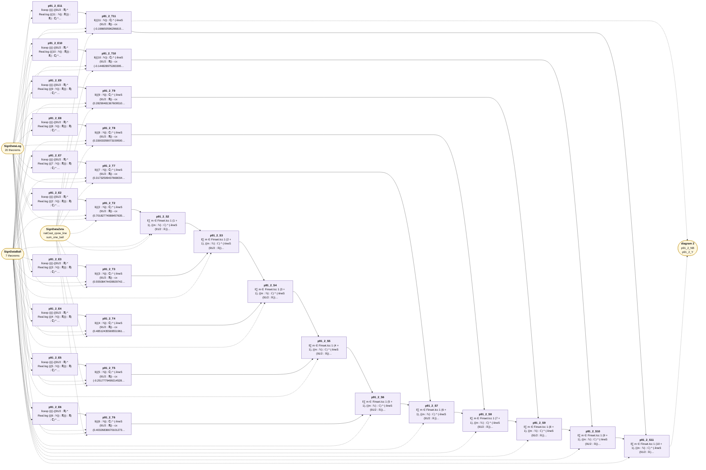
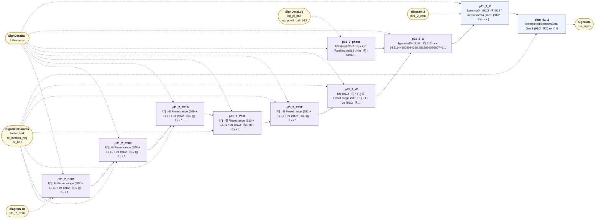

# `lean_stage3/Stage3/SignDataPt91_2.lean`

> **Read from the source text.** This file changed after the last `python3 utilities/lean_map.py --dump`, so the arrows on this page are names occurring in each proof and have not been confirmed by Lean.

SignDataPt91_2 — block S14 of `lean_stage3/design/stencil.md`, Turing's sign data: the sign of `Re Λ(1/2 + it)` at `t = 45.5`. 2026-11-25. Generated by `lean_stage3/checks/signdata/gen_signdata.py`; do not edit by hand.

550 theorems, 0 definitions, 2782 lines. 

**Imports:** [`SignDataGamma`](../lean_stage3/SignDataGamma.md), [`SignDataLog`](../lean_stage3/SignDataLog.md)  
**Imported by:** [`SignData`](../lean_stage3/SignData.md)

## The picture

### Diagram 1 of 19: `p91_2_E2` to `p91_2_S11`



### Diagram 2 of 19: `p91_2_NB` to `p91_2_P27`

```mermaid
flowchart LR
  n0["<b>p91_2_NB</b><br/>‖(((11 : ℕ)) : ℂ) ^ (-lineS (91/2 : ℝ)) * emB (91/2 : ℝ) 11 - cx…"]:::shp
  n1["<b>p91_2_Y</b><br/>‖(∑ m ∈ Finset.Icc 1 (10 + 1), ((m : ℕ) : ℂ) ^ (-lineS (91/2 : ℝ…"]:::shp
  n2["<b>p91_2_zeta</b><br/>‖riemannZeta (lineS (91/2 : ℝ)) - cx (3.623068959869074158348132…"]:::thm
  n3["<b>p91_2_P1</b><br/>‖∏ j ∈ Finset.range (0 + 1), (1 + zz (91/2 : ℝ) / ((j : ℂ) + 1))…"]:::shp
  n4["<b>p91_2_P2</b><br/>‖∏ j ∈ Finset.range (1 + 1), (1 + zz (91/2 : ℝ) / ((j : ℂ) + 1))…"]:::shp
  n5["<b>p91_2_P3</b><br/>‖∏ j ∈ Finset.range (2 + 1), (1 + zz (91/2 : ℝ) / ((j : ℂ) + 1))…"]:::shp
  n6["<b>p91_2_P4</b><br/>‖∏ j ∈ Finset.range (3 + 1), (1 + zz (91/2 : ℝ) / ((j : ℂ) + 1))…"]:::shp
  n7["<b>p91_2_P5</b><br/>‖∏ j ∈ Finset.range (4 + 1), (1 + zz (91/2 : ℝ) / ((j : ℂ) + 1))…"]:::shp
  n8["<b>p91_2_P6</b><br/>‖∏ j ∈ Finset.range (5 + 1), (1 + zz (91/2 : ℝ) / ((j : ℂ) + 1))…"]:::shp
  n9["<b>p91_2_P7</b><br/>‖∏ j ∈ Finset.range (6 + 1), (1 + zz (91/2 : ℝ) / ((j : ℂ) + 1))…"]:::shp
  n10["<b>p91_2_P8</b><br/>‖∏ j ∈ Finset.range (7 + 1), (1 + zz (91/2 : ℝ) / ((j : ℂ) + 1))…"]:::shp
  n11["<b>p91_2_P9</b><br/>‖∏ j ∈ Finset.range (8 + 1), (1 + zz (91/2 : ℝ) / ((j : ℂ) + 1))…"]:::shp
  n12["<b>p91_2_P10</b><br/>‖∏ j ∈ Finset.range (9 + 1), (1 + zz (91/2 : ℝ) / ((j : ℂ) + 1))…"]:::shp
  n13["<b>p91_2_P11</b><br/>‖∏ j ∈ Finset.range (10 + 1), (1 + zz (91/2 : ℝ) / ((j : ℂ) + 1)…"]:::shp
  n14["<b>p91_2_P12</b><br/>‖∏ j ∈ Finset.range (11 + 1), (1 + zz (91/2 : ℝ) / ((j : ℂ) + 1)…"]:::shp
  n15["<b>p91_2_P13</b><br/>‖∏ j ∈ Finset.range (12 + 1), (1 + zz (91/2 : ℝ) / ((j : ℂ) + 1)…"]:::shp
  n16["<b>p91_2_P14</b><br/>‖∏ j ∈ Finset.range (13 + 1), (1 + zz (91/2 : ℝ) / ((j : ℂ) + 1)…"]:::shp
  n17["<b>p91_2_P15</b><br/>‖∏ j ∈ Finset.range (14 + 1), (1 + zz (91/2 : ℝ) / ((j : ℂ) + 1)…"]:::shp
  n18["<b>p91_2_P16</b><br/>‖∏ j ∈ Finset.range (15 + 1), (1 + zz (91/2 : ℝ) / ((j : ℂ) + 1)…"]:::shp
  n19["<b>p91_2_P17</b><br/>‖∏ j ∈ Finset.range (16 + 1), (1 + zz (91/2 : ℝ) / ((j : ℂ) + 1)…"]:::shp
  n20["<b>p91_2_P18</b><br/>‖∏ j ∈ Finset.range (17 + 1), (1 + zz (91/2 : ℝ) / ((j : ℂ) + 1)…"]:::shp
  n21["<b>p91_2_P19</b><br/>‖∏ j ∈ Finset.range (18 + 1), (1 + zz (91/2 : ℝ) / ((j : ℂ) + 1)…"]:::shp
  n22["<b>p91_2_P20</b><br/>‖∏ j ∈ Finset.range (19 + 1), (1 + zz (91/2 : ℝ) / ((j : ℂ) + 1)…"]:::shp
  n23["<b>p91_2_P21</b><br/>‖∏ j ∈ Finset.range (20 + 1), (1 + zz (91/2 : ℝ) / ((j : ℂ) + 1)…"]:::shp
  n24["<b>p91_2_P22</b><br/>‖∏ j ∈ Finset.range (21 + 1), (1 + zz (91/2 : ℝ) / ((j : ℂ) + 1)…"]:::shp
  n25["<b>p91_2_P23</b><br/>‖∏ j ∈ Finset.range (22 + 1), (1 + zz (91/2 : ℝ) / ((j : ℂ) + 1)…"]:::shp
  n26["<b>p91_2_P24</b><br/>‖∏ j ∈ Finset.range (23 + 1), (1 + zz (91/2 : ℝ) / ((j : ℂ) + 1)…"]:::shp
  n27["<b>p91_2_P25</b><br/>‖∏ j ∈ Finset.range (24 + 1), (1 + zz (91/2 : ℝ) / ((j : ℂ) + 1)…"]:::shp
  n28["<b>p91_2_P26</b><br/>‖∏ j ∈ Finset.range (25 + 1), (1 + zz (91/2 : ℝ) / ((j : ℂ) + 1)…"]:::shp
  n29["<b>p91_2_P27</b><br/>‖∏ j ∈ Finset.range (26 + 1), (1 + zz (91/2 : ℝ) / ((j : ℂ) + 1)…"]:::shp
  x0(["<b>SignDataBall</b><br/>ball_add<br/>ball_mul"]):::ext
  x1(["<b>diagram 1</b><br/>p91_2_S11<br/>p91_2_T11"]):::ext
  x2(["<b>SignDataZeta</b><br/>emB_ball<br/>rem_le<br/>zeta_ball"]):::ext
  x3(["<b>diagram 19</b><br/>p91_2_X"]):::ext
  x4(["<b>SignDataGamma</b><br/>factor_ball<br/>prod_zero_ball"]):::ext
  x5(["<b>diagram 3</b><br/>p91_2_P28"]):::ext
  n0 --> n1
  n1 --> n2
  n10 --> n11
  n11 --> n12
  n12 --> n13
  n13 --> n14
  n14 --> n15
  n15 --> n16
  n16 --> n17
  n17 --> n18
  n18 --> n19
  n19 --> n20
  n20 --> n21
  n21 --> n22
  n22 --> n23
  n23 --> n24
  n24 --> n25
  n25 --> n26
  n26 --> n27
  n27 --> n28
  n28 --> n29
  n3 --> n4
  n4 --> n5
  n5 --> n6
  n6 --> n7
  n7 --> n8
  n8 --> n9
  n9 --> n10
  n2 -.-> x3
  n29 -.-> x5
  x0 -.-> n0
  x0 -.-> n1
  x0 -.-> n10
  x0 -.-> n11
  x0 -.-> n12
  x0 -.-> n13
  x0 -.-> n14
  x0 -.-> n15
  x0 -.-> n16
  x0 -.-> n17
  x0 -.-> n18
  x0 -.-> n19
  x0 -.-> n20
  x0 -.-> n21
  x0 -.-> n22
  x0 -.-> n23
  x0 -.-> n24
  x0 -.-> n25
  x0 -.-> n26
  x0 -.-> n27
  x0 -.-> n28
  x0 -.-> n29
  x0 -.-> n3
  x0 -.-> n4
  x0 -.-> n5
  x0 -.-> n6
  x0 -.-> n7
  x0 -.-> n8
  x0 -.-> n9
  x1 -.-> n0
  x1 -.-> n1
  x2 -.-> n0
  x2 -.-> n2
  x4 -.-> n10
  x4 -.-> n11
  x4 -.-> n12
  x4 -.-> n13
  x4 -.-> n14
  x4 -.-> n15
  x4 -.-> n16
  x4 -.-> n17
  x4 -.-> n18
  x4 -.-> n19
  x4 -.-> n20
  x4 -.-> n21
  x4 -.-> n22
  x4 -.-> n23
  x4 -.-> n24
  x4 -.-> n25
  x4 -.-> n26
  x4 -.-> n27
  x4 -.-> n28
  x4 -.-> n29
  x4 -.-> n3
  x4 -.-> n4
  x4 -.-> n5
  x4 -.-> n6
  x4 -.-> n7
  x4 -.-> n8
  x4 -.-> n9
  classDef cnt fill:#dff5ec,stroke:#17694a,color:#111
  classDef shp fill:#f1ecfb,stroke:#5b3fa0,color:#111
  classDef rh fill:#ffe5e5,stroke:#c22,color:#111,stroke-width:2px
  classDef thm fill:#eef4ff,stroke:#335,color:#111
  classDef end_ fill:#e7f7e7,stroke:#2a7,color:#111,stroke-width:2px
  classDef lone fill:#fff,stroke:#999,color:#111,stroke-dasharray:4 3
  classDef bad fill:#ffe5e5,stroke:#c22,color:#111,stroke-width:2px
  classDef ext fill:#fff8e1,stroke:#b80,color:#111
```



### Diagram 3 of 19: `p91_2_P28` to `p91_2_P57`

```mermaid
flowchart LR
  n0["<b>p91_2_P28</b><br/>‖∏ j ∈ Finset.range (27 + 1), (1 + zz (91/2 : ℝ) / ((j : ℂ) + 1)…"]:::shp
  n1["<b>p91_2_P29</b><br/>‖∏ j ∈ Finset.range (28 + 1), (1 + zz (91/2 : ℝ) / ((j : ℂ) + 1)…"]:::shp
  n2["<b>p91_2_P30</b><br/>‖∏ j ∈ Finset.range (29 + 1), (1 + zz (91/2 : ℝ) / ((j : ℂ) + 1)…"]:::shp
  n3["<b>p91_2_P31</b><br/>‖∏ j ∈ Finset.range (30 + 1), (1 + zz (91/2 : ℝ) / ((j : ℂ) + 1)…"]:::shp
  n4["<b>p91_2_P32</b><br/>‖∏ j ∈ Finset.range (31 + 1), (1 + zz (91/2 : ℝ) / ((j : ℂ) + 1)…"]:::shp
  n5["<b>p91_2_P33</b><br/>‖∏ j ∈ Finset.range (32 + 1), (1 + zz (91/2 : ℝ) / ((j : ℂ) + 1)…"]:::shp
  n6["<b>p91_2_P34</b><br/>‖∏ j ∈ Finset.range (33 + 1), (1 + zz (91/2 : ℝ) / ((j : ℂ) + 1)…"]:::shp
  n7["<b>p91_2_P35</b><br/>‖∏ j ∈ Finset.range (34 + 1), (1 + zz (91/2 : ℝ) / ((j : ℂ) + 1)…"]:::shp
  n8["<b>p91_2_P36</b><br/>‖∏ j ∈ Finset.range (35 + 1), (1 + zz (91/2 : ℝ) / ((j : ℂ) + 1)…"]:::shp
  n9["<b>p91_2_P37</b><br/>‖∏ j ∈ Finset.range (36 + 1), (1 + zz (91/2 : ℝ) / ((j : ℂ) + 1)…"]:::shp
  n10["<b>p91_2_P38</b><br/>‖∏ j ∈ Finset.range (37 + 1), (1 + zz (91/2 : ℝ) / ((j : ℂ) + 1)…"]:::shp
  n11["<b>p91_2_P39</b><br/>‖∏ j ∈ Finset.range (38 + 1), (1 + zz (91/2 : ℝ) / ((j : ℂ) + 1)…"]:::shp
  n12["<b>p91_2_P40</b><br/>‖∏ j ∈ Finset.range (39 + 1), (1 + zz (91/2 : ℝ) / ((j : ℂ) + 1)…"]:::shp
  n13["<b>p91_2_P41</b><br/>‖∏ j ∈ Finset.range (40 + 1), (1 + zz (91/2 : ℝ) / ((j : ℂ) + 1)…"]:::shp
  n14["<b>p91_2_P42</b><br/>‖∏ j ∈ Finset.range (41 + 1), (1 + zz (91/2 : ℝ) / ((j : ℂ) + 1)…"]:::shp
  n15["<b>p91_2_P43</b><br/>‖∏ j ∈ Finset.range (42 + 1), (1 + zz (91/2 : ℝ) / ((j : ℂ) + 1)…"]:::shp
  n16["<b>p91_2_P44</b><br/>‖∏ j ∈ Finset.range (43 + 1), (1 + zz (91/2 : ℝ) / ((j : ℂ) + 1)…"]:::shp
  n17["<b>p91_2_P45</b><br/>‖∏ j ∈ Finset.range (44 + 1), (1 + zz (91/2 : ℝ) / ((j : ℂ) + 1)…"]:::shp
  n18["<b>p91_2_P46</b><br/>‖∏ j ∈ Finset.range (45 + 1), (1 + zz (91/2 : ℝ) / ((j : ℂ) + 1)…"]:::shp
  n19["<b>p91_2_P47</b><br/>‖∏ j ∈ Finset.range (46 + 1), (1 + zz (91/2 : ℝ) / ((j : ℂ) + 1)…"]:::shp
  n20["<b>p91_2_P48</b><br/>‖∏ j ∈ Finset.range (47 + 1), (1 + zz (91/2 : ℝ) / ((j : ℂ) + 1)…"]:::shp
  n21["<b>p91_2_P49</b><br/>‖∏ j ∈ Finset.range (48 + 1), (1 + zz (91/2 : ℝ) / ((j : ℂ) + 1)…"]:::shp
  n22["<b>p91_2_P50</b><br/>‖∏ j ∈ Finset.range (49 + 1), (1 + zz (91/2 : ℝ) / ((j : ℂ) + 1)…"]:::shp
  n23["<b>p91_2_P51</b><br/>‖∏ j ∈ Finset.range (50 + 1), (1 + zz (91/2 : ℝ) / ((j : ℂ) + 1)…"]:::shp
  n24["<b>p91_2_P52</b><br/>‖∏ j ∈ Finset.range (51 + 1), (1 + zz (91/2 : ℝ) / ((j : ℂ) + 1)…"]:::shp
  n25["<b>p91_2_P53</b><br/>‖∏ j ∈ Finset.range (52 + 1), (1 + zz (91/2 : ℝ) / ((j : ℂ) + 1)…"]:::shp
  n26["<b>p91_2_P54</b><br/>‖∏ j ∈ Finset.range (53 + 1), (1 + zz (91/2 : ℝ) / ((j : ℂ) + 1)…"]:::shp
  n27["<b>p91_2_P55</b><br/>‖∏ j ∈ Finset.range (54 + 1), (1 + zz (91/2 : ℝ) / ((j : ℂ) + 1)…"]:::shp
  n28["<b>p91_2_P56</b><br/>‖∏ j ∈ Finset.range (55 + 1), (1 + zz (91/2 : ℝ) / ((j : ℂ) + 1)…"]:::shp
  n29["<b>p91_2_P57</b><br/>‖∏ j ∈ Finset.range (56 + 1), (1 + zz (91/2 : ℝ) / ((j : ℂ) + 1)…"]:::shp
  x0(["<b>SignDataBall</b><br/>ball_mul"]):::ext
  x1(["<b>SignDataGamma</b><br/>factor_ball"]):::ext
  x2(["<b>diagram 2</b><br/>p91_2_P27"]):::ext
  x3(["<b>diagram 4</b><br/>p91_2_P58"]):::ext
  n0 --> n1
  n1 --> n2
  n10 --> n11
  n11 --> n12
  n12 --> n13
  n13 --> n14
  n14 --> n15
  n15 --> n16
  n16 --> n17
  n17 --> n18
  n18 --> n19
  n19 --> n20
  n2 --> n3
  n20 --> n21
  n21 --> n22
  n22 --> n23
  n23 --> n24
  n24 --> n25
  n25 --> n26
  n26 --> n27
  n27 --> n28
  n28 --> n29
  n3 --> n4
  n4 --> n5
  n5 --> n6
  n6 --> n7
  n7 --> n8
  n8 --> n9
  n9 --> n10
  n29 -.-> x3
  x0 -.-> n0
  x0 -.-> n1
  x0 -.-> n10
  x0 -.-> n11
  x0 -.-> n12
  x0 -.-> n13
  x0 -.-> n14
  x0 -.-> n15
  x0 -.-> n16
  x0 -.-> n17
  x0 -.-> n18
  x0 -.-> n19
  x0 -.-> n2
  x0 -.-> n20
  x0 -.-> n21
  x0 -.-> n22
  x0 -.-> n23
  x0 -.-> n24
  x0 -.-> n25
  x0 -.-> n26
  x0 -.-> n27
  x0 -.-> n28
  x0 -.-> n29
  x0 -.-> n3
  x0 -.-> n4
  x0 -.-> n5
  x0 -.-> n6
  x0 -.-> n7
  x0 -.-> n8
  x0 -.-> n9
  x1 -.-> n0
  x1 -.-> n1
  x1 -.-> n10
  x1 -.-> n11
  x1 -.-> n12
  x1 -.-> n13
  x1 -.-> n14
  x1 -.-> n15
  x1 -.-> n16
  x1 -.-> n17
  x1 -.-> n18
  x1 -.-> n19
  x1 -.-> n2
  x1 -.-> n20
  x1 -.-> n21
  x1 -.-> n22
  x1 -.-> n23
  x1 -.-> n24
  x1 -.-> n25
  x1 -.-> n26
  x1 -.-> n27
  x1 -.-> n28
  x1 -.-> n29
  x1 -.-> n3
  x1 -.-> n4
  x1 -.-> n5
  x1 -.-> n6
  x1 -.-> n7
  x1 -.-> n8
  x1 -.-> n9
  x2 -.-> n0
  classDef cnt fill:#dff5ec,stroke:#17694a,color:#111
  classDef shp fill:#f1ecfb,stroke:#5b3fa0,color:#111
  classDef rh fill:#ffe5e5,stroke:#c22,color:#111,stroke-width:2px
  classDef thm fill:#eef4ff,stroke:#335,color:#111
  classDef end_ fill:#e7f7e7,stroke:#2a7,color:#111,stroke-width:2px
  classDef lone fill:#fff,stroke:#999,color:#111,stroke-dasharray:4 3
  classDef bad fill:#ffe5e5,stroke:#c22,color:#111,stroke-width:2px
  classDef ext fill:#fff8e1,stroke:#b80,color:#111
```



### Diagram 4 of 19: `p91_2_P58` to `p91_2_P87`


### Diagram 5 of 19: `p91_2_P88` to `p91_2_P117`


### Diagram 6 of 19: `p91_2_P118` to `p91_2_P147`


### Diagram 7 of 19: `p91_2_P148` to `p91_2_P177`


### Diagram 8 of 19: `p91_2_P178` to `p91_2_P207`

```mermaid
flowchart LR
  n0["<b>p91_2_P178</b><br/>‖∏ j ∈ Finset.range (177 + 1), (1 + zz (91/2 : ℝ) / ((j : ℂ) + 1…"]:::shp
  n1["<b>p91_2_P179</b><br/>‖∏ j ∈ Finset.range (178 + 1), (1 + zz (91/2 : ℝ) / ((j : ℂ) + 1…"]:::shp
  n2["<b>p91_2_P180</b><br/>‖∏ j ∈ Finset.range (179 + 1), (1 + zz (91/2 : ℝ) / ((j : ℂ) + 1…"]:::shp
  n3["<b>p91_2_P181</b><br/>‖∏ j ∈ Finset.range (180 + 1), (1 + zz (91/2 : ℝ) / ((j : ℂ) + 1…"]:::shp
  n4["<b>p91_2_P182</b><br/>‖∏ j ∈ Finset.range (181 + 1), (1 + zz (91/2 : ℝ) / ((j : ℂ) + 1…"]:::shp
  n5["<b>p91_2_P183</b><br/>‖∏ j ∈ Finset.range (182 + 1), (1 + zz (91/2 : ℝ) / ((j : ℂ) + 1…"]:::shp
  n6["<b>p91_2_P184</b><br/>‖∏ j ∈ Finset.range (183 + 1), (1 + zz (91/2 : ℝ) / ((j : ℂ) + 1…"]:::shp
  n7["<b>p91_2_P185</b><br/>‖∏ j ∈ Finset.range (184 + 1), (1 + zz (91/2 : ℝ) / ((j : ℂ) + 1…"]:::shp
  n8["<b>p91_2_P186</b><br/>‖∏ j ∈ Finset.range (185 + 1), (1 + zz (91/2 : ℝ) / ((j : ℂ) + 1…"]:::shp
  n9["<b>p91_2_P187</b><br/>‖∏ j ∈ Finset.range (186 + 1), (1 + zz (91/2 : ℝ) / ((j : ℂ) + 1…"]:::shp
  n10["<b>p91_2_P188</b><br/>‖∏ j ∈ Finset.range (187 + 1), (1 + zz (91/2 : ℝ) / ((j : ℂ) + 1…"]:::shp
  n11["<b>p91_2_P189</b><br/>‖∏ j ∈ Finset.range (188 + 1), (1 + zz (91/2 : ℝ) / ((j : ℂ) + 1…"]:::shp
  n12["<b>p91_2_P190</b><br/>‖∏ j ∈ Finset.range (189 + 1), (1 + zz (91/2 : ℝ) / ((j : ℂ) + 1…"]:::shp
  n13["<b>p91_2_P191</b><br/>‖∏ j ∈ Finset.range (190 + 1), (1 + zz (91/2 : ℝ) / ((j : ℂ) + 1…"]:::shp
  n14["<b>p91_2_P192</b><br/>‖∏ j ∈ Finset.range (191 + 1), (1 + zz (91/2 : ℝ) / ((j : ℂ) + 1…"]:::shp
  n15["<b>p91_2_P193</b><br/>‖∏ j ∈ Finset.range (192 + 1), (1 + zz (91/2 : ℝ) / ((j : ℂ) + 1…"]:::shp
  n16["<b>p91_2_P194</b><br/>‖∏ j ∈ Finset.range (193 + 1), (1 + zz (91/2 : ℝ) / ((j : ℂ) + 1…"]:::shp
  n17["<b>p91_2_P195</b><br/>‖∏ j ∈ Finset.range (194 + 1), (1 + zz (91/2 : ℝ) / ((j : ℂ) + 1…"]:::shp
  n18["<b>p91_2_P196</b><br/>‖∏ j ∈ Finset.range (195 + 1), (1 + zz (91/2 : ℝ) / ((j : ℂ) + 1…"]:::shp
  n19["<b>p91_2_P197</b><br/>‖∏ j ∈ Finset.range (196 + 1), (1 + zz (91/2 : ℝ) / ((j : ℂ) + 1…"]:::shp
  n20["<b>p91_2_P198</b><br/>‖∏ j ∈ Finset.range (197 + 1), (1 + zz (91/2 : ℝ) / ((j : ℂ) + 1…"]:::shp
  n21["<b>p91_2_P199</b><br/>‖∏ j ∈ Finset.range (198 + 1), (1 + zz (91/2 : ℝ) / ((j : ℂ) + 1…"]:::shp
  n22["<b>p91_2_P200</b><br/>‖∏ j ∈ Finset.range (199 + 1), (1 + zz (91/2 : ℝ) / ((j : ℂ) + 1…"]:::shp
  n23["<b>p91_2_P201</b><br/>‖∏ j ∈ Finset.range (200 + 1), (1 + zz (91/2 : ℝ) / ((j : ℂ) + 1…"]:::shp
  n24["<b>p91_2_P202</b><br/>‖∏ j ∈ Finset.range (201 + 1), (1 + zz (91/2 : ℝ) / ((j : ℂ) + 1…"]:::shp
  n25["<b>p91_2_P203</b><br/>‖∏ j ∈ Finset.range (202 + 1), (1 + zz (91/2 : ℝ) / ((j : ℂ) + 1…"]:::shp
  n26["<b>p91_2_P204</b><br/>‖∏ j ∈ Finset.range (203 + 1), (1 + zz (91/2 : ℝ) / ((j : ℂ) + 1…"]:::shp
  n27["<b>p91_2_P205</b><br/>‖∏ j ∈ Finset.range (204 + 1), (1 + zz (91/2 : ℝ) / ((j : ℂ) + 1…"]:::shp
  n28["<b>p91_2_P206</b><br/>‖∏ j ∈ Finset.range (205 + 1), (1 + zz (91/2 : ℝ) / ((j : ℂ) + 1…"]:::shp
  n29["<b>p91_2_P207</b><br/>‖∏ j ∈ Finset.range (206 + 1), (1 + zz (91/2 : ℝ) / ((j : ℂ) + 1…"]:::shp
  x0(["<b>SignDataBall</b><br/>ball_mul"]):::ext
  x1(["<b>SignDataGamma</b><br/>factor_ball"]):::ext
  x2(["<b>diagram 7</b><br/>p91_2_P177"]):::ext
  x3(["<b>diagram 9</b><br/>p91_2_P208"]):::ext
  n0 --> n1
  n1 --> n2
  n10 --> n11
  n11 --> n12
  n12 --> n13
  n13 --> n14
  n14 --> n15
  n15 --> n16
  n16 --> n17
  n17 --> n18
  n18 --> n19
  n19 --> n20
  n2 --> n3
  n20 --> n21
  n21 --> n22
  n22 --> n23
  n23 --> n24
  n24 --> n25
  n25 --> n26
  n26 --> n27
  n27 --> n28
  n28 --> n29
  n3 --> n4
  n4 --> n5
  n5 --> n6
  n6 --> n7
  n7 --> n8
  n8 --> n9
  n9 --> n10
  n29 -.-> x3
  x0 -.-> n0
  x0 -.-> n1
  x0 -.-> n10
  x0 -.-> n11
  x0 -.-> n12
  x0 -.-> n13
  x0 -.-> n14
  x0 -.-> n15
  x0 -.-> n16
  x0 -.-> n17
  x0 -.-> n18
  x0 -.-> n19
  x0 -.-> n2
  x0 -.-> n20
  x0 -.-> n21
  x0 -.-> n22
  x0 -.-> n23
  x0 -.-> n24
  x0 -.-> n25
  x0 -.-> n26
  x0 -.-> n27
  x0 -.-> n28
  x0 -.-> n29
  x0 -.-> n3
  x0 -.-> n4
  x0 -.-> n5
  x0 -.-> n6
  x0 -.-> n7
  x0 -.-> n8
  x0 -.-> n9
  x1 -.-> n0
  x1 -.-> n1
  x1 -.-> n10
  x1 -.-> n11
  x1 -.-> n12
  x1 -.-> n13
  x1 -.-> n14
  x1 -.-> n15
  x1 -.-> n16
  x1 -.-> n17
  x1 -.-> n18
  x1 -.-> n19
  x1 -.-> n2
  x1 -.-> n20
  x1 -.-> n21
  x1 -.-> n22
  x1 -.-> n23
  x1 -.-> n24
  x1 -.-> n25
  x1 -.-> n26
  x1 -.-> n27
  x1 -.-> n28
  x1 -.-> n29
  x1 -.-> n3
  x1 -.-> n4
  x1 -.-> n5
  x1 -.-> n6
  x1 -.-> n7
  x1 -.-> n8
  x1 -.-> n9
  x2 -.-> n0
  classDef cnt fill:#dff5ec,stroke:#17694a,color:#111
  classDef shp fill:#f1ecfb,stroke:#5b3fa0,color:#111
  classDef rh fill:#ffe5e5,stroke:#c22,color:#111,stroke-width:2px
  classDef thm fill:#eef4ff,stroke:#335,color:#111
  classDef end_ fill:#e7f7e7,stroke:#2a7,color:#111,stroke-width:2px
  classDef lone fill:#fff,stroke:#999,color:#111,stroke-dasharray:4 3
  classDef bad fill:#ffe5e5,stroke:#c22,color:#111,stroke-width:2px
  classDef ext fill:#fff8e1,stroke:#b80,color:#111
```



### Diagram 9 of 19: `p91_2_P208` to `p91_2_P237`


### Diagram 10 of 19: `p91_2_P238` to `p91_2_P267`


### Diagram 11 of 19: `p91_2_P268` to `p91_2_P297`


### Diagram 12 of 19: `p91_2_P298` to `p91_2_P327`


### Diagram 13 of 19: `p91_2_P328` to `p91_2_P357`


### Diagram 14 of 19: `p91_2_P358` to `p91_2_P387`


### Diagram 15 of 19: `p91_2_P388` to `p91_2_P417`


### Diagram 16 of 19: `p91_2_P418` to `p91_2_P447`


### Diagram 17 of 19: `p91_2_P448` to `p91_2_P477`


### Diagram 18 of 19: `p91_2_P478` to `p91_2_P507`


### Diagram 19 of 19: `p91_2_P508` to `sign_91_2`



An arrow A → B reads "A is used in the proof of B". Green: counting, integers only. Violet: shape, analysis with no ζ. Blue: reads ζ. A name ending in ■ is an end: nothing else uses it. Red: contains `sorry`. Yellow: theorems in another file, counted; a dotted arrow crosses files. Definitions are not drawn; they are listed below the diagram.

## Theorems

<a name="SignData-p91_2_E2"></a>
### `SignData.p91_2_E2`

line 31 · arrows read from text

**Shape.** Uses real or complex analysis; nothing in it or beneath it reads ζ.

**Proves**

```lean
‖cexp ((((-((91/2 : ℝ) * Real.log (((2 : ℕ)) : ℝ))) : ℝ) : ℂ) * Complex.I) - cx (0.992534309608638216545060226073) (-0.121965750314192284111544807736)‖ ≤ (0.000000011375000000100000000001)
```

**Fed by** (3 theorems its proof uses)

  - [`SignData.exp_ball0`](../lean_stage3/SignDataBall.md#SignData-exp_ball0) (SignDataBall) — `` ‖cexp ((x : ℂ) * I) - cx e f‖ ≤ R ``
  - [`SignData.neg_mul_ball`](../lean_stage3/SignDataBall.md#SignData-neg_mul_ball) (SignDataBall) — `` |-(t * x) - -(t * a)| ≤ |t| * e ``
  - [`SignData.log_ball_2`](../lean_stage3/SignDataLog.md#SignData-log_ball_2) (SignDataLog) — `` |Real.log ((2 : ℕ) : ℝ) - (0.69314718055)| ≤ (0.00000000025) ``

**Definitions its proof touches:** [`SignData.cosP`](../lean_stage3/SignDataBall.md#SignData-cosP), [`SignData.cx`](../lean_stage3/SignDataBall.md#SignData-cx), [`SignData.sinP`](../lean_stage3/SignDataBall.md#SignData-sinP)

**Feeds** (1 that use it)

  - [`SignData.p91_2_T2`](#SignData-p91_2_T2) — `` ‖(((2 : ℕ)) : ℂ) ^ (-lineS (91/2 : ℝ)) - cx (0.701827740884576357435151128419) (-0.08624280911967065341595596998)‖ ≤ (0.000000008043339636067688768181… ``

<a name="SignData-p91_2_T2"></a>
### `SignData.p91_2_T2`

line 37 · arrows read from text

**Shape.** Uses real or complex analysis; nothing in it or beneath it reads ζ.

**Proves**

```lean
‖(((2 : ℕ)) : ℂ) ^ (-lineS (91/2 : ℝ)) - cx (0.701827740884576357435151128419) (-0.08624280911967065341595596998)‖ ≤ (0.000000008043339636067688768181)
```

**Fed by** (5 theorems its proof uses)

  - [`SignData.ball_mul`](../lean_stage3/SignDataBall.md#SignData-ball_mul) (SignDataBall) — `` ‖z * w - cx e f‖ ≤ R ``
  - [`SignData.ball_ofReal`](../lean_stage3/SignDataBall.md#SignData-ball_ofReal) (SignDataBall) — `` ‖(x : ℂ) - cx c 0‖ ≤ e ``
  - [`SignData.isqrt_ball_2`](../lean_stage3/SignDataLog.md#SignData-isqrt_ball_2) (SignDataLog) — `` |(Real.sqrt (((2 : ℕ)) : ℝ))⁻¹ - (0.707106781186547524400844362104)| ≤ (0.000000000000000000000000000001) ``
  - [`SignData.p91_2_E2`](#SignData-p91_2_E2) — `` ‖cexp ((((-((91/2 : ℝ) * Real.log (((2 : ℕ)) : ℝ))) : ℝ) : ℂ) * Complex.I) - cx (0.992534309608638216545060226073) (-0.121965750314192284111544807736)… ``
  - [`SignData.natCast_cpow_line`](../lean_stage3/SignDataZeta.md#SignData-natCast_cpow_line) (SignDataZeta) — `` (m : ℂ) ^ (-lineS t) = (((Real.sqrt m)⁻¹ : ℝ) : ℂ) * cexp (((-(t * Real.log m)) : ℝ) * I) ``

**Definitions its proof touches:** [`SignData.cx`](../lean_stage3/SignDataBall.md#SignData-cx), [`SignData.lineS`](../lean_stage3/SignDataZeta.md#SignData-lineS)

**Feeds** (1 that use it)

  - [`SignData.p91_2_S2`](#SignData-p91_2_S2) — `` ‖∑ m ∈ Finset.Icc 1 (1 + 1), ((m : ℕ) : ℂ) ^ (-lineS (91/2 : ℝ)) - cx (1.701827740884576357435151128419) (-0.08624280911967065341595596998)‖ ≤ (0.0000… ``

<a name="SignData-p91_2_E3"></a>
### `SignData.p91_2_E3`

line 41 · arrows read from text

**Shape.** Uses real or complex analysis; nothing in it or beneath it reads ζ.

**Proves**

```lean
‖cexp ((((-((91/2 : ℝ) * Real.log (((3 : ℕ)) : ℝ))) : ℝ) : ℂ) * Complex.I) - cx (0.961434979805966936391946339317) (0.275032324655666518658272663118)‖ ≤ (0.000000011375331486026014893368)
```

**Fed by** (3 theorems its proof uses)

  - [`SignData.exp_ball0`](../lean_stage3/SignDataBall.md#SignData-exp_ball0) (SignDataBall) — `` ‖cexp ((x : ℂ) * I) - cx e f‖ ≤ R ``
  - [`SignData.neg_mul_ball`](../lean_stage3/SignDataBall.md#SignData-neg_mul_ball) (SignDataBall) — `` |-(t * x) - -(t * a)| ≤ |t| * e ``
  - [`SignData.log_ball_3`](../lean_stage3/SignDataLog.md#SignData-log_ball_3) (SignDataLog) — `` |Real.log (((3 : ℕ)) : ℝ) - (1.098612288658164142930964760306)| ≤ (0.000000000250007285403624428292) ``

**Definitions its proof touches:** [`SignData.cosP`](../lean_stage3/SignDataBall.md#SignData-cosP), [`SignData.cx`](../lean_stage3/SignDataBall.md#SignData-cx), [`SignData.sinP`](../lean_stage3/SignDataBall.md#SignData-sinP)

**Feeds** (1 that use it)

  - [`SignData.p91_2_T3`](#SignData-p91_2_T3) — `` ‖(((3 : ℕ)) : ℂ) ^ (-lineS (91/2 : ℝ)) - cx (0.55508474439929742160254060801) (0.158789986675797611749206414353)‖ ≤ (0.000000006567550695578345369269) ``

<a name="SignData-p91_2_T3"></a>
### `SignData.p91_2_T3`

line 47 · arrows read from text

**Shape.** Uses real or complex analysis; nothing in it or beneath it reads ζ.

**Proves**

```lean
‖(((3 : ℕ)) : ℂ) ^ (-lineS (91/2 : ℝ)) - cx (0.55508474439929742160254060801) (0.158789986675797611749206414353)‖ ≤ (0.000000006567550695578345369269)
```

**Fed by** (5 theorems its proof uses)

  - [`SignData.ball_mul`](../lean_stage3/SignDataBall.md#SignData-ball_mul) (SignDataBall) — `` ‖z * w - cx e f‖ ≤ R ``
  - [`SignData.ball_ofReal`](../lean_stage3/SignDataBall.md#SignData-ball_ofReal) (SignDataBall) — `` ‖(x : ℂ) - cx c 0‖ ≤ e ``
  - [`SignData.isqrt_ball_3`](../lean_stage3/SignDataLog.md#SignData-isqrt_ball_3) (SignDataLog) — `` |(Real.sqrt (((3 : ℕ)) : ℝ))⁻¹ - (0.577350269189625764509148780502)| ≤ (0.000000000000000000000000000001) ``
  - [`SignData.p91_2_E3`](#SignData-p91_2_E3) — `` ‖cexp ((((-((91/2 : ℝ) * Real.log (((3 : ℕ)) : ℝ))) : ℝ) : ℂ) * Complex.I) - cx (0.961434979805966936391946339317) (0.275032324655666518658272663118)‖… ``
  - [`SignData.natCast_cpow_line`](../lean_stage3/SignDataZeta.md#SignData-natCast_cpow_line) (SignDataZeta) — `` (m : ℂ) ^ (-lineS t) = (((Real.sqrt m)⁻¹ : ℝ) : ℂ) * cexp (((-(t * Real.log m)) : ℝ) * I) ``

**Definitions its proof touches:** [`SignData.cx`](../lean_stage3/SignDataBall.md#SignData-cx), [`SignData.lineS`](../lean_stage3/SignDataZeta.md#SignData-lineS)

**Feeds** (1 that use it)

  - [`SignData.p91_2_S3`](#SignData-p91_2_S3) — `` ‖∑ m ∈ Finset.Icc 1 (2 + 1), ((m : ℕ) : ℂ) ^ (-lineS (91/2 : ℝ)) - cx (2.256912485283873779037691736429) (0.072547177556126958333250444373)‖ ≤ (0.0000… ``

<a name="SignData-p91_2_E4"></a>
### `SignData.p91_2_E4`

line 51 · arrows read from text

**Shape.** Uses real or complex analysis; nothing in it or beneath it reads ζ.

**Proves**

```lean
‖cexp ((((-((91/2 : ℝ) * Real.log (((4 : ℕ)) : ℝ))) : ℝ) : ℂ) * Complex.I) - cx (0.970248711391039236903844565097) (-0.242110384007022399613973931507)‖ ≤ (0.000000011375547017362051286325)
```

**Fed by** (3 theorems its proof uses)

  - [`SignData.exp_ball0`](../lean_stage3/SignDataBall.md#SignData-exp_ball0) (SignDataBall) — `` ‖cexp ((x : ℂ) * I) - cx e f‖ ≤ R ``
  - [`SignData.neg_mul_ball`](../lean_stage3/SignDataBall.md#SignData-neg_mul_ball) (SignDataBall) — `` |-(t * x) - -(t * a)| ≤ |t| * e ``
  - [`SignData.log_ball_4`](../lean_stage3/SignDataLog.md#SignData-log_ball_4) (SignDataLog) — `` |Real.log (((4 : ℕ)) : ℝ) - (1.386294361109944875563750019823)| ≤ (0.000000000250012022355196162294) ``

**Definitions its proof touches:** [`SignData.cosP`](../lean_stage3/SignDataBall.md#SignData-cosP), [`SignData.cx`](../lean_stage3/SignDataBall.md#SignData-cx), [`SignData.sinP`](../lean_stage3/SignDataBall.md#SignData-sinP)

**Feeds** (1 that use it)

  - [`SignData.p91_2_T4`](#SignData-p91_2_T4) — `` ‖(((4 : ℕ)) : ℂ) ^ (-lineS (91/2 : ℝ)) - cx (0.485124355695519618451922282548) (-0.121055192003511199806986965754)‖ ≤ (0.00000000568777350868102564316… ``

<a name="SignData-p91_2_T4"></a>
### `SignData.p91_2_T4`

line 57 · arrows read from text

**Shape.** Uses real or complex analysis; nothing in it or beneath it reads ζ.

**Proves**

```lean
‖(((4 : ℕ)) : ℂ) ^ (-lineS (91/2 : ℝ)) - cx (0.485124355695519618451922282548) (-0.121055192003511199806986965754)‖ ≤ (0.000000005687773508681025643165)
```

**Fed by** (5 theorems its proof uses)

  - [`SignData.ball_mul`](../lean_stage3/SignDataBall.md#SignData-ball_mul) (SignDataBall) — `` ‖z * w - cx e f‖ ≤ R ``
  - [`SignData.ball_ofReal`](../lean_stage3/SignDataBall.md#SignData-ball_ofReal) (SignDataBall) — `` ‖(x : ℂ) - cx c 0‖ ≤ e ``
  - [`SignData.isqrt_ball_4`](../lean_stage3/SignDataLog.md#SignData-isqrt_ball_4) (SignDataLog) — `` |(Real.sqrt (((4 : ℕ)) : ℝ))⁻¹ - (0.5)| ≤ (0.000000000000000000000000000001) ``
  - [`SignData.p91_2_E4`](#SignData-p91_2_E4) — `` ‖cexp ((((-((91/2 : ℝ) * Real.log (((4 : ℕ)) : ℝ))) : ℝ) : ℂ) * Complex.I) - cx (0.970248711391039236903844565097) (-0.242110384007022399613973931507)… ``
  - [`SignData.natCast_cpow_line`](../lean_stage3/SignDataZeta.md#SignData-natCast_cpow_line) (SignDataZeta) — `` (m : ℂ) ^ (-lineS t) = (((Real.sqrt m)⁻¹ : ℝ) : ℂ) * cexp (((-(t * Real.log m)) : ℝ) * I) ``

**Definitions its proof touches:** [`SignData.cx`](../lean_stage3/SignDataBall.md#SignData-cx), [`SignData.lineS`](../lean_stage3/SignDataZeta.md#SignData-lineS)

**Feeds** (1 that use it)

  - [`SignData.p91_2_S4`](#SignData-p91_2_S4) — `` ‖∑ m ∈ Finset.Icc 1 (3 + 1), ((m : ℕ) : ℂ) ^ (-lineS (91/2 : ℝ)) - cx (2.742036840979393397489614018977) (-0.048508014447384241473736521381)‖ ≤ (0.000… ``

<a name="SignData-p91_2_E5"></a>
### `SignData.p91_2_E5`

line 61 · arrows read from text

**Shape.** Uses real or complex analysis; nothing in it or beneath it reads ζ.

**Proves**

```lean
‖cexp ((((-((91/2 : ℝ) * Real.log (((5 : ℕ)) : ℝ))) : ℝ) : ℂ) * Complex.I) - cx (-(0.562992611259906511027083503382)) (0.826461928746117009190082303325)‖ ≤ (0.000000011375666292918920130208)
```

**Fed by** (3 theorems its proof uses)

  - [`SignData.exp_ball1`](../lean_stage3/SignDataBall.md#SignData-exp_ball1) (SignDataBall) — `` ‖cexp ((x : ℂ) * I) - cx (-f) e‖ ≤ R ``
  - [`SignData.neg_mul_ball`](../lean_stage3/SignDataBall.md#SignData-neg_mul_ball) (SignDataBall) — `` |-(t * x) - -(t * a)| ≤ |t| * e ``
  - [`SignData.log_ball_5`](../lean_stage3/SignDataLog.md#SignData-log_ball_5) (SignDataLog) — `` |Real.log (((5 : ℕ)) : ℝ) - (1.609437912424154507888186373287)| ≤ (0.000000000250014643795196162295) ``

**Definitions its proof touches:** [`SignData.cosP`](../lean_stage3/SignDataBall.md#SignData-cosP), [`SignData.cx`](../lean_stage3/SignDataBall.md#SignData-cx), [`SignData.sinP`](../lean_stage3/SignDataBall.md#SignData-sinP)

**Feeds** (1 that use it)

  - [`SignData.p91_2_T5`](#SignData-p91_2_T5) — `` ‖(((5 : ℕ)) : ℂ) ^ (-lineS (91/2 : ℝ)) - cx (-0.251777949921452895916731081194) (0.369605010698381032761343937023)‖ ≤ (0.00000000508735262406394799271… ``

<a name="SignData-p91_2_T5"></a>
### `SignData.p91_2_T5`

line 67 · arrows read from text

**Shape.** Uses real or complex analysis; nothing in it or beneath it reads ζ.

**Proves**

```lean
‖(((5 : ℕ)) : ℂ) ^ (-lineS (91/2 : ℝ)) - cx (-0.251777949921452895916731081194) (0.369605010698381032761343937023)‖ ≤ (0.000000005087352624063947992716)
```

**Fed by** (5 theorems its proof uses)

  - [`SignData.ball_mul`](../lean_stage3/SignDataBall.md#SignData-ball_mul) (SignDataBall) — `` ‖z * w - cx e f‖ ≤ R ``
  - [`SignData.ball_ofReal`](../lean_stage3/SignDataBall.md#SignData-ball_ofReal) (SignDataBall) — `` ‖(x : ℂ) - cx c 0‖ ≤ e ``
  - [`SignData.isqrt_ball_5`](../lean_stage3/SignDataLog.md#SignData-isqrt_ball_5) (SignDataLog) — `` |(Real.sqrt (((5 : ℕ)) : ℝ))⁻¹ - (0.447213595499957939281834733746)| ≤ (0.000000000000000000000000000001) ``
  - [`SignData.p91_2_E5`](#SignData-p91_2_E5) — `` ‖cexp ((((-((91/2 : ℝ) * Real.log (((5 : ℕ)) : ℝ))) : ℝ) : ℂ) * Complex.I) - cx (-(0.562992611259906511027083503382)) (0.82646192874611700919008230332… ``
  - [`SignData.natCast_cpow_line`](../lean_stage3/SignDataZeta.md#SignData-natCast_cpow_line) (SignDataZeta) — `` (m : ℂ) ^ (-lineS t) = (((Real.sqrt m)⁻¹ : ℝ) : ℂ) * cexp (((-(t * Real.log m)) : ℝ) * I) ``

**Definitions its proof touches:** [`SignData.cx`](../lean_stage3/SignDataBall.md#SignData-cx), [`SignData.lineS`](../lean_stage3/SignDataZeta.md#SignData-lineS)

**Feeds** (1 that use it)

  - [`SignData.p91_2_S5`](#SignData-p91_2_S5) — `` ‖∑ m ∈ Finset.Icc 1 (4 + 1), ((m : ℕ) : ℂ) ^ (-lineS (91/2 : ℝ)) - cx (2.490258891057940501572882937783) (0.321096996250996791287607415642)‖ ≤ (0.0000… ``

<a name="SignData-p91_2_E6"></a>
### `SignData.p91_2_E6`

line 71 · arrows read from text

**Shape.** Uses real or complex analysis; nothing in it or beneath it reads ζ.

**Proves**

```lean
‖cexp ((((-((91/2 : ℝ) * Real.log (((6 : ℕ)) : ℝ))) : ℝ) : ℂ) * Complex.I) - cx (0.98780172782305602070702213895) (0.15571687933485294765689412019)‖ ≤ (0.000000011375755895187815936536)
```

**Fed by** (3 theorems its proof uses)

  - [`SignData.exp_ball0`](../lean_stage3/SignDataBall.md#SignData-exp_ball0) (SignDataBall) — `` ‖cexp ((x : ℂ) * I) - cx e f‖ ≤ R ``
  - [`SignData.neg_mul_ball`](../lean_stage3/SignDataBall.md#SignData-neg_mul_ball) (SignDataBall) — `` |-(t * x) - -(t * a)| ≤ |t| * e ``
  - [`SignData.log_ball_6`](../lean_stage3/SignDataLog.md#SignData-log_ball_6) (SignDataLog) — `` |Real.log (((6 : ℕ)) : ℝ) - (1.791759469218109031470825672761)| ≤ (0.000000000250016613075280171998) ``

**Definitions its proof touches:** [`SignData.cosP`](../lean_stage3/SignDataBall.md#SignData-cosP), [`SignData.cx`](../lean_stage3/SignDataBall.md#SignData-cx), [`SignData.sinP`](../lean_stage3/SignDataBall.md#SignData-sinP)

**Feeds** (1 that use it)

  - [`SignData.p91_2_T6`](#SignData-p91_2_T6) — `` ‖(((6 : ℕ)) : ℂ) ^ (-lineS (91/2 : ℝ)) - cx (0.403268366701012732067607093572) (0.063571149784821354629785196683)‖ ≤ (0.000000004644132896944637527915… ``

<a name="SignData-p91_2_T6"></a>
### `SignData.p91_2_T6`

line 77 · arrows read from text

**Shape.** Uses real or complex analysis; nothing in it or beneath it reads ζ.

**Proves**

```lean
‖(((6 : ℕ)) : ℂ) ^ (-lineS (91/2 : ℝ)) - cx (0.403268366701012732067607093572) (0.063571149784821354629785196683)‖ ≤ (0.000000004644132896944637527915)
```

**Fed by** (5 theorems its proof uses)

  - [`SignData.ball_mul`](../lean_stage3/SignDataBall.md#SignData-ball_mul) (SignDataBall) — `` ‖z * w - cx e f‖ ≤ R ``
  - [`SignData.ball_ofReal`](../lean_stage3/SignDataBall.md#SignData-ball_ofReal) (SignDataBall) — `` ‖(x : ℂ) - cx c 0‖ ≤ e ``
  - [`SignData.isqrt_ball_6`](../lean_stage3/SignDataLog.md#SignData-isqrt_ball_6) (SignDataLog) — `` |(Real.sqrt (((6 : ℕ)) : ℝ))⁻¹ - (0.40824829046386301636621401245)| ≤ (0.000000000000000000000000000001) ``
  - [`SignData.p91_2_E6`](#SignData-p91_2_E6) — `` ‖cexp ((((-((91/2 : ℝ) * Real.log (((6 : ℕ)) : ℝ))) : ℝ) : ℂ) * Complex.I) - cx (0.98780172782305602070702213895) (0.15571687933485294765689412019)‖ ≤… ``
  - [`SignData.natCast_cpow_line`](../lean_stage3/SignDataZeta.md#SignData-natCast_cpow_line) (SignDataZeta) — `` (m : ℂ) ^ (-lineS t) = (((Real.sqrt m)⁻¹ : ℝ) : ℂ) * cexp (((-(t * Real.log m)) : ℝ) * I) ``

**Definitions its proof touches:** [`SignData.cx`](../lean_stage3/SignDataBall.md#SignData-cx), [`SignData.lineS`](../lean_stage3/SignDataZeta.md#SignData-lineS)

**Feeds** (1 that use it)

  - [`SignData.p91_2_S6`](#SignData-p91_2_S6) — `` ‖∑ m ∈ Finset.Icc 1 (5 + 1), ((m : ℕ) : ℂ) ^ (-lineS (91/2 : ℝ)) - cx (2.893527257758953233640490031355) (0.384668146035818145917392612325)‖ ≤ (0.0000… ``

<a name="SignData-p91_2_E7"></a>
### `SignData.p91_2_E7`

line 81 · arrows read from text

**Shape.** Uses real or complex analysis; nothing in it or beneath it reads ζ.

**Proves**

```lean
‖cexp ((((-((91/2 : ℝ) * Real.log (((7 : ℕ)) : ℝ))) : ℝ) : ℂ) * Complex.I) - cx (0.839563284480796960379436856621) (-0.543261899411155460593987822752)‖ ≤ (0.000000011375984082526735621692)
```

**Fed by** (3 theorems its proof uses)

  - [`SignData.exp_ball0`](../lean_stage3/SignDataBall.md#SignData-exp_ball0) (SignDataBall) — `` ‖cexp ((x : ℂ) * I) - cx e f‖ ≤ R ``
  - [`SignData.neg_mul_ball`](../lean_stage3/SignDataBall.md#SignData-neg_mul_ball) (SignDataBall) — `` |-(t * x) - -(t * a)| ≤ |t| * e ``
  - [`SignData.log_ball_7`](../lean_stage3/SignDataLog.md#SignData-log_ball_7) (SignDataLog) — `` |Real.log (((7 : ℕ)) : ℝ) - (1.945910149045367043442249594592)| ≤ (0.000000000250021628181194999771) ``

**Definitions its proof touches:** [`SignData.cosP`](../lean_stage3/SignDataBall.md#SignData-cosP), [`SignData.cx`](../lean_stage3/SignDataBall.md#SignData-cx), [`SignData.sinP`](../lean_stage3/SignDataBall.md#SignData-sinP)

**Feeds** (1 that use it)

  - [`SignData.p91_2_T7`](#SignData-p91_2_T7) — `` ‖(((7 : ℕ)) : ℂ) ^ (-lineS (91/2 : ℝ)) - cx (0.31732509437668034293668582998) (-0.205333697516929184967335433092)‖ ≤ (0.000000004299717828713574927584… ``

<a name="SignData-p91_2_T7"></a>
### `SignData.p91_2_T7`

line 87 · arrows read from text

**Shape.** Uses real or complex analysis; nothing in it or beneath it reads ζ.

**Proves**

```lean
‖(((7 : ℕ)) : ℂ) ^ (-lineS (91/2 : ℝ)) - cx (0.31732509437668034293668582998) (-0.205333697516929184967335433092)‖ ≤ (0.000000004299717828713574927584)
```

**Fed by** (5 theorems its proof uses)

  - [`SignData.ball_mul`](../lean_stage3/SignDataBall.md#SignData-ball_mul) (SignDataBall) — `` ‖z * w - cx e f‖ ≤ R ``
  - [`SignData.ball_ofReal`](../lean_stage3/SignDataBall.md#SignData-ball_ofReal) (SignDataBall) — `` ‖(x : ℂ) - cx c 0‖ ≤ e ``
  - [`SignData.isqrt_ball_7`](../lean_stage3/SignDataLog.md#SignData-isqrt_ball_7) (SignDataLog) — `` |(Real.sqrt (((7 : ℕ)) : ℝ))⁻¹ - (0.377964473009227227214516536234)| ≤ (0.000000000000000000000000000001) ``
  - [`SignData.p91_2_E7`](#SignData-p91_2_E7) — `` ‖cexp ((((-((91/2 : ℝ) * Real.log (((7 : ℕ)) : ℝ))) : ℝ) : ℂ) * Complex.I) - cx (0.839563284480796960379436856621) (-0.543261899411155460593987822752)… ``
  - [`SignData.natCast_cpow_line`](../lean_stage3/SignDataZeta.md#SignData-natCast_cpow_line) (SignDataZeta) — `` (m : ℂ) ^ (-lineS t) = (((Real.sqrt m)⁻¹ : ℝ) : ℂ) * cexp (((-(t * Real.log m)) : ℝ) * I) ``

**Definitions its proof touches:** [`SignData.cx`](../lean_stage3/SignDataBall.md#SignData-cx), [`SignData.lineS`](../lean_stage3/SignDataZeta.md#SignData-lineS)

**Feeds** (1 that use it)

  - [`SignData.p91_2_S7`](#SignData-p91_2_S7) — `` ‖∑ m ∈ Finset.Icc 1 (6 + 1), ((m : ℕ) : ℂ) ^ (-lineS (91/2 : ℝ)) - cx (3.210852352135633576577175861335) (0.179334448518888960950057179233)‖ ≤ (0.0000… ``

<a name="SignData-p91_2_E8"></a>
### `SignData.p91_2_E8`

line 91 · arrows read from text

**Shape.** Uses real or complex analysis; nothing in it or beneath it reads ζ.

**Proves**

```lean
‖cexp ((((-((91/2 : ℝ) * Real.log (((8 : ℕ)) : ℝ))) : ℝ) : ℂ) * Complex.I) - cx (0.933475960102626120955660191505) (-0.35863997533805453688600242972)‖ ≤ (0.000000011376168823658754205887)
```

**Fed by** (3 theorems its proof uses)

  - [`SignData.exp_ball0`](../lean_stage3/SignDataBall.md#SignData-exp_ball0) (SignDataBall) — `` ‖cexp ((x : ℂ) * I) - cx e f‖ ≤ R ``
  - [`SignData.neg_mul_ball`](../lean_stage3/SignDataBall.md#SignData-neg_mul_ball) (SignDataBall) — `` |-(t * x) - -(t * a)| ≤ |t| * e ``
  - [`SignData.log_ball_8`](../lean_stage3/SignDataLog.md#SignData-log_ball_8) (SignDataLog) — `` |Real.log (((8 : ℕ)) : ℝ) - (2.079441541669889414922705144822)| ≤ (0.000000000250025688425399343201) ``

**Definitions its proof touches:** [`SignData.cosP`](../lean_stage3/SignDataBall.md#SignData-cosP), [`SignData.cx`](../lean_stage3/SignDataBall.md#SignData-cx), [`SignData.sinP`](../lean_stage3/SignDataBall.md#SignData-sinP)

**Feeds** (1 that use it)

  - [`SignData.p91_2_T8`](#SignData-p91_2_T8) — `` ‖(((8 : ℕ)) : ℂ) ^ (-lineS (91/2 : ℝ)) - cx (0.330033590731595007740159893137) (-0.126798379283057264965200445505)‖ ≤ (0.00000000402208305956604723010… ``

<a name="SignData-p91_2_T8"></a>
### `SignData.p91_2_T8`

line 97 · arrows read from text

**Shape.** Uses real or complex analysis; nothing in it or beneath it reads ζ.

**Proves**

```lean
‖(((8 : ℕ)) : ℂ) ^ (-lineS (91/2 : ℝ)) - cx (0.330033590731595007740159893137) (-0.126798379283057264965200445505)‖ ≤ (0.000000004022083059566047230109)
```

**Fed by** (5 theorems its proof uses)

  - [`SignData.ball_mul`](../lean_stage3/SignDataBall.md#SignData-ball_mul) (SignDataBall) — `` ‖z * w - cx e f‖ ≤ R ``
  - [`SignData.ball_ofReal`](../lean_stage3/SignDataBall.md#SignData-ball_ofReal) (SignDataBall) — `` ‖(x : ℂ) - cx c 0‖ ≤ e ``
  - [`SignData.isqrt_ball_8`](../lean_stage3/SignDataLog.md#SignData-isqrt_ball_8) (SignDataLog) — `` |(Real.sqrt (((8 : ℕ)) : ℝ))⁻¹ - (0.353553390593273762200422181052)| ≤ (0.000000000000000000000000000001) ``
  - [`SignData.p91_2_E8`](#SignData-p91_2_E8) — `` ‖cexp ((((-((91/2 : ℝ) * Real.log (((8 : ℕ)) : ℝ))) : ℝ) : ℂ) * Complex.I) - cx (0.933475960102626120955660191505) (-0.35863997533805453688600242972)‖… ``
  - [`SignData.natCast_cpow_line`](../lean_stage3/SignDataZeta.md#SignData-natCast_cpow_line) (SignDataZeta) — `` (m : ℂ) ^ (-lineS t) = (((Real.sqrt m)⁻¹ : ℝ) : ℂ) * cexp (((-(t * Real.log m)) : ℝ) * I) ``

**Definitions its proof touches:** [`SignData.cx`](../lean_stage3/SignDataBall.md#SignData-cx), [`SignData.lineS`](../lean_stage3/SignDataZeta.md#SignData-lineS)

**Feeds** (1 that use it)

  - [`SignData.p91_2_S8`](#SignData-p91_2_S8) — `` ‖∑ m ∈ Finset.Icc 1 (7 + 1), ((m : ℕ) : ℂ) ^ (-lineS (91/2 : ℝ)) - cx (3.540885942867228584317335754472) (0.052536069235831695984856733728)‖ ≤ (0.0000… ``

<a name="SignData-p91_2_E9"></a>
### `SignData.p91_2_E9`

line 101 · arrows read from text

**Shape.** Uses real or complex analysis; nothing in it or beneath it reads ζ.

**Proves**

```lean
‖cexp ((((-((91/2 : ℝ) * Real.log (((9 : ℕ)) : ℝ))) : ℝ) : ℂ) * Complex.I) - cx (0.848714441028285318001975155162) (0.528851394618606639149194241585)‖ ≤ (0.000000011376417438078277842351)
```

**Fed by** (3 theorems its proof uses)

  - [`SignData.exp_ball0`](../lean_stage3/SignDataBall.md#SignData-exp_ball0) (SignDataBall) — `` ‖cexp ((x : ℂ) * I) - cx e f‖ ≤ R ``
  - [`SignData.neg_mul_ball`](../lean_stage3/SignDataBall.md#SignData-neg_mul_ball) (SignDataBall) — `` |-(t * x) - -(t * a)| ≤ |t| * e ``
  - [`SignData.log_ball_9`](../lean_stage3/SignDataLog.md#SignData-log_ball_9) (SignDataLog) — `` |Real.log (((9 : ℕ)) : ℝ) - (2.19722457732627250799617757113)| ≤ (0.000000000250031152478117664421) ``

**Definitions its proof touches:** [`SignData.cosP`](../lean_stage3/SignDataBall.md#SignData-cosP), [`SignData.cx`](../lean_stage3/SignDataBall.md#SignData-cx), [`SignData.sinP`](../lean_stage3/SignDataBall.md#SignData-sinP)

**Feeds** (1 that use it)

  - [`SignData.p91_2_T9`](#SignData-p91_2_T9) — `` ‖(((9 : ℕ)) : ℂ) ^ (-lineS (91/2 : ℝ)) - cx (0.282904813676095106000658385055) (0.176283798206202213049731413862)‖ ≤ (0.000000003792139146026092614119… ``

<a name="SignData-p91_2_T9"></a>
### `SignData.p91_2_T9`

line 107 · arrows read from text

**Shape.** Uses real or complex analysis; nothing in it or beneath it reads ζ.

**Proves**

```lean
‖(((9 : ℕ)) : ℂ) ^ (-lineS (91/2 : ℝ)) - cx (0.282904813676095106000658385055) (0.176283798206202213049731413862)‖ ≤ (0.000000003792139146026092614119)
```

**Fed by** (5 theorems its proof uses)

  - [`SignData.ball_mul`](../lean_stage3/SignDataBall.md#SignData-ball_mul) (SignDataBall) — `` ‖z * w - cx e f‖ ≤ R ``
  - [`SignData.ball_ofReal`](../lean_stage3/SignDataBall.md#SignData-ball_ofReal) (SignDataBall) — `` ‖(x : ℂ) - cx c 0‖ ≤ e ``
  - [`SignData.isqrt_ball_9`](../lean_stage3/SignDataLog.md#SignData-isqrt_ball_9) (SignDataLog) — `` |(Real.sqrt (((9 : ℕ)) : ℝ))⁻¹ - (0.333333333333333333333333333334)| ≤ (0.000000000000000000000000000001) ``
  - [`SignData.p91_2_E9`](#SignData-p91_2_E9) — `` ‖cexp ((((-((91/2 : ℝ) * Real.log (((9 : ℕ)) : ℝ))) : ℝ) : ℂ) * Complex.I) - cx (0.848714441028285318001975155162) (0.528851394618606639149194241585)‖… ``
  - [`SignData.natCast_cpow_line`](../lean_stage3/SignDataZeta.md#SignData-natCast_cpow_line) (SignDataZeta) — `` (m : ℂ) ^ (-lineS t) = (((Real.sqrt m)⁻¹ : ℝ) : ℂ) * cexp (((-(t * Real.log m)) : ℝ) * I) ``

**Definitions its proof touches:** [`SignData.cx`](../lean_stage3/SignDataBall.md#SignData-cx), [`SignData.lineS`](../lean_stage3/SignDataZeta.md#SignData-lineS)

**Feeds** (1 that use it)

  - [`SignData.p91_2_S9`](#SignData-p91_2_S9) — `` ‖∑ m ∈ Finset.Icc 1 (8 + 1), ((m : ℕ) : ℂ) ^ (-lineS (91/2 : ℝ)) - cx (3.823790756543323690317994139527) (0.22881986744203390903458814759)‖ ≤ (0.00000… ``

<a name="SignData-p91_2_E10"></a>
### `SignData.p91_2_E10`

line 111 · arrows read from text

**Shape.** Uses real or complex analysis; nothing in it or beneath it reads ζ.

**Proves**

```lean
‖cexp ((((-((91/2 : ℝ) * Real.log (((10 : ℕ)) : ℝ))) : ℝ) : ℂ) * Complex.I) - cx (-(0.457989433083761192297653679825)) (0.888957636326734654963139050684)‖ ≤ (0.000000011376467993646847511207)
```

**Fed by** (3 theorems its proof uses)

  - [`SignData.exp_ball1`](../lean_stage3/SignDataBall.md#SignData-exp_ball1) (SignDataBall) — `` ‖cexp ((x : ℂ) * I) - cx (-f) e‖ ≤ R ``
  - [`SignData.neg_mul_ball`](../lean_stage3/SignDataBall.md#SignData-neg_mul_ball) (SignDataBall) — `` |-(t * x) - -(t * a)| ≤ |t| * e ``
  - [`SignData.log_ball_10`](../lean_stage3/SignDataLog.md#SignData-log_ball_10) (SignDataLog) — `` |Real.log (((10 : ℕ)) : ℝ) - (2.302585092984098735657405232358)| ≤ (0.000000000250032263589228775533) ``

**Definitions its proof touches:** [`SignData.cosP`](../lean_stage3/SignDataBall.md#SignData-cosP), [`SignData.cx`](../lean_stage3/SignDataBall.md#SignData-cx), [`SignData.sinP`](../lean_stage3/SignDataBall.md#SignData-sinP)

**Feeds** (1 that use it)

  - [`SignData.p91_2_T10`](#SignData-p91_2_T10) — `` ‖(((10 : ℕ)) : ℂ) ^ (-lineS (91/2 : ℝ)) - cx (-0.144828975283395888198302996678) (0.281113087419211955311775366628)‖ ≤ (0.0000000035975550587930009895… ``

<a name="SignData-p91_2_T10"></a>
### `SignData.p91_2_T10`

line 117 · arrows read from text

**Shape.** Uses real or complex analysis; nothing in it or beneath it reads ζ.

**Proves**

```lean
‖(((10 : ℕ)) : ℂ) ^ (-lineS (91/2 : ℝ)) - cx (-0.144828975283395888198302996678) (0.281113087419211955311775366628)‖ ≤ (0.000000003597555058793000989542)
```

**Fed by** (5 theorems its proof uses)

  - [`SignData.ball_mul`](../lean_stage3/SignDataBall.md#SignData-ball_mul) (SignDataBall) — `` ‖z * w - cx e f‖ ≤ R ``
  - [`SignData.ball_ofReal`](../lean_stage3/SignDataBall.md#SignData-ball_ofReal) (SignDataBall) — `` ‖(x : ℂ) - cx c 0‖ ≤ e ``
  - [`SignData.isqrt_ball_10`](../lean_stage3/SignDataLog.md#SignData-isqrt_ball_10) (SignDataLog) — `` |(Real.sqrt (((10 : ℕ)) : ℝ))⁻¹ - (0.316227766016837933199889354444)| ≤ (0.000000000000000000000000000001) ``
  - [`SignData.p91_2_E10`](#SignData-p91_2_E10) — `` ‖cexp ((((-((91/2 : ℝ) * Real.log (((10 : ℕ)) : ℝ))) : ℝ) : ℂ) * Complex.I) - cx (-(0.457989433083761192297653679825)) (0.8889576363267346549631390506… ``
  - [`SignData.natCast_cpow_line`](../lean_stage3/SignDataZeta.md#SignData-natCast_cpow_line) (SignDataZeta) — `` (m : ℂ) ^ (-lineS t) = (((Real.sqrt m)⁻¹ : ℝ) : ℂ) * cexp (((-(t * Real.log m)) : ℝ) * I) ``

**Definitions its proof touches:** [`SignData.cx`](../lean_stage3/SignDataBall.md#SignData-cx), [`SignData.lineS`](../lean_stage3/SignDataZeta.md#SignData-lineS)

**Feeds** (1 that use it)

  - [`SignData.p91_2_S10`](#SignData-p91_2_S10) — `` ‖∑ m ∈ Finset.Icc 1 (9 + 1), ((m : ℕ) : ℂ) ^ (-lineS (91/2 : ℝ)) - cx (3.678961781259927802119691142849) (0.509932954861245864346363514218)‖ ≤ (0.0000… ``

<a name="SignData-p91_2_E11"></a>
### `SignData.p91_2_E11`

line 121 · arrows read from text

**Shape.** Uses real or complex analysis; nothing in it or beneath it reads ζ.

**Proves**

```lean
‖cexp ((((-((91/2 : ℝ) * Real.log (((11 : ℕ)) : ℝ))) : ℝ) : ℂ) * Complex.I) - cx (-0.65884949229690189044581124102) (-(0.752274781246928824975375770254))‖ ≤ (0.000000011376599790949211958312)
```

**Fed by** (3 theorems its proof uses)

  - [`SignData.exp_ball3`](../lean_stage3/SignDataBall.md#SignData-exp_ball3) (SignDataBall) — `` ‖cexp ((x : ℂ) * I) - cx f (-e)‖ ≤ R ``
  - [`SignData.neg_mul_ball`](../lean_stage3/SignDataBall.md#SignData-neg_mul_ball) (SignDataBall) — `` |-(t * x) - -(t * a)| ≤ |t| * e ``
  - [`SignData.log_ball_11`](../lean_stage3/SignDataLog.md#SignData-log_ball_11) (SignDataLog) — `` |Real.log (((11 : ℕ)) : ℝ) - (2.397895272788423390160638914682)| ≤ (0.000000000250035160233026142414) ``

**Definitions its proof touches:** [`SignData.cosP`](../lean_stage3/SignDataBall.md#SignData-cosP), [`SignData.cx`](../lean_stage3/SignDataBall.md#SignData-cx), [`SignData.sinP`](../lean_stage3/SignDataBall.md#SignData-sinP)

**Feeds** (1 that use it)

  - [`SignData.p91_2_T11`](#SignData-p91_2_T11) — `` ‖(((11 : ℕ)) : ℂ) ^ (-lineS (91/2 : ℝ)) - cx (-0.198650596296815805472928243988) (-0.226819380785704508729729995876)‖ ≤ (0.000000003430173899692201441… ``

<a name="SignData-p91_2_T11"></a>
### `SignData.p91_2_T11`

line 127 · arrows read from text

**Shape.** Uses real or complex analysis; nothing in it or beneath it reads ζ.

**Proves**

```lean
‖(((11 : ℕ)) : ℂ) ^ (-lineS (91/2 : ℝ)) - cx (-0.198650596296815805472928243988) (-0.226819380785704508729729995876)‖ ≤ (0.000000003430173899692201441916)
```

**Fed by** (5 theorems its proof uses)

  - [`SignData.ball_mul`](../lean_stage3/SignDataBall.md#SignData-ball_mul) (SignDataBall) — `` ‖z * w - cx e f‖ ≤ R ``
  - [`SignData.ball_ofReal`](../lean_stage3/SignDataBall.md#SignData-ball_ofReal) (SignDataBall) — `` ‖(x : ℂ) - cx c 0‖ ≤ e ``
  - [`SignData.isqrt_ball_11`](../lean_stage3/SignDataLog.md#SignData-isqrt_ball_11) (SignDataLog) — `` |(Real.sqrt (((11 : ℕ)) : ℝ))⁻¹ - (0.30151134457776362264681206697)| ≤ (0.000000000000000000000000000001) ``
  - [`SignData.p91_2_E11`](#SignData-p91_2_E11) — `` ‖cexp ((((-((91/2 : ℝ) * Real.log (((11 : ℕ)) : ℝ))) : ℝ) : ℂ) * Complex.I) - cx (-0.65884949229690189044581124102) (-(0.75227478124692882497537577025… ``
  - [`SignData.natCast_cpow_line`](../lean_stage3/SignDataZeta.md#SignData-natCast_cpow_line) (SignDataZeta) — `` (m : ℂ) ^ (-lineS t) = (((Real.sqrt m)⁻¹ : ℝ) : ℂ) * cexp (((-(t * Real.log m)) : ℝ) * I) ``

**Definitions its proof touches:** [`SignData.cx`](../lean_stage3/SignDataBall.md#SignData-cx), [`SignData.lineS`](../lean_stage3/SignDataZeta.md#SignData-lineS)

**Feeds** (2 that use it)

  - [`SignData.p91_2_NB`](#SignData-p91_2_NB) — `` ‖(((11 : ℕ)) : ℂ) ^ (-lineS (91/2 : ℝ)) * emB (91/2 : ℝ) 11 - cx (0.142757774905962161701369188138) (0.071022086928083740206406262241)‖ ≤ (0.000000002… ``
  - [`SignData.p91_2_S11`](#SignData-p91_2_S11) — `` ‖∑ m ∈ Finset.Icc 1 (10 + 1), ((m : ℕ) : ℂ) ^ (-lineS (91/2 : ℝ)) - cx (3.480311184963111996646762898861) (0.283113574075541355616633518342)‖ ≤ (0.000… ``

<a name="SignData-p91_2_S2"></a>
### `SignData.p91_2_S2`

line 131 · arrows read from text

**Shape.** Uses real or complex analysis; nothing in it or beneath it reads ζ.

**Proves**

```lean
‖∑ m ∈ Finset.Icc 1 (1 + 1), ((m : ℕ) : ℂ) ^ (-lineS (91/2 : ℝ)) - cx (1.701827740884576357435151128419) (-0.08624280911967065341595596998)‖ ≤ (0.000000008043339636067688768181)
```

**Fed by** (3 theorems its proof uses)

  - [`SignData.ball_add`](../lean_stage3/SignDataBall.md#SignData-ball_add) (SignDataBall) — `` ‖z + w - cx e f‖ ≤ R ``
  - [`SignData.p91_2_T2`](#SignData-p91_2_T2) — `` ‖(((2 : ℕ)) : ℂ) ^ (-lineS (91/2 : ℝ)) - cx (0.701827740884576357435151128419) (-0.08624280911967065341595596998)‖ ≤ (0.000000008043339636067688768181… ``
  - [`SignData.sum_one_ball`](../lean_stage3/SignDataZeta.md#SignData-sum_one_ball) (SignDataZeta) — `` ‖∑ m ∈ Finset.Icc 1 1, ((m : ℕ) : ℂ) ^ (-lineS t) - cx 1 0‖ ≤ 0 ``

**Definitions its proof touches:** [`SignData.cx`](../lean_stage3/SignDataBall.md#SignData-cx), [`SignData.lineS`](../lean_stage3/SignDataZeta.md#SignData-lineS)

**Feeds** (1 that use it)

  - [`SignData.p91_2_S3`](#SignData-p91_2_S3) — `` ‖∑ m ∈ Finset.Icc 1 (2 + 1), ((m : ℕ) : ℂ) ^ (-lineS (91/2 : ℝ)) - cx (2.256912485283873779037691736429) (0.072547177556126958333250444373)‖ ≤ (0.0000… ``

<a name="SignData-p91_2_S3"></a>
### `SignData.p91_2_S3`

line 136 · arrows read from text

**Shape.** Uses real or complex analysis; nothing in it or beneath it reads ζ.

**Proves**

```lean
‖∑ m ∈ Finset.Icc 1 (2 + 1), ((m : ℕ) : ℂ) ^ (-lineS (91/2 : ℝ)) - cx (2.256912485283873779037691736429) (0.072547177556126958333250444373)‖ ≤ (0.00000001461089033164603413745)
```

**Fed by** (3 theorems its proof uses)

  - [`SignData.ball_add`](../lean_stage3/SignDataBall.md#SignData-ball_add) (SignDataBall) — `` ‖z + w - cx e f‖ ≤ R ``
  - [`SignData.p91_2_S2`](#SignData-p91_2_S2) — `` ‖∑ m ∈ Finset.Icc 1 (1 + 1), ((m : ℕ) : ℂ) ^ (-lineS (91/2 : ℝ)) - cx (1.701827740884576357435151128419) (-0.08624280911967065341595596998)‖ ≤ (0.0000… ``
  - [`SignData.p91_2_T3`](#SignData-p91_2_T3) — `` ‖(((3 : ℕ)) : ℂ) ^ (-lineS (91/2 : ℝ)) - cx (0.55508474439929742160254060801) (0.158789986675797611749206414353)‖ ≤ (0.000000006567550695578345369269) ``

**Definitions its proof touches:** [`SignData.cx`](../lean_stage3/SignDataBall.md#SignData-cx), [`SignData.lineS`](../lean_stage3/SignDataZeta.md#SignData-lineS)

**Feeds** (1 that use it)

  - [`SignData.p91_2_S4`](#SignData-p91_2_S4) — `` ‖∑ m ∈ Finset.Icc 1 (3 + 1), ((m : ℕ) : ℂ) ^ (-lineS (91/2 : ℝ)) - cx (2.742036840979393397489614018977) (-0.048508014447384241473736521381)‖ ≤ (0.000… ``

<a name="SignData-p91_2_S4"></a>
### `SignData.p91_2_S4`

line 141 · arrows read from text

**Shape.** Uses real or complex analysis; nothing in it or beneath it reads ζ.

**Proves**

```lean
‖∑ m ∈ Finset.Icc 1 (3 + 1), ((m : ℕ) : ℂ) ^ (-lineS (91/2 : ℝ)) - cx (2.742036840979393397489614018977) (-0.048508014447384241473736521381)‖ ≤ (0.000000020298663840327059780615)
```

**Fed by** (3 theorems its proof uses)

  - [`SignData.ball_add`](../lean_stage3/SignDataBall.md#SignData-ball_add) (SignDataBall) — `` ‖z + w - cx e f‖ ≤ R ``
  - [`SignData.p91_2_S3`](#SignData-p91_2_S3) — `` ‖∑ m ∈ Finset.Icc 1 (2 + 1), ((m : ℕ) : ℂ) ^ (-lineS (91/2 : ℝ)) - cx (2.256912485283873779037691736429) (0.072547177556126958333250444373)‖ ≤ (0.0000… ``
  - [`SignData.p91_2_T4`](#SignData-p91_2_T4) — `` ‖(((4 : ℕ)) : ℂ) ^ (-lineS (91/2 : ℝ)) - cx (0.485124355695519618451922282548) (-0.121055192003511199806986965754)‖ ≤ (0.00000000568777350868102564316… ``

**Definitions its proof touches:** [`SignData.cx`](../lean_stage3/SignDataBall.md#SignData-cx), [`SignData.lineS`](../lean_stage3/SignDataZeta.md#SignData-lineS)

**Feeds** (1 that use it)

  - [`SignData.p91_2_S5`](#SignData-p91_2_S5) — `` ‖∑ m ∈ Finset.Icc 1 (4 + 1), ((m : ℕ) : ℂ) ^ (-lineS (91/2 : ℝ)) - cx (2.490258891057940501572882937783) (0.321096996250996791287607415642)‖ ≤ (0.0000… ``

<a name="SignData-p91_2_S5"></a>
### `SignData.p91_2_S5`

line 146 · arrows read from text

**Shape.** Uses real or complex analysis; nothing in it or beneath it reads ζ.

**Proves**

```lean
‖∑ m ∈ Finset.Icc 1 (4 + 1), ((m : ℕ) : ℂ) ^ (-lineS (91/2 : ℝ)) - cx (2.490258891057940501572882937783) (0.321096996250996791287607415642)‖ ≤ (0.000000025386016464391007773331)
```

**Fed by** (3 theorems its proof uses)

  - [`SignData.ball_add`](../lean_stage3/SignDataBall.md#SignData-ball_add) (SignDataBall) — `` ‖z + w - cx e f‖ ≤ R ``
  - [`SignData.p91_2_S4`](#SignData-p91_2_S4) — `` ‖∑ m ∈ Finset.Icc 1 (3 + 1), ((m : ℕ) : ℂ) ^ (-lineS (91/2 : ℝ)) - cx (2.742036840979393397489614018977) (-0.048508014447384241473736521381)‖ ≤ (0.000… ``
  - [`SignData.p91_2_T5`](#SignData-p91_2_T5) — `` ‖(((5 : ℕ)) : ℂ) ^ (-lineS (91/2 : ℝ)) - cx (-0.251777949921452895916731081194) (0.369605010698381032761343937023)‖ ≤ (0.00000000508735262406394799271… ``

**Definitions its proof touches:** [`SignData.cx`](../lean_stage3/SignDataBall.md#SignData-cx), [`SignData.lineS`](../lean_stage3/SignDataZeta.md#SignData-lineS)

**Feeds** (1 that use it)

  - [`SignData.p91_2_S6`](#SignData-p91_2_S6) — `` ‖∑ m ∈ Finset.Icc 1 (5 + 1), ((m : ℕ) : ℂ) ^ (-lineS (91/2 : ℝ)) - cx (2.893527257758953233640490031355) (0.384668146035818145917392612325)‖ ≤ (0.0000… ``

<a name="SignData-p91_2_S6"></a>
### `SignData.p91_2_S6`

line 151 · arrows read from text

**Shape.** Uses real or complex analysis; nothing in it or beneath it reads ζ.

**Proves**

```lean
‖∑ m ∈ Finset.Icc 1 (5 + 1), ((m : ℕ) : ℂ) ^ (-lineS (91/2 : ℝ)) - cx (2.893527257758953233640490031355) (0.384668146035818145917392612325)‖ ≤ (0.000000030030149361335645301246)
```

**Fed by** (3 theorems its proof uses)

  - [`SignData.ball_add`](../lean_stage3/SignDataBall.md#SignData-ball_add) (SignDataBall) — `` ‖z + w - cx e f‖ ≤ R ``
  - [`SignData.p91_2_S5`](#SignData-p91_2_S5) — `` ‖∑ m ∈ Finset.Icc 1 (4 + 1), ((m : ℕ) : ℂ) ^ (-lineS (91/2 : ℝ)) - cx (2.490258891057940501572882937783) (0.321096996250996791287607415642)‖ ≤ (0.0000… ``
  - [`SignData.p91_2_T6`](#SignData-p91_2_T6) — `` ‖(((6 : ℕ)) : ℂ) ^ (-lineS (91/2 : ℝ)) - cx (0.403268366701012732067607093572) (0.063571149784821354629785196683)‖ ≤ (0.000000004644132896944637527915… ``

**Definitions its proof touches:** [`SignData.cx`](../lean_stage3/SignDataBall.md#SignData-cx), [`SignData.lineS`](../lean_stage3/SignDataZeta.md#SignData-lineS)

**Feeds** (1 that use it)

  - [`SignData.p91_2_S7`](#SignData-p91_2_S7) — `` ‖∑ m ∈ Finset.Icc 1 (6 + 1), ((m : ℕ) : ℂ) ^ (-lineS (91/2 : ℝ)) - cx (3.210852352135633576577175861335) (0.179334448518888960950057179233)‖ ≤ (0.0000… ``

<a name="SignData-p91_2_S7"></a>
### `SignData.p91_2_S7`

line 156 · arrows read from text

**Shape.** Uses real or complex analysis; nothing in it or beneath it reads ζ.

**Proves**

```lean
‖∑ m ∈ Finset.Icc 1 (6 + 1), ((m : ℕ) : ℂ) ^ (-lineS (91/2 : ℝ)) - cx (3.210852352135633576577175861335) (0.179334448518888960950057179233)‖ ≤ (0.00000003432986719004922022883)
```

**Fed by** (3 theorems its proof uses)

  - [`SignData.ball_add`](../lean_stage3/SignDataBall.md#SignData-ball_add) (SignDataBall) — `` ‖z + w - cx e f‖ ≤ R ``
  - [`SignData.p91_2_S6`](#SignData-p91_2_S6) — `` ‖∑ m ∈ Finset.Icc 1 (5 + 1), ((m : ℕ) : ℂ) ^ (-lineS (91/2 : ℝ)) - cx (2.893527257758953233640490031355) (0.384668146035818145917392612325)‖ ≤ (0.0000… ``
  - [`SignData.p91_2_T7`](#SignData-p91_2_T7) — `` ‖(((7 : ℕ)) : ℂ) ^ (-lineS (91/2 : ℝ)) - cx (0.31732509437668034293668582998) (-0.205333697516929184967335433092)‖ ≤ (0.000000004299717828713574927584… ``

**Definitions its proof touches:** [`SignData.cx`](../lean_stage3/SignDataBall.md#SignData-cx), [`SignData.lineS`](../lean_stage3/SignDataZeta.md#SignData-lineS)

**Feeds** (1 that use it)

  - [`SignData.p91_2_S8`](#SignData-p91_2_S8) — `` ‖∑ m ∈ Finset.Icc 1 (7 + 1), ((m : ℕ) : ℂ) ^ (-lineS (91/2 : ℝ)) - cx (3.540885942867228584317335754472) (0.052536069235831695984856733728)‖ ≤ (0.0000… ``

<a name="SignData-p91_2_S8"></a>
### `SignData.p91_2_S8`

line 161 · arrows read from text

**Shape.** Uses real or complex analysis; nothing in it or beneath it reads ζ.

**Proves**

```lean
‖∑ m ∈ Finset.Icc 1 (7 + 1), ((m : ℕ) : ℂ) ^ (-lineS (91/2 : ℝ)) - cx (3.540885942867228584317335754472) (0.052536069235831695984856733728)‖ ≤ (0.000000038351950249615267458939)
```

**Fed by** (3 theorems its proof uses)

  - [`SignData.ball_add`](../lean_stage3/SignDataBall.md#SignData-ball_add) (SignDataBall) — `` ‖z + w - cx e f‖ ≤ R ``
  - [`SignData.p91_2_S7`](#SignData-p91_2_S7) — `` ‖∑ m ∈ Finset.Icc 1 (6 + 1), ((m : ℕ) : ℂ) ^ (-lineS (91/2 : ℝ)) - cx (3.210852352135633576577175861335) (0.179334448518888960950057179233)‖ ≤ (0.0000… ``
  - [`SignData.p91_2_T8`](#SignData-p91_2_T8) — `` ‖(((8 : ℕ)) : ℂ) ^ (-lineS (91/2 : ℝ)) - cx (0.330033590731595007740159893137) (-0.126798379283057264965200445505)‖ ≤ (0.00000000402208305956604723010… ``

**Definitions its proof touches:** [`SignData.cx`](../lean_stage3/SignDataBall.md#SignData-cx), [`SignData.lineS`](../lean_stage3/SignDataZeta.md#SignData-lineS)

**Feeds** (1 that use it)

  - [`SignData.p91_2_S9`](#SignData-p91_2_S9) — `` ‖∑ m ∈ Finset.Icc 1 (8 + 1), ((m : ℕ) : ℂ) ^ (-lineS (91/2 : ℝ)) - cx (3.823790756543323690317994139527) (0.22881986744203390903458814759)‖ ≤ (0.00000… ``

<a name="SignData-p91_2_S9"></a>
### `SignData.p91_2_S9`

line 166 · arrows read from text

**Shape.** Uses real or complex analysis; nothing in it or beneath it reads ζ.

**Proves**

```lean
‖∑ m ∈ Finset.Icc 1 (8 + 1), ((m : ℕ) : ℂ) ^ (-lineS (91/2 : ℝ)) - cx (3.823790756543323690317994139527) (0.22881986744203390903458814759)‖ ≤ (0.000000042144089395641360073058)
```

**Fed by** (3 theorems its proof uses)

  - [`SignData.ball_add`](../lean_stage3/SignDataBall.md#SignData-ball_add) (SignDataBall) — `` ‖z + w - cx e f‖ ≤ R ``
  - [`SignData.p91_2_S8`](#SignData-p91_2_S8) — `` ‖∑ m ∈ Finset.Icc 1 (7 + 1), ((m : ℕ) : ℂ) ^ (-lineS (91/2 : ℝ)) - cx (3.540885942867228584317335754472) (0.052536069235831695984856733728)‖ ≤ (0.0000… ``
  - [`SignData.p91_2_T9`](#SignData-p91_2_T9) — `` ‖(((9 : ℕ)) : ℂ) ^ (-lineS (91/2 : ℝ)) - cx (0.282904813676095106000658385055) (0.176283798206202213049731413862)‖ ≤ (0.000000003792139146026092614119… ``

**Definitions its proof touches:** [`SignData.cx`](../lean_stage3/SignDataBall.md#SignData-cx), [`SignData.lineS`](../lean_stage3/SignDataZeta.md#SignData-lineS)

**Feeds** (1 that use it)

  - [`SignData.p91_2_S10`](#SignData-p91_2_S10) — `` ‖∑ m ∈ Finset.Icc 1 (9 + 1), ((m : ℕ) : ℂ) ^ (-lineS (91/2 : ℝ)) - cx (3.678961781259927802119691142849) (0.509932954861245864346363514218)‖ ≤ (0.0000… ``

<a name="SignData-p91_2_S10"></a>
### `SignData.p91_2_S10`

line 171 · arrows read from text

**Shape.** Uses real or complex analysis; nothing in it or beneath it reads ζ.

**Proves**

```lean
‖∑ m ∈ Finset.Icc 1 (9 + 1), ((m : ℕ) : ℂ) ^ (-lineS (91/2 : ℝ)) - cx (3.678961781259927802119691142849) (0.509932954861245864346363514218)‖ ≤ (0.0000000457416444544343610626)
```

**Fed by** (3 theorems its proof uses)

  - [`SignData.ball_add`](../lean_stage3/SignDataBall.md#SignData-ball_add) (SignDataBall) — `` ‖z + w - cx e f‖ ≤ R ``
  - [`SignData.p91_2_S9`](#SignData-p91_2_S9) — `` ‖∑ m ∈ Finset.Icc 1 (8 + 1), ((m : ℕ) : ℂ) ^ (-lineS (91/2 : ℝ)) - cx (3.823790756543323690317994139527) (0.22881986744203390903458814759)‖ ≤ (0.00000… ``
  - [`SignData.p91_2_T10`](#SignData-p91_2_T10) — `` ‖(((10 : ℕ)) : ℂ) ^ (-lineS (91/2 : ℝ)) - cx (-0.144828975283395888198302996678) (0.281113087419211955311775366628)‖ ≤ (0.0000000035975550587930009895… ``

**Definitions its proof touches:** [`SignData.cx`](../lean_stage3/SignDataBall.md#SignData-cx), [`SignData.lineS`](../lean_stage3/SignDataZeta.md#SignData-lineS)

**Feeds** (1 that use it)

  - [`SignData.p91_2_S11`](#SignData-p91_2_S11) — `` ‖∑ m ∈ Finset.Icc 1 (10 + 1), ((m : ℕ) : ℂ) ^ (-lineS (91/2 : ℝ)) - cx (3.480311184963111996646762898861) (0.283113574075541355616633518342)‖ ≤ (0.000… ``

<a name="SignData-p91_2_S11"></a>
### `SignData.p91_2_S11`

line 176 · arrows read from text

**Shape.** Uses real or complex analysis; nothing in it or beneath it reads ζ.

**Proves**

```lean
‖∑ m ∈ Finset.Icc 1 (10 + 1), ((m : ℕ) : ℂ) ^ (-lineS (91/2 : ℝ)) - cx (3.480311184963111996646762898861) (0.283113574075541355616633518342)‖ ≤ (0.000000049171818354126562504516)
```

**Fed by** (3 theorems its proof uses)

  - [`SignData.ball_add`](../lean_stage3/SignDataBall.md#SignData-ball_add) (SignDataBall) — `` ‖z + w - cx e f‖ ≤ R ``
  - [`SignData.p91_2_S10`](#SignData-p91_2_S10) — `` ‖∑ m ∈ Finset.Icc 1 (9 + 1), ((m : ℕ) : ℂ) ^ (-lineS (91/2 : ℝ)) - cx (3.678961781259927802119691142849) (0.509932954861245864346363514218)‖ ≤ (0.0000… ``
  - [`SignData.p91_2_T11`](#SignData-p91_2_T11) — `` ‖(((11 : ℕ)) : ℂ) ^ (-lineS (91/2 : ℝ)) - cx (-0.198650596296815805472928243988) (-0.226819380785704508729729995876)‖ ≤ (0.000000003430173899692201441… ``

**Definitions its proof touches:** [`SignData.cx`](../lean_stage3/SignDataBall.md#SignData-cx), [`SignData.lineS`](../lean_stage3/SignDataZeta.md#SignData-lineS)

**Feeds** (1 that use it)

  - [`SignData.p91_2_Y`](#SignData-p91_2_Y) — `` ‖(∑ m ∈ Finset.Icc 1 (10 + 1), ((m : ℕ) : ℂ) ^ (-lineS (91/2 : ℝ)) + (((10 + 1 : ℕ)) : ℂ) ^ (-lineS (91/2 : ℝ)) * emB (91/2 : ℝ) (10 + 1)) - cx (3.623… ``

<a name="SignData-p91_2_NB"></a>
### `SignData.p91_2_NB`

line 181 · arrows read from text

**Shape.** Uses real or complex analysis; nothing in it or beneath it reads ζ.

**Proves**

```lean
‖(((11 : ℕ)) : ℂ) ^ (-lineS (91/2 : ℝ)) * emB (91/2 : ℝ) 11 - cx (0.142757774905962161701369188138) (0.071022086928083740206406262241)‖ ≤ (0.000000002367290898302466514258)
```

**Fed by** (3 theorems its proof uses)

  - [`SignData.ball_mul`](../lean_stage3/SignDataBall.md#SignData-ball_mul) (SignDataBall) — `` ‖z * w - cx e f‖ ≤ R ``
  - [`SignData.p91_2_T11`](#SignData-p91_2_T11) — `` ‖(((11 : ℕ)) : ℂ) ^ (-lineS (91/2 : ℝ)) - cx (-0.198650596296815805472928243988) (-0.226819380785704508729729995876)‖ ≤ (0.000000003430173899692201441… ``
  - [`SignData.emB_ball`](../lean_stage3/SignDataZeta.md#SignData-emB_ball) (SignDataZeta) — `` ‖emB t N - cx (Bre t N) (Bim t N)‖ ≤ 0 ``

**Definitions its proof touches:** [`SignData.cx`](../lean_stage3/SignDataBall.md#SignData-cx), [`SignData.Bim`](../lean_stage3/SignDataZeta.md#SignData-Bim), [`SignData.Bre`](../lean_stage3/SignDataZeta.md#SignData-Bre), [`SignData.emB`](../lean_stage3/SignDataZeta.md#SignData-emB), [`SignData.lineS`](../lean_stage3/SignDataZeta.md#SignData-lineS)

**Feeds** (1 that use it)

  - [`SignData.p91_2_Y`](#SignData-p91_2_Y) — `` ‖(∑ m ∈ Finset.Icc 1 (10 + 1), ((m : ℕ) : ℂ) ^ (-lineS (91/2 : ℝ)) + (((10 + 1 : ℕ)) : ℂ) ^ (-lineS (91/2 : ℝ)) * emB (91/2 : ℝ) (10 + 1)) - cx (3.623… ``

<a name="SignData-p91_2_Y"></a>
### `SignData.p91_2_Y`

line 184 · arrows read from text

**Shape.** Uses real or complex analysis; nothing in it or beneath it reads ζ.

**Proves**

```lean
‖(∑ m ∈ Finset.Icc 1 (10 + 1), ((m : ℕ) : ℂ) ^ (-lineS (91/2 : ℝ)) + (((10 + 1 : ℕ)) : ℂ) ^ (-lineS (91/2 : ℝ)) * emB (91/2 : ℝ) (10 + 1)) - cx (3.623068959869074158348132086999) (0.354135661003625095823039780583)‖ ≤ (0.000000051539109252429029018774)
```

**Fed by** (3 theorems its proof uses)

  - [`SignData.ball_add`](../lean_stage3/SignDataBall.md#SignData-ball_add) (SignDataBall) — `` ‖z + w - cx e f‖ ≤ R ``
  - [`SignData.p91_2_NB`](#SignData-p91_2_NB) — `` ‖(((11 : ℕ)) : ℂ) ^ (-lineS (91/2 : ℝ)) * emB (91/2 : ℝ) 11 - cx (0.142757774905962161701369188138) (0.071022086928083740206406262241)‖ ≤ (0.000000002… ``
  - [`SignData.p91_2_S11`](#SignData-p91_2_S11) — `` ‖∑ m ∈ Finset.Icc 1 (10 + 1), ((m : ℕ) : ℂ) ^ (-lineS (91/2 : ℝ)) - cx (3.480311184963111996646762898861) (0.283113574075541355616633518342)‖ ≤ (0.000… ``

**Definitions its proof touches:** [`SignData.cx`](../lean_stage3/SignDataBall.md#SignData-cx), [`SignData.emB`](../lean_stage3/SignDataZeta.md#SignData-emB), [`SignData.lineS`](../lean_stage3/SignDataZeta.md#SignData-lineS)

**Feeds** (1 that use it)

  - [`SignData.p91_2_zeta`](#SignData-p91_2_zeta) — `` ‖riemannZeta (lineS (91/2 : ℝ)) - cx (3.623068959869074158348132086999) (0.354135661003625095823039780583)‖ ≤ (0.3872295386517928417959224694) ``

<a name="SignData-p91_2_zeta"></a>
### `SignData.p91_2_zeta`

line 188 · arrows read from text

**Reads ζ.** It, or something it rests on, uses the zeta function, its zeros or the Riemann hypothesis.

**Proves**

```lean
‖riemannZeta (lineS (91/2 : ℝ)) - cx (3.623068959869074158348132086999) (0.354135661003625095823039780583)‖ ≤ (0.3872295386517928417959224694)
```

**Fed by** (3 theorems its proof uses)

  - [`SignData.p91_2_Y`](#SignData-p91_2_Y) — `` ‖(∑ m ∈ Finset.Icc 1 (10 + 1), ((m : ℕ) : ℂ) ^ (-lineS (91/2 : ℝ)) + (((10 + 1 : ℕ)) : ℂ) ^ (-lineS (91/2 : ℝ)) * emB (91/2 : ℝ) (10 + 1)) - cx (3.623… ``
  - [`SignData.rem_le`](../lean_stage3/SignDataZeta.md#SignData-rem_le) (SignDataZeta) — `` (∏ i ∈ Finset.range 4, ‖lineS t + i‖) / 24 * ((1 / 30) * ((N : ℝ) ^ (-(7 / 2) : ℝ) / (7 / 2))) ≤ Q ``
  - [`SignData.zeta_ball`](../lean_stage3/SignDataZeta.md#SignData-zeta_ball) (SignDataZeta) — `` ‖riemannZeta (lineS t) - cx a b‖ ≤ R ``

**Definitions its proof touches:** [`SignData.cx`](../lean_stage3/SignDataBall.md#SignData-cx), [`SignData.lineS`](../lean_stage3/SignDataZeta.md#SignData-lineS)

**Feeds** (1 that use it)

  - [`SignData.p91_2_X`](#SignData-p91_2_X) — `` ‖gammaDir (91/2 : ℝ) 512 * riemannZeta (lineS (91/2 : ℝ)) - cx (-30139402453775600.792397652759575755999996360487) (1069391770851158.25091795587192122… ``

<a name="SignData-p91_2_P1"></a>
### `SignData.p91_2_P1`

line 195 · arrows read from text

**Shape.** Uses real or complex analysis; nothing in it or beneath it reads ζ.

**Proves**

```lean
‖∏ j ∈ Finset.range (0 + 1), (1 + zz (91/2 : ℝ) / ((j : ℂ) + 1)) - cx (1.25) (22.75)‖ ≤ (0)
```

**Fed by** (3 theorems its proof uses)

  - [`SignData.ball_mul`](../lean_stage3/SignDataBall.md#SignData-ball_mul) (SignDataBall) — `` ‖z * w - cx e f‖ ≤ R ``
  - [`SignData.factor_ball`](../lean_stage3/SignDataGamma.md#SignData-factor_ball) (SignDataGamma) — `` ‖(1 + zz t / ((j : ℂ) + 1)) - cx (1 + 1 / (4 * ((j : ℝ) + 1))) (t / (2 * ((j : ℝ) + 1)))‖ ≤ 0 ``
  - [`SignData.prod_zero_ball`](../lean_stage3/SignDataGamma.md#SignData-prod_zero_ball) (SignDataGamma) — `` ‖∏ j ∈ Finset.range 0, (1 + zz t / ((j : ℂ) + 1)) - cx 1 0‖ ≤ 0 ``

**Definitions its proof touches:** [`SignData.cx`](../lean_stage3/SignDataBall.md#SignData-cx), [`SignData.zz`](../lean_stage3/SignDataGamma.md#SignData-zz)

**Feeds** (1 that use it)

  - [`SignData.p91_2_P2`](#SignData-p91_2_P2) — `` ‖∏ j ∈ Finset.range (1 + 1), (1 + zz (91/2 : ℝ) / ((j : ℂ) + 1)) - cx (-257.375) (39.8125)‖ ≤ (0) ``

<a name="SignData-p91_2_P2"></a>
### `SignData.p91_2_P2`

line 200 · arrows read from text

**Shape.** Uses real or complex analysis; nothing in it or beneath it reads ζ.

**Proves**

```lean
‖∏ j ∈ Finset.range (1 + 1), (1 + zz (91/2 : ℝ) / ((j : ℂ) + 1)) - cx (-257.375) (39.8125)‖ ≤ (0)
```

**Fed by** (3 theorems its proof uses)

  - [`SignData.ball_mul`](../lean_stage3/SignDataBall.md#SignData-ball_mul) (SignDataBall) — `` ‖z * w - cx e f‖ ≤ R ``
  - [`SignData.factor_ball`](../lean_stage3/SignDataGamma.md#SignData-factor_ball) (SignDataGamma) — `` ‖(1 + zz t / ((j : ℂ) + 1)) - cx (1 + 1 / (4 * ((j : ℝ) + 1))) (t / (2 * ((j : ℝ) + 1)))‖ ≤ 0 ``
  - [`SignData.p91_2_P1`](#SignData-p91_2_P1) — `` ‖∏ j ∈ Finset.range (0 + 1), (1 + zz (91/2 : ℝ) / ((j : ℂ) + 1)) - cx (1.25) (22.75)‖ ≤ (0) ``

**Definitions its proof touches:** [`SignData.cx`](../lean_stage3/SignDataBall.md#SignData-cx), [`SignData.zz`](../lean_stage3/SignDataGamma.md#SignData-zz)

**Feeds** (1 that use it)

  - [`SignData.p91_2_P3`](#SignData-p91_2_P3) — `` ‖∏ j ∈ Finset.range (2 + 1), (1 + zz (91/2 : ℝ) / ((j : ℂ) + 1)) - cx (-580.734375) (-1908.630208333333333333333333333333)‖ ≤ (0.000000000000000000000… ``

<a name="SignData-p91_2_P3"></a>
### `SignData.p91_2_P3`

line 205 · arrows read from text

**Shape.** Uses real or complex analysis; nothing in it or beneath it reads ζ.

**Proves**

```lean
‖∏ j ∈ Finset.range (2 + 1), (1 + zz (91/2 : ℝ) / ((j : ℂ) + 1)) - cx (-580.734375) (-1908.630208333333333333333333333333)‖ ≤ (0.000000000000000000000000000001)
```

**Fed by** (3 theorems its proof uses)

  - [`SignData.ball_mul`](../lean_stage3/SignDataBall.md#SignData-ball_mul) (SignDataBall) — `` ‖z * w - cx e f‖ ≤ R ``
  - [`SignData.factor_ball`](../lean_stage3/SignDataGamma.md#SignData-factor_ball) (SignDataGamma) — `` ‖(1 + zz t / ((j : ℂ) + 1)) - cx (1 + 1 / (4 * ((j : ℝ) + 1))) (t / (2 * ((j : ℝ) + 1)))‖ ≤ 0 ``
  - [`SignData.p91_2_P2`](#SignData-p91_2_P2) — `` ‖∏ j ∈ Finset.range (1 + 1), (1 + zz (91/2 : ℝ) / ((j : ℂ) + 1)) - cx (-257.375) (39.8125)‖ ≤ (0) ``

**Definitions its proof touches:** [`SignData.cx`](../lean_stage3/SignDataBall.md#SignData-cx), [`SignData.zz`](../lean_stage3/SignDataGamma.md#SignData-zz)

**Feeds** (1 that use it)

  - [`SignData.p91_2_P4`](#SignData-p91_2_P4) — `` ‖∏ j ∈ Finset.range (3 + 1), (1 + zz (91/2 : ℝ) / ((j : ℂ) + 1)) - cx (10238.304036458333333333333333333331) (-5330.846354166666666666666666666666)‖ ≤… ``

<a name="SignData-p91_2_P4"></a>
### `SignData.p91_2_P4`

line 210 · arrows read from text

**Shape.** Uses real or complex analysis; nothing in it or beneath it reads ζ.

**Proves**

```lean
‖∏ j ∈ Finset.range (3 + 1), (1 + zz (91/2 : ℝ) / ((j : ℂ) + 1)) - cx (10238.304036458333333333333333333331) (-5330.846354166666666666666666666666)‖ ≤ (0.000000000000000000000000000008)
```

**Fed by** (3 theorems its proof uses)

  - [`SignData.ball_mul`](../lean_stage3/SignDataBall.md#SignData-ball_mul) (SignDataBall) — `` ‖z * w - cx e f‖ ≤ R ``
  - [`SignData.factor_ball`](../lean_stage3/SignDataGamma.md#SignData-factor_ball) (SignDataGamma) — `` ‖(1 + zz t / ((j : ℂ) + 1)) - cx (1 + 1 / (4 * ((j : ℝ) + 1))) (t / (2 * ((j : ℝ) + 1)))‖ ≤ 0 ``
  - [`SignData.p91_2_P3`](#SignData-p91_2_P3) — `` ‖∏ j ∈ Finset.range (2 + 1), (1 + zz (91/2 : ℝ) / ((j : ℂ) + 1)) - cx (-580.734375) (-1908.630208333333333333333333333333)‖ ≤ (0.000000000000000000000… ``

**Definitions its proof touches:** [`SignData.cx`](../lean_stage3/SignDataBall.md#SignData-cx), [`SignData.zz`](../lean_stage3/SignDataGamma.md#SignData-zz)

**Feeds** (1 that use it)

  - [`SignData.p91_2_P5`](#SignData-p91_2_P5) — `` ‖∏ j ∈ Finset.range (4 + 1), (1 + zz (91/2 : ℝ) / ((j : ℂ) + 1)) - cx (35005.570149739583333333333333333328) (40986.894694010416666666666666666657)‖ ≤… ``

<a name="SignData-p91_2_P5"></a>
### `SignData.p91_2_P5`

line 215 · arrows read from text

**Shape.** Uses real or complex analysis; nothing in it or beneath it reads ζ.

**Proves**

```lean
‖∏ j ∈ Finset.range (4 + 1), (1 + zz (91/2 : ℝ) / ((j : ℂ) + 1)) - cx (35005.570149739583333333333333333328) (40986.894694010416666666666666666657)‖ ≤ (0.000000000000000000000000000046)
```

**Fed by** (3 theorems its proof uses)

  - [`SignData.ball_mul`](../lean_stage3/SignDataBall.md#SignData-ball_mul) (SignDataBall) — `` ‖z * w - cx e f‖ ≤ R ``
  - [`SignData.factor_ball`](../lean_stage3/SignDataGamma.md#SignData-factor_ball) (SignDataGamma) — `` ‖(1 + zz t / ((j : ℂ) + 1)) - cx (1 + 1 / (4 * ((j : ℝ) + 1))) (t / (2 * ((j : ℝ) + 1)))‖ ≤ 0 ``
  - [`SignData.p91_2_P4`](#SignData-p91_2_P4) — `` ‖∏ j ∈ Finset.range (3 + 1), (1 + zz (91/2 : ℝ) / ((j : ℂ) + 1)) - cx (10238.304036458333333333333333333331) (-5330.846354166666666666666666666666)‖ ≤… ``

**Definitions its proof touches:** [`SignData.cx`](../lean_stage3/SignDataBall.md#SignData-cx), [`SignData.zz`](../lean_stage3/SignDataGamma.md#SignData-zz)

**Feeds** (1 that use it)

  - [`SignData.p91_2_P6`](#SignData-p91_2_P6) — `` ‖∏ j ∈ Finset.range (5 + 1), (1 + zz (91/2 : ℝ) / ((j : ℂ) + 1)) - cx (-118944.506808810763888888888888888858) (175424.135457356770833333333333333303)… ``

<a name="SignData-p91_2_P6"></a>
### `SignData.p91_2_P6`

line 220 · arrows read from text

**Shape.** Uses real or complex analysis; nothing in it or beneath it reads ζ.

**Proves**

```lean
‖∏ j ∈ Finset.range (5 + 1), (1 + zz (91/2 : ℝ) / ((j : ℂ) + 1)) - cx (-118944.506808810763888888888888888858) (175424.135457356770833333333333333303)‖ ≤ (0.000000000000000000000000000223)
```

**Fed by** (3 theorems its proof uses)

  - [`SignData.ball_mul`](../lean_stage3/SignDataBall.md#SignData-ball_mul) (SignDataBall) — `` ‖z * w - cx e f‖ ≤ R ``
  - [`SignData.factor_ball`](../lean_stage3/SignDataGamma.md#SignData-factor_ball) (SignDataGamma) — `` ‖(1 + zz t / ((j : ℂ) + 1)) - cx (1 + 1 / (4 * ((j : ℝ) + 1))) (t / (2 * ((j : ℝ) + 1)))‖ ≤ 0 ``
  - [`SignData.p91_2_P5`](#SignData-p91_2_P5) — `` ‖∏ j ∈ Finset.range (4 + 1), (1 + zz (91/2 : ℝ) / ((j : ℂ) + 1)) - cx (35005.570149739583333333333333333328) (40986.894694010416666666666666666657)‖ ≤… ``

**Definitions its proof touches:** [`SignData.cx`](../lean_stage3/SignDataBall.md#SignData-cx), [`SignData.zz`](../lean_stage3/SignDataGamma.md#SignData-zz)

**Feeds** (1 that use it)

  - [`SignData.p91_2_P7`](#SignData-p91_2_P7) — `` ‖∏ j ∈ Finset.range (6 + 1), (1 + zz (91/2 : ℝ) / ((j : ℂ) + 1)) - cx (-693320.965145534939236111111111110981) (-204880.363976372612847222222222222153… ``

<a name="SignData-p91_2_P7"></a>
### `SignData.p91_2_P7`

line 225 · arrows read from text

**Shape.** Uses real or complex analysis; nothing in it or beneath it reads ζ.

**Proves**

```lean
‖∏ j ∈ Finset.range (6 + 1), (1 + zz (91/2 : ℝ) / ((j : ℂ) + 1)) - cx (-693320.965145534939236111111111110981) (-204880.363976372612847222222222222153)‖ ≤ (0.000000000000000000000000000957)
```

**Fed by** (3 theorems its proof uses)

  - [`SignData.ball_mul`](../lean_stage3/SignDataBall.md#SignData-ball_mul) (SignDataBall) — `` ‖z * w - cx e f‖ ≤ R ``
  - [`SignData.factor_ball`](../lean_stage3/SignDataGamma.md#SignData-factor_ball) (SignDataGamma) — `` ‖(1 + zz t / ((j : ℂ) + 1)) - cx (1 + 1 / (4 * ((j : ℝ) + 1))) (t / (2 * ((j : ℝ) + 1)))‖ ≤ 0 ``
  - [`SignData.p91_2_P6`](#SignData-p91_2_P6) — `` ‖∏ j ∈ Finset.range (5 + 1), (1 + zz (91/2 : ℝ) / ((j : ℂ) + 1)) - cx (-118944.506808810763888888888888888858) (175424.135457356770833333333333333303)… ``

**Definitions its proof touches:** [`SignData.cx`](../lean_stage3/SignDataBall.md#SignData-cx), [`SignData.zz`](../lean_stage3/SignDataGamma.md#SignData-zz)

**Feeds** (1 that use it)

  - [`SignData.p91_2_P8`](#SignData-p91_2_P8) — `` ‖∏ j ∈ Finset.range (7 + 1), (1 + zz (91/2 : ℝ) / ((j : ℂ) + 1)) - cx (-132358.710248523288302951388888888952) (-2182914.36998324924045138888888888844… ``

<a name="SignData-p91_2_P8"></a>
### `SignData.p91_2_P8`

line 230 · arrows read from text

**Shape.** Uses real or complex analysis; nothing in it or beneath it reads ζ.

**Proves**

```lean
‖∏ j ∈ Finset.range (7 + 1), (1 + zz (91/2 : ℝ) / ((j : ℂ) + 1)) - cx (-132358.710248523288302951388888888952) (-2182914.369983249240451388888888888448)‖ ≤ (0.00000000000000000000000000371)
```

**Fed by** (3 theorems its proof uses)

  - [`SignData.ball_mul`](../lean_stage3/SignDataBall.md#SignData-ball_mul) (SignDataBall) — `` ‖z * w - cx e f‖ ≤ R ``
  - [`SignData.factor_ball`](../lean_stage3/SignDataGamma.md#SignData-factor_ball) (SignDataGamma) — `` ‖(1 + zz t / ((j : ℂ) + 1)) - cx (1 + 1 / (4 * ((j : ℝ) + 1))) (t / (2 * ((j : ℝ) + 1)))‖ ≤ 0 ``
  - [`SignData.p91_2_P7`](#SignData-p91_2_P7) — `` ‖∏ j ∈ Finset.range (6 + 1), (1 + zz (91/2 : ℝ) / ((j : ℂ) + 1)) - cx (-693320.965145534939236111111111110981) (-204880.363976372612847222222222222153… ``

**Definitions its proof touches:** [`SignData.cx`](../lean_stage3/SignDataBall.md#SignData-cx), [`SignData.zz`](../lean_stage3/SignDataGamma.md#SignData-zz)

**Feeds** (1 that use it)

  - [`SignData.p91_2_P9`](#SignData-p91_2_P9) — `` ‖∏ j ∈ Finset.range (8 + 1), (1 + zz (91/2 : ℝ) / ((j : ℂ) + 1)) - cx (5381887.094146675533718532986111109932) (-2578124.28672210669811861014660493797… ``

<a name="SignData-p91_2_P9"></a>
### `SignData.p91_2_P9`

line 235 · arrows read from text

**Shape.** Uses real or complex analysis; nothing in it or beneath it reads ζ.

**Proves**

```lean
‖∏ j ∈ Finset.range (8 + 1), (1 + zz (91/2 : ℝ) / ((j : ℂ) + 1)) - cx (5381887.094146675533718532986111109932) (-2578124.286722106698118610146604937978)‖ ≤ (0.000000000000000000000000013192)
```

**Fed by** (3 theorems its proof uses)

  - [`SignData.ball_mul`](../lean_stage3/SignDataBall.md#SignData-ball_mul) (SignDataBall) — `` ‖z * w - cx e f‖ ≤ R ``
  - [`SignData.factor_ball`](../lean_stage3/SignDataGamma.md#SignData-factor_ball) (SignDataGamma) — `` ‖(1 + zz t / ((j : ℂ) + 1)) - cx (1 + 1 / (4 * ((j : ℝ) + 1))) (t / (2 * ((j : ℝ) + 1)))‖ ≤ 0 ``
  - [`SignData.p91_2_P8`](#SignData-p91_2_P8) — `` ‖∏ j ∈ Finset.range (7 + 1), (1 + zz (91/2 : ℝ) / ((j : ℂ) + 1)) - cx (-132358.710248523288302951388888888952) (-2182914.36998324924045138888888888844… ``

**Definitions its proof touches:** [`SignData.cx`](../lean_stage3/SignDataBall.md#SignData-cx), [`SignData.zz`](../lean_stage3/SignDataGamma.md#SignData-zz)

**Feeds** (1 that use it)

  - [`SignData.p91_2_P10`](#SignData-p91_2_P10) — `` ‖∏ j ∈ Finset.range (9 + 1), (1 + zz (91/2 : ℝ) / ((j : ℂ) + 1)) - cx (11381667.02379313516028133439429012158) (9601215.745293527473638087143132713668… ``

<a name="SignData-p91_2_P10"></a>
### `SignData.p91_2_P10`

line 240 · arrows read from text

**Shape.** Uses real or complex analysis; nothing in it or beneath it reads ζ.

**Proves**

```lean
‖∏ j ∈ Finset.range (9 + 1), (1 + zz (91/2 : ℝ) / ((j : ℂ) + 1)) - cx (11381667.02379313516028133439429012158) (9601215.745293527473638087143132713668)‖ ≤ (0.000000000000000000000000043534)
```

**Fed by** (3 theorems its proof uses)

  - [`SignData.ball_mul`](../lean_stage3/SignDataBall.md#SignData-ball_mul) (SignDataBall) — `` ‖z * w - cx e f‖ ≤ R ``
  - [`SignData.factor_ball`](../lean_stage3/SignDataGamma.md#SignData-factor_ball) (SignDataGamma) — `` ‖(1 + zz t / ((j : ℂ) + 1)) - cx (1 + 1 / (4 * ((j : ℝ) + 1))) (t / (2 * ((j : ℝ) + 1)))‖ ≤ 0 ``
  - [`SignData.p91_2_P9`](#SignData-p91_2_P9) — `` ‖∏ j ∈ Finset.range (8 + 1), (1 + zz (91/2 : ℝ) / ((j : ℂ) + 1)) - cx (5381887.094146675533718532986111109932) (-2578124.28672210669811861014660493797… ``

**Definitions its proof touches:** [`SignData.cx`](../lean_stage3/SignDataBall.md#SignData-cx), [`SignData.zz`](../lean_stage3/SignDataGamma.md#SignData-zz)

**Feeds** (1 that use it)

  - [`SignData.p91_2_P11`](#SignData-p91_2_P11) — `` ‖∏ j ∈ Finset.range (10 + 1), (1 + zz (91/2 : ℝ) / ((j : ℂ) + 1)) - cx (-8216718.562523179952009224597318669834) (33358781.993258728088620803439122117… ``

<a name="SignData-p91_2_P11"></a>
### `SignData.p91_2_P11`

line 245 · arrows read from text

**Shape.** Uses real or complex analysis; nothing in it or beneath it reads ζ.

**Proves**

```lean
‖∏ j ∈ Finset.range (10 + 1), (1 + zz (91/2 : ℝ) / ((j : ℂ) + 1)) - cx (-8216718.562523179952009224597318669834) (33358781.993258728088620803439122117701)‖ ≤ (0.00000000000000000000000013456)
```

**Fed by** (3 theorems its proof uses)

  - [`SignData.ball_mul`](../lean_stage3/SignDataBall.md#SignData-ball_mul) (SignDataBall) — `` ‖z * w - cx e f‖ ≤ R ``
  - [`SignData.factor_ball`](../lean_stage3/SignDataGamma.md#SignData-factor_ball) (SignDataGamma) — `` ‖(1 + zz t / ((j : ℂ) + 1)) - cx (1 + 1 / (4 * ((j : ℝ) + 1))) (t / (2 * ((j : ℝ) + 1)))‖ ≤ 0 ``
  - [`SignData.p91_2_P10`](#SignData-p91_2_P10) — `` ‖∏ j ∈ Finset.range (9 + 1), (1 + zz (91/2 : ℝ) / ((j : ℂ) + 1)) - cx (11381667.02379313516028133439429012158) (9601215.745293527473638087143132713668… ``

**Definitions its proof touches:** [`SignData.cx`](../lean_stage3/SignDataBall.md#SignData-cx), [`SignData.zz`](../lean_stage3/SignDataGamma.md#SignData-zz)

**Feeds** (1 that use it)

  - [`SignData.p91_2_P12`](#SignData-p91_2_P12) — `` ‖∏ j ∈ Finset.range (11 + 1), (1 + zz (91/2 : ℝ) / ((j : ℂ) + 1)) - cx (-71630591.061462084869019689963098490264) (18476227.67666808959811624854502051… ``

<a name="SignData-p91_2_P12"></a>
### `SignData.p91_2_P12`

line 250 · arrows read from text

**Shape.** Uses real or complex analysis; nothing in it or beneath it reads ζ.

**Proves**

```lean
‖∏ j ∈ Finset.range (11 + 1), (1 + zz (91/2 : ℝ) / ((j : ℂ) + 1)) - cx (-71630591.061462084869019689963098490264) (18476227.676668089598116248545020516926)‖ ≤ (0.000000000000000000000000392468)
```

**Fed by** (3 theorems its proof uses)

  - [`SignData.ball_mul`](../lean_stage3/SignDataBall.md#SignData-ball_mul) (SignDataBall) — `` ‖z * w - cx e f‖ ≤ R ``
  - [`SignData.factor_ball`](../lean_stage3/SignDataGamma.md#SignData-factor_ball) (SignDataGamma) — `` ‖(1 + zz t / ((j : ℂ) + 1)) - cx (1 + 1 / (4 * ((j : ℝ) + 1))) (t / (2 * ((j : ℝ) + 1)))‖ ≤ 0 ``
  - [`SignData.p91_2_P11`](#SignData-p91_2_P11) — `` ‖∏ j ∈ Finset.range (10 + 1), (1 + zz (91/2 : ℝ) / ((j : ℂ) + 1)) - cx (-8216718.562523179952009224597318669834) (33358781.993258728088620803439122117… ``

**Definitions its proof touches:** [`SignData.cx`](../lean_stage3/SignDataBall.md#SignData-cx), [`SignData.zz`](../lean_stage3/SignDataGamma.md#SignData-zz)

**Feeds** (1 that use it)

  - [`SignData.p91_2_P13`](#SignData-p91_2_P13) — `` ‖∏ j ∈ Finset.range (12 + 1), (1 + zz (91/2 : ℝ) / ((j : ℂ) + 1)) - cx (-105341500.86219782022089658049309782739) (-106521994.610185403353473665649151… ``

<a name="SignData-p91_2_P13"></a>
### `SignData.p91_2_P13`

line 255 · arrows read from text

**Shape.** Uses real or complex analysis; nothing in it or beneath it reads ζ.

**Proves**

```lean
‖∏ j ∈ Finset.range (12 + 1), (1 + zz (91/2 : ℝ) / ((j : ℂ) + 1)) - cx (-105341500.86219782022089658049309782739) (-106521994.61018540335347366564915144648)‖ ≤ (0.000000000000000000000001086836)
```

**Fed by** (3 theorems its proof uses)

  - [`SignData.ball_mul`](../lean_stage3/SignDataBall.md#SignData-ball_mul) (SignDataBall) — `` ‖z * w - cx e f‖ ≤ R ``
  - [`SignData.factor_ball`](../lean_stage3/SignDataGamma.md#SignData-factor_ball) (SignDataGamma) — `` ‖(1 + zz t / ((j : ℂ) + 1)) - cx (1 + 1 / (4 * ((j : ℝ) + 1))) (t / (2 * ((j : ℝ) + 1)))‖ ≤ 0 ``
  - [`SignData.p91_2_P12`](#SignData-p91_2_P12) — `` ‖∏ j ∈ Finset.range (11 + 1), (1 + zz (91/2 : ℝ) / ((j : ℂ) + 1)) - cx (-71630591.061462084869019689963098490264) (18476227.67666808959811624854502051… ``

**Definitions its proof touches:** [`SignData.cx`](../lean_stage3/SignDataBall.md#SignData-cx), [`SignData.zz`](../lean_stage3/SignDataGamma.md#SignData-zz)

**Feeds** (1 that use it)

  - [`SignData.p91_2_P14`](#SignData-p91_2_P14) — `` ‖∏ j ∈ Finset.range (13 + 1), (1 + zz (91/2 : ℝ) / ((j : ℂ) + 1)) - cx (65875642.149671356295982115820825097651) (-279604111.9864387434151712101227416… ``

<a name="SignData-p91_2_P14"></a>
### `SignData.p91_2_P14`

line 260 · arrows read from text

**Shape.** Uses real or complex analysis; nothing in it or beneath it reads ζ.

**Proves**

```lean
‖∏ j ∈ Finset.range (13 + 1), (1 + zz (91/2 : ℝ) / ((j : ℂ) + 1)) - cx (65875642.149671356295982115820825097651) (-279604111.986438743415171210122741691819)‖ ≤ (0.000000000000000000000002872353)
```

**Fed by** (3 theorems its proof uses)

  - [`SignData.ball_mul`](../lean_stage3/SignDataBall.md#SignData-ball_mul) (SignDataBall) — `` ‖z * w - cx e f‖ ≤ R ``
  - [`SignData.factor_ball`](../lean_stage3/SignDataGamma.md#SignData-factor_ball) (SignDataGamma) — `` ‖(1 + zz t / ((j : ℂ) + 1)) - cx (1 + 1 / (4 * ((j : ℝ) + 1))) (t / (2 * ((j : ℝ) + 1)))‖ ≤ 0 ``
  - [`SignData.p91_2_P13`](#SignData-p91_2_P13) — `` ‖∏ j ∈ Finset.range (12 + 1), (1 + zz (91/2 : ℝ) / ((j : ℂ) + 1)) - cx (-105341500.86219782022089658049309782739) (-106521994.610185403353473665649151… ``

**Definitions its proof touches:** [`SignData.cx`](../lean_stage3/SignDataBall.md#SignData-cx), [`SignData.zz`](../lean_stage3/SignDataGamma.md#SignData-zz)

**Feeds** (1 that use it)

  - [`SignData.p91_2_P15`](#SignData-p91_2_P15) — `` ‖∏ j ∈ Finset.range (14 + 1), (1 + zz (91/2 : ℝ) / ((j : ℂ) + 1)) - cx (491039806.031597973080591486437330415204) (-184352789.925877832089851187963202… ``

<a name="SignData-p91_2_P15"></a>
### `SignData.p91_2_P15`

line 265 · arrows read from text

**Shape.** Uses real or complex analysis; nothing in it or beneath it reads ζ.

**Proves**

```lean
‖∏ j ∈ Finset.range (14 + 1), (1 + zz (91/2 : ℝ) / ((j : ℂ) + 1)) - cx (491039806.031597973080591486437330415204) (-184352789.925877832089851187963202655245)‖ ≤ (0.000000000000000000000007276628)
```

**Fed by** (3 theorems its proof uses)

  - [`SignData.ball_mul`](../lean_stage3/SignDataBall.md#SignData-ball_mul) (SignDataBall) — `` ‖z * w - cx e f‖ ≤ R ``
  - [`SignData.factor_ball`](../lean_stage3/SignDataGamma.md#SignData-factor_ball) (SignDataGamma) — `` ‖(1 + zz t / ((j : ℂ) + 1)) - cx (1 + 1 / (4 * ((j : ℝ) + 1))) (t / (2 * ((j : ℝ) + 1)))‖ ≤ 0 ``
  - [`SignData.p91_2_P14`](#SignData-p91_2_P14) — `` ‖∏ j ∈ Finset.range (13 + 1), (1 + zz (91/2 : ℝ) / ((j : ℂ) + 1)) - cx (65875642.149671356295982115820825097651) (-279604111.9864387434151712101227416… ``

**Definitions its proof touches:** [`SignData.cx`](../lean_stage3/SignDataBall.md#SignData-cx), [`SignData.zz`](../lean_stage3/SignDataGamma.md#SignData-zz)

**Feeds** (1 that use it)

  - [`SignData.p91_2_P16`](#SignData-p91_2_P16) — `` ‖∏ j ∈ Finset.range (15 + 1), (1 + zz (91/2 : ℝ) / ((j : ℂ) + 1)) - cx (760838926.176699233912732886298092478368) (510963921.9327086947577109070029514… ``

<a name="SignData-p91_2_P16"></a>
### `SignData.p91_2_P16`

line 270 · arrows read from text

**Shape.** Uses real or complex analysis; nothing in it or beneath it reads ζ.

**Proves**

```lean
‖∏ j ∈ Finset.range (15 + 1), (1 + zz (91/2 : ℝ) / ((j : ℂ) + 1)) - cx (760838926.176699233912732886298092478368) (510963921.932708694757710907002951487385)‖ ≤ (0.000000000000000000000017736781)
```

**Fed by** (3 theorems its proof uses)

  - [`SignData.ball_mul`](../lean_stage3/SignDataBall.md#SignData-ball_mul) (SignDataBall) — `` ‖z * w - cx e f‖ ≤ R ``
  - [`SignData.factor_ball`](../lean_stage3/SignDataGamma.md#SignData-factor_ball) (SignDataGamma) — `` ‖(1 + zz t / ((j : ℂ) + 1)) - cx (1 + 1 / (4 * ((j : ℝ) + 1))) (t / (2 * ((j : ℝ) + 1)))‖ ≤ 0 ``
  - [`SignData.p91_2_P15`](#SignData-p91_2_P15) — `` ‖∏ j ∈ Finset.range (14 + 1), (1 + zz (91/2 : ℝ) / ((j : ℂ) + 1)) - cx (491039806.031597973080591486437330415204) (-184352789.925877832089851187963202… ``

**Definitions its proof touches:** [`SignData.cx`](../lean_stage3/SignDataBall.md#SignData-cx), [`SignData.zz`](../lean_stage3/SignDataGamma.md#SignData-zz)

**Feeds** (1 that use it)

  - [`SignData.p91_2_P17`](#SignData-p91_2_P17) — `` ‖∏ j ∈ Finset.range (16 + 1), (1 + zz (91/2 : ℝ) / ((j : ℂ) + 1)) - cx (88237779.563466998779807009077938171402) (1536659601.4034783856520697828872068… ``

<a name="SignData-p91_2_P17"></a>
### `SignData.p91_2_P17`

line 275 · arrows read from text

**Shape.** Uses real or complex analysis; nothing in it or beneath it reads ζ.

**Proves**

```lean
‖∏ j ∈ Finset.range (16 + 1), (1 + zz (91/2 : ℝ) / ((j : ℂ) + 1)) - cx (88237779.563466998779807009077938171402) (1536659601.403478385652069782887206884721)‖ ≤ (0.000000000000000000000041733604)
```

**Fed by** (3 theorems its proof uses)

  - [`SignData.ball_mul`](../lean_stage3/SignDataBall.md#SignData-ball_mul) (SignDataBall) — `` ‖z * w - cx e f‖ ≤ R ``
  - [`SignData.factor_ball`](../lean_stage3/SignDataGamma.md#SignData-factor_ball) (SignDataGamma) — `` ‖(1 + zz t / ((j : ℂ) + 1)) - cx (1 + 1 / (4 * ((j : ℝ) + 1))) (t / (2 * ((j : ℝ) + 1)))‖ ≤ 0 ``
  - [`SignData.p91_2_P16`](#SignData-p91_2_P16) — `` ‖∏ j ∈ Finset.range (15 + 1), (1 + zz (91/2 : ℝ) / ((j : ℂ) + 1)) - cx (760838926.176699233912732886298092478368) (510963921.9327086947577109070029514… ``

**Definitions its proof touches:** [`SignData.cx`](../lean_stage3/SignDataBall.md#SignData-cx), [`SignData.zz`](../lean_stage3/SignDataGamma.md#SignData-zz)

**Feeds** (1 that use it)

  - [`SignData.p91_2_P18`](#SignData-p91_2_P18) — `` ‖∏ j ∈ Finset.range (17 + 1), (1 + zz (91/2 : ℝ) / ((j : ℂ) + 1)) - cx (-1852703691.938658919214061646945088055518) (1669524845.0379085977994934996785… ``

<a name="SignData-p91_2_P18"></a>
### `SignData.p91_2_P18`

line 280 · arrows read from text

**Shape.** Uses real or complex analysis; nothing in it or beneath it reads ζ.

**Proves**

```lean
‖∏ j ∈ Finset.range (17 + 1), (1 + zz (91/2 : ℝ) / ((j : ℂ) + 1)) - cx (-1852703691.938658919214061646945088055518) (1669524845.037908597799493499678589946975)‖ ≤ (0.000000000000000000000095059877)
```

**Fed by** (3 theorems its proof uses)

  - [`SignData.ball_mul`](../lean_stage3/SignDataBall.md#SignData-ball_mul) (SignDataBall) — `` ‖z * w - cx e f‖ ≤ R ``
  - [`SignData.factor_ball`](../lean_stage3/SignDataGamma.md#SignData-factor_ball) (SignDataGamma) — `` ‖(1 + zz t / ((j : ℂ) + 1)) - cx (1 + 1 / (4 * ((j : ℝ) + 1))) (t / (2 * ((j : ℝ) + 1)))‖ ≤ 0 ``
  - [`SignData.p91_2_P17`](#SignData-p91_2_P17) — `` ‖∏ j ∈ Finset.range (16 + 1), (1 + zz (91/2 : ℝ) / ((j : ℂ) + 1)) - cx (88237779.563466998779807009077938171402) (1536659601.4034783856520697828872068… ``

**Definitions its proof touches:** [`SignData.cx`](../lean_stage3/SignDataBall.md#SignData-cx), [`SignData.zz`](../lean_stage3/SignDataGamma.md#SignData-zz)

**Feeds** (1 that use it)

  - [`SignData.p91_2_P19`](#SignData-p91_2_P19) — `` ‖∏ j ∈ Finset.range (18 + 1), (1 + zz (91/2 : ℝ) / ((j : ℂ) + 1)) - cx (-3876117699.7069265681478507274410982296) (-526876617.085513152867350136799362… ``

<a name="SignData-p91_2_P19"></a>
### `SignData.p91_2_P19`

line 285 · arrows read from text

**Shape.** Uses real or complex analysis; nothing in it or beneath it reads ζ.

**Proves**

```lean
‖∏ j ∈ Finset.range (18 + 1), (1 + zz (91/2 : ℝ) / ((j : ℂ) + 1)) - cx (-3876117699.7069265681478507274410982296) (-526876617.085513152867350136799362988619)‖ ≤ (0.000000000000000000000210132361)
```

**Fed by** (3 theorems its proof uses)

  - [`SignData.ball_mul`](../lean_stage3/SignDataBall.md#SignData-ball_mul) (SignDataBall) — `` ‖z * w - cx e f‖ ≤ R ``
  - [`SignData.factor_ball`](../lean_stage3/SignDataGamma.md#SignData-factor_ball) (SignDataGamma) — `` ‖(1 + zz t / ((j : ℂ) + 1)) - cx (1 + 1 / (4 * ((j : ℝ) + 1))) (t / (2 * ((j : ℝ) + 1)))‖ ≤ 0 ``
  - [`SignData.p91_2_P18`](#SignData-p91_2_P18) — `` ‖∏ j ∈ Finset.range (17 + 1), (1 + zz (91/2 : ℝ) / ((j : ℂ) + 1)) - cx (-1852703691.938658919214061646945088055518) (1669524845.0379085977994934996785… ``

**Definitions its proof touches:** [`SignData.cx`](../lean_stage3/SignDataBall.md#SignData-cx), [`SignData.zz`](../lean_stage3/SignDataGamma.md#SignData-zz)

**Feeds** (1 that use it)

  - [`SignData.p91_2_P20`](#SignData-p91_2_P20) — `` ‖∏ j ∈ Finset.range (19 + 1), (1 + zz (91/2 : ℝ) / ((j : ℂ) + 1)) - cx (-3325247019.018491938863088080924836557916) (-4942546458.215711038546372215973… ``

<a name="SignData-p91_2_P20"></a>
### `SignData.p91_2_P20`

line 290 · arrows read from text

**Shape.** Uses real or complex analysis; nothing in it or beneath it reads ζ.

**Proves**

```lean
‖∏ j ∈ Finset.range (19 + 1), (1 + zz (91/2 : ℝ) / ((j : ℂ) + 1)) - cx (-3325247019.018491938863088080924836557916) (-4942546458.215711038546372215973604262147)‖ ≤ (0.000000000000000000000451784577)
```

**Fed by** (3 theorems its proof uses)

  - [`SignData.ball_mul`](../lean_stage3/SignDataBall.md#SignData-ball_mul) (SignDataBall) — `` ‖z * w - cx e f‖ ≤ R ``
  - [`SignData.factor_ball`](../lean_stage3/SignDataGamma.md#SignData-factor_ball) (SignDataGamma) — `` ‖(1 + zz t / ((j : ℂ) + 1)) - cx (1 + 1 / (4 * ((j : ℝ) + 1))) (t / (2 * ((j : ℝ) + 1)))‖ ≤ 0 ``
  - [`SignData.p91_2_P19`](#SignData-p91_2_P19) — `` ‖∏ j ∈ Finset.range (18 + 1), (1 + zz (91/2 : ℝ) / ((j : ℂ) + 1)) - cx (-3876117699.7069265681478507274410982296) (-526876617.085513152867350136799362… ``

**Definitions its proof touches:** [`SignData.cx`](../lean_stage3/SignDataBall.md#SignData-cx), [`SignData.zz`](../lean_stage3/SignDataGamma.md#SignData-zz)

**Feeds** (1 that use it)

  - [`SignData.p91_2_P21`](#SignData-p91_2_P21) — `` ‖∏ j ∈ Finset.range (20 + 1), (1 + zz (91/2 : ℝ) / ((j : ℂ) + 1)) - cx (1989592036.679260591718540294940320005149) (-8603737234.2740262465831268300228… ``

<a name="SignData-p91_2_P21"></a>
### `SignData.p91_2_P21`

line 295 · arrows read from text

**Shape.** Uses real or complex analysis; nothing in it or beneath it reads ζ.

**Proves**

```lean
‖∏ j ∈ Finset.range (20 + 1), (1 + zz (91/2 : ℝ) / ((j : ℂ) + 1)) - cx (1989592036.679260591718540294940320005149) (-8603737234.274026246583126830022815345867)‖ ≤ (0.000000000000000000000946596257)
```

**Fed by** (3 theorems its proof uses)

  - [`SignData.ball_mul`](../lean_stage3/SignDataBall.md#SignData-ball_mul) (SignDataBall) — `` ‖z * w - cx e f‖ ≤ R ``
  - [`SignData.factor_ball`](../lean_stage3/SignDataGamma.md#SignData-factor_ball) (SignDataGamma) — `` ‖(1 + zz t / ((j : ℂ) + 1)) - cx (1 + 1 / (4 * ((j : ℝ) + 1))) (t / (2 * ((j : ℝ) + 1)))‖ ≤ 0 ``
  - [`SignData.p91_2_P20`](#SignData-p91_2_P20) — `` ‖∏ j ∈ Finset.range (19 + 1), (1 + zz (91/2 : ℝ) / ((j : ℂ) + 1)) - cx (-3325247019.018491938863088080924836557916) (-4942546458.215711038546372215973… ``

**Definitions its proof touches:** [`SignData.cx`](../lean_stage3/SignDataBall.md#SignData-cx), [`SignData.zz`](../lean_stage3/SignDataGamma.md#SignData-zz)

**Feeds** (1 that use it)

  - [`SignData.p91_2_P22`](#SignData-p91_2_P22) — `` ‖∏ j ∈ Finset.range (21 + 1), (1 + zz (91/2 : ℝ) / ((j : ℂ) + 1)) - cx (10909247495.265802057977438952065507692411) (-6644087937.642904796585353648096… ``

<a name="SignData-p91_2_P22"></a>
### `SignData.p91_2_P22`

line 300 · arrows read from text

**Shape.** Uses real or complex analysis; nothing in it or beneath it reads ζ.

**Proves**

```lean
‖∏ j ∈ Finset.range (21 + 1), (1 + zz (91/2 : ℝ) / ((j : ℂ) + 1)) - cx (10909247495.265802057977438952065507692411) (-6644087937.642904796585353648096152787655)‖ ≤ (0.000000000000000000001936219618)
```

**Fed by** (3 theorems its proof uses)

  - [`SignData.ball_mul`](../lean_stage3/SignDataBall.md#SignData-ball_mul) (SignDataBall) — `` ‖z * w - cx e f‖ ≤ R ``
  - [`SignData.factor_ball`](../lean_stage3/SignDataGamma.md#SignData-factor_ball) (SignDataGamma) — `` ‖(1 + zz t / ((j : ℂ) + 1)) - cx (1 + 1 / (4 * ((j : ℝ) + 1))) (t / (2 * ((j : ℝ) + 1)))‖ ≤ 0 ``
  - [`SignData.p91_2_P21`](#SignData-p91_2_P21) — `` ‖∏ j ∈ Finset.range (20 + 1), (1 + zz (91/2 : ℝ) / ((j : ℂ) + 1)) - cx (1989592036.679260591718540294940320005149) (-8603737234.2740262465831268300228… ``

**Definitions its proof touches:** [`SignData.cx`](../lean_stage3/SignDataBall.md#SignData-cx), [`SignData.zz`](../lean_stage3/SignDataGamma.md#SignData-zz)

**Feeds** (1 that use it)

  - [`SignData.p91_2_P23`](#SignData-p91_2_P23) — `` ‖∏ j ∈ Finset.range (22 + 1), (1 + zz (91/2 : ℝ) / ((j : ℂ) + 1)) - cx (17599695862.882868781317054396943936076857) (4074362433.3521504477555332104893… ``

<a name="SignData-p91_2_P23"></a>
### `SignData.p91_2_P23`

line 305 · arrows read from text

**Shape.** Uses real or complex analysis; nothing in it or beneath it reads ζ.

**Proves**

```lean
‖∏ j ∈ Finset.range (22 + 1), (1 + zz (91/2 : ℝ) / ((j : ℂ) + 1)) - cx (17599695862.882868781317054396943936076857) (4074362433.35215044775553321048933685606)‖ ≤ (0.000000000000000000003872439237)
```

**Fed by** (3 theorems its proof uses)

  - [`SignData.ball_mul`](../lean_stage3/SignDataBall.md#SignData-ball_mul) (SignDataBall) — `` ‖z * w - cx e f‖ ≤ R ``
  - [`SignData.factor_ball`](../lean_stage3/SignDataGamma.md#SignData-factor_ball) (SignDataGamma) — `` ‖(1 + zz t / ((j : ℂ) + 1)) - cx (1 + 1 / (4 * ((j : ℝ) + 1))) (t / (2 * ((j : ℝ) + 1)))‖ ≤ 0 ``
  - [`SignData.p91_2_P22`](#SignData-p91_2_P22) — `` ‖∏ j ∈ Finset.range (21 + 1), (1 + zz (91/2 : ℝ) / ((j : ℂ) + 1)) - cx (10909247495.265802057977438952065507692411) (-6644087937.642904796585353648096… ``

**Definitions its proof touches:** [`SignData.cx`](../lean_stage3/SignDataBall.md#SignData-cx), [`SignData.zz`](../lean_stage3/SignDataGamma.md#SignData-zz)

**Feeds** (1 that use it)

  - [`SignData.p91_2_P24`](#SignData-p91_2_P24) — `` ‖∏ j ∈ Finset.range (23 + 1), (1 + zz (91/2 : ℝ) / ((j : ℂ) + 1)) - cx (13920869971.506172719187507857802418182851) (20799848745.390621380543111161868… ``

<a name="SignData-p91_2_P24"></a>
### `SignData.p91_2_P24`

line 310 · arrows read from text

**Shape.** Uses real or complex analysis; nothing in it or beneath it reads ζ.

**Proves**

```lean
‖∏ j ∈ Finset.range (23 + 1), (1 + zz (91/2 : ℝ) / ((j : ℂ) + 1)) - cx (13920869971.506172719187507857802418182851) (20799848745.390621380543111161868373521165)‖ ≤ (0.00000000000000000000758352684)
```

**Fed by** (3 theorems its proof uses)

  - [`SignData.ball_mul`](../lean_stage3/SignDataBall.md#SignData-ball_mul) (SignDataBall) — `` ‖z * w - cx e f‖ ≤ R ``
  - [`SignData.factor_ball`](../lean_stage3/SignDataGamma.md#SignData-factor_ball) (SignDataGamma) — `` ‖(1 + zz t / ((j : ℂ) + 1)) - cx (1 + 1 / (4 * ((j : ℝ) + 1))) (t / (2 * ((j : ℝ) + 1)))‖ ≤ 0 ``
  - [`SignData.p91_2_P23`](#SignData-p91_2_P23) — `` ‖∏ j ∈ Finset.range (22 + 1), (1 + zz (91/2 : ℝ) / ((j : ℂ) + 1)) - cx (17599695862.882868781317054396943936076857) (4074362433.3521504477555332104893… ``

**Definitions its proof touches:** [`SignData.cx`](../lean_stage3/SignDataBall.md#SignData-cx), [`SignData.zz`](../lean_stage3/SignDataGamma.md#SignData-zz)

**Feeds** (1 that use it)

  - [`SignData.p91_2_P25`](#SignData-p91_2_P25) — `` ‖∏ j ∈ Finset.range (24 + 1), (1 + zz (91/2 : ℝ) / ((j : ℂ) + 1)) - cx (-4867783687.084231009914848220919777539581) (33675838906.915144768809174424087… ``

<a name="SignData-p91_2_P25"></a>
### `SignData.p91_2_P25`

line 315 · arrows read from text

**Shape.** Uses real or complex analysis; nothing in it or beneath it reads ζ.

**Proves**

```lean
‖∏ j ∈ Finset.range (24 + 1), (1 + zz (91/2 : ℝ) / ((j : ℂ) + 1)) - cx (-4867783687.084231009914848220919777539581) (33675838906.915144768809174424087257802771)‖ ≤ (0.000000000000000000014560371534)
```

**Fed by** (3 theorems its proof uses)

  - [`SignData.ball_mul`](../lean_stage3/SignDataBall.md#SignData-ball_mul) (SignDataBall) — `` ‖z * w - cx e f‖ ≤ R ``
  - [`SignData.factor_ball`](../lean_stage3/SignDataGamma.md#SignData-factor_ball) (SignDataGamma) — `` ‖(1 + zz t / ((j : ℂ) + 1)) - cx (1 + 1 / (4 * ((j : ℝ) + 1))) (t / (2 * ((j : ℝ) + 1)))‖ ≤ 0 ``
  - [`SignData.p91_2_P24`](#SignData-p91_2_P24) — `` ‖∏ j ∈ Finset.range (23 + 1), (1 + zz (91/2 : ℝ) / ((j : ℂ) + 1)) - cx (13920869971.506172719187507857802418182851) (20799848745.390621380543111161868… ``

**Definitions its proof touches:** [`SignData.cx`](../lean_stage3/SignDataBall.md#SignData-cx), [`SignData.zz`](../lean_stage3/SignDataGamma.md#SignData-zz)

**Feeds** (1 that use it)

  - [`SignData.p91_2_P26`](#SignData-p91_2_P26) — `` ‖∏ j ∈ Finset.range (25 + 1), (1 + zz (91/2 : ℝ) / ((j : ℂ) + 1)) - cx (-34380948343.010792596179749382581895208732) (29740334324.05216518098761660024… ``

<a name="SignData-p91_2_P26"></a>
### `SignData.p91_2_P26`

line 320 · arrows read from text

**Shape.** Uses real or complex analysis; nothing in it or beneath it reads ζ.

**Proves**

```lean
‖∏ j ∈ Finset.range (25 + 1), (1 + zz (91/2 : ℝ) / ((j : ℂ) + 1)) - cx (-34380948343.010792596179749382581895208732) (29740334324.05216518098761660024482993451)‖ ≤ (0.0000000000000000000274407002)
```

**Fed by** (3 theorems its proof uses)

  - [`SignData.ball_mul`](../lean_stage3/SignDataBall.md#SignData-ball_mul) (SignDataBall) — `` ‖z * w - cx e f‖ ≤ R ``
  - [`SignData.factor_ball`](../lean_stage3/SignDataGamma.md#SignData-factor_ball) (SignDataGamma) — `` ‖(1 + zz t / ((j : ℂ) + 1)) - cx (1 + 1 / (4 * ((j : ℝ) + 1))) (t / (2 * ((j : ℝ) + 1)))‖ ≤ 0 ``
  - [`SignData.p91_2_P25`](#SignData-p91_2_P25) — `` ‖∏ j ∈ Finset.range (24 + 1), (1 + zz (91/2 : ℝ) / ((j : ℂ) + 1)) - cx (-4867783687.084231009914848220919777539581) (33675838906.915144768809174424087… ``

**Definitions its proof touches:** [`SignData.cx`](../lean_stage3/SignDataBall.md#SignData-cx), [`SignData.zz`](../lean_stage3/SignDataGamma.md#SignData-zz)

**Feeds** (1 that use it)

  - [`SignData.p91_2_P27`](#SignData-p91_2_P27) — `` ‖∏ j ∈ Finset.range (26 + 1), (1 + zz (91/2 : ℝ) / ((j : ℂ) + 1)) - cx (-59758275859.971513189383942530775056498076) (1046575389.886147022919379774182… ``

<a name="SignData-p91_2_P27"></a>
### `SignData.p91_2_P27`

line 325 · arrows read from text

**Shape.** Uses real or complex analysis; nothing in it or beneath it reads ζ.

**Proves**

```lean
‖∏ j ∈ Finset.range (26 + 1), (1 + zz (91/2 : ℝ) / ((j : ℂ) + 1)) - cx (-59758275859.971513189383942530775056498076) (1046575389.886147022919379774182722211731)‖ ≤ (0.000000000000000000050816111482)
```

**Fed by** (3 theorems its proof uses)

  - [`SignData.ball_mul`](../lean_stage3/SignDataBall.md#SignData-ball_mul) (SignDataBall) — `` ‖z * w - cx e f‖ ≤ R ``
  - [`SignData.factor_ball`](../lean_stage3/SignDataGamma.md#SignData-factor_ball) (SignDataGamma) — `` ‖(1 + zz t / ((j : ℂ) + 1)) - cx (1 + 1 / (4 * ((j : ℝ) + 1))) (t / (2 * ((j : ℝ) + 1)))‖ ≤ 0 ``
  - [`SignData.p91_2_P26`](#SignData-p91_2_P26) — `` ‖∏ j ∈ Finset.range (25 + 1), (1 + zz (91/2 : ℝ) / ((j : ℂ) + 1)) - cx (-34380948343.010792596179749382581895208732) (29740334324.05216518098761660024… ``

**Definitions its proof touches:** [`SignData.cx`](../lean_stage3/SignDataBall.md#SignData-cx), [`SignData.zz`](../lean_stage3/SignDataGamma.md#SignData-zz)

**Feeds** (1 that use it)

  - [`SignData.p91_2_P28`](#SignData-p91_2_P28) — `` ‖∏ j ∈ Finset.range (27 + 1), (1 + zz (91/2 : ℝ) / ((j : ℂ) + 1)) - cx (-61142174398.718039013268295227037581299555) (-47497679323.2167239878932933555… ``

<a name="SignData-p91_2_P28"></a>
### `SignData.p91_2_P28`

line 330 · arrows read from text

**Shape.** Uses real or complex analysis; nothing in it or beneath it reads ζ.

**Proves**

```lean
‖∏ j ∈ Finset.range (27 + 1), (1 + zz (91/2 : ℝ) / ((j : ℂ) + 1)) - cx (-61142174398.718039013268295227037581299555) (-47497679323.216723987893293355516808316065)‖ ≤ (0.000000000000000000092557917343)
```

**Fed by** (3 theorems its proof uses)

  - [`SignData.ball_mul`](../lean_stage3/SignDataBall.md#SignData-ball_mul) (SignDataBall) — `` ‖z * w - cx e f‖ ≤ R ``
  - [`SignData.factor_ball`](../lean_stage3/SignDataGamma.md#SignData-factor_ball) (SignDataGamma) — `` ‖(1 + zz t / ((j : ℂ) + 1)) - cx (1 + 1 / (4 * ((j : ℝ) + 1))) (t / (2 * ((j : ℝ) + 1)))‖ ≤ 0 ``
  - [`SignData.p91_2_P27`](#SignData-p91_2_P27) — `` ‖∏ j ∈ Finset.range (26 + 1), (1 + zz (91/2 : ℝ) / ((j : ℂ) + 1)) - cx (-59758275859.971513189383942530775056498076) (1046575389.886147022919379774182… ``

**Definitions its proof touches:** [`SignData.cx`](../lean_stage3/SignDataBall.md#SignData-cx), [`SignData.zz`](../lean_stage3/SignDataGamma.md#SignData-zz)

**Feeds** (1 that use it)

  - [`SignData.p91_2_P29`](#SignData-p91_2_P29) — `` ‖∏ j ∈ Finset.range (28 + 1), (1 + zz (91/2 : ℝ) / ((j : ℂ) + 1)) - cx (-24408151605.493867945293972812166960821431) (-95872123716.3767091102666395539… ``

<a name="SignData-p91_2_P29"></a>
### `SignData.p91_2_P29`

line 335 · arrows read from text

**Shape.** Uses real or complex analysis; nothing in it or beneath it reads ζ.

**Proves**

```lean
‖∏ j ∈ Finset.range (28 + 1), (1 + zz (91/2 : ℝ) / ((j : ℂ) + 1)) - cx (-24408151605.493867945293972812166960821431) (-95872123716.376709110266639553930055786544)‖ ≤ (0.000000000000000000165965920754)
```

**Fed by** (3 theorems its proof uses)

  - [`SignData.ball_mul`](../lean_stage3/SignDataBall.md#SignData-ball_mul) (SignDataBall) — `` ‖z * w - cx e f‖ ≤ R ``
  - [`SignData.factor_ball`](../lean_stage3/SignDataGamma.md#SignData-factor_ball) (SignDataGamma) — `` ‖(1 + zz t / ((j : ℂ) + 1)) - cx (1 + 1 / (4 * ((j : ℝ) + 1))) (t / (2 * ((j : ℝ) + 1)))‖ ≤ 0 ``
  - [`SignData.p91_2_P28`](#SignData-p91_2_P28) — `` ‖∏ j ∈ Finset.range (27 + 1), (1 + zz (91/2 : ℝ) / ((j : ℂ) + 1)) - cx (-61142174398.718039013268295227037581299555) (-47497679323.2167239878932933555… ``

**Definitions its proof touches:** [`SignData.cx`](../lean_stage3/SignDataBall.md#SignData-cx), [`SignData.zz`](../lean_stage3/SignDataGamma.md#SignData-zz)

**Feeds** (1 that use it)

  - [`SignData.p91_2_P30`](#SignData-p91_2_P30) — `` ‖∏ j ∈ Finset.range (29 + 1), (1 + zz (91/2 : ℝ) / ((j : ℂ) + 1)) - cx (48091474282.712687563780779076128606809853) (-115180573048.1793648780334575994… ``

<a name="SignData-p91_2_P30"></a>
### `SignData.p91_2_P30`

line 340 · arrows read from text

**Shape.** Uses real or complex analysis; nothing in it or beneath it reads ζ.

**Proves**

```lean
‖∏ j ∈ Finset.range (29 + 1), (1 + zz (91/2 : ℝ) / ((j : ℂ) + 1)) - cx (48091474282.712687563780779076128606809853) (-115180573048.179364878033457599439418207684)‖ ≤ (0.00000000000000000029320646)
```

**Fed by** (3 theorems its proof uses)

  - [`SignData.ball_mul`](../lean_stage3/SignDataBall.md#SignData-ball_mul) (SignDataBall) — `` ‖z * w - cx e f‖ ≤ R ``
  - [`SignData.factor_ball`](../lean_stage3/SignDataGamma.md#SignData-factor_ball) (SignDataGamma) — `` ‖(1 + zz t / ((j : ℂ) + 1)) - cx (1 + 1 / (4 * ((j : ℝ) + 1))) (t / (2 * ((j : ℝ) + 1)))‖ ≤ 0 ``
  - [`SignData.p91_2_P29`](#SignData-p91_2_P29) — `` ‖∏ j ∈ Finset.range (28 + 1), (1 + zz (91/2 : ℝ) / ((j : ℂ) + 1)) - cx (-24408151605.493867945293972812166960821431) (-95872123716.3767091102666395539… ``

**Definitions its proof touches:** [`SignData.cx`](../lean_stage3/SignDataBall.md#SignData-cx), [`SignData.zz`](../lean_stage3/SignDataGamma.md#SignData-zz)

**Feeds** (1 that use it)

  - [`SignData.p91_2_P31`](#SignData-p91_2_P31) — `` ‖∏ j ∈ Finset.range (30 + 1), (1 + zz (91/2 : ℝ) / ((j : ℂ) + 1)) - cx (133006987360.67264636591646795213760409783) (-80816511865.28682291492041374195… ``

<a name="SignData-p91_2_P31"></a>
### `SignData.p91_2_P31`

line 345 · arrows read from text

**Shape.** Uses real or complex analysis; nothing in it or beneath it reads ζ.

**Proves**

```lean
‖∏ j ∈ Finset.range (30 + 1), (1 + zz (91/2 : ℝ) / ((j : ℂ) + 1)) - cx (133006987360.67264636591646795213760409783) (-80816511865.28682291492041374195341980858)‖ ≤ (0.000000000000000000510746736775)
```

**Fed by** (3 theorems its proof uses)

  - [`SignData.ball_mul`](../lean_stage3/SignDataBall.md#SignData-ball_mul) (SignDataBall) — `` ‖z * w - cx e f‖ ≤ R ``
  - [`SignData.factor_ball`](../lean_stage3/SignDataGamma.md#SignData-factor_ball) (SignDataGamma) — `` ‖(1 + zz t / ((j : ℂ) + 1)) - cx (1 + 1 / (4 * ((j : ℝ) + 1))) (t / (2 * ((j : ℝ) + 1)))‖ ≤ 0 ``
  - [`SignData.p91_2_P30`](#SignData-p91_2_P30) — `` ‖∏ j ∈ Finset.range (29 + 1), (1 + zz (91/2 : ℝ) / ((j : ℂ) + 1)) - cx (48091474282.712687563780779076128606809853) (-115180573048.1793648780334575994… ``

**Definitions its proof touches:** [`SignData.cx`](../lean_stage3/SignDataBall.md#SignData-cx), [`SignData.zz`](../lean_stage3/SignDataGamma.md#SignData-zz)

**Feeds** (1 that use it)

  - [`SignData.p91_2_P32`](#SignData-p91_2_P32) — `` ‖∏ j ∈ Finset.range (31 + 1), (1 + zz (91/2 : ℝ) / ((j : ℂ) + 1)) - cx (191501593353.655252081726422002683688525007) (13111764212.49383330682550946041… ``

<a name="SignData-p91_2_P32"></a>
### `SignData.p91_2_P32`

line 350 · arrows read from text

**Shape.** Uses real or complex analysis; nothing in it or beneath it reads ζ.

**Proves**

```lean
‖∏ j ∈ Finset.range (31 + 1), (1 + zz (91/2 : ℝ) / ((j : ℂ) + 1)) - cx (191501593353.655252081726422002683688525007) (13111764212.493833306825509460410397012466)‖ ≤ (0.000000000000000000877845953833)
```

**Fed by** (3 theorems its proof uses)

  - [`SignData.ball_mul`](../lean_stage3/SignDataBall.md#SignData-ball_mul) (SignDataBall) — `` ‖z * w - cx e f‖ ≤ R ``
  - [`SignData.factor_ball`](../lean_stage3/SignDataGamma.md#SignData-factor_ball) (SignDataGamma) — `` ‖(1 + zz t / ((j : ℂ) + 1)) - cx (1 + 1 / (4 * ((j : ℝ) + 1))) (t / (2 * ((j : ℝ) + 1)))‖ ≤ 0 ``
  - [`SignData.p91_2_P31`](#SignData-p91_2_P31) — `` ‖∏ j ∈ Finset.range (30 + 1), (1 + zz (91/2 : ℝ) / ((j : ℂ) + 1)) - cx (133006987360.67264636591646795213760409783) (-80816511865.28682291492041374195… ``

**Definitions its proof touches:** [`SignData.cx`](../lean_stage3/SignDataBall.md#SignData-cx), [`SignData.zz`](../lean_stage3/SignDataGamma.md#SignData-zz)

**Feeds** (1 that use it)

  - [`SignData.p91_2_P33`](#SignData-p91_2_P33) — `` ‖∏ j ∈ Finset.range (32 + 1), (1 + zz (91/2 : ℝ) / ((j : ℂ) + 1)) - cx (183913192217.418255272337066404996851861299) (145231133601.8508164336734633369… ``

<a name="SignData-p91_2_P33"></a>
### `SignData.p91_2_P33`

line 355 · arrows read from text

**Shape.** Uses real or complex analysis; nothing in it or beneath it reads ζ.

**Proves**

```lean
‖∏ j ∈ Finset.range (32 + 1), (1 + zz (91/2 : ℝ) / ((j : ℂ) + 1)) - cx (183913192217.418255272337066404996851861299) (145231133601.850816433673463336960594382073)‖ ≤ (0.000000000000000001489677982263)
```

**Fed by** (3 theorems its proof uses)

  - [`SignData.ball_mul`](../lean_stage3/SignDataBall.md#SignData-ball_mul) (SignDataBall) — `` ‖z * w - cx e f‖ ≤ R ``
  - [`SignData.factor_ball`](../lean_stage3/SignDataGamma.md#SignData-factor_ball) (SignDataGamma) — `` ‖(1 + zz t / ((j : ℂ) + 1)) - cx (1 + 1 / (4 * ((j : ℝ) + 1))) (t / (2 * ((j : ℝ) + 1)))‖ ≤ 0 ``
  - [`SignData.p91_2_P32`](#SignData-p91_2_P32) — `` ‖∏ j ∈ Finset.range (31 + 1), (1 + zz (91/2 : ℝ) / ((j : ℂ) + 1)) - cx (191501593353.655252081726422002683688525007) (13111764212.49383330682550946041… ``

**Definitions its proof touches:** [`SignData.cx`](../lean_stage3/SignDataBall.md#SignData-cx), [`SignData.zz`](../lean_stage3/SignDataGamma.md#SignData-zz)

**Feeds** (1 that use it)

  - [`SignData.p91_2_P34`](#SignData-p91_2_P34) — `` ‖∏ j ∈ Finset.range (33 + 1), (1 + zz (91/2 : ℝ) / ((j : ℂ) + 1)) - cx (88088780706.013799094455095101626136884039) (269358572023.81340500879365823542… ``

<a name="SignData-p91_2_P34"></a>
### `SignData.p91_2_P34`

line 360 · arrows read from text

**Shape.** Uses real or complex analysis; nothing in it or beneath it reads ζ.

**Proves**

```lean
‖∏ j ∈ Finset.range (33 + 1), (1 + zz (91/2 : ℝ) / ((j : ℂ) + 1)) - cx (88088780706.013799094455095101626136884039) (269358572023.813405008793658235428786395016)‖ ≤ (0.000000000000000002497401323206)
```

**Fed by** (3 theorems its proof uses)

  - [`SignData.ball_mul`](../lean_stage3/SignDataBall.md#SignData-ball_mul) (SignDataBall) — `` ‖z * w - cx e f‖ ≤ R ``
  - [`SignData.factor_ball`](../lean_stage3/SignDataGamma.md#SignData-factor_ball) (SignDataGamma) — `` ‖(1 + zz t / ((j : ℂ) + 1)) - cx (1 + 1 / (4 * ((j : ℝ) + 1))) (t / (2 * ((j : ℝ) + 1)))‖ ≤ 0 ``
  - [`SignData.p91_2_P33`](#SignData-p91_2_P33) — `` ‖∏ j ∈ Finset.range (32 + 1), (1 + zz (91/2 : ℝ) / ((j : ℂ) + 1)) - cx (183913192217.418255272337066404996851861299) (145231133601.8508164336734633369… ``

**Definitions its proof touches:** [`SignData.cx`](../lean_stage3/SignDataBall.md#SignData-cx), [`SignData.zz`](../lean_stage3/SignDataGamma.md#SignData-zz)

**Feeds** (1 that use it)

  - [`SignData.p91_2_P35`](#SignData-p91_2_P35) — `` ‖∏ j ∈ Finset.range (34 + 1), (1 + zz (91/2 : ℝ) / ((j : ℂ) + 1)) - cx (-86365085532.993387024871817786390959009264) (328540269282.8924701702522818960… ``

<a name="SignData-p91_2_P35"></a>
### `SignData.p91_2_P35`

line 365 · arrows read from text

**Shape.** Uses real or complex analysis; nothing in it or beneath it reads ζ.

**Proves**

```lean
‖∏ j ∈ Finset.range (34 + 1), (1 + zz (91/2 : ℝ) / ((j : ℂ) + 1)) - cx (-86365085532.993387024871817786390959009264) (328540269282.89247017025228189602455241532)‖ ≤ (0.00000000000000000413855076417)
```

**Fed by** (3 theorems its proof uses)

  - [`SignData.ball_mul`](../lean_stage3/SignDataBall.md#SignData-ball_mul) (SignDataBall) — `` ‖z * w - cx e f‖ ≤ R ``
  - [`SignData.factor_ball`](../lean_stage3/SignDataGamma.md#SignData-factor_ball) (SignDataGamma) — `` ‖(1 + zz t / ((j : ℂ) + 1)) - cx (1 + 1 / (4 * ((j : ℝ) + 1))) (t / (2 * ((j : ℝ) + 1)))‖ ≤ 0 ``
  - [`SignData.p91_2_P34`](#SignData-p91_2_P34) — `` ‖∏ j ∈ Finset.range (33 + 1), (1 + zz (91/2 : ℝ) / ((j : ℂ) + 1)) - cx (88088780706.013799094455095101626136884039) (269358572023.81340500879365823542… ``

**Definitions its proof touches:** [`SignData.cx`](../lean_stage3/SignDataBall.md#SignData-cx), [`SignData.zz`](../lean_stage3/SignDataGamma.md#SignData-zz)

**Feeds** (1 that use it)

  - [`SignData.p91_2_P36`](#SignData-p91_2_P36) — `` ‖∏ j ∈ Finset.range (35 + 1), (1 + zz (91/2 : ℝ) / ((j : ℂ) + 1)) - cx (-294584041021.022610445134522441423078653732) (276243862934.145902468216982335… ``

<a name="SignData-p91_2_P36"></a>
### `SignData.p91_2_P36`

line 370 · arrows read from text

**Shape.** Uses real or complex analysis; nothing in it or beneath it reads ζ.

**Proves**

```lean
‖∏ j ∈ Finset.range (35 + 1), (1 + zz (91/2 : ℝ) / ((j : ℂ) + 1)) - cx (-294584041021.022610445134522441423078653732) (276243862934.145902468216982335847102988739)‖ ≤ (0.000000000000000006782624863502)
```

**Fed by** (3 theorems its proof uses)

  - [`SignData.ball_mul`](../lean_stage3/SignDataBall.md#SignData-ball_mul) (SignDataBall) — `` ‖z * w - cx e f‖ ≤ R ``
  - [`SignData.factor_ball`](../lean_stage3/SignDataGamma.md#SignData-factor_ball) (SignDataGamma) — `` ‖(1 + zz t / ((j : ℂ) + 1)) - cx (1 + 1 / (4 * ((j : ℝ) + 1))) (t / (2 * ((j : ℝ) + 1)))‖ ≤ 0 ``
  - [`SignData.p91_2_P35`](#SignData-p91_2_P35) — `` ‖∏ j ∈ Finset.range (34 + 1), (1 + zz (91/2 : ℝ) / ((j : ℂ) + 1)) - cx (-86365085532.993387024871817786390959009264) (328540269282.8924701702522818960… ``

**Definitions its proof touches:** [`SignData.cx`](../lean_stage3/SignDataBall.md#SignData-cx), [`SignData.zz`](../lean_stage3/SignDataGamma.md#SignData-zz)

**Feeds** (1 that use it)

  - [`SignData.p91_2_P37`](#SignData-p91_2_P37) — `` ‖∏ j ∈ Finset.range (36 + 1), (1 + zz (91/2 : ℝ) / ((j : ℂ) + 1)) - cx (-466427119183.375987033329657002257601968793) (96980998947.8019048463316812558… ``

<a name="SignData-p91_2_P37"></a>
### `SignData.p91_2_P37`

line 375 · arrows read from text

**Shape.** Uses real or complex analysis; nothing in it or beneath it reads ζ.

**Proves**

```lean
‖∏ j ∈ Finset.range (36 + 1), (1 + zz (91/2 : ℝ) / ((j : ℂ) + 1)) - cx (-466427119183.375987033329657002257601968793) (96980998947.801904846331681255889987755625)‖ ≤ (0.000000000000000010998851130004)
```

**Fed by** (3 theorems its proof uses)

  - [`SignData.ball_mul`](../lean_stage3/SignDataBall.md#SignData-ball_mul) (SignDataBall) — `` ‖z * w - cx e f‖ ≤ R ``
  - [`SignData.factor_ball`](../lean_stage3/SignDataGamma.md#SignData-factor_ball) (SignDataGamma) — `` ‖(1 + zz t / ((j : ℂ) + 1)) - cx (1 + 1 / (4 * ((j : ℝ) + 1))) (t / (2 * ((j : ℝ) + 1)))‖ ≤ 0 ``
  - [`SignData.p91_2_P36`](#SignData-p91_2_P36) — `` ‖∏ j ∈ Finset.range (35 + 1), (1 + zz (91/2 : ℝ) / ((j : ℂ) + 1)) - cx (-294584041021.022610445134522441423078653732) (276243862934.145902468216982335… ``

**Definitions its proof touches:** [`SignData.cx`](../lean_stage3/SignDataBall.md#SignData-cx), [`SignData.zz`](../lean_stage3/SignDataGamma.md#SignData-zz)

**Feeds** (1 that use it)

  - [`SignData.p91_2_P38`](#SignData-p91_2_P38) — `` ‖∏ j ∈ Finset.range (37 + 1), (1 + zz (91/2 : ℝ) / ((j : ℂ) + 1)) - cx (-527556711442.805916823129082339680276230179) (-181623519780.74686433252797075… ``

<a name="SignData-p91_2_P38"></a>
### `SignData.p91_2_P38`

line 380 · arrows read from text

**Shape.** Uses real or complex analysis; nothing in it or beneath it reads ζ.

**Proves**

```lean
‖∏ j ∈ Finset.range (37 + 1), (1 + zz (91/2 : ℝ) / ((j : ℂ) + 1)) - cx (-527556711442.805916823129082339680276230179) (-181623519780.746864332527970756936010872036)‖ ≤ (0.000000000000000017656050498165)
```

**Fed by** (3 theorems its proof uses)

  - [`SignData.ball_mul`](../lean_stage3/SignDataBall.md#SignData-ball_mul) (SignDataBall) — `` ‖z * w - cx e f‖ ≤ R ``
  - [`SignData.factor_ball`](../lean_stage3/SignDataGamma.md#SignData-factor_ball) (SignDataGamma) — `` ‖(1 + zz t / ((j : ℂ) + 1)) - cx (1 + 1 / (4 * ((j : ℝ) + 1))) (t / (2 * ((j : ℝ) + 1)))‖ ≤ 0 ``
  - [`SignData.p91_2_P37`](#SignData-p91_2_P37) — `` ‖∏ j ∈ Finset.range (36 + 1), (1 + zz (91/2 : ℝ) / ((j : ℂ) + 1)) - cx (-466427119183.375987033329657002257601968793) (96980998947.8019048463316812558… ``

**Definitions its proof touches:** [`SignData.cx`](../lean_stage3/SignDataBall.md#SignData-cx), [`SignData.zz`](../lean_stage3/SignDataGamma.md#SignData-zz)

**Feeds** (1 that use it)

  - [`SignData.p91_2_P39`](#SignData-p91_2_P39) — `` ‖∏ j ∈ Finset.range (38 + 1), (1 + zz (91/2 : ℝ) / ((j : ℂ) + 1)) - cx (-424991432028.670283890841157618260425505018) (-490529188120.97818032763870449… ``

<a name="SignData-p91_2_P39"></a>
### `SignData.p91_2_P39`

line 385 · arrows read from text

**Shape.** Uses real or complex analysis; nothing in it or beneath it reads ζ.

**Proves**

```lean
‖∏ j ∈ Finset.range (38 + 1), (1 + zz (91/2 : ℝ) / ((j : ℂ) + 1)) - cx (-424991432028.670283890841157618260425505018) (-490529188120.978180327638704498396531050359)‖ ≤ (0.000000000000000028068593099648)
```

**Fed by** (3 theorems its proof uses)

  - [`SignData.ball_mul`](../lean_stage3/SignDataBall.md#SignData-ball_mul) (SignDataBall) — `` ‖z * w - cx e f‖ ≤ R ``
  - [`SignData.factor_ball`](../lean_stage3/SignDataGamma.md#SignData-factor_ball) (SignDataGamma) — `` ‖(1 + zz t / ((j : ℂ) + 1)) - cx (1 + 1 / (4 * ((j : ℝ) + 1))) (t / (2 * ((j : ℝ) + 1)))‖ ≤ 0 ``
  - [`SignData.p91_2_P38`](#SignData-p91_2_P38) — `` ‖∏ j ∈ Finset.range (37 + 1), (1 + zz (91/2 : ℝ) / ((j : ℂ) + 1)) - cx (-527556711442.805916823129082339680276230179) (-181623519780.74686433252797075… ``

**Definitions its proof touches:** [`SignData.cx`](../lean_stage3/SignDataBall.md#SignData-cx), [`SignData.zz`](../lean_stage3/SignDataGamma.md#SignData-zz)

**Feeds** (1 that use it)

  - [`SignData.p91_2_P40`](#SignData-p91_2_P40) — `` ‖∏ j ∈ Finset.range (39 + 1), (1 + zz (91/2 : ℝ) / ((j : ℂ) + 1)) - cx (-148659152735.043133103814401669911526129533) (-735308872513.04051791760235479… ``

<a name="SignData-p91_2_P40"></a>
### `SignData.p91_2_P40`

line 390 · arrows read from text

**Shape.** Uses real or complex analysis; nothing in it or beneath it reads ζ.

**Proves**

```lean
‖∏ j ∈ Finset.range (39 + 1), (1 + zz (91/2 : ℝ) / ((j : ℂ) + 1)) - cx (-148659152735.043133103814401669911526129533) (-735308872513.040517917602354796897126375403)‖ ≤ (0.000000000000000044208034131947)
```

**Fed by** (3 theorems its proof uses)

  - [`SignData.ball_mul`](../lean_stage3/SignDataBall.md#SignData-ball_mul) (SignDataBall) — `` ‖z * w - cx e f‖ ≤ R ``
  - [`SignData.factor_ball`](../lean_stage3/SignDataGamma.md#SignData-factor_ball) (SignDataGamma) — `` ‖(1 + zz t / ((j : ℂ) + 1)) - cx (1 + 1 / (4 * ((j : ℝ) + 1))) (t / (2 * ((j : ℝ) + 1)))‖ ≤ 0 ``
  - [`SignData.p91_2_P39`](#SignData-p91_2_P39) — `` ‖∏ j ∈ Finset.range (38 + 1), (1 + zz (91/2 : ℝ) / ((j : ℂ) + 1)) - cx (-424991432028.670283890841157618260425505018) (-490529188120.97818032763870449… ``

**Definitions its proof touches:** [`SignData.cx`](../lean_stage3/SignDataBall.md#SignData-cx), [`SignData.zz`](../lean_stage3/SignDataGamma.md#SignData-zz)

**Feeds** (1 that use it)

  - [`SignData.p91_2_P41`](#SignData-p91_2_P41) — `` ‖∏ j ∈ Finset.range (40 + 1), (1 + zz (91/2 : ℝ) / ((j : ℂ) + 1)) - cx (258441141447.588842490075841530379492004809) (-822280163802.076893712509140813… ``

<a name="SignData-p91_2_P41"></a>
### `SignData.p91_2_P41`

line 395 · arrows read from text

**Shape.** Uses real or complex analysis; nothing in it or beneath it reads ζ.

**Proves**

```lean
‖∏ j ∈ Finset.range (40 + 1), (1 + zz (91/2 : ℝ) / ((j : ℂ) + 1)) - cx (258441141447.588842490075841530379492004809) (-822280163802.076893712509140813719358108104)‖ ≤ (0.000000000000000069007663035236)
```

**Fed by** (3 theorems its proof uses)

  - [`SignData.ball_mul`](../lean_stage3/SignDataBall.md#SignData-ball_mul) (SignDataBall) — `` ‖z * w - cx e f‖ ≤ R ``
  - [`SignData.factor_ball`](../lean_stage3/SignDataGamma.md#SignData-factor_ball) (SignDataGamma) — `` ‖(1 + zz t / ((j : ℂ) + 1)) - cx (1 + 1 / (4 * ((j : ℝ) + 1))) (t / (2 * ((j : ℝ) + 1)))‖ ≤ 0 ``
  - [`SignData.p91_2_P40`](#SignData-p91_2_P40) — `` ‖∏ j ∈ Finset.range (39 + 1), (1 + zz (91/2 : ℝ) / ((j : ℂ) + 1)) - cx (-148659152735.043133103814401669911526129533) (-735308872513.04051791760235479… ``

**Definitions its proof touches:** [`SignData.cx`](../lean_stage3/SignDataBall.md#SignData-cx), [`SignData.zz`](../lean_stage3/SignDataGamma.md#SignData-zz)

**Feeds** (1 that use it)

  - [`SignData.p91_2_P42`](#SignData-p91_2_P42) — `` ‖∏ j ∈ Finset.range (41 + 1), (1 + zz (91/2 : ℝ) / ((j : ℂ) + 1)) - cx (705381236968.044712551554458527872593670537) (-687185736969.169109350102042965… ``

<a name="SignData-p91_2_P42"></a>
### `SignData.p91_2_P42`

line 400 · arrows read from text

**Shape.** Uses real or complex analysis; nothing in it or beneath it reads ζ.

**Proves**

```lean
‖∏ j ∈ Finset.range (41 + 1), (1 + zz (91/2 : ℝ) / ((j : ℂ) + 1)) - cx (705381236968.044712551554458527872593670537) (-687185736969.169109350102042965797843737095)‖ ≤ (0.000000000000000106797573745009)
```

**Fed by** (3 theorems its proof uses)

  - [`SignData.ball_mul`](../lean_stage3/SignDataBall.md#SignData-ball_mul) (SignDataBall) — `` ‖z * w - cx e f‖ ≤ R ``
  - [`SignData.factor_ball`](../lean_stage3/SignDataGamma.md#SignData-factor_ball) (SignDataGamma) — `` ‖(1 + zz t / ((j : ℂ) + 1)) - cx (1 + 1 / (4 * ((j : ℝ) + 1))) (t / (2 * ((j : ℝ) + 1)))‖ ≤ 0 ``
  - [`SignData.p91_2_P41`](#SignData-p91_2_P41) — `` ‖∏ j ∈ Finset.range (40 + 1), (1 + zz (91/2 : ℝ) / ((j : ℂ) + 1)) - cx (258441141447.588842490075841530379492004809) (-822280163802.076893712509140813… ``

**Definitions its proof touches:** [`SignData.cx`](../lean_stage3/SignDataBall.md#SignData-cx), [`SignData.zz`](../lean_stage3/SignDataGamma.md#SignData-zz)

**Feeds** (1 that use it)

  - [`SignData.p91_2_P43`](#SignData-p91_2_P43) — `` ‖∏ j ∈ Finset.range (42 + 1), (1 + zz (91/2 : ℝ) / ((j : ℂ) + 1)) - cx (1073051488718.989094315570972297730014448131) (-317985115881.24527369404766108… ``

<a name="SignData-p91_2_P43"></a>
### `SignData.p91_2_P43`

line 405 · arrows read from text

**Shape.** Uses real or complex analysis; nothing in it or beneath it reads ζ.

**Proves**

```lean
‖∏ j ∈ Finset.range (42 + 1), (1 + zz (91/2 : ℝ) / ((j : ℂ) + 1)) - cx (1073051488718.989094315570972297730014448131) (-317985115881.245273694047661087480354316852)‖ ≤ (0.000000000000000163921857376061)
```

**Fed by** (3 theorems its proof uses)

  - [`SignData.ball_mul`](../lean_stage3/SignDataBall.md#SignData-ball_mul) (SignDataBall) — `` ‖z * w - cx e f‖ ≤ R ``
  - [`SignData.factor_ball`](../lean_stage3/SignDataGamma.md#SignData-factor_ball) (SignDataGamma) — `` ‖(1 + zz t / ((j : ℂ) + 1)) - cx (1 + 1 / (4 * ((j : ℝ) + 1))) (t / (2 * ((j : ℝ) + 1)))‖ ≤ 0 ``
  - [`SignData.p91_2_P42`](#SignData-p91_2_P42) — `` ‖∏ j ∈ Finset.range (41 + 1), (1 + zz (91/2 : ℝ) / ((j : ℂ) + 1)) - cx (705381236968.044712551554458527872593670537) (-687185736969.169109350102042965… ``

**Definitions its proof touches:** [`SignData.cx`](../lean_stage3/SignDataBall.md#SignData-cx), [`SignData.zz`](../lean_stage3/SignDataGamma.md#SignData-zz)

**Feeds** (1 that use it)

  - [`SignData.p91_2_P44`](#SignData-p91_2_P44) — `` ‖∏ j ∈ Finset.range (43 + 1), (1 + zz (91/2 : ℝ) / ((j : ℂ) + 1)) - cx (1243561130957.127213636445450316243890909959) (235024545241.179512152673423105… ``

<a name="SignData-p91_2_P44"></a>
### `SignData.p91_2_P44`

line 410 · arrows read from text

**Shape.** Uses real or complex analysis; nothing in it or beneath it reads ζ.

**Proves**

```lean
‖∏ j ∈ Finset.range (43 + 1), (1 + zz (91/2 : ℝ) / ((j : ℂ) + 1)) - cx (1243561130957.127213636445450316243890909959) (235024545241.179512152673423105735276140325)‖ ≤ (0.00000000000000024960828282264)
```

**Fed by** (3 theorems its proof uses)

  - [`SignData.ball_mul`](../lean_stage3/SignDataBall.md#SignData-ball_mul) (SignDataBall) — `` ‖z * w - cx e f‖ ≤ R ``
  - [`SignData.factor_ball`](../lean_stage3/SignDataGamma.md#SignData-factor_ball) (SignDataGamma) — `` ‖(1 + zz t / ((j : ℂ) + 1)) - cx (1 + 1 / (4 * ((j : ℝ) + 1))) (t / (2 * ((j : ℝ) + 1)))‖ ≤ 0 ``
  - [`SignData.p91_2_P43`](#SignData-p91_2_P43) — `` ‖∏ j ∈ Finset.range (42 + 1), (1 + zz (91/2 : ℝ) / ((j : ℂ) + 1)) - cx (1073051488718.989094315570972297730014448131) (-317985115881.24527369404766108… ``

**Definitions its proof touches:** [`SignData.cx`](../lean_stage3/SignDataBall.md#SignData-cx), [`SignData.zz`](../lean_stage3/SignDataGamma.md#SignData-zz)

**Feeds** (1 that use it)

  - [`SignData.p91_2_P45`](#SignData-p91_2_P45) — `` ‖∏ j ∈ Finset.range (44 + 1), (1 + zz (91/2 : ℝ) / ((j : ℂ) + 1)) - cx (1131651839368.29272256835191669232352292185) (865019475587.5114896697245864495… ``

<a name="SignData-p91_2_P45"></a>
### `SignData.p91_2_P45`

line 415 · arrows read from text

**Shape.** Uses real or complex analysis; nothing in it or beneath it reads ζ.

**Proves**

```lean
‖∏ j ∈ Finset.range (44 + 1), (1 + zz (91/2 : ℝ) / ((j : ℂ) + 1)) - cx (1131651839368.29272256835191669232352292185) (865019475587.511489669724586449534883634473)‖ ≤ (0.000000000000000377185849598657)
```

**Fed by** (3 theorems its proof uses)

  - [`SignData.ball_mul`](../lean_stage3/SignDataBall.md#SignData-ball_mul) (SignDataBall) — `` ‖z * w - cx e f‖ ≤ R ``
  - [`SignData.factor_ball`](../lean_stage3/SignDataGamma.md#SignData-factor_ball) (SignDataGamma) — `` ‖(1 + zz t / ((j : ℂ) + 1)) - cx (1 + 1 / (4 * ((j : ℝ) + 1))) (t / (2 * ((j : ℝ) + 1)))‖ ≤ 0 ``
  - [`SignData.p91_2_P44`](#SignData-p91_2_P44) — `` ‖∏ j ∈ Finset.range (43 + 1), (1 + zz (91/2 : ℝ) / ((j : ℂ) + 1)) - cx (1243561130957.127213636445450316243890909959) (235024545241.179512152673423105… ``

**Definitions its proof touches:** [`SignData.cx`](../lean_stage3/SignDataBall.md#SignData-cx), [`SignData.zz`](../lean_stage3/SignDataGamma.md#SignData-zz)

**Feeds** (1 that use it)

  - [`SignData.p91_2_P46`](#SignData-p91_2_P46) — `` ‖∏ j ∈ Finset.range (45 + 1), (1 + zz (91/2 : ℝ) / ((j : ℂ) + 1)) - cx (709993576112.340261495653082723761833314159) (1429396306338.066648601190613653… ``

<a name="SignData-p91_2_P46"></a>
### `SignData.p91_2_P46`

line 420 · arrows read from text

**Shape.** Uses real or complex analysis; nothing in it or beneath it reads ζ.

**Proves**

```lean
‖∏ j ∈ Finset.range (45 + 1), (1 + zz (91/2 : ℝ) / ((j : ℂ) + 1)) - cx (709993576112.340261495653082723761833314159) (1429396306338.066648601190613653072793794923)‖ ≤ (0.000000000000000565778774397986)
```

**Fed by** (3 theorems its proof uses)

  - [`SignData.ball_mul`](../lean_stage3/SignDataBall.md#SignData-ball_mul) (SignDataBall) — `` ‖z * w - cx e f‖ ≤ R ``
  - [`SignData.factor_ball`](../lean_stage3/SignDataGamma.md#SignData-factor_ball) (SignDataGamma) — `` ‖(1 + zz t / ((j : ℂ) + 1)) - cx (1 + 1 / (4 * ((j : ℝ) + 1))) (t / (2 * ((j : ℝ) + 1)))‖ ≤ 0 ``
  - [`SignData.p91_2_P45`](#SignData-p91_2_P45) — `` ‖∏ j ∈ Finset.range (44 + 1), (1 + zz (91/2 : ℝ) / ((j : ℂ) + 1)) - cx (1131651839368.29272256835191669232352292185) (865019475587.5114896697245864495… ``

**Definitions its proof touches:** [`SignData.cx`](../lean_stage3/SignDataBall.md#SignData-cx), [`SignData.zz`](../lean_stage3/SignDataGamma.md#SignData-zz)

**Feeds** (1 that use it)

  - [`SignData.p91_2_P47`](#SignData-p91_2_P47) — `` ‖∏ j ∈ Finset.range (46 + 1), (1 + zz (91/2 : ℝ) / ((j : ℂ) + 1)) - cx (21881500045.043853191330248895539160962968) (1780666581511.2636190517524282356… ``

<a name="SignData-p91_2_P47"></a>
### `SignData.p91_2_P47`

line 425 · arrows read from text

**Shape.** Uses real or complex analysis; nothing in it or beneath it reads ζ.

**Proves**

```lean
‖∏ j ∈ Finset.range (46 + 1), (1 + zz (91/2 : ℝ) / ((j : ℂ) + 1)) - cx (21881500045.043853191330248895539160962968) (1780666581511.263619051752428235601515206537)‖ ≤ (0.000000000000000842649238465087)
```

**Fed by** (3 theorems its proof uses)

  - [`SignData.ball_mul`](../lean_stage3/SignDataBall.md#SignData-ball_mul) (SignDataBall) — `` ‖z * w - cx e f‖ ≤ R ``
  - [`SignData.factor_ball`](../lean_stage3/SignDataGamma.md#SignData-factor_ball) (SignDataGamma) — `` ‖(1 + zz t / ((j : ℂ) + 1)) - cx (1 + 1 / (4 * ((j : ℝ) + 1))) (t / (2 * ((j : ℝ) + 1)))‖ ≤ 0 ``
  - [`SignData.p91_2_P46`](#SignData-p91_2_P46) — `` ‖∏ j ∈ Finset.range (45 + 1), (1 + zz (91/2 : ℝ) / ((j : ℂ) + 1)) - cx (709993576112.340261495653082723761833314159) (1429396306338.066648601190613653… ``

**Definitions its proof touches:** [`SignData.cx`](../lean_stage3/SignDataBall.md#SignData-cx), [`SignData.zz`](../lean_stage3/SignDataGamma.md#SignData-zz)

**Feeds** (1 that use it)

  - [`SignData.p91_2_P48`](#SignData-p91_2_P48) — `` ‖∏ j ∈ Finset.range (47 + 1), (1 + zz (91/2 : ℝ) / ((j : ℂ) + 1)) - cx (-821966299004.330862853035067357295207385115) (1800311805915.48369331978787134… ``

<a name="SignData-p91_2_P48"></a>
### `SignData.p91_2_P48`

line 430 · arrows read from text

**Shape.** Uses real or complex analysis; nothing in it or beneath it reads ζ.

**Proves**

```lean
‖∏ j ∈ Finset.range (47 + 1), (1 + zz (91/2 : ℝ) / ((j : ℂ) + 1)) - cx (-821966299004.330862853035067357295207385115) (1800311805915.483693319787871348776854596311)‖ ≤ (0.000000000000001246418665229609)
```

**Fed by** (3 theorems its proof uses)

  - [`SignData.ball_mul`](../lean_stage3/SignDataBall.md#SignData-ball_mul) (SignDataBall) — `` ‖z * w - cx e f‖ ≤ R ``
  - [`SignData.factor_ball`](../lean_stage3/SignDataGamma.md#SignData-factor_ball) (SignDataGamma) — `` ‖(1 + zz t / ((j : ℂ) + 1)) - cx (1 + 1 / (4 * ((j : ℝ) + 1))) (t / (2 * ((j : ℝ) + 1)))‖ ≤ 0 ``
  - [`SignData.p91_2_P47`](#SignData-p91_2_P47) — `` ‖∏ j ∈ Finset.range (46 + 1), (1 + zz (91/2 : ℝ) / ((j : ℂ) + 1)) - cx (21881500045.043853191330248895539160962968) (1780666581511.2636190517524282356… ``

**Definitions its proof touches:** [`SignData.cx`](../lean_stage3/SignDataBall.md#SignData-cx), [`SignData.zz`](../lean_stage3/SignDataGamma.md#SignData-zz)

**Feeds** (1 that use it)

  - [`SignData.p91_2_P49`](#SignData-p91_2_P49) — `` ‖∏ j ∈ Finset.range (48 + 1), (1 + zz (91/2 : ℝ) / ((j : ℂ) + 1)) - cx (-1662019057357.970388133411247765948212362918) (1427869859979.3682605325103037… ``

<a name="SignData-p91_2_P49"></a>
### `SignData.p91_2_P49`

line 435 · arrows read from text

**Shape.** Uses real or complex analysis; nothing in it or beneath it reads ζ.

**Proves**

```lean
‖∏ j ∈ Finset.range (48 + 1), (1 + zz (91/2 : ℝ) / ((j : ℂ) + 1)) - cx (-1662019057357.970388133411247765948212362918) (1427869859979.368260532510303705077431037897)‖ ≤ (0.000000000000001831472324419018)
```

**Fed by** (3 theorems its proof uses)

  - [`SignData.ball_mul`](../lean_stage3/SignDataBall.md#SignData-ball_mul) (SignDataBall) — `` ‖z * w - cx e f‖ ≤ R ``
  - [`SignData.factor_ball`](../lean_stage3/SignDataGamma.md#SignData-factor_ball) (SignDataGamma) — `` ‖(1 + zz t / ((j : ℂ) + 1)) - cx (1 + 1 / (4 * ((j : ℝ) + 1))) (t / (2 * ((j : ℝ) + 1)))‖ ≤ 0 ``
  - [`SignData.p91_2_P48`](#SignData-p91_2_P48) — `` ‖∏ j ∈ Finset.range (47 + 1), (1 + zz (91/2 : ℝ) / ((j : ℂ) + 1)) - cx (-821966299004.330862853035067357295207385115) (1800311805915.48369331978787134… ``

**Definitions its proof touches:** [`SignData.cx`](../lean_stage3/SignDataBall.md#SignData-cx), [`SignData.zz`](../lean_stage3/SignDataGamma.md#SignData-zz)

**Feeds** (1 that use it)

  - [`SignData.p91_2_P50`](#SignData-p91_2_P50) — `` ‖∏ j ∈ Finset.range (49 + 1), (1 + zz (91/2 : ℝ) / ((j : ℂ) + 1)) - cx (-2320009938935.372798616370492190588184546976) (678790538181.38857523447073749… ``

<a name="SignData-p91_2_P50"></a>
### `SignData.p91_2_P50`

line 440 · arrows read from text

**Shape.** Uses real or complex analysis; nothing in it or beneath it reads ζ.

**Proves**

```lean
‖∏ j ∈ Finset.range (49 + 1), (1 + zz (91/2 : ℝ) / ((j : ℂ) + 1)) - cx (-2320009938935.372798616370492190588184546976) (678790538181.388575234470737490096381567959)‖ ≤ (0.000000000000002673949593651767)
```

**Fed by** (3 theorems its proof uses)

  - [`SignData.ball_mul`](../lean_stage3/SignDataBall.md#SignData-ball_mul) (SignDataBall) — `` ‖z * w - cx e f‖ ≤ R ``
  - [`SignData.factor_ball`](../lean_stage3/SignDataGamma.md#SignData-factor_ball) (SignDataGamma) — `` ‖(1 + zz t / ((j : ℂ) + 1)) - cx (1 + 1 / (4 * ((j : ℝ) + 1))) (t / (2 * ((j : ℝ) + 1)))‖ ≤ 0 ``
  - [`SignData.p91_2_P49`](#SignData-p91_2_P49) — `` ‖∏ j ∈ Finset.range (48 + 1), (1 + zz (91/2 : ℝ) / ((j : ℂ) + 1)) - cx (-1662019057357.970388133411247765948212362918) (1427869859979.3682605325103037… ``

**Definitions its proof touches:** [`SignData.cx`](../lean_stage3/SignDataBall.md#SignData-cx), [`SignData.zz`](../lean_stage3/SignDataGamma.md#SignData-zz)

**Feeds** (1 that use it)

  - [`SignData.p91_2_P51`](#SignData-p91_2_P51) — `` ‖∏ j ∈ Finset.range (50 + 1), (1 + zz (91/2 : ℝ) / ((j : ℂ) + 1)) - cx (-2634176355177.734235601435235346418375268698) (-352788451548.6973860344275176… ``

<a name="SignData-p91_2_P51"></a>
### `SignData.p91_2_P51`

line 445 · arrows read from text

**Shape.** Uses real or complex analysis; nothing in it or beneath it reads ζ.

**Proves**

```lean
‖∏ j ∈ Finset.range (50 + 1), (1 + zz (91/2 : ℝ) / ((j : ℂ) + 1)) - cx (-2634176355177.734235601435235346418375268698) (-352788451548.697386034427517666047875354624)‖ ≤ (0.000000000000003879848430004526)
```

**Fed by** (3 theorems its proof uses)

  - [`SignData.ball_mul`](../lean_stage3/SignDataBall.md#SignData-ball_mul) (SignDataBall) — `` ‖z * w - cx e f‖ ≤ R ``
  - [`SignData.factor_ball`](../lean_stage3/SignDataGamma.md#SignData-factor_ball) (SignDataGamma) — `` ‖(1 + zz t / ((j : ℂ) + 1)) - cx (1 + 1 / (4 * ((j : ℝ) + 1))) (t / (2 * ((j : ℝ) + 1)))‖ ≤ 0 ``
  - [`SignData.p91_2_P50`](#SignData-p91_2_P50) — `` ‖∏ j ∈ Finset.range (49 + 1), (1 + zz (91/2 : ℝ) / ((j : ℂ) + 1)) - cx (-2320009938935.372798616370492190588184546976) (678790538181.38857523447073749… ``

**Definitions its proof touches:** [`SignData.cx`](../lean_stage3/SignDataBall.md#SignData-cx), [`SignData.zz`](../lean_stage3/SignDataGamma.md#SignData-zz)

**Feeds** (1 that use it)

  - [`SignData.p91_2_P52`](#SignData-p91_2_P52) — `` ‖∏ j ∈ Finset.range (51 + 1), (1 + zz (91/2 : ℝ) / ((j : ℂ) + 1)) - cx (-2492495717025.072082267149327306687902759073) (-1506936705263.709466927528642… ``

<a name="SignData-p91_2_P52"></a>
### `SignData.p91_2_P52`

line 450 · arrows read from text

**Shape.** Uses real or complex analysis; nothing in it or beneath it reads ζ.

**Proves**

```lean
‖∏ j ∈ Finset.range (51 + 1), (1 + zz (91/2 : ℝ) / ((j : ℂ) + 1)) - cx (-2492495717025.072082267149327306687902759073) (-1506936705263.70946692752864234965422162773)‖ ≤ (0.000000000000005595935235583452)
```

**Fed by** (3 theorems its proof uses)

  - [`SignData.ball_mul`](../lean_stage3/SignDataBall.md#SignData-ball_mul) (SignDataBall) — `` ‖z * w - cx e f‖ ≤ R ``
  - [`SignData.factor_ball`](../lean_stage3/SignDataGamma.md#SignData-factor_ball) (SignDataGamma) — `` ‖(1 + zz t / ((j : ℂ) + 1)) - cx (1 + 1 / (4 * ((j : ℝ) + 1))) (t / (2 * ((j : ℝ) + 1)))‖ ≤ 0 ``
  - [`SignData.p91_2_P51`](#SignData-p91_2_P51) — `` ‖∏ j ∈ Finset.range (50 + 1), (1 + zz (91/2 : ℝ) / ((j : ℂ) + 1)) - cx (-2634176355177.734235601435235346418375268698) (-352788451548.6973860344275176… ``

**Definitions its proof touches:** [`SignData.cx`](../lean_stage3/SignDataBall.md#SignData-cx), [`SignData.zz`](../lean_stage3/SignDataGamma.md#SignData-zz)

**Feeds** (1 that use it)

  - [`SignData.p91_2_P53`](#SignData-p91_2_P53) — `` ‖∏ j ∈ Finset.range (52 + 1), (1 + zz (91/2 : ℝ) / ((j : ℂ) + 1)) - cx (-1857407299751.616943549517454068424476979052) (-2583936926747.413565763557498… ``

<a name="SignData-p91_2_P53"></a>
### `SignData.p91_2_P53`

line 455 · arrows read from text

**Shape.** Uses real or complex analysis; nothing in it or beneath it reads ζ.

**Proves**

```lean
‖∏ j ∈ Finset.range (52 + 1), (1 + zz (91/2 : ℝ) / ((j : ℂ) + 1)) - cx (-1857407299751.616943549517454068424476979052) (-2583936926747.41356576355749813860824697067)‖ ≤ (0.000000000000008024359960459291)
```

**Fed by** (3 theorems its proof uses)

  - [`SignData.ball_mul`](../lean_stage3/SignDataBall.md#SignData-ball_mul) (SignDataBall) — `` ‖z * w - cx e f‖ ≤ R ``
  - [`SignData.factor_ball`](../lean_stage3/SignDataGamma.md#SignData-factor_ball) (SignDataGamma) — `` ‖(1 + zz t / ((j : ℂ) + 1)) - cx (1 + 1 / (4 * ((j : ℝ) + 1))) (t / (2 * ((j : ℝ) + 1)))‖ ≤ 0 ``
  - [`SignData.p91_2_P52`](#SignData-p91_2_P52) — `` ‖∏ j ∈ Finset.range (51 + 1), (1 + zz (91/2 : ℝ) / ((j : ℂ) + 1)) - cx (-2492495717025.072082267149327306687902759073) (-1506936705263.709466927528642… ``

**Definitions its proof touches:** [`SignData.cx`](../lean_stage3/SignDataBall.md#SignData-cx), [`SignData.zz`](../lean_stage3/SignDataGamma.md#SignData-zz)

**Feeds** (1 that use it)

  - [`SignData.p91_2_P54`](#SignData-p91_2_P54) — `` ‖∏ j ∈ Finset.range (53 + 1), (1 + zz (91/2 : ℝ) / ((j : ℂ) + 1)) - cx (-777403350518.917788267414607417753523287608) (-3378418413803.6383594152688213… ``

<a name="SignData-p91_2_P54"></a>
### `SignData.p91_2_P54`

line 460 · arrows read from text

**Shape.** Uses real or complex analysis; nothing in it or beneath it reads ζ.

**Proves**

```lean
‖∏ j ∈ Finset.range (53 + 1), (1 + zz (91/2 : ℝ) / ((j : ℂ) + 1)) - cx (-777403350518.917788267414607417753523287608) (-3378418413803.638359415268821371780634248746)‖ ≤ (0.000000000000011442142906580841)
```

**Fed by** (3 theorems its proof uses)

  - [`SignData.ball_mul`](../lean_stage3/SignDataBall.md#SignData-ball_mul) (SignDataBall) — `` ‖z * w - cx e f‖ ≤ R ``
  - [`SignData.factor_ball`](../lean_stage3/SignDataGamma.md#SignData-factor_ball) (SignDataGamma) — `` ‖(1 + zz t / ((j : ℂ) + 1)) - cx (1 + 1 / (4 * ((j : ℝ) + 1))) (t / (2 * ((j : ℝ) + 1)))‖ ≤ 0 ``
  - [`SignData.p91_2_P53`](#SignData-p91_2_P53) — `` ‖∏ j ∈ Finset.range (52 + 1), (1 + zz (91/2 : ℝ) / ((j : ℂ) + 1)) - cx (-1857407299751.616943549517454068424476979052) (-2583936926747.413565763557498… ``

**Definitions its proof touches:** [`SignData.cx`](../lean_stage3/SignDataBall.md#SignData-cx), [`SignData.zz`](../lean_stage3/SignDataGamma.md#SignData-zz)

**Feeds** (1 that use it)

  - [`SignData.p91_2_P55`](#SignData-p91_2_P55) — `` ‖∏ j ∈ Finset.range (54 + 1), (1 + zz (91/2 : ℝ) / ((j : ℂ) + 1)) - cx (616499705415.682997725867429570493223045793) (-3715337156126.47998255958699453… ``

<a name="SignData-p91_2_P55"></a>
### `SignData.p91_2_P55`

line 465 · arrows read from text

**Shape.** Uses real or complex analysis; nothing in it or beneath it reads ζ.

**Proves**

```lean
‖∏ j ∈ Finset.range (54 + 1), (1 + zz (91/2 : ℝ) / ((j : ℂ) + 1)) - cx (616499705415.682997725867429570493223045793) (-3715337156126.47998255958699453717768540066)‖ ≤ (0.000000000000016227039031151012)
```

**Fed by** (3 theorems its proof uses)

  - [`SignData.ball_mul`](../lean_stage3/SignDataBall.md#SignData-ball_mul) (SignDataBall) — `` ‖z * w - cx e f‖ ≤ R ``
  - [`SignData.factor_ball`](../lean_stage3/SignDataGamma.md#SignData-factor_ball) (SignDataGamma) — `` ‖(1 + zz t / ((j : ℂ) + 1)) - cx (1 + 1 / (4 * ((j : ℝ) + 1))) (t / (2 * ((j : ℝ) + 1)))‖ ≤ 0 ``
  - [`SignData.p91_2_P54`](#SignData-p91_2_P54) — `` ‖∏ j ∈ Finset.range (53 + 1), (1 + zz (91/2 : ℝ) / ((j : ℂ) + 1)) - cx (-777403350518.917788267414607417753523287608) (-3378418413803.6383594152688213… ``

**Definitions its proof touches:** [`SignData.cx`](../lean_stage3/SignDataBall.md#SignData-cx), [`SignData.zz`](../lean_stage3/SignDataGamma.md#SignData-zz)

**Feeds** (1 that use it)

  - [`SignData.p91_2_P56`](#SignData-p91_2_P56) — `` ‖∏ j ∈ Finset.range (55 + 1), (1 + zz (91/2 : ℝ) / ((j : ℂ) + 1)) - cx (2128607655919.814075451975839983232788199837) (-3481470477391.2091217984515074… ``

<a name="SignData-p91_2_P56"></a>
### `SignData.p91_2_P56`

line 470 · arrows read from text

**Shape.** Uses real or complex analysis; nothing in it or beneath it reads ζ.

**Proves**

```lean
‖∏ j ∈ Finset.range (55 + 1), (1 + zz (91/2 : ℝ) / ((j : ℂ) + 1)) - cx (2128607655919.814075451975839983232788199837) (-3481470477391.20912179845150749977721391956)‖ ≤ (0.000000000000022891715776088036)
```

**Fed by** (3 theorems its proof uses)

  - [`SignData.ball_mul`](../lean_stage3/SignDataBall.md#SignData-ball_mul) (SignDataBall) — `` ‖z * w - cx e f‖ ≤ R ``
  - [`SignData.factor_ball`](../lean_stage3/SignDataGamma.md#SignData-factor_ball) (SignDataGamma) — `` ‖(1 + zz t / ((j : ℂ) + 1)) - cx (1 + 1 / (4 * ((j : ℝ) + 1))) (t / (2 * ((j : ℝ) + 1)))‖ ≤ 0 ``
  - [`SignData.p91_2_P55`](#SignData-p91_2_P55) — `` ‖∏ j ∈ Finset.range (54 + 1), (1 + zz (91/2 : ℝ) / ((j : ℂ) + 1)) - cx (616499705415.682997725867429570493223045793) (-3715337156126.47998255958699453… ``

**Definitions its proof touches:** [`SignData.cx`](../lean_stage3/SignDataBall.md#SignData-cx), [`SignData.zz`](../lean_stage3/SignDataGamma.md#SignData-zz)

**Feeds** (1 that use it)

  - [`SignData.p91_2_P57`](#SignData-p91_2_P57) — `` ‖∏ j ∈ Finset.range (56 + 1), (1 + zz (91/2 : ℝ) / ((j : ℂ) + 1)) - cx (3527477923895.778304220006818151929977914222) (-2647164222078.4377544987526042… ``

<a name="SignData-p91_2_P57"></a>
### `SignData.p91_2_P57`

line 475 · arrows read from text

**Shape.** Uses real or complex analysis; nothing in it or beneath it reads ζ.

**Proves**

```lean
‖∏ j ∈ Finset.range (56 + 1), (1 + zz (91/2 : ℝ) / ((j : ℂ) + 1)) - cx (3527477923895.778304220006818151929977914222) (-2647164222078.437754498752604293749115181553)‖ ≤ (0.000000000000032128723896263911)
```

**Fed by** (3 theorems its proof uses)

  - [`SignData.ball_mul`](../lean_stage3/SignDataBall.md#SignData-ball_mul) (SignDataBall) — `` ‖z * w - cx e f‖ ≤ R ``
  - [`SignData.factor_ball`](../lean_stage3/SignDataGamma.md#SignData-factor_ball) (SignDataGamma) — `` ‖(1 + zz t / ((j : ℂ) + 1)) - cx (1 + 1 / (4 * ((j : ℝ) + 1))) (t / (2 * ((j : ℝ) + 1)))‖ ≤ 0 ``
  - [`SignData.p91_2_P56`](#SignData-p91_2_P56) — `` ‖∏ j ∈ Finset.range (55 + 1), (1 + zz (91/2 : ℝ) / ((j : ℂ) + 1)) - cx (2128607655919.814075451975839983232788199837) (-3481470477391.2091217984515074… ``

**Definitions its proof touches:** [`SignData.cx`](../lean_stage3/SignDataBall.md#SignData-cx), [`SignData.zz`](../lean_stage3/SignDataGamma.md#SignData-zz)

**Feeds** (1 that use it)

  - [`SignData.p91_2_P58`](#SignData-p91_2_P58) — `` ‖∏ j ∈ Finset.range (57 + 1), (1 + zz (91/2 : ℝ) / ((j : ℂ) + 1)) - cx (4581009915848.509398890724463879874372135927) (-1274951606335.1731513542617946… ``

<a name="SignData-p91_2_P58"></a>
### `SignData.p91_2_P58`

line 480 · arrows read from text

**Shape.** Uses real or complex analysis; nothing in it or beneath it reads ζ.

**Proves**

```lean
‖∏ j ∈ Finset.range (57 + 1), (1 + zz (91/2 : ℝ) / ((j : ℂ) + 1)) - cx (4581009915848.509398890724463879874372135927) (-1274951606335.173151354261794606111706237533)‖ ≤ (0.000000000000044869424751678911)
```

**Fed by** (3 theorems its proof uses)

  - [`SignData.ball_mul`](../lean_stage3/SignDataBall.md#SignData-ball_mul) (SignDataBall) — `` ‖z * w - cx e f‖ ≤ R ``
  - [`SignData.factor_ball`](../lean_stage3/SignDataGamma.md#SignData-factor_ball) (SignDataGamma) — `` ‖(1 + zz t / ((j : ℂ) + 1)) - cx (1 + 1 / (4 * ((j : ℝ) + 1))) (t / (2 * ((j : ℝ) + 1)))‖ ≤ 0 ``
  - [`SignData.p91_2_P57`](#SignData-p91_2_P57) — `` ‖∏ j ∈ Finset.range (56 + 1), (1 + zz (91/2 : ℝ) / ((j : ℂ) + 1)) - cx (3527477923895.778304220006818151929977914222) (-2647164222078.4377544987526042… ``

**Definitions its proof touches:** [`SignData.cx`](../lean_stage3/SignDataBall.md#SignData-cx), [`SignData.zz`](../lean_stage3/SignDataGamma.md#SignData-zz)

**Feeds** (1 that use it)

  - [`SignData.p91_2_P59`](#SignData-p91_2_P59) — `` ‖∏ j ∈ Finset.range (58 + 1), (1 + zz (91/2 : ℝ) / ((j : ℂ) + 1)) - cx (5092033670477.107984365845429019857590948433) (486052422206.687789949558817336… ``

<a name="SignData-p91_2_P59"></a>
### `SignData.p91_2_P59`

line 485 · arrows read from text

**Shape.** Uses real or complex analysis; nothing in it or beneath it reads ζ.

**Proves**

```lean
‖∏ j ∈ Finset.range (58 + 1), (1 + zz (91/2 : ℝ) / ((j : ℂ) + 1)) - cx (5092033670477.107984365845429019857590948433) (486052422206.687789949558817336525819856246)‖ ≤ (0.00000000000006236089541758764)
```

**Fed by** (3 theorems its proof uses)

  - [`SignData.ball_mul`](../lean_stage3/SignDataBall.md#SignData-ball_mul) (SignDataBall) — `` ‖z * w - cx e f‖ ≤ R ``
  - [`SignData.factor_ball`](../lean_stage3/SignDataGamma.md#SignData-factor_ball) (SignDataGamma) — `` ‖(1 + zz t / ((j : ℂ) + 1)) - cx (1 + 1 / (4 * ((j : ℝ) + 1))) (t / (2 * ((j : ℝ) + 1)))‖ ≤ 0 ``
  - [`SignData.p91_2_P58`](#SignData-p91_2_P58) — `` ‖∏ j ∈ Finset.range (57 + 1), (1 + zz (91/2 : ℝ) / ((j : ℂ) + 1)) - cx (4581009915848.509398890724463879874372135927) (-1274951606335.1731513542617946… ``

**Definitions its proof touches:** [`SignData.cx`](../lean_stage3/SignDataBall.md#SignData-cx), [`SignData.zz`](../lean_stage3/SignDataGamma.md#SignData-zz)

**Feeds** (1 that use it)

  - [`SignData.p91_2_P60`](#SignData-p91_2_P60) — `` ‖∏ j ∈ Finset.range (59 + 1), (1 + zz (91/2 : ℝ) / ((j : ℂ) + 1)) - cx (4928955600684.060147278162066734007624215225) (2418807074021.78576647973170424… ``

<a name="SignData-p91_2_P60"></a>
### `SignData.p91_2_P60`

line 490 · arrows read from text

**Shape.** Uses real or complex analysis; nothing in it or beneath it reads ζ.

**Proves**

```lean
‖∏ j ∈ Finset.range (59 + 1), (1 + zz (91/2 : ℝ) / ((j : ℂ) + 1)) - cx (4928955600684.060147278162066734007624215225) (2418807074021.785766479731704245457347340261)‖ ≤ (0.000000000000086265905327662903)
```

**Fed by** (3 theorems its proof uses)

  - [`SignData.ball_mul`](../lean_stage3/SignDataBall.md#SignData-ball_mul) (SignDataBall) — `` ‖z * w - cx e f‖ ≤ R ``
  - [`SignData.factor_ball`](../lean_stage3/SignDataGamma.md#SignData-factor_ball) (SignDataGamma) — `` ‖(1 + zz t / ((j : ℂ) + 1)) - cx (1 + 1 / (4 * ((j : ℝ) + 1))) (t / (2 * ((j : ℝ) + 1)))‖ ≤ 0 ``
  - [`SignData.p91_2_P59`](#SignData-p91_2_P59) — `` ‖∏ j ∈ Finset.range (58 + 1), (1 + zz (91/2 : ℝ) / ((j : ℂ) + 1)) - cx (5092033670477.107984365845429019857590948433) (486052422206.687789949558817336… ``

**Definitions its proof touches:** [`SignData.cx`](../lean_stage3/SignDataBall.md#SignData-cx), [`SignData.zz`](../lean_stage3/SignDataGamma.md#SignData-zz)

**Feeds** (1 that use it)

  - [`SignData.p91_2_P61`](#SignData-p91_2_P61) — `` ‖∏ j ∈ Finset.range (60 + 1), (1 + zz (91/2 : ℝ) / ((j : ℂ) + 1)) - cx (4047060157506.607505465139841243832989035928) (4266978249170.43846799117629349… ``

<a name="SignData-p91_2_P61"></a>
### `SignData.p91_2_P61`

line 495 · arrows read from text

**Shape.** Uses real or complex analysis; nothing in it or beneath it reads ζ.

**Proves**

```lean
‖∏ j ∈ Finset.range (60 + 1), (1 + zz (91/2 : ℝ) / ((j : ℂ) + 1)) - cx (4047060157506.607505465139841243832989035928) (4266978249170.438467991176293495621901237498)‖ ≤ (0.000000000000118792394221699736)
```

**Fed by** (3 theorems its proof uses)

  - [`SignData.ball_mul`](../lean_stage3/SignDataBall.md#SignData-ball_mul) (SignDataBall) — `` ‖z * w - cx e f‖ ≤ R ``
  - [`SignData.factor_ball`](../lean_stage3/SignDataGamma.md#SignData-factor_ball) (SignDataGamma) — `` ‖(1 + zz t / ((j : ℂ) + 1)) - cx (1 + 1 / (4 * ((j : ℝ) + 1))) (t / (2 * ((j : ℝ) + 1)))‖ ≤ 0 ``
  - [`SignData.p91_2_P60`](#SignData-p91_2_P60) — `` ‖∏ j ∈ Finset.range (59 + 1), (1 + zz (91/2 : ℝ) / ((j : ℂ) + 1)) - cx (4928955600684.060147278162066734007624215225) (2418807074021.78576647973170424… ``

**Definitions its proof touches:** [`SignData.cx`](../lean_stage3/SignDataBall.md#SignData-cx), [`SignData.zz`](../lean_stage3/SignDataGamma.md#SignData-zz)

**Feeds** (1 that use it)

  - [`SignData.p91_2_P62`](#SignData-p91_2_P62) — `` ‖∏ j ∈ Finset.range (61 + 1), (1 + zz (91/2 : ℝ) / ((j : ℂ) + 1)) - cx (2497673219938.045839812995071619406537327959) (5769193783776.37282873842992997… ``

<a name="SignData-p91_2_P62"></a>
### `SignData.p91_2_P62`

line 500 · arrows read from text

**Shape.** Uses real or complex analysis; nothing in it or beneath it reads ζ.

**Proves**

```lean
‖∏ j ∈ Finset.range (61 + 1), (1 + zz (91/2 : ℝ) / ((j : ℂ) + 1)) - cx (2497673219938.045839812995071619406537327959) (5769193783776.372828738429929974188126654865)‖ ≤ (0.00000000000016286054046523351)
```

**Fed by** (3 theorems its proof uses)

  - [`SignData.ball_mul`](../lean_stage3/SignDataBall.md#SignData-ball_mul) (SignDataBall) — `` ‖z * w - cx e f‖ ≤ R ``
  - [`SignData.factor_ball`](../lean_stage3/SignDataGamma.md#SignData-factor_ball) (SignDataGamma) — `` ‖(1 + zz t / ((j : ℂ) + 1)) - cx (1 + 1 / (4 * ((j : ℝ) + 1))) (t / (2 * ((j : ℝ) + 1)))‖ ≤ 0 ``
  - [`SignData.p91_2_P61`](#SignData-p91_2_P61) — `` ‖∏ j ∈ Finset.range (60 + 1), (1 + zz (91/2 : ℝ) / ((j : ℂ) + 1)) - cx (4047060157506.607505465139841243832989035928) (4266978249170.43846799117629349… ``

**Definitions its proof touches:** [`SignData.cx`](../lean_stage3/SignDataBall.md#SignData-cx), [`SignData.zz`](../lean_stage3/SignDataGamma.md#SignData-zz)

**Feeds** (1 that use it)

  - [`SignData.p91_2_P63`](#SignData-p91_2_P63) — `` ‖∏ j ∈ Finset.range (62 + 1), (1 + zz (91/2 : ℝ) / ((j : ℂ) + 1)) - cx (424264644129.665357370994561476423549279289) (6694024961546.763877356370332542… ``

<a name="SignData-p91_2_P63"></a>
### `SignData.p91_2_P63`

line 505 · arrows read from text

**Shape.** Uses real or complex analysis; nothing in it or beneath it reads ζ.

**Proves**

```lean
‖∏ j ∈ Finset.range (62 + 1), (1 + zz (91/2 : ℝ) / ((j : ℂ) + 1)) - cx (424264644129.665357370994561476423549279289) (6694024961546.763877356370332542998376748116)‖ ≤ (0.000000000000222317563174763205)
```

**Fed by** (3 theorems its proof uses)

  - [`SignData.ball_mul`](../lean_stage3/SignDataBall.md#SignData-ball_mul) (SignDataBall) — `` ‖z * w - cx e f‖ ≤ R ``
  - [`SignData.factor_ball`](../lean_stage3/SignDataGamma.md#SignData-factor_ball) (SignDataGamma) — `` ‖(1 + zz t / ((j : ℂ) + 1)) - cx (1 + 1 / (4 * ((j : ℝ) + 1))) (t / (2 * ((j : ℝ) + 1)))‖ ≤ 0 ``
  - [`SignData.p91_2_P62`](#SignData-p91_2_P62) — `` ‖∏ j ∈ Finset.range (61 + 1), (1 + zz (91/2 : ℝ) / ((j : ℂ) + 1)) - cx (2497673219938.045839812995071619406537327959) (5769193783776.37282873842992997… ``

**Definitions its proof touches:** [`SignData.cx`](../lean_stage3/SignDataBall.md#SignData-cx), [`SignData.zz`](../lean_stage3/SignDataGamma.md#SignData-zz)

**Feeds** (1 that use it)

  - [`SignData.p91_2_P64`](#SignData-p91_2_P64) — `` ‖∏ j ∈ Finset.range (63 + 1), (1 + zz (91/2 : ℝ) / ((j : ℂ) + 1)) - cx (-1953594757654.029359355797257663953125466021) (6870986319270.7729062552643771… ``

<a name="SignData-p91_2_P64"></a>
### `SignData.p91_2_P64`

line 510 · arrows read from text

**Shape.** Uses real or complex analysis; nothing in it or beneath it reads ζ.

**Proves**

```lean
‖∏ j ∈ Finset.range (63 + 1), (1 + zz (91/2 : ℝ) / ((j : ℂ) + 1)) - cx (-1953594757654.029359355797257663953125466021) (6870986319270.772906255264377179316897690161)‖ ≤ (0.000000000000302212937440693733)
```

**Fed by** (3 theorems its proof uses)

  - [`SignData.ball_mul`](../lean_stage3/SignDataBall.md#SignData-ball_mul) (SignDataBall) — `` ‖z * w - cx e f‖ ≤ R ``
  - [`SignData.factor_ball`](../lean_stage3/SignDataGamma.md#SignData-factor_ball) (SignDataGamma) — `` ‖(1 + zz t / ((j : ℂ) + 1)) - cx (1 + 1 / (4 * ((j : ℝ) + 1))) (t / (2 * ((j : ℝ) + 1)))‖ ≤ 0 ``
  - [`SignData.p91_2_P63`](#SignData-p91_2_P63) — `` ‖∏ j ∈ Finset.range (62 + 1), (1 + zz (91/2 : ℝ) / ((j : ℂ) + 1)) - cx (424264644129.665357370994561476423549279289) (6694024961546.763877356370332542… ``

**Definitions its proof touches:** [`SignData.cx`](../lean_stage3/SignDataBall.md#SignData-cx), [`SignData.zz`](../lean_stage3/SignDataGamma.md#SignData-zz)

**Feeds** (1 that use it)

  - [`SignData.p91_2_P65`](#SignData-p91_2_P65) — `` ‖∏ j ∈ Finset.range (64 + 1), (1 + zz (91/2 : ℝ) / ((j : ℂ) + 1)) - cx (-4365953795389.776912542662086821575397832447) (6213655024550.5963724278709692… ``

<a name="SignData-p91_2_P65"></a>
### `SignData.p91_2_P65`

line 515 · arrows read from text

**Shape.** Uses real or complex analysis; nothing in it or beneath it reads ζ.

**Proves**

```lean
‖∏ j ∈ Finset.range (64 + 1), (1 + zz (91/2 : ℝ) / ((j : ℂ) + 1)) - cx (-4365953795389.776912542662086821575397832447) (6213655024550.596372427870969216853753383554)‖ ≤ (0.000000000000409149822996631517)
```

**Fed by** (3 theorems its proof uses)

  - [`SignData.ball_mul`](../lean_stage3/SignDataBall.md#SignData-ball_mul) (SignDataBall) — `` ‖z * w - cx e f‖ ≤ R ``
  - [`SignData.factor_ball`](../lean_stage3/SignDataGamma.md#SignData-factor_ball) (SignDataGamma) — `` ‖(1 + zz t / ((j : ℂ) + 1)) - cx (1 + 1 / (4 * ((j : ℝ) + 1))) (t / (2 * ((j : ℝ) + 1)))‖ ≤ 0 ``
  - [`SignData.p91_2_P64`](#SignData-p91_2_P64) — `` ‖∏ j ∈ Finset.range (63 + 1), (1 + zz (91/2 : ℝ) / ((j : ℂ) + 1)) - cx (-1953594757654.029359355797257663953125466021) (6870986319270.7729062552643771… ``

**Definitions its proof touches:** [`SignData.cx`](../lean_stage3/SignDataBall.md#SignData-cx), [`SignData.zz`](../lean_stage3/SignDataGamma.md#SignData-zz)

**Feeds** (1 that use it)

  - [`SignData.p91_2_P66`](#SignData-p91_2_P66) — `` ‖∏ j ∈ Finset.range (65 + 1), (1 + zz (91/2 : ℝ) / ((j : ℂ) + 1)) - cx (-6524319556865.133150434627693963830196907204) (4732260553505.4482562575892308… ``

<a name="SignData-p91_2_P66"></a>
### `SignData.p91_2_P66`

line 520 · arrows read from text

**Shape.** Uses real or complex analysis; nothing in it or beneath it reads ζ.

**Proves**

```lean
‖∏ j ∈ Finset.range (65 + 1), (1 + zz (91/2 : ℝ) / ((j : ℂ) + 1)) - cx (-6524319556865.133150434627693963830196907204) (4732260553505.448256257589230839783649408671)‖ ≤ (0.000000000000551732337071215228)
```

**Fed by** (3 theorems its proof uses)

  - [`SignData.ball_mul`](../lean_stage3/SignDataBall.md#SignData-ball_mul) (SignDataBall) — `` ‖z * w - cx e f‖ ≤ R ``
  - [`SignData.factor_ball`](../lean_stage3/SignDataGamma.md#SignData-factor_ball) (SignDataGamma) — `` ‖(1 + zz t / ((j : ℂ) + 1)) - cx (1 + 1 / (4 * ((j : ℝ) + 1))) (t / (2 * ((j : ℝ) + 1)))‖ ≤ 0 ``
  - [`SignData.p91_2_P65`](#SignData-p91_2_P65) — `` ‖∏ j ∈ Finset.range (64 + 1), (1 + zz (91/2 : ℝ) / ((j : ℂ) + 1)) - cx (-4365953795389.776912542662086821575397832447) (6213655024550.5963724278709692… ``

**Definitions its proof touches:** [`SignData.cx`](../lean_stage3/SignDataBall.md#SignData-cx), [`SignData.zz`](../lean_stage3/SignDataGamma.md#SignData-zz)

**Feeds** (1 that use it)

  - [`SignData.p91_2_P67`](#SignData-p91_2_P67) — `` ‖∏ j ∈ Finset.range (66 + 1), (1 + zz (91/2 : ℝ) / ((j : ℂ) + 1)) - cx (-8155513698379.539585023714439114517295015772) (2534570929918.8002397154491900… ``

<a name="SignData-p91_2_P67"></a>
### `SignData.p91_2_P67`

line 525 · arrows read from text

**Shape.** Uses real or complex analysis; nothing in it or beneath it reads ζ.

**Proves**

```lean
‖∏ j ∈ Finset.range (66 + 1), (1 + zz (91/2 : ℝ) / ((j : ℂ) + 1)) - cx (-8155513698379.539585023714439114517295015772) (2534570929918.800239715449190094004678255138)‖ ≤ (0.000000000000741132990095662247)
```

**Fed by** (3 theorems its proof uses)

  - [`SignData.ball_mul`](../lean_stage3/SignDataBall.md#SignData-ball_mul) (SignDataBall) — `` ‖z * w - cx e f‖ ≤ R ``
  - [`SignData.factor_ball`](../lean_stage3/SignDataGamma.md#SignData-factor_ball) (SignDataGamma) — `` ‖(1 + zz t / ((j : ℂ) + 1)) - cx (1 + 1 / (4 * ((j : ℝ) + 1))) (t / (2 * ((j : ℝ) + 1)))‖ ≤ 0 ``
  - [`SignData.p91_2_P66`](#SignData-p91_2_P66) — `` ‖∏ j ∈ Finset.range (65 + 1), (1 + zz (91/2 : ℝ) / ((j : ℂ) + 1)) - cx (-6524319556865.133150434627693963830196907204) (4732260553505.4482562575892308… ``

**Definitions its proof touches:** [`SignData.cx`](../lean_stage3/SignDataBall.md#SignData-cx), [`SignData.zz`](../lean_stage3/SignDataGamma.md#SignData-zz)

**Feeds** (1 that use it)

  - [`SignData.p91_2_P68`](#SignData-p91_2_P68) — `` ‖∏ j ∈ Finset.range (67 + 1), (1 + zz (91/2 : ℝ) / ((j : ℂ) + 1)) - cx (-9033460273089.06297252051440506182958551663) (-184609862811.41778233397200391… ``

<a name="SignData-p91_2_P68"></a>
### `SignData.p91_2_P68`

line 530 · arrows read from text

**Shape.** Uses real or complex analysis; nothing in it or beneath it reads ζ.

**Proves**

```lean
‖∏ j ∈ Finset.range (67 + 1), (1 + zz (91/2 : ℝ) / ((j : ℂ) + 1)) - cx (-9033460273089.06297252051440506182958551663) (-184609862811.41778233397200391087425251023)‖ ≤ (0.000000000000991810324980959772)
```

**Fed by** (3 theorems its proof uses)

  - [`SignData.ball_mul`](../lean_stage3/SignDataBall.md#SignData-ball_mul) (SignDataBall) — `` ‖z * w - cx e f‖ ≤ R ``
  - [`SignData.factor_ball`](../lean_stage3/SignDataGamma.md#SignData-factor_ball) (SignDataGamma) — `` ‖(1 + zz t / ((j : ℂ) + 1)) - cx (1 + 1 / (4 * ((j : ℝ) + 1))) (t / (2 * ((j : ℝ) + 1)))‖ ≤ 0 ``
  - [`SignData.p91_2_P67`](#SignData-p91_2_P67) — `` ‖∏ j ∈ Finset.range (66 + 1), (1 + zz (91/2 : ℝ) / ((j : ℂ) + 1)) - cx (-8155513698379.539585023714439114517295015772) (2534570929918.8002397154491900… ``

**Definitions its proof touches:** [`SignData.cx`](../lean_stage3/SignDataBall.md#SignData-cx), [`SignData.zz`](../lean_stage3/SignDataGamma.md#SignData-zz)

**Feeds** (1 that use it)

  - [`SignData.p91_2_P69`](#SignData-p91_2_P69) — `` ‖∏ j ∈ Finset.range (68 + 1), (1 + zz (91/2 : ℝ) / ((j : ℂ) + 1)) - cx (-9005322456992.142844912286369008105935542303) (-3163702234963.287884803902376… ``

<a name="SignData-p91_2_P69"></a>
### `SignData.p91_2_P69`

line 535 · arrows read from text

**Shape.** Uses real or complex analysis; nothing in it or beneath it reads ζ.

**Proves**

```lean
‖∏ j ∈ Finset.range (68 + 1), (1 + zz (91/2 : ℝ) / ((j : ℂ) + 1)) - cx (-9005322456992.142844912286369008105935542303) (-3163702234963.287884803902376608473406620823)‖ ≤ (0.000000000001322413766641279697)
```

**Fed by** (3 theorems its proof uses)

  - [`SignData.ball_mul`](../lean_stage3/SignDataBall.md#SignData-ball_mul) (SignDataBall) — `` ‖z * w - cx e f‖ ≤ R ``
  - [`SignData.factor_ball`](../lean_stage3/SignDataGamma.md#SignData-factor_ball) (SignDataGamma) — `` ‖(1 + zz t / ((j : ℂ) + 1)) - cx (1 + 1 / (4 * ((j : ℝ) + 1))) (t / (2 * ((j : ℝ) + 1)))‖ ≤ 0 ``
  - [`SignData.p91_2_P68`](#SignData-p91_2_P68) — `` ‖∏ j ∈ Finset.range (67 + 1), (1 + zz (91/2 : ℝ) / ((j : ℂ) + 1)) - cx (-9033460273089.06297252051440506182958551663) (-184609862811.41778233397200391… ``

**Definitions its proof touches:** [`SignData.cx`](../lean_stage3/SignDataBall.md#SignData-cx), [`SignData.zz`](../lean_stage3/SignDataGamma.md#SignData-zz)

**Feeds** (1 that use it)

  - [`SignData.p91_2_P70`](#SignData-p91_2_P70) — `` ‖∏ j ∈ Finset.range (69 + 1), (1 + zz (91/2 : ℝ) / ((j : ℂ) + 1)) - cx (-8009281096546.903363939990547928238171017472) (-6101730970039.174623274695097… ``

<a name="SignData-p91_2_P70"></a>
### `SignData.p91_2_P70`

line 540 · arrows read from text

**Shape.** Uses real or complex analysis; nothing in it or beneath it reads ζ.

**Proves**

```lean
‖∏ j ∈ Finset.range (69 + 1), (1 + zz (91/2 : ℝ) / ((j : ℂ) + 1)) - cx (-8009281096546.903363939990547928238171017472) (-6101730970039.174623274695097881138097838574)‖ ≤ (0.000000000001756921147109128742)
```

**Fed by** (3 theorems its proof uses)

  - [`SignData.ball_mul`](../lean_stage3/SignDataBall.md#SignData-ball_mul) (SignDataBall) — `` ‖z * w - cx e f‖ ≤ R ``
  - [`SignData.factor_ball`](../lean_stage3/SignDataGamma.md#SignData-factor_ball) (SignDataGamma) — `` ‖(1 + zz t / ((j : ℂ) + 1)) - cx (1 + 1 / (4 * ((j : ℝ) + 1))) (t / (2 * ((j : ℝ) + 1)))‖ ≤ 0 ``
  - [`SignData.p91_2_P69`](#SignData-p91_2_P69) — `` ‖∏ j ∈ Finset.range (68 + 1), (1 + zz (91/2 : ℝ) / ((j : ℂ) + 1)) - cx (-9005322456992.142844912286369008105935542303) (-3163702234963.287884803902376… ``

**Definitions its proof touches:** [`SignData.cx`](../lean_stage3/SignDataBall.md#SignData-cx), [`SignData.zz`](../lean_stage3/SignDataGamma.md#SignData-zz)

**Feeds** (1 that use it)

  - [`SignData.p91_2_P71`](#SignData-p91_2_P71) — `` ‖∏ j ∈ Finset.range (70 + 1), (1 + zz (91/2 : ℝ) / ((j : ℂ) + 1)) - cx (-6082350683951.76960565105652201536729519954) (-8689570092418.7780765909409956… ``

<a name="SignData-p91_2_P71"></a>
### `SignData.p91_2_P71`

line 545 · arrows read from text

**Shape.** Uses real or complex analysis; nothing in it or beneath it reads ζ.

**Proves**

```lean
‖∏ j ∈ Finset.range (70 + 1), (1 + zz (91/2 : ℝ) / ((j : ℂ) + 1)) - cx (-6082350683951.76960565105652201536729519954) (-8689570092418.7780765909409956253310966429)‖ ≤ (0.000000000002326064617299409885)
```

**Fed by** (3 theorems its proof uses)

  - [`SignData.ball_mul`](../lean_stage3/SignDataBall.md#SignData-ball_mul) (SignDataBall) — `` ‖z * w - cx e f‖ ≤ R ``
  - [`SignData.factor_ball`](../lean_stage3/SignDataGamma.md#SignData-factor_ball) (SignDataGamma) — `` ‖(1 + zz t / ((j : ℂ) + 1)) - cx (1 + 1 / (4 * ((j : ℝ) + 1))) (t / (2 * ((j : ℝ) + 1)))‖ ≤ 0 ``
  - [`SignData.p91_2_P70`](#SignData-p91_2_P70) — `` ‖∏ j ∈ Finset.range (69 + 1), (1 + zz (91/2 : ℝ) / ((j : ℂ) + 1)) - cx (-8009281096546.903363939990547928238171017472) (-6101730970039.174623274695097… ``

**Definitions its proof touches:** [`SignData.cx`](../lean_stage3/SignDataBall.md#SignData-cx), [`SignData.zz`](../lean_stage3/SignDataGamma.md#SignData-zz)

**Feeds** (1 that use it)

  - [`SignData.p91_2_P72`](#SignData-p91_2_P72) — `` ‖∏ j ∈ Finset.range (71 + 1), (1 + zz (91/2 : ℝ) / ((j : ℂ) + 1)) - cx (-3357807184902.613232858957306460194508743622) (-10641596072738.32603558690309… ``

<a name="SignData-p91_2_P72"></a>
### `SignData.p91_2_P72`

line 550 · arrows read from text

**Shape.** Uses real or complex analysis; nothing in it or beneath it reads ζ.

**Proves**

```lean
‖∏ j ∈ Finset.range (71 + 1), (1 + zz (91/2 : ℝ) / ((j : ℂ) + 1)) - cx (-3357807184902.613232858957306460194508743622) (-10641596072738.32603558690309458027469025332)‖ ≤ (0.000000000003069113036714499155)
```

**Fed by** (3 theorems its proof uses)

  - [`SignData.ball_mul`](../lean_stage3/SignDataBall.md#SignData-ball_mul) (SignDataBall) — `` ‖z * w - cx e f‖ ≤ R ``
  - [`SignData.factor_ball`](../lean_stage3/SignDataGamma.md#SignData-factor_ball) (SignDataGamma) — `` ‖(1 + zz t / ((j : ℂ) + 1)) - cx (1 + 1 / (4 * ((j : ℝ) + 1))) (t / (2 * ((j : ℝ) + 1)))‖ ≤ 0 ``
  - [`SignData.p91_2_P71`](#SignData-p91_2_P71) — `` ‖∏ j ∈ Finset.range (70 + 1), (1 + zz (91/2 : ℝ) / ((j : ℂ) + 1)) - cx (-6082350683951.76960565105652201536729519954) (-8689570092418.7780765909409956… ``

**Definitions its proof touches:** [`SignData.cx`](../lean_stage3/SignDataBall.md#SignData-cx), [`SignData.zz`](../lean_stage3/SignDataGamma.md#SignData-zz)

**Feeds** (1 that use it)

  - [`SignData.p91_2_P73`](#SignData-p91_2_P73) — `` ‖∏ j ∈ Finset.range (72 + 1), (1 + zz (91/2 : ℝ) / ((j : ℂ) + 1)) - cx (-52918707387.938383524884620500109569345305) (-11724479805268.7237418394784986… ``

<a name="SignData-p91_2_P73"></a>
### `SignData.p91_2_P73`

line 555 · arrows read from text

**Shape.** Uses real or complex analysis; nothing in it or beneath it reads ζ.

**Proves**

```lean
‖∏ j ∈ Finset.range (72 + 1), (1 + zz (91/2 : ℝ) / ((j : ℂ) + 1)) - cx (-52918707387.938383524884620500109569345305) (-11724479805268.723741839478498629788303218809)‖ ≤ (0.000000000004036093856501259164)
```

**Fed by** (3 theorems its proof uses)

  - [`SignData.ball_mul`](../lean_stage3/SignDataBall.md#SignData-ball_mul) (SignDataBall) — `` ‖z * w - cx e f‖ ≤ R ``
  - [`SignData.factor_ball`](../lean_stage3/SignDataGamma.md#SignData-factor_ball) (SignDataGamma) — `` ‖(1 + zz t / ((j : ℂ) + 1)) - cx (1 + 1 / (4 * ((j : ℝ) + 1))) (t / (2 * ((j : ℝ) + 1)))‖ ≤ 0 ``
  - [`SignData.p91_2_P72`](#SignData-p91_2_P72) — `` ‖∏ j ∈ Finset.range (71 + 1), (1 + zz (91/2 : ℝ) / ((j : ℂ) + 1)) - cx (-3357807184902.613232858957306460194508743622) (-10641596072738.32603558690309… ``

**Definitions its proof touches:** [`SignData.cx`](../lean_stage3/SignDataBall.md#SignData-cx), [`SignData.zz`](../lean_stage3/SignDataGamma.md#SignData-zz)

**Feeds** (1 that use it)

  - [`SignData.p91_2_P74`](#SignData-p91_2_P74) — `` ‖∏ j ∈ Finset.range (73 + 1), (1 + zz (91/2 : ℝ) / ((j : ℂ) + 1)) - cx (3551387858733.905947974668280698574978031608) (-11780358461274.031568334762211… ``

<a name="SignData-p91_2_P74"></a>
### `SignData.p91_2_P74`

line 560 · arrows read from text

**Shape.** Uses real or complex analysis; nothing in it or beneath it reads ζ.

**Proves**

```lean
‖∏ j ∈ Finset.range (73 + 1), (1 + zz (91/2 : ℝ) / ((j : ℂ) + 1)) - cx (3551387858733.905947974668280698574978031608) (-11780358461274.031568334762211346476678602733)‖ ≤ (0.000000000005290555460548947824)
```

**Fed by** (3 theorems its proof uses)

  - [`SignData.ball_mul`](../lean_stage3/SignDataBall.md#SignData-ball_mul) (SignDataBall) — `` ‖z * w - cx e f‖ ≤ R ``
  - [`SignData.factor_ball`](../lean_stage3/SignDataGamma.md#SignData-factor_ball) (SignDataGamma) — `` ‖(1 + zz t / ((j : ℂ) + 1)) - cx (1 + 1 / (4 * ((j : ℝ) + 1))) (t / (2 * ((j : ℝ) + 1)))‖ ≤ 0 ``
  - [`SignData.p91_2_P73`](#SignData-p91_2_P73) — `` ‖∏ j ∈ Finset.range (72 + 1), (1 + zz (91/2 : ℝ) / ((j : ℂ) + 1)) - cx (-52918707387.938383524884620500109569345305) (-11724479805268.7237418394784986… ``

**Definitions its proof touches:** [`SignData.cx`](../lean_stage3/SignDataBall.md#SignData-cx), [`SignData.zz`](../lean_stage3/SignDataGamma.md#SignData-zz)

**Feeds** (1 that use it)

  - [`SignData.p91_2_P75`](#SignData-p91_2_P75) — `` ‖∏ j ∈ Finset.range (74 + 1), (1 + zz (91/2 : ℝ) / ((j : ℂ) + 1)) - cx (7136601218182.808543529461712409334820467876) (-10742372005662.326869343562040… ``

<a name="SignData-p91_2_P75"></a>
### `SignData.p91_2_P75`

line 565 · arrows read from text

**Shape.** Uses real or complex analysis; nothing in it or beneath it reads ζ.

**Proves**

```lean
‖∏ j ∈ Finset.range (74 + 1), (1 + zz (91/2 : ℝ) / ((j : ℂ) + 1)) - cx (7136601218182.808543529461712409334820467876) (-10742372005662.326869343562040239063857528488)‖ ≤ (0.000000000006912992468450625158)
```

**Fed by** (3 theorems its proof uses)

  - [`SignData.ball_mul`](../lean_stage3/SignDataBall.md#SignData-ball_mul) (SignDataBall) — `` ‖z * w - cx e f‖ ≤ R ``
  - [`SignData.factor_ball`](../lean_stage3/SignDataGamma.md#SignData-factor_ball) (SignDataGamma) — `` ‖(1 + zz t / ((j : ℂ) + 1)) - cx (1 + 1 / (4 * ((j : ℝ) + 1))) (t / (2 * ((j : ℝ) + 1)))‖ ≤ 0 ``
  - [`SignData.p91_2_P74`](#SignData-p91_2_P74) — `` ‖∏ j ∈ Finset.range (73 + 1), (1 + zz (91/2 : ℝ) / ((j : ℂ) + 1)) - cx (3551387858733.905947974668280698574978031608) (-11780358461274.031568334762211… ``

**Definitions its proof touches:** [`SignData.cx`](../lean_stage3/SignDataBall.md#SignData-cx), [`SignData.zz`](../lean_stage3/SignDataGamma.md#SignData-zz)

**Feeds** (1 that use it)

  - [`SignData.p91_2_P76`](#SignData-p91_2_P76) — `` ‖∏ j ∈ Finset.range (75 + 1), (1 + zz (91/2 : ℝ) / ((j : ℂ) + 1)) - cx (10375721131779.698522653782789298032668676956) (-8641423522606.493808186201994… ``

<a name="SignData-p91_2_P76"></a>
### `SignData.p91_2_P76`

line 570 · arrows read from text

**Shape.** Uses real or complex analysis; nothing in it or beneath it reads ζ.

**Proves**

```lean
‖∏ j ∈ Finset.range (75 + 1), (1 + zz (91/2 : ℝ) / ((j : ℂ) + 1)) - cx (10375721131779.698522653782789298032668676956) (-8641423522606.493808186201994880476999617145)‖ ≤ (0.000000000009005082294429103825)
```

**Fed by** (3 theorems its proof uses)

  - [`SignData.ball_mul`](../lean_stage3/SignDataBall.md#SignData-ball_mul) (SignDataBall) — `` ‖z * w - cx e f‖ ≤ R ``
  - [`SignData.factor_ball`](../lean_stage3/SignDataGamma.md#SignData-factor_ball) (SignDataGamma) — `` ‖(1 + zz t / ((j : ℂ) + 1)) - cx (1 + 1 / (4 * ((j : ℝ) + 1))) (t / (2 * ((j : ℝ) + 1)))‖ ≤ 0 ``
  - [`SignData.p91_2_P75`](#SignData-p91_2_P75) — `` ‖∏ j ∈ Finset.range (74 + 1), (1 + zz (91/2 : ℝ) / ((j : ℂ) + 1)) - cx (7136601218182.808543529461712409334820467876) (-10742372005662.326869343562040… ``

**Definitions its proof touches:** [`SignData.cx`](../lean_stage3/SignDataBall.md#SignData-cx), [`SignData.zz`](../lean_stage3/SignDataGamma.md#SignData-zz)

**Feeds** (1 that use it)

  - [`SignData.p91_2_P77`](#SignData-p91_2_P77) — `` ‖∏ j ∈ Finset.range (76 + 1), (1 + zz (91/2 : ℝ) / ((j : ℂ) + 1)) - cx (12962556397003.629155990140465672777602553051) (-5603926121731.993575220916177… ``

<a name="SignData-p91_2_P77"></a>
### `SignData.p91_2_P77`

line 575 · arrows read from text

**Shape.** Uses real or complex analysis; nothing in it or beneath it reads ζ.

**Proves**

```lean
‖∏ j ∈ Finset.range (76 + 1), (1 + zz (91/2 : ℝ) / ((j : ℂ) + 1)) - cx (12962556397003.629155990140465672777602553051) (-5603926121731.99357522091617724657928581849)‖ ≤ (0.000000000011694912070687147826)
```

**Fed by** (3 theorems its proof uses)

  - [`SignData.ball_mul`](../lean_stage3/SignDataBall.md#SignData-ball_mul) (SignDataBall) — `` ‖z * w - cx e f‖ ≤ R ``
  - [`SignData.factor_ball`](../lean_stage3/SignDataGamma.md#SignData-factor_ball) (SignDataGamma) — `` ‖(1 + zz t / ((j : ℂ) + 1)) - cx (1 + 1 / (4 * ((j : ℝ) + 1))) (t / (2 * ((j : ℝ) + 1)))‖ ≤ 0 ``
  - [`SignData.p91_2_P76`](#SignData-p91_2_P76) — `` ‖∏ j ∈ Finset.range (75 + 1), (1 + zz (91/2 : ℝ) / ((j : ℂ) + 1)) - cx (10375721131779.698522653782789298032668676956) (-8641423522606.493808186201994… ``

**Definitions its proof touches:** [`SignData.cx`](../lean_stage3/SignDataBall.md#SignData-cx), [`SignData.zz`](../lean_stage3/SignDataGamma.md#SignData-zz)

**Feeds** (1 that use it)

  - [`SignData.p91_2_P78`](#SignData-p91_2_P78) — `` ‖∏ j ∈ Finset.range (77 + 1), (1 + zz (91/2 : ℝ) / ((j : ℂ) + 1)) - cx (14638581504294.061990929542749631468284001883) (-1841141807611.486332849499939… ``

<a name="SignData-p91_2_P78"></a>
### `SignData.p91_2_P78`

line 580 · arrows read from text

**Shape.** Uses real or complex analysis; nothing in it or beneath it reads ζ.

**Proves**

```lean
‖∏ j ∈ Finset.range (77 + 1), (1 + zz (91/2 : ℝ) / ((j : ℂ) + 1)) - cx (14638581504294.061990929542749631468284001883) (-1841141807611.486332849499939429347931502756)‖ ≤ (0.000000000015143411783838486289)
```

**Fed by** (3 theorems its proof uses)

  - [`SignData.ball_mul`](../lean_stage3/SignDataBall.md#SignData-ball_mul) (SignDataBall) — `` ‖z * w - cx e f‖ ≤ R ``
  - [`SignData.factor_ball`](../lean_stage3/SignDataGamma.md#SignData-factor_ball) (SignDataGamma) — `` ‖(1 + zz t / ((j : ℂ) + 1)) - cx (1 + 1 / (4 * ((j : ℝ) + 1))) (t / (2 * ((j : ℝ) + 1)))‖ ≤ 0 ``
  - [`SignData.p91_2_P77`](#SignData-p91_2_P77) — `` ‖∏ j ∈ Finset.range (76 + 1), (1 + zz (91/2 : ℝ) / ((j : ℂ) + 1)) - cx (12962556397003.629155990140465672777602553051) (-5603926121731.993575220916177… ``

**Definitions its proof touches:** [`SignData.cx`](../lean_stage3/SignDataBall.md#SignData-cx), [`SignData.zz`](../lean_stage3/SignDataGamma.md#SignData-zz)

**Feeds** (1 that use it)

  - [`SignData.p91_2_P79`](#SignData-p91_2_P79) — `` ‖∏ j ∈ Finset.range (78 + 1), (1 + zz (91/2 : ℝ) / ((j : ℂ) + 1)) - cx (15215108358714.756036120156791522930720871354) (2368572670499.7420052572687006… ``

<a name="SignData-p91_2_P79"></a>
### `SignData.p91_2_P79`

line 585 · arrows read from text

**Shape.** Uses real or complex analysis; nothing in it or beneath it reads ζ.

**Proves**

```lean
‖∏ j ∈ Finset.range (78 + 1), (1 + zz (91/2 : ℝ) / ((j : ℂ) + 1)) - cx (15215108358714.756036120156791522930720871354) (2368572670499.742005257268700687849112524676)‖ ≤ (0.000000000019552253189259817741)
```

**Fed by** (3 theorems its proof uses)

  - [`SignData.ball_mul`](../lean_stage3/SignDataBall.md#SignData-ball_mul) (SignDataBall) — `` ‖z * w - cx e f‖ ≤ R ``
  - [`SignData.factor_ball`](../lean_stage3/SignDataGamma.md#SignData-factor_ball) (SignDataGamma) — `` ‖(1 + zz t / ((j : ℂ) + 1)) - cx (1 + 1 / (4 * ((j : ℝ) + 1))) (t / (2 * ((j : ℝ) + 1)))‖ ≤ 0 ``
  - [`SignData.p91_2_P78`](#SignData-p91_2_P78) — `` ‖∏ j ∈ Finset.range (77 + 1), (1 + zz (91/2 : ℝ) / ((j : ℂ) + 1)) - cx (14638581504294.061990929542749631468284001883) (-1841141807611.486332849499939… ``

**Definitions its proof touches:** [`SignData.cx`](../lean_stage3/SignDataBall.md#SignData-cx), [`SignData.zz`](../lean_stage3/SignDataGamma.md#SignData-zz)

**Feeds** (1 that use it)

  - [`SignData.p91_2_P80`](#SignData-p91_2_P80) — `` ‖∏ j ∈ Finset.range (79 + 1), (1 + zz (91/2 : ℝ) / ((j : ℂ) + 1)) - cx (14589092719162.375515987996494738332787999872) (6702770899604.5624467953672529… ``

<a name="SignData-p91_2_P80"></a>
### `SignData.p91_2_P80`

line 590 · arrows read from text

**Shape.** Uses real or complex analysis; nothing in it or beneath it reads ζ.

**Proves**

```lean
‖∏ j ∈ Finset.range (79 + 1), (1 + zz (91/2 : ℝ) / ((j : ℂ) + 1)) - cx (14589092719162.375515987996494738332787999872) (6702770899604.562446795367252966832064749107)‖ ≤ (0.000000000025173525981172015342)
```

**Fed by** (3 theorems its proof uses)

  - [`SignData.ball_mul`](../lean_stage3/SignDataBall.md#SignData-ball_mul) (SignDataBall) — `` ‖z * w - cx e f‖ ≤ R ``
  - [`SignData.factor_ball`](../lean_stage3/SignDataGamma.md#SignData-factor_ball) (SignDataGamma) — `` ‖(1 + zz t / ((j : ℂ) + 1)) - cx (1 + 1 / (4 * ((j : ℝ) + 1))) (t / (2 * ((j : ℝ) + 1)))‖ ≤ 0 ``
  - [`SignData.p91_2_P79`](#SignData-p91_2_P79) — `` ‖∏ j ∈ Finset.range (78 + 1), (1 + zz (91/2 : ℝ) / ((j : ℂ) + 1)) - cx (15215108358714.756036120156791522930720871354) (2368572670499.7420052572687006… ``

**Definitions its proof touches:** [`SignData.cx`](../lean_stage3/SignDataBall.md#SignData-cx), [`SignData.zz`](../lean_stage3/SignDataGamma.md#SignData-zz)

**Feeds** (1 that use it)

  - [`SignData.p91_2_P81`](#SignData-p91_2_P81) — `` ‖∏ j ∈ Finset.range (80 + 1), (1 + zz (91/2 : ℝ) / ((j : ℂ) + 1)) - cx (12751552413159.743395178149508549309994468487) (10821012283380.428910998154438… ``

<a name="SignData-p91_2_P81"></a>
### `SignData.p91_2_P81`

line 595 · arrows read from text

**Shape.** Uses real or complex analysis; nothing in it or beneath it reads ζ.

**Proves**

```lean
‖∏ j ∈ Finset.range (80 + 1), (1 + zz (91/2 : ℝ) / ((j : ℂ) + 1)) - cx (12751552413159.743395178149508549309994468487) (10821012283380.428910998154438998175014664963)‖ ≤ (0.000000000032321564222739377724)
```

**Fed by** (3 theorems its proof uses)

  - [`SignData.ball_mul`](../lean_stage3/SignDataBall.md#SignData-ball_mul) (SignDataBall) — `` ‖z * w - cx e f‖ ≤ R ``
  - [`SignData.factor_ball`](../lean_stage3/SignDataGamma.md#SignData-factor_ball) (SignDataGamma) — `` ‖(1 + zz t / ((j : ℂ) + 1)) - cx (1 + 1 / (4 * ((j : ℝ) + 1))) (t / (2 * ((j : ℝ) + 1)))‖ ≤ 0 ``
  - [`SignData.p91_2_P80`](#SignData-p91_2_P80) — `` ‖∏ j ∈ Finset.range (79 + 1), (1 + zz (91/2 : ℝ) / ((j : ℂ) + 1)) - cx (14589092719162.375515987996494738332787999872) (6702770899604.5624467953672529… ``

**Definitions its proof touches:** [`SignData.cx`](../lean_stage3/SignDataBall.md#SignData-cx), [`SignData.zz`](../lean_stage3/SignDataGamma.md#SignData-zz)

**Feeds** (1 that use it)

  - [`SignData.p91_2_P82`](#SignData-p91_2_P82) — `` ‖∏ j ∈ Finset.range (81 + 1), (1 + zz (91/2 : ℝ) / ((j : ℂ) + 1)) - cx (9788258006530.294347904814434036247139773234) (14391781435456.3956118280622430… ``

<a name="SignData-p91_2_P82"></a>
### `SignData.p91_2_P82`

line 600 · arrows read from text

**Shape.** Uses real or complex analysis; nothing in it or beneath it reads ζ.

**Proves**

```lean
‖∏ j ∈ Finset.range (81 + 1), (1 + zz (91/2 : ℝ) / ((j : ℂ) + 1)) - cx (9788258006530.294347904814434036247139773234) (14391781435456.395611828062243013374357687211)‖ ≤ (0.000000000041387368821800422697)
```

**Fed by** (3 theorems its proof uses)

  - [`SignData.ball_mul`](../lean_stage3/SignDataBall.md#SignData-ball_mul) (SignDataBall) — `` ‖z * w - cx e f‖ ≤ R ``
  - [`SignData.factor_ball`](../lean_stage3/SignDataGamma.md#SignData-factor_ball) (SignDataGamma) — `` ‖(1 + zz t / ((j : ℂ) + 1)) - cx (1 + 1 / (4 * ((j : ℝ) + 1))) (t / (2 * ((j : ℝ) + 1)))‖ ≤ 0 ``
  - [`SignData.p91_2_P81`](#SignData-p91_2_P81) — `` ‖∏ j ∈ Finset.range (80 + 1), (1 + zz (91/2 : ℝ) / ((j : ℂ) + 1)) - cx (12751552413159.743395178149508549309994468487) (10821012283380.428910998154438… ``

**Definitions its proof touches:** [`SignData.cx`](../lean_stage3/SignDataBall.md#SignData-cx), [`SignData.zz`](../lean_stage3/SignDataGamma.md#SignData-zz)

**Feeds** (1 that use it)

  - [`SignData.p91_2_P83`](#SignData-p91_2_P83) — `` ‖∏ j ∈ Finset.range (82 + 1), (1 + zz (91/2 : ℝ) / ((j : ℂ) + 1)) - cx (5873005438397.759087879366091626063948779972) (17118056315063.9654349339844590… ``

<a name="SignData-p91_2_P83"></a>
### `SignData.p91_2_P83`

line 605 · arrows read from text

**Shape.** Uses real or complex analysis; nothing in it or beneath it reads ζ.

**Proves**

```lean
‖∏ j ∈ Finset.range (82 + 1), (1 + zz (91/2 : ℝ) / ((j : ℂ) + 1)) - cx (5873005438397.759087879366091626063948779972) (17118056315063.965434933984459098651056714475)‖ ≤ (0.000000000052856157772419816939)
```

**Fed by** (3 theorems its proof uses)

  - [`SignData.ball_mul`](../lean_stage3/SignDataBall.md#SignData-ball_mul) (SignDataBall) — `` ‖z * w - cx e f‖ ≤ R ``
  - [`SignData.factor_ball`](../lean_stage3/SignDataGamma.md#SignData-factor_ball) (SignDataGamma) — `` ‖(1 + zz t / ((j : ℂ) + 1)) - cx (1 + 1 / (4 * ((j : ℝ) + 1))) (t / (2 * ((j : ℝ) + 1)))‖ ≤ 0 ``
  - [`SignData.p91_2_P82`](#SignData-p91_2_P82) — `` ‖∏ j ∈ Finset.range (81 + 1), (1 + zz (91/2 : ℝ) / ((j : ℂ) + 1)) - cx (9788258006530.294347904814434036247139773234) (14391781435456.3956118280622430… ``

**Definitions its proof touches:** [`SignData.cx`](../lean_stage3/SignDataBall.md#SignData-cx), [`SignData.zz`](../lean_stage3/SignDataGamma.md#SignData-zz)

**Feeds** (1 that use it)

  - [`SignData.p91_2_P84`](#SignData-p91_2_P84) — `` ‖∏ j ∈ Finset.range (83 + 1), (1 + zz (91/2 : ℝ) / ((j : ℂ) + 1)) - cx (1254344369253.642732251052937797637811243552) (18759608550805.8107993148067769… ``

<a name="SignData-p91_2_P84"></a>
### `SignData.p91_2_P84`

line 610 · arrows read from text

**Shape.** Uses real or complex analysis; nothing in it or beneath it reads ζ.

**Proves**

```lean
‖∏ j ∈ Finset.range (83 + 1), (1 + zz (91/2 : ℝ) / ((j : ℂ) + 1)) - cx (1254344369253.642732251052937797637811243552) (18759608550805.810799314806776947075075749272)‖ ≤ (0.000000000067328677162487147769)
```

**Fed by** (3 theorems its proof uses)

  - [`SignData.ball_mul`](../lean_stage3/SignDataBall.md#SignData-ball_mul) (SignDataBall) — `` ‖z * w - cx e f‖ ≤ R ``
  - [`SignData.factor_ball`](../lean_stage3/SignDataGamma.md#SignData-factor_ball) (SignDataGamma) — `` ‖(1 + zz t / ((j : ℂ) + 1)) - cx (1 + 1 / (4 * ((j : ℝ) + 1))) (t / (2 * ((j : ℝ) + 1)))‖ ≤ 0 ``
  - [`SignData.p91_2_P83`](#SignData-p91_2_P83) — `` ‖∏ j ∈ Finset.range (82 + 1), (1 + zz (91/2 : ℝ) / ((j : ℂ) + 1)) - cx (5873005438397.759087879366091626063948779972) (17118056315063.9654349339844590… ``

**Definitions its proof touches:** [`SignData.cx`](../lean_stage3/SignDataBall.md#SignData-cx), [`SignData.zz`](../lean_stage3/SignDataGamma.md#SignData-zz)

**Feeds** (1 that use it)

  - [`SignData.p91_2_P85`](#SignData-p91_2_P85) — `` ‖∏ j ∈ Finset.range (84 + 1), (1 + zz (91/2 : ℝ) / ((j : ℂ) + 1)) - cx (-3762920435905.401797176583426215262759585684) (19150505451255.479327062338024… ``

<a name="SignData-p91_2_P85"></a>
### `SignData.p91_2_P85`

line 615 · arrows read from text

**Shape.** Uses real or complex analysis; nothing in it or beneath it reads ζ.

**Proves**

```lean
‖∏ j ∈ Finset.range (84 + 1), (1 + zz (91/2 : ℝ) / ((j : ℂ) + 1)) - cx (-3762920435905.401797176583426215262759585684) (19150505451255.479327062338024348640122510779)‖ ≤ (0.000000000085547025100571905402)
```

**Fed by** (3 theorems its proof uses)

  - [`SignData.ball_mul`](../lean_stage3/SignDataBall.md#SignData-ball_mul) (SignDataBall) — `` ‖z * w - cx e f‖ ≤ R ``
  - [`SignData.factor_ball`](../lean_stage3/SignDataGamma.md#SignData-factor_ball) (SignDataGamma) — `` ‖(1 + zz t / ((j : ℂ) + 1)) - cx (1 + 1 / (4 * ((j : ℝ) + 1))) (t / (2 * ((j : ℝ) + 1)))‖ ≤ 0 ``
  - [`SignData.p91_2_P84`](#SignData-p91_2_P84) — `` ‖∏ j ∈ Finset.range (83 + 1), (1 + zz (91/2 : ℝ) / ((j : ℂ) + 1)) - cx (1254344369253.642732251052937797637811243552) (18759608550805.8107993148067769… ``

**Definitions its proof touches:** [`SignData.cx`](../lean_stage3/SignDataBall.md#SignData-cx), [`SignData.zz`](../lean_stage3/SignDataGamma.md#SignData-zz)

**Feeds** (1 that use it)

  - [`SignData.p91_2_P86`](#SignData-p91_2_P86) — `` ‖∏ j ∈ Finset.range (85 + 1), (1 + zz (91/2 : ℝ) / ((j : ℂ) + 1)) - cx (-8839835890847.709996478471053081371811644017) (18210751805278.339547364643972… ``

<a name="SignData-p91_2_P86"></a>
### `SignData.p91_2_P86`

line 620 · arrows read from text

**Shape.** Uses real or complex analysis; nothing in it or beneath it reads ζ.

**Proves**

```lean
‖∏ j ∈ Finset.range (85 + 1), (1 + zz (91/2 : ℝ) / ((j : ℂ) + 1)) - cx (-8839835890847.709996478471053081371811644017) (18210751805278.339547364643972717127706813725)‖ ≤ (0.000000000108425880650724856848)
```

**Fed by** (3 theorems its proof uses)

  - [`SignData.ball_mul`](../lean_stage3/SignDataBall.md#SignData-ball_mul) (SignDataBall) — `` ‖z * w - cx e f‖ ≤ R ``
  - [`SignData.factor_ball`](../lean_stage3/SignDataGamma.md#SignData-factor_ball) (SignDataGamma) — `` ‖(1 + zz t / ((j : ℂ) + 1)) - cx (1 + 1 / (4 * ((j : ℝ) + 1))) (t / (2 * ((j : ℝ) + 1)))‖ ≤ 0 ``
  - [`SignData.p91_2_P85`](#SignData-p91_2_P85) — `` ‖∏ j ∈ Finset.range (84 + 1), (1 + zz (91/2 : ℝ) / ((j : ℂ) + 1)) - cx (-3762920435905.401797176583426215262759585684) (19150505451255.479327062338024… ``

**Definitions its proof touches:** [`SignData.cx`](../lean_stage3/SignDataBall.md#SignData-cx), [`SignData.zz`](../lean_stage3/SignDataGamma.md#SignData-zz)

**Feeds** (1 that use it)

  - [`SignData.p91_2_P87`](#SignData-p91_2_P87) — `` ‖∏ j ∈ Finset.range (86 + 1), (1 + zz (91/2 : ℝ) / ((j : ℂ) + 1)) - cx (-13627244655707.412895348186778858210872367273) (15951515270043.10026537563184… ``

<a name="SignData-p91_2_P87"></a>
### `SignData.p91_2_P87`

line 625 · arrows read from text

**Shape.** Uses real or complex analysis; nothing in it or beneath it reads ζ.

**Proves**

```lean
‖∏ j ∈ Finset.range (86 + 1), (1 + zz (91/2 : ℝ) / ((j : ℂ) + 1)) - cx (-13627244655707.412895348186778858210872367273) (15951515270043.100265375631840942163031087312)‖ ≤ (0.000000000137090193926203841993)
```

**Fed by** (3 theorems its proof uses)

  - [`SignData.ball_mul`](../lean_stage3/SignDataBall.md#SignData-ball_mul) (SignDataBall) — `` ‖z * w - cx e f‖ ≤ R ``
  - [`SignData.factor_ball`](../lean_stage3/SignDataGamma.md#SignData-factor_ball) (SignDataGamma) — `` ‖(1 + zz t / ((j : ℂ) + 1)) - cx (1 + 1 / (4 * ((j : ℝ) + 1))) (t / (2 * ((j : ℝ) + 1)))‖ ≤ 0 ``
  - [`SignData.p91_2_P86`](#SignData-p91_2_P86) — `` ‖∏ j ∈ Finset.range (85 + 1), (1 + zz (91/2 : ℝ) / ((j : ℂ) + 1)) - cx (-8839835890847.709996478471053081371811644017) (18210751805278.339547364643972… ``

**Definitions its proof touches:** [`SignData.cx`](../lean_stage3/SignDataBall.md#SignData-cx), [`SignData.zz`](../lean_stage3/SignDataGamma.md#SignData-zz)

**Feeds** (1 that use it)

  - [`SignData.p91_2_P88`](#SignData-p91_2_P88) — `` ‖∏ j ∈ Finset.range (87 + 1), (1 + zz (91/2 : ℝ) / ((j : ℂ) + 1)) - cx (-17789787650677.951352861058041087174073223275) (12473879621181.36312557077569… ``

<a name="SignData-p91_2_P88"></a>
### `SignData.p91_2_P88`

line 630 · arrows read from text

**Shape.** Uses real or complex analysis; nothing in it or beneath it reads ζ.

**Proves**

```lean
‖∏ j ∈ Finset.range (87 + 1), (1 + zz (91/2 : ℝ) / ((j : ℂ) + 1)) - cx (-17789787650677.951352861058041087174073223275) (12473879621181.363125570775690274108978944316)‖ ≤ (0.000000000172920585520552573424)
```

**Fed by** (3 theorems its proof uses)

  - [`SignData.ball_mul`](../lean_stage3/SignDataBall.md#SignData-ball_mul) (SignDataBall) — `` ‖z * w - cx e f‖ ≤ R ``
  - [`SignData.factor_ball`](../lean_stage3/SignDataGamma.md#SignData-factor_ball) (SignDataGamma) — `` ‖(1 + zz t / ((j : ℂ) + 1)) - cx (1 + 1 / (4 * ((j : ℝ) + 1))) (t / (2 * ((j : ℝ) + 1)))‖ ≤ 0 ``
  - [`SignData.p91_2_P87`](#SignData-p91_2_P87) — `` ‖∏ j ∈ Finset.range (86 + 1), (1 + zz (91/2 : ℝ) / ((j : ℂ) + 1)) - cx (-13627244655707.412895348186778858210872367273) (15951515270043.10026537563184… ``

**Definitions its proof touches:** [`SignData.cx`](../lean_stage3/SignDataBall.md#SignData-cx), [`SignData.zz`](../lean_stage3/SignDataGamma.md#SignData-zz)

**Feeds** (1 that use it)

  - [`SignData.p91_2_P89`](#SignData-p91_2_P89) — `` ‖∏ j ∈ Finset.range (88 + 1), (1 + zz (91/2 : ℝ) / ((j : ℂ) + 1)) - cx (-21028306844998.687296062748057536699610181578) (7961529068960.823209883175954… ``

<a name="SignData-p91_2_P89"></a>
### `SignData.p91_2_P89`

line 635 · arrows read from text

**Shape.** Uses real or complex analysis; nothing in it or beneath it reads ζ.

**Proves**

```lean
‖∏ j ∈ Finset.range (88 + 1), (1 + zz (91/2 : ℝ) / ((j : ℂ) + 1)) - cx (-21028306844998.687296062748057536699610181578) (7961529068960.823209883175954182370968594952)‖ ≤ (0.000000000217607927846088631726)
```

**Fed by** (3 theorems its proof uses)

  - [`SignData.ball_mul`](../lean_stage3/SignDataBall.md#SignData-ball_mul) (SignDataBall) — `` ‖z * w - cx e f‖ ≤ R ``
  - [`SignData.factor_ball`](../lean_stage3/SignDataGamma.md#SignData-factor_ball) (SignDataGamma) — `` ‖(1 + zz t / ((j : ℂ) + 1)) - cx (1 + 1 / (4 * ((j : ℝ) + 1))) (t / (2 * ((j : ℝ) + 1)))‖ ≤ 0 ``
  - [`SignData.p91_2_P88`](#SignData-p91_2_P88) — `` ‖∏ j ∈ Finset.range (87 + 1), (1 + zz (91/2 : ℝ) / ((j : ℂ) + 1)) - cx (-17789787650677.951352861058041087174073223275) (12473879621181.36312557077569… ``

**Definitions its proof touches:** [`SignData.cx`](../lean_stage3/SignDataBall.md#SignData-cx), [`SignData.zz`](../lean_stage3/SignDataGamma.md#SignData-zz)

**Feeds** (1 that use it)

  - [`SignData.p91_2_P90`](#SignData-p91_2_P90) — `` ‖∏ j ∈ Finset.range (89 + 1), (1 + zz (91/2 : ℝ) / ((j : ℂ) + 1)) - cx (-23099216434222.113961050058501670400881715806) (2668155752777.712874516990128… ``

<a name="SignData-p91_2_P90"></a>
### `SignData.p91_2_P90`

line 640 · arrows read from text

**Shape.** Uses real or complex analysis; nothing in it or beneath it reads ζ.

**Proves**

```lean
‖∏ j ∈ Finset.range (89 + 1), (1 + zz (91/2 : ℝ) / ((j : ℂ) + 1)) - cx (-23099216434222.113961050058501670400881715806) (2668155752777.712874516990128399989597600706)‖ ≤ (0.000000000273218842740089059835)
```

**Fed by** (3 theorems its proof uses)

  - [`SignData.ball_mul`](../lean_stage3/SignDataBall.md#SignData-ball_mul) (SignDataBall) — `` ‖z * w - cx e f‖ ≤ R ``
  - [`SignData.factor_ball`](../lean_stage3/SignDataGamma.md#SignData-factor_ball) (SignDataGamma) — `` ‖(1 + zz t / ((j : ℂ) + 1)) - cx (1 + 1 / (4 * ((j : ℝ) + 1))) (t / (2 * ((j : ℝ) + 1)))‖ ≤ 0 ``
  - [`SignData.p91_2_P89`](#SignData-p91_2_P89) — `` ‖∏ j ∈ Finset.range (88 + 1), (1 + zz (91/2 : ℝ) / ((j : ℂ) + 1)) - cx (-21028306844998.687296062748057536699610181578) (7961529068960.823209883175954… ``

**Definitions its proof touches:** [`SignData.cx`](../lean_stage3/SignDataBall.md#SignData-cx), [`SignData.zz`](../lean_stage3/SignDataGamma.md#SignData-zz)

**Feeds** (1 that use it)

  - [`SignData.p91_2_P91`](#SignData-p91_2_P91) — `` ‖∏ j ∈ Finset.range (90 + 1), (1 + zz (91/2 : ℝ) / ((j : ℂ) + 1)) - cx (-23829714758224.844690561311688994767514307509) (-3099318257555.89882213421408… ``

<a name="SignData-p91_2_P91"></a>
### `SignData.p91_2_P91`

line 645 · arrows read from text

**Shape.** Uses real or complex analysis; nothing in it or beneath it reads ζ.

**Proves**

```lean
‖∏ j ∈ Finset.range (90 + 1), (1 + zz (91/2 : ℝ) / ((j : ℂ) + 1)) - cx (-23829714758224.844690561311688994767514307509) (-3099318257555.898822134214084576951310746925)‖ ≤ (0.000000000342274154641430250783)
```

**Fed by** (3 theorems its proof uses)

  - [`SignData.ball_mul`](../lean_stage3/SignDataBall.md#SignData-ball_mul) (SignDataBall) — `` ‖z * w - cx e f‖ ≤ R ``
  - [`SignData.factor_ball`](../lean_stage3/SignDataGamma.md#SignData-factor_ball) (SignDataGamma) — `` ‖(1 + zz t / ((j : ℂ) + 1)) - cx (1 + 1 / (4 * ((j : ℝ) + 1))) (t / (2 * ((j : ℝ) + 1)))‖ ≤ 0 ``
  - [`SignData.p91_2_P90`](#SignData-p91_2_P90) — `` ‖∏ j ∈ Finset.range (89 + 1), (1 + zz (91/2 : ℝ) / ((j : ℂ) + 1)) - cx (-23099216434222.113961050058501670400881715806) (2668155752777.712874516990128… ``

**Definitions its proof touches:** [`SignData.cx`](../lean_stage3/SignDataBall.md#SignData-cx), [`SignData.zz`](../lean_stage3/SignDataGamma.md#SignData-zz)

**Feeds** (1 that use it)

  - [`SignData.p91_2_P92`](#SignData-p91_2_P92) — `` ‖∏ j ∈ Finset.range (91 + 1), (1 + zz (91/2 : ℝ) / ((j : ℂ) + 1)) - cx (-23128061913987.4480923992134009308876182106) (-9000414347925.5095983929466329… ``

<a name="SignData-p91_2_P92"></a>
### `SignData.p91_2_P92`

line 650 · arrows read from text

**Shape.** Uses real or complex analysis; nothing in it or beneath it reads ζ.

**Proves**

```lean
‖∏ j ∈ Finset.range (91 + 1), (1 + zz (91/2 : ℝ) / ((j : ℂ) + 1)) - cx (-23128061913987.4480923992134009308876182106) (-9000414347925.50959839294663290059477572717)‖ ≤ (0.00000000042784269330178781348)
```

**Fed by** (3 theorems its proof uses)

  - [`SignData.ball_mul`](../lean_stage3/SignDataBall.md#SignData-ball_mul) (SignDataBall) — `` ‖z * w - cx e f‖ ≤ R ``
  - [`SignData.factor_ball`](../lean_stage3/SignDataGamma.md#SignData-factor_ball) (SignDataGamma) — `` ‖(1 + zz t / ((j : ℂ) + 1)) - cx (1 + 1 / (4 * ((j : ℝ) + 1))) (t / (2 * ((j : ℝ) + 1)))‖ ≤ 0 ``
  - [`SignData.p91_2_P91`](#SignData-p91_2_P91) — `` ‖∏ j ∈ Finset.range (90 + 1), (1 + zz (91/2 : ℝ) / ((j : ℂ) + 1)) - cx (-23829714758224.844690561311688994767514307509) (-3099318257555.89882213421408… ``

**Definitions its proof touches:** [`SignData.cx`](../lean_stage3/SignDataBall.md#SignData-cx), [`SignData.zz`](../lean_stage3/SignDataGamma.md#SignData-zz)

**Feeds** (1 that use it)

  - [`SignData.p91_2_P93`](#SignData-p91_2_P93) — `` ‖∏ j ∈ Finset.range (92 + 1), (1 + zz (91/2 : ℝ) / ((j : ℂ) + 1)) - cx (-20988519860903.485927449323803637814400541348) (-14682280069755.5721951852083… ``

<a name="SignData-p91_2_P93"></a>
### `SignData.p91_2_P93`

line 655 · arrows read from text

**Shape.** Uses real or complex analysis; nothing in it or beneath it reads ζ.

**Proves**

```lean
‖∏ j ∈ Finset.range (92 + 1), (1 + zz (91/2 : ℝ) / ((j : ℂ) + 1)) - cx (-20988519860903.485927449323803637814400541348) (-14682280069755.572195185208369775894152159675)‖ ≤ (0.00000000053365325186029447703)
```

**Fed by** (3 theorems its proof uses)

  - [`SignData.ball_mul`](../lean_stage3/SignDataBall.md#SignData-ball_mul) (SignDataBall) — `` ‖z * w - cx e f‖ ≤ R ``
  - [`SignData.factor_ball`](../lean_stage3/SignDataGamma.md#SignData-factor_ball) (SignDataGamma) — `` ‖(1 + zz t / ((j : ℂ) + 1)) - cx (1 + 1 / (4 * ((j : ℝ) + 1))) (t / (2 * ((j : ℝ) + 1)))‖ ≤ 0 ``
  - [`SignData.p91_2_P92`](#SignData-p91_2_P92) — `` ‖∏ j ∈ Finset.range (91 + 1), (1 + zz (91/2 : ℝ) / ((j : ℂ) + 1)) - cx (-23128061913987.4480923992134009308876182106) (-9000414347925.5095983929466329… ``

**Definitions its proof touches:** [`SignData.cx`](../lean_stage3/SignDataBall.md#SignData-cx), [`SignData.zz`](../lean_stage3/SignDataGamma.md#SignData-zz)

**Feeds** (1 that use it)

  - [`SignData.p91_2_P94`](#SignData-p91_2_P94) — `` ‖∏ j ∈ Finset.range (93 + 1), (1 + zz (91/2 : ℝ) / ((j : ℂ) + 1)) - cx (-17490916226629.939161932290192345344843504143) (-19800997057553.3721728263617… ``

<a name="SignData-p91_2_P94"></a>
### `SignData.p91_2_P94`

line 660 · arrows read from text

**Shape.** Uses real or complex analysis; nothing in it or beneath it reads ζ.

**Proves**

```lean
‖∏ j ∈ Finset.range (93 + 1), (1 + zz (91/2 : ℝ) / ((j : ℂ) + 1)) - cx (-17490916226629.939161932290192345344843504143) (-19800997057553.372172826361759405726611206011)‖ ≤ (0.000000000664227983698451636304)
```

**Fed by** (3 theorems its proof uses)

  - [`SignData.ball_mul`](../lean_stage3/SignDataBall.md#SignData-ball_mul) (SignDataBall) — `` ‖z * w - cx e f‖ ≤ R ``
  - [`SignData.factor_ball`](../lean_stage3/SignDataGamma.md#SignData-factor_ball) (SignDataGamma) — `` ‖(1 + zz t / ((j : ℂ) + 1)) - cx (1 + 1 / (4 * ((j : ℝ) + 1))) (t / (2 * ((j : ℝ) + 1)))‖ ≤ 0 ``
  - [`SignData.p91_2_P93`](#SignData-p91_2_P93) — `` ‖∏ j ∈ Finset.range (92 + 1), (1 + zz (91/2 : ℝ) / ((j : ℂ) + 1)) - cx (-20988519860903.485927449323803637814400541348) (-14682280069755.5721951852083… ``

**Definitions its proof touches:** [`SignData.cx`](../lean_stage3/SignDataBall.md#SignData-cx), [`SignData.zz`](../lean_stage3/SignDataGamma.md#SignData-zz)

**Feeds** (1 that use it)

  - [`SignData.p91_2_P95`](#SignData-p91_2_P95) — `` ‖∏ j ∈ Finset.range (94 + 1), (1 + zz (91/2 : ℝ) / ((j : ℂ) + 1)) - cx (-12795127237128.026192023693797835934904619293) (-24041719093555.6822673228479… ``

<a name="SignData-p91_2_P95"></a>
### `SignData.p91_2_P95`

line 665 · arrows read from text

**Shape.** Uses real or complex analysis; nothing in it or beneath it reads ζ.

**Proves**

```lean
‖∏ j ∈ Finset.range (94 + 1), (1 + zz (91/2 : ℝ) / ((j : ℂ) + 1)) - cx (-12795127237128.026192023693797835934904619293) (-24041719093555.682267322847994307916367443072)‖ ≤ (0.000000000825041074488603085095)
```

**Fed by** (3 theorems its proof uses)

  - [`SignData.ball_mul`](../lean_stage3/SignDataBall.md#SignData-ball_mul) (SignDataBall) — `` ‖z * w - cx e f‖ ≤ R ``
  - [`SignData.factor_ball`](../lean_stage3/SignDataGamma.md#SignData-factor_ball) (SignDataGamma) — `` ‖(1 + zz t / ((j : ℂ) + 1)) - cx (1 + 1 / (4 * ((j : ℝ) + 1))) (t / (2 * ((j : ℝ) + 1)))‖ ≤ 0 ``
  - [`SignData.p91_2_P94`](#SignData-p91_2_P94) — `` ‖∏ j ∈ Finset.range (93 + 1), (1 + zz (91/2 : ℝ) / ((j : ℂ) + 1)) - cx (-17490916226629.939161932290192345344843504143) (-19800997057553.3721728263617… ``

**Definitions its proof touches:** [`SignData.cx`](../lean_stage3/SignDataBall.md#SignData-cx), [`SignData.zz`](../lean_stage3/SignDataGamma.md#SignData-zz)

**Feeds** (1 that use it)

  - [`SignData.p91_2_P96`](#SignData-p91_2_P96) — `` ‖∏ j ∈ Finset.range (95 + 1), (1 + zz (91/2 : ℝ) / ((j : ℂ) + 1)) - cx (-7131061324949.799472923809751783371220940386) (-27136506327077.05223019128284… ``

<a name="SignData-p91_2_P96"></a>
### `SignData.p91_2_P96`

line 670 · arrows read from text

**Shape.** Uses real or complex analysis; nothing in it or beneath it reads ζ.

**Proves**

```lean
‖∏ j ∈ Finset.range (95 + 1), (1 + zz (91/2 : ℝ) / ((j : ℂ) + 1)) - cx (-7131061324949.799472923809751783371220940386) (-27136506327077.052230191282847426088223400881)‖ ≤ (0.000000001022707165251497574233)
```

**Fed by** (3 theorems its proof uses)

  - [`SignData.ball_mul`](../lean_stage3/SignDataBall.md#SignData-ball_mul) (SignDataBall) — `` ‖z * w - cx e f‖ ≤ R ``
  - [`SignData.factor_ball`](../lean_stage3/SignDataGamma.md#SignData-factor_ball) (SignDataGamma) — `` ‖(1 + zz t / ((j : ℂ) + 1)) - cx (1 + 1 / (4 * ((j : ℝ) + 1))) (t / (2 * ((j : ℝ) + 1)))‖ ≤ 0 ``
  - [`SignData.p91_2_P95`](#SignData-p91_2_P95) — `` ‖∏ j ∈ Finset.range (94 + 1), (1 + zz (91/2 : ℝ) / ((j : ℂ) + 1)) - cx (-12795127237128.026192023693797835934904619293) (-24041719093555.6822673228479… ``

**Definitions its proof touches:** [`SignData.cx`](../lean_stage3/SignDataBall.md#SignData-cx), [`SignData.zz`](../lean_stage3/SignDataGamma.md#SignData-zz)

**Feeds** (1 that use it)

  - [`SignData.p91_2_P97`](#SignData-p91_2_P97) — `` ‖∏ j ∈ Finset.range (96 + 1), (1 + zz (91/2 : ℝ) / ((j : ℂ) + 1)) - cx (-784950462993.454232010193954453498393341057) (-28878936963410.837808197102358… ``

<a name="SignData-p91_2_P97"></a>
### `SignData.p91_2_P97`

line 675 · arrows read from text

**Shape.** Uses real or complex analysis; nothing in it or beneath it reads ζ.

**Proves**

```lean
‖∏ j ∈ Finset.range (96 + 1), (1 + zz (91/2 : ℝ) / ((j : ℂ) + 1)) - cx (-784950462993.454232010193954453498393341057) (-28878936963410.837808197102358404729639197211)‖ ≤ (0.000000001265204740517316586681)
```

**Fed by** (3 theorems its proof uses)

  - [`SignData.ball_mul`](../lean_stage3/SignDataBall.md#SignData-ball_mul) (SignDataBall) — `` ‖z * w - cx e f‖ ≤ R ``
  - [`SignData.factor_ball`](../lean_stage3/SignDataGamma.md#SignData-factor_ball) (SignDataGamma) — `` ‖(1 + zz t / ((j : ℂ) + 1)) - cx (1 + 1 / (4 * ((j : ℝ) + 1))) (t / (2 * ((j : ℝ) + 1)))‖ ≤ 0 ``
  - [`SignData.p91_2_P96`](#SignData-p91_2_P96) — `` ‖∏ j ∈ Finset.range (95 + 1), (1 + zz (91/2 : ℝ) / ((j : ℂ) + 1)) - cx (-7131061324949.799472923809751783371220940386) (-27136506327077.05223019128284… ``

**Definitions its proof touches:** [`SignData.cx`](../lean_stage3/SignDataBall.md#SignData-cx), [`SignData.zz`](../lean_stage3/SignDataGamma.md#SignData-zz)

**Feeds** (1 that use it)

  - [`SignData.p91_2_P98`](#SignData-p91_2_P98) — `` ‖∏ j ∈ Finset.range (97 + 1), (1 + zz (91/2 : ℝ) / ((j : ℂ) + 1)) - cx (5917086050290.711039198801251312769205571201) (-29134828364165.468351363236930… ``

<a name="SignData-p91_2_P98"></a>
### `SignData.p91_2_P98`

line 680 · arrows read from text

**Shape.** Uses real or complex analysis; nothing in it or beneath it reads ζ.

**Proves**

```lean
‖∏ j ∈ Finset.range (97 + 1), (1 + zz (91/2 : ℝ) / ((j : ℂ) + 1)) - cx (5917086050290.711039198801251312769205571201) (-29134828364165.46835136323693037838546428199)‖ ≤ (0.000000001562140546965258234576)
```

**Fed by** (3 theorems its proof uses)

  - [`SignData.ball_mul`](../lean_stage3/SignDataBall.md#SignData-ball_mul) (SignDataBall) — `` ‖z * w - cx e f‖ ≤ R ``
  - [`SignData.factor_ball`](../lean_stage3/SignDataGamma.md#SignData-factor_ball) (SignDataGamma) — `` ‖(1 + zz t / ((j : ℂ) + 1)) - cx (1 + 1 / (4 * ((j : ℝ) + 1))) (t / (2 * ((j : ℝ) + 1)))‖ ≤ 0 ``
  - [`SignData.p91_2_P97`](#SignData-p91_2_P97) — `` ‖∏ j ∈ Finset.range (96 + 1), (1 + zz (91/2 : ℝ) / ((j : ℂ) + 1)) - cx (-784950462993.454232010193954453498393341057) (-28878936963410.837808197102358… ``

**Definitions its proof touches:** [`SignData.cx`](../lean_stage3/SignDataBall.md#SignData-cx), [`SignData.zz`](../lean_stage3/SignDataGamma.md#SignData-zz)

**Feeds** (1 that use it)

  - [`SignData.p91_2_P99`](#SignData-p91_2_P99) — `` ‖∏ j ∈ Finset.range (98 + 1), (1 + zz (91/2 : ℝ) / ((j : ℂ) + 1)) - cx (12627152886627.449248828228932918188009751081) (-27848666742417.26320940432865… ``

<a name="SignData-p91_2_P99"></a>
### `SignData.p91_2_P99`

line 685 · arrows read from text

**Shape.** Uses real or complex analysis; nothing in it or beneath it reads ζ.

**Proves**

```lean
‖∏ j ∈ Finset.range (98 + 1), (1 + zz (91/2 : ℝ) / ((j : ℂ) + 1)) - cx (12627152886627.449248828228932918188009751081) (-27848666742417.263209404328655279689473770128)‖ ≤ (0.000000001925062088179409137559)
```

**Fed by** (3 theorems its proof uses)

  - [`SignData.ball_mul`](../lean_stage3/SignDataBall.md#SignData-ball_mul) (SignDataBall) — `` ‖z * w - cx e f‖ ≤ R ``
  - [`SignData.factor_ball`](../lean_stage3/SignDataGamma.md#SignData-factor_ball) (SignDataGamma) — `` ‖(1 + zz t / ((j : ℂ) + 1)) - cx (1 + 1 / (4 * ((j : ℝ) + 1))) (t / (2 * ((j : ℝ) + 1)))‖ ≤ 0 ``
  - [`SignData.p91_2_P98`](#SignData-p91_2_P98) — `` ‖∏ j ∈ Finset.range (97 + 1), (1 + zz (91/2 : ℝ) / ((j : ℂ) + 1)) - cx (5917086050290.711039198801251312769205571201) (-29134828364165.468351363236930… ``

**Definitions its proof touches:** [`SignData.cx`](../lean_stage3/SignDataBall.md#SignData-cx), [`SignData.zz`](../lean_stage3/SignDataGamma.md#SignData-zz)

**Feeds** (1 that use it)

  - [`SignData.p91_2_P100`](#SignData-p91_2_P100) — `` ‖∏ j ∈ Finset.range (99 + 1), (1 + zz (91/2 : ℝ) / ((j : ℂ) + 1)) - cx (18994292452743.945252089784274326612835058163) (-25045611127565.56166331941739… ``

<a name="SignData-p91_2_P100"></a>
### `SignData.p91_2_P100`

line 690 · arrows read from text

**Shape.** Uses real or complex analysis; nothing in it or beneath it reads ζ.

**Proves**

```lean
‖∏ j ∈ Finset.range (99 + 1), (1 + zz (91/2 : ℝ) / ((j : ℂ) + 1)) - cx (18994292452743.945252089784274326612835058163) (-25045611127565.561663319417394679000925236182)‖ ≤ (0.000000002367826368460673239199)
```

**Fed by** (3 theorems its proof uses)

  - [`SignData.ball_mul`](../lean_stage3/SignDataBall.md#SignData-ball_mul) (SignDataBall) — `` ‖z * w - cx e f‖ ≤ R ``
  - [`SignData.factor_ball`](../lean_stage3/SignDataGamma.md#SignData-factor_ball) (SignDataGamma) — `` ‖(1 + zz t / ((j : ℂ) + 1)) - cx (1 + 1 / (4 * ((j : ℝ) + 1))) (t / (2 * ((j : ℝ) + 1)))‖ ≤ 0 ``
  - [`SignData.p91_2_P99`](#SignData-p91_2_P99) — `` ‖∏ j ∈ Finset.range (98 + 1), (1 + zz (91/2 : ℝ) / ((j : ℂ) + 1)) - cx (12627152886627.449248828228932918188009751081) (-27848666742417.26320940432865… ``

**Definitions its proof touches:** [`SignData.cx`](../lean_stage3/SignDataBall.md#SignData-cx), [`SignData.zz`](../lean_stage3/SignDataGamma.md#SignData-zz)

**Feeds** (1 that use it)

  - [`SignData.p91_2_P101`](#SignData-p91_2_P101) — `` ‖∏ j ∈ Finset.range (100 + 1), (1 + zz (91/2 : ℝ) / ((j : ℂ) + 1)) - cx (24682769940519.217669451558450539770500977843) (-20829187855109.7857814460239… ``

<a name="SignData-p91_2_P101"></a>
### `SignData.p91_2_P101`

line 695 · arrows read from text

**Shape.** Uses real or complex analysis; nothing in it or beneath it reads ζ.

**Proves**

```lean
‖∏ j ∈ Finset.range (100 + 1), (1 + zz (91/2 : ℝ) / ((j : ℂ) + 1)) - cx (24682769940519.217669451558450539770500977843) (-20829187855109.785781446023950201172293887032)‖ ≤ (0.000000002907034353357658234265)
```

**Fed by** (3 theorems its proof uses)

  - [`SignData.ball_mul`](../lean_stage3/SignDataBall.md#SignData-ball_mul) (SignDataBall) — `` ‖z * w - cx e f‖ ≤ R ``
  - [`SignData.factor_ball`](../lean_stage3/SignDataGamma.md#SignData-factor_ball) (SignDataGamma) — `` ‖(1 + zz t / ((j : ℂ) + 1)) - cx (1 + 1 / (4 * ((j : ℝ) + 1))) (t / (2 * ((j : ℝ) + 1)))‖ ≤ 0 ``
  - [`SignData.p91_2_P100`](#SignData-p91_2_P100) — `` ‖∏ j ∈ Finset.range (99 + 1), (1 + zz (91/2 : ℝ) / ((j : ℂ) + 1)) - cx (18994292452743.945252089784274326612835058163) (-25045611127565.56166331941739… ``

**Definitions its proof touches:** [`SignData.cx`](../lean_stage3/SignDataBall.md#SignData-cx), [`SignData.zz`](../lean_stage3/SignDataGamma.md#SignData-zz)

**Feeds** (1 that use it)

  - [`SignData.p91_2_P102`](#SignData-p91_2_P102) — `` ‖∏ j ∈ Finset.range (101 + 1), (1 + zz (91/2 : ℝ) / ((j : ℂ) + 1)) - cx (29388992648253.310129699204867007531405989357) (-15375014137629.0528840473822… ``

<a name="SignData-p91_2_P102"></a>
### `SignData.p91_2_P102`

line 700 · arrows read from text

**Shape.** Uses real or complex analysis; nothing in it or beneath it reads ζ.

**Proves**

```lean
‖∏ j ∈ Finset.range (101 + 1), (1 + zz (91/2 : ℝ) / ((j : ℂ) + 1)) - cx (29388992648253.310129699204867007531405989357) (-15375014137629.052884047382295669510668163756)‖ ≤ (0.000000003562542099703012541992)
```

**Fed by** (3 theorems its proof uses)

  - [`SignData.ball_mul`](../lean_stage3/SignDataBall.md#SignData-ball_mul) (SignDataBall) — `` ‖z * w - cx e f‖ ≤ R ``
  - [`SignData.factor_ball`](../lean_stage3/SignDataGamma.md#SignData-factor_ball) (SignDataGamma) — `` ‖(1 + zz t / ((j : ℂ) + 1)) - cx (1 + 1 / (4 * ((j : ℝ) + 1))) (t / (2 * ((j : ℝ) + 1)))‖ ≤ 0 ``
  - [`SignData.p91_2_P101`](#SignData-p91_2_P101) — `` ‖∏ j ∈ Finset.range (100 + 1), (1 + zz (91/2 : ℝ) / ((j : ℂ) + 1)) - cx (24682769940519.217669451558450539770500977843) (-20829187855109.7857814460239… ``

**Definitions its proof touches:** [`SignData.cx`](../lean_stage3/SignDataBall.md#SignData-cx), [`SignData.zz`](../lean_stage3/SignDataGamma.md#SignData-zz)

**Feeds** (1 that use it)

  - [`SignData.p91_2_P103`](#SignData-p91_2_P103) — `` ‖∏ j ∈ Finset.range (102 + 1), (1 + zz (91/2 : ℝ) / ((j : ℂ) + 1)) - cx (32856262743332.186640810882036359310537564336) (-8921074048178.99907599257583… ``

<a name="SignData-p91_2_P103"></a>
### `SignData.p91_2_P103`

line 705 · arrows read from text

**Shape.** Uses real or complex analysis; nothing in it or beneath it reads ζ.

**Proves**

```lean
‖∏ j ∈ Finset.range (102 + 1), (1 + zz (91/2 : ℝ) / ((j : ℂ) + 1)) - cx (32856262743332.186640810882036359310537564336) (-8921074048178.999075992575837897627543705339)‖ ≤ (0.00000000435806120934543281836)
```

**Fed by** (3 theorems its proof uses)

  - [`SignData.ball_mul`](../lean_stage3/SignDataBall.md#SignData-ball_mul) (SignDataBall) — `` ‖z * w - cx e f‖ ≤ R ``
  - [`SignData.factor_ball`](../lean_stage3/SignDataGamma.md#SignData-factor_ball) (SignDataGamma) — `` ‖(1 + zz t / ((j : ℂ) + 1)) - cx (1 + 1 / (4 * ((j : ℝ) + 1))) (t / (2 * ((j : ℝ) + 1)))‖ ≤ 0 ``
  - [`SignData.p91_2_P102`](#SignData-p91_2_P102) — `` ‖∏ j ∈ Finset.range (101 + 1), (1 + zz (91/2 : ℝ) / ((j : ℂ) + 1)) - cx (29388992648253.310129699204867007531405989357) (-15375014137629.0528840473822… ``

**Definitions its proof touches:** [`SignData.cx`](../lean_stage3/SignDataBall.md#SignData-cx), [`SignData.zz`](../lean_stage3/SignDataGamma.md#SignData-zz)

**Feeds** (1 that use it)

  - [`SignData.p91_2_P104`](#SignData-p91_2_P104) — `` ‖∏ j ∈ Finset.range (103 + 1), (1 + zz (91/2 : ℝ) / ((j : ℂ) + 1)) - cx (34886729092196.660445032361082717587982311332) (-1755211462613.97507301710062… ``

<a name="SignData-p91_2_P104"></a>
### `SignData.p91_2_P104`

line 710 · arrows read from text

**Shape.** Uses real or complex analysis; nothing in it or beneath it reads ζ.

**Proves**

```lean
‖∏ j ∈ Finset.range (103 + 1), (1 + zz (91/2 : ℝ) / ((j : ℂ) + 1)) - cx (34886729092196.660445032361082717587982311332) (-1755211462613.975073017100622823589968285509)‖ ≤ (0.00000000532186320756605738396)
```

**Fed by** (3 theorems its proof uses)

  - [`SignData.ball_mul`](../lean_stage3/SignDataBall.md#SignData-ball_mul) (SignDataBall) — `` ‖z * w - cx e f‖ ≤ R ``
  - [`SignData.factor_ball`](../lean_stage3/SignDataGamma.md#SignData-factor_ball) (SignDataGamma) — `` ‖(1 + zz t / ((j : ℂ) + 1)) - cx (1 + 1 / (4 * ((j : ℝ) + 1))) (t / (2 * ((j : ℝ) + 1)))‖ ≤ 0 ``
  - [`SignData.p91_2_P103`](#SignData-p91_2_P103) — `` ‖∏ j ∈ Finset.range (102 + 1), (1 + zz (91/2 : ℝ) / ((j : ℂ) + 1)) - cx (32856262743332.186640810882036359310537564336) (-8921074048178.99907599257583… ``

**Definitions its proof touches:** [`SignData.cx`](../lean_stage3/SignDataBall.md#SignData-cx), [`SignData.zz`](../lean_stage3/SignDataGamma.md#SignData-zz)

**Feeds** (1 that use it)

  - [`SignData.p91_2_P105`](#SignData-p91_2_P105) — `` ‖∏ j ∈ Finset.range (104 + 1), (1 + zz (91/2 : ℝ) / ((j : ℂ) + 1)) - cx (35350088549792.061378579000410716788637302505) (5799400765784.315701804155943… ``

<a name="SignData-p91_2_P105"></a>
### `SignData.p91_2_P105`

line 715 · arrows read from text

**Shape.** Uses real or complex analysis; nothing in it or beneath it reads ζ.

**Proves**

```lean
‖∏ j ∈ Finset.range (104 + 1), (1 + zz (91/2 : ℝ) / ((j : ℂ) + 1)) - cx (35350088549792.061378579000410716788637302505) (5799400765784.315701804155943615640785100314)‖ ≤ (0.000000006487604672080527096638)
```

**Fed by** (3 theorems its proof uses)

  - [`SignData.ball_mul`](../lean_stage3/SignDataBall.md#SignData-ball_mul) (SignDataBall) — `` ‖z * w - cx e f‖ ≤ R ``
  - [`SignData.factor_ball`](../lean_stage3/SignDataGamma.md#SignData-factor_ball) (SignDataGamma) — `` ‖(1 + zz t / ((j : ℂ) + 1)) - cx (1 + 1 / (4 * ((j : ℝ) + 1))) (t / (2 * ((j : ℝ) + 1)))‖ ≤ 0 ``
  - [`SignData.p91_2_P104`](#SignData-p91_2_P104) — `` ‖∏ j ∈ Finset.range (103 + 1), (1 + zz (91/2 : ℝ) / ((j : ℂ) + 1)) - cx (34886729092196.660445032361082717587982311332) (-1755211462613.97507301710062… ``

**Definitions its proof touches:** [`SignData.cx`](../lean_stage3/SignDataBall.md#SignData-cx), [`SignData.zz`](../lean_stage3/SignDataGamma.md#SignData-zz)

**Feeds** (1 that use it)

  - [`SignData.p91_2_P106`](#SignData-p91_2_P106) — `` ‖∏ j ∈ Finset.range (105 + 1), (1 + zz (91/2 : ℝ) / ((j : ℂ) + 1)) - cx (34188778688620.880559037492886050971366531689) (13400007979927.85792150343234… ``

<a name="SignData-p91_2_P106"></a>
### `SignData.p91_2_P106`

line 720 · arrows read from text

**Shape.** Uses real or complex analysis; nothing in it or beneath it reads ζ.

**Proves**

```lean
‖∏ j ∈ Finset.range (105 + 1), (1 + zz (91/2 : ℝ) / ((j : ℂ) + 1)) - cx (34188778688620.880559037492886050971366531689) (13400007979927.857921503432342952535612410758)‖ ≤ (0.000000007895292478286679202513)
```

**Fed by** (3 theorems its proof uses)

  - [`SignData.ball_mul`](../lean_stage3/SignDataBall.md#SignData-ball_mul) (SignDataBall) — `` ‖z * w - cx e f‖ ≤ R ``
  - [`SignData.factor_ball`](../lean_stage3/SignDataGamma.md#SignData-factor_ball) (SignDataGamma) — `` ‖(1 + zz t / ((j : ℂ) + 1)) - cx (1 + 1 / (4 * ((j : ℝ) + 1))) (t / (2 * ((j : ℝ) + 1)))‖ ≤ 0 ``
  - [`SignData.p91_2_P105`](#SignData-p91_2_P105) — `` ‖∏ j ∈ Finset.range (104 + 1), (1 + zz (91/2 : ℝ) / ((j : ℂ) + 1)) - cx (35350088549792.061378579000410716788637302505) (5799400765784.315701804155943… ``

**Definitions its proof touches:** [`SignData.cx`](../lean_stage3/SignDataBall.md#SignData-cx), [`SignData.zz`](../lean_stage3/SignDataGamma.md#SignData-zz)

**Feeds** (1 that use it)

  - [`SignData.p91_2_P107`](#SignData-p91_2_P107) — `` ‖∏ j ∈ Finset.range (106 + 1), (1 + zz (91/2 : ℝ) / ((j : ℂ) + 1)) - cx (31419591895432.062357407177815203705550263354) (20700425897321.38125980697272… ``

<a name="SignData-p91_2_P107"></a>
### `SignData.p91_2_P107`

line 725 · arrows read from text

**Shape.** Uses real or complex analysis; nothing in it or beneath it reads ζ.

**Proves**

```lean
‖∏ j ∈ Finset.range (106 + 1), (1 + zz (91/2 : ℝ) / ((j : ℂ) + 1)) - cx (31419591895432.062357407177815203705550263354) (20700425897321.381259806972728404850869342521)‖ ≤ (0.000000009592411422217460713335)
```

**Fed by** (3 theorems its proof uses)

  - [`SignData.ball_mul`](../lean_stage3/SignDataBall.md#SignData-ball_mul) (SignDataBall) — `` ‖z * w - cx e f‖ ≤ R ``
  - [`SignData.factor_ball`](../lean_stage3/SignDataGamma.md#SignData-factor_ball) (SignDataGamma) — `` ‖(1 + zz t / ((j : ℂ) + 1)) - cx (1 + 1 / (4 * ((j : ℝ) + 1))) (t / (2 * ((j : ℝ) + 1)))‖ ≤ 0 ``
  - [`SignData.p91_2_P106`](#SignData-p91_2_P106) — `` ‖∏ j ∈ Finset.range (105 + 1), (1 + zz (91/2 : ℝ) / ((j : ℂ) + 1)) - cx (34188778688620.880559037492886050971366531689) (13400007979927.85792150343234… ``

**Definitions its proof touches:** [`SignData.cx`](../lean_stage3/SignDataBall.md#SignData-cx), [`SignData.zz`](../lean_stage3/SignDataGamma.md#SignData-zz)

**Feeds** (1 that use it)

  - [`SignData.p91_2_P108`](#SignData-p91_2_P108) — `` ‖∏ j ∈ Finset.range (107 + 1), (1 + zz (91/2 : ℝ) / ((j : ℂ) + 1)) - cx (27131816051078.32709748813304559806267165246) (27366822398204.805000047389751… ``

<a name="SignData-p91_2_P108"></a>
### `SignData.p91_2_P108`

line 730 · arrows read from text

**Shape.** Uses real or complex analysis; nothing in it or beneath it reads ζ.

**Proves**

```lean
‖∏ j ∈ Finset.range (107 + 1), (1 + zz (91/2 : ℝ) / ((j : ℂ) + 1)) - cx (27131816051078.32709748813304559806267165246) (27366822398204.805000047389751349161184026104)‖ ≤ (0.000000011635239780652660680065)
```

**Fed by** (3 theorems its proof uses)

  - [`SignData.ball_mul`](../lean_stage3/SignDataBall.md#SignData-ball_mul) (SignDataBall) — `` ‖z * w - cx e f‖ ≤ R ``
  - [`SignData.factor_ball`](../lean_stage3/SignDataGamma.md#SignData-factor_ball) (SignDataGamma) — `` ‖(1 + zz t / ((j : ℂ) + 1)) - cx (1 + 1 / (4 * ((j : ℝ) + 1))) (t / (2 * ((j : ℝ) + 1)))‖ ≤ 0 ``
  - [`SignData.p91_2_P107`](#SignData-p91_2_P107) — `` ‖∏ j ∈ Finset.range (106 + 1), (1 + zz (91/2 : ℝ) / ((j : ℂ) + 1)) - cx (31419591895432.062357407177815203705550263354) (20700425897321.38125980697272… ``

**Definitions its proof touches:** [`SignData.cx`](../lean_stage3/SignDataBall.md#SignData-cx), [`SignData.zz`](../lean_stage3/SignDataGamma.md#SignData-zz)

**Feeds** (1 that use it)

  - [`SignData.p91_2_P109`](#SignData-p91_2_P109) — `` ‖∏ j ∈ Finset.range (108 + 1), (1 + zz (91/2 : ℝ) / ((j : ℂ) + 1)) - cx (21482162330469.246987610095581544907614141627) (33092423506109.23750204616841… ``

<a name="SignData-p91_2_P109"></a>
### `SignData.p91_2_P109`

line 735 · arrows read from text

**Shape.** Uses real or complex analysis; nothing in it or beneath it reads ζ.

**Proves**

```lean
‖∏ j ∈ Finset.range (108 + 1), (1 + zz (91/2 : ℝ) / ((j : ℂ) + 1)) - cx (21482162330469.246987610095581544907614141627) (33092423506109.237502046168413965612707660049)‖ ≤ (0.00000001409038211968946064008)
```

**Fed by** (3 theorems its proof uses)

  - [`SignData.ball_mul`](../lean_stage3/SignDataBall.md#SignData-ball_mul) (SignDataBall) — `` ‖z * w - cx e f‖ ≤ R ``
  - [`SignData.factor_ball`](../lean_stage3/SignDataGamma.md#SignData-factor_ball) (SignDataGamma) — `` ‖(1 + zz t / ((j : ℂ) + 1)) - cx (1 + 1 / (4 * ((j : ℝ) + 1))) (t / (2 * ((j : ℝ) + 1)))‖ ≤ 0 ``
  - [`SignData.p91_2_P108`](#SignData-p91_2_P108) — `` ‖∏ j ∈ Finset.range (107 + 1), (1 + zz (91/2 : ℝ) / ((j : ℂ) + 1)) - cx (27131816051078.32709748813304559806267165246) (27366822398204.805000047389751… ``

**Definitions its proof touches:** [`SignData.cx`](../lean_stage3/SignDataBall.md#SignData-cx), [`SignData.zz`](../lean_stage3/SignDataGamma.md#SignData-zz)

**Feeds** (1 that use it)

  - [`SignData.p91_2_P110`](#SignData-p91_2_P110) — `` ‖∏ j ∈ Finset.range (109 + 1), (1 + zz (91/2 : ℝ) / ((j : ℂ) + 1)) - cx (14686870565184.084792840570058614621594180439) (37610535314242.89821426108856… ``

<a name="SignData-p91_2_P110"></a>
### `SignData.p91_2_P110`

line 740 · arrows read from text

**Shape.** Uses real or complex analysis; nothing in it or beneath it reads ζ.

**Proves**

```lean
‖∏ j ∈ Finset.range (109 + 1), (1 + zz (91/2 : ℝ) / ((j : ℂ) + 1)) - cx (14686870565184.084792840570058614621594180439) (37610535314242.89821426108856472595862946584)‖ ≤ (0.000000017036552926533620592098)
```

**Fed by** (3 theorems its proof uses)

  - [`SignData.ball_mul`](../lean_stage3/SignDataBall.md#SignData-ball_mul) (SignDataBall) — `` ‖z * w - cx e f‖ ≤ R ``
  - [`SignData.factor_ball`](../lean_stage3/SignDataGamma.md#SignData-factor_ball) (SignDataGamma) — `` ‖(1 + zz t / ((j : ℂ) + 1)) - cx (1 + 1 / (4 * ((j : ℝ) + 1))) (t / (2 * ((j : ℝ) + 1)))‖ ≤ 0 ``
  - [`SignData.p91_2_P109`](#SignData-p91_2_P109) — `` ‖∏ j ∈ Finset.range (108 + 1), (1 + zz (91/2 : ℝ) / ((j : ℂ) + 1)) - cx (21482162330469.246987610095581544907614141627) (33092423506109.23750204616841… ``

**Definitions its proof touches:** [`SignData.cx`](../lean_stage3/SignDataBall.md#SignData-cx), [`SignData.zz`](../lean_stage3/SignDataGamma.md#SignData-zz)

**Feeds** (1 that use it)

  - [`SignData.p91_2_P111`](#SignData-p91_2_P111) — `` ‖∏ j ∈ Finset.range (110 + 1), (1 + zz (91/2 : ℝ) / ((j : ℂ) + 1)) - cx (7011483531330.662151613276163723973815605639) (40705390622229.372570933955600… ``

<a name="SignData-p91_2_P111"></a>
### `SignData.p91_2_P111`

line 745 · arrows read from text

**Shape.** Uses real or complex analysis; nothing in it or beneath it reads ζ.

**Proves**

```lean
‖∏ j ∈ Finset.range (110 + 1), (1 + zz (91/2 : ℝ) / ((j : ℂ) + 1)) - cx (7011483531330.662151613276163723973815605639) (40705390622229.372570933955600533743592753871)‖ ≤ (0.00000002056664947887842485893)
```

**Fed by** (3 theorems its proof uses)

  - [`SignData.ball_mul`](../lean_stage3/SignDataBall.md#SignData-ball_mul) (SignDataBall) — `` ‖z * w - cx e f‖ ≤ R ``
  - [`SignData.factor_ball`](../lean_stage3/SignDataGamma.md#SignData-factor_ball) (SignDataGamma) — `` ‖(1 + zz t / ((j : ℂ) + 1)) - cx (1 + 1 / (4 * ((j : ℝ) + 1))) (t / (2 * ((j : ℝ) + 1)))‖ ≤ 0 ``
  - [`SignData.p91_2_P110`](#SignData-p91_2_P110) — `` ‖∏ j ∈ Finset.range (109 + 1), (1 + zz (91/2 : ℝ) / ((j : ℂ) + 1)) - cx (14686870565184.084792840570058614621594180439) (37610535314242.89821426108856… ``

**Definitions its proof touches:** [`SignData.cx`](../lean_stage3/SignDataBall.md#SignData-cx), [`SignData.zz`](../lean_stage3/SignDataGamma.md#SignData-zz)

**Feeds** (1 that use it)

  - [`SignData.p91_2_P112`](#SignData-p91_2_P112) — `` ‖∏ j ∈ Finset.range (111 + 1), (1 + zz (91/2 : ℝ) / ((j : ℂ) + 1)) - cx (-1241148305927.244638126403933340416124405514) (42220458461455.53245568337990… ``

<a name="SignData-p91_2_P112"></a>
### `SignData.p91_2_P112`

line 750 · arrows read from text

**Shape.** Uses real or complex analysis; nothing in it or beneath it reads ζ.

**Proves**

```lean
‖∏ j ∈ Finset.range (111 + 1), (1 + zz (91/2 : ℝ) / ((j : ℂ) + 1)) - cx (-1241148305927.244638126403933340416124405514) (42220458461455.532455683379900755652880282592)‖ ≤ (0.000000024790157854005244249604)
```

**Fed by** (3 theorems its proof uses)

  - [`SignData.ball_mul`](../lean_stage3/SignDataBall.md#SignData-ball_mul) (SignDataBall) — `` ‖z * w - cx e f‖ ≤ R ``
  - [`SignData.factor_ball`](../lean_stage3/SignDataGamma.md#SignData-factor_ball) (SignDataGamma) — `` ‖(1 + zz t / ((j : ℂ) + 1)) - cx (1 + 1 / (4 * ((j : ℝ) + 1))) (t / (2 * ((j : ℝ) + 1)))‖ ≤ 0 ``
  - [`SignData.p91_2_P111`](#SignData-p91_2_P111) — `` ‖∏ j ∈ Finset.range (110 + 1), (1 + zz (91/2 : ℝ) / ((j : ℂ) + 1)) - cx (7011483531330.662151613276163723973815605639) (40705390622229.372570933955600… ``

**Definitions its proof touches:** [`SignData.cx`](../lean_stage3/SignDataBall.md#SignData-cx), [`SignData.zz`](../lean_stage3/SignDataGamma.md#SignData-zz)

**Feeds** (1 that use it)

  - [`SignData.p91_2_P113`](#SignData-p91_2_P113) — `` ‖∏ j ∈ Finset.range (112 + 1), (1 + zz (91/2 : ℝ) / ((j : ℂ) + 1)) - cx (-9744030757914.812554288602992858347160312862) (42063989352212.33836361740782… ``

<a name="SignData-p91_2_P113"></a>
### `SignData.p91_2_P113`

line 755 · arrows read from text

**Shape.** Uses real or complex analysis; nothing in it or beneath it reads ζ.

**Proves**

```lean
‖∏ j ∈ Finset.range (112 + 1), (1 + zz (91/2 : ℝ) / ((j : ℂ) + 1)) - cx (-9744030757914.812554288602992858347160312862) (42063989352212.338363617407825460913467803346)‖ ≤ (0.000000029835942195970913433152)
```

**Fed by** (3 theorems its proof uses)

  - [`SignData.ball_mul`](../lean_stage3/SignDataBall.md#SignData-ball_mul) (SignDataBall) — `` ‖z * w - cx e f‖ ≤ R ``
  - [`SignData.factor_ball`](../lean_stage3/SignDataGamma.md#SignData-factor_ball) (SignDataGamma) — `` ‖(1 + zz t / ((j : ℂ) + 1)) - cx (1 + 1 / (4 * ((j : ℝ) + 1))) (t / (2 * ((j : ℝ) + 1)))‖ ≤ 0 ``
  - [`SignData.p91_2_P112`](#SignData-p91_2_P112) — `` ‖∏ j ∈ Finset.range (111 + 1), (1 + zz (91/2 : ℝ) / ((j : ℂ) + 1)) - cx (-1241148305927.244638126403933340416124405514) (42220458461455.53245568337990… ``

**Definitions its proof touches:** [`SignData.cx`](../lean_stage3/SignDataBall.md#SignData-cx), [`SignData.zz`](../lean_stage3/SignDataGamma.md#SignData-zz)

**Feeds** (1 that use it)

  - [`SignData.p91_2_P114`](#SignData-p91_2_P114) — `` ‖∏ j ∈ Finset.range (113 + 1), (1 + zz (91/2 : ℝ) / ((j : ℂ) + 1)) - cx (-18159747998724.544141226043157572824074195356) (40211702489014.8918634493256… ``

<a name="SignData-p91_2_P114"></a>
### `SignData.p91_2_P114`

line 760 · arrows read from text

**Shape.** Uses real or complex analysis; nothing in it or beneath it reads ζ.

**Proves**

```lean
‖∏ j ∈ Finset.range (113 + 1), (1 + zz (91/2 : ℝ) / ((j : ℂ) + 1)) - cx (-18159747998724.544141226043157572824074195356) (40211702489014.891863449325666415631278942234)‖ ≤ (0.000000035855474393403641581947)
```

**Fed by** (3 theorems its proof uses)

  - [`SignData.ball_mul`](../lean_stage3/SignDataBall.md#SignData-ball_mul) (SignDataBall) — `` ‖z * w - cx e f‖ ≤ R ``
  - [`SignData.factor_ball`](../lean_stage3/SignDataGamma.md#SignData-factor_ball) (SignDataGamma) — `` ‖(1 + zz t / ((j : ℂ) + 1)) - cx (1 + 1 / (4 * ((j : ℝ) + 1))) (t / (2 * ((j : ℝ) + 1)))‖ ≤ 0 ``
  - [`SignData.p91_2_P113`](#SignData-p91_2_P113) — `` ‖∏ j ∈ Finset.range (112 + 1), (1 + zz (91/2 : ℝ) / ((j : ℂ) + 1)) - cx (-9744030757914.812554288602992858347160312862) (42063989352212.33836361740782… ``

**Definitions its proof touches:** [`SignData.cx`](../lean_stage3/SignDataBall.md#SignData-cx), [`SignData.zz`](../lean_stage3/SignDataGamma.md#SignData-zz)

**Feeds** (1 that use it)

  - [`SignData.p91_2_P115`](#SignData-p91_2_P115) — `` ‖∏ j ∈ Finset.range (114 + 1), (1 + zz (91/2 : ℝ) / ((j : ℂ) + 1)) - cx (-26154149465026.891323215422894097596401277831) (36706647346852.0252873881939… ``

<a name="SignData-p91_2_P115"></a>
### `SignData.p91_2_P115`

line 765 · arrows read from text

**Shape.** Uses real or complex analysis; nothing in it or beneath it reads ζ.

**Proves**

```lean
‖∏ j ∈ Finset.range (114 + 1), (1 + zz (91/2 : ℝ) / ((j : ℂ) + 1)) - cx (-26154149465026.891323215422894097596401277831) (36706647346852.025287388193923648867454001288)‖ ≤ (0.000000043026569272084369898337)
```

**Fed by** (3 theorems its proof uses)

  - [`SignData.ball_mul`](../lean_stage3/SignDataBall.md#SignData-ball_mul) (SignDataBall) — `` ‖z * w - cx e f‖ ≤ R ``
  - [`SignData.factor_ball`](../lean_stage3/SignDataGamma.md#SignData-factor_ball) (SignDataGamma) — `` ‖(1 + zz t / ((j : ℂ) + 1)) - cx (1 + 1 / (4 * ((j : ℝ) + 1))) (t / (2 * ((j : ℝ) + 1)))‖ ≤ 0 ``
  - [`SignData.p91_2_P114`](#SignData-p91_2_P114) — `` ‖∏ j ∈ Finset.range (113 + 1), (1 + zz (91/2 : ℝ) / ((j : ℂ) + 1)) - cx (-18159747998724.544141226043157572824074195356) (40211702489014.8918634493256… ``

**Definitions its proof touches:** [`SignData.cx`](../lean_stage3/SignDataBall.md#SignData-cx), [`SignData.zz`](../lean_stage3/SignDataGamma.md#SignData-zz)

**Feeds** (1 that use it)

  - [`SignData.p91_2_P116`](#SignData-p91_2_P116) — `` ‖∏ j ∈ Finset.range (115 + 1), (1 + zz (91/2 : ℝ) / ((j : ℂ) + 1)) - cx (-33409449159053.962858723054510360838932992044) (31656386670191.2600177217816… ``

<a name="SignData-p91_2_P116"></a>
### `SignData.p91_2_P116`

line 770 · arrows read from text

**Shape.** Uses real or complex analysis; nothing in it or beneath it reads ζ.

**Proves**

```lean
‖∏ j ∈ Finset.range (115 + 1), (1 + zz (91/2 : ℝ) / ((j : ℂ) + 1)) - cx (-33409449159053.962858723054510360838932992044) (31656386670191.260017721781661926383822401544)‖ ≤ (0.000000051557699386376960481629)
```

**Fed by** (3 theorems its proof uses)

  - [`SignData.ball_mul`](../lean_stage3/SignDataBall.md#SignData-ball_mul) (SignDataBall) — `` ‖z * w - cx e f‖ ≤ R ``
  - [`SignData.factor_ball`](../lean_stage3/SignDataGamma.md#SignData-factor_ball) (SignDataGamma) — `` ‖(1 + zz t / ((j : ℂ) + 1)) - cx (1 + 1 / (4 * ((j : ℝ) + 1))) (t / (2 * ((j : ℝ) + 1)))‖ ≤ 0 ``
  - [`SignData.p91_2_P115`](#SignData-p91_2_P115) — `` ‖∏ j ∈ Finset.range (114 + 1), (1 + zz (91/2 : ℝ) / ((j : ℂ) + 1)) - cx (-26154149465026.891323215422894097596401277831) (36706647346852.0252873881939… ``

**Definitions its proof touches:** [`SignData.cx`](../lean_stage3/SignDataBall.md#SignData-cx), [`SignData.zz`](../lean_stage3/SignDataGamma.md#SignData-zz)

**Feeds** (1 that use it)

  - [`SignData.p91_2_P117`](#SignData-p91_2_P117) — `` ‖∏ j ∈ Finset.range (116 + 1), (1 + zz (91/2 : ℝ) / ((j : ℂ) + 1)) - cx (-39636245390136.139406738877556825928178230361) (25227746741123.4836071959778… ``

<a name="SignData-p91_2_P117"></a>
### `SignData.p91_2_P117`

line 775 · arrows read from text

**Shape.** Uses real or complex analysis; nothing in it or beneath it reads ζ.

**Proves**

```lean
‖∏ j ∈ Finset.range (116 + 1), (1 + zz (91/2 : ℝ) / ((j : ℂ) + 1)) - cx (-39636245390136.139406738877556825928178230361) (25227746741123.483607195977861112473653427453)‖ ≤ (0.000000061692973624724568097677)
```

**Fed by** (3 theorems its proof uses)

  - [`SignData.ball_mul`](../lean_stage3/SignDataBall.md#SignData-ball_mul) (SignDataBall) — `` ‖z * w - cx e f‖ ≤ R ``
  - [`SignData.factor_ball`](../lean_stage3/SignDataGamma.md#SignData-factor_ball) (SignDataGamma) — `` ‖(1 + zz t / ((j : ℂ) + 1)) - cx (1 + 1 / (4 * ((j : ℝ) + 1))) (t / (2 * ((j : ℝ) + 1)))‖ ≤ 0 ``
  - [`SignData.p91_2_P116`](#SignData-p91_2_P116) — `` ‖∏ j ∈ Finset.range (115 + 1), (1 + zz (91/2 : ℝ) / ((j : ℂ) + 1)) - cx (-33409449159053.962858723054510360838932992044) (31656386670191.2600177217816… ``

**Definitions its proof touches:** [`SignData.cx`](../lean_stage3/SignDataBall.md#SignData-cx), [`SignData.zz`](../lean_stage3/SignDataGamma.md#SignData-zz)

**Feeds** (1 that use it)

  - [`SignData.p91_2_P118`](#SignData-p91_2_P118) — `` ‖∏ j ∈ Finset.range (117 + 1), (1 + zz (91/2 : ℝ) / ((j : ℂ) + 1)) - cx (-44584044540204.726583987972605381142226196735) (17639461606036.0573309119908… ``

<a name="SignData-p91_2_P118"></a>
### `SignData.p91_2_P118`

line 780 · arrows read from text

**Shape.** Uses real or complex analysis; nothing in it or beneath it reads ζ.

**Proves**

```lean
‖∏ j ∈ Finset.range (117 + 1), (1 + zz (91/2 : ℝ) / ((j : ℂ) + 1)) - cx (-44584044540204.726583987972605381142226196735) (17639461606036.057330911990827616611385280132)‖ ≤ (0.000000073717875263442068659089)
```

**Fed by** (3 theorems its proof uses)

  - [`SignData.ball_mul`](../lean_stage3/SignDataBall.md#SignData-ball_mul) (SignDataBall) — `` ‖z * w - cx e f‖ ≤ R ``
  - [`SignData.factor_ball`](../lean_stage3/SignDataGamma.md#SignData-factor_ball) (SignDataGamma) — `` ‖(1 + zz t / ((j : ℂ) + 1)) - cx (1 + 1 / (4 * ((j : ℝ) + 1))) (t / (2 * ((j : ℝ) + 1)))‖ ≤ 0 ``
  - [`SignData.p91_2_P117`](#SignData-p91_2_P117) — `` ‖∏ j ∈ Finset.range (116 + 1), (1 + zz (91/2 : ℝ) / ((j : ℂ) + 1)) - cx (-39636245390136.139406738877556825928178230361) (25227746741123.4836071959778… ``

**Definitions its proof touches:** [`SignData.cx`](../lean_stage3/SignDataBall.md#SignData-cx), [`SignData.zz`](../lean_stage3/SignDataGamma.md#SignData-zz)

**Feeds** (1 that use it)

  - [`SignData.p91_2_P119`](#SignData-p91_2_P119) — `` ‖∏ j ∈ Finset.range (118 + 1), (1 + zz (91/2 : ℝ) / ((j : ℂ) + 1)) - cx (-48049958512241.461759821962390924194281420871) (9153099018740.69165483637419… ``

<a name="SignData-p91_2_P119"></a>
### `SignData.p91_2_P119`

line 785 · arrows read from text

**Shape.** Uses real or complex analysis; nothing in it or beneath it reads ζ.

**Proves**

```lean
‖∏ j ∈ Finset.range (118 + 1), (1 + zz (91/2 : ℝ) / ((j : ℂ) + 1)) - cx (-48049958512241.461759821962390924194281420871) (9153099018740.691654836374196813948924778824)‖ ≤ (0.000000087965867961418266803283)
```

**Fed by** (3 theorems its proof uses)

  - [`SignData.ball_mul`](../lean_stage3/SignDataBall.md#SignData-ball_mul) (SignDataBall) — `` ‖z * w - cx e f‖ ≤ R ``
  - [`SignData.factor_ball`](../lean_stage3/SignDataGamma.md#SignData-factor_ball) (SignDataGamma) — `` ‖(1 + zz t / ((j : ℂ) + 1)) - cx (1 + 1 / (4 * ((j : ℝ) + 1))) (t / (2 * ((j : ℝ) + 1)))‖ ≤ 0 ``
  - [`SignData.p91_2_P118`](#SignData-p91_2_P118) — `` ‖∏ j ∈ Finset.range (117 + 1), (1 + zz (91/2 : ℝ) / ((j : ℂ) + 1)) - cx (-44584044540204.726583987972605381142226196735) (17639461606036.0573309119908… ``

**Definitions its proof touches:** [`SignData.cx`](../lean_stage3/SignDataBall.md#SignData-cx), [`SignData.zz`](../lean_stage3/SignDataGamma.md#SignData-zz)

**Feeds** (1 that use it)

  - [`SignData.p91_2_P120`](#SignData-p91_2_P120) — `` ‖∏ j ∈ Finset.range (119 + 1), (1 + zz (91/2 : ℝ) / ((j : ℂ) + 1)) - cx (-49885337614778.220931384320754051264169829817) (62696673750.6243038177029397… ``

<a name="SignData-p91_2_P120"></a>
### `SignData.p91_2_P120`

line 790 · arrows read from text

**Shape.** Uses real or complex analysis; nothing in it or beneath it reads ζ.

**Proves**

```lean
‖∏ j ∈ Finset.range (119 + 1), (1 + zz (91/2 : ℝ) / ((j : ℂ) + 1)) - cx (-49885337614778.220931384320754051264169829817) (62696673750.624303817702939777932819186073)‖ ≤ (0.000000104825992654023434607247)
```

**Fed by** (3 theorems its proof uses)

  - [`SignData.ball_mul`](../lean_stage3/SignDataBall.md#SignData-ball_mul) (SignDataBall) — `` ‖z * w - cx e f‖ ≤ R ``
  - [`SignData.factor_ball`](../lean_stage3/SignDataGamma.md#SignData-factor_ball) (SignDataGamma) — `` ‖(1 + zz t / ((j : ℂ) + 1)) - cx (1 + 1 / (4 * ((j : ℝ) + 1))) (t / (2 * ((j : ℝ) + 1)))‖ ≤ 0 ``
  - [`SignData.p91_2_P119`](#SignData-p91_2_P119) — `` ‖∏ j ∈ Finset.range (118 + 1), (1 + zz (91/2 : ℝ) / ((j : ℂ) + 1)) - cx (-48049958512241.461759821962390924194281420871) (9153099018740.69165483637419… ``

**Definitions its proof touches:** [`SignData.cx`](../lean_stage3/SignDataBall.md#SignData-cx), [`SignData.zz`](../lean_stage3/SignDataGamma.md#SignData-zz)

**Feeds** (1 that use it)

  - [`SignData.p91_2_P121`](#SignData-p91_2_P121) — `` ‖∏ j ∈ Finset.range (120 + 1), (1 + zz (91/2 : ℝ) / ((j : ℂ) + 1)) - cx (-50000194505121.371825142162258749287208498748) (-9316441810280.5068541412959… ``

<a name="SignData-p91_2_P121"></a>
### `SignData.p91_2_P121`

line 795 · arrows read from text

**Shape.** Uses real or complex analysis; nothing in it or beneath it reads ζ.

**Proves**

```lean
‖∏ j ∈ Finset.range (120 + 1), (1 + zz (91/2 : ℝ) / ((j : ℂ) + 1)) - cx (-50000194505121.371825142162258749287208498748) (-9316441810280.506854141295997575139715184438)‖ ≤ (0.000000124751594563465905648295)
```

**Fed by** (3 theorems its proof uses)

  - [`SignData.ball_mul`](../lean_stage3/SignDataBall.md#SignData-ball_mul) (SignDataBall) — `` ‖z * w - cx e f‖ ≤ R ``
  - [`SignData.factor_ball`](../lean_stage3/SignDataGamma.md#SignData-factor_ball) (SignDataGamma) — `` ‖(1 + zz t / ((j : ℂ) + 1)) - cx (1 + 1 / (4 * ((j : ℝ) + 1))) (t / (2 * ((j : ℝ) + 1)))‖ ≤ 0 ``
  - [`SignData.p91_2_P120`](#SignData-p91_2_P120) — `` ‖∏ j ∈ Finset.range (119 + 1), (1 + zz (91/2 : ℝ) / ((j : ℂ) + 1)) - cx (-49885337614778.220931384320754051264169829817) (62696673750.6243038177029397… ``

**Definitions its proof touches:** [`SignData.cx`](../lean_stage3/SignDataBall.md#SignData-cx), [`SignData.zz`](../lean_stage3/SignDataGamma.md#SignData-zz)

**Feeds** (1 that use it)

  - [`SignData.p91_2_P122`](#SignData-p91_2_P122) — `` ‖∏ j ∈ Finset.range (121 + 1), (1 + zz (91/2 : ℝ) / ((j : ℂ) + 1)) - cx (-48365366615304.968645015695509731687973102672) (-18659339641789.370261809488… ``

<a name="SignData-p91_2_P122"></a>
### `SignData.p91_2_P122`

line 800 · arrows read from text

**Shape.** Uses real or complex analysis; nothing in it or beneath it reads ζ.

**Proves**

```lean
‖∏ j ∈ Finset.range (121 + 1), (1 + zz (91/2 : ℝ) / ((j : ℂ) + 1)) - cx (-48365366615304.968645015695509731687973102672) (-18659339641789.370261809488746640222247333148)‖ ≤ (0.000000148270337800840625565597)
```

**Fed by** (3 theorems its proof uses)

  - [`SignData.ball_mul`](../lean_stage3/SignDataBall.md#SignData-ball_mul) (SignDataBall) — `` ‖z * w - cx e f‖ ≤ R ``
  - [`SignData.factor_ball`](../lean_stage3/SignDataGamma.md#SignData-factor_ball) (SignDataGamma) — `` ‖(1 + zz t / ((j : ℂ) + 1)) - cx (1 + 1 / (4 * ((j : ℝ) + 1))) (t / (2 * ((j : ℝ) + 1)))‖ ≤ 0 ``
  - [`SignData.p91_2_P121`](#SignData-p91_2_P121) — `` ‖∏ j ∈ Finset.range (120 + 1), (1 + zz (91/2 : ℝ) / ((j : ℂ) + 1)) - cx (-50000194505121.371825142162258749287208498748) (-9316441810280.5068541412959… ``

**Definitions its proof touches:** [`SignData.cx`](../lean_stage3/SignDataBall.md#SignData-cx), [`SignData.zz`](../lean_stage3/SignDataGamma.md#SignData-zz)

**Feeds** (1 that use it)

  - [`SignData.p91_2_P123`](#SignData-p91_2_P123) — `` ‖∏ j ∈ Finset.range (122 + 1), (1 + zz (91/2 : ℝ) / ((j : ℂ) + 1)) - cx (-45012450881996.985463756248801531426719984351) (-27642891880883.966840992898… ``

<a name="SignData-p91_2_P123"></a>
### `SignData.p91_2_P123`

line 805 · arrows read from text

**Shape.** Uses real or complex analysis; nothing in it or beneath it reads ζ.

**Proves**

```lean
‖∏ j ∈ Finset.range (122 + 1), (1 + zz (91/2 : ℝ) / ((j : ℂ) + 1)) - cx (-45012450881996.985463756248801531426719984351) (-27642891880883.966840992898868860189377007287)‖ ≤ (0.00000017599568551969700270388)
```

**Fed by** (3 theorems its proof uses)

  - [`SignData.ball_mul`](../lean_stage3/SignDataBall.md#SignData-ball_mul) (SignDataBall) — `` ‖z * w - cx e f‖ ≤ R ``
  - [`SignData.factor_ball`](../lean_stage3/SignDataGamma.md#SignData-factor_ball) (SignDataGamma) — `` ‖(1 + zz t / ((j : ℂ) + 1)) - cx (1 + 1 / (4 * ((j : ℝ) + 1))) (t / (2 * ((j : ℝ) + 1)))‖ ≤ 0 ``
  - [`SignData.p91_2_P122`](#SignData-p91_2_P122) — `` ‖∏ j ∈ Finset.range (121 + 1), (1 + zz (91/2 : ℝ) / ((j : ℂ) + 1)) - cx (-48365366615304.968645015695509731687973102672) (-18659339641789.370261809488… ``

**Definitions its proof touches:** [`SignData.cx`](../lean_stage3/SignDataBall.md#SignData-cx), [`SignData.zz`](../lean_stage3/SignDataGamma.md#SignData-zz)

**Feeds** (1 that use it)

  - [`SignData.p91_2_P124`](#SignData-p91_2_P124) — `` ‖∏ j ∈ Finset.range (123 + 1), (1 + zz (91/2 : ℝ) / ((j : ℂ) + 1)) - cx (-40031622837080.767727734882776804116626057579) (-35956956240042.454026563083… ``

<a name="SignData-p91_2_P124"></a>
### `SignData.p91_2_P124`

line 810 · arrows read from text

**Shape.** Uses real or complex analysis; nothing in it or beneath it reads ζ.

**Proves**

```lean
‖∏ j ∈ Finset.range (123 + 1), (1 + zz (91/2 : ℝ) / ((j : ℂ) + 1)) - cx (-40031622837080.767727734882776804116626057579) (-35956956240042.454026563083424925149096554834)‖ ≤ (0.000000208640046543511769334439)
```

**Fed by** (3 theorems its proof uses)

  - [`SignData.ball_mul`](../lean_stage3/SignDataBall.md#SignData-ball_mul) (SignDataBall) — `` ‖z * w - cx e f‖ ≤ R ``
  - [`SignData.factor_ball`](../lean_stage3/SignDataGamma.md#SignData-factor_ball) (SignDataGamma) — `` ‖(1 + zz t / ((j : ℂ) + 1)) - cx (1 + 1 / (4 * ((j : ℝ) + 1))) (t / (2 * ((j : ℝ) + 1)))‖ ≤ 0 ``
  - [`SignData.p91_2_P123`](#SignData-p91_2_P123) — `` ‖∏ j ∈ Finset.range (122 + 1), (1 + zz (91/2 : ℝ) / ((j : ℂ) + 1)) - cx (-45012450881996.985463756248801531426719984351) (-27642891880883.966840992898… ``

**Definitions its proof touches:** [`SignData.cx`](../lean_stage3/SignDataBall.md#SignData-cx), [`SignData.zz`](../lean_stage3/SignDataGamma.md#SignData-zz)

**Feeds** (1 that use it)

  - [`SignData.p91_2_P125`](#SignData-p91_2_P125) — `` ‖∏ j ∈ Finset.range (124 + 1), (1 + zz (91/2 : ℝ) / ((j : ℂ) + 1)) - cx (-33567520047067.202630355871359021347723736714) (-43314625508871.238661063958… ``

<a name="SignData-p91_2_P125"></a>
### `SignData.p91_2_P125`

line 815 · arrows read from text

**Shape.** Uses real or complex analysis; nothing in it or beneath it reads ζ.

**Proves**

```lean
‖∏ j ∈ Finset.range (124 + 1), (1 + zz (91/2 : ℝ) / ((j : ℂ) + 1)) - cx (-33567520047067.202630355871359021347723736714) (-43314625508871.238661063958257153348620690423)‖ ≤ (0.000000247029815107517934891977)
```

**Fed by** (3 theorems its proof uses)

  - [`SignData.ball_mul`](../lean_stage3/SignDataBall.md#SignData-ball_mul) (SignDataBall) — `` ‖z * w - cx e f‖ ≤ R ``
  - [`SignData.factor_ball`](../lean_stage3/SignDataGamma.md#SignData-factor_ball) (SignDataGamma) — `` ‖(1 + zz t / ((j : ℂ) + 1)) - cx (1 + 1 / (4 * ((j : ℝ) + 1))) (t / (2 * ((j : ℝ) + 1)))‖ ≤ 0 ``
  - [`SignData.p91_2_P124`](#SignData-p91_2_P124) — `` ‖∏ j ∈ Finset.range (123 + 1), (1 + zz (91/2 : ℝ) / ((j : ℂ) + 1)) - cx (-40031622837080.767727734882776804116626057579) (-35956956240042.454026563083… ``

**Definitions its proof touches:** [`SignData.cx`](../lean_stage3/SignDataBall.md#SignData-cx), [`SignData.zz`](../lean_stage3/SignDataGamma.md#SignData-zz)

**Feeds** (1 that use it)

  - [`SignData.p91_2_P126`](#SignData-p91_2_P126) — `` ‖∏ j ∈ Finset.range (125 + 1), (1 + zz (91/2 : ℝ) / ((j : ℂ) + 1)) - cx (-25813425996947.7274011366961010016386428655) (-49461369456871.21222857080002… ``

<a name="SignData-p91_2_P126"></a>
### `SignData.p91_2_P126`

line 820 · arrows read from text

**Shape.** Uses real or complex analysis; nothing in it or beneath it reads ζ.

**Proves**

```lean
‖∏ j ∈ Finset.range (125 + 1), (1 + zz (91/2 : ℝ) / ((j : ℂ) + 1)) - cx (-25813425996947.7274011366961010016386428655) (-49461369456871.212228570800026851951778390287)‖ ≤ (0.000000292122559135080732530989)
```

**Fed by** (3 theorems its proof uses)

  - [`SignData.ball_mul`](../lean_stage3/SignDataBall.md#SignData-ball_mul) (SignDataBall) — `` ‖z * w - cx e f‖ ≤ R ``
  - [`SignData.factor_ball`](../lean_stage3/SignDataGamma.md#SignData-factor_ball) (SignDataGamma) — `` ‖(1 + zz t / ((j : ℂ) + 1)) - cx (1 + 1 / (4 * ((j : ℝ) + 1))) (t / (2 * ((j : ℝ) + 1)))‖ ≤ 0 ``
  - [`SignData.p91_2_P125`](#SignData-p91_2_P125) — `` ‖∏ j ∈ Finset.range (124 + 1), (1 + zz (91/2 : ℝ) / ((j : ℂ) + 1)) - cx (-33567520047067.202630355871359021347723736714) (-43314625508871.238661063958… ``

**Definitions its proof touches:** [`SignData.cx`](../lean_stage3/SignDataBall.md#SignData-cx), [`SignData.zz`](../lean_stage3/SignDataGamma.md#SignData-zz)

**Feeds** (1 that use it)

  - [`SignData.p91_2_P127`](#SignData-p91_2_P127) — `` ‖∏ j ∈ Finset.range (126 + 1), (1 + zz (91/2 : ℝ) / ((j : ℂ) + 1)) - cx (-17004033881636.049083422510852295878853120125) (-54182792951318.287830405465… ``

<a name="SignData-p91_2_P127"></a>
### `SignData.p91_2_P127`

line 825 · arrows read from text

**Shape.** Uses real or complex analysis; nothing in it or beneath it reads ζ.

**Proves**

```lean
‖∏ j ∈ Finset.range (126 + 1), (1 + zz (91/2 : ℝ) / ((j : ℂ) + 1)) - cx (-17004033881636.049083422510852295878853120125) (-54182792951318.287830405465667044867267128773)‖ ≤ (0.000000345026644647733148658649)
```

**Fed by** (3 theorems its proof uses)

  - [`SignData.ball_mul`](../lean_stage3/SignDataBall.md#SignData-ball_mul) (SignDataBall) — `` ‖z * w - cx e f‖ ≤ R ``
  - [`SignData.factor_ball`](../lean_stage3/SignDataGamma.md#SignData-factor_ball) (SignDataGamma) — `` ‖(1 + zz t / ((j : ℂ) + 1)) - cx (1 + 1 / (4 * ((j : ℝ) + 1))) (t / (2 * ((j : ℝ) + 1)))‖ ≤ 0 ``
  - [`SignData.p91_2_P126`](#SignData-p91_2_P126) — `` ‖∏ j ∈ Finset.range (125 + 1), (1 + zz (91/2 : ℝ) / ((j : ℂ) + 1)) - cx (-25813425996947.7274011366961010016386428655) (-49461369456871.21222857080002… ``

**Definitions its proof touches:** [`SignData.cx`](../lean_stage3/SignDataBall.md#SignData-cx), [`SignData.zz`](../lean_stage3/SignDataGamma.md#SignData-zz)

**Feeds** (1 that use it)

  - [`SignData.p91_2_P128`](#SignData-p91_2_P128) — `` ‖∏ j ∈ Finset.range (127 + 1), (1 + zz (91/2 : ℝ) / ((j : ℂ) + 1)) - cx (-7407100044354.158178181349006888091660824035) (-57310820053232.7385226356491… ``

<a name="SignData-p91_2_P128"></a>
### `SignData.p91_2_P128`

line 830 · arrows read from text

**Shape.** Uses real or complex analysis; nothing in it or beneath it reads ζ.

**Proves**

```lean
‖∏ j ∈ Finset.range (127 + 1), (1 + zz (91/2 : ℝ) / ((j : ℂ) + 1)) - cx (-7407100044354.158178181349006888091660824035) (-57310820053232.738522635649169439339616544906)‖ ≤ (0.000000407023619857872698808251)
```

**Fed by** (3 theorems its proof uses)

  - [`SignData.ball_mul`](../lean_stage3/SignDataBall.md#SignData-ball_mul) (SignDataBall) — `` ‖z * w - cx e f‖ ≤ R ``
  - [`SignData.factor_ball`](../lean_stage3/SignDataGamma.md#SignData-factor_ball) (SignDataGamma) — `` ‖(1 + zz t / ((j : ℂ) + 1)) - cx (1 + 1 / (4 * ((j : ℝ) + 1))) (t / (2 * ((j : ℝ) + 1)))‖ ≤ 0 ``
  - [`SignData.p91_2_P127`](#SignData-p91_2_P127) — `` ‖∏ j ∈ Finset.range (126 + 1), (1 + zz (91/2 : ℝ) / ((j : ℂ) + 1)) - cx (-17004033881636.049083422510852295878853120125) (-54182792951318.287830405465… ``

**Definitions its proof touches:** [`SignData.cx`](../lean_stage3/SignDataBall.md#SignData-cx), [`SignData.zz`](../lean_stage3/SignDataGamma.md#SignData-zz)

**Feeds** (1 that use it)

  - [`SignData.p91_2_P129`](#SignData-p91_2_P129) — `` ‖∏ j ∈ Finset.range (128 + 1), (1 + zz (91/2 : ℝ) / ((j : ℂ) + 1)) - cx (2685685856420.6965648063694532128614660069) (-58728178433251.0740511959949229… ``

<a name="SignData-p91_2_P129"></a>
### `SignData.p91_2_P129`

line 835 · arrows read from text

**Shape.** Uses real or complex analysis; nothing in it or beneath it reads ζ.

**Proves**

```lean
‖∏ j ∈ Finset.range (128 + 1), (1 + zz (91/2 : ℝ) / ((j : ℂ) + 1)) - cx (2685685856420.6965648063694532128614660069) (-58728178433251.074051195994922920455276916092)‖ ≤ (0.000000479593722623229846657785)
```

**Fed by** (3 theorems its proof uses)

  - [`SignData.ball_mul`](../lean_stage3/SignDataBall.md#SignData-ball_mul) (SignDataBall) — `` ‖z * w - cx e f‖ ≤ R ``
  - [`SignData.factor_ball`](../lean_stage3/SignDataGamma.md#SignData-factor_ball) (SignDataGamma) — `` ‖(1 + zz t / ((j : ℂ) + 1)) - cx (1 + 1 / (4 * ((j : ℝ) + 1))) (t / (2 * ((j : ℝ) + 1)))‖ ≤ 0 ``
  - [`SignData.p91_2_P128`](#SignData-p91_2_P128) — `` ‖∏ j ∈ Finset.range (127 + 1), (1 + zz (91/2 : ℝ) / ((j : ℂ) + 1)) - cx (-7407100044354.158178181349006888091660824035) (-57310820053232.7385226356491… ``

**Definitions its proof touches:** [`SignData.cx`](../lean_stage3/SignDataBall.md#SignData-cx), [`SignData.zz`](../lean_stage3/SignDataGamma.md#SignData-zz)

**Feeds** (1 that use it)

  - [`SignData.p91_2_P130`](#SignData-p91_2_P130) — `` ‖∏ j ∈ Finset.range (129 + 1), (1 + zz (91/2 : ℝ) / ((j : ℂ) + 1)) - cx (12968281862732.751247928757736749350488440306) (-58371122213056.7811409148725… ``

<a name="SignData-p91_2_P130"></a>
### `SignData.p91_2_P130`

line 840 · arrows read from text

**Shape.** Uses real or complex analysis; nothing in it or beneath it reads ζ.

**Proves**

```lean
‖∏ j ∈ Finset.range (129 + 1), (1 + zz (91/2 : ℝ) / ((j : ℂ) + 1)) - cx (12968281862732.751247928757736749350488440306) (-58371122213056.781140914872566536897703589723)‖ ≤ (0.000000564444919702724357989548)
```

**Fed by** (3 theorems its proof uses)

  - [`SignData.ball_mul`](../lean_stage3/SignDataBall.md#SignData-ball_mul) (SignDataBall) — `` ‖z * w - cx e f‖ ≤ R ``
  - [`SignData.factor_ball`](../lean_stage3/SignDataGamma.md#SignData-factor_ball) (SignDataGamma) — `` ‖(1 + zz t / ((j : ℂ) + 1)) - cx (1 + 1 / (4 * ((j : ℝ) + 1))) (t / (2 * ((j : ℝ) + 1)))‖ ≤ 0 ``
  - [`SignData.p91_2_P129`](#SignData-p91_2_P129) — `` ‖∏ j ∈ Finset.range (128 + 1), (1 + zz (91/2 : ℝ) / ((j : ℂ) + 1)) - cx (2685685856420.6965648063694532128614660069) (-58728178433251.0740511959949229… ``

**Definitions its proof touches:** [`SignData.cx`](../lean_stage3/SignDataBall.md#SignData-cx), [`SignData.zz`](../lean_stage3/SignDataGamma.md#SignData-zz)

**Feeds** (1 that use it)

  - [`SignData.p91_2_P131`](#SignData-p91_2_P131) — `` ‖∏ j ∈ Finset.range (130 + 1), (1 + zz (91/2 : ℝ) / ((j : ℂ) + 1)) - cx (23130000189547.445589667654991122646369194323) (-56230392199133.8353729366243… ``

<a name="SignData-p91_2_P131"></a>
### `SignData.p91_2_P131`

line 845 · arrows read from text

**Shape.** Uses real or complex analysis; nothing in it or beneath it reads ζ.

**Proves**

```lean
‖∏ j ∈ Finset.range (130 + 1), (1 + zz (91/2 : ℝ) / ((j : ℂ) + 1)) - cx (23130000189547.445589667654991122646369194323) (-56230392199133.835372936624319442138167817818)‖ ≤ (0.00000066354593613908054298008)
```

**Fed by** (3 theorems its proof uses)

  - [`SignData.ball_mul`](../lean_stage3/SignDataBall.md#SignData-ball_mul) (SignDataBall) — `` ‖z * w - cx e f‖ ≤ R ``
  - [`SignData.factor_ball`](../lean_stage3/SignDataGamma.md#SignData-factor_ball) (SignDataGamma) — `` ‖(1 + zz t / ((j : ℂ) + 1)) - cx (1 + 1 / (4 * ((j : ℝ) + 1))) (t / (2 * ((j : ℝ) + 1)))‖ ≤ 0 ``
  - [`SignData.p91_2_P130`](#SignData-p91_2_P130) — `` ‖∏ j ∈ Finset.range (129 + 1), (1 + zz (91/2 : ℝ) / ((j : ℂ) + 1)) - cx (12968281862732.751247928757736749350488440306) (-58371122213056.7811409148725… ``

**Definitions its proof touches:** [`SignData.cx`](../lean_stage3/SignDataBall.md#SignData-cx), [`SignData.zz`](../lean_stage3/SignDataGamma.md#SignData-zz)

**Feeds** (1 that use it)

  - [`SignData.p91_2_P132`](#SignData-p91_2_P132) — `` ‖∏ j ∈ Finset.range (131 + 1), (1 + zz (91/2 : ℝ) / ((j : ℂ) + 1)) - cx (32865029906045.033590665572544267262315483368) (-52350468666842.7677341358289… ``

<a name="SignData-p91_2_P132"></a>
### `SignData.p91_2_P132`

line 850 · arrows read from text

**Shape.** Uses real or complex analysis; nothing in it or beneath it reads ζ.

**Proves**

```lean
‖∏ j ∈ Finset.range (131 + 1), (1 + zz (91/2 : ℝ) / ((j : ℂ) + 1)) - cx (32865029906045.033590665572544267262315483368) (-52350468666842.767734135828903016534604505573)‖ ≤ (0.000000779163788648162758802368)
```

**Fed by** (3 theorems its proof uses)

  - [`SignData.ball_mul`](../lean_stage3/SignDataBall.md#SignData-ball_mul) (SignDataBall) — `` ‖z * w - cx e f‖ ≤ R ``
  - [`SignData.factor_ball`](../lean_stage3/SignDataGamma.md#SignData-factor_ball) (SignDataGamma) — `` ‖(1 + zz t / ((j : ℂ) + 1)) - cx (1 + 1 / (4 * ((j : ℝ) + 1))) (t / (2 * ((j : ℝ) + 1)))‖ ≤ 0 ``
  - [`SignData.p91_2_P131`](#SignData-p91_2_P131) — `` ‖∏ j ∈ Finset.range (130 + 1), (1 + zz (91/2 : ℝ) / ((j : ℂ) + 1)) - cx (23130000189547.445589667654991122646369194323) (-56230392199133.8353729366243… ``

**Definitions its proof touches:** [`SignData.cx`](../lean_stage3/SignDataBall.md#SignData-cx), [`SignData.zz`](../lean_stage3/SignDataGamma.md#SignData-zz)

**Feeds** (1 that use it)

  - [`SignData.p91_2_P133`](#SignData-p91_2_P133) — `` ‖∏ j ∈ Finset.range (132 + 1), (1 + zz (91/2 : ℝ) / ((j : ℂ) + 1)) - cx (41881491707903.561593291561271182247111207974) (-46827221951084.7690705711084… ``

<a name="SignData-p91_2_P133"></a>
### `SignData.p91_2_P133`

line 855 · arrows read from text

**Shape.** Uses real or complex analysis; nothing in it or beneath it reads ζ.

**Proves**

```lean
‖∏ j ∈ Finset.range (132 + 1), (1 + zz (91/2 : ℝ) / ((j : ℂ) + 1)) - cx (41881491707903.561593291561271182247111207974) (-46827221951084.769070571108465750924950173842)‖ ≤ (0.000000913906398715138273482478)
```

**Fed by** (3 theorems its proof uses)

  - [`SignData.ball_mul`](../lean_stage3/SignDataBall.md#SignData-ball_mul) (SignDataBall) — `` ‖z * w - cx e f‖ ≤ R ``
  - [`SignData.factor_ball`](../lean_stage3/SignDataGamma.md#SignData-factor_ball) (SignDataGamma) — `` ‖(1 + zz t / ((j : ℂ) + 1)) - cx (1 + 1 / (4 * ((j : ℝ) + 1))) (t / (2 * ((j : ℝ) + 1)))‖ ≤ 0 ``
  - [`SignData.p91_2_P132`](#SignData-p91_2_P132) — `` ‖∏ j ∈ Finset.range (131 + 1), (1 + zz (91/2 : ℝ) / ((j : ℂ) + 1)) - cx (32865029906045.033590665572544267262315483368) (-52350468666842.7677341358289… ``

**Definitions its proof touches:** [`SignData.cx`](../lean_stage3/SignDataBall.md#SignData-cx), [`SignData.zz`](../lean_stage3/SignDataGamma.md#SignData-zz)

**Feeds** (1 that use it)

  - [`SignData.p91_2_P134`](#SignData-p91_2_P134) — `` ‖∏ j ∈ Finset.range (133 + 1), (1 + zz (91/2 : ℝ) / ((j : ℂ) + 1)) - cx (49909772844576.355524290185210836195651463622) (-39804109034166.5986677372260… ``

<a name="SignData-p91_2_P134"></a>
### `SignData.p91_2_P134`

line 860 · arrows read from text

**Shape.** Uses real or complex analysis; nothing in it or beneath it reads ζ.

**Proves**

```lean
‖∏ j ∈ Finset.range (133 + 1), (1 + zz (91/2 : ℝ) / ((j : ℂ) + 1)) - cx (49909772844576.355524290185210836195651463622) (-39804109034166.598667737226064236310095379529)‖ ≤ (0.00000107077092983788588758768)
```

**Fed by** (3 theorems its proof uses)

  - [`SignData.ball_mul`](../lean_stage3/SignDataBall.md#SignData-ball_mul) (SignDataBall) — `` ‖z * w - cx e f‖ ≤ R ``
  - [`SignData.factor_ball`](../lean_stage3/SignDataGamma.md#SignData-factor_ball) (SignDataGamma) — `` ‖(1 + zz t / ((j : ℂ) + 1)) - cx (1 + 1 / (4 * ((j : ℝ) + 1))) (t / (2 * ((j : ℝ) + 1)))‖ ≤ 0 ``
  - [`SignData.p91_2_P133`](#SignData-p91_2_P133) — `` ‖∏ j ∈ Finset.range (132 + 1), (1 + zz (91/2 : ℝ) / ((j : ℂ) + 1)) - cx (41881491707903.561593291561271182247111207974) (-46827221951084.7690705711084… ``

**Definitions its proof touches:** [`SignData.cx`](../lean_stage3/SignDataBall.md#SignData-cx), [`SignData.zz`](../lean_stage3/SignDataGamma.md#SignData-zz)

**Feeds** (1 that use it)

  - [`SignData.p91_2_P135`](#SignData-p91_2_P135) — `` ‖∏ j ∈ Finset.range (134 + 1), (1 + zz (91/2 : ℝ) / ((j : ℂ) + 1)) - cx (56709927835231.423735935329205384974196521031) (-31467099367829.0398639545045… ``

<a name="SignData-p91_2_P135"></a>
### `SignData.p91_2_P135`

line 865 · arrows read from text

**Shape.** Uses real or complex analysis; nothing in it or beneath it reads ζ.

**Proves**

```lean
‖∏ j ∈ Finset.range (134 + 1), (1 + zz (91/2 : ℝ) / ((j : ℂ) + 1)) - cx (56709927835231.423735935329205384974196521031) (-31467099367829.039863954504530677314735772473)‖ ≤ (0.000001253198569736192372139656)
```

**Fed by** (3 theorems its proof uses)

  - [`SignData.ball_mul`](../lean_stage3/SignDataBall.md#SignData-ball_mul) (SignDataBall) — `` ‖z * w - cx e f‖ ≤ R ``
  - [`SignData.factor_ball`](../lean_stage3/SignDataGamma.md#SignData-factor_ball) (SignDataGamma) — `` ‖(1 + zz t / ((j : ℂ) + 1)) - cx (1 + 1 / (4 * ((j : ℝ) + 1))) (t / (2 * ((j : ℝ) + 1)))‖ ≤ 0 ``
  - [`SignData.p91_2_P134`](#SignData-p91_2_P134) — `` ‖∏ j ∈ Finset.range (133 + 1), (1 + zz (91/2 : ℝ) / ((j : ℂ) + 1)) - cx (49909772844576.355524290185210836195651463622) (-39804109034166.5986677372260… ``

**Definitions its proof touches:** [`SignData.cx`](../lean_stage3/SignDataBall.md#SignData-cx), [`SignData.zz`](../lean_stage3/SignDataGamma.md#SignData-zz)

**Feeds** (1 that use it)

  - [`SignData.p91_2_P136`](#SignData-p91_2_P136) — `` ‖∏ j ∈ Finset.range (135 + 1), (1 + zz (91/2 : ℝ) / ((j : ℂ) + 1)) - cx (62077971898297.001036221717516960379739079516) (-22038539930994.0572902299448… ``

<a name="SignData-p91_2_P136"></a>
### `SignData.p91_2_P136`

line 870 · arrows read from text

**Shape.** Uses real or complex analysis; nothing in it or beneath it reads ζ.

**Proves**

```lean
‖∏ j ∈ Finset.range (135 + 1), (1 + zz (91/2 : ℝ) / ((j : ℂ) + 1)) - cx (62077971898297.001036221717516960379739079516) (-22038539930994.057290229944874134382130721662)‖ ≤ (0.000001465136563147460199780923)
```

**Fed by** (3 theorems its proof uses)

  - [`SignData.ball_mul`](../lean_stage3/SignDataBall.md#SignData-ball_mul) (SignDataBall) — `` ‖z * w - cx e f‖ ≤ R ``
  - [`SignData.factor_ball`](../lean_stage3/SignDataGamma.md#SignData-factor_ball) (SignDataGamma) — `` ‖(1 + zz t / ((j : ℂ) + 1)) - cx (1 + 1 / (4 * ((j : ℝ) + 1))) (t / (2 * ((j : ℝ) + 1)))‖ ≤ 0 ``
  - [`SignData.p91_2_P135`](#SignData-p91_2_P135) — `` ‖∏ j ∈ Finset.range (134 + 1), (1 + zz (91/2 : ℝ) / ((j : ℂ) + 1)) - cx (56709927835231.423735935329205384974196521031) (-31467099367829.0398639545045… ``

**Definitions its proof touches:** [`SignData.cx`](../lean_stage3/SignDataBall.md#SignData-cx), [`SignData.zz`](../lean_stage3/SignDataGamma.md#SignData-zz)

**Feeds** (1 that use it)

  - [`SignData.p91_2_P137`](#SignData-p91_2_P137) — `` ‖∏ j ∈ Finset.range (136 + 1), (1 + zz (91/2 : ℝ) / ((j : ℂ) + 1)) - cx (65850937419499.110916599722445907805201916652) (-11770187918559.6904343796778… ``

<a name="SignData-p91_2_P137"></a>
### `SignData.p91_2_P137`

line 875 · arrows read from text

**Shape.** Uses real or complex analysis; nothing in it or beneath it reads ζ.

**Proves**

```lean
‖∏ j ∈ Finset.range (136 + 1), (1 + zz (91/2 : ℝ) / ((j : ℂ) + 1)) - cx (65850937419499.110916599722445907805201916652) (-11770187918559.690434379677813606535097645906)‖ ≤ (0.000001711108394916741839160203)
```

**Fed by** (3 theorems its proof uses)

  - [`SignData.ball_mul`](../lean_stage3/SignDataBall.md#SignData-ball_mul) (SignDataBall) — `` ‖z * w - cx e f‖ ≤ R ``
  - [`SignData.factor_ball`](../lean_stage3/SignDataGamma.md#SignData-factor_ball) (SignDataGamma) — `` ‖(1 + zz t / ((j : ℂ) + 1)) - cx (1 + 1 / (4 * ((j : ℝ) + 1))) (t / (2 * ((j : ℝ) + 1)))‖ ≤ 0 ``
  - [`SignData.p91_2_P136`](#SignData-p91_2_P136) — `` ‖∏ j ∈ Finset.range (135 + 1), (1 + zz (91/2 : ℝ) / ((j : ℂ) + 1)) - cx (62077971898297.001036221717516960379739079516) (-22038539930994.0572902299448… ``

**Definitions its proof touches:** [`SignData.cx`](../lean_stage3/SignDataBall.md#SignData-cx), [`SignData.zz`](../lean_stage3/SignDataGamma.md#SignData-zz)

**Feeds** (1 that use it)

  - [`SignData.p91_2_P138`](#SignData-p91_2_P138) — `` ‖∏ j ∈ Finset.range (137 + 1), (1 + zz (91/2 : ℝ) / ((j : ℂ) + 1)) - cx (67910607778210.03653334818332178480248287262) (-935649662661.3944144952664643… ``

<a name="SignData-p91_2_P138"></a>
### `SignData.p91_2_P138`

line 880 · arrows read from text

**Shape.** Uses real or complex analysis; nothing in it or beneath it reads ζ.

**Proves**

```lean
‖∏ j ∈ Finset.range (137 + 1), (1 + zz (91/2 : ℝ) / ((j : ℂ) + 1)) - cx (67910607778210.03653334818332178480248287262) (-935649662661.39441449526646439638339786915)‖ ≤ (0.000001996293127402865479020238)
```

**Fed by** (3 theorems its proof uses)

  - [`SignData.ball_mul`](../lean_stage3/SignDataBall.md#SignData-ball_mul) (SignDataBall) — `` ‖z * w - cx e f‖ ≤ R ``
  - [`SignData.factor_ball`](../lean_stage3/SignDataGamma.md#SignData-factor_ball) (SignDataGamma) — `` ‖(1 + zz t / ((j : ℂ) + 1)) - cx (1 + 1 / (4 * ((j : ℝ) + 1))) (t / (2 * ((j : ℝ) + 1)))‖ ≤ 0 ``
  - [`SignData.p91_2_P137`](#SignData-p91_2_P137) — `` ‖∏ j ∈ Finset.range (136 + 1), (1 + zz (91/2 : ℝ) / ((j : ℂ) + 1)) - cx (65850937419499.110916599722445907805201916652) (-11770187918559.6904343796778… ``

**Definitions its proof touches:** [`SignData.cx`](../lean_stage3/SignDataBall.md#SignData-cx), [`SignData.zz`](../lean_stage3/SignDataGamma.md#SignData-zz)

**Feeds** (1 that use it)

  - [`SignData.p91_2_P139`](#SignData-p91_2_P139) — `` ‖∏ j ∈ Finset.range (138 + 1), (1 + zz (91/2 : ℝ) / ((j : ℂ) + 1)) - cx (68185886064325.858346751811795852888259291622) (10177533175745.89322960579363… ``

<a name="SignData-p91_2_P139"></a>
### `SignData.p91_2_P139`

line 885 · arrows read from text

**Shape.** Uses real or complex analysis; nothing in it or beneath it reads ζ.

**Proves**

```lean
‖∏ j ∈ Finset.range (138 + 1), (1 + zz (91/2 : ℝ) / ((j : ℂ) + 1)) - cx (68185886064325.858346751811795852888259291622) (10177533175745.893229605793635995740059942971)‖ ≤ (0.000002326615011793267680584739)
```

**Fed by** (3 theorems its proof uses)

  - [`SignData.ball_mul`](../lean_stage3/SignDataBall.md#SignData-ball_mul) (SignDataBall) — `` ‖z * w - cx e f‖ ≤ R ``
  - [`SignData.factor_ball`](../lean_stage3/SignDataGamma.md#SignData-factor_ball) (SignDataGamma) — `` ‖(1 + zz t / ((j : ℂ) + 1)) - cx (1 + 1 / (4 * ((j : ℝ) + 1))) (t / (2 * ((j : ℝ) + 1)))‖ ≤ 0 ``
  - [`SignData.p91_2_P138`](#SignData-p91_2_P138) — `` ‖∏ j ∈ Finset.range (137 + 1), (1 + zz (91/2 : ℝ) / ((j : ℂ) + 1)) - cx (67910607778210.03653334818332178480248287262) (-935649662661.3944144952664643… ``

**Definitions its proof touches:** [`SignData.cx`](../lean_stage3/SignDataBall.md#SignData-cx), [`SignData.zz`](../lean_stage3/SignDataGamma.md#SignData-zz)

**Feeds** (1 that use it)

  - [`SignData.p91_2_P140`](#SignData-p91_2_P140) — `` ‖∏ j ∈ Finset.range (139 + 1), (1 + zz (91/2 : ℝ) / ((j : ℂ) + 1)) - cx (66653797434096.304015417212851067603514299624) (21275913827584.10573457725911… ``

<a name="SignData-p91_2_P140"></a>
### `SignData.p91_2_P140`

line 890 · arrows read from text

**Shape.** Uses real or complex analysis; nothing in it or beneath it reads ζ.

**Proves**

```lean
‖∏ j ∈ Finset.range (139 + 1), (1 + zz (91/2 : ℝ) / ((j : ℂ) + 1)) - cx (66653797434096.304015417212851067603514299624) (21275913827584.105734577259112886112509327758)‖ ≤ (0.000002708844620873590228109376)
```

**Fed by** (3 theorems its proof uses)

  - [`SignData.ball_mul`](../lean_stage3/SignDataBall.md#SignData-ball_mul) (SignDataBall) — `` ‖z * w - cx e f‖ ≤ R ``
  - [`SignData.factor_ball`](../lean_stage3/SignDataGamma.md#SignData-factor_ball) (SignDataGamma) — `` ‖(1 + zz t / ((j : ℂ) + 1)) - cx (1 + 1 / (4 * ((j : ℝ) + 1))) (t / (2 * ((j : ℝ) + 1)))‖ ≤ 0 ``
  - [`SignData.p91_2_P139`](#SignData-p91_2_P139) — `` ‖∏ j ∈ Finset.range (138 + 1), (1 + zz (91/2 : ℝ) / ((j : ℂ) + 1)) - cx (68185886064325.858346751811795852888259291622) (10177533175745.89322960579363… ``

**Definitions its proof touches:** [`SignData.cx`](../lean_stage3/SignDataBall.md#SignData-cx), [`SignData.zz`](../lean_stage3/SignDataGamma.md#SignData-zz)

**Feeds** (1 that use it)

  - [`SignData.p91_2_P141`](#SignData-p91_2_P141) — `` ‖∏ j ∈ Finset.range (140 + 1), (1 + zz (91/2 : ℝ) / ((j : ℂ) + 1)) - cx (63339162042472.088912879777804220850615656847) (32068061842354.22589616864852… ``

<a name="SignData-p91_2_P141"></a>
### `SignData.p91_2_P141`

line 895 · arrows read from text

**Shape.** Uses real or complex analysis; nothing in it or beneath it reads ζ.

**Proves**

```lean
‖∏ j ∈ Finset.range (140 + 1), (1 + zz (91/2 : ℝ) / ((j : ℂ) + 1)) - cx (63339162042472.088912879777804220850615656847) (32068061842354.225896168648525226605474417463)‖ ≤ (0.000003150712892363608492269062)
```

**Fed by** (3 theorems its proof uses)

  - [`SignData.ball_mul`](../lean_stage3/SignDataBall.md#SignData-ball_mul) (SignDataBall) — `` ‖z * w - cx e f‖ ≤ R ``
  - [`SignData.factor_ball`](../lean_stage3/SignDataGamma.md#SignData-factor_ball) (SignDataGamma) — `` ‖(1 + zz t / ((j : ℂ) + 1)) - cx (1 + 1 / (4 * ((j : ℝ) + 1))) (t / (2 * ((j : ℝ) + 1)))‖ ≤ 0 ``
  - [`SignData.p91_2_P140`](#SignData-p91_2_P140) — `` ‖∏ j ∈ Finset.range (139 + 1), (1 + zz (91/2 : ℝ) / ((j : ℂ) + 1)) - cx (66653797434096.304015417212851067603514299624) (21275913827584.10573457725911… ``

**Definitions its proof touches:** [`SignData.cx`](../lean_stage3/SignDataBall.md#SignData-cx), [`SignData.zz`](../lean_stage3/SignDataGamma.md#SignData-zz)

**Feeds** (1 that use it)

  - [`SignData.p91_2_P142`](#SignData-p91_2_P142) — `` ‖∏ j ∈ Finset.range (141 + 1), (1 + zz (91/2 : ℝ) / ((j : ℂ) + 1)) - cx (58313009814282.366258586701680996554405170346) (42272167137613.58208801412111… ``

<a name="SignData-p91_2_P142"></a>
### `SignData.p91_2_P142`

line 900 · arrows read from text

**Shape.** Uses real or complex analysis; nothing in it or beneath it reads ζ.

**Proves**

```lean
‖∏ j ∈ Finset.range (141 + 1), (1 + zz (91/2 : ℝ) / ((j : ℂ) + 1)) - cx (58313009814282.366258586701680996554405170346) (42272167137613.582088014121110982457607338573)‖ ≤ (0.000003661039628450671839608418)
```

**Fed by** (3 theorems its proof uses)

  - [`SignData.ball_mul`](../lean_stage3/SignDataBall.md#SignData-ball_mul) (SignDataBall) — `` ‖z * w - cx e f‖ ≤ R ``
  - [`SignData.factor_ball`](../lean_stage3/SignDataGamma.md#SignData-factor_ball) (SignDataGamma) — `` ‖(1 + zz t / ((j : ℂ) + 1)) - cx (1 + 1 / (4 * ((j : ℝ) + 1))) (t / (2 * ((j : ℝ) + 1)))‖ ≤ 0 ``
  - [`SignData.p91_2_P141`](#SignData-p91_2_P141) — `` ‖∏ j ∈ Finset.range (140 + 1), (1 + zz (91/2 : ℝ) / ((j : ℂ) + 1)) - cx (63339162042472.088912879777804220850615656847) (32068061842354.22589616864852… ``

**Definitions its proof touches:** [`SignData.cx`](../lean_stage3/SignDataBall.md#SignData-cx), [`SignData.zz`](../lean_stage3/SignDataGamma.md#SignData-zz)

**Feeds** (1 that use it)

  - [`SignData.p91_2_P143`](#SignData-p91_2_P143) — `` ‖∏ j ∈ Finset.range (142 + 1), (1 + zz (91/2 : ℝ) / ((j : ℂ) + 1)) - cx (51689838136470.209608672893430265073482333563) (51623139270895.59067476133085… ``

<a name="SignData-p91_2_P143"></a>
### `SignData.p91_2_P143`

line 905 · arrows read from text

**Shape.** Uses real or complex analysis; nothing in it or beneath it reads ζ.

**Proves**

```lean
‖∏ j ∈ Finset.range (142 + 1), (1 + zz (91/2 : ℝ) / ((j : ℂ) + 1)) - cx (51689838136470.209608672893430265073482333563) (51623139270895.590674761330855880480174607524)‖ ≤ (0.000004249878170089591086538444)
```

**Fed by** (3 theorems its proof uses)

  - [`SignData.ball_mul`](../lean_stage3/SignDataBall.md#SignData-ball_mul) (SignDataBall) — `` ‖z * w - cx e f‖ ≤ R ``
  - [`SignData.factor_ball`](../lean_stage3/SignDataGamma.md#SignData-factor_ball) (SignDataGamma) — `` ‖(1 + zz t / ((j : ℂ) + 1)) - cx (1 + 1 / (4 * ((j : ℝ) + 1))) (t / (2 * ((j : ℝ) + 1)))‖ ≤ 0 ``
  - [`SignData.p91_2_P142`](#SignData-p91_2_P142) — `` ‖∏ j ∈ Finset.range (141 + 1), (1 + zz (91/2 : ℝ) / ((j : ℂ) + 1)) - cx (58313009814282.366258586701680996554405170346) (42272167137613.58208801412111… ``

**Definitions its proof touches:** [`SignData.cx`](../lean_stage3/SignDataBall.md#SignData-cx), [`SignData.zz`](../lean_stage3/SignDataGamma.md#SignData-zz)

**Feeds** (1 that use it)

  - [`SignData.p91_2_P144`](#SignData-p91_2_P144) — `` ‖∏ j ∈ Finset.range (143 + 1), (1 + zz (91/2 : ℝ) / ((j : ℂ) + 1)) - cx (43623838422034.396168057254169058721707321495) (59879039287717.95988494187709… ``

<a name="SignData-p91_2_P144"></a>
### `SignData.p91_2_P144`

line 910 · arrows read from text

**Shape.** Uses real or complex analysis; nothing in it or beneath it reads ζ.

**Proves**

```lean
‖∏ j ∈ Finset.range (143 + 1), (1 + zz (91/2 : ℝ) / ((j : ℂ) + 1)) - cx (43623838422034.396168057254169058721707321495) (59879039287717.959884941877093745067270209888)‖ ≤ (0.00000492867815559001188508278)
```

**Fed by** (3 theorems its proof uses)

  - [`SignData.ball_mul`](../lean_stage3/SignDataBall.md#SignData-ball_mul) (SignDataBall) — `` ‖z * w - cx e f‖ ≤ R ``
  - [`SignData.factor_ball`](../lean_stage3/SignDataGamma.md#SignData-factor_ball) (SignDataGamma) — `` ‖(1 + zz t / ((j : ℂ) + 1)) - cx (1 + 1 / (4 * ((j : ℝ) + 1))) (t / (2 * ((j : ℝ) + 1)))‖ ≤ 0 ``
  - [`SignData.p91_2_P143`](#SignData-p91_2_P143) — `` ‖∏ j ∈ Finset.range (142 + 1), (1 + zz (91/2 : ℝ) / ((j : ℂ) + 1)) - cx (51689838136470.209608672893430265073482333563) (51623139270895.59067476133085… ``

**Definitions its proof touches:** [`SignData.cx`](../lean_stage3/SignDataBall.md#SignData-cx), [`SignData.zz`](../lean_stage3/SignDataGamma.md#SignData-zz)

**Feeds** (1 that use it)

  - [`SignData.p91_2_P145`](#SignData-p91_2_P145) — `` ‖∏ j ∈ Finset.range (144 + 1), (1 + zz (91/2 : ℝ) / ((j : ℂ) + 1)) - cx (34304237151758.016938123368718435027914421877) (66826708832015.97369731800124… ``

<a name="SignData-p91_2_P145"></a>
### `SignData.p91_2_P145`

line 915 · arrows read from text

**Shape.** Uses real or complex analysis; nothing in it or beneath it reads ζ.

**Proves**

```lean
‖∏ j ∈ Finset.range (144 + 1), (1 + zz (91/2 : ℝ) / ((j : ℂ) + 1)) - cx (34304237151758.016938123368718435027914421877) (66826708832015.973697318001242845220274755519)‖ ≤ (0.000005710468483718082735820049)
```

**Fed by** (3 theorems its proof uses)

  - [`SignData.ball_mul`](../lean_stage3/SignDataBall.md#SignData-ball_mul) (SignDataBall) — `` ‖z * w - cx e f‖ ≤ R ``
  - [`SignData.factor_ball`](../lean_stage3/SignDataGamma.md#SignData-factor_ball) (SignDataGamma) — `` ‖(1 + zz t / ((j : ℂ) + 1)) - cx (1 + 1 / (4 * ((j : ℝ) + 1))) (t / (2 * ((j : ℝ) + 1)))‖ ≤ 0 ``
  - [`SignData.p91_2_P144`](#SignData-p91_2_P144) — `` ‖∏ j ∈ Finset.range (143 + 1), (1 + zz (91/2 : ℝ) / ((j : ℂ) + 1)) - cx (43623838422034.396168057254169058721707321495) (59879039287717.95988494187709… ``

**Definitions its proof touches:** [`SignData.cx`](../lean_stage3/SignDataBall.md#SignData-cx), [`SignData.zz`](../lean_stage3/SignDataGamma.md#SignData-zz)

**Feeds** (1 that use it)

  - [`SignData.p91_2_P146`](#SignData-p91_2_P146) — `` ‖∏ j ∈ Finset.range (145 + 1), (1 + zz (91/2 : ℝ) / ((j : ℂ) + 1)) - cx (23949911352851.003942373685936961603227626791) (72286490149896.10300393879671… ``

<a name="SignData-p91_2_P146"></a>
### `SignData.p91_2_P146`

line 920 · arrows read from text

**Shape.** Uses real or complex analysis; nothing in it or beneath it reads ζ.

**Proves**

```lean
‖∏ j ∈ Finset.range (145 + 1), (1 + zz (91/2 : ℝ) / ((j : ℂ) + 1)) - cx (23949911352851.003942373685936961603227626791) (72286490149896.103003938796713085687330384194)‖ ≤ (0.00000661006283389284919420266)
```

**Fed by** (3 theorems its proof uses)

  - [`SignData.ball_mul`](../lean_stage3/SignDataBall.md#SignData-ball_mul) (SignDataBall) — `` ‖z * w - cx e f‖ ≤ R ``
  - [`SignData.factor_ball`](../lean_stage3/SignDataGamma.md#SignData-factor_ball) (SignDataGamma) — `` ‖(1 + zz t / ((j : ℂ) + 1)) - cx (1 + 1 / (4 * ((j : ℝ) + 1))) (t / (2 * ((j : ℝ) + 1)))‖ ≤ 0 ``
  - [`SignData.p91_2_P145`](#SignData-p91_2_P145) — `` ‖∏ j ∈ Finset.range (144 + 1), (1 + zz (91/2 : ℝ) / ((j : ℂ) + 1)) - cx (34304237151758.016938123368718435027914421877) (66826708832015.97369731800124… ``

**Definitions its proof touches:** [`SignData.cx`](../lean_stage3/SignDataBall.md#SignData-cx), [`SignData.zz`](../lean_stage3/SignDataGamma.md#SignData-zz)

**Feeds** (1 that use it)

  - [`SignData.p91_2_P147`](#SignData-p91_2_P147) — `` ‖∏ j ∈ Finset.range (146 + 1), (1 + zz (91/2 : ℝ) / ((j : ℂ) + 1)) - cx (12803447590456.965899149099516972086316338807) (76115960257480.01025182985830… ``

<a name="SignData-p91_2_P147"></a>
### `SignData.p91_2_P147`

line 925 · arrows read from text

**Shape.** Uses real or complex analysis; nothing in it or beneath it reads ζ.

**Proves**

```lean
‖∏ j ∈ Finset.range (146 + 1), (1 + zz (91/2 : ℝ) / ((j : ℂ) + 1)) - cx (12803447590456.965899149099516972086316338807) (76115960257480.010251829858306583292060051579)‖ ≤ (0.000007644290352120982061322805)
```

**Fed by** (3 theorems its proof uses)

  - [`SignData.ball_mul`](../lean_stage3/SignDataBall.md#SignData-ball_mul) (SignDataBall) — `` ‖z * w - cx e f‖ ≤ R ``
  - [`SignData.factor_ball`](../lean_stage3/SignDataGamma.md#SignData-factor_ball) (SignDataGamma) — `` ‖(1 + zz t / ((j : ℂ) + 1)) - cx (1 + 1 / (4 * ((j : ℝ) + 1))) (t / (2 * ((j : ℝ) + 1)))‖ ≤ 0 ``
  - [`SignData.p91_2_P146`](#SignData-p91_2_P146) — `` ‖∏ j ∈ Finset.range (145 + 1), (1 + zz (91/2 : ℝ) / ((j : ℂ) + 1)) - cx (23949911352851.003942373685936961603227626791) (72286490149896.10300393879671… ``

**Definitions its proof touches:** [`SignData.cx`](../lean_stage3/SignDataBall.md#SignData-cx), [`SignData.zz`](../lean_stage3/SignDataGamma.md#SignData-zz)

**Feeds** (1 that use it)

  - [`SignData.p91_2_P148`](#SignData-p91_2_P148) — `` ‖∏ j ∈ Finset.range (147 + 1), (1 + zz (91/2 : ℝ) / ((j : ℂ) + 1)) - cx (1124817631267.398387295437344029337175885505) (78212632032799.374959725800729… ``

<a name="SignData-p91_2_P148"></a>
### `SignData.p91_2_P148`

line 930 · arrows read from text

**Shape.** Uses real or complex analysis; nothing in it or beneath it reads ζ.

**Proves**

```lean
‖∏ j ∈ Finset.range (147 + 1), (1 + zz (91/2 : ℝ) / ((j : ℂ) + 1)) - cx (1124817631267.398387295437344029337175885505) (78212632032799.374959725800729473567645941584)‖ ≤ (0.000008832254393328972516798647)
```

**Fed by** (3 theorems its proof uses)

  - [`SignData.ball_mul`](../lean_stage3/SignDataBall.md#SignData-ball_mul) (SignDataBall) — `` ‖z * w - cx e f‖ ≤ R ``
  - [`SignData.factor_ball`](../lean_stage3/SignDataGamma.md#SignData-factor_ball) (SignDataGamma) — `` ‖(1 + zz t / ((j : ℂ) + 1)) - cx (1 + 1 / (4 * ((j : ℝ) + 1))) (t / (2 * ((j : ℝ) + 1)))‖ ≤ 0 ``
  - [`SignData.p91_2_P147`](#SignData-p91_2_P147) — `` ‖∏ j ∈ Finset.range (146 + 1), (1 + zz (91/2 : ℝ) / ((j : ℂ) + 1)) - cx (12803447590456.965899149099516972086316338807) (76115960257480.01025182985830… ``

**Definitions its proof touches:** [`SignData.cx`](../lean_stage3/SignDataBall.md#SignData-cx), [`SignData.zz`](../lean_stage3/SignDataGamma.md#SignData-zz)

**Feeds** (1 that use it)

  - [`SignData.p91_2_P149`](#SignData-p91_2_P149) — `` ‖∏ j ∈ Finset.range (148 + 1), (1 + zz (91/2 : ℝ) / ((j : ℂ) + 1)) - cx (-10815156693151.185040469247939591577788216506) (78515603570514.3625909399124… ``

<a name="SignData-p91_2_P149"></a>
### `SignData.p91_2_P149`

line 935 · arrows read from text

**Shape.** Uses real or complex analysis; nothing in it or beneath it reads ζ.

**Proves**

```lean
‖∏ j ∈ Finset.range (148 + 1), (1 + zz (91/2 : ℝ) / ((j : ℂ) + 1)) - cx (-10815156693151.185040469247939591577788216506) (78515603570514.36259093991247282280128797434)‖ ≤ (0.000010195622521158276999257499)
```

**Fed by** (3 theorems its proof uses)

  - [`SignData.ball_mul`](../lean_stage3/SignDataBall.md#SignData-ball_mul) (SignDataBall) — `` ‖z * w - cx e f‖ ≤ R ``
  - [`SignData.factor_ball`](../lean_stage3/SignDataGamma.md#SignData-factor_ball) (SignDataGamma) — `` ‖(1 + zz t / ((j : ℂ) + 1)) - cx (1 + 1 / (4 * ((j : ℝ) + 1))) (t / (2 * ((j : ℝ) + 1)))‖ ≤ 0 ``
  - [`SignData.p91_2_P148`](#SignData-p91_2_P148) — `` ‖∏ j ∈ Finset.range (147 + 1), (1 + zz (91/2 : ℝ) / ((j : ℂ) + 1)) - cx (1124817631267.398387295437344029337175885505) (78212632032799.374959725800729… ``

**Definitions its proof touches:** [`SignData.cx`](../lean_stage3/SignDataBall.md#SignData-cx), [`SignData.zz`](../lean_stage3/SignDataGamma.md#SignData-zz)

**Feeds** (1 that use it)

  - [`SignData.p91_2_P150`](#SignData-p91_2_P150) — `` ‖∏ j ∈ Finset.range (149 + 1), (1 + zz (91/2 : ℝ) / ((j : ℂ) + 1)) - cx (-22741381829167.782008495916744535688613206308) (77006164144670.6234641203097… ``

<a name="SignData-p91_2_P150"></a>
### `SignData.p91_2_P150`

line 940 · arrows read from text

**Shape.** Uses real or complex analysis; nothing in it or beneath it reads ζ.

**Proves**

```lean
‖∏ j ∈ Finset.range (149 + 1), (1 + zz (91/2 : ℝ) / ((j : ℂ) + 1)) - cx (-22741381829167.782008495916744535688613206308) (77006164144670.623464120309722772783325574794)‖ ≤ (0.000011758951307735879472476983)
```

**Fed by** (3 theorems its proof uses)

  - [`SignData.ball_mul`](../lean_stage3/SignDataBall.md#SignData-ball_mul) (SignDataBall) — `` ‖z * w - cx e f‖ ≤ R ``
  - [`SignData.factor_ball`](../lean_stage3/SignDataGamma.md#SignData-factor_ball) (SignDataGamma) — `` ‖(1 + zz t / ((j : ℂ) + 1)) - cx (1 + 1 / (4 * ((j : ℝ) + 1))) (t / (2 * ((j : ℝ) + 1)))‖ ≤ 0 ``
  - [`SignData.p91_2_P149`](#SignData-p91_2_P149) — `` ‖∏ j ∈ Finset.range (148 + 1), (1 + zz (91/2 : ℝ) / ((j : ℂ) + 1)) - cx (-10815156693151.185040469247939591577788216506) (78515603570514.3625909399124… ``

**Definitions its proof touches:** [`SignData.cx`](../lean_stage3/SignDataBall.md#SignData-cx), [`SignData.zz`](../lean_stage3/SignDataGamma.md#SignData-zz)

**Feeds** (1 that use it)

  - [`SignData.p91_2_P151`](#SignData-p91_2_P151) — `` ‖∏ j ∈ Finset.range (150 + 1), (1 + zz (91/2 : ℝ) / ((j : ℂ) + 1)) - cx (-34380955204985.984851614201680821878962942256) (73707390001773.9387963901638… ``

<a name="SignData-p91_2_P151"></a>
### `SignData.p91_2_P151`

line 945 · arrows read from text

**Shape.** Uses real or complex analysis; nothing in it or beneath it reads ζ.

**Proves**

```lean
‖∏ j ∈ Finset.range (150 + 1), (1 + zz (91/2 : ℝ) / ((j : ℂ) + 1)) - cx (-34380955204985.984851614201680821878962942256) (73707390001773.93879639016383861719577511751)‖ ≤ (0.000013550049851298298200072816)
```

**Fed by** (3 theorems its proof uses)

  - [`SignData.ball_mul`](../lean_stage3/SignDataBall.md#SignData-ball_mul) (SignDataBall) — `` ‖z * w - cx e f‖ ≤ R ``
  - [`SignData.factor_ball`](../lean_stage3/SignDataGamma.md#SignData-factor_ball) (SignDataGamma) — `` ‖(1 + zz t / ((j : ℂ) + 1)) - cx (1 + 1 / (4 * ((j : ℝ) + 1))) (t / (2 * ((j : ℝ) + 1)))‖ ≤ 0 ``
  - [`SignData.p91_2_P150`](#SignData-p91_2_P150) — `` ‖∏ j ∈ Finset.range (149 + 1), (1 + zz (91/2 : ℝ) / ((j : ℂ) + 1)) - cx (-22741381829167.782008495916744535688613206308) (77006164144670.6234641203097… ``

**Definitions its proof touches:** [`SignData.cx`](../lean_stage3/SignDataBall.md#SignData-cx), [`SignData.zz`](../lean_stage3/SignDataGamma.md#SignData-zz)

**Feeds** (1 that use it)

  - [`SignData.p91_2_P152`](#SignData-p91_2_P152) — `` ‖∏ j ∈ Finset.range (151 + 1), (1 + zz (91/2 : ℝ) / ((j : ℂ) + 1)) - cx (-45469365476970.219087343016008116264973630802) (68682785505635.8620156327589… ``

<a name="SignData-p91_2_P152"></a>
### `SignData.p91_2_P152`

line 950 · arrows read from text

**Shape.** Uses real or complex analysis; nothing in it or beneath it reads ζ.

**Proves**

```lean
‖∏ j ∈ Finset.range (151 + 1), (1 + zz (91/2 : ℝ) / ((j : ℂ) + 1)) - cx (-45469365476970.219087343016008116264973630802) (68682785505635.86201563275892230769941022832)‖ ≤ (0.000015600386341955277532978572)
```

**Fed by** (3 theorems its proof uses)

  - [`SignData.ball_mul`](../lean_stage3/SignDataBall.md#SignData-ball_mul) (SignDataBall) — `` ‖z * w - cx e f‖ ≤ R ``
  - [`SignData.factor_ball`](../lean_stage3/SignDataGamma.md#SignData-factor_ball) (SignDataGamma) — `` ‖(1 + zz t / ((j : ℂ) + 1)) - cx (1 + 1 / (4 * ((j : ℝ) + 1))) (t / (2 * ((j : ℝ) + 1)))‖ ≤ 0 ``
  - [`SignData.p91_2_P151`](#SignData-p91_2_P151) — `` ‖∏ j ∈ Finset.range (150 + 1), (1 + zz (91/2 : ℝ) / ((j : ℂ) + 1)) - cx (-34380955204985.984851614201680821878962942256) (73707390001773.9387963901638… ``

**Definitions its proof touches:** [`SignData.cx`](../lean_stage3/SignDataBall.md#SignData-cx), [`SignData.zz`](../lean_stage3/SignDataGamma.md#SignData-zz)

**Feeds** (1 that use it)

  - [`SignData.p91_2_P153`](#SignData-p91_2_P153) — `` ‖∏ j ∈ Finset.range (152 + 1), (1 + zz (91/2 : ℝ) / ((j : ℂ) + 1)) - cx (-55756298232672.561673143545547230835090141272) (62034044536847.2115663965143… ``

<a name="SignData-p91_2_P153"></a>
### `SignData.p91_2_P153`

line 955 · arrows read from text

**Shape.** Uses real or complex analysis; nothing in it or beneath it reads ζ.

**Proves**

```lean
‖∏ j ∈ Finset.range (152 + 1), (1 + zz (91/2 : ℝ) / ((j : ℂ) + 1)) - cx (-55756298232672.561673143545547230835090141272) (62034044536847.211566396514318032744486714963)‖ ≤ (0.000017945542458719796377805417)
```

**Fed by** (3 theorems its proof uses)

  - [`SignData.ball_mul`](../lean_stage3/SignDataBall.md#SignData-ball_mul) (SignDataBall) — `` ‖z * w - cx e f‖ ≤ R ``
  - [`SignData.factor_ball`](../lean_stage3/SignDataGamma.md#SignData-factor_ball) (SignDataGamma) — `` ‖(1 + zz t / ((j : ℂ) + 1)) - cx (1 + 1 / (4 * ((j : ℝ) + 1))) (t / (2 * ((j : ℝ) + 1)))‖ ≤ 0 ``
  - [`SignData.p91_2_P152`](#SignData-p91_2_P152) — `` ‖∏ j ∈ Finset.range (151 + 1), (1 + zz (91/2 : ℝ) / ((j : ℂ) + 1)) - cx (-45469365476970.219087343016008116264973630802) (68682785505635.8620156327589… ``

**Definitions its proof touches:** [`SignData.cx`](../lean_stage3/SignDataBall.md#SignData-cx), [`SignData.zz`](../lean_stage3/SignDataGamma.md#SignData-zz)

**Feeds** (1 that use it)

  - [`SignData.p91_2_P154`](#SignData-p91_2_P154) — `` ‖∏ j ∈ Finset.range (153 + 1), (1 + zz (91/2 : ℝ) / ((j : ℂ) + 1)) - cx (-65010931919500.108449466964944127280842383485) (53898023279320.6597795626407… ``

<a name="SignData-p91_2_P154"></a>
### `SignData.p91_2_P154`

line 960 · arrows read from text

**Shape.** Uses real or complex analysis; nothing in it or beneath it reads ζ.

**Proves**

```lean
‖∏ j ∈ Finset.range (153 + 1), (1 + zz (91/2 : ℝ) / ((j : ℂ) + 1)) - cx (-65010931919500.108449466964944127280842383485) (53898023279320.659779562640729591229472565384)‖ ≤ (0.000020625720877879246486178954)
```

**Fed by** (3 theorems its proof uses)

  - [`SignData.ball_mul`](../lean_stage3/SignDataBall.md#SignData-ball_mul) (SignDataBall) — `` ‖z * w - cx e f‖ ≤ R ``
  - [`SignData.factor_ball`](../lean_stage3/SignDataGamma.md#SignData-factor_ball) (SignDataGamma) — `` ‖(1 + zz t / ((j : ℂ) + 1)) - cx (1 + 1 / (4 * ((j : ℝ) + 1))) (t / (2 * ((j : ℝ) + 1)))‖ ≤ 0 ``
  - [`SignData.p91_2_P153`](#SignData-p91_2_P153) — `` ‖∏ j ∈ Finset.range (152 + 1), (1 + zz (91/2 : ℝ) / ((j : ℂ) + 1)) - cx (-55756298232672.561673143545547230835090141272) (62034044536847.2115663965143… ``

**Definitions its proof touches:** [`SignData.cx`](../lean_stage3/SignDataBall.md#SignData-cx), [`SignData.zz`](../lean_stage3/SignDataGamma.md#SignData-zz)

**Feeds** (1 that use it)

  - [`SignData.p91_2_P155`](#SignData-p91_2_P155) — `` ‖∏ j ∈ Finset.range (154 + 1), (1 + zz (91/2 : ℝ) / ((j : ℂ) + 1)) - cx (-73026627161980.237721063202478541682717941281) (44443028470618.7417003337194… ``

<a name="SignData-p91_2_P155"></a>
### `SignData.p91_2_P155`

line 965 · arrows read from text

**Shape.** Uses real or complex analysis; nothing in it or beneath it reads ζ.

**Proves**

```lean
‖∏ j ∈ Finset.range (154 + 1), (1 + zz (91/2 : ℝ) / ((j : ℂ) + 1)) - cx (-73026627161980.237721063202478541682717941281) (44443028470618.741700333719488968662815816462)‖ ≤ (0.000023686311717822618545418413)
```

**Fed by** (3 theorems its proof uses)

  - [`SignData.ball_mul`](../lean_stage3/SignDataBall.md#SignData-ball_mul) (SignDataBall) — `` ‖z * w - cx e f‖ ≤ R ``
  - [`SignData.factor_ball`](../lean_stage3/SignDataGamma.md#SignData-factor_ball) (SignDataGamma) — `` ‖(1 + zz t / ((j : ℂ) + 1)) - cx (1 + 1 / (4 * ((j : ℝ) + 1))) (t / (2 * ((j : ℝ) + 1)))‖ ≤ 0 ``
  - [`SignData.p91_2_P154`](#SignData-p91_2_P154) — `` ‖∏ j ∈ Finset.range (153 + 1), (1 + zz (91/2 : ℝ) / ((j : ℂ) + 1)) - cx (-65010931919500.108449466964944127280842383485) (53898023279320.6597795626407… ``

**Definitions its proof touches:** [`SignData.cx`](../lean_stage3/SignDataBall.md#SignData-cx), [`SignData.zz`](../lean_stage3/SignDataGamma.md#SignData-zz)

**Feeds** (1 that use it)

  - [`SignData.p91_2_P156`](#SignData-p91_2_P156) — `` ‖∏ j ∈ Finset.range (155 + 1), (1 + zz (91/2 : ℝ) / ((j : ℂ) + 1)) - cx (-79624931998499.926394863573754142147459859934) (33864534811532.8716828394603… ``

<a name="SignData-p91_2_P156"></a>
### `SignData.p91_2_P156`

line 970 · arrows read from text

**Shape.** Uses real or complex analysis; nothing in it or beneath it reads ζ.

**Proves**

```lean
‖∏ j ∈ Finset.range (155 + 1), (1 + zz (91/2 : ℝ) / ((j : ℂ) + 1)) - cx (-79624931998499.926394863573754142147459859934) (33864534811532.87168283946034464442489191127)‖ ≤ (0.000027178524342886209741217283)
```

**Fed by** (3 theorems its proof uses)

  - [`SignData.ball_mul`](../lean_stage3/SignDataBall.md#SignData-ball_mul) (SignDataBall) — `` ‖z * w - cx e f‖ ≤ R ``
  - [`SignData.factor_ball`](../lean_stage3/SignDataGamma.md#SignData-factor_ball) (SignDataGamma) — `` ‖(1 + zz t / ((j : ℂ) + 1)) - cx (1 + 1 / (4 * ((j : ℝ) + 1))) (t / (2 * ((j : ℝ) + 1)))‖ ≤ 0 ``
  - [`SignData.p91_2_P155`](#SignData-p91_2_P155) — `` ‖∏ j ∈ Finset.range (154 + 1), (1 + zz (91/2 : ℝ) / ((j : ℂ) + 1)) - cx (-73026627161980.237721063202478541682717941281) (44443028470618.7417003337194… ``

**Definitions its proof touches:** [`SignData.cx`](../lean_stage3/SignDataBall.md#SignData-cx), [`SignData.zz`](../lean_stage3/SignDataGamma.md#SignData-zz)

**Feeds** (1 that use it)

  - [`SignData.p91_2_P157`](#SignData-p91_2_P157) — `` ‖∏ j ∈ Finset.range (156 + 1), (1 + zz (91/2 : ℝ) / ((j : ℂ) + 1)) - cx (-84658845374054.052588387864303691167862127108) (22380451567819.5588958175722… ``

<a name="SignData-p91_2_P157"></a>
### `SignData.p91_2_P157`

line 975 · arrows read from text

**Shape.** Uses real or complex analysis; nothing in it or beneath it reads ζ.

**Proves**

```lean
‖∏ j ∈ Finset.range (156 + 1), (1 + zz (91/2 : ℝ) / ((j : ℂ) + 1)) - cx (-84658845374054.052588387864303691167862127108) (22380451567819.558895817572205659885092619323)‖ ≤ (0.000031160091603309030276554848)
```

**Fed by** (3 theorems its proof uses)

  - [`SignData.ball_mul`](../lean_stage3/SignDataBall.md#SignData-ball_mul) (SignDataBall) — `` ‖z * w - cx e f‖ ≤ R ``
  - [`SignData.factor_ball`](../lean_stage3/SignDataGamma.md#SignData-factor_ball) (SignDataGamma) — `` ‖(1 + zz t / ((j : ℂ) + 1)) - cx (1 + 1 / (4 * ((j : ℝ) + 1))) (t / (2 * ((j : ℝ) + 1)))‖ ≤ 0 ``
  - [`SignData.p91_2_P156`](#SignData-p91_2_P156) — `` ‖∏ j ∈ Finset.range (155 + 1), (1 + zz (91/2 : ℝ) / ((j : ℂ) + 1)) - cx (-79624931998499.926394863573754142147459859934) (33864534811532.8716828394603… ``

**Definitions its proof touches:** [`SignData.cx`](../lean_stage3/SignDataBall.md#SignData-cx), [`SignData.zz`](../lean_stage3/SignDataGamma.md#SignData-zz)

**Feeds** (1 that use it)

  - [`SignData.p91_2_P158`](#SignData-p91_2_P158) — `` ‖∏ j ∈ Finset.range (157 + 1), (1 + zz (91/2 : ℝ) / ((j : ℂ) + 1)) - cx (-88015300972227.523968305248694543605696447496) (10226061571820.9841701095372… ``

<a name="SignData-p91_2_P158"></a>
### `SignData.p91_2_P158`

line 980 · arrows read from text

**Shape.** Uses real or complex analysis; nothing in it or beneath it reads ζ.

**Proves**

```lean
‖∏ j ∈ Finset.range (157 + 1), (1 + zz (91/2 : ℝ) / ((j : ℂ) + 1)) - cx (-88015300972227.523968305248694543605696447496) (10226061571820.984170109537269852549031921621)‖ ≤ (0.000035696054305056547342129289)
```

**Fed by** (3 theorems its proof uses)

  - [`SignData.ball_mul`](../lean_stage3/SignDataBall.md#SignData-ball_mul) (SignDataBall) — `` ‖z * w - cx e f‖ ≤ R ``
  - [`SignData.factor_ball`](../lean_stage3/SignDataGamma.md#SignData-factor_ball) (SignDataGamma) — `` ‖(1 + zz t / ((j : ℂ) + 1)) - cx (1 + 1 / (4 * ((j : ℝ) + 1))) (t / (2 * ((j : ℝ) + 1)))‖ ≤ 0 ``
  - [`SignData.p91_2_P157`](#SignData-p91_2_P157) — `` ‖∏ j ∈ Finset.range (156 + 1), (1 + zz (91/2 : ℝ) / ((j : ℂ) + 1)) - cx (-84658845374054.052588387864303691167862127108) (22380451567819.5588958175722… ``

**Definitions its proof touches:** [`SignData.cx`](../lean_stage3/SignDataBall.md#SignData-cx), [`SignData.zz`](../lean_stage3/SignDataGamma.md#SignData-zz)

**Feeds** (1 that use it)

  - [`SignData.p91_2_P159`](#SignData-p91_2_P159) — `` ‖∏ j ∈ Finset.range (158 + 1), (1 + zz (91/2 : ℝ) / ((j : ℂ) + 1)) - cx (-89616852708089.060263035237908774935205254595) (-2351243973620.6568628239031… ``

<a name="SignData-p91_2_P159"></a>
### `SignData.p91_2_P159`

line 985 · arrows read from text

**Shape.** Uses real or complex analysis; nothing in it or beneath it reads ζ.

**Proves**

```lean
‖∏ j ∈ Finset.range (158 + 1), (1 + zz (91/2 : ℝ) / ((j : ℂ) + 1)) - cx (-89616852708089.060263035237908774935205254595) (-2351243973620.656862823903129414142114846933)‖ ≤ (0.00004085963448754900387589642)
```

**Fed by** (3 theorems its proof uses)

  - [`SignData.ball_mul`](../lean_stage3/SignDataBall.md#SignData-ball_mul) (SignDataBall) — `` ‖z * w - cx e f‖ ≤ R ``
  - [`SignData.factor_ball`](../lean_stage3/SignDataGamma.md#SignData-factor_ball) (SignDataGamma) — `` ‖(1 + zz t / ((j : ℂ) + 1)) - cx (1 + 1 / (4 * ((j : ℝ) + 1))) (t / (2 * ((j : ℝ) + 1)))‖ ≤ 0 ``
  - [`SignData.p91_2_P158`](#SignData-p91_2_P158) — `` ‖∏ j ∈ Finset.range (157 + 1), (1 + zz (91/2 : ℝ) / ((j : ℂ) + 1)) - cx (-88015300972227.523968305248694543605696447496) (10226061571820.9841701095372… ``

**Definitions its proof touches:** [`SignData.cx`](../lean_stage3/SignDataBall.md#SignData-cx), [`SignData.zz`](../lean_stage3/SignDataGamma.md#SignData-zz)

**Feeds** (1 that use it)

  - [`SignData.p91_2_P160`](#SignData-p91_2_P160) — `` ‖∏ j ∈ Finset.range (159 + 1), (1 + zz (91/2 : ℝ) / ((j : ℂ) + 1)) - cx (-89422561537946.262272013456741793822709558007) (-15097314036760.852395322388… ``

<a name="SignData-p91_2_P160"></a>
### `SignData.p91_2_P160`

line 990 · arrows read from text

**Shape.** Uses real or complex analysis; nothing in it or beneath it reads ζ.

**Proves**

```lean
‖∏ j ∈ Finset.range (159 + 1), (1 + zz (91/2 : ℝ) / ((j : ℂ) + 1)) - cx (-89422561537946.262272013456741793822709558007) (-15097314036760.852395322388368207787811398519)‖ ≤ (0.000046733206945134173183056531)
```

**Fed by** (3 theorems its proof uses)

  - [`SignData.ball_mul`](../lean_stage3/SignDataBall.md#SignData-ball_mul) (SignDataBall) — `` ‖z * w - cx e f‖ ≤ R ``
  - [`SignData.factor_ball`](../lean_stage3/SignDataGamma.md#SignData-factor_ball) (SignDataGamma) — `` ‖(1 + zz t / ((j : ℂ) + 1)) - cx (1 + 1 / (4 * ((j : ℝ) + 1))) (t / (2 * ((j : ℝ) + 1)))‖ ≤ 0 ``
  - [`SignData.p91_2_P159`](#SignData-p91_2_P159) — `` ‖∏ j ∈ Finset.range (158 + 1), (1 + zz (91/2 : ℝ) / ((j : ℂ) + 1)) - cx (-89616852708089.060263035237908774935205254595) (-2351243973620.6568628239031… ``

**Definitions its proof touches:** [`SignData.cx`](../lean_stage3/SignDataBall.md#SignData-cx), [`SignData.zz`](../lean_stage3/SignDataGamma.md#SignData-zz)

**Feeds** (1 that use it)

  - [`SignData.p91_2_P161`](#SignData-p91_2_P161) — `` ‖∏ j ∈ Finset.range (160 + 1), (1 + zz (91/2 : ℝ) / ((j : ℂ) + 1)) - cx (-87428100333276.555275581276796506377262154735) (-27756553810037.049164186591… ``

<a name="SignData-p91_2_P161"></a>
### `SignData.p91_2_P161`

line 995 · arrows read from text

**Shape.** Uses real or complex analysis; nothing in it or beneath it reads ζ.

**Proves**

```lean
‖∏ j ∈ Finset.range (160 + 1), (1 + zz (91/2 : ℝ) / ((j : ℂ) + 1)) - cx (-87428100333276.555275581276796506377262154735) (-27756553810037.049164186591709623076094599105)‖ ≤ (0.000053409379365867626494921751)
```

**Fed by** (3 theorems its proof uses)

  - [`SignData.ball_mul`](../lean_stage3/SignDataBall.md#SignData-ball_mul) (SignDataBall) — `` ‖z * w - cx e f‖ ≤ R ``
  - [`SignData.factor_ball`](../lean_stage3/SignDataGamma.md#SignData-factor_ball) (SignDataGamma) — `` ‖(1 + zz t / ((j : ℂ) + 1)) - cx (1 + 1 / (4 * ((j : ℝ) + 1))) (t / (2 * ((j : ℝ) + 1)))‖ ≤ 0 ``
  - [`SignData.p91_2_P160`](#SignData-p91_2_P160) — `` ‖∏ j ∈ Finset.range (159 + 1), (1 + zz (91/2 : ℝ) / ((j : ℂ) + 1)) - cx (-89422561537946.262272013456741793822709558007) (-15097314036760.852395322388… ``

**Definitions its proof touches:** [`SignData.cx`](../lean_stage3/SignDataBall.md#SignData-cx), [`SignData.zz`](../lean_stage3/SignDataGamma.md#SignData-zz)

**Feeds** (1 that use it)

  - [`SignData.p91_2_P162`](#SignData-p91_2_P162) — `` ‖∏ j ∈ Finset.range (161 + 1), (1 + zz (91/2 : ℝ) / ((j : ℂ) + 1)) - cx (-83665109135159.124845542081474316263763163433) (-40077099618892.301601288571… ``

<a name="SignData-p91_2_P162"></a>
### `SignData.p91_2_P162`

line 1000 · arrows read from text

**Shape.** Uses real or complex analysis; nothing in it or beneath it reads ζ.

**Proves**

```lean
‖∏ j ∈ Finset.range (161 + 1), (1 + zz (91/2 : ℝ) / ((j : ℂ) + 1)) - cx (-83665109135159.124845542081474316263763163433) (-40077099618892.301601288571308684346784337809)‖ ≤ (0.000060992192485713030256546445)
```

**Fed by** (3 theorems its proof uses)

  - [`SignData.ball_mul`](../lean_stage3/SignDataBall.md#SignData-ball_mul) (SignDataBall) — `` ‖z * w - cx e f‖ ≤ R ``
  - [`SignData.factor_ball`](../lean_stage3/SignDataGamma.md#SignData-factor_ball) (SignDataGamma) — `` ‖(1 + zz t / ((j : ℂ) + 1)) - cx (1 + 1 / (4 * ((j : ℝ) + 1))) (t / (2 * ((j : ℝ) + 1)))‖ ≤ 0 ``
  - [`SignData.p91_2_P161`](#SignData-p91_2_P161) — `` ‖∏ j ∈ Finset.range (160 + 1), (1 + zz (91/2 : ℝ) / ((j : ℂ) + 1)) - cx (-87428100333276.555275581276796506377262154735) (-27756553810037.049164186591… ``

**Definitions its proof touches:** [`SignData.cx`](../lean_stage3/SignDataBall.md#SignData-cx), [`SignData.zz`](../lean_stage3/SignDataGamma.md#SignData-zz)

**Feeds** (1 that use it)

  - [`SignData.p91_2_P163`](#SignData-p91_2_P163) — `` ‖∏ j ∈ Finset.range (162 + 1), (1 + zz (91/2 : ℝ) / ((j : ℂ) + 1)) - cx (-78199846932422.866684695888364475835398728499) (-51815753040546.247402738905… ``

<a name="SignData-p91_2_P163"></a>
### `SignData.p91_2_P163`

line 1005 · arrows read from text

**Shape.** Uses real or complex analysis; nothing in it or beneath it reads ζ.

**Proves**

```lean
‖∏ j ∈ Finset.range (162 + 1), (1 + zz (91/2 : ℝ) / ((j : ℂ) + 1)) - cx (-78199846932422.866684695888364475835398728499) (-51815753040546.247402738905642229537504019113)‖ ≤ (0.000069598452775108120415445637)
```

**Fed by** (3 theorems its proof uses)

  - [`SignData.ball_mul`](../lean_stage3/SignDataBall.md#SignData-ball_mul) (SignDataBall) — `` ‖z * w - cx e f‖ ≤ R ``
  - [`SignData.factor_ball`](../lean_stage3/SignDataGamma.md#SignData-factor_ball) (SignDataGamma) — `` ‖(1 + zz t / ((j : ℂ) + 1)) - cx (1 + 1 / (4 * ((j : ℝ) + 1))) (t / (2 * ((j : ℝ) + 1)))‖ ≤ 0 ``
  - [`SignData.p91_2_P162`](#SignData-p91_2_P162) — `` ‖∏ j ∈ Finset.range (161 + 1), (1 + zz (91/2 : ℝ) / ((j : ℂ) + 1)) - cx (-83665109135159.124845542081474316263763163433) (-40077099618892.301601288571… ``

**Definitions its proof touches:** [`SignData.cx`](../lean_stage3/SignDataBall.md#SignData-cx), [`SignData.zz`](../lean_stage3/SignDataGamma.md#SignData-zz)

**Feeds** (1 that use it)

  - [`SignData.p91_2_P164`](#SignData-p91_2_P164) — `` ‖∏ j ∈ Finset.range (163 + 1), (1 + zz (91/2 : ℝ) / ((j : ℂ) + 1)) - cx (-71131198030353.833686274326588441670646492202) (-62742585089160.618005955467… ``

<a name="SignData-p91_2_P164"></a>
### `SignData.p91_2_P164`

line 1010 · arrows read from text

**Shape.** Uses real or complex analysis; nothing in it or beneath it reads ζ.

**Proves**

```lean
‖∏ j ∈ Finset.range (163 + 1), (1 + zz (91/2 : ℝ) / ((j : ℂ) + 1)) - cx (-71131198030353.833686274326588441670646492202) (-62742585089160.618005955467756268456038757394)‖ ≤ (0.000079359211396007429985904477)
```

**Fed by** (3 theorems its proof uses)

  - [`SignData.ball_mul`](../lean_stage3/SignDataBall.md#SignData-ball_mul) (SignDataBall) — `` ‖z * w - cx e f‖ ≤ R ``
  - [`SignData.factor_ball`](../lean_stage3/SignDataGamma.md#SignData-factor_ball) (SignDataGamma) — `` ‖(1 + zz t / ((j : ℂ) + 1)) - cx (1 + 1 / (4 * ((j : ℝ) + 1))) (t / (2 * ((j : ℝ) + 1)))‖ ≤ 0 ``
  - [`SignData.p91_2_P163`](#SignData-p91_2_P163) — `` ‖∏ j ∈ Finset.range (162 + 1), (1 + zz (91/2 : ℝ) / ((j : ℂ) + 1)) - cx (-78199846932422.866684695888364475835398728499) (-51815753040546.247402738905… ``

**Definitions its proof touches:** [`SignData.cx`](../lean_stage3/SignDataBall.md#SignData-cx), [`SignData.zz`](../lean_stage3/SignDataGamma.md#SignData-zz)

**Feeds** (1 that use it)

  - [`SignData.p91_2_P165`](#SignData-p91_2_P165) — `` ‖∏ j ∈ Finset.range (164 + 1), (1 + zz (91/2 : ℝ) / ((j : ℂ) + 1)) - cx (-62588100992348.890648614215619908355754249125) (-72645132976814.192980890193… ``

<a name="SignData-p91_2_P165"></a>
### `SignData.p91_2_P165`

line 1015 · arrows read from text

**Shape.** Uses real or complex analysis; nothing in it or beneath it reads ζ.

**Proves**

```lean
‖∏ j ∈ Finset.range (164 + 1), (1 + zz (91/2 : ℝ) / ((j : ℂ) + 1)) - cx (-62588100992348.890648614215619908355754249125) (-72645132976814.192980890193797638850712802163)‖ ≤ (0.000090421404499693314165757829)
```

**Fed by** (3 theorems its proof uses)

  - [`SignData.ball_mul`](../lean_stage3/SignDataBall.md#SignData-ball_mul) (SignDataBall) — `` ‖z * w - cx e f‖ ≤ R ``
  - [`SignData.factor_ball`](../lean_stage3/SignDataGamma.md#SignData-factor_ball) (SignDataGamma) — `` ‖(1 + zz t / ((j : ℂ) + 1)) - cx (1 + 1 / (4 * ((j : ℝ) + 1))) (t / (2 * ((j : ℝ) + 1)))‖ ≤ 0 ``
  - [`SignData.p91_2_P164`](#SignData-p91_2_P164) — `` ‖∏ j ∈ Finset.range (163 + 1), (1 + zz (91/2 : ℝ) / ((j : ℂ) + 1)) - cx (-71131198030353.833686274326588441670646492202) (-62742585089160.618005955467… ``

**Definitions its proof touches:** [`SignData.cx`](../lean_stage3/SignDataBall.md#SignData-cx), [`SignData.zz`](../lean_stage3/SignDataGamma.md#SignData-zz)

**Feeds** (1 that use it)

  - [`SignData.p91_2_P166`](#SignData-p91_2_P166) — `` ‖∏ j ∈ Finset.range (165 + 1), (1 + zz (91/2 : ℝ) / ((j : ℂ) + 1)) - cx (-52726475992502.892650703984565743857171251011) (-81332124427537.932803186554… ``

<a name="SignData-p91_2_P166"></a>
### `SignData.p91_2_P166`

line 1020 · arrows read from text

**Shape.** Uses real or complex analysis; nothing in it or beneath it reads ζ.

**Proves**

```lean
‖∏ j ∈ Finset.range (165 + 1), (1 + zz (91/2 : ℝ) / ((j : ℂ) + 1)) - cx (-52726475992502.892650703984565743857171251011) (-81332124427537.932803186554965122735086822453)‖ ≤ (0.000102949671388205038417639938)
```

**Fed by** (3 theorems its proof uses)

  - [`SignData.ball_mul`](../lean_stage3/SignDataBall.md#SignData-ball_mul) (SignDataBall) — `` ‖z * w - cx e f‖ ≤ R ``
  - [`SignData.factor_ball`](../lean_stage3/SignDataGamma.md#SignData-factor_ball) (SignDataGamma) — `` ‖(1 + zz t / ((j : ℂ) + 1)) - cx (1 + 1 / (4 * ((j : ℝ) + 1))) (t / (2 * ((j : ℝ) + 1)))‖ ≤ 0 ``
  - [`SignData.p91_2_P165`](#SignData-p91_2_P165) — `` ‖∏ j ∈ Finset.range (164 + 1), (1 + zz (91/2 : ℝ) / ((j : ℂ) + 1)) - cx (-62588100992348.890648614215619908355754249125) (-72645132976814.192980890193… ``

**Definitions its proof touches:** [`SignData.cx`](../lean_stage3/SignDataBall.md#SignData-cx), [`SignData.zz`](../lean_stage3/SignDataGamma.md#SignData-zz)

**Feeds** (1 that use it)

  - [`SignData.p91_2_P167`](#SignData-p91_2_P167) — `` ‖∏ j ∈ Finset.range (166 + 1), (1 + zz (91/2 : ℝ) / ((j : ℂ) + 1)) - cx (-41725732209698.32829076495385128214304590731) (-88636677481048.8626894399219… ``

<a name="SignData-p91_2_P167"></a>
### `SignData.p91_2_P167`

line 1025 · arrows read from text

**Shape.** Uses real or complex analysis; nothing in it or beneath it reads ζ.

**Proves**

```lean
‖∏ j ∈ Finset.range (166 + 1), (1 + zz (91/2 : ℝ) / ((j : ℂ) + 1)) - cx (-41725732209698.32829076495385128214304590731) (-88636677481048.862689439921956811079005491112)‖ ≤ (0.000117128368645263217361386757)
```

**Fed by** (3 theorems its proof uses)

  - [`SignData.ball_mul`](../lean_stage3/SignDataBall.md#SignData-ball_mul) (SignDataBall) — `` ‖z * w - cx e f‖ ≤ R ``
  - [`SignData.factor_ball`](../lean_stage3/SignDataGamma.md#SignData-factor_ball) (SignDataGamma) — `` ‖(1 + zz t / ((j : ℂ) + 1)) - cx (1 + 1 / (4 * ((j : ℝ) + 1))) (t / (2 * ((j : ℝ) + 1)))‖ ≤ 0 ``
  - [`SignData.p91_2_P166`](#SignData-p91_2_P166) — `` ‖∏ j ∈ Finset.range (165 + 1), (1 + zz (91/2 : ℝ) / ((j : ℂ) + 1)) - cx (-52726475992502.892650703984565743857171251011) (-81332124427537.932803186554… ``

**Definitions its proof touches:** [`SignData.cx`](../lean_stage3/SignDataBall.md#SignData-cx), [`SignData.zz`](../lean_stage3/SignDataGamma.md#SignData-zz)

**Feeds** (1 that use it)

  - [`SignData.p91_2_P168`](#SignData-p91_2_P168) — `` ‖∏ j ∈ Finset.range (167 + 1), (1 + zz (91/2 : ℝ) / ((j : ℂ) + 1)) - cx (-29784940664213.583980574078934290288810112989) (-94418936868792.310214959342… ``

<a name="SignData-p91_2_P168"></a>
### `SignData.p91_2_P168`

line 1030 · arrows read from text

**Shape.** Uses real or complex analysis; nothing in it or beneath it reads ζ.

**Proves**

```lean
‖∏ j ∈ Finset.range (167 + 1), (1 + zz (91/2 : ℝ) / ((j : ℂ) + 1)) - cx (-29784940664213.583980574078934290288810112989) (-94418936868792.310214959342674703171410525422)‖ ≤ (0.000133163800066936157833481373)
```

**Fed by** (3 theorems its proof uses)

  - [`SignData.ball_mul`](../lean_stage3/SignDataBall.md#SignData-ball_mul) (SignDataBall) — `` ‖z * w - cx e f‖ ≤ R ``
  - [`SignData.factor_ball`](../lean_stage3/SignDataGamma.md#SignData-factor_ball) (SignDataGamma) — `` ‖(1 + zz t / ((j : ℂ) + 1)) - cx (1 + 1 / (4 * ((j : ℝ) + 1))) (t / (2 * ((j : ℝ) + 1)))‖ ≤ 0 ``
  - [`SignData.p91_2_P167`](#SignData-p91_2_P167) — `` ‖∏ j ∈ Finset.range (166 + 1), (1 + zz (91/2 : ℝ) / ((j : ℂ) + 1)) - cx (-41725732209698.32829076495385128214304590731) (-88636677481048.8626894399219… ``

**Definitions its proof touches:** [`SignData.cx`](../lean_stage3/SignDataBall.md#SignData-cx), [`SignData.zz`](../lean_stage3/SignDataGamma.md#SignData-zz)

**Feeds** (1 that use it)

  - [`SignData.p91_2_P169`](#SignData-p91_2_P169) — `` ‖∏ j ∈ Finset.range (168 + 1), (1 + zz (91/2 : ℝ) / ((j : ℂ) + 1)) - cx (-17118759725758.130362851111324136888943918166) (-98568121095585.547570650467… ``

<a name="SignData-p91_2_P169"></a>
### `SignData.p91_2_P169`

line 1035 · arrows read from text

**Shape.** Uses real or complex analysis; nothing in it or beneath it reads ζ.

**Proves**

```lean
‖∏ j ∈ Finset.range (168 + 1), (1 + zz (91/2 : ℝ) / ((j : ℂ) + 1)) - cx (-17118759725758.130362851111324136888943918166) (-98568121095585.547570650467712713703145926025)‖ ≤ (0.000151286684099714451503126768)
```

**Fed by** (3 theorems its proof uses)

  - [`SignData.ball_mul`](../lean_stage3/SignDataBall.md#SignData-ball_mul) (SignDataBall) — `` ‖z * w - cx e f‖ ≤ R ``
  - [`SignData.factor_ball`](../lean_stage3/SignDataGamma.md#SignData-factor_ball) (SignDataGamma) — `` ‖(1 + zz t / ((j : ℂ) + 1)) - cx (1 + 1 / (4 * ((j : ℝ) + 1))) (t / (2 * ((j : ℝ) + 1)))‖ ≤ 0 ``
  - [`SignData.p91_2_P168`](#SignData-p91_2_P168) — `` ‖∏ j ∈ Finset.range (167 + 1), (1 + zz (91/2 : ℝ) / ((j : ℂ) + 1)) - cx (-29784940664213.583980574078934290288810112989) (-94418936868792.310214959342… ``

**Definitions its proof touches:** [`SignData.cx`](../lean_stage3/SignDataBall.md#SignData-cx), [`SignData.zz`](../lean_stage3/SignDataGamma.md#SignData-zz)

**Feeds** (1 that use it)

  - [`SignData.p91_2_P170`](#SignData-p91_2_P170) — `` ‖∏ j ∈ Finset.range (169 + 1), (1 + zz (91/2 : ℝ) / ((j : ℂ) + 1)) - cx (-3953200519916.179335547668014529815271366181) (-101003967060496.687880341793… ``

<a name="SignData-p91_2_P170"></a>
### `SignData.p91_2_P170`

line 1040 · arrows read from text

**Shape.** Uses real or complex analysis; nothing in it or beneath it reads ζ.

**Proves**

```lean
‖∏ j ∈ Finset.range (169 + 1), (1 + zz (91/2 : ℝ) / ((j : ℂ) + 1)) - cx (-3953200519916.179335547668014529815271366181) (-101003967060496.687880341793592433071670988494)‖ ≤ (0.000171754882536734642000608626)
```

**Fed by** (3 theorems its proof uses)

  - [`SignData.ball_mul`](../lean_stage3/SignDataBall.md#SignData-ball_mul) (SignDataBall) — `` ‖z * w - cx e f‖ ≤ R ``
  - [`SignData.factor_ball`](../lean_stage3/SignDataGamma.md#SignData-factor_ball) (SignDataGamma) — `` ‖(1 + zz t / ((j : ℂ) + 1)) - cx (1 + 1 / (4 * ((j : ℝ) + 1))) (t / (2 * ((j : ℝ) + 1)))‖ ≤ 0 ``
  - [`SignData.p91_2_P169`](#SignData-p91_2_P169) — `` ‖∏ j ∈ Finset.range (168 + 1), (1 + zz (91/2 : ℝ) / ((j : ℂ) + 1)) - cx (-17118759725758.130362851111324136888943918166) (-98568121095585.547570650467… ``

**Definitions its proof touches:** [`SignData.cx`](../lean_stage3/SignDataBall.md#SignData-cx), [`SignData.zz`](../lean_stage3/SignDataGamma.md#SignData-zz)

**Feeds** (1 that use it)

  - [`SignData.p91_2_P171`](#SignData-p91_2_P171) — `` ‖∏ j ∈ Finset.range (170 + 1), (1 + zz (91/2 : ℝ) / ((j : ℂ) + 1)) - cx (9478682231524.292035469226062804804183003098) (-101677571175076.9057274400093… ``

<a name="SignData-p91_2_P171"></a>
### `SignData.p91_2_P171`

line 1045 · arrows read from text

**Shape.** Uses real or complex analysis; nothing in it or beneath it reads ζ.

**Proves**

```lean
‖∏ j ∈ Finset.range (170 + 1), (1 + zz (91/2 : ℝ) / ((j : ℂ) + 1)) - cx (9478682231524.292035469226062804804183003098) (-101677571175076.905727440009356928168544329592)‖ ≤ (0.000194856416445184330690748968)
```

**Fed by** (3 theorems its proof uses)

  - [`SignData.ball_mul`](../lean_stage3/SignDataBall.md#SignData-ball_mul) (SignDataBall) — `` ‖z * w - cx e f‖ ≤ R ``
  - [`SignData.factor_ball`](../lean_stage3/SignDataGamma.md#SignData-factor_ball) (SignDataGamma) — `` ‖(1 + zz t / ((j : ℂ) + 1)) - cx (1 + 1 / (4 * ((j : ℝ) + 1))) (t / (2 * ((j : ℝ) + 1)))‖ ≤ 0 ``
  - [`SignData.p91_2_P170`](#SignData-p91_2_P170) — `` ‖∏ j ∈ Finset.range (169 + 1), (1 + zz (91/2 : ℝ) / ((j : ℂ) + 1)) - cx (-3953200519916.179335547668014529815271366181) (-101003967060496.687880341793… ``

**Definitions its proof touches:** [`SignData.cx`](../lean_stage3/SignDataBall.md#SignData-cx), [`SignData.zz`](../lean_stage3/SignDataGamma.md#SignData-zz)

**Feeds** (1 that use it)

  - [`SignData.p91_2_P172`](#SignData-p91_2_P172) — `` ‖∏ j ∈ Finset.range (171 + 1), (1 + zz (91/2 : ℝ) / ((j : ℂ) + 1)) - cx (22941091619843.365746562990710396763691312685) (-100571637291510.577719445446… ``

<a name="SignData-p91_2_P172"></a>
### `SignData.p91_2_P172`

line 1050 · arrows read from text

**Shape.** Uses real or complex analysis; nothing in it or beneath it reads ζ.

**Proves**

```lean
‖∏ j ∈ Finset.range (171 + 1), (1 + zz (91/2 : ℝ) / ((j : ℂ) + 1)) - cx (22941091619843.365746562990710396763691312685) (-100571637291510.577719445446039546905445334022)‖ ≤ (0.000220912797714017119097070052)
```

**Fed by** (3 theorems its proof uses)

  - [`SignData.ball_mul`](../lean_stage3/SignDataBall.md#SignData-ball_mul) (SignDataBall) — `` ‖z * w - cx e f‖ ≤ R ``
  - [`SignData.factor_ball`](../lean_stage3/SignDataGamma.md#SignData-factor_ball) (SignDataGamma) — `` ‖(1 + zz t / ((j : ℂ) + 1)) - cx (1 + 1 / (4 * ((j : ℝ) + 1))) (t / (2 * ((j : ℝ) + 1)))‖ ≤ 0 ``
  - [`SignData.p91_2_P171`](#SignData-p91_2_P171) — `` ‖∏ j ∈ Finset.range (170 + 1), (1 + zz (91/2 : ℝ) / ((j : ℂ) + 1)) - cx (9478682231524.292035469226062804804183003098) (-101677571175076.9057274400093… ``

**Definitions its proof touches:** [`SignData.cx`](../lean_stage3/SignDataBall.md#SignData-cx), [`SignData.zz`](../lean_stage3/SignDataGamma.md#SignData-zz)

**Feeds** (1 that use it)

  - [`SignData.p91_2_P173`](#SignData-p91_2_P173) — `` ‖∏ j ∈ Finset.range (172 + 1), (1 + zz (91/2 : ℝ) / ((j : ℂ) + 1)) - cx (36199704459651.611322019780566334863632377293) (-97700152175738.5608043908409… ``

<a name="SignData-p91_2_P173"></a>
### `SignData.p91_2_P173`

line 1055 · arrows read from text

**Shape.** Uses real or complex analysis; nothing in it or beneath it reads ζ.

**Proves**

```lean
‖∏ j ∈ Finset.range (172 + 1), (1 + zz (91/2 : ℝ) / ((j : ℂ) + 1)) - cx (36199704459651.611322019780566334863632377293) (-97700152175738.560804390840969306213840617085)‖ ≤ (0.000250282707236689915277605378)
```

**Fed by** (3 theorems its proof uses)

  - [`SignData.ball_mul`](../lean_stage3/SignDataBall.md#SignData-ball_mul) (SignDataBall) — `` ‖z * w - cx e f‖ ≤ R ``
  - [`SignData.factor_ball`](../lean_stage3/SignDataGamma.md#SignData-factor_ball) (SignDataGamma) — `` ‖(1 + zz t / ((j : ℂ) + 1)) - cx (1 + 1 / (4 * ((j : ℝ) + 1))) (t / (2 * ((j : ℝ) + 1)))‖ ≤ 0 ``
  - [`SignData.p91_2_P172`](#SignData-p91_2_P172) — `` ‖∏ j ∈ Finset.range (171 + 1), (1 + zz (91/2 : ℝ) / ((j : ℂ) + 1)) - cx (22941091619843.365746562990710396763691312685) (-100571637291510.577719445446… ``

**Definitions its proof touches:** [`SignData.cx`](../lean_stage3/SignDataBall.md#SignData-cx), [`SignData.zz`](../lean_stage3/SignDataGamma.md#SignData-zz)

**Feeds** (1 that use it)

  - [`SignData.p91_2_P174`](#SignData-p91_2_P174) — `` ‖∏ j ∈ Finset.range (173 + 1), (1 + zz (91/2 : ℝ) / ((j : ℂ) + 1)) - cx (49025729678691.640983688726412273369843768862) (-93107518621640.0578309721496… ``

<a name="SignData-p91_2_P174"></a>
### `SignData.p91_2_P174`

line 1060 · arrows read from text

**Shape.** Uses real or complex analysis; nothing in it or beneath it reads ζ.

**Proves**

```lean
‖∏ j ∈ Finset.range (173 + 1), (1 + zz (91/2 : ℝ) / ((j : ℂ) + 1)) - cx (49025729678691.640983688726412273369843768862) (-93107518621640.057830972149603548790885580136)‖ ≤ (0.000283366053595562720170622181)
```

**Fed by** (3 theorems its proof uses)

  - [`SignData.ball_mul`](../lean_stage3/SignDataBall.md#SignData-ball_mul) (SignDataBall) — `` ‖z * w - cx e f‖ ≤ R ``
  - [`SignData.factor_ball`](../lean_stage3/SignDataGamma.md#SignData-factor_ball) (SignDataGamma) — `` ‖(1 + zz t / ((j : ℂ) + 1)) - cx (1 + 1 / (4 * ((j : ℝ) + 1))) (t / (2 * ((j : ℝ) + 1)))‖ ≤ 0 ``
  - [`SignData.p91_2_P173`](#SignData-p91_2_P173) — `` ‖∏ j ∈ Finset.range (172 + 1), (1 + zz (91/2 : ℝ) / ((j : ℂ) + 1)) - cx (36199704459651.611322019780566334863632377293) (-97700152175738.5608043908409… ``

**Definitions its proof touches:** [`SignData.cx`](../lean_stage3/SignDataBall.md#SignData-cx), [`SignData.zz`](../lean_stage3/SignDataGamma.md#SignData-zz)

**Feeds** (1 that use it)

  - [`SignData.p91_2_P175`](#SignData-p91_2_P175) — `` ‖∏ j ∈ Finset.range (174 + 1), (1 + zz (91/2 : ℝ) / ((j : ℂ) + 1)) - cx (61199743856188.693703120375469895103187242521) (-86867184504298.2017285654325… ``

<a name="SignData-p91_2_P175"></a>
### `SignData.p91_2_P175`

line 1065 · arrows read from text

**Shape.** Uses real or complex analysis; nothing in it or beneath it reads ζ.

**Proves**

```lean
‖∏ j ∈ Finset.range (174 + 1), (1 + zz (91/2 : ℝ) / ((j : ℂ) + 1)) - cx (61199743856188.693703120375469895103187242521) (-86867184504298.20172856543252652975107858387)‖ ≤ (0.00032060844921097953482161824)
```

**Fed by** (3 theorems its proof uses)

  - [`SignData.ball_mul`](../lean_stage3/SignDataBall.md#SignData-ball_mul) (SignDataBall) — `` ‖z * w - cx e f‖ ≤ R ``
  - [`SignData.factor_ball`](../lean_stage3/SignDataGamma.md#SignData-factor_ball) (SignDataGamma) — `` ‖(1 + zz t / ((j : ℂ) + 1)) - cx (1 + 1 / (4 * ((j : ℝ) + 1))) (t / (2 * ((j : ℝ) + 1)))‖ ≤ 0 ``
  - [`SignData.p91_2_P174`](#SignData-p91_2_P174) — `` ‖∏ j ∈ Finset.range (173 + 1), (1 + zz (91/2 : ℝ) / ((j : ℂ) + 1)) - cx (49025729678691.640983688726412273369843768862) (-93107518621640.0578309721496… ``

**Definitions its proof touches:** [`SignData.cx`](../lean_stage3/SignDataBall.md#SignData-cx), [`SignData.zz`](../lean_stage3/SignDataGamma.md#SignData-zz)

**Feeds** (1 that use it)

  - [`SignData.p91_2_P176`](#SignData-p91_2_P176) — `` ‖∏ j ∈ Finset.range (175 + 1), (1 + zz (91/2 : ℝ) / ((j : ℂ) + 1)) - cx (72515246034807.05315056721458265661235107544) (-79079813046331.05268700948261… ``

<a name="SignData-p91_2_P176"></a>
### `SignData.p91_2_P176`

line 1070 · arrows read from text

**Shape.** Uses real or complex analysis; nothing in it or beneath it reads ζ.

**Proves**

```lean
‖∏ j ∈ Finset.range (175 + 1), (1 + zz (91/2 : ℝ) / ((j : ℂ) + 1)) - cx (72515246034807.05315056721458265661235107544) (-79079813046331.052687009482618527017216424089)‖ ≤ (0.000362506144278323451303988807)
```

**Fed by** (3 theorems its proof uses)

  - [`SignData.ball_mul`](../lean_stage3/SignDataBall.md#SignData-ball_mul) (SignDataBall) — `` ‖z * w - cx e f‖ ≤ R ``
  - [`SignData.factor_ball`](../lean_stage3/SignDataGamma.md#SignData-factor_ball) (SignDataGamma) — `` ‖(1 + zz t / ((j : ℂ) + 1)) - cx (1 + 1 / (4 * ((j : ℝ) + 1))) (t / (2 * ((j : ℝ) + 1)))‖ ≤ 0 ``
  - [`SignData.p91_2_P175`](#SignData-p91_2_P175) — `` ‖∏ j ∈ Finset.range (174 + 1), (1 + zz (91/2 : ℝ) / ((j : ℂ) + 1)) - cx (61199743856188.693703120375469895103187242521) (-86867184504298.2017285654325… ``

**Definitions its proof touches:** [`SignData.cx`](../lean_stage3/SignDataBall.md#SignData-cx), [`SignData.zz`](../lean_stage3/SignDataGamma.md#SignData-zz)

**Feeds** (1 that use it)

  - [`SignData.p91_2_P177`](#SignData-p91_2_P177) — `` ‖∏ j ∈ Finset.range (176 + 1), (1 + zz (91/2 : ℝ) / ((j : ℂ) + 1)) - cx (82781881957477.862257443528329646181813004349) (-69871045283448.1278508306591… ``

<a name="SignData-p91_2_P177"></a>
### `SignData.p91_2_P177`

line 1075 · arrows read from text

**Shape.** Uses real or complex analysis; nothing in it or beneath it reads ζ.

**Proves**

```lean
‖∏ j ∈ Finset.range (176 + 1), (1 + zz (91/2 : ℝ) / ((j : ℂ) + 1)) - cx (82781881957477.862257443528329646181813004349) (-69871045283448.127850830659109482914523300585)‖ ≤ (0.000409611462461382430851964754)
```

**Fed by** (3 theorems its proof uses)

  - [`SignData.ball_mul`](../lean_stage3/SignDataBall.md#SignData-ball_mul) (SignDataBall) — `` ‖z * w - cx e f‖ ≤ R ``
  - [`SignData.factor_ball`](../lean_stage3/SignDataGamma.md#SignData-factor_ball) (SignDataGamma) — `` ‖(1 + zz t / ((j : ℂ) + 1)) - cx (1 + 1 / (4 * ((j : ℝ) + 1))) (t / (2 * ((j : ℝ) + 1)))‖ ≤ 0 ``
  - [`SignData.p91_2_P176`](#SignData-p91_2_P176) — `` ‖∏ j ∈ Finset.range (175 + 1), (1 + zz (91/2 : ℝ) / ((j : ℂ) + 1)) - cx (72515246034807.05315056721458265661235107544) (-79079813046331.05268700948261… ``

**Definitions its proof touches:** [`SignData.cx`](../lean_stage3/SignDataBall.md#SignData-cx), [`SignData.zz`](../lean_stage3/SignDataGamma.md#SignData-zz)

**Feeds** (1 that use it)

  - [`SignData.p91_2_P178`](#SignData-p91_2_P178) — `` ‖∏ j ∈ Finset.range (177 + 1), (1 + zz (91/2 : ℝ) / ((j : ℂ) + 1)) - cx (91828296287184.68458424554168258521468299502) (-59388910153044.98552277373436… ``

<a name="SignData-p91_2_P178"></a>
### `SignData.p91_2_P178`

line 1080 · arrows read from text

**Shape.** Uses real or complex analysis; nothing in it or beneath it reads ζ.

**Proves**

```lean
‖∏ j ∈ Finset.range (177 + 1), (1 + zz (91/2 : ℝ) / ((j : ℂ) + 1)) - cx (91828296287184.68458424554168258521468299502) (-59388910153044.985522773734363853252120968991)‖ ≤ (0.000462538786262572295512611886)
```

**Fed by** (3 theorems its proof uses)

  - [`SignData.ball_mul`](../lean_stage3/SignDataBall.md#SignData-ball_mul) (SignDataBall) — `` ‖z * w - cx e f‖ ≤ R ``
  - [`SignData.factor_ball`](../lean_stage3/SignDataGamma.md#SignData-factor_ball) (SignDataGamma) — `` ‖(1 + zz t / ((j : ℂ) + 1)) - cx (1 + 1 / (4 * ((j : ℝ) + 1))) (t / (2 * ((j : ℝ) + 1)))‖ ≤ 0 ``
  - [`SignData.p91_2_P177`](#SignData-p91_2_P177) — `` ‖∏ j ∈ Finset.range (176 + 1), (1 + zz (91/2 : ℝ) / ((j : ℂ) + 1)) - cx (82781881957477.862257443528329646181813004349) (-69871045283448.1278508306591… ``

**Definitions its proof touches:** [`SignData.cx`](../lean_stage3/SignDataBall.md#SignData-cx), [`SignData.zz`](../lean_stage3/SignDataGamma.md#SignData-zz)

**Feeds** (1 that use it)

  - [`SignData.p91_2_P179`](#SignData-p91_2_P179) — `` ‖∏ j ∈ Finset.range (178 + 1), (1 + zz (91/2 : ℝ) / ((j : ℂ) + 1)) - cx (99504579974634.794035581652532855090601558111) (-47800940806703.1401154503117… ``

<a name="SignData-p91_2_P179"></a>
### `SignData.p91_2_P179`

line 1085 · arrows read from text

**Shape.** Uses real or complex analysis; nothing in it or beneath it reads ζ.

**Proves**

```lean
‖∏ j ∈ Finset.range (178 + 1), (1 + zz (91/2 : ℝ) / ((j : ℂ) + 1)) - cx (99504579974634.794035581652532855090601558111) (-47800940806703.140115450311795764702841595279)‖ ≤ (0.000521971144273964266444400006)
```

**Fed by** (3 theorems its proof uses)

  - [`SignData.ball_mul`](../lean_stage3/SignDataBall.md#SignData-ball_mul) (SignDataBall) — `` ‖z * w - cx e f‖ ≤ R ``
  - [`SignData.factor_ball`](../lean_stage3/SignDataGamma.md#SignData-factor_ball) (SignDataGamma) — `` ‖(1 + zz t / ((j : ℂ) + 1)) - cx (1 + 1 / (4 * ((j : ℝ) + 1))) (t / (2 * ((j : ℝ) + 1)))‖ ≤ 0 ``
  - [`SignData.p91_2_P178`](#SignData-p91_2_P178) — `` ‖∏ j ∈ Finset.range (177 + 1), (1 + zz (91/2 : ℝ) / ((j : ℂ) + 1)) - cx (91828296287184.68458424554168258521468299502) (-59388910153044.98552277373436… ``

**Definitions its proof touches:** [`SignData.cx`](../lean_stage3/SignDataBall.md#SignData-cx), [`SignData.zz`](../lean_stage3/SignDataGamma.md#SignData-zz)

**Feeds** (1 that use it)

  - [`SignData.p91_2_P180`](#SignData-p91_2_P180) — `` ‖∏ j ∈ Finset.range (179 + 1), (1 + zz (91/2 : ℝ) / ((j : ℂ) + 1)) - cx (105684288576557.878125222708124448761503206345) (-35291057699918.330230557978… ``

<a name="SignData-p91_2_P180"></a>
### `SignData.p91_2_P180`

line 1090 · arrows read from text

**Shape.** Uses real or complex analysis; nothing in it or beneath it reads ζ.

**Proves**

```lean
‖∏ j ∈ Finset.range (179 + 1), (1 + zz (91/2 : ℝ) / ((j : ℂ) + 1)) - cx (105684288576557.878125222708124448761503206345) (-35291057699918.330230557978367022968755622789)‖ ≤ (0.000588667457153415256045628896)
```

**Fed by** (3 theorems its proof uses)

  - [`SignData.ball_mul`](../lean_stage3/SignDataBall.md#SignData-ball_mul) (SignDataBall) — `` ‖z * w - cx e f‖ ≤ R ``
  - [`SignData.factor_ball`](../lean_stage3/SignDataGamma.md#SignData-factor_ball) (SignDataGamma) — `` ‖(1 + zz t / ((j : ℂ) + 1)) - cx (1 + 1 / (4 * ((j : ℝ) + 1))) (t / (2 * ((j : ℝ) + 1)))‖ ≤ 0 ``
  - [`SignData.p91_2_P179`](#SignData-p91_2_P179) — `` ‖∏ j ∈ Finset.range (178 + 1), (1 + zz (91/2 : ℝ) / ((j : ℂ) + 1)) - cx (99504579974634.794035581652532855090601558111) (-47800940806703.1401154503117… ``

**Definitions its proof touches:** [`SignData.cx`](../lean_stage3/SignDataBall.md#SignData-cx), [`SignData.zz`](../lean_stage3/SignDataGamma.md#SignData-zz)

**Feeds** (1 that use it)

  - [`SignData.p91_2_P181`](#SignData-p91_2_P181) — `` ‖∏ j ∈ Finset.range (180 + 1), (1 + zz (91/2 : ℝ) / ((j : ℂ) + 1)) - cx (110266015840741.753717910551687326577688655074) (-22056279795544.229983092911… ``

<a name="SignData-p91_2_P181"></a>
### `SignData.p91_2_P181`

line 1095 · arrows read from text

**Shape.** Uses real or complex analysis; nothing in it or beneath it reads ζ.

**Proves**

```lean
‖∏ j ∈ Finset.range (180 + 1), (1 + zz (91/2 : ℝ) / ((j : ℂ) + 1)) - cx (110266015840741.753717910551687326577688655074) (-22056279795544.229983092911431998363330158487)‖ ≤ (0.000663470504195009459852532016)
```

**Fed by** (3 theorems its proof uses)

  - [`SignData.ball_mul`](../lean_stage3/SignDataBall.md#SignData-ball_mul) (SignDataBall) — `` ‖z * w - cx e f‖ ≤ R ``
  - [`SignData.factor_ball`](../lean_stage3/SignDataGamma.md#SignData-factor_ball) (SignDataGamma) — `` ‖(1 + zz t / ((j : ℂ) + 1)) - cx (1 + 1 / (4 * ((j : ℝ) + 1))) (t / (2 * ((j : ℝ) + 1)))‖ ≤ 0 ``
  - [`SignData.p91_2_P180`](#SignData-p91_2_P180) — `` ‖∏ j ∈ Finset.range (179 + 1), (1 + zz (91/2 : ℝ) / ((j : ℂ) + 1)) - cx (105684288576557.878125222708124448761503206345) (-35291057699918.330230557978… ``

**Definitions its proof touches:** [`SignData.cx`](../lean_stage3/SignDataBall.md#SignData-cx), [`SignData.zz`](../lean_stage3/SignDataGamma.md#SignData-zz)

**Feeds** (1 that use it)

  - [`SignData.p91_2_P182`](#SignData-p91_2_P182) — `` ‖∏ j ∈ Finset.range (181 + 1), (1 + zz (91/2 : ℝ) / ((j : ℂ) + 1)) - cx (113174515122658.328830794295495017755766585125) (-8303324903082.7528425066926… ``

<a name="SignData-p91_2_P182"></a>
### `SignData.p91_2_P182`

line 1100 · arrows read from text

**Shape.** Uses real or complex analysis; nothing in it or beneath it reads ζ.

**Proves**

```lean
‖∏ j ∈ Finset.range (181 + 1), (1 + zz (91/2 : ℝ) / ((j : ℂ) + 1)) - cx (113174515122658.328830794295495017755766585125) (-8303324903082.752842506692624148472936837809)‖ ≤ (0.000747315677802071094888841008)
```

**Fed by** (3 theorems its proof uses)

  - [`SignData.ball_mul`](../lean_stage3/SignDataBall.md#SignData-ball_mul) (SignDataBall) — `` ‖z * w - cx e f‖ ≤ R ``
  - [`SignData.factor_ball`](../lean_stage3/SignDataGamma.md#SignData-factor_ball) (SignDataGamma) — `` ‖(1 + zz t / ((j : ℂ) + 1)) - cx (1 + 1 / (4 * ((j : ℝ) + 1))) (t / (2 * ((j : ℝ) + 1)))‖ ≤ 0 ``
  - [`SignData.p91_2_P181`](#SignData-p91_2_P181) — `` ‖∏ j ∈ Finset.range (180 + 1), (1 + zz (91/2 : ℝ) / ((j : ℂ) + 1)) - cx (110266015840741.753717910551687326577688655074) (-22056279795544.229983092911… ``

**Definitions its proof touches:** [`SignData.cx`](../lean_stage3/SignDataBall.md#SignData-cx), [`SignData.zz`](../lean_stage3/SignDataGamma.md#SignData-zz)

**Feeds** (1 that use it)

  - [`SignData.p91_2_P183`](#SignData-p91_2_P183) — `` ‖∏ j ∈ Finset.range (182 + 1), (1 + zz (91/2 : ℝ) / ((j : ℂ) + 1)) - cx (114361369058864.870958525037741319024609507018) (5754841150549.52198093562185… ``

<a name="SignData-p91_2_P183"></a>
### `SignData.p91_2_P183`

line 1105 · arrows read from text

**Shape.** Uses real or complex analysis; nothing in it or beneath it reads ζ.

**Proves**

```lean
‖∏ j ∈ Finset.range (182 + 1), (1 + zz (91/2 : ℝ) / ((j : ℂ) + 1)) - cx (114361369058864.870958525037741319024609507018) (5754841150549.521980935621853204624470023405)‖ ≤ (0.000841240599055883309000553267)
```

**Fed by** (3 theorems its proof uses)

  - [`SignData.ball_mul`](../lean_stage3/SignDataBall.md#SignData-ball_mul) (SignDataBall) — `` ‖z * w - cx e f‖ ≤ R ``
  - [`SignData.factor_ball`](../lean_stage3/SignDataGamma.md#SignData-factor_ball) (SignDataGamma) — `` ‖(1 + zz t / ((j : ℂ) + 1)) - cx (1 + 1 / (4 * ((j : ℝ) + 1))) (t / (2 * ((j : ℝ) + 1)))‖ ≤ 0 ``
  - [`SignData.p91_2_P182`](#SignData-p91_2_P182) — `` ‖∏ j ∈ Finset.range (181 + 1), (1 + zz (91/2 : ℝ) / ((j : ℂ) + 1)) - cx (113174515122658.328830794295495017755766585125) (-8303324903082.7528425066926… ``

**Definitions its proof touches:** [`SignData.cx`](../lean_stage3/SignDataBall.md#SignData-cx), [`SignData.zz`](../lean_stage3/SignDataGamma.md#SignData-zz)

**Feeds** (1 that use it)

  - [`SignData.p91_2_P184`](#SignData-p91_2_P184) — `` ‖∏ j ∈ Finset.range (183 + 1), (1 + zz (91/2 : ℝ) / ((j : ℂ) + 1)) - cx (113805215287613.319831749743514552310204394759) (19902449065640.8980396403963… ``

<a name="SignData-p91_2_P184"></a>
### `SignData.p91_2_P184`

line 1110 · arrows read from text

**Shape.** Uses real or complex analysis; nothing in it or beneath it reads ζ.

**Proves**

```lean
‖∏ j ∈ Finset.range (183 + 1), (1 + zz (91/2 : ℝ) / ((j : ℂ) + 1)) - cx (113805215287613.319831749743514552310204394759) (19902449065640.898039640396386238912328630962)‖ ≤ (0.000946395673937868722625622426)
```

**Fed by** (3 theorems its proof uses)

  - [`SignData.ball_mul`](../lean_stage3/SignDataBall.md#SignData-ball_mul) (SignDataBall) — `` ‖z * w - cx e f‖ ≤ R ``
  - [`SignData.factor_ball`](../lean_stage3/SignDataGamma.md#SignData-factor_ball) (SignDataGamma) — `` ‖(1 + zz t / ((j : ℂ) + 1)) - cx (1 + 1 / (4 * ((j : ℝ) + 1))) (t / (2 * ((j : ℝ) + 1)))‖ ≤ 0 ``
  - [`SignData.p91_2_P183`](#SignData-p91_2_P183) — `` ‖∏ j ∈ Finset.range (182 + 1), (1 + zz (91/2 : ℝ) / ((j : ℂ) + 1)) - cx (114361369058864.870958525037741319024609507018) (5754841150549.52198093562185… ``

**Definitions its proof touches:** [`SignData.cx`](../lean_stage3/SignDataBall.md#SignData-cx), [`SignData.zz`](../lean_stage3/SignDataGamma.md#SignData-zz)

**Feeds** (1 that use it)

  - [`SignData.p91_2_P185`](#SignData-p91_2_P185) — `` ‖∏ j ∈ Finset.range (184 + 1), (1 + zz (91/2 : ℝ) / ((j : ℂ) + 1)) - cx (111511542788038.038207728761990723676810204188) (33924309930827.9966919767032… ``

<a name="SignData-p91_2_P185"></a>
### `SignData.p91_2_P185`

line 1115 · arrows read from text

**Shape.** Uses real or complex analysis; nothing in it or beneath it reads ζ.

**Proves**

```lean
‖∏ j ∈ Finset.range (184 + 1), (1 + zz (91/2 : ℝ) / ((j : ℂ) + 1)) - cx (111511542788038.038207728761990723676810204188) (33924309930827.996691976703218955803059615494)‖ ≤ (0.001064055676643657807060159269)
```

**Fed by** (3 theorems its proof uses)

  - [`SignData.ball_mul`](../lean_stage3/SignDataBall.md#SignData-ball_mul) (SignDataBall) — `` ‖z * w - cx e f‖ ≤ R ``
  - [`SignData.factor_ball`](../lean_stage3/SignDataGamma.md#SignData-factor_ball) (SignDataGamma) — `` ‖(1 + zz t / ((j : ℂ) + 1)) - cx (1 + 1 / (4 * ((j : ℝ) + 1))) (t / (2 * ((j : ℝ) + 1)))‖ ≤ 0 ``
  - [`SignData.p91_2_P184`](#SignData-p91_2_P184) — `` ‖∏ j ∈ Finset.range (183 + 1), (1 + zz (91/2 : ℝ) / ((j : ℂ) + 1)) - cx (113805215287613.319831749743514552310204394759) (19902449065640.8980396403963… ``

**Definitions its proof touches:** [`SignData.cx`](../lean_stage3/SignDataBall.md#SignData-cx), [`SignData.zz`](../lean_stage3/SignDataGamma.md#SignData-zz)

**Feeds** (1 that use it)

  - [`SignData.p91_2_P186`](#SignData-p91_2_P186) — `` ‖∏ j ∈ Finset.range (185 + 1), (1 + zz (91/2 : ℝ) / ((j : ℂ) + 1)) - cx (107512079534116.923072295763024414195087603643) (47609087758304.1922210026360… ``

<a name="SignData-p91_2_P186"></a>
### `SignData.p91_2_P186`

line 1120 · arrows read from text

**Shape.** Uses real or complex analysis; nothing in it or beneath it reads ζ.

**Proves**

```lean
‖∏ j ∈ Finset.range (185 + 1), (1 + zz (91/2 : ℝ) / ((j : ℂ) + 1)) - cx (107512079534116.923072295763024414195087603643) (47609087758304.192221002636074298290146696403)‖ ≤ (0.001195632453863034847718135954)
```

**Fed by** (3 theorems its proof uses)

  - [`SignData.ball_mul`](../lean_stage3/SignDataBall.md#SignData-ball_mul) (SignDataBall) — `` ‖z * w - cx e f‖ ≤ R ``
  - [`SignData.factor_ball`](../lean_stage3/SignDataGamma.md#SignData-factor_ball) (SignDataGamma) — `` ‖(1 + zz t / ((j : ℂ) + 1)) - cx (1 + 1 / (4 * ((j : ℝ) + 1))) (t / (2 * ((j : ℝ) + 1)))‖ ≤ 0 ``
  - [`SignData.p91_2_P185`](#SignData-p91_2_P185) — `` ‖∏ j ∈ Finset.range (184 + 1), (1 + zz (91/2 : ℝ) / ((j : ℂ) + 1)) - cx (111511542788038.038207728761990723676810204188) (33924309930827.9966919767032… ``

**Definitions its proof touches:** [`SignData.cx`](../lean_stage3/SignDataBall.md#SignData-cx), [`SignData.zz`](../lean_stage3/SignDataGamma.md#SignData-zz)

**Feeds** (1 that use it)

  - [`SignData.p91_2_P187`](#SignData-p91_2_P187) — `` ‖∏ j ∈ Finset.range (186 + 1), (1 + zz (91/2 : ℝ) / ((j : ℂ) + 1)) - cx (101863797573593.44102812605163439182849901839) (60752414396489.94648811482467… ``

<a name="SignData-p91_2_P187"></a>
### `SignData.p91_2_P187`

line 1125 · arrows read from text

**Shape.** Uses real or complex analysis; nothing in it or beneath it reads ζ.

**Proves**

```lean
‖∏ j ∈ Finset.range (186 + 1), (1 + zz (91/2 : ℝ) / ((j : ℂ) + 1)) - cx (101863797573593.44102812605163439182849901839) (60752414396489.946488114824672287581648191895)‖ ≤ (0.001342688851931750363747639308)
```

**Fed by** (3 theorems its proof uses)

  - [`SignData.ball_mul`](../lean_stage3/SignDataBall.md#SignData-ball_mul) (SignDataBall) — `` ‖z * w - cx e f‖ ≤ R ``
  - [`SignData.factor_ball`](../lean_stage3/SignDataGamma.md#SignData-factor_ball) (SignDataGamma) — `` ‖(1 + zz t / ((j : ℂ) + 1)) - cx (1 + 1 / (4 * ((j : ℝ) + 1))) (t / (2 * ((j : ℝ) + 1)))‖ ≤ 0 ``
  - [`SignData.p91_2_P186`](#SignData-p91_2_P186) — `` ‖∏ j ∈ Finset.range (185 + 1), (1 + zz (91/2 : ℝ) / ((j : ℂ) + 1)) - cx (107512079534116.923072295763024414195087603643) (47609087758304.1922210026360… ``

**Definitions its proof touches:** [`SignData.cx`](../lean_stage3/SignDataBall.md#SignData-cx), [`SignData.zz`](../lean_stage3/SignDataGamma.md#SignData-zz)

**Feeds** (1 that use it)

  - [`SignData.p91_2_P188`](#SignData-p91_2_P188) — `` ‖∏ j ∈ Finset.range (187 + 1), (1 + zz (91/2 : ℝ) / ((j : ℂ) + 1)) - cx (94647566306961.803143298494462126166130020459) (73159805345417.46388179512457… ``

<a name="SignData-p91_2_P188"></a>
### `SignData.p91_2_P188`

line 1130 · arrows read from text

**Shape.** Uses real or complex analysis; nothing in it or beneath it reads ζ.

**Proves**

```lean
‖∏ j ∈ Finset.range (187 + 1), (1 + zz (91/2 : ℝ) / ((j : ℂ) + 1)) - cx (94647566306961.803143298494462126166130020459) (73159805345417.463881795124570428464593748897)‖ ≤ (0.001506953977434038972078467522)
```

**Fed by** (3 theorems its proof uses)

  - [`SignData.ball_mul`](../lean_stage3/SignDataBall.md#SignData-ball_mul) (SignDataBall) — `` ‖z * w - cx e f‖ ≤ R ``
  - [`SignData.factor_ball`](../lean_stage3/SignDataGamma.md#SignData-factor_ball) (SignDataGamma) — `` ‖(1 + zz t / ((j : ℂ) + 1)) - cx (1 + 1 / (4 * ((j : ℝ) + 1))) (t / (2 * ((j : ℝ) + 1)))‖ ≤ 0 ``
  - [`SignData.p91_2_P187`](#SignData-p91_2_P187) — `` ‖∏ j ∈ Finset.range (186 + 1), (1 + zz (91/2 : ℝ) / ((j : ℂ) + 1)) - cx (101863797573593.44102812605163439182849901839) (60752414396489.94648811482467… ``

**Definitions its proof touches:** [`SignData.cx`](../lean_stage3/SignDataBall.md#SignData-cx), [`SignData.zz`](../lean_stage3/SignDataGamma.md#SignData-zz)

**Feeds** (1 that use it)

  - [`SignData.p91_2_P189`](#SignData-p91_2_P189) — `` ‖∏ j ∈ Finset.range (188 + 1), (1 + zz (91/2 : ℝ) / ((j : ℂ) + 1)) - cx (85966488634837.42826221376186761973211956923) (84649340185733.524133014645894… ``

<a name="SignData-p91_2_P189"></a>
### `SignData.p91_2_P189`

line 1135 · arrows read from text

**Shape.** Uses real or complex analysis; nothing in it or beneath it reads ζ.

**Proves**

```lean
‖∏ j ∈ Finset.range (188 + 1), (1 + zz (91/2 : ℝ) / ((j : ℂ) + 1)) - cx (85966488634837.42826221376186761973211956923) (84649340185733.52413301464589400506457050235)‖ ≤ (0.001690339911195853238521878914)
```

**Fed by** (3 theorems its proof uses)

  - [`SignData.ball_mul`](../lean_stage3/SignDataBall.md#SignData-ball_mul) (SignDataBall) — `` ‖z * w - cx e f‖ ≤ R ``
  - [`SignData.factor_ball`](../lean_stage3/SignDataGamma.md#SignData-factor_ball) (SignDataGamma) — `` ‖(1 + zz t / ((j : ℂ) + 1)) - cx (1 + 1 / (4 * ((j : ℝ) + 1))) (t / (2 * ((j : ℝ) + 1)))‖ ≤ 0 ``
  - [`SignData.p91_2_P188`](#SignData-p91_2_P188) — `` ‖∏ j ∈ Finset.range (187 + 1), (1 + zz (91/2 : ℝ) / ((j : ℂ) + 1)) - cx (94647566306961.803143298494462126166130020459) (73159805345417.46388179512457… ``

**Definitions its proof touches:** [`SignData.cx`](../lean_stage3/SignDataBall.md#SignData-cx), [`SignData.zz`](../lean_stage3/SignDataGamma.md#SignData-zz)

**Feeds** (1 that use it)

  - [`SignData.p91_2_P190`](#SignData-p91_2_P190) — `` ‖∏ j ∈ Finset.range (189 + 1), (1 + zz (91/2 : ℝ) / ((j : ℂ) + 1)) - cx (75943957755538.858172947815795926520088258513) (95054076772517.65504879683928… ``

<a name="SignData-p91_2_P190"></a>
### `SignData.p91_2_P190`

line 1140 · arrows read from text

**Shape.** Uses real or complex analysis; nothing in it or beneath it reads ζ.

**Proves**

```lean
‖∏ j ∈ Finset.range (189 + 1), (1 + zz (91/2 : ℝ) / ((j : ℂ) + 1)) - cx (75943957755538.858172947815795926520088258513) (95054076772517.655048796839283277960211885642)‖ ≤ (0.001894960005709035472658737942)
```

**Fed by** (3 theorems its proof uses)

  - [`SignData.ball_mul`](../lean_stage3/SignDataBall.md#SignData-ball_mul) (SignDataBall) — `` ‖z * w - cx e f‖ ≤ R ``
  - [`SignData.factor_ball`](../lean_stage3/SignDataGamma.md#SignData-factor_ball) (SignDataGamma) — `` ‖(1 + zz t / ((j : ℂ) + 1)) - cx (1 + 1 / (4 * ((j : ℝ) + 1))) (t / (2 * ((j : ℝ) + 1)))‖ ≤ 0 ``
  - [`SignData.p91_2_P189`](#SignData-p91_2_P189) — `` ‖∏ j ∈ Finset.range (188 + 1), (1 + zz (91/2 : ℝ) / ((j : ℂ) + 1)) - cx (85966488634837.42826221376186761973211956923) (84649340185733.524133014645894… ``

**Definitions its proof touches:** [`SignData.cx`](../lean_stage3/SignDataBall.md#SignData-cx), [`SignData.zz`](../lean_stage3/SignDataGamma.md#SignData-zz)

**Feeds** (1 that use it)

  - [`SignData.p91_2_P191`](#SignData-p91_2_P191) — `` ‖∏ j ∈ Finset.range (190 + 1), (1 + zz (91/2 : ℝ) / ((j : ℂ) + 1)) - cx (64721474733884.973681759904069509808230675614) (104224173935510.5264477327660… ``

<a name="SignData-p91_2_P191"></a>
### `SignData.p91_2_P191`

line 1145 · arrows read from text

**Shape.** Uses real or complex analysis; nothing in it or beneath it reads ζ.

**Proves**

```lean
‖∏ j ∈ Finset.range (190 + 1), (1 + zz (91/2 : ℝ) / ((j : ℂ) + 1)) - cx (64721474733884.973681759904069509808230675614) (104224173935510.526447732766085257791741000053)‖ ≤ (0.002123148906920071157848010051)
```

**Fed by** (3 theorems its proof uses)

  - [`SignData.ball_mul`](../lean_stage3/SignDataBall.md#SignData-ball_mul) (SignDataBall) — `` ‖z * w - cx e f‖ ≤ R ``
  - [`SignData.factor_ball`](../lean_stage3/SignDataGamma.md#SignData-factor_ball) (SignDataGamma) — `` ‖(1 + zz t / ((j : ℂ) + 1)) - cx (1 + 1 / (4 * ((j : ℝ) + 1))) (t / (2 * ((j : ℝ) + 1)))‖ ≤ 0 ``
  - [`SignData.p91_2_P190`](#SignData-p91_2_P190) — `` ‖∏ j ∈ Finset.range (189 + 1), (1 + zz (91/2 : ℝ) / ((j : ℂ) + 1)) - cx (75943957755538.858172947815795926520088258513) (95054076772517.65504879683928… ``

**Definitions its proof touches:** [`SignData.cx`](../lean_stage3/SignDataBall.md#SignData-cx), [`SignData.zz`](../lean_stage3/SignDataGamma.md#SignData-zz)

**Feeds** (1 that use it)

  - [`SignData.p91_2_P192`](#SignData-p91_2_P192) — `` ‖∏ j ∈ Finset.range (191 + 1), (1 + zz (91/2 : ℝ) / ((j : ℂ) + 1)) - cx (52456268544565.217258502193379810655574164769) (112028703069259.2805251909484… ``

<a name="SignData-p91_2_P192"></a>
### `SignData.p91_2_P192`

line 1150 · arrows read from text

**Shape.** Uses real or complex analysis; nothing in it or beneath it reads ζ.

**Proves**

```lean
‖∏ j ∈ Finset.range (191 + 1), (1 + zz (91/2 : ℝ) / ((j : ℂ) + 1)) - cx (52456268544565.217258502193379810655574164769) (112028703069259.280525190948424334159372162138)‖ ≤ (0.002377484453061538015298552923)
```

**Fed by** (3 theorems its proof uses)

  - [`SignData.ball_mul`](../lean_stage3/SignDataBall.md#SignData-ball_mul) (SignDataBall) — `` ‖z * w - cx e f‖ ≤ R ``
  - [`SignData.factor_ball`](../lean_stage3/SignDataGamma.md#SignData-factor_ball) (SignDataGamma) — `` ‖(1 + zz t / ((j : ℂ) + 1)) - cx (1 + 1 / (4 * ((j : ℝ) + 1))) (t / (2 * ((j : ℝ) + 1)))‖ ≤ 0 ``
  - [`SignData.p91_2_P191`](#SignData-p91_2_P191) — `` ‖∏ j ∈ Finset.range (190 + 1), (1 + zz (91/2 : ℝ) / ((j : ℂ) + 1)) - cx (64721474733884.973681759904069509808230675614) (104224173935510.5264477327660… ``

**Definitions its proof touches:** [`SignData.cx`](../lean_stage3/SignDataBall.md#SignData-cx), [`SignData.zz`](../lean_stage3/SignDataGamma.md#SignData-zz)

**Feeds** (1 that use it)

  - [`SignData.p91_2_P193`](#SignData-p91_2_P193) — `` ‖∏ j ∈ Finset.range (192 + 1), (1 + zz (91/2 : ℝ) / ((j : ℂ) + 1)) - cx (39318761147210.257011696656963703663543993021) (118357134598565.8790369123092… ``

<a name="SignData-p91_2_P193"></a>
### `SignData.p91_2_P193`

line 1155 · arrows read from text

**Shape.** Uses real or complex analysis; nothing in it or beneath it reads ζ.

**Proves**

```lean
‖∏ j ∈ Finset.range (192 + 1), (1 + zz (91/2 : ℝ) / ((j : ℂ) + 1)) - cx (39318761147210.257011696656963703663543993021) (118357134598565.879036912309235198283486956382)‖ ≤ (0.00266081161586161767515278462)
```

**Fed by** (3 theorems its proof uses)

  - [`SignData.ball_mul`](../lean_stage3/SignDataBall.md#SignData-ball_mul) (SignDataBall) — `` ‖z * w - cx e f‖ ≤ R ``
  - [`SignData.factor_ball`](../lean_stage3/SignDataGamma.md#SignData-factor_ball) (SignDataGamma) — `` ‖(1 + zz t / ((j : ℂ) + 1)) - cx (1 + 1 / (4 * ((j : ℝ) + 1))) (t / (2 * ((j : ℝ) + 1)))‖ ≤ 0 ``
  - [`SignData.p91_2_P192`](#SignData-p91_2_P192) — `` ‖∏ j ∈ Finset.range (191 + 1), (1 + zz (91/2 : ℝ) / ((j : ℂ) + 1)) - cx (52456268544565.217258502193379810655574164769) (112028703069259.2805251909484… ``

**Definitions its proof touches:** [`SignData.cx`](../lean_stage3/SignDataBall.md#SignData-cx), [`SignData.zz`](../lean_stage3/SignDataGamma.md#SignData-zz)

**Feeds** (1 that use it)

  - [`SignData.p91_2_P194`](#SignData-p91_2_P194) — `` ‖∏ j ∈ Finset.range (193 + 1), (1 + zz (91/2 : ℝ) / ((j : ℂ) + 1)) - cx (25489920313032.055033156291649993173680888591) (123120490782837.3987110119330… ``

<a name="SignData-p91_2_P194"></a>
### `SignData.p91_2_P194`

line 1160 · arrows read from text

**Shape.** Uses real or complex analysis; nothing in it or beneath it reads ζ.

**Proves**

```lean
‖∏ j ∈ Finset.range (193 + 1), (1 + zz (91/2 : ℝ) / ((j : ℂ) + 1)) - cx (25489920313032.055033156291649993173680888591) (123120490782837.3987110119330662965201699336)‖ ≤ (0.002976268663102943482000795168)
```

**Fed by** (3 theorems its proof uses)

  - [`SignData.ball_mul`](../lean_stage3/SignDataBall.md#SignData-ball_mul) (SignDataBall) — `` ‖z * w - cx e f‖ ≤ R ``
  - [`SignData.factor_ball`](../lean_stage3/SignDataGamma.md#SignData-factor_ball) (SignDataGamma) — `` ‖(1 + zz t / ((j : ℂ) + 1)) - cx (1 + 1 / (4 * ((j : ℝ) + 1))) (t / (2 * ((j : ℝ) + 1)))‖ ≤ 0 ``
  - [`SignData.p91_2_P193`](#SignData-p91_2_P193) — `` ‖∏ j ∈ Finset.range (192 + 1), (1 + zz (91/2 : ℝ) / ((j : ℂ) + 1)) - cx (39318761147210.257011696656963703663543993021) (118357134598565.8790369123092… ``

**Definitions its proof touches:** [`SignData.cx`](../lean_stage3/SignDataBall.md#SignData-cx), [`SignData.zz`](../lean_stage3/SignDataGamma.md#SignData-zz)

**Feeds** (1 that use it)

  - [`SignData.p91_2_P195`](#SignData-p91_2_P195) — `` ‖∏ j ∈ Finset.range (194 + 1), (1 + zz (91/2 : ℝ) / ((j : ℂ) + 1)) - cx (11158542440051.0662797345870123226734734744) (126252161602412.724873484028544… ``

<a name="SignData-p91_2_P195"></a>
### `SignData.p91_2_P195`

line 1165 · arrows read from text

**Shape.** Uses real or complex analysis; nothing in it or beneath it reads ζ.

**Proves**

```lean
‖∏ j ∈ Finset.range (194 + 1), (1 + zz (91/2 : ℝ) / ((j : ℂ) + 1)) - cx (11158542440051.0662797345870123226734734744) (126252161602412.724873484028544778155202152568)‖ ≤ (0.003327315736186880405518837676)
```

**Fed by** (3 theorems its proof uses)

  - [`SignData.ball_mul`](../lean_stage3/SignDataBall.md#SignData-ball_mul) (SignDataBall) — `` ‖z * w - cx e f‖ ≤ R ``
  - [`SignData.factor_ball`](../lean_stage3/SignDataGamma.md#SignData-factor_ball) (SignDataGamma) — `` ‖(1 + zz t / ((j : ℂ) + 1)) - cx (1 + 1 / (4 * ((j : ℝ) + 1))) (t / (2 * ((j : ℝ) + 1)))‖ ≤ 0 ``
  - [`SignData.p91_2_P194`](#SignData-p91_2_P194) — `` ‖∏ j ∈ Finset.range (193 + 1), (1 + zz (91/2 : ℝ) / ((j : ℂ) + 1)) - cx (25489920313032.055033156291649993173680888591) (123120490782837.3987110119330… ``

**Definitions its proof touches:** [`SignData.cx`](../lean_stage3/SignDataBall.md#SignData-cx), [`SignData.zz`](../lean_stage3/SignDataGamma.md#SignData-zz)

**Feeds** (1 that use it)

  - [`SignData.p91_2_P196`](#SignData-p91_2_P196) — `` ‖∏ j ∈ Finset.range (195 + 1), (1 + zz (91/2 : ℝ) / ((j : ℂ) + 1)) - cx (-3481493482626.876191193106878700910008569489) (127708385484615.6072157408288… ``

<a name="SignData-p91_2_P196"></a>
### `SignData.p91_2_P196`

line 1170 · arrows read from text

**Shape.** Uses real or complex analysis; nothing in it or beneath it reads ζ.

**Proves**

```lean
‖∏ j ∈ Finset.range (195 + 1), (1 + zz (91/2 : ℝ) / ((j : ℂ) + 1)) - cx (-3481493482626.876191193106878700910008569489) (127708385484615.607215740828859403335611959102)‖ ≤ (0.003717766052167993922492986996)
```

**Fed by** (3 theorems its proof uses)

  - [`SignData.ball_mul`](../lean_stage3/SignDataBall.md#SignData-ball_mul) (SignDataBall) — `` ‖z * w - cx e f‖ ≤ R ``
  - [`SignData.factor_ball`](../lean_stage3/SignDataGamma.md#SignData-factor_ball) (SignDataGamma) — `` ‖(1 + zz t / ((j : ℂ) + 1)) - cx (1 + 1 / (4 * ((j : ℝ) + 1))) (t / (2 * ((j : ℝ) + 1)))‖ ≤ 0 ``
  - [`SignData.p91_2_P195`](#SignData-p91_2_P195) — `` ‖∏ j ∈ Finset.range (194 + 1), (1 + zz (91/2 : ℝ) / ((j : ℂ) + 1)) - cx (11158542440051.0662797345870123226734734744) (126252161602412.724873484028544… ``

**Definitions its proof touches:** [`SignData.cx`](../lean_stage3/SignDataBall.md#SignData-cx), [`SignData.zz`](../lean_stage3/SignDataGamma.md#SignData-zz)

**Feeds** (1 that use it)

  - [`SignData.p91_2_P197`](#SignData-p91_2_P197) — `` ‖∏ j ∈ Finset.range (196 + 1), (1 + zz (91/2 : ℝ) / ((j : ℂ) + 1)) - cx (-18233961214330.743111020021260787717687118788) (127468401320358.716192666169… ``

<a name="SignData-p91_2_P197"></a>
### `SignData.p91_2_P197`

line 1175 · arrows read from text

**Shape.** Uses real or complex analysis; nothing in it or beneath it reads ζ.

**Proves**

```lean
‖∏ j ∈ Finset.range (196 + 1), (1 + zz (91/2 : ℝ) / ((j : ℂ) + 1)) - cx (-18233961214330.743111020021260787717687118788) (127468401320358.716192666169091506914958192777)‖ ≤ (0.004151819956735830776388107306)
```

**Fed by** (3 theorems its proof uses)

  - [`SignData.ball_mul`](../lean_stage3/SignDataBall.md#SignData-ball_mul) (SignDataBall) — `` ‖z * w - cx e f‖ ≤ R ``
  - [`SignData.factor_ball`](../lean_stage3/SignDataGamma.md#SignData-factor_ball) (SignDataGamma) — `` ‖(1 + zz t / ((j : ℂ) + 1)) - cx (1 + 1 / (4 * ((j : ℝ) + 1))) (t / (2 * ((j : ℝ) + 1)))‖ ≤ 0 ``
  - [`SignData.p91_2_P196`](#SignData-p91_2_P196) — `` ‖∏ j ∈ Finset.range (195 + 1), (1 + zz (91/2 : ℝ) / ((j : ℂ) + 1)) - cx (-3481493482626.876191193106878700910008569489) (127708385484615.6072157408288… ``

**Definitions its proof touches:** [`SignData.cx`](../lean_stage3/SignDataBall.md#SignData-cx), [`SignData.zz`](../lean_stage3/SignDataGamma.md#SignData-zz)

**Feeds** (1 that use it)

  - [`SignData.p91_2_P198`](#SignData-p91_2_P198) — `` ‖∏ j ∈ Finset.range (197 + 1), (1 + zz (91/2 : ℝ) / ((j : ℂ) + 1)) - cx (-32902974448379.952601731689705974481549344371) (125534282546136.823633436174… ``

<a name="SignData-p91_2_P198"></a>
### `SignData.p91_2_P198`

line 1180 · arrows read from text

**Shape.** Uses real or complex analysis; nothing in it or beneath it reads ζ.

**Proves**

```lean
‖∏ j ∈ Finset.range (197 + 1), (1 + zz (91/2 : ℝ) / ((j : ℂ) + 1)) - cx (-32902974448379.952601731689705974481549344371) (125534282546136.823633436174437920834914544271)‖ ≤ (0.004634102072922316169604907651)
```

**Fed by** (3 theorems its proof uses)

  - [`SignData.ball_mul`](../lean_stage3/SignDataBall.md#SignData-ball_mul) (SignDataBall) — `` ‖z * w - cx e f‖ ≤ R ``
  - [`SignData.factor_ball`](../lean_stage3/SignDataGamma.md#SignData-factor_ball) (SignDataGamma) — `` ‖(1 + zz t / ((j : ℂ) + 1)) - cx (1 + 1 / (4 * ((j : ℝ) + 1))) (t / (2 * ((j : ℝ) + 1)))‖ ≤ 0 ``
  - [`SignData.p91_2_P197`](#SignData-p91_2_P197) — `` ‖∏ j ∈ Finset.range (196 + 1), (1 + zz (91/2 : ℝ) / ((j : ℂ) + 1)) - cx (-18233961214330.743111020021260787717687118788) (127468401320358.716192666169… ``

**Definitions its proof touches:** [`SignData.cx`](../lean_stage3/SignDataBall.md#SignData-cx), [`SignData.zz`](../lean_stage3/SignDataGamma.md#SignData-zz)

**Feeds** (1 that use it)

  - [`SignData.p91_2_P199`](#SignData-p91_2_P199) — `` ‖∏ j ∈ Finset.range (198 + 1), (1 + zz (91/2 : ℝ) / ((j : ℂ) + 1)) - cx (-47295590888262.905997767397700392534889511297) (121930467983000.593905893275… ``

<a name="SignData-p91_2_P199"></a>
### `SignData.p91_2_P199`

line 1185 · arrows read from text

**Shape.** Uses real or complex analysis; nothing in it or beneath it reads ζ.

**Proves**

```lean
‖∏ j ∈ Finset.range (198 + 1), (1 + zz (91/2 : ℝ) / ((j : ℂ) + 1)) - cx (-47295590888262.905997767397700392534889511297) (121930467983000.593905893275457009079906911365)‖ ≤ (0.005169701809993739646493917079)
```

**Fed by** (3 theorems its proof uses)

  - [`SignData.ball_mul`](../lean_stage3/SignDataBall.md#SignData-ball_mul) (SignDataBall) — `` ‖z * w - cx e f‖ ≤ R ``
  - [`SignData.factor_ball`](../lean_stage3/SignDataGamma.md#SignData-factor_ball) (SignDataGamma) — `` ‖(1 + zz t / ((j : ℂ) + 1)) - cx (1 + 1 / (4 * ((j : ℝ) + 1))) (t / (2 * ((j : ℝ) + 1)))‖ ≤ 0 ``
  - [`SignData.p91_2_P198`](#SignData-p91_2_P198) — `` ‖∏ j ∈ Finset.range (197 + 1), (1 + zz (91/2 : ℝ) / ((j : ℂ) + 1)) - cx (-32902974448379.952601731689705974481549344371) (125534282546136.823633436174… ``

**Definitions its proof touches:** [`SignData.cx`](../lean_stage3/SignDataBall.md#SignData-cx), [`SignData.zz`](../lean_stage3/SignDataGamma.md#SignData-zz)

**Feeds** (1 that use it)

  - [`SignData.p91_2_P200`](#SignData-p91_2_P200) — `` ‖∏ j ∈ Finset.range (199 + 1), (1 + zz (91/2 : ℝ) / ((j : ℂ) + 1)) - cx (-61224301109939.552187059967030752808397534354) (116703007604439.439091029600… ``

<a name="SignData-p91_2_P200"></a>
### `SignData.p91_2_P200`

line 1190 · arrows read from text

**Shape.** Uses real or complex analysis; nothing in it or beneath it reads ζ.

**Proves**

```lean
‖∏ j ∈ Finset.range (199 + 1), (1 + zz (91/2 : ℝ) / ((j : ℂ) + 1)) - cx (-61224301109939.552187059967030752808397534354) (116703007604439.439091029600562910690413113094)‖ ≤ (0.005764217518143019705840717544)
```

**Fed by** (3 theorems its proof uses)

  - [`SignData.ball_mul`](../lean_stage3/SignDataBall.md#SignData-ball_mul) (SignDataBall) — `` ‖z * w - cx e f‖ ≤ R ``
  - [`SignData.factor_ball`](../lean_stage3/SignDataGamma.md#SignData-factor_ball) (SignDataGamma) — `` ‖(1 + zz t / ((j : ℂ) + 1)) - cx (1 + 1 / (4 * ((j : ℝ) + 1))) (t / (2 * ((j : ℝ) + 1)))‖ ≤ 0 ``
  - [`SignData.p91_2_P199`](#SignData-p91_2_P199) — `` ‖∏ j ∈ Finset.range (198 + 1), (1 + zz (91/2 : ℝ) / ((j : ℂ) + 1)) - cx (-47295590888262.905997767397700392534889511297) (121930467983000.593905893275… ``

**Definitions its proof touches:** [`SignData.cx`](../lean_stage3/SignDataBall.md#SignData-cx), [`SignData.zz`](../lean_stage3/SignDataGamma.md#SignData-zz)

**Feeds** (1 that use it)

  - [`SignData.p91_2_P201`](#SignData-p91_2_P201) — `` ‖∏ j ∈ Finset.range (200 + 1), (1 + zz (91/2 : ℝ) / ((j : ℂ) + 1)) - cx (-74509373240678.269238640506356941397497025431) (109918544428568.717934398471… ``

<a name="SignData-p91_2_P201"></a>
### `SignData.p91_2_P201`

line 1195 · arrows read from text

**Shape.** Uses real or complex analysis; nothing in it or beneath it reads ζ.

**Proves**

```lean
‖∏ j ∈ Finset.range (200 + 1), (1 + zz (91/2 : ℝ) / ((j : ℂ) + 1)) - cx (-74509373240678.269238640506356941397497025431) (109918544428568.717934398471956896268928333849)‖ ≤ (0.006423804597333514498051346915)
```

**Fed by** (3 theorems its proof uses)

  - [`SignData.ball_mul`](../lean_stage3/SignDataBall.md#SignData-ball_mul) (SignDataBall) — `` ‖z * w - cx e f‖ ≤ R ``
  - [`SignData.factor_ball`](../lean_stage3/SignDataGamma.md#SignData-factor_ball) (SignDataGamma) — `` ‖(1 + zz t / ((j : ℂ) + 1)) - cx (1 + 1 / (4 * ((j : ℝ) + 1))) (t / (2 * ((j : ℝ) + 1)))‖ ≤ 0 ``
  - [`SignData.p91_2_P200`](#SignData-p91_2_P200) — `` ‖∏ j ∈ Finset.range (199 + 1), (1 + zz (91/2 : ℝ) / ((j : ℂ) + 1)) - cx (-61224301109939.552187059967030752808397534354) (116703007604439.439091029600… ``

**Definitions its proof touches:** [`SignData.cx`](../lean_stage3/SignDataBall.md#SignData-cx), [`SignData.zz`](../lean_stage3/SignDataGamma.md#SignData-zz)

**Feeds** (1 that use it)

  - [`SignData.p91_2_P202`](#SignData-p91_2_P202) — `` ‖∏ j ∈ Finset.range (201 + 1), (1 + zz (91/2 : ℝ) / ((j : ℂ) + 1)) - cx (-86981027839985.734091696077463914790900460339) (101663056284418.775133925838… ``

<a name="SignData-p91_2_P202"></a>
### `SignData.p91_2_P202`

line 1200 · arrows read from text

**Shape.** Uses real or complex analysis; nothing in it or beneath it reads ζ.

**Proves**

```lean
‖∏ j ∈ Finset.range (201 + 1), (1 + zz (91/2 : ℝ) / ((j : ℂ) + 1)) - cx (-86981027839985.734091696077463914790900460339) (101663056284418.77513392583878050422573117917)‖ ≤ (0.007155227893069508723076995327)
```

**Fed by** (3 theorems its proof uses)

  - [`SignData.ball_mul`](../lean_stage3/SignDataBall.md#SignData-ball_mul) (SignDataBall) — `` ‖z * w - cx e f‖ ≤ R ``
  - [`SignData.factor_ball`](../lean_stage3/SignDataGamma.md#SignData-factor_ball) (SignDataGamma) — `` ‖(1 + zz t / ((j : ℂ) + 1)) - cx (1 + 1 / (4 * ((j : ℝ) + 1))) (t / (2 * ((j : ℝ) + 1)))‖ ≤ 0 ``
  - [`SignData.p91_2_P201`](#SignData-p91_2_P201) — `` ‖∏ j ∈ Finset.range (200 + 1), (1 + zz (91/2 : ℝ) / ((j : ℂ) + 1)) - cx (-74509373240678.269238640506356941397497025431) (109918544428568.717934398471… ``

**Definitions its proof touches:** [`SignData.cx`](../lean_stage3/SignDataBall.md#SignData-cx), [`SignData.zz`](../lean_stage3/SignDataGamma.md#SignData-zz)

**Feeds** (1 that use it)

  - [`SignData.p91_2_P203`](#SignData-p91_2_P203) — `` ‖∏ j ∈ Finset.range (202 + 1), (1 + zz (91/2 : ℝ) / ((j : ℂ) + 1)) - cx (-98481420881515.406839576554565503213723659557) (92040383282997.2443122381328… ``

<a name="SignData-p91_2_P203"></a>
### `SignData.p91_2_P203`

line 1205 · arrows read from text

**Shape.** Uses real or complex analysis; nothing in it or beneath it reads ζ.

**Proves**

```lean
‖∏ j ∈ Finset.range (202 + 1), (1 + zz (91/2 : ℝ) / ((j : ℂ) + 1)) - cx (-98481420881515.406839576554565503213723659557) (92040383282997.244312238132856322277767865486)‖ ≤ (0.007965918738097088529139906129)
```

**Fed by** (3 theorems its proof uses)

  - [`SignData.ball_mul`](../lean_stage3/SignDataBall.md#SignData-ball_mul) (SignDataBall) — `` ‖z * w - cx e f‖ ≤ R ``
  - [`SignData.factor_ball`](../lean_stage3/SignDataGamma.md#SignData-factor_ball) (SignDataGamma) — `` ‖(1 + zz t / ((j : ℂ) + 1)) - cx (1 + 1 / (4 * ((j : ℝ) + 1))) (t / (2 * ((j : ℝ) + 1)))‖ ≤ 0 ``
  - [`SignData.p91_2_P202`](#SignData-p91_2_P202) — `` ‖∏ j ∈ Finset.range (201 + 1), (1 + zz (91/2 : ℝ) / ((j : ℂ) + 1)) - cx (-86981027839985.734091696077463914790900460339) (101663056284418.775133925838… ``

**Definitions its proof touches:** [`SignData.cx`](../lean_stage3/SignDataBall.md#SignData-cx), [`SignData.zz`](../lean_stage3/SignDataGamma.md#SignData-zz)

**Feeds** (1 that use it)

  - [`SignData.p91_2_P204`](#SignData-p91_2_P204) — `` ‖∏ j ∈ Finset.range (203 + 1), (1 + zz (91/2 : ℝ) / ((j : ℂ) + 1)) - cx (-108866416346753.476250426121531790996187629433) (81170568433812.311986148392… ``

<a name="SignData-p91_2_P204"></a>
### `SignData.p91_2_P204`

line 1210 · arrows read from text

**Shape.** Uses real or complex analysis; nothing in it or beneath it reads ζ.

**Proves**

```lean
‖∏ j ∈ Finset.range (203 + 1), (1 + zz (91/2 : ℝ) / ((j : ℂ) + 1)) - cx (-108866416346753.476250426121531790996187629433) (81170568433812.311986148392252640329028790542)‖ ≤ (0.008864037027196270078993915154)
```

**Fed by** (3 theorems its proof uses)

  - [`SignData.ball_mul`](../lean_stage3/SignDataBall.md#SignData-ball_mul) (SignDataBall) — `` ‖z * w - cx e f‖ ≤ R ``
  - [`SignData.factor_ball`](../lean_stage3/SignDataGamma.md#SignData-factor_ball) (SignDataGamma) — `` ‖(1 + zz t / ((j : ℂ) + 1)) - cx (1 + 1 / (4 * ((j : ℝ) + 1))) (t / (2 * ((j : ℝ) + 1)))‖ ≤ 0 ``
  - [`SignData.p91_2_P203`](#SignData-p91_2_P203) — `` ‖∏ j ∈ Finset.range (202 + 1), (1 + zz (91/2 : ℝ) / ((j : ℂ) + 1)) - cx (-98481420881515.406839576554565503213723659557) (92040383282997.2443122381328… ``

**Definitions its proof touches:** [`SignData.cx`](../lean_stage3/SignDataBall.md#SignData-cx), [`SignData.zz`](../lean_stage3/SignDataGamma.md#SignData-zz)

**Feeds** (1 that use it)

  - [`SignData.p91_2_P205`](#SignData-p91_2_P205) — `` ‖∏ j ∈ Finset.range (204 + 1), (1 + zz (91/2 : ℝ) / ((j : ℂ) + 1)) - cx (-118007133595318.932185779694478769119282516712) (69188039995860.172929072015… ``

<a name="SignData-p91_2_P205"></a>
### `SignData.p91_2_P205`

line 1215 · arrows read from text

**Shape.** Uses real or complex analysis; nothing in it or beneath it reads ζ.

**Proves**

```lean
‖∏ j ∈ Finset.range (204 + 1), (1 + zz (91/2 : ℝ) / ((j : ℂ) + 1)) - cx (-118007133595318.932185779694478769119282516712) (69188039995860.17292907201582929845058483263)‖ ≤ (0.009858538742442680868344451977)
```

**Fed by** (3 theorems its proof uses)

  - [`SignData.ball_mul`](../lean_stage3/SignDataBall.md#SignData-ball_mul) (SignDataBall) — `` ‖z * w - cx e f‖ ≤ R ``
  - [`SignData.factor_ball`](../lean_stage3/SignDataGamma.md#SignData-factor_ball) (SignDataGamma) — `` ‖(1 + zz t / ((j : ℂ) + 1)) - cx (1 + 1 / (4 * ((j : ℝ) + 1))) (t / (2 * ((j : ℝ) + 1)))‖ ≤ 0 ``
  - [`SignData.p91_2_P204`](#SignData-p91_2_P204) — `` ‖∏ j ∈ Finset.range (203 + 1), (1 + zz (91/2 : ℝ) / ((j : ℂ) + 1)) - cx (-108866416346753.476250426121531790996187629433) (81170568433812.311986148392… ``

**Definitions its proof touches:** [`SignData.cx`](../lean_stage3/SignDataBall.md#SignData-cx), [`SignData.zz`](../lean_stage3/SignDataGamma.md#SignData-zz)

**Feeds** (1 that use it)

  - [`SignData.p91_2_P206`](#SignData-p91_2_P206) — `` ‖∏ j ∈ Finset.range (205 + 1), (1 + zz (91/2 : ℝ) / ((j : ℂ) + 1)) - cx (-125791258320098.780084725487118265391275844729) (56239664853653.664851430170… ``

<a name="SignData-p91_2_P206"></a>
### `SignData.p91_2_P206`

line 1220 · arrows read from text

**Shape.** Uses real or complex analysis; nothing in it or beneath it reads ζ.

**Proves**

```lean
‖∏ j ∈ Finset.range (205 + 1), (1 + zz (91/2 : ℝ) / ((j : ℂ) + 1)) - cx (-125791258320098.780084725487118265391275844729) (56239664853653.664851430170948547611502157644)‖ ≤ (0.010959249378734824848790677199)
```

**Fed by** (3 theorems its proof uses)

  - [`SignData.ball_mul`](../lean_stage3/SignDataBall.md#SignData-ball_mul) (SignDataBall) — `` ‖z * w - cx e f‖ ≤ R ``
  - [`SignData.factor_ball`](../lean_stage3/SignDataGamma.md#SignData-factor_ball) (SignDataGamma) — `` ‖(1 + zz t / ((j : ℂ) + 1)) - cx (1 + 1 / (4 * ((j : ℝ) + 1))) (t / (2 * ((j : ℝ) + 1)))‖ ≤ 0 ``
  - [`SignData.p91_2_P205`](#SignData-p91_2_P205) — `` ‖∏ j ∈ Finset.range (204 + 1), (1 + zz (91/2 : ℝ) / ((j : ℂ) + 1)) - cx (-118007133595318.932185779694478769119282516712) (69188039995860.172929072015… ``

**Definitions its proof touches:** [`SignData.cx`](../lean_stage3/SignDataBall.md#SignData-cx), [`SignData.zz`](../lean_stage3/SignDataGamma.md#SignData-zz)

**Feeds** (1 that use it)

  - [`SignData.p91_2_P207`](#SignData-p91_2_P207) — `` ‖∏ j ∈ Finset.range (206 + 1), (1 + zz (91/2 : ℝ) / ((j : ℂ) + 1)) - cx (-132124109479522.188637340065673139905814458485) (42482702483755.916876963275… ``

<a name="SignData-p91_2_P207"></a>
### `SignData.p91_2_P207`

line 1225 · arrows read from text

**Shape.** Uses real or complex analysis; nothing in it or beneath it reads ζ.

**Proves**

```lean
‖∏ j ∈ Finset.range (206 + 1), (1 + zz (91/2 : ℝ) / ((j : ℂ) + 1)) - cx (-132124109479522.188637340065673139905814458485) (42482702483755.916876963275831622970204331904)‖ ≤ (0.012176943754149805387545196889)
```

**Fed by** (3 theorems its proof uses)

  - [`SignData.ball_mul`](../lean_stage3/SignDataBall.md#SignData-ball_mul) (SignDataBall) — `` ‖z * w - cx e f‖ ≤ R ``
  - [`SignData.factor_ball`](../lean_stage3/SignDataGamma.md#SignData-factor_ball) (SignDataGamma) — `` ‖(1 + zz t / ((j : ℂ) + 1)) - cx (1 + 1 / (4 * ((j : ℝ) + 1))) (t / (2 * ((j : ℝ) + 1)))‖ ≤ 0 ``
  - [`SignData.p91_2_P206`](#SignData-p91_2_P206) — `` ‖∏ j ∈ Finset.range (205 + 1), (1 + zz (91/2 : ℝ) / ((j : ℂ) + 1)) - cx (-125791258320098.780084725487118265391275844729) (56239664853653.664851430170… ``

**Definitions its proof touches:** [`SignData.cx`](../lean_stage3/SignDataBall.md#SignData-cx), [`SignData.zz`](../lean_stage3/SignDataGamma.md#SignData-zz)

**Feeds** (1 that use it)

  - [`SignData.p91_2_P208`](#SignData-p91_2_P208) — `` ‖∏ j ∈ Finset.range (207 + 1), (1 + zz (91/2 : ℝ) / ((j : ℂ) + 1)) - cx (-136929458079884.340830177803853850038259661203) (28082688949918.461048692863… ``

<a name="SignData-p91_2_P208"></a>
### `SignData.p91_2_P208`

line 1230 · arrows read from text

**Shape.** Uses real or complex analysis; nothing in it or beneath it reads ζ.

**Proves**

```lean
‖∏ j ∈ Finset.range (207 + 1), (1 + zz (91/2 : ℝ) / ((j : ℂ) + 1)) - cx (-136929458079884.340830177803853850038259661203) (28082688949918.461048692863932074762921986483)‖ ≤ (0.013523432726964447329437213854)
```

**Fed by** (3 theorems its proof uses)

  - [`SignData.ball_mul`](../lean_stage3/SignDataBall.md#SignData-ball_mul) (SignDataBall) — `` ‖z * w - cx e f‖ ≤ R ``
  - [`SignData.factor_ball`](../lean_stage3/SignDataGamma.md#SignData-factor_ball) (SignDataGamma) — `` ‖(1 + zz t / ((j : ℂ) + 1)) - cx (1 + 1 / (4 * ((j : ℝ) + 1))) (t / (2 * ((j : ℝ) + 1)))‖ ≤ 0 ``
  - [`SignData.p91_2_P207`](#SignData-p91_2_P207) — `` ‖∏ j ∈ Finset.range (206 + 1), (1 + zz (91/2 : ℝ) / ((j : ℂ) + 1)) - cx (-132124109479522.188637340065673139905814458485) (42482702483755.916876963275… ``

**Definitions its proof touches:** [`SignData.cx`](../lean_stage3/SignDataBall.md#SignData-cx), [`SignData.zz`](../lean_stage3/SignDataGamma.md#SignData-zz)

**Feeds** (1 that use it)

  - [`SignData.p91_2_P209`](#SignData-p91_2_P209) — `` ‖∏ j ∈ Finset.range (208 + 1), (1 + zz (91/2 : ℝ) / ((j : ℂ) + 1)) - cx (-140150097018308.341184557263688386705082819613) (13211279863411.814452404003… ``

<a name="SignData-p91_2_P209"></a>
### `SignData.p91_2_P209`

line 1235 · arrows read from text

**Shape.** Uses real or complex analysis; nothing in it or beneath it reads ζ.

**Proves**

```lean
‖∏ j ∈ Finset.range (208 + 1), (1 + zz (91/2 : ℝ) / ((j : ℂ) + 1)) - cx (-140150097018308.341184557263688386705082819613) (13211279863411.814452404003541203616129274542)‖ ≤ (0.015011657381127998949423127342)
```

**Fed by** (3 theorems its proof uses)

  - [`SignData.ball_mul`](../lean_stage3/SignDataBall.md#SignData-ball_mul) (SignDataBall) — `` ‖z * w - cx e f‖ ≤ R ``
  - [`SignData.factor_ball`](../lean_stage3/SignDataGamma.md#SignData-factor_ball) (SignDataGamma) — `` ‖(1 + zz t / ((j : ℂ) + 1)) - cx (1 + 1 / (4 * ((j : ℝ) + 1))) (t / (2 * ((j : ℝ) + 1)))‖ ≤ 0 ``
  - [`SignData.p91_2_P208`](#SignData-p91_2_P208) — `` ‖∏ j ∈ Finset.range (207 + 1), (1 + zz (91/2 : ℝ) / ((j : ℂ) + 1)) - cx (-136929458079884.340830177803853850038259661203) (28082688949918.461048692863… ``

**Definitions its proof touches:** [`SignData.cx`](../lean_stage3/SignDataBall.md#SignData-cx), [`SignData.zz`](../lean_stage3/SignDataGamma.md#SignData-zz)

**Feeds** (1 that use it)

  - [`SignData.p91_2_P210`](#SignData-p91_2_P210) — `` ‖∏ j ∈ Finset.range (209 + 1), (1 + zz (91/2 : ℝ) / ((j : ℂ) + 1)) - cx (-141748164357104.511965930265576408033383827712) (-1955919599448.479873003504… ``

<a name="SignData-p91_2_P210"></a>
### `SignData.p91_2_P210`

line 1240 · arrows read from text

**Shape.** Uses real or complex analysis; nothing in it or beneath it reads ζ.

**Proves**

```lean
‖∏ j ∈ Finset.range (209 + 1), (1 + zz (91/2 : ℝ) / ((j : ℂ) + 1)) - cx (-141748164357104.511965930265576408033383827712) (-1955919599448.479873003504782727320235496065)‖ ≤ (0.016655791284775351215312327004)
```

**Fed by** (3 theorems its proof uses)

  - [`SignData.ball_mul`](../lean_stage3/SignDataBall.md#SignData-ball_mul) (SignDataBall) — `` ‖z * w - cx e f‖ ≤ R ``
  - [`SignData.factor_ball`](../lean_stage3/SignDataGamma.md#SignData-factor_ball) (SignDataGamma) — `` ‖(1 + zz t / ((j : ℂ) + 1)) - cx (1 + 1 / (4 * ((j : ℝ) + 1))) (t / (2 * ((j : ℝ) + 1)))‖ ≤ 0 ``
  - [`SignData.p91_2_P209`](#SignData-p91_2_P209) — `` ‖∏ j ∈ Finset.range (208 + 1), (1 + zz (91/2 : ℝ) / ((j : ℂ) + 1)) - cx (-140150097018308.341184557263688386705082819613) (13211279863411.814452404003… ``

**Definitions its proof touches:** [`SignData.cx`](../lean_stage3/SignDataBall.md#SignData-cx), [`SignData.zz`](../lean_stage3/SignDataGamma.md#SignData-zz)

**Feeds** (1 that use it)

  - [`SignData.p91_2_P211`](#SignData-p91_2_P211) — `` ‖∏ j ∈ Finset.range (210 + 1), (1 + zz (91/2 : ℝ) / ((j : ℂ) + 1)) - cx (-141705225353321.683581478383266394078279507435) (-17241510684870.23232415594… ``

<a name="SignData-p91_2_P211"></a>
### `SignData.p91_2_P211`

line 1245 · arrows read from text

**Shape.** Uses real or complex analysis; nothing in it or beneath it reads ζ.

**Proves**

```lean
‖∏ j ∈ Finset.range (210 + 1), (1 + zz (91/2 : ℝ) / ((j : ℂ) + 1)) - cx (-141705225353321.683581478383266394078279507435) (-17241510684870.232324155942783006773266495849)‖ ≤ (0.01847135147221531840939850483)
```

**Fed by** (3 theorems its proof uses)

  - [`SignData.ball_mul`](../lean_stage3/SignDataBall.md#SignData-ball_mul) (SignDataBall) — `` ‖z * w - cx e f‖ ≤ R ``
  - [`SignData.factor_ball`](../lean_stage3/SignDataGamma.md#SignData-factor_ball) (SignDataGamma) — `` ‖(1 + zz t / ((j : ℂ) + 1)) - cx (1 + 1 / (4 * ((j : ℝ) + 1))) (t / (2 * ((j : ℝ) + 1)))‖ ≤ 0 ``
  - [`SignData.p91_2_P210`](#SignData-p91_2_P210) — `` ‖∏ j ∈ Finset.range (209 + 1), (1 + zz (91/2 : ℝ) / ((j : ℂ) + 1)) - cx (-141748164357104.511965930265576408033383827712) (-1955919599448.479873003504… ``

**Definitions its proof touches:** [`SignData.cx`](../lean_stage3/SignDataBall.md#SignData-cx), [`SignData.zz`](../lean_stage3/SignDataGamma.md#SignData-zz)

**Feeds** (1 that use it)

  - [`SignData.p91_2_P212`](#SignData-p91_2_P212) — `` ‖∏ j ∈ Finset.range (211 + 1), (1 + zz (91/2 : ℝ) / ((j : ℂ) + 1)) - cx (-140022121288498.724315067165801786504825531474) (-32468417545527.24109566383… ``

<a name="SignData-p91_2_P212"></a>
### `SignData.p91_2_P212`

line 1250 · arrows read from text

**Shape.** Uses real or complex analysis; nothing in it or beneath it reads ζ.

**Proves**

```lean
‖∏ j ∈ Finset.range (211 + 1), (1 + zz (91/2 : ℝ) / ((j : ℂ) + 1)) - cx (-140022121288498.724315067165801786504825531474) (-32468417545527.24109566383054247006088053084)‖ ≤ (0.020475318848917923708531361487)
```

**Fed by** (3 theorems its proof uses)

  - [`SignData.ball_mul`](../lean_stage3/SignDataBall.md#SignData-ball_mul) (SignDataBall) — `` ‖z * w - cx e f‖ ≤ R ``
  - [`SignData.factor_ball`](../lean_stage3/SignDataGamma.md#SignData-factor_ball) (SignDataGamma) — `` ‖(1 + zz t / ((j : ℂ) + 1)) - cx (1 + 1 / (4 * ((j : ℝ) + 1))) (t / (2 * ((j : ℝ) + 1)))‖ ≤ 0 ``
  - [`SignData.p91_2_P211`](#SignData-p91_2_P211) — `` ‖∏ j ∈ Finset.range (210 + 1), (1 + zz (91/2 : ℝ) / ((j : ℂ) + 1)) - cx (-141705225353321.683581478383266394078279507435) (-17241510684870.23232415594… ``

**Definitions its proof touches:** [`SignData.cx`](../lean_stage3/SignDataBall.md#SignData-cx), [`SignData.zz`](../lean_stage3/SignDataGamma.md#SignData-zz)

**Feeds** (1 that use it)

  - [`SignData.p91_2_P213`](#SignData-p91_2_P213) — `` ‖∏ j ∈ Finset.range (212 + 1), (1 + zz (91/2 : ℝ) / ((j : ℂ) + 1)) - cx (-136718595613200.038616252211091031822859213663) (-47461940379798.26357661075… ``

<a name="SignData-p91_2_P213"></a>
### `SignData.p91_2_P213`

line 1255 · arrows read from text

**Shape.** Uses real or complex analysis; nothing in it or beneath it reads ζ.

**Proves**

```lean
‖∏ j ∈ Finset.range (212 + 1), (1 + zz (91/2 : ℝ) / ((j : ℂ) + 1)) - cx (-136718595613200.038616252211091031822859213663) (-47461940379798.263576610750634612128955652782)‖ ≤ (0.022686268771571032841377470944)
```

**Fed by** (3 theorems its proof uses)

  - [`SignData.ball_mul`](../lean_stage3/SignDataBall.md#SignData-ball_mul) (SignDataBall) — `` ‖z * w - cx e f‖ ≤ R ``
  - [`SignData.factor_ball`](../lean_stage3/SignDataGamma.md#SignData-factor_ball) (SignDataGamma) — `` ‖(1 + zz t / ((j : ℂ) + 1)) - cx (1 + 1 / (4 * ((j : ℝ) + 1))) (t / (2 * ((j : ℝ) + 1)))‖ ≤ 0 ``
  - [`SignData.p91_2_P212`](#SignData-p91_2_P212) — `` ‖∏ j ∈ Finset.range (211 + 1), (1 + zz (91/2 : ℝ) / ((j : ℂ) + 1)) - cx (-140022121288498.724315067165801786504825531474) (-32468417545527.24109566383… ``

**Definitions its proof touches:** [`SignData.cx`](../lean_stage3/SignDataBall.md#SignData-cx), [`SignData.zz`](../lean_stage3/SignDataGamma.md#SignData-zz)

**Feeds** (1 that use it)

  - [`SignData.p91_2_P214`](#SignData-p91_2_P214) — `` ‖∏ j ∈ Finset.range (213 + 1), (1 + zz (91/2 : ℝ) / ((j : ℂ) + 1)) - cx (-131832710123774.2886783371105108230939899319) (-62051723255009.7142514420146… ``

<a name="SignData-p91_2_P214"></a>
### `SignData.p91_2_P214`

line 1260 · arrows read from text

**Shape.** Uses real or complex analysis; nothing in it or beneath it reads ζ.

**Proves**

```lean
‖∏ j ∈ Finset.range (213 + 1), (1 + zz (91/2 : ℝ) / ((j : ℂ) + 1)) - cx (-131832710123774.2886783371105108230939899319) (-62051723255009.714251442014606479544854185605)‖ ≤ (0.025124512611506237305637666421)
```

**Fed by** (3 theorems its proof uses)

  - [`SignData.ball_mul`](../lean_stage3/SignDataBall.md#SignData-ball_mul) (SignDataBall) — `` ‖z * w - cx e f‖ ≤ R ``
  - [`SignData.factor_ball`](../lean_stage3/SignDataGamma.md#SignData-factor_ball) (SignDataGamma) — `` ‖(1 + zz t / ((j : ℂ) + 1)) - cx (1 + 1 / (4 * ((j : ℝ) + 1))) (t / (2 * ((j : ℝ) + 1)))‖ ≤ 0 ``
  - [`SignData.p91_2_P213`](#SignData-p91_2_P213) — `` ‖∏ j ∈ Finset.range (212 + 1), (1 + zz (91/2 : ℝ) / ((j : ℂ) + 1)) - cx (-136718595613200.038616252211091031822859213663) (-47461940379798.26357661075… ``

**Definitions its proof touches:** [`SignData.cx`](../lean_stage3/SignDataBall.md#SignData-cx), [`SignData.zz`](../lean_stage3/SignDataGamma.md#SignData-zz)

**Feeds** (1 that use it)

  - [`SignData.p91_2_P215`](#SignData-p91_2_P215) — `` ‖∏ j ∈ Finset.range (214 + 1), (1 + zz (91/2 : ℝ) / ((j : ℂ) + 1)) - cx (-125420065814376.486692054684675150052725116832) (-76073616678868.40027932587… ``

<a name="SignData-p91_2_P215"></a>
### `SignData.p91_2_P215`

line 1265 · arrows read from text

**Shape.** Uses real or complex analysis; nothing in it or beneath it reads ζ.

**Proves**

```lean
‖∏ j ∈ Finset.range (214 + 1), (1 + zz (91/2 : ℝ) / ((j : ℂ) + 1)) - cx (-125420065814376.486692054684675150052725116832) (-76073616678868.400279325873991469522875043731)‖ ≤ (0.027812251169946439436008207481)
```

**Fed by** (3 theorems its proof uses)

  - [`SignData.ball_mul`](../lean_stage3/SignDataBall.md#SignData-ball_mul) (SignDataBall) — `` ‖z * w - cx e f‖ ≤ R ``
  - [`SignData.factor_ball`](../lean_stage3/SignDataGamma.md#SignData-factor_ball) (SignDataGamma) — `` ‖(1 + zz t / ((j : ℂ) + 1)) - cx (1 + 1 / (4 * ((j : ℝ) + 1))) (t / (2 * ((j : ℝ) + 1)))‖ ≤ 0 ``
  - [`SignData.p91_2_P214`](#SignData-p91_2_P214) — `` ‖∏ j ∈ Finset.range (213 + 1), (1 + zz (91/2 : ℝ) / ((j : ℂ) + 1)) - cx (-131832710123774.2886783371105108230939899319) (-62051723255009.7142514420146… ``

**Definitions its proof touches:** [`SignData.cx`](../lean_stage3/SignDataBall.md#SignData-cx), [`SignData.zz`](../lean_stage3/SignDataGamma.md#SignData-zz)

**Feeds** (1 that use it)

  - [`SignData.p91_2_P216`](#SignData-p91_2_P216) — `` ‖∏ j ∈ Finset.range (215 + 1), (1 + zz (91/2 : ℝ) / ((j : ℂ) + 1)) - cx (-117552844689419.718244454453368959570631478102) (-89371417148529.42885485400… ``

<a name="SignData-p91_2_P216"></a>
### `SignData.p91_2_P216`

line 1270 · arrows read from text

**Shape.** Uses real or complex analysis; nothing in it or beneath it reads ζ.

**Proves**

```lean
‖∏ j ∈ Finset.range (215 + 1), (1 + zz (91/2 : ℝ) / ((j : ℂ) + 1)) - cx (-117552844689419.718244454453368959570631478102) (-89371417148529.428854854001513958092690854698)‖ ≤ (0.030773740877857402894472044389)
```

**Fed by** (3 theorems its proof uses)

  - [`SignData.ball_mul`](../lean_stage3/SignDataBall.md#SignData-ball_mul) (SignDataBall) — `` ‖z * w - cx e f‖ ≤ R ``
  - [`SignData.factor_ball`](../lean_stage3/SignDataGamma.md#SignData-factor_ball) (SignDataGamma) — `` ‖(1 + zz t / ((j : ℂ) + 1)) - cx (1 + 1 / (4 * ((j : ℝ) + 1))) (t / (2 * ((j : ℝ) + 1)))‖ ≤ 0 ``
  - [`SignData.p91_2_P215`](#SignData-p91_2_P215) — `` ‖∏ j ∈ Finset.range (214 + 1), (1 + zz (91/2 : ℝ) / ((j : ℂ) + 1)) - cx (-125420065814376.486692054684675150052725116832) (-76073616678868.40027932587… ``

**Definitions its proof touches:** [`SignData.cx`](../lean_stage3/SignDataBall.md#SignData-cx), [`SignData.zz`](../lean_stage3/SignDataGamma.md#SignData-zz)

**Feeds** (1 that use it)

  - [`SignData.p91_2_P217`](#SignData-p91_2_P217) — `` ‖∏ j ∈ Finset.range (216 + 1), (1 + zz (91/2 : ℝ) / ((j : ℂ) + 1)) - cx (-108318690178098.568120552080460663226317841812) (-101798468166830.9539575040… ``

<a name="SignData-p91_2_P217"></a>
### `SignData.p91_2_P217`

line 1275 · arrows read from text

**Shape.** Uses real or complex analysis; nothing in it or beneath it reads ζ.

**Proves**

```lean
‖∏ j ∈ Finset.range (216 + 1), (1 + zz (91/2 : ℝ) / ((j : ℂ) + 1)) - cx (-108318690178098.568120552080460663226317841812) (-101798468166830.953957504012179959566216379309)‖ ≤ (0.034035473781962104583747883196)
```

**Fed by** (3 theorems its proof uses)

  - [`SignData.ball_mul`](../lean_stage3/SignDataBall.md#SignData-ball_mul) (SignDataBall) — `` ‖z * w - cx e f‖ ≤ R ``
  - [`SignData.factor_ball`](../lean_stage3/SignDataGamma.md#SignData-factor_ball) (SignDataGamma) — `` ‖(1 + zz t / ((j : ℂ) + 1)) - cx (1 + 1 / (4 * ((j : ℝ) + 1))) (t / (2 * ((j : ℝ) + 1)))‖ ≤ 0 ``
  - [`SignData.p91_2_P216`](#SignData-p91_2_P216) — `` ‖∏ j ∈ Finset.range (215 + 1), (1 + zz (91/2 : ℝ) / ((j : ℂ) + 1)) - cx (-117552844689419.718244454453368959570631478102) (-89371417148529.42885485400… ``

**Definitions its proof touches:** [`SignData.cx`](../lean_stage3/SignDataBall.md#SignData-cx), [`SignData.zz`](../lean_stage3/SignDataGamma.md#SignData-zz)

**Feeds** (1 that use it)

  - [`SignData.p91_2_P218`](#SignData-p91_2_P218) — `` ‖∏ j ∈ Finset.range (217 + 1), (1 + zz (91/2 : ℝ) / ((j : ℂ) + 1)) - cx (-97819444865021.138943932455428649857855258469) (-113219109536525.67947691656… ``

<a name="SignData-p91_2_P218"></a>
### `SignData.p91_2_P218`

line 1280 · arrows read from text

**Shape.** Uses real or complex analysis; nothing in it or beneath it reads ζ.

**Proves**

```lean
‖∏ j ∈ Finset.range (217 + 1), (1 + zz (91/2 : ℝ) / ((j : ℂ) + 1)) - cx (-97819444865021.138943932455428649857855258469) (-113219109536525.679476916561875028732685576539)‖ ≤ (0.037626372391985629379280916745)
```

**Fed by** (3 theorems its proof uses)

  - [`SignData.ball_mul`](../lean_stage3/SignDataBall.md#SignData-ball_mul) (SignDataBall) — `` ‖z * w - cx e f‖ ≤ R ``
  - [`SignData.factor_ball`](../lean_stage3/SignDataGamma.md#SignData-factor_ball) (SignDataGamma) — `` ‖(1 + zz t / ((j : ℂ) + 1)) - cx (1 + 1 / (4 * ((j : ℝ) + 1))) (t / (2 * ((j : ℝ) + 1)))‖ ≤ 0 ``
  - [`SignData.p91_2_P217`](#SignData-p91_2_P217) — `` ‖∏ j ∈ Finset.range (216 + 1), (1 + zz (91/2 : ℝ) / ((j : ℂ) + 1)) - cx (-108318690178098.568120552080460663226317841812) (-101798468166830.9539575040… ``

**Definitions its proof touches:** [`SignData.cx`](../lean_stage3/SignDataBall.md#SignData-cx), [`SignData.zz`](../lean_stage3/SignDataGamma.md#SignData-zz)

**Feeds** (1 that use it)

  - [`SignData.p91_2_P219`](#SignData-p91_2_P219) — `` ‖∏ j ∈ Finset.range (218 + 1), (1 + zz (91/2 : ℝ) / ((j : ℂ) + 1)) - cx (-86169765044291.89728473670808253231811035869) (-123509964093892.630759307851… ``

<a name="SignData-p91_2_P219"></a>
### `SignData.p91_2_P219`

line 1285 · arrows read from text

**Shape.** Uses real or complex analysis; nothing in it or beneath it reads ζ.

**Proves**

```lean
‖∏ j ∈ Finset.range (218 + 1), (1 + zz (91/2 : ℝ) / ((j : ℂ) + 1)) - cx (-86169765044291.89728473670808253231811035869) (-123509964093892.630759307851836081433367670257)‖ ≤ (0.041578000542742111003588958231)
```

**Fed by** (3 theorems its proof uses)

  - [`SignData.ball_mul`](../lean_stage3/SignDataBall.md#SignData-ball_mul) (SignDataBall) — `` ‖z * w - cx e f‖ ≤ R ``
  - [`SignData.factor_ball`](../lean_stage3/SignDataGamma.md#SignData-factor_ball) (SignDataGamma) — `` ‖(1 + zz t / ((j : ℂ) + 1)) - cx (1 + 1 / (4 * ((j : ℝ) + 1))) (t / (2 * ((j : ℝ) + 1)))‖ ≤ 0 ``
  - [`SignData.p91_2_P218`](#SignData-p91_2_P218) — `` ‖∏ j ∈ Finset.range (217 + 1), (1 + zz (91/2 : ℝ) / ((j : ℂ) + 1)) - cx (-97819444865021.138943932455428649857855258469) (-113219109536525.67947691656… ``

**Definitions its proof touches:** [`SignData.cx`](../lean_stage3/SignDataBall.md#SignData-cx), [`SignData.zz`](../lean_stage3/SignDataGamma.md#SignData-zz)

**Feeds** (1 that use it)

  - [`SignData.p91_2_P220`](#SignData-p91_2_P220) — `` ‖∏ j ∈ Finset.range (219 + 1), (1 + zz (91/2 : ℝ) / ((j : ℂ) + 1)) - cx (-73495632126678.331941768210572304047521327287) (-132561053392897.69358166052… ``

<a name="SignData-p91_2_P220"></a>
### `SignData.p91_2_P220`

line 1290 · arrows read from text

**Shape.** Uses real or complex analysis; nothing in it or beneath it reads ζ.

**Proves**

```lean
‖∏ j ∈ Finset.range (219 + 1), (1 + zz (91/2 : ℝ) / ((j : ℂ) + 1)) - cx (-73495632126678.331941768210572304047521327287) (-132561053392897.69358166052034442975425563652)‖ ≤ (0.045924791508574240790327803865)
```

**Fed by** (3 theorems its proof uses)

  - [`SignData.ball_mul`](../lean_stage3/SignDataBall.md#SignData-ball_mul) (SignDataBall) — `` ‖z * w - cx e f‖ ≤ R ``
  - [`SignData.factor_ball`](../lean_stage3/SignDataGamma.md#SignData-factor_ball) (SignDataGamma) — `` ‖(1 + zz t / ((j : ℂ) + 1)) - cx (1 + 1 / (4 * ((j : ℝ) + 1))) (t / (2 * ((j : ℝ) + 1)))‖ ≤ 0 ``
  - [`SignData.p91_2_P219`](#SignData-p91_2_P219) — `` ‖∏ j ∈ Finset.range (218 + 1), (1 + zz (91/2 : ℝ) / ((j : ℂ) + 1)) - cx (-86169765044291.89728473670808253231811035869) (-123509964093892.630759307851… ``

**Definitions its proof touches:** [`SignData.cx`](../lean_stage3/SignDataBall.md#SignData-cx), [`SignData.zz`](../lean_stage3/SignDataGamma.md#SignData-zz)

**Feeds** (1 that use it)

  - [`SignData.p91_2_P221`](#SignData-p91_2_P221) — `` ‖∏ j ∈ Finset.range (220 + 1), (1 + zz (91/2 : ℝ) / ((j : ℂ) + 1)) - cx (-59932781191579.902321870768105368749342886568) (-140276736172219.66858198016… ``

<a name="SignData-p91_2_P221"></a>
### `SignData.p91_2_P221`

line 1295 · arrows read from text

**Shape.** Uses real or complex analysis; nothing in it or beneath it reads ζ.

**Proves**

```lean
‖∏ j ∈ Finset.range (220 + 1), (1 + zz (91/2 : ℝ) / ((j : ℂ) + 1)) - cx (-59932781191579.902321870768105368749342886568) (-140276736172219.668581980167044004525837872289)‖ ≤ (0.050704294697249388021900380739)
```

**Fed by** (3 theorems its proof uses)

  - [`SignData.ball_mul`](../lean_stage3/SignDataBall.md#SignData-ball_mul) (SignDataBall) — `` ‖z * w - cx e f‖ ≤ R ``
  - [`SignData.factor_ball`](../lean_stage3/SignDataGamma.md#SignData-factor_ball) (SignDataGamma) — `` ‖(1 + zz t / ((j : ℂ) + 1)) - cx (1 + 1 / (4 * ((j : ℝ) + 1))) (t / (2 * ((j : ℝ) + 1)))‖ ≤ 0 ``
  - [`SignData.p91_2_P220`](#SignData-p91_2_P220) — `` ‖∏ j ∈ Finset.range (219 + 1), (1 + zz (91/2 : ℝ) / ((j : ℂ) + 1)) - cx (-73495632126678.331941768210572304047521327287) (-132561053392897.69358166052… ``

**Definitions its proof touches:** [`SignData.cx`](../lean_stage3/SignDataBall.md#SignData-cx), [`SignData.zz`](../lean_stage3/SignDataGamma.md#SignData-zz)

**Feeds** (1 that use it)

  - [`SignData.p91_2_P222`](#SignData-p91_2_P222) — `` ‖∏ j ∈ Finset.range (221 + 1), (1 + zz (91/2 : ℝ) / ((j : ℂ) + 1)) - cx (-45625066990588.44968826905140165361071461687) (-146576465704433.622162917351… ``

<a name="SignData-p91_2_P222"></a>
### `SignData.p91_2_P222`

line 1300 · arrows read from text

**Shape.** Uses real or complex analysis; nothing in it or beneath it reads ζ.

**Proves**

```lean
‖∏ j ∈ Finset.range (221 + 1), (1 + zz (91/2 : ℝ) / ((j : ℂ) + 1)) - cx (-45625066990588.44968826905140165361071461687) (-146576465704433.622162917351801473625743323359)‖ ≤ (0.055957442346063513807953122888)
```

**Fed by** (3 theorems its proof uses)

  - [`SignData.ball_mul`](../lean_stage3/SignDataBall.md#SignData-ball_mul) (SignDataBall) — `` ‖z * w - cx e f‖ ≤ R ``
  - [`SignData.factor_ball`](../lean_stage3/SignDataGamma.md#SignData-factor_ball) (SignDataGamma) — `` ‖(1 + zz t / ((j : ℂ) + 1)) - cx (1 + 1 / (4 * ((j : ℝ) + 1))) (t / (2 * ((j : ℝ) + 1)))‖ ≤ 0 ``
  - [`SignData.p91_2_P221`](#SignData-p91_2_P221) — `` ‖∏ j ∈ Finset.range (220 + 1), (1 + zz (91/2 : ℝ) / ((j : ℂ) + 1)) - cx (-59932781191579.902321870768105368749342886568) (-140276736172219.66858198016… ``

**Definitions its proof touches:** [`SignData.cx`](../lean_stage3/SignDataBall.md#SignData-cx), [`SignData.zz`](../lean_stage3/SignDataGamma.md#SignData-zz)

**Feeds** (1 that use it)

  - [`SignData.p91_2_P223`](#SignData-p91_2_P223) — `` ‖∏ j ∈ Finset.range (222 + 1), (1 + zz (91/2 : ℝ) / ((j : ℂ) + 1)) - cx (-30722787492704.064971747515569218132764025156) (-151395364316370.82232412295… ``

<a name="SignData-p91_2_P223"></a>
### `SignData.p91_2_P223`

line 1305 · arrows read from text

**Shape.** Uses real or complex analysis; nothing in it or beneath it reads ζ.

**Proves**

```lean
‖∏ j ∈ Finset.range (222 + 1), (1 + zz (91/2 : ℝ) / ((j : ℂ) + 1)) - cx (-30722787492704.064971747515569218132764025156) (-151395364316370.822324122958336621554219526788)‖ ≤ (0.061728837744984862765724072783)
```

**Fed by** (3 theorems its proof uses)

  - [`SignData.ball_mul`](../lean_stage3/SignDataBall.md#SignData-ball_mul) (SignDataBall) — `` ‖z * w - cx e f‖ ≤ R ``
  - [`SignData.factor_ball`](../lean_stage3/SignDataGamma.md#SignData-factor_ball) (SignDataGamma) — `` ‖(1 + zz t / ((j : ℂ) + 1)) - cx (1 + 1 / (4 * ((j : ℝ) + 1))) (t / (2 * ((j : ℝ) + 1)))‖ ≤ 0 ``
  - [`SignData.p91_2_P222`](#SignData-p91_2_P222) — `` ‖∏ j ∈ Finset.range (221 + 1), (1 + zz (91/2 : ℝ) / ((j : ℂ) + 1)) - cx (-45625066990588.44968826905140165361071461687) (-146576465704433.622162917351… ``

**Definitions its proof touches:** [`SignData.cx`](../lean_stage3/SignDataBall.md#SignData-cx), [`SignData.zz`](../lean_stage3/SignDataGamma.md#SignData-zz)

**Feeds** (1 that use it)

  - [`SignData.p91_2_P224`](#SignData-p91_2_P224) — `` ‖∏ j ∈ Finset.range (223 + 1), (1 + zz (91/2 : ℝ) / ((j : ℂ) + 1)) - cx (-15380984629649.33197339546010820993711535003) (-154684615461630.242787017095… ``

<a name="SignData-p91_2_P224"></a>
### `SignData.p91_2_P224`

line 1310 · arrows read from text

**Shape.** Uses real or complex analysis; nothing in it or beneath it reads ζ.

**Proves**

```lean
‖∏ j ∈ Finset.range (223 + 1), (1 + zz (91/2 : ℝ) / ((j : ℂ) + 1)) - cx (-15380984629649.33197339546010820993711535003) (-154684615461630.242787017095474049535955850243)‖ ≤ (0.0680670666205859870675618124)
```

**Fed by** (3 theorems its proof uses)

  - [`SignData.ball_mul`](../lean_stage3/SignDataBall.md#SignData-ball_mul) (SignDataBall) — `` ‖z * w - cx e f‖ ≤ R ``
  - [`SignData.factor_ball`](../lean_stage3/SignDataGamma.md#SignData-factor_ball) (SignDataGamma) — `` ‖(1 + zz t / ((j : ℂ) + 1)) - cx (1 + 1 / (4 * ((j : ℝ) + 1))) (t / (2 * ((j : ℝ) + 1)))‖ ≤ 0 ``
  - [`SignData.p91_2_P223`](#SignData-p91_2_P223) — `` ‖∏ j ∈ Finset.range (222 + 1), (1 + zz (91/2 : ℝ) / ((j : ℂ) + 1)) - cx (-30722787492704.064971747515569218132764025156) (-151395364316370.82232412295… ``

**Definitions its proof touches:** [`SignData.cx`](../lean_stage3/SignDataBall.md#SignData-cx), [`SignData.zz`](../lean_stage3/SignDataGamma.md#SignData-zz)

**Feeds** (1 that use it)

  - [`SignData.p91_2_P225`](#SignData-p91_2_P225) — `` ‖∏ j ∈ Finset.range (224 + 1), (1 + zz (91/2 : ℝ) / ((j : ℂ) + 1)) - cx (242258728549.226650654717922934838256724439) (-156411675702474.37551186821099… ``

<a name="SignData-p91_2_P225"></a>
### `SignData.p91_2_P225`

line 1315 · arrows read from text

**Shape.** Uses real or complex analysis; nothing in it or beneath it reads ζ.

**Proves**

```lean
‖∏ j ∈ Finset.range (224 + 1), (1 + zz (91/2 : ℝ) / ((j : ℂ) + 1)) - cx (242258728549.226650654717922934838256724439) (-156411675702474.375511868210991073040193019913)‖ ≤ (0.075025033430690332412245908779)
```

**Fed by** (3 theorems its proof uses)

  - [`SignData.ball_mul`](../lean_stage3/SignDataBall.md#SignData-ball_mul) (SignDataBall) — `` ‖z * w - cx e f‖ ≤ R ``
  - [`SignData.factor_ball`](../lean_stage3/SignDataGamma.md#SignData-factor_ball) (SignDataGamma) — `` ‖(1 + zz t / ((j : ℂ) + 1)) - cx (1 + 1 / (4 * ((j : ℝ) + 1))) (t / (2 * ((j : ℝ) + 1)))‖ ≤ 0 ``
  - [`SignData.p91_2_P224`](#SignData-p91_2_P224) — `` ‖∏ j ∈ Finset.range (223 + 1), (1 + zz (91/2 : ℝ) / ((j : ℂ) + 1)) - cx (-15380984629649.33197339546010820993711535003) (-154684615461630.242787017095… ``

**Definitions its proof touches:** [`SignData.cx`](../lean_stage3/SignDataBall.md#SignData-cx), [`SignData.zz`](../lean_stage3/SignDataGamma.md#SignData-zz)

**Feeds** (1 that use it)

  - [`SignData.p91_2_P226`](#SignData-p91_2_P226) — `` ‖∏ j ∈ Finset.range (225 + 1), (1 + zz (91/2 : ℝ) / ((j : ℂ) + 1)) - cx (15987507343210.418462856777566862472654757112) (-156560310803585.542271052158… ``

<a name="SignData-p91_2_P226"></a>
### `SignData.p91_2_P226`

line 1320 · arrows read from text

**Shape.** Uses real or complex analysis; nothing in it or beneath it reads ζ.

**Proves**

```lean
‖∏ j ∈ Finset.range (225 + 1), (1 + zz (91/2 : ℝ) / ((j : ℂ) + 1)) - cx (15987507343210.418462856777566862472654757112) (-156560310803585.542271052158867183662713850771)‖ ≤ (0.08266032444354819810021783755)
```

**Fed by** (3 theorems its proof uses)

  - [`SignData.ball_mul`](../lean_stage3/SignDataBall.md#SignData-ball_mul) (SignDataBall) — `` ‖z * w - cx e f‖ ≤ R ``
  - [`SignData.factor_ball`](../lean_stage3/SignDataGamma.md#SignData-factor_ball) (SignDataGamma) — `` ‖(1 + zz t / ((j : ℂ) + 1)) - cx (1 + 1 / (4 * ((j : ℝ) + 1))) (t / (2 * ((j : ℝ) + 1)))‖ ≤ 0 ``
  - [`SignData.p91_2_P225`](#SignData-p91_2_P225) — `` ‖∏ j ∈ Finset.range (224 + 1), (1 + zz (91/2 : ℝ) / ((j : ℂ) + 1)) - cx (242258728549.226650654717922934838256724439) (-156411675702474.37551186821099… ``

**Definitions its proof touches:** [`SignData.cx`](../lean_stage3/SignDataBall.md#SignData-cx), [`SignData.zz`](../lean_stage3/SignDataGamma.md#SignData-zz)

**Feeds** (1 that use it)

  - [`SignData.p91_2_P227`](#SignData-p91_2_P227) — `` ‖∏ j ∈ Finset.range (226 + 1), (1 + zz (91/2 : ℝ) / ((j : ℂ) + 1)) - cx (31695630460467.571287888278926422578138914796) (-155130461841659.812603817671… ``

<a name="SignData-p91_2_P227"></a>
### `SignData.p91_2_P227`

line 1325 · arrows read from text

**Shape.** Uses real or complex analysis; nothing in it or beneath it reads ζ.

**Proves**

```lean
‖∏ j ∈ Finset.range (226 + 1), (1 + zz (91/2 : ℝ) / ((j : ℂ) + 1)) - cx (31695630460467.571287888278926422578138914796) (-155130461841659.81260381767142256108413580116)‖ ≤ (0.091035599607431936233720085409)
```

**Fed by** (3 theorems its proof uses)

  - [`SignData.ball_mul`](../lean_stage3/SignDataBall.md#SignData-ball_mul) (SignDataBall) — `` ‖z * w - cx e f‖ ≤ R ``
  - [`SignData.factor_ball`](../lean_stage3/SignDataGamma.md#SignData-factor_ball) (SignDataGamma) — `` ‖(1 + zz t / ((j : ℂ) + 1)) - cx (1 + 1 / (4 * ((j : ℝ) + 1))) (t / (2 * ((j : ℝ) + 1)))‖ ≤ 0 ``
  - [`SignData.p91_2_P226`](#SignData-p91_2_P226) — `` ‖∏ j ∈ Finset.range (225 + 1), (1 + zz (91/2 : ℝ) / ((j : ℂ) + 1)) - cx (15987507343210.418462856777566862472654757112) (-156560310803585.542271052158… ``

**Definitions its proof touches:** [`SignData.cx`](../lean_stage3/SignDataBall.md#SignData-cx), [`SignData.zz`](../lean_stage3/SignDataGamma.md#SignData-zz)

**Feeds** (1 that use it)

  - [`SignData.p91_2_P228`](#SignData-p91_2_P228) — `` ‖∏ j ∈ Finset.range (227 + 1), (1 + zz (91/2 : ℝ) / ((j : ℂ) + 1)) - cx (47209410787278.438084198910920259728615336748) (-152137948782382.521842201426… ``

<a name="SignData-p91_2_P228"></a>
### `SignData.p91_2_P228`

line 1330 · arrows read from text

**Shape.** Uses real or complex analysis; nothing in it or beneath it reads ζ.

**Proves**

```lean
‖∏ j ∈ Finset.range (227 + 1), (1 + zz (91/2 : ℝ) / ((j : ℂ) + 1)) - cx (47209410787278.438084198910920259728615336748) (-152137948782382.521842201426125541464040948698)‖ ≤ (0.100219015357304456116946234376)
```

**Fed by** (3 theorems its proof uses)

  - [`SignData.ball_mul`](../lean_stage3/SignDataBall.md#SignData-ball_mul) (SignDataBall) — `` ‖z * w - cx e f‖ ≤ R ``
  - [`SignData.factor_ball`](../lean_stage3/SignDataGamma.md#SignData-factor_ball) (SignDataGamma) — `` ‖(1 + zz t / ((j : ℂ) + 1)) - cx (1 + 1 / (4 * ((j : ℝ) + 1))) (t / (2 * ((j : ℝ) + 1)))‖ ≤ 0 ``
  - [`SignData.p91_2_P227`](#SignData-p91_2_P227) — `` ‖∏ j ∈ Finset.range (226 + 1), (1 + zz (91/2 : ℝ) / ((j : ℂ) + 1)) - cx (31695630460467.571287888278926422578138914796) (-155130461841659.812603817671… ``

**Definitions its proof touches:** [`SignData.cx`](../lean_stage3/SignDataBall.md#SignData-cx), [`SignData.zz`](../lean_stage3/SignDataGamma.md#SignData-zz)

**Feeds** (1 that use it)

  - [`SignData.p91_2_P229`](#SignData-p91_2_P229) — `` ‖∏ j ∈ Finset.range (228 + 1), (1 + zz (91/2 : ℝ) / ((j : ℂ) + 1)) - cx (62375090645339.66944416018678089786503055691) (-147614020362229.7321655421472… ``

<a name="SignData-p91_2_P229"></a>
### `SignData.p91_2_P229`

line 1335 · arrows read from text

**Shape.** Uses real or complex analysis; nothing in it or beneath it reads ζ.

**Proves**

```lean
‖∏ j ∈ Finset.range (228 + 1), (1 + zz (91/2 : ℝ) / ((j : ℂ) + 1)) - cx (62375090645339.66944416018678089786503055691) (-147614020362229.732165542147230761885613050559)‖ ≤ (0.11028468065519966349987096534)
```

**Fed by** (3 theorems its proof uses)

  - [`SignData.ball_mul`](../lean_stage3/SignDataBall.md#SignData-ball_mul) (SignDataBall) — `` ‖z * w - cx e f‖ ≤ R ``
  - [`SignData.factor_ball`](../lean_stage3/SignDataGamma.md#SignData-factor_ball) (SignDataGamma) — `` ‖(1 + zz t / ((j : ℂ) + 1)) - cx (1 + 1 / (4 * ((j : ℝ) + 1))) (t / (2 * ((j : ℝ) + 1)))‖ ≤ 0 ``
  - [`SignData.p91_2_P228`](#SignData-p91_2_P228) — `` ‖∏ j ∈ Finset.range (227 + 1), (1 + zz (91/2 : ℝ) / ((j : ℂ) + 1)) - cx (47209410787278.438084198910920259728615336748) (-152137948782382.521842201426… ``

**Definitions its proof touches:** [`SignData.cx`](../lean_stage3/SignDataBall.md#SignData-cx), [`SignData.zz`](../lean_stage3/SignDataGamma.md#SignData-zz)

**Feeds** (1 that use it)

  - [`SignData.p91_2_P230`](#SignData-p91_2_P230) — `` ‖∏ j ∈ Finset.range (229 + 1), (1 + zz (91/2 : ℝ) / ((j : ℂ) + 1)) - cx (77043841671000.805636017247199137244873837516) (-141604760331399.645005484500… ``

<a name="SignData-p91_2_P230"></a>
### `SignData.p91_2_P230`

line 1340 · arrows read from text

**Shape.** Uses real or complex analysis; nothing in it or beneath it reads ζ.

**Proves**

```lean
‖∏ j ∈ Finset.range (229 + 1), (1 + zz (91/2 : ℝ) / ((j : ℂ) + 1)) - cx (77043841671000.805636017247199137244873837516) (-141604760331399.64500548450065485868579547705)‖ ≤ (0.121313148720719629849858061875)
```

**Fed by** (3 theorems its proof uses)

  - [`SignData.ball_mul`](../lean_stage3/SignDataBall.md#SignData-ball_mul) (SignDataBall) — `` ‖z * w - cx e f‖ ≤ R ``
  - [`SignData.factor_ball`](../lean_stage3/SignDataGamma.md#SignData-factor_ball) (SignDataGamma) — `` ‖(1 + zz t / ((j : ℂ) + 1)) - cx (1 + 1 / (4 * ((j : ℝ) + 1))) (t / (2 * ((j : ℝ) + 1)))‖ ≤ 0 ``
  - [`SignData.p91_2_P229`](#SignData-p91_2_P229) — `` ‖∏ j ∈ Finset.range (228 + 1), (1 + zz (91/2 : ℝ) / ((j : ℂ) + 1)) - cx (62375090645339.66944416018678089786503055691) (-147614020362229.7321655421472… ``

**Definitions its proof touches:** [`SignData.cx`](../lean_stage3/SignDataBall.md#SignData-cx), [`SignData.zz`](../lean_stage3/SignDataGamma.md#SignData-zz)

**Feeds** (1 that use it)

  - [`SignData.p91_2_P231`](#SignData-p91_2_P231) — `` ‖∏ j ∈ Finset.range (230 + 1), (1 + zz (91/2 : ℝ) / ((j : ℂ) + 1)) - cx (91073145818001.204446769527293067199042952504) (-134170361162861.037139822071… ``

<a name="SignData-p91_2_P231"></a>
### `SignData.p91_2_P231`

line 1345 · arrows read from text

**Shape.** Uses real or complex analysis; nothing in it or beneath it reads ζ.

**Proves**

```lean
‖∏ j ∈ Finset.range (230 + 1), (1 + zz (91/2 : ℝ) / ((j : ℂ) + 1)) - cx (91073145818001.204446769527293067199042952504) (-134170361162861.03713982207100716752713993188)‖ ≤ (0.133391947078193878709367739032)
```

**Fed by** (3 theorems its proof uses)

  - [`SignData.ball_mul`](../lean_stage3/SignDataBall.md#SignData-ball_mul) (SignDataBall) — `` ‖z * w - cx e f‖ ≤ R ``
  - [`SignData.factor_ball`](../lean_stage3/SignDataGamma.md#SignData-factor_ball) (SignDataGamma) — `` ‖(1 + zz t / ((j : ℂ) + 1)) - cx (1 + 1 / (4 * ((j : ℝ) + 1))) (t / (2 * ((j : ℝ) + 1)))‖ ≤ 0 ``
  - [`SignData.p91_2_P230`](#SignData-p91_2_P230) — `` ‖∏ j ∈ Finset.range (229 + 1), (1 + zz (91/2 : ℝ) / ((j : ℂ) + 1)) - cx (77043841671000.805636017247199137244873837516) (-141604760331399.645005484500… ``

**Definitions its proof touches:** [`SignData.cx`](../lean_stage3/SignDataBall.md#SignData-cx), [`SignData.zz`](../lean_stage3/SignDataGamma.md#SignData-zz)

**Feeds** (1 that use it)

  - [`SignData.p91_2_P232`](#SignData-p91_2_P232) — `` ‖∏ j ∈ Finset.range (231 + 1), (1 + zz (91/2 : ℝ) / ((j : ℂ) + 1)) - cx (104328076865025.294515918857022534130259306764) (-125384277209978.22618344685… ``

<a name="SignData-p91_2_P232"></a>
### `SignData.p91_2_P232`

line 1350 · arrows read from text

**Shape.** Uses real or complex analysis; nothing in it or beneath it reads ζ.

**Proves**

```lean
‖∏ j ∈ Finset.range (231 + 1), (1 + zz (91/2 : ℝ) / ((j : ℂ) + 1)) - cx (104328076865025.294515918857022534130259306764) (-125384277209978.226183446850196109393965612111)‖ ≤ (0.14661614872818723737452057523)
```

**Fed by** (3 theorems its proof uses)

  - [`SignData.ball_mul`](../lean_stage3/SignDataBall.md#SignData-ball_mul) (SignDataBall) — `` ‖z * w - cx e f‖ ≤ R ``
  - [`SignData.factor_ball`](../lean_stage3/SignDataGamma.md#SignData-factor_ball) (SignDataGamma) — `` ‖(1 + zz t / ((j : ℂ) + 1)) - cx (1 + 1 / (4 * ((j : ℝ) + 1))) (t / (2 * ((j : ℝ) + 1)))‖ ≤ 0 ``
  - [`SignData.p91_2_P231`](#SignData-p91_2_P231) — `` ‖∏ j ∈ Finset.range (230 + 1), (1 + zz (91/2 : ℝ) / ((j : ℂ) + 1)) - cx (91073145818001.204446769527293067199042952504) (-134170361162861.037139822071… ``

**Definitions its proof touches:** [`SignData.cx`](../lean_stage3/SignDataBall.md#SignData-cx), [`SignData.zz`](../lean_stage3/SignDataGamma.md#SignData-zz)

**Feeds** (1 that use it)

  - [`SignData.p91_2_P233`](#SignData-p91_2_P233) — `` ‖∏ j ∈ Finset.range (232 + 1), (1 + zz (91/2 : ℝ) / ((j : ℂ) + 1)) - cx (116682473112850.448890607249967671993972965572) (-115332270002352.34251953572… ``

<a name="SignData-p91_2_P233"></a>
### `SignData.p91_2_P233`

line 1355 · arrows read from text

**Shape.** Uses real or complex analysis; nothing in it or beneath it reads ζ.

**Proves**

```lean
‖∏ j ∈ Finset.range (232 + 1), (1 + zz (91/2 : ℝ) / ((j : ℂ) + 1)) - cx (116682473112850.448890607249967671993972965572) (-115332270002352.342519535724510643196047552773)‖ ≤ (0.16108898744384520501234878652)
```

**Fed by** (3 theorems its proof uses)

  - [`SignData.ball_mul`](../lean_stage3/SignDataBall.md#SignData-ball_mul) (SignDataBall) — `` ‖z * w - cx e f‖ ≤ R ``
  - [`SignData.factor_ball`](../lean_stage3/SignDataGamma.md#SignData-factor_ball) (SignDataGamma) — `` ‖(1 + zz t / ((j : ℂ) + 1)) - cx (1 + 1 / (4 * ((j : ℝ) + 1))) (t / (2 * ((j : ℝ) + 1)))‖ ≤ 0 ``
  - [`SignData.p91_2_P232`](#SignData-p91_2_P232) — `` ‖∏ j ∈ Finset.range (231 + 1), (1 + zz (91/2 : ℝ) / ((j : ℂ) + 1)) - cx (104328076865025.294515918857022534130259306764) (-125384277209978.22618344685… ``

**Definitions its proof touches:** [`SignData.cx`](../lean_stage3/SignDataBall.md#SignData-cx), [`SignData.zz`](../lean_stage3/SignDataGamma.md#SignData-zz)

**Feeds** (1 that use it)

  - [`SignData.p91_2_P234`](#SignData-p91_2_P234) — `` ‖∏ j ∈ Finset.range (233 + 1), (1 + zz (91/2 : ℝ) / ((j : ℂ) + 1)) - cx (128019993458285.185662154641186086740590807739) (-104111358909118.32702111080… ``

<a name="SignData-p91_2_P234"></a>
### `SignData.p91_2_P234`

line 1360 · arrows read from text

**Shape.** Uses real or complex analysis; nothing in it or beneath it reads ζ.

**Proves**

```lean
‖∏ j ∈ Finset.range (233 + 1), (1 + zz (91/2 : ℝ) / ((j : ℂ) + 1)) - cx (128019993458285.185662154641186086740590807739) (-104111358909118.327021110805683135174407069531)‖ ≤ (0.17692252039772742601783606041)
```

**Fed by** (3 theorems its proof uses)

  - [`SignData.ball_mul`](../lean_stage3/SignDataBall.md#SignData-ball_mul) (SignDataBall) — `` ‖z * w - cx e f‖ ≤ R ``
  - [`SignData.factor_ball`](../lean_stage3/SignDataGamma.md#SignData-factor_ball) (SignDataGamma) — `` ‖(1 + zz t / ((j : ℂ) + 1)) - cx (1 + 1 / (4 * ((j : ℝ) + 1))) (t / (2 * ((j : ℝ) + 1)))‖ ≤ 0 ``
  - [`SignData.p91_2_P233`](#SignData-p91_2_P233) — `` ‖∏ j ∈ Finset.range (232 + 1), (1 + zz (91/2 : ℝ) / ((j : ℂ) + 1)) - cx (116682473112850.448890607249967671993972965572) (-115332270002352.34251953572… ``

**Definitions its proof touches:** [`SignData.cx`](../lean_stage3/SignDataBall.md#SignData-cx), [`SignData.zz`](../lean_stage3/SignDataGamma.md#SignData-zz)

**Feeds** (1 that use it)

  - [`SignData.p91_2_P235`](#SignData-p91_2_P235) — `` ‖∏ j ∈ Finset.range (234 + 1), (1 + zz (91/2 : ℝ) / ((j : ℂ) + 1)) - cx (138235050537208.646241498511354545663581907883) (-91828690775294.035991073612… ``

<a name="SignData-p91_2_P235"></a>
### `SignData.p91_2_P235`

line 1365 · arrows read from text

**Shape.** Uses real or complex analysis; nothing in it or beneath it reads ζ.

**Proves**

```lean
‖∏ j ∈ Finset.range (234 + 1), (1 + zz (91/2 : ℝ) / ((j : ℂ) + 1)) - cx (138235050537208.646241498511354545663581907883) (-91828690775294.035991073612553081176301371196)‖ ≤ (0.194238341543036918777028525898)
```

**Fed by** (3 theorems its proof uses)

  - [`SignData.ball_mul`](../lean_stage3/SignDataBall.md#SignData-ball_mul) (SignDataBall) — `` ‖z * w - cx e f‖ ≤ R ``
  - [`SignData.factor_ball`](../lean_stage3/SignDataGamma.md#SignData-factor_ball) (SignDataGamma) — `` ‖(1 + zz t / ((j : ℂ) + 1)) - cx (1 + 1 / (4 * ((j : ℝ) + 1))) (t / (2 * ((j : ℝ) + 1)))‖ ≤ 0 ``
  - [`SignData.p91_2_P234`](#SignData-p91_2_P234) — `` ‖∏ j ∈ Finset.range (233 + 1), (1 + zz (91/2 : ℝ) / ((j : ℂ) + 1)) - cx (128019993458285.185662154641186086740590807739) (-104111358909118.32702111080… ``

**Definitions its proof touches:** [`SignData.cx`](../lean_stage3/SignDataBall.md#SignData-cx), [`SignData.zz`](../lean_stage3/SignDataGamma.md#SignData-zz)

**Feeds** (1 that use it)

  - [`SignData.p91_2_P236`](#SignData-p91_2_P236) — `` ‖∏ j ∈ Finset.range (235 + 1), (1 + zz (91/2 : ℝ) / ((j : ℂ) + 1)) - cx (147233616120989.330480300627089381397381703102) (-78600342355685.251274987499… ``

<a name="SignData-p91_2_P236"></a>
### `SignData.p91_2_P236`

line 1370 · arrows read from text

**Shape.** Uses real or complex analysis; nothing in it or beneath it reads ζ.

**Proves**

```lean
‖∏ j ∈ Finset.range (235 + 1), (1 + zz (91/2 : ℝ) / ((j : ℂ) + 1)) - cx (147233616120989.330480300627089381397381703102) (-78600342355685.251274987499289616584977587037)‖ ≤ (0.213168349405282042217162661897)
```

**Fed by** (3 theorems its proof uses)

  - [`SignData.ball_mul`](../lean_stage3/SignDataBall.md#SignData-ball_mul) (SignDataBall) — `` ‖z * w - cx e f‖ ≤ R ``
  - [`SignData.factor_ball`](../lean_stage3/SignDataGamma.md#SignData-factor_ball) (SignDataGamma) — `` ‖(1 + zz t / ((j : ℂ) + 1)) - cx (1 + 1 / (4 * ((j : ℝ) + 1))) (t / (2 * ((j : ℝ) + 1)))‖ ≤ 0 ``
  - [`SignData.p91_2_P235`](#SignData-p91_2_P235) — `` ‖∏ j ∈ Finset.range (234 + 1), (1 + zz (91/2 : ℝ) / ((j : ℂ) + 1)) - cx (138235050537208.646241498511354545663581907883) (-91828690775294.035991073612… ``

**Definitions its proof touches:** [`SignData.cx`](../lean_stage3/SignDataBall.md#SignData-cx), [`SignData.zz`](../lean_stage3/SignDataGamma.md#SignData-zz)

**Feeds** (1 that use it)

  - [`SignData.p91_2_P237`](#SignData-p91_2_P237) — `` ‖∏ j ∈ Finset.range (236 + 1), (1 + zz (91/2 : ℝ) / ((j : ℂ) + 1)) - cx (154933895414753.40980150755015103170395379395) (-64550069439383.2008293837339… ``

<a name="SignData-p91_2_P237"></a>
### `SignData.p91_2_P237`

line 1375 · arrows read from text

**Shape.** Uses real or complex analysis; nothing in it or beneath it reads ζ.

**Proves**

```lean
‖∏ j ∈ Finset.range (236 + 1), (1 + zz (91/2 : ℝ) / ((j : ℂ) + 1)) - cx (154933895414753.40980150755015103170395379395) (-64550069439383.200829383733924802143440923118)‖ ≤ (0.23385557318722924462642317339)
```

**Fed by** (3 theorems its proof uses)

  - [`SignData.ball_mul`](../lean_stage3/SignDataBall.md#SignData-ball_mul) (SignDataBall) — `` ‖z * w - cx e f‖ ≤ R ``
  - [`SignData.factor_ball`](../lean_stage3/SignDataGamma.md#SignData-factor_ball) (SignDataGamma) — `` ‖(1 + zz t / ((j : ℂ) + 1)) - cx (1 + 1 / (4 * ((j : ℝ) + 1))) (t / (2 * ((j : ℝ) + 1)))‖ ≤ 0 ``
  - [`SignData.p91_2_P236`](#SignData-p91_2_P236) — `` ‖∏ j ∈ Finset.range (235 + 1), (1 + zz (91/2 : ℝ) / ((j : ℂ) + 1)) - cx (147233616120989.330480300627089381397381703102) (-78600342355685.251274987499… ``

**Definitions its proof touches:** [`SignData.cx`](../lean_stage3/SignDataBall.md#SignData-cx), [`SignData.zz`](../lean_stage3/SignDataGamma.md#SignData-zz)

**Feeds** (1 that use it)

  - [`SignData.p91_2_P238`](#SignData-p91_2_P238) — `` ‖∏ j ∈ Finset.range (237 + 1), (1 + zz (91/2 : ℝ) / ((j : ℂ) + 1)) - cx (161266868329037.679428897704917111563992741216) (-49808016484232.804725278898… ``

<a name="SignData-p91_2_P238"></a>
### `SignData.p91_2_P238`

line 1380 · arrows read from text

**Shape.** Uses real or complex analysis; nothing in it or beneath it reads ζ.

**Proves**

```lean
‖∏ j ∈ Finset.range (237 + 1), (1 + zz (91/2 : ℝ) / ((j : ℂ) + 1)) - cx (161266868329037.679428897704917111563992741216) (-49808016484232.804725278898494319913486769414)‖ ≤ (0.256455061352381650619732975862)
```

**Fed by** (3 theorems its proof uses)

  - [`SignData.ball_mul`](../lean_stage3/SignDataBall.md#SignData-ball_mul) (SignDataBall) — `` ‖z * w - cx e f‖ ≤ R ``
  - [`SignData.factor_ball`](../lean_stage3/SignDataGamma.md#SignData-factor_ball) (SignDataGamma) — `` ‖(1 + zz t / ((j : ℂ) + 1)) - cx (1 + 1 / (4 * ((j : ℝ) + 1))) (t / (2 * ((j : ℝ) + 1)))‖ ≤ 0 ``
  - [`SignData.p91_2_P237`](#SignData-p91_2_P237) — `` ‖∏ j ∈ Finset.range (236 + 1), (1 + zz (91/2 : ℝ) / ((j : ℂ) + 1)) - cx (154933895414753.40980150755015103170395379395) (-64550069439383.2008293837339… ``

**Definitions its proof touches:** [`SignData.cx`](../lean_stage3/SignDataBall.md#SignData-cx), [`SignData.zz`](../lean_stage3/SignDataGamma.md#SignData-zz)

**Feeds** (1 that use it)

  - [`SignData.p91_2_P239`](#SignData-p91_2_P239) — `` ‖∏ j ∈ Finset.range (238 + 1), (1 + zz (91/2 : ℝ) / ((j : ℂ) + 1)) - cx (166176697166270.130170978539088555312623796402) (-34509400373920.884198809848… ``

<a name="SignData-p91_2_P239"></a>
### `SignData.p91_2_P239`

line 1385 · arrows read from text

**Shape.** Uses real or complex analysis; nothing in it or beneath it reads ζ.

**Proves**

```lean
‖∏ j ∈ Finset.range (238 + 1), (1 + zz (91/2 : ℝ) / ((j : ℂ) + 1)) - cx (166176697166270.130170978539088555312623796402) (-34509400373920.88419880984802469351975261389)‖ ≤ (0.281134837131062729968075479816)
```

**Fed by** (3 theorems its proof uses)

  - [`SignData.ball_mul`](../lean_stage3/SignDataBall.md#SignData-ball_mul) (SignDataBall) — `` ‖z * w - cx e f‖ ≤ R ``
  - [`SignData.factor_ball`](../lean_stage3/SignDataGamma.md#SignData-factor_ball) (SignDataGamma) — `` ‖(1 + zz t / ((j : ℂ) + 1)) - cx (1 + 1 / (4 * ((j : ℝ) + 1))) (t / (2 * ((j : ℝ) + 1)))‖ ≤ 0 ``
  - [`SignData.p91_2_P238`](#SignData-p91_2_P238) — `` ‖∏ j ∈ Finset.range (237 + 1), (1 + zz (91/2 : ℝ) / ((j : ℂ) + 1)) - cx (161266868329037.679428897704917111563992741216) (-49808016484232.804725278898… ``

**Definitions its proof touches:** [`SignData.cx`](../lean_stage3/SignDataBall.md#SignData-cx), [`SignData.zz`](../lean_stage3/SignDataGamma.md#SignData-zz)

**Feeds** (1 that use it)

  - [`SignData.p91_2_P240`](#SignData-p91_2_P240) — `` ‖∏ j ∈ Finset.range (239 + 1), (1 + zz (91/2 : ℝ) / ((j : ℂ) + 1)) - cx (169621001469596.245371252158577446630967662715) (-18793181580424.362364059600… ``

<a name="SignData-p91_2_P240"></a>
### `SignData.p91_2_P240`

line 1390 · arrows read from text

**Shape.** Uses real or complex analysis; nothing in it or beneath it reads ζ.

**Proves**

```lean
‖∏ j ∈ Finset.range (239 + 1), (1 + zz (91/2 : ℝ) / ((j : ℂ) + 1)) - cx (169621001469596.245371252158577446630967662715) (-18793181580424.362364059600931949936493225496)‖ ≤ (0.308076925689456241590016046633)
```

**Fed by** (3 theorems its proof uses)

  - [`SignData.ball_mul`](../lean_stage3/SignDataBall.md#SignData-ball_mul) (SignDataBall) — `` ‖z * w - cx e f‖ ≤ R ``
  - [`SignData.factor_ball`](../lean_stage3/SignDataGamma.md#SignData-factor_ball) (SignDataGamma) — `` ‖(1 + zz t / ((j : ℂ) + 1)) - cx (1 + 1 / (4 * ((j : ℝ) + 1))) (t / (2 * ((j : ℝ) + 1)))‖ ≤ 0 ``
  - [`SignData.p91_2_P239`](#SignData-p91_2_P239) — `` ‖∏ j ∈ Finset.range (238 + 1), (1 + zz (91/2 : ℝ) / ((j : ℂ) + 1)) - cx (166176697166270.130170978539088555312623796402) (-34509400373920.884198809848… ``

**Definitions its proof touches:** [`SignData.cx`](../lean_stage3/SignDataBall.md#SignData-cx), [`SignData.zz`](../lean_stage3/SignDataGamma.md#SignData-zz)

**Feeds** (1 that use it)

  - [`SignData.p91_2_P241`](#SignData-p91_2_P241) — `` ‖∏ j ∈ Finset.range (240 + 1), (1 + zz (91/2 : ℝ) / ((j : ℂ) + 1)) - cx (171571002014501.030869696843062285729361699212) (-2800735571967.0657183958179… ``

<a name="SignData-p91_2_P241"></a>
### `SignData.p91_2_P241`

line 1395 · arrows read from text

**Shape.** Uses real or complex analysis; nothing in it or beneath it reads ζ.

**Proves**

```lean
‖∏ j ∈ Finset.range (240 + 1), (1 + zz (91/2 : ℝ) / ((j : ℂ) + 1)) - cx (171571002014501.030869696843062285729361699212) (-2800735571967.065718395817913676395537246158)‖ ≤ (0.337478458016665758422258241956)
```

**Fed by** (3 theorems its proof uses)

  - [`SignData.ball_mul`](../lean_stage3/SignDataBall.md#SignData-ball_mul) (SignDataBall) — `` ‖z * w - cx e f‖ ≤ R ``
  - [`SignData.factor_ball`](../lean_stage3/SignDataGamma.md#SignData-factor_ball) (SignDataGamma) — `` ‖(1 + zz t / ((j : ℂ) + 1)) - cx (1 + 1 / (4 * ((j : ℝ) + 1))) (t / (2 * ((j : ℝ) + 1)))‖ ≤ 0 ``
  - [`SignData.p91_2_P240`](#SignData-p91_2_P240) — `` ‖∏ j ∈ Finset.range (239 + 1), (1 + zz (91/2 : ℝ) / ((j : ℂ) + 1)) - cx (169621001469596.245371252158577446630967662715) (-18793181580424.362364059600… ``

**Definitions its proof touches:** [`SignData.cx`](../lean_stage3/SignDataBall.md#SignData-cx), [`SignData.zz`](../lean_stage3/SignDataGamma.md#SignData-zz)

**Feeds** (1 that use it)

  - [`SignData.p91_2_P242`](#SignData-p91_2_P242) — `` ‖∏ j ∈ Finset.range (241 + 1), (1 + zz (91/2 : ℝ) / ((j : ℂ) + 1)) - cx (172011537075517.047410237872270144032794809852) (13325463237689.5734793562656… ``

<a name="SignData-p91_2_P242"></a>
### `SignData.p91_2_P242`

line 1400 · arrows read from text

**Shape.** Uses real or complex analysis; nothing in it or beneath it reads ζ.

**Proves**

```lean
‖∏ j ∈ Finset.range (241 + 1), (1 + zz (91/2 : ℝ) / ((j : ℂ) + 1)) - cx (172011537075517.047410237872270144032794809852) (13325463237689.573479356265661483031091242873)‖ ≤ (0.369552856919076140421067909581)
```

**Fed by** (3 theorems its proof uses)

  - [`SignData.ball_mul`](../lean_stage3/SignDataBall.md#SignData-ball_mul) (SignDataBall) — `` ‖z * w - cx e f‖ ≤ R ``
  - [`SignData.factor_ball`](../lean_stage3/SignDataGamma.md#SignData-factor_ball) (SignDataGamma) — `` ‖(1 + zz t / ((j : ℂ) + 1)) - cx (1 + 1 / (4 * ((j : ℝ) + 1))) (t / (2 * ((j : ℝ) + 1)))‖ ≤ 0 ``
  - [`SignData.p91_2_P241`](#SignData-p91_2_P241) — `` ‖∏ j ∈ Finset.range (240 + 1), (1 + zz (91/2 : ℝ) / ((j : ℂ) + 1)) - cx (171571002014501.030869696843062285729361699212) (-2800735571967.0657183958179… ``

**Definitions its proof touches:** [`SignData.cx`](../lean_stage3/SignDataBall.md#SignData-cx), [`SignData.zz`](../lean_stage3/SignDataGamma.md#SignData-zz)

**Feeds** (1 that use it)

  - [`SignData.p91_2_P243`](#SignData-p91_2_P243) — `` ‖∏ j ∈ Finset.range (242 + 1), (1 + zz (91/2 : ℝ) / ((j : ℂ) + 1)) - cx (170940955164453.020518045297884418917777826013) (29443133337596.7143104375441… ``

<a name="SignData-p91_2_P243"></a>
### `SignData.p91_2_P243`

line 1405 · arrows read from text

**Shape.** Uses real or complex analysis; nothing in it or beneath it reads ζ.

**Proves**

```lean
‖∏ j ∈ Finset.range (242 + 1), (1 + zz (91/2 : ℝ) / ((j : ℂ) + 1)) - cx (170940955164453.020518045297884418917777826013) (29443133337596.71431043754410000627184784672)‖ ≤ (0.404531110866149190748987917484)
```

**Fed by** (3 theorems its proof uses)

  - [`SignData.ball_mul`](../lean_stage3/SignDataBall.md#SignData-ball_mul) (SignDataBall) — `` ‖z * w - cx e f‖ ≤ R ``
  - [`SignData.factor_ball`](../lean_stage3/SignDataGamma.md#SignData-factor_ball) (SignDataGamma) — `` ‖(1 + zz t / ((j : ℂ) + 1)) - cx (1 + 1 / (4 * ((j : ℝ) + 1))) (t / (2 * ((j : ℝ) + 1)))‖ ≤ 0 ``
  - [`SignData.p91_2_P242`](#SignData-p91_2_P242) — `` ‖∏ j ∈ Finset.range (241 + 1), (1 + zz (91/2 : ℝ) / ((j : ℂ) + 1)) - cx (172011537075517.047410237872270144032794809852) (13325463237689.5734793562656… ``

**Definitions its proof touches:** [`SignData.cx`](../lean_stage3/SignDataBall.md#SignData-cx), [`SignData.zz`](../lean_stage3/SignDataGamma.md#SignData-zz)

**Feeds** (1 that use it)

  - [`SignData.p91_2_P244`](#SignData-p91_2_P244) — `` ‖∏ j ∈ Finset.range (243 + 1), (1 + zz (91/2 : ℝ) / ((j : ℂ) + 1)) - cx (168370889407734.938569549630655713844191374962) (45411442818439.7692094668060… ``

<a name="SignData-p91_2_P244"></a>
### `SignData.p91_2_P244`

line 1410 · arrows read from text

**Shape.** Uses real or complex analysis; nothing in it or beneath it reads ζ.

**Proves**

```lean
‖∏ j ∈ Finset.range (243 + 1), (1 + zz (91/2 : ℝ) / ((j : ℂ) + 1)) - cx (168370889407734.938569549630655713844191374962) (45411442818439.769209466806038102714255254521)‖ ≤ (0.442663141808450139057294155608)
```

**Fed by** (3 theorems its proof uses)

  - [`SignData.ball_mul`](../lean_stage3/SignDataBall.md#SignData-ball_mul) (SignDataBall) — `` ‖z * w - cx e f‖ ≤ R ``
  - [`SignData.factor_ball`](../lean_stage3/SignDataGamma.md#SignData-factor_ball) (SignDataGamma) — `` ‖(1 + zz t / ((j : ℂ) + 1)) - cx (1 + 1 / (4 * ((j : ℝ) + 1))) (t / (2 * ((j : ℝ) + 1)))‖ ≤ 0 ``
  - [`SignData.p91_2_P243`](#SignData-p91_2_P243) — `` ‖∏ j ∈ Finset.range (242 + 1), (1 + zz (91/2 : ℝ) / ((j : ℂ) + 1)) - cx (170940955164453.020518045297884418917777826013) (29443133337596.7143104375441… ``

**Definitions its proof touches:** [`SignData.cx`](../lean_stage3/SignDataBall.md#SignData-cx), [`SignData.zz`](../lean_stage3/SignDataGamma.md#SignData-zz)

**Feeds** (1 that use it)

  - [`SignData.p91_2_P245`](#SignData-p91_2_P245) — `` ‖∏ j ∈ Finset.range (244 + 1), (1 + zz (91/2 : ℝ) / ((j : ℂ) + 1)) - cx (164325919604601.995651700722779375443014806813) (61092220756115.6051064448501… ``

<a name="SignData-p91_2_P245"></a>
### `SignData.p91_2_P245`

line 1415 · arrows read from text

**Shape.** Uses real or complex analysis; nothing in it or beneath it reads ζ.

**Proves**

```lean
‖∏ j ∈ Finset.range (244 + 1), (1 + zz (91/2 : ℝ) / ((j : ℂ) + 1)) - cx (164325919604601.995651700722779375443014806813) (61092220756115.605106444850115355839291652864)‖ ≤ (0.484219273488427090887162586544)
```

**Fed by** (3 theorems its proof uses)

  - [`SignData.ball_mul`](../lean_stage3/SignDataBall.md#SignData-ball_mul) (SignDataBall) — `` ‖z * w - cx e f‖ ≤ R ``
  - [`SignData.factor_ball`](../lean_stage3/SignDataGamma.md#SignData-factor_ball) (SignDataGamma) — `` ‖(1 + zz t / ((j : ℂ) + 1)) - cx (1 + 1 / (4 * ((j : ℝ) + 1))) (t / (2 * ((j : ℝ) + 1)))‖ ≤ 0 ``
  - [`SignData.p91_2_P244`](#SignData-p91_2_P244) — `` ‖∏ j ∈ Finset.range (243 + 1), (1 + zz (91/2 : ℝ) / ((j : ℂ) + 1)) - cx (168370889407734.938569549630655713844191374962) (45411442818439.7692094668060… ``

**Definitions its proof touches:** [`SignData.cx`](../lean_stage3/SignDataBall.md#SignData-cx), [`SignData.zz`](../lean_stage3/SignDataGamma.md#SignData-zz)

**Feeds** (1 that use it)

  - [`SignData.p91_2_P246`](#SignData-p91_2_P246) — `` ‖∏ j ∈ Finset.range (245 + 1), (1 + zz (91/2 : ℝ) / ((j : ℂ) + 1)) - cx (158843128782242.322817315783106897794709394614) (76351113952025.0534899928283… ``

<a name="SignData-p91_2_P246"></a>
### `SignData.p91_2_P246`

line 1420 · arrows read from text

**Shape.** Uses real or complex analysis; nothing in it or beneath it reads ζ.

**Proves**

```lean
‖∏ j ∈ Finset.range (245 + 1), (1 + zz (91/2 : ℝ) / ((j : ℂ) + 1)) - cx (158843128782242.322817315783106897794709394614) (76351113952025.053489992828390801490870554361)‖ ≤ (0.52949180718856458312458022675)
```

**Fed by** (3 theorems its proof uses)

  - [`SignData.ball_mul`](../lean_stage3/SignDataBall.md#SignData-ball_mul) (SignDataBall) — `` ‖z * w - cx e f‖ ≤ R ``
  - [`SignData.factor_ball`](../lean_stage3/SignDataGamma.md#SignData-factor_ball) (SignDataGamma) — `` ‖(1 + zz t / ((j : ℂ) + 1)) - cx (1 + 1 / (4 * ((j : ℝ) + 1))) (t / (2 * ((j : ℝ) + 1)))‖ ≤ 0 ``
  - [`SignData.p91_2_P245`](#SignData-p91_2_P245) — `` ‖∏ j ∈ Finset.range (244 + 1), (1 + zz (91/2 : ℝ) / ((j : ℂ) + 1)) - cx (164325919604601.995651700722779375443014806813) (61092220756115.6051064448501… ``

**Definitions its proof touches:** [`SignData.cx`](../lean_stage3/SignDataBall.md#SignData-cx), [`SignData.zz`](../lean_stage3/SignDataGamma.md#SignData-zz)

**Feeds** (1 that use it)

  - [`SignData.p91_2_P247`](#SignData-p91_2_P247) — `` ‖∏ j ∈ Finset.range (246 + 1), (1 + zz (91/2 : ℝ) / ((j : ℂ) + 1)) - cx (151971561736845.523682931135738015165281751849) (91058680584753.8757874277768… ``

<a name="SignData-p91_2_P247"></a>
### `SignData.p91_2_P247`

line 1425 · arrows read from text

**Shape.** Uses real or complex analysis; nothing in it or beneath it reads ζ.

**Proves**

```lean
‖∏ j ∈ Finset.range (246 + 1), (1 + zz (91/2 : ℝ) / ((j : ℂ) + 1)) - cx (151971561736845.523682931135738015165281751849) (91058680584753.8757874277768635934957383939)‖ ≤ (0.578796712311386386411484458392)
```

**Fed by** (3 theorems its proof uses)

  - [`SignData.ball_mul`](../lean_stage3/SignDataBall.md#SignData-ball_mul) (SignDataBall) — `` ‖z * w - cx e f‖ ≤ R ``
  - [`SignData.factor_ball`](../lean_stage3/SignDataGamma.md#SignData-factor_ball) (SignDataGamma) — `` ‖(1 + zz t / ((j : ℂ) + 1)) - cx (1 + 1 / (4 * ((j : ℝ) + 1))) (t / (2 * ((j : ℝ) + 1)))‖ ≤ 0 ``
  - [`SignData.p91_2_P246`](#SignData-p91_2_P246) — `` ‖∏ j ∈ Finset.range (245 + 1), (1 + zz (91/2 : ℝ) / ((j : ℂ) + 1)) - cx (158843128782242.322817315783106897794709394614) (76351113952025.0534899928283… ``

**Definitions its proof touches:** [`SignData.cx`](../lean_stage3/SignDataBall.md#SignData-cx), [`SignData.zz`](../lean_stage3/SignDataGamma.md#SignData-zz)

**Feeds** (1 that use it)

  - [`SignData.p91_2_P248`](#SignData-p91_2_P248) — `` ‖∏ j ∈ Finset.range (247 + 1), (1 + zz (91/2 : ℝ) / ((j : ℂ) + 1)) - cx (143771593620438.510403724485981110938520751755) (105091413244670.908580708181… ``

<a name="SignData-p91_2_P248"></a>
### `SignData.p91_2_P248`

line 1430 · arrows read from text

**Shape.** Uses real or complex analysis; nothing in it or beneath it reads ζ.

**Proves**

```lean
‖∏ j ∈ Finset.range (247 + 1), (1 + zz (91/2 : ℝ) / ((j : ℂ) + 1)) - cx (143771593620438.510403724485981110938520751755) (105091413244670.908580708181227527944867807017)‖ ≤ (0.632475439662845607731904388002)
```

**Fed by** (3 theorems its proof uses)

  - [`SignData.ball_mul`](../lean_stage3/SignDataBall.md#SignData-ball_mul) (SignDataBall) — `` ‖z * w - cx e f‖ ≤ R ``
  - [`SignData.factor_ball`](../lean_stage3/SignDataGamma.md#SignData-factor_ball) (SignDataGamma) — `` ‖(1 + zz t / ((j : ℂ) + 1)) - cx (1 + 1 / (4 * ((j : ℝ) + 1))) (t / (2 * ((j : ℝ) + 1)))‖ ≤ 0 ``
  - [`SignData.p91_2_P247`](#SignData-p91_2_P247) — `` ‖∏ j ∈ Finset.range (246 + 1), (1 + zz (91/2 : ℝ) / ((j : ℂ) + 1)) - cx (151971561736845.523682931135738015165281751849) (91058680584753.8757874277768… ``

**Definitions its proof touches:** [`SignData.cx`](../lean_stage3/SignDataBall.md#SignData-cx), [`SignData.zz`](../lean_stage3/SignDataGamma.md#SignData-zz)

**Feeds** (1 that use it)

  - [`SignData.p91_2_P249`](#SignData-p91_2_P249) — `` ‖∏ j ∈ Finset.range (248 + 1), (1 + zz (91/2 : ℝ) / ((j : ℂ) + 1)) - cx (134314217102723.03432898480726050458104640468) (118332684763450.6027125552057… ``

<a name="SignData-p91_2_P249"></a>
### `SignData.p91_2_P249`

line 1435 · arrows read from text

**Shape.** Uses real or complex analysis; nothing in it or beneath it reads ζ.

**Proves**

```lean
‖∏ j ∈ Finset.range (248 + 1), (1 + zz (91/2 : ℝ) / ((j : ℂ) + 1)) - cx (134314217102723.03432898480726050458104640468) (118332684763450.602712555205731050659074891572)‖ ≤ (0.690896865816441788365775074445)
```

**Fed by** (3 theorems its proof uses)

  - [`SignData.ball_mul`](../lean_stage3/SignDataBall.md#SignData-ball_mul) (SignDataBall) — `` ‖z * w - cx e f‖ ≤ R ``
  - [`SignData.factor_ball`](../lean_stage3/SignDataGamma.md#SignData-factor_ball) (SignDataGamma) — `` ‖(1 + zz t / ((j : ℂ) + 1)) - cx (1 + 1 / (4 * ((j : ℝ) + 1))) (t / (2 * ((j : ℝ) + 1)))‖ ≤ 0 ``
  - [`SignData.p91_2_P248`](#SignData-p91_2_P248) — `` ‖∏ j ∈ Finset.range (247 + 1), (1 + zz (91/2 : ℝ) / ((j : ℂ) + 1)) - cx (143771593620438.510403724485981110938520751755) (105091413244670.908580708181… ``

**Definitions its proof touches:** [`SignData.cx`](../lean_stage3/SignDataBall.md#SignData-cx), [`SignData.zz`](../lean_stage3/SignDataGamma.md#SignData-zz)

**Feeds** (1 that use it)

  - [`SignData.p91_2_P250`](#SignData-p91_2_P250) — `` ‖∏ j ∈ Finset.range (249 + 1), (1 + zz (91/2 : ℝ) / ((j : ℂ) + 1)) - cx (123680257006351.752516471268346239475651635952) (130673611204561.849439205378… ``

<a name="SignData-p91_2_P250"></a>
### `SignData.p91_2_P250`

line 1440 · arrows read from text

**Shape.** Uses real or complex analysis; nothing in it or beneath it reads ζ.

**Proves**

```lean
‖∏ j ∈ Finset.range (249 + 1), (1 + zz (91/2 : ℝ) / ((j : ℂ) + 1)) - cx (123680257006351.752516471268346239475651635952) (130673611204561.849439205378397487626609189289)‖ ≤ (0.754459377471554432895426381295)
```

**Fed by** (3 theorems its proof uses)

  - [`SignData.ball_mul`](../lean_stage3/SignDataBall.md#SignData-ball_mul) (SignDataBall) — `` ‖z * w - cx e f‖ ≤ R ``
  - [`SignData.factor_ball`](../lean_stage3/SignDataGamma.md#SignData-factor_ball) (SignDataGamma) — `` ‖(1 + zz t / ((j : ℂ) + 1)) - cx (1 + 1 / (4 * ((j : ℝ) + 1))) (t / (2 * ((j : ℝ) + 1)))‖ ≤ 0 ``
  - [`SignData.p91_2_P249`](#SignData-p91_2_P249) — `` ‖∏ j ∈ Finset.range (248 + 1), (1 + zz (91/2 : ℝ) / ((j : ℂ) + 1)) - cx (134314217102723.03432898480726050458104640468) (118332684763450.6027125552057… ``

**Definitions its proof touches:** [`SignData.cx`](../lean_stage3/SignDataBall.md#SignData-cx), [`SignData.zz`](../lean_stage3/SignDataGamma.md#SignData-zz)

**Feeds** (1 that use it)

  - [`SignData.p91_2_P251`](#SignData-p91_2_P251) — `` ‖∏ j ∈ Finset.range (250 + 1), (1 + zz (91/2 : ℝ) / ((j : ℂ) + 1)) - cx (111959521585426.676274985991288644720127946122) (142013827338807.438411753277… ``

<a name="SignData-p91_2_P251"></a>
### `SignData.p91_2_P251`

line 1445 · arrows read from text

**Shape.** Uses real or complex analysis; nothing in it or beneath it reads ζ.

**Proves**

```lean
‖∏ j ∈ Finset.range (250 + 1), (1 + zz (91/2 : ℝ) / ((j : ℂ) + 1)) - cx (111959521585426.676274985991288644720127946122) (142013827338807.438411753277598588503014476202)‖ ≤ (0.823593105287672966587039157271)
```

**Fed by** (3 theorems its proof uses)

  - [`SignData.ball_mul`](../lean_stage3/SignDataBall.md#SignData-ball_mul) (SignDataBall) — `` ‖z * w - cx e f‖ ≤ R ``
  - [`SignData.factor_ball`](../lean_stage3/SignDataGamma.md#SignData-factor_ball) (SignDataGamma) — `` ‖(1 + zz t / ((j : ℂ) + 1)) - cx (1 + 1 / (4 * ((j : ℝ) + 1))) (t / (2 * ((j : ℝ) + 1)))‖ ≤ 0 ``
  - [`SignData.p91_2_P250`](#SignData-p91_2_P250) — `` ‖∏ j ∈ Finset.range (249 + 1), (1 + zz (91/2 : ℝ) / ((j : ℂ) + 1)) - cx (123680257006351.752516471268346239475651635952) (130673611204561.849439205378… ``

**Definitions its proof touches:** [`SignData.cx`](../lean_stage3/SignDataBall.md#SignData-cx), [`SignData.zz`](../lean_stage3/SignDataGamma.md#SignData-zz)

**Feeds** (1 that use it)

  - [`SignData.p91_2_P252`](#SignData-p91_2_P252) — `` ‖∏ j ∈ Finset.range (251 + 1), (1 + zz (91/2 : ℝ) / ((j : ℂ) + 1)) - cx (99249899793515.912168642179512669611939266173) (152262170882073.9413675424427… ``

<a name="SignData-p91_2_P252"></a>
### `SignData.p91_2_P252`

line 1450 · arrows read from text

**Shape.** Uses real or complex analysis; nothing in it or beneath it reads ζ.

**Proves**

```lean
‖∏ j ∈ Finset.range (251 + 1), (1 + zz (91/2 : ℝ) / ((j : ℂ) + 1)) - cx (99249899793515.912168642179512669611939266173) (152262170882073.941367542442762145306620287287)‖ ≤ (0.898762317278214546870776858134)
```

**Fed by** (3 theorems its proof uses)

  - [`SignData.ball_mul`](../lean_stage3/SignDataBall.md#SignData-ball_mul) (SignDataBall) — `` ‖z * w - cx e f‖ ≤ R ``
  - [`SignData.factor_ball`](../lean_stage3/SignDataGamma.md#SignData-factor_ball) (SignDataGamma) — `` ‖(1 + zz t / ((j : ℂ) + 1)) - cx (1 + 1 / (4 * ((j : ℝ) + 1))) (t / (2 * ((j : ℝ) + 1)))‖ ≤ 0 ``
  - [`SignData.p91_2_P251`](#SignData-p91_2_P251) — `` ‖∏ j ∈ Finset.range (250 + 1), (1 + zz (91/2 : ℝ) / ((j : ℂ) + 1)) - cx (111959521585426.676274985991288644720127946122) (142013827338807.438411753277… ``

**Definitions its proof touches:** [`SignData.cx`](../lean_stage3/SignDataBall.md#SignData-cx), [`SignData.zz`](../lean_stage3/SignDataGamma.md#SignData-zz)

**Feeds** (1 that use it)

  - [`SignData.p91_2_P253`](#SignData-p91_2_P253) — `` ‖∏ j ∈ Finset.range (252 + 1), (1 + zz (91/2 : ℝ) / ((j : ℂ) + 1)) - cx (85656413972888.231583387515370532701573152658) (161337272712204.3978386036885… ``

<a name="SignData-p91_2_P253"></a>
### `SignData.p91_2_P253`

line 1455 · arrows read from text

**Shape.** Uses real or complex analysis; nothing in it or beneath it reads ζ.

**Proves**

```lean
‖∏ j ∈ Finset.range (252 + 1), (1 + zz (91/2 : ℝ) / ((j : ℂ) + 1)) - cx (85656413972888.231583387515370532701573152658) (161337272712204.397838603688590618705822948857)‖ ≤ (0.98046798248532496022266566342)
```

**Fed by** (3 theorems its proof uses)

  - [`SignData.ball_mul`](../lean_stage3/SignDataBall.md#SignData-ball_mul) (SignDataBall) — `` ‖z * w - cx e f‖ ≤ R ``
  - [`SignData.factor_ball`](../lean_stage3/SignDataGamma.md#SignData-factor_ball) (SignDataGamma) — `` ‖(1 + zz t / ((j : ℂ) + 1)) - cx (1 + 1 / (4 * ((j : ℝ) + 1))) (t / (2 * ((j : ℝ) + 1)))‖ ≤ 0 ``
  - [`SignData.p91_2_P252`](#SignData-p91_2_P252) — `` ‖∏ j ∈ Finset.range (251 + 1), (1 + zz (91/2 : ℝ) / ((j : ℂ) + 1)) - cx (99249899793515.912168642179512669611939266173) (152262170882073.9413675424427… ``

**Definitions its proof touches:** [`SignData.cx`](../lean_stage3/SignDataBall.md#SignData-cx), [`SignData.zz`](../lean_stage3/SignDataGamma.md#SignData-zz)

**Feeds** (1 that use it)

  - [`SignData.p91_2_P254`](#SignData-p91_2_P254) — `` ‖∏ j ∈ Finset.range (253 + 1), (1 + zz (91/2 : ℝ) / ((j : ℂ) + 1)) - cx (71290237395292.058382866306565044739438984161) (169168051200634.5488936498181… ``

<a name="SignData-p91_2_P254"></a>
### `SignData.p91_2_P254`

line 1460 · arrows read from text

**Shape.** Uses real or complex analysis; nothing in it or beneath it reads ζ.

**Proves**

```lean
‖∏ j ∈ Finset.range (253 + 1), (1 + zz (91/2 : ℝ) / ((j : ℂ) + 1)) - cx (71290237395292.058382866306565044739438984161) (169168051200634.548893649818105686712268795157)‖ ≤ (1.069250516332421314888497593573)
```

**Fed by** (3 theorems its proof uses)

  - [`SignData.ball_mul`](../lean_stage3/SignDataBall.md#SignData-ball_mul) (SignDataBall) — `` ‖z * w - cx e f‖ ≤ R ``
  - [`SignData.factor_ball`](../lean_stage3/SignDataGamma.md#SignData-factor_ball) (SignDataGamma) — `` ‖(1 + zz t / ((j : ℂ) + 1)) - cx (1 + 1 / (4 * ((j : ℝ) + 1))) (t / (2 * ((j : ℝ) + 1)))‖ ≤ 0 ``
  - [`SignData.p91_2_P253`](#SignData-p91_2_P253) — `` ‖∏ j ∈ Finset.range (252 + 1), (1 + zz (91/2 : ℝ) / ((j : ℂ) + 1)) - cx (85656413972888.231583387515370532701573152658) (161337272712204.3978386036885… ``

**Definitions its proof touches:** [`SignData.cx`](../lean_stage3/SignDataBall.md#SignData-cx), [`SignData.zz`](../lean_stage3/SignDataGamma.md#SignData-zz)

**Feeds** (1 that use it)

  - [`SignData.p91_2_P255`](#SignData-p91_2_P255) — `` ‖∏ j ∈ Finset.range (254 + 1), (1 + zz (91/2 : ℝ) / ((j : ℂ) + 1)) - cx (56267686001309.262411357221132640380539943597) (175694109685117.1095424091158… ``

<a name="SignData-p91_2_P255"></a>
### `SignData.p91_2_P255`

line 1465 · arrows read from text

**Shape.** Uses real or complex analysis; nothing in it or beneath it reads ζ.

**Proves**

```lean
‖∏ j ∈ Finset.range (254 + 1), (1 + zz (91/2 : ℝ) / ((j : ℂ) + 1)) - cx (56267686001309.262411357221132640380539943597) (175694109685117.109542409115866005102466066092)‖ ≤ (1.165692719766325982505891494171)
```

**Fed by** (3 theorems its proof uses)

  - [`SignData.ball_mul`](../lean_stage3/SignDataBall.md#SignData-ball_mul) (SignDataBall) — `` ‖z * w - cx e f‖ ≤ R ``
  - [`SignData.factor_ball`](../lean_stage3/SignDataGamma.md#SignData-factor_ball) (SignDataGamma) — `` ‖(1 + zz t / ((j : ℂ) + 1)) - cx (1 + 1 / (4 * ((j : ℝ) + 1))) (t / (2 * ((j : ℝ) + 1)))‖ ≤ 0 ``
  - [`SignData.p91_2_P254`](#SignData-p91_2_P254) — `` ‖∏ j ∈ Finset.range (253 + 1), (1 + zz (91/2 : ℝ) / ((j : ℂ) + 1)) - cx (71290237395292.058382866306565044739438984161) (169168051200634.5488936498181… ``

**Definitions its proof touches:** [`SignData.cx`](../lean_stage3/SignDataBall.md#SignData-cx), [`SignData.zz`](../lean_stage3/SignDataGamma.md#SignData-zz)

**Feeds** (1 that use it)

  - [`SignData.p91_2_P256`](#SignData-p91_2_P256) — `` ‖∏ j ∈ Finset.range (255 + 1), (1 + zz (91/2 : ℝ) / ((j : ℂ) + 1)) - cx (40709193525387.047854767502067529224344756028) (180866036966175.9571878934090… ``

<a name="SignData-p91_2_P256"></a>
### `SignData.p91_2_P256`

line 1470 · arrows read from text

**Shape.** Uses real or complex analysis; nothing in it or beneath it reads ζ.

**Proves**

```lean
‖∏ j ∈ Finset.range (255 + 1), (1 + zz (91/2 : ℝ) / ((j : ℂ) + 1)) - cx (40709193525387.047854767502067529224344756028) (180866036966175.957187893409068091313141457629)‖ ≤ (1.270422925057831832496655183101)
```

**Fed by** (3 theorems its proof uses)

  - [`SignData.ball_mul`](../lean_stage3/SignDataBall.md#SignData-ball_mul) (SignDataBall) — `` ‖z * w - cx e f‖ ≤ R ``
  - [`SignData.factor_ball`](../lean_stage3/SignDataGamma.md#SignData-factor_ball) (SignDataGamma) — `` ‖(1 + zz t / ((j : ℂ) + 1)) - cx (1 + 1 / (4 * ((j : ℝ) + 1))) (t / (2 * ((j : ℝ) + 1)))‖ ≤ 0 ``
  - [`SignData.p91_2_P255`](#SignData-p91_2_P255) — `` ‖∏ j ∈ Finset.range (254 + 1), (1 + zz (91/2 : ℝ) / ((j : ℂ) + 1)) - cx (56267686001309.262411357221132640380539943597) (175694109685117.1095424091158… ``

**Definitions its proof touches:** [`SignData.cx`](../lean_stage3/SignDataBall.md#SignData-cx), [`SignData.zz`](../lean_stage3/SignDataGamma.md#SignData-zz)

**Feeds** (1 that use it)

  - [`SignData.p91_2_P257`](#SignData-p91_2_P257) — `` ‖∏ j ∈ Finset.range (256 + 1), (1 + zz (91/2 : ℝ) / ((j : ℂ) + 1)) - cx (24738278962744.416477098695916625741590351467) (184645611526269.7288921460706… ``

<a name="SignData-p91_2_P257"></a>
### `SignData.p91_2_P257`

line 1475 · arrows read from text

**Shape.** Uses real or complex analysis; nothing in it or beneath it reads ζ.

**Proves**

```lean
‖∏ j ∈ Finset.range (256 + 1), (1 + zz (91/2 : ℝ) / ((j : ℂ) + 1)) - cx (24738278962744.416477098695916625741590351467) (184645611526269.728892146070641255953927950096)‖ ≤ (1.384118361930711724120869460189)
```

**Fed by** (3 theorems its proof uses)

  - [`SignData.ball_mul`](../lean_stage3/SignDataBall.md#SignData-ball_mul) (SignDataBall) — `` ‖z * w - cx e f‖ ≤ R ``
  - [`SignData.factor_ball`](../lean_stage3/SignDataGamma.md#SignData-factor_ball) (SignDataGamma) — `` ‖(1 + zz t / ((j : ℂ) + 1)) - cx (1 + 1 / (4 * ((j : ℝ) + 1))) (t / (2 * ((j : ℝ) + 1)))‖ ≤ 0 ``
  - [`SignData.p91_2_P256`](#SignData-p91_2_P256) — `` ‖∏ j ∈ Finset.range (255 + 1), (1 + zz (91/2 : ℝ) / ((j : ℂ) + 1)) - cx (40709193525387.047854767502067529224344756028) (180866036966175.9571878934090… ``

**Definitions its proof touches:** [`SignData.cx`](../lean_stage3/SignDataBall.md#SignData-cx), [`SignData.zz`](../lean_stage3/SignDataGamma.md#SignData-zz)

**Feeds** (1 that use it)

  - [`SignData.p91_2_P258`](#SignData-p91_2_P258) — `` ‖∏ j ∈ Finset.range (257 + 1), (1 + zz (91/2 : ℝ) / ((j : ℂ) + 1)) - cx (8480515038395.77218183881826891482485987365) (187005910942099.197524227589438… ``

<a name="SignData-p91_2_P258"></a>
### `SignData.p91_2_P258`

line 1480 · arrows read from text

**Shape.** Uses real or complex analysis; nothing in it or beneath it reads ζ.

**Proves**

```lean
‖∏ j ∈ Finset.range (257 + 1), (1 + zz (91/2 : ℝ) / ((j : ℂ) + 1)) - cx (8480515038395.77218183881826891482485987365) (187005910942099.197524227589438789091949897706)‖ ≤ (1.507508758536937963092884954703)
```

**Fed by** (3 theorems its proof uses)

  - [`SignData.ball_mul`](../lean_stage3/SignDataBall.md#SignData-ball_mul) (SignDataBall) — `` ‖z * w - cx e f‖ ≤ R ``
  - [`SignData.factor_ball`](../lean_stage3/SignDataGamma.md#SignData-factor_ball) (SignDataGamma) — `` ‖(1 + zz t / ((j : ℂ) + 1)) - cx (1 + 1 / (4 * ((j : ℝ) + 1))) (t / (2 * ((j : ℝ) + 1)))‖ ≤ 0 ``
  - [`SignData.p91_2_P257`](#SignData-p91_2_P257) — `` ‖∏ j ∈ Finset.range (256 + 1), (1 + zz (91/2 : ℝ) / ((j : ℂ) + 1)) - cx (24738278962744.416477098695916625741590351467) (184645611526269.7288921460706… ``

**Definitions its proof touches:** [`SignData.cx`](../lean_stage3/SignDataBall.md#SignData-cx), [`SignData.zz`](../lean_stage3/SignDataGamma.md#SignData-zz)

**Feeds** (1 that use it)

  - [`SignData.p91_2_P259`](#SignData-p91_2_P259) — `` ‖∏ j ∈ Finset.range (258 + 1), (1 + zz (91/2 : ℝ) / ((j : ℂ) + 1)) - cx (-7937494016326.844809013374608170978752656097) (187931328682867.6477810534196… ``

<a name="SignData-p91_2_P259"></a>
### `SignData.p91_2_P259`

line 1485 · arrows read from text

**Shape.** Uses real or complex analysis; nothing in it or beneath it reads ζ.

**Proves**

```lean
‖∏ j ∈ Finset.range (258 + 1), (1 + zz (91/2 : ℝ) / ((j : ℂ) + 1)) - cx (-7937494016326.844809013374608170978752656097) (187931328682867.647781053419604725422214567976)‖ ≤ (1.641380192692727820819280143732)
```

**Fed by** (3 theorems its proof uses)

  - [`SignData.ball_mul`](../lean_stage3/SignDataBall.md#SignData-ball_mul) (SignDataBall) — `` ‖z * w - cx e f‖ ≤ R ``
  - [`SignData.factor_ball`](../lean_stage3/SignDataGamma.md#SignData-factor_ball) (SignDataGamma) — `` ‖(1 + zz t / ((j : ℂ) + 1)) - cx (1 + 1 / (4 * ((j : ℝ) + 1))) (t / (2 * ((j : ℝ) + 1)))‖ ≤ 0 ``
  - [`SignData.p91_2_P258`](#SignData-p91_2_P258) — `` ‖∏ j ∈ Finset.range (257 + 1), (1 + zz (91/2 : ℝ) / ((j : ℂ) + 1)) - cx (8480515038395.77218183881826891482485987365) (187005910942099.197524227589438… ``

**Definitions its proof touches:** [`SignData.cx`](../lean_stage3/SignDataBall.md#SignData-cx), [`SignData.zz`](../lean_stage3/SignDataGamma.md#SignData-zz)

**Feeds** (1 that use it)

  - [`SignData.p91_2_P260`](#SignData-p91_2_P260) — `` ‖∏ j ∈ Finset.range (259 + 1), (1 + zz (91/2 : ℝ) / ((j : ℂ) + 1)) - cx (-24389117481862.693648325753991476925291385272) (187417501157095.652367746531… ``

<a name="SignData-p91_2_P260"></a>
### `SignData.p91_2_P260`

line 1490 · arrows read from text

**Shape.** Uses real or complex analysis; nothing in it or beneath it reads ζ.

**Proves**

```lean
‖∏ j ∈ Finset.range (259 + 1), (1 + zz (91/2 : ℝ) / ((j : ℂ) + 1)) - cx (-24389117481862.693648325753991476925291385272) (187417501157095.652367746531460745774479686114)‖ ≤ (1.786579209738622974199447233371)
```

**Fed by** (3 theorems its proof uses)

  - [`SignData.ball_mul`](../lean_stage3/SignDataBall.md#SignData-ball_mul) (SignDataBall) — `` ‖z * w - cx e f‖ ≤ R ``
  - [`SignData.factor_ball`](../lean_stage3/SignDataGamma.md#SignData-factor_ball) (SignDataGamma) — `` ‖(1 + zz t / ((j : ℂ) + 1)) - cx (1 + 1 / (4 * ((j : ℝ) + 1))) (t / (2 * ((j : ℝ) + 1)))‖ ≤ 0 ``
  - [`SignData.p91_2_P259`](#SignData-p91_2_P259) — `` ‖∏ j ∈ Finset.range (258 + 1), (1 + zz (91/2 : ℝ) / ((j : ℂ) + 1)) - cx (-7937494016326.844809013374608170978752656097) (187931328682867.6477810534196… ``

**Definitions its proof touches:** [`SignData.cx`](../lean_stage3/SignDataBall.md#SignData-cx), [`SignData.zz`](../lean_stage3/SignDataGamma.md#SignData-zz)

**Feeds** (1 that use it)

  - [`SignData.p91_2_P261`](#SignData-p91_2_P261) — `` ‖∏ j ∈ Finset.range (260 + 1), (1 + zz (91/2 : ℝ) / ((j : ℂ) + 1)) - cx (-40748678519005.957114909336478947559776962687) (185471148484976.486209097204… ``

<a name="SignData-p91_2_P261"></a>
### `SignData.p91_2_P261`

line 1495 · arrows read from text

**Shape.** Uses real or complex analysis; nothing in it or beneath it reads ζ.

**Proves**

```lean
‖∏ j ∈ Finset.range (260 + 1), (1 + zz (91/2 : ℝ) / ((j : ℂ) + 1)) - cx (-40748678519005.957114909336478947559776962687) (185471148484976.486209097204754075607403980775)‖ ≤ (1.944017224389919251619321893784)
```

**Fed by** (3 theorems its proof uses)

  - [`SignData.ball_mul`](../lean_stage3/SignDataBall.md#SignData-ball_mul) (SignDataBall) — `` ‖z * w - cx e f‖ ≤ R ``
  - [`SignData.factor_ball`](../lean_stage3/SignDataGamma.md#SignData-factor_ball) (SignDataGamma) — `` ‖(1 + zz t / ((j : ℂ) + 1)) - cx (1 + 1 / (4 * ((j : ℝ) + 1))) (t / (2 * ((j : ℝ) + 1)))‖ ≤ 0 ``
  - [`SignData.p91_2_P260`](#SignData-p91_2_P260) — `` ‖∏ j ∈ Finset.range (259 + 1), (1 + zz (91/2 : ℝ) / ((j : ℂ) + 1)) - cx (-24389117481862.693648325753991476925291385272) (187417501157095.652367746531… ``

**Definitions its proof touches:** [`SignData.cx`](../lean_stage3/SignDataBall.md#SignData-cx), [`SignData.zz`](../lean_stage3/SignDataGamma.md#SignData-zz)

**Feeds** (1 that use it)

  - [`SignData.p91_2_P262`](#SignData-p91_2_P262) — `` ‖∏ j ∈ Finset.range (261 + 1), (1 + zz (91/2 : ℝ) / ((j : ℂ) + 1)) - cx (-56892402937566.898147488301144119151221179494) (182109833030067.549557143337… ``

<a name="SignData-p91_2_P262"></a>
### `SignData.p91_2_P262`

line 1500 · arrows read from text

**Shape.** Uses real or complex analysis; nothing in it or beneath it reads ζ.

**Proves**

```lean
‖∏ j ∈ Finset.range (261 + 1), (1 + zz (91/2 : ℝ) / ((j : ℂ) + 1)) - cx (-56892402937566.898147488301144119151221179494) (182109833030067.54955714333794603156891896205)‖ ≤ (2.114675225004301475998117327209)
```

**Fed by** (3 theorems its proof uses)

  - [`SignData.ball_mul`](../lean_stage3/SignDataBall.md#SignData-ball_mul) (SignDataBall) — `` ‖z * w - cx e f‖ ≤ R ``
  - [`SignData.factor_ball`](../lean_stage3/SignDataGamma.md#SignData-factor_ball) (SignDataGamma) — `` ‖(1 + zz t / ((j : ℂ) + 1)) - cx (1 + 1 / (4 * ((j : ℝ) + 1))) (t / (2 * ((j : ℝ) + 1)))‖ ≤ 0 ``
  - [`SignData.p91_2_P261`](#SignData-p91_2_P261) — `` ‖∏ j ∈ Finset.range (260 + 1), (1 + zz (91/2 : ℝ) / ((j : ℂ) + 1)) - cx (-40748678519005.957114909336478947559776962687) (185471148484976.486209097204… ``

**Definitions its proof touches:** [`SignData.cx`](../lean_stage3/SignDataBall.md#SignData-cx), [`SignData.zz`](../lean_stage3/SignDataGamma.md#SignData-zz)

**Feeds** (1 that use it)

  - [`SignData.p91_2_P263`](#SignData-p91_2_P263) — `` ‖∏ j ∈ Finset.range (262 + 1), (1 + zz (91/2 : ℝ) / ((j : ℂ) + 1)) - cx (-72699329942009.591976240708039777888790425431) (177361640221808.499954610740… ``

<a name="SignData-p91_2_P263"></a>
### `SignData.p91_2_P263`

line 1505 · arrows read from text

**Shape.** Uses real or complex analysis; nothing in it or beneath it reads ζ.

**Proves**

```lean
‖∏ j ∈ Finset.range (262 + 1), (1 + zz (91/2 : ℝ) / ((j : ℂ) + 1)) - cx (-72699329942009.591976240708039777888790425431) (177361640221808.499954610740924958554477699339)‖ ≤ (2.299608799814563582264112378639)
```

**Fed by** (3 theorems its proof uses)

  - [`SignData.ball_mul`](../lean_stage3/SignDataBall.md#SignData-ball_mul) (SignDataBall) — `` ‖z * w - cx e f‖ ≤ R ``
  - [`SignData.factor_ball`](../lean_stage3/SignDataGamma.md#SignData-factor_ball) (SignDataGamma) — `` ‖(1 + zz t / ((j : ℂ) + 1)) - cx (1 + 1 / (4 * ((j : ℝ) + 1))) (t / (2 * ((j : ℝ) + 1)))‖ ≤ 0 ``
  - [`SignData.p91_2_P262`](#SignData-p91_2_P262) — `` ‖∏ j ∈ Finset.range (261 + 1), (1 + zz (91/2 : ℝ) / ((j : ℂ) + 1)) - cx (-56892402937566.898147488301144119151221179494) (182109833030067.549557143337… ``

**Definitions its proof touches:** [`SignData.cx`](../lean_stage3/SignDataBall.md#SignData-cx), [`SignData.zz`](../lean_stage3/SignDataGamma.md#SignData-zz)

**Feeds** (1 that use it)

  - [`SignData.p91_2_P264`](#SignData-p91_2_P264) — `` ‖∏ j ∈ Finset.range (263 + 1), (1 + zz (91/2 : ℝ) / ((j : ℂ) + 1)) - cx (-88052178985690.068385185611574068614497112046) (171264786638000.673846766712… ``

<a name="SignData-p91_2_P264"></a>
### `SignData.p91_2_P264`

line 1510 · arrows read from text

**Shape.** Uses real or complex analysis; nothing in it or beneath it reads ζ.

**Proves**

```lean
‖∏ j ∈ Finset.range (263 + 1), (1 + zz (91/2 : ℝ) / ((j : ℂ) + 1)) - cx (-88052178985690.068385185611574068614497112046) (171264786638000.673846766712808770269131628302)‖ ≤ (2.499953505859014197385607017688)
```

**Fed by** (3 theorems its proof uses)

  - [`SignData.ball_mul`](../lean_stage3/SignDataBall.md#SignData-ball_mul) (SignDataBall) — `` ‖z * w - cx e f‖ ≤ R ``
  - [`SignData.factor_ball`](../lean_stage3/SignDataGamma.md#SignData-factor_ball) (SignDataGamma) — `` ‖(1 + zz t / ((j : ℂ) + 1)) - cx (1 + 1 / (4 * ((j : ℝ) + 1))) (t / (2 * ((j : ℝ) + 1)))‖ ≤ 0 ``
  - [`SignData.p91_2_P263`](#SignData-p91_2_P263) — `` ‖∏ j ∈ Finset.range (262 + 1), (1 + zz (91/2 : ℝ) / ((j : ℂ) + 1)) - cx (-72699329942009.591976240708039777888790425431) (177361640221808.499954610740… ``

**Definitions its proof touches:** [`SignData.cx`](../lean_stage3/SignDataBall.md#SignData-cx), [`SignData.zz`](../lean_stage3/SignDataGamma.md#SignData-zz)

**Feeds** (1 that use it)

  - [`SignData.p91_2_P265`](#SignData-p91_2_P265) — `` ‖∏ j ∈ Finset.range (264 + 1), (1 + zz (91/2 : ℝ) / ((j : ℂ) + 1)) - cx (-102838167441391.720638431796929891409879635902) (163867160693604.64030978074… ``

<a name="SignData-p91_2_P265"></a>
### `SignData.p91_2_P265`

line 1515 · arrows read from text

**Shape.** Uses real or complex analysis; nothing in it or beneath it reads ζ.

**Proves**

```lean
‖∏ j ∈ Finset.range (264 + 1), (1 + zz (91/2 : ℝ) / ((j : ℂ) + 1)) - cx (-102838167441391.720638431796929891409879635902) (163867160693604.640309780746827231143046623049)‖ ≤ (2.716930602593947505083225739979)
```

**Fed by** (3 theorems its proof uses)

  - [`SignData.ball_mul`](../lean_stage3/SignDataBall.md#SignData-ball_mul) (SignDataBall) — `` ‖z * w - cx e f‖ ≤ R ``
  - [`SignData.factor_ball`](../lean_stage3/SignDataGamma.md#SignData-factor_ball) (SignDataGamma) — `` ‖(1 + zz t / ((j : ℂ) + 1)) - cx (1 + 1 / (4 * ((j : ℝ) + 1))) (t / (2 * ((j : ℝ) + 1)))‖ ≤ 0 ``
  - [`SignData.p91_2_P264`](#SignData-p91_2_P264) — `` ‖∏ j ∈ Finset.range (263 + 1), (1 + zz (91/2 : ℝ) / ((j : ℂ) + 1)) - cx (-88052178985690.068385185611574068614497112046) (171264786638000.673846766712… ``

**Definitions its proof touches:** [`SignData.cx`](../lean_stage3/SignDataBall.md#SignData-cx), [`SignData.zz`](../lean_stage3/SignDataGamma.md#SignData-zz)

**Feeds** (1 that use it)

  - [`SignData.p91_2_P266`](#SignData-p91_2_P266) — `` ‖∏ j ∈ Finset.range (265 + 1), (1 + zz (91/2 : ℝ) / ((j : ℂ) + 1)) - cx (-116949774387406.207470037510988357505205878697) (155225801599175.08961637143… ``

<a name="SignData-p91_2_P266"></a>
### `SignData.p91_2_P266`

line 1520 · arrows read from text

**Shape.** Uses real or complex analysis; nothing in it or beneath it reads ζ.

**Proves**

```lean
‖∏ j ∈ Finset.range (265 + 1), (1 + zz (91/2 : ℝ) / ((j : ℂ) + 1)) - cx (-116949774387406.207470037510988357505205878697) (155225801599175.089616371430310508504742111541)‖ ≤ (2.951853173494927928455083604715)
```

**Fed by** (3 theorems its proof uses)

  - [`SignData.ball_mul`](../lean_stage3/SignDataBall.md#SignData-ball_mul) (SignDataBall) — `` ‖z * w - cx e f‖ ≤ R ``
  - [`SignData.factor_ball`](../lean_stage3/SignDataGamma.md#SignData-factor_ball) (SignDataGamma) — `` ‖(1 + zz t / ((j : ℂ) + 1)) - cx (1 + 1 / (4 * ((j : ℝ) + 1))) (t / (2 * ((j : ℝ) + 1)))‖ ≤ 0 ``
  - [`SignData.p91_2_P265`](#SignData-p91_2_P265) — `` ‖∏ j ∈ Finset.range (264 + 1), (1 + zz (91/2 : ℝ) / ((j : ℂ) + 1)) - cx (-102838167441391.720638431796929891409879635902) (163867160693604.64030978074… ``

**Definitions its proof touches:** [`SignData.cx`](../lean_stage3/SignDataBall.md#SignData-cx), [`SignData.zz`](../lean_stage3/SignDataGamma.md#SignData-zz)

**Feeds** (1 that use it)

  - [`SignData.p91_2_P267`](#SignData-p91_2_P267) — `` ‖∏ j ∈ Finset.range (266 + 1), (1 + zz (91/2 : ℝ) / ((j : ℂ) + 1)) - cx (-130285446409796.038333857583712369332393835653) (145406322509610.67970049405… ``

<a name="SignData-p91_2_P267"></a>
### `SignData.p91_2_P267`

line 1525 · arrows read from text

**Shape.** Uses real or complex analysis; nothing in it or beneath it reads ζ.

**Proves**

```lean
‖∏ j ∈ Finset.range (266 + 1), (1 + zz (91/2 : ℝ) / ((j : ℂ) + 1)) - cx (-130285446409796.038333857583712369332393835653) (145406322509610.679700494050095499118535189397)‖ ≤ (3.206132660350296251880053353436)
```

**Fed by** (3 theorems its proof uses)

  - [`SignData.ball_mul`](../lean_stage3/SignDataBall.md#SignData-ball_mul) (SignDataBall) — `` ‖z * w - cx e f‖ ≤ R ``
  - [`SignData.factor_ball`](../lean_stage3/SignDataGamma.md#SignData-factor_ball) (SignDataGamma) — `` ‖(1 + zz t / ((j : ℂ) + 1)) - cx (1 + 1 / (4 * ((j : ℝ) + 1))) (t / (2 * ((j : ℝ) + 1)))‖ ≤ 0 ``
  - [`SignData.p91_2_P266`](#SignData-p91_2_P266) — `` ‖∏ j ∈ Finset.range (265 + 1), (1 + zz (91/2 : ℝ) / ((j : ℂ) + 1)) - cx (-116949774387406.207470037510988357505205878697) (155225801599175.08961637143… ``

**Definitions its proof touches:** [`SignData.cx`](../lean_stage3/SignDataBall.md#SignData-cx), [`SignData.zz`](../lean_stage3/SignDataGamma.md#SignData-zz)

**Feeds** (1 that use it)

  - [`SignData.p91_2_P268`](#SignData-p91_2_P268) — `` ‖∏ j ∈ Finset.range (267 + 1), (1 + zz (91/2 : ℝ) / ((j : ℂ) + 1)) - cx (-142750241927318.7695755355838452077550795596) (134482283982761.9587968741377… ``

<a name="SignData-p91_2_P268"></a>
### `SignData.p91_2_P268`

line 1530 · arrows read from text

**Shape.** Uses real or complex analysis; nothing in it or beneath it reads ζ.

**Proves**

```lean
‖∏ j ∈ Finset.range (267 + 1), (1 + zz (91/2 : ℝ) / ((j : ℂ) + 1)) - cx (-142750241927318.7695755355838452077550795596) (134482283982761.958796874137718885209832480577)‖ ≤ (3.481285836425135109317520618844)
```

**Fed by** (3 theorems its proof uses)

  - [`SignData.ball_mul`](../lean_stage3/SignDataBall.md#SignData-ball_mul) (SignDataBall) — `` ‖z * w - cx e f‖ ≤ R ``
  - [`SignData.factor_ball`](../lean_stage3/SignDataGamma.md#SignData-factor_ball) (SignDataGamma) — `` ‖(1 + zz t / ((j : ℂ) + 1)) - cx (1 + 1 / (4 * ((j : ℝ) + 1))) (t / (2 * ((j : ℝ) + 1)))‖ ≤ 0 ``
  - [`SignData.p91_2_P267`](#SignData-p91_2_P267) — `` ‖∏ j ∈ Finset.range (266 + 1), (1 + zz (91/2 : ℝ) / ((j : ℂ) + 1)) - cx (-130285446409796.038333857583712369332393835653) (145406322509610.67970049405… ``

**Definitions its proof touches:** [`SignData.cx`](../lean_stage3/SignDataBall.md#SignData-cx), [`SignData.zz`](../lean_stage3/SignDataGamma.md#SignData-zz)

**Feeds** (1 that use it)

  - [`SignData.p91_2_P269`](#SignData-p91_2_P269) — `` ‖∏ j ∈ Finset.range (268 + 1), (1 + zz (91/2 : ℝ) / ((j : ℂ) + 1)) - cx (-154256411150700.421081196440830582998434425113) (122534524009338.86765135660… ``

<a name="SignData-p91_2_P269"></a>
### `SignData.p91_2_P269`

line 1535 · arrows read from text

**Shape.** Uses real or complex analysis; nothing in it or beneath it reads ζ.

**Proves**

```lean
‖∏ j ∈ Finset.range (268 + 1), (1 + zz (91/2 : ℝ) / ((j : ℂ) + 1)) - cx (-154256411150700.421081196440830582998434425113) (122534524009338.867651356606127625897097901169)‖ ≤ (3.778942246231001680002661786999)
```

**Fed by** (3 theorems its proof uses)

  - [`SignData.ball_mul`](../lean_stage3/SignDataBall.md#SignData-ball_mul) (SignDataBall) — `` ‖z * w - cx e f‖ ≤ R ``
  - [`SignData.factor_ball`](../lean_stage3/SignDataGamma.md#SignData-factor_ball) (SignDataGamma) — `` ‖(1 + zz t / ((j : ℂ) + 1)) - cx (1 + 1 / (4 * ((j : ℝ) + 1))) (t / (2 * ((j : ℝ) + 1)))‖ ≤ 0 ``
  - [`SignData.p91_2_P268`](#SignData-p91_2_P268) — `` ‖∏ j ∈ Finset.range (267 + 1), (1 + zz (91/2 : ℝ) / ((j : ℂ) + 1)) - cx (-142750241927318.7695755355838452077550795596) (134482283982761.9587968741377… ``

**Definitions its proof touches:** [`SignData.cx`](../lean_stage3/SignDataBall.md#SignData-cx), [`SignData.zz`](../lean_stage3/SignDataGamma.md#SignData-zz)

**Feeds** (1 that use it)

  - [`SignData.p91_2_P270`](#SignData-p91_2_P270) — `` ‖∏ j ∈ Finset.range (269 + 1), (1 + zz (91/2 : ℝ) / ((j : ℂ) + 1)) - cx (-164723909387737.955689858151569883498095854216) (109650450962390.34964141445… ``

<a name="SignData-p91_2_P270"></a>
### `SignData.p91_2_P270`

line 1540 · arrows read from text

**Shape.** Uses real or complex analysis; nothing in it or beneath it reads ζ.

**Proves**

```lean
‖∏ j ∈ Finset.range (269 + 1), (1 + zz (91/2 : ℝ) / ((j : ℂ) + 1)) - cx (-164723909387737.955689858151569883498095854216) (109650450962390.349641414458433685686949350443)‖ ≤ (4.100852141280309230521407050337)
```

**Fed by** (3 theorems its proof uses)

  - [`SignData.ball_mul`](../lean_stage3/SignDataBall.md#SignData-ball_mul) (SignDataBall) — `` ‖z * w - cx e f‖ ≤ R ``
  - [`SignData.factor_ball`](../lean_stage3/SignDataGamma.md#SignData-factor_ball) (SignDataGamma) — `` ‖(1 + zz t / ((j : ℂ) + 1)) - cx (1 + 1 / (4 * ((j : ℝ) + 1))) (t / (2 * ((j : ℝ) + 1)))‖ ≤ 0 ``
  - [`SignData.p91_2_P269`](#SignData-p91_2_P269) — `` ‖∏ j ∈ Finset.range (268 + 1), (1 + zz (91/2 : ℝ) / ((j : ℂ) + 1)) - cx (-154256411150700.421081196440830582998434425113) (122534524009338.86765135660… ``

**Definitions its proof touches:** [`SignData.cx`](../lean_stage3/SignDataBall.md#SignData-cx), [`SignData.zz`](../lean_stage3/SignDataGamma.md#SignData-zz)

**Feeds** (1 that use it)

  - [`SignData.p91_2_P271`](#SignData-p91_2_P271) — `` ‖∏ j ∈ Finset.range (270 + 1), (1 + zz (91/2 : ℝ) / ((j : ℂ) + 1)) - cx (-174080841995639.486845816245545008296076008039) (95923305848624.885049038372… ``

<a name="SignData-p91_2_P271"></a>
### `SignData.p91_2_P271`

line 1545 · arrows read from text

**Shape.** Uses real or complex analysis; nothing in it or beneath it reads ζ.

**Proves**

```lean
‖∏ j ∈ Finset.range (270 + 1), (1 + zz (91/2 : ℝ) / ((j : ℂ) + 1)) - cx (-174080841995639.486845816245545008296076008039) (95923305848624.885049038372331816948351773521)‖ ≤ (4.448894942938785659680050453134)
```

**Fed by** (3 theorems its proof uses)

  - [`SignData.ball_mul`](../lean_stage3/SignDataBall.md#SignData-ball_mul) (SignDataBall) — `` ‖z * w - cx e f‖ ≤ R ``
  - [`SignData.factor_ball`](../lean_stage3/SignDataGamma.md#SignData-factor_ball) (SignDataGamma) — `` ‖(1 + zz t / ((j : ℂ) + 1)) - cx (1 + 1 / (4 * ((j : ℝ) + 1))) (t / (2 * ((j : ℝ) + 1)))‖ ≤ 0 ``
  - [`SignData.p91_2_P270`](#SignData-p91_2_P270) — `` ‖∏ j ∈ Finset.range (269 + 1), (1 + zz (91/2 : ℝ) / ((j : ℂ) + 1)) - cx (-164723909387737.955689858151569883498095854216) (109650450962390.34964141445… ``

**Definitions its proof touches:** [`SignData.cx`](../lean_stage3/SignDataBall.md#SignData-cx), [`SignData.zz`](../lean_stage3/SignDataGamma.md#SignData-zz)

**Feeds** (1 that use it)

  - [`SignData.p91_2_P272`](#SignData-p91_2_P272) — `` ‖∏ j ∈ Finset.range (271 + 1), (1 + zz (91/2 : ℝ) / ((j : ℂ) + 1)) - cx (-182263839857974.50892882020522124023596211778) (81451400227526.9361355087400… ``

<a name="SignData-p91_2_P272"></a>
### `SignData.p91_2_P272`

line 1550 · arrows read from text

**Shape.** Uses real or complex analysis; nothing in it or beneath it reads ζ.

**Proves**

```lean
‖∏ j ∈ Finset.range (271 + 1), (1 + zz (91/2 : ℝ) / ((j : ℂ) + 1)) - cx (-182263839857974.50892882020522124023596211778) (81451400227526.936135508740004368475930298376)‖ ≤ (4.825088265319638858844172366451)
```

**Fed by** (3 theorems its proof uses)

  - [`SignData.ball_mul`](../lean_stage3/SignDataBall.md#SignData-ball_mul) (SignDataBall) — `` ‖z * w - cx e f‖ ≤ R ``
  - [`SignData.factor_ball`](../lean_stage3/SignDataGamma.md#SignData-factor_ball) (SignDataGamma) — `` ‖(1 + zz t / ((j : ℂ) + 1)) - cx (1 + 1 / (4 * ((j : ℝ) + 1))) (t / (2 * ((j : ℝ) + 1)))‖ ≤ 0 ``
  - [`SignData.p91_2_P271`](#SignData-p91_2_P271) — `` ‖∏ j ∈ Finset.range (270 + 1), (1 + zz (91/2 : ℝ) / ((j : ℂ) + 1)) - cx (-174080841995639.486845816245545008296076008039) (95923305848624.885049038372… ``

**Definitions its proof touches:** [`SignData.cx`](../lean_stage3/SignDataBall.md#SignData-cx), [`SignData.zz`](../lean_stage3/SignDataGamma.md#SignData-zz)

**Feeds** (1 that use it)

  - [`SignData.p91_2_P273`](#SignData-p91_2_P273) — `` ‖∏ j ∈ Finset.range (272 + 1), (1 + zz (91/2 : ℝ) / ((j : ℂ) + 1)) - cx (-189218364821859.972021549248761184165948948613) (66337336100376.612530758621… ``

<a name="SignData-p91_2_P273"></a>
### `SignData.p91_2_P273`

line 1555 · arrows read from text

**Shape.** Uses real or complex analysis; nothing in it or beneath it reads ζ.

**Proves**

```lean
‖∏ j ∈ Finset.range (272 + 1), (1 + zz (91/2 : ℝ) / ((j : ℂ) + 1)) - cx (-189218364821859.972021549248761184165948948613) (66337336100376.612530758621016155570255735721)‖ ≤ (5.231597533093820887244963444944)
```

**Fed by** (3 theorems its proof uses)

  - [`SignData.ball_mul`](../lean_stage3/SignDataBall.md#SignData-ball_mul) (SignDataBall) — `` ‖z * w - cx e f‖ ≤ R ``
  - [`SignData.factor_ball`](../lean_stage3/SignDataGamma.md#SignData-factor_ball) (SignDataGamma) — `` ‖(1 + zz t / ((j : ℂ) + 1)) - cx (1 + 1 / (4 * ((j : ℝ) + 1))) (t / (2 * ((j : ℝ) + 1)))‖ ≤ 0 ``
  - [`SignData.p91_2_P272`](#SignData-p91_2_P272) — `` ‖∏ j ∈ Finset.range (271 + 1), (1 + zz (91/2 : ℝ) / ((j : ℂ) + 1)) - cx (-182263839857974.50892882020522124023596211778) (81451400227526.9361355087400… ``

**Definitions its proof touches:** [`SignData.cx`](../lean_stage3/SignDataBall.md#SignData-cx), [`SignData.zz`](../lean_stage3/SignDataGamma.md#SignData-zz)

**Feeds** (1 that use it)

  - [`SignData.p91_2_P274`](#SignData-p91_2_P274) — `` ‖∏ j ∈ Finset.range (273 + 1), (1 + zz (91/2 : ℝ) / ((j : ℂ) + 1)) - cx (-194898945068170.31117512642372581130195188739) (50687213962886.7577484317751… ``

<a name="SignData-p91_2_P274"></a>
### `SignData.p91_2_P274`

line 1560 · arrows read from text

**Shape.** Uses real or complex analysis; nothing in it or beneath it reads ζ.

**Proves**

```lean
‖∏ j ∈ Finset.range (273 + 1), (1 + zz (91/2 : ℝ) / ((j : ℂ) + 1)) - cx (-194898945068170.31117512642372581130195188739) (50687213962886.757748431775198407756814952338)‖ ≤ (5.670746231127243808437058916601)
```

**Fed by** (3 theorems its proof uses)

  - [`SignData.ball_mul`](../lean_stage3/SignDataBall.md#SignData-ball_mul) (SignDataBall) — `` ‖z * w - cx e f‖ ≤ R ``
  - [`SignData.factor_ball`](../lean_stage3/SignDataGamma.md#SignData-factor_ball) (SignDataGamma) — `` ‖(1 + zz t / ((j : ℂ) + 1)) - cx (1 + 1 / (4 * ((j : ℝ) + 1))) (t / (2 * ((j : ℝ) + 1)))‖ ≤ 0 ``
  - [`SignData.p91_2_P273`](#SignData-p91_2_P273) — `` ‖∏ j ∈ Finset.range (272 + 1), (1 + zz (91/2 : ℝ) / ((j : ℂ) + 1)) - cx (-189218364821859.972021549248761184165948948613) (66337336100376.612530758621… ``

**Definitions its proof touches:** [`SignData.cx`](../lean_stage3/SignDataBall.md#SignData-cx), [`SignData.zz`](../lean_stage3/SignDataGamma.md#SignData-zz)

**Feeds** (1 that use it)

  - [`SignData.p91_2_P275`](#SignData-p91_2_P275) — `` ‖∏ j ∈ Finset.range (274 + 1), (1 + zz (91/2 : ℝ) / ((j : ℂ) + 1)) - cx (-199269340900616.552326292258241066681199262436) (34609835065395.292694624436… ``

<a name="SignData-p91_2_P275"></a>
### `SignData.p91_2_P275`

line 1565 · arrows read from text

**Shape.** Uses real or complex analysis; nothing in it or beneath it reads ζ.

**Proves**

```lean
‖∏ j ∈ Finset.range (274 + 1), (1 + zz (91/2 : ℝ) / ((j : ℂ) + 1)) - cx (-199269340900616.552326292258241066681199262436) (34609835065395.292694624436303998283432400701)‖ ≤ (6.145026825003340563324522025991)
```

**Fed by** (3 theorems its proof uses)

  - [`SignData.ball_mul`](../lean_stage3/SignDataBall.md#SignData-ball_mul) (SignDataBall) — `` ‖z * w - cx e f‖ ≤ R ``
  - [`SignData.factor_ball`](../lean_stage3/SignDataGamma.md#SignData-factor_ball) (SignDataGamma) — `` ‖(1 + zz t / ((j : ℂ) + 1)) - cx (1 + 1 / (4 * ((j : ℝ) + 1))) (t / (2 * ((j : ℝ) + 1)))‖ ≤ 0 ``
  - [`SignData.p91_2_P274`](#SignData-p91_2_P274) — `` ‖∏ j ∈ Finset.range (273 + 1), (1 + zz (91/2 : ℝ) / ((j : ℂ) + 1)) - cx (-194898945068170.31117512642372581130195188739) (50687213962886.7577484317751… ``

**Definitions its proof touches:** [`SignData.cx`](../lean_stage3/SignDataBall.md#SignData-cx), [`SignData.zz`](../lean_stage3/SignDataGamma.md#SignData-zz)

**Feeds** (1 that use it)

  - [`SignData.p91_2_P276`](#SignData-p91_2_P276) — `` ‖∏ j ∈ Finset.range (275 + 1), (1 + zz (91/2 : ℝ) / ((j : ℂ) + 1)) - cx (-202302641925844.440177322254583371853729649869) (18215903736689.938556039317… ``

<a name="SignData-p91_2_P276"></a>
### `SignData.p91_2_P276`

line 1570 · arrows read from text

**Shape.** Uses real or complex analysis; nothing in it or beneath it reads ζ.

**Proves**

```lean
‖∏ j ∈ Finset.range (275 + 1), (1 + zz (91/2 : ℝ) / ((j : ℂ) + 1)) - cx (-202302641925844.440177322254583371853729649869) (18215903736689.938556039317586939343481585048)‖ ≤ (6.657112393753618943601565528158)
```

**Fed by** (3 theorems its proof uses)

  - [`SignData.ball_mul`](../lean_stage3/SignDataBall.md#SignData-ball_mul) (SignDataBall) — `` ‖z * w - cx e f‖ ≤ R ``
  - [`SignData.factor_ball`](../lean_stage3/SignDataGamma.md#SignData-factor_ball) (SignDataGamma) — `` ‖(1 + zz t / ((j : ℂ) + 1)) - cx (1 + 1 / (4 * ((j : ℝ) + 1))) (t / (2 * ((j : ℝ) + 1)))‖ ≤ 0 ``
  - [`SignData.p91_2_P275`](#SignData-p91_2_P275) — `` ‖∏ j ∈ Finset.range (274 + 1), (1 + zz (91/2 : ℝ) / ((j : ℂ) + 1)) - cx (-199269340900616.552326292258241066681199262436) (34609835065395.292694624436… ``

**Definitions its proof touches:** [`SignData.cx`](../lean_stage3/SignDataBall.md#SignData-cx), [`SignData.zz`](../lean_stage3/SignDataGamma.md#SignData-zz)

**Feeds** (1 that use it)

  - [`SignData.p91_2_P277`](#SignData-p91_2_P277) — `` ‖∏ j ∈ Finset.range (276 + 1), (1 + zz (91/2 : ℝ) / ((j : ℂ) + 1)) - cx (-203981297053971.361520983716817121720255420527) (1617235404997.5611936022364… ``

<a name="SignData-p91_2_P277"></a>
### `SignData.p91_2_P277`

line 1575 · arrows read from text

**Shape.** Uses real or complex analysis; nothing in it or beneath it reads ζ.

**Proves**

```lean
‖∏ j ∈ Finset.range (276 + 1), (1 + zz (91/2 : ℝ) / ((j : ℂ) + 1)) - cx (-203981297053971.361520983716817121720255420527) (1617235404997.561193602236495332936129674802)‖ ≤ (7.20986901850572448765512512075)
```

**Fed by** (3 theorems its proof uses)

  - [`SignData.ball_mul`](../lean_stage3/SignDataBall.md#SignData-ball_mul) (SignDataBall) — `` ‖z * w - cx e f‖ ≤ R ``
  - [`SignData.factor_ball`](../lean_stage3/SignDataGamma.md#SignData-factor_ball) (SignDataGamma) — `` ‖(1 + zz t / ((j : ℂ) + 1)) - cx (1 + 1 / (4 * ((j : ℝ) + 1))) (t / (2 * ((j : ℝ) + 1)))‖ ≤ 0 ``
  - [`SignData.p91_2_P276`](#SignData-p91_2_P276) — `` ‖∏ j ∈ Finset.range (275 + 1), (1 + zz (91/2 : ℝ) / ((j : ℂ) + 1)) - cx (-202302641925844.440177322254583371853729649869) (18215903736689.938556039317… ``

**Definitions its proof touches:** [`SignData.cx`](../lean_stage3/SignDataBall.md#SignData-cx), [`SignData.zz`](../lean_stage3/SignDataGamma.md#SignData-zz)

**Feeds** (1 that use it)

  - [`SignData.p91_2_P278`](#SignData-p91_2_P278) — `` ‖∏ j ∈ Finset.range (277 + 1), (1 + zz (91/2 : ℝ) / ((j : ℂ) + 1)) - cx (-204297079175292.179353842338433931449489283681) (-15074024304090.92472116027… ``

<a name="SignData-p91_2_P278"></a>
### `SignData.p91_2_P278`

line 1580 · arrows read from text

**Shape.** Uses real or complex analysis; nothing in it or beneath it reads ζ.

**Proves**

```lean
‖∏ j ∈ Finset.range (277 + 1), (1 + zz (91/2 : ℝ) / ((j : ℂ) + 1)) - cx (-204297079175292.179353842338433931449489283681) (-15074024304090.92472116027788763715704218994)‖ ≤ (7.806368973274183707856808134338)
```

**Fed by** (3 theorems its proof uses)

  - [`SignData.ball_mul`](../lean_stage3/SignDataBall.md#SignData-ball_mul) (SignDataBall) — `` ‖z * w - cx e f‖ ≤ R ``
  - [`SignData.factor_ball`](../lean_stage3/SignDataGamma.md#SignData-factor_ball) (SignDataGamma) — `` ‖(1 + zz t / ((j : ℂ) + 1)) - cx (1 + 1 / (4 * ((j : ℝ) + 1))) (t / (2 * ((j : ℝ) + 1)))‖ ≤ 0 ``
  - [`SignData.p91_2_P277`](#SignData-p91_2_P277) — `` ‖∏ j ∈ Finset.range (276 + 1), (1 + zz (91/2 : ℝ) / ((j : ℂ) + 1)) - cx (-203981297053971.361520983716817121720255420527) (1617235404997.5611936022364… ``

**Definitions its proof touches:** [`SignData.cx`](../lean_stage3/SignDataBall.md#SignData-cx), [`SignData.zz`](../lean_stage3/SignDataGamma.md#SignData-zz)

**Feeds** (1 that use it)

  - [`SignData.p91_2_P279`](#SignData-p91_2_P279) — `` ‖∏ j ∈ Finset.range (278 + 1), (1 + zz (91/2 : ℝ) / ((j : ℂ) + 1)) - cx (-203250986762660.475079405292780400042821407336) (-31746164294463.39716374165… ``

<a name="SignData-p91_2_P279"></a>
### `SignData.p91_2_P279`

line 1585 · arrows read from text

**Shape.** Uses real or complex analysis; nothing in it or beneath it reads ζ.

**Proves**

```lean
‖∏ j ∈ Finset.range (278 + 1), (1 + zz (91/2 : ℝ) / ((j : ℂ) + 1)) - cx (-203250986762660.475079405292780400042821407336) (-31746164294463.397163741651611091815698611987)‖ ≤ (8.44990476676990494542206471889)
```

**Fed by** (3 theorems its proof uses)

  - [`SignData.ball_mul`](../lean_stage3/SignDataBall.md#SignData-ball_mul) (SignDataBall) — `` ‖z * w - cx e f‖ ≤ R ``
  - [`SignData.factor_ball`](../lean_stage3/SignDataGamma.md#SignData-factor_ball) (SignDataGamma) — `` ‖(1 + zz t / ((j : ℂ) + 1)) - cx (1 + 1 / (4 * ((j : ℝ) + 1))) (t / (2 * ((j : ℝ) + 1)))‖ ≤ 0 ``
  - [`SignData.p91_2_P278`](#SignData-p91_2_P278) — `` ‖∏ j ∈ Finset.range (277 + 1), (1 + zz (91/2 : ℝ) / ((j : ℂ) + 1)) - cx (-204297079175292.179353842338433931449489283681) (-15074024304090.92472116027… ``

**Definitions its proof touches:** [`SignData.cx`](../lean_stage3/SignDataBall.md#SignData-cx), [`SignData.zz`](../lean_stage3/SignDataGamma.md#SignData-zz)

**Feeds** (1 that use it)

  - [`SignData.p91_2_P280`](#SignData-p91_2_P280) — `` ‖∏ j ∈ Finset.range (279 + 1), (1 + zz (91/2 : ℝ) / ((j : ℂ) + 1)) - cx (-200853085009059.128055457895455552761405557083) (-48288651758478.18879712524… ``

<a name="SignData-p91_2_P280"></a>
### `SignData.p91_2_P280`

line 1590 · arrows read from text

**Shape.** Uses real or complex analysis; nothing in it or beneath it reads ζ.

**Proves**

```lean
‖∏ j ∈ Finset.range (279 + 1), (1 + zz (91/2 : ℝ) / ((j : ℂ) + 1)) - cx (-200853085009059.128055457895455552761405557083) (-48288651758478.188797125243838437794013296522)‖ ≤ (9.144004086897432851653162892228)
```

**Fed by** (3 theorems its proof uses)

  - [`SignData.ball_mul`](../lean_stage3/SignDataBall.md#SignData-ball_mul) (SignDataBall) — `` ‖z * w - cx e f‖ ≤ R ``
  - [`SignData.factor_ball`](../lean_stage3/SignDataGamma.md#SignData-factor_ball) (SignDataGamma) — `` ‖(1 + zz t / ((j : ℂ) + 1)) - cx (1 + 1 / (4 * ((j : ℝ) + 1))) (t / (2 * ((j : ℝ) + 1)))‖ ≤ 0 ``
  - [`SignData.p91_2_P279`](#SignData-p91_2_P279) — `` ‖∏ j ∈ Finset.range (278 + 1), (1 + zz (91/2 : ℝ) / ((j : ℂ) + 1)) - cx (-203250986762660.475079405292780400042821407336) (-31746164294463.39716374165… ``

**Definitions its proof touches:** [`SignData.cx`](../lean_stage3/SignDataBall.md#SignData-cx), [`SignData.zz`](../lean_stage3/SignDataGamma.md#SignData-zz)

**Feeds** (1 that use it)

  - [`SignData.p91_2_P281`](#SignData-p91_2_P281) — `` ‖∏ j ∈ Finset.range (280 + 1), (1 + zz (91/2 : ℝ) / ((j : ℂ) + 1)) - cx (-197122289435204.629788124319571351438902172362) (-64592850501879.30876317844… ``

<a name="SignData-p91_2_P281"></a>
### `SignData.p91_2_P281`

line 1595 · arrows read from text

**Shape.** Uses real or complex analysis; nothing in it or beneath it reads ζ.

**Proves**

```lean
‖∏ j ∈ Finset.range (280 + 1), (1 + zz (91/2 : ℝ) / ((j : ℂ) + 1)) - cx (-197122289435204.629788124319571351438902172362) (-64592850501879.308763178441107382401737423738)‖ ≤ (9.892445702550959383994880851379)
```

**Fed by** (3 theorems its proof uses)

  - [`SignData.ball_mul`](../lean_stage3/SignDataBall.md#SignData-ball_mul) (SignDataBall) — `` ‖z * w - cx e f‖ ≤ R ``
  - [`SignData.factor_ball`](../lean_stage3/SignDataGamma.md#SignData-factor_ball) (SignDataGamma) — `` ‖(1 + zz t / ((j : ℂ) + 1)) - cx (1 + 1 / (4 * ((j : ℝ) + 1))) (t / (2 * ((j : ℝ) + 1)))‖ ≤ 0 ``
  - [`SignData.p91_2_P280`](#SignData-p91_2_P280) — `` ‖∏ j ∈ Finset.range (279 + 1), (1 + zz (91/2 : ℝ) / ((j : ℂ) + 1)) - cx (-200853085009059.128055457895455552761405557083) (-48288651758478.18879712524… ``

**Definitions its proof touches:** [`SignData.cx`](../lean_stage3/SignDataBall.md#SignData-cx), [`SignData.zz`](../lean_stage3/SignDataGamma.md#SignData-zz)

**Feeds** (1 that use it)

  - [`SignData.p91_2_P282`](#SignData-p91_2_P282) — `` ‖∏ j ∈ Finset.range (281 + 1), (1 + zz (91/2 : ℝ) / ((j : ℂ) + 1)) - cx (-192086095192087.77476360205554546451769720482) (-80552709712079.220659882777… ``

<a name="SignData-p91_2_P282"></a>
### `SignData.p91_2_P282`

line 1600 · arrows read from text

**Shape.** Uses real or complex analysis; nothing in it or beneath it reads ζ.

**Proves**

```lean
‖∏ j ∈ Finset.range (281 + 1), (1 + zz (91/2 : ℝ) / ((j : ℂ) + 1)) - cx (-192086095192087.77476360205554546451769720482) (-80552709712079.220659882777563145135196497416)‖ ≤ (10.699276380418590823115030708053)
```

**Fed by** (3 theorems its proof uses)

  - [`SignData.ball_mul`](../lean_stage3/SignDataBall.md#SignData-ball_mul) (SignDataBall) — `` ‖z * w - cx e f‖ ≤ R ``
  - [`SignData.factor_ball`](../lean_stage3/SignDataGamma.md#SignData-factor_ball) (SignDataGamma) — `` ‖(1 + zz t / ((j : ℂ) + 1)) - cx (1 + 1 / (4 * ((j : ℝ) + 1))) (t / (2 * ((j : ℝ) + 1)))‖ ≤ 0 ``
  - [`SignData.p91_2_P281`](#SignData-p91_2_P281) — `` ‖∏ j ∈ Finset.range (280 + 1), (1 + zz (91/2 : ℝ) / ((j : ℂ) + 1)) - cx (-197122289435204.629788124319571351438902172362) (-64592850501879.30876317844… ``

**Definitions its proof touches:** [`SignData.cx`](../lean_stage3/SignDataBall.md#SignData-cx), [`SignData.zz`](../lean_stage3/SignDataGamma.md#SignData-zz)

**Feeds** (1 that use it)

  - [`SignData.p91_2_P283`](#SignData-p91_2_P283) — `` ‖∏ j ∈ Finset.range (282 + 1), (1 + zz (91/2 : ℝ) / ((j : ℂ) + 1)) - cx (-185780255537841.201172360243970640539971777205) (-96065419404828.39621124997… ``

<a name="SignData-p91_2_P283"></a>
### `SignData.p91_2_P283`

line 1605 · arrows read from text

**Shape.** Uses real or complex analysis; nothing in it or beneath it reads ζ.

**Proves**

```lean
‖∏ j ∈ Finset.range (282 + 1), (1 + zz (91/2 : ℝ) / ((j : ℂ) + 1)) - cx (-185780255537841.201172360243970640539971777205) (-96065419404828.396211249977061555396897594709)‖ ≤ (11.568828877767098204498937797401)
```

**Fed by** (3 theorems its proof uses)

  - [`SignData.ball_mul`](../lean_stage3/SignDataBall.md#SignData-ball_mul) (SignDataBall) — `` ‖z * w - cx e f‖ ≤ R ``
  - [`SignData.factor_ball`](../lean_stage3/SignDataGamma.md#SignData-factor_ball) (SignDataGamma) — `` ‖(1 + zz t / ((j : ℂ) + 1)) - cx (1 + 1 / (4 * ((j : ℝ) + 1))) (t / (2 * ((j : ℝ) + 1)))‖ ≤ 0 ``
  - [`SignData.p91_2_P282`](#SignData-p91_2_P282) — `` ‖∏ j ∈ Finset.range (281 + 1), (1 + zz (91/2 : ℝ) / ((j : ℂ) + 1)) - cx (-192086095192087.77476360205554546451769720482) (-80552709712079.220659882777… ``

**Definitions its proof touches:** [`SignData.cx`](../lean_stage3/SignDataBall.md#SignData-cx), [`SignData.zz`](../lean_stage3/SignDataGamma.md#SignData-zz)

**Feeds** (1 that use it)

  - [`SignData.p91_2_P284`](#SignData-p91_2_P284) — `` ‖∏ j ∈ Finset.range (283 + 1), (1 + zz (91/2 : ℝ) / ((j : ℂ) + 1)) - cx (-178248413187223.645843089656234169676787173912) (-111032029152494.2216539401… ``

<a name="SignData-p91_2_P284"></a>
### `SignData.p91_2_P284`

line 1610 · arrows read from text

**Shape.** Uses real or complex analysis; nothing in it or beneath it reads ζ.

**Proves**

```lean
‖∏ j ∈ Finset.range (283 + 1), (1 + zz (91/2 : ℝ) / ((j : ℂ) + 1)) - cx (-178248413187223.645843089656234169676787173912) (-111032029152494.221653940146232673217790490237)‖ ≤ (12.505741075614433622468922196488)
```

**Fed by** (3 theorems its proof uses)

  - [`SignData.ball_mul`](../lean_stage3/SignDataBall.md#SignData-ball_mul) (SignDataBall) — `` ‖z * w - cx e f‖ ≤ R ``
  - [`SignData.factor_ball`](../lean_stage3/SignDataGamma.md#SignData-factor_ball) (SignDataGamma) — `` ‖(1 + zz t / ((j : ℂ) + 1)) - cx (1 + 1 / (4 * ((j : ℝ) + 1))) (t / (2 * ((j : ℝ) + 1)))‖ ≤ 0 ``
  - [`SignData.p91_2_P283`](#SignData-p91_2_P283) — `` ‖∏ j ∈ Finset.range (282 + 1), (1 + zz (91/2 : ℝ) / ((j : ℂ) + 1)) - cx (-185780255537841.201172360243970640539971777205) (-96065419404828.39621124997… ``

**Definitions its proof touches:** [`SignData.cx`](../lean_stage3/SignDataBall.md#SignData-cx), [`SignData.zz`](../lean_stage3/SignDataGamma.md#SignData-zz)

**Feeds** (1 that use it)

  - [`SignData.p91_2_P285`](#SignData-p91_2_P285) — `` ‖∏ j ∈ Finset.range (284 + 1), (1 + zz (91/2 : ℝ) / ((j : ℂ) + 1)) - cx (-169541688415565.969944260302154398542451956861) (-125358027072836.1918235674… ``

<a name="SignData-p91_2_P285"></a>
### `SignData.p91_2_P285`

line 1615 · arrows read from text

**Shape.** Uses real or complex analysis; nothing in it or beneath it reads ζ.

**Proves**

```lean
‖∏ j ∈ Finset.range (284 + 1), (1 + zz (91/2 : ℝ) / ((j : ℂ) + 1)) - cx (-169541688415565.969944260302154398542451956861) (-125358027072836.191823567425937534721128580865)‖ ≤ (13.514976320313142300773431707083)
```

**Fed by** (3 theorems its proof uses)

  - [`SignData.ball_mul`](../lean_stage3/SignDataBall.md#SignData-ball_mul) (SignDataBall) — `` ‖z * w - cx e f‖ ≤ R ``
  - [`SignData.factor_ball`](../lean_stage3/SignDataGamma.md#SignData-factor_ball) (SignDataGamma) — `` ‖(1 + zz t / ((j : ℂ) + 1)) - cx (1 + 1 / (4 * ((j : ℝ) + 1))) (t / (2 * ((j : ℝ) + 1)))‖ ≤ 0 ``
  - [`SignData.p91_2_P284`](#SignData-p91_2_P284) — `` ‖∏ j ∈ Finset.range (283 + 1), (1 + zz (91/2 : ℝ) / ((j : ℂ) + 1)) - cx (-178248413187223.645843089656234169676787173912) (-111032029152494.2216539401… ``

**Definitions its proof touches:** [`SignData.cx`](../lean_stage3/SignDataBall.md#SignData-cx), [`SignData.zz`](../lean_stage3/SignDataGamma.md#SignData-zz)

**Feeds** (1 that use it)

  - [`SignData.p91_2_P286`](#SignData-p91_2_P286) — `` ‖∏ j ∈ Finset.range (285 + 1), (1 + zz (91/2 : ℝ) / ((j : ℂ) + 1)) - cx (-159718227947722.851512441792138523314234956073) (-138953876437249.9500899583… ``

<a name="SignData-p91_2_P286"></a>
### `SignData.p91_2_P286`

line 1620 · arrows read from text

**Shape.** Uses real or complex analysis; nothing in it or beneath it reads ζ.

**Proves**

```lean
‖∏ j ∈ Finset.range (285 + 1), (1 + zz (91/2 : ℝ) / ((j : ℂ) + 1)) - cx (-159718227947722.851512441792138523314234956073) (-138953876437249.95008995838303717440826516885)‖ ≤ (14.601845045373290108178288103108)
```

**Fed by** (3 theorems its proof uses)

  - [`SignData.ball_mul`](../lean_stage3/SignDataBall.md#SignData-ball_mul) (SignDataBall) — `` ‖z * w - cx e f‖ ≤ R ``
  - [`SignData.factor_ball`](../lean_stage3/SignDataGamma.md#SignData-factor_ball) (SignDataGamma) — `` ‖(1 + zz t / ((j : ℂ) + 1)) - cx (1 + 1 / (4 * ((j : ℝ) + 1))) (t / (2 * ((j : ℝ) + 1)))‖ ≤ 0 ``
  - [`SignData.p91_2_P285`](#SignData-p91_2_P285) — `` ‖∏ j ∈ Finset.range (284 + 1), (1 + zz (91/2 : ℝ) / ((j : ℂ) + 1)) - cx (-169541688415565.969944260302154398542451956861) (-125358027072836.1918235674… ``

**Definitions its proof touches:** [`SignData.cx`](../lean_stage3/SignDataBall.md#SignData-cx), [`SignData.zz`](../lean_stage3/SignDataGamma.md#SignData-zz)

**Feeds** (1 that use it)

  - [`SignData.p91_2_P287`](#SignData-p91_2_P287) — `` ‖∏ j ∈ Finset.range (286 + 1), (1 + zz (91/2 : ℝ) / ((j : ℂ) + 1)) - cx (-148842718777128.755165164988075592697651423487) (-151735507639061.8224224689… ``

<a name="SignData-p91_2_P287"></a>
### `SignData.p91_2_P287`

line 1625 · arrows read from text

**Shape.** Uses real or complex analysis; nothing in it or beneath it reads ζ.

**Proves**

```lean
‖∏ j ∈ Finset.range (286 + 1), (1 + zz (91/2 : ℝ) / ((j : ℂ) + 1)) - cx (-148842718777128.755165164988075592697651423487) (-151735507639061.822422468976650103673076707327)‖ ≤ (15.772027749357909176081077742034)
```

**Fed by** (3 theorems its proof uses)

  - [`SignData.ball_mul`](../lean_stage3/SignDataBall.md#SignData-ball_mul) (SignDataBall) — `` ‖z * w - cx e f‖ ≤ R ``
  - [`SignData.factor_ball`](../lean_stage3/SignDataGamma.md#SignData-factor_ball) (SignDataGamma) — `` ‖(1 + zz t / ((j : ℂ) + 1)) - cx (1 + 1 / (4 * ((j : ℝ) + 1))) (t / (2 * ((j : ℝ) + 1)))‖ ≤ 0 ``
  - [`SignData.p91_2_P286`](#SignData-p91_2_P286) — `` ‖∏ j ∈ Finset.range (285 + 1), (1 + zz (91/2 : ℝ) / ((j : ℂ) + 1)) - cx (-159718227947722.851512441792138523314234956073) (-138953876437249.9500899583… ``

**Definitions its proof touches:** [`SignData.cx`](../lean_stage3/SignDataBall.md#SignData-cx), [`SignData.zz`](../lean_stage3/SignDataGamma.md#SignData-zz)

**Feeds** (1 that use it)

  - [`SignData.p91_2_P288`](#SignData-p91_2_P288) — `` ‖∏ j ∈ Finset.range (287 + 1), (1 + zz (91/2 : ℝ) / ((j : ℂ) + 1)) - cx (-136985871141384.400056415411784721307415026835) (-163624763642844.6162961256… ``

<a name="SignData-p91_2_P288"></a>
### `SignData.p91_2_P288`

line 1630 · arrows read from text

**Shape.** Uses real or complex analysis; nothing in it or beneath it reads ζ.

**Proves**

```lean
‖∏ j ∈ Finset.range (287 + 1), (1 + zz (91/2 : ℝ) / ((j : ℂ) + 1)) - cx (-136985871141384.400056415411784721307415026835) (-163624763642844.616296125645826778186235870734)‖ ≤ (17.031599409896908867226441589489)
```

**Fed by** (3 theorems its proof uses)

  - [`SignData.ball_mul`](../lean_stage3/SignDataBall.md#SignData-ball_mul) (SignDataBall) — `` ‖z * w - cx e f‖ ≤ R ``
  - [`SignData.factor_ball`](../lean_stage3/SignDataGamma.md#SignData-factor_ball) (SignDataGamma) — `` ‖(1 + zz t / ((j : ℂ) + 1)) - cx (1 + 1 / (4 * ((j : ℝ) + 1))) (t / (2 * ((j : ℝ) + 1)))‖ ≤ 0 ``
  - [`SignData.p91_2_P287`](#SignData-p91_2_P287) — `` ‖∏ j ∈ Finset.range (286 + 1), (1 + zz (91/2 : ℝ) / ((j : ℂ) + 1)) - cx (-148842718777128.755165164988075592697651423487) (-151735507639061.8224224689… ``

**Definitions its proof touches:** [`SignData.cx`](../lean_stage3/SignDataBall.md#SignData-cx), [`SignData.zz`](../lean_stage3/SignDataGamma.md#SignData-zz)

**Feeds** (1 that use it)

  - [`SignData.p91_2_P289`](#SignData-p91_2_P289) — `` ‖∏ j ∈ Finset.range (288 + 1), (1 + zz (91/2 : ℝ) / ((j : ℂ) + 1)) - cx (-124223874930002.500676751901094018804266195338) (-174549797412315.9182177778… ``

<a name="SignData-p91_2_P289"></a>
### `SignData.p91_2_P289`

line 1635 · arrows read from text

**Shape.** Uses real or complex analysis; nothing in it or beneath it reads ζ.

**Proves**

```lean
‖∏ j ∈ Finset.range (288 + 1), (1 + zz (91/2 : ℝ) / ((j : ℂ) + 1)) - cx (-124223874930002.500676751901094018804266195338) (-174549797412315.918217777832780269896582759413)‖ ≤ (18.387055418297008880881141093152)
```

**Fed by** (3 theorems its proof uses)

  - [`SignData.ball_mul`](../lean_stage3/SignDataBall.md#SignData-ball_mul) (SignDataBall) — `` ‖z * w - cx e f‖ ≤ R ``
  - [`SignData.factor_ball`](../lean_stage3/SignDataGamma.md#SignData-factor_ball) (SignDataGamma) — `` ‖(1 + zz t / ((j : ℂ) + 1)) - cx (1 + 1 / (4 * ((j : ℝ) + 1))) (t / (2 * ((j : ℝ) + 1)))‖ ≤ 0 ``
  - [`SignData.p91_2_P288`](#SignData-p91_2_P288) — `` ‖∏ j ∈ Finset.range (287 + 1), (1 + zz (91/2 : ℝ) / ((j : ℂ) + 1)) - cx (-136985871141384.400056415411784721307415026835) (-163624763642844.6162961256… ``

**Definitions its proof touches:** [`SignData.cx`](../lean_stage3/SignDataBall.md#SignData-cx), [`SignData.zz`](../lean_stage3/SignDataGamma.md#SignData-zz)

**Feeds** (1 that use it)

  - [`SignData.p91_2_P290`](#SignData-p91_2_P290) — `` ‖∏ j ∈ Finset.range (289 + 1), (1 + zz (91/2 : ℝ) / ((j : ℂ) + 1)) - cx (-110637833818286.340282664805506164888934501449) (-184445420184766.3867348486… ``

<a name="SignData-p91_2_P290"></a>
### `SignData.p91_2_P290`

line 1640 · arrows read from text

**Shape.** Uses real or complex analysis; nothing in it or beneath it reads ζ.

**Proves**

```lean
‖∏ j ∈ Finset.range (289 + 1), (1 + zz (91/2 : ℝ) / ((j : ℂ) + 1)) - cx (-110637833818286.340282664805506164888934501449) (-184445420184766.386734848695566766432000696081)‖ ≤ (19.845339123886081999019990214334)
```

**Fed by** (3 theorems its proof uses)

  - [`SignData.ball_mul`](../lean_stage3/SignDataBall.md#SignData-ball_mul) (SignDataBall) — `` ‖z * w - cx e f‖ ≤ R ``
  - [`SignData.factor_ball`](../lean_stage3/SignDataGamma.md#SignData-factor_ball) (SignDataGamma) — `` ‖(1 + zz t / ((j : ℂ) + 1)) - cx (1 + 1 / (4 * ((j : ℝ) + 1))) (t / (2 * ((j : ℝ) + 1)))‖ ≤ 0 ``
  - [`SignData.p91_2_P289`](#SignData-p91_2_P289) — `` ‖∏ j ∈ Finset.range (288 + 1), (1 + zz (91/2 : ℝ) / ((j : ℂ) + 1)) - cx (-124223874930002.500676751901094018804266195338) (-174549797412315.9182177778… ``

**Definitions its proof touches:** [`SignData.cx`](../lean_stage3/SignDataBall.md#SignData-cx), [`SignData.zz`](../lean_stage3/SignDataGamma.md#SignData-zz)

**Feeds** (1 that use it)

  - [`SignData.p91_2_P291`](#SignData-p91_2_P291) — `` ‖∏ j ∈ Finset.range (290 + 1), (1 + zz (91/2 : ℝ) / ((j : ℂ) + 1)) - cx (-96313181410214.643673911741510400644584734403) (-193253399821921.73325757837… ``

<a name="SignData-p91_2_P291"></a>
### `SignData.p91_2_P291`

line 1645 · arrows read from text

**Shape.** Uses real or complex analysis; nothing in it or beneath it reads ζ.

**Proves**

```lean
‖∏ j ∈ Finset.range (290 + 1), (1 + zz (91/2 : ℝ) / ((j : ℂ) + 1)) - cx (-96313181410214.643673911741510400644584734403) (-193253399821921.733257578374258027403929424885)‖ ≤ (21.413871082131373703409886348114)
```

**Fed by** (3 theorems its proof uses)

  - [`SignData.ball_mul`](../lean_stage3/SignDataBall.md#SignData-ball_mul) (SignDataBall) — `` ‖z * w - cx e f‖ ≤ R ``
  - [`SignData.factor_ball`](../lean_stage3/SignDataGamma.md#SignData-factor_ball) (SignDataGamma) — `` ‖(1 + zz t / ((j : ℂ) + 1)) - cx (1 + 1 / (4 * ((j : ℝ) + 1))) (t / (2 * ((j : ℝ) + 1)))‖ ≤ 0 ``
  - [`SignData.p91_2_P290`](#SignData-p91_2_P290) — `` ‖∏ j ∈ Finset.range (289 + 1), (1 + zz (91/2 : ℝ) / ((j : ℂ) + 1)) - cx (-110637833818286.340282664805506164888934501449) (-184445420184766.3867348486… ``

**Definitions its proof touches:** [`SignData.cx`](../lean_stage3/SignDataBall.md#SignData-cx), [`SignData.zz`](../lean_stage3/SignDataGamma.md#SignData-zz)

**Feeds** (1 that use it)

  - [`SignData.p91_2_P292`](#SignData-p91_2_P292) — `` ‖∏ j ∈ Finset.range (291 + 1), (1 + zz (91/2 : ℝ) / ((j : ℂ) + 1)) - cx (-81339083634200.377335927391924809811440048675) (-200922708818626.74550722182… ``

<a name="SignData-p91_2_P292"></a>
### `SignData.p91_2_P292`

line 1650 · arrows read from text

**Shape.** Uses real or complex analysis; nothing in it or beneath it reads ζ.

**Proves**

```lean
‖∏ j ∈ Finset.range (291 + 1), (1 + zz (91/2 : ℝ) / ((j : ℂ) + 1)) - cx (-81339083634200.377335927391924809811440048675) (-200922708818626.745507221821905034669392729898)‖ ≤ (23.10058010572391341292504862896)
```

**Fed by** (3 theorems its proof uses)

  - [`SignData.ball_mul`](../lean_stage3/SignDataBall.md#SignData-ball_mul) (SignDataBall) — `` ‖z * w - cx e f‖ ≤ R ``
  - [`SignData.factor_ball`](../lean_stage3/SignDataGamma.md#SignData-factor_ball) (SignDataGamma) — `` ‖(1 + zz t / ((j : ℂ) + 1)) - cx (1 + 1 / (4 * ((j : ℝ) + 1))) (t / (2 * ((j : ℝ) + 1)))‖ ≤ 0 ``
  - [`SignData.p91_2_P291`](#SignData-p91_2_P291) — `` ‖∏ j ∈ Finset.range (290 + 1), (1 + zz (91/2 : ℝ) / ((j : ℂ) + 1)) - cx (-96313181410214.643673911741510400644584734403) (-193253399821921.73325757837… ``

**Definitions its proof touches:** [`SignData.cx`](../lean_stage3/SignDataBall.md#SignData-cx), [`SignData.zz`](../lean_stage3/SignDataGamma.md#SignData-zz)

**Feeds** (1 that use it)

  - [`SignData.p91_2_P293`](#SignData-p91_2_P293) — `` ‖∏ j ∈ Finset.range (292 + 1), (1 + zz (91/2 : ℝ) / ((j : ℂ) + 1)) - cx (-65807831570325.946052803451309252349747814569) (-207409721889898.81127776500… ``

<a name="SignData-p91_2_P293"></a>
### `SignData.p91_2_P293`

line 1655 · arrows read from text

**Shape.** Uses real or complex analysis; nothing in it or beneath it reads ζ.

**Proves**

```lean
‖∏ j ∈ Finset.range (292 + 1), (1 + zz (91/2 : ℝ) / ((j : ℂ) + 1)) - cx (-65807831570325.946052803451309252349747814569) (-207409721889898.811277765008327443139964775256)‖ ≤ (24.913936223238077264451588282429)
```

**Fed by** (3 theorems its proof uses)

  - [`SignData.ball_mul`](../lean_stage3/SignDataBall.md#SignData-ball_mul) (SignDataBall) — `` ‖z * w - cx e f‖ ≤ R ``
  - [`SignData.factor_ball`](../lean_stage3/SignDataGamma.md#SignData-factor_ball) (SignDataGamma) — `` ‖(1 + zz t / ((j : ℂ) + 1)) - cx (1 + 1 / (4 * ((j : ℝ) + 1))) (t / (2 * ((j : ℝ) + 1)))‖ ≤ 0 ``
  - [`SignData.p91_2_P292`](#SignData-p91_2_P292) — `` ‖∏ j ∈ Finset.range (291 + 1), (1 + zz (91/2 : ℝ) / ((j : ℂ) + 1)) - cx (-81339083634200.377335927391924809811440048675) (-200922708818626.74550722182… ``

**Definitions its proof touches:** [`SignData.cx`](../lean_stage3/SignDataBall.md#SignData-cx), [`SignData.zz`](../lean_stage3/SignDataGamma.md#SignData-zz)

**Feeds** (1 that use it)

  - [`SignData.p91_2_P294`](#SignData-p91_2_P294) — `` ‖∏ j ∈ Finset.range (293 + 1), (1 + zz (91/2 : ℝ) / ((j : ℂ) + 1)) - cx (-49814228797868.06690295327077652439618740068) (-212678363382066.804391781061… ``

<a name="SignData-p91_2_P294"></a>
### `SignData.p91_2_P294`

line 1660 · arrows read from text

**Shape.** Uses real or complex analysis; nothing in it or beneath it reads ζ.

**Proves**

```lean
‖∏ j ∈ Finset.range (293 + 1), (1 + zz (91/2 : ℝ) / ((j : ℂ) + 1)) - cx (-49814228797868.06690295327077652439618740068) (-212678363382066.804391781061964747057453734356)‖ ≤ (26.862985655668266982418889406566)
```

**Fed by** (3 theorems its proof uses)

  - [`SignData.ball_mul`](../lean_stage3/SignDataBall.md#SignData-ball_mul) (SignDataBall) — `` ‖z * w - cx e f‖ ≤ R ``
  - [`SignData.factor_ball`](../lean_stage3/SignDataGamma.md#SignData-factor_ball) (SignDataGamma) — `` ‖(1 + zz t / ((j : ℂ) + 1)) - cx (1 + 1 / (4 * ((j : ℝ) + 1))) (t / (2 * ((j : ℝ) + 1)))‖ ≤ 0 ``
  - [`SignData.p91_2_P293`](#SignData-p91_2_P293) — `` ‖∏ j ∈ Finset.range (292 + 1), (1 + zz (91/2 : ℝ) / ((j : ℂ) + 1)) - cx (-65807831570325.946052803451309252349747814569) (-207409721889898.81127776500… ``

**Definitions its proof touches:** [`SignData.cx`](../lean_stage3/SignDataBall.md#SignData-cx), [`SignData.zz`](../lean_stage3/SignDataGamma.md#SignData-zz)

**Feeds** (1 that use it)

  - [`SignData.p91_2_P295`](#SignData-p91_2_P295) — `` ‖∏ j ∈ Finset.range (294 + 1), (1 + zz (91/2 : ℝ) / ((j : ℂ) + 1)) - cx (-33454977239418.735434521810295155364126296929) (-216700205063412.61870751032… ``

<a name="SignData-p91_2_P295"></a>
### `SignData.p91_2_P295`

line 1665 · arrows read from text

**Shape.** Uses real or complex analysis; nothing in it or beneath it reads ζ.

**Proves**

```lean
‖∏ j ∈ Finset.range (294 + 1), (1 + zz (91/2 : ℝ) / ((j : ℂ) + 1)) - cx (-33454977239418.735434521810295155364126296929) (-216700205063412.618707510323577144063479587912)‖ ≤ (28.957387927127148814946463834876)
```

**Fed by** (3 theorems its proof uses)

  - [`SignData.ball_mul`](../lean_stage3/SignDataBall.md#SignData-ball_mul) (SignDataBall) — `` ‖z * w - cx e f‖ ≤ R ``
  - [`SignData.factor_ball`](../lean_stage3/SignDataGamma.md#SignData-factor_ball) (SignDataGamma) — `` ‖(1 + zz t / ((j : ℂ) + 1)) - cx (1 + 1 / (4 * ((j : ℝ) + 1))) (t / (2 * ((j : ℝ) + 1)))‖ ≤ 0 ``
  - [`SignData.p91_2_P294`](#SignData-p91_2_P294) — `` ‖∏ j ∈ Finset.range (293 + 1), (1 + zz (91/2 : ℝ) / ((j : ℂ) + 1)) - cx (-49814228797868.06690295327077652439618740068) (-212678363382066.804391781061… ``

**Definitions its proof touches:** [`SignData.cx`](../lean_stage3/SignDataBall.md#SignData-cx), [`SignData.zz`](../lean_stage3/SignDataGamma.md#SignData-zz)

**Feeds** (1 that use it)

  - [`SignData.p91_2_P296`](#SignData-p91_2_P296) — `` ‖∏ j ∈ Finset.range (295 + 1), (1 + zz (91/2 : ℝ) / ((j : ℂ) + 1)) - cx (-16828065344544.470597571710941080233710320406) (-219454515142678.25852444359… ``

<a name="SignData-p91_2_P296"></a>
### `SignData.p91_2_P296`

line 1670 · arrows read from text

**Shape.** Uses real or complex analysis; nothing in it or beneath it reads ζ.

**Proves**

```lean
‖∏ j ∈ Finset.range (295 + 1), (1 + zz (91/2 : ℝ) / ((j : ℂ) + 1)) - cx (-16828065344544.470597571710941080233710320406) (-219454515142678.25852444359643224227479628775)‖ ≤ (31.207455232275542135026763389614)
```

**Fed by** (3 theorems its proof uses)

  - [`SignData.ball_mul`](../lean_stage3/SignDataBall.md#SignData-ball_mul) (SignDataBall) — `` ‖z * w - cx e f‖ ≤ R ``
  - [`SignData.factor_ball`](../lean_stage3/SignDataGamma.md#SignData-factor_ball) (SignDataGamma) — `` ‖(1 + zz t / ((j : ℂ) + 1)) - cx (1 + 1 / (4 * ((j : ℝ) + 1))) (t / (2 * ((j : ℝ) + 1)))‖ ≤ 0 ``
  - [`SignData.p91_2_P295`](#SignData-p91_2_P295) — `` ‖∏ j ∈ Finset.range (294 + 1), (1 + zz (91/2 : ℝ) / ((j : ℂ) + 1)) - cx (-33454977239418.735434521810295155364126296929) (-216700205063412.61870751032… ``

**Definitions its proof touches:** [`SignData.cx`](../lean_stage3/SignDataBall.md#SignData-cx), [`SignData.zz`](../lean_stage3/SignDataGamma.md#SignData-zz)

**Feeds** (1 that use it)

  - [`SignData.p91_2_P297`](#SignData-p91_2_P297) — `` ‖∏ j ∈ Finset.range (296 + 1), (1 + zz (91/2 : ℝ) / ((j : ℂ) + 1)) - cx (-32162303602.402369350502553544066393189207) (-220928259638887.20219692126418… ``

<a name="SignData-p91_2_P297"></a>
### `SignData.p91_2_P297`

line 1675 · arrows read from text

**Shape.** Uses real or complex analysis; nothing in it or beneath it reads ζ.

**Proves**

```lean
‖∏ j ∈ Finset.range (296 + 1), (1 + zz (91/2 : ℝ) / ((j : ℂ) + 1)) - cx (-32162303602.402369350502553544066393189207) (-220928259638887.202196921264186510409091267081)‖ ≤ (33.624194189657149775113011059518)
```

**Fed by** (3 theorems its proof uses)

  - [`SignData.ball_mul`](../lean_stage3/SignDataBall.md#SignData-ball_mul) (SignDataBall) — `` ‖z * w - cx e f‖ ≤ R ``
  - [`SignData.factor_ball`](../lean_stage3/SignDataGamma.md#SignData-factor_ball) (SignDataGamma) — `` ‖(1 + zz t / ((j : ℂ) + 1)) - cx (1 + 1 / (4 * ((j : ℝ) + 1))) (t / (2 * ((j : ℝ) + 1)))‖ ≤ 0 ``
  - [`SignData.p91_2_P296`](#SignData-p91_2_P296) — `` ‖∏ j ∈ Finset.range (295 + 1), (1 + zz (91/2 : ℝ) / ((j : ℂ) + 1)) - cx (-16828065344544.470597571710941080233710320406) (-219454515142678.25852444359… ``

**Definitions its proof touches:** [`SignData.cx`](../lean_stage3/SignDataBall.md#SignData-cx), [`SignData.zz`](../lean_stage3/SignDataGamma.md#SignData-zz)

**Feeds** (1 that use it)

  - [`SignData.p91_2_P298`](#SignData-p91_2_P298) — `` ‖∏ j ∈ Finset.range (297 + 1), (1 + zz (91/2 : ℝ) / ((j : ℂ) + 1)) - cx (16833978187031.098467520709307545617466636393) (-221116057482231.754057498291… ``

<a name="SignData-p91_2_P298"></a>
### `SignData.p91_2_P298`

line 1680 · arrows read from text

**Shape.** Uses real or complex analysis; nothing in it or beneath it reads ζ.

**Proves**

```lean
‖∏ j ∈ Finset.range (297 + 1), (1 + zz (91/2 : ℝ) / ((j : ℂ) + 1)) - cx (16833978187031.098467520709307545617466636393) (-221116057482231.754057498291868187439670857253)‖ ≤ (36.219350117046795563125089094314)
```

**Fed by** (3 theorems its proof uses)

  - [`SignData.ball_mul`](../lean_stage3/SignDataBall.md#SignData-ball_mul) (SignDataBall) — `` ‖z * w - cx e f‖ ≤ R ``
  - [`SignData.factor_ball`](../lean_stage3/SignDataGamma.md#SignData-factor_ball) (SignDataGamma) — `` ‖(1 + zz t / ((j : ℂ) + 1)) - cx (1 + 1 / (4 * ((j : ℝ) + 1))) (t / (2 * ((j : ℝ) + 1)))‖ ≤ 0 ``
  - [`SignData.p91_2_P297`](#SignData-p91_2_P297) — `` ‖∏ j ∈ Finset.range (296 + 1), (1 + zz (91/2 : ℝ) / ((j : ℂ) + 1)) - cx (-32162303602.402369350502553544066393189207) (-220928259638887.20219692126418… ``

**Definitions its proof touches:** [`SignData.cx`](../lean_stage3/SignDataBall.md#SignData-cx), [`SignData.zz`](../lean_stage3/SignDataGamma.md#SignData-zz)

**Feeds** (1 that use it)

  - [`SignData.p91_2_P299`](#SignData-p91_2_P299) — `` ‖∏ j ∈ Finset.range (298 + 1), (1 + zz (91/2 : ℝ) / ((j : ℂ) + 1)) - cx (33672101271537.888365263071572857158125093455) (-220020090962551.487998562768… ``

<a name="SignData-p91_2_P299"></a>
### `SignData.p91_2_P299`

line 1685 · arrows read from text

**Shape.** Uses real or complex analysis; nothing in it or beneath it reads ζ.

**Proves**

```lean
‖∏ j ∈ Finset.range (298 + 1), (1 + zz (91/2 : ℝ) / ((j : ℂ) + 1)) - cx (33672101271537.888365263071572857158125093455) (-220020090962551.487998562768243506449913505201)‖ ≤ (39.005453972204241375673172870801)
```

**Fed by** (3 theorems its proof uses)

  - [`SignData.ball_mul`](../lean_stage3/SignDataBall.md#SignData-ball_mul) (SignDataBall) — `` ‖z * w - cx e f‖ ≤ R ``
  - [`SignData.factor_ball`](../lean_stage3/SignDataGamma.md#SignData-factor_ball) (SignDataGamma) — `` ‖(1 + zz t / ((j : ℂ) + 1)) - cx (1 + 1 / (4 * ((j : ℝ) + 1))) (t / (2 * ((j : ℝ) + 1)))‖ ≤ 0 ``
  - [`SignData.p91_2_P298`](#SignData-p91_2_P298) — `` ‖∏ j ∈ Finset.range (297 + 1), (1 + zz (91/2 : ℝ) / ((j : ℂ) + 1)) - cx (16833978187031.098467520709307545617466636393) (-221116057482231.754057498291… ``

**Definitions its proof touches:** [`SignData.cx`](../lean_stage3/SignDataBall.md#SignData-cx), [`SignData.zz`](../lean_stage3/SignDataGamma.md#SignData-zz)

**Feeds** (1 that use it)

  - [`SignData.p91_2_P300`](#SignData-p91_2_P300) — `` ‖∏ j ∈ Finset.range (299 + 1), (1 + zz (91/2 : ℝ) / ((j : ℂ) + 1)) - cx (50385018253924.324445458467390967111541971844) (-217649973358595.324370862454… ``

<a name="SignData-p91_2_P300"></a>
### `SignData.p91_2_P300`

line 1690 · arrows read from text

**Shape.** Uses real or complex analysis; nothing in it or beneath it reads ζ.

**Proves**

```lean
‖∏ j ∈ Finset.range (299 + 1), (1 + zz (91/2 : ℝ) / ((j : ℂ) + 1)) - cx (50385018253924.324445458467390967111541971844) (-217649973358595.324370862454289434370797280202)‖ ≤ (41.995872110073233214474782790897)
```

**Fed by** (3 theorems its proof uses)

  - [`SignData.ball_mul`](../lean_stage3/SignDataBall.md#SignData-ball_mul) (SignDataBall) — `` ‖z * w - cx e f‖ ≤ R ``
  - [`SignData.factor_ball`](../lean_stage3/SignDataGamma.md#SignData-factor_ball) (SignDataGamma) — `` ‖(1 + zz t / ((j : ℂ) + 1)) - cx (1 + 1 / (4 * ((j : ℝ) + 1))) (t / (2 * ((j : ℝ) + 1)))‖ ≤ 0 ``
  - [`SignData.p91_2_P299`](#SignData-p91_2_P299) — `` ‖∏ j ∈ Finset.range (298 + 1), (1 + zz (91/2 : ℝ) / ((j : ℂ) + 1)) - cx (33672101271537.888365263071572857158125093455) (-220020090962551.487998562768… ``

**Definitions its proof touches:** [`SignData.cx`](../lean_stage3/SignDataBall.md#SignData-cx), [`SignData.zz`](../lean_stage3/SignDataGamma.md#SignData-zz)

**Feeds** (1 that use it)

  - [`SignData.p91_2_P301`](#SignData-p91_2_P301) — `` ‖∏ j ∈ Finset.range (300 + 1), (1 + zz (91/2 : ℝ) / ((j : ℂ) + 1)) - cx (66877154959809.788600104598460509881354342666) (-214022575777408.847460425695… ``

<a name="SignData-p91_2_P301"></a>
### `SignData.p91_2_P301`

line 1695 · arrows read from text

**Shape.** Uses real or complex analysis; nothing in it or beneath it reads ζ.

**Proves**

```lean
‖∏ j ∈ Finset.range (300 + 1), (1 + zz (91/2 : ℝ) / ((j : ℂ) + 1)) - cx (66877154959809.788600104598460509881354342666) (-214022575777408.847460425695088198014668108975)‖ ≤ (45.204859015494111499966211376249)
```

**Fed by** (3 theorems its proof uses)

  - [`SignData.ball_mul`](../lean_stage3/SignDataBall.md#SignData-ball_mul) (SignDataBall) — `` ‖z * w - cx e f‖ ≤ R ``
  - [`SignData.factor_ball`](../lean_stage3/SignDataGamma.md#SignData-factor_ball) (SignDataGamma) — `` ‖(1 + zz t / ((j : ℂ) + 1)) - cx (1 + 1 / (4 * ((j : ℝ) + 1))) (t / (2 * ((j : ℝ) + 1)))‖ ≤ 0 ``
  - [`SignData.p91_2_P300`](#SignData-p91_2_P300) — `` ‖∏ j ∈ Finset.range (299 + 1), (1 + zz (91/2 : ℝ) / ((j : ℂ) + 1)) - cx (50385018253924.324445458467390967111541971844) (-217649973358595.324370862454… ``

**Definitions its proof touches:** [`SignData.cx`](../lean_stage3/SignDataBall.md#SignData-cx), [`SignData.zz`](../lean_stage3/SignDataGamma.md#SignData-zz)

**Feeds** (1 that use it)

  - [`SignData.p91_2_P302`](#SignData-p91_2_P302) — `` ‖∏ j ∈ Finset.range (301 + 1), (1 + zz (91/2 : ℝ) / ((j : ℂ) + 1)) - cx (83055078428935.628755318872344190783023342881) (-209161815408563.415411461214… ``

<a name="SignData-p91_2_P302"></a>
### `SignData.p91_2_P302`

line 1700 · arrows read from text

**Shape.** Uses real or complex analysis; nothing in it or beneath it reads ζ.

**Proves**

```lean
‖∏ j ∈ Finset.range (301 + 1), (1 + zz (91/2 : ℝ) / ((j : ℂ) + 1)) - cx (83055078428935.628755318872344190783023342881) (-209161815408563.415411461214322620033551737225)‖ ≤ (48.647613178925782243341121514176)
```

**Fed by** (3 theorems its proof uses)

  - [`SignData.ball_mul`](../lean_stage3/SignDataBall.md#SignData-ball_mul) (SignDataBall) — `` ‖z * w - cx e f‖ ≤ R ``
  - [`SignData.factor_ball`](../lean_stage3/SignDataGamma.md#SignData-factor_ball) (SignDataGamma) — `` ‖(1 + zz t / ((j : ℂ) + 1)) - cx (1 + 1 / (4 * ((j : ℝ) + 1))) (t / (2 * ((j : ℝ) + 1)))‖ ≤ 0 ``
  - [`SignData.p91_2_P301`](#SignData-p91_2_P301) — `` ‖∏ j ∈ Finset.range (300 + 1), (1 + zz (91/2 : ℝ) / ((j : ℂ) + 1)) - cx (66877154959809.788600104598460509881354342666) (-214022575777408.847460425695… ``

**Definitions its proof touches:** [`SignData.cx`](../lean_stage3/SignDataBall.md#SignData-cx), [`SignData.zz`](../lean_stage3/SignDataGamma.md#SignData-zz)

**Feeds** (1 that use it)

  - [`SignData.p91_2_P303`](#SignData-p91_2_P303) — `` ‖∏ j ∈ Finset.range (302 + 1), (1 + zz (91/2 : ℝ) / ((j : ℂ) + 1)) - cx (98827999452539.759474129342126123632723203797) (-203098407552437.525311360095… ``

<a name="SignData-p91_2_P303"></a>
### `SignData.p91_2_P303`

line 1705 · arrows read from text

**Shape.** Uses real or complex analysis; nothing in it or beneath it reads ζ.

**Proves**

```lean
‖∏ j ∈ Finset.range (302 + 1), (1 + zz (91/2 : ℝ) / ((j : ℂ) + 1)) - cx (98827999452539.759474129342126123632723203797) (-203098407552437.525311360095371300940134598228)‖ ≤ (52.340336291517508288215200044956)
```

**Fed by** (3 theorems its proof uses)

  - [`SignData.ball_mul`](../lean_stage3/SignDataBall.md#SignData-ball_mul) (SignDataBall) — `` ‖z * w - cx e f‖ ≤ R ``
  - [`SignData.factor_ball`](../lean_stage3/SignDataGamma.md#SignData-factor_ball) (SignDataGamma) — `` ‖(1 + zz t / ((j : ℂ) + 1)) - cx (1 + 1 / (4 * ((j : ℝ) + 1))) (t / (2 * ((j : ℝ) + 1)))‖ ≤ 0 ``
  - [`SignData.p91_2_P302`](#SignData-p91_2_P302) — `` ‖∏ j ∈ Finset.range (301 + 1), (1 + zz (91/2 : ℝ) / ((j : ℂ) + 1)) - cx (83055078428935.628755318872344190783023342881) (-209161815408563.415411461214… ``

**Definitions its proof touches:** [`SignData.cx`](../lean_stage3/SignDataBall.md#SignData-cx), [`SignData.zz`](../lean_stage3/SignDataGamma.md#SignData-zz)

**Feeds** (1 that use it)

  - [`SignData.p91_2_P304`](#SignData-p91_2_P304) — `` ‖∏ j ∈ Finset.range (303 + 1), (1 + zz (91/2 : ℝ) / ((j : ℂ) + 1)) - cx (114108248701490.708950122679314375696197687056) (-195869583915407.36035508179… ``

<a name="SignData-p91_2_P304"></a>
### `SignData.p91_2_P304`

line 1710 · arrows read from text

**Shape.** Uses real or complex analysis; nothing in it or beneath it reads ζ.

**Proves**

```lean
‖∏ j ∈ Finset.range (303 + 1), (1 + zz (91/2 : ℝ) / ((j : ℂ) + 1)) - cx (114108248701490.708950122679314375696197687056) (-195869583915407.360355081797642595389445719159)‖ ≤ (56.300295945152056612652534258885)
```

**Fed by** (3 theorems its proof uses)

  - [`SignData.ball_mul`](../lean_stage3/SignDataBall.md#SignData-ball_mul) (SignDataBall) — `` ‖z * w - cx e f‖ ≤ R ``
  - [`SignData.factor_ball`](../lean_stage3/SignDataGamma.md#SignData-factor_ball) (SignDataGamma) — `` ‖(1 + zz t / ((j : ℂ) + 1)) - cx (1 + 1 / (4 * ((j : ℝ) + 1))) (t / (2 * ((j : ℝ) + 1)))‖ ≤ 0 ``
  - [`SignData.p91_2_P303`](#SignData-p91_2_P303) — `` ‖∏ j ∈ Finset.range (302 + 1), (1 + zz (91/2 : ℝ) / ((j : ℂ) + 1)) - cx (98827999452539.759474129342126123632723203797) (-203098407552437.525311360095… ``

**Definitions its proof touches:** [`SignData.cx`](../lean_stage3/SignDataBall.md#SignData-cx), [`SignData.zz`](../lean_stage3/SignDataGamma.md#SignData-zz)

**Feeds** (1 that use it)

  - [`SignData.p91_2_P305`](#SignData-p91_2_P305) — `` ‖∏ j ∈ Finset.range (304 + 1), (1 + zz (91/2 : ℝ) / ((j : ℂ) + 1)) - cx (128811724426903.463459354291006826971718800278) (-187518779777767.81350745386… ``

<a name="SignData-p91_2_P305"></a>
### `SignData.p91_2_P305`

line 1715 · arrows read from text

**Shape.** Uses real or complex analysis; nothing in it or beneath it reads ζ.

**Proves**

```lean
‖∏ j ∈ Finset.range (304 + 1), (1 + zz (91/2 : ℝ) / ((j : ℂ) + 1)) - cx (128811724426903.463459354291006826971718800278) (-187518779777767.813507453861560656378819043911)‖ ≤ (60.545892032819260881803381104638)
```

**Fed by** (3 theorems its proof uses)

  - [`SignData.ball_mul`](../lean_stage3/SignDataBall.md#SignData-ball_mul) (SignDataBall) — `` ‖z * w - cx e f‖ ≤ R ``
  - [`SignData.factor_ball`](../lean_stage3/SignDataGamma.md#SignData-factor_ball) (SignDataGamma) — `` ‖(1 + zz t / ((j : ℂ) + 1)) - cx (1 + 1 / (4 * ((j : ℝ) + 1))) (t / (2 * ((j : ℝ) + 1)))‖ ≤ 0 ``
  - [`SignData.p91_2_P304`](#SignData-p91_2_P304) — `` ‖∏ j ∈ Finset.range (303 + 1), (1 + zz (91/2 : ℝ) / ((j : ℂ) + 1)) - cx (114108248701490.708950122679314375696197687056) (-195869583915407.36035508179… ``

**Definitions its proof touches:** [`SignData.cx`](../lean_stage3/SignDataBall.md#SignData-cx), [`SignData.zz`](../lean_stage3/SignDataGamma.md#SignData-zz)

**Feeds** (1 that use it)

  - [`SignData.p91_2_P306`](#SignData-p91_2_P306) — `` ‖∏ j ∈ Finset.range (305 + 1), (1 + zz (91/2 : ℝ) / ((j : ℂ) + 1)) - cx (142858309953213.736737653029318123178781097497) (-178095292732775.61795084129… ``

<a name="SignData-p91_2_P306"></a>
### `SignData.p91_2_P306`

line 1720 · arrows read from text

**Shape.** Uses real or complex analysis; nothing in it or beneath it reads ζ.

**Proves**

```lean
‖∏ j ∈ Finset.range (305 + 1), (1 + zz (91/2 : ℝ) / ((j : ℂ) + 1)) - cx (142858309953213.736737653029318123178781097497) (-178095292732775.617950841290792633014401076769)‖ ≤ (65.096727054893911209520628704007)
```

**Fed by** (3 theorems its proof uses)

  - [`SignData.ball_mul`](../lean_stage3/SignDataBall.md#SignData-ball_mul) (SignDataBall) — `` ‖z * w - cx e f‖ ≤ R ``
  - [`SignData.factor_ball`](../lean_stage3/SignDataGamma.md#SignData-factor_ball) (SignDataGamma) — `` ‖(1 + zz t / ((j : ℂ) + 1)) - cx (1 + 1 / (4 * ((j : ℝ) + 1))) (t / (2 * ((j : ℝ) + 1)))‖ ≤ 0 ``
  - [`SignData.p91_2_P305`](#SignData-p91_2_P305) — `` ‖∏ j ∈ Finset.range (304 + 1), (1 + zz (91/2 : ℝ) / ((j : ℂ) + 1)) - cx (128811724426903.463459354291006826971718800278) (-187518779777767.81350745386… ``

**Definitions its proof touches:** [`SignData.cx`](../lean_stage3/SignDataBall.md#SignData-cx), [`SignData.zz`](../lean_stage3/SignDataGamma.md#SignData-zz)

**Feeds** (1 that use it)

  - [`SignData.p91_2_P307`](#SignData-p91_2_P307) — `` ‖∏ j ∈ Finset.range (306 + 1), (1 + zz (91/2 : ℝ) / ((j : ℂ) + 1)) - cx (156172259422786.859677607598122233706052497402) (-167653915767784.02639939537… ``

<a name="SignData-p91_2_P307"></a>
### `SignData.p91_2_P307`

line 1725 · arrows read from text

**Shape.** Uses real or complex analysis; nothing in it or beneath it reads ζ.

**Proves**

```lean
‖∏ j ∈ Finset.range (306 + 1), (1 + zz (91/2 : ℝ) / ((j : ℂ) + 1)) - cx (156172259422786.859677607598122233706052497402) (-167653915767784.026399395375176055997907038662)‖ ≤ (69.973680547605832896227385903331)
```

**Fed by** (3 theorems its proof uses)

  - [`SignData.ball_mul`](../lean_stage3/SignDataBall.md#SignData-ball_mul) (SignDataBall) — `` ‖z * w - cx e f‖ ≤ R ``
  - [`SignData.factor_ball`](../lean_stage3/SignDataGamma.md#SignData-factor_ball) (SignDataGamma) — `` ‖(1 + zz t / ((j : ℂ) + 1)) - cx (1 + 1 / (4 * ((j : ℝ) + 1))) (t / (2 * ((j : ℝ) + 1)))‖ ≤ 0 ``
  - [`SignData.p91_2_P306`](#SignData-p91_2_P306) — `` ‖∏ j ∈ Finset.range (305 + 1), (1 + zz (91/2 : ℝ) / ((j : ℂ) + 1)) - cx (142858309953213.736737653029318123178781097497) (-178095292732775.61795084129… ``

**Definitions its proof touches:** [`SignData.cx`](../lean_stage3/SignDataBall.md#SignData-cx), [`SignData.zz`](../lean_stage3/SignDataGamma.md#SignData-zz)

**Feeds** (1 that use it)

  - [`SignData.p91_2_P308`](#SignData-p91_2_P308) — `` ‖∏ j ∈ Finset.range (307 + 1), (1 + zz (91/2 : ℝ) / ((j : ℂ) + 1)) - cx (168682550489581.610701976580865044850139829395) (-156254547511529.30220762354… ``

<a name="SignData-p91_2_P308"></a>
### `SignData.p91_2_P308`

line 1730 · arrows read from text

**Shape.** Uses real or complex analysis; nothing in it or beneath it reads ζ.

**Proves**

```lean
‖∏ j ∈ Finset.range (307 + 1), (1 + zz (91/2 : ℝ) / ((j : ℂ) + 1)) - cx (168682550489581.610701976580865044850139829395) (-156254547511529.302207623543963436508253734908)‖ ≤ (75.198987861225748989127482902606)
```

**Fed by** (3 theorems its proof uses)

  - [`SignData.ball_mul`](../lean_stage3/SignDataBall.md#SignData-ball_mul) (SignDataBall) — `` ‖z * w - cx e f‖ ≤ R ``
  - [`SignData.factor_ball`](../lean_stage3/SignDataGamma.md#SignData-factor_ball) (SignDataGamma) — `` ‖(1 + zz t / ((j : ℂ) + 1)) - cx (1 + 1 / (4 * ((j : ℝ) + 1))) (t / (2 * ((j : ℝ) + 1)))‖ ≤ 0 ``
  - [`SignData.p91_2_P307`](#SignData-p91_2_P307) — `` ‖∏ j ∈ Finset.range (306 + 1), (1 + zz (91/2 : ℝ) / ((j : ℂ) + 1)) - cx (156172259422786.859677607598122233706052497402) (-167653915767784.02639939537… ``

**Definitions its proof touches:** [`SignData.cx`](../lean_stage3/SignDataBall.md#SignData-cx), [`SignData.zz`](../lean_stage3/SignDataGamma.md#SignData-zz)

**Feeds** (1 that use it)

  - [`SignData.p91_2_P309`](#SignData-p91_2_P309) — `` ‖∏ j ∈ Finset.range (308 + 1), (1 + zz (91/2 : ℝ) / ((j : ℂ) + 1)) - cx (180323202895761.827620743343875997736144060549) (-143961782505833.18791015408… ``

<a name="SignData-p91_2_P309"></a>
### `SignData.p91_2_P309`

line 1735 · arrows read from text

**Shape.** Uses real or complex analysis; nothing in it or beneath it reads ζ.

**Proves**

```lean
‖∏ j ∈ Finset.range (308 + 1), (1 + zz (91/2 : ℝ) / ((j : ℂ) + 1)) - cx (180323202895761.827620743343875997736144060549) (-143961782505833.187910154089825284692028434957)‖ ≤ (80.796323527271678525535030173675)
```

**Fed by** (3 theorems its proof uses)

  - [`SignData.ball_mul`](../lean_stage3/SignDataBall.md#SignData-ball_mul) (SignDataBall) — `` ‖z * w - cx e f‖ ≤ R ``
  - [`SignData.factor_ball`](../lean_stage3/SignDataGamma.md#SignData-factor_ball) (SignDataGamma) — `` ‖(1 + zz t / ((j : ℂ) + 1)) - cx (1 + 1 / (4 * ((j : ℝ) + 1))) (t / (2 * ((j : ℝ) + 1)))‖ ≤ 0 ``
  - [`SignData.p91_2_P308`](#SignData-p91_2_P308) — `` ‖∏ j ∈ Finset.range (307 + 1), (1 + zz (91/2 : ℝ) / ((j : ℂ) + 1)) - cx (168682550489581.610701976580865044850139829395) (-156254547511529.30220762354… ``

**Definitions its proof touches:** [`SignData.cx`](../lean_stage3/SignDataBall.md#SignData-cx), [`SignData.zz`](../lean_stage3/SignDataGamma.md#SignData-zz)

**Feeds** (1 that use it)

  - [`SignData.p91_2_P310`](#SignData-p91_2_P310) — `` ‖∏ j ∈ Finset.range (309 + 1), (1 + zz (91/2 : ℝ) / ((j : ℂ) + 1)) - cx (191033562098121.974336424606390495239943037679) (-130844484375987.62893791417… ``

<a name="SignData-p91_2_P310"></a>
### `SignData.p91_2_P310`

line 1740 · arrows read from text

**Shape.** Uses real or complex analysis; nothing in it or beneath it reads ζ.

**Proves**

```lean
‖∏ j ∈ Finset.range (309 + 1), (1 + zz (91/2 : ℝ) / ((j : ℂ) + 1)) - cx (191033562098121.974336424606390495239943037679) (-130844484375987.628937914178371340732917885703)‖ ≤ (86.7908894663918353193650485414)
```

**Fed by** (3 theorems its proof uses)

  - [`SignData.ball_mul`](../lean_stage3/SignDataBall.md#SignData-ball_mul) (SignDataBall) — `` ‖z * w - cx e f‖ ≤ R ``
  - [`SignData.factor_ball`](../lean_stage3/SignDataGamma.md#SignData-factor_ball) (SignDataGamma) — `` ‖(1 + zz t / ((j : ℂ) + 1)) - cx (1 + 1 / (4 * ((j : ℝ) + 1))) (t / (2 * ((j : ℝ) + 1)))‖ ≤ 0 ``
  - [`SignData.p91_2_P309`](#SignData-p91_2_P309) — `` ‖∏ j ∈ Finset.range (308 + 1), (1 + zz (91/2 : ℝ) / ((j : ℂ) + 1)) - cx (180323202895761.827620743343875997736144060549) (-143961782505833.18791015408… ``

**Definitions its proof touches:** [`SignData.cx`](../lean_stage3/SignDataBall.md#SignData-cx), [`SignData.zz`](../lean_stage3/SignDataGamma.md#SignData-zz)

**Feeds** (1 that use it)

  - [`SignData.p91_2_P311`](#SignData-p91_2_P311) — `` ‖∏ j ∈ Finset.range (310 + 1), (1 + zz (91/2 : ℝ) / ((j : ℂ) + 1)) - cx (200758547339531.135275079441469420080727178062) (-116975344772649.11443978176… ``

<a name="SignData-p91_2_P311"></a>
### `SignData.p91_2_P311`

line 1745 · arrows read from text

**Shape.** Uses real or complex analysis; nothing in it or beneath it reads ζ.

**Proves**

```lean
‖∏ j ∈ Finset.range (310 + 1), (1 + zz (91/2 : ℝ) / ((j : ℂ) + 1)) - cx (200758547339531.135275079441469420080727178062) (-116975344772649.114439781762773942239266841858)‖ ≤ (93.209508301526922818867929944784)
```

**Fed by** (3 theorems its proof uses)

  - [`SignData.ball_mul`](../lean_stage3/SignDataBall.md#SignData-ball_mul) (SignDataBall) — `` ‖z * w - cx e f‖ ≤ R ``
  - [`SignData.factor_ball`](../lean_stage3/SignDataGamma.md#SignData-factor_ball) (SignDataGamma) — `` ‖(1 + zz t / ((j : ℂ) + 1)) - cx (1 + 1 / (4 * ((j : ℝ) + 1))) (t / (2 * ((j : ℝ) + 1)))‖ ≤ 0 ``
  - [`SignData.p91_2_P310`](#SignData-p91_2_P310) — `` ‖∏ j ∈ Finset.range (309 + 1), (1 + zz (91/2 : ℝ) / ((j : ℂ) + 1)) - cx (191033562098121.974336424606390495239943037679) (-130844484375987.62893791417… ``

**Definitions its proof touches:** [`SignData.cx`](../lean_stage3/SignDataBall.md#SignData-cx), [`SignData.zz`](../lean_stage3/SignDataGamma.md#SignData-zz)

**Feeds** (1 that use it)

  - [`SignData.p91_2_P312`](#SignData-p91_2_P312) — `` ‖∏ j ∈ Finset.range (311 + 1), (1 + zz (91/2 : ℝ) / ((j : ℂ) + 1)) - cx (209448863783161.424176758303531838481251224366) (-102430430940017.15594972371… ``

<a name="SignData-p91_2_P312"></a>
### `SignData.p91_2_P312`

line 1750 · arrows read from text

**Shape.** Uses real or complex analysis; nothing in it or beneath it reads ζ.

**Proves**

```lean
‖∏ j ∈ Finset.range (311 + 1), (1 + zz (91/2 : ℝ) / ((j : ℂ) + 1)) - cx (209448863783161.424176758303531838481251224366) (-102430430940017.155949723711963891530046564325)‖ ≤ (100.08072205452409982154088631892)
```

**Fed by** (3 theorems its proof uses)

  - [`SignData.ball_mul`](../lean_stage3/SignDataBall.md#SignData-ball_mul) (SignDataBall) — `` ‖z * w - cx e f‖ ≤ R ``
  - [`SignData.factor_ball`](../lean_stage3/SignDataGamma.md#SignData-factor_ball) (SignDataGamma) — `` ‖(1 + zz t / ((j : ℂ) + 1)) - cx (1 + 1 / (4 * ((j : ℝ) + 1))) (t / (2 * ((j : ℝ) + 1)))‖ ≤ 0 ``
  - [`SignData.p91_2_P311`](#SignData-p91_2_P311) — `` ‖∏ j ∈ Finset.range (310 + 1), (1 + zz (91/2 : ℝ) / ((j : ℂ) + 1)) - cx (200758547339531.135275079441469420080727178062) (-116975344772649.11443978176… ``

**Definitions its proof touches:** [`SignData.cx`](../lean_stage3/SignDataBall.md#SignData-cx), [`SignData.zz`](../lean_stage3/SignDataGamma.md#SignData-zz)

**Feeds** (1 that use it)

  - [`SignData.p91_2_P313`](#SignData-p91_2_P313) — `` ‖∏ j ∈ Finset.range (312 + 1), (1 + zz (91/2 : ℝ) / ((j : ℂ) + 1)) - cx (217061178543005.451825002405841939094442509173) (-87288724731288.983071021410… ``

<a name="SignData-p91_2_P313"></a>
### `SignData.p91_2_P313`

line 1755 · arrows read from text

**Shape.** Uses real or complex analysis; nothing in it or beneath it reads ζ.

**Proves**

```lean
‖∏ j ∈ Finset.range (312 + 1), (1 + zz (91/2 : ℝ) / ((j : ℂ) + 1)) - cx (217061178543005.451825002405841939094442509173) (-87288724731288.983071021410119296154436488564)‖ ≤ (107.434896518594560830791494578778)
```

**Fed by** (3 theorems its proof uses)

  - [`SignData.ball_mul`](../lean_stage3/SignDataBall.md#SignData-ball_mul) (SignDataBall) — `` ‖z * w - cx e f‖ ≤ R ``
  - [`SignData.factor_ball`](../lean_stage3/SignDataGamma.md#SignData-factor_ball) (SignDataGamma) — `` ‖(1 + zz t / ((j : ℂ) + 1)) - cx (1 + 1 / (4 * ((j : ℝ) + 1))) (t / (2 * ((j : ℝ) + 1)))‖ ≤ 0 ``
  - [`SignData.p91_2_P312`](#SignData-p91_2_P312) — `` ‖∏ j ∈ Finset.range (311 + 1), (1 + zz (91/2 : ℝ) / ((j : ℂ) + 1)) - cx (209448863783161.424176758303531838481251224366) (-102430430940017.15594972371… ``

**Definitions its proof touches:** [`SignData.cx`](../lean_stage3/SignDataBall.md#SignData-cx), [`SignData.zz`](../lean_stage3/SignDataGamma.md#SignData-zz)

**Feeds** (1 that use it)

  - [`SignData.p91_2_P314`](#SignData-p91_2_P314) — `` ‖∏ j ∈ Finset.range (313 + 1), (1 + zz (91/2 : ℝ) / ((j : ℂ) + 1)) - cx (223558260652153.78216838453221669856032480453) (-71631655843803.1493664002337… ``

<a name="SignData-p91_2_P314"></a>
### `SignData.p91_2_P314`

line 1760 · arrows read from text

**Shape.** Uses real or complex analysis; nothing in it or beneath it reads ζ.

**Proves**

```lean
‖∏ j ∈ Finset.range (313 + 1), (1 + zz (91/2 : ℝ) / ((j : ℂ) + 1)) - cx (223558260652153.78216838453221669856032480453) (-71631655843803.14936640023374867739532834219)‖ ≤ (115.304331613905627388460935264486)
```

**Fed by** (3 theorems its proof uses)

  - [`SignData.ball_mul`](../lean_stage3/SignDataBall.md#SignData-ball_mul) (SignDataBall) — `` ‖z * w - cx e f‖ ≤ R ``
  - [`SignData.factor_ball`](../lean_stage3/SignDataGamma.md#SignData-factor_ball) (SignDataGamma) — `` ‖(1 + zz t / ((j : ℂ) + 1)) - cx (1 + 1 / (4 * ((j : ℝ) + 1))) (t / (2 * ((j : ℝ) + 1)))‖ ≤ 0 ``
  - [`SignData.p91_2_P313`](#SignData-p91_2_P313) — `` ‖∏ j ∈ Finset.range (312 + 1), (1 + zz (91/2 : ℝ) / ((j : ℂ) + 1)) - cx (217061178543005.451825002405841939094442509173) (-87288724731288.983071021410… ``

**Definitions its proof touches:** [`SignData.cx`](../lean_stage3/SignDataBall.md#SignData-cx), [`SignData.zz`](../lean_stage3/SignDataGamma.md#SignData-zz)

**Feeds** (1 that use it)

  - [`SignData.p91_2_P315`](#SignData-p91_2_P315) — `` ‖∏ j ∈ Finset.range (314 + 1), (1 + zz (91/2 : ℝ) / ((j : ℂ) + 1)) - cx (228909085209644.44913228199713998930757496639) (-55542631983880.7755346886526… ``

<a name="SignData-p91_2_P315"></a>
### `SignData.p91_2_P315`

line 1765 · arrows read from text

**Shape.** Uses real or complex analysis; nothing in it or beneath it reads ζ.

**Proves**

```lean
‖∏ j ∈ Finset.range (314 + 1), (1 + zz (91/2 : ℝ) / ((j : ℂ) + 1)) - cx (228909085209644.44913228199713998930757496639) (-55542631983880.775534688652639176687713874833)‖ ≤ (123.723378049206673197777130537767)
```

**Fed by** (3 theorems its proof uses)

  - [`SignData.ball_mul`](../lean_stage3/SignDataBall.md#SignData-ball_mul) (SignDataBall) — `` ‖z * w - cx e f‖ ≤ R ``
  - [`SignData.factor_ball`](../lean_stage3/SignDataGamma.md#SignData-factor_ball) (SignDataGamma) — `` ‖(1 + zz t / ((j : ℂ) + 1)) - cx (1 + 1 / (4 * ((j : ℝ) + 1))) (t / (2 * ((j : ℝ) + 1)))‖ ≤ 0 ``
  - [`SignData.p91_2_P314`](#SignData-p91_2_P314) — `` ‖∏ j ∈ Finset.range (313 + 1), (1 + zz (91/2 : ℝ) / ((j : ℂ) + 1)) - cx (223558260652153.78216838453221669856032480453) (-71631655843803.1493664002337… ``

**Definitions its proof touches:** [`SignData.cx`](../lean_stage3/SignDataBall.md#SignData-cx), [`SignData.zz`](../lean_stage3/SignDataGamma.md#SignData-zz)

**Feeds** (1 that use it)

  - [`SignData.p91_2_P316`](#SignData-p91_2_P316) — `` ‖∏ j ∈ Finset.range (315 + 1), (1 + zz (91/2 : ℝ) / ((j : ℂ) + 1)) - cx (233088902136656.154055374520389439519512891688) (-39106568596148.367231284401… ``

<a name="SignData-p91_2_P316"></a>
### `SignData.p91_2_P316`

line 1770 · arrows read from text

**Shape.** Uses real or complex analysis; nothing in it or beneath it reads ζ.

**Proves**

```lean
‖∏ j ∈ Finset.range (315 + 1), (1 + zz (91/2 : ℝ) / ((j : ℂ) + 1)) - cx (233088902136656.154055374520389439519512891688) (-39106568596148.367231284401779129337791716552)‖ ≤ (132.728560628737538652045719152859)
```

**Fed by** (3 theorems its proof uses)

  - [`SignData.ball_mul`](../lean_stage3/SignDataBall.md#SignData-ball_mul) (SignDataBall) — `` ‖z * w - cx e f‖ ≤ R ``
  - [`SignData.factor_ball`](../lean_stage3/SignDataGamma.md#SignData-factor_ball) (SignDataGamma) — `` ‖(1 + zz t / ((j : ℂ) + 1)) - cx (1 + 1 / (4 * ((j : ℝ) + 1))) (t / (2 * ((j : ℝ) + 1)))‖ ≤ 0 ``
  - [`SignData.p91_2_P315`](#SignData-p91_2_P315) — `` ‖∏ j ∈ Finset.range (314 + 1), (1 + zz (91/2 : ℝ) / ((j : ℂ) + 1)) - cx (228909085209644.44913228199713998930757496639) (-55542631983880.7755346886526… ``

**Definitions its proof touches:** [`SignData.cx`](../lean_stage3/SignDataBall.md#SignData-cx), [`SignData.zz`](../lean_stage3/SignDataGamma.md#SignData-zz)

**Feeds** (1 that use it)

  - [`SignData.p91_2_P317`](#SignData-p91_2_P317) — `` ‖∏ j ∈ Finset.range (316 + 1), (1 + zz (91/2 : ℝ) / ((j : ℂ) + 1)) - cx (236079270152733.565389840021242980694007023469) (-22409420705107.703468029041… ``

<a name="SignData-p91_2_P317"></a>
### `SignData.p91_2_P317`

line 1775 · arrows read from text

**Shape.** Uses real or complex analysis; nothing in it or beneath it reads ζ.

**Proves**

```lean
‖∏ j ∈ Finset.range (316 + 1), (1 + zz (91/2 : ℝ) / ((j : ℂ) + 1)) - cx (236079270152733.565389840021242980694007023469) (-22409420705107.70346802904140558054683124224)‖ ≤ (142.35870856079105092017521928067)
```

**Fed by** (3 theorems its proof uses)

  - [`SignData.ball_mul`](../lean_stage3/SignDataBall.md#SignData-ball_mul) (SignDataBall) — `` ‖z * w - cx e f‖ ≤ R ``
  - [`SignData.factor_ball`](../lean_stage3/SignDataGamma.md#SignData-factor_ball) (SignDataGamma) — `` ‖(1 + zz t / ((j : ℂ) + 1)) - cx (1 + 1 / (4 * ((j : ℝ) + 1))) (t / (2 * ((j : ℝ) + 1)))‖ ≤ 0 ``
  - [`SignData.p91_2_P316`](#SignData-p91_2_P316) — `` ‖∏ j ∈ Finset.range (315 + 1), (1 + zz (91/2 : ℝ) / ((j : ℂ) + 1)) - cx (233088902136656.154055374520389439519512891688) (-39106568596148.367231284401… ``

**Definitions its proof touches:** [`SignData.cx`](../lean_stage3/SignDataBall.md#SignData-cx), [`SignData.zz`](../lean_stage3/SignDataGamma.md#SignData-zz)

**Feeds** (1 that use it)

  - [`SignData.p91_2_P318`](#SignData-p91_2_P318) — `` ‖∏ j ∈ Finset.range (317 + 1), (1 + zz (91/2 : ℝ) / ((j : ℂ) + 1)) - cx (237868056752039.803267969331611809947509893019) (-5537719318949.1761511993142… ``

<a name="SignData-p91_2_P318"></a>
### `SignData.p91_2_P318`

line 1780 · arrows read from text

**Shape.** Uses real or complex analysis; nothing in it or beneath it reads ζ.

**Proves**

```lean
‖∏ j ∈ Finset.range (317 + 1), (1 + zz (91/2 : ℝ) / ((j : ℂ) + 1)) - cx (237868056752039.803267969331611809947509893019) (-5537719318949.176151199314289459742894286349)‖ ≤ (152.655093142231913093647011870153)
```

**Fed by** (3 theorems its proof uses)

  - [`SignData.ball_mul`](../lean_stage3/SignDataBall.md#SignData-ball_mul) (SignDataBall) — `` ‖z * w - cx e f‖ ≤ R ``
  - [`SignData.factor_ball`](../lean_stage3/SignDataGamma.md#SignData-factor_ball) (SignDataGamma) — `` ‖(1 + zz t / ((j : ℂ) + 1)) - cx (1 + 1 / (4 * ((j : ℝ) + 1))) (t / (2 * ((j : ℝ) + 1)))‖ ≤ 0 ``
  - [`SignData.p91_2_P317`](#SignData-p91_2_P317) — `` ‖∏ j ∈ Finset.range (316 + 1), (1 + zz (91/2 : ℝ) / ((j : ℂ) + 1)) - cx (236079270152733.565389840021242980694007023469) (-22409420705107.703468029041… ``

**Definitions its proof touches:** [`SignData.cx`](../lean_stage3/SignDataBall.md#SignData-cx), [`SignData.zz`](../lean_stage3/SignDataGamma.md#SignData-zz)

**Feeds** (1 that use it)

  - [`SignData.p91_2_P319`](#SignData-p91_2_P319) — `` ‖∏ j ∈ Finset.range (318 + 1), (1 + zz (91/2 : ℝ) / ((j : ℂ) + 1)) - cx (238449405117852.040597927879364123933835041883) (11421885261863.2634422442671… ``

<a name="SignData-p91_2_P319"></a>
### `SignData.p91_2_P319`

line 1785 · arrows read from text

**Shape.** Uses real or complex analysis; nothing in it or beneath it reads ζ.

**Proves**

```lean
‖∏ j ∈ Finset.range (318 + 1), (1 + zz (91/2 : ℝ) / ((j : ℂ) + 1)) - cx (238449405117852.040597927879364123933835041883) (11421885261863.263442244267107393897764417396)‖ ≤ (163.661573212048007141151341879601)
```

**Fed by** (3 theorems its proof uses)

  - [`SignData.ball_mul`](../lean_stage3/SignDataBall.md#SignData-ball_mul) (SignDataBall) — `` ‖z * w - cx e f‖ ≤ R ``
  - [`SignData.factor_ball`](../lean_stage3/SignDataGamma.md#SignData-factor_ball) (SignDataGamma) — `` ‖(1 + zz t / ((j : ℂ) + 1)) - cx (1 + 1 / (4 * ((j : ℝ) + 1))) (t / (2 * ((j : ℝ) + 1)))‖ ≤ 0 ``
  - [`SignData.p91_2_P318`](#SignData-p91_2_P318) — `` ‖∏ j ∈ Finset.range (317 + 1), (1 + zz (91/2 : ℝ) / ((j : ℂ) + 1)) - cx (237868056752039.803267969331611809947509893019) (-5537719318949.1761511993142… ``

**Definitions its proof touches:** [`SignData.cx`](../lean_stage3/SignDataBall.md#SignData-cx), [`SignData.zz`](../lean_stage3/SignDataGamma.md#SignData-zz)

**Feeds** (1 that use it)

  - [`SignData.p91_2_P320`](#SignData-p91_2_P320) — `` ‖∏ j ∈ Finset.range (319 + 1), (1 + zz (91/2 : ℝ) / ((j : ℂ) + 1)) - cx (237823669060264.77111929795715521087073916146) (28383071004821.38762806745561… ``

<a name="SignData-p91_2_P320"></a>
### `SignData.p91_2_P320`

line 1790 · arrows read from text

**Shape.** Uses real or complex analysis; nothing in it or beneath it reads ζ.

**Proves**

```lean
‖∏ j ∈ Finset.range (319 + 1), (1 + zz (91/2 : ℝ) / ((j : ℂ) + 1)) - cx (237823669060264.77111929795715521087073916146) (28383071004821.387628067455614614735168130856)‖ ≤ (175.424748786663957654421594577198)
```

**Fed by** (3 theorems its proof uses)

  - [`SignData.ball_mul`](../lean_stage3/SignDataBall.md#SignData-ball_mul) (SignDataBall) — `` ‖z * w - cx e f‖ ≤ R ``
  - [`SignData.factor_ball`](../lean_stage3/SignDataGamma.md#SignData-factor_ball) (SignDataGamma) — `` ‖(1 + zz t / ((j : ℂ) + 1)) - cx (1 + 1 / (4 * ((j : ℝ) + 1))) (t / (2 * ((j : ℝ) + 1)))‖ ≤ 0 ``
  - [`SignData.p91_2_P319`](#SignData-p91_2_P319) — `` ‖∏ j ∈ Finset.range (318 + 1), (1 + zz (91/2 : ℝ) / ((j : ℂ) + 1)) - cx (238449405117852.040597927879364123933835041883) (11421885261863.2634422442671… ``

**Definitions its proof touches:** [`SignData.cx`](../lean_stage3/SignDataBall.md#SignData-cx), [`SignData.zz`](../lean_stage3/SignDataGamma.md#SignData-zz)

**Feeds** (1 that use it)

  - [`SignData.p91_2_P321`](#SignData-p91_2_P321) — `` ‖∏ j ∈ Finset.range (320 + 1), (1 + zz (91/2 : ℝ) / ((j : ℂ) + 1)) - cx (235997317197041.654683912567354763261681871159) (45260280471713.0664127124568… ``

<a name="SignData-p91_2_P321"></a>
### `SignData.p91_2_P321`

line 1795 · arrows read from text

**Shape.** Uses real or complex analysis; nothing in it or beneath it reads ζ.

**Proves**

```lean
‖∏ j ∈ Finset.range (320 + 1), (1 + zz (91/2 : ℝ) / ((j : ℂ) + 1)) - cx (235997317197041.654683912567354763261681871159) (45260280471713.066412712456827028133900554395)‖ ≤ (187.994123310319007579816288269646)
```

**Fed by** (3 theorems its proof uses)

  - [`SignData.ball_mul`](../lean_stage3/SignDataBall.md#SignData-ball_mul) (SignDataBall) — `` ‖z * w - cx e f‖ ≤ R ``
  - [`SignData.factor_ball`](../lean_stage3/SignDataGamma.md#SignData-factor_ball) (SignDataGamma) — `` ‖(1 + zz t / ((j : ℂ) + 1)) - cx (1 + 1 / (4 * ((j : ℝ) + 1))) (t / (2 * ((j : ℝ) + 1)))‖ ≤ 0 ``
  - [`SignData.p91_2_P320`](#SignData-p91_2_P320) — `` ‖∏ j ∈ Finset.range (319 + 1), (1 + zz (91/2 : ℝ) / ((j : ℂ) + 1)) - cx (237823669060264.77111929795715521087073916146) (28383071004821.38762806745561… ``

**Definitions its proof touches:** [`SignData.cx`](../lean_stage3/SignDataBall.md#SignData-cx), [`SignData.zz`](../lean_stage3/SignDataGamma.md#SignData-zz)

**Feeds** (1 that use it)

  - [`SignData.p91_2_P322`](#SignData-p91_2_P322) — `` ‖∏ j ∈ Finset.range (321 + 1), (1 + zz (91/2 : ℝ) / ((j : ℂ) + 1)) - cx (232982807720544.102363359057258563885188650213) (61969143938640.4760731540376… ``

<a name="SignData-p91_2_P322"></a>
### `SignData.p91_2_P322`

line 1800 · arrows read from text

**Shape.** Uses real or complex analysis; nothing in it or beneath it reads ζ.

**Proves**

```lean
‖∏ j ∈ Finset.range (321 + 1), (1 + zz (91/2 : ℝ) / ((j : ℂ) + 1)) - cx (232982807720544.102363359057258563885188650213) (61969143938640.476073154037639225715381106282)‖ ≤ (201.422274975341793835517451717479)
```

**Fed by** (3 theorems its proof uses)

  - [`SignData.ball_mul`](../lean_stage3/SignDataBall.md#SignData-ball_mul) (SignDataBall) — `` ‖z * w - cx e f‖ ≤ R ``
  - [`SignData.factor_ball`](../lean_stage3/SignDataGamma.md#SignData-factor_ball) (SignDataGamma) — `` ‖(1 + zz t / ((j : ℂ) + 1)) - cx (1 + 1 / (4 * ((j : ℝ) + 1))) (t / (2 * ((j : ℝ) + 1)))‖ ≤ 0 ``
  - [`SignData.p91_2_P321`](#SignData-p91_2_P321) — `` ‖∏ j ∈ Finset.range (320 + 1), (1 + zz (91/2 : ℝ) / ((j : ℂ) + 1)) - cx (235997317197041.654683912567354763261681871159) (45260280471713.0664127124568… ``

**Definitions its proof touches:** [`SignData.cx`](../lean_stage3/SignDataBall.md#SignData-cx), [`SignData.zz`](../lean_stage3/SignDataGamma.md#SignData-zz)

**Feeds** (1 that use it)

  - [`SignData.p91_2_P323`](#SignData-p91_2_P323) — `` ‖∏ j ∈ Finset.range (322 + 1), (1 + zz (91/2 : ℝ) / ((j : ℂ) + 1)) - cx (228798435204525.728353843841803524429914275583) (78426887473089.5115152119542… ``

<a name="SignData-p91_2_P323"></a>
### `SignData.p91_2_P323`

line 1805 · arrows read from text

**Shape.** Uses real or complex analysis; nothing in it or beneath it reads ζ.

**Proves**

```lean
‖∏ j ∈ Finset.range (322 + 1), (1 + zz (91/2 : ℝ) / ((j : ℂ) + 1)) - cx (228798435204525.728353843841803524429914275583) (78426887473089.51151521195423997535877704148)‖ ≤ (215.765037589685017545167301220582)
```

**Fed by** (3 theorems its proof uses)

  - [`SignData.ball_mul`](../lean_stage3/SignDataBall.md#SignData-ball_mul) (SignDataBall) — `` ‖z * w - cx e f‖ ≤ R ``
  - [`SignData.factor_ball`](../lean_stage3/SignDataGamma.md#SignData-factor_ball) (SignDataGamma) — `` ‖(1 + zz t / ((j : ℂ) + 1)) - cx (1 + 1 / (4 * ((j : ℝ) + 1))) (t / (2 * ((j : ℝ) + 1)))‖ ≤ 0 ``
  - [`SignData.p91_2_P322`](#SignData-p91_2_P322) — `` ‖∏ j ∈ Finset.range (321 + 1), (1 + zz (91/2 : ℝ) / ((j : ℂ) + 1)) - cx (232982807720544.102363359057258563885188650213) (61969143938640.4760731540376… ``

**Definitions its proof touches:** [`SignData.cx`](../lean_stage3/SignDataBall.md#SignData-cx), [`SignData.zz`](../lean_stage3/SignDataGamma.md#SignData-zz)

**Feeds** (1 that use it)

  - [`SignData.p91_2_P324`](#SignData-p91_2_P324) — `` ‖∏ j ∈ Finset.range (323 + 1), (1 + zz (91/2 : ℝ) / ((j : ℂ) + 1)) - cx (223468151003255.188369638252301954805517056062) (94552724271766.1556446216776… ``

<a name="SignData-p91_2_P324"></a>
### `SignData.p91_2_P324`

line 1810 · arrows read from text

**Shape.** Uses real or complex analysis; nothing in it or beneath it reads ζ.

**Proves**

```lean
‖∏ j ∈ Finset.range (323 + 1), (1 + zz (91/2 : ℝ) / ((j : ℂ) + 1)) - cx (223468151003255.188369638252301954805517056062) (94552724271766.155644621677664636391555572436)‖ ≤ (231.081691492656484840040288652908)
```

**Fed by** (3 theorems its proof uses)

  - [`SignData.ball_mul`](../lean_stage3/SignDataBall.md#SignData-ball_mul) (SignDataBall) — `` ‖z * w - cx e f‖ ≤ R ``
  - [`SignData.factor_ball`](../lean_stage3/SignDataGamma.md#SignData-factor_ball) (SignDataGamma) — `` ‖(1 + zz t / ((j : ℂ) + 1)) - cx (1 + 1 / (4 * ((j : ℝ) + 1))) (t / (2 * ((j : ℝ) + 1)))‖ ≤ 0 ``
  - [`SignData.p91_2_P323`](#SignData-p91_2_P323) — `` ‖∏ j ∈ Finset.range (322 + 1), (1 + zz (91/2 : ℝ) / ((j : ℂ) + 1)) - cx (228798435204525.728353843841803524429914275583) (78426887473089.5115152119542… ``

**Definitions its proof touches:** [`SignData.cx`](../lean_stage3/SignDataBall.md#SignData-cx), [`SignData.zz`](../lean_stage3/SignDataGamma.md#SignData-zz)

**Feeds** (1 that use it)

  - [`SignData.p91_2_P325`](#SignData-p91_2_P325) — `` ‖∏ j ∈ Finset.range (324 + 1), (1 + zz (91/2 : ℝ) / ((j : ℂ) + 1)) - cx (217021358881926.36915787599505950868488164065) (110268227706818.4543348383720… ``

<a name="SignData-p91_2_P325"></a>
### `SignData.p91_2_P325`

line 1815 · arrows read from text

**Shape.** Uses real or complex analysis; nothing in it or beneath it reads ζ.

**Proves**

```lean
‖∏ j ∈ Finset.range (324 + 1), (1 + zz (91/2 : ℝ) / ((j : ℂ) + 1)) - cx (217021358881926.36915787599505950868488164065) (110268227706818.454334838372000899871319886031)‖ ≤ (247.435165044444482228720062926807)
```

**Fed by** (3 theorems its proof uses)

  - [`SignData.ball_mul`](../lean_stage3/SignDataBall.md#SignData-ball_mul) (SignDataBall) — `` ‖z * w - cx e f‖ ≤ R ``
  - [`SignData.factor_ball`](../lean_stage3/SignDataGamma.md#SignData-factor_ball) (SignDataGamma) — `` ‖(1 + zz t / ((j : ℂ) + 1)) - cx (1 + 1 / (4 * ((j : ℝ) + 1))) (t / (2 * ((j : ℝ) + 1)))‖ ≤ 0 ``
  - [`SignData.p91_2_P324`](#SignData-p91_2_P324) — `` ‖∏ j ∈ Finset.range (323 + 1), (1 + zz (91/2 : ℝ) / ((j : ℂ) + 1)) - cx (223468151003255.188369638252301954805517056062) (94552724271766.1556446216776… ``

**Definitions its proof touches:** [`SignData.cx`](../lean_stage3/SignDataBall.md#SignData-cx), [`SignData.zz`](../lean_stage3/SignDataGamma.md#SignData-zz)

**Feeds** (1 that use it)

  - [`SignData.p91_2_P326`](#SignData-p91_2_P326) — `` ‖∏ j ∈ Finset.range (325 + 1), (1 + zz (91/2 : ℝ) / ((j : ℂ) + 1)) - cx (209492687591712.754913004510506577412178244954) (125497684674580.814800867171… ``

<a name="SignData-p91_2_P326"></a>
### `SignData.p91_2_P326`

line 1820 · arrows read from text

**Shape.** Uses real or complex analysis; nothing in it or beneath it reads ζ.

**Proves**

```lean
‖∏ j ∈ Finset.range (325 + 1), (1 + zz (91/2 : ℝ) / ((j : ℂ) + 1)) - cx (209492687591712.754913004510506577412178244954) (125497684674580.814800867171021157685887024977)‖ ≤ (264.892247240831669625224852642503)
```

**Fed by** (3 theorems its proof uses)

  - [`SignData.ball_mul`](../lean_stage3/SignDataBall.md#SignData-ball_mul) (SignDataBall) — `` ‖z * w - cx e f‖ ≤ R ``
  - [`SignData.factor_ball`](../lean_stage3/SignDataGamma.md#SignData-factor_ball) (SignDataGamma) — `` ‖(1 + zz t / ((j : ℂ) + 1)) - cx (1 + 1 / (4 * ((j : ℝ) + 1))) (t / (2 * ((j : ℝ) + 1)))‖ ≤ 0 ``
  - [`SignData.p91_2_P325`](#SignData-p91_2_P325) — `` ‖∏ j ∈ Finset.range (324 + 1), (1 + zz (91/2 : ℝ) / ((j : ℂ) + 1)) - cx (217021358881926.36915787599505950868488164065) (110268227706818.4543348383720… ``

**Definitions its proof touches:** [`SignData.cx`](../lean_stage3/SignDataBall.md#SignData-cx), [`SignData.zz`](../lean_stage3/SignDataGamma.md#SignData-zz)

**Feeds** (1 that use it)

  - [`SignData.p91_2_P327`](#SignData-p91_2_P327) — `` ‖∏ j ∈ Finset.range (326 + 1), (1 + zz (91/2 : ℝ) / ((j : ℂ) + 1)) - cx (200921742165263.870056761461536838289851378725) (140168427989198.889351237413… ``

<a name="SignData-p91_2_P327"></a>
### `SignData.p91_2_P327`

line 1825 · arrows read from text

**Shape.** Uses real or complex analysis; nothing in it or beneath it reads ζ.

**Proves**

```lean
‖∏ j ∈ Finset.range (326 + 1), (1 + zz (91/2 : ℝ) / ((j : ℂ) + 1)) - cx (200921742165263.870056761461536838289851378725) (140168427989198.889351237413855347060653162069)‖ ≤ (283.523812031471206020882869800845)
```

**Fed by** (3 theorems its proof uses)

  - [`SignData.ball_mul`](../lean_stage3/SignDataBall.md#SignData-ball_mul) (SignDataBall) — `` ‖z * w - cx e f‖ ≤ R ``
  - [`SignData.factor_ball`](../lean_stage3/SignDataGamma.md#SignData-factor_ball) (SignDataGamma) — `` ‖(1 + zz t / ((j : ℂ) + 1)) - cx (1 + 1 / (4 * ((j : ℝ) + 1))) (t / (2 * ((j : ℝ) + 1)))‖ ≤ 0 ``
  - [`SignData.p91_2_P326`](#SignData-p91_2_P326) — `` ‖∏ j ∈ Finset.range (325 + 1), (1 + zz (91/2 : ℝ) / ((j : ℂ) + 1)) - cx (209492687591712.754913004510506577412178244954) (125497684674580.814800867171… ``

**Definitions its proof touches:** [`SignData.cx`](../lean_stage3/SignDataBall.md#SignData-cx), [`SignData.zz`](../lean_stage3/SignDataGamma.md#SignData-zz)

**Feeds** (1 that use it)

  - [`SignData.p91_2_P328`](#SignData-p91_2_P328) — `` ‖∏ j ∈ Finset.range (327 + 1), (1 + zz (91/2 : ℝ) / ((j : ℂ) + 1)) - cx (191352835759126.800650583227391030557969072041) (154211146712543.562418704281… ``

<a name="SignData-p91_2_P328"></a>
### `SignData.p91_2_P328`

line 1830 · arrows read from text

**Shape.** Uses real or complex analysis; nothing in it or beneath it reads ζ.

**Proves**

```lean
‖∏ j ∈ Finset.range (327 + 1), (1 + zz (91/2 : ℝ) / ((j : ℂ) + 1)) - cx (191352835759126.800650583227391030557969072041) (154211146712543.562418704281548721779736339375)‖ ≤ (303.405054948312174735761851524686)
```

**Fed by** (3 theorems its proof uses)

  - [`SignData.ball_mul`](../lean_stage3/SignDataBall.md#SignData-ball_mul) (SignDataBall) — `` ‖z * w - cx e f‖ ≤ R ``
  - [`SignData.factor_ball`](../lean_stage3/SignDataGamma.md#SignData-factor_ball) (SignDataGamma) — `` ‖(1 + zz t / ((j : ℂ) + 1)) - cx (1 + 1 / (4 * ((j : ℝ) + 1))) (t / (2 * ((j : ℝ) + 1)))‖ ≤ 0 ``
  - [`SignData.p91_2_P327`](#SignData-p91_2_P327) — `` ‖∏ j ∈ Finset.range (326 + 1), (1 + zz (91/2 : ℝ) / ((j : ℂ) + 1)) - cx (200921742165263.870056761461536838289851378725) (140168427989198.889351237413… ``

**Definitions its proof touches:** [`SignData.cx`](../lean_stage3/SignDataBall.md#SignData-cx), [`SignData.zz`](../lean_stage3/SignDataGamma.md#SignData-zz)

**Feeds** (1 that use it)

  - [`SignData.p91_2_P329`](#SignData-p91_2_P329) — `` ‖∏ j ∈ Finset.range (328 + 1), (1 + zz (91/2 : ℝ) / ((j : ℂ) + 1)) - cx (180834703908760.282885042569037274743836824464) (167560173460866.573377383444… ``

<a name="SignData-p91_2_P329"></a>
### `SignData.p91_2_P329`

line 1835 · arrows read from text

**Shape.** Uses real or complex analysis; nothing in it or beneath it reads ζ.

**Proves**

```lean
‖∏ j ∈ Finset.range (328 + 1), (1 + zz (91/2 : ℝ) / ((j : ℂ) + 1)) - cx (180834703908760.282885042569037274743836824464) (167560173460866.573377383444143047389580504949)‖ ≤ (324.615742680261050173216327467142)
```

**Fed by** (3 theorems its proof uses)

  - [`SignData.ball_mul`](../lean_stage3/SignDataBall.md#SignData-ball_mul) (SignDataBall) — `` ‖z * w - cx e f‖ ≤ R ``
  - [`SignData.factor_ball`](../lean_stage3/SignDataGamma.md#SignData-factor_ball) (SignDataGamma) — `` ‖(1 + zz t / ((j : ℂ) + 1)) - cx (1 + 1 / (4 * ((j : ℝ) + 1))) (t / (2 * ((j : ℝ) + 1)))‖ ≤ 0 ``
  - [`SignData.p91_2_P328`](#SignData-p91_2_P328) — `` ‖∏ j ∈ Finset.range (327 + 1), (1 + zz (91/2 : ℝ) / ((j : ℂ) + 1)) - cx (191352835759126.800650583227391030557969072041) (154211146712543.562418704281… ``

**Definitions its proof touches:** [`SignData.cx`](../lean_stage3/SignDataBall.md#SignData-cx), [`SignData.zz`](../lean_stage3/SignDataGamma.md#SignData-zz)

**Feeds** (1 that use it)

  - [`SignData.p91_2_P330`](#SignData-p91_2_P330) — `` ‖∏ j ∈ Finset.range (329 + 1), (1 + zz (91/2 : ℝ) / ((j : ℂ) + 1)) - cx (169420203089798.087510454045667592897088347853) (180153747876895.400889441214… ``

<a name="SignData-p91_2_P330"></a>
### `SignData.p91_2_P330`

line 1840 · arrows read from text

**Shape.** Uses real or complex analysis; nothing in it or beneath it reads ζ.

**Proves**

```lean
‖∏ j ∈ Finset.range (329 + 1), (1 + zz (91/2 : ℝ) / ((j : ℂ) + 1)) - cx (169420203089798.087510454045667592897088347853) (180153747876895.400889441214769210305549240957)‖ ≤ (347.240476261006517306501101805762)
```

**Fed by** (3 theorems its proof uses)

  - [`SignData.ball_mul`](../lean_stage3/SignDataBall.md#SignData-ball_mul) (SignDataBall) — `` ‖z * w - cx e f‖ ≤ R ``
  - [`SignData.factor_ball`](../lean_stage3/SignDataGamma.md#SignData-factor_ball) (SignDataGamma) — `` ‖(1 + zz t / ((j : ℂ) + 1)) - cx (1 + 1 / (4 * ((j : ℝ) + 1))) (t / (2 * ((j : ℝ) + 1)))‖ ≤ 0 ``
  - [`SignData.p91_2_P329`](#SignData-p91_2_P329) — `` ‖∏ j ∈ Finset.range (328 + 1), (1 + zz (91/2 : ℝ) / ((j : ℂ) + 1)) - cx (180834703908760.282885042569037274743836824464) (167560173460866.573377383444… ``

**Definitions its proof touches:** [`SignData.cx`](../lean_stage3/SignDataBall.md#SignData-cx), [`SignData.zz`](../lean_stage3/SignDataGamma.md#SignData-zz)

**Feeds** (1 that use it)

  - [`SignData.p91_2_P331`](#SignData-p91_2_P331) — `` ‖∏ j ∈ Finset.range (330 + 1), (1 + zz (91/2 : ℝ) / ((j : ℂ) + 1)) - cx (157165995496363.281322063791514775264982688805) (191934255602762.864155559613… ``

<a name="SignData-p91_2_P331"></a>
### `SignData.p91_2_P331`

line 1845 · arrows read from text

**Shape.** Uses real or complex analysis; nothing in it or beneath it reads ζ.

**Proves**

```lean
‖∏ j ∈ Finset.range (330 + 1), (1 + zz (91/2 : ℝ) / ((j : ℂ) + 1)) - cx (157165995496363.281322063791514775264982688805) (191934255602762.864155559613085313148404670636)‖ ≤ (371.368968569173133312693021266587)
```

**Fed by** (3 theorems its proof uses)

  - [`SignData.ball_mul`](../lean_stage3/SignDataBall.md#SignData-ball_mul) (SignDataBall) — `` ‖z * w - cx e f‖ ≤ R ``
  - [`SignData.factor_ball`](../lean_stage3/SignDataGamma.md#SignData-factor_ball) (SignDataGamma) — `` ‖(1 + zz t / ((j : ℂ) + 1)) - cx (1 + 1 / (4 * ((j : ℝ) + 1))) (t / (2 * ((j : ℝ) + 1)))‖ ≤ 0 ``
  - [`SignData.p91_2_P330`](#SignData-p91_2_P330) — `` ‖∏ j ∈ Finset.range (329 + 1), (1 + zz (91/2 : ℝ) / ((j : ℂ) + 1)) - cx (169420203089798.087510454045667592897088347853) (180153747876895.400889441214… ``

**Definitions its proof touches:** [`SignData.cx`](../lean_stage3/SignDataBall.md#SignData-cx), [`SignData.zz`](../lean_stage3/SignDataGamma.md#SignData-zz)

**Feeds** (1 that use it)

  - [`SignData.p91_2_P332`](#SignData-p91_2_P332) — `` ‖∏ j ∈ Finset.range (331 + 1), (1 + zz (91/2 : ℝ) / ((j : ℂ) + 1)) - cx (144132221953927.244155773233533413276097265357) (202848442233615.139354703712… ``

<a name="SignData-p91_2_P332"></a>
### `SignData.p91_2_P332`

line 1850 · arrows read from text

**Shape.** Uses real or complex analysis; nothing in it or beneath it reads ζ.

**Proves**

```lean
‖∏ j ∈ Finset.range (331 + 1), (1 + zz (91/2 : ℝ) / ((j : ℂ) + 1)) - cx (144132221953927.244155773233533413276097265357) (202848442233615.139354703712965531418180144546)‖ ≤ (397.096336873664043150620549848309)
```

**Fed by** (3 theorems its proof uses)

  - [`SignData.ball_mul`](../lean_stage3/SignDataBall.md#SignData-ball_mul) (SignDataBall) — `` ‖z * w - cx e f‖ ≤ R ``
  - [`SignData.factor_ball`](../lean_stage3/SignDataGamma.md#SignData-factor_ball) (SignDataGamma) — `` ‖(1 + zz t / ((j : ℂ) + 1)) - cx (1 + 1 / (4 * ((j : ℝ) + 1))) (t / (2 * ((j : ℝ) + 1)))‖ ≤ 0 ``
  - [`SignData.p91_2_P331`](#SignData-p91_2_P331) — `` ‖∏ j ∈ Finset.range (330 + 1), (1 + zz (91/2 : ℝ) / ((j : ℂ) + 1)) - cx (157165995496363.281322063791514775264982688805) (191934255602762.864155559613… ``

**Definitions its proof touches:** [`SignData.cx`](../lean_stage3/SignDataBall.md#SignData-cx), [`SignData.zz`](../lean_stage3/SignDataGamma.md#SignData-zz)

**Feeds** (1 that use it)

  - [`SignData.p91_2_P333`](#SignData-p91_2_P333) — `` ‖∏ j ∈ Finset.range (332 + 1), (1 + zz (91/2 : ℝ) / ((j : ℂ) + 1)) - cx (130382164880875.404488264025840973376864310486) (212847601873285.555539035595… ``

<a name="SignData-p91_2_P333"></a>
### `SignData.p91_2_P333`

line 1855 · arrows read from text

**Shape.** Uses real or complex analysis; nothing in it or beneath it reads ζ.

**Proves**

```lean
‖∏ j ∈ Finset.range (332 + 1), (1 + zz (91/2 : ℝ) / ((j : ℂ) + 1)) - cx (130382164880875.404488264025840973376864310486) (212847601873285.555539035595821767258677915786)‖ ≤ (424.523411192265463548411158396391)
```

**Fed by** (3 theorems its proof uses)

  - [`SignData.ball_mul`](../lean_stage3/SignDataBall.md#SignData-ball_mul) (SignDataBall) — `` ‖z * w - cx e f‖ ≤ R ``
  - [`SignData.factor_ball`](../lean_stage3/SignDataGamma.md#SignData-factor_ball) (SignDataGamma) — `` ‖(1 + zz t / ((j : ℂ) + 1)) - cx (1 + 1 / (4 * ((j : ℝ) + 1))) (t / (2 * ((j : ℝ) + 1)))‖ ≤ 0 ``
  - [`SignData.p91_2_P332`](#SignData-p91_2_P332) — `` ‖∏ j ∈ Finset.range (331 + 1), (1 + zz (91/2 : ℝ) / ((j : ℂ) + 1)) - cx (144132221953927.244155773233533413276097265357) (202848442233615.139354703712… ``

**Definitions its proof touches:** [`SignData.cx`](../lean_stage3/SignDataBall.md#SignData-cx), [`SignData.zz`](../lean_stage3/SignDataGamma.md#SignData-zz)

**Feeds** (1 that use it)

  - [`SignData.p91_2_P334`](#SignData-p91_2_P334) — `` ‖∏ j ∈ Finset.range (333 + 1), (1 + zz (91/2 : ℝ) / ((j : ℂ) + 1)) - cx (115981903200045.98072362033183353337150291376) (221887740051453.9293144630373… ``

<a name="SignData-p91_2_P334"></a>
### `SignData.p91_2_P334`

line 1860 · arrows read from text

**Shape.** Uses real or complex analysis; nothing in it or beneath it reads ζ.

**Proves**

```lean
‖∏ j ∈ Finset.range (333 + 1), (1 + zz (91/2 : ℝ) / ((j : ℂ) + 1)) - cx (115981903200045.98072362033183353337150291376) (221887740051453.92931446303739912530100825274)‖ ≤ (453.757059268379552355637076489557)
```

**Fed by** (3 theorems its proof uses)

  - [`SignData.ball_mul`](../lean_stage3/SignDataBall.md#SignData-ball_mul) (SignDataBall) — `` ‖z * w - cx e f‖ ≤ R ``
  - [`SignData.factor_ball`](../lean_stage3/SignDataGamma.md#SignData-factor_ball) (SignDataGamma) — `` ‖(1 + zz t / ((j : ℂ) + 1)) - cx (1 + 1 / (4 * ((j : ℝ) + 1))) (t / (2 * ((j : ℝ) + 1)))‖ ≤ 0 ``
  - [`SignData.p91_2_P333`](#SignData-p91_2_P333) — `` ‖∏ j ∈ Finset.range (332 + 1), (1 + zz (91/2 : ℝ) / ((j : ℂ) + 1)) - cx (130382164880875.404488264025840973376864310486) (212847601873285.555539035595… ``

**Definitions its proof touches:** [`SignData.cx`](../lean_stage3/SignDataBall.md#SignData-cx), [`SignData.zz`](../lean_stage3/SignDataGamma.md#SignData-zz)

**Feeds** (1 that use it)

  - [`SignData.p91_2_P335`](#SignData-p91_2_P335) — `` ‖∏ j ∈ Finset.range (334 + 1), (1 + zz (91/2 : ℝ) / ((j : ℂ) + 1)) - cx (100999961079536.830285640842227946155816161457) (229929710895674.554818316703… ``

<a name="SignData-p91_2_P335"></a>
### `SignData.p91_2_P335`

line 1865 · arrows read from text

**Shape.** Uses real or complex analysis; nothing in it or beneath it reads ζ.

**Proves**

```lean
‖∏ j ∈ Finset.range (334 + 1), (1 + zz (91/2 : ℝ) / ((j : ℂ) + 1)) - cx (100999961079536.830285640842227946155816161457) (229929710895674.554818316703991849675715546326)‖ ≤ (484.910529009193670875576338457498)
```

**Fed by** (3 theorems its proof uses)

  - [`SignData.ball_mul`](../lean_stage3/SignDataBall.md#SignData-ball_mul) (SignDataBall) — `` ‖z * w - cx e f‖ ≤ R ``
  - [`SignData.factor_ball`](../lean_stage3/SignDataGamma.md#SignData-factor_ball) (SignDataGamma) — `` ‖(1 + zz t / ((j : ℂ) + 1)) - cx (1 + 1 / (4 * ((j : ℝ) + 1))) (t / (2 * ((j : ℝ) + 1)))‖ ≤ 0 ``
  - [`SignData.p91_2_P334`](#SignData-p91_2_P334) — `` ‖∏ j ∈ Finset.range (333 + 1), (1 + zz (91/2 : ℝ) / ((j : ℂ) + 1)) - cx (115981903200045.98072362033183353337150291376) (221887740051453.9293144630373… ``

**Definitions its proof touches:** [`SignData.cx`](../lean_stage3/SignDataBall.md#SignData-cx), [`SignData.zz`](../lean_stage3/SignDataGamma.md#SignData-zz)

**Feeds** (1 that use it)

  - [`SignData.p91_2_P336`](#SignData-p91_2_P336) — `` ‖∏ j ∈ Finset.range (335 + 1), (1 + zz (91/2 : ℝ) / ((j : ℂ) + 1)) - cx (85506952351540.663873303655307536651103141699) (236939328581041.7617460039311… ``

<a name="SignData-p91_2_P336"></a>
### `SignData.p91_2_P336`

line 1870 · arrows read from text

**Shape.** Uses real or complex analysis; nothing in it or beneath it reads ζ.

**Proves**

```lean
‖∏ j ∈ Finset.range (335 + 1), (1 + zz (91/2 : ℝ) / ((j : ℂ) + 1)) - cx (85506952351540.663873303655307536651103141699) (236939328581041.761746003931184360799119553944)‖ ≤ (518.103809268751570965273528292387)
```

**Fed by** (3 theorems its proof uses)

  - [`SignData.ball_mul`](../lean_stage3/SignDataBall.md#SignData-ball_mul) (SignDataBall) — `` ‖z * w - cx e f‖ ≤ R ``
  - [`SignData.factor_ball`](../lean_stage3/SignDataGamma.md#SignData-factor_ball) (SignDataGamma) — `` ‖(1 + zz t / ((j : ℂ) + 1)) - cx (1 + 1 / (4 * ((j : ℝ) + 1))) (t / (2 * ((j : ℝ) + 1)))‖ ≤ 0 ``
  - [`SignData.p91_2_P335`](#SignData-p91_2_P335) — `` ‖∏ j ∈ Finset.range (334 + 1), (1 + zz (91/2 : ℝ) / ((j : ℂ) + 1)) - cx (100999961079536.830285640842227946155816161457) (229929710895674.554818316703… ``

**Definitions its proof touches:** [`SignData.cx`](../lean_stage3/SignDataBall.md#SignData-cx), [`SignData.zz`](../lean_stage3/SignDataGamma.md#SignData-zz)

**Feeds** (1 that use it)

  - [`SignData.p91_2_P337`](#SignData-p91_2_P337) — `` ‖∏ j ∈ Finset.range (336 + 1), (1 + zz (91/2 : ℝ) / ((j : ℂ) + 1)) - cx (69575222419401.747215282101833894740072892243) (242887453204610.9324983901600… ``

<a name="SignData-p91_2_P337"></a>
### `SignData.p91_2_P337`

line 1875 · arrows read from text

**Shape.** Uses real or complex analysis; nothing in it or beneath it reads ζ.

**Proves**

```lean
‖∏ j ∈ Finset.range (336 + 1), (1 + zz (91/2 : ℝ) / ((j : ℂ) + 1)) - cx (69575222419401.747215282101833894740072892243) (242887453204610.932498390160089531567702273119)‖ ≤ (553.464009901336989755188338828664)
```

**Fed by** (3 theorems its proof uses)

  - [`SignData.ball_mul`](../lean_stage3/SignDataBall.md#SignData-ball_mul) (SignDataBall) — `` ‖z * w - cx e f‖ ≤ R ``
  - [`SignData.factor_ball`](../lean_stage3/SignDataGamma.md#SignData-factor_ball) (SignDataGamma) — `` ‖(1 + zz t / ((j : ℂ) + 1)) - cx (1 + 1 / (4 * ((j : ℝ) + 1))) (t / (2 * ((j : ℝ) + 1)))‖ ≤ 0 ``
  - [`SignData.p91_2_P336`](#SignData-p91_2_P336) — `` ‖∏ j ∈ Finset.range (335 + 1), (1 + zz (91/2 : ℝ) / ((j : ℂ) + 1)) - cx (85506952351540.663873303655307536651103141699) (236939328581041.7617460039311… ``

**Definitions its proof touches:** [`SignData.cx`](../lean_stage3/SignDataBall.md#SignData-cx), [`SignData.zz`](../lean_stage3/SignDataGamma.md#SignData-zz)

**Feeds** (1 that use it)

  - [`SignData.p91_2_P338`](#SignData-p91_2_P338) — `` ‖∏ j ∈ Finset.range (337 + 1), (1 + zz (91/2 : ℝ) / ((j : ℂ) + 1)) - cx (53278489417034.740477014185808514948711328662) (247750051350594.7859962370990… ``

<a name="SignData-p91_2_P338"></a>
### `SignData.p91_2_P338`

line 1880 · arrows read from text

**Shape.** Uses real or complex analysis; nothing in it or beneath it reads ζ.

**Proves**

```lean
‖∏ j ∈ Finset.range (337 + 1), (1 + zz (91/2 : ℝ) / ((j : ℂ) + 1)) - cx (53278489417034.740477014185808514948711328662) (247750051350594.78599623709901480816009453308)‖ ≤ (591.125762054386548229653817506355)
```

**Fed by** (3 theorems its proof uses)

  - [`SignData.ball_mul`](../lean_stage3/SignDataBall.md#SignData-ball_mul) (SignDataBall) — `` ‖z * w - cx e f‖ ≤ R ``
  - [`SignData.factor_ball`](../lean_stage3/SignDataGamma.md#SignData-factor_ball) (SignDataGamma) — `` ‖(1 + zz t / ((j : ℂ) + 1)) - cx (1 + 1 / (4 * ((j : ℝ) + 1))) (t / (2 * ((j : ℝ) + 1)))‖ ≤ 0 ``
  - [`SignData.p91_2_P337`](#SignData-p91_2_P337) — `` ‖∏ j ∈ Finset.range (336 + 1), (1 + zz (91/2 : ℝ) / ((j : ℂ) + 1)) - cx (69575222419401.747215282101833894740072892243) (242887453204610.9324983901600… ``

**Definitions its proof touches:** [`SignData.cx`](../lean_stage3/SignDataBall.md#SignData-cx), [`SignData.zz`](../lean_stage3/SignDataGamma.md#SignData-zz)

**Feeds** (1 that use it)

  - [`SignData.p91_2_P339`](#SignData-p91_2_P339) — `` ‖∏ j ∈ Finset.range (338 + 1), (1 + zz (91/2 : ℝ) / ((j : ℂ) + 1)) - cx (36691486331867.269396497547294843099434122776) (251508231725447.8510179218541… ``

<a name="SignData-p91_2_P339"></a>
### `SignData.p91_2_P339`

line 1885 · arrows read from text

**Shape.** Uses real or complex analysis; nothing in it or beneath it reads ζ.

**Proves**

```lean
‖∏ j ∈ Finset.range (338 + 1), (1 + zz (91/2 : ℝ) / ((j : ℂ) + 1)) - cx (36691486331867.269396497547294843099434122776) (251508231725447.851017921854182647148658563641)‖ ≤ (631.231639715893600174438589785548)
```

**Fed by** (3 theorems its proof uses)

  - [`SignData.ball_mul`](../lean_stage3/SignDataBall.md#SignData-ball_mul) (SignDataBall) — `` ‖z * w - cx e f‖ ≤ R ``
  - [`SignData.factor_ball`](../lean_stage3/SignDataGamma.md#SignData-factor_ball) (SignDataGamma) — `` ‖(1 + zz t / ((j : ℂ) + 1)) - cx (1 + 1 / (4 * ((j : ℝ) + 1))) (t / (2 * ((j : ℝ) + 1)))‖ ≤ 0 ``
  - [`SignData.p91_2_P338`](#SignData-p91_2_P338) — `` ‖∏ j ∈ Finset.range (337 + 1), (1 + zz (91/2 : ℝ) / ((j : ℂ) + 1)) - cx (53278489417034.740477014185808514948711328662) (247750051350594.7859962370990… ``

**Definitions its proof touches:** [`SignData.cx`](../lean_stage3/SignDataBall.md#SignData-cx), [`SignData.zz`](../lean_stage3/SignDataGamma.md#SignData-zz)

**Feeds** (1 that use it)

  - [`SignData.p91_2_P340`](#SignData-p91_2_P340) — `` ‖∏ j ∈ Finset.range (339 + 1), (1 + zz (91/2 : ℝ) / ((j : ℂ) + 1)) - cx (19889605743129.117063236965542397476324935152) (254148256348922.3873165242061… ``

<a name="SignData-p91_2_P340"></a>
### `SignData.p91_2_P340`

line 1890 · arrows read from text

**Shape.** Uses real or complex analysis; nothing in it or beneath it reads ζ.

**Proves**

```lean
‖∏ j ∈ Finset.range (339 + 1), (1 + zz (91/2 : ℝ) / ((j : ℂ) + 1)) - cx (19889605743129.117063236965542397476324935152) (254148256348922.387316524206137068743656478153)‖ ≤ (673.932603579027579009768259094571)
```

**Fed by** (3 theorems its proof uses)

  - [`SignData.ball_mul`](../lean_stage3/SignDataBall.md#SignData-ball_mul) (SignDataBall) — `` ‖z * w - cx e f‖ ≤ R ``
  - [`SignData.factor_ball`](../lean_stage3/SignDataGamma.md#SignData-factor_ball) (SignDataGamma) — `` ‖(1 + zz t / ((j : ℂ) + 1)) - cx (1 + 1 / (4 * ((j : ℝ) + 1))) (t / (2 * ((j : ℝ) + 1)))‖ ≤ 0 ``
  - [`SignData.p91_2_P339`](#SignData-p91_2_P339) — `` ‖∏ j ∈ Finset.range (338 + 1), (1 + zz (91/2 : ℝ) / ((j : ℂ) + 1)) - cx (36691486331867.269396497547294843099434122776) (251508231725447.8510179218541… ``

**Definitions its proof touches:** [`SignData.cx`](../lean_stage3/SignDataBall.md#SignData-cx), [`SignData.zz`](../lean_stage3/SignDataGamma.md#SignData-zz)

**Feeds** (1 that use it)

  - [`SignData.p91_2_P341`](#SignData-p91_2_P341) — `` ‖∏ j ∈ Finset.range (340 + 1), (1 + zz (91/2 : ℝ) / ((j : ℂ) + 1)) - cx (2948548762184.243068559204697140248908208923) (255661527887759.39027845315633… ``

<a name="SignData-p91_2_P341"></a>
### `SignData.p91_2_P341`

line 1895 · arrows read from text

**Shape.** Uses real or complex analysis; nothing in it or beneath it reads ζ.

**Proves**

```lean
‖∏ j ∈ Finset.range (340 + 1), (1 + zz (91/2 : ℝ) / ((j : ℂ) + 1)) - cx (2948548762184.243068559204697140248908208923) (255661527887759.390278453156335379036243886934)‖ ≤ (719.388468336557298415119197391273)
```

**Fed by** (3 theorems its proof uses)

  - [`SignData.ball_mul`](../lean_stage3/SignDataBall.md#SignData-ball_mul) (SignDataBall) — `` ‖z * w - cx e f‖ ≤ R ``
  - [`SignData.factor_ball`](../lean_stage3/SignDataGamma.md#SignData-factor_ball) (SignDataGamma) — `` ‖(1 + zz t / ((j : ℂ) + 1)) - cx (1 + 1 / (4 * ((j : ℝ) + 1))) (t / (2 * ((j : ℝ) + 1)))‖ ≤ 0 ``
  - [`SignData.p91_2_P340`](#SignData-p91_2_P340) — `` ‖∏ j ∈ Finset.range (339 + 1), (1 + zz (91/2 : ℝ) / ((j : ℂ) + 1)) - cx (19889605743129.117063236965542397476324935152) (254148256348922.3873165242061… ``

**Definitions its proof touches:** [`SignData.cx`](../lean_stage3/SignDataBall.md#SignData-cx), [`SignData.zz`](../lean_stage3/SignDataGamma.md#SignData-zz)

**Feeds** (1 that use it)

  - [`SignData.p91_2_P342`](#SignData-p91_2_P342) — `` ‖∏ j ∈ Finset.range (341 + 1), (1 + zz (91/2 : ℝ) / ((j : ℂ) + 1)) - cx (-14056020308739.675259124039470858546449455918) (256044553812647.201323421972… ``

<a name="SignData-p91_2_P342"></a>
### `SignData.p91_2_P342`

line 1900 · arrows read from text

**Shape.** Uses real or complex analysis; nothing in it or beneath it reads ζ.

**Proves**

```lean
‖∏ j ∈ Finset.range (341 + 1), (1 + zz (91/2 : ℝ) / ((j : ℂ) + 1)) - cx (-14056020308739.675259124039470858546449455918) (256044553812647.201323421972697787765547169755)‖ ≤ (767.768394569717584565843587859108)
```

**Fed by** (3 theorems its proof uses)

  - [`SignData.ball_mul`](../lean_stage3/SignDataBall.md#SignData-ball_mul) (SignDataBall) — `` ‖z * w - cx e f‖ ≤ R ``
  - [`SignData.factor_ball`](../lean_stage3/SignDataGamma.md#SignData-factor_ball) (SignDataGamma) — `` ‖(1 + zz t / ((j : ℂ) + 1)) - cx (1 + 1 / (4 * ((j : ℝ) + 1))) (t / (2 * ((j : ℝ) + 1)))‖ ≤ 0 ``
  - [`SignData.p91_2_P341`](#SignData-p91_2_P341) — `` ‖∏ j ∈ Finset.range (340 + 1), (1 + zz (91/2 : ℝ) / ((j : ℂ) + 1)) - cx (2948548762184.243068559204697140248908208923) (255661527887759.39027845315633… ``

**Definitions its proof touches:** [`SignData.cx`](../lean_stage3/SignDataBall.md#SignData-cx), [`SignData.zz`](../lean_stage3/SignDataGamma.md#SignData-zz)

**Feeds** (1 that use it)

  - [`SignData.p91_2_P343`](#SignData-p91_2_P343) — `` ‖∏ j ∈ Finset.range (342 + 1), (1 + zz (91/2 : ℝ) / ((j : ℂ) + 1)) - cx (-31048812158054.278025662321945326144999923778) (255298888146260.420530960700… ``

<a name="SignData-p91_2_P343"></a>
### `SignData.p91_2_P343`

line 1905 · arrows read from text

**Shape.** Uses real or complex analysis; nothing in it or beneath it reads ζ.

**Proves**

```lean
‖∏ j ∈ Finset.range (342 + 1), (1 + zz (91/2 : ℝ) / ((j : ℂ) + 1)) - cx (-31048812158054.278025662321945326144999923778) (255298888146260.42053096070038062279472985684)‖ ≤ (819.251406450485819099413274508554)
```

**Fed by** (3 theorems its proof uses)

  - [`SignData.ball_mul`](../lean_stage3/SignDataBall.md#SignData-ball_mul) (SignDataBall) — `` ‖z * w - cx e f‖ ≤ R ``
  - [`SignData.factor_ball`](../lean_stage3/SignDataGamma.md#SignData-factor_ball) (SignDataGamma) — `` ‖(1 + zz t / ((j : ℂ) + 1)) - cx (1 + 1 / (4 * ((j : ℝ) + 1))) (t / (2 * ((j : ℝ) + 1)))‖ ≤ 0 ``
  - [`SignData.p91_2_P342`](#SignData-p91_2_P342) — `` ‖∏ j ∈ Finset.range (341 + 1), (1 + zz (91/2 : ℝ) / ((j : ℂ) + 1)) - cx (-14056020308739.675259124039470858546449455918) (256044553812647.201323421972… ``

**Definitions its proof touches:** [`SignData.cx`](../lean_stage3/SignDataBall.md#SignData-cx), [`SignData.zz`](../lean_stage3/SignDataGamma.md#SignData-zz)

**Feeds** (1 that use it)

  - [`SignData.p91_2_P344`](#SignData-p91_2_P344) — `` ‖∏ j ∈ Finset.range (343 + 1), (1 + zz (91/2 : ℝ) / ((j : ℂ) + 1)) - cx (-47955242124237.237725039564719004924407930243) (253431051650448.880647381986… ``

<a name="SignData-p91_2_P344"></a>
### `SignData.p91_2_P344`

line 1910 · arrows read from text

**Shape.** Uses real or complex analysis; nothing in it or beneath it reads ζ.

**Proves**

```lean
‖∏ j ∈ Finset.range (343 + 1), (1 + zz (91/2 : ℝ) / ((j : ℂ) + 1)) - cx (-47955242124237.237725039564719004924407930243) (253431051650448.880647381986284224497927339974)‖ ≤ (874.026936532931091888036836466976)
```

**Fed by** (3 theorems its proof uses)

  - [`SignData.ball_mul`](../lean_stage3/SignDataBall.md#SignData-ball_mul) (SignDataBall) — `` ‖z * w - cx e f‖ ≤ R ``
  - [`SignData.factor_ball`](../lean_stage3/SignDataGamma.md#SignData-factor_ball) (SignDataGamma) — `` ‖(1 + zz t / ((j : ℂ) + 1)) - cx (1 + 1 / (4 * ((j : ℝ) + 1))) (t / (2 * ((j : ℝ) + 1)))‖ ≤ 0 ``
  - [`SignData.p91_2_P343`](#SignData-p91_2_P343) — `` ‖∏ j ∈ Finset.range (342 + 1), (1 + zz (91/2 : ℝ) / ((j : ℂ) + 1)) - cx (-31048812158054.278025662321945326144999923778) (255298888146260.420530960700… ``

**Definitions its proof touches:** [`SignData.cx`](../lean_stage3/SignDataBall.md#SignData-cx), [`SignData.zz`](../lean_stage3/SignDataGamma.md#SignData-zz)

**Feeds** (1 that use it)

  - [`SignData.p91_2_P345`](#SignData-p91_2_P345) — `` ‖∏ j ∈ Finset.range (344 + 1), (1 + zz (91/2 : ℝ) / ((j : ℂ) + 1)) - cx (-64701750053451.067708109709875949441970101162) (250452431373887.185174678204… ``

<a name="SignData-p91_2_P345"></a>
### `SignData.p91_2_P345`

line 1915 · arrows read from text

**Shape.** Uses real or complex analysis; nothing in it or beneath it reads ζ.

**Proves**

```lean
‖∏ j ∈ Finset.range (344 + 1), (1 + zz (91/2 : ℝ) / ((j : ℂ) + 1)) - cx (-64701750053451.067708109709875949441970101162) (250452431373887.185174678204832669988055460038)‖ ≤ (932.295398968459831347239292231442)
```

**Fed by** (3 theorems its proof uses)

  - [`SignData.ball_mul`](../lean_stage3/SignDataBall.md#SignData-ball_mul) (SignDataBall) — `` ‖z * w - cx e f‖ ≤ R ``
  - [`SignData.factor_ball`](../lean_stage3/SignDataGamma.md#SignData-factor_ball) (SignDataGamma) — `` ‖(1 + zz t / ((j : ℂ) + 1)) - cx (1 + 1 / (4 * ((j : ℝ) + 1))) (t / (2 * ((j : ℝ) + 1)))‖ ≤ 0 ``
  - [`SignData.p91_2_P344`](#SignData-p91_2_P344) — `` ‖∏ j ∈ Finset.range (343 + 1), (1 + zz (91/2 : ℝ) / ((j : ℂ) + 1)) - cx (-47955242124237.237725039564719004924407930243) (253431051650448.880647381986… ``

**Definitions its proof touches:** [`SignData.cx`](../lean_stage3/SignDataBall.md#SignData-cx), [`SignData.zz`](../lean_stage3/SignDataGamma.md#SignData-zz)

**Feeds** (1 that use it)

  - [`SignData.p91_2_P346`](#SignData-p91_2_P346) — `` ‖∏ j ∈ Finset.range (345 + 1), (1 + zz (91/2 : ℝ) / ((j : ℂ) + 1)) - cx (-81216109161165.796695540220244192880087887986) (246379160547665.971318996625… ``

<a name="SignData-p91_2_P346"></a>
### `SignData.p91_2_P346`

line 1920 · arrows read from text

**Shape.** Uses real or complex analysis; nothing in it or beneath it reads ζ.

**Proves**

```lean
‖∏ j ∈ Finset.range (345 + 1), (1 + zz (91/2 : ℝ) / ((j : ℂ) + 1)) - cx (-81216109161165.796695540220244192880087887986) (246379160547665.9713189966257908500969924371)‖ ≤ (994.268792541507739211362135356654)
```

**Fed by** (3 theorems its proof uses)

  - [`SignData.ball_mul`](../lean_stage3/SignDataBall.md#SignData-ball_mul) (SignDataBall) — `` ‖z * w - cx e f‖ ≤ R ``
  - [`SignData.factor_ball`](../lean_stage3/SignDataGamma.md#SignData-factor_ball) (SignDataGamma) — `` ‖(1 + zz t / ((j : ℂ) + 1)) - cx (1 + 1 / (4 * ((j : ℝ) + 1))) (t / (2 * ((j : ℝ) + 1)))‖ ≤ 0 ``
  - [`SignData.p91_2_P345`](#SignData-p91_2_P345) — `` ‖∏ j ∈ Finset.range (344 + 1), (1 + zz (91/2 : ℝ) / ((j : ℂ) + 1)) - cx (-64701750053451.067708109709875949441970101162) (250452431373887.185174678204… ``

**Definitions its proof touches:** [`SignData.cx`](../lean_stage3/SignDataBall.md#SignData-cx), [`SignData.zz`](../lean_stage3/SignDataGamma.md#SignData-zz)

**Feeds** (1 that use it)

  - [`SignData.p91_2_P347`](#SignData-p91_2_P347) — `` ‖∏ j ∈ Finset.range (346 + 1), (1 + zz (91/2 : ℝ) / ((j : ℂ) + 1)) - cx (-97427722791568.368155716180739302067196245093) (241231979875390.451486161493… ``

<a name="SignData-p91_2_P347"></a>
### `SignData.p91_2_P347`

line 1925 · arrows read from text

**Shape.** Uses real or complex analysis; nothing in it or beneath it reads ζ.

**Proves**

```lean
‖∏ j ∈ Finset.range (346 + 1), (1 + zz (91/2 : ℝ) / ((j : ℂ) + 1)) - cx (-97427722791568.368155716180739302067196245093) (241231979875390.451486161493646447573944162338)‖ ≤ (1060.171334986622085038051844616606)
```

**Fed by** (3 theorems its proof uses)

  - [`SignData.ball_mul`](../lean_stage3/SignDataBall.md#SignData-ball_mul) (SignDataBall) — `` ‖z * w - cx e f‖ ≤ R ``
  - [`SignData.factor_ball`](../lean_stage3/SignDataGamma.md#SignData-factor_ball) (SignDataGamma) — `` ‖(1 + zz t / ((j : ℂ) + 1)) - cx (1 + 1 / (4 * ((j : ℝ) + 1))) (t / (2 * ((j : ℝ) + 1)))‖ ≤ 0 ``
  - [`SignData.p91_2_P346`](#SignData-p91_2_P346) — `` ‖∏ j ∈ Finset.range (345 + 1), (1 + zz (91/2 : ℝ) / ((j : ℂ) + 1)) - cx (-81216109161165.796695540220244192880087887986) (246379160547665.971318996625… ``

**Definitions its proof touches:** [`SignData.cx`](../lean_stage3/SignDataBall.md#SignData-cx), [`SignData.zz`](../lean_stage3/SignDataGamma.md#SignData-zz)

**Feeds** (1 that use it)

  - [`SignData.p91_2_P348`](#SignData-p91_2_P348) — `` ‖∏ j ∈ Finset.range (347 + 1), (1 + zz (91/2 : ℝ) / ((j : ℂ) + 1)) - cx (-113267908058416.140751546936560110997725063353) (235036081316369.38032906091… ``

<a name="SignData-p91_2_P348"></a>
### `SignData.p91_2_P348`

line 1930 · arrows read from text

**Shape.** Uses real or complex analysis; nothing in it or beneath it reads ζ.

**Proves**

```lean
‖∏ j ∈ Finset.range (347 + 1), (1 + zz (91/2 : ℝ) / ((j : ℂ) + 1)) - cx (-113267908058416.140751546936560110997725063353) (235036081316369.380329060911064816797693505627)‖ ≤ (1130.240130115048257325049524002187)
```

**Fed by** (3 theorems its proof uses)

  - [`SignData.ball_mul`](../lean_stage3/SignDataBall.md#SignData-ball_mul) (SignDataBall) — `` ‖z * w - cx e f‖ ≤ R ``
  - [`SignData.factor_ball`](../lean_stage3/SignDataGamma.md#SignData-factor_ball) (SignDataGamma) — `` ‖(1 + zz t / ((j : ℂ) + 1)) - cx (1 + 1 / (4 * ((j : ℝ) + 1))) (t / (2 * ((j : ℝ) + 1)))‖ ≤ 0 ``
  - [`SignData.p91_2_P347`](#SignData-p91_2_P347) — `` ‖∏ j ∈ Finset.range (346 + 1), (1 + zz (91/2 : ℝ) / ((j : ℂ) + 1)) - cx (-97427722791568.368155716180739302067196245093) (241231979875390.451486161493… ``

**Definitions its proof touches:** [`SignData.cx`](../lean_stage3/SignDataBall.md#SignData-cx), [`SignData.zz`](../lean_stage3/SignDataGamma.md#SignData-zz)

**Feeds** (1 that use it)

  - [`SignData.p91_2_P349`](#SignData-p91_2_P349) — `` ‖∏ j ∈ Finset.range (348 + 1), (1 + zz (91/2 : ℝ) / ((j : ℂ) + 1)) - cx (-128670165442261.434269237545330496699435546215) (227820935505481.48675595080… ``

<a name="SignData-p91_2_P349"></a>
### `SignData.p91_2_P349`

line 1935 · arrows read from text

**Shape.** Uses real or complex analysis; nothing in it or beneath it reads ζ.

**Proves**

```lean
‖∏ j ∈ Finset.range (348 + 1), (1 + zz (91/2 : ℝ) / ((j : ℂ) + 1)) - cx (-128670165442261.434269237545330496699435546215) (227820935505481.48675595080338866688079143739)‖ ≤ (1204.725869348991265687445337904911)
```

**Fed by** (3 theorems its proof uses)

  - [`SignData.ball_mul`](../lean_stage3/SignDataBall.md#SignData-ball_mul) (SignDataBall) — `` ‖z * w - cx e f‖ ≤ R ``
  - [`SignData.factor_ball`](../lean_stage3/SignDataGamma.md#SignData-factor_ball) (SignDataGamma) — `` ‖(1 + zz t / ((j : ℂ) + 1)) - cx (1 + 1 / (4 * ((j : ℝ) + 1))) (t / (2 * ((j : ℝ) + 1)))‖ ≤ 0 ``
  - [`SignData.p91_2_P348`](#SignData-p91_2_P348) — `` ‖∏ j ∈ Finset.range (347 + 1), (1 + zz (91/2 : ℝ) / ((j : ℂ) + 1)) - cx (-113267908058416.140751546936560110997725063353) (235036081316369.38032906091… ``

**Definitions its proof touches:** [`SignData.cx`](../lean_stage3/SignDataBall.md#SignData-cx), [`SignData.zz`](../lean_stage3/SignDataGamma.md#SignData-zz)

**Feeds** (1 that use it)

  - [`SignData.p91_2_P350`](#SignData-p91_2_P350) — `` ‖∏ j ∈ Finset.range (349 + 1), (1 + zz (91/2 : ℝ) / ((j : ℂ) + 1)) - cx (-143570433511147.917647138088654567544329443607) (219620103991381.26601899032… ``

<a name="SignData-p91_2_P350"></a>
### `SignData.p91_2_P350`

line 1940 · arrows read from text

**Shape.** Uses real or complex analysis; nothing in it or beneath it reads ζ.

**Proves**

```lean
‖∏ j ∈ Finset.range (349 + 1), (1 + zz (91/2 : ℝ) / ((j : ℂ) + 1)) - cx (-143570433511147.917647138088654567544329443607) (219620103991381.266018990327801747928814406484)‖ ≤ (1283.893569334782120289763174395806)
```

**Fed by** (3 theorems its proof uses)

  - [`SignData.ball_mul`](../lean_stage3/SignDataBall.md#SignData-ball_mul) (SignDataBall) — `` ‖z * w - cx e f‖ ≤ R ``
  - [`SignData.factor_ball`](../lean_stage3/SignDataGamma.md#SignData-factor_ball) (SignDataGamma) — `` ‖(1 + zz t / ((j : ℂ) + 1)) - cx (1 + 1 / (4 * ((j : ℝ) + 1))) (t / (2 * ((j : ℝ) + 1)))‖ ≤ 0 ``
  - [`SignData.p91_2_P349`](#SignData-p91_2_P349) — `` ‖∏ j ∈ Finset.range (348 + 1), (1 + zz (91/2 : ℝ) / ((j : ℂ) + 1)) - cx (-128670165442261.434269237545330496699435546215) (227820935505481.48675595080… ``

**Definitions its proof touches:** [`SignData.cx`](../lean_stage3/SignDataBall.md#SignData-cx), [`SignData.zz`](../lean_stage3/SignDataGamma.md#SignData-zz)

**Feeds** (1 that use it)

  - [`SignData.p91_2_P351`](#SignData-p91_2_P351) — `` ‖∏ j ∈ Finset.range (350 + 1), (1 + zz (91/2 : ℝ) / ((j : ℂ) + 1)) - cx (-157907328024486.125001393970362981810046281523) (210471037505965.96741509390… ``

<a name="SignData-p91_2_P351"></a>
### `SignData.p91_2_P351`

line 1945 · arrows read from text

**Shape.** Uses real or complex analysis; nothing in it or beneath it reads ζ.

**Proves**

```lean
‖∏ j ∈ Finset.range (350 + 1), (1 + zz (91/2 : ℝ) / ((j : ℂ) + 1)) - cx (-157907328024486.125001393970362981810046281523) (210471037505965.96741509390633467962496457389)‖ ≤ (1368.023347382360435864306060467327)
```

**Fed by** (3 theorems its proof uses)

  - [`SignData.ball_mul`](../lean_stage3/SignDataBall.md#SignData-ball_mul) (SignDataBall) — `` ‖z * w - cx e f‖ ≤ R ``
  - [`SignData.factor_ball`](../lean_stage3/SignDataGamma.md#SignData-factor_ball) (SignDataGamma) — `` ‖(1 + zz t / ((j : ℂ) + 1)) - cx (1 + 1 / (4 * ((j : ℝ) + 1))) (t / (2 * ((j : ℝ) + 1)))‖ ≤ 0 ``
  - [`SignData.p91_2_P350`](#SignData-p91_2_P350) — `` ‖∏ j ∈ Finset.range (349 + 1), (1 + zz (91/2 : ℝ) / ((j : ℂ) + 1)) - cx (-143570433511147.917647138088654567544329443607) (219620103991381.26601899032… ``

**Definitions its proof touches:** [`SignData.cx`](../lean_stage3/SignDataBall.md#SignData-cx), [`SignData.zz`](../lean_stage3/SignDataGamma.md#SignData-zz)

**Feeds** (1 that use it)

  - [`SignData.p91_2_P352`](#SignData-p91_2_P352) — `` ‖∏ j ∈ Finset.range (351 + 1), (1 + zz (91/2 : ℝ) / ((j : ℂ) + 1)) - cx (-171622364772403.304802370489856461091070303189) (200414861502612.08147211680… ``

<a name="SignData-p91_2_P352"></a>
### `SignData.p91_2_P352`

line 1950 · arrows read from text

**Shape.** Uses real or complex analysis; nothing in it or beneath it reads ζ.

**Proves**

```lean
‖∏ j ∈ Finset.range (351 + 1), (1 + zz (91/2 : ℝ) / ((j : ℂ) + 1)) - cx (-171622364772403.304802370489856461091070303189) (200414861502612.081472116805910889379872779114)‖ ≤ (1457.411236557912396162257876918318)
```

**Fed by** (3 theorems its proof uses)

  - [`SignData.ball_mul`](../lean_stage3/SignDataBall.md#SignData-ball_mul) (SignDataBall) — `` ‖z * w - cx e f‖ ≤ R ``
  - [`SignData.factor_ball`](../lean_stage3/SignDataGamma.md#SignData-factor_ball) (SignDataGamma) — `` ‖(1 + zz t / ((j : ℂ) + 1)) - cx (1 + 1 / (4 * ((j : ℝ) + 1))) (t / (2 * ((j : ℝ) + 1)))‖ ≤ 0 ``
  - [`SignData.p91_2_P351`](#SignData-p91_2_P351) — `` ‖∏ j ∈ Finset.range (350 + 1), (1 + zz (91/2 : ℝ) / ((j : ℂ) + 1)) - cx (-157907328024486.125001393970362981810046281523) (210471037505965.96741509390… ``

**Definitions its proof touches:** [`SignData.cx`](../lean_stage3/SignDataBall.md#SignData-cx), [`SignData.zz`](../lean_stage3/SignDataGamma.md#SignData-zz)

**Feeds** (1 that use it)

  - [`SignData.p91_2_P353`](#SignData-p91_2_P353) — `` ‖∏ j ∈ Finset.range (352 + 1), (1 + zz (91/2 : ℝ) / ((j : ℂ) + 1)) - cx (-184660165595002.527691014257439851597203088743) (189496150218769.24248093862… ``

<a name="SignData-p91_2_P353"></a>
### `SignData.p91_2_P353`

line 1955 · arrows read from text

**Shape.** Uses real or complex analysis; nothing in it or beneath it reads ζ.

**Proves**

```lean
‖∏ j ∈ Finset.range (352 + 1), (1 + zz (91/2 : ℝ) / ((j : ℂ) + 1)) - cx (-184660165595002.527691014257439851597203088743) (189496150218769.242480938620520643579654985338)‖ ≤ (1552.370042339306121691243517624045)
```

**Fed by** (3 theorems its proof uses)

  - [`SignData.ball_mul`](../lean_stage3/SignDataBall.md#SignData-ball_mul) (SignDataBall) — `` ‖z * w - cx e f‖ ≤ R ``
  - [`SignData.factor_ball`](../lean_stage3/SignDataGamma.md#SignData-factor_ball) (SignDataGamma) — `` ‖(1 + zz t / ((j : ℂ) + 1)) - cx (1 + 1 / (4 * ((j : ℝ) + 1))) (t / (2 * ((j : ℝ) + 1)))‖ ≤ 0 ``
  - [`SignData.p91_2_P352`](#SignData-p91_2_P352) — `` ‖∏ j ∈ Finset.range (351 + 1), (1 + zz (91/2 : ℝ) / ((j : ℂ) + 1)) - cx (-171622364772403.304802370489856461091070303189) (200414861502612.08147211680… ``

**Definitions its proof touches:** [`SignData.cx`](../lean_stage3/SignDataBall.md#SignData-cx), [`SignData.zz`](../lean_stage3/SignDataGamma.md#SignData-zz)

**Feeds** (1 that use it)

  - [`SignData.p91_2_P354`](#SignData-p91_2_P354) — `` ‖∏ j ∈ Finset.range (353 + 1), (1 + zz (91/2 : ℝ) / ((j : ℂ) + 1)) - cx (-196968647117250.411584698176030825055780635886) (177762690530261.85492627664… ``

<a name="SignData-p91_2_P354"></a>
### `SignData.p91_2_P354`

line 1960 · arrows read from text

**Shape.** Uses real or complex analysis; nothing in it or beneath it reads ζ.

**Proves**

```lean
‖∏ j ∈ Finset.range (353 + 1), (1 + zz (91/2 : ℝ) / ((j : ℂ) + 1)) - cx (-196968647117250.411584698176030825055780635886) (177762690530261.854926276643962376735187594031)‖ ≤ (1653.230242830277988354798887413179)
```

**Fed by** (3 theorems its proof uses)

  - [`SignData.ball_mul`](../lean_stage3/SignDataBall.md#SignData-ball_mul) (SignDataBall) — `` ‖z * w - cx e f‖ ≤ R ``
  - [`SignData.factor_ball`](../lean_stage3/SignDataGamma.md#SignData-factor_ball) (SignDataGamma) — `` ‖(1 + zz t / ((j : ℂ) + 1)) - cx (1 + 1 / (4 * ((j : ℝ) + 1))) (t / (2 * ((j : ℝ) + 1)))‖ ≤ 0 ``
  - [`SignData.p91_2_P353`](#SignData-p91_2_P353) — `` ‖∏ j ∈ Finset.range (352 + 1), (1 + zz (91/2 : ℝ) / ((j : ℂ) + 1)) - cx (-184660165595002.527691014257439851597203088743) (189496150218769.24248093862… ``

**Definitions its proof touches:** [`SignData.cx`](../lean_stage3/SignDataBall.md#SignData-cx), [`SignData.zz`](../lean_stage3/SignDataGamma.md#SignData-zz)

**Feeds** (1 that use it)

  - [`SignData.p91_2_P355`](#SignData-p91_2_P355) — `` ‖∏ j ∈ Finset.range (354 + 1), (1 + zz (91/2 : ℝ) / ((j : ℂ) + 1)) - cx (-208499191825258.213845174142774914568427010317) (165265236870304.44253241660… ``

<a name="SignData-p91_2_P355"></a>
### `SignData.p91_2_P355`

line 1965 · arrows read from text

**Shape.** Uses real or complex analysis; nothing in it or beneath it reads ζ.

**Proves**

```lean
‖∏ j ∈ Finset.range (354 + 1), (1 + zz (91/2 : ℝ) / ((j : ℂ) + 1)) - cx (-208499191825258.213845174142774914568427010317) (165265236870304.442532416603557557930017981164)‖ ≤ (1760.340934619281914360884449132907)
```

**Fed by** (3 theorems its proof uses)

  - [`SignData.ball_mul`](../lean_stage3/SignDataBall.md#SignData-ball_mul) (SignDataBall) — `` ‖z * w - cx e f‖ ≤ R ``
  - [`SignData.factor_ball`](../lean_stage3/SignDataGamma.md#SignData-factor_ball) (SignDataGamma) — `` ‖(1 + zz t / ((j : ℂ) + 1)) - cx (1 + 1 / (4 * ((j : ℝ) + 1))) (t / (2 * ((j : ℝ) + 1)))‖ ≤ 0 ``
  - [`SignData.p91_2_P354`](#SignData-p91_2_P354) — `` ‖∏ j ∈ Finset.range (353 + 1), (1 + zz (91/2 : ℝ) / ((j : ℂ) + 1)) - cx (-196968647117250.411584698176030825055780635886) (177762690530261.85492627664… ``

**Definitions its proof touches:** [`SignData.cx`](../lean_stage3/SignDataBall.md#SignData-cx), [`SignData.zz`](../lean_stage3/SignDataGamma.md#SignData-zz)

**Feeds** (1 that use it)

  - [`SignData.p91_2_P356`](#SignData-p91_2_P356) — `` ‖∏ j ∈ Finset.range (355 + 1), (1 + zz (91/2 : ℝ) / ((j : ℂ) + 1)) - cx (-219206801198167.597612235298018252128960762632) (152057258486014.98114380815… ``

<a name="SignData-p91_2_P356"></a>
### `SignData.p91_2_P356`

line 1970 · arrows read from text

**Shape.** Uses real or complex analysis; nothing in it or beneath it reads ζ.

**Proves**

```lean
‖∏ j ∈ Finset.range (355 + 1), (1 + zz (91/2 : ℝ) / ((j : ℂ) + 1)) - cx (-219206801198167.597612235298018252128960762632) (152057258486014.981143808155250704230722447486)‖ ≤ (1874.070826462662487479705635453292)
```

**Fed by** (3 theorems its proof uses)

  - [`SignData.ball_mul`](../lean_stage3/SignDataBall.md#SignData-ball_mul) (SignDataBall) — `` ‖z * w - cx e f‖ ≤ R ``
  - [`SignData.factor_ball`](../lean_stage3/SignDataGamma.md#SignData-factor_ball) (SignDataGamma) — `` ‖(1 + zz t / ((j : ℂ) + 1)) - cx (1 + 1 / (4 * ((j : ℝ) + 1))) (t / (2 * ((j : ℝ) + 1)))‖ ≤ 0 ``
  - [`SignData.p91_2_P355`](#SignData-p91_2_P355) — `` ‖∏ j ∈ Finset.range (354 + 1), (1 + zz (91/2 : ℝ) / ((j : ℂ) + 1)) - cx (-208499191825258.213845174142774914568427010317) (165265236870304.44253241660… ``

**Definitions its proof touches:** [`SignData.cx`](../lean_stage3/SignDataBall.md#SignData-cx), [`SignData.zz`](../lean_stage3/SignDataGamma.md#SignData-zz)

**Feeds** (1 that use it)

  - [`SignData.p91_2_P357`](#SignData-p91_2_P357) — `` ‖∏ j ∈ Finset.range (356 + 1), (1 + zz (91/2 : ℝ) / ((j : ℂ) + 1)) - cx (-229050230696364.748089615394254829395854812691) (138194680299357.25257128042… ``

<a name="SignData-p91_2_P357"></a>
### `SignData.p91_2_P357`

line 1975 · arrows read from text

**Shape.** Uses real or complex analysis; nothing in it or beneath it reads ζ.

**Proves**

```lean
‖∏ j ∈ Finset.range (356 + 1), (1 + zz (91/2 : ℝ) / ((j : ℂ) + 1)) - cx (-229050230696364.748089615394254829395854812691) (138194680299357.252571280421382069609220551861)‖ ≤ (1994.809283069500686953188071350844)
```

**Fed by** (3 theorems its proof uses)

  - [`SignData.ball_mul`](../lean_stage3/SignDataBall.md#SignData-ball_mul) (SignDataBall) — `` ‖z * w - cx e f‖ ≤ R ``
  - [`SignData.factor_ball`](../lean_stage3/SignDataGamma.md#SignData-factor_ball) (SignDataGamma) — `` ‖(1 + zz t / ((j : ℂ) + 1)) - cx (1 + 1 / (4 * ((j : ℝ) + 1))) (t / (2 * ((j : ℝ) + 1)))‖ ≤ 0 ``
  - [`SignData.p91_2_P356`](#SignData-p91_2_P356) — `` ‖∏ j ∈ Finset.range (355 + 1), (1 + zz (91/2 : ℝ) / ((j : ℂ) + 1)) - cx (-219206801198167.597612235298018252128960762632) (152057258486014.98114380815… ``

**Definitions its proof touches:** [`SignData.cx`](../lean_stage3/SignDataBall.md#SignData-cx), [`SignData.zz`](../lean_stage3/SignDataGamma.md#SignData-zz)

**Feeds** (1 that use it)

  - [`SignData.p91_2_P358`](#SignData-p91_2_P358) — `` ‖∏ j ∈ Finset.range (357 + 1), (1 + zz (91/2 : ℝ) / ((j : ℂ) + 1)) - cx (-237992106491014.10195279705189451037618646425) (123735618628219.099761515253… ``

<a name="SignData-p91_2_P358"></a>
### `SignData.p91_2_P358`

line 1980 · arrows read from text

**Shape.** Uses real or complex analysis; nothing in it or beneath it reads ζ.

**Proves**

```lean
‖∏ j ∈ Finset.range (357 + 1), (1 + zz (91/2 : ℝ) / ((j : ℂ) + 1)) - cx (-237992106491014.10195279705189451037618646425) (123735618628219.099761515253466002985328395853)‖ ≤ (2122.967421367261904271409651353832)
```

**Fed by** (3 theorems its proof uses)

  - [`SignData.ball_mul`](../lean_stage3/SignDataBall.md#SignData-ball_mul) (SignDataBall) — `` ‖z * w - cx e f‖ ≤ R ``
  - [`SignData.factor_ball`](../lean_stage3/SignDataGamma.md#SignData-factor_ball) (SignDataGamma) — `` ‖(1 + zz t / ((j : ℂ) + 1)) - cx (1 + 1 / (4 * ((j : ℝ) + 1))) (t / (2 * ((j : ℝ) + 1)))‖ ≤ 0 ``
  - [`SignData.p91_2_P357`](#SignData-p91_2_P357) — `` ‖∏ j ∈ Finset.range (356 + 1), (1 + zz (91/2 : ℝ) / ((j : ℂ) + 1)) - cx (-229050230696364.748089615394254829395854812691) (138194680299357.25257128042… ``

**Definitions its proof touches:** [`SignData.cx`](../lean_stage3/SignDataBall.md#SignData-cx), [`SignData.zz`](../lean_stage3/SignDataGamma.md#SignData-zz)

**Feeds** (1 that use it)

  - [`SignData.p91_2_P359`](#SignData-p91_2_P359) — `` ‖∏ j ∈ Finset.range (358 + 1), (1 + zz (91/2 : ℝ) / ((j : ℂ) + 1)) - cx (-245999023901640.113220381094455304792649605258) (108740113007011.53417798947… ``

<a name="SignData-p91_2_P359"></a>
### `SignData.p91_2_P359`

line 1985 · arrows read from text

**Shape.** Uses real or complex analysis; nothing in it or beneath it reads ζ.

**Proves**

```lean
‖∏ j ∈ Finset.range (358 + 1), (1 + zz (91/2 : ℝ) / ((j : ℂ) + 1)) - cx (-245999023901640.113220381094455304792649605258) (108740113007011.534177989475980672594487421026)‖ ≤ (2258.97926173340960287375623068848)
```

**Fed by** (3 theorems its proof uses)

  - [`SignData.ball_mul`](../lean_stage3/SignDataBall.md#SignData-ball_mul) (SignDataBall) — `` ‖z * w - cx e f‖ ≤ R ``
  - [`SignData.factor_ball`](../lean_stage3/SignDataGamma.md#SignData-factor_ball) (SignDataGamma) — `` ‖(1 + zz t / ((j : ℂ) + 1)) - cx (1 + 1 / (4 * ((j : ℝ) + 1))) (t / (2 * ((j : ℝ) + 1)))‖ ≤ 0 ``
  - [`SignData.p91_2_P358`](#SignData-p91_2_P358) — `` ‖∏ j ∈ Finset.range (357 + 1), (1 + zz (91/2 : ℝ) / ((j : ℂ) + 1)) - cx (-237992106491014.10195279705189451037618646425) (123735618628219.099761515253… ``

**Definitions its proof touches:** [`SignData.cx`](../lean_stage3/SignDataBall.md#SignData-cx), [`SignData.zz`](../lean_stage3/SignDataGamma.md#SignData-zz)

**Feeds** (1 that use it)

  - [`SignData.p91_2_P360`](#SignData-p91_2_P360) — `` ‖∏ j ∈ Finset.range (359 + 1), (1 + zz (91/2 : ℝ) / ((j : ℂ) + 1)) - cx (-253041627587431.564417198749600232925212803118) (93269855325037.757255158441… ``

<a name="SignData-p91_2_P360"></a>
### `SignData.p91_2_P360`

line 1990 · arrows read from text

**Shape.** Uses real or complex analysis; nothing in it or beneath it reads ζ.

**Proves**

```lean
‖∏ j ∈ Finset.range (359 + 1), (1 + zz (91/2 : ℝ) / ((j : ℂ) + 1)) - cx (-253041627587431.564417198749600232925212803118) (93269855325037.757255158441175497550364763625)‖ ≤ (2403.302936788599660835135100982467)
```

**Fed by** (3 theorems its proof uses)

  - [`SignData.ball_mul`](../lean_stage3/SignDataBall.md#SignData-ball_mul) (SignDataBall) — `` ‖z * w - cx e f‖ ≤ R ``
  - [`SignData.factor_ball`](../lean_stage3/SignDataGamma.md#SignData-factor_ball) (SignDataGamma) — `` ‖(1 + zz t / ((j : ℂ) + 1)) - cx (1 + 1 / (4 * ((j : ℝ) + 1))) (t / (2 * ((j : ℝ) + 1)))‖ ≤ 0 ``
  - [`SignData.p91_2_P359`](#SignData-p91_2_P359) — `` ‖∏ j ∈ Finset.range (358 + 1), (1 + zz (91/2 : ℝ) / ((j : ℂ) + 1)) - cx (-245999023901640.113220381094455304792649605258) (108740113007011.53417798947… ``

**Definitions its proof touches:** [`SignData.cx`](../lean_stage3/SignDataBall.md#SignData-cx), [`SignData.zz`](../lean_stage3/SignDataGamma.md#SignData-zz)

**Feeds** (1 that use it)

  - [`SignData.p91_2_P361`](#SignData-p91_2_P361) — `` ‖∏ j ∈ Finset.range (360 + 1), (1 + zz (91/2 : ℝ) / ((j : ℂ) + 1)) - cx (-259094673613862.220563068982908107239623056784) (77387917475223.882875165416… ``

<a name="SignData-p91_2_P361"></a>
### `SignData.p91_2_P361`

line 1995 · arrows read from text

**Shape.** Uses real or complex analysis; nothing in it or beneath it reads ζ.

**Proves**

```lean
‖∏ j ∈ Finset.range (360 + 1), (1 + zz (91/2 : ℝ) / ((j : ℂ) + 1)) - cx (-259094673613862.220563068982908107239623056784) (77387917475223.882875165416402335709198558417)‖ ≤ (2556.421960462111550583634013233429)
```

**Fed by** (3 theorems its proof uses)

  - [`SignData.ball_mul`](../lean_stage3/SignDataBall.md#SignData-ball_mul) (SignDataBall) — `` ‖z * w - cx e f‖ ≤ R ``
  - [`SignData.factor_ball`](../lean_stage3/SignDataGamma.md#SignData-factor_ball) (SignDataGamma) — `` ‖(1 + zz t / ((j : ℂ) + 1)) - cx (1 + 1 / (4 * ((j : ℝ) + 1))) (t / (2 * ((j : ℝ) + 1)))‖ ≤ 0 ``
  - [`SignData.p91_2_P360`](#SignData-p91_2_P360) — `` ‖∏ j ∈ Finset.range (359 + 1), (1 + zz (91/2 : ℝ) / ((j : ℂ) + 1)) - cx (-253041627587431.564417198749600232925212803118) (93269855325037.757255158441… ``

**Definitions its proof touches:** [`SignData.cx`](../lean_stage3/SignDataBall.md#SignData-cx), [`SignData.zz`](../lean_stage3/SignDataGamma.md#SignData-zz)

**Feeds** (1 that use it)

  - [`SignData.p91_2_P362`](#SignData-p91_2_P362) — `` ‖∏ j ∈ Finset.range (361 + 1), (1 + zz (91/2 : ℝ) / ((j : ℂ) + 1)) - cx (-264137073588903.129100502078126008245684308077) (61158478675923.994623532742… ``

<a name="SignData-p91_2_P362"></a>
### `SignData.p91_2_P362`

line 2000 · arrows read from text

**Shape.** Uses real or complex analysis; nothing in it or beneath it reads ζ.

**Proves**

```lean
‖∏ j ∈ Finset.range (361 + 1), (1 + zz (91/2 : ℝ) / ((j : ℂ) + 1)) - cx (-264137073588903.129100502078126008245684308077) (61158478675923.994623532742349686936341859792)‖ ≤ (2718.846560159980516504693632858758)
```

**Fed by** (3 theorems its proof uses)

  - [`SignData.ball_mul`](../lean_stage3/SignDataBall.md#SignData-ball_mul) (SignDataBall) — `` ‖z * w - cx e f‖ ≤ R ``
  - [`SignData.factor_ball`](../lean_stage3/SignDataGamma.md#SignData-factor_ball) (SignDataGamma) — `` ‖(1 + zz t / ((j : ℂ) + 1)) - cx (1 + 1 / (4 * ((j : ℝ) + 1))) (t / (2 * ((j : ℝ) + 1)))‖ ≤ 0 ``
  - [`SignData.p91_2_P361`](#SignData-p91_2_P361) — `` ‖∏ j ∈ Finset.range (360 + 1), (1 + zz (91/2 : ℝ) / ((j : ℂ) + 1)) - cx (-259094673613862.220563068982908107239623056784) (77387917475223.882875165416… ``

**Definitions its proof touches:** [`SignData.cx`](../lean_stage3/SignDataBall.md#SignData-cx), [`SignData.zz`](../lean_stage3/SignDataGamma.md#SignData-zz)

**Feeds** (1 that use it)

  - [`SignData.p91_2_P363`](#SignData-p91_2_P363) — `` ‖∏ j ∈ Finset.range (362 + 1), (1 + zz (91/2 : ℝ) / ((j : ℂ) + 1)) - cx (-268151921132359.042764305095778864664040226499) (44646553594715.826060500954… ``

<a name="SignData-p91_2_P363"></a>
### `SignData.p91_2_P363`

line 2005 · arrows read from text

**Shape.** Uses real or complex analysis; nothing in it or beneath it reads ζ.

**Proves**

```lean
‖∏ j ∈ Finset.range (362 + 1), (1 + zz (91/2 : ℝ) / ((j : ℂ) + 1)) - cx (-268151921132359.042764305095778864664040226499) (44646553594715.826060500954218063614426618624)‖ ≤ (2891.115074991053662178544744582592)
```

**Fed by** (3 theorems its proof uses)

  - [`SignData.ball_mul`](../lean_stage3/SignDataBall.md#SignData-ball_mul) (SignDataBall) — `` ‖z * w - cx e f‖ ≤ R ``
  - [`SignData.factor_ball`](../lean_stage3/SignDataGamma.md#SignData-factor_ball) (SignDataGamma) — `` ‖(1 + zz t / ((j : ℂ) + 1)) - cx (1 + 1 / (4 * ((j : ℝ) + 1))) (t / (2 * ((j : ℝ) + 1)))‖ ≤ 0 ``
  - [`SignData.p91_2_P362`](#SignData-p91_2_P362) — `` ‖∏ j ∈ Finset.range (361 + 1), (1 + zz (91/2 : ℝ) / ((j : ℂ) + 1)) - cx (-264137073588903.129100502078126008245684308077) (61158478675923.994623532742… ``

**Definitions its proof touches:** [`SignData.cx`](../lean_stage3/SignDataBall.md#SignData-cx), [`SignData.zz`](../lean_stage3/SignDataGamma.md#SignData-zz)

**Feeds** (1 that use it)

  - [`SignData.p91_2_P364`](#SignData-p91_2_P364) — `` ‖∏ j ∈ Finset.range (363 + 1), (1 + zz (91/2 : ℝ) / ((j : ℂ) + 1)) - cx (-271126501007531.77574113881276349560743092878) (27917722365697.9984056305814… ``

<a name="SignData-p91_2_P364"></a>
### `SignData.p91_2_P364`

line 2010 · arrows read from text

**Shape.** Uses real or complex analysis; nothing in it or beneath it reads ζ.

**Proves**

```lean
‖∏ j ∈ Finset.range (363 + 1), (1 + zz (91/2 : ℝ) / ((j : ℂ) + 1)) - cx (-271126501007531.77574113881276349560743092878) (27917722365697.998405630581442199177054891981)‖ ≤ (3073.795423136092767206309934487537)
```

**Fed by** (3 theorems its proof uses)

  - [`SignData.ball_mul`](../lean_stage3/SignDataBall.md#SignData-ball_mul) (SignDataBall) — `` ‖z * w - cx e f‖ ≤ R ``
  - [`SignData.factor_ball`](../lean_stage3/SignDataGamma.md#SignData-factor_ball) (SignDataGamma) — `` ‖(1 + zz t / ((j : ℂ) + 1)) - cx (1 + 1 / (4 * ((j : ℝ) + 1))) (t / (2 * ((j : ℝ) + 1)))‖ ≤ 0 ``
  - [`SignData.p91_2_P363`](#SignData-p91_2_P363) — `` ‖∏ j ∈ Finset.range (362 + 1), (1 + zz (91/2 : ℝ) / ((j : ℂ) + 1)) - cx (-268151921132359.042764305095778864664040226499) (44646553594715.826060500954… ``

**Definitions its proof touches:** [`SignData.cx`](../lean_stage3/SignDataBall.md#SignData-cx), [`SignData.zz`](../lean_stage3/SignDataGamma.md#SignData-zz)

**Feeds** (1 that use it)

  - [`SignData.p91_2_P365`](#SignData-p91_2_P365) — `` ‖∏ j ∈ Finset.range (364 + 1), (1 + zz (91/2 : ℝ) / ((j : ℂ) + 1)) - cx (-273052281306357.837131997389286785758608617889) (11037863551095.468546700443… ``

<a name="SignData-p91_2_P365"></a>
### `SignData.p91_2_P365`

line 2015 · arrows read from text

**Shape.** Uses real or complex analysis; nothing in it or beneath it reads ζ.

**Proves**

```lean
‖∏ j ∈ Finset.range (364 + 1), (1 + zz (91/2 : ℝ) / ((j : ℂ) + 1)) - cx (-273052281306357.837131997389286785758608617889) (11037863551095.468546700443510667737945878538)‖ ≤ (3267.486641580284914180954122140177)
```

**Fed by** (3 theorems its proof uses)

  - [`SignData.ball_mul`](../lean_stage3/SignDataBall.md#SignData-ball_mul) (SignDataBall) — `` ‖z * w - cx e f‖ ≤ R ``
  - [`SignData.factor_ball`](../lean_stage3/SignDataGamma.md#SignData-factor_ball) (SignDataGamma) — `` ‖(1 + zz t / ((j : ℂ) + 1)) - cx (1 + 1 / (4 * ((j : ℝ) + 1))) (t / (2 * ((j : ℝ) + 1)))‖ ≤ 0 ``
  - [`SignData.p91_2_P364`](#SignData-p91_2_P364) — `` ‖∏ j ∈ Finset.range (363 + 1), (1 + zz (91/2 : ℝ) / ((j : ℂ) + 1)) - cx (-271126501007531.77574113881276349560743092878) (27917722365697.9984056305814… ``

**Definitions its proof touches:** [`SignData.cx`](../lean_stage3/SignDataBall.md#SignData-cx), [`SignData.zz`](../lean_stage3/SignDataGamma.md#SignData-zz)

**Feeds** (1 that use it)

  - [`SignData.p91_2_P366`](#SignData-p91_2_P366) — `` ‖∏ j ∈ Finset.range (365 + 1), (1 + zz (91/2 : ℝ) / ((j : ℂ) + 1)) - cx (-273924889137270.436500086007967631079586543821) (-5927108945712.911036950555… ``

<a name="SignData-p91_2_P366"></a>
### `SignData.p91_2_P366`

line 2020 · arrows read from text

**Shape.** Uses real or complex analysis; nothing in it or beneath it reads ζ.

**Proves**

```lean
‖∏ j ∈ Finset.range (365 + 1), (1 + zz (91/2 : ℝ) / ((j : ℂ) + 1)) - cx (-273924889137270.436500086007967631079586543821) (-5927108945712.91103695055511063474586248099)‖ ≤ (3472.8205015703028186240195451162)
```

**Fed by** (3 theorems its proof uses)

  - [`SignData.ball_mul`](../lean_stage3/SignDataBall.md#SignData-ball_mul) (SignDataBall) — `` ‖z * w - cx e f‖ ≤ R ``
  - [`SignData.factor_ball`](../lean_stage3/SignDataGamma.md#SignData-factor_ball) (SignDataGamma) — `` ‖(1 + zz t / ((j : ℂ) + 1)) - cx (1 + 1 / (4 * ((j : ℝ) + 1))) (t / (2 * ((j : ℝ) + 1)))‖ ≤ 0 ``
  - [`SignData.p91_2_P365`](#SignData-p91_2_P365) — `` ‖∏ j ∈ Finset.range (364 + 1), (1 + zz (91/2 : ℝ) / ((j : ℂ) + 1)) - cx (-273052281306357.837131997389286785758608617889) (11037863551095.468546700443… ``

**Definitions its proof touches:** [`SignData.cx`](../lean_stage3/SignDataBall.md#SignData-cx), [`SignData.zz`](../lean_stage3/SignDataGamma.md#SignData-zz)

**Feeds** (1 that use it)

  - [`SignData.p91_2_P367`](#SignData-p91_2_P367) — `` ‖∏ j ∈ Finset.range (366 + 1), (1 + zz (91/2 : ℝ) / ((j : ℂ) + 1)) - cx (-273744070319203.267244048940864701835176530724) (-22911504055002.64035067315… ``

<a name="SignData-p91_2_P367"></a>
### `SignData.p91_2_P367`

line 2025 · arrows read from text

**Shape.** Uses real or complex analysis; nothing in it or beneath it reads ζ.

**Proves**

```lean
‖∏ j ∈ Finset.range (366 + 1), (1 + zz (91/2 : ℝ) / ((j : ℂ) + 1)) - cx (-273744070319203.267244048940864701835176530724) (-22911504055002.640350673155437722663429400587)‖ ≤ (3690.46320330359155112634229590005)
```

**Fed by** (3 theorems its proof uses)

  - [`SignData.ball_mul`](../lean_stage3/SignDataBall.md#SignData-ball_mul) (SignDataBall) — `` ‖z * w - cx e f‖ ≤ R ``
  - [`SignData.factor_ball`](../lean_stage3/SignDataGamma.md#SignData-factor_ball) (SignDataGamma) — `` ‖(1 + zz t / ((j : ℂ) + 1)) - cx (1 + 1 / (4 * ((j : ℝ) + 1))) (t / (2 * ((j : ℝ) + 1)))‖ ≤ 0 ``
  - [`SignData.p91_2_P366`](#SignData-p91_2_P366) — `` ‖∏ j ∈ Finset.range (365 + 1), (1 + zz (91/2 : ℝ) / ((j : ℂ) + 1)) - cx (-273924889137270.436500086007967631079586543821) (-5927108945712.911036950555… ``

**Definitions its proof touches:** [`SignData.cx`](../lean_stage3/SignDataBall.md#SignData-cx), [`SignData.zz`](../lean_stage3/SignDataGamma.md#SignData-zz)

**Feeds** (1 that use it)

  - [`SignData.p91_2_P368`](#SignData-p91_2_P368) — `` ‖∏ j ∈ Finset.range (367 + 1), (1 + zz (91/2 : ℝ) / ((j : ℂ) + 1)) - cx (-272513633635313.296452834804856571359268311347) (-39850105891349.44738841712… ``

<a name="SignData-p91_2_P368"></a>
### `SignData.p91_2_P368`

line 2030 · arrows read from text

**Shape.** Uses real or complex analysis; nothing in it or beneath it reads ζ.

**Proves**

```lean
‖∏ j ∈ Finset.range (367 + 1), (1 + zz (91/2 : ℝ) / ((j : ℂ) + 1)) - cx (-272513633635313.296452834804856571359268311347) (-39850105891349.447388417127431014504234083805)‖ ≤ (3921.117153510066023071738689393804)
```

**Fed by** (3 theorems its proof uses)

  - [`SignData.ball_mul`](../lean_stage3/SignDataBall.md#SignData-ball_mul) (SignDataBall) — `` ‖z * w - cx e f‖ ≤ R ``
  - [`SignData.factor_ball`](../lean_stage3/SignDataGamma.md#SignData-factor_ball) (SignDataGamma) — `` ‖(1 + zz t / ((j : ℂ) + 1)) - cx (1 + 1 / (4 * ((j : ℝ) + 1))) (t / (2 * ((j : ℝ) + 1)))‖ ≤ 0 ``
  - [`SignData.p91_2_P367`](#SignData-p91_2_P367) — `` ‖∏ j ∈ Finset.range (366 + 1), (1 + zz (91/2 : ℝ) / ((j : ℂ) + 1)) - cx (-273744070319203.267244048940864701835176530724) (-22911504055002.64035067315… ``

**Definitions its proof touches:** [`SignData.cx`](../lean_stage3/SignDataBall.md#SignData-cx), [`SignData.zz`](../lean_stage3/SignDataGamma.md#SignData-zz)

**Feeds** (1 that use it)

  - [`SignData.p91_2_P369`](#SignData-p91_2_P369) — `` ‖∏ j ∈ Finset.range (368 + 1), (1 + zz (91/2 : ℝ) / ((j : ℂ) + 1)) - cx (-270241380246100.907282175506894941448342814521) (-56678419418927.26542676156… ``

<a name="SignData-p91_2_P369"></a>
### `SignData.p91_2_P369`

line 2035 · arrows read from text

**Shape.** Uses real or complex analysis; nothing in it or beneath it reads ζ.

**Proves**

```lean
‖∏ j ∈ Finset.range (368 + 1), (1 + zz (91/2 : ℝ) / ((j : ℂ) + 1)) - cx (-270241380246100.907282175506894941448342814521) (-56678419418927.265426761561285607328216231784)‖ ≤ (4165.522829745110788737456819085018)
```

**Fed by** (3 theorems its proof uses)

  - [`SignData.ball_mul`](../lean_stage3/SignDataBall.md#SignData-ball_mul) (SignDataBall) — `` ‖z * w - cx e f‖ ≤ R ``
  - [`SignData.factor_ball`](../lean_stage3/SignDataGamma.md#SignData-factor_ball) (SignDataGamma) — `` ‖(1 + zz t / ((j : ℂ) + 1)) - cx (1 + 1 / (4 * ((j : ℝ) + 1))) (t / (2 * ((j : ℝ) + 1)))‖ ≤ 0 ``
  - [`SignData.p91_2_P368`](#SignData-p91_2_P368) — `` ‖∏ j ∈ Finset.range (367 + 1), (1 + zz (91/2 : ℝ) / ((j : ℂ) + 1)) - cx (-272513633635313.296452834804856571359268311347) (-39850105891349.44738841712… ``

**Definitions its proof touches:** [`SignData.cx`](../lean_stage3/SignDataBall.md#SignData-cx), [`SignData.zz`](../lean_stage3/SignDataGamma.md#SignData-zz)

**Feeds** (1 that use it)

  - [`SignData.p91_2_P370`](#SignData-p91_2_P370) — `` ‖∏ j ∈ Finset.range (369 + 1), (1 + zz (91/2 : ℝ) / ((j : ℂ) + 1)) - cx (-266939018903616.934142612583536768931167588658) (-73332908622855.71801331881… ``

<a name="SignData-p91_2_P370"></a>
### `SignData.p91_2_P370`

line 2040 · arrows read from text

**Shape.** Uses real or complex analysis; nothing in it or beneath it reads ζ.

**Proves**

```lean
‖∏ j ∈ Finset.range (369 + 1), (1 + zz (91/2 : ℝ) / ((j : ℂ) + 1)) - cx (-266939018903616.934142612583536768931167588658) (-73332908622855.718013318813102313597896915806)‖ ≤ (4424.460735377914972902217648379493)
```

**Fed by** (3 theorems its proof uses)

  - [`SignData.ball_mul`](../lean_stage3/SignDataBall.md#SignData-ball_mul) (SignDataBall) — `` ‖z * w - cx e f‖ ≤ R ``
  - [`SignData.factor_ball`](../lean_stage3/SignDataGamma.md#SignData-factor_ball) (SignDataGamma) — `` ‖(1 + zz t / ((j : ℂ) + 1)) - cx (1 + 1 / (4 * ((j : ℝ) + 1))) (t / (2 * ((j : ℝ) + 1)))‖ ≤ 0 ``
  - [`SignData.p91_2_P369`](#SignData-p91_2_P369) — `` ‖∏ j ∈ Finset.range (368 + 1), (1 + zz (91/2 : ℝ) / ((j : ℂ) + 1)) - cx (-270241380246100.907282175506894941448342814521) (-56678419418927.26542676156… ``

**Definitions its proof touches:** [`SignData.cx`](../lean_stage3/SignDataBall.md#SignData-cx), [`SignData.zz`](../lean_stage3/SignDataGamma.md#SignData-zz)

**Feeds** (1 that use it)

  - [`SignData.p91_2_P371`](#SignData-p91_2_P371) — `` ‖∏ j ∈ Finset.range (370 + 1), (1 + zz (91/2 : ℝ) / ((j : ℂ) + 1)) - cx (-262622067646355.30785887309606454941063022225) (-89751226432055.176722881524… ``

<a name="SignData-p91_2_P371"></a>
### `SignData.p91_2_P371`

line 2045 · arrows read from text

**Shape.** Uses real or complex analysis; nothing in it or beneath it reads ζ.

**Proves**

```lean
‖∏ j ∈ Finset.range (370 + 1), (1 + zz (91/2 : ℝ) / ((j : ℂ) + 1)) - cx (-262622067646355.30785887309606454941063022225) (-89751226432055.176722881524635297618337715997)‖ ≤ (4698.753449430993259632004726311376)
```

**Fed by** (3 theorems its proof uses)

  - [`SignData.ball_mul`](../lean_stage3/SignDataBall.md#SignData-ball_mul) (SignDataBall) — `` ‖z * w - cx e f‖ ≤ R ``
  - [`SignData.factor_ball`](../lean_stage3/SignDataGamma.md#SignData-factor_ball) (SignDataGamma) — `` ‖(1 + zz t / ((j : ℂ) + 1)) - cx (1 + 1 / (4 * ((j : ℝ) + 1))) (t / (2 * ((j : ℝ) + 1)))‖ ≤ 0 ``
  - [`SignData.p91_2_P370`](#SignData-p91_2_P370) — `` ‖∏ j ∈ Finset.range (369 + 1), (1 + zz (91/2 : ℝ) / ((j : ℂ) + 1)) - cx (-266939018903616.934142612583536768931167588658) (-73332908622855.71801331881… ``

**Definitions its proof touches:** [`SignData.cx`](../lean_stage3/SignDataBall.md#SignData-cx), [`SignData.zz`](../lean_stage3/SignDataGamma.md#SignData-zz)

**Feeds** (1 that use it)

  - [`SignData.p91_2_P372`](#SignData-p91_2_P372) — `` ‖∏ j ∈ Finset.range (371 + 1), (1 + zz (91/2 : ℝ) / ((j : ℂ) + 1)) - cx (-257309742688243.301290376223990794347553540843) (-105872435694320.2225507580… ``

<a name="SignData-p91_2_P372"></a>
### `SignData.p91_2_P372`

line 2050 · arrows read from text

**Shape.** Uses real or complex analysis; nothing in it or beneath it reads ζ.

**Proves**

```lean
‖∏ j ∈ Finset.range (371 + 1), (1 + zz (91/2 : ℝ) / ((j : ℂ) + 1)) - cx (-257309742688243.301290376223990794347553540843) (-105872435694320.222550758092690747412682936387)‖ ≤ (4989.26777560549015471677921207794)
```

**Fed by** (3 theorems its proof uses)

  - [`SignData.ball_mul`](../lean_stage3/SignDataBall.md#SignData-ball_mul) (SignDataBall) — `` ‖z * w - cx e f‖ ≤ R ``
  - [`SignData.factor_ball`](../lean_stage3/SignDataGamma.md#SignData-factor_ball) (SignDataGamma) — `` ‖(1 + zz t / ((j : ℂ) + 1)) - cx (1 + 1 / (4 * ((j : ℝ) + 1))) (t / (2 * ((j : ℝ) + 1)))‖ ≤ 0 ``
  - [`SignData.p91_2_P371`](#SignData-p91_2_P371) — `` ‖∏ j ∈ Finset.range (370 + 1), (1 + zz (91/2 : ℝ) / ((j : ℂ) + 1)) - cx (-262622067646355.30785887309606454941063022225) (-89751226432055.176722881524… ``

**Definitions its proof touches:** [`SignData.cx`](../lean_stage3/SignDataBall.md#SignData-cx), [`SignData.zz`](../lean_stage3/SignDataGamma.md#SignData-zz)

**Feeds** (1 that use it)

  - [`SignData.p91_2_P373`](#SignData-p91_2_P373) — `` ‖∏ j ∈ Finset.range (372 + 1), (1 + zz (91/2 : ℝ) / ((j : ℂ) + 1)) - cx (-251024835244882.110304566163527746612830622833) (-121637220560489.4320949772… ``

<a name="SignData-p91_2_P373"></a>
### `SignData.p91_2_P373`

line 2055 · arrows read from text

**Shape.** Uses real or complex analysis; nothing in it or beneath it reads ζ.

**Proves**

```lean
‖∏ j ∈ Finset.range (372 + 1), (1 + zz (91/2 : ℝ) / ((j : ℂ) + 1)) - cx (-251024835244882.110304566163527746612830622833) (-121637220560489.43209497725788904033027010472)‖ ≤ (5296.916995012799199109502863224838)
```

**Fed by** (3 theorems its proof uses)

  - [`SignData.ball_mul`](../lean_stage3/SignDataBall.md#SignData-ball_mul) (SignDataBall) — `` ‖z * w - cx e f‖ ≤ R ``
  - [`SignData.factor_ball`](../lean_stage3/SignDataGamma.md#SignData-factor_ball) (SignDataGamma) — `` ‖(1 + zz t / ((j : ℂ) + 1)) - cx (1 + 1 / (4 * ((j : ℝ) + 1))) (t / (2 * ((j : ℝ) + 1)))‖ ≤ 0 ``
  - [`SignData.p91_2_P372`](#SignData-p91_2_P372) — `` ‖∏ j ∈ Finset.range (371 + 1), (1 + zz (91/2 : ℝ) / ((j : ℂ) + 1)) - cx (-257309742688243.301290376223990794347553540843) (-105872435694320.2225507580… ``

**Definitions its proof touches:** [`SignData.cx`](../lean_stage3/SignDataBall.md#SignData-cx), [`SignData.zz`](../lean_stage3/SignDataGamma.md#SignData-zz)

**Feeds** (1 that use it)

  - [`SignData.p91_2_P374`](#SignData-p91_2_P374) — `` ‖∏ j ∈ Finset.range (373 + 1), (1 + zz (91/2 : ℝ) / ((j : ℂ) + 1)) - cx (-243793577065898.382891238379901827546358865542) (-136988087691401.7058047436… ``

<a name="SignData-p91_2_P374"></a>
### `SignData.p91_2_P374`

line 2060 · arrows read from text

**Shape.** Uses real or complex analysis; nothing in it or beneath it reads ζ.

**Proves**

```lean
‖∏ j ∈ Finset.range (373 + 1), (1 + zz (91/2 : ℝ) / ((j : ℂ) + 1)) - cx (-243793577065898.382891238379901827546358865542) (-136988087691401.705804743633650346468036051767)‖ ≤ (5622.663227326420540231210258556848)
```

**Fed by** (3 theorems its proof uses)

  - [`SignData.ball_mul`](../lean_stage3/SignDataBall.md#SignData-ball_mul) (SignDataBall) — `` ‖z * w - cx e f‖ ≤ R ``
  - [`SignData.factor_ball`](../lean_stage3/SignDataGamma.md#SignData-factor_ball) (SignDataGamma) — `` ‖(1 + zz t / ((j : ℂ) + 1)) - cx (1 + 1 / (4 * ((j : ℝ) + 1))) (t / (2 * ((j : ℝ) + 1)))‖ ≤ 0 ``
  - [`SignData.p91_2_P373`](#SignData-p91_2_P373) — `` ‖∏ j ∈ Finset.range (372 + 1), (1 + zz (91/2 : ℝ) / ((j : ℂ) + 1)) - cx (-251024835244882.110304566163527746612830622833) (-121637220560489.4320949772… ``

**Definitions its proof touches:** [`SignData.cx`](../lean_stage3/SignDataBall.md#SignData-cx), [`SignData.zz`](../lean_stage3/SignDataGamma.md#SignData-zz)

**Feeds** (1 that use it)

  - [`SignData.p91_2_P375`](#SignData-p91_2_P375) — `` ‖∏ j ∈ Finset.range (374 + 1), (1 + zz (91/2 : ℝ) / ((j : ℂ) + 1)) - cx (-235645495463997.278327678091713641078995584312) (-151869556758527.1421706819… ``

<a name="SignData-p91_2_P375"></a>
### `SignData.p91_2_P375`

line 2065 · arrows read from text

**Shape.** Uses real or complex analysis; nothing in it or beneath it reads ζ.

**Proves**

```lean
‖∏ j ∈ Finset.range (374 + 1), (1 + zz (91/2 : ℝ) / ((j : ℂ) + 1)) - cx (-235645495463997.278327678091713641078995584312) (-151869556758527.142170681924453490903493846978)‖ ≤ (5967.519905269107666698724487748336)
```

**Fed by** (3 theorems its proof uses)

  - [`SignData.ball_mul`](../lean_stage3/SignDataBall.md#SignData-ball_mul) (SignDataBall) — `` ‖z * w - cx e f‖ ≤ R ``
  - [`SignData.factor_ball`](../lean_stage3/SignDataGamma.md#SignData-factor_ball) (SignDataGamma) — `` ‖(1 + zz t / ((j : ℂ) + 1)) - cx (1 + 1 / (4 * ((j : ℝ) + 1))) (t / (2 * ((j : ℝ) + 1)))‖ ≤ 0 ``
  - [`SignData.p91_2_P374`](#SignData-p91_2_P374) — `` ‖∏ j ∈ Finset.range (373 + 1), (1 + zz (91/2 : ℝ) / ((j : ℂ) + 1)) - cx (-243793577065898.382891238379901827546358865542) (-136988087691401.7058047436… ``

**Definitions its proof touches:** [`SignData.cx`](../lean_stage3/SignDataBall.md#SignData-cx), [`SignData.zz`](../lean_stage3/SignDataGamma.md#SignData-zz)

**Feeds** (1 that use it)

  - [`SignData.p91_2_P376`](#SignData-p91_2_P376) — `` ‖∏ j ∈ Finset.range (375 + 1), (1 + zz (91/2 : ℝ) / ((j : ℂ) + 1)) - cx (-226613258649128.945442568798473246111482988241) (-166228339766494.0833076429… ``

<a name="SignData-p91_2_P376"></a>
### `SignData.p91_2_P376`

line 2070 · arrows read from text

**Shape.** Uses real or complex analysis; nothing in it or beneath it reads ζ.

**Proves**

```lean
‖∏ j ∈ Finset.range (375 + 1), (1 + zz (91/2 : ℝ) / ((j : ℂ) + 1)) - cx (-226613258649128.945442568798473246111482988241) (-166228339766494.083307642953888593848368908161)‖ ≤ (6332.554367559505210140401783541453)
```

**Fed by** (3 theorems its proof uses)

  - [`SignData.ball_mul`](../lean_stage3/SignDataBall.md#SignData-ball_mul) (SignDataBall) — `` ‖z * w - cx e f‖ ≤ R ``
  - [`SignData.factor_ball`](../lean_stage3/SignDataGamma.md#SignData-factor_ball) (SignDataGamma) — `` ‖(1 + zz t / ((j : ℂ) + 1)) - cx (1 + 1 / (4 * ((j : ℝ) + 1))) (t / (2 * ((j : ℝ) + 1)))‖ ≤ 0 ``
  - [`SignData.p91_2_P375`](#SignData-p91_2_P375) — `` ‖∏ j ∈ Finset.range (374 + 1), (1 + zz (91/2 : ℝ) / ((j : ℂ) + 1)) - cx (-235645495463997.278327678091713641078995584312) (-151869556758527.1421706819… ``

**Definitions its proof touches:** [`SignData.cx`](../lean_stage3/SignDataBall.md#SignData-cx), [`SignData.zz`](../lean_stage3/SignDataGamma.md#SignData-zz)

**Feeds** (1 that use it)

  - [`SignData.p91_2_P377`](#SignData-p91_2_P377) — `` ‖∏ j ∈ Finset.range (376 + 1), (1 + zz (91/2 : ℝ) / ((j : ℂ) + 1)) - cx (-216732512190175.475525093374066489616728288205) (-180013508782964.3937311054… ``

<a name="SignData-p91_2_P377"></a>
### `SignData.p91_2_P377`

line 2075 · arrows read from text

**Shape.** Uses real or complex analysis; nothing in it or beneath it reads ζ.

**Proves**

```lean
‖∏ j ∈ Finset.range (376 + 1), (1 + zz (91/2 : ℝ) / ((j : ℂ) + 1)) - cx (-216732512190175.475525093374066489616728288205) (-180013508782964.393731105423129279518125752218)‖ ≤ (6718.890575659952477602548311449818)
```

**Fed by** (3 theorems its proof uses)

  - [`SignData.ball_mul`](../lean_stage3/SignDataBall.md#SignData-ball_mul) (SignDataBall) — `` ‖z * w - cx e f‖ ≤ R ``
  - [`SignData.factor_ball`](../lean_stage3/SignDataGamma.md#SignData-factor_ball) (SignDataGamma) — `` ‖(1 + zz t / ((j : ℂ) + 1)) - cx (1 + 1 / (4 * ((j : ℝ) + 1))) (t / (2 * ((j : ℝ) + 1)))‖ ≤ 0 ``
  - [`SignData.p91_2_P376`](#SignData-p91_2_P376) — `` ‖∏ j ∈ Finset.range (375 + 1), (1 + zz (91/2 : ℝ) / ((j : ℂ) + 1)) - cx (-226613258649128.945442568798473246111482988241) (-166228339766494.0833076429… ``

**Definitions its proof touches:** [`SignData.cx`](../lean_stage3/SignDataBall.md#SignData-cx), [`SignData.zz`](../lean_stage3/SignDataGamma.md#SignData-zz)

**Feeds** (1 that use it)

  - [`SignData.p91_2_P378`](#SignData-p91_2_P378) — `` ‖∏ j ∈ Finset.range (377 + 1), (1 + zz (91/2 : ℝ) / ((j : ℂ) + 1)) - cx (-206041707436829.189576677038001213197063794049) (-193176651718208.3968174246… ``

<a name="SignData-p91_2_P378"></a>
### `SignData.p91_2_P378`

line 2080 · arrows read from text

**Shape.** Uses real or complex analysis; nothing in it or beneath it reads ζ.

**Proves**

```lean
‖∏ j ∈ Finset.range (377 + 1), (1 + zz (91/2 : ℝ) / ((j : ℂ) + 1)) - cx (-206041707436829.189576677038001213197063794049) (-193176651718208.396817424604652546604528133156)‖ ≤ (7127.711959893230009308523473257612)
```

**Fed by** (3 theorems its proof uses)

  - [`SignData.ball_mul`](../lean_stage3/SignDataBall.md#SignData-ball_mul) (SignDataBall) — `` ‖z * w - cx e f‖ ≤ R ``
  - [`SignData.factor_ball`](../lean_stage3/SignDataGamma.md#SignData-factor_ball) (SignDataGamma) — `` ‖(1 + zz t / ((j : ℂ) + 1)) - cx (1 + 1 / (4 * ((j : ℝ) + 1))) (t / (2 * ((j : ℝ) + 1)))‖ ≤ 0 ``
  - [`SignData.p91_2_P377`](#SignData-p91_2_P377) — `` ‖∏ j ∈ Finset.range (376 + 1), (1 + zz (91/2 : ℝ) / ((j : ℂ) + 1)) - cx (-216732512190175.475525093374066489616728288205) (-180013508782964.3937311054… ``

**Definitions its proof touches:** [`SignData.cx`](../lean_stage3/SignDataBall.md#SignData-cx), [`SignData.zz`](../lean_stage3/SignDataGamma.md#SignData-zz)

**Feeds** (1 that use it)

  - [`SignData.p91_2_P379`](#SignData-p91_2_P379) — `` ‖∏ j ∈ Finset.range (378 + 1), (1 + zz (91/2 : ℝ) / ((j : ℂ) + 1)) - cx (-194581922740971.580789863738538561133861289878) (-205672015853082.8457938725… ``

<a name="SignData-p91_2_P379"></a>
### `SignData.p91_2_P379`

line 2085 · arrows read from text

**Shape.** Uses real or complex analysis; nothing in it or beneath it reads ζ.

**Proves**

```lean
‖∏ j ∈ Finset.range (378 + 1), (1 + zz (91/2 : ℝ) / ((j : ℂ) + 1)) - cx (-194581922740971.580789863738538561133861289878) (-205672015853082.845793872516963076253299461251)‖ ≤ (7560.264400731077740744133077175621)
```

**Fed by** (3 theorems its proof uses)

  - [`SignData.ball_mul`](../lean_stage3/SignDataBall.md#SignData-ball_mul) (SignDataBall) — `` ‖z * w - cx e f‖ ≤ R ``
  - [`SignData.factor_ball`](../lean_stage3/SignDataGamma.md#SignData-factor_ball) (SignDataGamma) — `` ‖(1 + zz t / ((j : ℂ) + 1)) - cx (1 + 1 / (4 * ((j : ℝ) + 1))) (t / (2 * ((j : ℝ) + 1)))‖ ≤ 0 ``
  - [`SignData.p91_2_P378`](#SignData-p91_2_P378) — `` ‖∏ j ∈ Finset.range (377 + 1), (1 + zz (91/2 : ℝ) / ((j : ℂ) + 1)) - cx (-206041707436829.189576677038001213197063794049) (-193176651718208.3968174246… ``

**Definitions its proof touches:** [`SignData.cx`](../lean_stage3/SignDataBall.md#SignData-cx), [`SignData.zz`](../lean_stage3/SignDataGamma.md#SignData-zz)

**Feeds** (1 that use it)

  - [`SignData.p91_2_P380`](#SignData-p91_2_P380) — `` ‖∏ j ∈ Finset.range (379 + 1), (1 + zz (91/2 : ℝ) / ((j : ℂ) + 1)) - cx (-182396678319991.60224614496531152075365313877) (-217456638869715.40941076164… ``

<a name="SignData-p91_2_P380"></a>
### `SignData.p91_2_P380`

line 2090 · arrows read from text

**Shape.** Uses real or complex analysis; nothing in it or beneath it reads ζ.

**Proves**

```lean
‖∏ j ∈ Finset.range (379 + 1), (1 + zz (91/2 : ℝ) / ((j : ℂ) + 1)) - cx (-182396678319991.60224614496531152075365313877) (-217456638869715.409410761643755163187138064435)‖ ≤ (8017.859351301642972420751658162567)
```

**Fed by** (3 theorems its proof uses)

  - [`SignData.ball_mul`](../lean_stage3/SignDataBall.md#SignData-ball_mul) (SignDataBall) — `` ‖z * w - cx e f‖ ≤ R ``
  - [`SignData.factor_ball`](../lean_stage3/SignDataGamma.md#SignData-factor_ball) (SignDataGamma) — `` ‖(1 + zz t / ((j : ℂ) + 1)) - cx (1 + 1 / (4 * ((j : ℝ) + 1))) (t / (2 * ((j : ℝ) + 1)))‖ ≤ 0 ``
  - [`SignData.p91_2_P379`](#SignData-p91_2_P379) — `` ‖∏ j ∈ Finset.range (378 + 1), (1 + zz (91/2 : ℝ) / ((j : ℂ) + 1)) - cx (-194581922740971.580789863738538561133861289878) (-205672015853082.8457938725… ``

**Definitions its proof touches:** [`SignData.cx`](../lean_stage3/SignDataBall.md#SignData-cx), [`SignData.zz`](../lean_stage3/SignDataGamma.md#SignData-zz)

**Feeds** (1 that use it)

  - [`SignData.p91_2_P381`](#SignData-p91_2_P381) — `` ‖∏ j ∈ Finset.range (380 + 1), (1 + zz (91/2 : ℝ) / ((j : ℂ) + 1)) - cx (-169531745604227.75011088698327975675806527084) (-228490467193855.14117835347… ``

<a name="SignData-p91_2_P381"></a>
### `SignData.p91_2_P381`

line 2095 · arrows read from text

**Shape.** Uses real or complex analysis; nothing in it or beneath it reads ζ.

**Proves**

```lean
‖∏ j ∈ Finset.range (380 + 1), (1 + zz (91/2 : ℝ) / ((j : ℂ) + 1)) - cx (-169531745604227.75011088698327975675806527084) (-228490467193855.141178353476751950294598414627)‖ ≤ (8501.877107416965251595757663773432)
```

**Fed by** (3 theorems its proof uses)

  - [`SignData.ball_mul`](../lean_stage3/SignDataBall.md#SignData-ball_mul) (SignDataBall) — `` ‖z * w - cx e f‖ ≤ R ``
  - [`SignData.factor_ball`](../lean_stage3/SignDataGamma.md#SignData-factor_ball) (SignDataGamma) — `` ‖(1 + zz t / ((j : ℂ) + 1)) - cx (1 + 1 / (4 * ((j : ℝ) + 1))) (t / (2 * ((j : ℝ) + 1)))‖ ≤ 0 ``
  - [`SignData.p91_2_P380`](#SignData-p91_2_P380) — `` ‖∏ j ∈ Finset.range (379 + 1), (1 + zz (91/2 : ℝ) / ((j : ℂ) + 1)) - cx (-182396678319991.60224614496531152075365313877) (-217456638869715.40941076164… ``

**Definitions its proof touches:** [`SignData.cx`](../lean_stage3/SignDataBall.md#SignData-cx), [`SignData.zz`](../lean_stage3/SignDataGamma.md#SignData-zz)

**Feeds** (1 that use it)

  - [`SignData.p91_2_P382`](#SignData-p91_2_P382) — `` ‖∏ j ∈ Finset.range (381 + 1), (1 + zz (91/2 : ℝ) / ((j : ℂ) + 1)) - cx (-156034951907214.274916437193095759559079413209) (-238736461511380.3901320636… ``

<a name="SignData-p91_2_P382"></a>
### `SignData.p91_2_P382`

line 2100 · arrows read from text

**Shape.** Uses real or complex analysis; nothing in it or beneath it reads ζ.

**Proves**

```lean
‖∏ j ∈ Finset.range (381 + 1), (1 + zz (91/2 : ℝ) / ((j : ℂ) + 1)) - cx (-156034951907214.274916437193095759559079413209) (-238736461511380.390132063600413736822922065191)‖ ≤ (9013.770231685525986639481292744085)
```

**Fed by** (3 theorems its proof uses)

  - [`SignData.ball_mul`](../lean_stage3/SignDataBall.md#SignData-ball_mul) (SignDataBall) — `` ‖z * w - cx e f‖ ≤ R ``
  - [`SignData.factor_ball`](../lean_stage3/SignDataGamma.md#SignData-factor_ball) (SignDataGamma) — `` ‖(1 + zz t / ((j : ℂ) + 1)) - cx (1 + 1 / (4 * ((j : ℝ) + 1))) (t / (2 * ((j : ℝ) + 1)))‖ ≤ 0 ``
  - [`SignData.p91_2_P381`](#SignData-p91_2_P381) — `` ‖∏ j ∈ Finset.range (380 + 1), (1 + zz (91/2 : ℝ) / ((j : ℂ) + 1)) - cx (-169531745604227.75011088698327975675806527084) (-228490467193855.14117835347… ``

**Definitions its proof touches:** [`SignData.cx`](../lean_stage3/SignDataBall.md#SignData-cx), [`SignData.zz`](../lean_stage3/SignDataGamma.md#SignData-zz)

**Feeds** (1 that use it)

  - [`SignData.p91_2_P383`](#SignData-p91_2_P383) — `` ‖∏ j ∈ Finset.range (382 + 1), (1 + zz (91/2 : ℝ) / ((j : ℂ) + 1)) - cx (-141955981250798.869415718295938739786672867178) (-248160689373696.2383093010… ``

<a name="SignData-p91_2_P383"></a>
### `SignData.p91_2_P383`

line 2105 · arrows read from text

**Shape.** Uses real or complex analysis; nothing in it or beneath it reads ζ.

**Proves**

```lean
‖∏ j ∈ Finset.range (382 + 1), (1 + zz (91/2 : ℝ) / ((j : ℂ) + 1)) - cx (-141955981250798.869415718295938739786672867178) (-248160689373696.238309301099220608792046835862)‖ ≤ (9555.067138549147651633497140611224)
```

**Fed by** (3 theorems its proof uses)

  - [`SignData.ball_mul`](../lean_stage3/SignDataBall.md#SignData-ball_mul) (SignDataBall) — `` ‖z * w - cx e f‖ ≤ R ``
  - [`SignData.factor_ball`](../lean_stage3/SignDataGamma.md#SignData-factor_ball) (SignDataGamma) — `` ‖(1 + zz t / ((j : ℂ) + 1)) - cx (1 + 1 / (4 * ((j : ℝ) + 1))) (t / (2 * ((j : ℝ) + 1)))‖ ≤ 0 ``
  - [`SignData.p91_2_P382`](#SignData-p91_2_P382) — `` ‖∏ j ∈ Finset.range (381 + 1), (1 + zz (91/2 : ℝ) / ((j : ℂ) + 1)) - cx (-156034951907214.274916437193095759559079413209) (-238736461511380.3901320636… ``

**Definitions its proof touches:** [`SignData.cx`](../lean_stage3/SignDataBall.md#SignData-cx), [`SignData.zz`](../lean_stage3/SignDataGamma.md#SignData-zz)

**Feeds** (1 that use it)

  - [`SignData.p91_2_P384`](#SignData-p91_2_P384) — `` ‖∏ j ∈ Finset.range (383 + 1), (1 + zz (91/2 : ℝ) / ((j : ℂ) + 1)) - cx (-127346172167624.677477742591685395606796832545) (-256732404857548.0568998868… ``

<a name="SignData-p91_2_P384"></a>
### `SignData.p91_2_P384`

line 2110 · arrows read from text

**Shape.** Uses real or complex analysis; nothing in it or beneath it reads ζ.

**Proves**

```lean
‖∏ j ∈ Finset.range (383 + 1), (1 + zz (91/2 : ℝ) / ((j : ℂ) + 1)) - cx (-127346172167624.677477742591685395606796832545) (-256732404857548.05689988681929199286065313648)‖ ≤ (10127.375847368497641184461813095751)
```

**Fed by** (3 theorems its proof uses)

  - [`SignData.ball_mul`](../lean_stage3/SignDataBall.md#SignData-ball_mul) (SignDataBall) — `` ‖z * w - cx e f‖ ≤ R ``
  - [`SignData.factor_ball`](../lean_stage3/SignDataGamma.md#SignData-factor_ball) (SignDataGamma) — `` ‖(1 + zz t / ((j : ℂ) + 1)) - cx (1 + 1 / (4 * ((j : ℝ) + 1))) (t / (2 * ((j : ℝ) + 1)))‖ ≤ 0 ``
  - [`SignData.p91_2_P383`](#SignData-p91_2_P383) — `` ‖∏ j ∈ Finset.range (382 + 1), (1 + zz (91/2 : ℝ) / ((j : ℂ) + 1)) - cx (-141955981250798.869415718295938739786672867178) (-248160689373696.2383093010… ``

**Definitions its proof touches:** [`SignData.cx`](../lean_stage3/SignDataBall.md#SignData-cx), [`SignData.zz`](../lean_stage3/SignDataGamma.md#SignData-zz)

**Feeds** (1 that use it)

  - [`SignData.p91_2_P385`](#SignData-p91_2_P385) — `` ‖∏ j ∈ Finset.range (384 + 1), (1 + zz (91/2 : ℝ) / ((j : ℂ) + 1)) - cx (-112258313291086.204425527034565989142697716579) (-264424115293984.0268397403… ``

<a name="SignData-p91_2_P385"></a>
### `SignData.p91_2_P385`

line 2115 · arrows read from text

**Shape.** Uses real or complex analysis; nothing in it or beneath it reads ζ.

**Proves**

```lean
‖∏ j ∈ Finset.range (384 + 1), (1 + zz (91/2 : ℝ) / ((j : ℂ) + 1)) - cx (-112258313291086.204425527034565989142697716579) (-264424115293984.02683974036647554025875649031)‖ ≤ (10732.387910977524772995481609722251)
```

**Fed by** (3 theorems its proof uses)

  - [`SignData.ball_mul`](../lean_stage3/SignDataBall.md#SignData-ball_mul) (SignDataBall) — `` ‖z * w - cx e f‖ ≤ R ``
  - [`SignData.factor_ball`](../lean_stage3/SignDataGamma.md#SignData-factor_ball) (SignDataGamma) — `` ‖(1 + zz t / ((j : ℂ) + 1)) - cx (1 + 1 / (4 * ((j : ℝ) + 1))) (t / (2 * ((j : ℝ) + 1)))‖ ≤ 0 ``
  - [`SignData.p91_2_P384`](#SignData-p91_2_P384) — `` ‖∏ j ∈ Finset.range (383 + 1), (1 + zz (91/2 : ℝ) / ((j : ℂ) + 1)) - cx (-127346172167624.677477742591685395606796832545) (-256732404857548.0568998868… ``

**Definitions its proof touches:** [`SignData.cx`](../lean_stage3/SignDataBall.md#SignData-cx), [`SignData.zz`](../lean_stage3/SignDataGamma.md#SignData-zz)

**Feeds** (1 that use it)

  - [`SignData.p91_2_P386`](#SignData-p91_2_P386) — `` ‖∏ j ∈ Finset.range (385 + 1), (1 + zz (91/2 : ℝ) / ((j : ℂ) + 1)) - cx (-96746437527833.963338745398351799910570681021) (-271211635128687.93139256594… ``

<a name="SignData-p91_2_P386"></a>
### `SignData.p91_2_P386`

line 2120 · arrows read from text

**Shape.** Uses real or complex analysis; nothing in it or beneath it reads ζ.

**Proves**

```lean
‖∏ j ∈ Finset.range (385 + 1), (1 + zz (91/2 : ℝ) / ((j : ℂ) + 1)) - cx (-96746437527833.963338745398351799910570681021) (-271211635128687.931392565949708688284821418224)‖ ≤ (11371.882527434734798329409270405184)
```

**Fed by** (3 theorems its proof uses)

  - [`SignData.ball_mul`](../lean_stage3/SignDataBall.md#SignData-ball_mul) (SignDataBall) — `` ‖z * w - cx e f‖ ≤ R ``
  - [`SignData.factor_ball`](../lean_stage3/SignDataGamma.md#SignData-factor_ball) (SignDataGamma) — `` ‖(1 + zz t / ((j : ℂ) + 1)) - cx (1 + 1 / (4 * ((j : ℝ) + 1))) (t / (2 * ((j : ℝ) + 1)))‖ ≤ 0 ``
  - [`SignData.p91_2_P385`](#SignData-p91_2_P385) — `` ‖∏ j ∈ Finset.range (384 + 1), (1 + zz (91/2 : ℝ) / ((j : ℂ) + 1)) - cx (-112258313291086.204425527034565989142697716579) (-264424115293984.0268397403… ``

**Definitions its proof touches:** [`SignData.cx`](../lean_stage3/SignDataBall.md#SignData-cx), [`SignData.zz`](../lean_stage3/SignDataGamma.md#SignData-zz)

**Feeds** (1 that use it)

  - [`SignData.p91_2_P387`](#SignData-p91_2_P387) — `` ‖∏ j ∈ Finset.range (386 + 1), (1 + zz (91/2 : ℝ) / ((j : ℂ) + 1)) - cx (-80865615590377.394996765581798092653459454679) (-277074127021557.16821118248… ``

<a name="SignData-p91_2_P387"></a>
### `SignData.p91_2_P387`

line 2125 · arrows read from text

**Shape.** Uses real or complex analysis; nothing in it or beneath it reads ζ.

**Proves**

```lean
‖∏ j ∈ Finset.range (386 + 1), (1 + zz (91/2 : ℝ) / ((j : ℂ) + 1)) - cx (-80865615590377.394996765581798092653459454679) (-277074127021557.168211182485367423737112602585)‖ ≤ (12047.730843018711285051828942806526)
```

**Fed by** (3 theorems its proof uses)

  - [`SignData.ball_mul`](../lean_stage3/SignDataBall.md#SignData-ball_mul) (SignDataBall) — `` ‖z * w - cx e f‖ ≤ R ``
  - [`SignData.factor_ball`](../lean_stage3/SignDataGamma.md#SignData-factor_ball) (SignDataGamma) — `` ‖(1 + zz t / ((j : ℂ) + 1)) - cx (1 + 1 / (4 * ((j : ℝ) + 1))) (t / (2 * ((j : ℝ) + 1)))‖ ≤ 0 ``
  - [`SignData.p91_2_P386`](#SignData-p91_2_P386) — `` ‖∏ j ∈ Finset.range (385 + 1), (1 + zz (91/2 : ℝ) / ((j : ℂ) + 1)) - cx (-96746437527833.963338745398351799910570681021) (-271211635128687.93139256594… ``

**Definitions its proof touches:** [`SignData.cx`](../lean_stage3/SignDataBall.md#SignData-cx), [`SignData.zz`](../lean_stage3/SignDataGamma.md#SignData-zz)

**Feeds** (1 that use it)

  - [`SignData.p91_2_P388`](#SignData-p91_2_P388) — `` ‖∏ j ∈ Finset.range (387 + 1), (1 + zz (91/2 : ℝ) / ((j : ℂ) + 1)) - cx (-64671749647483.500079097514409795316201859717) (-281994130337115.09354167014… ``

<a name="SignData-p91_2_P388"></a>
### `SignData.p91_2_P388`

line 2130 · arrows read from text

**Shape.** Uses real or complex analysis; nothing in it or beneath it reads ζ.

**Proves**

```lean
‖∏ j ∈ Finset.range (387 + 1), (1 + zz (91/2 : ℝ) / ((j : ℂ) + 1)) - cx (-64671749647483.500079097514409795316201859717) (-281994130337115.09354167014672631153041281069)‖ ≤ (12761.900454847140046794591998694543)
```

**Fed by** (3 theorems its proof uses)

  - [`SignData.ball_mul`](../lean_stage3/SignDataBall.md#SignData-ball_mul) (SignDataBall) — `` ‖z * w - cx e f‖ ≤ R ``
  - [`SignData.factor_ball`](../lean_stage3/SignDataGamma.md#SignData-factor_ball) (SignDataGamma) — `` ‖(1 + zz t / ((j : ℂ) + 1)) - cx (1 + 1 / (4 * ((j : ℝ) + 1))) (t / (2 * ((j : ℝ) + 1)))‖ ≤ 0 ``
  - [`SignData.p91_2_P387`](#SignData-p91_2_P387) — `` ‖∏ j ∈ Finset.range (386 + 1), (1 + zz (91/2 : ℝ) / ((j : ℂ) + 1)) - cx (-80865615590377.394996765581798092653459454679) (-277074127021557.16821118248… ``

**Definitions its proof touches:** [`SignData.cx`](../lean_stage3/SignDataBall.md#SignData-cx), [`SignData.zz`](../lean_stage3/SignDataGamma.md#SignData-zz)

**Feeds** (1 that use it)

  - [`SignData.p91_2_P389`](#SignData-p91_2_P389) — `` ‖∏ j ∈ Finset.range (388 + 1), (1 + zz (91/2 : ℝ) / ((j : ℂ) + 1)) - cx (-48221367828055.485932431135336733263533888051) (-285957577219029.04829792949… ``

<a name="SignData-p91_2_P389"></a>
### `SignData.p91_2_P389`

line 2135 · arrows read from text

**Shape.** Uses real or complex analysis; nothing in it or beneath it reads ζ.

**Proves**

```lean
‖∏ j ∈ Finset.range (388 + 1), (1 + zz (91/2 : ℝ) / ((j : ℂ) + 1)) - cx (-48221367828055.485932431135336733263533888051) (-285957577219029.048297929493743032407858043367)‖ ≤ (13516.460121843243442877562733835867)
```

**Fed by** (3 theorems its proof uses)

  - [`SignData.ball_mul`](../lean_stage3/SignDataBall.md#SignData-ball_mul) (SignDataBall) — `` ‖z * w - cx e f‖ ≤ R ``
  - [`SignData.factor_ball`](../lean_stage3/SignDataGamma.md#SignData-factor_ball) (SignDataGamma) — `` ‖(1 + zz t / ((j : ℂ) + 1)) - cx (1 + 1 / (4 * ((j : ℝ) + 1))) (t / (2 * ((j : ℝ) + 1)))‖ ≤ 0 ``
  - [`SignData.p91_2_P388`](#SignData-p91_2_P388) — `` ‖∏ j ∈ Finset.range (387 + 1), (1 + zz (91/2 : ℝ) / ((j : ℂ) + 1)) - cx (-64671749647483.500079097514409795316201859717) (-281994130337115.09354167014… ``

**Definitions its proof touches:** [`SignData.cx`](../lean_stage3/SignDataBall.md#SignData-cx), [`SignData.zz`](../lean_stage3/SignDataGamma.md#SignData-zz)

**Feeds** (1 that use it)

  - [`SignData.p91_2_P390`](#SignData-p91_2_P390) — `` ‖∏ j ∈ Finset.range (389 + 1), (1 + zz (91/2 : ℝ) / ((j : ℂ) + 1)) - cx (-31571420290168.570606034242519246586705972629) (-288953796481575.25231597382… ``

<a name="SignData-p91_2_P390"></a>
### `SignData.p91_2_P390`

line 2140 · arrows read from text

**Shape.** Uses real or complex analysis; nothing in it or beneath it reads ζ.

**Proves**

```lean
‖∏ j ∈ Finset.range (389 + 1), (1 + zz (91/2 : ℝ) / ((j : ℂ) + 1)) - cx (-31571420290168.570606034242519246586705972629) (-288953796481575.252315973828877254048492300967)‖ ≤ (14313.584693131434722842136946344137)
```

**Fed by** (3 theorems its proof uses)

  - [`SignData.ball_mul`](../lean_stage3/SignDataBall.md#SignData-ball_mul) (SignDataBall) — `` ‖z * w - cx e f‖ ≤ R ``
  - [`SignData.factor_ball`](../lean_stage3/SignDataGamma.md#SignData-factor_ball) (SignDataGamma) — `` ‖(1 + zz t / ((j : ℂ) + 1)) - cx (1 + 1 / (4 * ((j : ℝ) + 1))) (t / (2 * ((j : ℝ) + 1)))‖ ≤ 0 ``
  - [`SignData.p91_2_P389`](#SignData-p91_2_P389) — `` ‖∏ j ∈ Finset.range (388 + 1), (1 + zz (91/2 : ℝ) / ((j : ℂ) + 1)) - cx (-48221367828055.485932431135336733263533888051) (-285957577219029.04829792949… ``

**Definitions its proof touches:** [`SignData.cx`](../lean_stage3/SignDataBall.md#SignData-cx), [`SignData.zz`](../lean_stage3/SignDataGamma.md#SignData-zz)

**Feeds** (1 that use it)

  - [`SignData.p91_2_P391`](#SignData-p91_2_P391) — `` ‖∏ j ∈ Finset.range (390 + 1), (1 + zz (91/2 : ℝ) / ((j : ℂ) + 1)) - cx (-14779077541106.435446093331914827870704634128) (-290975505588280.44104836838… ``

<a name="SignData-p91_2_P391"></a>
### `SignData.p91_2_P391`

line 2145 · arrows read from text

**Shape.** Uses real or complex analysis; nothing in it or beneath it reads ζ.

**Proves**

```lean
‖∏ j ∈ Finset.range (390 + 1), (1 + zz (91/2 : ℝ) / ((j : ℂ) + 1)) - cx (-14779077541106.435446093331914827870704634128) (-290975505588280.441048368387635648353760034861)‖ ≤ (15155.560263315636765362262649070263)
```

**Fed by** (3 theorems its proof uses)

  - [`SignData.ball_mul`](../lean_stage3/SignDataBall.md#SignData-ball_mul) (SignDataBall) — `` ‖z * w - cx e f‖ ≤ R ``
  - [`SignData.factor_ball`](../lean_stage3/SignDataGamma.md#SignData-factor_ball) (SignDataGamma) — `` ‖(1 + zz t / ((j : ℂ) + 1)) - cx (1 + 1 / (4 * ((j : ℝ) + 1))) (t / (2 * ((j : ℝ) + 1)))‖ ≤ 0 ``
  - [`SignData.p91_2_P390`](#SignData-p91_2_P390) — `` ‖∏ j ∈ Finset.range (389 + 1), (1 + zz (91/2 : ℝ) / ((j : ℂ) + 1)) - cx (-31571420290168.570606034242519246586705972629) (-288953796481575.25231597382… ``

**Definitions its proof touches:** [`SignData.cx`](../lean_stage3/SignDataBall.md#SignData-cx), [`SignData.zz`](../lean_stage3/SignDataGamma.md#SignData-zz)

**Feeds** (1 that use it)

  - [`SignData.p91_2_P392`](#SignData-p91_2_P392) — `` ‖∏ j ∈ Finset.range (391 + 1), (1 + zz (91/2 : ℝ) / ((j : ℂ) + 1)) - cx (2098468333250.971250306814732448387153438919) (-292018791023120.3428765844983… ``

<a name="SignData-p91_2_P392"></a>
### `SignData.p91_2_P392`

line 2150 · arrows read from text

**Shape.** Uses real or complex analysis; nothing in it or beneath it reads ζ.

**Proves**

```lean
‖∏ j ∈ Finset.range (391 + 1), (1 + zz (91/2 : ℝ) / ((j : ℂ) + 1)) - cx (2098468333250.971250306814732448387153438919) (-292018791023120.342876584498344758675563530869)‖ ≤ (16044.789564479564432717701528990203)
```

**Fed by** (3 theorems its proof uses)

  - [`SignData.ball_mul`](../lean_stage3/SignDataBall.md#SignData-ball_mul) (SignDataBall) — `` ‖z * w - cx e f‖ ≤ R ``
  - [`SignData.factor_ball`](../lean_stage3/SignDataGamma.md#SignData-factor_ball) (SignDataGamma) — `` ‖(1 + zz t / ((j : ℂ) + 1)) - cx (1 + 1 / (4 * ((j : ℝ) + 1))) (t / (2 * ((j : ℝ) + 1)))‖ ≤ 0 ``
  - [`SignData.p91_2_P391`](#SignData-p91_2_P391) — `` ‖∏ j ∈ Finset.range (390 + 1), (1 + zz (91/2 : ℝ) / ((j : ℂ) + 1)) - cx (-14779077541106.435446093331914827870704634128) (-290975505588280.44104836838… ``

**Definitions its proof touches:** [`SignData.cx`](../lean_stage3/SignDataBall.md#SignData-cx), [`SignData.zz`](../lean_stage3/SignDataGamma.md#SignData-zz)

**Feeds** (1 that use it)

  - [`SignData.p91_2_P393`](#SignData-p91_2_P393) — `` ‖∏ j ∈ Finset.range (392 + 1), (1 + zz (91/2 : ℝ) / ((j : ℂ) + 1)) - cx (19004198900322.982810751786847019308186158224) (-292083077392520.649466341918… ``

<a name="SignData-p91_2_P393"></a>
### `SignData.p91_2_P393`

line 2155 · arrows read from text

**Shape.** Uses real or complex analysis; nothing in it or beneath it reads ζ.

**Proves**

```lean
‖∏ j ∈ Finset.range (392 + 1), (1 + zz (91/2 : ℝ) / ((j : ℂ) + 1)) - cx (19004198900322.982810751786847019308186158224) (-292083077392520.649466341918419626331698772974)‖ ≤ (16983.797605148851918601943603205916)
```

**Fed by** (3 theorems its proof uses)

  - [`SignData.ball_mul`](../lean_stage3/SignDataBall.md#SignData-ball_mul) (SignDataBall) — `` ‖z * w - cx e f‖ ≤ R ``
  - [`SignData.factor_ball`](../lean_stage3/SignDataGamma.md#SignData-factor_ball) (SignDataGamma) — `` ‖(1 + zz t / ((j : ℂ) + 1)) - cx (1 + 1 / (4 * ((j : ℝ) + 1))) (t / (2 * ((j : ℝ) + 1)))‖ ≤ 0 ``
  - [`SignData.p91_2_P392`](#SignData-p91_2_P392) — `` ‖∏ j ∈ Finset.range (391 + 1), (1 + zz (91/2 : ℝ) / ((j : ℂ) + 1)) - cx (2098468333250.971250306814732448387153438919) (-292018791023120.3428765844983… ``

**Definitions its proof touches:** [`SignData.cx`](../lean_stage3/SignDataBall.md#SignData-cx), [`SignData.zz`](../lean_stage3/SignDataGamma.md#SignData-zz)

**Feeds** (1 that use it)

  - [`SignData.p91_2_P394`](#SignData-p91_2_P394) — `` ‖∏ j ∈ Finset.range (393 + 1), (1 + zz (91/2 : ℝ) / ((j : ℂ) + 1)) - cx (35881460474954.773473345610681431120047055749) (-291171085626951.569018174360… ``

<a name="SignData-p91_2_P394"></a>
### `SignData.p91_2_P394`

line 2160 · arrows read from text

**Shape.** Uses real or complex analysis; nothing in it or beneath it reads ζ.

**Proves**

```lean
‖∏ j ∈ Finset.range (393 + 1), (1 + zz (91/2 : ℝ) / ((j : ℂ) + 1)) - cx (35881460474954.773473345610681431120047055749) (-291171085626951.569018174360878598964494939455)‖ ≤ (17975.237566870739213342666199332151)
```

**Fed by** (3 theorems its proof uses)

  - [`SignData.ball_mul`](../lean_stage3/SignDataBall.md#SignData-ball_mul) (SignDataBall) — `` ‖z * w - cx e f‖ ≤ R ``
  - [`SignData.factor_ball`](../lean_stage3/SignDataGamma.md#SignData-factor_ball) (SignDataGamma) — `` ‖(1 + zz t / ((j : ℂ) + 1)) - cx (1 + 1 / (4 * ((j : ℝ) + 1))) (t / (2 * ((j : ℝ) + 1)))‖ ≤ 0 ``
  - [`SignData.p91_2_P393`](#SignData-p91_2_P393) — `` ‖∏ j ∈ Finset.range (392 + 1), (1 + zz (91/2 : ℝ) / ((j : ℂ) + 1)) - cx (19004198900322.982810751786847019308186158224) (-292083077392520.649466341918… ``

**Definitions its proof touches:** [`SignData.cx`](../lean_stage3/SignDataBall.md#SignData-cx), [`SignData.zz`](../lean_stage3/SignDataGamma.md#SignData-zz)

**Feeds** (1 that use it)

  - [`SignData.p91_2_P395`](#SignData-p91_2_P395) — `` ‖∏ j ∈ Finset.range (394 + 1), (1 + zz (91/2 : ℝ) / ((j : ℂ) + 1)) - cx (52674150508200.056735451441346389307951540905) (-289288780679107.307741556464… ``

<a name="SignData-p91_2_P395"></a>
### `SignData.p91_2_P395`

line 2165 · arrows read from text

**Shape.** Uses real or complex analysis; nothing in it or beneath it reads ζ.

**Proves**

```lean
‖∏ j ∈ Finset.range (394 + 1), (1 + zz (91/2 : ℝ) / ((j : ℂ) + 1)) - cx (52674150508200.056735451441346389307951540905) (-289288780679107.307741556464542439703127985573)‖ ≤ (19021.896969498655673866416383090733)
```

**Fed by** (3 theorems its proof uses)

  - [`SignData.ball_mul`](../lean_stage3/SignDataBall.md#SignData-ball_mul) (SignDataBall) — `` ‖z * w - cx e f‖ ≤ R ``
  - [`SignData.factor_ball`](../lean_stage3/SignDataGamma.md#SignData-factor_ball) (SignDataGamma) — `` ‖(1 + zz t / ((j : ℂ) + 1)) - cx (1 + 1 / (4 * ((j : ℝ) + 1))) (t / (2 * ((j : ℝ) + 1)))‖ ≤ 0 ``
  - [`SignData.p91_2_P394`](#SignData-p91_2_P394) — `` ‖∏ j ∈ Finset.range (393 + 1), (1 + zz (91/2 : ℝ) / ((j : ℂ) + 1)) - cx (35881460474954.773473345610681431120047055749) (-291171085626951.569018174360… ``

**Definitions its proof touches:** [`SignData.cx`](../lean_stage3/SignDataBall.md#SignData-cx), [`SignData.zz`](../lean_stage3/SignDataGamma.md#SignData-zz)

**Feeds** (1 that use it)

  - [`SignData.p91_2_P396`](#SignData-p91_2_P396) — `` ‖∏ j ∈ Finset.range (395 + 1), (1 + zz (91/2 : ℝ) / ((j : ℂ) + 1)) - cx (69326898735666.575082179402024866834651413524) (-286445309141501.816671364214… ``

<a name="SignData-p91_2_P396"></a>
### `SignData.p91_2_P396`

line 2170 · arrows read from text

**Shape.** Uses real or complex analysis; nothing in it or beneath it reads ζ.

**Proves**

```lean
‖∏ j ∈ Finset.range (395 + 1), (1 + zz (91/2 : ℝ) / ((j : ℂ) + 1)) - cx (69326898735666.575082179402024866834651413524) (-286445309141501.816671364214101796403051936181)‖ ≤ (20126.70411671701193775259713261368)
```

**Fed by** (3 theorems its proof uses)

  - [`SignData.ball_mul`](../lean_stage3/SignDataBall.md#SignData-ball_mul) (SignDataBall) — `` ‖z * w - cx e f‖ ≤ R ``
  - [`SignData.factor_ball`](../lean_stage3/SignDataGamma.md#SignData-factor_ball) (SignDataGamma) — `` ‖(1 + zz t / ((j : ℂ) + 1)) - cx (1 + 1 / (4 * ((j : ℝ) + 1))) (t / (2 * ((j : ℝ) + 1)))‖ ≤ 0 ``
  - [`SignData.p91_2_P395`](#SignData-p91_2_P395) — `` ‖∏ j ∈ Finset.range (394 + 1), (1 + zz (91/2 : ℝ) / ((j : ℂ) + 1)) - cx (52674150508200.056735451441346389307951540905) (-289288780679107.307741556464… ``

**Definitions its proof touches:** [`SignData.cx`](../lean_stage3/SignDataBall.md#SignData-cx), [`SignData.zz`](../lean_stage3/SignDataGamma.md#SignData-zz)

**Feeds** (1 that use it)

  - [`SignData.p91_2_P397`](#SignData-p91_2_P397) — `` ‖∏ j ∈ Finset.range (396 + 1), (1 + zz (91/2 : ℝ) / ((j : ℂ) + 1)) - cx (85785242583659.227407227464295199542152910757) (-282652927229786.352870478218… ``

<a name="SignData-p91_2_P397"></a>
### `SignData.p91_2_P397`

line 2175 · arrows read from text

**Shape.** Uses real or complex analysis; nothing in it or beneath it reads ζ.

**Proves**

```lean
‖∏ j ∈ Finset.range (396 + 1), (1 + zz (91/2 : ℝ) / ((j : ℂ) + 1)) - cx (85785242583659.227407227464295199542152910757) (-282652927229786.352870478218276757936080760681)‖ ≤ (21292.734833806410614247080089918755)
```

**Fed by** (3 theorems its proof uses)

  - [`SignData.ball_mul`](../lean_stage3/SignDataBall.md#SignData-ball_mul) (SignDataBall) — `` ‖z * w - cx e f‖ ≤ R ``
  - [`SignData.factor_ball`](../lean_stage3/SignDataGamma.md#SignData-factor_ball) (SignDataGamma) — `` ‖(1 + zz t / ((j : ℂ) + 1)) - cx (1 + 1 / (4 * ((j : ℝ) + 1))) (t / (2 * ((j : ℝ) + 1)))‖ ≤ 0 ``
  - [`SignData.p91_2_P396`](#SignData-p91_2_P396) — `` ‖∏ j ∈ Finset.range (395 + 1), (1 + zz (91/2 : ℝ) / ((j : ℂ) + 1)) - cx (69326898735666.575082179402024866834651413524) (-286445309141501.816671364214… ``

**Definitions its proof touches:** [`SignData.cx`](../lean_stage3/SignDataBall.md#SignData-cx), [`SignData.zz`](../lean_stage3/SignDataGamma.md#SignData-zz)

**Feeds** (1 that use it)

  - [`SignData.p91_2_P398`](#SignData-p91_2_P398) — `` ‖∏ j ∈ Finset.range (397 + 1), (1 + zz (91/2 : ℝ) / ((j : ℂ) + 1)) - cx (101995796365376.700609878686234571509317170891) (-277926919599206.45127425508… ``

<a name="SignData-p91_2_P398"></a>
### `SignData.p91_2_P398`

line 2180 · arrows read from text

**Shape.** Uses real or complex analysis; nothing in it or beneath it reads ζ.

**Proves**

```lean
‖∏ j ∈ Finset.range (397 + 1), (1 + zz (91/2 : ℝ) / ((j : ℂ) + 1)) - cx (101995796365376.700609878686234571509317170891) (-277926919599206.451274255089487444870502975431)‖ ≤ (22523.219510131906705020152557426624)
```

**Fed by** (3 theorems its proof uses)

  - [`SignData.ball_mul`](../lean_stage3/SignDataBall.md#SignData-ball_mul) (SignDataBall) — `` ‖z * w - cx e f‖ ≤ R ``
  - [`SignData.factor_ball`](../lean_stage3/SignDataGamma.md#SignData-factor_ball) (SignDataGamma) — `` ‖(1 + zz t / ((j : ℂ) + 1)) - cx (1 + 1 / (4 * ((j : ℝ) + 1))) (t / (2 * ((j : ℝ) + 1)))‖ ≤ 0 ``
  - [`SignData.p91_2_P397`](#SignData-p91_2_P397) — `` ‖∏ j ∈ Finset.range (396 + 1), (1 + zz (91/2 : ℝ) / ((j : ℂ) + 1)) - cx (85785242583659.227407227464295199542152910757) (-282652927229786.352870478218… ``

**Definitions its proof touches:** [`SignData.cx`](../lean_stage3/SignDataBall.md#SignData-cx), [`SignData.zz`](../lean_stage3/SignDataGamma.md#SignData-zz)

**Feeds** (1 that use it)

  - [`SignData.p91_2_P399`](#SignData-p91_2_P399) — `` ‖∏ j ∈ Finset.range (398 + 1), (1 + zz (91/2 : ℝ) / ((j : ℂ) + 1)) - cx (117906413833981.439811988392894716907014594409) (-272285509480378.08454228472… ``

<a name="SignData-p91_2_P399"></a>
### `SignData.p91_2_P399`

line 2185 · arrows read from text

**Shape.** Uses real or complex analysis; nothing in it or beneath it reads ζ.

**Proves**

```lean
‖∏ j ∈ Finset.range (398 + 1), (1 + zz (91/2 : ℝ) / ((j : ℂ) + 1)) - cx (117906413833981.439811988392894716907014594409) (-272285509480378.084542284722721869330103627326)‖ ≤ (23821.550459337505337139108719884801)
```

**Fed by** (3 theorems its proof uses)

  - [`SignData.ball_mul`](../lean_stage3/SignDataBall.md#SignData-ball_mul) (SignDataBall) — `` ‖z * w - cx e f‖ ≤ R ``
  - [`SignData.factor_ball`](../lean_stage3/SignDataGamma.md#SignData-factor_ball) (SignDataGamma) — `` ‖(1 + zz t / ((j : ℂ) + 1)) - cx (1 + 1 / (4 * ((j : ℝ) + 1))) (t / (2 * ((j : ℝ) + 1)))‖ ≤ 0 ``
  - [`SignData.p91_2_P398`](#SignData-p91_2_P398) — `` ‖∏ j ∈ Finset.range (397 + 1), (1 + zz (91/2 : ℝ) / ((j : ℂ) + 1)) - cx (101995796365376.700609878686234571509317170891) (-277926919599206.45127425508… ``

**Definitions its proof touches:** [`SignData.cx`](../lean_stage3/SignDataBall.md#SignData-cx), [`SignData.zz`](../lean_stage3/SignDataGamma.md#SignData-zz)

**Feeds** (1 that use it)

  - [`SignData.p91_2_P400`](#SignData-p91_2_P400) — `` ‖∏ j ∈ Finset.range (399 + 1), (1 + zz (91/2 : ℝ) / ((j : ℂ) + 1)) - cx (133466343694324.181770213329245082423231122335) (-265749760636995.62645581681… ``

<a name="SignData-p91_2_P400"></a>
### `SignData.p91_2_P400`

line 2190 · arrows read from text

**Shape.** Uses real or complex analysis; nothing in it or beneath it reads ζ.

**Proves**

```lean
‖∏ j ∈ Finset.range (399 + 1), (1 + zz (91/2 : ℝ) / ((j : ℂ) + 1)) - cx (133466343694324.181770213329245082423231122335) (-265749760636995.626455816810827683474348487036)‖ ≤ (25191.289610749411894024607471278178)
```

**Fed by** (3 theorems its proof uses)

  - [`SignData.ball_mul`](../lean_stage3/SignDataBall.md#SignData-ball_mul) (SignDataBall) — `` ‖z * w - cx e f‖ ≤ R ``
  - [`SignData.factor_ball`](../lean_stage3/SignDataGamma.md#SignData-factor_ball) (SignDataGamma) — `` ‖(1 + zz t / ((j : ℂ) + 1)) - cx (1 + 1 / (4 * ((j : ℝ) + 1))) (t / (2 * ((j : ℝ) + 1)))‖ ≤ 0 ``
  - [`SignData.p91_2_P399`](#SignData-p91_2_P399) — `` ‖∏ j ∈ Finset.range (398 + 1), (1 + zz (91/2 : ℝ) / ((j : ℂ) + 1)) - cx (117906413833981.439811988392894716907014594409) (-272285509480378.08454228472… ``

**Definitions its proof touches:** [`SignData.cx`](../lean_stage3/SignDataBall.md#SignData-cx), [`SignData.zz`](../lean_stage3/SignDataGamma.md#SignData-zz)

**Feeds** (1 that use it)

  - [`SignData.p91_2_P401`](#SignData-p91_2_P401) — `` ‖∏ j ∈ Finset.range (400 + 1), (1 + zz (91/2 : ℝ) / ((j : ℂ) + 1)) - cx (148626377710322.265429346460862641200406274107) (-258343471662216.00992549661… ``

<a name="SignData-p91_2_P401"></a>
### `SignData.p91_2_P401`

line 2195 · arrows read from text

**Shape.** Uses real or complex analysis; nothing in it or beneath it reads ζ.

**Proves**

```lean
‖∏ j ∈ Finset.range (400 + 1), (1 + zz (91/2 : ℝ) / ((j : ℂ) + 1)) - cx (148626377710322.265429346460862641200406274107) (-258343471662216.009925496613726389947515766559)‖ ≤ (26636.17654602930334929285179007967)
```

**Fed by** (3 theorems its proof uses)

  - [`SignData.ball_mul`](../lean_stage3/SignDataBall.md#SignData-ball_mul) (SignDataBall) — `` ‖z * w - cx e f‖ ≤ R ``
  - [`SignData.factor_ball`](../lean_stage3/SignDataGamma.md#SignData-factor_ball) (SignDataGamma) — `` ‖(1 + zz t / ((j : ℂ) + 1)) - cx (1 + 1 / (4 * ((j : ℝ) + 1))) (t / (2 * ((j : ℝ) + 1)))‖ ≤ 0 ``
  - [`SignData.p91_2_P400`](#SignData-p91_2_P400) — `` ‖∏ j ∈ Finset.range (399 + 1), (1 + zz (91/2 : ℝ) / ((j : ℂ) + 1)) - cx (133466343694324.181770213329245082423231122335) (-265749760636995.62645581681… ``

**Definitions its proof touches:** [`SignData.cx`](../lean_stage3/SignDataBall.md#SignData-cx), [`SignData.zz`](../lean_stage3/SignDataGamma.md#SignData-zz)

**Feeds** (1 that use it)

  - [`SignData.p91_2_P402`](#SignData-p91_2_P402) — `` ‖∏ j ∈ Finset.range (401 + 1), (1 + zz (91/2 : ℝ) / ((j : ℂ) + 1)) - cx (163338991080329.715161093686179783070073152858) (-250093063142329.74739804323… ``

<a name="SignData-p91_2_P402"></a>
### `SignData.p91_2_P402`

line 2200 · arrows read from text

**Shape.** Uses real or complex analysis; nothing in it or beneath it reads ζ.

**Proves**

```lean
‖∏ j ∈ Finset.range (401 + 1), (1 + zz (91/2 : ℝ) / ((j : ℂ) + 1)) - cx (163338991080329.715161093686179783070073152858) (-250093063142329.747398043236036853903181528265)‖ ≤ (28160.136895677746078232492564138956)
```

**Fed by** (3 theorems its proof uses)

  - [`SignData.ball_mul`](../lean_stage3/SignDataBall.md#SignData-ball_mul) (SignDataBall) — `` ‖z * w - cx e f‖ ≤ R ``
  - [`SignData.factor_ball`](../lean_stage3/SignDataGamma.md#SignData-factor_ball) (SignDataGamma) — `` ‖(1 + zz t / ((j : ℂ) + 1)) - cx (1 + 1 / (4 * ((j : ℝ) + 1))) (t / (2 * ((j : ℝ) + 1)))‖ ≤ 0 ``
  - [`SignData.p91_2_P401`](#SignData-p91_2_P401) — `` ‖∏ j ∈ Finset.range (400 + 1), (1 + zz (91/2 : ℝ) / ((j : ℂ) + 1)) - cx (148626377710322.265429346460862641200406274107) (-258343471662216.00992549661… ``

**Definitions its proof touches:** [`SignData.cx`](../lean_stage3/SignDataBall.md#SignData-cx), [`SignData.zz`](../lean_stage3/SignDataGamma.md#SignData-zz)

**Feeds** (1 that use it)

  - [`SignData.p91_2_P403`](#SignData-p91_2_P403) — `` ‖∏ j ∈ Finset.range (402 + 1), (1 + zz (91/2 : ℝ) / ((j : ℂ) + 1)) - cx (177558474788166.152337509956753935358075381285) (-241027458225972.62932592072… ``

<a name="SignData-p91_2_P403"></a>
### `SignData.p91_2_P403`

line 2205 · arrows read from text

**Shape.** Uses real or complex analysis; nothing in it or beneath it reads ζ.

**Proves**

```lean
‖∏ j ∈ Finset.range (402 + 1), (1 + zz (91/2 : ℝ) / ((j : ℂ) + 1)) - cx (177558474788166.152337509956753935358075381285) (-241027458225972.629325920728464692981671928152)‖ ≤ (29767.291110567543000811518194350362)
```

**Fed by** (3 theorems its proof uses)

  - [`SignData.ball_mul`](../lean_stage3/SignDataBall.md#SignData-ball_mul) (SignDataBall) — `` ‖z * w - cx e f‖ ≤ R ``
  - [`SignData.factor_ball`](../lean_stage3/SignDataGamma.md#SignData-factor_ball) (SignDataGamma) — `` ‖(1 + zz t / ((j : ℂ) + 1)) - cx (1 + 1 / (4 * ((j : ℝ) + 1))) (t / (2 * ((j : ℝ) + 1)))‖ ≤ 0 ``
  - [`SignData.p91_2_P402`](#SignData-p91_2_P402) — `` ‖∏ j ∈ Finset.range (401 + 1), (1 + zz (91/2 : ℝ) / ((j : ℂ) + 1)) - cx (163338991080329.715161093686179783070073152858) (-250093063142329.74739804323… ``

**Definitions its proof touches:** [`SignData.cx`](../lean_stage3/SignDataBall.md#SignData-cx), [`SignData.zz`](../lean_stage3/SignDataGamma.md#SignData-zz)

**Feeds** (1 that use it)

  - [`SignData.p91_2_P404`](#SignData-p91_2_P404) — `` ‖∏ j ∈ Finset.range (403 + 1), (1 + zz (91/2 : ℝ) / ((j : ℂ) + 1)) - cx (191241059672665.951484166080669183499591607054) (-231177957144600.63227555718… ``

<a name="SignData-p91_2_P404"></a>
### `SignData.p91_2_P404`

line 2210 · arrows read from text

**Shape.** Uses real or complex analysis; nothing in it or beneath it reads ζ.

**Proves**

```lean
‖∏ j ∈ Finset.range (403 + 1), (1 + zz (91/2 : ℝ) / ((j : ℂ) + 1)) - cx (191241059672665.951484166080669183499591607054) (-231177957144600.632275557185558663634764014929)‖ ≤ (31461.963624287972429075540269771299)
```

**Fed by** (3 theorems its proof uses)

  - [`SignData.ball_mul`](../lean_stage3/SignDataBall.md#SignData-ball_mul) (SignDataBall) — `` ‖z * w - cx e f‖ ≤ R ``
  - [`SignData.factor_ball`](../lean_stage3/SignDataGamma.md#SignData-factor_ball) (SignDataGamma) — `` ‖(1 + zz t / ((j : ℂ) + 1)) - cx (1 + 1 / (4 * ((j : ℝ) + 1))) (t / (2 * ((j : ℝ) + 1)))‖ ≤ 0 ``
  - [`SignData.p91_2_P403`](#SignData-p91_2_P403) — `` ‖∏ j ∈ Finset.range (402 + 1), (1 + zz (91/2 : ℝ) / ((j : ℂ) + 1)) - cx (177558474788166.152337509956753935358075381285) (-241027458225972.62932592072… ``

**Definitions its proof touches:** [`SignData.cx`](../lean_stage3/SignDataBall.md#SignData-cx), [`SignData.zz`](../lean_stage3/SignDataGamma.md#SignData-zz)

**Feeds** (1 that use it)

  - [`SignData.p91_2_P405`](#SignData-p91_2_P405) — `` ‖∏ j ∈ Finset.range (404 + 1), (1 + zz (91/2 : ℝ) / ((j : ℂ) + 1)) - cx (204345031993549.484501795630031225212099703946) (-220578106235299.39711951795… ``

<a name="SignData-p91_2_P405"></a>
### `SignData.p91_2_P405`

line 2215 · arrows read from text

**Shape.** Uses real or complex analysis; nothing in it or beneath it reads ζ.

**Proves**

```lean
‖∏ j ∈ Finset.range (404 + 1), (1 + zz (91/2 : ℝ) / ((j : ℂ) + 1)) - cx (204345031993549.484501795630031225212099703946) (-220578106235299.397119517953364011144129402443)‖ ≤ (33248.692422704326418874891939412633)
```

**Fed by** (3 theorems its proof uses)

  - [`SignData.ball_mul`](../lean_stage3/SignDataBall.md#SignData-ball_mul) (SignDataBall) — `` ‖z * w - cx e f‖ ≤ R ``
  - [`SignData.factor_ball`](../lean_stage3/SignDataGamma.md#SignData-factor_ball) (SignDataGamma) — `` ‖(1 + zz t / ((j : ℂ) + 1)) - cx (1 + 1 / (4 * ((j : ℝ) + 1))) (t / (2 * ((j : ℝ) + 1)))‖ ≤ 0 ``
  - [`SignData.p91_2_P404`](#SignData-p91_2_P404) — `` ‖∏ j ∈ Finset.range (403 + 1), (1 + zz (91/2 : ℝ) / ((j : ℂ) + 1)) - cx (191241059672665.951484166080669183499591607054) (-231177957144600.63227555718… ``

**Definitions its proof touches:** [`SignData.cx`](../lean_stage3/SignDataBall.md#SignData-cx), [`SignData.zz`](../lean_stage3/SignDataGamma.md#SignData-zz)

**Feeds** (1 that use it)

  - [`SignData.p91_2_P406`](#SignData-p91_2_P406) — `` ‖∏ j ∈ Finset.range (405 + 1), (1 + zz (91/2 : ℝ) / ((j : ℂ) + 1)) - cx (216830840305991.476264343616106444571291745403) (-209263562020288.49583100570… ``

<a name="SignData-p91_2_P406"></a>
### `SignData.p91_2_P406`

line 2220 · arrows read from text

**Shape.** Uses real or complex analysis; nothing in it or beneath it reads ζ.

**Proves**

```lean
‖∏ j ∈ Finset.range (405 + 1), (1 + zz (91/2 : ℝ) / ((j : ℂ) + 1)) - cx (216830840305991.476264343616106444571291745403) (-209263562020288.495831005709287978211150988861)‖ ≤ (35132.239037783635550978641975389212)
```

**Fed by** (3 theorems its proof uses)

  - [`SignData.ball_mul`](../lean_stage3/SignDataBall.md#SignData-ball_mul) (SignDataBall) — `` ‖z * w - cx e f‖ ≤ R ``
  - [`SignData.factor_ball`](../lean_stage3/SignDataGamma.md#SignData-factor_ball) (SignDataGamma) — `` ‖(1 + zz t / ((j : ℂ) + 1)) - cx (1 + 1 / (4 * ((j : ℝ) + 1))) (t / (2 * ((j : ℝ) + 1)))‖ ≤ 0 ``
  - [`SignData.p91_2_P405`](#SignData-p91_2_P405) — `` ‖∏ j ∈ Finset.range (404 + 1), (1 + zz (91/2 : ℝ) / ((j : ℂ) + 1)) - cx (204345031993549.484501795630031225212099703946) (-220578106235299.39711951795… ``

**Definitions its proof touches:** [`SignData.cx`](../lean_stage3/SignDataBall.md#SignData-cx), [`SignData.zz`](../lean_stage3/SignDataGamma.md#SignData-zz)

**Feeds** (1 that use it)

  - [`SignData.p91_2_P407`](#SignData-p91_2_P407) — `` ‖∏ j ∈ Finset.range (406 + 1), (1 + zz (91/2 : ℝ) / ((j : ℂ) + 1)) - cx (228661193490360.176876681369891034535533779636) (-197271950898774.40747460259… ``

<a name="SignData-p91_2_P407"></a>
### `SignData.p91_2_P407`

line 2225 · arrows read from text

**Shape.** Uses real or complex analysis; nothing in it or beneath it reads ζ.

**Proves**

```lean
‖∏ j ∈ Finset.range (406 + 1), (1 + zz (91/2 : ℝ) / ((j : ℂ) + 1)) - cx (228661193490360.176876681369891034535533779636) (-197271950898774.407474602599118200276398901734)‖ ≤ (37117.598983407772203736648770067227)
```

**Fed by** (3 theorems its proof uses)

  - [`SignData.ball_mul`](../lean_stage3/SignDataBall.md#SignData-ball_mul) (SignDataBall) — `` ‖z * w - cx e f‖ ≤ R ``
  - [`SignData.factor_ball`](../lean_stage3/SignDataGamma.md#SignData-factor_ball) (SignDataGamma) — `` ‖(1 + zz t / ((j : ℂ) + 1)) - cx (1 + 1 / (4 * ((j : ℝ) + 1))) (t / (2 * ((j : ℝ) + 1)))‖ ≤ 0 ``
  - [`SignData.p91_2_P406`](#SignData-p91_2_P406) — `` ‖∏ j ∈ Finset.range (405 + 1), (1 + zz (91/2 : ℝ) / ((j : ℂ) + 1)) - cx (216830840305991.476264343616106444571291745403) (-209263562020288.49583100570… ``

**Definitions its proof touches:** [`SignData.cx`](../lean_stage3/SignDataBall.md#SignData-cx), [`SignData.zz`](../lean_stage3/SignDataGamma.md#SignData-zz)

**Feeds** (1 that use it)

  - [`SignData.p91_2_P408`](#SignData-p91_2_P408) — `` ‖∏ j ∈ Finset.range (407 + 1), (1 + zz (91/2 : ℝ) / ((j : ℂ) + 1)) - cx (239801149817124.166617530339186161532891520958) (-184642725006173.91624402453… ``

<a name="SignData-p91_2_P408"></a>
### `SignData.p91_2_P408`

line 2230 · arrows read from text

**Shape.** Uses real or complex analysis; nothing in it or beneath it reads ζ.

**Proves**

```lean
‖∏ j ∈ Finset.range (407 + 1), (1 + zz (91/2 : ℝ) / ((j : ℂ) + 1)) - cx (239801149817124.166617530339186161532891520958) (-184642725006173.916244024534129863301854064084)‖ ≤ (39210.012651590073087770822597791606)
```

**Fed by** (3 theorems its proof uses)

  - [`SignData.ball_mul`](../lean_stage3/SignDataBall.md#SignData-ball_mul) (SignDataBall) — `` ‖z * w - cx e f‖ ≤ R ``
  - [`SignData.factor_ball`](../lean_stage3/SignDataGamma.md#SignData-factor_ball) (SignDataGamma) — `` ‖(1 + zz t / ((j : ℂ) + 1)) - cx (1 + 1 / (4 * ((j : ℝ) + 1))) (t / (2 * ((j : ℝ) + 1)))‖ ≤ 0 ``
  - [`SignData.p91_2_P407`](#SignData-p91_2_P407) — `` ‖∏ j ∈ Finset.range (406 + 1), (1 + zz (91/2 : ℝ) / ((j : ℂ) + 1)) - cx (228661193490360.176876681369891034535533779636) (-197271950898774.40747460259… ``

**Definitions its proof touches:** [`SignData.cx`](../lean_stage3/SignDataBall.md#SignData-cx), [`SignData.zz`](../lean_stage3/SignDataGamma.md#SignData-zz)

**Feeds** (1 that use it)

  - [`SignData.p91_2_P409`](#SignData-p91_2_P409) — `` ‖∏ j ∈ Finset.range (408 + 1), (1 + zz (91/2 : ℝ) / ((j : ℂ) + 1)) - cx (250218196959776.336877202565925161362965855526) (-171417014793244.74433329639… ``

<a name="SignData-p91_2_P409"></a>
### `SignData.p91_2_P409`

line 2235 · arrows read from text

**Shape.** Uses real or complex analysis; nothing in it or beneath it reads ζ.

**Proves**

```lean
‖∏ j ∈ Finset.range (408 + 1), (1 + zz (91/2 : ℝ) / ((j : ℂ) + 1)) - cx (250218196959776.336877202565925161362965855526) (-171417014793244.744333296394562741763839837713)‖ ≤ (41414.976688232057637938863966371575)
```

**Fed by** (3 theorems its proof uses)

  - [`SignData.ball_mul`](../lean_stage3/SignDataBall.md#SignData-ball_mul) (SignDataBall) — `` ‖z * w - cx e f‖ ≤ R ``
  - [`SignData.factor_ball`](../lean_stage3/SignDataGamma.md#SignData-factor_ball) (SignDataGamma) — `` ‖(1 + zz t / ((j : ℂ) + 1)) - cx (1 + 1 / (4 * ((j : ℝ) + 1))) (t / (2 * ((j : ℝ) + 1)))‖ ≤ 0 ``
  - [`SignData.p91_2_P408`](#SignData-p91_2_P408) — `` ‖∏ j ∈ Finset.range (407 + 1), (1 + zz (91/2 : ℝ) / ((j : ℂ) + 1)) - cx (239801149817124.166617530339186161532891520958) (-184642725006173.91624402453… ``

**Definitions its proof touches:** [`SignData.cx`](../lean_stage3/SignDataBall.md#SignData-cx), [`SignData.zz`](../lean_stage3/SignDataGamma.md#SignData-zz)

**Feeds** (1 that use it)

  - [`SignData.p91_2_P410`](#SignData-p91_2_P410) — `` ‖∏ j ∈ Finset.range (409 + 1), (1 + zz (91/2 : ℝ) / ((j : ℂ) + 1)) - cx (259882322900718.439359645964992926400692923262) (-157637478873399.37731409387… ``

<a name="SignData-p91_2_P410"></a>
### `SignData.p91_2_P410`

line 2240 · arrows read from text

**Shape.** Uses real or complex analysis; nothing in it or beneath it reads ζ.

**Proves**

```lean
‖∏ j ∈ Finset.range (409 + 1), (1 + zz (91/2 : ℝ) / ((j : ℂ) + 1)) - cx (259882322900718.439359645964992926400692923262) (-157637478873399.377314093871937969238067854167)‖ ≤ (43738.25586830361209079884901814364)
```

**Fed by** (3 theorems its proof uses)

  - [`SignData.ball_mul`](../lean_stage3/SignDataBall.md#SignData-ball_mul) (SignDataBall) — `` ‖z * w - cx e f‖ ≤ R ``
  - [`SignData.factor_ball`](../lean_stage3/SignDataGamma.md#SignData-factor_ball) (SignDataGamma) — `` ‖(1 + zz t / ((j : ℂ) + 1)) - cx (1 + 1 / (4 * ((j : ℝ) + 1))) (t / (2 * ((j : ℝ) + 1)))‖ ≤ 0 ``
  - [`SignData.p91_2_P409`](#SignData-p91_2_P409) — `` ‖∏ j ∈ Finset.range (408 + 1), (1 + zz (91/2 : ℝ) / ((j : ℂ) + 1)) - cx (250218196959776.336877202565925161362965855526) (-171417014793244.74433329639… ``

**Definitions its proof touches:** [`SignData.cx`](../lean_stage3/SignDataBall.md#SignData-cx), [`SignData.zz`](../lean_stage3/SignDataGamma.md#SignData-zz)

**Feeds** (1 that use it)

  - [`SignData.p91_2_P411`](#SignData-p91_2_P411) — `` ‖∏ j ∈ Finset.range (410 + 1), (1 + zz (91/2 : ℝ) / ((j : ℂ) + 1)) - cx (268766077706302.418541484279050924044892964413) (-143348151680521.04482965732… ``

<a name="SignData-p91_2_P411"></a>
### `SignData.p91_2_P411`

line 2245 · arrows read from text

**Shape.** Uses real or complex analysis; nothing in it or beneath it reads ζ.

**Proves**

```lean
‖∏ j ∈ Finset.range (410 + 1), (1 + zz (91/2 : ℝ) / ((j : ℂ) + 1)) - cx (268766077706302.418541484279050924044892964413) (-143348151680521.044829657321486376577955330954)‖ ≤ (46185.89549110405753626934421867236)
```

**Fed by** (3 theorems its proof uses)

  - [`SignData.ball_mul`](../lean_stage3/SignDataBall.md#SignData-ball_mul) (SignDataBall) — `` ‖z * w - cx e f‖ ≤ R ``
  - [`SignData.factor_ball`](../lean_stage3/SignDataGamma.md#SignData-factor_ball) (SignDataGamma) — `` ‖(1 + zz t / ((j : ℂ) + 1)) - cx (1 + 1 / (4 * ((j : ℝ) + 1))) (t / (2 * ((j : ℝ) + 1)))‖ ≤ 0 ``
  - [`SignData.p91_2_P410`](#SignData-p91_2_P410) — `` ‖∏ j ∈ Finset.range (409 + 1), (1 + zz (91/2 : ℝ) / ((j : ℂ) + 1)) - cx (259882322900718.439359645964992926400692923262) (-157637478873399.37731409387… ``

**Definitions its proof touches:** [`SignData.cx`](../lean_stage3/SignDataBall.md#SignData-cx), [`SignData.zz`](../lean_stage3/SignDataGamma.md#SignData-zz)

**Feeds** (1 that use it)

  - [`SignData.p91_2_P412`](#SignData-p91_2_P412) — `` ‖∏ j ∈ Finset.range (411 + 1), (1 + zz (91/2 : ℝ) / ((j : ℂ) + 1)) - cx (276844626177560.742266023296365433263727204754) (-128594289472030.14735244529… ``

<a name="SignData-p91_2_P412"></a>
### `SignData.p91_2_P412`

line 2250 · arrows read from text

**Shape.** Uses real or complex analysis; nothing in it or beneath it reads ζ.

**Proves**

```lean
‖∏ j ∈ Finset.range (411 + 1), (1 + zz (91/2 : ℝ) / ((j : ℂ) + 1)) - cx (276844626177560.742266023296365433263727204754) (-128594289472030.147352445299597937432623228751)‖ ≤ (48764.234317063750068633894988161352)
```

**Fed by** (3 theorems its proof uses)

  - [`SignData.ball_mul`](../lean_stage3/SignDataBall.md#SignData-ball_mul) (SignDataBall) — `` ‖z * w - cx e f‖ ≤ R ``
  - [`SignData.factor_ball`](../lean_stage3/SignDataGamma.md#SignData-factor_ball) (SignDataGamma) — `` ‖(1 + zz t / ((j : ℂ) + 1)) - cx (1 + 1 / (4 * ((j : ℝ) + 1))) (t / (2 * ((j : ℝ) + 1)))‖ ≤ 0 ``
  - [`SignData.p91_2_P411`](#SignData-p91_2_P411) — `` ‖∏ j ∈ Finset.range (410 + 1), (1 + zz (91/2 : ℝ) / ((j : ℂ) + 1)) - cx (268766077706302.418541484279050924044892964413) (-143348151680521.04482965732… ``

**Definitions its proof touches:** [`SignData.cx`](../lean_stage3/SignDataBall.md#SignData-cx), [`SignData.zz`](../lean_stage3/SignDataGamma.md#SignData-zz)

**Feeds** (1 that use it)

  - [`SignData.p91_2_P413`](#SignData-p91_2_P413) — `` ‖∏ j ∈ Finset.range (412 + 1), (1 + zz (91/2 : ℝ) / ((j : ℂ) + 1)) - cx (284095791412507.657611869873580795091591878496) (-113422215202849.76151778690… ``

<a name="SignData-p91_2_P413"></a>
### `SignData.p91_2_P413`

line 2255 · arrows read from text

**Shape.** Uses real or complex analysis; nothing in it or beneath it reads ζ.

**Proves**

```lean
‖∏ j ∈ Finset.range (412 + 1), (1 + zz (91/2 : ℝ) / ((j : ℂ) + 1)) - cx (284095791412507.657611869873580795091591878496) (-113422215202849.761517786900887491615694322938)‖ ≤ (51479.918068377227675361690592828935)
```

**Fed by** (3 theorems its proof uses)

  - [`SignData.ball_mul`](../lean_stage3/SignDataBall.md#SignData-ball_mul) (SignDataBall) — `` ‖z * w - cx e f‖ ≤ R ``
  - [`SignData.factor_ball`](../lean_stage3/SignDataGamma.md#SignData-factor_ball) (SignDataGamma) — `` ‖(1 + zz t / ((j : ℂ) + 1)) - cx (1 + 1 / (4 * ((j : ℝ) + 1))) (t / (2 * ((j : ℝ) + 1)))‖ ≤ 0 ``
  - [`SignData.p91_2_P412`](#SignData-p91_2_P412) — `` ‖∏ j ∈ Finset.range (411 + 1), (1 + zz (91/2 : ℝ) / ((j : ℂ) + 1)) - cx (276844626177560.742266023296365433263727204754) (-128594289472030.14735244529… ``

**Definitions its proof touches:** [`SignData.cx`](../lean_stage3/SignDataBall.md#SignData-cx), [`SignData.zz`](../lean_stage3/SignDataGamma.md#SignData-zz)

**Feeds** (1 that use it)

  - [`SignData.p91_2_P414`](#SignData-p91_2_P414) — `` ‖∏ j ∈ Finset.range (413 + 1), (1 + zz (91/2 : ℝ) / ((j : ℂ) + 1)) - cx (290500089344193.548889484896439697586833288681) (-97879162785376.725840756483… ``

<a name="SignData-p91_2_P414"></a>
### `SignData.p91_2_P414`

line 2260 · arrows read from text

**Shape.** Uses real or complex analysis; nothing in it or beneath it reads ζ.

**Proves**

```lean
‖∏ j ∈ Finset.range (413 + 1), (1 + zz (91/2 : ℝ) / ((j : ℂ) + 1)) - cx (290500089344193.548889484896439697586833288681) (-97879162785376.725840756483257681916588545993)‖ ≤ (54339.913516620406990659562292430544)
```

**Fed by** (3 theorems its proof uses)

  - [`SignData.ball_mul`](../lean_stage3/SignDataBall.md#SignData-ball_mul) (SignDataBall) — `` ‖z * w - cx e f‖ ≤ R ``
  - [`SignData.factor_ball`](../lean_stage3/SignDataGamma.md#SignData-factor_ball) (SignDataGamma) — `` ‖(1 + zz t / ((j : ℂ) + 1)) - cx (1 + 1 / (4 * ((j : ℝ) + 1))) (t / (2 * ((j : ℝ) + 1)))‖ ≤ 0 ``
  - [`SignData.p91_2_P413`](#SignData-p91_2_P413) — `` ‖∏ j ∈ Finset.range (412 + 1), (1 + zz (91/2 : ℝ) / ((j : ℂ) + 1)) - cx (284095791412507.657611869873580795091591878496) (-113422215202849.76151778690… ``

**Definitions its proof touches:** [`SignData.cx`](../lean_stage3/SignDataBall.md#SignData-cx), [`SignData.zz`](../lean_stage3/SignDataGamma.md#SignData-zz)

**Feeds** (1 that use it)

  - [`SignData.p91_2_P415`](#SignData-p91_2_P415) — `` ‖∏ j ∈ Finset.range (414 + 1), (1 + zz (91/2 : ℝ) / ((j : ℂ) + 1)) - cx (296040754345888.413709001959616136594060030232) (-82013121238668.149802743007… ``

<a name="SignData-p91_2_P415"></a>
### `SignData.p91_2_P415`

line 2265 · arrows read from text

**Shape.** Uses real or complex analysis; nothing in it or beneath it reads ζ.

**Proves**

```lean
‖∏ j ∈ Finset.range (414 + 1), (1 + zz (91/2 : ℝ) / ((j : ℂ) + 1)) - cx (296040754345888.413709001959616136594060030232) (-82013121238668.149802743007900600712681774473)‖ ≤ (57351.523181396959667250333214661636)
```

**Fed by** (3 theorems its proof uses)

  - [`SignData.ball_mul`](../lean_stage3/SignDataBall.md#SignData-ball_mul) (SignDataBall) — `` ‖z * w - cx e f‖ ≤ R ``
  - [`SignData.factor_ball`](../lean_stage3/SignDataGamma.md#SignData-factor_ball) (SignDataGamma) — `` ‖(1 + zz t / ((j : ℂ) + 1)) - cx (1 + 1 / (4 * ((j : ℝ) + 1))) (t / (2 * ((j : ℝ) + 1)))‖ ≤ 0 ``
  - [`SignData.p91_2_P414`](#SignData-p91_2_P414) — `` ‖∏ j ∈ Finset.range (413 + 1), (1 + zz (91/2 : ℝ) / ((j : ℂ) + 1)) - cx (290500089344193.548889484896439697586833288681) (-97879162785376.725840756483… ``

**Definitions its proof touches:** [`SignData.cx`](../lean_stage3/SignDataBall.md#SignData-cx), [`SignData.zz`](../lean_stage3/SignDataGamma.md#SignData-zz)

**Feeds** (1 that use it)

  - [`SignData.p91_2_P416`](#SignData-p91_2_P416) — `` ‖∏ j ∈ Finset.range (415 + 1), (1 + zz (91/2 : ℝ) / ((j : ℂ) + 1)) - cx (300703756020807.097630731896922970008391822003) (-65872679216890.999864211496… ``

<a name="SignData-p91_2_P416"></a>
### `SignData.p91_2_P416`

line 2270 · arrows read from text

**Shape.** Uses real or complex analysis; nothing in it or beneath it reads ζ.

**Proves**

```lean
‖∏ j ∈ Finset.range (415 + 1), (1 + zz (91/2 : ℝ) / ((j : ℂ) + 1)) - cx (300703756020807.097630731896922970008391822003) (-65872679216890.999864211496291725815237795521)‖ ≤ (60522.40066498381080269926990681841)
```

**Fed by** (3 theorems its proof uses)

  - [`SignData.ball_mul`](../lean_stage3/SignDataBall.md#SignData-ball_mul) (SignDataBall) — `` ‖z * w - cx e f‖ ≤ R ``
  - [`SignData.factor_ball`](../lean_stage3/SignDataGamma.md#SignData-factor_ball) (SignDataGamma) — `` ‖(1 + zz t / ((j : ℂ) + 1)) - cx (1 + 1 / (4 * ((j : ℝ) + 1))) (t / (2 * ((j : ℝ) + 1)))‖ ≤ 0 ``
  - [`SignData.p91_2_P415`](#SignData-p91_2_P415) — `` ‖∏ j ∈ Finset.range (414 + 1), (1 + zz (91/2 : ℝ) / ((j : ℂ) + 1)) - cx (296040754345888.413709001959616136594060030232) (-82013121238668.149802743007… ``

**Definitions its proof touches:** [`SignData.cx`](../lean_stage3/SignDataBall.md#SignData-cx), [`SignData.zz`](../lean_stage3/SignDataGamma.md#SignData-zz)

**Feeds** (1 that use it)

  - [`SignData.p91_2_P417`](#SignData-p91_2_P417) — `` ‖∏ j ∈ Finset.range (416 + 1), (1 + zz (91/2 : ℝ) / ((j : ℂ) + 1)) - cx (304477807318623.577298162339404666662585485801) (-49506870392744.384226002628… ``

<a name="SignData-p91_2_P417"></a>
### `SignData.p91_2_P417`

line 2275 · arrows read from text

**Shape.** Uses real or complex analysis; nothing in it or beneath it reads ζ.

**Proves**

```lean
‖∏ j ∈ Finset.range (416 + 1), (1 + zz (91/2 : ℝ) / ((j : ℂ) + 1)) - cx (304477807318623.577298162339404666662585485801) (-49506870392744.384226002628711570812271118059)‖ ≤ (63860.566648903781182704265609112952)
```

**Fed by** (3 theorems its proof uses)

  - [`SignData.ball_mul`](../lean_stage3/SignDataBall.md#SignData-ball_mul) (SignDataBall) — `` ‖z * w - cx e f‖ ≤ R ``
  - [`SignData.factor_ball`](../lean_stage3/SignDataGamma.md#SignData-factor_ball) (SignDataGamma) — `` ‖(1 + zz t / ((j : ℂ) + 1)) - cx (1 + 1 / (4 * ((j : ℝ) + 1))) (t / (2 * ((j : ℝ) + 1)))‖ ≤ 0 ``
  - [`SignData.p91_2_P416`](#SignData-p91_2_P416) — `` ‖∏ j ∈ Finset.range (415 + 1), (1 + zz (91/2 : ℝ) / ((j : ℂ) + 1)) - cx (300703756020807.097630731896922970008391822003) (-65872679216890.999864211496… ``

**Definitions its proof touches:** [`SignData.cx`](../lean_stage3/SignDataBall.md#SignData-cx), [`SignData.zz`](../lean_stage3/SignDataGamma.md#SignData-zz)

**Feeds** (1 that use it)

  - [`SignData.p91_2_P418`](#SignData-p91_2_P418) — `` ‖∏ j ∈ Finset.range (417 + 1), (1 + zz (91/2 : ℝ) / ((j : ℂ) + 1)) - cx (307354364144615.420923679325978923606711835818) (-32965020156140.316552613412… ``

<a name="SignData-p91_2_P418"></a>
### `SignData.p91_2_P418`

line 2280 · arrows read from text

**Shape.** Uses real or complex analysis; nothing in it or beneath it reads ζ.

**Proves**

```lean
‖∏ j ∈ Finset.range (417 + 1), (1 + zz (91/2 : ℝ) / ((j : ℂ) + 1)) - cx (307354364144615.420923679325978923606711835818) (-32965020156140.316552613412050618003967883556)‖ ≤ (67374.42557934585526692005055889668)
```

**Fed by** (3 theorems its proof uses)

  - [`SignData.ball_mul`](../lean_stage3/SignDataBall.md#SignData-ball_mul) (SignDataBall) — `` ‖z * w - cx e f‖ ≤ R ``
  - [`SignData.factor_ball`](../lean_stage3/SignDataGamma.md#SignData-factor_ball) (SignDataGamma) — `` ‖(1 + zz t / ((j : ℂ) + 1)) - cx (1 + 1 / (4 * ((j : ℝ) + 1))) (t / (2 * ((j : ℝ) + 1)))‖ ≤ 0 ``
  - [`SignData.p91_2_P417`](#SignData-p91_2_P417) — `` ‖∏ j ∈ Finset.range (416 + 1), (1 + zz (91/2 : ℝ) / ((j : ℂ) + 1)) - cx (304477807318623.577298162339404666662585485801) (-49506870392744.384226002628… ``

**Definitions its proof touches:** [`SignData.cx`](../lean_stage3/SignDataBall.md#SignData-cx), [`SignData.zz`](../lean_stage3/SignDataGamma.md#SignData-zz)

**Feeds** (1 that use it)

  - [`SignData.p91_2_P419`](#SignData-p91_2_P419) — `` ‖∏ j ∈ Finset.range (418 + 1), (1 + zz (91/2 : ℝ) / ((j : ℂ) + 1)) - cx (309327616649599.540390989290073544825069705293) (-16296594072009.133385845986… ``

<a name="SignData-p91_2_P419"></a>
### `SignData.p91_2_P419`

line 2285 · arrows read from text

**Shape.** Uses real or complex analysis; nothing in it or beneath it reads ζ.

**Proves**

```lean
‖∏ j ∈ Finset.range (418 + 1), (1 + zz (91/2 : ℝ) / ((j : ℂ) + 1)) - cx (309327616649599.540390989290073544825069705293) (-16296594072009.133385845986482580157782436554)‖ ≤ (71072.783069381546606154325410578361)
```

**Fed by** (3 theorems its proof uses)

  - [`SignData.ball_mul`](../lean_stage3/SignDataBall.md#SignData-ball_mul) (SignDataBall) — `` ‖z * w - cx e f‖ ≤ R ``
  - [`SignData.factor_ball`](../lean_stage3/SignDataGamma.md#SignData-factor_ball) (SignDataGamma) — `` ‖(1 + zz t / ((j : ℂ) + 1)) - cx (1 + 1 / (4 * ((j : ℝ) + 1))) (t / (2 * ((j : ℝ) + 1)))‖ ≤ 0 ``
  - [`SignData.p91_2_P418`](#SignData-p91_2_P418) — `` ‖∏ j ∈ Finset.range (417 + 1), (1 + zz (91/2 : ℝ) / ((j : ℂ) + 1)) - cx (307354364144615.420923679325978923606711835818) (-32965020156140.316552613412… ``

**Definitions its proof touches:** [`SignData.cx`](../lean_stage3/SignDataBall.md#SignData-cx), [`SignData.zz`](../lean_stage3/SignDataGamma.md#SignData-zz)

**Feeds** (1 that use it)

  - [`SignData.p91_2_P420`](#SignData-p91_2_P420) — `` ‖∏ j ∈ Finset.range (419 + 1), (1 + zz (91/2 : ℝ) / ((j : ℂ) + 1)) - cx (310394472409839.082461526774633061693631176383) (448951476229.883901174358404… ``

<a name="SignData-p91_2_P420"></a>
### `SignData.p91_2_P420`

line 2290 · arrows read from text

**Shape.** Uses real or complex analysis; nothing in it or beneath it reads ζ.

**Proves**

```lean
‖∏ j ∈ Finset.range (419 + 1), (1 + zz (91/2 : ℝ) / ((j : ℂ) + 1)) - cx (310394472409839.082461526774633061693631176383) (448951476229.883901174358404449603481587699)‖ ≤ (74964.864046990536063158014659252891)
```

**Fed by** (3 theorems its proof uses)

  - [`SignData.ball_mul`](../lean_stage3/SignDataBall.md#SignData-ball_mul) (SignDataBall) — `` ‖z * w - cx e f‖ ≤ R ``
  - [`SignData.factor_ball`](../lean_stage3/SignDataGamma.md#SignData-factor_ball) (SignDataGamma) — `` ‖(1 + zz t / ((j : ℂ) + 1)) - cx (1 + 1 / (4 * ((j : ℝ) + 1))) (t / (2 * ((j : ℝ) + 1)))‖ ≤ 0 ``
  - [`SignData.p91_2_P419`](#SignData-p91_2_P419) — `` ‖∏ j ∈ Finset.range (418 + 1), (1 + zz (91/2 : ℝ) / ((j : ℂ) + 1)) - cx (309327616649599.540390989290073544825069705293) (-16296594072009.133385845986… ``

**Definitions its proof touches:** [`SignData.cx`](../lean_stage3/SignDataBall.md#SignData-cx), [`SignData.zz`](../lean_stage3/SignDataGamma.md#SignData-zz)

**Feeds** (1 that use it)

  - [`SignData.p91_2_P421`](#SignData-p91_2_P421) — `` ‖∏ j ∈ Finset.range (420 + 1), (1 + zz (91/2 : ℝ) / ((j : ℂ) + 1)) - cx (310554531725796.873226048544324171045042581784) (17222316049134.6264118038779… ``

<a name="SignData-p91_2_P421"></a>
### `SignData.p91_2_P421`

line 2295 · arrows read from text

**Shape.** Uses real or complex analysis; nothing in it or beneath it reads ζ.

**Proves**

```lean
‖∏ j ∈ Finset.range (420 + 1), (1 + zz (91/2 : ℝ) / ((j : ℂ) + 1)) - cx (310554531725796.873226048544324171045042581784) (17222316049134.626411803877911583251773700905)‖ ≤ (79060.331679011396703188024961302337)
```

**Fed by** (3 theorems its proof uses)

  - [`SignData.ball_mul`](../lean_stage3/SignDataBall.md#SignData-ball_mul) (SignDataBall) — `` ‖z * w - cx e f‖ ≤ R ``
  - [`SignData.factor_ball`](../lean_stage3/SignDataGamma.md#SignData-factor_ball) (SignDataGamma) — `` ‖(1 + zz t / ((j : ℂ) + 1)) - cx (1 + 1 / (4 * ((j : ℝ) + 1))) (t / (2 * ((j : ℝ) + 1)))‖ ≤ 0 ``
  - [`SignData.p91_2_P420`](#SignData-p91_2_P420) — `` ‖∏ j ∈ Finset.range (419 + 1), (1 + zz (91/2 : ℝ) / ((j : ℂ) + 1)) - cx (310394472409839.082461526774633061693631176383) (448951476229.883901174358404… ``

**Definitions its proof touches:** [`SignData.cx`](../lean_stage3/SignDataBall.md#SignData-cx), [`SignData.zz`](../lean_stage3/SignDataGamma.md#SignData-zz)

**Feeds** (1 that use it)

  - [`SignData.p91_2_P422`](#SignData-p91_2_P422) — `` ‖∏ j ∈ Finset.range (421 + 1), (1 + zz (91/2 : ℝ) / ((j : ℂ) + 1)) - cx (309810055286966.627888223837958276551638337589) (33974498930116.0541902293645… ``

<a name="SignData-p91_2_P422"></a>
### `SignData.p91_2_P422`

line 2300 · arrows read from text

**Shape.** Uses real or complex analysis; nothing in it or beneath it reads ζ.

**Proves**

```lean
‖∏ j ∈ Finset.range (421 + 1), (1 + zz (91/2 : ℝ) / ((j : ℂ) + 1)) - cx (309810055286966.627888223837958276551638337589) (33974498930116.054190229364529717818332142044)‖ ≤ (83369.307102275051025873628217487063)
```

**Fed by** (3 theorems its proof uses)

  - [`SignData.ball_mul`](../lean_stage3/SignDataBall.md#SignData-ball_mul) (SignDataBall) — `` ‖z * w - cx e f‖ ≤ R ``
  - [`SignData.factor_ball`](../lean_stage3/SignDataGamma.md#SignData-factor_ball) (SignDataGamma) — `` ‖(1 + zz t / ((j : ℂ) + 1)) - cx (1 + 1 / (4 * ((j : ℝ) + 1))) (t / (2 * ((j : ℝ) + 1)))‖ ≤ 0 ``
  - [`SignData.p91_2_P421`](#SignData-p91_2_P421) — `` ‖∏ j ∈ Finset.range (420 + 1), (1 + zz (91/2 : ℝ) / ((j : ℂ) + 1)) - cx (310554531725796.873226048544324171045042581784) (17222316049134.6264118038779… ``

**Definitions its proof touches:** [`SignData.cx`](../lean_stage3/SignDataBall.md#SignData-cx), [`SignData.zz`](../lean_stage3/SignDataGamma.md#SignData-zz)

**Feeds** (1 that use it)

  - [`SignData.p91_2_P423`](#SignData-p91_2_P423) — `` ‖∏ j ∈ Finset.range (422 + 1), (1 + zz (91/2 : ℝ) / ((j : ℂ) + 1)) - cx (308165924467017.695084782556436854539276288778) (50656939550709.4816086800729… ``

<a name="SignData-p91_2_P423"></a>
### `SignData.p91_2_P423`

line 2305 · arrows read from text

**Shape.** Uses real or complex analysis; nothing in it or beneath it reads ζ.

**Proves**

```lean
‖∏ j ∈ Finset.range (422 + 1), (1 + zz (91/2 : ℝ) / ((j : ℂ) + 1)) - cx (308165924467017.695084782556436854539276288778) (50656939550709.481608680072933224250966551537)‖ ≤ (87902.389994360928504821839680849245)
```

**Fed by** (3 theorems its proof uses)

  - [`SignData.ball_mul`](../lean_stage3/SignDataBall.md#SignData-ball_mul) (SignDataBall) — `` ‖z * w - cx e f‖ ≤ R ``
  - [`SignData.factor_ball`](../lean_stage3/SignDataGamma.md#SignData-factor_ball) (SignDataGamma) — `` ‖(1 + zz t / ((j : ℂ) + 1)) - cx (1 + 1 / (4 * ((j : ℝ) + 1))) (t / (2 * ((j : ℝ) + 1)))‖ ≤ 0 ``
  - [`SignData.p91_2_P422`](#SignData-p91_2_P422) — `` ‖∏ j ∈ Finset.range (421 + 1), (1 + zz (91/2 : ℝ) / ((j : ℂ) + 1)) - cx (309810055286966.627888223837958276551638337589) (33974498930116.0541902293645… ``

**Definitions its proof touches:** [`SignData.cx`](../lean_stage3/SignDataBall.md#SignData-cx), [`SignData.zz`](../lean_stage3/SignDataGamma.md#SignData-zz)

**Feeds** (1 that use it)

  - [`SignData.p91_2_P424`](#SignData-p91_2_P424) — `` ‖∏ j ∈ Finset.range (423 + 1), (1 + zz (91/2 : ℝ) / ((j : ℂ) + 1)) - cx (305629594529135.887813965867710152562685086006) (67221654212295.1654142955757… ``

<a name="SignData-p91_2_P424"></a>
### `SignData.p91_2_P424`

line 2310 · arrows read from text

**Shape.** Uses real or complex analysis; nothing in it or beneath it reads ζ.

**Proves**

```lean
‖∏ j ∈ Finset.range (423 + 1), (1 + zz (91/2 : ℝ) / ((j : ℂ) + 1)) - cx (305629594529135.887813965867710152562685086006) (67221654212295.1654142955757095727104742808)‖ ≤ (92670.680017639941135979628154102861)
```

**Fed by** (3 theorems its proof uses)

  - [`SignData.ball_mul`](../lean_stage3/SignDataBall.md#SignData-ball_mul) (SignDataBall) — `` ‖z * w - cx e f‖ ≤ R ``
  - [`SignData.factor_ball`](../lean_stage3/SignDataGamma.md#SignData-factor_ball) (SignDataGamma) — `` ‖(1 + zz t / ((j : ℂ) + 1)) - cx (1 + 1 / (4 * ((j : ℝ) + 1))) (t / (2 * ((j : ℝ) + 1)))‖ ≤ 0 ``
  - [`SignData.p91_2_P423`](#SignData-p91_2_P423) — `` ‖∏ j ∈ Finset.range (422 + 1), (1 + zz (91/2 : ℝ) / ((j : ℂ) + 1)) - cx (308165924467017.695084782556436854539276288778) (50656939550709.4816086800729… ``

**Definitions its proof touches:** [`SignData.cx`](../lean_stage3/SignDataBall.md#SignData-cx), [`SignData.zz`](../lean_stage3/SignDataGamma.md#SignData-zz)

**Feeds** (1 that use it)

  - [`SignData.p91_2_P425`](#SignData-p91_2_P425) — `` ‖∏ j ∈ Finset.range (424 + 1), (1 + zz (91/2 : ℝ) / ((j : ℂ) + 1)) - cx (302211041035730.167716973555050234348514218673) (83621368774862.0248004633342… ``

<a name="SignData-p91_2_P425"></a>
### `SignData.p91_2_P425`

line 2315 · arrows read from text

**Shape.** Uses real or complex analysis; nothing in it or beneath it reads ζ.

**Proves**

```lean
‖∏ j ∈ Finset.range (424 + 1), (1 + zz (91/2 : ℝ) / ((j : ℂ) + 1)) - cx (302211041035730.167716973555050234348514218673) (83621368774862.024800463334260945331600643804)‖ ≤ (97685.799171535749715103231560089605)
```

**Fed by** (3 theorems its proof uses)

  - [`SignData.ball_mul`](../lean_stage3/SignDataBall.md#SignData-ball_mul) (SignDataBall) — `` ‖z * w - cx e f‖ ≤ R ``
  - [`SignData.factor_ball`](../lean_stage3/SignDataGamma.md#SignData-factor_ball) (SignDataGamma) — `` ‖(1 + zz t / ((j : ℂ) + 1)) - cx (1 + 1 / (4 * ((j : ℝ) + 1))) (t / (2 * ((j : ℝ) + 1)))‖ ≤ 0 ``
  - [`SignData.p91_2_P424`](#SignData-p91_2_P424) — `` ‖∏ j ∈ Finset.range (423 + 1), (1 + zz (91/2 : ℝ) / ((j : ℂ) + 1)) - cx (305629594529135.887813965867710152562685086006) (67221654212295.1654142955757… ``

**Definitions its proof touches:** [`SignData.cx`](../lean_stage3/SignDataBall.md#SignData-cx), [`SignData.zz`](../lean_stage3/SignDataGamma.md#SignData-zz)

**Feeds** (1 that use it)

  - [`SignData.p91_2_P426`](#SignData-p91_2_P426) — `` ‖∏ j ∈ Finset.range (425 + 1), (1 + zz (91/2 : ℝ) / ((j : ℂ) + 1)) - cx (297922699769605.335505045626727056067512373387) (99809647004337.5572459123112… ``

<a name="SignData-p91_2_P426"></a>
### `SignData.p91_2_P426`

line 2320 · arrows read from text

**Shape.** Uses real or complex analysis; nothing in it or beneath it reads ζ.

**Proves**

```lean
‖∏ j ∈ Finset.range (425 + 1), (1 + zz (91/2 : ℝ) / ((j : ℂ) + 1)) - cx (297922699769605.335505045626727056067512373387) (99809647004337.557245912311281973659679513841)‖ ≤ (102959.915089247773760754345001127307)
```

**Fed by** (3 theorems its proof uses)

  - [`SignData.ball_mul`](../lean_stage3/SignDataBall.md#SignData-ball_mul) (SignDataBall) — `` ‖z * w - cx e f‖ ≤ R ``
  - [`SignData.factor_ball`](../lean_stage3/SignDataGamma.md#SignData-factor_ball) (SignDataGamma) — `` ‖(1 + zz t / ((j : ℂ) + 1)) - cx (1 + 1 / (4 * ((j : ℝ) + 1))) (t / (2 * ((j : ℝ) + 1)))‖ ≤ 0 ``
  - [`SignData.p91_2_P425`](#SignData-p91_2_P425) — `` ‖∏ j ∈ Finset.range (424 + 1), (1 + zz (91/2 : ℝ) / ((j : ℂ) + 1)) - cx (302211041035730.167716973555050234348514218673) (83621368774862.0248004633342… ``

**Definitions its proof touches:** [`SignData.cx`](../lean_stage3/SignDataBall.md#SignData-cx), [`SignData.zz`](../lean_stage3/SignDataGamma.md#SignData-zz)

**Feeds** (1 that use it)

  - [`SignData.p91_2_P427`](#SignData-p91_2_P427) — `` ‖∏ j ∈ Finset.range (426 + 1), (1 + zz (91/2 : ℝ) / ((j : ℂ) + 1)) - cx (292779400485281.499220576671984706801140404191) (115741014291245.299100833309… ``

<a name="SignData-p91_2_P427"></a>
### `SignData.p91_2_P427`

line 2325 · arrows read from text

**Shape.** Uses real or complex analysis; nothing in it or beneath it reads ζ.

**Proves**

```lean
‖∏ j ∈ Finset.range (426 + 1), (1 + zz (91/2 : ℝ) / ((j : ℂ) + 1)) - cx (292779400485281.499220576671984706801140404191) (115741014291245.299100833309141132954646320335)‖ ≤ (108505.765316537466492598255855988966)
```

**Fed by** (3 theorems its proof uses)

  - [`SignData.ball_mul`](../lean_stage3/SignDataBall.md#SignData-ball_mul) (SignDataBall) — `` ‖z * w - cx e f‖ ≤ R ``
  - [`SignData.factor_ball`](../lean_stage3/SignDataGamma.md#SignData-factor_ball) (SignDataGamma) — `` ‖(1 + zz t / ((j : ℂ) + 1)) - cx (1 + 1 / (4 * ((j : ℝ) + 1))) (t / (2 * ((j : ℝ) + 1)))‖ ≤ 0 ``
  - [`SignData.p91_2_P426`](#SignData-p91_2_P426) — `` ‖∏ j ∈ Finset.range (425 + 1), (1 + zz (91/2 : ℝ) / ((j : ℂ) + 1)) - cx (297922699769605.335505045626727056067512373387) (99809647004337.5572459123112… ``

**Definitions its proof touches:** [`SignData.cx`](../lean_stage3/SignDataBall.md#SignData-cx), [`SignData.zz`](../lean_stage3/SignDataGamma.md#SignData-zz)

**Feeds** (1 that use it)

  - [`SignData.p91_2_P428`](#SignData-p91_2_P428) — `` ‖∏ j ∈ Finset.range (427 + 1), (1 + zz (91/2 : ℝ) / ((j : ℂ) + 1)) - cx (286798294819383.110950158883164696058107883895) (131371076474920.451979439214… ``

<a name="SignData-p91_2_P428"></a>
### `SignData.p91_2_P428`

line 2330 · arrows read from text

**Shape.** Uses real or complex analysis; nothing in it or beneath it reads ζ.

**Proves**

```lean
‖∏ j ∈ Finset.range (427 + 1), (1 + zz (91/2 : ℝ) / ((j : ℂ) + 1)) - cx (286798294819383.110950158883164696058107883895) (131371076474920.451979439214783509970918763736)‖ ≤ (114336.682611585040626546292969745384)
```

**Fed by** (3 theorems its proof uses)

  - [`SignData.ball_mul`](../lean_stage3/SignDataBall.md#SignData-ball_mul) (SignDataBall) — `` ‖z * w - cx e f‖ ≤ R ``
  - [`SignData.factor_ball`](../lean_stage3/SignDataGamma.md#SignData-factor_ball) (SignDataGamma) — `` ‖(1 + zz t / ((j : ℂ) + 1)) - cx (1 + 1 / (4 * ((j : ℝ) + 1))) (t / (2 * ((j : ℝ) + 1)))‖ ≤ 0 ``
  - [`SignData.p91_2_P427`](#SignData-p91_2_P427) — `` ‖∏ j ∈ Finset.range (426 + 1), (1 + zz (91/2 : ℝ) / ((j : ℂ) + 1)) - cx (292779400485281.499220576671984706801140404191) (115741014291245.299100833309… ``

**Definitions its proof touches:** [`SignData.cx`](../lean_stage3/SignDataBall.md#SignData-cx), [`SignData.zz`](../lean_stage3/SignDataGamma.md#SignData-zz)

**Feeds** (1 that use it)

  - [`SignData.p91_2_P429`](#SignData-p91_2_P429) — `` ‖∏ j ∈ Finset.range (428 + 1), (1 + zz (91/2 : ℝ) / ((j : ℂ) + 1)) - cx (279998778697938.834715206196881400771805145191) (146656633529138.857310700227… ``

<a name="SignData-p91_2_P429"></a>
### `SignData.p91_2_P429`

line 2335 · arrows read from text

**Shape.** Uses real or complex analysis; nothing in it or beneath it reads ζ.

**Proves**

```lean
‖∏ j ∈ Finset.range (428 + 1), (1 + zz (91/2 : ℝ) / ((j : ℂ) + 1)) - cx (279998778697938.834715206196881400771805145191) (146656633529138.857310700227360882261862083199)‖ ≤ (120466.621306378644203260896089335464)
```

**Fed by** (3 theorems its proof uses)

  - [`SignData.ball_mul`](../lean_stage3/SignDataBall.md#SignData-ball_mul) (SignDataBall) — `` ‖z * w - cx e f‖ ≤ R ``
  - [`SignData.factor_ball`](../lean_stage3/SignDataGamma.md#SignData-factor_ball) (SignDataGamma) — `` ‖(1 + zz t / ((j : ℂ) + 1)) - cx (1 + 1 / (4 * ((j : ℝ) + 1))) (t / (2 * ((j : ℝ) + 1)))‖ ≤ 0 ``
  - [`SignData.p91_2_P428`](#SignData-p91_2_P428) — `` ‖∏ j ∈ Finset.range (427 + 1), (1 + zz (91/2 : ℝ) / ((j : ℂ) + 1)) - cx (286798294819383.110950158883164696058107883895) (131371076474920.451979439214… ``

**Definitions its proof touches:** [`SignData.cx`](../lean_stage3/SignDataBall.md#SignData-cx), [`SignData.zz`](../lean_stage3/SignDataGamma.md#SignData-zz)

**Feeds** (1 that use it)

  - [`SignData.p91_2_P430`](#SignData-p91_2_P430) — `` ‖∏ j ∈ Finset.range (429 + 1), (1 + zz (91/2 : ℝ) / ((j : ℂ) + 1)) - cx (272402409586047.150307904734966889792120468199) (161555787886721.167087673753… ``

<a name="SignData-p91_2_P430"></a>
### `SignData.p91_2_P430`

line 2340 · arrows read from text

**Shape.** Uses real or complex analysis; nothing in it or beneath it reads ζ.

**Proves**

```lean
‖∏ j ∈ Finset.range (429 + 1), (1 + zz (91/2 : ℝ) / ((j : ℂ) + 1)) - cx (272402409586047.150307904734966889792120468199) (161555787886721.167087673753025747583080763603)‖ ≤ (126910.184771603548428086478903416199)
```

**Fed by** (3 theorems its proof uses)

  - [`SignData.ball_mul`](../lean_stage3/SignDataBall.md#SignData-ball_mul) (SignDataBall) — `` ‖z * w - cx e f‖ ≤ R ``
  - [`SignData.factor_ball`](../lean_stage3/SignDataGamma.md#SignData-factor_ball) (SignDataGamma) — `` ‖(1 + zz t / ((j : ℂ) + 1)) - cx (1 + 1 / (4 * ((j : ℝ) + 1))) (t / (2 * ((j : ℝ) + 1)))‖ ≤ 0 ``
  - [`SignData.p91_2_P429`](#SignData-p91_2_P429) — `` ‖∏ j ∈ Finset.range (428 + 1), (1 + zz (91/2 : ℝ) / ((j : ℂ) + 1)) - cx (279998778697938.834715206196881400771805145191) (146656633529138.857310700227… ``

**Definitions its proof touches:** [`SignData.cx`](../lean_stage3/SignDataBall.md#SignData-cx), [`SignData.zz`](../lean_stage3/SignDataGamma.md#SignData-zz)

**Feeds** (1 that use it)

  - [`SignData.p91_2_P431`](#SignData-p91_2_P431) — `` ‖∏ j ∈ Finset.range (430 + 1), (1 + zz (91/2 : ℝ) / ((j : ℂ) + 1)) - cx (264032818931693.566169464823835581126071611459) (176028047202392.287647480600… ``

<a name="SignData-p91_2_P431"></a>
### `SignData.p91_2_P431`

line 2345 · arrows read from text

**Shape.** Uses real or complex analysis; nothing in it or beneath it reads ζ.

**Proves**

```lean
‖∏ j ∈ Finset.range (430 + 1), (1 + zz (91/2 : ℝ) / ((j : ℂ) + 1)) - cx (264032818931693.566169464823835581126071611459) (176028047202392.28764748060026183384680816695)‖ ≤ (133682.65402855687003793796153631312)
```

**Fed by** (3 theorems its proof uses)

  - [`SignData.ball_mul`](../lean_stage3/SignDataBall.md#SignData-ball_mul) (SignDataBall) — `` ‖z * w - cx e f‖ ≤ R ``
  - [`SignData.factor_ball`](../lean_stage3/SignDataGamma.md#SignData-factor_ball) (SignDataGamma) — `` ‖(1 + zz t / ((j : ℂ) + 1)) - cx (1 + 1 / (4 * ((j : ℝ) + 1))) (t / (2 * ((j : ℝ) + 1)))‖ ≤ 0 ``
  - [`SignData.p91_2_P430`](#SignData-p91_2_P430) — `` ‖∏ j ∈ Finset.range (429 + 1), (1 + zz (91/2 : ℝ) / ((j : ℂ) + 1)) - cx (272402409586047.150307904734966889792120468199) (161555787886721.167087673753… ``

**Definitions its proof touches:** [`SignData.cx`](../lean_stage3/SignDataBall.md#SignData-cx), [`SignData.zz`](../lean_stage3/SignDataGamma.md#SignData-zz)

**Feeds** (1 that use it)

  - [`SignData.p91_2_P432`](#SignData-p91_2_P432) — `` ‖∏ j ∈ Finset.range (431 + 1), (1 + zz (91/2 : ℝ) / ((j : ℂ) + 1)) - cx (254915620160578.980168451357516141716966593183) (190034421374838.182791617625… ``

<a name="SignData-p91_2_P432"></a>
### `SignData.p91_2_P432`

line 2350 · arrows read from text

**Shape.** Uses real or complex analysis; nothing in it or beneath it reads ζ.

**Proves**

```lean
‖∏ j ∈ Finset.range (431 + 1), (1 + zz (91/2 : ℝ) / ((j : ℂ) + 1)) - cx (254915620160578.980168451357516141716966593183) (190034421374838.182791617625475548960418887326)‖ ≤ (140800.017553225407100142991895885347)
```

**Fed by** (3 theorems its proof uses)

  - [`SignData.ball_mul`](../lean_stage3/SignDataBall.md#SignData-ball_mul) (SignDataBall) — `` ‖z * w - cx e f‖ ≤ R ``
  - [`SignData.factor_ball`](../lean_stage3/SignDataGamma.md#SignData-factor_ball) (SignDataGamma) — `` ‖(1 + zz t / ((j : ℂ) + 1)) - cx (1 + 1 / (4 * ((j : ℝ) + 1))) (t / (2 * ((j : ℝ) + 1)))‖ ≤ 0 ``
  - [`SignData.p91_2_P431`](#SignData-p91_2_P431) — `` ‖∏ j ∈ Finset.range (430 + 1), (1 + zz (91/2 : ℝ) / ((j : ℂ) + 1)) - cx (264032818931693.566169464823835581126071611459) (176028047202392.287647480600… ``

**Definitions its proof touches:** [`SignData.cx`](../lean_stage3/SignDataBall.md#SignData-cx), [`SignData.zz`](../lean_stage3/SignDataGamma.md#SignData-zz)

**Feeds** (1 that use it)

  - [`SignData.p91_2_P433`](#SignData-p91_2_P433) — `` ‖∏ j ∈ Finset.range (432 + 1), (1 + zz (91/2 : ℝ) / ((j : ℂ) + 1)) - cx (245078312582663.45149993591146489528874421896) (203537513670442.9895919182554… ``

<a name="SignData-p91_2_P433"></a>
### `SignData.p91_2_P433`

line 2355 · arrows read from text

**Shape.** Uses real or complex analysis; nothing in it or beneath it reads ζ.

**Proves**

```lean
‖∏ j ∈ Finset.range (432 + 1), (1 + zz (91/2 : ℝ) / ((j : ℂ) + 1)) - cx (245078312582663.45149993591146489528874421896) (203537513670442.989591918255475228201299013693)‖ ≤ (148279.00231933206844726375128065524)
```

**Fed by** (3 theorems its proof uses)

  - [`SignData.ball_mul`](../lean_stage3/SignDataBall.md#SignData-ball_mul) (SignDataBall) — `` ‖z * w - cx e f‖ ≤ R ``
  - [`SignData.factor_ball`](../lean_stage3/SignDataGamma.md#SignData-factor_ball) (SignDataGamma) — `` ‖(1 + zz t / ((j : ℂ) + 1)) - cx (1 + 1 / (4 * ((j : ℝ) + 1))) (t / (2 * ((j : ℝ) + 1)))‖ ≤ 0 ``
  - [`SignData.p91_2_P432`](#SignData-p91_2_P432) — `` ‖∏ j ∈ Finset.range (431 + 1), (1 + zz (91/2 : ℝ) / ((j : ℂ) + 1)) - cx (254915620160578.980168451357516141716966593183) (190034421374838.182791617625… ``

**Definitions its proof touches:** [`SignData.cx`](../lean_stage3/SignDataBall.md#SignData-cx), [`SignData.zz`](../lean_stage3/SignDataGamma.md#SignData-zz)

**Feeds** (1 that use it)

  - [`SignData.p91_2_P434`](#SignData-p91_2_P434) — `` ‖∏ j ∈ Finset.range (433 + 1), (1 + zz (91/2 : ℝ) / ((j : ℂ) + 1)) - cx (234550181573776.557144311127284721975939227009) (216501605812547.146893811162… ``

<a name="SignData-p91_2_P434"></a>
### `SignData.p91_2_P434`

line 2360 · arrows read from text

**Shape.** Uses real or complex analysis; nothing in it or beneath it reads ζ.

**Proves**

```lean
‖∏ j ∈ Finset.range (433 + 1), (1 + zz (91/2 : ℝ) / ((j : ℂ) + 1)) - cx (234550181573776.557144311127284721975939227009) (216501605812547.146893811162271760862288082206)‖ ≤ (156137.106128881924609215516901519459)
```

**Fed by** (3 theorems its proof uses)

  - [`SignData.ball_mul`](../lean_stage3/SignDataBall.md#SignData-ball_mul) (SignDataBall) — `` ‖z * w - cx e f‖ ≤ R ``
  - [`SignData.factor_ball`](../lean_stage3/SignDataGamma.md#SignData-factor_ball) (SignDataGamma) — `` ‖(1 + zz t / ((j : ℂ) + 1)) - cx (1 + 1 / (4 * ((j : ℝ) + 1))) (t / (2 * ((j : ℝ) + 1)))‖ ≤ 0 ``
  - [`SignData.p91_2_P433`](#SignData-p91_2_P433) — `` ‖∏ j ∈ Finset.range (432 + 1), (1 + zz (91/2 : ℝ) / ((j : ℂ) + 1)) - cx (245078312582663.45149993591146489528874421896) (203537513670442.9895919182554… ``

**Definitions its proof touches:** [`SignData.cx`](../lean_stage3/SignDataBall.md#SignData-cx), [`SignData.zz`](../lean_stage3/SignDataGamma.md#SignData-zz)

**Feeds** (1 that use it)

  - [`SignData.p91_2_P435`](#SignData-p91_2_P435) — `` ‖∏ j ∈ Finset.range (434 + 1), (1 + zz (91/2 : ℝ) / ((j : ℂ) + 1)) - cx (223362195397128.273345349917721822253817229162) (228892736921182.901978308934… ``

<a name="SignData-p91_2_P435"></a>
### `SignData.p91_2_P435`

line 2365 · arrows read from text

**Shape.** Uses real or complex analysis; nothing in it or beneath it reads ζ.

**Proves**

```lean
‖∏ j ∈ Finset.range (434 + 1), (1 + zz (91/2 : ℝ) / ((j : ℂ) + 1)) - cx (223362195397128.273345349917721822253817229162) (228892736921182.901978308934539106529341391252)‖ ≤ (164392.631280523957404645302852634282)
```

**Fed by** (3 theorems its proof uses)

  - [`SignData.ball_mul`](../lean_stage3/SignDataBall.md#SignData-ball_mul) (SignDataBall) — `` ‖z * w - cx e f‖ ≤ R ``
  - [`SignData.factor_ball`](../lean_stage3/SignDataGamma.md#SignData-factor_ball) (SignDataGamma) — `` ‖(1 + zz t / ((j : ℂ) + 1)) - cx (1 + 1 / (4 * ((j : ℝ) + 1))) (t / (2 * ((j : ℝ) + 1)))‖ ≤ 0 ``
  - [`SignData.p91_2_P434`](#SignData-p91_2_P434) — `` ‖∏ j ∈ Finset.range (433 + 1), (1 + zz (91/2 : ℝ) / ((j : ℂ) + 1)) - cx (234550181573776.557144311127284721975939227009) (216501605812547.146893811162… ``

**Definitions its proof touches:** [`SignData.cx`](../lean_stage3/SignDataBall.md#SignData-cx), [`SignData.zz`](../lean_stage3/SignDataGamma.md#SignData-zz)

**Feeds** (1 that use it)

  - [`SignData.p91_2_P436`](#SignData-p91_2_P436) — `` ‖∏ j ∈ Finset.range (435 + 1), (1 + zz (91/2 : ℝ) / ((j : ℂ) + 1)) - cx (211546899029908.940887390764553624506158829291) (240678776209061.259648266016… ``

<a name="SignData-p91_2_P436"></a>
### `SignData.p91_2_P436`

line 2370 · arrows read from text

**Shape.** Uses real or complex analysis; nothing in it or beneath it reads ζ.

**Proves**

```lean
‖∏ j ∈ Finset.range (435 + 1), (1 + zz (91/2 : ℝ) / ((j : ℂ) + 1)) - cx (211546899029908.940887390764553624506158829291) (240678776209061.259648266016790955687384229122)‖ ≤ (173064.719627891046900761912865502605)
```

**Fed by** (3 theorems its proof uses)

  - [`SignData.ball_mul`](../lean_stage3/SignDataBall.md#SignData-ball_mul) (SignDataBall) — `` ‖z * w - cx e f‖ ≤ R ``
  - [`SignData.factor_ball`](../lean_stage3/SignDataGamma.md#SignData-factor_ball) (SignDataGamma) — `` ‖(1 + zz t / ((j : ℂ) + 1)) - cx (1 + 1 / (4 * ((j : ℝ) + 1))) (t / (2 * ((j : ℝ) + 1)))‖ ≤ 0 ``
  - [`SignData.p91_2_P435`](#SignData-p91_2_P435) — `` ‖∏ j ∈ Finset.range (434 + 1), (1 + zz (91/2 : ℝ) / ((j : ℂ) + 1)) - cx (223362195397128.273345349917721822253817229162) (228892736921182.901978308934… ``

**Definitions its proof touches:** [`SignData.cx`](../lean_stage3/SignDataBall.md#SignData-cx), [`SignData.zz`](../lean_stage3/SignDataGamma.md#SignData-zz)

**Feeds** (1 that use it)

  - [`SignData.p91_2_P437`](#SignData-p91_2_P437) — `` ‖∏ j ∈ Finset.range (436 + 1), (1 + zz (91/2 : ℝ) / ((j : ℂ) + 1)) - cx (199138305359431.443354722105077981861395782368) (251829489360051.405460852301… ``

<a name="SignData-p91_2_P437"></a>
### `SignData.p91_2_P437`

line 2375 · arrows read from text

**Shape.** Uses real or complex analysis; nothing in it or beneath it reads ζ.

**Proves**

```lean
‖∏ j ∈ Finset.range (436 + 1), (1 + zz (91/2 : ℝ) / ((j : ℂ) + 1)) - cx (199138305359431.443354722105077981861395782368) (251829489360051.405460852301454096869162168307)‖ ≤ (182173.389081990575685012539858423796)
```

**Fed by** (3 theorems its proof uses)

  - [`SignData.ball_mul`](../lean_stage3/SignDataBall.md#SignData-ball_mul) (SignDataBall) — `` ‖z * w - cx e f‖ ≤ R ``
  - [`SignData.factor_ball`](../lean_stage3/SignDataGamma.md#SignData-factor_ball) (SignDataGamma) — `` ‖(1 + zz t / ((j : ℂ) + 1)) - cx (1 + 1 / (4 * ((j : ℝ) + 1))) (t / (2 * ((j : ℝ) + 1)))‖ ≤ 0 ``
  - [`SignData.p91_2_P436`](#SignData-p91_2_P436) — `` ‖∏ j ∈ Finset.range (435 + 1), (1 + zz (91/2 : ℝ) / ((j : ℂ) + 1)) - cx (211546899029908.940887390764553624506158829291) (240678776209061.259648266016… ``

**Definitions its proof touches:** [`SignData.cx`](../lean_stage3/SignDataBall.md#SignData-cx), [`SignData.zz`](../lean_stage3/SignDataGamma.md#SignData-zz)

**Feeds** (1 that use it)

  - [`SignData.p91_2_P438`](#SignData-p91_2_P438) — `` ‖∏ j ∈ Finset.range (437 + 1), (1 + zz (91/2 : ℝ) / ((j : ℂ) + 1)) - cx (186171784111483.24332413829381813892005311026) (262316598536460.2597706357283… ``

<a name="SignData-p91_2_P438"></a>
### `SignData.p91_2_P438`

line 2380 · arrows read from text

**Shape.** Uses real or complex analysis; nothing in it or beneath it reads ζ.

**Proves**

```lean
‖∏ j ∈ Finset.range (437 + 1), (1 + zz (91/2 : ℝ) / ((j : ℂ) + 1)) - cx (186171784111483.24332413829381813892005311026) (262316598536460.259770635728316853973189667373)‖ ≤ (191739.571613693277147924157248249704)
```

**Fed by** (3 theorems its proof uses)

  - [`SignData.ball_mul`](../lean_stage3/SignDataBall.md#SignData-ball_mul) (SignDataBall) — `` ‖z * w - cx e f‖ ≤ R ``
  - [`SignData.factor_ball`](../lean_stage3/SignDataGamma.md#SignData-factor_ball) (SignDataGamma) — `` ‖(1 + zz t / ((j : ℂ) + 1)) - cx (1 + 1 / (4 * ((j : ℝ) + 1))) (t / (2 * ((j : ℝ) + 1)))‖ ≤ 0 ``
  - [`SignData.p91_2_P437`](#SignData-p91_2_P437) — `` ‖∏ j ∈ Finset.range (436 + 1), (1 + zz (91/2 : ℝ) / ((j : ℂ) + 1)) - cx (199138305359431.443354722105077981861395782368) (251829489360051.405460852301… ``

**Definitions its proof touches:** [`SignData.cx`](../lean_stage3/SignDataBall.md#SignData-cx), [`SignData.zz`](../lean_stage3/SignDataGamma.md#SignData-zz)

**Feeds** (1 that use it)

  - [`SignData.p91_2_P439`](#SignData-p91_2_P439) — `` ‖∏ j ∈ Finset.range (438 + 1), (1 + zz (91/2 : ℝ) / ((j : ℂ) + 1)) - cx (172683948870762.058588486976629633468663470954) (272113835981039.664897211594… ``

<a name="SignData-p91_2_P439"></a>
### `SignData.p91_2_P439`

line 2385 · arrows read from text

**Shape.** Uses real or complex analysis; nothing in it or beneath it reads ζ.

**Proves**

```lean
‖∏ j ∈ Finset.range (438 + 1), (1 + zz (91/2 : ℝ) / ((j : ℂ) + 1)) - cx (172683948870762.058588486976629633468663470954) (272113835981039.664897211594185742068689680301)‖ ≤ (201785.15281441069257936437505396666)
```

**Fed by** (3 theorems its proof uses)

  - [`SignData.ball_mul`](../lean_stage3/SignDataBall.md#SignData-ball_mul) (SignDataBall) — `` ‖z * w - cx e f‖ ≤ R ``
  - [`SignData.factor_ball`](../lean_stage3/SignDataGamma.md#SignData-factor_ball) (SignDataGamma) — `` ‖(1 + zz t / ((j : ℂ) + 1)) - cx (1 + 1 / (4 * ((j : ℝ) + 1))) (t / (2 * ((j : ℝ) + 1)))‖ ≤ 0 ``
  - [`SignData.p91_2_P438`](#SignData-p91_2_P438) — `` ‖∏ j ∈ Finset.range (437 + 1), (1 + zz (91/2 : ℝ) / ((j : ℂ) + 1)) - cx (186171784111483.24332413829381813892005311026) (262316598536460.2597706357283… ``

**Definitions its proof touches:** [`SignData.cx`](../lean_stage3/SignDataBall.md#SignData-cx), [`SignData.zz`](../lean_stage3/SignDataGamma.md#SignData-zz)

**Feeds** (1 that use it)

  - [`SignData.p91_2_P440`](#SignData-p91_2_P440) — `` ‖∏ j ∈ Finset.range (439 + 1), (1 + zz (91/2 : ℝ) / ((j : ℂ) + 1)) - cx (158712542549509.872539022335666978414810006501) (281196991198778.521145194279… ``

<a name="SignData-p91_2_P440"></a>
### `SignData.p91_2_P440`

line 2390 · arrows read from text

**Shape.** Uses real or complex analysis; nothing in it or beneath it reads ζ.

**Proves**

```lean
‖∏ j ∈ Finset.range (439 + 1), (1 + zz (91/2 : ℝ) / ((j : ℂ) + 1)) - cx (158712542549509.872539022335666978414810006501) (281196991198778.521145194279678629788983467538)‖ ≤ (212333.013075163978782376603749969464)
```

**Fed by** (3 theorems its proof uses)

  - [`SignData.ball_mul`](../lean_stage3/SignDataBall.md#SignData-ball_mul) (SignDataBall) — `` ‖z * w - cx e f‖ ≤ R ``
  - [`SignData.factor_ball`](../lean_stage3/SignDataGamma.md#SignData-factor_ball) (SignDataGamma) — `` ‖(1 + zz t / ((j : ℂ) + 1)) - cx (1 + 1 / (4 * ((j : ℝ) + 1))) (t / (2 * ((j : ℝ) + 1)))‖ ≤ 0 ``
  - [`SignData.p91_2_P439`](#SignData-p91_2_P439) — `` ‖∏ j ∈ Finset.range (438 + 1), (1 + zz (91/2 : ℝ) / ((j : ℂ) + 1)) - cx (172683948870762.058588486976629633468663470954) (272113835981039.664897211594… ``

**Definitions its proof touches:** [`SignData.cx`](../lean_stage3/SignDataBall.md#SignData-cx), [`SignData.zz`](../lean_stage3/SignDataGamma.md#SignData-zz)

**Feeds** (1 that use it)

  - [`SignData.p91_2_P441`](#SignData-p91_2_P441) — `` ‖∏ j ∈ Finset.range (440 + 1), (1 + zz (91/2 : ℝ) / ((j : ℂ) + 1)) - cx (144296321655780.090480250421202642625477418327) (289543951722136.898085214816… ``

<a name="SignData-p91_2_P441"></a>
### `SignData.p91_2_P441`

line 2395 · arrows read from text

**Shape.** Uses real or complex analysis; nothing in it or beneath it reads ζ.

**Proves**

```lean
‖∏ j ∈ Finset.range (440 + 1), (1 + zz (91/2 : ℝ) / ((j : ℂ) + 1)) - cx (144296321655780.090480250421202642625477418327) (289543951722136.898085214816427707830670935825)‖ ≤ (223407.070446431034365130939092938394)
```

**Fed by** (3 theorems its proof uses)

  - [`SignData.ball_mul`](../lean_stage3/SignDataBall.md#SignData-ball_mul) (SignDataBall) — `` ‖z * w - cx e f‖ ≤ R ``
  - [`SignData.factor_ball`](../lean_stage3/SignDataGamma.md#SignData-factor_ball) (SignDataGamma) — `` ‖(1 + zz t / ((j : ℂ) + 1)) - cx (1 + 1 / (4 * ((j : ℝ) + 1))) (t / (2 * ((j : ℝ) + 1)))‖ ≤ 0 ``
  - [`SignData.p91_2_P440`](#SignData-p91_2_P440) — `` ‖∏ j ∈ Finset.range (439 + 1), (1 + zz (91/2 : ℝ) / ((j : ℂ) + 1)) - cx (158712542549509.872539022335666978414810006501) (281196991198778.521145194279… ``

**Definitions its proof touches:** [`SignData.cx`](../lean_stage3/SignDataBall.md#SignData-cx), [`SignData.zz`](../lean_stage3/SignDataGamma.md#SignData-zz)

**Feeds** (1 that use it)

  - [`SignData.p91_2_P442`](#SignData-p91_2_P442) — `` ‖∏ j ∈ Finset.range (441 + 1), (1 + zz (91/2 : ℝ) / ((j : ℂ) + 1)) - cx (129474939707217.490007810207473163683189195622) (297134737481411.855738941062… ``

<a name="SignData-p91_2_P442"></a>
### `SignData.p91_2_P442`

line 2400 · arrows read from text

**Shape.** Uses real or complex analysis; nothing in it or beneath it reads ζ.

**Proves**

```lean
‖∏ j ∈ Finset.range (441 + 1), (1 + zz (91/2 : ℝ) / ((j : ℂ) + 1)) - cx (129474939707217.490007810207473163683189195622) (297134737481411.855738941062550936443085594198)‖ ≤ (235032.325243417264660149064882842429)
```

**Fed by** (3 theorems its proof uses)

  - [`SignData.ball_mul`](../lean_stage3/SignDataBall.md#SignData-ball_mul) (SignDataBall) — `` ‖z * w - cx e f‖ ≤ R ``
  - [`SignData.factor_ball`](../lean_stage3/SignDataGamma.md#SignData-factor_ball) (SignDataGamma) — `` ‖(1 + zz t / ((j : ℂ) + 1)) - cx (1 + 1 / (4 * ((j : ℝ) + 1))) (t / (2 * ((j : ℝ) + 1)))‖ ≤ 0 ``
  - [`SignData.p91_2_P441`](#SignData-p91_2_P441) — `` ‖∏ j ∈ Finset.range (440 + 1), (1 + zz (91/2 : ℝ) / ((j : ℂ) + 1)) - cx (144296321655780.090480250421202642625477418327) (289543951722136.898085214816… ``

**Definitions its proof touches:** [`SignData.cx`](../lean_stage3/SignDataBall.md#SignData-cx), [`SignData.zz`](../lean_stage3/SignDataGamma.md#SignData-zz)

**Feeds** (1 that use it)

  - [`SignData.p91_2_P443`](#SignData-p91_2_P443) — `` ‖∏ j ∈ Finset.range (442 + 1), (1 + zz (91/2 : ℝ) / ((j : ℂ) + 1)) - cx (114288830129846.575006548454377981937908383051) (303951528819356.665810300921… ``

<a name="SignData-p91_2_P443"></a>
### `SignData.p91_2_P443`

line 2405 · arrows read from text

**Shape.** Uses real or complex analysis; nothing in it or beneath it reads ζ.

**Proves**

```lean
‖∏ j ∈ Finset.range (442 + 1), (1 + zz (91/2 : ℝ) / ((j : ℂ) + 1)) - cx (114288830129846.575006548454377981937908383051) (303951528819356.665810300921435027205847051532)‖ ≤ (247234.906463730124902098113398204452)
```

**Fed by** (3 theorems its proof uses)

  - [`SignData.ball_mul`](../lean_stage3/SignDataBall.md#SignData-ball_mul) (SignDataBall) — `` ‖z * w - cx e f‖ ≤ R ``
  - [`SignData.factor_ball`](../lean_stage3/SignDataGamma.md#SignData-factor_ball) (SignDataGamma) — `` ‖(1 + zz t / ((j : ℂ) + 1)) - cx (1 + 1 / (4 * ((j : ℝ) + 1))) (t / (2 * ((j : ℝ) + 1)))‖ ≤ 0 ``
  - [`SignData.p91_2_P442`](#SignData-p91_2_P442) — `` ‖∏ j ∈ Finset.range (441 + 1), (1 + zz (91/2 : ℝ) / ((j : ℂ) + 1)) - cx (129474939707217.490007810207473163683189195622) (297134737481411.855738941062… ``

**Definitions its proof touches:** [`SignData.cx`](../lean_stage3/SignDataBall.md#SignData-cx), [`SignData.zz`](../lean_stage3/SignDataGamma.md#SignData-zz)

**Feeds** (1 that use it)

  - [`SignData.p91_2_P444`](#SignData-p91_2_P444) — `` ‖∏ j ∈ Finset.range (443 + 1), (1 + zz (91/2 : ℝ) / ((j : ℂ) + 1)) - cx (98779088974198.145944763074087323439150402586) (309978688205975.6945216782920… ``

<a name="SignData-p91_2_P444"></a>
### `SignData.p91_2_P444`

line 2410 · arrows read from text

**Shape.** Uses real or complex analysis; nothing in it or beneath it reads ζ.

**Proves**

```lean
‖∏ j ∈ Finset.range (443 + 1), (1 + zz (91/2 : ℝ) / ((j : ℂ) + 1)) - cx (98779088974198.145944763074087323439150402586) (309978688205975.694521678292082454786677856661)‖ ≤ (260042.120086851280020900493146309638)
```

**Fed by** (3 theorems its proof uses)

  - [`SignData.ball_mul`](../lean_stage3/SignDataBall.md#SignData-ball_mul) (SignDataBall) — `` ‖z * w - cx e f‖ ≤ R ``
  - [`SignData.factor_ball`](../lean_stage3/SignDataGamma.md#SignData-factor_ball) (SignDataGamma) — `` ‖(1 + zz t / ((j : ℂ) + 1)) - cx (1 + 1 / (4 * ((j : ℝ) + 1))) (t / (2 * ((j : ℝ) + 1)))‖ ≤ 0 ``
  - [`SignData.p91_2_P443`](#SignData-p91_2_P443) — `` ‖∏ j ∈ Finset.range (442 + 1), (1 + zz (91/2 : ℝ) / ((j : ℂ) + 1)) - cx (114288830129846.575006548454377981937908383051) (303951528819356.665810300921… ``

**Definitions its proof touches:** [`SignData.cx`](../lean_stage3/SignDataBall.md#SignData-cx), [`SignData.zz`](../lean_stage3/SignDataGamma.md#SignData-zz)

**Feeds** (1 that use it)

  - [`SignData.p91_2_P445`](#SignData-p91_2_P445) — `` ‖∏ j ∈ Finset.range (444 + 1), (1 + zz (91/2 : ℝ) / ((j : ℂ) + 1)) - cx (82987357773203.994228174331668550370527630365) (315202775725558.8445079115044… ``

<a name="SignData-p91_2_P445"></a>
### `SignData.p91_2_P445`

line 2415 · arrows read from text

**Shape.** Uses real or complex analysis; nothing in it or beneath it reads ζ.

**Proves**

```lean
‖∏ j ∈ Finset.range (444 + 1), (1 + zz (91/2 : ℝ) / ((j : ℂ) + 1)) - cx (82987357773203.994228174331668550370527630365) (315202775725558.844507911504461122701143791769)‖ ≤ (273482.499327295278763553777061736878)
```

**Fed by** (3 theorems its proof uses)

  - [`SignData.ball_mul`](../lean_stage3/SignDataBall.md#SignData-ball_mul) (SignDataBall) — `` ‖z * w - cx e f‖ ≤ R ``
  - [`SignData.factor_ball`](../lean_stage3/SignDataGamma.md#SignData-factor_ball) (SignDataGamma) — `` ‖(1 + zz t / ((j : ℂ) + 1)) - cx (1 + 1 / (4 * ((j : ℝ) + 1))) (t / (2 * ((j : ℝ) + 1)))‖ ≤ 0 ``
  - [`SignData.p91_2_P444`](#SignData-p91_2_P444) — `` ‖∏ j ∈ Finset.range (443 + 1), (1 + zz (91/2 : ℝ) / ((j : ℂ) + 1)) - cx (98779088974198.145944763074087323439150402586) (309978688205975.6945216782920… ``

**Definitions its proof touches:** [`SignData.cx`](../lean_stage3/SignDataBall.md#SignData-cx), [`SignData.zz`](../lean_stage3/SignDataGamma.md#SignData-zz)

**Feeds** (1 that use it)

  - [`SignData.p91_2_P446`](#SignData-p91_2_P446) — `` ‖∏ j ∈ Finset.range (445 + 1), (1 + zz (91/2 : ℝ) / ((j : ℂ) + 1)) - cx (66955706857703.629398582530898206415688192349) (319612558423477.6350456198989… ``

<a name="SignData-p91_2_P446"></a>
### `SignData.p91_2_P446`

line 2420 · arrows read from text

**Shape.** Uses real or complex analysis; nothing in it or beneath it reads ζ.

**Proves**

```lean
‖∏ j ∈ Finset.range (445 + 1), (1 + zz (91/2 : ℝ) / ((j : ℂ) + 1)) - cx (66955706857703.629398582530898206415688192349) (319612558423477.635045619898904115529854082215)‖ ≤ (287585.856915922613767055429242050664)
```

**Fed by** (3 theorems its proof uses)

  - [`SignData.ball_mul`](../lean_stage3/SignDataBall.md#SignData-ball_mul) (SignDataBall) — `` ‖z * w - cx e f‖ ≤ R ``
  - [`SignData.factor_ball`](../lean_stage3/SignDataGamma.md#SignData-factor_ball) (SignDataGamma) — `` ‖(1 + zz t / ((j : ℂ) + 1)) - cx (1 + 1 / (4 * ((j : ℝ) + 1))) (t / (2 * ((j : ℝ) + 1)))‖ ≤ 0 ``
  - [`SignData.p91_2_P445`](#SignData-p91_2_P445) — `` ‖∏ j ∈ Finset.range (444 + 1), (1 + zz (91/2 : ℝ) / ((j : ℂ) + 1)) - cx (82987357773203.994228174331668550370527630365) (315202775725558.8445079115044… ``

**Definitions its proof touches:** [`SignData.cx`](../lean_stage3/SignDataBall.md#SignData-cx), [`SignData.zz`](../lean_stage3/SignDataGamma.md#SignData-zz)

**Feeds** (1 that use it)

  - [`SignData.p91_2_P447`](#SignData-p91_2_P447) — `` ‖∏ j ∈ Finset.range (446 + 1), (1 + zz (91/2 : ℝ) / ((j : ℂ) + 1)) - cx (50726519436183.069465834864080881859311775521) (323199013615018.1875681683498… ``

<a name="SignData-p91_2_P447"></a>
### `SignData.p91_2_P447`

line 2425 · arrows read from text

**Shape.** Uses real or complex analysis; nothing in it or beneath it reads ζ.

**Proves**

```lean
‖∏ j ∈ Finset.range (446 + 1), (1 + zz (91/2 : ℝ) / ((j : ℂ) + 1)) - cx (50726519436183.069465834864080881859311775521) (323199013615018.18756816834980492140197795223)‖ ≤ (302383.339486540555862452017323856404)
```

**Fed by** (3 theorems its proof uses)

  - [`SignData.ball_mul`](../lean_stage3/SignDataBall.md#SignData-ball_mul) (SignDataBall) — `` ‖z * w - cx e f‖ ≤ R ``
  - [`SignData.factor_ball`](../lean_stage3/SignDataGamma.md#SignData-factor_ball) (SignDataGamma) — `` ‖(1 + zz t / ((j : ℂ) + 1)) - cx (1 + 1 / (4 * ((j : ℝ) + 1))) (t / (2 * ((j : ℝ) + 1)))‖ ≤ 0 ``
  - [`SignData.p91_2_P446`](#SignData-p91_2_P446) — `` ‖∏ j ∈ Finset.range (445 + 1), (1 + zz (91/2 : ℝ) / ((j : ℂ) + 1)) - cx (66955706857703.629398582530898206415688192349) (319612558423477.6350456198989… ``

**Definitions its proof touches:** [`SignData.cx`](../lean_stage3/SignDataBall.md#SignData-cx), [`SignData.zz`](../lean_stage3/SignDataGamma.md#SignData-zz)

**Feeds** (1 that use it)

  - [`SignData.p91_2_P448`](#SignData-p91_2_P448) — `` ‖∏ j ∈ Finset.range (447 + 1), (1 + zz (91/2 : ℝ) / ((j : ℂ) + 1)) - cx (34342376735552.225716260374701324400762287866) (325955326272555.9540352214418… ``

<a name="SignData-p91_2_P448"></a>
### `SignData.p91_2_P448`

line 2430 · arrows read from text

**Shape.** Uses real or complex analysis; nothing in it or beneath it reads ζ.

**Proves**

```lean
‖∏ j ∈ Finset.range (447 + 1), (1 + zz (91/2 : ℝ) / ((j : ℂ) + 1)) - cx (34342376735552.225716260374701324400762287866) (325955326272555.954035221441870303751642767813)‖ ≤ (317907.484147679914757176116427536533)
```

**Fed by** (3 theorems its proof uses)

  - [`SignData.ball_mul`](../lean_stage3/SignDataBall.md#SignData-ball_mul) (SignDataBall) — `` ‖z * w - cx e f‖ ≤ R ``
  - [`SignData.factor_ball`](../lean_stage3/SignDataGamma.md#SignData-factor_ball) (SignDataGamma) — `` ‖(1 + zz t / ((j : ℂ) + 1)) - cx (1 + 1 / (4 * ((j : ℝ) + 1))) (t / (2 * ((j : ℝ) + 1)))‖ ≤ 0 ``
  - [`SignData.p91_2_P447`](#SignData-p91_2_P447) — `` ‖∏ j ∈ Finset.range (446 + 1), (1 + zz (91/2 : ℝ) / ((j : ℂ) + 1)) - cx (50726519436183.069465834864080881859311775521) (323199013615018.1875681683498… ``

**Definitions its proof touches:** [`SignData.cx`](../lean_stage3/SignDataBall.md#SignData-cx), [`SignData.zz`](../lean_stage3/SignDataGamma.md#SignData-zz)

**Feeds** (1 that use it)

  - [`SignData.p91_2_P449`](#SignData-p91_2_P449) — `` ‖∏ j ∈ Finset.range (448 + 1), (1 + zz (91/2 : ℝ) / ((j : ℂ) + 1)) - cx (17845944489412.448660865669336348723146068722) (327876880620667.2059807754037… ``

<a name="SignData-p91_2_P449"></a>
### `SignData.p91_2_P449`

line 2435 · arrows read from text

**Shape.** Uses real or complex analysis; nothing in it or beneath it reads ζ.

**Proves**

```lean
‖∏ j ∈ Finset.range (448 + 1), (1 + zz (91/2 : ℝ) / ((j : ℂ) + 1)) - cx (17845944489412.448660865669336348723146068722) (327876880620667.205980775403752091515685646969)‖ ≤ (334192.277322282672083267543326942637)
```

**Fed by** (3 theorems its proof uses)

  - [`SignData.ball_mul`](../lean_stage3/SignDataBall.md#SignData-ball_mul) (SignDataBall) — `` ‖z * w - cx e f‖ ≤ R ``
  - [`SignData.factor_ball`](../lean_stage3/SignDataGamma.md#SignData-factor_ball) (SignDataGamma) — `` ‖(1 + zz t / ((j : ℂ) + 1)) - cx (1 + 1 / (4 * ((j : ℝ) + 1))) (t / (2 * ((j : ℝ) + 1)))‖ ≤ 0 ``
  - [`SignData.p91_2_P448`](#SignData-p91_2_P448) — `` ‖∏ j ∈ Finset.range (447 + 1), (1 + zz (91/2 : ℝ) / ((j : ℂ) + 1)) - cx (34342376735552.225716260374701324400762287866) (325955326272555.9540352214418… ``

**Definitions its proof touches:** [`SignData.cx`](../lean_stage3/SignDataBall.md#SignData-cx), [`SignData.zz`](../lean_stage3/SignDataGamma.md#SignData-zz)

**Feeds** (1 that use it)

  - [`SignData.p91_2_P450`](#SignData-p91_2_P450) — `` ‖∏ j ∈ Finset.range (449 + 1), (1 + zz (91/2 : ℝ) / ((j : ℂ) + 1)) - cx (1279861049417.280163315838185179845810375497) (328961246081310.09488861959892… ``

<a name="SignData-p91_2_P450"></a>
### `SignData.p91_2_P450`

line 2440 · arrows read from text

**Shape.** Uses real or complex analysis; nothing in it or beneath it reads ζ.

**Proves**

```lean
‖∏ j ∈ Finset.range (449 + 1), (1 + zz (91/2 : ℝ) / ((j : ℂ) + 1)) - cx (1279861049417.280163315838185179845810375497) (328961246081310.094888619598926180307531190247)‖ ≤ (351273.215940977119767523439985875262)
```

**Fed by** (3 theorems its proof uses)

  - [`SignData.ball_mul`](../lean_stage3/SignDataBall.md#SignData-ball_mul) (SignDataBall) — `` ‖z * w - cx e f‖ ≤ R ``
  - [`SignData.factor_ball`](../lean_stage3/SignDataGamma.md#SignData-factor_ball) (SignDataGamma) — `` ‖(1 + zz t / ((j : ℂ) + 1)) - cx (1 + 1 / (4 * ((j : ℝ) + 1))) (t / (2 * ((j : ℝ) + 1)))‖ ≤ 0 ``
  - [`SignData.p91_2_P449`](#SignData-p91_2_P449) — `` ‖∏ j ∈ Finset.range (448 + 1), (1 + zz (91/2 : ℝ) / ((j : ℂ) + 1)) - cx (17845944489412.448660865669336348723146068722) (327876880620667.2059807754037… ``

**Definitions its proof touches:** [`SignData.cx`](../lean_stage3/SignDataBall.md#SignData-cx), [`SignData.zz`](../lean_stage3/SignDataGamma.md#SignData-zz)

**Feeds** (1 that use it)

  - [`SignData.p91_2_P451`](#SignData-p91_2_P451) — `` ‖∏ j ∈ Finset.range (450 + 1), (1 + zz (91/2 : ℝ) / ((j : ℂ) + 1)) - cx (-15313372615965.093093170341229508196395571253) (329208157722983.200537039976… ``

<a name="SignData-p91_2_P451"></a>
### `SignData.p91_2_P451`

line 2445 · arrows read from text

**Shape.** Uses real or complex analysis; nothing in it or beneath it reads ζ.

**Proves**

```lean
‖∏ j ∈ Finset.range (450 + 1), (1 + zz (91/2 : ℝ) / ((j : ℂ) + 1)) - cx (-15313372615965.093093170341229508196395571253) (329208157722983.20053703997635066896954686395)‖ ≤ (369187.371077656662460767429164755819)
```

**Fed by** (3 theorems its proof uses)

  - [`SignData.ball_mul`](../lean_stage3/SignDataBall.md#SignData-ball_mul) (SignDataBall) — `` ‖z * w - cx e f‖ ≤ R ``
  - [`SignData.factor_ball`](../lean_stage3/SignDataGamma.md#SignData-factor_ball) (SignDataGamma) — `` ‖(1 + zz t / ((j : ℂ) + 1)) - cx (1 + 1 / (4 * ((j : ℝ) + 1))) (t / (2 * ((j : ℝ) + 1)))‖ ≤ 0 ``
  - [`SignData.p91_2_P450`](#SignData-p91_2_P450) — `` ‖∏ j ∈ Finset.range (449 + 1), (1 + zz (91/2 : ℝ) / ((j : ℂ) + 1)) - cx (1279861049417.280163315838185179845810375497) (328961246081310.09488861959892… ``

**Definitions its proof touches:** [`SignData.cx`](../lean_stage3/SignDataBall.md#SignData-cx), [`SignData.zz`](../lean_stage3/SignDataGamma.md#SignData-zz)

**Feeds** (1 that use it)

  - [`SignData.p91_2_P452`](#SignData-p91_2_P452) — `` ‖∏ j ∈ Finset.range (451 + 1), (1 + zz (91/2 : ℝ) / ((j : ℂ) + 1)) - cx (-31891500782672.745937176872307572568312142155) (328619491378774.218086298017… ``

<a name="SignData-p91_2_P452"></a>
### `SignData.p91_2_P452`

line 2450 · arrows read from text

**Shape.** Uses real or complex analysis; nothing in it or beneath it reads ζ.

**Proves**

```lean
‖∏ j ∈ Finset.range (451 + 1), (1 + zz (91/2 : ℝ) / ((j : ℂ) + 1)) - cx (-31891500782672.745937176872307572568312142155) (328619491378774.218086298017791191880552145963)‖ ≤ (387973.454119218837762974621356767731)
```

**Fed by** (3 theorems its proof uses)

  - [`SignData.ball_mul`](../lean_stage3/SignDataBall.md#SignData-ball_mul) (SignDataBall) — `` ‖z * w - cx e f‖ ≤ R ``
  - [`SignData.factor_ball`](../lean_stage3/SignDataGamma.md#SignData-factor_ball) (SignDataGamma) — `` ‖(1 + zz t / ((j : ℂ) + 1)) - cx (1 + 1 / (4 * ((j : ℝ) + 1))) (t / (2 * ((j : ℝ) + 1)))‖ ≤ 0 ``
  - [`SignData.p91_2_P451`](#SignData-p91_2_P451) — `` ‖∏ j ∈ Finset.range (450 + 1), (1 + zz (91/2 : ℝ) / ((j : ℂ) + 1)) - cx (-15313372615965.093093170341229508196395571253) (329208157722983.200537039976… ``

**Definitions its proof touches:** [`SignData.cx`](../lean_stage3/SignDataBall.md#SignData-cx), [`SignData.zz`](../lean_stage3/SignDataGamma.md#SignData-zz)

**Feeds** (1 that use it)

  - [`SignData.p91_2_P453`](#SignData-p91_2_P453) — `` ‖∏ j ∈ Finset.range (452 + 1), (1 + zz (91/2 : ℝ) / ((j : ℂ) + 1)) - cx (-48412618451685.50895692869156326022487867495) (327199233608440.6388025249508… ``

<a name="SignData-p91_2_P453"></a>
### `SignData.p91_2_P453`

line 2455 · arrows read from text

**Shape.** Uses real or complex analysis; nothing in it or beneath it reads ζ.

**Proves**

```lean
‖∏ j ∈ Finset.range (452 + 1), (1 + zz (91/2 : ℝ) / ((j : ℂ) + 1)) - cx (-48412618451685.50895692869156326022487867495) (327199233608440.638802524950814261465631697403)‖ ≤ (407671.885564565489569924767694970067)
```

**Fed by** (3 theorems its proof uses)

  - [`SignData.ball_mul`](../lean_stage3/SignDataBall.md#SignData-ball_mul) (SignDataBall) — `` ‖z * w - cx e f‖ ≤ R ``
  - [`SignData.factor_ball`](../lean_stage3/SignDataGamma.md#SignData-factor_ball) (SignDataGamma) — `` ‖(1 + zz t / ((j : ℂ) + 1)) - cx (1 + 1 / (4 * ((j : ℝ) + 1))) (t / (2 * ((j : ℝ) + 1)))‖ ≤ 0 ``
  - [`SignData.p91_2_P452`](#SignData-p91_2_P452) — `` ‖∏ j ∈ Finset.range (451 + 1), (1 + zz (91/2 : ℝ) / ((j : ℂ) + 1)) - cx (-31891500782672.745937176872307572568312142155) (328619491378774.218086298017… ``

**Definitions its proof touches:** [`SignData.cx`](../lean_stage3/SignDataBall.md#SignData-cx), [`SignData.zz`](../lean_stage3/SignDataGamma.md#SignData-zz)

**Feeds** (1 that use it)

  - [`SignData.p91_2_P454`](#SignData-p91_2_P454) — `` ‖∏ j ∈ Finset.range (453 + 1), (1 + zz (91/2 : ℝ) / ((j : ℂ) + 1)) - cx (-64835274220859.398626524891571884153071055533) (324953446689115.230941138394… ``

<a name="SignData-p91_2_P454"></a>
### `SignData.p91_2_P454`

line 2460 · arrows read from text

**Shape.** Uses real or complex analysis; nothing in it or beneath it reads ζ.

**Proves**

```lean
‖∏ j ∈ Finset.range (453 + 1), (1 + zz (91/2 : ℝ) / ((j : ℂ) + 1)) - cx (-64835274220859.398626524891571884153071055533) (324953446689115.230941138394657079516844072005)‖ ≤ (428324.866551316604680295405705948727)
```

**Fed by** (3 theorems its proof uses)

  - [`SignData.ball_mul`](../lean_stage3/SignDataBall.md#SignData-ball_mul) (SignDataBall) — `` ‖z * w - cx e f‖ ≤ R ``
  - [`SignData.factor_ball`](../lean_stage3/SignDataGamma.md#SignData-factor_ball) (SignDataGamma) — `` ‖(1 + zz t / ((j : ℂ) + 1)) - cx (1 + 1 / (4 * ((j : ℝ) + 1))) (t / (2 * ((j : ℝ) + 1)))‖ ≤ 0 ``
  - [`SignData.p91_2_P453`](#SignData-p91_2_P453) — `` ‖∏ j ∈ Finset.range (452 + 1), (1 + zz (91/2 : ℝ) / ((j : ℂ) + 1)) - cx (-48412618451685.50895692869156326022487867495) (327199233608440.6388025249508… ``

**Definitions its proof touches:** [`SignData.cx`](../lean_stage3/SignDataBall.md#SignData-cx), [`SignData.zz`](../lean_stage3/SignDataGamma.md#SignData-zz)

**Feeds** (1 that use it)

  - [`SignData.p91_2_P455`](#SignData-p91_2_P455) — `` ‖∏ j ∈ Finset.range (454 + 1), (1 + zz (91/2 : ℝ) / ((j : ℂ) + 1)) - cx (-81118570332359.588414585396409997405920441032) (321890228827901.445202636951… ``

<a name="SignData-p91_2_P455"></a>
### `SignData.p91_2_P455`

line 2465 · arrows read from text

**Shape.** Uses real or complex analysis; nothing in it or beneath it reads ζ.

**Proves**

```lean
‖∏ j ∈ Finset.range (454 + 1), (1 + zz (91/2 : ℝ) / ((j : ℂ) + 1)) - cx (-81118570332359.588414585396409997405920441032) (321890228827901.44520263695139423095727669729)‖ ≤ (449976.453212152389092705942697678004)
```

**Fed by** (3 theorems its proof uses)

  - [`SignData.ball_mul`](../lean_stage3/SignDataBall.md#SignData-ball_mul) (SignDataBall) — `` ‖z * w - cx e f‖ ≤ R ``
  - [`SignData.factor_ball`](../lean_stage3/SignDataGamma.md#SignData-factor_ball) (SignDataGamma) — `` ‖(1 + zz t / ((j : ℂ) + 1)) - cx (1 + 1 / (4 * ((j : ℝ) + 1))) (t / (2 * ((j : ℝ) + 1)))‖ ≤ 0 ``
  - [`SignData.p91_2_P454`](#SignData-p91_2_P454) — `` ‖∏ j ∈ Finset.range (453 + 1), (1 + zz (91/2 : ℝ) / ((j : ℂ) + 1)) - cx (-64835274220859.398626524891571884153071055533) (324953446689115.230941138394… ``

**Definitions its proof touches:** [`SignData.cx`](../lean_stage3/SignDataBall.md#SignData-cx), [`SignData.zz`](../lean_stage3/SignDataGamma.md#SignData-zz)

**Feeds** (1 that use it)

  - [`SignData.p91_2_P456`](#SignData-p91_2_P456) — `` ‖∏ j ∈ Finset.range (455 + 1), (1 + zz (91/2 : ℝ) / ((j : ℂ) + 1)) - cx (-97222259692925.044062531968763772084932557202) (318019669797519.416090507217… ``

<a name="SignData-p91_2_P456"></a>
### `SignData.p91_2_P456`

line 2470 · arrows read from text

**Shape.** Uses real or complex analysis; nothing in it or beneath it reads ζ.

**Proves**

```lean
‖∏ j ∈ Finset.range (455 + 1), (1 + zz (91/2 : ℝ) / ((j : ℂ) + 1)) - cx (-97222259692925.044062531968763772084932557202) (318019669797519.416090507217774759722089480494)‖ ≤ (472672.633966274110472381900333745097)
```

**Fed by** (3 theorems its proof uses)

  - [`SignData.ball_mul`](../lean_stage3/SignDataBall.md#SignData-ball_mul) (SignDataBall) — `` ‖z * w - cx e f‖ ≤ R ``
  - [`SignData.factor_ball`](../lean_stage3/SignDataGamma.md#SignData-factor_ball) (SignDataGamma) — `` ‖(1 + zz t / ((j : ℂ) + 1)) - cx (1 + 1 / (4 * ((j : ℝ) + 1))) (t / (2 * ((j : ℝ) + 1)))‖ ≤ 0 ``
  - [`SignData.p91_2_P455`](#SignData-p91_2_P455) — `` ‖∏ j ∈ Finset.range (454 + 1), (1 + zz (91/2 : ℝ) / ((j : ℂ) + 1)) - cx (-81118570332359.588414585396409997405920441032) (321890228827901.445202636951… ``

**Definitions its proof touches:** [`SignData.cx`](../lean_stage3/SignDataBall.md#SignData-cx), [`SignData.zz`](../lean_stage3/SignDataGamma.md#SignData-zz)

**Feeds** (1 that use it)

  - [`SignData.p91_2_P457`](#SignData-p91_2_P457) — `` ‖∏ j ∈ Finset.range (456 + 1), (1 + zz (91/2 : ℝ) / ((j : ℂ) + 1)) - cx (-113106839677206.877710397772257353543792007575) (313353802203286.01368700617… ``

<a name="SignData-p91_2_P457"></a>
### `SignData.p91_2_P457`

line 2475 · arrows read from text

**Shape.** Uses real or complex analysis; nothing in it or beneath it reads ζ.

**Proves**

```lean
‖∏ j ∈ Finset.range (456 + 1), (1 + zz (91/2 : ℝ) / ((j : ℂ) + 1)) - cx (-113106839677206.877710397772257353543792007575) (313353802203286.013687006177326330564536541093)‖ ≤ (496461.409855167555857206372341789162)
```

**Fed by** (3 theorems its proof uses)

  - [`SignData.ball_mul`](../lean_stage3/SignDataBall.md#SignData-ball_mul) (SignDataBall) — `` ‖z * w - cx e f‖ ≤ R ``
  - [`SignData.factor_ball`](../lean_stage3/SignDataGamma.md#SignData-factor_ball) (SignDataGamma) — `` ‖(1 + zz t / ((j : ℂ) + 1)) - cx (1 + 1 / (4 * ((j : ℝ) + 1))) (t / (2 * ((j : ℝ) + 1)))‖ ≤ 0 ``
  - [`SignData.p91_2_P456`](#SignData-p91_2_P456) — `` ‖∏ j ∈ Finset.range (455 + 1), (1 + zz (91/2 : ℝ) / ((j : ℂ) + 1)) - cx (-97222259692925.044062531968763772084932557202) (318019669797519.416090507217… ``

**Definitions its proof touches:** [`SignData.cx`](../lean_stage3/SignDataBall.md#SignData-cx), [`SignData.zz`](../lean_stage3/SignDataGamma.md#SignData-zz)

**Feeds** (1 that use it)

  - [`SignData.p91_2_P458`](#SignData-p91_2_P458) — `` ‖∏ j ∈ Finset.range (457 + 1), (1 + zz (91/2 : ℝ) / ((j : ℂ) + 1)) - cx (-128733642537565.084109539671770974414379680745) (307906548596068.47009641709… ``

<a name="SignData-p91_2_P458"></a>
### `SignData.p91_2_P458`

line 2480 · arrows read from text

**Shape.** Uses real or complex analysis; nothing in it or beneath it reads ζ.

**Proves**

```lean
‖∏ j ∈ Finset.range (457 + 1), (1 + zz (91/2 : ℝ) / ((j : ℂ) + 1)) - cx (-128733642537565.084109539671770974414379680745) (307906548596068.470096417099216017877898693851)‖ ≤ (521392.878035667236609860840821835344)
```

**Fed by** (3 theorems its proof uses)

  - [`SignData.ball_mul`](../lean_stage3/SignDataBall.md#SignData-ball_mul) (SignDataBall) — `` ‖z * w - cx e f‖ ≤ R ``
  - [`SignData.factor_ball`](../lean_stage3/SignDataGamma.md#SignData-factor_ball) (SignDataGamma) — `` ‖(1 + zz t / ((j : ℂ) + 1)) - cx (1 + 1 / (4 * ((j : ℝ) + 1))) (t / (2 * ((j : ℝ) + 1)))‖ ≤ 0 ``
  - [`SignData.p91_2_P457`](#SignData-p91_2_P457) — `` ‖∏ j ∈ Finset.range (456 + 1), (1 + zz (91/2 : ℝ) / ((j : ℂ) + 1)) - cx (-113106839677206.877710397772257353543792007575) (313353802203286.01368700617… ``

**Definitions its proof touches:** [`SignData.cx`](../lean_stage3/SignDataBall.md#SignData-cx), [`SignData.zz`](../lean_stage3/SignDataGamma.md#SignData-zz)

**Feeds** (1 that use it)

  - [`SignData.p91_2_P459`](#SignData-p91_2_P459) — `` ‖∏ j ∈ Finset.range (458 + 1), (1 + zz (91/2 : ℝ) / ((j : ℂ) + 1)) - cx (-144064922256944.057891066630213473652562230212) (301693664651448.45147775059… ``

<a name="SignData-p91_2_P459"></a>
### `SignData.p91_2_P459`

line 2485 · arrows read from text

**Shape.** Uses real or complex analysis; nothing in it or beneath it reads ζ.

**Proves**

```lean
‖∏ j ∈ Finset.range (458 + 1), (1 + zz (91/2 : ℝ) / ((j : ℂ) + 1)) - cx (-144064922256944.057891066630213473652562230212) (301693664651448.4514777505997432822276641338)‖ ≤ (547519.318547258405328873475547112497)
```

**Fed by** (3 theorems its proof uses)

  - [`SignData.ball_mul`](../lean_stage3/SignDataBall.md#SignData-ball_mul) (SignDataBall) — `` ‖z * w - cx e f‖ ≤ R ``
  - [`SignData.factor_ball`](../lean_stage3/SignDataGamma.md#SignData-factor_ball) (SignDataGamma) — `` ‖(1 + zz t / ((j : ℂ) + 1)) - cx (1 + 1 / (4 * ((j : ℝ) + 1))) (t / (2 * ((j : ℝ) + 1)))‖ ≤ 0 ``
  - [`SignData.p91_2_P458`](#SignData-p91_2_P458) — `` ‖∏ j ∈ Finset.range (457 + 1), (1 + zz (91/2 : ℝ) / ((j : ℂ) + 1)) - cx (-128733642537565.084109539671770974414379680745) (307906548596068.47009641709… ``

**Definitions its proof touches:** [`SignData.cx`](../lean_stage3/SignDataBall.md#SignData-cx), [`SignData.zz`](../lean_stage3/SignDataGamma.md#SignData-zz)

**Feeds** (1 that use it)

  - [`SignData.p91_2_P460`](#SignData-p91_2_P460) — `` ‖∏ j ∈ Finset.range (459 + 1), (1 + zz (91/2 : ℝ) / ((j : ℂ) + 1)) - cx (-159063937694736.858511917918912849824502446737) (294732678640181.89668611510… ``

<a name="SignData-p91_2_P460"></a>
### `SignData.p91_2_P460`

line 2490 · arrows read from text

**Shape.** Uses real or complex analysis; nothing in it or beneath it reads ζ.

**Proves**

```lean
‖∏ j ∈ Finset.range (459 + 1), (1 + zz (91/2 : ℝ) / ((j : ℂ) + 1)) - cx (-159063937694736.858511917918912849824502446737) (294732678640181.896686115103683671999318754009)‖ ≤ (574895.284474621325595317149324468122)
```

**Fed by** (3 theorems its proof uses)

  - [`SignData.ball_mul`](../lean_stage3/SignDataBall.md#SignData-ball_mul) (SignDataBall) — `` ‖z * w - cx e f‖ ≤ R ``
  - [`SignData.factor_ball`](../lean_stage3/SignDataGamma.md#SignData-factor_ball) (SignDataGamma) — `` ‖(1 + zz t / ((j : ℂ) + 1)) - cx (1 + 1 / (4 * ((j : ℝ) + 1))) (t / (2 * ((j : ℝ) + 1)))‖ ≤ 0 ``
  - [`SignData.p91_2_P459`](#SignData-p91_2_P459) — `` ‖∏ j ∈ Finset.range (458 + 1), (1 + zz (91/2 : ℝ) / ((j : ℂ) + 1)) - cx (-144064922256944.057891066630213473652562230212) (301693664651448.45147775059… ``

**Definitions its proof touches:** [`SignData.cx`](../lean_stage3/SignDataBall.md#SignData-cx), [`SignData.zz`](../lean_stage3/SignDataGamma.md#SignData-zz)

**Feeds** (1 that use it)

  - [`SignData.p91_2_P461`](#SignData-p91_2_P461) — `` ‖∏ j ∈ Finset.range (460 + 1), (1 + zz (91/2 : ℝ) / ((j : ℂ) + 1)) - cx (-173695031888853.609844319433204675747367147963) (287042827419151.05491393591… ``

<a name="SignData-p91_2_P461"></a>
### `SignData.p91_2_P461`

line 2495 · arrows read from text

**Shape.** Uses real or complex analysis; nothing in it or beneath it reads ζ.

**Proves**

```lean
‖∏ j ∈ Finset.range (460 + 1), (1 + zz (91/2 : ℝ) / ((j : ℂ) + 1)) - cx (-173695031888853.609844319433204675747367147963) (287042827419151.054913935919563614698868426515)‖ ≤ (603577.695630621955722632321633497986)
```

**Fed by** (3 theorems its proof uses)

  - [`SignData.ball_mul`](../lean_stage3/SignDataBall.md#SignData-ball_mul) (SignDataBall) — `` ‖z * w - cx e f‖ ≤ R ``
  - [`SignData.factor_ball`](../lean_stage3/SignDataGamma.md#SignData-factor_ball) (SignDataGamma) — `` ‖(1 + zz t / ((j : ℂ) + 1)) - cx (1 + 1 / (4 * ((j : ℝ) + 1))) (t / (2 * ((j : ℝ) + 1)))‖ ≤ 0 ``
  - [`SignData.p91_2_P460`](#SignData-p91_2_P460) — `` ‖∏ j ∈ Finset.range (459 + 1), (1 + zz (91/2 : ℝ) / ((j : ℂ) + 1)) - cx (-159063937694736.858511917918912849824502446737) (294732678640181.89668611510… ``

**Definitions its proof touches:** [`SignData.cx`](../lean_stage3/SignDataBall.md#SignData-cx), [`SignData.zz`](../lean_stage3/SignDataGamma.md#SignData-zz)

**Feeds** (1 that use it)

  - [`SignData.p91_2_P462`](#SignData-p91_2_P462) — `` ‖∏ j ∈ Finset.range (461 + 1), (1 + zz (91/2 : ℝ) / ((j : ℂ) + 1)) - cx (-187923707390494.085822140043655700429912815691) (278644989175392.11149352513… ``

<a name="SignData-p91_2_P462"></a>
### `SignData.p91_2_P462`

line 2500 · arrows read from text

**Shape.** Uses real or complex analysis; nothing in it or beneath it reads ζ.

**Proves**

```lean
‖∏ j ∈ Finset.range (461 + 1), (1 + zz (91/2 : ℝ) / ((j : ℂ) + 1)) - cx (-187923707390494.085822140043655700429912815691) (278644989175392.111493525133577650479002873464)‖ ≤ (633625.935889289282522676787862005462)
```

**Fed by** (3 theorems its proof uses)

  - [`SignData.ball_mul`](../lean_stage3/SignDataBall.md#SignData-ball_mul) (SignDataBall) — `` ‖z * w - cx e f‖ ≤ R ``
  - [`SignData.factor_ball`](../lean_stage3/SignDataGamma.md#SignData-factor_ball) (SignDataGamma) — `` ‖(1 + zz t / ((j : ℂ) + 1)) - cx (1 + 1 / (4 * ((j : ℝ) + 1))) (t / (2 * ((j : ℝ) + 1)))‖ ≤ 0 ``
  - [`SignData.p91_2_P461`](#SignData-p91_2_P461) — `` ‖∏ j ∈ Finset.range (460 + 1), (1 + zz (91/2 : ℝ) / ((j : ℂ) + 1)) - cx (-173695031888853.609844319433204675747367147963) (287042827419151.05491393591… ``

**Definitions its proof touches:** [`SignData.cx`](../lean_stage3/SignDataBall.md#SignData-cx), [`SignData.zz`](../lean_stage3/SignDataGamma.md#SignData-zz)

**Feeds** (1 that use it)

  - [`SignData.p91_2_P463`](#SignData-p91_2_P463) — `` ‖∏ j ∈ Finset.range (462 + 1), (1 + zz (91/2 : ℝ) / ((j : ℂ) + 1)) - cx (-201716697521353.252253961278644481150225544795) (269561613158459.29848147263… ``

<a name="SignData-p91_2_P463"></a>
### `SignData.p91_2_P463`

line 2505 · arrows read from text

**Shape.** Uses real or complex analysis; nothing in it or beneath it reads ζ.

**Proves**

```lean
‖∏ j ∈ Finset.range (462 + 1), (1 + zz (91/2 : ℝ) / ((j : ℂ) + 1)) - cx (-201716697521353.252253961278644481150225544795) (269561613158459.298481472639604059178439664309)‖ ≤ (665101.954302796093533522503025776793)
```

**Fed by** (3 theorems its proof uses)

  - [`SignData.ball_mul`](../lean_stage3/SignDataBall.md#SignData-ball_mul) (SignDataBall) — `` ‖z * w - cx e f‖ ≤ R ``
  - [`SignData.factor_ball`](../lean_stage3/SignDataGamma.md#SignData-factor_ball) (SignDataGamma) — `` ‖(1 + zz t / ((j : ℂ) + 1)) - cx (1 + 1 / (4 * ((j : ℝ) + 1))) (t / (2 * ((j : ℝ) + 1)))‖ ≤ 0 ``
  - [`SignData.p91_2_P462`](#SignData-p91_2_P462) — `` ‖∏ j ∈ Finset.range (461 + 1), (1 + zz (91/2 : ℝ) / ((j : ℂ) + 1)) - cx (-187923707390494.085822140043655700429912815691) (278644989175392.11149352513… ``

**Definitions its proof touches:** [`SignData.cx`](../lean_stage3/SignDataBall.md#SignData-cx), [`SignData.zz`](../lean_stage3/SignDataGamma.md#SignData-zz)

**Feeds** (1 that use it)

  - [`SignData.p91_2_P464`](#SignData-p91_2_P464) — `` ‖∏ j ∈ Finset.range (463 + 1), (1 + zz (91/2 : ℝ) / ((j : ℂ) + 1)) - cx (-215042033456127.578446885832245027414443343824) (259816646638370.56644665097… ``

<a name="SignData-p91_2_P464"></a>
### `SignData.p91_2_P464`

line 2510 · arrows read from text

**Shape.** Uses real or complex analysis; nothing in it or beneath it reads ζ.

**Proves**

```lean
‖∏ j ∈ Finset.range (463 + 1), (1 + zz (91/2 : ℝ) / ((j : ℂ) + 1)) - cx (-215042033456127.578446885832245027414443343824) (259816646638370.566446650978118583033239187524)‖ ≤ (698070.370141081244721606592615416592)
```

**Fed by** (3 theorems its proof uses)

  - [`SignData.ball_mul`](../lean_stage3/SignDataBall.md#SignData-ball_mul) (SignDataBall) — `` ‖z * w - cx e f‖ ≤ R ``
  - [`SignData.factor_ball`](../lean_stage3/SignDataGamma.md#SignData-factor_ball) (SignDataGamma) — `` ‖(1 + zz t / ((j : ℂ) + 1)) - cx (1 + 1 / (4 * ((j : ℝ) + 1))) (t / (2 * ((j : ℝ) + 1)))‖ ≤ 0 ``
  - [`SignData.p91_2_P463`](#SignData-p91_2_P463) — `` ‖∏ j ∈ Finset.range (462 + 1), (1 + zz (91/2 : ℝ) / ((j : ℂ) + 1)) - cx (-201716697521353.252253961278644481150225544795) (269561613158459.29848147263… ``

**Definitions its proof touches:** [`SignData.cx`](../lean_stage3/SignDataBall.md#SignData-cx), [`SignData.zz`](../lean_stage3/SignDataGamma.md#SignData-zz)

**Feeds** (1 that use it)

  - [`SignData.p91_2_P465`](#SignData-p91_2_P465) — `` ‖∏ j ∈ Finset.range (464 + 1), (1 + zz (91/2 : ℝ) / ((j : ℂ) + 1)) - cx (-227869107046207.067223817082159562943174101571) (249435459327688.17984868325… ``

<a name="SignData-p91_2_P465"></a>
### `SignData.p91_2_P465`

line 2515 · arrows read from text

**Shape.** Uses real or complex analysis; nothing in it or beneath it reads ζ.

**Proves**

```lean
‖∏ j ∈ Finset.range (464 + 1), (1 + zz (91/2 : ℝ) / ((j : ℂ) + 1)) - cx (-227869107046207.067223817082159562943174101571) (249435459327688.179848683257819562112980528868)‖ ≤ (732598.58199752182241751401547596408)
```

**Fed by** (3 theorems its proof uses)

  - [`SignData.ball_mul`](../lean_stage3/SignDataBall.md#SignData-ball_mul) (SignDataBall) — `` ‖z * w - cx e f‖ ≤ R ``
  - [`SignData.factor_ball`](../lean_stage3/SignDataGamma.md#SignData-factor_ball) (SignDataGamma) — `` ‖(1 + zz t / ((j : ℂ) + 1)) - cx (1 + 1 / (4 * ((j : ℝ) + 1))) (t / (2 * ((j : ℝ) + 1)))‖ ≤ 0 ``
  - [`SignData.p91_2_P464`](#SignData-p91_2_P464) — `` ‖∏ j ∈ Finset.range (463 + 1), (1 + zz (91/2 : ℝ) / ((j : ℂ) + 1)) - cx (-215042033456127.578446885832245027414443343824) (259816646638370.56644665097… ``

**Definitions its proof touches:** [`SignData.cx`](../lean_stage3/SignDataBall.md#SignData-cx), [`SignData.zz`](../lean_stage3/SignDataGamma.md#SignData-zz)

**Feeds** (1 that use it)

  - [`SignData.p91_2_P466`](#SignData-p91_2_P466) — `` ‖∏ j ∈ Finset.range (465 + 1), (1 + zz (91/2 : ℝ) / ((j : ℂ) + 1)) - cx (-240168729313302.470353352486421225880526248689) (238444765506938.63320838354… ``

<a name="SignData-p91_2_P466"></a>
### `SignData.p91_2_P466`

line 2520 · arrows read from text

**Shape.** Uses real or complex analysis; nothing in it or beneath it reads ζ.

**Proves**

```lean
‖∏ j ∈ Finset.range (465 + 1), (1 + zz (91/2 : ℝ) / ((j : ℂ) + 1)) - cx (-240168729313302.470353352486421225880526248689) (238444765506938.633208383541500516691459143292)‖ ≤ (768756.881108987491764301187913618961)
```

**Fed by** (3 theorems its proof uses)

  - [`SignData.ball_mul`](../lean_stage3/SignDataBall.md#SignData-ball_mul) (SignDataBall) — `` ‖z * w - cx e f‖ ≤ R ``
  - [`SignData.factor_ball`](../lean_stage3/SignDataGamma.md#SignData-factor_ball) (SignDataGamma) — `` ‖(1 + zz t / ((j : ℂ) + 1)) - cx (1 + 1 / (4 * ((j : ℝ) + 1))) (t / (2 * ((j : ℝ) + 1)))‖ ≤ 0 ``
  - [`SignData.p91_2_P465`](#SignData-p91_2_P465) — `` ‖∏ j ∈ Finset.range (464 + 1), (1 + zz (91/2 : ℝ) / ((j : ℂ) + 1)) - cx (-227869107046207.067223817082159562943174101571) (249435459327688.17984868325… ``

**Definitions its proof touches:** [`SignData.cx`](../lean_stage3/SignDataBall.md#SignData-cx), [`SignData.zz`](../lean_stage3/SignDataGamma.md#SignData-zz)

**Feeds** (1 that use it)

  - [`SignData.p91_2_P467`](#SignData-p91_2_P467) — `` ‖∏ j ∈ Finset.range (466 + 1), (1 + zz (91/2 : ℝ) / ((j : ℂ) + 1)) - cx (-251913184554439.899738960759848939073675771327) (226872544092589.81834278038… ``

<a name="SignData-p91_2_P467"></a>
### `SignData.p91_2_P467`

line 2525 · arrows read from text

**Shape.** Uses real or complex analysis; nothing in it or beneath it reads ζ.

**Proves**

```lean
‖∏ j ∈ Finset.range (466 + 1), (1 + zz (91/2 : ℝ) / ((j : ℂ) + 1)) - cx (-251913184554439.899738960759848939073675771327) (226872544092589.818342780386937973308998527935)‖ ≤ (806618.569043691372515005529074246877)
```

**Fed by** (3 theorems its proof uses)

  - [`SignData.ball_mul`](../lean_stage3/SignDataBall.md#SignData-ball_mul) (SignDataBall) — `` ‖z * w - cx e f‖ ≤ R ``
  - [`SignData.factor_ball`](../lean_stage3/SignDataGamma.md#SignData-factor_ball) (SignDataGamma) — `` ‖(1 + zz t / ((j : ℂ) + 1)) - cx (1 + 1 / (4 * ((j : ℝ) + 1))) (t / (2 * ((j : ℝ) + 1)))‖ ≤ 0 ``
  - [`SignData.p91_2_P466`](#SignData-p91_2_P466) — `` ‖∏ j ∈ Finset.range (465 + 1), (1 + zz (91/2 : ℝ) / ((j : ℂ) + 1)) - cx (-240168729313302.470353352486421225880526248689) (238444765506938.63320838354… ``

**Definitions its proof touches:** [`SignData.cx`](../lean_stage3/SignDataBall.md#SignData-cx), [`SignData.zz`](../lean_stage3/SignDataGamma.md#SignData-zz)

**Feeds** (1 that use it)

  - [`SignData.p91_2_P468`](#SignData-p91_2_P468) — `` ‖∏ j ∈ Finset.range (467 + 1), (1 + zz (91/2 : ℝ) / ((j : ℂ) + 1)) - cx (-263076280012228.421837749208551505585530761612) (214747956886200.15965800333… ``

<a name="SignData-p91_2_P468"></a>
### `SignData.p91_2_P468`

line 2530 · arrows read from text

**Shape.** Uses real or complex analysis; nothing in it or beneath it reads ζ.

**Proves**

```lean
‖∏ j ∈ Finset.range (467 + 1), (1 + zz (91/2 : ℝ) / ((j : ℂ) + 1)) - cx (-263076280012228.421837749208551505585530761612) (214747956886200.159658003330976800508573583136)‖ ≤ (846260.079915496717745443834990288925)
```

**Fed by** (3 theorems its proof uses)

  - [`SignData.ball_mul`](../lean_stage3/SignDataBall.md#SignData-ball_mul) (SignDataBall) — `` ‖z * w - cx e f‖ ≤ R ``
  - [`SignData.factor_ball`](../lean_stage3/SignDataGamma.md#SignData-factor_ball) (SignDataGamma) — `` ‖(1 + zz t / ((j : ℂ) + 1)) - cx (1 + 1 / (4 * ((j : ℝ) + 1))) (t / (2 * ((j : ℝ) + 1)))‖ ≤ 0 ``
  - [`SignData.p91_2_P467`](#SignData-p91_2_P467) — `` ‖∏ j ∈ Finset.range (466 + 1), (1 + zz (91/2 : ℝ) / ((j : ℂ) + 1)) - cx (-251913184554439.899738960759848939073675771327) (226872544092589.81834278038… ``

**Definitions its proof touches:** [`SignData.cx`](../lean_stage3/SignDataBall.md#SignData-cx), [`SignData.zz`](../lean_stage3/SignDataGamma.md#SignData-zz)

**Feeds** (1 that use it)

  - [`SignData.p91_2_P469`](#SignData-p91_2_P469) — `` ‖∏ j ∈ Finset.range (468 + 1), (1 + zz (91/2 : ℝ) / ((j : ℂ) + 1)) - cx (-273633391076544.222984186336657817073732108535) (202101265242156.13714863383… ``

<a name="SignData-p91_2_P469"></a>
### `SignData.p91_2_P469`

line 2535 · arrows read from text

**Shape.** Uses real or complex analysis; nothing in it or beneath it reads ζ.

**Proves**

```lean
‖∏ j ∈ Finset.range (468 + 1), (1 + zz (91/2 : ℝ) / ((j : ℂ) + 1)) - cx (-273633391076544.222984186336657817073732108535) (202101265242156.137148633834896198052403686695)‖ ≤ (887761.107288751354223365387665718873)
```

**Fed by** (3 theorems its proof uses)

  - [`SignData.ball_mul`](../lean_stage3/SignDataBall.md#SignData-ball_mul) (SignDataBall) — `` ‖z * w - cx e f‖ ≤ R ``
  - [`SignData.factor_ball`](../lean_stage3/SignDataGamma.md#SignData-factor_ball) (SignDataGamma) — `` ‖(1 + zz t / ((j : ℂ) + 1)) - cx (1 + 1 / (4 * ((j : ℝ) + 1))) (t / (2 * ((j : ℝ) + 1)))‖ ≤ 0 ``
  - [`SignData.p91_2_P468`](#SignData-p91_2_P468) — `` ‖∏ j ∈ Finset.range (467 + 1), (1 + zz (91/2 : ℝ) / ((j : ℂ) + 1)) - cx (-263076280012228.421837749208551505585530761612) (214747956886200.15965800333… ``

**Definitions its proof touches:** [`SignData.cx`](../lean_stage3/SignDataBall.md#SignData-cx), [`SignData.zz`](../lean_stage3/SignDataGamma.md#SignData-zz)

**Feeds** (1 that use it)

  - [`SignData.p91_2_P470`](#SignData-p91_2_P470) — `` ‖∏ j ∈ Finset.range (469 + 1), (1 + zz (91/2 : ℝ) / ((j : ℂ) + 1)) - cx (-283561501995753.133996691584164312733222782789) (188963745389643.70727926557… ``

<a name="SignData-p91_2_P470"></a>
### `SignData.p91_2_P470`

line 2540 · arrows read from text

**Shape.** Uses real or complex analysis; nothing in it or beneath it reads ζ.

**Proves**

```lean
‖∏ j ∈ Finset.range (469 + 1), (1 + zz (91/2 : ℝ) / ((j : ℂ) + 1)) - cx (-283561501995753.133996691584164312733222782789) (188963745389643.707279265578087174033437081275)‖ ≤ (931204.735943307271557700289615317883)
```

**Fed by** (3 theorems its proof uses)

  - [`SignData.ball_mul`](../lean_stage3/SignDataBall.md#SignData-ball_mul) (SignDataBall) — `` ‖z * w - cx e f‖ ≤ R ``
  - [`SignData.factor_ball`](../lean_stage3/SignDataGamma.md#SignData-factor_ball) (SignDataGamma) — `` ‖(1 + zz t / ((j : ℂ) + 1)) - cx (1 + 1 / (4 * ((j : ℝ) + 1))) (t / (2 * ((j : ℝ) + 1)))‖ ≤ 0 ``
  - [`SignData.p91_2_P469`](#SignData-p91_2_P469) — `` ‖∏ j ∈ Finset.range (468 + 1), (1 + zz (91/2 : ℝ) / ((j : ℂ) + 1)) - cx (-273633391076544.222984186336657817073732108535) (202101265242156.13714863383… ``

**Definitions its proof touches:** [`SignData.cx`](../lean_stage3/SignDataBall.md#SignData-cx), [`SignData.zz`](../lean_stage3/SignDataGamma.md#SignData-zz)

**Feeds** (1 that use it)

  - [`SignData.p91_2_P471`](#SignData-p91_2_P471) — `` ‖∏ j ∈ Finset.range (470 + 1), (1 + zz (91/2 : ℝ) / ((j : ℂ) + 1)) - cx (-292839242087288.872052110830018929054759936281) (175367602642178.79672384112… ``

<a name="SignData-p91_2_P471"></a>
### `SignData.p91_2_P471`

line 2545 · arrows read from text

**Shape.** Uses real or complex analysis; nothing in it or beneath it reads ζ.

**Proves**

```lean
‖∏ j ∈ Finset.range (470 + 1), (1 + zz (91/2 : ℝ) / ((j : ℂ) + 1)) - cx (-292839242087288.872052110830018929054759936281) (175367602642178.796723841125549559763431860387)‖ ≤ (976677.57867514605551911665195322088)
```

**Fed by** (3 theorems its proof uses)

  - [`SignData.ball_mul`](../lean_stage3/SignDataBall.md#SignData-ball_mul) (SignDataBall) — `` ‖z * w - cx e f‖ ≤ R ``
  - [`SignData.factor_ball`](../lean_stage3/SignDataGamma.md#SignData-factor_ball) (SignDataGamma) — `` ‖(1 + zz t / ((j : ℂ) + 1)) - cx (1 + 1 / (4 * ((j : ℝ) + 1))) (t / (2 * ((j : ℝ) + 1)))‖ ≤ 0 ``
  - [`SignData.p91_2_P470`](#SignData-p91_2_P470) — `` ‖∏ j ∈ Finset.range (469 + 1), (1 + zz (91/2 : ℝ) / ((j : ℂ) + 1)) - cx (-283561501995753.133996691584164312733222782789) (188963745389643.70727926557… ``

**Definitions its proof touches:** [`SignData.cx`](../lean_stage3/SignDataBall.md#SignData-cx), [`SignData.zz`](../lean_stage3/SignDataGamma.md#SignData-zz)

**Feeds** (1 that use it)

  - [`SignData.p91_2_P472`](#SignData-p91_2_P472) — `` ‖∏ j ∈ Finset.range (471 + 1), (1 + zz (91/2 : ℝ) / ((j : ℂ) + 1)) - cx (-301446917448796.053923891366700618073577234603) (161345884725176.09091874671… ``

<a name="SignData-p91_2_P472"></a>
### `SignData.p91_2_P472`

line 2550 · arrows read from text

**Shape.** Uses real or complex analysis; nothing in it or beneath it reads ζ.

**Proves**

```lean
‖∏ j ∈ Finset.range (471 + 1), (1 + zz (91/2 : ℝ) / ((j : ℂ) + 1)) - cx (-301446917448796.053923891366700618073577234603) (161345884725176.090918746716436120682807007452)‖ ≤ (1024269.918313977325173649878637382068)
```

**Fed by** (3 theorems its proof uses)

  - [`SignData.ball_mul`](../lean_stage3/SignDataBall.md#SignData-ball_mul) (SignDataBall) — `` ‖z * w - cx e f‖ ≤ R ``
  - [`SignData.factor_ball`](../lean_stage3/SignDataGamma.md#SignData-factor_ball) (SignDataGamma) — `` ‖(1 + zz t / ((j : ℂ) + 1)) - cx (1 + 1 / (4 * ((j : ℝ) + 1))) (t / (2 * ((j : ℝ) + 1)))‖ ≤ 0 ``
  - [`SignData.p91_2_P471`](#SignData-p91_2_P471) — `` ‖∏ j ∈ Finset.range (470 + 1), (1 + zz (91/2 : ℝ) / ((j : ℂ) + 1)) - cx (-292839242087288.872052110830018929054759936281) (175367602642178.79672384112… ``

**Definitions its proof touches:** [`SignData.cx`](../lean_stage3/SignDataBall.md#SignData-cx), [`SignData.zz`](../lean_stage3/SignDataGamma.md#SignData-zz)

**Feeds** (1 that use it)

  - [`SignData.p91_2_P473`](#SignData-p91_2_P473) — `` ‖∏ j ∈ Finset.range (472 + 1), (1 + zz (91/2 : ℝ) / ((j : ℂ) + 1)) - cx (-309366538182115.197860217921966150631827242485) (146932394448688.10740069419… ``

<a name="SignData-p91_2_P473"></a>
### `SignData.p91_2_P473`

line 2555 · arrows read from text

**Shape.** Uses real or complex analysis; nothing in it or beneath it reads ζ.

**Proves**

```lean
‖∏ j ∈ Finset.range (472 + 1), (1 + zz (91/2 : ℝ) / ((j : ℂ) + 1)) - cx (-309366538182115.197860217921966150631827242485) (146932394448688.107400694196534788693371108223)‖ ≤ (1074075.855145312374812114883306853078)
```

**Fed by** (3 theorems its proof uses)

  - [`SignData.ball_mul`](../lean_stage3/SignDataBall.md#SignData-ball_mul) (SignDataBall) — `` ‖z * w - cx e f‖ ≤ R ``
  - [`SignData.factor_ball`](../lean_stage3/SignDataGamma.md#SignData-factor_ball) (SignDataGamma) — `` ‖(1 + zz t / ((j : ℂ) + 1)) - cx (1 + 1 / (4 * ((j : ℝ) + 1))) (t / (2 * ((j : ℝ) + 1)))‖ ≤ 0 ``
  - [`SignData.p91_2_P472`](#SignData-p91_2_P472) — `` ‖∏ j ∈ Finset.range (471 + 1), (1 + zz (91/2 : ℝ) / ((j : ℂ) + 1)) - cx (-301446917448796.053923891366700618073577234603) (161345884725176.09091874671… ``

**Definitions its proof touches:** [`SignData.cx`](../lean_stage3/SignDataBall.md#SignData-cx), [`SignData.zz`](../lean_stage3/SignDataGamma.md#SignData-zz)

**Feeds** (1 that use it)

  - [`SignData.p91_2_P474`](#SignData-p91_2_P474) — `` ‖∏ j ∈ Finset.range (473 + 1), (1 + zz (91/2 : ℝ) / ((j : ℂ) + 1)) - cx (-316581841153113.474743827304775555653835996752) (132161601948622.81473303642… ``

<a name="SignData-p91_2_P474"></a>
### `SignData.p91_2_P474`

line 2560 · arrows read from text

**Shape.** Uses real or complex analysis; nothing in it or beneath it reads ζ.

**Proves**

```lean
‖∏ j ∈ Finset.range (473 + 1), (1 + zz (91/2 : ℝ) / ((j : ℂ) + 1)) - cx (-316581841153113.474743827304775555653835996752) (132161601948622.814733036424012433778390671536)‖ ≤ (1126193.459930844409876837757391362828)
```

**Fed by** (3 theorems its proof uses)

  - [`SignData.ball_mul`](../lean_stage3/SignDataBall.md#SignData-ball_mul) (SignDataBall) — `` ‖z * w - cx e f‖ ≤ R ``
  - [`SignData.factor_ball`](../lean_stage3/SignDataGamma.md#SignData-factor_ball) (SignDataGamma) — `` ‖(1 + zz t / ((j : ℂ) + 1)) - cx (1 + 1 / (4 * ((j : ℝ) + 1))) (t / (2 * ((j : ℝ) + 1)))‖ ≤ 0 ``
  - [`SignData.p91_2_P473`](#SignData-p91_2_P473) — `` ‖∏ j ∈ Finset.range (472 + 1), (1 + zz (91/2 : ℝ) / ((j : ℂ) + 1)) - cx (-309366538182115.197860217921966150631827242485) (146932394448688.10740069419… ``

**Definitions its proof touches:** [`SignData.cx`](../lean_stage3/SignDataBall.md#SignData-cx), [`SignData.zz`](../lean_stage3/SignDataGamma.md#SignData-zz)

**Feeds** (1 that use it)

  - [`SignData.p91_2_P475`](#SignData-p91_2_P475) — `` ‖∏ j ∈ Finset.range (474 + 1), (1 + zz (91/2 : ℝ) / ((j : ℂ) + 1)) - cx (-323078308320733.364015116853138664616724095229) (117068556715472.97084516524… ``

<a name="SignData-p91_2_P475"></a>
### `SignData.p91_2_P475`

line 2565 · arrows read from text

**Shape.** Uses real or complex analysis; nothing in it or beneath it reads ζ.

**Proves**

```lean
‖∏ j ∈ Finset.range (474 + 1), (1 + zz (91/2 : ℝ) / ((j : ℂ) + 1)) - cx (-323078308320733.364015116853138664616724095229) (117068556715472.97084516524069108476222188994)‖ ≤ (1180724.932727495823407716217222944608)
```

**Fed by** (3 theorems its proof uses)

  - [`SignData.ball_mul`](../lean_stage3/SignDataBall.md#SignData-ball_mul) (SignDataBall) — `` ‖z * w - cx e f‖ ≤ R ``
  - [`SignData.factor_ball`](../lean_stage3/SignDataGamma.md#SignData-factor_ball) (SignDataGamma) — `` ‖(1 + zz t / ((j : ℂ) + 1)) - cx (1 + 1 / (4 * ((j : ℝ) + 1))) (t / (2 * ((j : ℝ) + 1)))‖ ≤ 0 ``
  - [`SignData.p91_2_P474`](#SignData-p91_2_P474) — `` ‖∏ j ∈ Finset.range (473 + 1), (1 + zz (91/2 : ℝ) / ((j : ℂ) + 1)) - cx (-316581841153113.474743827304775555653835996752) (132161601948622.81473303642… ``

**Definitions its proof touches:** [`SignData.cx`](../lean_stage3/SignDataBall.md#SignData-cx), [`SignData.zz`](../lean_stage3/SignDataGamma.md#SignData-zz)

**Feeds** (1 that use it)

  - [`SignData.p91_2_P476`](#SignData-p91_2_P476) — `` ‖∏ j ∈ Finset.range (475 + 1), (1 + zz (91/2 : ℝ) / ((j : ℂ) + 1)) - cx (-328843180678626.627518754013724813449696215019) (101688799624889.32423039083… ``

<a name="SignData-p91_2_P476"></a>
### `SignData.p91_2_P476`

line 2570 · arrows read from text

**Shape.** Uses real or complex analysis; nothing in it or beneath it reads ζ.

**Proves**

```lean
‖∏ j ∈ Finset.range (475 + 1), (1 + zz (91/2 : ℝ) / ((j : ℂ) + 1)) - cx (-328843180678626.627518754013724813449696215019) (101688799624889.324230390835021480037768281339)‖ ≤ (1237776.767712227764454727715113969243)
```

**Fed by** (3 theorems its proof uses)

  - [`SignData.ball_mul`](../lean_stage3/SignDataBall.md#SignData-ball_mul) (SignDataBall) — `` ‖z * w - cx e f‖ ≤ R ``
  - [`SignData.factor_ball`](../lean_stage3/SignDataGamma.md#SignData-factor_ball) (SignDataGamma) — `` ‖(1 + zz t / ((j : ℂ) + 1)) - cx (1 + 1 / (4 * ((j : ℝ) + 1))) (t / (2 * ((j : ℝ) + 1)))‖ ≤ 0 ``
  - [`SignData.p91_2_P475`](#SignData-p91_2_P475) — `` ‖∏ j ∈ Finset.range (474 + 1), (1 + zz (91/2 : ℝ) / ((j : ℂ) + 1)) - cx (-323078308320733.364015116853138664616724095229) (117068556715472.97084516524… ``

**Definitions its proof touches:** [`SignData.cx`](../lean_stage3/SignDataBall.md#SignData-cx), [`SignData.zz`](../lean_stage3/SignDataGamma.md#SignData-zz)

**Feeds** (1 that use it)

  - [`SignData.p91_2_P477`](#SignData-p91_2_P477) — `` ‖∏ j ∈ Finset.range (476 + 1), (1 + zz (91/2 : ℝ) / ((j : ℂ) + 1)) - cx (-333865467862349.664799930282068985093766765237) (86058275179328.457469397006… ``

<a name="SignData-p91_2_P477"></a>
### `SignData.p91_2_P477`

line 2575 · arrows read from text

**Shape.** Uses real or complex analysis; nothing in it or beneath it reads ζ.

**Proves**

```lean
‖∏ j ∈ Finset.range (476 + 1), (1 + zz (91/2 : ℝ) / ((j : ℂ) + 1)) - cx (-333865467862349.664799930282068985093766765237) (86058275179328.457469397006712288977032124481)‖ ≤ (1297459.924226653841147513328211707803)
```

**Fed by** (3 theorems its proof uses)

  - [`SignData.ball_mul`](../lean_stage3/SignDataBall.md#SignData-ball_mul) (SignDataBall) — `` ‖z * w - cx e f‖ ≤ R ``
  - [`SignData.factor_ball`](../lean_stage3/SignDataGamma.md#SignData-factor_ball) (SignDataGamma) — `` ‖(1 + zz t / ((j : ℂ) + 1)) - cx (1 + 1 / (4 * ((j : ℝ) + 1))) (t / (2 * ((j : ℝ) + 1)))‖ ≤ 0 ``
  - [`SignData.p91_2_P476`](#SignData-p91_2_P476) — `` ‖∏ j ∈ Finset.range (475 + 1), (1 + zz (91/2 : ℝ) / ((j : ℂ) + 1)) - cx (-328843180678626.627518754013724813449696215019) (101688799624889.32423039083… ``

**Definitions its proof touches:** [`SignData.cx`](../lean_stage3/SignDataBall.md#SignData-cx), [`SignData.zz`](../lean_stage3/SignDataGamma.md#SignData-zz)

**Feeds** (1 that use it)

  - [`SignData.p91_2_P478`](#SignData-p91_2_P478) — `` ‖∏ j ∈ Finset.range (477 + 1), (1 + zz (91/2 : ℝ) / ((j : ℂ) + 1)) - cx (-338135953484306.379912124350004595596906770516) (70213244164530.083494855030… ``

<a name="SignData-p91_2_P478"></a>
### `SignData.p91_2_P478`

line 2580 · arrows read from text

**Shape.** Uses real or complex analysis; nothing in it or beneath it reads ζ.

**Proves**

```lean
‖∏ j ∈ Finset.range (477 + 1), (1 + zz (91/2 : ℝ) / ((j : ℂ) + 1)) - cx (-338135953484306.379912124350004595596906770516) (70213244164530.083494855030424859398289580803)‖ ≤ (1359890.00426266438162113844651478161)
```

**Fed by** (3 theorems its proof uses)

  - [`SignData.ball_mul`](../lean_stage3/SignDataBall.md#SignData-ball_mul) (SignDataBall) — `` ‖z * w - cx e f‖ ≤ R ``
  - [`SignData.factor_ball`](../lean_stage3/SignDataGamma.md#SignData-factor_ball) (SignDataGamma) — `` ‖(1 + zz t / ((j : ℂ) + 1)) - cx (1 + 1 / (4 * ((j : ℝ) + 1))) (t / (2 * ((j : ℝ) + 1)))‖ ≤ 0 ``
  - [`SignData.p91_2_P477`](#SignData-p91_2_P477) — `` ‖∏ j ∈ Finset.range (476 + 1), (1 + zz (91/2 : ℝ) / ((j : ℂ) + 1)) - cx (-333865467862349.664799930282068985093766765237) (86058275179328.457469397006… ``

**Definitions its proof touches:** [`SignData.cx`](../lean_stage3/SignDataBall.md#SignData-cx), [`SignData.zz`](../lean_stage3/SignDataGamma.md#SignData-zz)

**Feeds** (1 that use it)

  - [`SignData.p91_2_P479`](#SignData-p91_2_P479) — `` ‖∏ j ∈ Finset.range (478 + 1), (1 + zz (91/2 : ℝ) / ((j : ℂ) + 1)) - cx (-341647196267425.661737773583886989543066091301) (54190196918753.804534255624… ``

<a name="SignData-p91_2_P479"></a>
### `SignData.p91_2_P479`

line 2585 · arrows read from text

**Shape.** Uses real or complex analysis; nothing in it or beneath it reads ζ.

**Proves**

```lean
‖∏ j ∈ Finset.range (478 + 1), (1 + zz (91/2 : ℝ) / ((j : ℂ) + 1)) - cx (-341647196267425.661737773583886989543066091301) (54190196918753.804534255624986449513153763195)‖ ≤ (1425187.436617656617064324634969562357)
```

**Fed by** (3 theorems its proof uses)

  - [`SignData.ball_mul`](../lean_stage3/SignDataBall.md#SignData-ball_mul) (SignDataBall) — `` ‖z * w - cx e f‖ ≤ R ``
  - [`SignData.factor_ball`](../lean_stage3/SignDataGamma.md#SignData-factor_ball) (SignDataGamma) — `` ‖(1 + zz t / ((j : ℂ) + 1)) - cx (1 + 1 / (4 * ((j : ℝ) + 1))) (t / (2 * ((j : ℝ) + 1)))‖ ≤ 0 ``
  - [`SignData.p91_2_P478`](#SignData-p91_2_P478) — `` ‖∏ j ∈ Finset.range (477 + 1), (1 + zz (91/2 : ℝ) / ((j : ℂ) + 1)) - cx (-338135953484306.379912124350004595596906770516) (70213244164530.083494855030… ``

**Definitions its proof touches:** [`SignData.cx`](../lean_stage3/SignDataBall.md#SignData-cx), [`SignData.zz`](../lean_stage3/SignDataGamma.md#SignData-zz)

**Feeds** (1 that use it)

  - [`SignData.p91_2_P480`](#SignData-p91_2_P480) — `` ‖∏ j ∈ Finset.range (479 + 1), (1 + zz (91/2 : ℝ) / ((j : ℂ) + 1)) - cx (-344393527056943.381464000164854517613503621792) (38025767406557.460048003989… ``

<a name="SignData-p91_2_P480"></a>
### `SignData.p91_2_P480`

line 2590 · arrows read from text

**Shape.** Uses real or complex analysis; nothing in it or beneath it reads ζ.

**Proves**

```lean
‖∏ j ∈ Finset.range (479 + 1), (1 + zz (91/2 : ℝ) / ((j : ℂ) + 1)) - cx (-344393527056943.381464000164854517613503621792) (38025767406557.460048003989304819513723627494)‖ ≤ (1493477.667955585996631990190395187221)
```

**Fed by** (3 theorems its proof uses)

  - [`SignData.ball_mul`](../lean_stage3/SignDataBall.md#SignData-ball_mul) (SignDataBall) — `` ‖z * w - cx e f‖ ≤ R ``
  - [`SignData.factor_ball`](../lean_stage3/SignDataGamma.md#SignData-factor_ball) (SignDataGamma) — `` ‖(1 + zz t / ((j : ℂ) + 1)) - cx (1 + 1 / (4 * ((j : ℝ) + 1))) (t / (2 * ((j : ℝ) + 1)))‖ ≤ 0 ``
  - [`SignData.p91_2_P479`](#SignData-p91_2_P479) — `` ‖∏ j ∈ Finset.range (478 + 1), (1 + zz (91/2 : ℝ) / ((j : ℂ) + 1)) - cx (-341647196267425.661737773583886989543066091301) (54190196918753.804534255624… ``

**Definitions its proof touches:** [`SignData.cx`](../lean_stage3/SignDataBall.md#SignData-cx), [`SignData.zz`](../lean_stage3/SignDataGamma.md#SignData-zz)

**Feeds** (1 that use it)

  - [`SignData.p91_2_P481`](#SignData-p91_2_P481) — `` ‖∏ j ∈ Finset.range (480 + 1), (1 + zz (91/2 : ℝ) / ((j : ℂ) + 1)) - cx (-346371041797615.768286158357781541050802142438) (21756648282453.878835334544… ``

<a name="SignData-p91_2_P481"></a>
### `SignData.p91_2_P481`

line 2595 · arrows read from text

**Shape.** Uses real or complex analysis; nothing in it or beneath it reads ζ.

**Proves**

```lean
‖∏ j ∈ Finset.range (480 + 1), (1 + zz (91/2 : ℝ) / ((j : ℂ) + 1)) - cx (-346371041797615.768286158357781541050802142438) (21756648282453.878835334544911650967302054752)‖ ≤ (1564891.361017911314558259991599115093)
```

**Fed by** (3 theorems its proof uses)

  - [`SignData.ball_mul`](../lean_stage3/SignDataBall.md#SignData-ball_mul) (SignDataBall) — `` ‖z * w - cx e f‖ ≤ R ``
  - [`SignData.factor_ball`](../lean_stage3/SignDataGamma.md#SignData-factor_ball) (SignDataGamma) — `` ‖(1 + zz t / ((j : ℂ) + 1)) - cx (1 + 1 / (4 * ((j : ℝ) + 1))) (t / (2 * ((j : ℝ) + 1)))‖ ≤ 0 ``
  - [`SignData.p91_2_P480`](#SignData-p91_2_P480) — `` ‖∏ j ∈ Finset.range (479 + 1), (1 + zz (91/2 : ℝ) / ((j : ℂ) + 1)) - cx (-344393527056943.381464000164854517613503621792) (38025767406557.460048003989… ``

**Definitions its proof touches:** [`SignData.cx`](../lean_stage3/SignDataBall.md#SignData-cx), [`SignData.zz`](../lean_stage3/SignDataGamma.md#SignData-zz)

**Feeds** (1 that use it)

  - [`SignData.p91_2_P482`](#SignData-p91_2_P482) — `` ‖∏ j ∈ Finset.range (481 + 1), (1 + zz (91/2 : ℝ) / ((j : ℂ) + 1)) - cx (-347577590571215.829874489064184415417542437627) (5419507123065.6106635476797… ``

<a name="SignData-p91_2_P482"></a>
### `SignData.p91_2_P482`

line 2600 · arrows read from text

**Shape.** Uses real or complex analysis; nothing in it or beneath it reads ζ.

**Proves**

```lean
‖∏ j ∈ Finset.range (481 + 1), (1 + zz (91/2 : ℝ) / ((j : ℂ) + 1)) - cx (-347577590571215.829874489064184415417542437627) (5419507123065.610663547679759571825883126896)‖ ≤ (1639564.600236608327493612646799902744)
```

**Fed by** (3 theorems its proof uses)

  - [`SignData.ball_mul`](../lean_stage3/SignDataBall.md#SignData-ball_mul) (SignDataBall) — `` ‖z * w - cx e f‖ ≤ R ``
  - [`SignData.factor_ball`](../lean_stage3/SignDataGamma.md#SignData-factor_ball) (SignDataGamma) — `` ‖(1 + zz t / ((j : ℂ) + 1)) - cx (1 + 1 / (4 * ((j : ℝ) + 1))) (t / (2 * ((j : ℝ) + 1)))‖ ≤ 0 ``
  - [`SignData.p91_2_P481`](#SignData-p91_2_P481) — `` ‖∏ j ∈ Finset.range (480 + 1), (1 + zz (91/2 : ℝ) / ((j : ℂ) + 1)) - cx (-346371041797615.768286158357781541050802142438) (21756648282453.878835334544… ``

**Definitions its proof touches:** [`SignData.cx`](../lean_stage3/SignDataBall.md#SignData-cx), [`SignData.zz`](../lean_stage3/SignDataGamma.md#SignData-zz)

**Feeds** (1 that use it)

  - [`SignData.p91_2_P483`](#SignData-p91_2_P483) — `` ‖∏ j ∈ Finset.range (482 + 1), (1 + zz (91/2 : ℝ) / ((j : ℂ) + 1)) - cx (-348012762796252.158239011490645236044650567537) (-10949096000566.67448547662… ``

<a name="SignData-p91_2_P483"></a>
### `SignData.p91_2_P483`

line 2605 · arrows read from text

**Shape.** Uses real or complex analysis; nothing in it or beneath it reads ζ.

**Proves**

```lean
‖∏ j ∈ Finset.range (482 + 1), (1 + zz (91/2 : ℝ) / ((j : ℂ) + 1)) - cx (-348012762796252.158239011490645236044650567537) (-10949096000566.674485476625189197444909046343)‖ ≤ (1717639.105009780152612356106171326685)
```

**Fed by** (3 theorems its proof uses)

  - [`SignData.ball_mul`](../lean_stage3/SignDataBall.md#SignData-ball_mul) (SignDataBall) — `` ‖z * w - cx e f‖ ≤ R ``
  - [`SignData.factor_ball`](../lean_stage3/SignDataGamma.md#SignData-factor_ball) (SignDataGamma) — `` ‖(1 + zz t / ((j : ℂ) + 1)) - cx (1 + 1 / (4 * ((j : ℝ) + 1))) (t / (2 * ((j : ℝ) + 1)))‖ ≤ 0 ``
  - [`SignData.p91_2_P482`](#SignData-p91_2_P482) — `` ‖∏ j ∈ Finset.range (481 + 1), (1 + zz (91/2 : ℝ) / ((j : ℂ) + 1)) - cx (-347577590571215.829874489064184415417542437627) (5419507123065.6106635476797… ``

**Definitions its proof touches:** [`SignData.cx`](../lean_stage3/SignDataBall.md#SignData-cx), [`SignData.zz`](../lean_stage3/SignDataGamma.md#SignData-zz)

**Feeds** (1 that use it)

  - [`SignData.p91_2_P484`](#SignData-p91_2_P484) — `` ‖∏ j ∈ Finset.range (483 + 1), (1 + zz (91/2 : ℝ) / ((j : ℂ) + 1)) - cx (-347677868698496.313600613060169217588327182904) (-27312789446051.96016431728… ``

<a name="SignData-p91_2_P484"></a>
### `SignData.p91_2_P484`

line 2610 · arrows read from text

**Shape.** Uses real or complex analysis; nothing in it or beneath it reads ζ.

**Proves**

```lean
‖∏ j ∈ Finset.range (483 + 1), (1 + zz (91/2 : ℝ) / ((j : ℂ) + 1)) - cx (-347677868698496.313600613060169217588327182904) (-27312789446051.960164317287520760294861582858)‖ ≤ (1799262.450909005242509224268241451714)
```

**Fed by** (3 theorems its proof uses)

  - [`SignData.ball_mul`](../lean_stage3/SignDataBall.md#SignData-ball_mul) (SignDataBall) — `` ‖z * w - cx e f‖ ≤ R ``
  - [`SignData.factor_ball`](../lean_stage3/SignDataGamma.md#SignData-factor_ball) (SignDataGamma) — `` ‖(1 + zz t / ((j : ℂ) + 1)) - cx (1 + 1 / (4 * ((j : ℝ) + 1))) (t / (2 * ((j : ℝ) + 1)))‖ ≤ 0 ``
  - [`SignData.p91_2_P483`](#SignData-p91_2_P483) — `` ‖∏ j ∈ Finset.range (482 + 1), (1 + zz (91/2 : ℝ) / ((j : ℂ) + 1)) - cx (-348012762796252.158239011490645236044650567537) (-10949096000566.67448547662… ``

**Definitions its proof touches:** [`SignData.cx`](../lean_stage3/SignDataBall.md#SignData-cx), [`SignData.zz`](../lean_stage3/SignDataGamma.md#SignData-zz)

**Feeds** (1 that use it)

  - [`SignData.p91_2_P485`](#SignData-p91_2_P485) — `` ‖∏ j ∈ Finset.range (484 + 1), (1 + zz (91/2 : ℝ) / ((j : ℂ) + 1)) - cx (-346575917167108.565115379936404155748510648442) (-43635469261005.16454463692… ``

<a name="SignData-p91_2_P485"></a>
### `SignData.p91_2_P485`

line 2615 · arrows read from text

**Shape.** Uses real or complex analysis; nothing in it or beneath it reads ζ.

**Proves**

```lean
‖∏ j ∈ Finset.range (484 + 1), (1 + zz (91/2 : ℝ) / ((j : ℂ) + 1)) - cx (-346575917167108.565115379936404155748510648442) (-43635469261005.164544636929666595120033044315)‖ ≤ (1884588.29909644260452512562529207726)
```

**Fed by** (3 theorems its proof uses)

  - [`SignData.ball_mul`](../lean_stage3/SignDataBall.md#SignData-ball_mul) (SignDataBall) — `` ‖z * w - cx e f‖ ≤ R ``
  - [`SignData.factor_ball`](../lean_stage3/SignDataGamma.md#SignData-factor_ball) (SignDataGamma) — `` ‖(1 + zz t / ((j : ℂ) + 1)) - cx (1 + 1 / (4 * ((j : ℝ) + 1))) (t / (2 * ((j : ℝ) + 1)))‖ ≤ 0 ``
  - [`SignData.p91_2_P484`](#SignData-p91_2_P484) — `` ‖∏ j ∈ Finset.range (483 + 1), (1 + zz (91/2 : ℝ) / ((j : ℂ) + 1)) - cx (-347677868698496.313600613060169217588327182904) (-27312789446051.96016431728… ``

**Definitions its proof touches:** [`SignData.cx`](../lean_stage3/SignDataBall.md#SignData-cx), [`SignData.zz`](../lean_stage3/SignDataGamma.md#SignData-zz)

**Feeds** (1 that use it)

  - [`SignData.p91_2_P486`](#SignData-p91_2_P486) — `` ‖∏ j ∈ Finset.range (485 + 1), (1 + zz (91/2 : ℝ) / ((j : ℂ) + 1)) - cx (-344711590116910.848341487662400423238132821084) (-59881376633159.42616503004… ``

<a name="SignData-p91_2_P486"></a>
### `SignData.p91_2_P486`

line 2620 · arrows read from text

**Shape.** Uses real or complex analysis; nothing in it or beneath it reads ζ.

**Proves**

```lean
‖∏ j ∈ Finset.range (485 + 1), (1 + zz (91/2 : ℝ) / ((j : ℂ) + 1)) - cx (-344711590116910.848341487662400423238132821084) (-59881376633159.426165030042394190165421162655)‖ ≤ (1973776.634238866843010882599328533592)
```

**Fed by** (3 theorems its proof uses)

  - [`SignData.ball_mul`](../lean_stage3/SignDataBall.md#SignData-ball_mul) (SignDataBall) — `` ‖z * w - cx e f‖ ≤ R ``
  - [`SignData.factor_ball`](../lean_stage3/SignDataGamma.md#SignData-factor_ball) (SignDataGamma) — `` ‖(1 + zz t / ((j : ℂ) + 1)) - cx (1 + 1 / (4 * ((j : ℝ) + 1))) (t / (2 * ((j : ℝ) + 1)))‖ ≤ 0 ``
  - [`SignData.p91_2_P485`](#SignData-p91_2_P485) — `` ‖∏ j ∈ Finset.range (484 + 1), (1 + zz (91/2 : ℝ) / ((j : ℂ) + 1)) - cx (-346575917167108.565115379936404155748510648442) (-43635469261005.16454463692… ``

**Definitions its proof touches:** [`SignData.cx`](../lean_stage3/SignDataBall.md#SignData-cx), [`SignData.zz`](../lean_stage3/SignDataGamma.md#SignData-zz)

**Feeds** (1 that use it)

  - [`SignData.p91_2_P487`](#SignData-p91_2_P487) — `` ‖∏ j ∈ Finset.range (486 + 1), (1 + zz (91/2 : ℝ) / ((j : ℂ) + 1)) - cx (-342091213482670.295501304784476670218720504359) (-76015173387405.85667080027… ``

<a name="SignData-p91_2_P487"></a>
### `SignData.p91_2_P487`

line 2625 · arrows read from text

**Shape.** Uses real or complex analysis; nothing in it or beneath it reads ζ.

**Proves**

```lean
‖∏ j ∈ Finset.range (486 + 1), (1 + zz (91/2 : ℝ) / ((j : ℂ) + 1)) - cx (-342091213482670.295501304784476670218720504359) (-76015173387405.856670800272025007775706330972)‖ ≤ (2066994.01121524043107915836890667789)
```

**Fed by** (3 theorems its proof uses)

  - [`SignData.ball_mul`](../lean_stage3/SignDataBall.md#SignData-ball_mul) (SignDataBall) — `` ‖z * w - cx e f‖ ≤ R ``
  - [`SignData.factor_ball`](../lean_stage3/SignDataGamma.md#SignData-factor_ball) (SignDataGamma) — `` ‖(1 + zz t / ((j : ℂ) + 1)) - cx (1 + 1 / (4 * ((j : ℝ) + 1))) (t / (2 * ((j : ℝ) + 1)))‖ ≤ 0 ``
  - [`SignData.p91_2_P486`](#SignData-p91_2_P486) — `` ‖∏ j ∈ Finset.range (485 + 1), (1 + zz (91/2 : ℝ) / ((j : ℂ) + 1)) - cx (-344711590116910.848341487662400423238132821084) (-59881376633159.42616503004… ``

**Definitions its proof touches:** [`SignData.cx`](../lean_stage3/SignDataBall.md#SignData-cx), [`SignData.zz`](../lean_stage3/SignDataGamma.md#SignData-zz)

**Feeds** (1 that use it)

  - [`SignData.p91_2_P488`](#SignData-p91_2_P488) — `` ‖∏ j ∈ Finset.range (487 + 1), (1 + zz (91/2 : ℝ) / ((j : ℂ) + 1)) - cx (-338722724976127.640449285563180666613510178737) (-92002015395761.59578314122… ``

<a name="SignData-p91_2_P488"></a>
### `SignData.p91_2_P488`

line 2630 · arrows read from text

**Shape.** Uses real or complex analysis; nothing in it or beneath it reads ζ.

**Proves**

```lean
‖∏ j ∈ Finset.range (487 + 1), (1 + zz (91/2 : ℝ) / ((j : ℂ) + 1)) - cx (-338722724976127.640449285563180666613510178737) (-92002015395761.595783141222670193225337105679)‖ ≤ (2164413.810924155451396413783834656562)
```

**Fed by** (3 theorems its proof uses)

  - [`SignData.ball_mul`](../lean_stage3/SignDataBall.md#SignData-ball_mul) (SignDataBall) — `` ‖z * w - cx e f‖ ≤ R ``
  - [`SignData.factor_ball`](../lean_stage3/SignDataGamma.md#SignData-factor_ball) (SignDataGamma) — `` ‖(1 + zz t / ((j : ℂ) + 1)) - cx (1 + 1 / (4 * ((j : ℝ) + 1))) (t / (2 * ((j : ℝ) + 1)))‖ ≤ 0 ``
  - [`SignData.p91_2_P487`](#SignData-p91_2_P487) — `` ‖∏ j ∈ Finset.range (486 + 1), (1 + zz (91/2 : ℝ) / ((j : ℂ) + 1)) - cx (-342091213482670.295501304784476670218720504359) (-76015173387405.85667080027… ``

**Definitions its proof touches:** [`SignData.cx`](../lean_stage3/SignDataBall.md#SignData-cx), [`SignData.zz`](../lean_stage3/SignDataGamma.md#SignData-zz)

**Feeds** (1 that use it)

  - [`SignData.p91_2_P489`](#SignData-p91_2_P489) — `` ‖∏ j ∈ Finset.range (488 + 1), (1 + zz (91/2 : ℝ) / ((j : ℂ) + 1)) - cx (-334615638740934.298130360938589763281765717368) (-107807623774198.9050247915… ``

<a name="SignData-p91_2_P489"></a>
### `SignData.p91_2_P489`

line 2635 · arrows read from text

**Shape.** Uses real or complex analysis; nothing in it or beneath it reads ζ.

**Proves**

```lean
‖∏ j ∈ Finset.range (488 + 1), (1 + zz (91/2 : ℝ) / ((j : ℂ) + 1)) - cx (-334615638740934.298130360938589763281765717368) (-107807623774198.905024791594588450308698436646)‖ ≤ (2266216.505507500186329169442379026913)
```

**Fed by** (3 theorems its proof uses)

  - [`SignData.ball_mul`](../lean_stage3/SignDataBall.md#SignData-ball_mul) (SignDataBall) — `` ‖z * w - cx e f‖ ≤ R ``
  - [`SignData.factor_ball`](../lean_stage3/SignDataGamma.md#SignData-factor_ball) (SignDataGamma) — `` ‖(1 + zz t / ((j : ℂ) + 1)) - cx (1 + 1 / (4 * ((j : ℝ) + 1))) (t / (2 * ((j : ℝ) + 1)))‖ ≤ 0 ``
  - [`SignData.p91_2_P488`](#SignData-p91_2_P488) — `` ‖∏ j ∈ Finset.range (487 + 1), (1 + zz (91/2 : ℝ) / ((j : ℂ) + 1)) - cx (-338722724976127.640449285563180666613510178737) (-92002015395761.59578314122… ``

**Definitions its proof touches:** [`SignData.cx`](../lean_stage3/SignDataBall.md#SignData-cx), [`SignData.zz`](../lean_stage3/SignDataGamma.md#SignData-zz)

**Feeds** (1 that use it)

  - [`SignData.p91_2_P490`](#SignData-p91_2_P490) — `` ‖∏ j ∈ Finset.range (489 + 1), (1 + zz (91/2 : ℝ) / ((j : ℂ) + 1)) - cx (-329781007044653.09095733763544233511094439491) (-123398353748280.13973646896… ``

<a name="SignData-p91_2_P490"></a>
### `SignData.p91_2_P490`

line 2640 · arrows read from text

**Shape.** Uses real or complex analysis; nothing in it or beneath it reads ζ.

**Proves**

```lean
‖∏ j ∈ Finset.range (489 + 1), (1 + zz (91/2 : ℝ) / ((j : ℂ) + 1)) - cx (-329781007044653.09095733763544233511094439491) (-123398353748280.13973646896040796913979505844)‖ ≤ (2372589.933317035909360946783551920014)
```

**Fed by** (3 theorems its proof uses)

  - [`SignData.ball_mul`](../lean_stage3/SignDataBall.md#SignData-ball_mul) (SignDataBall) — `` ‖z * w - cx e f‖ ≤ R ``
  - [`SignData.factor_ball`](../lean_stage3/SignDataGamma.md#SignData-factor_ball) (SignDataGamma) — `` ‖(1 + zz t / ((j : ℂ) + 1)) - cx (1 + 1 / (4 * ((j : ℝ) + 1))) (t / (2 * ((j : ℝ) + 1)))‖ ≤ 0 ``
  - [`SignData.p91_2_P489`](#SignData-p91_2_P489) — `` ‖∏ j ∈ Finset.range (488 + 1), (1 + zz (91/2 : ℝ) / ((j : ℂ) + 1)) - cx (-334615638740934.298130360938589763281765717368) (-107807623774198.9050247915… ``

**Definitions its proof touches:** [`SignData.cx`](../lean_stage3/SignDataBall.md#SignData-cx), [`SignData.zz`](../lean_stage3/SignDataGamma.md#SignData-zz)

**Feeds** (1 that use it)

  - [`SignData.p91_2_P491`](#SignData-p91_2_P491) — `` ‖∏ j ∈ Finset.range (490 + 1), (1 + zz (91/2 : ℝ) / ((j : ℂ) + 1)) - cx (-324231379150534.537176756506235775611651927536) (-138741261077614.0050199996… ``

<a name="SignData-p91_2_P491"></a>
### `SignData.p91_2_P491`

line 2645 · arrows read from text

**Shape.** Uses real or complex analysis; nothing in it or beneath it reads ζ.

**Proves**

```lean
‖∏ j ∈ Finset.range (490 + 1), (1 + zz (91/2 : ℝ) / ((j : ℂ) + 1)) - cx (-324231379150534.537176756506235775611651927536) (-138741261077614.005019999608975006036045432674)‖ ≤ (2483729.583961214780878873007628690199)
```

**Fed by** (3 theorems its proof uses)

  - [`SignData.ball_mul`](../lean_stage3/SignDataBall.md#SignData-ball_mul) (SignDataBall) — `` ‖z * w - cx e f‖ ≤ R ``
  - [`SignData.factor_ball`](../lean_stage3/SignDataGamma.md#SignData-factor_ball) (SignDataGamma) — `` ‖(1 + zz t / ((j : ℂ) + 1)) - cx (1 + 1 / (4 * ((j : ℝ) + 1))) (t / (2 * ((j : ℝ) + 1)))‖ ≤ 0 ``
  - [`SignData.p91_2_P490`](#SignData-p91_2_P490) — `` ‖∏ j ∈ Finset.range (489 + 1), (1 + zz (91/2 : ℝ) / ((j : ℂ) + 1)) - cx (-329781007044653.09095733763544233511094439491) (-123398353748280.13973646896… ``

**Definitions its proof touches:** [`SignData.cx`](../lean_stage3/SignDataBall.md#SignData-cx), [`SignData.zz`](../lean_stage3/SignDataGamma.md#SignData-zz)

**Feeds** (1 that use it)

  - [`SignData.p91_2_P492`](#SignData-p91_2_P492) — `` ‖∏ j ∈ Finset.range (491 + 1), (1 + zz (91/2 : ℝ) / ((j : ℂ) + 1)) - cx (-317980757514908.348193197965630851946169975074) (-153804165937256.4119753374… ``

<a name="SignData-p91_2_P492"></a>
### `SignData.p91_2_P492`

line 2650 · arrows read from text

**Shape.** Uses real or complex analysis; nothing in it or beneath it reads ζ.

**Proves**

```lean
‖∏ j ∈ Finset.range (491 + 1), (1 + zz (91/2 : ℝ) / ((j : ℂ) + 1)) - cx (-317980757514908.348193197965630851946169975074) (-153804165937256.411975337435030102878878954442)‖ ≤ (2599838.893780539862098820323025966368)
```

**Fed by** (3 theorems its proof uses)

  - [`SignData.ball_mul`](../lean_stage3/SignDataBall.md#SignData-ball_mul) (SignDataBall) — `` ‖z * w - cx e f‖ ≤ R ``
  - [`SignData.factor_ball`](../lean_stage3/SignDataGamma.md#SignData-factor_ball) (SignDataGamma) — `` ‖(1 + zz t / ((j : ℂ) + 1)) - cx (1 + 1 / (4 * ((j : ℝ) + 1))) (t / (2 * ((j : ℝ) + 1)))‖ ≤ 0 ``
  - [`SignData.p91_2_P491`](#SignData-p91_2_P491) — `` ‖∏ j ∈ Finset.range (490 + 1), (1 + zz (91/2 : ℝ) / ((j : ℂ) + 1)) - cx (-324231379150534.537176756506235775611651927536) (-138741261077614.0050199996… ``

**Definitions its proof touches:** [`SignData.cx`](../lean_stage3/SignDataBall.md#SignData-cx), [`SignData.zz`](../lean_stage3/SignDataGamma.md#SignData-zz)

**Feeds** (1 that use it)

  - [`SignData.p91_2_P493`](#SignData-p91_2_P493) — `` ‖∏ j ∈ Finset.range (492 + 1), (1 + zz (91/2 : ℝ) / ((j : ℂ) + 1)) - cx (-311044551458734.197512892433875218827492584162) (-168555714162304.0367712585… ``

<a name="SignData-p91_2_P493"></a>
### `SignData.p91_2_P493`

line 2655 · arrows read from text

**Shape.** Uses real or complex analysis; nothing in it or beneath it reads ζ.

**Proves**

```lean
‖∏ j ∈ Finset.range (492 + 1), (1 + zz (91/2 : ℝ) / ((j : ℂ) + 1)) - cx (-311044551458734.197512892433875218827492584162) (-168555714162304.036771258506179919121262497386)‖ ≤ (2721129.552111072147754546220449084476)
```

**Fed by** (3 theorems its proof uses)

  - [`SignData.ball_mul`](../lean_stage3/SignDataBall.md#SignData-ball_mul) (SignDataBall) — `` ‖z * w - cx e f‖ ≤ R ``
  - [`SignData.factor_ball`](../lean_stage3/SignDataGamma.md#SignData-factor_ball) (SignDataGamma) — `` ‖(1 + zz t / ((j : ℂ) + 1)) - cx (1 + 1 / (4 * ((j : ℝ) + 1))) (t / (2 * ((j : ℝ) + 1)))‖ ≤ 0 ``
  - [`SignData.p91_2_P492`](#SignData-p91_2_P492) — `` ‖∏ j ∈ Finset.range (491 + 1), (1 + zz (91/2 : ℝ) / ((j : ℂ) + 1)) - cx (-317980757514908.348193197965630851946169975074) (-153804165937256.4119753374… ``

**Definitions its proof touches:** [`SignData.cx`](../lean_stage3/SignDataBall.md#SignData-cx), [`SignData.zz`](../lean_stage3/SignDataGamma.md#SignData-zz)

**Feeds** (1 that use it)

  - [`SignData.p91_2_P494`](#SignData-p91_2_P494) — `` ‖∏ j ∈ Finset.range (493 + 1), (1 + zz (91/2 : ℝ) / ((j : ℂ) + 1)) - cx (-303439528464143.644300001932038934707448356086) (-182965435770050.5529708761… ``

<a name="SignData-p91_2_P494"></a>
### `SignData.p91_2_P494`

line 2660 · arrows read from text

**Shape.** Uses real or complex analysis; nothing in it or beneath it reads ζ.

**Proves**

```lean
‖∏ j ∈ Finset.range (493 + 1), (1 + zz (91/2 : ℝ) / ((j : ℂ) + 1)) - cx (-303439528464143.644300001932038934707448356086) (-182965435770050.552970876152935397275322764418)‖ ≤ (2847821.818707336640463765983749345495)
```

**Fed by** (3 theorems its proof uses)

  - [`SignData.ball_mul`](../lean_stage3/SignDataBall.md#SignData-ball_mul) (SignDataBall) — `` ‖z * w - cx e f‖ ≤ R ``
  - [`SignData.factor_ball`](../lean_stage3/SignDataGamma.md#SignData-factor_ball) (SignDataGamma) — `` ‖(1 + zz t / ((j : ℂ) + 1)) - cx (1 + 1 / (4 * ((j : ℝ) + 1))) (t / (2 * ((j : ℝ) + 1)))‖ ≤ 0 ``
  - [`SignData.p91_2_P493`](#SignData-p91_2_P493) — `` ‖∏ j ∈ Finset.range (492 + 1), (1 + zz (91/2 : ℝ) / ((j : ℂ) + 1)) - cx (-311044551458734.197512892433875218827492584162) (-168555714162304.0367712585… ``

**Definitions its proof touches:** [`SignData.cx`](../lean_stage3/SignDataBall.md#SignData-cx), [`SignData.zz`](../lean_stage3/SignDataGamma.md#SignData-zz)

**Feeds** (1 that use it)

  - [`SignData.p91_2_P495`](#SignData-p91_2_P495) — `` ‖∏ j ∈ Finset.range (494 + 1), (1 + zz (91/2 : ℝ) / ((j : ℂ) + 1)) - cx (-295183763248683.817695936412854549749192334265) (-197003800682175.3621548514… ``

<a name="SignData-p91_2_P495"></a>
### `SignData.p91_2_P495`

line 2665 · arrows read from text

**Shape.** Uses real or complex analysis; nothing in it or beneath it reads ζ.

**Proves**

```lean
‖∏ j ∈ Finset.range (494 + 1), (1 + zz (91/2 : ℝ) / ((j : ℂ) + 1)) - cx (-295183763248683.817695936412854549749192334265) (-197003800682175.362154851431707356091309190261)‖ ≤ (2980144.852707879555071173292085173671)
```

**Fed by** (3 theorems its proof uses)

  - [`SignData.ball_mul`](../lean_stage3/SignDataBall.md#SignData-ball_mul) (SignDataBall) — `` ‖z * w - cx e f‖ ≤ R ``
  - [`SignData.factor_ball`](../lean_stage3/SignDataGamma.md#SignData-factor_ball) (SignDataGamma) — `` ‖(1 + zz t / ((j : ℂ) + 1)) - cx (1 + 1 / (4 * ((j : ℝ) + 1))) (t / (2 * ((j : ℝ) + 1)))‖ ≤ 0 ``
  - [`SignData.p91_2_P494`](#SignData-p91_2_P494) — `` ‖∏ j ∈ Finset.range (493 + 1), (1 + zz (91/2 : ℝ) / ((j : ℂ) + 1)) - cx (-303439528464143.644300001932038934707448356086) (-182965435770050.5529708761… ``

**Definitions its proof touches:** [`SignData.cx`](../lean_stage3/SignDataBall.md#SignData-cx), [`SignData.zz`](../lean_stage3/SignDataGamma.md#SignData-zz)

**Feeds** (1 that use it)

  - [`SignData.p91_2_P496`](#SignData-p91_2_P496) — `` ‖∏ j ∈ Finset.range (495 + 1), (1 + zz (91/2 : ℝ) / ((j : ℂ) + 1)) - cx (-286296584771451.320650374142757516052337523791) (-210642271577494.1135522733… ``

<a name="SignData-p91_2_P496"></a>
### `SignData.p91_2_P496`

line 2670 · arrows read from text

**Shape.** Uses real or complex analysis; nothing in it or beneath it reads ζ.

**Proves**

```lean
‖∏ j ∈ Finset.range (495 + 1), (1 + zz (91/2 : ℝ) / ((j : ℂ) + 1)) - cx (-286296584771451.320650374142757516052337523791) (-210642271577494.11355227333947019449013369208)‖ ≤ (3118337.053539091711858747860064929709)
```

**Fed by** (3 theorems its proof uses)

  - [`SignData.ball_mul`](../lean_stage3/SignDataBall.md#SignData-ball_mul) (SignDataBall) — `` ‖z * w - cx e f‖ ≤ R ``
  - [`SignData.factor_ball`](../lean_stage3/SignDataGamma.md#SignData-factor_ball) (SignDataGamma) — `` ‖(1 + zz t / ((j : ℂ) + 1)) - cx (1 + 1 / (4 * ((j : ℝ) + 1))) (t / (2 * ((j : ℝ) + 1)))‖ ≤ 0 ``
  - [`SignData.p91_2_P495`](#SignData-p91_2_P495) — `` ‖∏ j ∈ Finset.range (494 + 1), (1 + zz (91/2 : ℝ) / ((j : ℂ) + 1)) - cx (-295183763248683.817695936412854549749192334265) (-197003800682175.3621548514… ``

**Definitions its proof touches:** [`SignData.cx`](../lean_stage3/SignDataBall.md#SignData-cx), [`SignData.zz`](../lean_stage3/SignDataGamma.md#SignData-zz)

**Feeds** (1 that use it)

  - [`SignData.p91_2_P497`](#SignData-p91_2_P497) — `` ‖∏ j ∈ Finset.range (496 + 1), (1 + zz (91/2 : ℝ) / ((j : ℂ) + 1)) - cx (-276798521326390.700422704877290197047030769035) (-223853353813801.7414661246… ``

<a name="SignData-p91_2_P497"></a>
### `SignData.p91_2_P497`

line 2675 · arrows read from text

**Shape.** Uses real or complex analysis; nothing in it or beneath it reads ζ.

**Proves**

```lean
‖∏ j ∈ Finset.range (496 + 1), (1 + zz (91/2 : ℝ) / ((j : ℂ) + 1)) - cx (-276798521326390.700422704877290197047030769035) (-223853353813801.741466124607242027566216613789)‖ ≤ (3262646.414165649275989031966265117604)
```

**Fed by** (3 theorems its proof uses)

  - [`SignData.ball_mul`](../lean_stage3/SignDataBall.md#SignData-ball_mul) (SignDataBall) — `` ‖z * w - cx e f‖ ≤ R ``
  - [`SignData.factor_ball`](../lean_stage3/SignDataGamma.md#SignData-factor_ball) (SignDataGamma) — `` ‖(1 + zz t / ((j : ℂ) + 1)) - cx (1 + 1 / (4 * ((j : ℝ) + 1))) (t / (2 * ((j : ℝ) + 1)))‖ ≤ 0 ``
  - [`SignData.p91_2_P496`](#SignData-p91_2_P496) — `` ‖∏ j ∈ Finset.range (495 + 1), (1 + zz (91/2 : ℝ) / ((j : ℂ) + 1)) - cx (-286296584771451.320650374142757516052337523791) (-210642271577494.1135522733… ``

**Definitions its proof touches:** [`SignData.cx`](../lean_stage3/SignDataBall.md#SignData-cx), [`SignData.zz`](../lean_stage3/SignDataGamma.md#SignData-zz)

**Feeds** (1 that use it)

  - [`SignData.p91_2_P498`](#SignData-p91_2_P498) — `` ‖∏ j ∈ Finset.range (497 + 1), (1 + zz (91/2 : ℝ) / ((j : ℂ) + 1)) - cx (-266711243878735.294914173434327479019180025518) (-236610642365265.2733335604… ``

<a name="SignData-p91_2_P498"></a>
### `SignData.p91_2_P498`

line 2680 · arrows read from text

**Shape.** Uses real or complex analysis; nothing in it or beneath it reads ζ.

**Proves**

```lean
‖∏ j ∈ Finset.range (497 + 1), (1 + zz (91/2 : ℝ) / ((j : ℂ) + 1)) - cx (-266711243878735.294914173434327479019180025518) (-236610642365265.273333560484973277545556983566)‖ ≤ (3413330.887109042716446356735791418217)
```

**Fed by** (3 theorems its proof uses)

  - [`SignData.ball_mul`](../lean_stage3/SignDataBall.md#SignData-ball_mul) (SignDataBall) — `` ‖z * w - cx e f‖ ≤ R ``
  - [`SignData.factor_ball`](../lean_stage3/SignDataGamma.md#SignData-factor_ball) (SignDataGamma) — `` ‖(1 + zz t / ((j : ℂ) + 1)) - cx (1 + 1 / (4 * ((j : ℝ) + 1))) (t / (2 * ((j : ℝ) + 1)))‖ ≤ 0 ``
  - [`SignData.p91_2_P497`](#SignData-p91_2_P497) — `` ‖∏ j ∈ Finset.range (496 + 1), (1 + zz (91/2 : ℝ) / ((j : ℂ) + 1)) - cx (-276798521326390.700422704877290197047030769035) (-223853353813801.7414661246… ``

**Definitions its proof touches:** [`SignData.cx`](../lean_stage3/SignDataBall.md#SignData-cx), [`SignData.zz`](../lean_stage3/SignDataGamma.md#SignData-zz)

**Feeds** (1 that use it)

  - [`SignData.p91_2_P499`](#SignData-p91_2_P499) — `` ‖∏ j ∈ Finset.range (498 + 1), (1 + zz (91/2 : ℝ) / ((j : ℂ) + 1)) - cx (-256057507800899.420876878929969642958244902533) (-248888865729659.1496414379… ``

<a name="SignData-p91_2_P499"></a>
### `SignData.p91_2_P499`

line 2685 · arrows read from text

**Shape.** Uses real or complex analysis; nothing in it or beneath it reads ζ.

**Proves**

```lean
‖∏ j ∈ Finset.range (498 + 1), (1 + zz (91/2 : ℝ) / ((j : ℂ) + 1)) - cx (-256057507800899.420876878929969642958244902533) (-248888865729659.149641437911330378681975289831)‖ ≤ (3570658.763669178953877751936038317254)
```

**Fed by** (3 theorems its proof uses)

  - [`SignData.ball_mul`](../lean_stage3/SignDataBall.md#SignData-ball_mul) (SignDataBall) — `` ‖z * w - cx e f‖ ≤ R ``
  - [`SignData.factor_ball`](../lean_stage3/SignDataGamma.md#SignData-factor_ball) (SignDataGamma) — `` ‖(1 + zz t / ((j : ℂ) + 1)) - cx (1 + 1 / (4 * ((j : ℝ) + 1))) (t / (2 * ((j : ℝ) + 1)))‖ ≤ 0 ``
  - [`SignData.p91_2_P498`](#SignData-p91_2_P498) — `` ‖∏ j ∈ Finset.range (497 + 1), (1 + zz (91/2 : ℝ) / ((j : ℂ) + 1)) - cx (-266711243878735.294914173434327479019180025518) (-236610642365265.2733335604… ``

**Definitions its proof touches:** [`SignData.cx`](../lean_stage3/SignDataBall.md#SignData-cx), [`SignData.zz`](../lean_stage3/SignDataGamma.md#SignData-zz)

**Feeds** (1 that use it)

  - [`SignData.p91_2_P500`](#SignData-p91_2_P500) — `` ‖∏ j ∈ Finset.range (499 + 1), (1 + zz (91/2 : ℝ) / ((j : ℂ) + 1)) - cx (-244861093164100.379278631944469095549694149297) (-260663926767464.9028661566… ``

<a name="SignData-p91_2_P500"></a>
### `SignData.p91_2_P500`

line 2690 · arrows read from text

**Shape.** Uses real or complex analysis; nothing in it or beneath it reads ζ.

**Proves**

```lean
‖∏ j ∈ Finset.range (499 + 1), (1 + zz (91/2 : ℝ) / ((j : ℂ) + 1)) - cx (-244861093164100.379278631944469095549694149297) (-260663926767464.902866156621599662625916420541)‖ ≤ (3734909.066797961185756128525096079848)
```

**Fed by** (3 theorems its proof uses)

  - [`SignData.ball_mul`](../lean_stage3/SignDataBall.md#SignData-ball_mul) (SignDataBall) — `` ‖z * w - cx e f‖ ≤ R ``
  - [`SignData.factor_ball`](../lean_stage3/SignDataGamma.md#SignData-factor_ball) (SignDataGamma) — `` ‖(1 + zz t / ((j : ℂ) + 1)) - cx (1 + 1 / (4 * ((j : ℝ) + 1))) (t / (2 * ((j : ℝ) + 1)))‖ ≤ 0 ``
  - [`SignData.p91_2_P499`](#SignData-p91_2_P499) — `` ‖∏ j ∈ Finset.range (498 + 1), (1 + zz (91/2 : ℝ) / ((j : ℂ) + 1)) - cx (-256057507800899.420876878929969642958244902533) (-248888865729659.1496414379… ``

**Definitions its proof touches:** [`SignData.cx`](../lean_stage3/SignDataBall.md#SignData-cx), [`SignData.zz`](../lean_stage3/SignDataGamma.md#SignData-zz)

**Feeds** (1 that use it)

  - [`SignData.p91_2_P501`](#SignData-p91_2_P501) — `` ‖∏ j ∈ Finset.range (500 + 1), (1 + zz (91/2 : ℝ) / ((j : ℂ) + 1)) - cx (-233146743741607.761623172053939604430228730075) (-271912940442465.2019765466… ``

<a name="SignData-p91_2_P501"></a>
### `SignData.p91_2_P501`

line 2695 · arrows read from text

**Shape.** Uses real or complex analysis; nothing in it or beneath it reads ζ.

**Proves**

```lean
‖∏ j ∈ Finset.range (500 + 1), (1 + zz (91/2 : ℝ) / ((j : ℂ) + 1)) - cx (-233146743741607.761623172053939604430228730075) (-271912940442465.20197654667328044474051127284)‖ ≤ (3906371.958088087148375671351597496689)
```

**Fed by** (3 theorems its proof uses)

  - [`SignData.ball_mul`](../lean_stage3/SignDataBall.md#SignData-ball_mul) (SignDataBall) — `` ‖z * w - cx e f‖ ≤ R ``
  - [`SignData.factor_ball`](../lean_stage3/SignDataGamma.md#SignData-factor_ball) (SignDataGamma) — `` ‖(1 + zz t / ((j : ℂ) + 1)) - cx (1 + 1 / (4 * ((j : ℝ) + 1))) (t / (2 * ((j : ℝ) + 1)))‖ ≤ 0 ``
  - [`SignData.p91_2_P500`](#SignData-p91_2_P500) — `` ‖∏ j ∈ Finset.range (499 + 1), (1 + zz (91/2 : ℝ) / ((j : ℂ) + 1)) - cx (-244861093164100.379278631944469095549694149297) (-260663926767464.9028661566… ``

**Definitions its proof touches:** [`SignData.cx`](../lean_stage3/SignDataBall.md#SignData-cx), [`SignData.zz`](../lean_stage3/SignDataGamma.md#SignData-zz)

**Feeds** (1 that use it)

  - [`SignData.p91_2_P502`](#SignData-p91_2_P502) — `` ‖∏ j ∈ Finset.range (501 + 1), (1 + zz (91/2 : ℝ) / ((j : ℂ) + 1)) - cx (-220940104878797.639303330134012024317202685703) (-282614268440935.7057164297… ``

<a name="SignData-p91_2_P502"></a>
### `SignData.p91_2_P502`

line 2700 · arrows read from text

**Shape.** Uses real or complex analysis; nothing in it or beneath it reads ζ.

**Proves**

```lean
‖∏ j ∈ Finset.range (501 + 1), (1 + zz (91/2 : ℝ) / ((j : ℂ) + 1)) - cx (-220940104878797.639303330134012024317202685703) (-282614268440935.705716429742793285601014921102)‖ ≤ (4085349.159355071220910811672487421837)
```

**Fed by** (3 theorems its proof uses)

  - [`SignData.ball_mul`](../lean_stage3/SignDataBall.md#SignData-ball_mul) (SignDataBall) — `` ‖z * w - cx e f‖ ≤ R ``
  - [`SignData.factor_ball`](../lean_stage3/SignDataGamma.md#SignData-factor_ball) (SignDataGamma) — `` ‖(1 + zz t / ((j : ℂ) + 1)) - cx (1 + 1 / (4 * ((j : ℝ) + 1))) (t / (2 * ((j : ℝ) + 1)))‖ ≤ 0 ``
  - [`SignData.p91_2_P501`](#SignData-p91_2_P501) — `` ‖∏ j ∈ Finset.range (500 + 1), (1 + zz (91/2 : ℝ) / ((j : ℂ) + 1)) - cx (-233146743741607.761623172053939604430228730075) (-271912940442465.2019765466… ``

**Definitions its proof touches:** [`SignData.cx`](../lean_stage3/SignDataBall.md#SignData-cx), [`SignData.zz`](../lean_stage3/SignDataGamma.md#SignData-zz)

**Feeds** (1 that use it)

  - [`SignData.p91_2_P503`](#SignData-p91_2_P503) — `` ‖∏ j ∈ Finset.range (502 + 1), (1 + zz (91/2 : ℝ) / ((j : ℂ) + 1)) - cx (-208267660384142.394978831239151101372185212972) (-292747550653863.8970098290… ``

<a name="SignData-p91_2_P503"></a>
### `SignData.p91_2_P503`

line 2705 · arrows read from text

**Shape.** Uses real or complex analysis; nothing in it or beneath it reads ζ.

**Proves**

```lean
‖∏ j ∈ Finset.range (502 + 1), (1 + zz (91/2 : ℝ) / ((j : ℂ) + 1)) - cx (-208267660384142.394978831239151101372185212972) (-292747550653863.897009829082722653144984334283)‖ ≤ (4272154.389305700720077707633654838741)
```

**Fed by** (3 theorems its proof uses)

  - [`SignData.ball_mul`](../lean_stage3/SignDataBall.md#SignData-ball_mul) (SignDataBall) — `` ‖z * w - cx e f‖ ≤ R ``
  - [`SignData.factor_ball`](../lean_stage3/SignDataGamma.md#SignData-factor_ball) (SignDataGamma) — `` ‖(1 + zz t / ((j : ℂ) + 1)) - cx (1 + 1 / (4 * ((j : ℝ) + 1))) (t / (2 * ((j : ℝ) + 1)))‖ ≤ 0 ``
  - [`SignData.p91_2_P502`](#SignData-p91_2_P502) — `` ‖∏ j ∈ Finset.range (501 + 1), (1 + zz (91/2 : ℝ) / ((j : ℂ) + 1)) - cx (-220940104878797.639303330134012024317202685703) (-282614268440935.7057164297… ``

**Definitions its proof touches:** [`SignData.cx`](../lean_stage3/SignDataBall.md#SignData-cx), [`SignData.zz`](../lean_stage3/SignDataGamma.md#SignData-zz)

**Feeds** (1 that use it)

  - [`SignData.p91_2_P504`](#SignData-p91_2_P504) — `` ‖∏ j ∈ Finset.range (503 + 1), (1 + zz (91/2 : ℝ) / ((j : ℂ) + 1)) - cx (-195156668593905.553593456429980163706103174675) (-302293733513789.8999066958… ``

<a name="SignData-p91_2_P504"></a>
### `SignData.p91_2_P504`

line 2710 · arrows read from text

**Shape.** Uses real or complex analysis; nothing in it or beneath it reads ζ.

**Proves**

```lean
‖∏ j ∈ Finset.range (503 + 1), (1 + zz (91/2 : ℝ) / ((j : ℂ) + 1)) - cx (-195156668593905.553593456429980163706103174675) (-302293733513789.899906695884233304374157865391)‖ ≤ (4467113.815801794205319349053444642891)
```

**Fed by** (3 theorems its proof uses)

  - [`SignData.ball_mul`](../lean_stage3/SignDataBall.md#SignData-ball_mul) (SignDataBall) — `` ‖z * w - cx e f‖ ≤ R ``
  - [`SignData.factor_ball`](../lean_stage3/SignDataGamma.md#SignData-factor_ball) (SignDataGamma) — `` ‖(1 + zz t / ((j : ℂ) + 1)) - cx (1 + 1 / (4 * ((j : ℝ) + 1))) (t / (2 * ((j : ℝ) + 1)))‖ ≤ 0 ``
  - [`SignData.p91_2_P503`](#SignData-p91_2_P503) — `` ‖∏ j ∈ Finset.range (502 + 1), (1 + zz (91/2 : ℝ) / ((j : ℂ) + 1)) - cx (-208267660384142.394978831239151101372185212972) (-292747550653863.8970098290… ``

**Definitions its proof touches:** [`SignData.cx`](../lean_stage3/SignDataBall.md#SignData-cx), [`SignData.zz`](../lean_stage3/SignDataGamma.md#SignData-zz)

**Feeds** (1 that use it)

  - [`SignData.p91_2_P505`](#SignData-p91_2_P505) — `` ‖∏ j ∈ Finset.range (504 + 1), (1 + zz (91/2 : ℝ) / ((j : ℂ) + 1)) - cx (-181635097761647.64501032976214093076830997538) (-311235095184858.80845962223… ``

<a name="SignData-p91_2_P505"></a>
### `SignData.p91_2_P505`

line 2715 · arrows read from text

**Shape.** Uses real or complex analysis; nothing in it or beneath it reads ζ.

**Proves**

```lean
‖∏ j ∈ Finset.range (504 + 1), (1 + zz (91/2 : ℝ) / ((j : ℂ) + 1)) - cx (-181635097761647.64501032976214093076830997538) (-311235095184858.808459622236219654969023977649)‖ ≤ (4670566.524244252159224982772710438508)
```

**Fed by** (3 theorems its proof uses)

  - [`SignData.ball_mul`](../lean_stage3/SignDataBall.md#SignData-ball_mul) (SignDataBall) — `` ‖z * w - cx e f‖ ≤ R ``
  - [`SignData.factor_ball`](../lean_stage3/SignDataGamma.md#SignData-factor_ball) (SignDataGamma) — `` ‖(1 + zz t / ((j : ℂ) + 1)) - cx (1 + 1 / (4 * ((j : ℝ) + 1))) (t / (2 * ((j : ℝ) + 1)))‖ ≤ 0 ``
  - [`SignData.p91_2_P504`](#SignData-p91_2_P504) — `` ‖∏ j ∈ Finset.range (503 + 1), (1 + zz (91/2 : ℝ) / ((j : ℂ) + 1)) - cx (-195156668593905.553593456429980163706103174675) (-302293733513789.8999066958… ``

**Definitions its proof touches:** [`SignData.cx`](../lean_stage3/SignDataBall.md#SignData-cx), [`SignData.zz`](../lean_stage3/SignDataGamma.md#SignData-zz)

**Feeds** (1 that use it)

  - [`SignData.p91_2_P506`](#SignData-p91_2_P506) — `` ‖∏ j ∈ Finset.range (505 + 1), (1 + zz (91/2 : ℝ) / ((j : ℂ) + 1)) - cx (-167731560921696.803150243154564919072947884476) (-319555267611486.6713570528… ``

<a name="SignData-p91_2_P506"></a>
### `SignData.p91_2_P506`

line 2720 · arrows read from text

**Shape.** Uses real or complex analysis; nothing in it or beneath it reads ζ.

**Proves**

```lean
‖∏ j ∈ Finset.range (505 + 1), (1 + zz (91/2 : ℝ) / ((j : ℂ) + 1)) - cx (-167731560921696.803150243154564919072947884476) (-319555267611486.671357052883744874511951463685)‖ ≤ (4882865.002618990893735209262379094805)
```

**Fed by** (3 theorems its proof uses)

  - [`SignData.ball_mul`](../lean_stage3/SignDataBall.md#SignData-ball_mul) (SignDataBall) — `` ‖z * w - cx e f‖ ≤ R ``
  - [`SignData.factor_ball`](../lean_stage3/SignDataGamma.md#SignData-factor_ball) (SignDataGamma) — `` ‖(1 + zz t / ((j : ℂ) + 1)) - cx (1 + 1 / (4 * ((j : ℝ) + 1))) (t / (2 * ((j : ℝ) + 1)))‖ ≤ 0 ``
  - [`SignData.p91_2_P505`](#SignData-p91_2_P505) — `` ‖∏ j ∈ Finset.range (504 + 1), (1 + zz (91/2 : ℝ) / ((j : ℂ) + 1)) - cx (-181635097761647.64501032976214093076830997538) (-311235095184858.80845962223… ``

**Definitions its proof touches:** [`SignData.cx`](../lean_stage3/SignDataBall.md#SignData-cx), [`SignData.zz`](../lean_stage3/SignDataGamma.md#SignData-zz)

**Feeds** (1 that use it)

  - [`SignData.p91_2_P507`](#SignData-p91_2_P507) — `` ‖∏ j ∈ Finset.range (506 + 1), (1 + zz (91/2 : ℝ) / ((j : ℂ) + 1)) - cx (-153475250373509.628450863682540156419341062331) (-327239255437663.1485552921… ``

<a name="SignData-p91_2_P507"></a>
### `SignData.p91_2_P507`

line 2725 · arrows read from text

**Shape.** Uses real or complex analysis; nothing in it or beneath it reads ζ.

**Proves**

```lean
‖∏ j ∈ Finset.range (506 + 1), (1 + zz (91/2 : ℝ) / ((j : ℂ) + 1)) - cx (-153475250373509.628450863682540156419341062331) (-327239255437663.148555292124350965493287858631)‖ ≤ (5104375.643763442157159094495189191809)
```

**Fed by** (3 theorems its proof uses)

  - [`SignData.ball_mul`](../lean_stage3/SignDataBall.md#SignData-ball_mul) (SignDataBall) — `` ‖z * w - cx e f‖ ≤ R ``
  - [`SignData.factor_ball`](../lean_stage3/SignDataGamma.md#SignData-factor_ball) (SignDataGamma) — `` ‖(1 + zz t / ((j : ℂ) + 1)) - cx (1 + 1 / (4 * ((j : ℝ) + 1))) (t / (2 * ((j : ℝ) + 1)))‖ ≤ 0 ``
  - [`SignData.p91_2_P506`](#SignData-p91_2_P506) — `` ‖∏ j ∈ Finset.range (505 + 1), (1 + zz (91/2 : ℝ) / ((j : ℂ) + 1)) - cx (-167731560921696.803150243154564919072947884476) (-319555267611486.6713570528… ``

**Definitions its proof touches:** [`SignData.cx`](../lean_stage3/SignDataBall.md#SignData-cx), [`SignData.zz`](../lean_stage3/SignDataGamma.md#SignData-zz)

**Feeds** (1 that use it)

  - [`SignData.p91_2_P508`](#SignData-p91_2_P508) — `` ‖∏ j ∈ Finset.range (507 + 1), (1 + zz (91/2 : ℝ) / ((j : ℂ) + 1)) - cx (-138895871931357.149666375139413484321176764067) (-334273451815333.9356308747… ``

<a name="SignData-p91_2_P508"></a>
### `SignData.p91_2_P508`

line 2730 · arrows read from text

**Shape.** Uses real or complex analysis; nothing in it or beneath it reads ζ.

**Proves**

```lean
‖∏ j ∈ Finset.range (507 + 1), (1 + zz (91/2 : ℝ) / ((j : ℂ) + 1)) - cx (-138895871931357.149666375139413484321176764067) (-334273451815333.93563087474602198183169992779)‖ ≤ (5335479.26542989721545566767115248199)
```

**Fed by** (3 theorems its proof uses)

  - [`SignData.ball_mul`](../lean_stage3/SignDataBall.md#SignData-ball_mul) (SignDataBall) — `` ‖z * w - cx e f‖ ≤ R ``
  - [`SignData.factor_ball`](../lean_stage3/SignDataGamma.md#SignData-factor_ball) (SignDataGamma) — `` ‖(1 + zz t / ((j : ℂ) + 1)) - cx (1 + 1 / (4 * ((j : ℝ) + 1))) (t / (2 * ((j : ℝ) + 1)))‖ ≤ 0 ``
  - [`SignData.p91_2_P507`](#SignData-p91_2_P507) — `` ‖∏ j ∈ Finset.range (506 + 1), (1 + zz (91/2 : ℝ) / ((j : ℂ) + 1)) - cx (-153475250373509.628450863682540156419341062331) (-327239255437663.1485552921… ``

**Definitions its proof touches:** [`SignData.cx`](../lean_stage3/SignDataBall.md#SignData-cx), [`SignData.zz`](../lean_stage3/SignDataGamma.md#SignData-zz)

**Feeds** (1 that use it)

  - [`SignData.p91_2_P509`](#SignData-p91_2_P509) — `` ‖∏ j ∈ Finset.range (508 + 1), (1 + zz (91/2 : ℝ) / ((j : ℂ) + 1)) - cx (-124023579081031.004777994379713785469328278475) (-340645651126517.0567287485… ``

<a name="SignData-p91_2_P509"></a>
### `SignData.p91_2_P509`

line 2735 · arrows read from text

**Shape.** Uses real or complex analysis; nothing in it or beneath it reads ζ.

**Proves**

```lean
‖∏ j ∈ Finset.range (508 + 1), (1 + zz (91/2 : ℝ) / ((j : ℂ) + 1)) - cx (-124023579081031.004777994379713785469328278475) (-340645651126517.056728748524230552094498938329)‖ ≤ (5576571.648740089034621640866509077444)
```

**Fed by** (3 theorems its proof uses)

  - [`SignData.ball_mul`](../lean_stage3/SignDataBall.md#SignData-ball_mul) (SignDataBall) — `` ‖z * w - cx e f‖ ≤ R ``
  - [`SignData.factor_ball`](../lean_stage3/SignDataGamma.md#SignData-factor_ball) (SignDataGamma) — `` ‖(1 + zz t / ((j : ℂ) + 1)) - cx (1 + 1 / (4 * ((j : ℝ) + 1))) (t / (2 * ((j : ℝ) + 1)))‖ ≤ 0 ``
  - [`SignData.p91_2_P508`](#SignData-p91_2_P508) — `` ‖∏ j ∈ Finset.range (507 + 1), (1 + zz (91/2 : ℝ) / ((j : ℂ) + 1)) - cx (-138895871931357.149666375139413484321176764067) (-334273451815333.9356308747… ``

**Definitions its proof touches:** [`SignData.cx`](../lean_stage3/SignDataBall.md#SignData-cx), [`SignData.zz`](../lean_stage3/SignDataGamma.md#SignData-zz)

**Feeds** (1 that use it)

  - [`SignData.p91_2_P510`](#SignData-p91_2_P510) — `` ‖∏ j ∈ Finset.range (509 + 1), (1 + zz (91/2 : ℝ) / ((j : ℂ) + 1)) - cx (-108888907182289.81793606392808375289328412401) (-346345058649801.53638145746… ``

<a name="SignData-p91_2_P510"></a>
### `SignData.p91_2_P510`

line 2740 · arrows read from text

**Shape.** Uses real or complex analysis; nothing in it or beneath it reads ζ.

**Proves**

```lean
‖∏ j ∈ Finset.range (509 + 1), (1 + zz (91/2 : ℝ) / ((j : ℂ) + 1)) - cx (-108888907182289.81793606392808375289328412401) (-346345058649801.536381457463974760442441767878)‖ ≤ (5828064.095644053834222224670292820153)
```

**Fed by** (3 theorems its proof uses)

  - [`SignData.ball_mul`](../lean_stage3/SignDataBall.md#SignData-ball_mul) (SignDataBall) — `` ‖z * w - cx e f‖ ≤ R ``
  - [`SignData.factor_ball`](../lean_stage3/SignDataGamma.md#SignData-factor_ball) (SignDataGamma) — `` ‖(1 + zz t / ((j : ℂ) + 1)) - cx (1 + 1 / (4 * ((j : ℝ) + 1))) (t / (2 * ((j : ℝ) + 1)))‖ ≤ 0 ``
  - [`SignData.p91_2_P509`](#SignData-p91_2_P509) — `` ‖∏ j ∈ Finset.range (508 + 1), (1 + zz (91/2 : ℝ) / ((j : ℂ) + 1)) - cx (-124023579081031.004777994379713785469328278475) (-340645651126517.0567287485… ``

**Definitions its proof touches:** [`SignData.cx`](../lean_stage3/SignDataBall.md#SignData-cx), [`SignData.zz`](../lean_stage3/SignDataGamma.md#SignData-zz)

**Feeds** (1 that use it)

  - [`SignData.p91_2_P511`](#SignData-p91_2_P511) — `` ‖∏ j ∈ Finset.range (510 + 1), (1 + zz (91/2 : ℝ) / ((j : ℂ) + 1)) - cx (-93522707852568.854143120402989027136254321293) (-351362297207648.00163026532… ``

<a name="SignData-p91_2_P511"></a>
### `SignData.p91_2_P511`

line 2745 · arrows read from text

**Shape.** Uses real or complex analysis; nothing in it or beneath it reads ζ.

**Proves**

```lean
‖∏ j ∈ Finset.range (510 + 1), (1 + zz (91/2 : ℝ) / ((j : ℂ) + 1)) - cx (-93522707852568.854143120402989027136254321293) (-351362297207648.001630265328416832983406198921)‖ ≤ (6090384.006015508312083498970521264114)
```

**Fed by** (3 theorems its proof uses)

  - [`SignData.ball_mul`](../lean_stage3/SignDataBall.md#SignData-ball_mul) (SignDataBall) — `` ‖z * w - cx e f‖ ≤ R ``
  - [`SignData.factor_ball`](../lean_stage3/SignDataGamma.md#SignData-factor_ball) (SignDataGamma) — `` ‖(1 + zz t / ((j : ℂ) + 1)) - cx (1 + 1 / (4 * ((j : ℝ) + 1))) (t / (2 * ((j : ℝ) + 1)))‖ ≤ 0 ``
  - [`SignData.p91_2_P510`](#SignData-p91_2_P510) — `` ‖∏ j ∈ Finset.range (509 + 1), (1 + zz (91/2 : ℝ) / ((j : ℂ) + 1)) - cx (-108888907182289.81793606392808375289328412401) (-346345058649801.53638145746… ``

**Definitions its proof touches:** [`SignData.cx`](../lean_stage3/SignDataBall.md#SignData-cx), [`SignData.zz`](../lean_stage3/SignDataGamma.md#SignData-zz)

**Feeds** (1 that use it)

  - [`SignData.p91_2_P512`](#SignData-p91_2_P512) — `` ‖∏ j ∈ Finset.range (511 + 1), (1 + zz (91/2 : ℝ) / ((j : ℂ) + 1)) - cx (-77956083664071.100581493926190715234714423939) (-355689410836452.40286495977… ``

<a name="SignData-p91_2_P512"></a>
### `SignData.p91_2_P512`

line 2750 · arrows read from text

**Shape.** Uses real or complex analysis; nothing in it or beneath it reads ζ.

**Proves**

```lean
‖∏ j ∈ Finset.range (511 + 1), (1 + zz (91/2 : ℝ) / ((j : ℂ) + 1)) - cx (-77956083664071.100581493926190715234714423939) (-355689410836452.402864959772752974732616428138)‖ ≤ (6363975.475035736224540374900837649026)
```

**Fed by** (3 theorems its proof uses)

  - [`SignData.ball_mul`](../lean_stage3/SignDataBall.md#SignData-ball_mul) (SignDataBall) — `` ‖z * w - cx e f‖ ≤ R ``
  - [`SignData.factor_ball`](../lean_stage3/SignDataGamma.md#SignData-factor_ball) (SignDataGamma) — `` ‖(1 + zz t / ((j : ℂ) + 1)) - cx (1 + 1 / (4 * ((j : ℝ) + 1))) (t / (2 * ((j : ℝ) + 1)))‖ ≤ 0 ``
  - [`SignData.p91_2_P511`](#SignData-p91_2_P511) — `` ‖∏ j ∈ Finset.range (510 + 1), (1 + zz (91/2 : ℝ) / ((j : ℂ) + 1)) - cx (-93522707852568.854143120402989027136254321293) (-351362297207648.00163026532… ``

**Definitions its proof touches:** [`SignData.cx`](../lean_stage3/SignDataBall.md#SignData-cx), [`SignData.zz`](../lean_stage3/SignDataGamma.md#SignData-zz)

**Feeds** (1 that use it)

  - [`SignData.p91_2_W`](#SignData-p91_2_W) — `` ‖zz (91/2 : ℝ) * ∏ j ∈ Finset.range (511 + 1), (1 + zz (91/2 : ℝ) / ((j : ℂ) + 1)) - cx (8072445075613274.390032461348582496358345134155) (-1862423256… ``

<a name="SignData-p91_2_W"></a>
### `SignData.p91_2_W`

line 2755 · arrows read from text

**Shape.** Uses real or complex analysis; nothing in it or beneath it reads ζ.

**Proves**

```lean
‖zz (91/2 : ℝ) * ∏ j ∈ Finset.range (511 + 1), (1 + zz (91/2 : ℝ) / ((j : ℂ) + 1)) - cx (8072445075613274.390032461348582496358345134155) (-1862423256066730.638945226764027015272907251647)‖ ≤ (146371435.925821933164428622719265927599)
```

**Fed by** (3 theorems its proof uses)

  - [`SignData.ball_mul`](../lean_stage3/SignDataBall.md#SignData-ball_mul) (SignDataBall) — `` ‖z * w - cx e f‖ ≤ R ``
  - [`SignData.zz_ball`](../lean_stage3/SignDataGamma.md#SignData-zz_ball) (SignDataGamma) — `` ‖zz t - cx (1 / 4) (t / 2)‖ ≤ 0 ``
  - [`SignData.p91_2_P512`](#SignData-p91_2_P512) — `` ‖∏ j ∈ Finset.range (511 + 1), (1 + zz (91/2 : ℝ) / ((j : ℂ) + 1)) - cx (-77956083664071.100581493926190715234714423939) (-355689410836452.40286495977… ``

**Definitions its proof touches:** [`SignData.cx`](../lean_stage3/SignDataBall.md#SignData-cx), [`SignData.zz`](../lean_stage3/SignDataGamma.md#SignData-zz)

**Feeds** (1 that use it)

  - [`SignData.p91_2_G`](#SignData-p91_2_G) — `` ‖gammaDir (91/2 : ℝ) 512 - cx (-8211446505084268.581586607660746684645407372189) (1097786945481935.161945692799479876262535098059)‖ ≤ (753569259.97712… ``

<a name="SignData-p91_2_phase"></a>
### `SignData.p91_2_phase`

line 2759 · arrows read from text

**Shape.** Uses real or complex analysis; nothing in it or beneath it reads ζ.

**Proves**

```lean
‖cexp (((((91/2 : ℝ) / 2) * (Real.log (((512 : ℕ)) : ℝ) - Real.log Real.pi) : ℝ) : ℂ) * Complex.I) - cx (-(0.936020812661295027874964469849)) (-(-0.351944652274883752972831154663))‖ ≤ (0.000000056875227558359696526823)
```

**Fed by** (4 theorems its proof uses)

  - [`SignData.exp_ball2`](../lean_stage3/SignDataBall.md#SignData-exp_ball2) (SignDataBall) — `` ‖cexp ((x : ℂ) * I) - cx (-e) (-f)‖ ≤ R ``
  - [`SignData.phase_ball`](../lean_stage3/SignDataBall.md#SignData-phase_ball) (SignDataBall) — `` |(t / 2) * (x - y) - (t / 2) * (a - b)| ≤ |t / 2| * (e₁ + e₂) ``
  - [`SignData.log_pi_ball'`](../lean_stage3/SignDataLog.md#SignData-log_pi_ball-) (SignDataLog) — `` |Real.log Real.pi - (1.144729885839454400081836469865)| ≤ (0.000000000250010002548919421399) ``
  - [`SignData.log_pow2_ball_512`](../lean_stage3/SignDataLog.md#SignData-log_pow2_ball_512) (SignDataLog) — `` |Real.log (((512 : ℕ)) : ℝ) - (6.23832462495)| ≤ (0.00000000225) ``

**Definitions its proof touches:** [`SignData.cosP`](../lean_stage3/SignDataBall.md#SignData-cosP), [`SignData.cx`](../lean_stage3/SignDataBall.md#SignData-cx), [`SignData.sinP`](../lean_stage3/SignDataBall.md#SignData-sinP)

**Feeds** (1 that use it)

  - [`SignData.p91_2_G`](#SignData-p91_2_G) — `` ‖gammaDir (91/2 : ℝ) 512 - cx (-8211446505084268.581586607660746684645407372189) (1097786945481935.161945692799479876262535098059)‖ ≤ (753569259.97712… ``

<a name="SignData-p91_2_G"></a>
### `SignData.p91_2_G`

line 2765 · arrows read from text

**Shape.** Uses real or complex analysis; nothing in it or beneath it reads ζ.

**Proves**

```lean
‖gammaDir (91/2 : ℝ) 512 - cx (-8211446505084268.581586607660746684645407372189) (1097786945481935.161945692799479876262535098059)‖ ≤ (753569259.977127718585505169916001342464)
```

**Fed by** (4 theorems its proof uses)

  - [`SignData.ball_conj`](../lean_stage3/SignDataBall.md#SignData-ball_conj) (SignDataBall) — `` ‖(starRingEnd ℂ) z - cx a (-b)‖ ≤ r ``
  - [`SignData.ball_mul`](../lean_stage3/SignDataBall.md#SignData-ball_mul) (SignDataBall) — `` ‖z * w - cx e f‖ ≤ R ``
  - [`SignData.p91_2_W`](#SignData-p91_2_W) — `` ‖zz (91/2 : ℝ) * ∏ j ∈ Finset.range (511 + 1), (1 + zz (91/2 : ℝ) / ((j : ℂ) + 1)) - cx (8072445075613274.390032461348582496358345134155) (-1862423256… ``
  - [`SignData.p91_2_phase`](#SignData-p91_2_phase) — `` ‖cexp (((((91/2 : ℝ) / 2) * (Real.log (((512 : ℕ)) : ℝ) - Real.log Real.pi) : ℝ) : ℂ) * Complex.I) - cx (-(0.936020812661295027874964469849)) (-(-0.35… ``

**Definitions its proof touches:** [`SignData.cx`](../lean_stage3/SignDataBall.md#SignData-cx), [`SignData.gammaDir`](../lean_stage3/SignDataGamma.md#SignData-gammaDir)

**Feeds** (1 that use it)

  - [`SignData.p91_2_X`](#SignData-p91_2_X) — `` ‖gammaDir (91/2 : ℝ) 512 * riemannZeta (lineS (91/2 : ℝ)) - cx (-30139402453775600.792397652759575755999996360487) (1069391770851158.25091795587192122… ``

<a name="SignData-p91_2_X"></a>
### `SignData.p91_2_X`

line 2768 · arrows read from text

**Reads ζ.** It, or something it rests on, uses the zeta function, its zeros or the Riemann hypothesis.

**Proves**

```lean
‖gammaDir (91/2 : ℝ) 512 * riemannZeta (lineS (91/2 : ℝ)) - cx (-30139402453775600.792397652759575755999996360487) (1069391770851158.250917955871921224933895932736)‖ ≤ (3604813463168008.451476984590162066663258036217)
```

**Fed by** (3 theorems its proof uses)

  - [`SignData.ball_mul`](../lean_stage3/SignDataBall.md#SignData-ball_mul) (SignDataBall) — `` ‖z * w - cx e f‖ ≤ R ``
  - [`SignData.p91_2_G`](#SignData-p91_2_G) — `` ‖gammaDir (91/2 : ℝ) 512 - cx (-8211446505084268.581586607660746684645407372189) (1097786945481935.161945692799479876262535098059)‖ ≤ (753569259.97712… ``
  - [`SignData.p91_2_zeta`](#SignData-p91_2_zeta) — `` ‖riemannZeta (lineS (91/2 : ℝ)) - cx (3.623068959869074158348132086999) (0.354135661003625095823039780583)‖ ≤ (0.3872295386517928417959224694) ``

**Definitions its proof touches:** [`SignData.cx`](../lean_stage3/SignDataBall.md#SignData-cx), [`SignData.gammaDir`](../lean_stage3/SignDataGamma.md#SignData-gammaDir), [`SignData.lineS`](../lean_stage3/SignDataZeta.md#SignData-lineS)

**Feeds** (1 that use it)

  - [`SignData.sign_91_2`](#SignData-sign_91_2) — `` (completedRiemannZeta (lineS (91/2 : ℝ))).re < 0 ``

<a name="SignData-sign_91_2"></a>
### `SignData.sign_91_2`

line 2772 · arrows read from text

**Reads ζ.** It, or something it rests on, uses the zeta function, its zeros or the Riemann hypothesis.

**Why.** The sign at `t = 45.5`: `Re Λ(1/2 + it) < 0`.

**Proves**

```lean
(completedRiemannZeta (lineS (91/2 : ℝ))).re < 0
```

**Fed by** (2 theorems its proof uses)

  - [`SignData.re_lambda_neg`](../lean_stage3/SignDataGamma.md#SignData-re_lambda_neg) (SignDataGamma) — `` (completedRiemannZeta (lineS t)).re < 0 ``
  - [`SignData.p91_2_X`](#SignData-p91_2_X) — `` ‖gammaDir (91/2 : ℝ) 512 * riemannZeta (lineS (91/2 : ℝ)) - cx (-30139402453775600.792397652759575755999996360487) (1069391770851158.25091795587192122… ``

**Definitions its proof touches:** [`SignData.lineS`](../lean_stage3/SignDataZeta.md#SignData-lineS)

**Feeds** (1 that use it)

  - [`SignData.run_signs`](../lean_stage3/SignData.md#SignData-run_signs) (SignData) — `` Turing.StmtSignData 9 ![14, 18, 23, 55 / 2, 63 / 2, 71 / 2, 39, 42, 91 / 2, 49] ``

