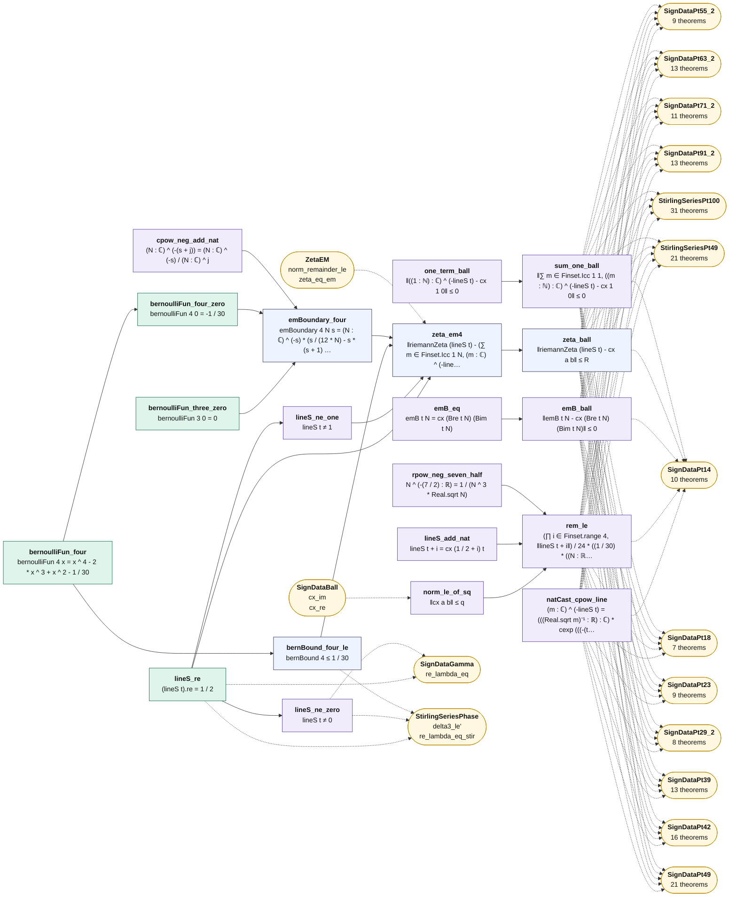

# `lean_stage3/Stage3/SignDataZeta.lean`

> **Read from the source text.** This file changed after the last `python3 utilities/lean_map.py --dump`, so the arrows on this page are names occurring in each proof and have not been confirmed by Lean.

SignDataZeta — block S14 of `lean_stage3/design/stencil.md`, Turing's sign data: ζ on the line by Euler–Maclaurin of order 4. 2026-11-25.

20 theorems, 4 definitions, 272 lines. 

**Imports:** [`SignDataBall`](../lean_stage3/SignDataBall.md), [`ZetaEM`](../lean_stage3/ZetaEM.md)  
**Imported by:** [`SignDataGamma`](../lean_stage3/SignDataGamma.md)

## The picture



An arrow A → B reads "A is used in the proof of B". Green: counting, integers only. Violet: shape, analysis with no ζ. Blue: reads ζ. A name ending in ■ is an end: nothing else uses it. Red: contains `sorry`. Yellow: theorems in another file, counted; a dotted arrow crosses files. Definitions are not drawn; they are listed below the diagram.

## Definitions

<a name="SignData-lineS"></a>
### `SignData.lineS`

def · line 37

The point `1/2 + it` of the critical line.

- **Is:** `` lineS (t : ℝ) : ℂ := 1 / 2 + (t : ℂ) * I ``
- **Used by 371:** [`SignData.lineS_div_two`](../lean_stage3/SignDataGamma.md#SignData-lineS_div_two), [`SignData.re_lambda_eq`](../lean_stage3/SignDataGamma.md#SignData-re_lambda_eq), [`SignData.re_lambda_neg`](../lean_stage3/SignDataGamma.md#SignData-re_lambda_neg), [`SignData.re_lambda_pos`](../lean_stage3/SignDataGamma.md#SignData-re_lambda_pos), [`SignData.p14_NB`](../lean_stage3/SignDataPt14.md#SignData-p14_NB), [`SignData.p14_S2`](../lean_stage3/SignDataPt14.md#SignData-p14_S2), [`SignData.p14_S3`](../lean_stage3/SignDataPt14.md#SignData-p14_S3), [`SignData.p14_S4`](../lean_stage3/SignDataPt14.md#SignData-p14_S4), [`SignData.p14_S5`](../lean_stage3/SignDataPt14.md#SignData-p14_S5), [`SignData.p14_S6`](../lean_stage3/SignDataPt14.md#SignData-p14_S6), [`SignData.p14_S7`](../lean_stage3/SignDataPt14.md#SignData-p14_S7), [`SignData.p14_S8`](../lean_stage3/SignDataPt14.md#SignData-p14_S8), [`SignData.p14_T2`](../lean_stage3/SignDataPt14.md#SignData-p14_T2), [`SignData.p14_T3`](../lean_stage3/SignDataPt14.md#SignData-p14_T3), [`SignData.p14_T4`](../lean_stage3/SignDataPt14.md#SignData-p14_T4), [`SignData.p14_T5`](../lean_stage3/SignDataPt14.md#SignData-p14_T5), [`SignData.p14_T6`](../lean_stage3/SignDataPt14.md#SignData-p14_T6), [`SignData.p14_T7`](../lean_stage3/SignDataPt14.md#SignData-p14_T7), [`SignData.p14_T8`](../lean_stage3/SignDataPt14.md#SignData-p14_T8), [`SignData.p14_X`](../lean_stage3/SignDataPt14.md#SignData-p14_X), [`SignData.p14_Y`](../lean_stage3/SignDataPt14.md#SignData-p14_Y), [`SignData.p14_zeta`](../lean_stage3/SignDataPt14.md#SignData-p14_zeta), [`SignData.sign_14`](../lean_stage3/SignDataPt14.md#SignData-sign_14), [`SignData.p18_NB`](../lean_stage3/SignDataPt18.md#SignData-p18_NB), [`SignData.p18_S2`](../lean_stage3/SignDataPt18.md#SignData-p18_S2), [`SignData.p18_S3`](../lean_stage3/SignDataPt18.md#SignData-p18_S3), [`SignData.p18_S4`](../lean_stage3/SignDataPt18.md#SignData-p18_S4), [`SignData.p18_S5`](../lean_stage3/SignDataPt18.md#SignData-p18_S5), [`SignData.p18_T2`](../lean_stage3/SignDataPt18.md#SignData-p18_T2), [`SignData.p18_T3`](../lean_stage3/SignDataPt18.md#SignData-p18_T3), [`SignData.p18_T4`](../lean_stage3/SignDataPt18.md#SignData-p18_T4), [`SignData.p18_T5`](../lean_stage3/SignDataPt18.md#SignData-p18_T5), [`SignData.p18_X`](../lean_stage3/SignDataPt18.md#SignData-p18_X), [`SignData.p18_Y`](../lean_stage3/SignDataPt18.md#SignData-p18_Y), [`SignData.p18_zeta`](../lean_stage3/SignDataPt18.md#SignData-p18_zeta), [`SignData.sign_18`](../lean_stage3/SignDataPt18.md#SignData-sign_18), [`SignData.p23_NB`](../lean_stage3/SignDataPt23.md#SignData-p23_NB), [`SignData.p23_S2`](../lean_stage3/SignDataPt23.md#SignData-p23_S2), [`SignData.p23_S3`](../lean_stage3/SignDataPt23.md#SignData-p23_S3), [`SignData.p23_S4`](../lean_stage3/SignDataPt23.md#SignData-p23_S4), and 331 more (full list in `map/lean_map.json`)

<a name="SignData-emB"></a>
### `SignData.emB`

def · line 40

The boundary bracket of the order-4 formula.

- **Is:** `` emB (t : ℝ) (N : ℕ) : ℂ := (N : ℂ) / (lineS t - 1) - 1 / 2 + lineS t / (12 * N) - lineS t * (lineS t + 1) * (lineS t + 2) / (720 * (N : ℂ) ^ 3) ``
- **Built from:** [`SignData.lineS`](#SignData-lineS)
- **Used by 30:** [`SignData.p14_NB`](../lean_stage3/SignDataPt14.md#SignData-p14_NB), [`SignData.p14_Y`](../lean_stage3/SignDataPt14.md#SignData-p14_Y), [`SignData.p18_NB`](../lean_stage3/SignDataPt18.md#SignData-p18_NB), [`SignData.p18_Y`](../lean_stage3/SignDataPt18.md#SignData-p18_Y), [`SignData.p23_NB`](../lean_stage3/SignDataPt23.md#SignData-p23_NB), [`SignData.p23_Y`](../lean_stage3/SignDataPt23.md#SignData-p23_Y), [`SignData.p29_2_NB`](../lean_stage3/SignDataPt29_2.md#SignData-p29_2_NB), [`SignData.p29_2_Y`](../lean_stage3/SignDataPt29_2.md#SignData-p29_2_Y), [`SignData.p39_NB`](../lean_stage3/SignDataPt39.md#SignData-p39_NB), [`SignData.p39_Y`](../lean_stage3/SignDataPt39.md#SignData-p39_Y), [`SignData.p42_NB`](../lean_stage3/SignDataPt42.md#SignData-p42_NB), [`SignData.p42_Y`](../lean_stage3/SignDataPt42.md#SignData-p42_Y), [`SignData.p49_NB`](../lean_stage3/SignDataPt49.md#SignData-p49_NB), [`SignData.p49_Y`](../lean_stage3/SignDataPt49.md#SignData-p49_Y), [`SignData.p55_2_NB`](../lean_stage3/SignDataPt55_2.md#SignData-p55_2_NB), [`SignData.p55_2_Y`](../lean_stage3/SignDataPt55_2.md#SignData-p55_2_Y), [`SignData.p63_2_NB`](../lean_stage3/SignDataPt63_2.md#SignData-p63_2_NB), [`SignData.p63_2_Y`](../lean_stage3/SignDataPt63_2.md#SignData-p63_2_Y), [`SignData.p71_2_NB`](../lean_stage3/SignDataPt71_2.md#SignData-p71_2_NB), [`SignData.p71_2_Y`](../lean_stage3/SignDataPt71_2.md#SignData-p71_2_Y), [`SignData.p91_2_NB`](../lean_stage3/SignDataPt91_2.md#SignData-p91_2_NB), [`SignData.p91_2_Y`](../lean_stage3/SignDataPt91_2.md#SignData-p91_2_Y), [`SignData.emB_ball`](#SignData-emB_ball), [`SignData.emB_eq`](#SignData-emB_eq), [`SignData.zeta_ball`](#SignData-zeta_ball), [`SignData.zeta_em4`](#SignData-zeta_em4), [`StirlingSeries.s100_NB`](../lean_stage3/StirlingSeriesPt100.md#StirlingSeries-s100_NB), [`StirlingSeries.s100_Y`](../lean_stage3/StirlingSeriesPt100.md#StirlingSeries-s100_Y), [`StirlingSeries.s49_NB`](../lean_stage3/StirlingSeriesPt49.md#StirlingSeries-s49_NB), [`StirlingSeries.s49_Y`](../lean_stage3/StirlingSeriesPt49.md#StirlingSeries-s49_Y)

<a name="SignData-Bre"></a>
### `SignData.Bre`

def · line 45

The real part of `emB t N`.

- **Is:** `` Bre (t N : ℝ) : ℝ := (-3840 * N ^ 4 - 960 * N ^ 3 * (4 * t ^ 2 + 1) + 80 * N ^ 2 * (4 * t ^ 2 + 1) + (4 * t ^ 2 + 1) * (12 * t ^ 2 - 5)) / (1920 * N ^ 3 * (4 * t ^ 2 + 1)) ``
- **Used by 15:** [`SignData.p14_NB`](../lean_stage3/SignDataPt14.md#SignData-p14_NB), [`SignData.p18_NB`](../lean_stage3/SignDataPt18.md#SignData-p18_NB), [`SignData.p23_NB`](../lean_stage3/SignDataPt23.md#SignData-p23_NB), [`SignData.p29_2_NB`](../lean_stage3/SignDataPt29_2.md#SignData-p29_2_NB), [`SignData.p39_NB`](../lean_stage3/SignDataPt39.md#SignData-p39_NB), [`SignData.p42_NB`](../lean_stage3/SignDataPt42.md#SignData-p42_NB), [`SignData.p49_NB`](../lean_stage3/SignDataPt49.md#SignData-p49_NB), [`SignData.p55_2_NB`](../lean_stage3/SignDataPt55_2.md#SignData-p55_2_NB), [`SignData.p63_2_NB`](../lean_stage3/SignDataPt63_2.md#SignData-p63_2_NB), [`SignData.p71_2_NB`](../lean_stage3/SignDataPt71_2.md#SignData-p71_2_NB), [`SignData.p91_2_NB`](../lean_stage3/SignDataPt91_2.md#SignData-p91_2_NB), [`SignData.emB_ball`](#SignData-emB_ball), [`SignData.emB_eq`](#SignData-emB_eq), [`StirlingSeries.s100_NB`](../lean_stage3/StirlingSeriesPt100.md#StirlingSeries-s100_NB), [`StirlingSeries.s49_NB`](../lean_stage3/StirlingSeriesPt49.md#StirlingSeries-s49_NB)

<a name="SignData-Bim"></a>
### `SignData.Bim`

def · line 50

The imaginary part of `emB t N`.

- **Is:** `` Bim (t N : ℝ) : ℝ := t * (-11520 * N ^ 4 + N ^ 2 * (960 * t ^ 2 + 240) + (4 * t ^ 2 - 23) * (4 * t ^ 2 + 1)) / (2880 * N ^ 3 * (4 * t ^ 2 + 1)) ``
- **Used by 15:** [`SignData.p14_NB`](../lean_stage3/SignDataPt14.md#SignData-p14_NB), [`SignData.p18_NB`](../lean_stage3/SignDataPt18.md#SignData-p18_NB), [`SignData.p23_NB`](../lean_stage3/SignDataPt23.md#SignData-p23_NB), [`SignData.p29_2_NB`](../lean_stage3/SignDataPt29_2.md#SignData-p29_2_NB), [`SignData.p39_NB`](../lean_stage3/SignDataPt39.md#SignData-p39_NB), [`SignData.p42_NB`](../lean_stage3/SignDataPt42.md#SignData-p42_NB), [`SignData.p49_NB`](../lean_stage3/SignDataPt49.md#SignData-p49_NB), [`SignData.p55_2_NB`](../lean_stage3/SignDataPt55_2.md#SignData-p55_2_NB), [`SignData.p63_2_NB`](../lean_stage3/SignDataPt63_2.md#SignData-p63_2_NB), [`SignData.p71_2_NB`](../lean_stage3/SignDataPt71_2.md#SignData-p71_2_NB), [`SignData.p91_2_NB`](../lean_stage3/SignDataPt91_2.md#SignData-p91_2_NB), [`SignData.emB_ball`](#SignData-emB_ball), [`SignData.emB_eq`](#SignData-emB_eq), [`StirlingSeries.s100_NB`](../lean_stage3/StirlingSeriesPt100.md#StirlingSeries-s100_NB), [`StirlingSeries.s49_NB`](../lean_stage3/StirlingSeriesPt49.md#StirlingSeries-s49_NB)

## Theorems

<a name="SignData-lineS_re"></a>
### `SignData.lineS_re`

line 54 · arrows read from text

**Counting.** Integers only: nothing in its statement or proof, or in anything it rests on, uses analysis or ζ.

**Proves**

```lean
(lineS t).re = 1 / 2
```

**Needs** (its hypotheses)

  - `` t : ℝ ``

**Fed by:** no theorem of this repo; it stands on Mathlib and the definitions below.

**Definitions its proof touches:** [`SignData.lineS`](#SignData-lineS)

**Feeds** (5 that use it)

  - [`SignData.re_lambda_eq`](../lean_stage3/SignDataGamma.md#SignData-re_lambda_eq) (SignDataGamma) — `` ∃ c : ℝ, 0 < c ∧ (completedRiemannZeta (lineS t)).re = c * (gammaDir t n * riemannZeta (lineS t)).re ``
  - [`SignData.lineS_ne_one`](#SignData-lineS_ne_one) — `` lineS t ≠ 1 ``
  - [`SignData.lineS_ne_zero`](#SignData-lineS_ne_zero) — `` lineS t ≠ 0 ``
  - [`SignData.zeta_em4`](#SignData-zeta_em4) — `` ‖riemannZeta (lineS t) - (∑ m ∈ Finset.Icc 1 N, (m : ℂ) ^ (-lineS t) + (N : ℂ) ^ (-lineS t) * emB t N)‖ ≤ (∏ i ∈ Finset.range 4, ‖lineS t + i‖) / 24 *… ``
  - [`StirlingSeries.re_lambda_eq_stir`](../lean_stage3/StirlingSeriesPhase.md#StirlingSeries-re_lambda_eq_stir) (StirlingSeriesPhase) — `` ∃ c : ℝ, 0 < c ∧ (completedRiemannZeta (lineS t)).re = c * (stirDir K t * riemannZeta (lineS t)).re ``

<a name="SignData-lineS_ne_zero"></a>
### `SignData.lineS_ne_zero`

line 56 · arrows read from text

**Shape.** Uses real or complex analysis; nothing in it or beneath it reads ζ.

**Proves**

```lean
lineS t ≠ 0
```

**Needs** (its hypotheses)

  - `` t : ℝ ``

**Fed by** (1 theorem its proof uses)

  - [`SignData.lineS_re`](#SignData-lineS_re) — `` (lineS t).re = 1 / 2 ``

**Definitions its proof touches:** [`SignData.lineS`](#SignData-lineS)

**Feeds** (2 that use it)

  - [`SignData.re_lambda_eq`](../lean_stage3/SignDataGamma.md#SignData-re_lambda_eq) (SignDataGamma) — `` ∃ c : ℝ, 0 < c ∧ (completedRiemannZeta (lineS t)).re = c * (gammaDir t n * riemannZeta (lineS t)).re ``
  - [`StirlingSeries.re_lambda_eq_stir`](../lean_stage3/StirlingSeriesPhase.md#StirlingSeries-re_lambda_eq_stir) (StirlingSeriesPhase) — `` ∃ c : ℝ, 0 < c ∧ (completedRiemannZeta (lineS t)).re = c * (stirDir K t * riemannZeta (lineS t)).re ``

<a name="SignData-lineS_ne_one"></a>
### `SignData.lineS_ne_one`

line 62 · arrows read from text

**Shape.** Uses real or complex analysis; nothing in it or beneath it reads ζ.

**Proves**

```lean
lineS t ≠ 1
```

**Needs** (its hypotheses)

  - `` t : ℝ ``

**Fed by** (1 theorem its proof uses)

  - [`SignData.lineS_re`](#SignData-lineS_re) — `` (lineS t).re = 1 / 2 ``

**Definitions its proof touches:** [`SignData.lineS`](#SignData-lineS)

**Feeds** (1 that use it)

  - [`SignData.zeta_em4`](#SignData-zeta_em4) — `` ‖riemannZeta (lineS t) - (∑ m ∈ Finset.Icc 1 N, (m : ℂ) ^ (-lineS t) + (N : ℂ) ^ (-lineS t) * emB t N)‖ ≤ (∏ i ∈ Finset.range 4, ‖lineS t + i‖) / 24 *… ``

<a name="SignData-bernoulliFun_four"></a>
### `SignData.bernoulliFun_four`

line 68 · arrows read from text

**Counting.** Integers only: nothing in its statement or proof, or in anything it rests on, uses analysis or ζ.

**Proves**

```lean
bernoulliFun 4 x = x ^ 4 - 2 * x ^ 3 + x ^ 2 - 1 / 30
```

**Needs** (its hypotheses)

  - `` x : ℝ ``

**Fed by:** no theorem of this repo; it stands on Mathlib.

**Feeds** (2 that use it)

  - [`SignData.bernBound_four_le`](#SignData-bernBound_four_le) — `` bernBound 4 ≤ 1 / 30 ``
  - [`SignData.bernoulliFun_four_zero`](#SignData-bernoulliFun_four_zero) — `` bernoulliFun 4 0 = -1 / 30 ``

<a name="SignData-bernBound_four_le"></a>
### `SignData.bernBound_four_le`

line 73 · arrows read from text

**Reads ζ.** It, or something it rests on, uses the zeta function, its zeros or the Riemann hypothesis.

**Proves**

```lean
bernBound 4 ≤ 1 / 30
```

**Fed by** (1 theorem its proof uses)

  - [`SignData.bernoulliFun_four`](#SignData-bernoulliFun_four) — `` bernoulliFun 4 x = x ^ 4 - 2 * x ^ 3 + x ^ 2 - 1 / 30 ``

**Definitions its proof touches:** [`ZetaEM.bernBound`](../lean_stage3/ZetaEM.md#ZetaEM-bernBound)

**Feeds** (2 that use it)

  - [`SignData.zeta_em4`](#SignData-zeta_em4) — `` ‖riemannZeta (lineS t) - (∑ m ∈ Finset.Icc 1 N, (m : ℂ) ^ (-lineS t) + (N : ℂ) ^ (-lineS t) * emB t N)‖ ≤ (∏ i ∈ Finset.range 4, ‖lineS t + i‖) / 24 *… ``
  - [`StirlingSeries.delta3_le'`](../lean_stage3/StirlingSeriesPhase.md#StirlingSeries-delta3_le-) (StirlingSeriesPhase) — `` ‖Stirling.logG (zz t) - stirMain 3 (zz t) - ((Real.log (2 * Real.pi) / 2 : ℝ) : ℂ)‖ ≤ 2 / 5 / |t| ^ 3 ``

<a name="SignData-bernoulliFun_three_zero"></a>
### `SignData.bernoulliFun_three_zero`

line 87 · arrows read from text

**Counting.** Integers only: nothing in its statement or proof, or in anything it rests on, uses analysis or ζ.

**Proves**

```lean
bernoulliFun 3 0 = 0
```

**Fed by:** no theorem of this repo; it stands on Mathlib.

**Feeds** (1 that use it)

  - [`SignData.emBoundary_four`](#SignData-emBoundary_four) — `` emBoundary 4 N s = (N : ℂ) ^ (-s) * (s / (12 * N) - s * (s + 1) * (s + 2) / (720 * (N : ℂ) ^ 3)) ``

<a name="SignData-bernoulliFun_four_zero"></a>
### `SignData.bernoulliFun_four_zero`

line 91 · arrows read from text

**Counting.** Integers only: nothing in its statement or proof, or in anything it rests on, uses analysis or ζ.

**Proves**

```lean
bernoulliFun 4 0 = -1 / 30
```

**Fed by** (1 theorem its proof uses)

  - [`SignData.bernoulliFun_four`](#SignData-bernoulliFun_four) — `` bernoulliFun 4 x = x ^ 4 - 2 * x ^ 3 + x ^ 2 - 1 / 30 ``

**Feeds** (1 that use it)

  - [`SignData.emBoundary_four`](#SignData-emBoundary_four) — `` emBoundary 4 N s = (N : ℂ) ^ (-s) * (s / (12 * N) - s * (s + 1) * (s + 2) / (720 * (N : ℂ) ^ 3)) ``

<a name="SignData-cpow_neg_add_nat"></a>
### `SignData.cpow_neg_add_nat`

line 94 · arrows read from text

**Shape.** Uses real or complex analysis; nothing in it or beneath it reads ζ.

**Proves**

```lean
(N : ℂ) ^ (-(s + j)) = (N : ℂ) ^ (-s) / (N : ℂ) ^ j
```

**Needs** (its hypotheses)

  - `` hN : 0 < N ``
  - `` s : ℂ ``
  - `` j : ℕ ``

**Fed by:** no theorem of this repo; it stands on Mathlib.

**Feeds** (1 that use it)

  - [`SignData.emBoundary_four`](#SignData-emBoundary_four) — `` emBoundary 4 N s = (N : ℂ) ^ (-s) * (s / (12 * N) - s * (s + 1) * (s + 2) / (720 * (N : ℂ) ^ 3)) ``

<a name="SignData-emBoundary_four"></a>
### `SignData.emBoundary_four`

line 100 · arrows read from text

**Reads ζ.** It, or something it rests on, uses the zeta function, its zeros or the Riemann hypothesis.

**Proves**

```lean
emBoundary 4 N s = (N : ℂ) ^ (-s) * (s / (12 * N) - s * (s + 1) * (s + 2) / (720 * (N : ℂ) ^ 3))
```

**Needs** (its hypotheses)

  - `` hN : 0 < N ``
  - `` s : ℂ ``

**Fed by** (3 theorems its proof uses)

  - [`SignData.bernoulliFun_four_zero`](#SignData-bernoulliFun_four_zero) — `` bernoulliFun 4 0 = -1 / 30 ``
  - [`SignData.bernoulliFun_three_zero`](#SignData-bernoulliFun_three_zero) — `` bernoulliFun 3 0 = 0 ``
  - [`SignData.cpow_neg_add_nat`](#SignData-cpow_neg_add_nat) — `` (N : ℂ) ^ (-(s + j)) = (N : ℂ) ^ (-s) / (N : ℂ) ^ j ``

**Definitions its proof touches:** [`ZetaEM.emBoundary`](../lean_stage3/ZetaEM.md#ZetaEM-emBoundary), [`ZetaEM.emTerm`](../lean_stage3/ZetaEM.md#ZetaEM-emTerm)

**Feeds** (1 that use it)

  - [`SignData.zeta_em4`](#SignData-zeta_em4) — `` ‖riemannZeta (lineS t) - (∑ m ∈ Finset.Icc 1 N, (m : ℂ) ^ (-lineS t) + (N : ℂ) ^ (-lineS t) * emB t N)‖ ≤ (∏ i ∈ Finset.range 4, ‖lineS t + i‖) / 24 *… ``

<a name="SignData-zeta_em4"></a>
### `SignData.zeta_em4`

line 115 · arrows read from text

**Reads ζ.** It, or something it rests on, uses the zeta function, its zeros or the Riemann hypothesis.

**Why.** ζ on the line by Euler–Maclaurin of order 4.

**Proves**

```lean
‖riemannZeta (lineS t) - (∑ m ∈ Finset.Icc 1 N, (m : ℂ) ^ (-lineS t) + (N : ℂ) ^ (-lineS t) * emB t N)‖ ≤ (∏ i ∈ Finset.range 4, ‖lineS t + i‖) / 24 * ((1 / 30) * ((N : ℝ) ^ (-(7 / 2) : ℝ) / (7 / 2)))
```

**Needs** (its hypotheses)

  - `` t : ℝ ``
  - `` hN : 0 < N ``

**Fed by** (6 theorems its proof uses)

  - [`SignData.bernBound_four_le`](#SignData-bernBound_four_le) — `` bernBound 4 ≤ 1 / 30 ``
  - [`SignData.emBoundary_four`](#SignData-emBoundary_four) — `` emBoundary 4 N s = (N : ℂ) ^ (-s) * (s / (12 * N) - s * (s + 1) * (s + 2) / (720 * (N : ℂ) ^ 3)) ``
  - [`SignData.lineS_ne_one`](#SignData-lineS_ne_one) — `` lineS t ≠ 1 ``
  - [`SignData.lineS_re`](#SignData-lineS_re) — `` (lineS t).re = 1 / 2 ``
  - [`ZetaEM.norm_remainder_le`](../lean_stage3/ZetaEM.md#ZetaEM-norm_remainder_le) (ZetaEM) — `` ‖emRem k N s‖ ≤ (∏ i ∈ Finset.range k, ‖s + i‖) / k.factorial * (bernBound k * ((N:ℝ) ^ (1 - s.re - k) / (s.re + k - 1))) ``
  - [`ZetaEM.zeta_eq_em`](../lean_stage3/ZetaEM.md#ZetaEM-zeta_eq_em) (ZetaEM) — `` riemannZeta s = ∑ n ∈ Finset.Icc 1 N, (n : ℂ) ^ (-s) - (N:ℂ) ^ (1 - s) / (1 - s) - (N:ℂ) ^ (-s) / 2 + emBoundary k N s + emRem k N s ``

**Definitions its proof touches:** [`SignData.emB`](#SignData-emB), [`SignData.lineS`](#SignData-lineS), [`ZetaEM.emRem`](../lean_stage3/ZetaEM.md#ZetaEM-emRem)

**Feeds** (1 that use it)

  - [`SignData.zeta_ball`](#SignData-zeta_ball) — `` ‖riemannZeta (lineS t) - cx a b‖ ≤ R ``

<a name="SignData-emB_eq"></a>
### `SignData.emB_eq`

line 150 · arrows read from text

**Shape.** Uses real or complex analysis; nothing in it or beneath it reads ζ.

**Proves**

```lean
emB t N = cx (Bre t N) (Bim t N)
```

**Needs** (its hypotheses)

  - `` t : ℝ ``
  - `` hN : 0 < N ``

**Fed by:** no theorem of this repo; it stands on Mathlib and the definitions below.

**Definitions its proof touches:** [`SignData.cx`](../lean_stage3/SignDataBall.md#SignData-cx), [`SignData.Bim`](#SignData-Bim), [`SignData.Bre`](#SignData-Bre), [`SignData.emB`](#SignData-emB), [`SignData.lineS`](#SignData-lineS)

**Feeds** (1 that use it)

  - [`SignData.emB_ball`](#SignData-emB_ball) — `` ‖emB t N - cx (Bre t N) (Bim t N)‖ ≤ 0 ``

<a name="SignData-natCast_cpow_line"></a>
### `SignData.natCast_cpow_line`

line 167 · arrows read from text

**Shape.** Uses real or complex analysis; nothing in it or beneath it reads ζ.

**Why.** `m^{−(1/2 + it)} = (√m)⁻¹ · e^{i(−t log m)}`.

**Proves**

```lean
(m : ℂ) ^ (-lineS t) = (((Real.sqrt m)⁻¹ : ℝ) : ℂ) * cexp (((-(t * Real.log m)) : ℝ) * I)
```

**Needs** (its hypotheses)

  - `` hm : 0 < m ``
  - `` t : ℝ ``

**Fed by:** no theorem of this repo; it stands on Mathlib and the definitions below.

**Definitions its proof touches:** [`SignData.lineS`](#SignData-lineS)

**Feeds** (143 that use it)

  - [`SignData.p14_T2`](../lean_stage3/SignDataPt14.md#SignData-p14_T2) (SignDataPt14) — `` ‖(((2 : ℕ)) : ℂ) ^ (-lineS (14 : ℝ)) - cx (-0.679708838337985220771914796136) (0.194925357727584208072744154227)‖ ≤ (0.000000002474873734174129538843) ``
  - [`SignData.p14_T3`](../lean_stage3/SignDataPt14.md#SignData-p14_T3) (SignDataPt14) — `` ‖(((3 : ℕ)) : ℂ) ^ (-lineS (14 : ℝ)) - cx (-0.546684008334877980393651456295) (-0.185660788440220721249718589868)‖ ≤ (0.000000002020784829410994313809… ``
  - [`SignData.p14_T4`](../lean_stage3/SignDataPt14.md#SignData-p14_T4) (SignDataPt14) — `` ‖(((4 : ℕ)) : ℂ) ^ (-lineS (14 : ℝ)) - cx (0.424008209792653258207958361735) (-0.26498497698629886974681133509)‖ ≤ (0.000000001750084156517625160689) ``
  - [`SignData.p14_T5`](../lean_stage3/SignDataPt14.md#SignData-p14_T5) (SignDataPt14) — `` ‖(((5 : ℕ)) : ℂ) ^ (-lineS (14 : ℝ)) - cx (-0.383352962695943402077332800096) (0.230305245255601215918736840507)‖ ≤ (0.000000001565339268943440107931) ``
  - [`SignData.p14_T6`](../lean_stage3/SignDataPt14.md#SignData-p14_T6) (SignDataPt14) — `` ‖(((6 : ℕ)) : ℂ) ^ (-lineS (14 : ℝ)) - cx (0.407775947848682127742235136901) (0.019632702890217135414905060898)‖ ≤ (0.000000001428963968290971738045) ``
  - [`SignData.p14_T7`](../lean_stage3/SignDataPt14.md#SignData-p14_T7) (SignDataPt14) — `` ‖(((7 : ℕ)) : ℂ) ^ (-lineS (14 : ℝ)) - cx (-0.194067199872562735994369932836) (-0.324337886764352035248896630922)‖ ≤ (0.000000001322990101142493007309… ``
  - [`SignData.p14_T8`](../lean_stage3/SignDataPt14.md#SignData-p14_T8) (SignDataPt14) — `` ‖(((8 : ℕ)) : ℂ) ^ (-lineS (14 : ℝ)) - cx (-0.23654983625586035967757123965) (0.262762582890573770697677455546)‖ ≤ (0.000000001237564018329688739307) ``
  - [`SignData.p18_T2`](../lean_stage3/SignDataPt18.md#SignData-p18_T2) (SignDataPt18) — `` ‖(((2 : ℕ)) : ℂ) ^ (-lineS (18 : ℝ)) - cx (0.704262612244207972588033412246) (0.063357501489281966856773607032)‖ ≤ (0.000000003181980515367748131054) ``
  - [`SignData.p18_T3`](../lean_stage3/SignDataPt18.md#SignData-p18_T3) (SignDataPt18) — `` ‖(((3 : ℕ)) : ℂ) ^ (-lineS (18 : ℝ)) - cx (0.3472547958186057327991009419) (-0.461245531267579627490884968333)‖ ≤ (0.000000002598151923527790665535) ``
  - [`SignData.p18_T4`](../lean_stage3/SignDataPt18.md#SignData-p18_T4) (SignDataPt18) — `` ‖(((4 : ℕ)) : ℂ) ^ (-lineS (18 : ℝ)) - cx (0.491971654026046033598899464848) (0.089240638920149286096915907456)‖ ≤ (0.000000002250108201238015282242) ``
  - [`SignData.p18_T5`](../lean_stage3/SignDataPt18.md#SignData-p18_T5) (SignDataPt18) — `` ‖(((5 : ℕ)) : ℂ) ^ (-lineS (18 : ℝ)) - cx (-0.343326909603509428044868072338) (0.286577447022796379837176706911)‖ ≤ (0.000000002012579060068804448516) ``
  - [`SignData.p23_T2`](../lean_stage3/SignDataPt23.md#SignData-p23_T2) (SignDataPt23) — `` ‖(((2 : ℕ)) : ℂ) ^ (-lineS (23 : ℝ)) - cx (-0.687766554345326386541265429274) (0.16424727310965380568360950344)‖ ≤ (0.000000004065863991858003604367) ``
  - [`SignData.p23_T3`](../lean_stage3/SignDataPt23.md#SignData-p23_T3) (SignDataPt23) — `` ‖(((3 : ℕ)) : ℂ) ^ (-lineS (23 : ℝ)) - cx (0.572070587416209170164856041729) (-0.077901067685922736511613470042)‖ ≤ (0.000000003319860791171905799637) ``
  - [`SignData.p23_T4`](../lean_stage3/SignDataPt23.md#SignData-p23_T4) (SignDataPt23) — `` ‖(((4 : ℕ)) : ℂ) ^ (-lineS (23 : ℝ)) - cx (0.446045666500408693411344787912) (-0.225927562276509737717231817732)‖ ≤ (0.000000002875138257136630695252) ``
  - [`SignData.p23_T5`](../lean_stage3/SignDataPt23.md#SignData-p23_T5) (SignDataPt23) — `` ‖(((5 : ℕ)) : ℂ) ^ (-lineS (23 : ℝ)) - cx (0.347166750586874309087433346075) (0.281913545767050730000203132431)‖ ≤ (0.000000002571628798978214756386) ``
  - [`SignData.p23_T6`](../lean_stage3/SignDataPt23.md#SignData-p23_T6) (SignDataPt23) — `` ‖(((6 : ℕ)) : ℂ) ^ (-lineS (23 : ℝ)) - cx (-0.380655978776062729715402390405) (0.14753878299858768770669266713)‖ ≤ (0.000000002347583662191093746384) ``
  - [`SignData.p23_T7`](../lean_stage3/SignDataPt23.md#SignData-p23_T7) (SignDataPt23) — `` ‖(((7 : ℕ)) : ℂ) ^ (-lineS (23 : ℝ)) - cx (0.270386179081039203124415609482) (-0.264099331727853971053744326788)‖ ≤ (0.00000000217348373759206453894) ``
  - [`SignData.p29_2_T2`](../lean_stage3/SignDataPt29_2.md#SignData-p29_2_T2) (SignDataPt29_2) — `` ‖(((2 : ℕ)) : ℂ) ^ (-lineS (29/2 : ℝ)) - cx (-0.57308309626175609593385213682) (0.414217050323907835417746042704)‖ ≤ (0.000000002563262081822473923591… ``
  - [`SignData.p29_2_T3`](../lean_stage3/SignDataPt29_2.md#SignData-p29_2_T3) (SignDataPt29_2) — `` ‖(((3 : ℕ)) : ℂ) ^ (-lineS (29/2 : ℝ)) - cx (-0.563192352276960784564499903402) (0.127073630899872527075694223734)‖ ≤ (0.00000000209295571617312851869… ``
  - [`SignData.p29_2_T4`](../lean_stage3/SignDataPt29_2.md#SignData-p29_2_T4) (SignDataPt29_2) — `` ‖(((4 : ℕ)) : ℂ) ^ (-lineS (29/2 : ℝ)) - cx (0.156848470373461457519610674514) (-0.474761579470691144751558052458)‖ ≤ (0.00000000181258716210985982037… ``
  - [`SignData.p29_2_T5`](../lean_stage3/SignDataPt29_2.md#SignData-p29_2_T5) (SignDataPt29_2) — `` ‖(((5 : ℕ)) : ℂ) ^ (-lineS (29/2 : ℝ)) - cx (-0.099817687230798084734096457138) (0.435931679642457929249969714238)‖ ≤ (0.00000000162124424283383973916… ``
  - [`SignData.p29_2_T6`](../lean_stage3/SignDataPt29_2.md#SignData-p29_2_T6) (SignDataPt29_2) — `` ‖(((6 : ℕ)) : ℂ) ^ (-lineS (29/2 : ℝ)) - cx (0.270119952424387188973053766513) (-0.306107624813419942123226215119)‖ ≤ (0.00000000147999839573165510762… ``
  - [`SignData.p39_T10`](../lean_stage3/SignDataPt39.md#SignData-p39_T10) (SignDataPt39) — `` ‖(((10 : ℕ)) : ℂ) ^ (-lineS (39 : ℝ)) - cx (-0.082953595804049456320540365105) (-0.305153569441975212878787912416)‖ ≤ (0.00000000308361862182174747430… ``
  - [`SignData.p39_T11`](../lean_stage3/SignDataPt39.md#SignData-p39_T11) (SignDataPt39) — `` ‖(((11 : ℕ)) : ℂ) ^ (-lineS (39 : ℝ)) - cx (0.224705885512607761424979779806) (0.201038195189585111959337934169)‖ ≤ (0.000000002940149056881650711751) ``
  - [`SignData.p39_T2`](../lean_stage3/SignDataPt39.md#SignData-p39_T2) (SignDataPt39) — `` ‖(((2 : ℕ)) : ℂ) ^ (-lineS (39 : ℝ)) - cx (-0.228599450572831094778141159212) (-0.669135480450558497548582908066)‖ ≤ (0.00000000689429111662894243938) ``
  - [`SignData.p39_T3`](../lean_stage3/SignDataPt39.md#SignData-p39_T3) (SignDataPt39) — `` ‖(((3 : ℕ)) : ℂ) ^ (-lineS (39 : ℝ)) - cx (0.242975921238263958056239000811) (0.523732789723681787138601507538)‖ ≤ (0.000000005629329167638169366289) ``
  - [`SignData.p39_T4`](../lean_stage3/SignDataPt39.md#SignData-p39_T4) (SignDataPt39) — `` ‖(((4 : ℕ)) : ℂ) ^ (-lineS (39 : ℝ)) - cx (-0.395484582276945284234537358156) (0.30592800653295882249904709057)‖ ≤ (0.000000004875234436013250348627) ``
  - [`SignData.p39_T5`](../lean_stage3/SignDataPt39.md#SignData-p39_T5) (SignDataPt39) — `` ‖(((5 : ℕ)) : ℂ) ^ (-lineS (39 : ℝ)) - cx (0.446304453436157138765654437966) (0.028501488435747427330638520196)‖ ≤ (0.000000004360587963482115927141) ``
  - [`SignData.p39_T6`](../lean_stage3/SignDataPt39.md#SignData-p39_T6) (SignDataPt39) — `` ‖(((6 : ℕ)) : ℂ) ^ (-lineS (39 : ℝ)) - cx (0.294904029672478849009777006927) (-0.282308837887871270294537816339)‖ ≤ (0.000000003980685340237894315326) ``
  - [`SignData.p39_T7`](../lean_stage3/SignDataPt39.md#SignData-p39_T7) (SignDataPt39) — `` ‖(((7 : ℕ)) : ℂ) ^ (-lineS (39 : ℝ)) - cx (0.333085447861997901950478989471) (-0.178637138579062373066088090526)‖ ≤ (0.000000003685472424611726579325) ``
  - [`SignData.p39_T8`](../lean_stage3/SignDataPt39.md#SignData-p39_T8) (SignDataPt39) — `` ‖(((8 : ℕ)) : ℂ) ^ (-lineS (39 : ℝ)) - cx (0.295114841928759320641366980114) (0.194697791649939881028985067052)‖ ≤ (0.000000003447499765343995650559) ``
  - [`SignData.p39_T9`](../lean_stage3/SignDataPt39.md#SignData-p39_T9) (SignDataPt39) — `` ‖(((9 : ℕ)) : ℂ) ^ (-lineS (39 : ℝ)) - cx (-0.21525873663146239869186630525) (0.254508914215077777429377043665)‖ ≤ (0.000000003250404982307626396133) ``
  - [`SignData.p42_T10`](../lean_stage3/SignDataPt42.md#SignData-p42_T10) (SignDataPt42) — `` ‖(((10 : ℕ)) : ℂ) ^ (-lineS (42 : ℝ)) - cx (-0.24573125887633586538224215769) (-0.199038057695133284201526280421)‖ ≤ (0.000000003320820054270524843406… ``
  - [`SignData.p42_T11`](../lean_stage3/SignDataPt42.md#SignData-p42_T11) (SignDataPt42) — `` ‖(((11 : ℕ)) : ℂ) ^ (-lineS (42 : ℝ)) - cx (0.296605614373637756339193996245) (-0.054168260366452610365169079277)‖ ≤ (0.000000003166314368947642074332… ``
  - [`SignData.p42_T12`](../lean_stage3/SignDataPt42.md#SignData-p42_T12) (SignDataPt42) — `` ‖(((12 : ℕ)) : ℂ) ^ (-lineS (42 : ℝ)) - cx (-0.221991042768539761428943584704) (0.184535390274791691043784287852)‖ ≤ (0.000000003031525510233054343725… ``
  - [`SignData.p42_T13`](../lean_stage3/SignDataPt42.md#SignData-p42_T13) (SignDataPt42) — `` ‖(((13 : ℕ)) : ℂ) ^ (-lineS (42 : ℝ)) - cx (0.169406090571168356040911369472) (-0.219601123404389775661369946165)‖ ≤ (0.000000002912637164459870153254… ``
  - [`SignData.p42_T14`](../lean_stage3/SignDataPt42.md#SignData-p42_T14) (SignDataPt42) — `` ‖(((14 : ℕ)) : ℂ) ^ (-lineS (42 : ℝ)) - cx (-0.169323026377761312961299668545) (0.206780763531928605740446562248)‖ ≤ (0.000000002806702630387035475182… ``
  - [`SignData.p42_T2`](../lean_stage3/SignDataPt42.md#SignData-p42_T2) (SignDataPt42) — `` ‖(((2 : ℕ)) : ℂ) ^ (-lineS (42 : ℝ)) - cx (-0.47309967265805415238154490852) (0.525525165649412081764633272315)‖ ≤ (0.000000007424621202526535121128) ``
  - [`SignData.p42_T3`](../lean_stage3/SignDataPt42.md#SignData-p42_T3) (SignDataPt42) — `` ‖(((3 : ℕ)) : ℂ) ^ (-lineS (42 : ℝ)) - cx (-0.320554105072703215610370699386) (-0.480185796389659655566944683421)‖ ≤ (0.000000006062354488224328899407… ``
  - [`SignData.p42_T4`](../lean_stage3/SignDataPt42.md#SignData-p42_T4) (SignDataPt42) — `` ‖(((4 : ℕ)) : ℂ) ^ (-lineS (42 : ℝ)) - cx (-0.052353399669378425039252214089) (-0.497251567662745862776292992369)‖ ≤ (0.000000005250252469552868991893… ``
  - [`SignData.p42_T5`](../lean_stage3/SignDataPt42.md#SignData-p42_T5) (SignDataPt42) — `` ‖(((5 : ℕ)) : ℂ) ^ (-lineS (42 : ℝ)) - cx (0.023311739604419598555229496795) (0.446605600946311167933366205101)‖ ≤ (0.000000004696017806828081586736) ``
  - [`SignData.p42_T6`](../lean_stage3/SignDataPt42.md#SignData-p42_T6) (SignDataPt42) — `` ‖(((6 : ℕ)) : ℂ) ^ (-lineS (42 : ℝ)) - cx (0.404003762393787157256349554612) (0.0587164937503171811616953366)‖ ≤ (0.000000004286891904872915214131) ``
  - [`SignData.p42_T7`](../lean_stage3/SignDataPt42.md#SignData-p42_T7) (SignDataPt42) — `` ‖(((7 : ℕ)) : ℂ) ^ (-lineS (42 : ℝ)) - cx (0.377550326729424947289656561696) (-0.017688799949327464970585362746)‖ ≤ (0.00000000396897030342936673222) ``
  - [`SignData.p42_T8`](../lean_stage3/SignDataPt42.md#SignData-p42_T8) (SignDataPt42) — `` ‖(((8 : ℕ)) : ℂ) ^ (-lineS (42 : ℝ)) - cx (0.286086588798279022957425337252) (0.207736524736899388284737030272)‖ ≤ (0.00000000371269205498541732975) ``
  - [`SignData.p42_T9`](../lean_stage3/SignDataPt42.md#SignData-p42_T9) (SignDataPt42) — `` ‖(((9 : ℕ)) : ℂ) ^ (-lineS (42 : ℝ)) - cx (-0.127823464646833776300592528113) (0.307851056514007674202403260138)‖ ≤ (0.000000003500436134792161307219) ``
  - [`SignData.p49_T10`](../lean_stage3/SignDataPt49.md#SignData-p49_T10) (SignDataPt49) — `` ‖(((10 : ℕ)) : ℂ) ^ (-lineS (49 : ℝ)) - cx (0.304714876512029845849191264163) (0.084550836969591269477497215954)‖ ≤ (0.000000003874290063315539475378) ``
  - [`SignData.p49_T11`](../lean_stage3/SignDataPt49.md#SignData-p49_T11) (SignDataPt49) — `` ‖(((11 : ℕ)) : ℂ) ^ (-lineS (49 : ℝ)) - cx (-0.0927983744859462485162829545) (0.286875500177092483317644144247)‖ ≤ (0.000000003694033430438698757343) ``
  - [`SignData.p49_T12`](../lean_stage3/SignDataPt49.md#SignData-p49_T12) (SignDataPt49) — `` ‖(((12 : ℕ)) : ℂ) ^ (-lineS (49 : ℝ)) - cx (-0.20890620443204601329581702957) (-0.199227335180515657984224451727)‖ ≤ (0.000000003536779761939967637452… ``
  - [`SignData.p49_T13`](../lean_stage3/SignDataPt49.md#SignData-p49_T13) (SignDataPt49) — `` ‖(((13 : ℕ)) : ℂ) ^ (-lineS (49 : ℝ)) - cx (0.277301021722003987883933241242) (-0.005217305339885288241599317569)‖ ≤ (0.000000003398076691869426634091… ``
  - [`SignData.p49_T14`](../lean_stage3/SignDataPt49.md#SignData-p49_T14) (SignDataPt49) — `` ‖(((14 : ℕ)) : ℂ) ^ (-lineS (49 : ℝ)) - cx (-0.233444877575292284679775199433) (0.130123251428898079038447615086)‖ ≤ (0.000000003274486402117264835227… ``
  - [`SignData.p49_T15`](../lean_stage3/SignDataPt49.md#SignData-p49_T15) (SignDataPt49) — `` ‖(((15 : ℕ)) : ℂ) ^ (-lineS (49 : ℝ)) - cx (0.189348651803191880952843714588) (-0.175538470789112967925434972854)‖ ≤ (0.000000003163558883381518831866… ``
  - [`SignData.p49_T16`](../lean_stage3/SignDataPt49.md#SignData-p49_T16) (SignDataPt49) — `` ‖(((16 : ℕ)) : ℂ) ^ (-lineS (49 : ℝ)) - cx (-0.17976227064402355929885500598) (0.173739822875772570182488064991)‖ ≤ (0.000000003063149139649003333886) ``
  - [`SignData.p49_T17`](../lean_stage3/SignDataPt49.md#SignData-p49_T17) (SignDataPt49) — `` ‖(((17 : ℕ)) : ℂ) ^ (-lineS (49 : ℝ)) - cx (0.200531795656745017717332728298) (-0.136420410285434070492963190086)‖ ≤ (0.000000002971712837383189161068… ``
  - [`SignData.p49_T18`](../lean_stage3/SignDataPt49.md#SignData-p49_T18) (SignDataPt49) — `` ‖(((18 : ℕ)) : ℂ) ^ (-lineS (49 : ℝ)) - cx (-0.227988193068574821260409430495) (0.059807519400839618687937820471)‖ ≤ (0.00000000288799633761525279644) ``
  - [`SignData.p49_T19`](../lean_stage3/SignDataPt49.md#SignData-p49_T19) (SignDataPt49) — `` ‖(((19 : ℕ)) : ℂ) ^ (-lineS (49 : ℝ)) - cx (0.223069853383308359327695426272) (0.053585627353962491123006178135)‖ ≤ (0.000000002811071082315611820794) ``
  - [`SignData.p49_T2`](../lean_stage3/SignDataPt49.md#SignData-p49_T2) (SignDataPt49) — `` ‖(((2 : ℕ)) : ℂ) ^ (-lineS (49 : ℝ)) - cx (-0.586259447237841096474869491187) (-0.395347771619344038458450246979)‖ ≤ (0.000000008662058069612997835312… ``
  - [`SignData.p49_T3`](../lean_stage3/SignDataPt49.md#SignData-p49_T3) (SignDataPt49) — `` ‖(((3 : ℕ)) : ℂ) ^ (-lineS (49 : ℝ)) - cx (-0.526005826310512175613583782468) (0.23801513401615585167641926642)‖ ≤ (0.000000007072746902930081675874) ``
  - [`SignData.p49_T4`](../lean_stage3/SignDataPt49.md#SignData-p49_T4) (SignDataPt49) — `` ‖(((4 : ℕ)) : ℂ) ^ (-lineS (49 : ℝ)) - cx (0.187400279177126714528158973166) (0.463552732021217805622074557128)‖ ≤ (0.000000006125294547811681462929) ``
  - [`SignData.p49_T5`](../lean_stage3/SignDataPt49.md#SignData-p49_T5) (SignDataPt49) — `` ‖(((5 : ℕ)) : ℂ) ^ (-lineS (49 : ℝ)) - cx (-0.424137920176230086682958764925) (0.141799240719341918324916625302)‖ ≤ (0.000000005478687441297565127905) ``
  - [`SignData.p49_T6`](../lean_stage3/SignDataPt49.md#SignData-p49_T6) (SignDataPt49) — `` ‖(((6 : ℕ)) : ℂ) ^ (-lineS (49 : ℝ)) - cx (0.402474637854990851725176074064) (0.068416610191974810838923865093)‖ ≤ (0.000000005001373889016359841699) ``
  - and 83 more; the full list is in `map/lean_map.json`

<a name="SignData-norm_le_of_sq"></a>
### `SignData.norm_le_of_sq`

line 183 · arrows read from text

**Shape.** Uses real or complex analysis; nothing in it or beneath it reads ζ.

**Proves**

```lean
‖cx a b‖ ≤ q
```

**Needs** (its hypotheses)

  - `` hq : 0 ≤ q ``
  - `` h : a ^ 2 + b ^ 2 ≤ q ^ 2 ``

**Fed by** (2 theorems its proof uses)

  - [`SignData.cx_im`](../lean_stage3/SignDataBall.md#SignData-cx_im) (SignDataBall) — `` (cx a b).im = b ``
  - [`SignData.cx_re`](../lean_stage3/SignDataBall.md#SignData-cx_re) (SignDataBall) — `` (cx a b).re = a ``

**Definitions its proof touches:** [`SignData.cx`](../lean_stage3/SignDataBall.md#SignData-cx)

**Feeds** (1 that use it)

  - [`SignData.rem_le`](#SignData-rem_le) — `` (∏ i ∈ Finset.range 4, ‖lineS t + i‖) / 24 * ((1 / 30) * ((N : ℝ) ^ (-(7 / 2) : ℝ) / (7 / 2))) ≤ Q ``

<a name="SignData-lineS_add_nat"></a>
### `SignData.lineS_add_nat`

line 189 · arrows read from text

**Shape.** Uses real or complex analysis; nothing in it or beneath it reads ζ.

**Proves**

```lean
lineS t + i = cx (1 / 2 + i) t
```

**Needs** (its hypotheses)

  - `` t : ℝ ``
  - `` i : ℕ ``

**Fed by:** no theorem of this repo; it stands on Mathlib and the definitions below.

**Definitions its proof touches:** [`SignData.cx`](../lean_stage3/SignDataBall.md#SignData-cx), [`SignData.lineS`](#SignData-lineS)

**Feeds** (1 that use it)

  - [`SignData.rem_le`](#SignData-rem_le) — `` (∏ i ∈ Finset.range 4, ‖lineS t + i‖) / 24 * ((1 / 30) * ((N : ℝ) ^ (-(7 / 2) : ℝ) / (7 / 2))) ≤ Q ``

<a name="SignData-rpow_neg_seven_half"></a>
### `SignData.rpow_neg_seven_half`

line 192 · arrows read from text

**Shape.** Uses real or complex analysis; nothing in it or beneath it reads ζ.

**Proves**

```lean
N ^ (-(7 / 2) : ℝ) = 1 / (N ^ 3 * Real.sqrt N)
```

**Needs** (its hypotheses)

  - `` hN : 0 < N ``

**Fed by:** no theorem of this repo; it stands on Mathlib.

**Feeds** (1 that use it)

  - [`SignData.rem_le`](#SignData-rem_le) — `` (∏ i ∈ Finset.range 4, ‖lineS t + i‖) / 24 * ((1 / 30) * ((N : ℝ) ^ (-(7 / 2) : ℝ) / (7 / 2))) ≤ Q ``

<a name="SignData-rem_le"></a>
### `SignData.rem_le`

line 198 · arrows read from text

**Shape.** Uses real or complex analysis; nothing in it or beneath it reads ζ.

**Why.** The remainder bound with rational data.

**Proves**

```lean
(∏ i ∈ Finset.range 4, ‖lineS t + i‖) / 24 * ((1 / 30) * ((N : ℝ) ^ (-(7 / 2) : ℝ) / (7 / 2))) ≤ Q
```

**Needs** (its hypotheses)

  - `` t : ℝ ``
  - `` hN : 0 < N ``
  - `` h0 : (1 / 2 + 0 : ℝ) ^ 2 + t ^ 2 ≤ q0 ^ 2 ``
  - `` h1 : (1 / 2 + 1 : ℝ) ^ 2 + t ^ 2 ≤ q1 ^ 2 ``
  - `` h2 : (1 / 2 + 2 : ℝ) ^ 2 + t ^ 2 ≤ q2 ^ 2 ``
  - `` h3 : (1 / 2 + 3 : ℝ) ^ 2 + t ^ 2 ≤ q3 ^ 2 ``
  - `` hq0 : 0 ≤ q0 ``
  - `` hq1 : 0 ≤ q1 ``
  - `` hq2 : 0 ≤ q2 ``
  - `` hq3 : 0 ≤ q3 ``
  - `` hlo : 0 < lo ``
  - `` hlo2 : lo ^ 2 ≤ N ``
  - `` hQ : q0 * q1 * q2 * q3 / 24 * ((1 / 30) * (1 / ((N : ℝ) ^ 3 * lo) / (7 / 2))) ≤ Q ``

**Fed by** (3 theorems its proof uses)

  - [`SignData.lineS_add_nat`](#SignData-lineS_add_nat) — `` lineS t + i = cx (1 / 2 + i) t ``
  - [`SignData.norm_le_of_sq`](#SignData-norm_le_of_sq) — `` ‖cx a b‖ ≤ q ``
  - [`SignData.rpow_neg_seven_half`](#SignData-rpow_neg_seven_half) — `` N ^ (-(7 / 2) : ℝ) = 1 / (N ^ 3 * Real.sqrt N) ``

**Definitions its proof touches:** [`SignData.lineS`](#SignData-lineS)

**Feeds** (13 that use it)

  - [`SignData.p14_zeta`](../lean_stage3/SignDataPt14.md#SignData-p14_zeta) (SignDataPt14) — `` ‖riemannZeta (lineS (14 : ℝ)) - cx (0.022461553251068125198515081777) (-0.103305656939534651716017880499)‖ ≤ (0.011092596427966542382196080116) ``
  - [`SignData.p18_zeta`](../lean_stage3/SignDataPt18.md#SignData-p18_zeta) (SignDataPt18) — `` ‖riemannZeta (lineS (18 : ℝ)) - cx (2.341386472951516414253823092853) (-0.190099253329220454011483517665)‖ ≤ (0.153876495863139559208929366543) ``
  - [`SignData.p23_zeta`](../lean_stage3/SignDataPt23.md#SignData-p23_zeta) (SignDataPt23) — `` ‖riemannZeta (lineS (23 : ℝ)) - cx (1.439321959423757299473946164368) (0.160410186848631380465087778201)‖ ≤ (0.124799711374174359314624447664) ``
  - [`SignData.p29_2_zeta`](../lean_stage3/SignDataPt29_2.md#SignData-p29_2_zeta) (SignDataPt29_2) — `` ‖riemannZeta (lineS (29/2 : ℝ)) - cx (-0.003550155376836180806142699007) (0.297693669998072645025436843349)‖ ≤ (0.034815263809516395576507388006) ``
  - [`SignData.p39_zeta`](../lean_stage3/SignDataPt39.md#SignData-p39_zeta) (SignDataPt39) — `` ‖riemannZeta (lineS (39 : ℝ)) - cx (1.788983573900793252566903388435) (-0.00899813032448668363392653691)‖ ≤ (0.209398031488025886253028166211) ``
  - [`SignData.p42_zeta`](../lean_stage3/SignDataPt42.md#SignData-p42_zeta) (SignDataPt42) — `` ‖riemannZeta (lineS (42 : ℝ)) - cx (1.039730355159944633887508862514) (0.374825942393493314844305387686)‖ ≤ (0.120983747189808286619915382375) ``
  - [`SignData.p49_zeta`](../lean_stage3/SignDataPt49.md#SignData-p49_zeta) (SignDataPt49) — `` ‖riemannZeta (lineS (49 : ℝ)) - cx (0.666344844802200305226703768012) (-0.204701613798628387126323542662)‖ ≤ (0.076849708918704680267843517608) ``
  - [`SignData.p55_2_zeta`](../lean_stage3/SignDataPt55_2.md#SignData-p55_2_zeta) (SignDataPt55_2) — `` ‖riemannZeta (lineS (55/2 : ℝ)) - cx (2.807599778677222749068665790217) (0.365529223395212056463957538553)‖ ≤ (0.253559844189895670491212890792) ``
  - [`SignData.p63_2_zeta`](../lean_stage3/SignDataPt63_2.md#SignData-p63_2_zeta) (SignDataPt63_2) — `` ‖riemannZeta (lineS (63/2 : ℝ)) - cx (0.885166278530337204284842955055) (0.155794067606717809329727380473)‖ ≤ (0.089442079873898592238317248591) ``
  - [`SignData.p71_2_zeta`](../lean_stage3/SignDataPt71_2.md#SignData-p71_2_zeta) (SignDataPt71_2) — `` ‖riemannZeta (lineS (71/2 : ℝ)) - cx (2.932986889651091453760406892433) (-0.06704739127264780816485655699)‖ ≤ (0.290582421917855155982739649679) ``
  - [`SignData.p91_2_zeta`](../lean_stage3/SignDataPt91_2.md#SignData-p91_2_zeta) (SignDataPt91_2) — `` ‖riemannZeta (lineS (91/2 : ℝ)) - cx (3.623068959869074158348132086999) (0.354135661003625095823039780583)‖ ≤ (0.3872295386517928417959224694) ``
  - [`StirlingSeries.s100_zeta`](../lean_stage3/StirlingSeriesPt100.md#StirlingSeries-s100_zeta) (StirlingSeriesPt100) — `` ‖riemannZeta (lineS (100 : ℝ)) - cx (2.695555304823002461349965762933) (-0.017309654947314061151554059313)‖ ≤ (0.302456254959454166002267479195) ``
  - [`StirlingSeries.s49_zeta`](../lean_stage3/StirlingSeriesPt49.md#StirlingSeries-s49_zeta) (StirlingSeriesPt49) — `` ‖riemannZeta (lineS (49 : ℝ)) - cx (0.666344844802200305226703768012) (-0.204701613798628387126323542662)‖ ≤ (0.076849708918704680267843517608) ``

<a name="SignData-emB_ball"></a>
### `SignData.emB_ball`

line 234 · arrows read from text

**Shape.** Uses real or complex analysis; nothing in it or beneath it reads ζ.

**Proves**

```lean
‖emB t N - cx (Bre t N) (Bim t N)‖ ≤ 0
```

**Needs** (its hypotheses)

  - `` t : ℝ ``
  - `` hN : 0 < N ``

**Fed by** (1 theorem its proof uses)

  - [`SignData.emB_eq`](#SignData-emB_eq) — `` emB t N = cx (Bre t N) (Bim t N) ``

**Definitions its proof touches:** [`SignData.cx`](../lean_stage3/SignDataBall.md#SignData-cx), [`SignData.Bim`](#SignData-Bim), [`SignData.Bre`](#SignData-Bre), [`SignData.emB`](#SignData-emB)

**Feeds** (13 that use it)

  - [`SignData.p14_NB`](../lean_stage3/SignDataPt14.md#SignData-p14_NB) (SignDataPt14) — `` ‖(((8 : ℕ)) : ℂ) ^ (-lineS (14 : ℝ)) * emB (14 : ℝ) 8 - cx (0.231040241106962438163161808154) (-0.035947893512639355574654835797)‖ ≤ (0.00000000115146… ``
  - [`SignData.p18_NB`](../lean_stage3/SignDataPt18.md#SignData-p18_NB) (SignDataPt18) — `` ‖(((5 : ℕ)) : ℂ) ^ (-lineS (18 : ℝ)) * emB (18 : ℝ) 5 - cx (0.141224320466166103312657346197) (-0.168029309493868459311464770731)‖ ≤ (0.00000000114572… ``
  - [`SignData.p23_NB`](../lean_stage3/SignDataPt23.md#SignData-p23_NB) (SignDataPt23) — `` ‖(((7 : ℕ)) : ℂ) ^ (-lineS (23 : ℝ)) * emB (23 : ℝ) 7 - cx (-0.127924691039384960057435801151) (0.134638546663625602357172089762)‖ ≤ (0.00000000110709… ``
  - [`SignData.p29_2_NB`](../lean_stage3/SignDataPt29_2.md#SignData-p29_2_NB) (SignDataPt29_2) — `` ‖(((6 : ℕ)) : ℂ) ^ (-lineS (29/2 : ℝ)) * emB (29/2 : ℝ) 6 - cx (-0.194425442405169862066358642674) (0.10134051341594544015681113025)‖ ≤ (0.00000000102… ``
  - [`SignData.p39_NB`](../lean_stage3/SignDataPt39.md#SignData-p39_NB) (SignDataPt39) — `` ‖(((11 : ℕ)) : ℂ) ^ (-lineS (39 : ℝ)) * emB (39 : ℝ) 11 - cx (-0.125810640464183443256507618937) (-0.082170289712010137231916972753)‖ ≤ (0.00000000166… ``
  - [`SignData.p42_NB`](../lean_stage3/SignDataPt42.md#SignData-p42_NB) (SignDataPt42) — `` ‖(((14 : ℕ)) : ℂ) ^ (-lineS (42 : ℝ)) * emB (42 : ℝ) 14 - cx (0.093642202758834304552988307489) (-0.094991447542465821744872222441)‖ ≤ (0.000000001523… ``
  - [`SignData.p49_NB`](../lean_stage3/SignDataPt49.md#SignData-p49_NB) (SignDataPt49) — `` ‖(((19 : ℕ)) : ℂ) ^ (-lineS (49 : ℝ)) * emB (49 : ℝ) 19 - cx (-0.103454092891434811027331957505) (-0.060015654778742832778070322644)‖ ≤ (0.00000000182… ``
  - [`SignData.p55_2_NB`](../lean_stage3/SignDataPt55_2.md#SignData-p55_2_NB) (SignDataPt55_2) — `` ‖(((7 : ℕ)) : ℂ) ^ (-lineS (55/2 : ℝ)) * emB (55/2 : ℝ) 7 - cx (0.176031666960284200105681476898) (-0.078110748622932837988127592591)‖ ≤ (0.0000000016… ``
  - [`SignData.p63_2_NB`](../lean_stage3/SignDataPt63_2.md#SignData-p63_2_NB) (SignDataPt63_2) — `` ‖(((11 : ℕ)) : ℂ) ^ (-lineS (63/2 : ℝ)) * emB (63/2 : ℝ) 11 - cx (-0.151685495193662027780047831677) (-0.00307572378251140778329469221)‖ ≤ (0.00000000… ``
  - [`SignData.p71_2_NB`](../lean_stage3/SignDataPt71_2.md#SignData-p71_2_NB) (SignDataPt71_2) — `` ‖(((9 : ℕ)) : ℂ) ^ (-lineS (71/2 : ℝ)) * emB (71/2 : ℝ) 9 - cx (0.167057327977431328990673911412) (0.037612612390330512537128265655)‖ ≤ (0.00000000191… ``
  - [`SignData.p91_2_NB`](../lean_stage3/SignDataPt91_2.md#SignData-p91_2_NB) (SignDataPt91_2) — `` ‖(((11 : ℕ)) : ℂ) ^ (-lineS (91/2 : ℝ)) * emB (91/2 : ℝ) 11 - cx (0.142757774905962161701369188138) (0.071022086928083740206406262241)‖ ≤ (0.000000002… ``
  - [`StirlingSeries.s100_NB`](../lean_stage3/StirlingSeriesPt100.md#StirlingSeries-s100_NB) (StirlingSeriesPt100) — `` ‖(((29 : ℕ)) : ℂ) ^ (-lineS (100 : ℝ)) * emB (100 : ℝ) 29 - cx (0.071793025510645770145717039946) (-0.058994552897739652591341601372)‖ ≤ (0.0000000025… ``
  - [`StirlingSeries.s49_NB`](../lean_stage3/StirlingSeriesPt49.md#StirlingSeries-s49_NB) (StirlingSeriesPt49) — `` ‖(((19 : ℕ)) : ℂ) ^ (-lineS (49 : ℝ)) * emB (49 : ℝ) 19 - cx (-0.103454092891434811027331957505) (-0.060015654778742832778070322644)‖ ≤ (0.00000000182… ``

<a name="SignData-zeta_ball"></a>
### `SignData.zeta_ball`

line 238 · arrows read from text

**Reads ζ.** It, or something it rests on, uses the zeta function, its zeros or the Riemann hypothesis.

**Why.** A ball for `ζ(1/2 + it)` from a ball for the Euler–Maclaurin main part and the remainder.

**Proves**

```lean
‖riemannZeta (lineS t) - cx a b‖ ≤ R
```

**Needs** (its hypotheses)

  - `` t : ℝ ``
  - `` hN : 0 < N ``
  - `` hY : ‖(∑ m ∈ Finset.Icc 1 N, (m : ℂ) ^ (-lineS t) + (N : ℂ) ^ (-lineS t) * emB t N) - cx a b‖ ≤ r ``
  - `` hQ : (∏ i ∈ Finset.range 4, ‖lineS t + i‖) / 24 * ((1 / 30) * ((N : ℝ) ^ (-(7 / 2) : ℝ) / (7 / 2))) ≤ Q ``
  - `` hR : r + Q ≤ R ``

**Fed by** (1 theorem its proof uses)

  - [`SignData.zeta_em4`](#SignData-zeta_em4) — `` ‖riemannZeta (lineS t) - (∑ m ∈ Finset.Icc 1 N, (m : ℂ) ^ (-lineS t) + (N : ℂ) ^ (-lineS t) * emB t N)‖ ≤ (∏ i ∈ Finset.range 4, ‖lineS t + i‖) / 24 *… ``

**Definitions its proof touches:** [`SignData.cx`](../lean_stage3/SignDataBall.md#SignData-cx), [`SignData.emB`](#SignData-emB), [`SignData.lineS`](#SignData-lineS)

**Feeds** (13 that use it)

  - [`SignData.p14_zeta`](../lean_stage3/SignDataPt14.md#SignData-p14_zeta) (SignDataPt14) — `` ‖riemannZeta (lineS (14 : ℝ)) - cx (0.022461553251068125198515081777) (-0.103305656939534651716017880499)‖ ≤ (0.011092596427966542382196080116) ``
  - [`SignData.p18_zeta`](../lean_stage3/SignDataPt18.md#SignData-p18_zeta) (SignDataPt18) — `` ‖riemannZeta (lineS (18 : ℝ)) - cx (2.341386472951516414253823092853) (-0.190099253329220454011483517665)‖ ≤ (0.153876495863139559208929366543) ``
  - [`SignData.p23_zeta`](../lean_stage3/SignDataPt23.md#SignData-p23_zeta) (SignDataPt23) — `` ‖riemannZeta (lineS (23 : ℝ)) - cx (1.439321959423757299473946164368) (0.160410186848631380465087778201)‖ ≤ (0.124799711374174359314624447664) ``
  - [`SignData.p29_2_zeta`](../lean_stage3/SignDataPt29_2.md#SignData-p29_2_zeta) (SignDataPt29_2) — `` ‖riemannZeta (lineS (29/2 : ℝ)) - cx (-0.003550155376836180806142699007) (0.297693669998072645025436843349)‖ ≤ (0.034815263809516395576507388006) ``
  - [`SignData.p39_zeta`](../lean_stage3/SignDataPt39.md#SignData-p39_zeta) (SignDataPt39) — `` ‖riemannZeta (lineS (39 : ℝ)) - cx (1.788983573900793252566903388435) (-0.00899813032448668363392653691)‖ ≤ (0.209398031488025886253028166211) ``
  - [`SignData.p42_zeta`](../lean_stage3/SignDataPt42.md#SignData-p42_zeta) (SignDataPt42) — `` ‖riemannZeta (lineS (42 : ℝ)) - cx (1.039730355159944633887508862514) (0.374825942393493314844305387686)‖ ≤ (0.120983747189808286619915382375) ``
  - [`SignData.p49_zeta`](../lean_stage3/SignDataPt49.md#SignData-p49_zeta) (SignDataPt49) — `` ‖riemannZeta (lineS (49 : ℝ)) - cx (0.666344844802200305226703768012) (-0.204701613798628387126323542662)‖ ≤ (0.076849708918704680267843517608) ``
  - [`SignData.p55_2_zeta`](../lean_stage3/SignDataPt55_2.md#SignData-p55_2_zeta) (SignDataPt55_2) — `` ‖riemannZeta (lineS (55/2 : ℝ)) - cx (2.807599778677222749068665790217) (0.365529223395212056463957538553)‖ ≤ (0.253559844189895670491212890792) ``
  - [`SignData.p63_2_zeta`](../lean_stage3/SignDataPt63_2.md#SignData-p63_2_zeta) (SignDataPt63_2) — `` ‖riemannZeta (lineS (63/2 : ℝ)) - cx (0.885166278530337204284842955055) (0.155794067606717809329727380473)‖ ≤ (0.089442079873898592238317248591) ``
  - [`SignData.p71_2_zeta`](../lean_stage3/SignDataPt71_2.md#SignData-p71_2_zeta) (SignDataPt71_2) — `` ‖riemannZeta (lineS (71/2 : ℝ)) - cx (2.932986889651091453760406892433) (-0.06704739127264780816485655699)‖ ≤ (0.290582421917855155982739649679) ``
  - [`SignData.p91_2_zeta`](../lean_stage3/SignDataPt91_2.md#SignData-p91_2_zeta) (SignDataPt91_2) — `` ‖riemannZeta (lineS (91/2 : ℝ)) - cx (3.623068959869074158348132086999) (0.354135661003625095823039780583)‖ ≤ (0.3872295386517928417959224694) ``
  - [`StirlingSeries.s100_zeta`](../lean_stage3/StirlingSeriesPt100.md#StirlingSeries-s100_zeta) (StirlingSeriesPt100) — `` ‖riemannZeta (lineS (100 : ℝ)) - cx (2.695555304823002461349965762933) (-0.017309654947314061151554059313)‖ ≤ (0.302456254959454166002267479195) ``
  - [`StirlingSeries.s49_zeta`](../lean_stage3/StirlingSeriesPt49.md#StirlingSeries-s49_zeta) (StirlingSeriesPt49) — `` ‖riemannZeta (lineS (49 : ℝ)) - cx (0.666344844802200305226703768012) (-0.204701613798628387126323542662)‖ ≤ (0.076849708918704680267843517608) ``

<a name="SignData-one_term_ball"></a>
### `SignData.one_term_ball`

line 249 · arrows read from text

**Shape.** Uses real or complex analysis; nothing in it or beneath it reads ζ.

**Proves**

```lean
‖((1 : ℕ) : ℂ) ^ (-lineS t) - cx 1 0‖ ≤ 0
```

**Needs** (its hypotheses)

  - `` t : ℝ ``

**Fed by:** no theorem of this repo; it stands on Mathlib and the definitions below.

**Definitions its proof touches:** [`SignData.cx`](../lean_stage3/SignDataBall.md#SignData-cx), [`SignData.lineS`](#SignData-lineS)

**Feeds** (1 that use it)

  - [`SignData.sum_one_ball`](#SignData-sum_one_ball) — `` ‖∑ m ∈ Finset.Icc 1 1, ((m : ℕ) : ℂ) ^ (-lineS t) - cx 1 0‖ ≤ 0 ``

<a name="SignData-sum_one_ball"></a>
### `SignData.sum_one_ball`

line 253 · arrows read from text

**Shape.** Uses real or complex analysis; nothing in it or beneath it reads ζ.

**Proves**

```lean
‖∑ m ∈ Finset.Icc 1 1, ((m : ℕ) : ℂ) ^ (-lineS t) - cx 1 0‖ ≤ 0
```

**Needs** (its hypotheses)

  - `` t : ℝ ``

**Fed by** (1 theorem its proof uses)

  - [`SignData.one_term_ball`](#SignData-one_term_ball) — `` ‖((1 : ℕ) : ℂ) ^ (-lineS t) - cx 1 0‖ ≤ 0 ``

**Definitions its proof touches:** [`SignData.cx`](../lean_stage3/SignDataBall.md#SignData-cx), [`SignData.lineS`](#SignData-lineS)

**Feeds** (13 that use it)

  - [`SignData.p14_S2`](../lean_stage3/SignDataPt14.md#SignData-p14_S2) (SignDataPt14) — `` ‖∑ m ∈ Finset.Icc 1 (1 + 1), ((m : ℕ) : ℂ) ^ (-lineS (14 : ℝ)) - cx (0.320291161662014779228085203864) (0.194925357727584208072744154227)‖ ≤ (0.000000… ``
  - [`SignData.p18_S2`](../lean_stage3/SignDataPt18.md#SignData-p18_S2) (SignDataPt18) — `` ‖∑ m ∈ Finset.Icc 1 (1 + 1), ((m : ℕ) : ℂ) ^ (-lineS (18 : ℝ)) - cx (1.704262612244207972588033412246) (0.063357501489281966856773607032)‖ ≤ (0.000000… ``
  - [`SignData.p23_S2`](../lean_stage3/SignDataPt23.md#SignData-p23_S2) (SignDataPt23) — `` ‖∑ m ∈ Finset.Icc 1 (1 + 1), ((m : ℕ) : ℂ) ^ (-lineS (23 : ℝ)) - cx (0.312233445654673613458734570726) (0.16424727310965380568360950344)‖ ≤ (0.0000000… ``
  - [`SignData.p29_2_S2`](../lean_stage3/SignDataPt29_2.md#SignData-p29_2_S2) (SignDataPt29_2) — `` ‖∑ m ∈ Finset.Icc 1 (1 + 1), ((m : ℕ) : ℂ) ^ (-lineS (29/2 : ℝ)) - cx (0.42691690373824390406614786318) (0.414217050323907835417746042704)‖ ≤ (0.00000… ``
  - [`SignData.p39_S2`](../lean_stage3/SignDataPt39.md#SignData-p39_S2) (SignDataPt39) — `` ‖∑ m ∈ Finset.Icc 1 (1 + 1), ((m : ℕ) : ℂ) ^ (-lineS (39 : ℝ)) - cx (0.771400549427168905221858840788) (-0.669135480450558497548582908066)‖ ≤ (0.00000… ``
  - [`SignData.p42_S2`](../lean_stage3/SignDataPt42.md#SignData-p42_S2) (SignDataPt42) — `` ‖∑ m ∈ Finset.Icc 1 (1 + 1), ((m : ℕ) : ℂ) ^ (-lineS (42 : ℝ)) - cx (0.52690032734194584761845509148) (0.525525165649412081764633272315)‖ ≤ (0.0000000… ``
  - [`SignData.p49_S2`](../lean_stage3/SignDataPt49.md#SignData-p49_S2) (SignDataPt49) — `` ‖∑ m ∈ Finset.Icc 1 (1 + 1), ((m : ℕ) : ℂ) ^ (-lineS (49 : ℝ)) - cx (0.413740552762158903525130508813) (-0.395347771619344038458450246979)‖ ≤ (0.00000… ``
  - [`SignData.p55_2_S2`](../lean_stage3/SignDataPt55_2.md#SignData-p55_2_S2) (SignDataPt55_2) — `` ‖∑ m ∈ Finset.Icc 1 (1 + 1), ((m : ℕ) : ℂ) ^ (-lineS (55/2 : ℝ)) - cx (1.691277360419808209462955081335) (-0.148780411919790631879586110045)‖ ≤ (0.000… ``
  - [`SignData.p63_2_S2`](../lean_stage3/SignDataPt63_2.md#SignData-p63_2_S2) (SignDataPt63_2) — `` ‖∑ m ∈ Finset.Icc 1 (1 + 1), ((m : ℕ) : ℂ) ^ (-lineS (63/2 : ℝ)) - cx (0.301591439894811208311551179299) (-0.110568906894284230896939567582)‖ ≤ (0.000… ``
  - [`SignData.p71_2_S2`](../lean_stage3/SignDataPt71_2.md#SignData-p71_2_S2) (SignDataPt71_2) — `` ‖∑ m ∈ Finset.Icc 1 (1 + 1), ((m : ℕ) : ℂ) ^ (-lineS (71/2 : ℝ)) - cx (1.611515916283745534650525385081) (0.355032793036996968126078435899)‖ ≤ (0.0000… ``
  - [`SignData.p91_2_S2`](../lean_stage3/SignDataPt91_2.md#SignData-p91_2_S2) (SignDataPt91_2) — `` ‖∑ m ∈ Finset.Icc 1 (1 + 1), ((m : ℕ) : ℂ) ^ (-lineS (91/2 : ℝ)) - cx (1.701827740884576357435151128419) (-0.08624280911967065341595596998)‖ ≤ (0.0000… ``
  - [`StirlingSeries.s100_S2`](../lean_stage3/StirlingSeriesPt100.md#StirlingSeries-s100_S2) (StirlingSeriesPt100) — `` ‖∑ m ∈ Finset.Icc 1 (1 + 1), ((m : ℕ) : ℂ) ^ (-lineS (100 : ℝ)) - cx (1.693056686901120549375909183829) (-0.140258435545396555353659758633)‖ ≤ (0.0000… ``
  - [`StirlingSeries.s49_S2`](../lean_stage3/StirlingSeriesPt49.md#StirlingSeries-s49_S2) (StirlingSeriesPt49) — `` ‖∑ m ∈ Finset.Icc 1 (1 + 1), ((m : ℕ) : ℂ) ^ (-lineS (49 : ℝ)) - cx (0.413740552762158903525130508813) (-0.395347771619344038458450246979)‖ ≤ (0.00000… ``

