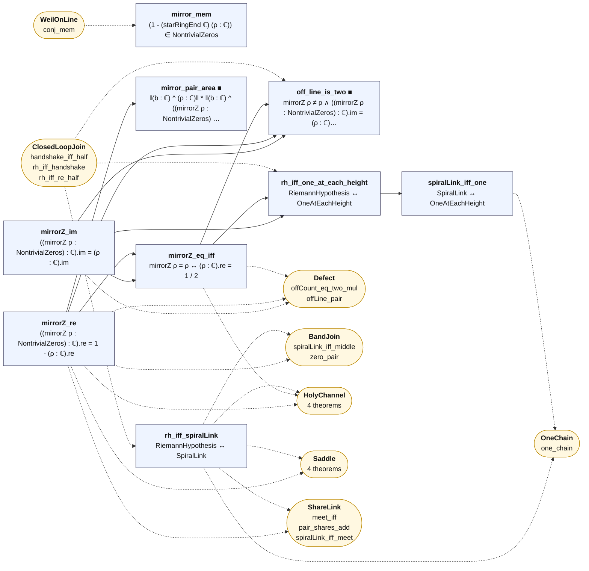

# `lean_stage3/Stage3/SpiralLink.lean`

> **Read from the source text.** This file changed after the last `python3 utilities/lean_map.py --dump`, so the arrows on this page are names occurring in each proof and have not been confirmed by Lean.

SpiralLink — block J2 of `lean_stage3/design/closedloop.md`. 2026-11-23. The link of Julian's paper, §6.3 ("The Phasor Mechanism"), stated in Lean:

9 theorems, 3 definitions, 171 lines. 

**Imports:** [`ClosedLoopJoin`](../lean_stage3/ClosedLoopJoin.md), [`WeilOnLine`](../lean_stage3/WeilOnLine.md)  
**Imported by:** [`Stage3`](../lean_stage3/Stage3.md), [`ClosedLoopChain`](../lean_stage3/ClosedLoopChain.md), [`Defect`](../lean_stage3/Defect.md)

## The picture



An arrow A → B reads "A is used in the proof of B". Green: counting, integers only. Violet: shape, analysis with no ζ. Blue: reads ζ. A name ending in ■ is an end: nothing else uses it. Red: contains `sorry`. Yellow: theorems in another file, counted; a dotted arrow crosses files. Definitions are not drawn; they are listed below the diagram.

## Definitions

<a name="SpiralLink-mirrorZ"></a>
### `SpiralLink.mirrorZ`

def · line 71

The mirror of a zero, as a zero.

- **Is:** `` mirrorZ (ρ : NontrivialZeros) : NontrivialZeros := ⟨1 - (starRingEnd ℂ) (ρ : ℂ), mirror_mem ρ⟩ ``
- **Built from:** [`SpiralLink.mirror_mem`](#SpiralLink-mirror_mem)
- **Used by 22:** [`BandJoin.zero_pair`](../lean_stage3/BandJoin.md#BandJoin-zero_pair), [`Defect.mirrorZ_mirrorZ`](../lean_stage3/Defect.md#Defect-mirrorZ_mirrorZ), [`Defect.mirrorZ_order`](../lean_stage3/Defect.md#Defect-mirrorZ_order), [`Defect.offCount_eq_two_mul`](../lean_stage3/Defect.md#Defect-offCount_eq_two_mul), [`Defect.offLine_pair`](../lean_stage3/Defect.md#Defect-offLine_pair), [`HolyChannel.channel_iff_self_mirror`](../lean_stage3/HolyChannel.md#HolyChannel-channel_iff_self_mirror), [`HolyChannel.holy_pair_shares`](../lean_stage3/HolyChannel.md#HolyChannel-holy_pair_shares), [`HolyChannel.meet_iff_channel`](../lean_stage3/HolyChannel.md#HolyChannel-meet_iff_channel), [`HolyChannel.member_is_two`](../lean_stage3/HolyChannel.md#HolyChannel-member_is_two), [`Saddle.saddle_area`](../lean_stage3/Saddle.md#Saddle-saddle_area), [`Saddle.saddle_of_off_line`](../lean_stage3/Saddle.md#Saddle-saddle_of_off_line), [`Saddle.saddle_runs_away`](../lean_stage3/Saddle.md#Saddle-saddle_runs_away), [`ShareLink.meet_iff`](../lean_stage3/ShareLink.md#ShareLink-meet_iff), [`ShareLink.pair_shares_add`](../lean_stage3/ShareLink.md#ShareLink-pair_shares_add), [`ShareLink.spiralLink_iff_meet`](../lean_stage3/ShareLink.md#ShareLink-spiralLink_iff_meet), [`SpiralLink.mirrorZ_eq_iff`](#SpiralLink-mirrorZ_eq_iff), [`SpiralLink.mirrorZ_im`](#SpiralLink-mirrorZ_im), [`SpiralLink.mirrorZ_re`](#SpiralLink-mirrorZ_re), [`SpiralLink.mirror_pair_area`](#SpiralLink-mirror_pair_area), [`SpiralLink.off_line_is_two`](#SpiralLink-off_line_is_two), [`SpiralLink.rh_iff_one_at_each_height`](#SpiralLink-rh_iff_one_at_each_height), [`WholeChain.whole_chain`](../lean_stage3/WholeChain.md#WholeChain-whole_chain)

<a name="SpiralLink-SpiralLink"></a>
### `SpiralLink.SpiralLink`

def · line 122

The spiral link (Julian's paper, §6.3): the walk closes only where the closed loop is at rest. The Hermitian handshake holds at every nontrivial zero of zeta.

- **Is:** `` SpiralLink : Prop := ∀ ρ : NontrivialZeros, isHermitianHandshake (ρ : ℂ).re ``
- **Built from:** [`ClosedLoopJoin.isHermitianHandshake`](../lean_stage3/ClosedLoopJoin.md#ClosedLoopJoin-isHermitianHandshake)
- **Used by 20:** [`BandJoin.spiralLink_iff_middle`](../lean_stage3/BandJoin.md#BandJoin-spiralLink_iff_middle), [`HalfSieve.spiralLink_iff_wobble`](../lean_stage3/HalfSieve.md#HalfSieve-spiralLink_iff_wobble), [`HalfSieve.spiralLink_of_wobble`](../lean_stage3/HalfSieve.md#HalfSieve-spiralLink_of_wobble), [`HalfSieve.wobble_of_spiralLink`](../lean_stage3/HalfSieve.md#HalfSieve-wobble_of_spiralLink), [`HolyChannel.spiralLink_iff_channel`](../lean_stage3/HolyChannel.md#HolyChannel-spiralLink_iff_channel), [`OneChain.one_chain`](../lean_stage3/OneChain.md#OneChain-one_chain), [`OneChain.spiralLink_iff_cells`](../lean_stage3/OneChain.md#OneChain-spiralLink_iff_cells), [`OneChain.spiralLink_of_attained`](../lean_stage3/OneChain.md#OneChain-spiralLink_of_attained), [`OneChain.spiralLink_of_attained_psi`](../lean_stage3/OneChain.md#OneChain-spiralLink_of_attained_psi), [`OneChain.spiralLink_of_finite`](../lean_stage3/OneChain.md#OneChain-spiralLink_of_finite), [`OneChain.spiralLink_of_finite_accumulation`](../lean_stage3/OneChain.md#OneChain-spiralLink_of_finite_accumulation), [`OneChain.table_of_spiralLink`](../lean_stage3/OneChain.md#OneChain-table_of_spiralLink), [`Readings.wire_holds_iff`](../lean_stage3/Readings.md#Readings-wire_holds_iff), [`Saddle.spiralLink_iff_centres`](../lean_stage3/Saddle.md#Saddle-spiralLink_iff_centres), [`Saddle.spiralLink_iff_noRunaway`](../lean_stage3/Saddle.md#Saddle-spiralLink_iff_noRunaway), [`ShareLink.spiralLink_iff_meet`](../lean_stage3/ShareLink.md#ShareLink-spiralLink_iff_meet), [`SpiralLink.rh_iff_spiralLink`](#SpiralLink-rh_iff_spiralLink), [`SpiralLink.spiralLink_iff_one`](#SpiralLink-spiralLink_iff_one), [`WholeChain.whole_chain`](../lean_stage3/WholeChain.md#WholeChain-whole_chain), [`WindowsOfRH.spiralLink_iff_windows`](../lean_stage3/WindowsOfRH.md#WindowsOfRH-spiralLink_iff_windows)

<a name="SpiralLink-OneAtEachHeight"></a>
### `SpiralLink.OneAtEachHeight`

def · line 126

There is one zero. No two nontrivial zeros share a height.

- **Is:** `` OneAtEachHeight : Prop := ∀ ρ ρ' : NontrivialZeros, (ρ : ℂ).im = (ρ' : ℂ).im → ρ = ρ' ``
- **Used by 4:** [`OneChain.one_chain`](../lean_stage3/OneChain.md#OneChain-one_chain), [`SpiralLink.rh_iff_one_at_each_height`](#SpiralLink-rh_iff_one_at_each_height), [`SpiralLink.spiralLink_iff_one`](#SpiralLink-spiralLink_iff_one), [`WholeChain.whole_chain`](../lean_stage3/WholeChain.md#WholeChain-whole_chain)

## Theorems

<a name="SpiralLink-mirror_mem"></a>
### `SpiralLink.mirror_mem`

line 43 · arrows read from text

**Reads ζ.** It, or something it rests on, uses the zeta function, its zeros or the Riemann hypothesis.

**Why.** The mirror point `1 − conj ρ` of a nontrivial zero is a nontrivial zero.

**Proves**

```lean
(1 - (starRingEnd ℂ) (ρ : ℂ)) ∈ NontrivialZeros
```

**Needs** (its hypotheses)

  - `` ρ : NontrivialZeros ``

**Fed by** (1 theorem its proof uses)

  - [`WeilOnLine.conj_mem`](../lean_stage3/WeilOnLine.md#WeilOnLine-conj_mem) (WeilOnLine) — `` (starRingEnd ℂ) (ρ : ℂ) ∈ Kadiri.NontrivialZeros ``

**Feeds** (1 that use it)

  - [`SpiralLink.mirrorZ`](#SpiralLink-mirrorZ) — def

<a name="SpiralLink-mirrorZ_im"></a>
### `SpiralLink.mirrorZ_im`

line 75 · arrows read from text

**Reads ζ.** It, or something it rests on, uses the zeta function, its zeros or the Riemann hypothesis.

**Why.** The mirror of a zero is at the same height.

**Proves**

```lean
((mirrorZ ρ : NontrivialZeros) : ℂ).im = (ρ : ℂ).im
```

**Needs** (its hypotheses)

  - `` ρ : NontrivialZeros ``

**Fed by:** no theorem of this repo; it stands on Mathlib and the definitions below.

**Definitions its proof touches:** [`SpiralLink.mirrorZ`](#SpiralLink-mirrorZ)

**Feeds** (4 that use it)

  - [`Defect.offLine_pair`](../lean_stage3/Defect.md#Defect-offLine_pair) (Defect) — `` SpiralLink.mirrorZ ρ ∈ (zerosUpTo T).filter (fun ρ : NontrivialZeros => ¬ (ρ : ℂ).re = 1 / 2) ∧ SpiralLink.mirrorZ ρ ≠ ρ ∧ ((SpiralLink.mirrorZ ρ : No… ``
  - [`SpiralLink.mirrorZ_eq_iff`](#SpiralLink-mirrorZ_eq_iff) — `` mirrorZ ρ = ρ ↔ (ρ : ℂ).re = 1 / 2 ``
  - [`SpiralLink.off_line_is_two`](#SpiralLink-off_line_is_two) — `` mirrorZ ρ ≠ ρ ∧ ((mirrorZ ρ : NontrivialZeros) : ℂ).im = (ρ : ℂ).im ∧ ¬ isHermitianHandshake (ρ : ℂ).re ∧ ¬ isHermitianHandshake ((mirrorZ ρ : Nontriv… ``
  - [`SpiralLink.rh_iff_one_at_each_height`](#SpiralLink-rh_iff_one_at_each_height) — `` RiemannHypothesis ↔ OneAtEachHeight ``

<a name="SpiralLink-mirrorZ_re"></a>
### `SpiralLink.mirrorZ_re`

line 80 · arrows read from text

**Reads ζ.** It, or something it rests on, uses the zeta function, its zeros or the Riemann hypothesis.

**Why.** The mirror of a zero has its real part reflected in one half.

**Proves**

```lean
((mirrorZ ρ : NontrivialZeros) : ℂ).re = 1 - (ρ : ℂ).re
```

**Needs** (its hypotheses)

  - `` ρ : NontrivialZeros ``

**Fed by:** no theorem of this repo; it stands on Mathlib and the definitions below.

**Definitions its proof touches:** [`SpiralLink.mirrorZ`](#SpiralLink-mirrorZ)

**Feeds** (12 that use it)

  - [`BandJoin.zero_pair`](../lean_stage3/BandJoin.md#BandJoin-zero_pair) (BandJoin) — `` ‖(2:ℂ) ^ (-(ρ:ℂ))‖ * ‖(2:ℂ) ^ (-((SpiralLink.mirrorZ ρ : NontrivialZeros):ℂ))‖ = 1 / 2 ``
  - [`Defect.offCount_eq_two_mul`](../lean_stage3/Defect.md#Defect-offCount_eq_two_mul) (Defect) — `` offCount T = 2 * ∑ ρ ∈ ((zerosUpTo T).filter (fun ρ : NontrivialZeros => ¬ (ρ : ℂ).re = 1 / 2)).filter (fun ρ : NontrivialZeros => (ρ : ℂ).re < 1 / 2)… ``
  - [`Defect.offLine_pair`](../lean_stage3/Defect.md#Defect-offLine_pair) (Defect) — `` SpiralLink.mirrorZ ρ ∈ (zerosUpTo T).filter (fun ρ : NontrivialZeros => ¬ (ρ : ℂ).re = 1 / 2) ∧ SpiralLink.mirrorZ ρ ≠ ρ ∧ ((SpiralLink.mirrorZ ρ : No… ``
  - [`HolyChannel.holy_pair_shares`](../lean_stage3/HolyChannel.md#HolyChannel-holy_pair_shares) (HolyChannel) — `` ((mirrorZ ρ : NontrivialZeros) : ℂ).re = hf.M ``
  - [`Saddle.saddle_area`](../lean_stage3/Saddle.md#Saddle-saddle_area) (Saddle) — `` stretch ρ * stretch (mirrorZ ρ) = 1 ``
  - [`Saddle.saddle_of_off_line`](../lean_stage3/Saddle.md#Saddle-saddle_of_off_line) (Saddle) — `` (1 < stretch ρ ∧ stretch (mirrorZ ρ) < 1) ∨ (stretch ρ < 1 ∧ 1 < stretch (mirrorZ ρ)) ``
  - [`Saddle.saddle_runs_away`](../lean_stage3/Saddle.md#Saddle-saddle_runs_away) (Saddle) — `` ∃ x : ℝ, x₀ ≤ x ∧ C * x ^ ((1 : ℝ) / 2) * Real.log x ^ k < |Chebyshev.psi x - x| ``
  - [`ShareLink.meet_iff`](../lean_stage3/ShareLink.md#ShareLink-meet_iff) (ShareLink) — `` ‖(T : ℂ) ^ (ρ : ℂ)‖ = ‖(T : ℂ) ^ ((mirrorZ ρ : NontrivialZeros) : ℂ)‖ ↔ (ρ : ℂ).re = 1 / 2 ``
  - [`ShareLink.pair_shares_add`](../lean_stage3/ShareLink.md#ShareLink-pair_shares_add) (ShareLink) — `` Real.logb T ‖(T : ℂ) ^ (ρ : ℂ)‖ + Real.logb T ‖(T : ℂ) ^ ((mirrorZ ρ : NontrivialZeros) : ℂ)‖ = 1 ``
  - [`SpiralLink.mirrorZ_eq_iff`](#SpiralLink-mirrorZ_eq_iff) — `` mirrorZ ρ = ρ ↔ (ρ : ℂ).re = 1 / 2 ``
  - [`SpiralLink.mirror_pair_area`](#SpiralLink-mirror_pair_area) — `` ‖(b : ℂ) ^ (ρ : ℂ)‖ * ‖(b : ℂ) ^ ((mirrorZ ρ : NontrivialZeros) : ℂ)‖ = b ``
  - [`SpiralLink.off_line_is_two`](#SpiralLink-off_line_is_two) — `` mirrorZ ρ ≠ ρ ∧ ((mirrorZ ρ : NontrivialZeros) : ℂ).im = (ρ : ℂ).im ∧ ¬ isHermitianHandshake (ρ : ℂ).re ∧ ¬ isHermitianHandshake ((mirrorZ ρ : Nontriv… ``

<a name="SpiralLink-mirrorZ_eq_iff"></a>
### `SpiralLink.mirrorZ_eq_iff`

line 86 · arrows read from text

**Reads ζ.** It, or something it rests on, uses the zeta function, its zeros or the Riemann hypothesis.

**Why.** A zero is its own mirror exactly on the line.

**Proves**

```lean
mirrorZ ρ = ρ ↔ (ρ : ℂ).re = 1 / 2
```

**Needs** (its hypotheses)

  - `` ρ : NontrivialZeros ``

**Fed by** (2 theorems its proof uses)

  - [`SpiralLink.mirrorZ_im`](#SpiralLink-mirrorZ_im) — `` ((mirrorZ ρ : NontrivialZeros) : ℂ).im = (ρ : ℂ).im ``
  - [`SpiralLink.mirrorZ_re`](#SpiralLink-mirrorZ_re) — `` ((mirrorZ ρ : NontrivialZeros) : ℂ).re = 1 - (ρ : ℂ).re ``

**Definitions its proof touches:** [`SpiralLink.mirrorZ`](#SpiralLink-mirrorZ)

**Feeds** (5 that use it)

  - [`Defect.offLine_pair`](../lean_stage3/Defect.md#Defect-offLine_pair) (Defect) — `` SpiralLink.mirrorZ ρ ∈ (zerosUpTo T).filter (fun ρ : NontrivialZeros => ¬ (ρ : ℂ).re = 1 / 2) ∧ SpiralLink.mirrorZ ρ ≠ ρ ∧ ((SpiralLink.mirrorZ ρ : No… ``
  - [`HolyChannel.channel_iff_self_mirror`](../lean_stage3/HolyChannel.md#HolyChannel-channel_iff_self_mirror) (HolyChannel) — `` (ρ : ℂ).re = (hf.J + hf.M) / 2 ↔ mirrorZ ρ = ρ ``
  - [`HolyChannel.member_is_two`](../lean_stage3/HolyChannel.md#HolyChannel-member_is_two) (HolyChannel) — `` mirrorZ ρ ≠ ρ ∧ ‖(T : ℂ) ^ (ρ : ℂ)‖ ≠ ‖(T : ℂ) ^ ((mirrorZ ρ : NontrivialZeros) : ℂ)‖ ``
  - [`SpiralLink.off_line_is_two`](#SpiralLink-off_line_is_two) — `` mirrorZ ρ ≠ ρ ∧ ((mirrorZ ρ : NontrivialZeros) : ℂ).im = (ρ : ℂ).im ∧ ¬ isHermitianHandshake (ρ : ℂ).re ∧ ¬ isHermitianHandshake ((mirrorZ ρ : Nontriv… ``
  - [`SpiralLink.rh_iff_one_at_each_height`](#SpiralLink-rh_iff_one_at_each_height) — `` RiemannHypothesis ↔ OneAtEachHeight ``

<a name="SpiralLink-mirror_pair_area"></a>
### `SpiralLink.mirror_pair_area`

line 101 · arrows read from text

**Reads ζ.** It, or something it rests on, uses the zeta function, its zeros or the Riemann hypothesis.

**Why.** The pair keeps pace. At any base, the size of a zero's mode times the size of its mirror's mode is the base.

**Proves**

```lean
‖(b : ℂ) ^ (ρ : ℂ)‖ * ‖(b : ℂ) ^ ((mirrorZ ρ : NontrivialZeros) : ℂ)‖ = b
```

**Needs** (its hypotheses)

  - `` hb : 0 < b ``
  - `` ρ : NontrivialZeros ``

**Fed by** (1 theorem its proof uses)

  - [`SpiralLink.mirrorZ_re`](#SpiralLink-mirrorZ_re) — `` ((mirrorZ ρ : NontrivialZeros) : ℂ).re = 1 - (ρ : ℂ).re ``

**Definitions its proof touches:** [`SpiralLink.mirrorZ`](#SpiralLink-mirrorZ)

**Feeds:** nothing. It is an end.

<a name="SpiralLink-off_line_is_two"></a>
### `SpiralLink.off_line_is_two`

line 109 · arrows read from text

**Reads ζ.** It, or something it rests on, uses the zeta function, its zeros or the Riemann hypothesis.

**Why.** Off the line a zero is two. A nontrivial zero off the line has a mirror that is a different zero at the same height, and the handshake fails at both.

**Proves**

```lean
mirrorZ ρ ≠ ρ ∧ ((mirrorZ ρ : NontrivialZeros) : ℂ).im = (ρ : ℂ).im ∧ ¬ isHermitianHandshake (ρ : ℂ).re ∧ ¬ isHermitianHandshake ((mirrorZ ρ : NontrivialZeros) : ℂ).re
```

**Needs** (its hypotheses)

  - `` ρ : NontrivialZeros ``
  - `` h : (ρ : ℂ).re ≠ 1 / 2 ``

**Fed by** (4 theorems its proof uses)

  - [`ClosedLoopJoin.handshake_iff_half`](../lean_stage3/ClosedLoopJoin.md#ClosedLoopJoin-handshake_iff_half) (ClosedLoopJoin) — `` isHermitianHandshake σ ↔ σ = 1 / 2 ``
  - [`SpiralLink.mirrorZ_eq_iff`](#SpiralLink-mirrorZ_eq_iff) — `` mirrorZ ρ = ρ ↔ (ρ : ℂ).re = 1 / 2 ``
  - [`SpiralLink.mirrorZ_im`](#SpiralLink-mirrorZ_im) — `` ((mirrorZ ρ : NontrivialZeros) : ℂ).im = (ρ : ℂ).im ``
  - [`SpiralLink.mirrorZ_re`](#SpiralLink-mirrorZ_re) — `` ((mirrorZ ρ : NontrivialZeros) : ℂ).re = 1 - (ρ : ℂ).re ``

**Definitions its proof touches:** [`ClosedLoopJoin.isHermitianHandshake`](../lean_stage3/ClosedLoopJoin.md#ClosedLoopJoin-isHermitianHandshake), [`SpiralLink.mirrorZ`](#SpiralLink-mirrorZ)

**Feeds:** nothing. It is an end.

<a name="SpiralLink-rh_iff_spiralLink"></a>
### `SpiralLink.rh_iff_spiralLink`

line 130 · arrows read from text

**Reads ζ.** It, or something it rests on, uses the zeta function, its zeros or the Riemann hypothesis.

**Why.** The Riemann hypothesis is the spiral link.

**Proves**

```lean
RiemannHypothesis ↔ SpiralLink
```

**Fed by** (1 theorem its proof uses)

  - [`ClosedLoopJoin.rh_iff_handshake`](../lean_stage3/ClosedLoopJoin.md#ClosedLoopJoin-rh_iff_handshake) (ClosedLoopJoin) — `` RiemannHypothesis ↔ ∀ ρ : NontrivialZeros, isHermitianHandshake (ρ : ℂ).re ``

**Definitions its proof touches:** [`SpiralLink.SpiralLink`](#SpiralLink-SpiralLink)

**Feeds** (5 that use it)

  - [`BandJoin.spiralLink_iff_middle`](../lean_stage3/BandJoin.md#BandJoin-spiralLink_iff_middle) (BandJoin) — `` SpiralLink.SpiralLink ↔ ∀ ρ : NontrivialZeros, ‖(2:ℂ) ^ (-(ρ:ℂ))‖ = bandR (1 / 2) ``
  - [`HolyChannel.spiralLink_iff_channel`](../lean_stage3/HolyChannel.md#HolyChannel-spiralLink_iff_channel) (HolyChannel) — `` SpiralLink.SpiralLink ↔ ZeroIsChannel ``
  - [`OneChain.one_chain`](../lean_stage3/OneChain.md#OneChain-one_chain) (OneChain) — `` (RiemannHypothesis ↔ SpiralLink.SpiralLink) ∧ (SpiralLink.SpiralLink ↔ OneAtEachHeight) ∧ (SpiralLink.SpiralLink ↔ ∀ ρ : NontrivialZeros, restoringFor… ``
  - [`Saddle.spiralLink_iff_centres`](../lean_stage3/Saddle.md#Saddle-spiralLink_iff_centres) (Saddle) — `` SpiralLink.SpiralLink ↔ ∀ ρ : NontrivialZeros, stretch ρ = 1 ``
  - [`ShareLink.spiralLink_iff_meet`](../lean_stage3/ShareLink.md#ShareLink-spiralLink_iff_meet) (ShareLink) — `` SpiralLink.SpiralLink ↔ ∀ ρ : NontrivialZeros, ‖((2 : ℝ) : ℂ) ^ (ρ : ℂ)‖ = ‖((2 : ℝ) : ℂ) ^ ((mirrorZ ρ : NontrivialZeros) : ℂ)‖ ``

<a name="SpiralLink-rh_iff_one_at_each_height"></a>
### `SpiralLink.rh_iff_one_at_each_height`

line 134 · arrows read from text

**Reads ζ.** It, or something it rests on, uses the zeta function, its zeros or the Riemann hypothesis.

**Why.** The Riemann hypothesis is that there is one zero at each height.

**Proves**

```lean
RiemannHypothesis ↔ OneAtEachHeight
```

**Fed by** (3 theorems its proof uses)

  - [`ClosedLoopJoin.rh_iff_re_half`](../lean_stage3/ClosedLoopJoin.md#ClosedLoopJoin-rh_iff_re_half) (ClosedLoopJoin) — `` RiemannHypothesis ↔ ∀ ρ : NontrivialZeros, (ρ : ℂ).re = 1 / 2 ``
  - [`SpiralLink.mirrorZ_eq_iff`](#SpiralLink-mirrorZ_eq_iff) — `` mirrorZ ρ = ρ ↔ (ρ : ℂ).re = 1 / 2 ``
  - [`SpiralLink.mirrorZ_im`](#SpiralLink-mirrorZ_im) — `` ((mirrorZ ρ : NontrivialZeros) : ℂ).im = (ρ : ℂ).im ``

**Definitions its proof touches:** [`SpiralLink.OneAtEachHeight`](#SpiralLink-OneAtEachHeight), [`SpiralLink.mirrorZ`](#SpiralLink-mirrorZ)

**Feeds** (1 that use it)

  - [`SpiralLink.spiralLink_iff_one`](#SpiralLink-spiralLink_iff_one) — `` SpiralLink ↔ OneAtEachHeight ``

<a name="SpiralLink-spiralLink_iff_one"></a>
### `SpiralLink.spiralLink_iff_one`

line 147 · arrows read from text

**Reads ζ.** It, or something it rests on, uses the zeta function, its zeros or the Riemann hypothesis.

**Why.** The spiral link and "one zero at each height" are the same statement.

**Proves**

```lean
SpiralLink ↔ OneAtEachHeight
```

**Fed by** (1 theorem its proof uses)

  - [`SpiralLink.rh_iff_one_at_each_height`](#SpiralLink-rh_iff_one_at_each_height) — `` RiemannHypothesis ↔ OneAtEachHeight ``

**Definitions its proof touches:** [`SpiralLink.OneAtEachHeight`](#SpiralLink-OneAtEachHeight), [`SpiralLink.SpiralLink`](#SpiralLink-SpiralLink)

**Feeds** (1 that use it)

  - [`OneChain.one_chain`](../lean_stage3/OneChain.md#OneChain-one_chain) (OneChain) — `` (RiemannHypothesis ↔ SpiralLink.SpiralLink) ∧ (SpiralLink.SpiralLink ↔ OneAtEachHeight) ∧ (SpiralLink.SpiralLink ↔ ∀ ρ : NontrivialZeros, restoringFor… ``

