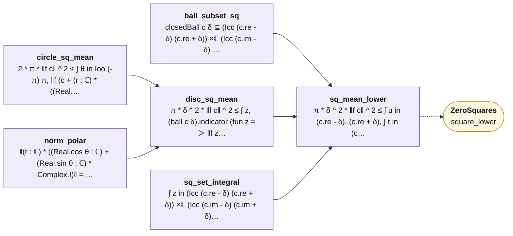

# `lean_stage3/Stage3/SquareMean.lean`

SquareMean — block C5a of `lean_stage3/design/carlson.md`. 2026-11-23. An analytic function cannot be small in mean square on a square around a point where it has size one. For `f` complex differentiable on an open set containing the closed square of half-side `δ` about `c`, the iterated integral of `‖f‖²` over the square is at least `π·δ²·‖f c‖²`. The proof takes the mean value property of `f²` on each circle of radius `r < δ`, which gives `2π‖f c‖² ≤ ∫ ‖f‖²` over the circle; multiplies by `r` and integrates in po…

6 theorems, 0 definitions, 247 lines. Arrows are Lean's own record of what each proof uses.

**Imports:** nothing in this tree  
**Imported by:** [`Stage3`](../lean_stage3/Stage3.md), [`ZeroSquares`](../lean_stage3/ZeroSquares.md)

## The picture



An arrow A → B reads "A is used in the proof of B". Green: counting, integers only. Violet: shape, analysis with no ζ. Blue: reads ζ. A name ending in ■ is an end: nothing else uses it. Red: contains `sorry`. Yellow: theorems in another file, counted; a dotted arrow crosses files. Definitions are not drawn; they are listed below the diagram.

## Theorems

<a name="SquareMean-circle_sq_mean"></a>
### `SquareMean.circle_sq_mean`

line 36

**Shape.** Uses real or complex analysis; nothing in it or beneath it reads ζ.

**Why.** If `f` is complex differentiable on `U` and the closed disc of radius `r > 0` about `c` lies in `U`, then `2π‖f c‖²` is at most the integral of `‖f‖²` over the circle of radius `r`, parametrized by the angle in `(−π, π)`.

**Proves**

```lean
2 * π * ‖f c‖ ^ 2 ≤ ∫ θ in Ioo (-π) π, ‖f (c + (r : ℂ) * ((Real.cos θ : ℂ) + (Real.sin θ : ℂ) * Complex.I))‖ ^ 2
```

**Needs** (its hypotheses)

  - `` hr : 0 < r ``
  - `` hsub : closedBall c r ⊆ U ``
  - `` hf : DifferentiableOn ℂ f U ``

**Fed by:** no theorem of this repo; it stands on Mathlib.

**Feeds** (1 that use it)

  - [`SquareMean.disc_sq_mean`](#SquareMean-disc_sq_mean) — `` π * δ ^ 2 * ‖f c‖ ^ 2 ≤ ∫ z, (ball c δ).indicator (fun z => ‖f z‖ ^ 2) z ``

<a name="SquareMean-ball_subset_sq"></a>
### `SquareMean.ball_subset_sq`

line 76

**Shape.** Uses real or complex analysis; nothing in it or beneath it reads ζ.

**Why.** The closed disc of radius `δ` about `c` lies in the closed square of half-side `δ` about `c`.

**Proves**

```lean
closedBall c δ ⊆ (Icc (c.re - δ) (c.re + δ)) ×ℂ (Icc (c.im - δ) (c.im + δ))
```

**Needs** (its hypotheses)

  - `` c : ℂ ``
  - `` δ : ℝ ``

**Fed by:** no theorem of this repo; it stands on Mathlib.

**Feeds** (1 that use it)

  - [`SquareMean.sq_mean_lower`](#SquareMean-sq_mean_lower) — `` π * δ ^ 2 * ‖f c‖ ^ 2 ≤ ∫ u in (c.re - δ)..(c.re + δ), ∫ t in (c.im - δ)..(c.im + δ), ‖f ((u : ℂ) + Complex.I * (t : ℂ))‖ ^ 2 ``

<a name="SquareMean-norm_polar"></a>
### `SquareMean.norm_polar`

line 88

**Shape.** Uses real or complex analysis; nothing in it or beneath it reads ζ.

**Why.** The norm of `r(cos θ + i sin θ)` is `|r|`.

**Proves**

```lean
‖(r : ℂ) * ((Real.cos θ : ℂ) + (Real.sin θ : ℂ) * Complex.I)‖ = |r|
```

**Needs** (its hypotheses)

  - `` r θ : ℝ ``

**Fed by:** no theorem of this repo; it stands on Mathlib.

**Feeds** (1 that use it)

  - [`SquareMean.disc_sq_mean`](#SquareMean-disc_sq_mean) — `` π * δ ^ 2 * ‖f c‖ ^ 2 ≤ ∫ z, (ball c δ).indicator (fun z => ‖f z‖ ^ 2) z ``

<a name="SquareMean-disc_sq_mean"></a>
### `SquareMean.disc_sq_mean`

line 96

**Shape.** Uses real or complex analysis; nothing in it or beneath it reads ζ.

**Why.** If `f` is complex differentiable on an open `U` containing the closed disc of radius `δ` about `c`, then `π δ² ‖f c‖²` is at most the integral over `ℂ` of `‖f‖²` cut off to the open disc.

**Proves**

```lean
π * δ ^ 2 * ‖f c‖ ^ 2 ≤ ∫ z, (ball c δ).indicator (fun z => ‖f z‖ ^ 2) z
```

**Needs** (its hypotheses)

  - `` hδ : 0 < δ ``
  - `` hsub : closedBall c δ ⊆ U ``
  - `` hf : DifferentiableOn ℂ f U ``

**Fed by** (2 theorems its proof uses)

  - [`SquareMean.circle_sq_mean`](#SquareMean-circle_sq_mean) — `` 2 * π * ‖f c‖ ^ 2 ≤ ∫ θ in Ioo (-π) π, ‖f (c + (r : ℂ) * ((Real.cos θ : ℂ) + (Real.sin θ : ℂ) * Complex.I))‖ ^ 2 ``
  - [`SquareMean.norm_polar`](#SquareMean-norm_polar) — `` ‖(r : ℂ) * ((Real.cos θ : ℂ) + (Real.sin θ : ℂ) * Complex.I)‖ = |r| ``

**Feeds** (1 that use it)

  - [`SquareMean.sq_mean_lower`](#SquareMean-sq_mean_lower) — `` π * δ ^ 2 * ‖f c‖ ^ 2 ≤ ∫ u in (c.re - δ)..(c.re + δ), ∫ t in (c.im - δ)..(c.im + δ), ‖f ((u : ℂ) + Complex.I * (t : ℂ))‖ ^ 2 ``

<a name="SquareMean-sq_set_integral"></a>
### `SquareMean.sq_set_integral`

line 171

**Shape.** Uses real or complex analysis; nothing in it or beneath it reads ζ.

**Why.** For `F` continuous on the closed square of half-side `δ` about `c`, the area integral of `F` over the square equals the iterated integral, outer over the real part and inner over the imaginary part.

**Proves**

```lean
∫ z in (Icc (c.re - δ) (c.re + δ)) ×ℂ (Icc (c.im - δ) (c.im + δ)), F z = ∫ u in (c.re - δ)..(c.re + δ), ∫ t in (c.im - δ)..(c.im + δ), F ((u : ℂ) + Complex.I * (t : ℂ))
```

**Needs** (its hypotheses)

  - `` hδ : 0 < δ ``
  - `` hF : ContinuousOn F ((Icc (c.re - δ) (c.re + δ)) ×ℂ (Icc (c.im - δ) (c.im + δ))) ``

**Fed by:** no theorem of this repo; it stands on Mathlib.

**Feeds** (1 that use it)

  - [`SquareMean.sq_mean_lower`](#SquareMean-sq_mean_lower) — `` π * δ ^ 2 * ‖f c‖ ^ 2 ≤ ∫ u in (c.re - δ)..(c.re + δ), ∫ t in (c.im - δ)..(c.im + δ), ‖f ((u : ℂ) + Complex.I * (t : ℂ))‖ ^ 2 ``

<a name="SquareMean-sq_mean_lower"></a>
### `SquareMean.sq_mean_lower`

line 214

**Shape.** Uses real or complex analysis; nothing in it or beneath it reads ζ.

**Why.** An analytic function is not small in mean square on a square about a point where it is large: for `f` complex differentiable on an open set containing the closed square of half-side `δ` about `c`, the iterated integral of `‖f‖²` over the square is at least `π δ² ‖f c‖²`.

**Proves**

```lean
π * δ ^ 2 * ‖f c‖ ^ 2 ≤ ∫ u in (c.re - δ)..(c.re + δ), ∫ t in (c.im - δ)..(c.im + δ), ‖f ((u : ℂ) + Complex.I * (t : ℂ))‖ ^ 2
```

**Needs** (its hypotheses)

  - `` hδ : 0 < δ ``
  - `` hU : IsOpen U ``
  - `` hsub : (Icc (c.re - δ) (c.re + δ)) ×ℂ (Icc (c.im - δ) (c.im + δ)) ⊆ U ``
  - `` hf : DifferentiableOn ℂ f U ``

**Fed by** (3 theorems its proof uses)

  - [`SquareMean.ball_subset_sq`](#SquareMean-ball_subset_sq) — `` closedBall c δ ⊆ (Icc (c.re - δ) (c.re + δ)) ×ℂ (Icc (c.im - δ) (c.im + δ)) ``
  - [`SquareMean.disc_sq_mean`](#SquareMean-disc_sq_mean) — `` π * δ ^ 2 * ‖f c‖ ^ 2 ≤ ∫ z, (ball c δ).indicator (fun z => ‖f z‖ ^ 2) z ``
  - [`SquareMean.sq_set_integral`](#SquareMean-sq_set_integral) — `` ∫ z in (Icc (c.re - δ) (c.re + δ)) ×ℂ (Icc (c.im - δ) (c.im + δ)), F z = ∫ u in (c.re - δ)..(c.re + δ), ∫ t in (c.im - δ)..(c.im + δ), F ((u : ℂ) + Co… ``

**Feeds** (1 that use it)

  - [`ZeroSquares.square_lower`](../lean_stage3/ZeroSquares.md#ZeroSquares-square_lower) (ZeroSquares) — `` Real.pi * δ ^ 2 ≤ ∫ u in (σ - δ)..(1 + δ), innerI X ((n : ℝ) + 7 / 4) ((n : ℝ) + 13 / 4) u ``

