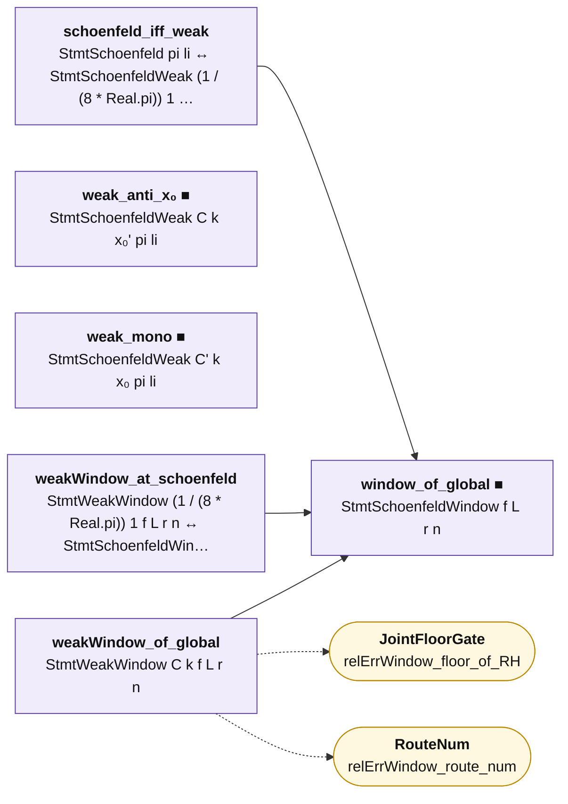

# `lean_stage3/Stage3/Statement.lean`

Statement — step 2: the weak bound family, and the bridges between shapes. O68 (entry 118) measured the tolerance: the census survives bounds of the shape C·√x·(log x)^k far weaker than Schoenfeld's — depth 10 at C = 1, k = 2; depth 6 at C = 1000. This module gives that family its Lean name and proves the bridges:

6 theorems, 4 definitions, 201 lines. Arrows are Lean's own record of what each proof uses.

**Imports:** nothing in this tree  
**Imported by:** [`Stage3`](../lean_stage3/Stage3.md), [`PsiToPi`](../lean_stage3/PsiToPi.md), [`WeilPowerClean`](../lean_stage3/WeilPowerClean.md), [`WeilPowerGeom`](../lean_stage3/WeilPowerGeom.md)

## The picture



An arrow A → B reads "A is used in the proof of B". Green: counting, integers only. Violet: shape, analysis with no ζ. Blue: reads ζ. A name ending in ■ is an end: nothing else uses it. Red: contains `sorry`. Yellow: theorems in another file, counted; a dotted arrow crosses files. Definitions are not drawn; they are listed below the diagram.

## Definitions

<a name="Stage3-StmtSchoenfeldWindow"></a>
### `Stage3.StmtSchoenfeldWindow`

def · line 44

Character-level copy of `Nonvanishing.StmtSchoenfeldWindow` from the bench tree (lean/Nonvanishing.lean). The weld: utilities/check_weld.py verifies the two definition bodies are textually identical.

- **Is:** `` StmtSchoenfeldWindow (f L : ℤ → ℝ) (r : ℤ) (n : ℕ) : Prop := ∀ k ∈ range (n + 1), |f (r - k) - L (r - k)| ≤ (Real.log 2 * ((r : ℝ) - k) / (8 * Real.pi)) * (2 : ℝ) ^ (((r : ℝ) - k) / 2) ``
- **Used by 2:** [`Stage3.weakWindow_at_schoenfeld`](#Stage3-weakWindow_at_schoenfeld), [`Stage3.window_of_global`](#Stage3-window_of_global)

<a name="Stage3-StmtSchoenfeld"></a>
### `Stage3.StmtSchoenfeld`

def · line 52

Character-level copy of `Schoenfeld.StmtSchoenfeld` from the bench tree (lean/Schoenfeld.lean). The weld: utilities/check_weld.py verifies the two definition bodies are textually identical.

- **Is:** `` StmtSchoenfeld (pi li : ℝ → ℝ) : Prop := ∀ x : ℝ, 2657 ≤ x → |pi x - li x| ≤ Real.sqrt x * Real.log x / (8 * Real.pi) ``
- **Used by 2:** [`Stage3.schoenfeld_iff_weak`](#Stage3-schoenfeld_iff_weak), [`Stage3.window_of_global`](#Stage3-window_of_global)

<a name="Stage3-StmtSchoenfeldWeak"></a>
### `Stage3.StmtSchoenfeldWeak`

def · line 58

The weak family (O68's grid, as a Prop): `|pi − li| ≤ C·√x·(log x)^k` from `x₀` on. The census survives members far weaker than Schoenfeld's: depth 10 at `C = 1, k = 2`, depth 6 at `C = 1000, k = 2` (entry 118).

- **Is:** `` StmtSchoenfeldWeak (C : ℝ) (k : ℕ) (x₀ : ℝ) (pi li : ℝ → ℝ) : Prop := ∀ x : ℝ, x₀ ≤ x → |pi x - li x| ≤ C * Real.sqrt x * Real.log x ^ k ``
- **Used by 26:** [`Stage3.schoenfeldWeak_floor_of_RH`](../lean_stage3/AssemblyFloor.md#Stage3-schoenfeldWeak_floor_of_RH), [`CellResidual.RH_iff_cells`](../lean_stage3/CellResidual.md#CellResidual-RH_iff_cells), [`CellResidual.cells_of_RH`](../lean_stage3/CellResidual.md#CellResidual-cells_of_RH), [`CellResidual.cells_of_schoenfeldWeak`](../lean_stage3/CellResidual.md#CellResidual-cells_of_schoenfeldWeak), [`CellResidual.resid_le`](../lean_stage3/CellResidual.md#CellResidual-resid_le), [`CellResidual.schoenfeldWeak_of_cells`](../lean_stage3/CellResidual.md#CellResidual-schoenfeldWeak_of_cells), [`CellResidual.weak_nonneg`](../lean_stage3/CellResidual.md#CellResidual-weak_nonneg), [`Stage3.schoenfeldWeak_floor_split_of_RH`](../lean_stage3/GlueFloor.md#Stage3-schoenfeldWeak_floor_split_of_RH), [`HalfSieve.schoenfeld_of_wobble`](../lean_stage3/HalfSieve.md#HalfSieve-schoenfeld_of_wobble), [`JointFloorGate.relErrWindow_floor_of_RH`](../lean_stage3/JointFloorGate.md#JointFloorGate-relErrWindow_floor_of_RH), [`Slice8.schoenfeldWeak_of_psiWeak_three`](../lean_stage3/LineBound.md#Slice8-schoenfeldWeak_of_psiWeak_three), [`PiToPsi.RH_iff_schoenfeldWeak`](../lean_stage3/PiToPsi.md#PiToPsi-RH_iff_schoenfeldWeak), [`PiToPsi.RH_of_schoenfeldWeak`](../lean_stage3/PiToPsi.md#PiToPsi-RH_of_schoenfeldWeak), [`PiToPsi.psiWeak_of_schoenfeldWeak`](../lean_stage3/PiToPsi.md#PiToPsi-psiWeak_of_schoenfeldWeak), [`PiToPsi.relRes_tail_le`](../lean_stage3/PiToPsi.md#PiToPsi-relRes_tail_le), [`Stage3.schoenfeldWeak_of_psiWeak`](../lean_stage3/PsiToPi.md#Stage3-schoenfeldWeak_of_psiWeak), [`RouteNum.relErrWindow_route_num`](../lean_stage3/RouteNum.md#RouteNum-relErrWindow_route_num), [`Stage3.schoenfeldWeak_route_num`](../lean_stage3/RouteNum.md#Stage3-schoenfeldWeak_route_num), [`Stage3.schoenfeld_iff_weak`](#Stage3-schoenfeld_iff_weak), [`Stage3.weakWindow_of_global`](#Stage3-weakWindow_of_global), [`Stage3.weak_anti_x₀`](#Stage3-weak_anti_x-), [`Stage3.weak_mono`](#Stage3-weak_mono), [`Stage3.window_of_global`](#Stage3-window_of_global), [`Stage3.schoenfeldWeak_of_RH_half`](../lean_stage3/ThetaPi.md#Stage3-schoenfeldWeak_of_RH_half), [`Stage3.schoenfeldWeak_of_psiWeak_half`](../lean_stage3/ThetaPi.md#Stage3-schoenfeldWeak_of_psiWeak_half), [`Stage3.stmtSchoenfeldWeak_iff_theta_half`](../lean_stage3/ThetaPi.md#Stage3-stmtSchoenfeldWeak_iff_theta_half)

<a name="Stage3-StmtWeakWindow"></a>
### `Stage3.StmtWeakWindow`

def · line 63

The weak bound translated to the dyadic window: at `x = 2^(r−j)` the bound reads `C·(log 2·(r−j))^k·2^((r−j)/2)`.

- **Is:** `` StmtWeakWindow (C : ℝ) (k : ℕ) (f L : ℤ → ℝ) (r : ℤ) (n : ℕ) : Prop := ∀ j ∈ range (n + 1), |f (r - j) - L (r - j)| ≤ C * (Real.log 2 * ((r : ℝ) - j)) ^ k * (2 : ℝ) ^ (((r : ℝ) - j) / 2) ``
- **Used by 4:** [`JointFloorGate.weakWindow_relErr`](../lean_stage3/JointFloorGate.md#JointFloorGate-weakWindow_relErr), [`Stage3.weakWindow_at_schoenfeld`](#Stage3-weakWindow_at_schoenfeld), [`Stage3.weakWindow_of_global`](#Stage3-weakWindow_of_global), [`Stage3.window_of_global`](#Stage3-window_of_global)

## Theorems

<a name="Stage3-schoenfeld_iff_weak"></a>
### `Stage3.schoenfeld_iff_weak`

line 70

**Shape.** Uses real or complex analysis; nothing in it or beneath it reads ζ.

**Why.** Schoenfeld is a member of the family: Corollary 1 is exactly `C = 1/(8π), k = 1, x₀ = 2657`.

**Proves**

```lean
StmtSchoenfeld pi li ↔ StmtSchoenfeldWeak (1 / (8 * Real.pi)) 1 2657 pi li
```

**Stated with:** [`Stage3.StmtSchoenfeld`](#Stage3-StmtSchoenfeld), [`Stage3.StmtSchoenfeldWeak`](#Stage3-StmtSchoenfeldWeak)

**Fed by:** no theorem of this repo; it stands on Mathlib and the definitions below.

**Feeds** (1 that use it)

  - [`Stage3.window_of_global`](#Stage3-window_of_global) — `` StmtSchoenfeldWindow f L r n ``

<a name="Stage3-weak_anti_x-"></a>
### `Stage3.weak_anti_x₀`

line 78

**Shape.** Uses real or complex analysis; nothing in it or beneath it reads ζ.

**Why.** A lower floor only strengthens the hypothesis.

**Proves**

```lean
StmtSchoenfeldWeak C k x₀' pi li
```

**Needs** (its hypotheses)

  - `` hx : x₀ ≤ x₀' ``
  - `` h : StmtSchoenfeldWeak C k x₀ pi li ``

**Stated with:** [`Stage3.StmtSchoenfeldWeak`](#Stage3-StmtSchoenfeldWeak)

**Fed by:** no theorem of this repo; it stands on Mathlib and the definitions below.

**Feeds:** nothing. It is an end.

<a name="Stage3-weak_mono"></a>
### `Stage3.weak_mono`

line 85

**Shape.** Uses real or complex analysis; nothing in it or beneath it reads ζ.

**Why.** A larger constant only weakens the hypothesis (needs `1 ≤ x₀` so the envelope `√x·(log x)^k` is nonnegative on the range).

**Proves**

```lean
StmtSchoenfeldWeak C' k x₀ pi li
```

**Needs** (its hypotheses)

  - `` hx₀ : 1 ≤ x₀ ``
  - `` hC : C ≤ C' ``
  - `` h : StmtSchoenfeldWeak C k x₀ pi li ``

**Stated with:** [`Stage3.StmtSchoenfeldWeak`](#Stage3-StmtSchoenfeldWeak)

**Fed by:** no theorem of this repo; it stands on Mathlib and the definitions below.

**Feeds:** nothing. It is an end.

<a name="Stage3-weakWindow_of_global"></a>
### `Stage3.weakWindow_of_global`

line 101

**Shape.** Uses real or complex analysis; nothing in it or beneath it reads ζ.

**Why.** The bridge, weak form: the global weak bound implies the window bound whenever the window bottom clears the floor: `x₀ ≤ 2^(r−n)`. The translation is `√(2^y) = 2^(y/2)` and `log(2^y) = y·log 2`, exactly as in the bench's special case.

**Proves**

```lean
StmtWeakWindow C k f L r n
```

**Needs** (its hypotheses)

  - `` hpi : StmtSchoenfeldWeak C k x₀ pi li ``
  - `` hf : ∀ m : ℤ, f m = pi ((2 : ℝ) ^ (m : ℝ)) ``
  - `` hL : ∀ m : ℤ, L m = li ((2 : ℝ) ^ (m : ℝ)) ``
  - `` hbot : x₀ ≤ (2 : ℝ) ^ ((r : ℝ) - n) ``

**Stated with:** [`Stage3.StmtSchoenfeldWeak`](#Stage3-StmtSchoenfeldWeak), [`Stage3.StmtWeakWindow`](#Stage3-StmtWeakWindow)

**Fed by:** no theorem of this repo; it stands on Mathlib and the definitions below.

**Feeds** (3 that use it)

  - [`JointFloorGate.relErrWindow_floor_of_RH`](../lean_stage3/JointFloorGate.md#JointFloorGate-relErrWindow_floor_of_RH) (JointFloorGate) — `` ∃ c₁ c₃ c₄ : ℝ, 0 ≤ c₁ ∧ 0 ≤ c₃ ∧ 0 ≤ c₄ ∧ ∀ x₀ : ℝ, 16 ≤ x₀ → ∀ (r : ℤ) (n : ℕ), x₀ ^ 2 ≤ (2 : ℝ) ^ ((r : ℝ) - n) → 0 ≤ (r : ℝ) - n → JointDialGate.S… ``
  - [`RouteNum.relErrWindow_route_num`](../lean_stage3/RouteNum.md#RouteNum-relErrWindow_route_num) (RouteNum) — `` JointDialGate.StmtRelErrWindow (fun m : ℤ => (Nat.primeCounting ⌊(2 : ℝ) ^ (m : ℝ)⌋₊ : ℝ)) (fun m : ℤ => 2 / Real.log 2 + ∫ t in (1 : ℝ)..(m : ℝ), Rea… ``
  - [`Stage3.window_of_global`](#Stage3-window_of_global) — `` StmtSchoenfeldWindow f L r n ``

<a name="Stage3-weakWindow_at_schoenfeld"></a>
### `Stage3.weakWindow_at_schoenfeld`

line 136

**Shape.** Uses real or complex analysis; nothing in it or beneath it reads ζ.

**Why.** At Schoenfeld's parameters the weak window is the bench's window: `C = 1/(8π), k = 1` recovers `StmtSchoenfeldWindow`'s bound character for character.

**Proves**

```lean
StmtWeakWindow (1 / (8 * Real.pi)) 1 f L r n ↔ StmtSchoenfeldWindow f L r n
```

**Stated with:** [`Stage3.StmtSchoenfeldWindow`](#Stage3-StmtSchoenfeldWindow), [`Stage3.StmtWeakWindow`](#Stage3-StmtWeakWindow)

**Fed by:** no theorem of this repo; it stands on Mathlib and the definitions below.

**Feeds** (1 that use it)

  - [`Stage3.window_of_global`](#Stage3-window_of_global) — `` StmtSchoenfeldWindow f L r n ``

<a name="Stage3-window_of_global"></a>
### `Stage3.window_of_global`

line 149

**Shape.** Uses real or complex analysis; nothing in it or beneath it reads ζ.

**Why.** The composition — the bench bridge reproved on this toolchain. Identical statement to the bench's `Schoenfeld.window_of_global` (lean/Schoenfeld.lean, v4.28.0, kernel-checked there); proved here through the weak family, demonstrating the weld carries.

**Proves**

```lean
StmtSchoenfeldWindow f L r n
```

**Needs** (its hypotheses)

  - `` hpi : StmtSchoenfeld pi li ``
  - `` hf : ∀ m : ℤ, f m = pi ((2 : ℝ) ^ (m : ℝ)) ``
  - `` hL : ∀ m : ℤ, L m = li ((2 : ℝ) ^ (m : ℝ)) ``
  - `` hbot : (12 : ℤ) ≤ r - n ``

**Stated with:** [`Stage3.StmtSchoenfeld`](#Stage3-StmtSchoenfeld), [`Stage3.StmtSchoenfeldWindow`](#Stage3-StmtSchoenfeldWindow)

**Fed by** (3 theorems its proof uses)

  - [`Stage3.schoenfeld_iff_weak`](#Stage3-schoenfeld_iff_weak) — `` StmtSchoenfeld pi li ↔ StmtSchoenfeldWeak (1 / (8 * Real.pi)) 1 2657 pi li ``
  - [`Stage3.weakWindow_at_schoenfeld`](#Stage3-weakWindow_at_schoenfeld) — `` StmtWeakWindow (1 / (8 * Real.pi)) 1 f L r n ↔ StmtSchoenfeldWindow f L r n ``
  - [`Stage3.weakWindow_of_global`](#Stage3-weakWindow_of_global) — `` StmtWeakWindow C k f L r n ``

**Definitions its proof touches:** [`Stage3.StmtSchoenfeldWeak`](#Stage3-StmtSchoenfeldWeak), [`Stage3.StmtWeakWindow`](#Stage3-StmtWeakWindow)

**Feeds:** nothing. It is an end.

