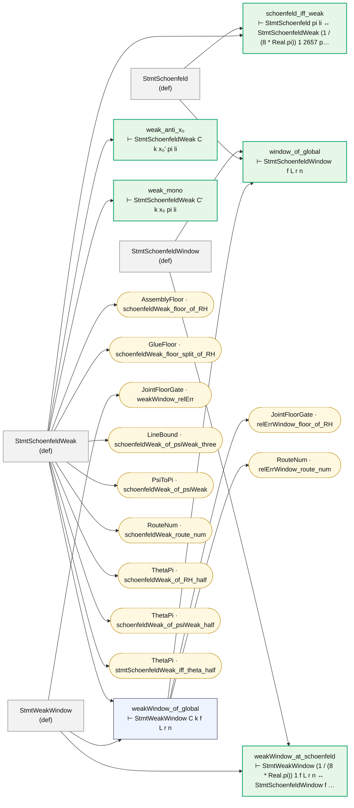

# `lean_stage3/Stage3/Statement.lean`

**What it does** (its own header): Statement — step 2: the weak bound family, and the bridges between shapes. O68 (entry 118) measured the tolerance: the census survives bounds of the shape C·√x·(log x)^k far weaker than Schoenfeld's — depth 10 at C = 1, k = 2; depth 6 at C = 1000. This module gives that family its Lean name and proves the bridges:

**Imports:** nothing in this tree.
**Imported by:** [`Stage3`](../lean_stage3/Stage3.md), [`PsiToPi`](../lean_stage3/PsiToPi.md), [`WeilPowerClean`](../lean_stage3/WeilPowerClean.md), [`WeilPowerGeom`](../lean_stage3/WeilPowerGeom.md).

Blue: theorem. Green: a theorem nothing else uses (an end). Dashed white: connects to nothing. Grey: definition. Red: contains `sorry`. Yellow: in another file. An arrow A → B reads "A is used by B".

## Every declaration

| declaration | proves (output) | needs (input) | why (its own docstring) | uses | used by |
|---|---|---|---|---|---|
| `Stage3.StmtSchoenfeldWindow` def, line 44 | Prop | f L : ℤ → ℝ; r : ℤ; n : ℕ | Character-level copy of `Nonvanishing.StmtSchoenfeldWindow` from the bench tree (lean/Nonvanishing.lean). The weld: utilities/check_weld.py verifies the two definition bodies are textually identical. | — | `Stage3.weakWindow_at_schoenfeld`, `Stage3.window_of_global` |
| `Stage3.StmtSchoenfeld` def, line 52 | Prop | pi li : ℝ → ℝ | Character-level copy of `Schoenfeld.StmtSchoenfeld` from the bench tree (lean/Schoenfeld.lean). The weld: utilities/check_weld.py verifies the two definition bodies are textually identical. | — | `Stage3.schoenfeld_iff_weak`, `Stage3.window_of_global` |
| `Stage3.StmtSchoenfeldWeak` def, line 58 | Prop | C : ℝ; k : ℕ; x₀ : ℝ; pi li : ℝ → ℝ | The weak family (O68's grid, as a Prop): `\|pi − li\| ≤ C·√x·(log x)^k` from `x₀` on. The census survives members far weaker than Schoenfeld's: depth 10 at `C = 1, k = 2`, depth 6 at `C = 1000, k = 2` (entry 118). | — | `Stage3.schoenfeldWeak_floor_of_RH`, `Stage3.schoenfeldWeak_floor_split_of_RH`, `Slice8.schoenfeldWeak_of_psiWeak_three`, `Stage3.schoenfeldWeak_of_psiWeak`, `Stage3.schoenfeldWeak_route_num`, `Stage3.schoenfeld_iff_weak`, `Stage3.weakWindow_of_global`, `Stage3.weak_anti_x₀`, `Stage3.weak_mono`, `Stage3.schoenfeldWeak_of_RH_half`, `Stage3.schoenfeldWeak_of_psiWeak_half`, `Stage3.stmtSchoenfeldWeak_iff_theta_half` |
| `Stage3.StmtWeakWindow` def, line 63 | Prop | C : ℝ; k : ℕ; f L : ℤ → ℝ; r : ℤ; n : ℕ | The weak bound translated to the dyadic window: at `x = 2^(r−j)` the bound reads `C·(log 2·(r−j))^k·2^((r−j)/2)`. | — | `JointFloorGate.weakWindow_relErr`, `Stage3.weakWindow_at_schoenfeld`, `Stage3.weakWindow_of_global` |
| `Stage3.schoenfeld_iff_weak` theorem, line 70 | StmtSchoenfeld pi li ↔ StmtSchoenfeldWeak (1 / (8 * Real.pi)) 1 2657 pi li | — | Schoenfeld is a member of the family: Corollary 1 is exactly `C = 1/(8π), k = 1, x₀ = 2657`. | `Stage3.StmtSchoenfeld`, `Stage3.StmtSchoenfeldWeak` | — |
| `Stage3.weak_anti_x₀` theorem, line 78 | StmtSchoenfeldWeak C k x₀' pi li | hx : x₀ ≤ x₀'; h : StmtSchoenfeldWeak C k x₀ pi li | A lower floor only strengthens the hypothesis. | `Stage3.StmtSchoenfeldWeak` | — |
| `Stage3.weak_mono` theorem, line 85 | StmtSchoenfeldWeak C' k x₀ pi li | hx₀ : 1 ≤ x₀; hC : C ≤ C'; h : StmtSchoenfeldWeak C k x₀ pi li | A larger constant only weakens the hypothesis (needs `1 ≤ x₀` so the envelope `√x·(log x)^k` is nonnegative on the range). | `Stage3.StmtSchoenfeldWeak` | — |
| `Stage3.weakWindow_of_global` theorem, line 101 | StmtWeakWindow C k f L r n | hpi : StmtSchoenfeldWeak C k x₀ pi li; hf : ∀ m : ℤ, f m = pi ((2 : ℝ) ^ (m : ℝ)); hL : ∀ m : ℤ, L m = li ((2 : ℝ) ^ (m : ℝ)); hbot : x₀ ≤ (2 : ℝ) ^ ((r : ℝ) - n) | The bridge, weak form: the global weak bound implies the window bound whenever the window bottom clears the floor: `x₀ ≤ 2^(r−n)`. The translation is `√(2^y) = 2^(y/2)` and `log(2^y) = y·log 2`, exactly as in the bench's special case. | `Stage3.StmtSchoenfeldWeak`, `Stage3.StmtWeakWindow` | `JointFloorGate.relErrWindow_floor_of_RH`, `RouteNum.relErrWindow_route_num`, `Stage3.window_of_global` |
| `Stage3.weakWindow_at_schoenfeld` theorem, line 136 | StmtWeakWindow (1 / (8 * Real.pi)) 1 f L r n ↔ StmtSchoenfeldWindow f L r n | — | At Schoenfeld's parameters the weak window is the bench's window: `C = 1/(8π), k = 1` recovers `StmtSchoenfeldWindow`'s bound character for character. | `Stage3.StmtSchoenfeldWindow`, `Stage3.StmtWeakWindow` | — |
| `Stage3.window_of_global` theorem, line 149 | StmtSchoenfeldWindow f L r n | hpi : StmtSchoenfeld pi li; hf : ∀ m : ℤ, f m = pi ((2 : ℝ) ^ (m : ℝ)); hL : ∀ m : ℤ, L m = li ((2 : ℝ) ^ (m : ℝ)); hbot : (12 : ℤ) ≤ r - n | The composition — the bench bridge reproved on this toolchain. Identical statement to the bench's `Schoenfeld.window_of_global` (lean/Schoenfeld.lean, v4.28.0, kernel-checked there); proved here through the weak family, demonstrating the weld carries. | `Stage3.StmtSchoenfeld`, `Stage3.StmtSchoenfeldWindow`, `Stage3.weakWindow_of_global` | — |
